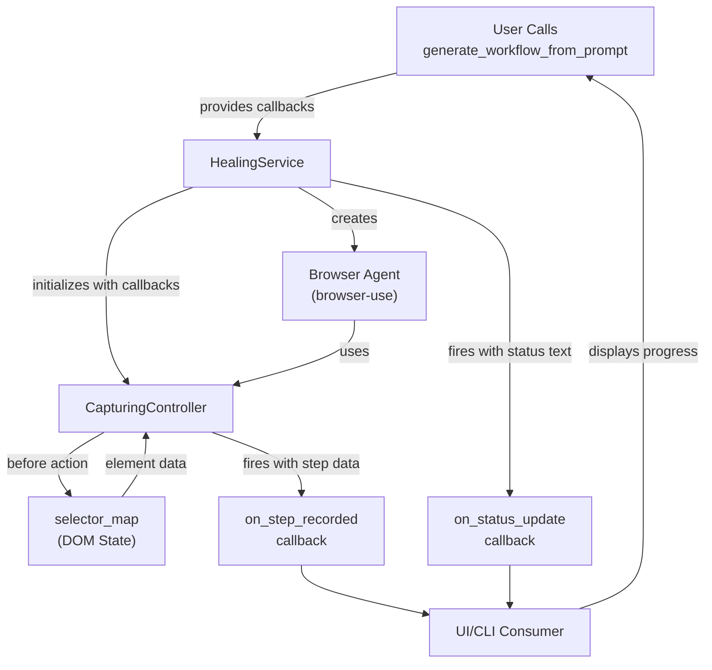
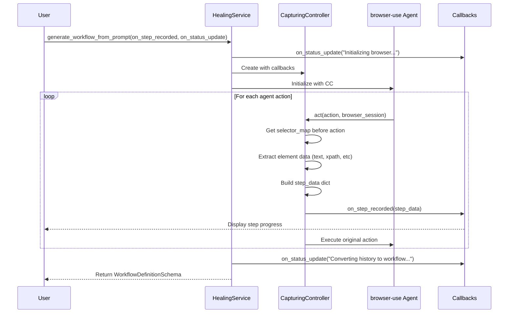
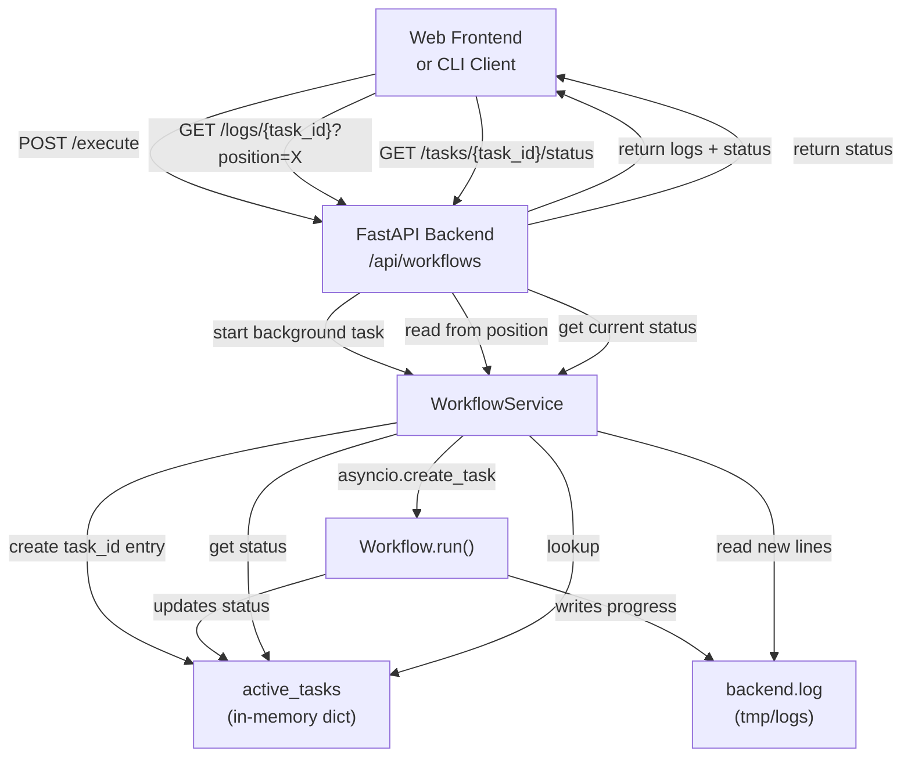
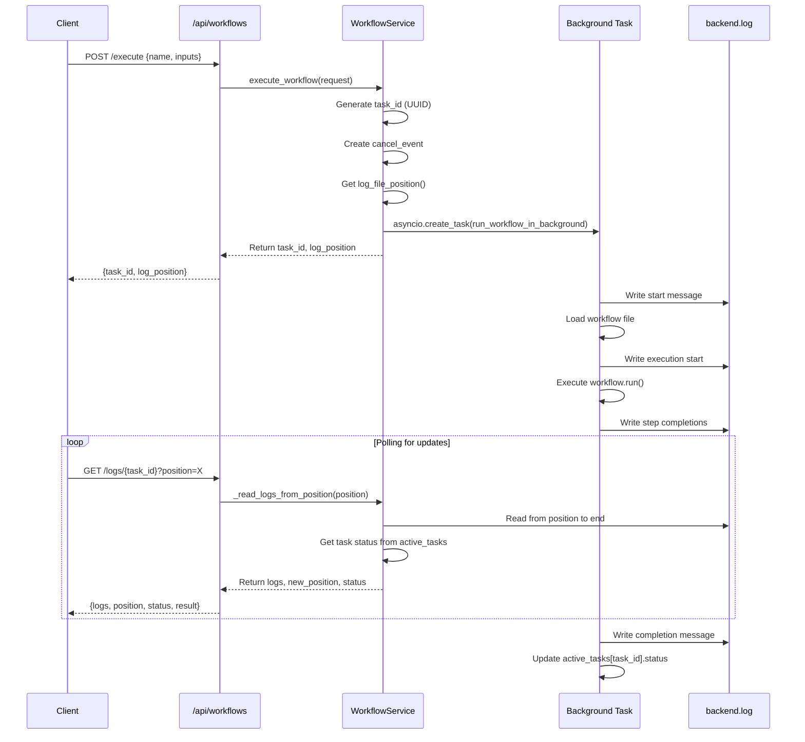
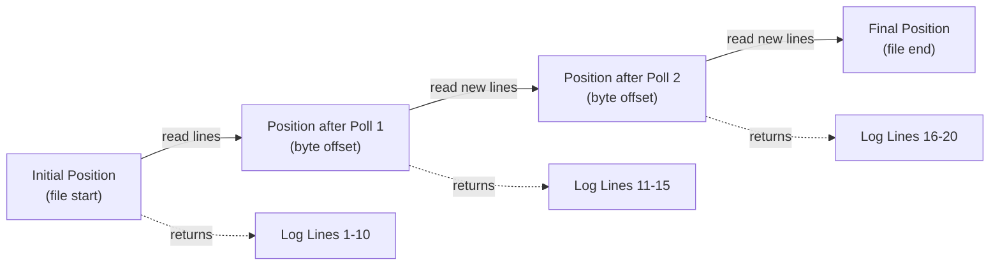
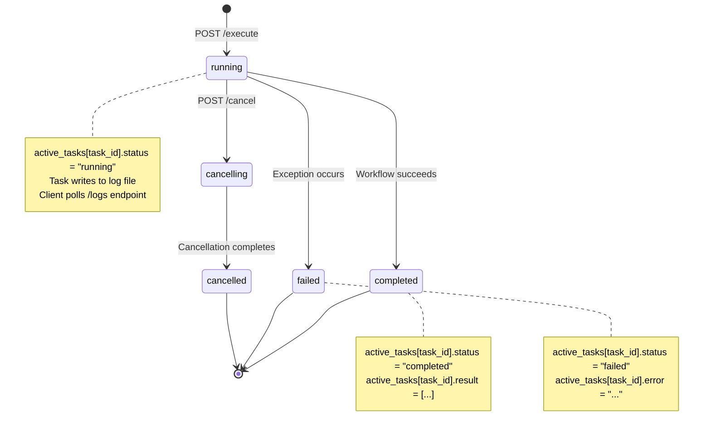
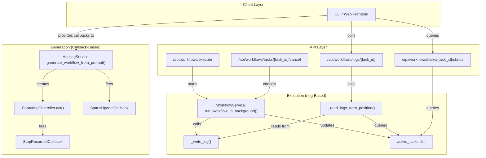

<!-- source: DeepWiki mcp.deepwiki.com · repo browser-use/workflow-use · page 9.4 Real-Time Progress Tracking · fetched 2026-10-30 -->

# Real-Time Progress Tracking

<details>
<summary>Relevant source files</summary>

The following files were used as context for generating this wiki page:

- [workflows/backend/api.py](workflows/backend/api.py)
- [workflows/backend/routers.py](workflows/backend/routers.py)
- [workflows/backend/service.py](workflows/backend/service.py)
- [workflows/backend/views.py](workflows/backend/views.py)
- [workflows/pyproject.toml](workflows/pyproject.toml)
- [workflows/uv.lock](workflows/uv.lock)
- [workflows/workflow_use/healing/service.py](workflows/workflow_use/healing/service.py)
- [workflows/workflow_use/workflow/prompts.py](workflows/workflow_use/workflow/prompts.py)
- [workflows/workflow_use/workflow/tests/test_extract.py](workflows/workflow_use/workflow/tests/test_extract.py)

</details>


## Purpose and Scope

This page documents the progress tracking and monitoring systems in workflow-use. The system provides two distinct progress tracking mechanisms:

1. **Callback-based tracking** during workflow generation (when agent explores and records steps)
2. **Log-based polling** during workflow execution (when running saved workflows)

For information about workflow execution itself, see [Workflow Execution](#5). For information about the web interface that consumes these progress updates, see [Web Interface](#7).

---

## Overview

Progress tracking serves different purposes depending on the operation:

| Operation | Tracking Method | Use Case | Key Components |
|-----------|----------------|----------|----------------|
| **Workflow Generation** | Callback functions | Real-time step recording during agent exploration | `StepRecordedCallback`, `StatusUpdateCallback` |
| **Workflow Execution** | File-based logs + HTTP polling | Monitoring execution progress via API | `WorkflowService`, `/api/workflows/logs/{task_id}` |

---

## Callback-Based Progress Tracking (Generation)

### Architecture

During workflow generation, the `HealingService` accepts optional callback functions that are invoked as the agent performs actions. This provides real-time visibility into the agent's behavior.



**Workflow Progress Tracking During Generation**

Sources: [workflows/workflow_use/healing/service.py:21-23](), [workflows/workflow_use/healing/service.py:420-448]()

### Callback Types

The system defines two callback types:

```python
# Type definitions
StepRecordedCallback = Callable[[Dict[str, Any]], None]
StatusUpdateCallback = Callable[[str], None]
```

Sources: [workflows/workflow_use/healing/service.py:21-23]()

#### StepRecordedCallback

Invoked when the agent completes an action during workflow generation. Receives a dictionary with:

| Field | Type | Description |
|-------|------|-------------|
| `step_number` | `int` | 1-indexed step number |
| `action_type` | `str` | Action type (navigation, click, input_text, extract, etc.) |
| `description` | `str` | Human-readable description of the action |
| `url` | `str` | Current page URL |
| `selector` | `Optional[str]` | CSS/XPath selector if applicable |
| `extracted_data` | `Optional[dict]` | Extracted data for extract steps |
| `timestamp` | `str` | ISO 8601 timestamp |
| `target_text` | `Optional[str]` | Element text being interacted with |

Sources: [workflows/workflow_use/healing/service.py:439-447]()

#### StatusUpdateCallback

Invoked for non-step status messages (e.g., "Initializing browser...", "Analyzing page structure...").

| Parameter | Type | Description |
|-----------|------|-------------|
| `message` | `str` | Status message text |

Sources: [workflows/workflow_use/healing/service.py:448](), [workflows/workflow_use/healing/service.py:454-455]()

### Implementation Flow



**Callback Invocation Sequence**

Sources: [workflows/workflow_use/healing/service.py:466-795]()

### CapturingController

The `CapturingController` (nested class inside `generate_workflow_from_prompt`) intercepts actions and fires callbacks with enriched step data.

Key responsibilities:
- Extract `selector_map` from browser session before each action
- Parse element data (tag, text, xpath, css_selector, attributes)
- Apply semantic text extraction (prefer aria-label, title over raw text)
- Fire `on_step_recorded` with complete step information
- Pass action through to parent controller for execution

Sources: [workflows/workflow_use/healing/service.py:466-795]()

**Element Data Extraction**:

The controller performs sophisticated text extraction from DOM elements:

1. **Primary text extraction**: Attempts multiple field names (`text`, `inner_text`, `node_value`)
2. **Semantic attribute fallback**: For poor text (short/generic), tries `aria-label`, `title`, `alt`, `placeholder`
3. **ID/class-based inference**: For anchor tags, infers text from class/id patterns (e.g., "search" → "Search")
4. **URL slug extraction**: Extracts meaningful text from href paths for links

Sources: [workflows/workflow_use/healing/service.py:509-629]()

---

## Log-Based Progress Tracking (Execution)

### Architecture

During workflow execution via the backend API, progress is tracked through file-based logging with incremental reads and task status tracking.



**Log-Based Progress Tracking Architecture**

Sources: [workflows/backend/service.py:35-266](), [workflows/backend/routers.py:19-119]()

### Components

#### WorkflowService

The `WorkflowService` manages workflow execution tasks and logging:

| Component | Type | Purpose |
|-----------|------|---------|
| `log_dir` | `Path` | Directory for log files (`./tmp/logs/`) |
| `active_tasks` | `Dict[str, TaskInfo]` | In-memory task status tracking |
| `workflow_tasks` | `Dict[str, asyncio.Task]` | Running asyncio tasks |
| `cancel_events` | `Dict[str, asyncio.Event]` | Cancellation event objects |

Sources: [workflows/backend/service.py:38-53]()

#### TaskInfo Model

Tracks execution state for each workflow:

```python
class TaskInfo(BaseModel):
    status: str  # "running" | "completed" | "failed" | "cancelled" | "cancelling"
    workflow: str  # Workflow filename
    result: Optional[List[Dict[str, Any]]] = None  # Execution results
    error: Optional[str] = None  # Error message if failed
```

Sources: [workflows/backend/views.py:7-11]()

### Execution Flow



**Workflow Execution Progress Polling**

Sources: [workflows/backend/service.py:164-230](), [workflows/backend/routers.py:51-101]()

### Incremental Log Reading

The system implements efficient incremental log reading to avoid re-reading the entire log file on each poll.

**File Position Tracking**:



**Incremental Log Position Tracking**

Key methods:

| Method | Purpose | Returns |
|--------|---------|---------|
| `_log_file_position()` | Get current log file size (byte offset) | `int` |
| `_read_logs_from_position(position)` | Read log lines from byte offset to end | `Tuple[List[str], int]` (lines, new_position) |
| `_write_log(log_file, message)` | Append message to log file | `None` |

Sources: [workflows/backend/service.py:55-87]()

**Implementation Details**:

```python
async def _read_logs_from_position(self, position: int) -> Tuple[List[str], int]:
    log_file = self.log_dir / 'backend.log'
    current_size = log_file.stat().st_size
    
    if position >= current_size:
        return [], position  # No new logs
    
    async with aiofiles.open(log_file, 'r') as f:
        await f.seek(position)  # Seek to last known position
        all_logs = await f.readlines()
        # Filter out standard logging prefixes
        new_logs = [line for line in all_logs if not line.strip().startswith(('INFO:', 'WARNING:', 'DEBUG:', 'ERROR:'))]
    
    return new_logs, current_size  # Return new position
```

Sources: [workflows/backend/service.py:63-83]()

### API Endpoints

#### POST /api/workflows/execute

Start workflow execution in background.

**Request**:
```json
{
  "name": "workflow.workflow.yaml",
  "inputs": {"key": "value"}
}
```

**Response**:
```json
{
  "success": true,
  "task_id": "uuid-string",
  "workflow": "workflow.workflow.yaml",
  "log_position": 0,
  "message": "Workflow execution started..."
}
```

Sources: [workflows/backend/routers.py:51-86](), [workflows/backend/views.py:41-46]()

#### GET /api/workflows/logs/{task_id}?position=X

Poll for new log lines and task status.

**Query Parameters**:
- `position`: Byte offset from previous poll (default: 0)

**Response**:
```json
{
  "logs": ["[timestamp] log line 1", "[timestamp] log line 2"],
  "position": 1234,
  "log_position": 1234,
  "status": "running",
  "result": null,
  "error": null
}
```

Sources: [workflows/backend/routers.py:89-101](), [workflows/backend/views.py:49-55]()

#### GET /api/workflows/tasks/{task_id}/status

Get current task status without log lines.

**Response**:
```json
{
  "task_id": "uuid-string",
  "status": "completed",
  "workflow": "workflow.workflow.yaml",
  "result": [{"step_id": 0, "extracted_content": "...", "status": "completed"}],
  "error": null
}
```

Sources: [workflows/backend/routers.py:104-110](), [workflows/backend/views.py:58-63]()

#### POST /api/workflows/tasks/{task_id}/cancel

Request workflow cancellation.

**Response**:
```json
{
  "success": true,
  "message": "Workflow cancellation requested"
}
```

The cancellation mechanism:
1. Sets the `cancel_event` for the task (checked during execution)
2. Calls `task.cancel()` on the asyncio task
3. Updates task status to "cancelling"
4. Workflow execution checks `cancel_event.is_set()` at key points

Sources: [workflows/backend/service.py:244-265](), [workflows/backend/routers.py:113-119]()

---

## Task Lifecycle and Status Transitions



**Task Status State Machine**

Sources: [workflows/backend/service.py:174-229]()

### Status Values

| Status | Description | Terminal | Result Field | Error Field |
|--------|-------------|----------|--------------|-------------|
| `running` | Task is actively executing | No | `null` | `null` |
| `completed` | Execution succeeded | Yes | Populated | `null` |
| `failed` | Exception occurred | Yes | `null` | Populated |
| `cancelling` | Cancellation requested | No | `null` | `null` |
| `cancelled` | Cancellation completed | Yes | `null` | `null` |

Sources: [workflows/backend/service.py:174-229](), [workflows/backend/views.py:7-11]()

---

## Log Format and Content

### Log Entry Structure

Log entries follow this format:
```
[YYYY-MM-DD HH:MM:SS] Message text
```

### Log Message Types

During workflow execution, the system logs:

| Event | Example Message |
|-------|----------------|
| Start | `Starting workflow 'example.workflow.yaml'` |
| Inputs | `Input parameters: {"key": "value"}` |
| Execution | `Executing workflow...` |
| Step completion | `Completed step 0: extracted_content` |
| Success | `Workflow completed successfully with N steps` |
| Cancellation | `Workflow execution was cancelled` |
| Error | `Error: exception message` |

Sources: [workflows/backend/service.py:175-229]()

### Log Filtering

The `_read_logs_from_position` method filters out standard Python logging prefixes to return only workflow-specific messages:

**Filtered prefixes**: `INFO:`, `WARNING:`, `DEBUG:`, `ERROR:`

This ensures clients receive semantic progress messages rather than internal logging output.

Sources: [workflows/backend/service.py:75-82]()

---

## Progress Tracking Integration

### Code Entity Mapping



**Progress Tracking System Integration**

Sources: [workflows/workflow_use/healing/service.py:420-448](), [workflows/backend/service.py:35-266](), [workflows/backend/routers.py:19-119]()

---

## Usage Examples

### Example 1: Generation with Callbacks

```python
from workflow_use.healing.service import HealingService
from browser_use.llm import ChatBrowserUse

def on_step_recorded(step_data):
    print(f"Step {step_data['step_number']}: {step_data['action_type']}")
    print(f"  Target: {step_data.get('target_text', 'N/A')}")
    print(f"  URL: {step_data['url']}")

def on_status_update(status):
    print(f"Status: {status}")

llm = ChatBrowserUse(model='bu-latest')
healing_service = HealingService(llm=llm)

workflow = await healing_service.generate_workflow_from_prompt(
    prompt="Search for Python on Wikipedia",
    agent_llm=llm,
    extraction_llm=llm,
    on_step_recorded=on_step_recorded,
    on_status_update=on_status_update
)
```

Sources: [workflows/workflow_use/healing/service.py:420-448]()

### Example 2: Execution with Polling

```python
import httpx
import asyncio

async def execute_and_monitor(workflow_name: str, inputs: dict):
    async with httpx.AsyncClient() as client:
        # Start execution
        response = await client.post(
            "http://localhost:8000/api/workflows/execute",
            json={"name": workflow_name, "inputs": inputs}
        )
        data = response.json()
        task_id = data["task_id"]
        position = data["log_position"]
        
        # Poll for progress
        while True:
            response = await client.get(
                f"http://localhost:8000/api/workflows/logs/{task_id}",
                params={"position": position}
            )
            data = response.json()
            
            # Print new logs
            for log_line in data["logs"]:
                print(log_line)
            
            # Update position for next poll
            position = data["position"]
            
            # Check if done
            if data["status"] in ["completed", "failed", "cancelled"]:
                print(f"Final status: {data['status']}")
                if data["result"]:
                    print(f"Result: {data['result']}")
                if data["error"]:
                    print(f"Error: {data['error']}")
                break
            
            await asyncio.sleep(1)  # Poll every second

await execute_and_monitor("example.workflow.yaml", {"search_term": "Python"})
```

Sources: [workflows/backend/routers.py:51-101]()

---

## Performance Considerations

### Callback Overhead

- Callbacks are invoked synchronously during agent execution
- Heavy processing in callbacks can slow down workflow generation
- Recommended: Minimal processing in callbacks (e.g., append to queue, update UI state)

### Log Polling Frequency

- Recommended polling interval: 500ms - 2s
- Aggressive polling (< 100ms) creates unnecessary file I/O
- Position-based reading eliminates redundant data transfer

### Memory Management

- `active_tasks` dict grows with concurrent executions
- Completed tasks remain in memory until process restart
- Consider implementing task cleanup for long-running servers

Sources: [workflows/backend/service.py:38-53]()

---

## Cancellation Support

Both tracking mechanisms support cancellation:

**During Generation**:
- Not directly supported (agent runs to completion)
- Can implement timeout in calling code

**During Execution**:
- `cancel_event` (asyncio.Event) passed to workflow execution
- Workflow checks `cancel_event.is_set()` at key points
- Graceful shutdown with "cancelling" → "cancelled" status transition

Sources: [workflows/backend/service.py:164-265](), [workflows/workflow_use/workflow/service.py:179-199]()

---

## Related Components

- [Workflow Execution](#5) - Core execution logic that generates progress events
- [Web Interface](#7) - Frontend that consumes progress updates
- [CLI Commands](#6) - Command-line interface for workflow operations
- [FastAPI Backend](#7.1) - API layer that exposes progress endpoints

---

