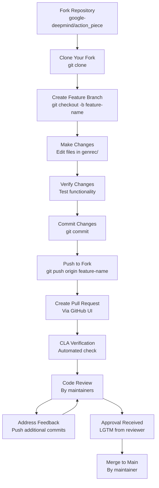
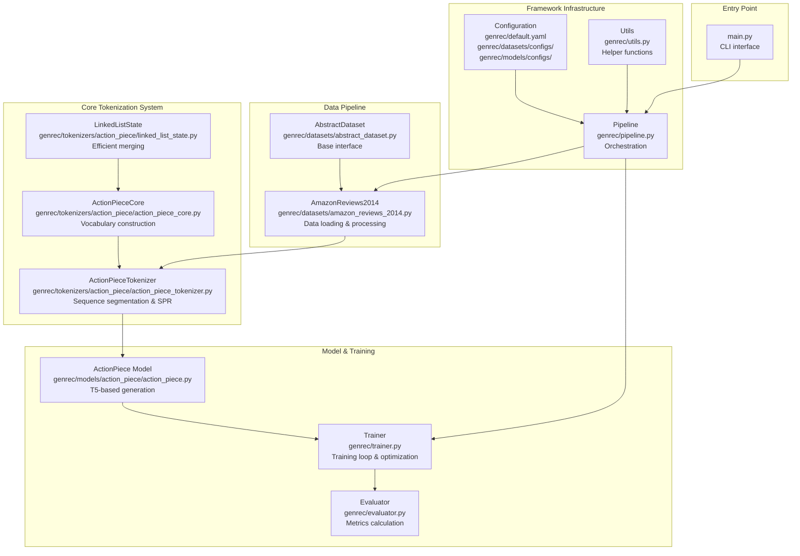
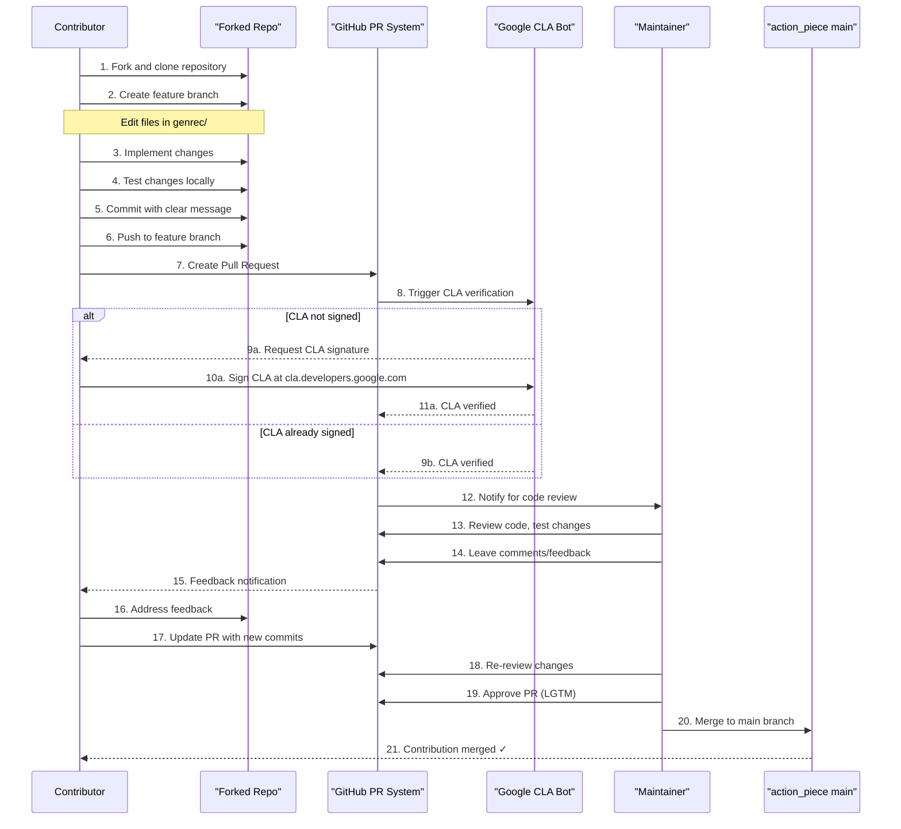

<!-- source: DeepWiki mcp.deepwiki.com · repo google-deepmind/action_piece · page 10.1 Contributing Guidelines · fetched 2026-10-26 -->

# Contributing Guidelines

Relevant source files

The following files were used as context for generating this wiki page:

- [CONTRIBUTING.md](CONTRIBUTING.md)

## Purpose and Scope

This page documents the contribution process for the ActionPiece repository, including Contributor License Agreement (CLA) requirements, code review procedures via GitHub pull requests, and community conduct expectations. 

For information about the overall project structure and how code is organized, see [Project Structure](#10.2). For technical API documentation of core components that you might contribute to, see [API Reference](#9).

## Contributor License Agreement

All contributions to this project must be accompanied by a Contributor License Agreement (CLA). The CLA ensures that you (or your employer) retain the copyright to your contribution while granting the project permission to use and redistribute your contributions as part of the ActionPiece system.

### CLA Process Overview

| Step | Action | Details |
|------|--------|---------|
| 1 | Visit CLA Portal | Navigate to https://cla.developers.google.com/ |
| 2 | Review Existing Agreements | Check if you already have a CLA on file |
| 3 | Sign New CLA | If no existing CLA, complete the signing process |
| 4 | Submit Contributions | Once CLA is signed, you can submit pull requests |

**Important**: You generally only need to submit a CLA once. If you've already submitted one for a different Google open source project, you likely don't need to sign again.

Sources: [CONTRIBUTING.md:3-13]()

## Code Review Process

All submissions, including those by project members, require review. The ActionPiece project uses GitHub pull requests for all code reviews.

### Pull Request Workflow

Sources: [CONTRIBUTING.md:15-20]()

### Submission Guidelines

When submitting a pull request:

1. **Clear Description**: Provide a detailed explanation of what changes you made and why
2. **Reference Issues**: Link to any related GitHub issues using `#issue-number`
3. **Test Coverage**: Ensure your changes don't break existing functionality
4. **Code Consistency**: Follow the existing code style and patterns in the repository
5. **Documentation Updates**: Update relevant documentation if your changes affect user-facing behavior

For detailed information on using GitHub pull requests, consult the [GitHub Help documentation](https://help.github.com/articles/about-pull-requests).

Sources: [CONTRIBUTING.md:15-20]()

## Community Guidelines

This project follows [Google's Open Source Community Guidelines](https://opensource.google/conduct). All contributors are expected to:

- **Be Respectful**: Treat all community members with respect and courtesy
- **Be Collaborative**: Work constructively with other contributors and maintainers
- **Be Inclusive**: Welcome diverse perspectives and experiences
- **Be Professional**: Maintain a professional and constructive tone in all communications
- **Focus on Technical Merit**: Keep discussions focused on code quality and functionality

Sources: [CONTRIBUTING.md:22-25]()

## Types of Contributions

The ActionPiece project welcomes various types of contributions across different areas of the codebase.

### Contribution Areas Map

Sources: [CONTRIBUTING.md:1-26]()

### Specific Contribution Opportunities

| Area | Description | Key Files |
|------|-------------|-----------|
| **ActionPiece Tokenization** | Improvements to vocabulary construction, merging algorithms, or SPR implementation | `genrec/tokenizers/action_piece/action_piece_core.py` `genrec/tokenizers/action_piece/action_piece_tokenizer.py` |
| **Model Architecture** | Enhancements to T5-based model, generation strategies, or inference methods | `genrec/models/action_piece/action_piece.py` |
| **Dataset Support** | Adding new datasets, improving data processing, or enhancing feature extraction | `genrec/datasets/amazon_reviews_2014.py` `genrec/datasets/abstract_dataset.py` |
| **Training & Optimization** | Improvements to training loop, learning rate schedules, or gradient handling | `genrec/trainer.py` |
| **Evaluation Metrics** | New metrics or improvements to existing metrics (recall, ndcg, err) | `genrec/evaluator.py` |
| **Configuration System** | Enhancements to YAML config handling or parameter management | `genrec/utils.py` `genrec/config.yaml` files |
| **Data Structures** | Optimizations to `LinkedListState` or other utility structures | `genrec/tokenizers/action_piece/linked_list_state.py` |
| **Documentation** | Improvements to README, code comments, or wiki pages | `README.md`, inline comments |
| **Bug Fixes** | Fixes for identified issues across any component | Any affected files |
| **Performance** | Speed or memory optimizations | Any affected files |

Sources: [CONTRIBUTING.md:1-26]()

### Non-Code Contributions

The project also welcomes:

- **Documentation Improvements**: Clarifying README, adding usage examples, improving wiki content
- **Bug Reports**: Detailed issue reports with reproduction steps and environment details
- **Feature Requests**: Well-documented proposals for new functionality with use cases
- **Usage Examples**: Demonstrating ActionPiece on new datasets or domains

Sources: [CONTRIBUTING.md:1-26]()

## Detailed Contribution Workflow

### Complete Contribution Process

Sources: [CONTRIBUTING.md:1-26]()

### Pre-Submission Checklist

Before creating a pull request, verify:

- [ ] **CLA Status**: Your CLA is signed and on file at https://cla.developers.google.com/
- [ ] **Code Quality**: Code follows existing patterns and conventions in the repository
- [ ] **Functionality**: Changes work as intended and don't introduce regressions
- [ ] **Testing**: If applicable, verify your changes with existing datasets/configs
- [ ] **Documentation**: Code includes clear comments explaining complex logic
- [ ] **Commit Messages**: Commits have descriptive messages explaining the "why"
- [ ] **No Breaking Changes**: Existing functionality is preserved, or breaking changes are clearly documented
- [ ] **Dependencies**: If adding new dependencies, they are justified and minimal

Sources: [CONTRIBUTING.md:1-26]()

### After Submission

Once your pull request is submitted:

1. **Monitor PR**: Watch for automated checks and reviewer comments
2. **Respond Promptly**: Address feedback in a timely manner
3. **Iterate**: Push additional commits to address review comments
4. **Stay Engaged**: Respond to questions and participate in technical discussions
5. **Be Patient**: Maintainers will review as time permits

Sources: [CONTRIBUTING.md:15-20]()

## Getting Help

If you have questions about contributing:

- **Existing Issues**: Review GitHub issues to see if your question has been addressed
- **README & Wiki**: Consult the documentation in `README.md` and wiki pages
- **Pull Request Discussions**: Use PR comments for specific technical questions about your contribution
- **Community Guidelines**: Follow [Google's Open Source Community Guidelines](https://opensource.google/conduct) when seeking help

Sources: [CONTRIBUTING.md:22-25]()

## Summary

The ActionPiece contribution process consists of:

1. **One-time Setup**: Sign the Contributor License Agreement at https://cla.developers.google.com/
2. **Development**: Fork the repository, create a feature branch, and implement your changes
3. **Submission**: Create a pull request with a clear description of your changes
4. **Review**: Address feedback from project maintainers
5. **Merge**: Your contribution is merged upon approval

All contributions must follow Google's Open Source Community Guidelines, ensuring a respectful and professional collaborative environment. Contributions can range from core tokenization improvements to documentation enhancements, with all types of contributions valued and appreciated.

Sources: [CONTRIBUTING.md:1-26]()

---

