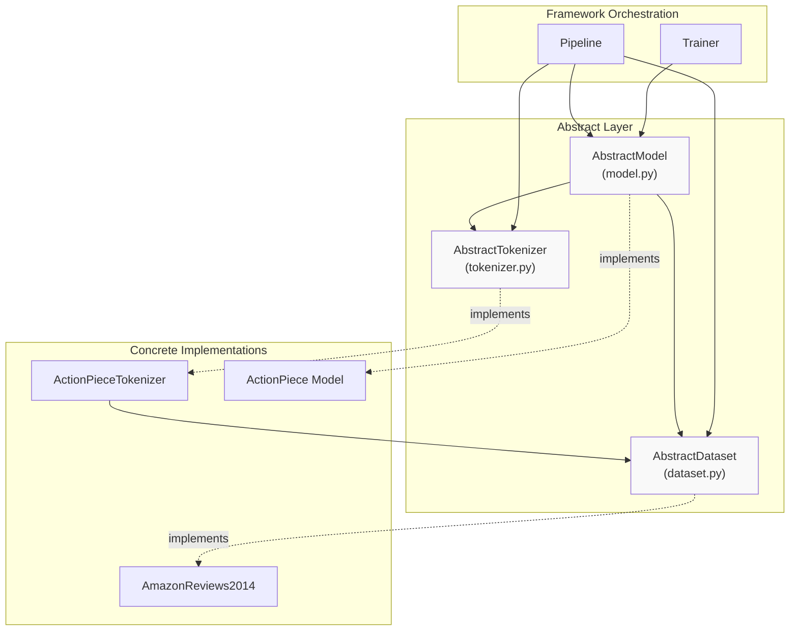
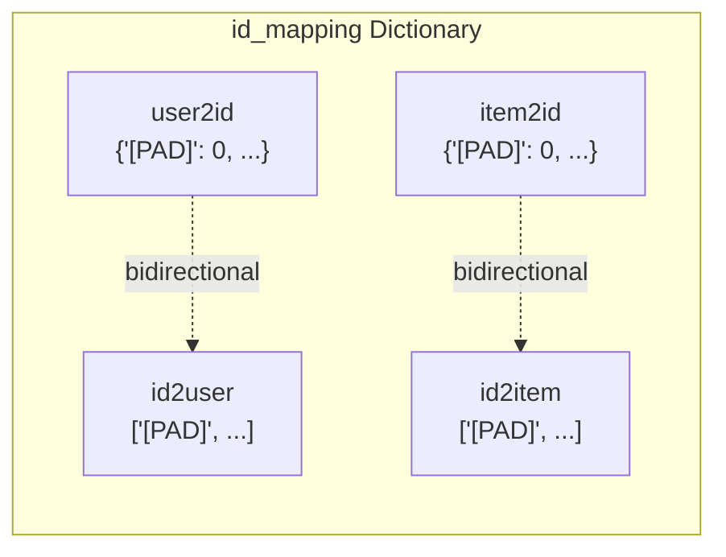
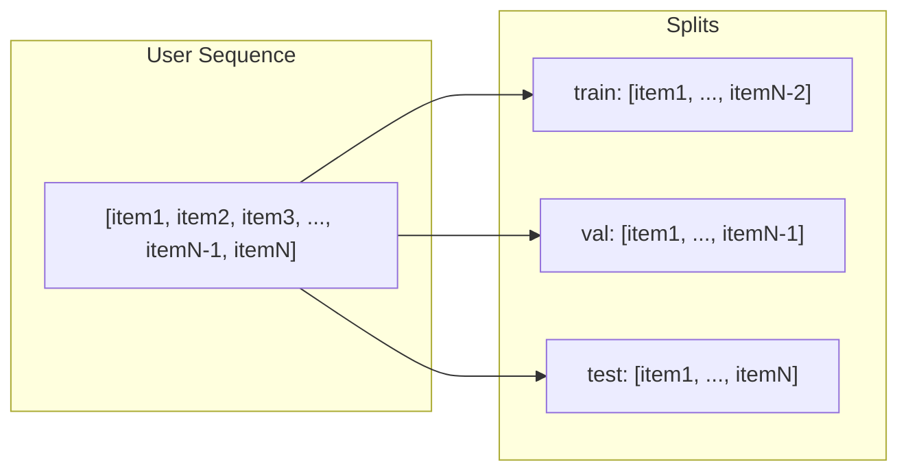
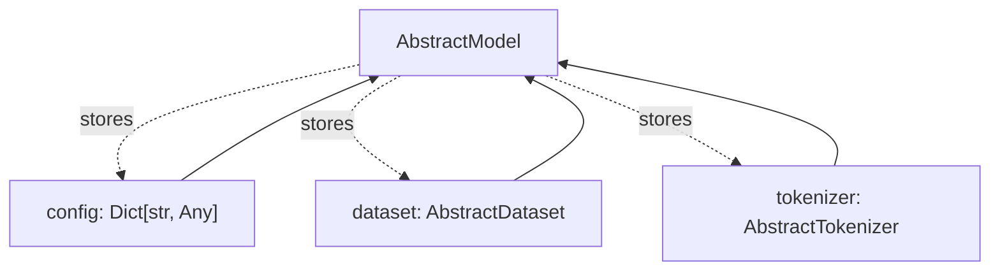
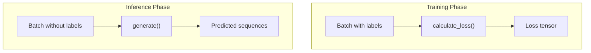
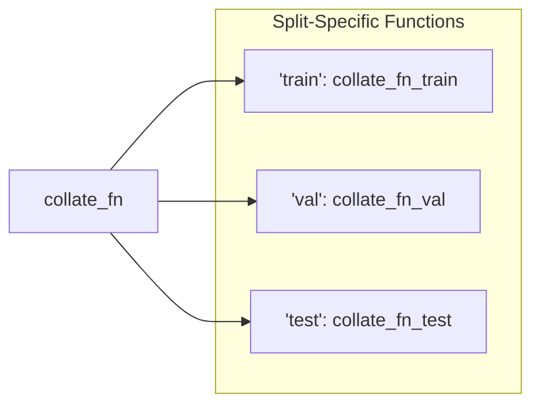
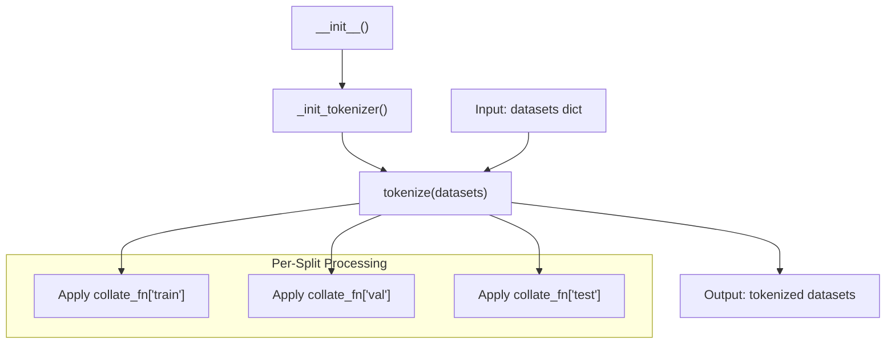
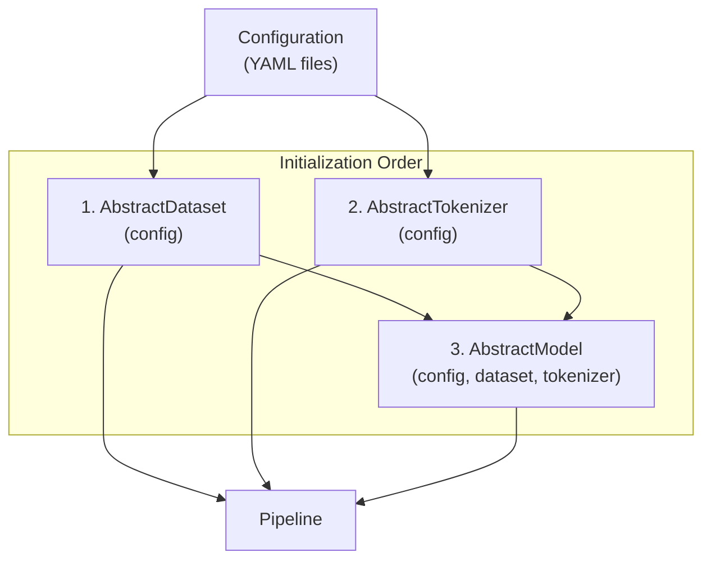
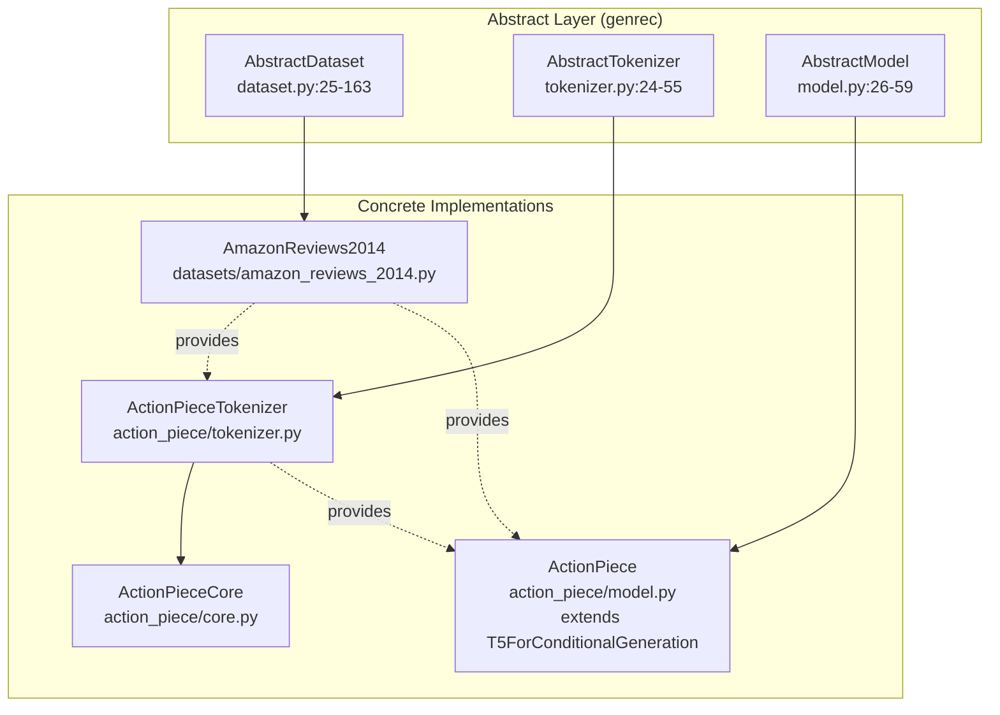

<!-- source: DeepWiki mcp.deepwiki.com · repo google-deepmind/action_piece · page 4.2 Abstract Base Classes · fetched 2026-10-26 -->

# Abstract Base Classes

<details>
<summary>Relevant source files</summary>

The following files were used as context for generating this wiki page:

- [genrec/dataset.py](genrec/dataset.py)
- [genrec/model.py](genrec/model.py)
- [genrec/tokenizer.py](genrec/tokenizer.py)

</details>


## Purpose and Scope

This document describes the three abstract base classes that form the architectural foundation of the GenRec framework: `AbstractDataset`, `AbstractModel`, and `AbstractTokenizer`. These classes define the core contracts and interfaces that enable modular component design, allowing different datasets, models, and tokenizers to be plugged into the system.

For information about concrete implementations, see:
- **AmazonReviews2014 dataset implementation**: [#5.2](#5.2)
- **ActionPiece model implementation**: [#6](#6)
- **ActionPieceTokenizer implementation**: [#3](#3)
- **Pipeline orchestration using these abstractions**: [#4.1](#4.1)

---

## Architecture Overview

The GenRec framework is built on three abstract base classes that form a modular architecture. Each abstract class defines a contract that concrete implementations must fulfill.

### Component Relationships



**Sources:** [genrec/dataset.py:25-163](), [genrec/model.py:26-59](), [genrec/tokenizer.py:24-55]()

The diagram shows:
- **Abstract Layer**: Defines interfaces and contracts
- **Concrete Implementations**: Provide specific functionality
- **Dependencies**: `AbstractModel` depends on both `AbstractDataset` and `AbstractTokenizer`
- **Framework Usage**: `Pipeline` and `Trainer` work through abstract interfaces

---

## AbstractDataset

The `AbstractDataset` class provides the foundation for loading, processing, and splitting datasets used in recommendation tasks.

### Class Definition

**Location:** [genrec/dataset.py:25-163]()

**Key Responsibilities:**
1. Manage user and item ID mappings
2. Store user action sequences (`all_item_seqs`)
3. Handle item metadata (`item2meta`)
4. Implement data splitting strategies (e.g., leave-one-out)

### Attributes and Properties

| Attribute/Property | Type | Description |
|-------------------|------|-------------|
| `config` | `dict[str, Any]` | Configuration parameters |
| `all_item_seqs` | `dict` | User ID → item sequence mapping |
| `id_mapping` | `dict` | Bidirectional user/item ID mappings |
| `item2meta` | `dict` | Item metadata storage |
| `split_data` | `dict` | Cached train/val/test splits |
| `n_users` | `int` (property) | Total number of users |
| `n_items` | `int` (property) | Total number of items |
| `n_interactions` | `int` (property) | Total interaction count |
| `avg_item_seq_len` | `float` (property) | Average sequence length |
| `user2id` | `dict` (property) | User → ID mapping |
| `item2id` | `dict` (property) | Item → ID mapping |

**Sources:** [genrec/dataset.py:49-105]()

### ID Mapping Structure

The `id_mapping` attribute is initialized with padding tokens at index 0:



**Sources:** [genrec/dataset.py:54-59]()

### Required Methods

Subclasses must implement:

| Method | Signature | Purpose |
|--------|-----------|---------|
| `_download_and_process_raw()` | `() -> None` | Download raw data and populate `all_item_seqs`, `id_mapping`, `item2meta` |

**Sources:** [genrec/dataset.py:107-114]()

### Provided Methods

| Method | Signature | Purpose |
|--------|-----------|---------|
| `_leave_one_out()` | `() -> dict[str, Dataset]` | Split data using leave-one-out strategy |
| `split()` | `() -> dict[str, Dataset]` | Public method to split data (caches result) |
| `log()` | `(message: str, level: str) -> None` | Log with accelerator integration |

**Sources:** [genrec/dataset.py:116-162]()

### Leave-One-Out Split Strategy



The `_leave_one_out()` method [genrec/dataset.py:116-140]() implements:
- **Test set**: Full sequences (all users)
- **Validation set**: Sequences minus last item (users with >1 interaction)
- **Training set**: Sequences minus last 2 items (users with >2 interactions)

**Sources:** [genrec/dataset.py:116-140]()

---

## AbstractModel

The `AbstractModel` class extends PyTorch's `nn.Module` and defines the interface for generative recommendation models.

### Class Definition

**Location:** [genrec/model.py:26-59]()

**Inheritance:** `torch.nn.Module`

### Constructor Dependencies



The constructor [genrec/model.py:36-46]() requires:
1. `config`: Model configuration dictionary
2. `dataset`: Instance of `AbstractDataset`
3. `tokenizer`: Instance of `AbstractTokenizer`

This design enforces that models have access to dataset statistics and tokenization capabilities.

**Sources:** [genrec/model.py:36-46]()

### Properties

| Property | Return Type | Description |
|----------|-------------|-------------|
| `n_parameters` | `str` | Human-readable count of trainable parameters |

The `n_parameters` property [genrec/model.py:48-52]() calculates:
```
sum(p.numel() for p in self.parameters() if p.requires_grad)
```

**Sources:** [genrec/model.py:48-52]()

### Required Methods

Subclasses must implement:

| Method | Signature | Purpose |
|--------|-----------|---------|
| `calculate_loss()` | `(batch) -> loss` | Compute training loss from batch |
| `generate()` | `(batch, n_return_sequences=1) -> outputs` | Generate predictions for inference |

**Sources:** [genrec/model.py:54-58]()

### Training vs. Inference Contract



The abstract model enforces a clear separation:
- **Training**: Use `calculate_loss()` for gradient computation
- **Inference**: Use `generate()` for prediction

**Sources:** [genrec/model.py:54-58]()

---

## AbstractTokenizer

The `AbstractTokenizer` class defines the interface for converting action sequences into tokenized representations suitable for model input.

### Class Definition

**Location:** [genrec/tokenizer.py:24-55]()

### Attributes

| Attribute | Type | Description |
|-----------|------|-------------|
| `config` | `dict[Any, Any]` | Tokenizer configuration |
| `logger` | `logging.Logger` | Logger instance |
| `eos_token` | Varies | End-of-sequence token (set by subclass) |
| `collate_fn` | `dict` | Collate functions for train/val/test splits |

**Sources:** [genrec/tokenizer.py:27-31]()

### Collate Function Structure

The `collate_fn` attribute [genrec/tokenizer.py:31]() is a dictionary with three keys corresponding to data splits:



This design allows different tokenization behavior during training (e.g., with Set Permutation Regularization) versus evaluation.

**Sources:** [genrec/tokenizer.py:31]()

### Required Methods

| Method | Signature | Purpose |
|--------|-----------|---------|
| `_init_tokenizer()` | `() -> None` | Initialize tokenizer-specific structures |
| `tokenize()` | `(datasets) -> tokenized_datasets` | Tokenize dataset splits |

**Sources:** [genrec/tokenizer.py:33-37]()

### Required Properties

| Property | Return Type | Description |
|----------|-------------|-------------|
| `vocab_size` | `int` | Total number of tokens in vocabulary |
| `max_token_seq_len` | `int` | Maximum sequence length after tokenization |

**Sources:** [genrec/tokenizer.py:39-49]()

### Provided Properties

| Property | Return Type | Default | Description |
|----------|-------------|---------|-------------|
| `padding_token` | `int` | `0` | Token ID used for padding |

**Sources:** [genrec/tokenizer.py:43-45]()

### Tokenization Lifecycle



**Sources:** [genrec/tokenizer.py:24-55]()

---

## Design Patterns and Extension Points

### Contract-Based Design

The three abstract classes enforce contracts through Python's `NotImplementedError`:

| Abstract Class | Required Implementations |
|---------------|-------------------------|
| `AbstractDataset` | `_download_and_process_raw()` |
| `AbstractModel` | `calculate_loss()`, `generate()` |
| `AbstractTokenizer` | `_init_tokenizer()`, `tokenize()`, `vocab_size`, `max_token_seq_len` |

**Sources:** [genrec/dataset.py:112-114](), [genrec/model.py:54-58](), [genrec/tokenizer.py:33-49]()

### Dependency Injection



The initialization order is critical:
1. **Dataset** is created first (requires only config)
2. **Tokenizer** is created second (may need dataset for vocabulary construction)
3. **Model** is created last (requires both dataset and tokenizer)

This dependency structure is enforced by the abstract class constructors.

**Sources:** [genrec/dataset.py:49-51](), [genrec/tokenizer.py:27-29](), [genrec/model.py:36-46]()

### Shared Configuration Access

All three abstract classes store a `config` dictionary and provide accelerator access:

| Class | Config Storage | Accelerator Access |
|-------|---------------|-------------------|
| `AbstractDataset` | `self.config` | `self.accelerator` property [genrec/dataset.py:72-75]() |
| `AbstractModel` | `self.config` | Via config dict |
| `AbstractTokenizer` | `self.config` | Via config dict |

This design enables consistent configuration management and distributed training support.

**Sources:** [genrec/dataset.py:49-75](), [genrec/model.py:44](), [genrec/tokenizer.py:28]()

### Logging Integration

Both `AbstractDataset` and `AbstractTokenizer` provide a `log()` method that integrates with the accelerator for distributed logging:

```python
def log(self, message: str, level: str = 'info') -> None
```

This ensures log messages are properly handled in multi-GPU training scenarios.

**Sources:** [genrec/dataset.py:158-162](), [genrec/tokenizer.py:51-54]()

---

## Extension Example: Class Hierarchy

The following diagram shows how the concrete implementations extend the abstract base classes:



**Notes:**
- `AmazonReviews2014` implements `_download_and_process_raw()` to load Amazon review data
- `ActionPieceTokenizer` implements tokenization using `ActionPieceCore` for vocabulary construction
- `ActionPiece` extends both `AbstractModel` and HuggingFace's `T5ForConditionalGeneration`

**Sources:** [genrec/dataset.py:25-163](), [genrec/tokenizer.py:24-55](), [genrec/model.py:26-59]()

---

## Summary

The abstract base classes provide:

1. **Modularity**: New datasets, tokenizers, and models can be added by implementing the abstract interfaces
2. **Type Safety**: Clear contracts enforced through `NotImplementedError`
3. **Dependency Management**: Explicit dependency injection through constructors
4. **Distributed Training Support**: Built-in accelerator integration and logging
5. **Consistent API**: Uniform interface across all components

These abstractions enable the GenRec framework to support multiple recommendation tasks and model architectures while maintaining a clean separation of concerns.

---

