# Page: Overview

# Overview

<details>
<summary>Relevant source files</summary>

The following files were used as context for generating this wiki page:

- [README.md](README.md)

</details>


## Purpose and Scope

This page provides a high-level introduction to the ActionPiece system, explaining its purpose as a contextual action tokenization method for generative recommendation and summarizing the repository structure. For detailed installation and setup instructions, see [Getting Started](#2). For in-depth documentation of the core tokenization innovation, see [ActionPiece Tokenization System](#3).

**Sources:** [README.md:1-17]()

## What is ActionPiece?

ActionPiece is a contextual action tokenization method designed for generative recommendation systems. Unlike conventional generative recommendation (GR) models that tokenize each action independently, ActionPiece explicitly incorporates context into action sequence tokenization.

### Core Innovation

The key innovation is treating each action as a **set of item features** rather than a single atomic token. ActionPiece constructs a vocabulary by merging frequently co-occurring feature patterns in two ways:

1. **Within individual action sets** - Features that frequently appear together in the same item
2. **Across adjacent action sets** - Feature patterns that frequently appear in consecutive actions

This approach enables tokens to inherently capture contextual relationships between actions, rather than treating each action in isolation.

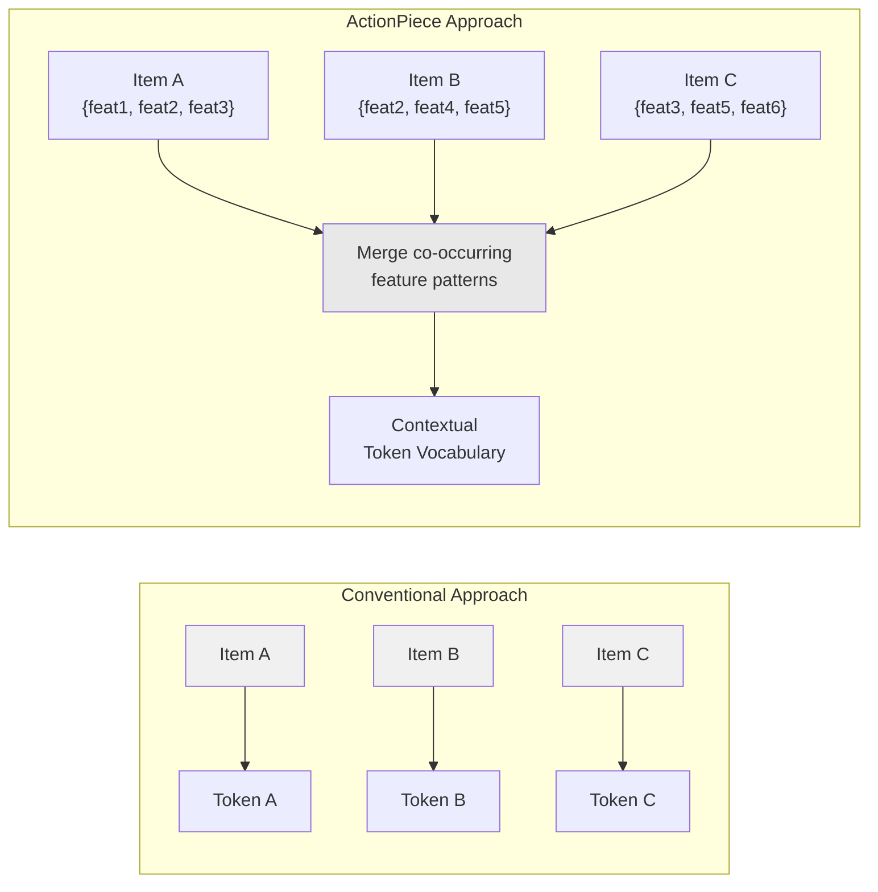

**Diagram: Conventional vs ActionPiece Tokenization Approach**

**Sources:** [README.md:3-16]()

## System Architecture

The ActionPiece system is organized into three primary layers, each implemented in specific Python modules and classes:

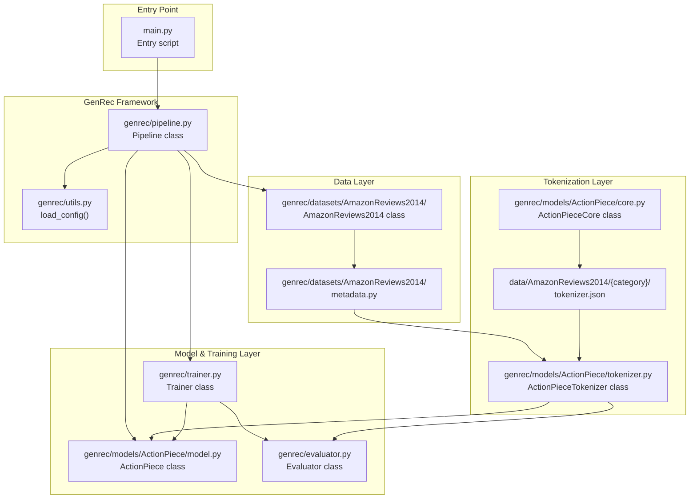

**Diagram: System Architecture with Code Entity Mapping**

**Sources:** [README.md:1-151](), Diagram 1 from system overview

## Key Components

The following table maps high-level system components to their concrete implementations in the codebase:

| Component | Implementation | Primary File | Purpose |
|-----------|---------------|--------------|---------|
| Entry Point | `main.py` | [main.py]() | Script entry point, initializes Pipeline |
| Orchestration | `Pipeline` class | [genrec/pipeline.py]() | Coordinates training/evaluation workflow |
| Configuration | `load_config()` function | [genrec/utils.py]() | Hierarchical YAML config merging |
| Dataset | `AmazonReviews2014` class | [genrec/datasets/AmazonReviews2014/dataset.py]() | Data loading, splitting, metadata processing |
| Feature Extraction | Metadata processing functions | [genrec/datasets/AmazonReviews2014/metadata.py]() | Sentence embeddings, FAISS indexing |
| Vocabulary Builder | `ActionPieceCore` class | [genrec/models/ActionPiece/core.py]() | BPE-like vocabulary construction via `train()` |
| Tokenizer | `ActionPieceTokenizer` class | [genrec/models/ActionPiece/tokenizer.py]() | Sequence segmentation, SPR implementation |
| Model | `ActionPiece` class | [genrec/models/ActionPiece/model.py]() | T5-based model, generation via `generate()` |
| Training | `Trainer` class | [genrec/trainer.py]() | Training loop, optimization, checkpointing |
| Evaluation | `Evaluator` class | [genrec/evaluator.py]() | Metrics calculation (recall, nDCG, ERR) |

For detailed API documentation of these classes, see [API Reference](#9).

**Sources:** [README.md:77-91](), Diagram 5 from system overview

## Repository Structure

The repository follows a modular package structure:

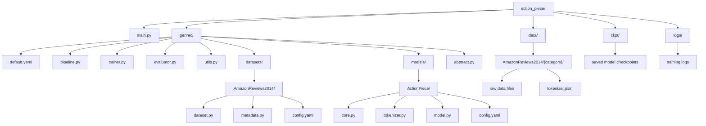

**Diagram: Repository Directory Structure**

### Key Directories

- **`genrec/`** - Main package containing the framework and implementations
  - `abstract.py` - Abstract base classes (`AbstractDataset`, `AbstractModel`, `AbstractTokenizer`)
  - `pipeline.py` - `Pipeline` class for orchestration
  - `trainer.py` / `evaluator.py` - Training and evaluation logic
  - `datasets/` - Dataset implementations
  - `models/` - Model implementations
- **`data/`** - Automatically downloaded datasets and cached tokenizers
- **`ckpt/`** - Saved model checkpoints from training
- **`logs/`** - Training logs and TensorBoard files

For more details on the framework architecture, see [GenRec Framework Architecture](#4).

**Sources:** [README.md:1-151](), Diagram 4 from system overview

## Data Flow

The following diagram traces data flow from raw Amazon reviews through the complete system pipeline to final evaluation metrics:

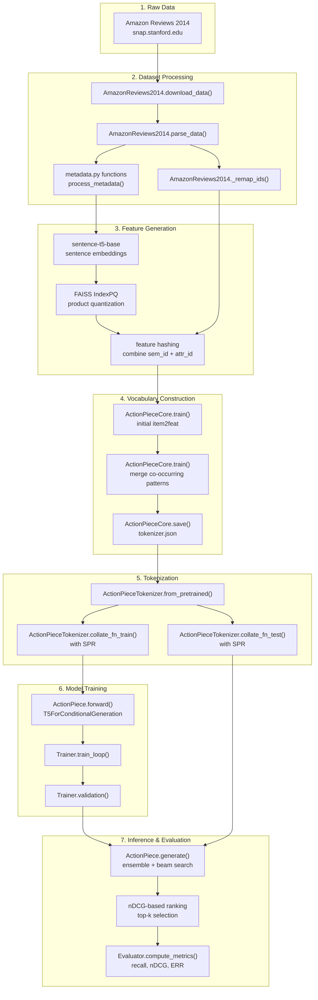

**Diagram: End-to-End Data Flow Through System Components**

### Processing Stages

1. **Raw Data** - Amazon Reviews 2014 dataset downloaded from snap.stanford.edu
2. **Dataset Processing** - Parse gzipped JSON, remap IDs, process metadata
3. **Feature Generation** - Extract sentence embeddings using `sentence-t5-base`, build FAISS index with product quantization, combine with attribute IDs via hashing
4. **Vocabulary Construction** - `ActionPieceCore.train()` builds vocabulary by merging co-occurring feature patterns, saved to `tokenizer.json`
5. **Tokenization** - `ActionPieceTokenizer` loads cached vocabulary, applies Set Permutation Regularization (SPR) during segmentation
6. **Model Training** - T5-based `ActionPiece` model trained with `Trainer` class using AdamW optimizer and cosine learning rate schedule
7. **Inference & Evaluation** - `ActionPiece.generate()` uses ensemble inference with beam search (50 beams), ranked by nDCG, evaluated with multiple metrics

For detailed documentation of each stage:
- Data processing: see [Data Processing Pipeline](#5)
- Tokenization: see [ActionPiece Tokenization System](#3)
- Model training: see [Training & Evaluation](#7)

**Sources:** [README.md:1-151](), Diagrams 2, 3, 4 from system overview

## Configuration System

ActionPiece uses a hierarchical YAML configuration system with four merge levels:

1. **Default configuration** - [genrec/default.yaml]() - Base parameters
2. **Dataset configuration** - [genrec/datasets/AmazonReviews2014/config.yaml]() - Dataset-specific settings
3. **Model configuration** - [genrec/models/ActionPiece/config.yaml]() - Model architecture and inference settings
4. **Command-line arguments** - Override any parameter via `--parameter=value`

Configuration parameters flow through the `load_config()` function in [genrec/utils.py](), which performs hierarchical merging. This design enables flexible experimentation while maintaining reproducibility.

Example command-line usage:

```bash
CUDA_VISIBLE_DEVICES=0 python main.py \
    --category=Sports_and_Outdoors \
    --rand_seed=2024 \
    --weight_decay=0.15 \
    --lr=0.005
```

For comprehensive configuration parameter documentation, see [Configuration Reference](#8).

**Sources:** [README.md:18-31](), [README.md:32-75]()

## Cached Tokenizer Structure

After the first run on each dataset, ActionPiece automatically constructs and caches the tokenizer vocabulary to `data/AmazonReviews2014/{category}/tokenizer.json`. The cached structure contains:

| Field | Type | Description |
|-------|------|-------------|
| `n_categories` | int | Number of feature categories (e.g., semantic ID, attributes) |
| `n_init_feats` | int | Number of initial features before merging |
| `token2feat` | list | Maps token IDs to their constituent features or merge operations |
| `priority` | list | Priority scores for each token used in segmentation |

The `token2feat` field uses two formats:
- `[a, b]` - Feature `b` from category `a`
- `[-1, u, v]` - Token `u` and token `v` merged into new token

This cached structure enables efficient vocabulary reuse across training runs. For details on vocabulary construction, see [Vocabulary Construction (ActionPieceCore)](#3.2). For the complete cached file format specification, see [Cached Tokenizer Structure](#3.4).

**Sources:** [README.md:92-115]()

## Getting Started

To run your first experiment with ActionPiece:

```bash
CUDA_VISIBLE_DEVICES=0 python main.py --category=Sports_and_Outdoors
```

The system will automatically:
1. Download the Amazon Reviews 2014 dataset for the specified category
2. Process metadata and extract features
3. Build and cache the ActionPiece vocabulary
4. Train the model
5. Evaluate on test data

For detailed installation instructions, see [Installation & Dependencies](#2.1). For step-by-step usage guide, see [Quick Start Guide](#2.2). To reproduce paper results, see [Reproducing Paper Results](#2.3).

**Sources:** [README.md:18-31]()

## Key Innovations

ActionPiece introduces two primary innovations in the generative recommendation space:

### 1. Contextual Tokenization via Feature Merging

Implemented in `ActionPieceCore.train()` ([genrec/models/ActionPiece/core.py]()), the vocabulary construction algorithm merges frequently co-occurring feature patterns using a BPE-like approach. This is fundamentally different from conventional approaches that treat each item as an independent token.

### 2. Set Permutation Regularization (SPR)

Implemented in:
- Training: `ActionPieceTokenizer.collate_fn_train()` ([genrec/models/ActionPiece/tokenizer.py:88-90]())
- Inference: `ActionPieceTokenizer.collate_fn_test()` and `ActionPiece.generate()` ([genrec/models/ActionPiece/model.py:90]())

SPR applies permutation augmentation during both training and inference to ensure the model learns robust contextual patterns regardless of feature ordering within action sets.

For comprehensive documentation of these innovations, see [ActionPiece Tokenization System](#3).

**Sources:** [README.md:3-16](), [README.md:77-91]()

## License and Citation

ActionPiece is released under the Apache 2.0 license for software and CC-BY 4.0 for other materials. This is not an official Google product.

When using ActionPiece, please cite:

```bibtex
@inproceedings{hou2025actionpiece,
  title={{ActionPiece}: Contextually Tokenizing Action Sequences for Generative Recommendation},
  author={Yupeng Hou and Jianmo Ni and Zhankui He and Noveen Sachdeva and Wang-Cheng Kang and Ed H. Chi and Julian McAuley and Derek Zhiyuan Cheng},
  booktitle={{ICML}},
  year={2025}
}
```

For complete license terms, see [License Information](#10.3).

**Sources:** [README.md:117-150]()

---

# Page: Getting Started

# Getting Started

<details>
<summary>Relevant source files</summary>

The following files were used as context for generating this wiki page:

- [README.md](README.md)
- [main.py](main.py)
- [requirements.txt](requirements.txt)

</details>


This page guides users through the initial setup and execution of the ActionPiece system for generative recommendation. It covers the prerequisites, system overview, and high-level workflow needed to run your first experiment. For detailed installation instructions, see [Installation & Dependencies](#2.1). For step-by-step usage instructions, see [Quick Start Guide](#2.2). For reproducing paper results, see [Reproducing Paper Results](#2.3).

## Overview

The ActionPiece system requires three main steps to get started:

1. **Installation**: Install Python dependencies listed in `requirements.txt`
2. **Configuration**: Understand the hierarchical configuration system (default → dataset → model → CLI)
3. **Execution**: Run `main.py` which automatically downloads datasets, builds tokenizers, trains models, and evaluates results

The system is designed to minimize manual setup—datasets download automatically, tokenizer vocabularies are cached after first construction, and all hyperparameters have sensible defaults.

Sources: [README.md:1-151](), [main.py:1-45]()

## Prerequisites

Before getting started, ensure your system meets the following requirements:

| Requirement | Details |
|------------|---------|
| Python Version | 3.8 or higher (tested with 3.10+) |
| GPU | CUDA-compatible GPU recommended (training runs on GPU if available) |
| Disk Space | ~5GB for datasets, models, and cached tokenizers per category |
| Memory | Minimum 16GB RAM recommended for dataset processing |
| Network | Internet connection for automatic dataset downloads |

Sources: [requirements.txt:1-10](), [README.md:18-30]()

## System Entry Point and Execution Flow

The following diagram shows how the `main.py` entry point orchestrates the system:

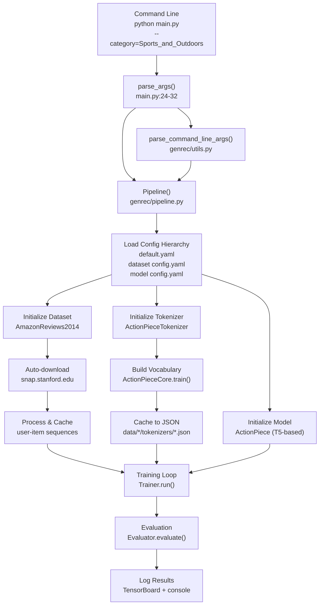

**Execution Flow Description**:

1. **Entry Point** ([main.py:35-44]()): Parses model/dataset names and command-line arguments
2. **Pipeline Initialization** ([genrec/pipeline.py]()): Creates `Pipeline` object with merged configuration
3. **Component Initialization**: 
   - Dataset downloads automatically if not present
   - Tokenizer vocabulary is built on first run, then cached
   - Model initializes with T5-based architecture
4. **Training & Evaluation**: Trainer executes training loop with early stopping, then evaluates on test set

Sources: [main.py:1-45](), [README.md:18-30]()

## Minimal Quick Start

The simplest way to start is with a single command:

```bash
CUDA_VISIBLE_DEVICES=0 python main.py --category=Sports_and_Outdoors
```

This command:
- Downloads the Sports and Outdoors dataset from Stanford SNAP (automatic)
- Builds the ActionPiece tokenizer vocabulary (~10-15 minutes on first run)
- Trains the model with default hyperparameters (~2-4 hours depending on GPU)
- Evaluates performance metrics (recall@k, ndcg@k, err@k)
- Saves best checkpoint to `ckpt/AmazonReviews2014_Sports_and_Outdoors_ActionPiece/`

Sources: [README.md:18-30]()

## Configuration Hierarchy

The system uses a four-level configuration merge strategy:

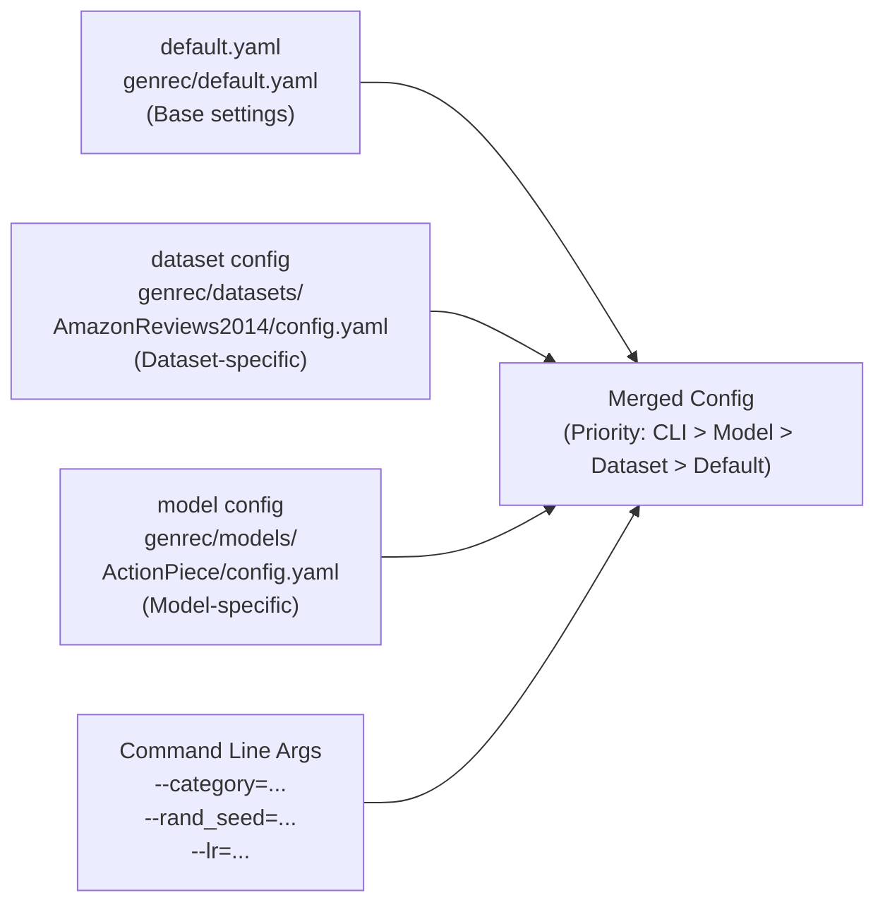

**Configuration Priority** (highest to lowest):
1. Command-line arguments (e.g., `--lr=0.005`)
2. Model configuration (`genrec/models/ActionPiece/config.yaml`)
3. Dataset configuration (`genrec/datasets/AmazonReviews2014/config.yaml`)
4. Default configuration (`genrec/default.yaml`)

This design allows you to override any parameter without modifying configuration files. For comprehensive configuration reference, see [Configuration Reference](#8).

Sources: [README.md:27-30](), [main.py:24-44]()

## Directory Structure and Generated Artifacts

Understanding where the system stores data and outputs is essential:

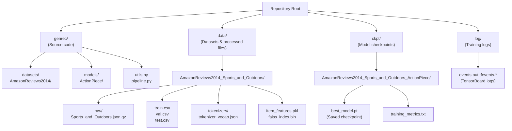

**Key Directories**:

| Directory | Purpose | Generated When |
|-----------|---------|----------------|
| `data/AmazonReviews2014_<category>/raw/` | Raw downloaded dataset files | First run with `--category` |
| `data/AmazonReviews2014_<category>/tokenizers/` | Cached tokenizer vocabularies (JSON) | After vocabulary construction |
| `data/AmazonReviews2014_<category>/` | Processed train/val/test splits (CSV) | After dataset processing |
| `ckpt/AmazonReviews2014_<category>_ActionPiece/` | Model checkpoints and training logs | During training |
| `log/` | TensorBoard event files | During training |

**Important Cached Files**:
- **Tokenizer**: `data/AmazonReviews2014_<category>/tokenizers/tokenizer_vocab.json` - Contains `token2feat` and `priority` mappings (see [Cached Tokenizer Structure](#3.4))
- **Features**: `item_features.pkl`, `faiss_index.bin` - Pre-computed item embeddings and FAISS index
- **Best Model**: `ckpt/.../best_model.pt` - Checkpoint with best validation metric

Sources: [README.md:92-115]()

## First Run Behavior

On the first execution with a new dataset category, the system performs several one-time setup operations:

| Stage | Operation | Time Estimate | Cached For Subsequent Runs? |
|-------|-----------|---------------|----------------------------|
| 1. Dataset Download | Download from snap.stanford.edu | 1-3 minutes | ✓ Yes |
| 2. Data Processing | Parse, remap IDs, split train/val/test | 2-5 minutes | ✓ Yes |
| 3. Feature Extraction | Generate sentence embeddings, build FAISS index | 5-10 minutes | ✓ Yes |
| 4. Vocabulary Construction | Build ActionPiece vocabulary via pattern merging | 10-20 minutes | ✓ Yes |
| 5. Model Training | Train with default hyperparameters | 2-4 hours | ✗ No (retrains each run) |

**Progress Tracking**: The system outputs detailed progress logs to console. Training progress is also logged to TensorBoard (viewable via `tensorboard --logdir=log/`).

Sources: [README.md:25-30](), [README.md:92-115]()

## Common Parameters

While all parameters have defaults, these are frequently overridden:

| Parameter | Description | Default | Example Override |
|-----------|-------------|---------|------------------|
| `--category` | Dataset category | None (required) | `--category=Beauty` |
| `--rand_seed` | Random seed for reproducibility | 2024 | `--rand_seed=2025` |
| `--lr` | Learning rate | 0.001 | `--lr=0.005` |
| `--weight_decay` | L2 regularization | 0.1 | `--weight_decay=0.15` |
| `--n_hash_buckets` | Feature hashing buckets | 128 | `--n_hash_buckets=256` |
| `--d_model` | Model hidden dimension | 512 | `--d_model=256` |
| `--num_epochs` | Maximum training epochs | 300 | `--num_epochs=500` |

For complete parameter reference, see [Default Configuration](#8.1), [Dataset Configuration](#8.2), and [Model Configuration](#8.3).

Sources: [README.md:27-30](), [README.md:38-75]()

## Typical Output

During execution, you will see output similar to:

```
Loading configuration from genrec/default.yaml...
Loading dataset configuration from genrec/datasets/AmazonReviews2014/config.yaml...
Loading model configuration from genrec/models/ActionPiece/config.yaml...
Downloading dataset: Sports_and_Outdoors.json.gz...
Processing dataset: remapping user/item IDs...
Building FAISS index for semantic similarity...
Constructing ActionPiece vocabulary...
  Initial features: 1153
  Vocabulary size after merging: 31547
Training model...
Epoch 1/300: loss=3.245, val_ndcg@10=0.0123
Epoch 2/300: loss=2.891, val_ndcg@10=0.0145
...
Best checkpoint saved to ckpt/.../best_model.pt
Evaluation Results:
  recall@10=0.0543, ndcg@10=0.0312, err@10=0.0156
```

Sources: [README.md:18-30]()

## Next Steps

After completing initial setup:

1. **Run your first experiment**: Follow [Quick Start Guide](#2.2) for detailed command examples
2. **Reproduce paper results**: See [Reproducing Paper Results](#2.3) for exact hyperparameters
3. **Understand tokenization**: Read [ActionPiece Tokenization System](#3) to learn about the core innovation
4. **Customize configuration**: Explore [Configuration Reference](#8) for all available parameters
5. **Modify the model**: See [Development Guide](#10) for extending the system

Sources: [README.md:1-151]()

---

# Page: Installation & Dependencies

# Installation & Dependencies

<details>
<summary>Relevant source files</summary>

The following files were used as context for generating this wiki page:

- [README.md](README.md)
- [requirements.txt](requirements.txt)

</details>


This document details the required dependencies and installation process for the ActionPiece system. It covers system requirements, Python package dependencies, and verification steps needed to run experiments.

For running your first experiment after installation, see [Quick Start Guide](#2.2). For reproducing specific paper results with exact hyperparameters, see [Reproducing Paper Results](#2.3).

## Purpose and Scope

This page provides:
- System and hardware requirements
- Complete list of Python dependencies with their purposes
- Step-by-step installation instructions
- Verification procedures to ensure correct setup

## System Requirements

### Hardware Requirements

The ActionPiece system is designed to run on GPU-accelerated hardware:

| Requirement | Specification | Notes |
|-------------|--------------|-------|
| **GPU** | CUDA-compatible GPU | Required for training and inference |
| **VRAM** | 8GB+ recommended | Depends on model size and batch size |
| **CPU** | Multi-core processor | Used for data preprocessing |
| **RAM** | 16GB+ recommended | Feature extraction and dataset processing |
| **Storage** | 10GB+ free space | For datasets, models, and cached tokenizers |

**Sources:** [README.md:21-23]()

### Software Requirements

| Component | Version | Notes |
|-----------|---------|-------|
| **Python** | 3.8+ | Tested with Python 3.8-3.10 |
| **CUDA** | 11.0+ | For GPU acceleration |
| **Operating System** | Linux/macOS | Windows may require adjustments |

## Python Dependencies

The system relies on several key Python packages, each serving specific purposes within the architecture:

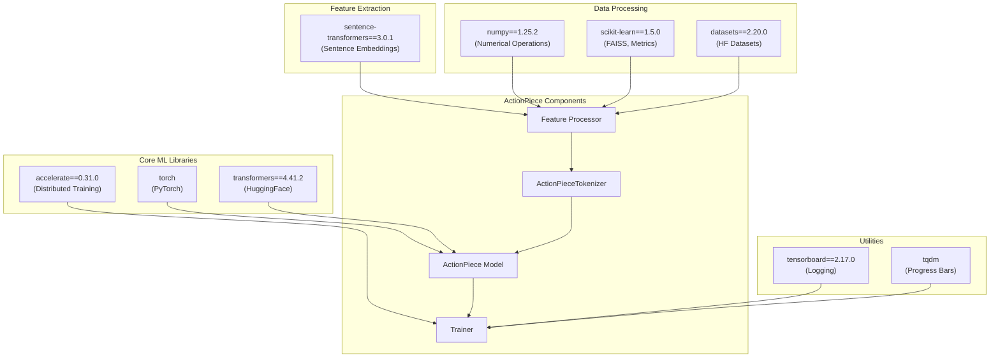

**Dependency Graph: Python Packages and Component Usage**

**Sources:** [requirements.txt:1-10]()

### Dependency Details

| Package | Version | Purpose in ActionPiece |
|---------|---------|------------------------|
| `numpy` | 1.25.2 | Numerical operations for feature vectors and matrix operations |
| `scikit-learn` | 1.5.0 | FAISS indexing support, PCA dimensionality reduction, evaluation metrics |
| `torch` | latest | Core deep learning framework for model training and inference |
| `transformers` | 4.41.2 | T5-based model architecture (`T5ForConditionalGeneration`) |
| `tqdm` | latest | Progress bars for training loops and data processing |
| `sentence-transformers` | 3.0.1 | Pre-trained sentence-t5-base model for semantic feature extraction |
| `datasets` | 2.20.0 | HuggingFace datasets library for data loading utilities |
| `accelerate` | 0.31.0 | Distributed training support and mixed precision training |
| `tensorboard` | 2.17.0 | Training metrics logging and visualization |

**Sources:** [requirements.txt:1-10]()

## Installation Process

### Step 1: Clone Repository

```bash
git clone https://github.com/google-deepmind/action_piece.git
cd action_piece
```

### Step 2: Create Virtual Environment (Recommended)

```bash
# Using venv
python -m venv actionpiece_env
source actionpiece_env/bin/activate  # On Windows: actionpiece_env\Scripts\activate

# Or using conda
conda create -n actionpiece python=3.9
conda activate actionpiece
```

### Step 3: Install Dependencies

```bash
pip install -r requirements.txt
```

This command installs all packages listed in `requirements.txt` with their specified versions.

**Sources:** [requirements.txt:1-10]()

### Installation Workflow

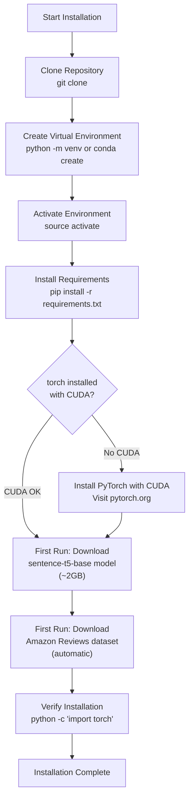

**Installation Workflow with First-Run Downloads**

**Sources:** [README.md:20-26](), [requirements.txt:1-10]()

## First-Run Downloads

On the first execution, the system automatically downloads required resources:

### Sentence Transformer Model

The `sentence-transformers` library downloads the `sentence-t5-base` model (~2GB) during first use for semantic feature extraction. This is cached locally.

### Dataset Downloads

When a `--category` argument is specified, the system automatically downloads the corresponding Amazon Reviews 2014 dataset from `snap.stanford.edu`. For example:

```bash
CUDA_VISIBLE_DEVICES=0 python main.py --category=Sports_and_Outdoors
```

This automatic download process is handled by the `AmazonReviews2014` dataset class.

**Sources:** [README.md:26-27]()

## Verification

### Basic Verification

Verify the installation by checking key dependencies:

```bash
# Check PyTorch installation and CUDA availability
python -c "import torch; print(f'PyTorch: {torch.__version__}'); print(f'CUDA available: {torch.cuda.is_available()}')"

# Check Transformers
python -c "import transformers; print(f'Transformers: {transformers.__version__}')"

# Check sentence-transformers
python -c "import sentence_transformers; print(f'Sentence-Transformers: {sentence_transformers.__version__}')"
```

Expected output should show:
- PyTorch version
- CUDA availability: `True` (if GPU is present)
- Transformers version: 4.41.2
- Sentence-Transformers version: 3.0.1

### Component Verification

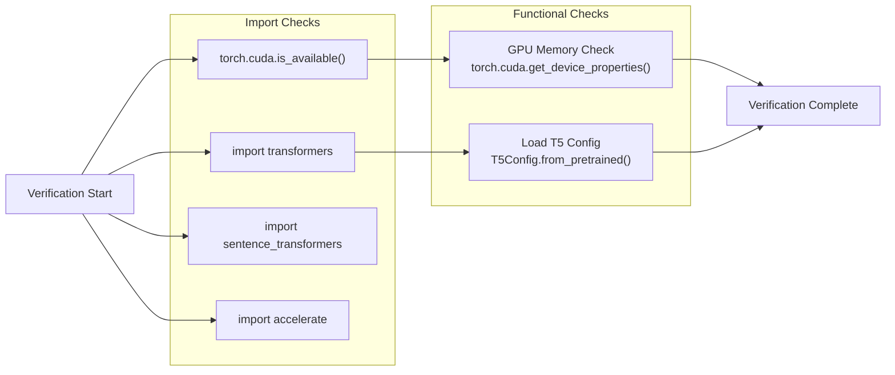

**Verification Process: Checking Critical Dependencies**

**Sources:** [requirements.txt:3-8]()

### Running Test Command

The simplest verification is to run a quick training command:

```bash
CUDA_VISIBLE_DEVICES=0 python main.py --category=Sports_and_Outdoors --max_steps=10
```

This command:
1. Downloads the Sports_and_Outdoors dataset (first run only)
2. Constructs or loads cached tokenizer
3. Initializes the ActionPiece model
4. Runs 10 training steps
5. Terminates early

If this completes without errors, the installation is successful.

**Sources:** [README.md:20-23]()

## Common Issues and Solutions

### CUDA Not Available

**Issue:** `torch.cuda.is_available()` returns `False`

**Solutions:**
- Reinstall PyTorch with CUDA support: Visit [pytorch.org](https://pytorch.org) and select appropriate CUDA version
- Verify NVIDIA drivers are installed: `nvidia-smi`
- Check CUDA toolkit version matches PyTorch requirements

### Version Conflicts

**Issue:** Package version conflicts during installation

**Solutions:**
- Use a fresh virtual environment
- Install packages in the order specified in `requirements.txt`
- For `torch`, install it separately first, then install remaining packages

### Out of Memory Errors

**Issue:** CUDA out of memory during first run

**Solutions:**
- Reduce batch size: `--batch_size=32` (default may be higher)
- Use gradient accumulation: `--accumulate_grad_batches=2`
- Reduce model size: `--d_model=256 --d_ff=2048`

## Directory Structure After Installation

After installation and first run, the directory structure includes:

```
action_piece/
├── genrec/                    # Main package
│   ├── datasets/             # Dataset implementations
│   ├── models/               # Model implementations
│   ├── default.yaml          # Default configuration
│   └── utils/                # Utility functions
├── requirements.txt          # Dependencies
├── main.py                   # Entry point
├── data/                     # Created on first run
│   └── AmazonReviews2014/   # Downloaded datasets
├── tokenizer/                # Created on first run
│   └── *.json               # Cached tokenizers
└── ckpt/                     # Created during training
    └── */                    # Model checkpoints
```

**Sources:** [README.md:1-151]()

## Next Steps

After successful installation:
1. See [Quick Start Guide](#2.2) to run your first experiment
2. See [Reproducing Paper Results](#2.3) for exact hyperparameters from the paper
3. See [Configuration System](#4.3) to understand available configuration options

## Configuration Files Reference

While not part of installation, understanding the configuration hierarchy helps with setup:

| Configuration File | Purpose | Override Priority |
|-------------------|---------|------------------|
| `genrec/default.yaml` | System-wide defaults | Lowest (1) |
| `genrec/datasets/AmazonReviews2014/config.yaml` | Dataset-specific settings | Medium (2) |
| `genrec/models/ActionPiece/config.yaml` | Model-specific settings | High (3) |
| Command-line arguments | Runtime overrides | Highest (4) |

Configuration files are automatically loaded and merged. Command-line arguments always take precedence.

**Sources:** [README.md:27-30]()

---

# Page: Quick Start Guide

# Quick Start Guide

<details>
<summary>Relevant source files</summary>

The following files were used as context for generating this wiki page:

- [README.md](README.md)
- [genrec/pipeline.py](genrec/pipeline.py)
- [main.py](main.py)

</details>


## Purpose and Scope

This page provides a step-by-step guide to running your first experiments with ActionPiece. It covers the basic command-line usage, explains what happens during execution, and describes how the system automatically handles dataset downloads and caching. For detailed installation instructions and dependency management, see [Installation & Dependencies](#2.1). For reproducing specific paper results with exact hyperparameters, see [Reproducing Paper Results](#2.3).

## Basic Command

The simplest way to run an ActionPiece experiment is:

```bash
CUDA_VISIBLE_DEVICES=0 python main.py --category=Sports_and_Outdoors
```

This command will:
1. Automatically download the Sports_and_Outdoors dataset from Amazon Reviews 2014
2. Build the ActionPiece tokenizer vocabulary (cached for future runs)
3. Train the model using default hyperparameters
4. Evaluate on validation and test sets
5. Save results and checkpoints to the configured directories

**Sources:** [README.md:18-23](), [main.py:35-44]()

## Command Structure Breakdown

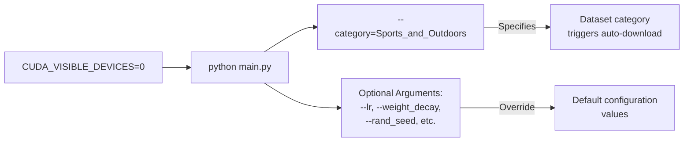

**Components:**
- **Environment Variable**: `CUDA_VISIBLE_DEVICES=0` specifies which GPU to use
- **Entry Point**: `python main.py` executes the main script at [main.py:35-44]()
- **Required Argument**: `--category` specifies the Amazon Reviews 2014 dataset category
- **Optional Arguments**: Any parameter from the configuration hierarchy can be overridden

**Sources:** [main.py:24-32](), [README.md:18-30]()

## Configuration Hierarchy

ActionPiece uses a hierarchical configuration system where settings are merged in priority order:

| Priority | Source | Location | Description |
|----------|--------|----------|-------------|
| 1 (Highest) | Command Line Args | `--arg=value` | Runtime overrides |
| 2 | Model Config | `genrec/models/ActionPiece/config.yaml` | Model-specific settings |
| 3 | Dataset Config | `genrec/datasets/AmazonReviews2014/config.yaml` | Dataset-specific settings |
| 4 (Lowest) | Default Config | `genrec/default.yaml` | Framework defaults |

Command-line arguments override all configuration files. The merging happens in [genrec/utils.py]() via the `get_config()` function called by [genrec/pipeline.py:69-74]().

**Sources:** [README.md:27-30](), [genrec/pipeline.py:69-74]()

## Execution Flow: From Command to Results

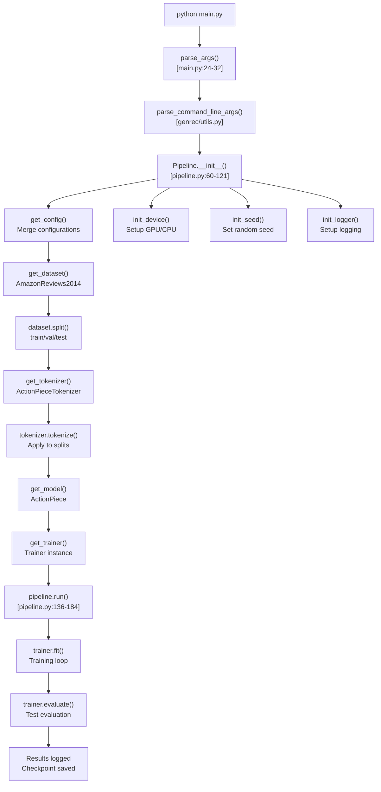

**Sources:** [main.py:35-44](), [genrec/pipeline.py:60-121](), [genrec/pipeline.py:136-184]()

## Step-by-Step Execution Breakdown

### Phase 1: Initialization ([main.py:35-37]())

The `parse_args()` function at [main.py:24-32]() extracts two primary arguments:
- `--model` (default: `'ActionPiece'`)
- `--dataset` (default: `'AmazonReviews2014'`)

All other arguments are collected as unparsed and converted to a configuration dictionary via `parse_command_line_args()`.

### Phase 2: Pipeline Setup ([genrec/pipeline.py:60-121]())

The `Pipeline.__init__()` method orchestrates component initialization:

1. **Configuration Merging** ([pipeline.py:69-74]()):
   - Calls `utils.get_config()` to merge default, dataset, model, and command-line configurations
   - Automatically sets `device` and `use_ddp` via `utils.init_device()` at [pipeline.py:76]()

2. **Accelerator Initialization** ([pipeline.py:79-81]()):
   - Creates `accelerate.Accelerator` instance for distributed training support
   - Configures TensorBoard logging with `project_dir` property at [pipeline.py:122-129]()

3. **Seed and Logger Setup** ([pipeline.py:84-87]()):
   - Sets random seed for reproducibility via `utils.init_seed()`
   - Initializes Python logger via `utils.init_logger()`

4. **Dataset Loading** ([pipeline.py:90-92]()):
   - Instantiates dataset class using `utils.get_dataset(dataset_name)()` 
   - For `AmazonReviews2014`, triggers automatic download if not cached
   - Calls `dataset.split()` to create train/val/test splits using leave-one-out strategy

5. **Tokenizer Creation** ([pipeline.py:95-104]()):
   - Instantiates `ActionPieceTokenizer` using `utils.get_tokenizer(model_name)()`
   - Calls `tokenizer.tokenize(split_datasets)` to apply tokenization to all splits
   - **Important**: First run builds and caches the vocabulary; subsequent runs load from cache

6. **Model Initialization** ([pipeline.py:107-112]()):
   - Instantiates `ActionPiece` model using `utils.get_model(model_name)()`
   - Uses `accelerator.main_process_first()` context to prevent race conditions in distributed training
   - Logs model architecture and parameter count

7. **Trainer Setup** ([pipeline.py:115-120]()):
   - Instantiates `Trainer` using `utils.get_trainer(model_name)()`
   - Configures optimizer, learning rate scheduler, and evaluation metrics

### Phase 3: Training and Evaluation ([genrec/pipeline.py:136-184]())

The `Pipeline.run()` method executes the training loop:

1. **DataLoader Creation** ([pipeline.py:143-162]()):
   - Creates separate `DataLoader` instances for train, validation, and test splits
   - Uses tokenizer's `collate_fn` dictionary for split-specific batching
   - Adjusts batch size for ensemble inference mode

2. **Training** ([pipeline.py:164]()):
   - Calls `trainer.fit(train_dataloader, val_dataloader)`
   - Performs gradient updates with early stopping based on validation metrics
   - Saves best model checkpoint

3. **Test Evaluation** ([pipeline.py:166-177]()):
   - Loads best checkpoint from `trainer.saved_model_ckpt`
   - Evaluates on test set via `trainer.evaluate(test_dataloader)`
   - Logs metrics to TensorBoard and console

**Sources:** [genrec/pipeline.py:60-121](), [genrec/pipeline.py:136-184]()

## Automatic Dataset Downloads

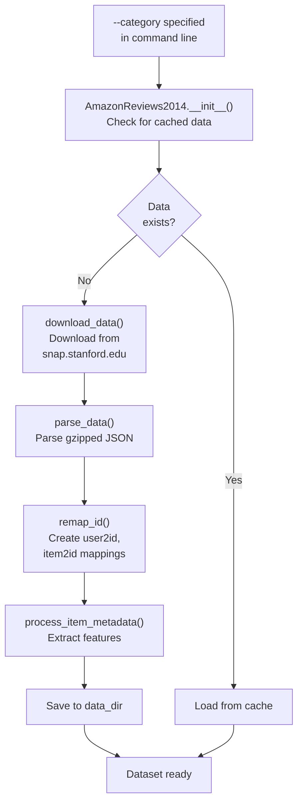

When you specify `--category=Sports_and_Outdoors`, the system:

1. **Checks Cache**: Looks for processed data in `config['data_dir']` (typically `./data/`)
2. **Downloads if Missing**: Automatically downloads from `http://snap.stanford.edu/data/amazon/productGraph/categoryFiles/`
3. **Parses Data**: Extracts user-item interactions from gzipped JSON files
4. **Remaps IDs**: Creates contiguous integer mappings for users and items
5. **Processes Metadata**: Extracts item features (categories, descriptions, titles)
6. **Caches Results**: Saves processed files for future runs

**Available Categories:**
- Sports_and_Outdoors
- Beauty
- CDs_and_Vinyl
- (Any Amazon Reviews 2014 category with sufficient data)

**Sources:** [README.md:26](), [genrec/datasets/AmazonReviews2014/]()

## Common Command Variations

### Specify Random Seed for Reproducibility
```bash
python main.py --category=Sports_and_Outdoors --rand_seed=2024
```

### Adjust Hyperparameters
```bash
python main.py --category=Beauty \
    --lr=0.001 \
    --weight_decay=0.15 \
    --n_hash_buckets=64
```

### Use Different Model Dimensions
```bash
python main.py --category=CDs_and_Vinyl \
    --d_model=256 \
    --d_ff=2048 \
    --n_hash_buckets=256
```

### Specify Output Directories
```bash
python main.py --category=Sports_and_Outdoors \
    --data_dir=./my_data/ \
    --ckpt_dir=./my_checkpoints/ \
    --tensorboard_log_dir=./my_logs/
```

**Sources:** [README.md:38-75]()

## Output and Artifacts

### Directory Structure

| Path | Contents | Created When |
|------|----------|--------------|
| `data/` | Raw and processed datasets | First run with `--category` |
| `ckpt/` | Model checkpoints | During training |
| `tensorboard_log/` | TensorBoard logs | During training |
| `log/` | Text logs | At startup |

### Generated Files

**Dataset Files** (in `data/AmazonReviews2014/{category}/`):
- `reviews_{category}.json.gz` - Raw downloaded reviews
- `metadata_{category}.json.gz` - Raw item metadata
- `{category}.pkl` - Processed dataset cache

**Tokenizer Cache** (in `data/AmazonReviews2014/{category}/`):
- `tokenizer_{hash}.json` - Cached vocabulary (see structure at [README.md:92-115]())

**Model Checkpoints** (in `ckpt/{dataset}/{model}/`):
- `{timestamp}_best.pth` - Best model weights
- Checkpoint includes model state_dict only

**TensorBoard Logs** (in `tensorboard_log/{dataset}/{model}/`):
- Training loss curves
- Validation metrics (recall@k, ndcg@k)
- Test metrics (logged at end)

**Sources:** [genrec/pipeline.py:122-129](), [README.md:92-115]()

## First Run vs. Subsequent Runs

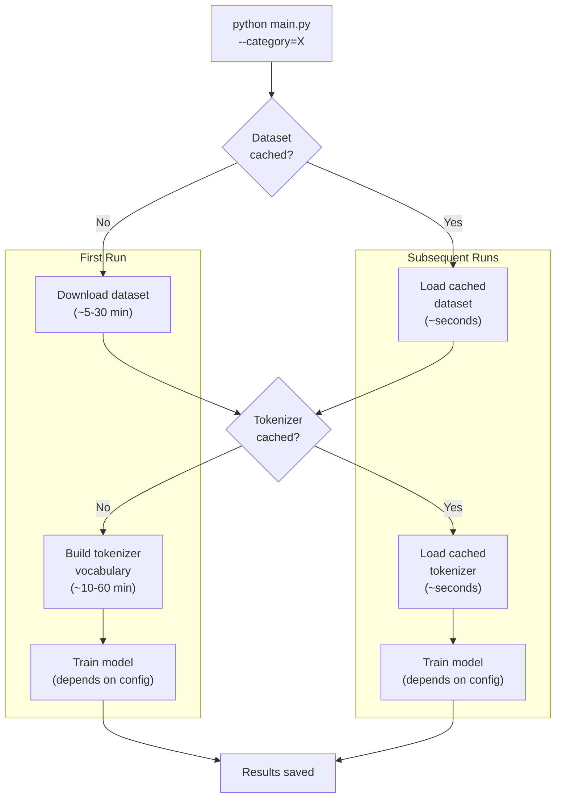

**Time Estimates for Sports_and_Outdoors on Single GPU:**
- **First Run**: ~45-90 minutes (dataset download + tokenizer construction + training)
- **Subsequent Runs**: ~30-60 minutes (training only)

The tokenizer vocabulary is deterministically cached based on:
- Dataset contents
- `n_init_feats` parameter
- `n_hash_buckets` parameter  
- `item_metadata` mode

Changing these parameters will trigger vocabulary reconstruction.

**Sources:** [README.md:94-95](), [genrec/models/ActionPiece/tokenizer.py]()

## Monitoring Progress

### Console Output
The system logs to both console and file. Example output:
```
Device: cuda:0
AmazonReviews2014 Dataset Statistics:
  - Users: 35598
  - Items: 18357
  - Interactions: 296337
ActionPiece Model (12345678 parameters)
Training: 100%|██████████| 1234/1234 [10:23<00:00, 1.98it/s]
Validation ndcg@10: 0.1234
Best model saved to ckpt/.../model_best.pth
Test Results: {'recall@10': 0.0789, 'ndcg@10': 0.1234, ...}
```

### TensorBoard Visualization
Launch TensorBoard to view live training metrics:
```bash
tensorboard --logdir=tensorboard_log/AmazonReviews2014/ActionPiece/
```

Tracked metrics include:
- `Train/loss` - Training loss per step
- `Val_Metric/recall@k` - Validation recall
- `Val_Metric/ndcg@k` - Validation nDCG
- `Test_Metric/*` - Final test metrics

**Sources:** [genrec/pipeline.py:79-81](), [genrec/pipeline.py:186-189]()

## Next Steps

After running your first experiment:
- To reproduce exact paper results with tuned hyperparameters, see [Reproducing Paper Results](#2.3)
- To understand the ActionPiece tokenization mechanism, see [ActionPiece Tokenization System](#3)
- To customize the configuration, see [Configuration Reference](#8)
- To understand the model architecture, see [ActionPiece Model Architecture](#6)

---

# Page: Reproducing Paper Results

# Reproducing Paper Results

<details>
<summary>Relevant source files</summary>

The following files were used as context for generating this wiki page:

- [README.md](README.md)
- [genrec/default.yaml](genrec/default.yaml)
- [genrec/models/ActionPiece/config.yaml](genrec/models/ActionPiece/config.yaml)

</details>


## Purpose and Scope

This page documents the exact commands and hyperparameters needed to reproduce the experimental results reported in the ICML 2025 Spotlight paper "Contextually Tokenizing Action Sequences for Generative Recommendation". It provides dataset-specific reproduction scripts for the three evaluation domains: Sports and Outdoors, Beauty, and CDs and Vinyl.

For general usage and quick start instructions, see [Quick Start Guide](#2.2). For detailed explanation of all available configuration parameters, see [Configuration Reference](#8). For understanding the training process, see [Training & Evaluation](#7).

## Reproduction Overview

The paper reports results averaged over 5 random seeds (2024-2028) for each of the three Amazon Reviews 2014 dataset categories. Each dataset requires slightly different hyperparameters that have been tuned for optimal performance. The reproduction process involves:

1. Running training with specified hyperparameters for each seed
2. Automatic vocabulary construction and caching on first run
3. Training with early stopping based on validation metrics
4. Evaluation on test set using ensemble inference with beam search

The system automatically downloads datasets, constructs tokenizer vocabularies, trains models, and evaluates performance metrics including nDCG@k, recall@k, and ERR@k.

**Sources:** [README.md:32-75]()

## Command Structure and Execution

### Basic Command Template

All reproduction commands follow this structure:

```bash
CUDA_VISIBLE_DEVICES=<gpu_id> python main.py \
    --category=<dataset_name> \
    --rand_seed=<seed_value> \
    --weight_decay=<value> \
    --lr=<value> \
    --n_hash_buckets=<value> \
    [additional_parameters]
```

The `main.py` entry point orchestrates the entire pipeline, merging command-line arguments with default configurations and dataset-specific settings.

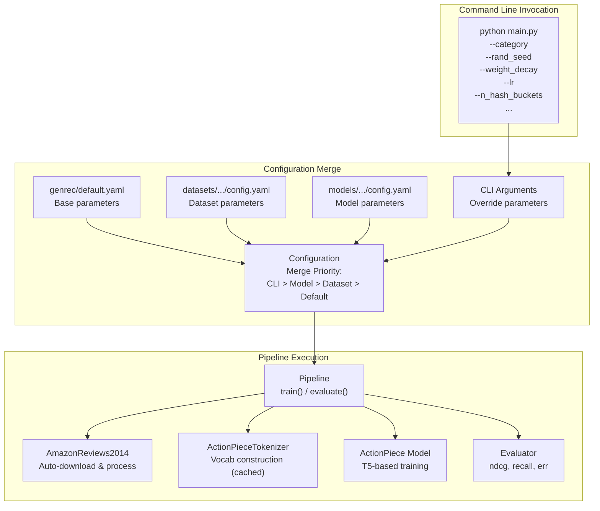

**Sources:** [README.md:20-31](), [genrec/default.yaml:1-39](), [genrec/models/ActionPiece/config.yaml:1-50]()

## Dataset-Specific Reproduction Scripts

### Sports and Outdoors

This is the main benchmark dataset used in the paper. It uses relatively high learning rate (0.005) and moderate feature hashing (128 buckets).

```bash
for seed in {2024..2028}; do
    CUDA_VISIBLE_DEVICES=0 python main.py \
        --category=Sports_and_Outdoors \
        --rand_seed=${seed} \
        --weight_decay=0.15 \
        --lr=0.005 \
        --n_hash_buckets=128
done
```

**Key Parameters:**
- `weight_decay=0.15` - L2 regularization coefficient
- `lr=0.005` - Peak learning rate (highest among all datasets)
- `n_hash_buckets=128` - Feature hash bucket size for collision prevention

**Sources:** [README.md:38-46]()

### Beauty

The Beauty dataset uses lower learning rate (0.001) and fewer hash buckets (64), suitable for its smaller scale and feature space.

```bash
for seed in {2024..2028}; do
    CUDA_VISIBLE_DEVICES=0 python main.py \
        --category=Beauty \
        --rand_seed=${seed} \
        --weight_decay=0.15 \
        --lr=0.001 \
        --n_hash_buckets=64
done
```

**Key Parameters:**
- `weight_decay=0.15` - Same regularization as Sports and Outdoors
- `lr=0.001` - Lower learning rate due to dataset characteristics
- `n_hash_buckets=64` - Reduced hash space to match feature distribution

**Sources:** [README.md:51-59]()

### CDs and Vinyl

This dataset requires a smaller model architecture (d_model=256, d_ff=2048) and the most hash buckets (256) to handle its unique item distribution.

```bash
for seed in {2024..2028}; do
    CUDA_VISIBLE_DEVICES=0 python main.py \
        --category=CDs_and_Vinyl \
        --rand_seed=${seed} \
        --weight_decay=0.07 \
        --lr=0.001 \
        --d_model=256 \
        --d_ff=2048 \
        --n_hash_buckets=256
done
```

**Key Parameters:**
- `weight_decay=0.07` - Reduced regularization (half of other datasets)
- `lr=0.001` - Conservative learning rate
- `d_model=256` - Larger embedding dimension (default: 128)
- `d_ff=2048` - Larger feed-forward dimension (default: 1024)
- `n_hash_buckets=256` - Maximum hash space for complex feature distribution

**Sources:** [README.md:64-74]()

## Hyperparameter Mapping

The following table shows how command-line arguments override default configurations:

| Parameter | Sports & Outdoors | Beauty | CDs & Vinyl | Default | Config File |
|-----------|-------------------|--------|-------------|---------|-------------|
| `weight_decay` | 0.15 | 0.15 | 0.07 | 0.1 | [genrec/default.yaml:28]() |
| `lr` | 0.005 | 0.001 | 0.001 | 0.003 | [genrec/default.yaml:27]() |
| `n_hash_buckets` | 128 | 64 | 256 | 128 | [genrec/models/ActionPiece/config.yaml:26]() |
| `d_model` | 128 (default) | 128 (default) | 256 | 128 | [genrec/models/ActionPiece/config.yaml:43]() |
| `d_ff` | 1024 (default) | 1024 (default) | 2048 | 1024 | [genrec/models/ActionPiece/config.yaml:44]() |
| `rand_seed` | 2024-2028 | 2024-2028 | 2024-2028 | 2024 | [genrec/default.yaml:22]() |

**Fixed Parameters Across All Datasets:**

These parameters remain constant and are inherited from configuration files:

- `train_batch_size=256` - Training batch size
- `eval_batch_size=32` - Evaluation batch size
- `num_beams=50` - Beam search width during inference
- `n_inference_ensemble=5` - Number of ensemble generations
- `actionpiece_vocab_size=40000` - Maximum vocabulary size
- `max_item_seq_len=20` - Maximum input sequence length
- `epochs=200` - Maximum training epochs
- `patience=20` - Early stopping patience
- `val_metric=ndcg@10` - Validation metric for model selection

**Sources:** [genrec/default.yaml:25-38](), [genrec/models/ActionPiece/config.yaml:29-46]()

## Understanding Key Reproduction Parameters

### Learning Rate (`lr`)

The learning rate controls the step size during gradient descent optimization. It works in conjunction with cosine annealing schedule:

- **Sports and Outdoors (0.005):** Highest learning rate enables faster convergence on the largest dataset
- **Beauty (0.001):** Lower rate for more cautious optimization on smaller dataset
- **CDs and Vinyl (0.001):** Conservative rate compensates for reduced regularization

The actual learning rate during training follows a cosine schedule with warmup (10,000 steps by default).

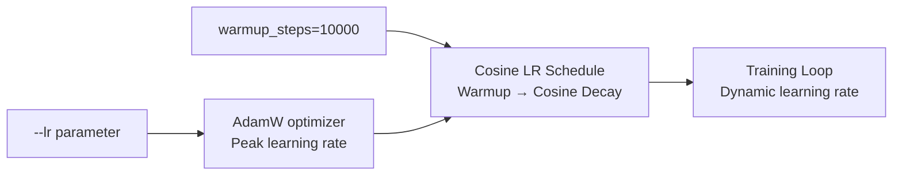

**Sources:** [genrec/default.yaml:27-29]()

### Weight Decay

L2 regularization penalty applied to model weights during optimization:

- **Sports and Outdoors & Beauty (0.15):** Strong regularization prevents overfitting
- **CDs and Vinyl (0.07):** Reduced regularization compensates for larger model capacity (d_model=256)

**Sources:** [genrec/default.yaml:28]()

### Hash Buckets (`n_hash_buckets`)

Controls the feature hashing space size used to prevent hash collisions when combining item attributes:

- **Beauty (64):** Smallest feature space due to simpler attribute distribution
- **Sports and Outdoors (128):** Moderate space balances collision prevention and memory
- **CDs and Vinyl (256):** Largest space handles complex item metadata in music domain

Hash collisions can cause different features to map to the same representation, so larger hash spaces improve feature distinctiveness.

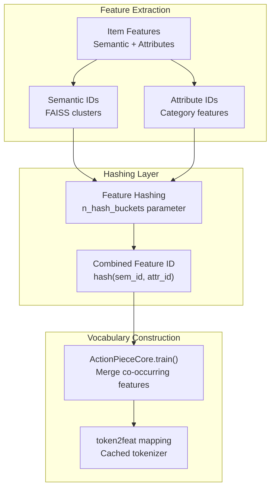

**Sources:** [genrec/models/ActionPiece/config.yaml:26]()

### Model Dimensions (`d_model`, `d_ff`)

T5 architecture parameters that control model capacity:

- **d_model:** Hidden dimension of encoder/decoder layers
  - Default: 128 (Sports and Outdoors, Beauty)
  - CDs and Vinyl: 256 (doubled capacity for complex music metadata)

- **d_ff:** Feed-forward network dimension
  - Default: 1024 (Sports and Outdoors, Beauty)
  - CDs and Vinyl: 2048 (doubled capacity)

The larger model for CDs and Vinyl compensates for the reduced weight decay, maintaining model capacity while allowing more flexible fitting.

**Sources:** [genrec/models/ActionPiece/config.yaml:43-44]()

## Random Seed Range

All reproduction scripts iterate over seeds 2024-2028 (5 seeds total) using bash loop:

```bash
for seed in {2024..2028}; do
    # ... training command with --rand_seed=${seed}
done
```

This produces 5 independent training runs per dataset. The paper reports metrics averaged over these 5 runs with standard deviation. Each seed affects:

1. Dataset shuffling during training
2. Model weight initialization
3. Dropout mask sampling
4. Set Permutation Regularization (SPR) random walks

The `reproducibility=True` setting in default configuration ensures deterministic behavior given the same seed.

**Sources:** [README.md:39-46](), [genrec/default.yaml:22-23]()

## Execution Flow and Output Locations

### First Run: Vocabulary Construction

On the first execution for each dataset, the system performs one-time setup:

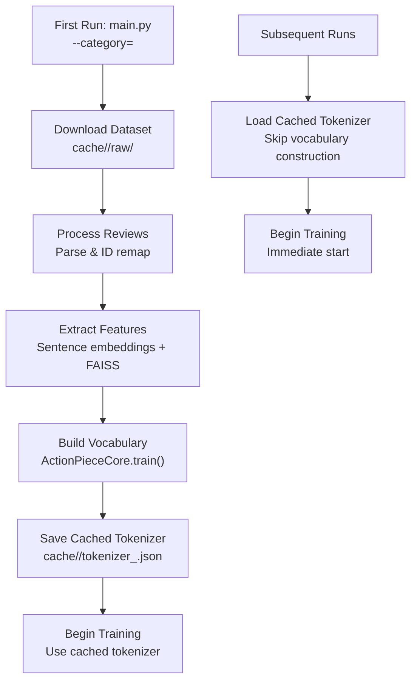

**Cached Tokenizer Location:**
```
cache/<category>/tokenizer_sentence_128_40000_128.json
```

The filename components: `tokenizer_<metadata_mode>_<pca_dim>_<vocab_size>_<n_hash_buckets>.json`

**Sources:** [README.md:92-114]()

### Training and Checkpoint Output

During training, the system saves artifacts to organized directories:

| Output Type | Location | Description |
|-------------|----------|-------------|
| Logs | `logs/<run_id>/` | Training progress logs |
| TensorBoard | `tensorboard/<run_id>/` | Training metrics visualization |
| Checkpoints | `ckpt/<run_id>/` | Model checkpoints and best model |
| Cached Data | `cache/<category>/` | Dataset and tokenizer cache |

**Checkpoint Saving:**
- Best model saved based on `val_metric=ndcg@10`
- Early stopping after `patience=20` epochs without improvement
- Full checkpoint includes model weights, optimizer state, and configuration

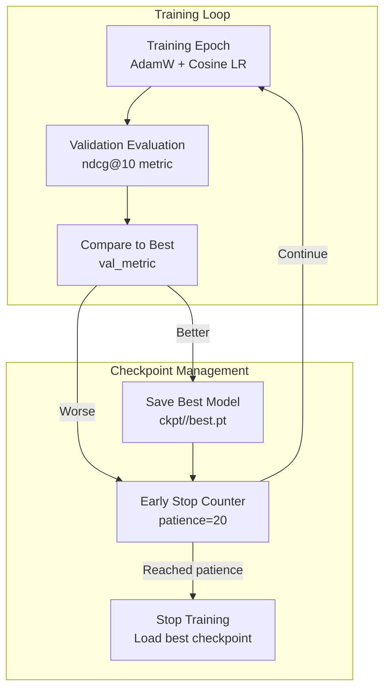

**Sources:** [genrec/default.yaml:17-20](), [genrec/default.yaml:32-38]()

### Test Evaluation Output

After training completes, the system evaluates on the test set and reports metrics:

**Metrics Computed:**
- `recall@k` for k ∈ {5, 10, 20, 50}
- `ndcg@k` for k ∈ {5, 10, 20, 50}
- `err@k` for k ∈ {5, 10, 20, 50}

**Evaluation Process:**
1. Load best checkpoint based on validation metric
2. Generate predictions using ensemble inference (5 runs)
3. Beam search with 50 beams per ensemble run
4. Rank candidates using nDCG scoring
5. Compute metrics on held-out test items

Results are logged to both console and TensorBoard for visualization.

**Sources:** [genrec/default.yaml:36-38](), [genrec/models/ActionPiece/config.yaml:33-34]()

## Running Multiple Datasets Sequentially

To reproduce all paper results, execute the three dataset scripts sequentially:

```bash
# Sports and Outdoors (5 seeds)
for seed in {2024..2028}; do
    CUDA_VISIBLE_DEVICES=0 python main.py \
        --category=Sports_and_Outdoors \
        --rand_seed=${seed} \
        --weight_decay=0.15 \
        --lr=0.005 \
        --n_hash_buckets=128
done

# Beauty (5 seeds)
for seed in {2024..2028}; do
    CUDA_VISIBLE_DEVICES=0 python main.py \
        --category=Beauty \
        --rand_seed=${seed} \
        --weight_decay=0.15 \
        --lr=0.001 \
        --n_hash_buckets=64
done

# CDs and Vinyl (5 seeds)
for seed in {2024..2028}; do
    CUDA_VISIBLE_DEVICES=0 python main.py \
        --category=CDs_and_Vinyl \
        --rand_seed=${seed} \
        --weight_decay=0.07 \
        --lr=0.001 \
        --d_model=256 \
        --d_ff=2048 \
        --n_hash_buckets=256
done
```

**Total Runs:** 15 (3 datasets × 5 seeds)

**Estimated Time:** 
- First run per dataset: Longer due to vocabulary construction
- Subsequent runs: Faster using cached tokenizer
- Actual training time depends on GPU hardware and convergence speed (early stopping)

**Sources:** [README.md:32-75]()

## Verifying Reproduction Results

### Expected Behavior

1. **First Run Per Dataset:**
   - Downloads raw data from snap.stanford.edu
   - Processes reviews and metadata
   - Constructs sentence embeddings using sentence-t5-base
   - Builds FAISS index
   - Trains ActionPiece vocabulary (40,000 tokens)
   - Caches tokenizer JSON file
   - Begins model training

2. **Subsequent Runs:**
   - Loads cached tokenizer immediately
   - Begins model training
   - Uses different random seed for weight initialization

3. **Training Convergence:**
   - Early stopping typically triggers before 200 epochs
   - Best model selected based on ndcg@10 on validation set
   - Final test evaluation on held-out items

### Result Aggregation

To compute paper-reported metrics, aggregate results across the 5 seeds:

1. Extract test metrics from logs or TensorBoard for each seed
2. Compute mean and standard deviation across 5 runs
3. Report as: mean ± std

The paper reports primary metrics on test set using the model checkpoint with best validation performance.

**Sources:** [README.md:32-75](), [genrec/default.yaml:34-38]()

## Troubleshooting Reproduction Issues

### Common Issues

**Issue: Out of Memory (OOM)**
- **Solution:** Reduce `train_batch_size` (default: 256) or `eval_batch_size` (default: 32)
- **Command:** Add `--train_batch_size=128` to reproduction script

**Issue: Dataset Download Failure**
- **Solution:** Manually download from snap.stanford.edu and place in `cache/<category>/raw/`
- **Expected files:** `reviews_<category>_5.json.gz` and `meta_<category>.json.gz`

**Issue: Different Results with Same Seed**
- **Verify:** `reproducibility=True` in configuration
- **Check:** PyTorch and CUDA versions match paper environment
- **Note:** Small numerical differences across hardware are expected

**Issue: Slow Vocabulary Construction**
- **Expected:** First run takes longer (vocabulary construction is one-time cost)
- **Verify:** Cached tokenizer JSON file created in `cache/<category>/`
- **Future runs:** Will skip vocabulary construction and load from cache

**Sources:** [genrec/default.yaml:16-23]()

## Parameter Sensitivity

The reproduction scripts use tuned hyperparameters. Deviating from these values may affect performance:

**Critical Parameters (maintain as specified):**
- `num_beams=50` - Beam search width (reducing hurts performance significantly)
- `n_inference_ensemble=5` - Ensemble size (reducing hurts robustness)
- `actionpiece_vocab_size=40000` - Vocabulary size (reducing may underfit)

**Tunable Parameters (dataset-specific):**
- `lr` - Dataset-specific optimal learning rate
- `weight_decay` - Balances regularization with model capacity
- `n_hash_buckets` - Must match feature distribution complexity

**Architectural Parameters:**
- `d_model`, `d_ff` - Only modified for CDs and Vinyl
- Changing these requires retuning learning rate and regularization

**Sources:** [genrec/models/ActionPiece/config.yaml:29-46]()

---

# Page: ActionPiece Tokenization System

# ActionPiece Tokenization System

<details>
<summary>Relevant source files</summary>

The following files were used as context for generating this wiki page:

- [README.md](README.md)
- [genrec/models/ActionPiece/core.py](genrec/models/ActionPiece/core.py)
- [genrec/models/ActionPiece/tokenizer.py](genrec/models/ActionPiece/tokenizer.py)

</details>


## Purpose and Scope

This document provides a comprehensive overview of the ActionPiece tokenization system, which is the core innovation of this codebase. ActionPiece introduces **contextual action tokenization** for generative recommendation by treating each action as a set of features and constructing tokens through merging frequently co-occurring feature patterns.

This page covers:
- The overall architecture and components of the tokenization system
- How features are extracted from items and converted to tokens
- The integration between feature extraction, vocabulary construction, and sequence segmentation
- The structure of cached tokenizer files

For detailed information about specific subsystems, see:
- Conceptual explanation of contextual tokenization: [Contextual Action Tokenization Concept](#3.1)
- Vocabulary construction algorithms: [Vocabulary Construction (ActionPieceCore)](#3.2)
- Segmentation and training strategies: [Sequence Segmentation & Set Permutation Regularization](#3.3)
- Cached tokenizer file format: [Cached Tokenizer Structure](#3.4)

For information about how the tokenizer integrates with the model and training pipeline, see [ActionPiece Model Architecture](#6) and [Training & Evaluation](#7).

**Sources:** [README.md:1-151](), [genrec/models/ActionPiece/core.py:1-853](), [genrec/models/ActionPiece/tokenizer.py:1-560]()

---

## System Overview

Unlike conventional tokenization methods that treat each action independently, ActionPiece represents each action as a **set of item features** and constructs a vocabulary by merging frequently co-occurring feature patterns. This approach explicitly incorporates context into the tokenization process, enabling the system to capture inter-action relationships.

The tokenization system consists of three main stages:

1. **Feature Extraction**: Items are converted to multi-dimensional feature vectors combining semantic embeddings and categorical attributes
2. **Vocabulary Construction**: A BPE-like algorithm merges co-occurring feature patterns to build contextual tokens
3. **Sequence Segmentation**: Action sequences are tokenized using the learned vocabulary with Set Permutation Regularization (SPR)

**Key Innovation**: By merging features that co-occur both **within** individual action sets and **across** adjacent action sets in sequences, ActionPiece creates tokens that inherently encode contextual information.

**Sources:** [README.md:6-12](), [genrec/models/ActionPiece/core.py:50-94]()

---

## Component Architecture

The following diagram shows the main components of the ActionPiece tokenization system and their relationships:

```mermaid
graph TB
    subgraph "Feature Extraction Layer"
        SentTrans["SentenceTransformer<br/>(sent_emb_model)"]
        FAISS["FAISS Index<br/>(Product Quantization)"]
        AttrProc["Attribute Processor<br/>(item2meta)"]
        HashFunc["Feature Hasher<br/>(n_hash_buckets)"]
    end
    
    subgraph "ActionPieceTokenizer"
        GetItem2Feat["_get_item2feat()"]
        GetSemIds["_get_sem_ids()"]
        GetAttrIds["_get_attr_ids()"]
        CombineFeats["_combine_features()"]
        HashFeats["_get_hashed_feat()"]
        InitTok["_init_tokenizer()"]
        CollateFns["collate_fn_train()<br/>collate_fn_val()<br/>collate_fn_test()"]
    end
    
    subgraph "ActionPieceCore"
        InitVocab["_init_from_state2feat()"]
        Train["train()"]
        Build["_build()"]
        TrainStep["_train_step()"]
        LinkedList["LinkedListState"]
        Encode["encode()"]
        EncodeFast["encode_fast()"]
        DecodeSingleState["decode_single_state()"]
        SaveLoad["save()<br/>from_pretrained()"]
    end
    
    subgraph "Data Structures"
        Token2Feat["token2feat<br/>(vocabulary)"]
        Feat2Token["feat2token<br/>(rank)"]
        Priority["priority<br/>(merge scores)"]
        PQ["PriorityQueue<br/>(heap)"]
    end
    
    SentTrans --> GetSemIds
    FAISS --> GetSemIds
    AttrProc --> GetAttrIds
    GetSemIds --> CombineFeats
    GetAttrIds --> CombineFeats
    CombineFeats --> HashFeats
    HashFunc --> HashFeats
    HashFeats --> GetItem2Feat
    
    GetItem2Feat --> InitTok
    InitTok --> InitVocab
    InitVocab --> Train
    Train --> Build
    Build --> LinkedList
    Build --> PQ
    Train --> TrainStep
    TrainStep --> Token2Feat
    TrainStep --> Feat2Token
    TrainStep --> Priority
    
    Token2Feat --> SaveLoad
    Feat2Token --> SaveLoad
    Priority --> SaveLoad
    
    SaveLoad --> Encode
    SaveLoad --> EncodeFast
    SaveLoad --> DecodeSingleState
    
    Encode --> CollateFns
    EncodeFast --> CollateFns
    
    style ActionPieceTokenizer fill:#f9f9f9
    style ActionPieceCore fill:#f0f0f0
    style "Feature Extraction Layer" fill:#fafafa
```

**Component Descriptions:**

| Component | Class/Module | Responsibility |
|-----------|-------------|----------------|
| `ActionPieceTokenizer` | [genrec/models/ActionPiece/tokenizer.py:33-560]() | Orchestrates feature extraction, vocabulary construction, and provides collate functions for training/inference |
| `ActionPieceCore` | [genrec/models/ActionPiece/core.py:50-853]() | Implements vocabulary construction algorithm and token encoding/decoding |
| `SentenceTransformer` | External library | Generates semantic embeddings from item metadata |
| `FAISS Index` | External library | Performs product quantization to convert embeddings to discrete semantic IDs |
| `LinkedListState` | [genrec/models/ActionPiece/utils.py]() | Data structure for efficient token merging during vocabulary construction |

**Sources:** [genrec/models/ActionPiece/tokenizer.py:33-70](), [genrec/models/ActionPiece/core.py:50-131]()

---

## Feature Extraction Pipeline

The feature extraction pipeline converts items to multi-dimensional feature vectors. Each item is represented by a tuple of features combining semantic and categorical information.

### Feature Extraction Flow Diagram

```mermaid
graph LR
    subgraph "Input"
        ItemMeta["item2meta<br/>(metadata dict)"]
    end
    
    subgraph "Semantic Feature Path"
        SentEmb["_encode_sent_emb()<br/>sentence-t5-base"]
        PCA["PCA (optional)<br/>sent_emb_pca"]
        FaissIndex["_sent_emb_to_sem_id()<br/>FAISS PQ"]
        SemIds["item2sem_ids<br/>(tuple of codes)"]
    end
    
    subgraph "Attribute Feature Path"
        AttrIds["item2attr_ids<br/>(category features)"]
    end
    
    subgraph "Feature Combination"
        Combine["_combine_features()"]
        Hash["_get_hashed_feat()<br/>n_hash_buckets"]
        FinalFeat["item2feat<br/>(final features)"]
    end
    
    ItemMeta --> SentEmb
    ItemMeta --> AttrIds
    SentEmb --> PCA
    PCA --> FaissIndex
    FaissIndex --> SemIds
    
    SemIds --> Combine
    AttrIds --> Combine
    Combine --> Hash
    Hash --> FinalFeat
```

**Sources:** [genrec/models/ActionPiece/tokenizer.py:71-318]()

### Feature Components

**1. Semantic IDs** ([genrec/models/ActionPiece/tokenizer.py:155-227]()):
- Item metadata (titles, descriptions) are encoded using `SentenceTransformer` with model `sentence-t5-base`
- Optional PCA dimensionality reduction applied if `sent_emb_pca > 0`
- FAISS Product Quantization (PQ) with configuration `OPQ{n_codebooks},IVF1,PQ{n_codebooks}x{bits}`
- Each item gets `pq_n_codebooks` semantic ID codes (typically 8-16)

**2. Attribute IDs** ([genrec/models/ActionPiece/tokenizer.py:228-234]()):
- Categorical features from `dataset.item2meta['attr_id']` if available
- Examples: category, brand, price range
- Directly appended to semantic IDs

**3. Feature Hashing** ([genrec/models/ActionPiece/tokenizer.py:247-285]()):
- Adds hash bucket ID to prevent feature conflicts
- Uses `n_hash_buckets` random permutations per unique feature combination
- Critical for handling semantic ID collisions

### Feature Vector Format

Each item is represented as a tuple:
```
item2feat[item] = (sem_id_0, sem_id_1, ..., sem_id_k, attr_id_0, ..., attr_id_m, hash_id)
```

Where:
- `sem_id_i`: i-th semantic code from FAISS PQ (range: 0 to `pq_codebook_size-1`)
- `attr_id_j`: j-th categorical attribute (if available)
- `hash_id`: conflict prevention hash (range: 0 to `n_hash_buckets-1`)

**Configuration Parameters:**

| Parameter | Default | Description |
|-----------|---------|-------------|
| `sent_emb_model` | `"sentence-transformers/sentence-t5-base"` | Model for semantic embeddings |
| `sent_emb_dim` | 768 | Embedding dimension before PCA |
| `sent_emb_pca` | -1 | PCA dimensions (disabled if ≤ 0) |
| `pq_n_codebooks` | 16 | Number of PQ codebooks |
| `pq_codebook_size` | 256 | Size of each codebook (must be power of 2) |
| `n_hash_buckets` | 128 | Hash buckets for conflict prevention |

**Sources:** [genrec/models/ActionPiece/tokenizer.py:71-318](), [genrec/models/ActionPiece/config.yaml]()

---

## Vocabulary Construction Architecture

The `ActionPieceCore` class implements a BPE-like algorithm to construct the vocabulary by iteratively merging frequently co-occurring feature patterns.

### Vocabulary Construction Data Flow

```mermaid
graph TD
    subgraph "Initialization"
        State2Feat["state2feat<br/>(item2feat dict)"]
        InitVocab["_init_from_state2feat()"]
        InitialTokens["Initial tokens<br/>[(cat_idx, feat_idx), ...]"]
    end
    
    subgraph "Training Corpus"
        StateCorpus["state_corpus<br/>(action sequences)"]
        GetTokenCorpus["_get_token_corpus()"]
        TokenCorpus["token_corpus<br/>(initial token sequences)"]
    end
    
    subgraph "Build Data Structures"
        BuildFunc["_build()"]
        LinkedLists["cur_corpus<br/>(LinkedListState heads)"]
        Pair2Cnt["all_pair2cnt<br/>(global pair counts)"]
        HeadId2PairCnt["head_id2pair_cnt<br/>(per-sequence counts)"]
        Pair2HeadIds["pair2head_ids<br/>(inverted index)"]
        PriorityQ["pq<br/>(PriorityQueue)"]
    end
    
    subgraph "Iterative Merging"
        TrainStep["_train_step()"]
        GetMaxPair["Get max pair from pq"]
        AddNewToken["Add new token to vocab"]
        UpdateLists["_merge_single_rule()"]
        CountPairs["_count_pairs_in_list()"]
        UpdatePQ["_update_pq()"]
        UpdateInvIdx["_update_pair2head_ids()"]
    end
    
    subgraph "Output"
        Vocab["token2feat<br/>(vocabulary)"]
        Rank["feat2token<br/>(rank mapping)"]
        PriorityScores["priority<br/>(merge scores)"]
        SaveFunc["save()"]
        CachedJSON["actionpiece.json"]
    end
    
    State2Feat --> InitVocab
    InitVocab --> InitialTokens
    StateCorpus --> GetTokenCorpus
    InitialTokens --> GetTokenCorpus
    GetTokenCorpus --> TokenCorpus
    
    TokenCorpus --> BuildFunc
    BuildFunc --> LinkedLists
    BuildFunc --> Pair2Cnt
    BuildFunc --> HeadId2PairCnt
    BuildFunc --> Pair2HeadIds
    BuildFunc --> PriorityQ
    
    PriorityQ --> TrainStep
    TrainStep --> GetMaxPair
    GetMaxPair --> AddNewToken
    AddNewToken --> UpdateLists
    LinkedLists --> UpdateLists
    UpdateLists --> CountPairs
    CountPairs --> UpdateInvIdx
    CountPairs --> UpdatePQ
    UpdatePQ --> PriorityQ
    UpdateInvIdx --> Pair2HeadIds
    
    AddNewToken --> Vocab
    AddNewToken --> Rank
    AddNewToken --> PriorityScores
    
    Vocab --> SaveFunc
    Rank --> SaveFunc
    PriorityScores --> SaveFunc
    SaveFunc --> CachedJSON
```

**Sources:** [genrec/models/ActionPiece/core.py:132-645]()

### Key Data Structures

**1. Vocabulary Representation** ([genrec/models/ActionPiece/core.py:120-130]()):
```python
# token2feat (vocab): List of token definitions
token2feat[i] = (cat_idx, feat_idx)           # Initial feature token
token2feat[j] = (-1, token_idx1, token_idx2)  # Merged token

# feat2token (rank): Mapping from features to token indices
feat2token[(cat_idx, feat_idx)] = token_idx
feat2token[(-1, token_idx1, token_idx2)] = merged_token_idx
```

**2. Pair Counting** ([genrec/models/ActionPiece/core.py:233-297]()):
- **Within-state pairs**: Weight = `2 / M` where M is number of tokens in state
- **Between-state pairs**: Weight = `1 / (M1 * M2)` where M1, M2 are state sizes
- Maintains both global counts (`all_pair2cnt`) and per-sequence counts (`head_id2pair_cnt`)

**3. Linked List Structure** ([genrec/models/ActionPiece/core.py:212-231]()):
Each action sequence is represented as an alternating linked list:
```
[Regular State] <-> [Context Slot] <-> [Regular State] <-> [Context Slot] <-> ...
```
- **Regular State**: Contains current action's tokens
- **Context Slot**: Initially empty, filled with cross-action merged tokens

**Sources:** [genrec/models/ActionPiece/core.py:50-645]()

### Training Algorithm

The vocabulary construction follows this iterative process ([genrec/models/ActionPiece/core.py:577-645]()):

1. **Initialization** ([genrec/models/ActionPiece/core.py:132-157]()):
   - Create initial tokens for each unique feature value
   - Initialize vocabulary with padding token at index 0

2. **Build Data Structures** ([genrec/models/ActionPiece/core.py:299-340]()):
   - Construct linked lists for all training sequences
   - Count all token pairs (within states and between states)
   - Build inverted index and priority queue

3. **Iterative Merging** ([genrec/models/ActionPiece/core.py:603-644]()):
   - Extract pair with highest count from priority queue
   - Create new merged token
   - Update affected sequences using `_merge_single_rule()`
   - Recount pairs in updated sequences
   - Update priority queue with changed pair counts
   - Repeat until target vocabulary size reached

**Lazy Update Strategy**: The priority queue is updated lazily—outdated entries are not deleted, but are detected and skipped when popped using `_outdated()` check ([genrec/models/ActionPiece/core.py:342-363]()).

**Sources:** [genrec/models/ActionPiece/core.py:577-645]()

---

## Sequence Segmentation Process

After vocabulary construction, sequences are segmented (tokenized) using the learned vocabulary. The process differs between training and inference due to Set Permutation Regularization (SPR).

### Segmentation Methods

```mermaid
graph TB
    subgraph "Input"
        StateSeq["state_seq<br/>(sequence of states)"]
    end
    
    subgraph "Encoding Methods"
        EncodeFn["encode(state_seq, shuffle)"]
        RandomWalk["_random_walk_augmentation()"]
        BPEEncode["_encode()"]
        LinkedListEncode["LinkedList-based encode"]
    end
    
    subgraph "Shuffle Strategies"
        Feature["shuffle='feature'<br/>(SPR - random walk)"]
        Token["shuffle='token'<br/>(shuffle within states)"]
        None["shuffle='none'<br/>(deterministic)"]
    end
    
    subgraph "Collate Functions"
        CollateTrain["collate_fn_train()"]
        CollateVal["collate_fn_val()"]
        CollateTest["collate_fn_test()"]
    end
    
    subgraph "Output"
        InputIds["input_ids<br/>(tokenized sequences)"]
        AttentionMask["attention_mask"]
        Labels["labels"]
    end
    
    StateSeq --> EncodeFn
    
    EncodeFn --> Feature
    EncodeFn --> Token
    EncodeFn --> None
    
    Feature --> RandomWalk
    RandomWalk --> BPEEncode
    
    Token --> LinkedListEncode
    None --> LinkedListEncode
    
    BPEEncode --> CollateTrain
    LinkedListEncode --> CollateTrain
    BPEEncode --> CollateVal
    LinkedListEncode --> CollateVal
    BPEEncode --> CollateTest
    LinkedListEncode --> CollateTest
    
    CollateTrain --> InputIds
    CollateVal --> InputIds
    CollateTest --> InputIds
    CollateTrain --> AttentionMask
    CollateVal --> AttentionMask
    CollateTest --> AttentionMask
    CollateTrain --> Labels
    CollateVal --> Labels
    CollateTest --> Labels
```

**Sources:** [genrec/models/ActionPiece/core.py:646-796](), [genrec/models/ActionPiece/tokenizer.py:434-559]()

### Encoding Strategies

**1. Fast Encoding with SPR** ([genrec/models/ActionPiece/core.py:693-695]()):
```python
def encode_fast(self, state_seq):
    aug_state_seq = self._random_walk_augmentation(state_seq)
    return self._encode(aug_state_seq)
```
- Flattens state sequence into a 1D sequence of initial tokens
- Applies random permutation within each state (Set Permutation Regularization)
- Uses BPE-like greedy merging on the flattened sequence

**2. LinkedList-based Encoding** ([genrec/models/ActionPiece/core.py:697-796]()):
- Constructs linked list representation of sequence
- Iteratively finds highest-priority merge within/across states
- Supports `shuffle='token'` (shuffle after merging) or `shuffle='none'` (deterministic)

**3. Random Walk Augmentation** ([genrec/models/ActionPiece/core.py:646-664]()):
```python
def _random_walk_augmentation(self, state_seq: np.ndarray):
    aug_state_seq = []
    for seq in state_seq:
        aug_state_seq.extend(np.random.permutation(seq).tolist())
    return aug_state_seq
```
- Randomly permutes features within each state
- Ensures all features are covered in each state
- Creates stochastic variation during training

**Sources:** [genrec/models/ActionPiece/core.py:646-796]()

### Collate Function Behavior

**Training** ([genrec/models/ActionPiece/tokenizer.py:434-472]()):
```python
def collate_fn_train(self, batch):
    for data in batch:
        seq = data['state_seq'][:-1]
        lb = data['state_seq'][-1:]
        input_ids.append(
            [self.bos_token]
            + self.actionpiece.encode(seq, shuffle=self.train_shuffle)
            + [self.eos_token]
        )
        labels.append(self.encode_labels(lb) + [self.eos_token])
```
- Uses `train_shuffle` strategy (typically `'feature'` for SPR)
- Labels are always encoded deterministically with `shuffle='none'`

**Validation** ([genrec/models/ActionPiece/tokenizer.py:474-513]()):
```python
def collate_fn_val(self, batch):
    input_ids.append(
        [self.bos_token]
        + self.actionpiece.encode(
            seq,
            shuffle='none' if self.n_inference_ensemble == -1 else 'feature',
        )
        + [self.eos_token]
    )
```
- Uses deterministic encoding if no ensemble, otherwise SPR

**Test/Inference** ([genrec/models/ActionPiece/tokenizer.py:515-559]()):
```python
def collate_fn_test(self, batch):
    if self.n_inference_ensemble == -1:
        # Single deterministic encoding
        input_ids.append([self.bos_token] + self.actionpiece.encode(seq, shuffle='none') + [self.eos_token])
    for _ in range(self.n_inference_ensemble):
        # Multiple SPR-augmented encodings
        input_ids.append([self.bos_token] + self.actionpiece.encode(seq, shuffle='feature') + [self.eos_token])
```
- Supports ensemble inference with multiple SPR-augmented encodings
- Each sequence generates `n_inference_ensemble` different tokenizations

**Sources:** [genrec/models/ActionPiece/tokenizer.py:434-559]()

---

## Cached Tokenizer Structure

After vocabulary construction, the tokenizer is cached to a JSON file for reuse. This avoids expensive re-training on subsequent runs.

### Cache File Format

**File Location**: `{dataset.cache_dir}/processed/actionpiece.json`

**Structure** ([README.md:92-115]()):
```json
{
    "n_categories": 5,
    "n_init_feats": 1153,
    "token2feat": [
        [-1, -1],              // Index 0: Padding token
        [0, 0], [0, 1], ...,   // Initial feature tokens for category 0
        [1, 0], [1, 1], ...,   // Initial feature tokens for category 1
        ...
        [4, 126], [4, 127],    // Initial feature tokens for category 4
        [-1, 363, 763],        // Merged token: tokens 363 and 763
        [-1, 269, 515],        // Merged token: tokens 269 and 515
        ...
        [-1, 30314, 39998]     // Latest merged token
    ],
    "priority": [
        0,                     // Padding token priority
        0, 0, ...,            // Initial token priorities (all 0)
        723.6, 670.04, ...,   // Merge priorities (higher = merged earlier)
        ...
    ]
}
```

### Field Descriptions

| Field | Type | Description |
|-------|------|-------------|
| `n_categories` | int | Number of feature dimensions per item (e.g., semantic IDs + attributes + hash) |
| `n_init_feats` | int | Number of initial feature tokens before merging (vocabulary size at initialization) |
| `token2feat` | list | Vocabulary definition. Each entry is either `[cat_idx, feat_idx]` (initial) or `[-1, token1, token2]` (merged) |
| `priority` | list | Priority score for each token. Higher values indicate earlier merging (more frequent patterns) |

**Loading Cached Tokenizer** ([genrec/models/ActionPiece/core.py:183-210]()):
```python
actionpiece = ActionPieceCore.from_pretrained(
    save_path='path/to/actionpiece.json',
    vocab_size=40000  # Optional: truncate vocabulary
)
```

**Vocabulary Truncation**: The `vocab_size` parameter allows loading a subset of the vocabulary. Tokens are ordered by merge time, so truncating keeps the most frequently occurring patterns.

**Sources:** [README.md:92-115](), [genrec/models/ActionPiece/core.py:168-210]()

---

## Integration with Training Pipeline

The tokenization system integrates with the training pipeline through the `AbstractTokenizer` interface.

### Tokenizer Lifecycle

```mermaid
graph TD
    subgraph "Initialization Phase"
        PipelineInit["Pipeline.__init__()"]
        LoadDataset["Load AmazonReviews2014"]
        InitTokenizer["ActionPieceTokenizer.__init__()"]
        GetItem2Feat["_get_item2feat()"]
        CheckCache["Check actionpiece.json"]
        LoadCache["from_pretrained()"]
        TrainVocab["train() vocabulary"]
        SaveCache["save() to JSON"]
    end
    
    subgraph "Dataset Processing"
        TokenizeDatasets["tokenize(datasets)"]
        TokenizeFunction["tokenize_function()"]
        ConvertToStateSep["_tokenize_once()"]
        DatasetMap["datasets.map()"]
    end
    
    subgraph "Training Phase"
        DataLoader["DataLoader(collate_fn_train)"]
        CollateBatch["Batch tokenization with SPR"]
        ModelForward["Model forward pass"]
    end
    
    subgraph "Inference Phase"
        CollateTest["collate_fn_test()"]
        EnsembleEncode["n_inference_ensemble encodings"]
        ModelGenerate["Model.generate()"]
    end
    
    PipelineInit --> LoadDataset
    LoadDataset --> InitTokenizer
    InitTokenizer --> GetItem2Feat
    GetItem2Feat --> CheckCache
    CheckCache -->|Exists| LoadCache
    CheckCache -->|Not Found| TrainVocab
    TrainVocab --> SaveCache
    
    LoadCache --> TokenizeDatasets
    SaveCache --> TokenizeDatasets
    TokenizeDatasets --> TokenizeFunction
    TokenizeFunction --> ConvertToStateSep
    ConvertToStateSep --> DatasetMap
    
    DatasetMap --> DataLoader
    DataLoader --> CollateBatch
    CollateBatch --> ModelForward
    
    DatasetMap --> CollateTest
    CollateTest --> EnsembleEncode
    EnsembleEncode --> ModelGenerate
```

**Sources:** [genrec/models/ActionPiece/tokenizer.py:53-70](), [genrec/models/ActionPiece/tokenizer.py:345-379](), [genrec/models/ActionPiece/tokenizer.py:389-416]()

### Key Configuration Parameters

The tokenizer is configured through the model configuration file ([genrec/models/ActionPiece/config.yaml]()):

| Parameter | Default | Description |
|-----------|---------|-------------|
| `actionpiece_vocab_size` | 40000 | Target vocabulary size |
| `n_prob_encode_plus` | 1 | Number of probability encodings (unused in current implementation) |
| `n_inference_ensemble` | 10 | Number of SPR-augmented encodings during inference |
| `train_shuffle` | `"feature"` | Shuffle strategy during training (`"feature"`, `"token"`, `"none"`) |
| `max_item_seq_len` | 20 | Maximum number of items in input sequence |

**Special Tokens**:
- `bos_token`: `actionpiece.vocab_size` (beginning of sequence)
- `eos_token`: `actionpiece.vocab_size + 1` (end of sequence)
- `padding_token`: 0 (defined in `AbstractTokenizer`)

**Vocabulary Size Calculation** ([genrec/models/ActionPiece/tokenizer.py:380-387]()):
```python
@property
def vocab_size(self):
    return self.eos_token + 1  # actionpiece_vocab + BOS + EOS + padding

@property
def max_token_seq_len(self):
    return self.actionpiece.n_categories * self.config['max_item_seq_len'] + 2  # +2 for BOS/EOS
```

**Sources:** [genrec/models/ActionPiece/tokenizer.py:53-70](), [genrec/models/ActionPiece/tokenizer.py:380-388](), [genrec/models/ActionPiece/config.yaml]()

---

## Summary

The ActionPiece tokenization system implements contextual action tokenization through three integrated subsystems:

1. **Feature Extraction**: Converts items to multi-dimensional feature vectors using semantic embeddings (FAISS PQ) and categorical attributes
2. **Vocabulary Construction**: Builds contextual tokens by merging co-occurring feature patterns using a BPE-like algorithm implemented in `ActionPieceCore`
3. **Sequence Segmentation**: Tokenizes action sequences using the learned vocabulary with Set Permutation Regularization (SPR) for training robustness

The system is designed for efficiency through extensive caching:
- Sentence embeddings cached at `{cache_dir}/processed/{model_name}.sent_emb`
- Semantic IDs cached at `{cache_dir}/processed/{model_name}.sem_ids`
- Item features cached at `{cache_dir}/processed/item.{metadata}.feat`
- Trained vocabulary cached at `{cache_dir}/processed/actionpiece.json`

For detailed information about each component, see the child pages under this section:
- [Contextual Action Tokenization Concept](#3.1)
- [Vocabulary Construction (ActionPieceCore)](#3.2)
- [Sequence Segmentation & Set Permutation Regularization](#3.3)
- [Cached Tokenizer Structure](#3.4)

**Sources:** [README.md:1-151](), [genrec/models/ActionPiece/core.py:1-853](), [genrec/models/ActionPiece/tokenizer.py:1-560]()

---

# Page: Contextual Action Tokenization Concept

# Contextual Action Tokenization Concept

<details>
<summary>Relevant source files</summary>

The following files were used as context for generating this wiki page:

- [README.md](README.md)
- [genrec/models/ActionPiece/core.py](genrec/models/ActionPiece/core.py)

</details>


**Purpose**: This page explains the core conceptual innovation of ActionPiece: contextual action tokenization. It describes how ActionPiece differs fundamentally from conventional tokenization approaches by incorporating context into the tokenization process itself through the merging of co-occurring feature patterns.

**Scope**: This document covers the conceptual framework and high-level mechanics of contextual tokenization. For implementation details of vocabulary construction, see [Vocabulary Construction (ActionPieceCore)](#3.2). For sequence segmentation and Set Permutation Regularization (SPR), see [Sequence Segmentation & Set Permutation Regularization](#3.3).

---

## Overview: The Problem with Independent Tokenization

Conventional generative recommendation systems tokenize each action independently. In these approaches, each user-item interaction is assigned a unique token ID without considering the context of surrounding actions or the internal structure of items.

**ActionPiece** takes a fundamentally different approach: **it explicitly incorporates context into action sequence tokenization**. Rather than treating actions as atomic units, ActionPiece represents each action as a set of item features and builds tokens that capture relationships both within and across actions.

Sources: [README.md:1-16]()

---

## Conventional vs Contextual Tokenization

### Conventional Approach

```mermaid
graph LR
    subgraph "User Action Sequence"
        A1["Action 1<br/>(Item A)"]
        A2["Action 2<br/>(Item B)"]
        A3["Action 3<br/>(Item C)"]
    end
    
    subgraph "Independent Tokenization"
        T1["Token: item_A"]
        T2["Token: item_B"]
        T3["Token: item_C"]
    end
    
    A1 --> T1
    A2 --> T2
    A3 --> T3
    
    T1 -.no context.-> T2
    T2 -.no context.-> T3
```

**Limitations**:
- Each item receives a single, context-free token ID
- No representation of relationships between items
- No encoding of item attributes or features
- Sequential context only learned by the model, not embedded in tokens

### ActionPiece Approach

```mermaid
graph TB
    subgraph "User Action Sequence"
        A1["Action 1<br/>(Item A)"]
        A2["Action 2<br/>(Item B)"]
    end
    
    subgraph "Feature Representation"
        F1["Item A Features:<br/>[sem_id, cat_id, attr1, attr2, ...]"]
        F2["Item B Features:<br/>[sem_id, cat_id, attr1, attr2, ...]"]
    end
    
    subgraph "Contextual Tokenization"
        M1["Within-action patterns:<br/>co-occurring features in A"]
        M2["Cross-action patterns:<br/>features from A and B"]
        M3["Within-action patterns:<br/>co-occurring features in B"]
    end
    
    subgraph "Token Sequence"
        T["[tok1, tok2, tok3, ...]<br/>Tokens encode context"]
    end
    
    A1 --> F1
    A2 --> F2
    F1 --> M1
    F1 --> M2
    F2 --> M2
    F2 --> M3
    M1 --> T
    M2 --> T
    M3 --> T
```

**Advantages**:
- Tokens inherently capture feature relationships
- Context is embedded during tokenization, not just during model training
- Efficient representation through pattern merging
- Vocabulary explicitly encodes domain knowledge about co-occurrence

Sources: [README.md:6-12](), [genrec/models/ActionPiece/core.py:50-94]()

---

## Core Concepts

### Actions as Feature Sets

In ActionPiece, each action is not represented as a single atomic ID but as a **set of features**. These features capture different aspects of an item:

| Feature Type | Description | Example |
|--------------|-------------|---------|
| Semantic ID | Dense embedding cluster ID from sentence-t5-base | `sem_id: 127` |
| Category ID | Product category | `cat_id: 3` (Sports) |
| Attribute IDs | Hashed metadata attributes | `attr_1: 42`, `attr_2: 89` |

The `state2feat` mapping (referenced in [genrec/models/ActionPiece/core.py:96-105]()) transforms item IDs into feature vectors:

```python
# Conceptual structure
state2feat = {
    "item_123": [sem_id_value, cat_id_value, attr1_value, attr2_value, ...],
    "item_456": [sem_id_value, cat_id_value, attr1_value, attr2_value, ...],
    ...
}
```

Each feature position represents a **category** (e.g., semantic similarity, product category, brand), and the value represents a specific **choice** within that category. This structure is formalized in the cached tokenizer as `n_categories` (number of feature types per item).

Sources: [genrec/models/ActionPiece/core.py:96-157](), [README.md:9-12]()

### Initial Vocabulary: Features as Tokens

The tokenization process begins by treating each individual feature as a token. The initial vocabulary consists of all unique `(category_idx, feature_value)` pairs observed in the corpus.

**Token Structure in Initial Vocabulary**:
- Token format: `(category_idx, feature_idx)`
- Example: `(0, 127)` represents "feature 127 in category 0 (semantic ID)"
- Token `0` is reserved as padding: `(-1, -1)`

This initialization is performed by `ActionPieceCore._init_from_state2feat()` ([genrec/models/ActionPiece/core.py:132-157]()):

```mermaid
graph LR
    subgraph "state2feat Input"
        S1["item_1: [5, 12, 3]"]
        S2["item_2: [5, 8, 7]"]
        S3["item_3: [2, 12, 3]"]
    end
    
    subgraph "Initial Vocabulary Construction"
        direction TB
        V0["Token 0: (-1, -1) [padding]"]
        V1["Token 1: (0, 2)<br/>Token 2: (0, 5)"]
        V2["Token 3: (1, 8)<br/>Token 4: (1, 12)"]
        V3["Token 5: (2, 3)<br/>Token 6: (2, 7)"]
    end
    
    subgraph "token2feat & feat2token"
        T2F["token2feat: list<br/>[(-1,-1), (0,2), (0,5), ...]"]
        F2T["feat2token: dict<br/>{(0,2):1, (0,5):2, ...}"]
    end
    
    S1 --> V1
    S1 --> V2
    S1 --> V3
    S2 --> V1
    S2 --> V2
    S2 --> V3
    S3 --> V1
    S3 --> V2
    S3 --> V3
    
    V0 --> T2F
    V1 --> T2F
    V2 --> T2F
    V3 --> T2F
    T2F --> F2T
```

After initialization, the vocabulary size equals `n_init_feats` (stored in the cached tokenizer). The value `n_init_feats` represents the total number of unique features across all categories before any merging occurs.

Sources: [genrec/models/ActionPiece/core.py:132-157](), [README.md:99-115]()

### Co-occurrence Patterns and Merging

The key innovation is the **merging of co-occurring feature patterns**. ActionPiece identifies pairs of tokens that frequently appear together and creates new tokens representing these patterns. This happens in two contexts:

#### Within-Action Merging

Features that frequently co-occur **within the same action** are merged:

```
Example: Items often have (category: Sports) AND (brand: Nike) together
→ Create merged token representing this pattern
```

This is implemented in `ActionPieceCore._count_pairs_inside_state()` ([genrec/models/ActionPiece/core.py:233-248]()), which counts all pairwise combinations within a state with weight `2 / M` (where `M` is the number of tokens in the state).

#### Cross-Action Merging

Features that frequently co-occur **across adjacent actions** are merged:

```
Example: Users who interact with (brand: Nike) often next interact with (category: Running Shoes)
→ Create merged token capturing this sequential pattern
```

This is implemented in `ActionPieceCore._count_pairs_btw_states()` ([genrec/models/ActionPiece/core.py:250-258]()), which counts pairs between adjacent states with weight `1 / (M1 * M2)`.

Sources: [genrec/models/ActionPiece/core.py:233-298](), [README.md:10-12]()

---

## The Merging Process: BPE-Like Algorithm

ActionPiece uses a **Byte Pair Encoding (BPE)-like algorithm** to iteratively merge frequently co-occurring token pairs. The process is managed by `ActionPieceCore.train()` ([genrec/models/ActionPiece/core.py:577-601]()).

### Algorithm Overview

```mermaid
graph TD
    START["Start: Initial vocab<br/>with basic features"]
    BUILD["Build data structures:<br/>LinkedListState corpus<br/>pair2head_ids inverted index<br/>Priority queue of pairs"]
    
    LOOP_START["While vocab_size < target"]
    FIND["Find most frequent pair<br/>using priority queue"]
    CHECK{"Pair<br/>outdated?"}
    MERGE["Merge pair into new token<br/>Update vocabulary"]
    UPDATE["Update affected sequences<br/>in LinkedListState corpus"]
    RECOUNT["Recount pairs in<br/>updated sequences"]
    UPDATE_PQ["Update priority queue<br/>(lazy update)"]
    LOOP_END["vocab_size++"]
    
    END["Finish: Trained vocabulary"]
    
    START --> BUILD
    BUILD --> LOOP_START
    LOOP_START --> FIND
    FIND --> CHECK
    CHECK -->|Yes| FIND
    CHECK -->|No| MERGE
    MERGE --> UPDATE
    UPDATE --> RECOUNT
    RECOUNT --> UPDATE_PQ
    UPDATE_PQ --> LOOP_END
    LOOP_END --> LOOP_START
    LOOP_START -->|vocab_size >= target| END
```

**Key Data Structures** (all maintained in `ActionPieceCore`):

| Structure | Type | Purpose | Code Reference |
|-----------|------|---------|----------------|
| `token2feat` | `list` | Maps token ID → feature tuple | [core.py:70-71, 99]() |
| `feat2token` | `dict` | Maps feature tuple → token ID | [core.py:71-72, 99]() |
| `priority` | `list` | Stores merge frequency for each token | [core.py:87, 99]() |
| `cur_corpus` | `list[LinkedListState]` | Current tokenized sequences as linked lists | [core.py:81, 309-312]() |
| `head_id2pair_cnt` | `list[dict]` | Pair counts per sequence | [core.py:82-83, 314]() |
| `pair2head_ids` | `dict` | Inverted index: pair → sequence IDs | [core.py:84-85, 318]() |
| `pq` | `PriorityQueue` | Max-heap of pair frequencies | [core.py:89, 336-340]() |

Sources: [genrec/models/ActionPiece/core.py:50-94](), [genrec/models/ActionPiece/core.py:299-344](), [genrec/models/ActionPiece/core.py:577-645]()

### Merging Example

Consider a simplified example with 2 feature categories and a small corpus:

**Initial State**:
```
Vocabulary: [0:(PAD), 1:(0,1), 2:(0,2), 3:(1,5), 4:(1,6)]
Sequence 1: [[1, 3], [2, 3]]  # Two actions
Sequence 2: [[1, 3], [1, 4]]
```

**Step 1: Count Pairs**
- Within actions: (1,3) appears twice with weight 2/2 = 1 each → total 2.0
- Between actions: (1,2), (2,3), (3,3), (1,1), (1,4), (3,4) each with weight 1/(2*2) = 0.25

**Step 2: Merge Most Frequent Pair**
- Most frequent: (1, 3) with count 2.0
- Create new token: `5:(-1, 1, 3)` representing the merged pattern
- Token 5's priority = 2.0

**Step 3: Update Sequences**
```
Sequence 1: [[5], [2, 3]]      # (1,3) merged to 5 in first action
Sequence 2: [[5], [1, 4]]      # (1,3) merged to 5 in first action
```

**Step 4: Repeat**
- Continue until vocabulary reaches target size

The merging rule is stored in the vocabulary as a 3-tuple: `(-1, token1, token2)`, where -1 indicates this is a merged token (not an initial feature).

Sources: [genrec/models/ActionPiece/core.py:603-644](), [README.md:99-115]()

---

## Token Representation: The Context Slot Structure

ActionPiece uses a **linked list structure** with regular state nodes and context slots to represent tokenized sequences during vocabulary construction:

```mermaid
graph LR
    subgraph "Sequence Representation"
        S1["Regular State 1<br/>[tok1, tok2]"]
        C1["Context Slot<br/>[cross-action token]"]
        S2["Regular State 2<br/>[tok3, tok4]"]
        C2["Context Slot<br/>[]"]
        S3["Regular State 3<br/>[tok5]"]
    end
    
    S1 -->|next| C1
    C1 -->|next| S2
    S2 -->|next| C2
    C2 -->|next| S3
```

**Structure Details**:
- **Regular State Nodes**: Contain tokens from within-action merges
- **Context Slots**: Contain tokens from cross-action merges (between adjacent regular states)
- Implemented by `LinkedListState` class (see [API Reference](#9.4))

This structure allows efficient updates during the merging process:
- Within-action merges update the regular state node ([core.py:413-422]())
- Cross-action merges update the context slot between states ([core.py:424-443]())

During encoding/inference, this structure is flattened into a simple token sequence.

Sources: [genrec/models/ActionPiece/core.py:212-231](), [genrec/models/ActionPiece/core.py:413-506]()

---

## Vocabulary Structure in Code

The learned vocabulary is persisted in a cached JSON file with the following structure:

```mermaid
graph TB
    subgraph "Cached Tokenizer JSON"
        NC["n_categories: int<br/>Number of feature types per item"]
        NIF["n_init_feats: int<br/>Size of initial vocabulary"]
        T2F["token2feat: list<br/>Index = token ID<br/>Value = feature tuple"]
        PRIO["priority: list<br/>Index = token ID<br/>Value = merge frequency"]
    end
    
    subgraph "token2feat Examples"
        direction LR
        E0["0: [-1, -1]<br/>(padding)"]
        E1["1: [0, 5]<br/>(initial feature)"]
        E2["2: [1, 12]<br/>(initial feature)"]
        E3["...<br/>(more initial features)"]
        E4["1153: [-1, 45, 67]<br/>(merged pattern)"]
        E5["1154: [-1, 12, 1153]<br/>(recursive merge)"]
    end
    
    NC --> T2F
    NIF --> T2F
    T2F --> E0
    T2F --> E1
    T2F --> E2
    T2F --> E3
    T2F --> E4
    T2F --> E5
```

**Interpretation**:
- **`[category_idx, feature_idx]`**: Initial feature token
  - Example: `[2, 89]` means "feature 89 in category 2"
- **`[-1, token_id1, token_id2]`**: Merged token
  - Example: `[-1, 45, 67]` means "tokens 45 and 67 were merged"
  - The -1 sentinel distinguishes merged tokens from initial features
- **`priority[i]`**: Frequency/priority score of token `i` during vocabulary construction
  - Higher values indicate more frequent patterns
  - Used during segmentation to prefer common patterns

The vocabulary is constructed by `ActionPieceCore.train()` and saved via `ActionPieceCore.save()` ([core.py:168-181]()). It can be loaded using `ActionPieceCore.from_pretrained()` ([core.py:183-210]()).

Sources: [README.md:92-115](), [genrec/models/ActionPiece/core.py:168-210]()

---

## Contextual Encoding: From Features to Tokens

Once the vocabulary is constructed, encoding a new action sequence involves:

1. **Feature Extraction**: Convert each item to its feature vector
2. **Random Walk Augmentation** (during training/inference with SPR): Flatten and permute features
3. **BPE-like Encoding**: Greedily merge token pairs according to vocabulary

### Encoding Methods

The `ActionPieceCore.encode()` method ([core.py:697-796]()) supports three strategies:

| Strategy | Description | Use Case | Implementation |
|----------|-------------|----------|----------------|
| `shuffle='feature'` | Random walk augmentation + fast encoding | Training, inference with SPR | [core.py:646-695]() |
| `shuffle='token'` | Full linked list merging + shuffle within states | Alternative training strategy | [core.py:747-794]() |
| `shuffle='none'` | Full linked list merging, no shuffle | Deterministic encoding | [core.py:747-796]() |

**Fast Encoding Flow** (most common):

```mermaid
graph LR
    INPUT["state_seq<br/>np.ndarray shape (N, n_categories)"]
    RWA["_random_walk_augmentation()<br/>Flatten & permute features"]
    FLAT["Flattened sequence<br/>[tok1, tok2, ..., tokN*n_categories]"]
    BPE["_encode()<br/>BPE-like merging"]
    OUTPUT["Encoded sequence<br/>[merged_tok1, merged_tok2, ...]"]
    
    INPUT --> RWA
    RWA --> FLAT
    FLAT --> BPE
    BPE --> OUTPUT
```

The BPE encoding process ([core.py:666-691]()) iteratively finds adjacent token pairs that exist in the vocabulary (with preference for earlier/higher-priority tokens) and merges them until no more merges are possible.

Sources: [genrec/models/ActionPiece/core.py:646-796]()

---

## Decoding: From Tokens to Features

Decoding reverses the process, expanding merged tokens back to their constituent features:

```mermaid
graph TD
    INPUT["Token sequence<br/>[tok1, tok2, tok3]"]
    DECODE["decode_single_state()<br/>Expand each token recursively"]
    CHECK{"All categories<br/>covered?"}
    VALID["Valid state:<br/>[(cat0, feat), (cat1, feat), ...]"]
    INVALID["Invalid: return None<br/>(missing category or conflict)"]
    
    INPUT --> DECODE
    DECODE --> CHECK
    CHECK -->|Yes| VALID
    CHECK -->|No| INVALID
```

The `decode_single_state()` method ([core.py:821-852]()) recursively expands merged tokens:
- For initial features `(cat_idx, feat_idx)`: Return as-is
- For merged tokens `(-1, tok1, tok2)`: Recursively decode tok1 and tok2

**Validation checks**:
- All `n_categories` must be represented exactly once
- No feature conflicts (same category appearing twice)
- All tokens must be within vocabulary bounds

This ensures the decoded state is a valid, complete item representation.

Sources: [genrec/models/ActionPiece/core.py:798-852]()

---

## Summary: Why Contextual Tokenization Matters

ActionPiece's contextual tokenization approach provides several key advantages:

1. **Explicit Context Encoding**: Relationships between features are captured in the vocabulary itself, not just learned implicitly by the model
2. **Efficient Representation**: Frequently co-occurring patterns are represented by single tokens, reducing sequence length
3. **Domain Knowledge Integration**: The vocabulary encodes statistical patterns from the training corpus
4. **Flexible Granularity**: The target vocabulary size controls the trade-off between specificity and generalization

The core implementation is in `ActionPieceCore` ([genrec/models/ActionPiece/core.py]()), which handles:
- Vocabulary construction through iterative merging ([core.py:577-645]())
- Encoding of action sequences to token sequences ([core.py:646-796]())
- Decoding of token sequences back to feature representations ([core.py:798-852]())

For details on how this vocabulary is used during training and inference, including Set Permutation Regularization, see [Sequence Segmentation & Set Permutation Regularization](#3.3).

Sources: [README.md:1-16](), [genrec/models/ActionPiece/core.py:50-852]()

---

# Page: Vocabulary Construction (ActionPieceCore)

# Vocabulary Construction (ActionPieceCore)

<details>
<summary>Relevant source files</summary>

The following files were used as context for generating this wiki page:

- [README.md](README.md)
- [genrec/models/ActionPiece/core.py](genrec/models/ActionPiece/core.py)
- [genrec/models/ActionPiece/utils.py](genrec/models/ActionPiece/utils.py)

</details>


## Purpose and Scope

This page documents the `ActionPieceCore` class, which implements the core vocabulary construction algorithm for ActionPiece tokenization. The class builds a vocabulary by identifying and merging frequently co-occurring feature patterns using a BPE-like algorithm adapted for action sequences.

This page covers:
- Vocabulary initialization from initial features
- The iterative merging algorithm that constructs tokens from co-occurring patterns
- Data structures used for efficient pair counting and updates
- Token encoding and decoding operations

For information about how this vocabulary is used during sequence segmentation and Set Permutation Regularization (SPR), see [Sequence Segmentation & Set Permutation Regularization](#3.3). For the complete tokenizer implementation that wraps `ActionPieceCore`, see [ActionPieceTokenizer API](#9.2).

**Sources:** [genrec/models/ActionPiece/core.py:1-853](), [README.md:79-82]()

## Initialization Modes

The `ActionPieceCore` class supports three initialization modes, each serving a different use case in the training and inference pipeline.

```mermaid
graph LR
    subgraph "Initialization Modes"
        MODE1["Mode 1:<br/>From state2feat"]
        MODE2["Mode 2:<br/>From metadata dict"]
        MODE3["Mode 3:<br/>from_pretrained()"]
    end
    
    subgraph "Initial Data"
        STATE2FEAT["state2feat<br/>Dict[str, List[int]]"]
        META_DICT["metadata dict<br/>(in-memory)"]
        JSON_FILE["Cached tokenizer<br/>JSON file"]
    end
    
    subgraph "Use Cases"
        TRAIN["Training:<br/>Build new vocabulary"]
        RELOAD["Runtime reload:<br/>From saved object"]
        LOAD["Load pretrained:<br/>From file"]
    end
    
    STATE2FEAT --> MODE1
    META_DICT --> MODE2
    JSON_FILE --> MODE3
    
    MODE1 --> TRAIN
    MODE2 --> RELOAD
    MODE3 --> LOAD
    
    TRAIN --> CORE1["ActionPieceCore<br/>untrained"]
    RELOAD --> CORE2["ActionPieceCore<br/>trained"]
    LOAD --> CORE3["ActionPieceCore<br/>trained"]
```

**Sources:** [genrec/models/ActionPiece/core.py:50-117](), [genrec/models/ActionPiece/core.py:183-210]()

### Mode 1: From state2feat (Training)

Initializes an untrained `ActionPieceCore` from a mapping of states to their initial features. Each state is represented by a list of integers where each position corresponds to a feature category.

```python
# state2feat: Dict[str, List[int]]
# Maps state identifier to feature vector
# Example: {"item_123": [0, 42, 15, 89, 3]}
#          category_idx:  [0,  1,  2,  3, 4]
```

The initialization process in `_init_from_state2feat()` [genrec/models/ActionPiece/core.py:132-157]():
1. Creates the padding token `(-1, -1)` at index 0
2. Extracts unique features from each category
3. Builds initial vocabulary as `(category_idx, feature_idx)` tuples
4. Initializes all priorities to 0 (will be updated during training)

**Sources:** [genrec/models/ActionPiece/core.py:96-105](), [genrec/models/ActionPiece/core.py:132-157]()

### Mode 2: From metadata dict (Runtime)

Reconstructs a trained `ActionPieceCore` from a metadata dictionary containing the learned vocabulary structure. This is used internally when passing tokenizers between components.

**Sources:** [genrec/models/ActionPiece/core.py:106-113](), [genrec/models/ActionPiece/core.py:159-166]()

### Mode 3: from_pretrained() (Production)

The recommended approach for loading a trained tokenizer from disk. Supports vocabulary size adjustment through truncation.

```python
actionpiece = ActionPieceCore.from_pretrained(
    save_path="path/to/cached_tokenizer.json",
    vocab_size=10000  # Optional: truncate to specific size
)
```

**Sources:** [genrec/models/ActionPiece/core.py:183-210](), [README.md:94-115]()

## Core Data Structures

The `ActionPieceCore` class maintains several interconnected data structures that enable efficient vocabulary construction and token operations.

```mermaid
graph TB
    subgraph "Vocabulary Representation"
        TOKEN2FEAT["token2feat (vocab)<br/>List[Tuple]<br/>token_idx → feature tuple"]
        FEAT2TOKEN["feat2token (rank)<br/>Dict[Tuple, int]<br/>feature tuple → token_idx"]
        PRIORITY["priority<br/>List[float]<br/>token_idx → frequency"]
    end
    
    subgraph "Training State"
        CUR_CORPUS["cur_corpus<br/>List[LinkedListState]<br/>Sequence heads"]
        HEAD_ID2PAIR["head_id2pair_cnt<br/>List[Dict]<br/>Per-sequence pair counts"]
        PAIR2HEADS["pair2head_ids<br/>Dict[Tuple, Set]<br/>Inverted index"]
        ALL_PAIR["all_pair2cnt<br/>Dict[Tuple, float]<br/>Global pair counts"]
        PQ["pq<br/>PriorityQueue<br/>Max-heap of pairs"]
    end
    
    subgraph "Cache"
        TOKEN2ALL["token2all_feat<br/>Dict[int, List]<br/>Decoded features"]
    end
    
    TOKEN2FEAT -.bidirectional.-> FEAT2TOKEN
    TOKEN2FEAT -.indexed by.-> PRIORITY
    
    CUR_CORPUS -.counted in.-> HEAD_ID2PAIR
    HEAD_ID2PAIR -.aggregated to.-> ALL_PAIR
    HEAD_ID2PAIR -.inverted to.-> PAIR2HEADS
    ALL_PAIR -.inserted to.-> PQ
    
    TOKEN2FEAT -.cached in.-> TOKEN2ALL
```

**Sources:** [genrec/models/ActionPiece/core.py:69-94]()

### Vocabulary Storage

| Data Structure | Type | Purpose |
|---|---|---|
| `token2feat` (alias: `vocab`) | `List[Tuple]` | Maps token index to feature representation. Initial tokens are `(category_idx, feature_idx)`, merged tokens are `(-1, token1_idx, token2_idx)` |
| `feat2token` (alias: `rank`) | `Dict[Tuple, int]` | Reverse mapping from features to token index for fast lookup |
| `priority` | `List[float]` | Stores the merge frequency/priority for each token. Higher values indicate more frequent patterns |
| `n_categories` | `int` | Number of feature categories per state |
| `n_init_feats` | `int` | Size of initial vocabulary before any merging |

**Sources:** [genrec/models/ActionPiece/core.py:69-80](), [genrec/models/ActionPiece/core.py:120-130]()

### Training Data Structures

These structures are only populated during the `train()` method and enable efficient pair counting and updates:

| Data Structure | Type | Purpose |
|---|---|---|
| `cur_corpus` | `List[LinkedListState]` | Head nodes of linked list representations of all training sequences. Each linked list allows efficient in-place merging operations |
| `head_id2pair_cnt` | `List[Dict[Tuple, float]]` | Per-sequence pair counts. `head_id2pair_cnt[i]` contains weighted counts of all token pairs in sequence `i` |
| `pair2head_ids` | `Dict[Tuple, Set[int]]` | Inverted index mapping each token pair to the set of sequence IDs containing that pair. Enables selective updates |
| `all_pair2cnt` | `Dict[Tuple, float]` | Global aggregated counts of all token pairs across all sequences |
| `pq` | `PriorityQueue` | Max-heap (negated in Python) storing `(-count, (token1, token2))` for finding the most frequent pair in O(log H) |

**Sources:** [genrec/models/ActionPiece/core.py:82-93](), [genrec/models/ActionPiece/core.py:299-340]()

## Training Algorithm Overview

The `train()` method implements a BPE-like algorithm adapted for action sequences. Unlike standard BPE which operates on linear token sequences, ActionPieceCore considers both intra-state and inter-state co-occurrences with different weighting schemes.

```mermaid
graph TD
    START["train(state_corpus,<br/>target_vocab_size)"]
    CONVERT["Convert state_corpus<br/>to token_corpus"]
    BUILD["_build(token_corpus):<br/>Initialize data structures"]
    
    LOOP_CHECK{"vocab_size <<br/>target_vocab_size?"}
    TRAIN_STEP["_train_step():<br/>Merge most frequent pair"]
    
    DONE["Training complete<br/>vocab_size = target_vocab_size"]
    
    START --> CONVERT
    CONVERT --> BUILD
    BUILD --> LOOP_CHECK
    LOOP_CHECK -->|Yes| TRAIN_STEP
    TRAIN_STEP --> LOOP_CHECK
    LOOP_CHECK -->|No| DONE
    
    subgraph "_train_step() Details"
        POP["Pop max pair from pq"]
        CHECK_OUTDATED{"Outdated?"}
        ADD_TOKEN["Add new merged token<br/>to vocabulary"]
        UPDATE_CORPUS["Update affected<br/>linked lists"]
        RECOUNT["Recount pairs in<br/>updated sequences"]
        UPDATE_PQ["Update pq with<br/>diff counts"]
    end
    
    TRAIN_STEP -.contains.-> POP
    POP --> CHECK_OUTDATED
    CHECK_OUTDATED -->|Yes| POP
    CHECK_OUTDATED -->|No| ADD_TOKEN
    ADD_TOKEN --> UPDATE_CORPUS
    UPDATE_CORPUS --> RECOUNT
    RECOUNT --> UPDATE_PQ
```

**Sources:** [genrec/models/ActionPiece/core.py:577-601](), [genrec/models/ActionPiece/core.py:603-644]()

### Pair Weighting Scheme

ActionPieceCore uses a normalized weighting scheme to balance pair counts from different contexts:

**Within a single state (intra-state):**
- Weight = `2 / M` where M is the number of tokens in the state
- Counts all pairs (combination of 2 tokens) within the state
- Implementation: [genrec/models/ActionPiece/core.py:233-248]()

**Between adjacent states (inter-state):**
- Weight = `1 / (M1 * M2)` where M1, M2 are token counts in the two states
- Counts all pairs where one token comes from each state
- Implementation: [genrec/models/ActionPiece/core.py:250-258]()

**Context slots:**
The linked list structure includes special "context slots" between regular states that can hold merged tokens from inter-state patterns. This preserves positional information during merging.

**Sources:** [genrec/models/ActionPiece/core.py:64-68](), [genrec/models/ActionPiece/core.py:260-297]()

## Build Phase

The `_build()` method [genrec/models/ActionPiece/core.py:299-340]() initializes all training data structures from the token corpus:

```mermaid
graph TD
    INPUT["token_corpus<br/>List[np.ndarray]"]
    
    subgraph "For each sequence"
        CONSTRUCT["_construct_linked_list():<br/>Build LinkedListState chain"]
        COUNT["_count_pairs_in_list():<br/>Count all weighted pairs"]
        STORE_CNT["Store in head_id2pair_cnt"]
        UPDATE_INV["Update pair2head_ids<br/>inverted index"]
        ADD_GLOBAL["Add to all_pair2cnt<br/>global counts"]
    end
    
    BUILD_PQ["Build priority queue<br/>from all_pair2cnt"]
    READY["Ready for training"]
    
    INPUT --> CONSTRUCT
    CONSTRUCT --> COUNT
    COUNT --> STORE_CNT
    STORE_CNT --> UPDATE_INV
    UPDATE_INV --> ADD_GLOBAL
    ADD_GLOBAL --> BUILD_PQ
    BUILD_PQ --> READY
```

**Sources:** [genrec/models/ActionPiece/core.py:299-340]()

### Linked List Construction

Each sequence is converted to a linked list with alternating regular state nodes and context slot nodes:

```
Regular State → Context Slot → Regular State → Context Slot → Regular State
   [t1, t2]         []            [t3, t4]         []            [t5, t6]
```

The linked list structure (`LinkedListState` class) provides:
- `state`: List of tokens in this node
- `context`: Boolean indicating if this is a context slot
- `next`, `prev`: Pointers for bidirectional traversal
- `head_id`: Reference to the sequence this node belongs to

**Sources:** [genrec/models/ActionPiece/core.py:212-231](), [genrec/models/ActionPiece/utils.py:21-119]()

## Training Step Details

Each training step (`_train_step()`) merges the most frequent pair and updates all affected data structures.

```mermaid
graph TD
    START["_train_step()"]
    
    POP["Pop (priority, pair)<br/>from pq"]
    CHECK{"_outdated(pair,<br/>priority)?"}
    
    ADD["Add new token:<br/>(-1, tk1, tk2)"]
    RECORD["Record priority<br/>in priority list"]
    
    FIND["Find sequences containing pair:<br/>pair2head_ids[(tk1, tk2)]"]
    
    LOOP_START{"More sequences<br/>to update?"}
    MERGE["_merge_single_rule():<br/>Apply merge in linked list"]
    RECOUNT["_count_pairs_in_list():<br/>Count pairs in updated list"]
    DIFF["Calculate diff_pair2cnt<br/>= new_cnt - old_cnt"]
    UPDATE_INV["_update_pair2head_ids():<br/>Update inverted index"]
    UPDATE_LOCAL["Update head_id2pair_cnt"]
    ACCUM["Accumulate to all_diff"]
    
    UPDATE_GLOBAL["_update_pq(all_diff):<br/>Update priority queue"]
    DONE["Step complete<br/>vocab_size += 1"]
    
    START --> POP
    POP --> CHECK
    CHECK -->|Outdated| POP
    CHECK -->|Valid| ADD
    ADD --> RECORD
    RECORD --> FIND
    FIND --> LOOP_START
    LOOP_START -->|Yes| MERGE
    MERGE --> RECOUNT
    RECOUNT --> DIFF
    DIFF --> UPDATE_INV
    UPDATE_INV --> UPDATE_LOCAL
    UPDATE_LOCAL --> ACCUM
    ACCUM --> LOOP_START
    LOOP_START -->|No| UPDATE_GLOBAL
    UPDATE_GLOBAL --> DONE
```

**Sources:** [genrec/models/ActionPiece/core.py:603-644]()

### Lazy Priority Queue Updates

The priority queue uses a lazy update strategy for efficiency:
- When a pair's count changes, a new entry is inserted but old entries are not removed
- The `_outdated()` method checks if a popped entry is stale by comparing with `all_pair2cnt`
- If outdated, the entry is discarded and the next entry is popped
- This trades memory for avoiding O(H) removal operations

**Sources:** [genrec/models/ActionPiece/core.py:342-363](), [genrec/models/ActionPiece/core.py:536-555]()

### Selective Updates

The inverted index `pair2head_ids` enables selective updates: only sequences containing the merged pair need to be processed. This is critical for efficiency:

```
If merging pair (token_5, token_7):
1. Lookup pair2head_ids[(5, 7)] → {seq_1, seq_15, seq_89, ...}
2. Only update these sequences' linked lists
3. Recount only affected sequences
4. Update global counts with the diff
```

**Sources:** [genrec/models/ActionPiece/core.py:508-534](), [genrec/models/ActionPiece/core.py:621-642]()

## Linked List Merge Operations

The `_merge_single_rule()` method [genrec/models/ActionPiece/core.py:472-506]() applies a merge rule to a linked list by handling three cases:

```mermaid
graph TD
    subgraph "Merge Cases"
        CASE1["Case 1: Within State<br/>_merge_inside_regular_state()"]
        CASE2["Case 2: State-Context<br/>_merge_state_context()"]
        CASE3["Case 3: Between States<br/>_merge_two_states()"]
    end
    
    subgraph "Case 1: Within State"
        C1_BEFORE["[tk1, tk2, tk3, tk4]"]
        C1_AFTER["[new_token, tk3, tk4]"]
        C1_BEFORE -->|"rule=(tk1,tk2)"| C1_AFTER
    end
    
    subgraph "Case 2: State-Context"
        C2_BEFORE["State: [tk1, tk3, tk4]<br/>Context: [tk2]"]
        C2_AFTER["State: [tk3, tk4]<br/>Context: [new_token]"]
        C2_BEFORE -->|"rule=(tk1,tk2)"| C2_AFTER
    end
    
    subgraph "Case 3: Between States"
        C3_BEFORE["State1: [tk1, tk3]<br/>Context: []<br/>State2: [tk2, tk4]"]
        C3_AFTER["State1: [tk3]<br/>Context: [new_token]<br/>State2: [tk4]"]
        C3_BEFORE -->|"rule=(tk1,tk2)"| C3_AFTER
    end
    
    CASE1 -.example.-> C1_BEFORE
    CASE2 -.example.-> C2_BEFORE
    CASE3 -.example.-> C3_BEFORE
```

**Sources:** [genrec/models/ActionPiece/core.py:413-506]()

### Merge Implementation Details

**Within State** [genrec/models/ActionPiece/core.py:413-422]():
- Checks if both tokens exist in the state
- Removes both original tokens
- Inserts new merged token at the beginning (coarse-to-fine ordering)

**State-Context** [genrec/models/ActionPiece/core.py:424-443]():
- Context slot must contain exactly one token
- Removes matching token from the adjacent state
- Replaces context token with the merged token

**Between States** [genrec/models/ActionPiece/core.py:445-470]():
- Context slot must be empty
- Removes one token from each adjacent state
- Inserts merged token into the context slot

After merging, `_merge_empty_nodes()` [genrec/models/ActionPiece/core.py:365-411]() cleans up:
1. Moves tokens from empty regular states to previous context slots
2. Removes consecutive pairs of empty regular state and empty context slot

**Sources:** [genrec/models/ActionPiece/core.py:365-506]()

## Encoding Process

The `encode()` method [genrec/models/ActionPiece/core.py:697-796]() converts a state sequence into a token sequence. It supports three shuffle modes that balance encoding quality with speed:

```mermaid
graph TD
    INPUT["encode(state_seq,<br/>shuffle='feature')"]
    
    BRANCH{"shuffle mode?"}
    
    FEAT["'feature':<br/>Fast encoding"]
    TOKEN["'token':<br/>Token shuffle"]
    NONE["'none':<br/>Deterministic"]
    
    AUGMENT["_random_walk_augmentation():<br/>Flatten to feature sequence"]
    FAST_ENCODE["_encode():<br/>BPE-like greedy merge"]
    
    LL_CONSTRUCT["_construct_linked_list():<br/>Build linked list"]
    LL_LOOP["Iteratively merge<br/>highest priority pair"]
    SHUFFLE["Shuffle tokens<br/>within each state"]
    
    RESULT1["Encoded sequence<br/>(randomized)"]
    RESULT2["Encoded sequence<br/>(token-shuffled)"]
    RESULT3["Encoded sequence<br/>(deterministic)"]
    
    INPUT --> BRANCH
    BRANCH -->|feature| FEAT
    BRANCH -->|token| TOKEN
    BRANCH -->|none| NONE
    
    FEAT --> AUGMENT
    AUGMENT --> FAST_ENCODE
    FAST_ENCODE --> RESULT1
    
    TOKEN --> LL_CONSTRUCT
    NONE --> LL_CONSTRUCT
    LL_CONSTRUCT --> LL_LOOP
    LL_LOOP --> SHUFFLE
    LL_LOOP --> RESULT3
    SHUFFLE --> RESULT2
```

**Sources:** [genrec/models/ActionPiece/core.py:693-796]()

### Shuffle Modes

| Mode | Speed | Quality | Use Case |
|---|---|---|---|
| `'feature'` | Fastest | Good | Training and inference with SPR |
| `'token'` | Medium | Better | Reserved for special cases |
| `'none'` | Slowest | Best | Deterministic encoding without randomization |

**Feature shuffle** [genrec/models/ActionPiece/core.py:646-664](), [genrec/models/ActionPiece/core.py:666-691]():
1. Random walk augmentation: randomly permute features within each state
2. Flatten the 2D state sequence to 1D feature sequence
3. Apply greedy BPE-like merging on the flattened sequence

**Token/None** [genrec/models/ActionPiece/core.py:711-796]():
1. Construct full linked list with context slots
2. Iteratively find and merge the highest-priority pair
3. Priority calculated using the learned `priority` values
4. Token mode shuffles within each state after merging

**Sources:** [genrec/models/ActionPiece/core.py:646-796]()

## Decoding Process

The `decode_single_state()` method [genrec/models/ActionPiece/core.py:821-852]() converts a token sequence back to a valid state representation.

```mermaid
graph TD
    INPUT["decode_single_state(<br/>token_seq)"]
    
    LOOP_START{"More tokens?"}
    CHECK_PAD{"token == 0<br/>(padding)?"}
    CHECK_VALID{"token <<br/>vocab_size?"}
    
    DECODE_TOKEN["_decode_single_token(token):<br/>Recursively decode to basic features"]
    
    ADD_FEAT["Add features to cur_state"]
    CHECK_DUP{"Duplicate<br/>category?"}
    
    VALIDATE{"All categories<br/>present?"}
    
    RETURN_STATE["Return sorted<br/>feature list"]
    RETURN_NONE["Return None<br/>(invalid state)"]
    
    INPUT --> LOOP_START
    LOOP_START -->|Yes| CHECK_PAD
    CHECK_PAD -->|Yes| RETURN_NONE
    CHECK_PAD -->|No| CHECK_VALID
    CHECK_VALID -->|No| RETURN_NONE
    CHECK_VALID -->|Yes| DECODE_TOKEN
    DECODE_TOKEN --> ADD_FEAT
    ADD_FEAT --> CHECK_DUP
    CHECK_DUP -->|Yes| RETURN_NONE
    CHECK_DUP -->|No| LOOP_START
    LOOP_START -->|No| VALIDATE
    VALIDATE -->|Yes| RETURN_STATE
    VALIDATE -->|No| RETURN_NONE
```

**Sources:** [genrec/models/ActionPiece/core.py:821-852]()

### Token Decoding

The `_decode_single_token()` method [genrec/models/ActionPiece/core.py:798-819]() recursively expands merged tokens:

```python
# Initial token: (category_idx, feature_idx) → [(category_idx, feature_idx)]
# Merged token: (-1, token1, token2) → decode(token1) + decode(token2)
```

Results are cached in `token2all_feat` to avoid redundant computation. The decoding validates:
1. No padding tokens (token 0)
2. All tokens are within vocabulary size
3. No duplicate categories (each category appears exactly once)
4. All `n_categories` categories are present

**Sources:** [genrec/models/ActionPiece/core.py:798-852]()

## Persistence

### Saving

The `save()` method [genrec/models/ActionPiece/core.py:168-181]() serializes the learned vocabulary to JSON:

```json
{
  "n_categories": 5,
  "n_init_feats": 1153,
  "token2feat": [
    [-1, -1],
    [0, 0], [0, 1], ...,
    [-1, 363, 763], [-1, 269, 515], ...
  ],
  "priority": [0, 0, ..., 723.6, 670.04, ...]
}
```

**Sources:** [genrec/models/ActionPiece/core.py:168-181](), [README.md:98-115]()

### Loading

The `from_pretrained()` class method [genrec/models/ActionPiece/core.py:183-210]() loads from JSON with optional vocabulary size truncation:

```python
# Load full vocabulary
ap = ActionPieceCore.from_pretrained("tokenizer.json")

# Load and truncate to 10000 tokens
ap = ActionPieceCore.from_pretrained("tokenizer.json", vocab_size=10000)
```

Truncation constraints:
- `vocab_size >= n_init_feats` (cannot truncate below initial features)
- `vocab_size <= len(token2feat)` (cannot exceed learned vocabulary)

**Sources:** [genrec/models/ActionPiece/core.py:183-210]()

## Key Properties and Methods Summary

| Property/Method | Type | Purpose |
|---|---|---|
| `vocab` | `@property` | Alias for `token2feat`, returns vocabulary list |
| `rank` | `@property` | Alias for `feat2token`, returns feature-to-token mapping |
| `vocab_size` | `@property` | Returns current vocabulary size |
| `train(state_corpus, target_vocab_size)` | method | Main training method, builds vocabulary through iterative merging |
| `encode(state_seq, shuffle)` | method | Converts state sequence to token sequence with specified shuffle mode |
| `decode_single_state(token_seq)` | method | Converts token sequence back to state features, validates completeness |
| `save(save_path)` | method | Serializes vocabulary to JSON file |
| `from_pretrained(save_path, vocab_size)` | classmethod | Loads vocabulary from JSON with optional truncation |

**Sources:** [genrec/models/ActionPiece/core.py:120-210](), [genrec/models/ActionPiece/core.py:577-852]()

---

# Page: Sequence Segmentation & Set Permutation Regularization

# Sequence Segmentation & Set Permutation Regularization

<details>
<summary>Relevant source files</summary>

The following files were used as context for generating this wiki page:

- [README.md](README.md)
- [genrec/models/ActionPiece/core.py](genrec/models/ActionPiece/core.py)
- [genrec/models/ActionPiece/tokenizer.py](genrec/models/ActionPiece/tokenizer.py)

</details>


## Purpose and Scope

This page documents how ActionPiece segments action sequences into tokens and applies Set Permutation Regularization (SPR) during training and inference. Segmentation converts action sequences (represented as sequences of feature sets) into token sequences using a BPE-like greedy merging algorithm. SPR is a regularization technique that randomly permutes features within action sets to encourage permutation-invariant representations.

For vocabulary construction that produces the merge rules used during segmentation, see [Vocabulary Construction (ActionPieceCore)](#3.2). For the overall tokenization concept, see [Contextual Action Tokenization Concept](#3.1). For inference strategies that leverage SPR for ensemble generation, see [Generation & Inference Strategy](#6.2).

---

## Segmentation Process Overview

Segmentation transforms a sequence of action states (where each state is a set of features) into a sequence of tokens by iteratively merging adjacent tokens according to learned merge rules stored in the ActionPiece vocabulary.

```mermaid
graph LR
    subgraph "Input: Action Sequence"
        A["State 1<br/>[feat_1, feat_2, ..., feat_n]"]
        B["State 2<br/>[feat_1, feat_2, ..., feat_n]"]
        C["State 3<br/>[feat_1, feat_2, ..., feat_n]"]
    end
    
    subgraph "Random Walk Augmentation (SPR)"
        D["Flattened Sequence<br/>[feat_a, feat_b, ..., feat_z]"]
    end
    
    subgraph "BPE-like Greedy Merging"
        E["Initial Tokens<br/>[tok_1, tok_2, ..., tok_m]"]
        F["Find Best Adjacent Pair<br/>Based on vocab priority"]
        G["Merge Tokens<br/>Replace pair with merged token"]
        H["Repeat Until<br/>No more merges"]
    end
    
    subgraph "Output"
        I["Token Sequence<br/>[token_1, token_2, ..., token_k]"]
    end
    
    A --> D
    B --> D
    C --> D
    D --> E
    E --> F
    F --> G
    G --> H
    H --> I
    H --> F
    
    style D fill:#f9f9f9
    style G fill:#f9f9f9
```

**Diagram: Segmentation Pipeline with SPR**

Sources: [genrec/models/ActionPiece/core.py:646-696](), [genrec/models/ActionPiece/core.py:697-796]()

---

## The encode() Method: Core Segmentation Logic

The `ActionPieceCore.encode()` method performs segmentation with three different modes controlled by the `shuffle` parameter:

| Mode | Description | Use Case | SPR Applied |
|------|-------------|----------|-------------|
| `'feature'` | Fast encoding with random walk augmentation | Training, inference ensemble | Yes |
| `'token'` | Structured encoding with token-level shuffling | Experimental | Partial |
| `'none'` | Deterministic encoding without shuffling | Deterministic inference, label encoding | No |

### Mode: 'feature' (Default for Training/Inference)

This is the primary mode that implements SPR through random walk augmentation:

```mermaid
graph TD
    A["Input: state_seq<br/>shape=(N, n_categories)"]
    B["_random_walk_augmentation()"]
    C["Flattened sequence<br/>length = N * n_categories"]
    D["_encode()"]
    E["Greedy BPE merging"]
    F["Output: token_seq"]
    
    A --> B
    B --> C
    C --> D
    D --> E
    E --> F
    
    subgraph "Random Walk Details"
        B1["For each state in sequence"]
        B2["np.random.permutation(state)"]
        B3["Randomly order features"]
        B4["Concatenate all permuted states"]
        B1 --> B2
        B2 --> B3
        B3 --> B4
    end
    
    B --> B1
    
    subgraph "BPE Merging Details"
        E1["Find adjacent pair (tk1, tk2)"]
        E2["Check if merge rule exists"]
        E3["Select pair with lowest rank"]
        E4["Replace pair with merged token"]
        E5["Repeat until no merges"]
        E1 --> E2
        E2 --> E3
        E3 --> E4
        E4 --> E5
    end
    
    E --> E1
```

**Diagram: 'feature' Mode Encoding Flow**

Sources: [genrec/models/ActionPiece/core.py:697-710](), [genrec/models/ActionPiece/core.py:646-664](), [genrec/models/ActionPiece/core.py:666-691]()

### The _random_walk_augmentation() Method

This method implements the core SPR mechanism by randomly permuting features within each action set:

```python
# From genrec/models/ActionPiece/core.py:646-664
def _random_walk_augmentation(self, state_seq: np.ndarray):
    """Random walk augmentation, flatten the state sequence into a sequence of initial tokens.
    
    Each random walk will cover all features,
    i.e. length(random walk seq) == n_categories.
    """
    aug_state_seq = []
    for seq in state_seq:
        aug_state_seq.extend(np.random.permutation(seq).tolist())
    return aug_state_seq
```

**Key Properties:**
- Each state's features are independently permuted
- All features are preserved (permutation, not sampling)
- Results in a flattened sequence of length `N * n_categories`

Sources: [genrec/models/ActionPiece/core.py:646-664]()

### The _encode() Method: BPE-like Greedy Merging

After random walk augmentation, the flattened sequence is segmented using greedy merging:

```python
# From genrec/models/ActionPiece/core.py:666-691
def _encode(self, seq):
    """Encode a flattened feature sequence into a token sequence.
    
    The encoding process is just like BPE encoding.
    """
    while True:
        min_idx = None
        min_rank = float('inf')
        for i, (tk1, tk2) in enumerate(zip(seq[:-1], seq[1:])):
            tk1, tk2 = min(tk1, tk2), max(tk1, tk2)
            cur_rank = self.rank.get((-1, tk1, tk2))
            if cur_rank is not None and cur_rank < min_rank:
                min_idx = i
                min_rank = cur_rank
        if min_idx is None:
            break
        seq = seq[:min_idx] + [min_rank] + seq[min_idx + 2 :]
    return seq
```

**Algorithm:**
1. Iterate through all adjacent token pairs in the sequence
2. For each pair `(tk1, tk2)`, check if a merge rule `(-1, tk1, tk2)` exists in the vocabulary
3. Select the pair with the **lowest rank** (highest priority, learned earliest during vocabulary training)
4. Replace the selected pair with the merged token
5. Repeat until no more merge rules can be applied

**Note:** Lower rank = higher priority. Tokens learned earlier in vocabulary construction have lower indices and are merged first.

Sources: [genrec/models/ActionPiece/core.py:666-691]()

---

## Set Permutation Regularization (SPR)

### Conceptual Foundation

SPR addresses a fundamental property of action sets: **features within a single action are unordered**. For example, when a user purchases a product with features `[semantic_id=42, category=sports, hash=7]`, these features have no inherent ordering. The tokenizer should be invariant to feature permutation.

However, the BPE-like segmentation algorithm operates on **sequences**, which are inherently ordered. SPR resolves this mismatch by:

1. **Training Time:** Randomly permuting features within each action to expose the model to all possible orderings
2. **Inference Time:** Generating multiple encodings with different random permutations (ensemble augmentation)

```mermaid
graph TB
    subgraph "Problem: Order-Sensitive Segmentation"
        P1["Action Set: {feat_A, feat_B, feat_C}"]
        P2["Ordering 1: [A, B, C] → tokens [X, Y]"]
        P3["Ordering 2: [B, A, C] → tokens [Z, W]"]
        P1 --> P2
        P1 --> P3
    end
    
    subgraph "Solution: Set Permutation Regularization"
        S1["Training: Random permutations"]
        S2["Model learns permutation invariance"]
        S3["Inference: Ensemble over permutations"]
        S4["Robust predictions"]
        S1 --> S2
        S2 --> S3
        S3 --> S4
    end
    
    P3 --> S1
    
    style P3 fill:#f9f9f9
    style S2 fill:#f9f9f9
```

**Diagram: SPR Motivation and Solution**

Sources: [README.md:6-12](), [genrec/models/ActionPiece/core.py:646-664]()

### Random Walk Augmentation Implementation

The random walk process ensures complete feature coverage while introducing ordering variation:

```mermaid
graph LR
    subgraph "State Sequence"
        S1["State 1<br/>[f1, f2, f3]"]
        S2["State 2<br/>[f4, f5, f6]"]
        S3["State 3<br/>[f7, f8, f9]"]
    end
    
    subgraph "Random Walk Augmentation"
        R1["Permute State 1<br/>e.g., [f2, f3, f1]"]
        R2["Permute State 2<br/>e.g., [f6, f4, f5]"]
        R3["Permute State 3<br/>e.g., [f7, f9, f8]"]
    end
    
    subgraph "Flattened Output"
        F["[f2, f3, f1, f6, f4, f5, f7, f9, f8]"]
    end
    
    S1 --> R1
    S2 --> R2
    S3 --> R3
    R1 --> F
    R2 --> F
    R3 --> F
```

**Diagram: Random Walk Augmentation Process**

Each state's features are independently permuted using `np.random.permutation()`, ensuring that:
- All features appear exactly once per state
- No information is lost
- Different random seeds produce different orderings

Sources: [genrec/models/ActionPiece/core.py:646-664]()

---

## Training-Time SPR

During training, SPR is applied through the `collate_fn_train()` method, which processes batches on-the-fly:

```mermaid
graph TD
    A["Batch of Examples<br/>Each: state_seq (features)"]
    B["Split: seq = states[:-1]<br/>label = states[-1]"]
    C["Encode input sequence<br/>actionpiece.encode(seq, shuffle=train_shuffle)"]
    D["Encode label<br/>encode_labels(label)"]
    E["Add BOS/EOS tokens"]
    F["Pad to max_seq_len"]
    G["Return batch tensors<br/>input_ids, attention_mask, labels"]
    
    A --> B
    B --> C
    B --> D
    C --> E
    D --> E
    E --> F
    F --> G
    
    subgraph "SPR Application"
        C1["train_shuffle config<br/>Default: 'feature'"]
        C2["_random_walk_augmentation()"]
        C3["Different ordering each batch"]
        C1 --> C2
        C2 --> C3
    end
    
    C --> C1
    
    style C fill:#f9f9f9
    style C2 fill:#f9f9f9
```

**Diagram: Training Batch Collation with SPR**

Sources: [genrec/models/ActionPiece/tokenizer.py:434-472]()

### Code Implementation: collate_fn_train()

```python
# From genrec/models/ActionPiece/tokenizer.py:434-472
def collate_fn_train(self, batch):
    """Tokenizing a batch of examples on-the-fly while training."""
    input_ids = []
    attention_mask = []
    labels = []
    for data in batch:
        seq = data['state_seq'][:-1]  # Input sequence (history)
        lb = data['state_seq'][-1:]    # Label (next action)
        
        # Apply SPR during encoding
        input_ids.append(
            [self.bos_token]
            + self.actionpiece.encode(seq, shuffle=self.train_shuffle)
            + [self.eos_token]
        )
        
        # Labels are encoded deterministically for consistency
        labels.append(self.encode_labels(lb) + [self.eos_token])
    
    # Padding logic...
    return {
        'input_ids': torch.LongTensor(input_ids),
        'attention_mask': torch.LongTensor(attention_mask),
        'labels': torch.LongTensor(labels),
    }
```

**Key Configuration:**
- `train_shuffle`: Defaults to `'feature'` (random walk augmentation)
- Can be set to `'token'` or `'none'` for different training strategies
- Labels are encoded with `shuffle='none'` for consistency (via `encode_labels()`)

Sources: [genrec/models/ActionPiece/tokenizer.py:434-472](), [genrec/models/ActionPiece/tokenizer.py:418-432]()

---

## Inference-Time SPR: Ensemble Augmentation

During inference, SPR is leveraged to create multiple encodings of the same input sequence, improving robustness through ensemble prediction:

```mermaid
graph TD
    A["Test Input<br/>state_seq"]
    B["n_inference_ensemble copies"]
    C["Encode with SPR<br/>shuffle='feature'"]
    D["Multiple input variants<br/>Different token sequences"]
    E["Model inference<br/>Beam search on each"]
    F["Aggregate predictions<br/>via ranking"]
    G["Final recommendations"]
    
    A --> B
    B --> C
    C --> D
    D --> E
    E --> F
    F --> G
    
    subgraph "Ensemble Details"
        C1["Copy 1: permutation_1"]
        C2["Copy 2: permutation_2"]
        C3["..."]
        C4["Copy N: permutation_N"]
        C1 --> D
        C2 --> D
        C3 --> D
        C4 --> D
    end
    
    C --> C1
    
    style C fill:#f9f9f9
    style F fill:#f9f9f9
```

**Diagram: Inference Ensemble Generation via SPR**

Sources: [genrec/models/ActionPiece/tokenizer.py:515-559](), [genrec/models/ActionPiece/model.py]()

### Code Implementation: collate_fn_test()

```python
# From genrec/models/ActionPiece/tokenizer.py:515-559
def collate_fn_test(self, batch):
    """Tokenizing a batch of examples on-the-fly while evaluating."""
    input_ids = []
    attention_mask = []
    labels = []
    for data in batch:
        seq = data['state_seq'][:-1]
        lb = data['state_seq'][-1]
        
        # Deterministic baseline if n_inference_ensemble == -1
        if self.n_inference_ensemble == -1:
            input_ids.append(
                [self.bos_token]
                + self.actionpiece.encode(seq, shuffle='none')
                + [self.eos_token]
            )
            labels.append(lb)
        
        # Generate ensemble with SPR
        for _ in range(self.n_inference_ensemble):
            input_ids.append(
                [self.bos_token]
                + self.actionpiece.encode(seq, shuffle='feature')
                + [self.eos_token]
            )
        labels.append(lb)
    
    # Return padded tensors...
    return {
        'input_ids': torch.LongTensor(input_ids),
        'attention_mask': torch.LongTensor(attention_mask),
        'labels': torch.LongTensor(np.array(labels)),
    }
```

**Ensemble Configuration:**
- `n_inference_ensemble`: Number of random permutations to generate
- Default: 20 (configured in model config)
- Set to `-1` for deterministic inference without ensemble
- Each permutation creates a different token sequence from the same action sequence

Sources: [genrec/models/ActionPiece/tokenizer.py:515-559]()

### Validation-Time Behavior

The `collate_fn_val()` method uses a simplified strategy:

```python
# From genrec/models/ActionPiece/tokenizer.py:474-513
def collate_fn_val(self, batch):
    """Tokenizing a batch of examples on-the-fly while evaluating."""
    # ...
    input_ids.append(
        [self.bos_token]
        + self.actionpiece.encode(
            seq,
            shuffle='none' if self.n_inference_ensemble == -1 else 'feature',
        )
        + [self.eos_token]
    )
    # ...
```

**Validation Strategy:**
- Single encoding per input (no ensemble)
- Uses `shuffle='feature'` if ensemble is enabled (for consistency with test behavior)
- Uses `shuffle='none'` if ensemble is disabled (deterministic)

Sources: [genrec/models/ActionPiece/tokenizer.py:474-513]()

---

## Encoding Mode Comparison

### 'feature' Mode (Primary)

**Implementation:** `encode() with shuffle='feature'` → `_random_walk_augmentation()` → `_encode()`

**Characteristics:**
- Fast: O(N * n_categories) for flattening + O(M²) for merging (where M = flattened length)
- Complete SPR: All features randomly ordered
- Used in training and inference ensemble

**Typical Output Length:** Variable, depends on vocabulary merge rules

Sources: [genrec/models/ActionPiece/core.py:693-695](), [genrec/models/ActionPiece/core.py:646-664](), [genrec/models/ActionPiece/core.py:666-691]()

### 'token' Mode (Experimental)

**Implementation:** `encode() with shuffle='token'` → Structured linked-list merging with shuffling

**Characteristics:**
- Maintains state structure during merging
- Uses `LinkedListState` data structure
- Applies SPR at token level after merging within states
- Slower: O(N * M²) where M = tokens per state

**Typical Output Length:** Variable, preserves some state boundaries

Sources: [genrec/models/ActionPiece/core.py:747-796]()

### 'none' Mode (Deterministic)

**Implementation:** `encode() with shuffle='none'` → Structured linked-list merging without shuffling

**Characteristics:**
- Deterministic: Same input → same output
- Maintains state structure throughout
- No SPR applied
- Used for label encoding to ensure consistency

**Typical Output Length:** Variable, deterministic

Sources: [genrec/models/ActionPiece/core.py:747-796](), [genrec/models/ActionPiece/tokenizer.py:418-432]()

### Mode Selection Summary

```mermaid
graph TD
    A["Select Encoding Mode"]
    B["Training?"]
    C["Use train_shuffle<br/>Default: 'feature'"]
    D["Inference ensemble?"]
    E["Use 'feature'<br/>n_inference_ensemble times"]
    F["Deterministic inference?"]
    G["Use 'none'"]
    H["Label encoding?"]
    I["Always use 'none'"]
    
    A --> B
    B -->|Yes| C
    B -->|No| D
    D -->|Yes| E
    D -->|No| F
    F -->|Yes| G
    A --> H
    H -->|Yes| I
    
    style C fill:#f9f9f9
    style E fill:#f9f9f9
    style G fill:#f9f9f9
    style I fill:#f9f9f9
```

**Diagram: Encoding Mode Decision Tree**

Sources: [genrec/models/ActionPiece/tokenizer.py:434-559](), [genrec/models/ActionPiece/core.py:697-796]()

---

## Configuration Parameters

| Parameter | Location | Default | Description |
|-----------|----------|---------|-------------|
| `train_shuffle` | `genrec/models/ActionPiece/config.yaml` | `'feature'` | Shuffle mode for training encoding |
| `n_inference_ensemble` | `genrec/models/ActionPiece/config.yaml` | `20` | Number of ensemble augmentations at inference |
| `n_prob_encode_plus` | `genrec/models/ActionPiece/config.yaml` | Not used | Reserved for probabilistic encoding |
| `max_item_seq_len` | `genrec/default.yaml` | Dataset-specific | Maximum number of items in input sequence |

Sources: [genrec/models/ActionPiece/config.yaml](), [genrec/default.yaml](), [genrec/models/ActionPiece/tokenizer.py:53-69]()

---

## Key Implementation Details

### Linked List Data Structure for Structured Merging

When using `shuffle='token'` or `shuffle='none'`, the encoder uses a `LinkedListState` structure to maintain action boundaries during merging:

**Structure:**
- Each node represents either a **regular state** (action) or a **context slot** (merged cross-state tokens)
- Nodes alternate: `[regular] → [context] → [regular] → [context] → [regular]`
- Context slots start empty and are populated when cross-state tokens are merged

**Example Flow:**
```
Initial:  [A B C] → [] → [D E F] → [] → [G H I]
After merge within [A B C]:  [X C] → [] → [D E F] → [] → [G H I]
After merge between [A B C] and [D E F]:  [X] → [Y] → [E F] → [] → [G H I]
```

Sources: [genrec/models/ActionPiece/core.py:712-796](), [genrec/models/ActionPiece/utils.py]()

### Label Encoding Cache

To avoid redundant computation during training, encoded labels are cached:

```python
# From genrec/models/ActionPiece/tokenizer.py:418-432
def encode_labels(self, labels):
    """Cache the encoded labels for faster inference."""
    key = labels.tostring()
    if key in self.encoded_labels:
        return self.encoded_labels[key]
    encoded_labels = self.actionpiece.encode(labels, shuffle='none')
    self.encoded_labels[key] = encoded_labels
    return encoded_labels
```

**Rationale:** Labels are always encoded deterministically (`shuffle='none'`), so caching avoids repeated encoding of the same target actions.

Sources: [genrec/models/ActionPiece/tokenizer.py:418-432]()

### BOS/EOS Token Handling

Every encoded sequence is wrapped with special tokens:
- **BOS (Beginning of Sequence):** `self.bos_token = self.actionpiece.vocab_size`
- **EOS (End of Sequence):** `self.eos_token = self.actionpiece.vocab_size + 1`

These tokens enable the T5 model to distinguish sequence boundaries during generation.

Sources: [genrec/models/ActionPiece/tokenizer.py:59-60]()

---

## Relationship to Other Components

### Vocabulary Construction

Segmentation relies on the learned vocabulary from `ActionPieceCore.train()`:
- Merge rules (`token2feat`) define which token pairs can be merged
- Priority scores determine which pairs are merged first
- See [Vocabulary Construction (ActionPieceCore)](#3.2) for details

### Model Generation

The segmented token sequences serve as input to the T5-based model:
- Training: Teacher forcing with shifted labels
- Inference: Beam search generates token sequences
- See [Generation & Inference Strategy](#6.2) for details

### Evaluation

SPR ensemble predictions are aggregated during evaluation:
- Multiple token sequences generate multiple predictions
- Predictions are ranked and combined using nDCG
- See [Evaluation Metrics](#7.2) for details

Sources: [README.md:77-91](), [genrec/models/ActionPiece/tokenizer.py](), [genrec/models/ActionPiece/core.py]()

---

# Page: Cached Tokenizer Structure

# Cached Tokenizer Structure

<details>
<summary>Relevant source files</summary>

The following files were used as context for generating this wiki page:

- [README.md](README.md)
- [genrec/models/ActionPiece/core.py](genrec/models/ActionPiece/core.py)

</details>


## Purpose and Scope

This document describes the structure of the cached ActionPiece tokenizer JSON file, which stores the learned vocabulary after training. This cached file enables reproducibility, avoids recomputation of expensive vocabulary construction, and allows sharing trained vocabularies across experiments.

For information about how the vocabulary is constructed during training, see [Vocabulary Construction (ActionPieceCore)](#3.2). For details on how the tokenizer uses this vocabulary for sequence segmentation, see [Sequence Segmentation & Set Permutation Regularization](#3.3).

**Sources:** [README.md:92-115](), [genrec/models/ActionPiece/core.py:168-210]()

## Cached Tokenizer File Overview

After the first training run on a dataset, the system automatically constructs and caches the tokenizer vocabulary to a JSON file. This file is subsequently loaded for all future runs, eliminating the need to rebuild the vocabulary from scratch.

```mermaid
graph LR
    subgraph "First Run"
        TRAIN["ActionPieceCore.train()"]
        SAVE["ActionPieceCore.save()"]
        JSON1["tokenizer.json"]
    end
    
    subgraph "Subsequent Runs"
        JSON2["tokenizer.json"]
        LOAD["ActionPieceCore.from_pretrained()"]
        APCORE["ActionPieceCore instance"]
    end
    
    TRAIN --> SAVE
    SAVE --> JSON1
    JSON1 -.cached.-> JSON2
    JSON2 --> LOAD
    LOAD --> APCORE
```

**Diagram: Tokenizer Caching Workflow**

**Sources:** [genrec/models/ActionPiece/core.py:168-181](), [genrec/models/ActionPiece/core.py:183-210]()

## JSON Structure and Fields

The cached tokenizer JSON file contains four top-level fields that fully define the learned vocabulary:

| Field | Type | Description |
|-------|------|-------------|
| `n_categories` | `int` | Number of feature categories per item |
| `n_init_feats` | `int` | Size of initial vocabulary before any merging operations |
| `token2feat` | `list[list[int]]` | Vocabulary mapping token indices to feature compositions |
| `priority` | `list[float]` | Priority score for each token, used during encoding |

**Sources:** [README.md:98-114](), [genrec/models/ActionPiece/core.py:174-179]()

### Field: `n_categories`

Specifies the number of feature categories that describe each item. This value determines the dimensionality of the initial feature space before vocabulary construction.

**Example:** If `n_categories = 5`, each item is represented by 5 features (e.g., semantic_id, category, subcategory, brand, price_range).

**Sources:** [genrec/models/ActionPiece/core.py:161]()

### Field: `n_init_feats`

The size of the initial vocabulary, which consists of all atomic features before any merging operations. This equals the total number of unique feature values across all categories plus one (for the padding token at index 0).

The vocabulary construction process starts with `n_init_feats` tokens and grows by adding merged tokens through the training process.

**Sources:** [genrec/models/ActionPiece/core.py:105](), [genrec/models/ActionPiece/core.py:162]()

### Field: `token2feat`

A list where each element defines a token's composition. The index in this list is the token ID. There are two types of tokens:

**Type 1: Initial Feature Tokens** (indices 1 to `n_init_feats - 1`)
- Format: `[category_idx, feature_idx]`
- Represents an atomic feature from the initial feature space
- Example: `[2, 47]` represents the 47th feature value in category 2

**Type 2: Merged Tokens** (indices from `n_init_feats` onwards)
- Format: `[-1, token_id1, token_id2]`
- Represents a merging rule that combines two previous tokens
- Example: `[-1, 363, 763]` indicates that tokens 363 and 763 were merged

**Special Token:**
- Index 0: `[-1, -1]` - Padding token placeholder

**Sources:** [README.md:102-109](), [genrec/models/ActionPiece/core.py:148-157](), [genrec/models/ActionPiece/core.py:163]()

### Field: `priority`

A list of priority scores parallel to `token2feat`. Each token's priority score represents its importance or frequency in the training corpus. During encoding, when multiple merge operations are possible, the tokenizer selects the one with the highest priority.

- Initial feature tokens (indices 1 to `n_init_feats - 1`): Priority = 0
- Merged tokens: Priority equals the count of co-occurrences that triggered the merge

**Sources:** [README.md:110-113](), [genrec/models/ActionPiece/core.py:150](), [genrec/models/ActionPiece/core.py:165](), [genrec/models/ActionPiece/core.py:619]()

## Token Representation Structure

The following diagram illustrates how different token types are represented in the `token2feat` field:

```mermaid
graph TD
    subgraph "token2feat List Structure"
        IDX0["Index 0<br/>[-1, -1]<br/>Padding token"]
        IDX1["Index 1<br/>[0, 0]<br/>Category 0, Feature 0"]
        IDX2["Index 2<br/>[0, 1]<br/>Category 0, Feature 1"]
        DOTS1["..."]
        IDXN["Index n_init_feats-1<br/>[4, 127]<br/>Last initial feature"]
        IDXN1["Index n_init_feats<br/>[-1, 10, 25]<br/>Merge of tokens 10 & 25"]
        IDXN2["Index n_init_feats+1<br/>[-1, 363, 763]<br/>Merge of tokens 363 & 763"]
        DOTS2["..."]
        IDXM["Index vocab_size-1<br/>[-1, 30314, 39998]<br/>Last merged token"]
    end
    
    IDX0 --> IDX1
    IDX1 --> IDX2
    IDX2 --> DOTS1
    DOTS1 --> IDXN
    IDXN --> IDXN1
    IDXN1 --> IDXN2
    IDXN2 --> DOTS2
    DOTS2 --> IDXM
```

**Diagram: Token2Feat List Structure with Token Types**

**Sources:** [README.md:102-109](), [genrec/models/ActionPiece/core.py:148-157]()

## Token Composition Example

The hierarchical nature of merged tokens can be visualized as follows:

```mermaid
graph TD
    T1152["Token 1152<br/>[-1, 363, 763]<br/>Priority: 723.6"]
    T363["Token 363<br/>[1, 45]<br/>Category 1, Feature 45"]
    T763["Token 763<br/>[3, 12]<br/>Category 3, Feature 12"]
    
    T1153["Token 1153<br/>[-1, 1152, 89]<br/>Priority: 412.3"]
    T89["Token 89<br/>[0, 67]<br/>Category 0, Feature 67"]
    
    T1152 --> T363
    T1152 --> T763
    T1153 --> T1152
    T1153 --> T89
    
    FEAT1["Semantic ID: 45"]
    FEAT2["Category: 12"]
    FEAT3["Brand: 67"]
    
    T363 -.represents.-> FEAT1
    T763 -.represents.-> FEAT2
    T89 -.represents.-> FEAT3
```

**Diagram: Example Token Composition Hierarchy**

This example shows how token 1153 is composed of three atomic features through a hierarchy of merges. Token 1152 first merged features from categories 1 and 3, then token 1153 merged token 1152 with a feature from category 0.

**Sources:** [genrec/models/ActionPiece/core.py:798-819]()

## Creation and Loading Workflow

```mermaid
graph TB
    subgraph "Save Process"
        APCORE1["ActionPieceCore<br/>after training"]
        SAVEMETHOD["save(save_path)"]
        METADATA["metadata dict:<br/>n_categories<br/>n_init_feats<br/>token2feat<br/>priority"]
        JSONFILE1["JSON file"]
    end
    
    subgraph "Load Process"
        JSONFILE2["JSON file"]
        FROMPT["from_pretrained(save_path)"]
        LOADMETA["json.load()"]
        INITMETA["_init_from_metadata()"]
        APCORE2["ActionPieceCore<br/>instance"]
    end
    
    APCORE1 --> SAVEMETHOD
    SAVEMETHOD --> METADATA
    METADATA --> JSONFILE1
    
    JSONFILE2 --> FROMPT
    FROMPT --> LOADMETA
    LOADMETA --> INITMETA
    INITMETA --> APCORE2
    
    JSONFILE1 -.file system.-> JSONFILE2
```

**Diagram: Save and Load Operations with Code Methods**

**Sources:** [genrec/models/ActionPiece/core.py:168-181](), [genrec/models/ActionPiece/core.py:183-210]()

### Saving: `ActionPieceCore.save()`

The `save()` method [genrec/models/ActionPiece/core.py:168-181]() extracts the four essential fields from the trained `ActionPieceCore` instance and writes them to a JSON file:

```python
def save(self, save_path):
    data = {
        'n_categories': self.n_categories,
        'n_init_feats': self.n_init_feats,
        'token2feat': self.token2feat,
        'priority': self.priority,
    }
    with open(save_path, 'w') as f:
        json.dump(data, f)
```

**Sources:** [genrec/models/ActionPiece/core.py:168-181]()

### Loading: `ActionPieceCore.from_pretrained()`

The `from_pretrained()` class method [genrec/models/ActionPiece/core.py:183-210]() loads a cached tokenizer and optionally truncates the vocabulary to a target size:

**Parameters:**
- `save_path`: Path to the cached JSON file
- `vocab_size` (optional): Target vocabulary size for truncation

**Returns:** An initialized `ActionPieceCore` instance

The method performs vocabulary size validation:
- `vocab_size >= n_init_feats`: Ensures initial features are preserved
- `vocab_size <= len(token2feat)`: Ensures truncation doesn't exceed available tokens

**Sources:** [genrec/models/ActionPiece/core.py:183-210]()

### Initialization: `_init_from_metadata()`

The `_init_from_metadata()` method [genrec/models/ActionPiece/core.py:159-166]() reconstructs the internal data structures from the loaded metadata:

| Metadata Field | Internal Attribute | Transformation |
|----------------|-------------------|----------------|
| `n_categories` | `self.n_categories` | Direct assignment |
| `n_init_feats` | `self.n_init_feats` | Direct assignment |
| `token2feat` | `self.token2feat` | Convert to tuples |
| `token2feat` | `self.feat2token` | Invert mapping (feat → token index) |
| `priority` | `self.priority` | Convert to floats |

**Sources:** [genrec/models/ActionPiece/core.py:159-166]()

## Usage in the System

The cached tokenizer is loaded and used throughout the ActionPiece system:

```mermaid
graph LR
    CACHE["Cached tokenizer<br/>tokenizer.json"]
    
    subgraph "Loading"
        FROMPT["ActionPieceCore.<br/>from_pretrained()"]
    end
    
    subgraph "Tokenizer Component"
        APTOK["ActionPieceTokenizer"]
        CORE["core: ActionPieceCore"]
    end
    
    subgraph "Model Operations"
        COLLATE["collate_fn_train()<br/>collate_fn_val()<br/>collate_fn_test()"]
        ENCODE["encode()"]
        DECODE["decode_single_state()"]
    end
    
    CACHE --> FROMPT
    FROMPT --> CORE
    CORE --> APTOK
    APTOK --> COLLATE
    COLLATE --> ENCODE
    COLLATE --> DECODE
```

**Diagram: Cached Tokenizer Usage in System Components**

**Sources:** [genrec/models/ActionPiece/core.py:183-210]()

### Encoding with Priority Scores

During encoding [genrec/models/ActionPiece/core.py:666-796](), the `priority` field guides the merging process:

1. The tokenizer identifies all possible merge operations in the current sequence
2. For each possible merge, it calculates a weighted score using the stored priority
3. The merge with the highest priority score is applied
4. This process repeats until no more merges are possible

**Sources:** [genrec/models/ActionPiece/core.py:666-796]()

### Decoding Token Sequences

The `decode_single_state()` method [genrec/models/ActionPiece/core.py:821-853]() uses `token2feat` to recursively decompose merged tokens back to their atomic features:

1. For initial feature tokens `[cat_idx, feat_idx]`: Return the atomic feature
2. For merged tokens `[-1, token1, token2]`: Recursively decode both component tokens
3. Validate that all `n_categories` are present exactly once

**Sources:** [genrec/models/ActionPiece/core.py:798-853]()

## Complete Structure Example

The following table shows a concrete example of a cached tokenizer structure for a small vocabulary:

| Token ID | `token2feat` | `priority` | Description |
|----------|--------------|-----------|-------------|
| 0 | `[-1, -1]` | 0 | Padding token |
| 1 | `[0, 0]` | 0 | Category 0, Feature 0 |
| 2 | `[0, 1]` | 0 | Category 0, Feature 1 |
| 3 | `[1, 0]` | 0 | Category 1, Feature 0 |
| 4 | `[1, 1]` | 0 | Category 1, Feature 1 |
| 5 | `[2, 0]` | 0 | Category 2, Feature 0 |
| ... | ... | ... | ... (more initial features) |
| 128 | `[-1, 5, 12]` | 456.2 | First merged token |
| 129 | `[-1, 3, 45]` | 432.1 | Second merged token |
| 130 | `[-1, 128, 67]` | 398.7 | Merged token containing previous merge |
| ... | ... | ... | ... (more merged tokens) |

**Example:** For a dataset with `n_categories = 5` and 127 unique feature values, the initial vocabulary has `n_init_feats = 128` (including padding). After training to a target vocabulary size of 2000, there would be 1872 merged tokens (tokens 128-1999).

**Sources:** [README.md:98-114]()

## Implementation Details

### Data Structures in Memory

When loaded into memory, the cached tokenizer is represented by these core data structures in `ActionPieceCore`:

| Attribute | Type | Purpose |
|-----------|------|---------|
| `token2feat` (or `vocab`) | `list[tuple]` | Maps token ID → feature composition |
| `feat2token` (or `rank`) | `dict[tuple, int]` | Inverse mapping: feature composition → token ID |
| `priority` | `list[float]` | Priority score for each token |
| `n_categories` | `int` | Number of feature categories |
| `n_init_feats` | `int` | Initial vocabulary size |
| `vocab_size` | `int` | Current vocabulary size (= `len(token2feat)`) |

**Sources:** [genrec/models/ActionPiece/core.py:69-93](), [genrec/models/ActionPiece/core.py:120-130]()

### Token Decoding Cache

The `ActionPieceCore` class maintains a `token2all_feat` cache [genrec/models/ActionPiece/core.py:99]() to optimize repeated decoding operations:

```python
self.token2all_feat = {}  # Cache for decoded token compositions
```

This cache stores the complete decomposition of merged tokens to atomic features, avoiding redundant recursive decoding.

**Sources:** [genrec/models/ActionPiece/core.py:99](), [genrec/models/ActionPiece/core.py:808-809]()

---

# Page: GenRec Framework Architecture

# GenRec Framework Architecture

<details>
<summary>Relevant source files</summary>

The following files were used as context for generating this wiki page:

- [genrec/dataset.py](genrec/dataset.py)
- [genrec/model.py](genrec/model.py)
- [genrec/pipeline.py](genrec/pipeline.py)
- [genrec/tokenizer.py](genrec/tokenizer.py)

</details>


## Purpose and Scope

This document describes the GenRec framework architecture, which provides the foundational infrastructure for the ActionPiece system. GenRec is a modular, extensible framework built around abstract base classes that define contracts for datasets, models, and tokenizers. The framework handles configuration management, pipeline orchestration, training/evaluation workflows, and logging infrastructure.

For details on the ActionPiece-specific tokenization system built on this framework, see [ActionPiece Tokenization System](#3). For information about specific implementations like the Amazon dataset or ActionPiece model, see [Data Processing Pipeline](#5) and [ActionPiece Model Architecture](#6).

## Framework Design Pattern

GenRec follows a **plugin-based architecture** where core functionality is defined through abstract base classes, and specific implementations provide concrete behavior. This design enables:

1. **Modularity**: New datasets, models, or tokenizers can be added by implementing abstract interfaces
2. **Reproducibility**: Configuration-driven experimentation with hierarchical parameter merging
3. **Scalability**: Integration with HuggingFace Accelerate for distributed training
4. **Extensibility**: Framework services (logging, checkpointing, metrics) are available to all components

The framework consists of three primary abstract base classes and a central pipeline orchestrator:

- `AbstractDataset` - Defines data loading, processing, and splitting contracts
- `AbstractModel` - Defines model architecture and training/inference interfaces  
- `AbstractTokenizer` - Defines sequence tokenization and batch collation contracts
- `Pipeline` - Orchestrates component initialization and training/evaluation workflow

**Sources:** [genrec/dataset.py:25-163](), [genrec/model.py:26-59](), [genrec/tokenizer.py:24-55](), [genrec/pipeline.py:34-190]()

## Core Architecture Diagram

```mermaid
graph TB
    subgraph "Entry Point"
        MAIN["main.py<br/>Entry Script"]
    end
    
    subgraph "Pipeline Orchestration"
        PIPELINE["Pipeline<br/>(pipeline.py)"]
        CONFIG["Config System<br/>(utils.get_config)"]
        UTILS["Utility Functions<br/>(utils module)"]
    end
    
    subgraph "Abstract Base Classes"
        ABSDATASET["AbstractDataset<br/>(dataset.py:25-163)"]
        ABSMODEL["AbstractModel<br/>(model.py:26-59)"]
        ABSTOK["AbstractTokenizer<br/>(tokenizer.py:24-55)"]
    end
    
    subgraph "Concrete Implementations"
        AMAZON["AmazonReviews2014<br/>(amazon_2014.py)"]
        APMODEL["ActionPiece<br/>(action_piece.py)"]
        APTOK["ActionPieceTokenizer<br/>(action_piece_tokenizer.py)"]
    end
    
    subgraph "Framework Services"
        ACCEL["Accelerator<br/>(accelerate.Accelerator)"]
        LOGGER["Logger<br/>(logging.Logger)"]
        TRAINER["Trainer<br/>(trainer.py)"]
        EVAL["Evaluator<br/>(evaluator.py)"]
    end
    
    MAIN --> PIPELINE
    PIPELINE --> CONFIG
    PIPELINE --> UTILS
    
    ABSDATASET -.implements.-> AMAZON
    ABSMODEL -.implements.-> APMODEL
    ABSTOK -.implements.-> APTOK
    
    PIPELINE --> ABSDATASET
    PIPELINE --> ABSMODEL
    PIPELINE --> ABSTOK
    
    PIPELINE --> ACCEL
    PIPELINE --> LOGGER
    PIPELINE --> TRAINER
    
    TRAINER --> EVAL
    
    CONFIG --> ABSDATASET
    CONFIG --> ABSMODEL
    CONFIG --> ABSTOK
    
    style PIPELINE fill:#f9f9f9
    style ABSDATASET fill:#f9f9f9
    style ABSMODEL fill:#f9f9f9
    style ABSTOK fill:#f9f9f9
```

**Sources:** [genrec/pipeline.py:34-190](), [genrec/dataset.py:25-163](), [genrec/model.py:26-59](), [genrec/tokenizer.py:24-55]()

## Component Initialization Flow

The `Pipeline` class orchestrates the initialization of all framework components in a specific order to ensure dependencies are satisfied:

```mermaid
sequenceDiagram
    participant Main as main.py
    participant Pipeline as Pipeline.__init__
    participant Utils as utils module
    participant Dataset as AbstractDataset
    participant Tokenizer as AbstractTokenizer
    participant Model as AbstractModel
    participant Trainer as Trainer
    
    Main->>Pipeline: Pipeline(model_name, dataset_name)
    Pipeline->>Utils: get_config(model_name, dataset_name)
    Utils-->>Pipeline: merged config dict
    
    Pipeline->>Utils: init_device()
    Pipeline->>Pipeline: create Accelerator
    Pipeline->>Utils: init_seed()
    Pipeline->>Utils: init_logger()
    
    Pipeline->>Utils: get_dataset(dataset_name)
    Utils-->>Pipeline: Dataset class
    Pipeline->>Dataset: __init__(config)
    Dataset-->>Pipeline: dataset instance
    
    Pipeline->>Dataset: split()
    Dataset-->>Pipeline: split_datasets dict
    
    Pipeline->>Utils: get_tokenizer(model_name)
    Utils-->>Pipeline: Tokenizer class
    Pipeline->>Tokenizer: __init__(config, dataset)
    Tokenizer-->>Pipeline: tokenizer instance
    
    Pipeline->>Tokenizer: tokenize(split_datasets)
    Tokenizer-->>Pipeline: tokenized_datasets
    
    Pipeline->>Utils: get_model(model_name)
    Utils-->>Pipeline: Model class
    Pipeline->>Model: __init__(config, dataset, tokenizer)
    Model-->>Pipeline: model instance
    
    Pipeline->>Utils: get_trainer(model_name)
    Utils-->>Pipeline: Trainer class
    Pipeline->>Trainer: __init__(config, model, tokenizer)
    Trainer-->>Pipeline: trainer instance
```

This initialization sequence ensures that:
1. Configuration is loaded and merged before component creation
2. The dataset is loaded before the tokenizer (tokenizer needs dataset metadata)
3. Both dataset and tokenizer are available before model creation
4. All components are ready before trainer initialization

**Sources:** [genrec/pipeline.py:60-121]()

## Abstract Base Class Contracts

Each abstract base class defines a contract that concrete implementations must fulfill. These contracts establish the interface between the framework and specific implementations.

### AbstractDataset Contract

| Property/Method | Return Type | Purpose |
|----------------|-------------|---------|
| `n_users` | `int` | Total number of users in dataset |
| `n_items` | `int` | Total number of items in dataset |
| `n_interactions` | `int` | Total number of user-item interactions |
| `avg_item_seq_len` | `float` | Average length of item sequences |
| `user2id` | `dict[str, int]` | User-to-ID mapping |
| `item2id` | `dict[str, int]` | Item-to-ID mapping |
| `_download_and_process_raw()` | `None` | Download and process raw data (must implement) |
| `split()` | `dict[str, Dataset]` | Split into train/val/test sets |

The `AbstractDataset` maintains these core data structures:
- `all_item_seqs`: Dictionary mapping users to their item sequences
- `id_mapping`: Bidirectional mappings between users/items and integer IDs
- `item2meta`: Metadata associated with each item (optional)
- `split_data`: Cached split datasets

**Sources:** [genrec/dataset.py:25-163]()

### AbstractModel Contract

| Property/Method | Type | Purpose |
|----------------|------|---------|
| `n_parameters` | `str` | Returns count of trainable parameters |
| `calculate_loss(batch)` | To implement | Compute loss for a batch during training |
| `generate(batch, n_return_sequences)` | To implement | Generate predictions for inference |

The `AbstractModel` inherits from `torch.nn.Module` and maintains references to:
- `config`: Configuration dictionary
- `dataset`: Dataset instance for accessing metadata
- `tokenizer`: Tokenizer instance for encoding/decoding

**Sources:** [genrec/model.py:26-59]()

### AbstractTokenizer Contract

| Property/Method | Type | Purpose |
|----------------|------|---------|
| `vocab_size` | `int` | Size of the vocabulary (must implement) |
| `padding_token` | `int` | Token ID for padding (default: 0) |
| `max_token_seq_len` | `int` | Maximum sequence length (must implement) |
| `eos_token` | Token ID for end-of-sequence marker |
| `collate_fn` | `dict` | Batch collation functions for train/val/test |
| `_init_tokenizer()` | `None` | Initialize tokenizer (must implement) |
| `tokenize(datasets)` | Dataset dict | Tokenize split datasets (must implement) |

The tokenizer is responsible for:
1. Building/loading vocabulary from dataset
2. Tokenizing sequences for training and inference
3. Providing collation functions that handle batching, padding, and augmentation

**Sources:** [genrec/tokenizer.py:24-55]()

## Pipeline Orchestration Workflow

The `Pipeline.run()` method executes the complete training and evaluation workflow:

```mermaid
graph TD
    START["Pipeline.run()"] --> DATALOADERS["Create DataLoaders<br/>train/val/test"]
    
    DATALOADERS --> ADJUST["Adjust eval_batch_size<br/>for ensemble inference"]
    
    ADJUST --> FIT["trainer.fit()<br/>train_dataloader, val_dataloader"]
    
    FIT --> WAIT["accelerator.wait_for_everyone()"]
    
    WAIT --> UNWRAP["unwrap_model()"]
    
    UNWRAP --> LOAD["Load best checkpoint<br/>from trainer.saved_model_ckpt"]
    
    LOAD --> PREPARE["prepare model & test_dataloader"]
    
    PREPARE --> EVALUATE["trainer.evaluate()<br/>test_dataloader"]
    
    EVALUATE --> LOG["Log test results<br/>to TensorBoard"]
    
    LOG --> END["trainer.end()"]
    
    style FIT fill:#f9f9f9
    style EVALUATE fill:#f9f9f9
```

Key aspects of the pipeline execution:

1. **DataLoader Creation**: Uses `tokenizer.collate_fn[split]` to handle batch-specific processing
2. **Batch Size Adjustment**: For ensemble inference, divides `eval_batch_size` by `n_inference_ensemble`
3. **Distributed Synchronization**: `accelerator.wait_for_everyone()` ensures all processes complete training
4. **Model Unwrapping**: Extracts model from Accelerate wrapper before loading checkpoint
5. **Checkpoint Loading**: Loads the best model based on validation metrics
6. **Test Evaluation**: Evaluates on test set with the best checkpoint
7. **Logging**: Records all metrics to TensorBoard

**Sources:** [genrec/pipeline.py:136-189]()

## Configuration Flow

The framework uses a hierarchical configuration system that merges settings from multiple sources:

```mermaid
graph LR
    DEFAULT["default.yaml<br/>(base config)"] --> MERGE["Merged Config"]
    DATASET["dataset config<br/>(dataset-specific)"] --> MERGE
    MODEL["model config<br/>(model-specific)"] --> MERGE
    CLI["Command-line args<br/>(runtime overrides)"] --> MERGE
    
    MERGE --> DEVICE["Auto-detect device<br/>& DDP settings"]
    DEVICE --> ACCEL["Create Accelerator<br/>instance"]
    ACCEL --> SEED["Initialize random seed"]
    SEED --> LOGGER["Initialize logger"]
    LOGGER --> COMPONENTS["Pass to all<br/>components"]
    
    style MERGE fill:#f9f9f9
    style COMPONENTS fill:#f9f9f9
```

The configuration dictionary is passed to all components during initialization and contains:

| Key Categories | Examples |
|---------------|----------|
| Training | `train_batch_size`, `learning_rate`, `epochs`, `early_stopping_patience` |
| Model | Model architecture parameters, generation settings |
| Dataset | `dataset`, `category`, `split` strategy, metadata processing |
| Tokenizer | Vocabulary size, sequence length, augmentation settings |
| Infrastructure | `device`, `accelerator`, `tensorboard_log_dir`, `checkpoint_dir` |

For detailed configuration parameters, see [Configuration Reference](#8).

**Sources:** [genrec/pipeline.py:69-76]()

## Framework Services

GenRec provides several cross-cutting services available to all components:

### Accelerate Integration

The framework uses HuggingFace Accelerate for:
- Automatic device placement (CPU/GPU/TPU)
- Distributed data parallel (DDP) training
- Gradient accumulation
- Mixed precision training
- TensorBoard logging integration

The `Accelerator` instance is created during pipeline initialization and stored in `config['accelerator']`, making it accessible to all components via `self.config['accelerator']`.

**Sources:** [genrec/pipeline.py:79-81](), [genrec/dataset.py:73-75]()

### Logging System

All components inherit a `log()` method that wraps standard Python logging with Accelerate-aware behavior:

```python
def log(self, message, level='info'):
    return utils.log(
        message, self.config['accelerator'], self.logger, level=level
    )
```

This ensures log messages are only printed from the main process in distributed settings, avoiding duplicate output.

**Sources:** [genrec/dataset.py:158-162](), [genrec/tokenizer.py:51-54](), [genrec/pipeline.py:186-189]()

### Utility Functions

The `utils` module provides factory functions for component creation:

| Function | Purpose |
|----------|---------|
| `get_config()` | Merge configurations from multiple sources |
| `get_dataset()` | Return dataset class by name |
| `get_tokenizer()` | Return tokenizer class by name |
| `get_model()` | Return model class by name |
| `get_trainer()` | Return trainer class by name |
| `init_device()` | Auto-detect device and DDP settings |
| `init_seed()` | Set random seed for reproducibility |
| `init_logger()` | Configure logging infrastructure |

These factory functions enable the plugin-based architecture, allowing new implementations to be registered and instantiated by name.

**Sources:** [genrec/pipeline.py:69-120]()

## Data Structure Relationships

The framework maintains several key data structures that are shared across components:

```mermaid
graph TB
    subgraph "Dataset Layer"
        ALLSEQS["all_item_seqs<br/>dict[user_id, list[item_id]]"]
        IDMAP["id_mapping<br/>user2id, item2id,<br/>id2user, id2item"]
        META["item2meta<br/>dict[item_id, metadata]"]
        SPLITS["split_data<br/>train/val/test Datasets"]
    end
    
    subgraph "Tokenizer Layer"
        VOCAB["Vocabulary<br/>token definitions"]
        TOKCACHE["Cached Tokenizer<br/>token2feat, priority"]
        TOKENIZED["tokenized_datasets<br/>input_ids, labels"]
    end
    
    subgraph "Model Layer"
        PARAMS["Model Parameters<br/>weights, embeddings"]
        CKPT["Checkpoint<br/>saved_model_ckpt"]
    end
    
    ALLSEQS --> SPLITS
    IDMAP --> SPLITS
    META --> TOKCACHE
    
    SPLITS --> TOKENIZED
    TOKCACHE --> TOKENIZED
    
    TOKENIZED --> PARAMS
    PARAMS --> CKPT
    
    style SPLITS fill:#f9f9f9
    style TOKENIZED fill:#f9f9f9
    style CKPT fill:#f9f9f9
```

**Data Flow:**
1. Raw data is processed into `all_item_seqs` with ID mappings
2. Leave-one-out splitting creates train/val/test datasets
3. Tokenizer uses item metadata to build vocabulary
4. Split datasets are tokenized using the vocabulary
5. Model trains on tokenized data and saves checkpoints

**Sources:** [genrec/dataset.py:53-61](), [genrec/pipeline.py:92-104]()

## Extension Points

The framework provides several extension points for customization:

### Adding New Datasets

Implement `AbstractDataset` and override:
- `_download_and_process_raw()`: Data acquisition and parsing
- Optionally `split()`: Custom splitting strategies beyond leave-one-out

Register the dataset class in the utils module to enable instantiation by name.

### Adding New Tokenizers

Implement `AbstractTokenizer` and override:
- `_init_tokenizer()`: Vocabulary construction/loading
- `tokenize()`: Convert sequences to token IDs
- `vocab_size`, `max_token_seq_len`: Return vocabulary and sequence properties
- Set `collate_fn['train']`, `collate_fn['val']`, `collate_fn['test']`: Batch collation functions

### Adding New Models

Implement `AbstractModel` and override:
- `calculate_loss()`: Loss computation for training
- `generate()`: Inference/prediction logic
- Optionally add custom layers in `__init__()`

### Adding New Trainers

Create a custom trainer class that implements:
- `fit()`: Training loop with validation
- `evaluate()`: Evaluation on test set
- `end()`: Cleanup and final logging

**Sources:** [genrec/dataset.py:107-114](), [genrec/tokenizer.py:33-49](), [genrec/model.py:54-58]()

## Component Lifecycle

Each component follows a defined lifecycle managed by the pipeline:

| Phase | Dataset | Tokenizer | Model | Trainer |
|-------|---------|-----------|-------|---------|
| **Initialization** | Load/download data, build ID mappings | Build/load vocabulary | Initialize architecture, load pretrained weights | Setup optimizer, scheduler |
| **Preparation** | Split into train/val/test | Tokenize sequences | Wrap with Accelerate | Prepare dataloaders |
| **Training** | Provide data via DataLoader | Collate batches, apply SPR | Forward pass, loss calculation | Training loop, validation |
| **Evaluation** | Provide test data | Collate test batches | Generate predictions | Calculate metrics |
| **Finalization** | - | - | Save best checkpoint | Log final results, cleanup |

**Sources:** [genrec/pipeline.py:60-189]()

## Summary

The GenRec framework provides a modular, extensible architecture for generative recommendation systems. Key design principles include:

1. **Abstraction**: Core functionality is defined through abstract base classes
2. **Configuration-Driven**: All parameters are specified via hierarchical YAML configs
3. **Distributed-Ready**: Built-in support for multi-GPU training via Accelerate
4. **Reproducible**: Deterministic seeding, logging, and checkpointing
5. **Extensible**: New datasets, models, and tokenizers can be added via plugin pattern

The Pipeline orchestrator manages component initialization, training workflow, and evaluation, while framework services provide logging, configuration management, and distributed training infrastructure. This architecture enables the ActionPiece system to focus on its core innovation—contextual action tokenization—while leveraging robust framework capabilities for training and evaluation.

For detailed information on specific components:
- Pipeline orchestration: [Pipeline Orchestration](#4.1)
- Abstract interfaces: [Abstract Base Classes](#4.2)
- Configuration details: [Configuration System](#4.3)
- Utility functions: [Utility Functions & Logging](#4.4)

---

# Page: Pipeline Orchestration

# Pipeline Orchestration

<details>
<summary>Relevant source files</summary>

The following files were used as context for generating this wiki page:

- [genrec/pipeline.py](genrec/pipeline.py)
- [genrec/utils.py](genrec/utils.py)
- [main.py](main.py)

</details>


## Purpose and Scope

This page documents the `Pipeline` class, which serves as the main orchestrator for the ActionPiece training and evaluation workflow. The Pipeline coordinates the entire lifecycle: loading configurations, initializing components (dataset, tokenizer, model, trainer), creating data loaders, executing training, and evaluating results.

For details on the abstract interfaces that Pipeline uses, see [Abstract Base Classes](#4.2). For configuration management specifics, see [Configuration System](#4.3). For training and evaluation implementation details, see [Trainer & Training Loop](#7.1) and [Evaluation Metrics](#7.2).

**Sources:** [genrec/pipeline.py:1-190](), [main.py:1-45]()

---

## Pipeline Class Overview

The `Pipeline` class is defined in [genrec/pipeline.py:34-190]() and serves as the top-level orchestrator. It receives model and dataset specifications (as strings or class instances), loads configuration hierarchically, initializes all system components, and executes the complete training-evaluation cycle.

The class maintains the following key attributes:

| Attribute | Type | Description |
|-----------|------|-------------|
| `config` | `dict[str, Any]` | Merged configuration from all sources |
| `project_dir` | `str` | Directory path for TensorBoard logs |
| `accelerator` | `accelerate.Accelerator` | Distributed training coordinator |
| `logger` | `logging.Logger` | Logging instance |
| `raw_dataset` | `AbstractDataset` | Raw dataset before splitting |
| `split_datasets` | `dict` | Train/val/test dataset splits |
| `tokenizer` | `AbstractTokenizer` | Tokenizer instance |
| `tokenized_datasets` | `dict` | Tokenized train/val/test datasets |
| `model` | `AbstractModel` | Model instance |
| `trainer` | `Trainer` | Trainer instance |

**Sources:** [genrec/pipeline.py:34-58]()

---

## Pipeline Initialization Sequence

The Pipeline initialization follows a specific order to ensure dependencies are properly resolved:

```mermaid
graph TD
    Start["Pipeline.__init__()"] --> GetConfig["utils.get_config()"]
    GetConfig --> ConfigMerge["Merge: default.yaml<br/>→ dataset config<br/>→ model config<br/>→ config_dict"]
    ConfigMerge --> InitDevice["utils.init_device()"]
    InitDevice --> DeviceSetup["Set config['device']<br/>and config['use_ddp']"]
    DeviceSetup --> CreateAccel["accelerate.Accelerator()"]
    CreateAccel --> InitSeed["utils.init_seed()"]
    InitSeed --> InitLogger["utils.init_logger()"]
    InitLogger --> GetDataset["utils.get_dataset()"]
    GetDataset --> CreateDataset["dataset_class(config)"]
    CreateDataset --> SplitData["raw_dataset.split()"]
    SplitData --> GetTokenizer["utils.get_tokenizer()"]
    GetTokenizer --> CreateTokenizer["tokenizer_class(config, raw_dataset)"]
    CreateTokenizer --> Tokenize["tokenizer.tokenize(split_datasets)"]
    Tokenize --> GetModel["utils.get_model()"]
    GetModel --> CreateModel["model_class(config, raw_dataset, tokenizer)"]
    CreateModel --> GetTrainer["utils.get_trainer()"]
    GetTrainer --> CreateTrainer["trainer_class(config, model, tokenizer)"]
    CreateTrainer --> End["Pipeline Ready"]

    style Start fill:#f9f9f9
    style End fill:#f9f9f9
```

**Initialization Sequence Diagram**

The initialization process in [genrec/pipeline.py:60-121]() follows these steps:

1. **Configuration Loading** ([genrec/pipeline.py:69-76]()): Calls `utils.get_config()` which merges configurations hierarchically (default → dataset → model → CLI args)

2. **Device Setup** ([genrec/pipeline.py:76]()): Initializes device (CPU/GPU) and determines if distributed data parallel (DDP) is enabled

3. **Accelerator Creation** ([genrec/pipeline.py:79-81]()): Creates `accelerate.Accelerator` instance for distributed training support, configured with TensorBoard logging

4. **Seed and Logger Initialization** ([genrec/pipeline.py:84-86]()): Sets random seeds for reproducibility and initializes file/console logging

5. **Dataset Loading** ([genrec/pipeline.py:90-92]()): Uses `utils.get_dataset()` to retrieve the dataset class and instantiates it. Splits dataset using `raw_dataset.split()`

6. **Tokenizer Creation** ([genrec/pipeline.py:95-104]()): Instantiates tokenizer (either provided or auto-selected) and tokenizes all dataset splits

7. **Model Instantiation** ([genrec/pipeline.py:107-112]()): Creates model within `accelerator.main_process_first()` context to coordinate multi-process initialization

8. **Trainer Setup** ([genrec/pipeline.py:115-120]()): Creates trainer instance (either provided or auto-selected based on model name)

**Sources:** [genrec/pipeline.py:60-121](), [genrec/utils.py:324-413]()

---

## Training and Evaluation Workflow

The `Pipeline.run()` method [genrec/pipeline.py:136-185]() executes the complete training and evaluation workflow:

```mermaid
graph TD
    Start["Pipeline.run()"] --> CreateDL["Create DataLoaders"]
    CreateDL --> TrainDL["train_dataloader<br/>(batch_size=train_batch_size, shuffle=True)"]
    CreateDL --> ValDL["val_dataloader<br/>(batch_size=eval_batch_size, shuffle=False)"]
    CreateDL --> TestDL["test_dataloader<br/>(batch_size=eval_batch_size, shuffle=False)"]
    
    TrainDL --> TrainerFit["trainer.fit(train_dataloader, val_dataloader)"]
    ValDL --> TrainerFit
    
    TrainerFit --> WaitSync["accelerator.wait_for_everyone()"]
    WaitSync --> UnwrapModel["accelerator.unwrap_model(model)"]
    UnwrapModel --> LoadBest["Load Best Checkpoint<br/>torch.load(trainer.saved_model_ckpt)"]
    LoadBest --> PrepareTest["accelerator.prepare(model, test_dataloader)"]
    
    TestDL --> PrepareTest
    PrepareTest --> Evaluate["trainer.evaluate(test_dataloader)"]
    Evaluate --> LogResults["Log Test Results to TensorBoard"]
    LogResults --> TrainerEnd["trainer.end()"]
    TrainerEnd --> End["Pipeline Complete"]

    style Start fill:#f9f9f9
    style End fill:#f9f9f9
```

**Training and Evaluation Workflow Diagram**

### DataLoader Creation

The `run()` method creates three DataLoaders using an internal helper function [genrec/pipeline.py:143-149]():

```python
def get_dataloader(split, batch_size, shuffle):
    return DataLoader(
        self.tokenized_datasets[split],
        batch_size=batch_size,
        shuffle=shuffle,
        collate_fn=self.tokenizer.collate_fn[split],
    )
```

Key aspects:
- **Training DataLoader** [genrec/pipeline.py:151-153](): Uses `train_batch_size`, shuffles data, applies `collate_fn['train']` (includes Set Permutation Regularization)
- **Validation/Test DataLoaders** [genrec/pipeline.py:154-162](): Batch size adjusted for ensemble inference if `n_inference_ensemble != -1`, no shuffling, uses split-specific collate functions

**Sources:** [genrec/pipeline.py:136-162]()

### Training Phase

The training phase [genrec/pipeline.py:164]() delegates to `trainer.fit()`, which:
- Iterates through epochs/steps
- Performs forward/backward passes
- Updates model parameters
- Validates on validation set
- Saves best checkpoint based on validation metrics

After training completes, the pipeline synchronizes all processes with `accelerator.wait_for_everyone()` [genrec/pipeline.py:166]().

**Sources:** [genrec/pipeline.py:164-166]()

### Model Loading and Evaluation

The evaluation phase [genrec/pipeline.py:167-177]() follows these steps:

1. **Unwrap Model** [genrec/pipeline.py:167](): Extracts the raw model from accelerator wrapper
2. **Load Best Checkpoint** [genrec/pipeline.py:169](): Loads state dict from `trainer.saved_model_ckpt` 
3. **Prepare for Testing** [genrec/pipeline.py:170-172](): Re-wraps model and test dataloader with accelerator for distributed evaluation
4. **Evaluate** [genrec/pipeline.py:177](): Calls `trainer.evaluate(test_dataloader)` to compute test metrics
5. **Log Results** [genrec/pipeline.py:179-182](): Logs metrics to TensorBoard if main process

**Sources:** [genrec/pipeline.py:167-184]()

---

## Component Initialization via Utility Functions

The Pipeline uses several utility functions from [genrec/utils.py]() to dynamically load and instantiate components:

```mermaid
graph LR
    subgraph "Utility Functions"
        GetDataset["utils.get_dataset()"]
        GetTokenizer["utils.get_tokenizer()"]
        GetModel["utils.get_model()"]
        GetTrainer["utils.get_trainer()"]
    end
    
    subgraph "Component Resolution"
        GetDataset --> DatasetImport["importlib.import_module('genrec.datasets')"]
        DatasetImport --> DatasetClass["getattr(module, dataset_name)"]
        
        GetTokenizer --> TokenizerImport["importlib.import_module('genrec.models.{model_name}.tokenizer')"]
        TokenizerImport --> TokenizerClass["getattr(module, '{model_name}Tokenizer')"]
        
        GetModel --> ModelImport["importlib.import_module('genrec.models')"]
        ModelImport --> ModelClass["getattr(module, model_name)"]
        
        GetTrainer --> TrainerImport["importlib.import_module('genrec.models.{model_name}.trainer')"]
        TrainerImport --> TrainerClass["getattr(module, '{model_name}Trainer')"]
    end
    
    subgraph "Instantiation"
        DatasetClass --> DatasetInst["dataset_class(config)"]
        TokenizerClass --> TokenizerInst["tokenizer_class(config, raw_dataset)"]
        ModelClass --> ModelInst["model_class(config, raw_dataset, tokenizer)"]
        TrainerClass --> TrainerInst["trainer_class(config, model, tokenizer)"]
    end
```

**Component Resolution and Instantiation Diagram**

### Dynamic Component Loading

| Function | Purpose | Module Path | Class Name |
|----------|---------|-------------|------------|
| `utils.get_dataset()` | Load dataset class | `genrec.datasets` | `{dataset_name}` |
| `utils.get_tokenizer()` | Load tokenizer class | `genrec.models.{model_name}.tokenizer` | `{model_name}Tokenizer` |
| `utils.get_model()` | Load model class | `genrec.models` | `{model_name}` |
| `utils.get_trainer()` | Load trainer class | `genrec.models.{model_name}.trainer` | `{model_name}Trainer` |

These functions support both string names and direct class instances. When a string is provided, the function uses `importlib.import_module()` and `getattr()` to dynamically load the appropriate class. This design enables the framework to support custom implementations by following naming conventions.

**Sources:** [genrec/utils.py:169-257]()

---

## Configuration Management in Pipeline

The Pipeline receives configuration from multiple sources and merges them hierarchically:

```mermaid
graph TD
    Default["default.yaml<br/>(genrec/default.yaml)"] --> Merge["Configuration Merge"]
    Dataset["dataset config.yaml<br/>(genrec/datasets/{dataset}/config.yaml)"] --> Merge
    Model["model config.yaml<br/>(genrec/models/{model}/config.yaml)"] --> Merge
    ConfigFile["config_file parameter<br/>(optional additional YAML)"] --> Merge
    ConfigDict["config_dict parameter<br/>(command-line args)"] --> Merge
    
    Merge --> FinalConfig["final_config"]
    FinalConfig --> AddRuntime["Add runtime values:<br/>- run_local_time<br/>- device<br/>- use_ddp<br/>- accelerator"]
    AddRuntime --> TypeConvert["convert_config_dict()<br/>(type conversion)"]
    TypeConvert --> PipelineConfig["Pipeline.config"]
```

**Configuration Flow Diagram**

The configuration merge follows this priority order (later sources override earlier ones):
1. `genrec/default.yaml` - Framework defaults
2. `genrec/datasets/{dataset_name}/config.yaml` - Dataset-specific settings
3. `genrec/models/{model_name}/config.yaml` - Model-specific settings  
4. `config_file` parameter - Additional YAML files (optional)
5. `config_dict` parameter - Direct dictionary overrides (typically from CLI)

The `utils.get_config()` function [genrec/utils.py:324-413]() performs this merge and adds runtime values:
- `run_local_time`: Timestamp when pipeline was created
- `device`: Computed torch device (CPU/CUDA)
- `use_ddp`: Whether distributed data parallel is enabled
- `accelerator`: The accelerate.Accelerator instance

**Sources:** [genrec/pipeline.py:69-76](), [genrec/utils.py:324-413]()

---

## Distributed Training Coordination

The Pipeline integrates with Hugging Face Accelerate for distributed training support:

### Accelerator Setup

The accelerator is created with [genrec/pipeline.py:79-81]():
```python
self.config['accelerator'] = accelerate_lib.Accelerator(
    log_with='tensorboard', project_dir=self.project_dir
)
```

The `project_dir` property [genrec/pipeline.py:122-129]() constructs the path:
```
{tensorboard_log_dir}/{dataset}/{model}/
```

### Multi-Process Coordination

The Pipeline uses accelerator methods for process coordination:

| Method | Location | Purpose |
|--------|----------|---------|
| `accelerator.main_process_first()` | [genrec/pipeline.py:107]() | Ensures model initialization happens on main process first |
| `accelerator.wait_for_everyone()` | [genrec/pipeline.py:166]() | Synchronizes all processes after training |
| `accelerator.prepare()` | [genrec/pipeline.py:170-172]() | Wraps model and dataloader for distributed execution |
| `accelerator.unwrap_model()` | [genrec/pipeline.py:167]() | Extracts raw model from wrapper |
| `accelerator.is_main_process` | [genrec/pipeline.py:173, 179]() | Guards logging/saving to occur only on main process |

### Device Detection

The `utils.init_device()` function [genrec/utils.py:503-516]() automatically detects:
- Available CUDA devices
- Whether DDP is enabled (via `WORLD_SIZE` environment variable)

Returns: `(torch.device, use_ddp)` tuple

**Sources:** [genrec/pipeline.py:76-81, 107-112, 166-182](), [genrec/utils.py:503-516]()

---

## Logging Infrastructure

The Pipeline establishes a comprehensive logging system:

### Logger Initialization

The `utils.init_logger()` function [genrec/utils.py:119-149]() sets up:

1. **Directory Structure**:
   ```
   {log_dir}/{dataset}/{model}/{logfile}
   ```

2. **Log File Naming** [genrec/utils.py:100-116]():
   - Includes run ID, command-line args hash, timestamp, and config hash
   - Format: `{run_id}-{command_line_args}-{run_local_time}-{md5}-{suffix}`

3. **Dual Handlers**:
   - `FileHandler`: Writes to log file with timestamp formatting
   - `StreamHandler`: Outputs to console

4. **Progress Bars**: Disabled on non-main processes to avoid cluttered output

### Logging During Execution

The `Pipeline.log()` method [genrec/pipeline.py:186-189]() provides a convenience wrapper:
```python
def log(self, message, level='info'):
    return utils.log(
        message, self.config['accelerator'], self.logger, level=level
    )
```

This ensures logging only occurs on the main process in distributed settings [genrec/utils.py:151-167]().

**Sources:** [genrec/pipeline.py:84-87, 186-189](), [genrec/utils.py:119-167]()

---

## Entry Point Integration

The `main.py` script [main.py:1-45]() demonstrates typical Pipeline usage:

```mermaid
graph TD
    Start["main.py execution"] --> ParseArgs["argparse: --model, --dataset"]
    ParseArgs --> ParseUnparsed["parse_command_line_args(unparsed)"]
    ParseUnparsed --> CreatePipeline["Pipeline(model_name, dataset_name, config_dict)"]
    CreatePipeline --> RunPipeline["pipeline.run()"]
    RunPipeline --> End["Training Complete"]

    style Start fill:#f9f9f9
    style End fill:#f9f9f9
```

**Main Entry Point Flow**

The entry point [main.py:35-44]():
1. Parses `--model` and `--dataset` arguments
2. Parses remaining unparsed arguments as config overrides (e.g., `--learning_rate=0.001`)
3. Creates Pipeline instance with parsed configurations
4. Calls `pipeline.run()` to execute training and evaluation

Example command:
```bash
python main.py --model=ActionPiece --dataset=AmazonReviews2014 --epochs=50 --learning_rate=0.001
```

**Sources:** [main.py:24-44](), [genrec/utils.py:416-446]()

---

## Summary

The `Pipeline` class provides a complete orchestration framework that:
- Loads and merges hierarchical configurations from multiple sources
- Initializes system components in the correct dependency order
- Coordinates distributed training via Accelerate
- Manages the complete training-evaluation lifecycle
- Provides comprehensive logging and checkpointing
- Serves as the main entry point for all experiments

This design separates concerns cleanly: Pipeline handles orchestration, while specific implementations of dataset, tokenizer, model, and trainer handle domain logic.

**Sources:** [genrec/pipeline.py:1-190](), [genrec/utils.py:1-534](), [main.py:1-45]()

---

# Page: Abstract Base Classes

# Abstract Base Classes

<details>
<summary>Relevant source files</summary>

The following files were used as context for generating this wiki page:

- [genrec/dataset.py](genrec/dataset.py)
- [genrec/model.py](genrec/model.py)
- [genrec/tokenizer.py](genrec/tokenizer.py)

</details>


## Purpose and Scope

This document describes the three abstract base classes that form the architectural foundation of the GenRec framework: `AbstractDataset`, `AbstractModel`, and `AbstractTokenizer`. These classes define the core contracts and interfaces that enable modular component design, allowing different datasets, models, and tokenizers to be plugged into the system.

For information about concrete implementations, see:
- **AmazonReviews2014 dataset implementation**: [#5.2](#5.2)
- **ActionPiece model implementation**: [#6](#6)
- **ActionPieceTokenizer implementation**: [#3](#3)
- **Pipeline orchestration using these abstractions**: [#4.1](#4.1)

---

## Architecture Overview

The GenRec framework is built on three abstract base classes that form a modular architecture. Each abstract class defines a contract that concrete implementations must fulfill.

### Component Relationships

```mermaid
graph TB
    subgraph "Abstract Layer"
        AD["AbstractDataset<br/>(dataset.py)"]
        AT["AbstractTokenizer<br/>(tokenizer.py)"]
        AM["AbstractModel<br/>(model.py)"]
    end
    
    subgraph "Concrete Implementations"
        ADS["AmazonReviews2014"]
        APT["ActionPieceTokenizer"]
        APM["ActionPiece Model"]
    end
    
    subgraph "Framework Orchestration"
        P["Pipeline"]
        T["Trainer"]
    end
    
    AD -.implements.-> ADS
    AT -.implements.-> APT
    AM -.implements.-> APM
    
    AM --> AD
    AM --> AT
    APT --> AD
    
    P --> AD
    P --> AT
    P --> AM
    T --> AM
    
    style AD fill:#f9f9f9
    style AT fill:#f9f9f9
    style AM fill:#f9f9f9
```

**Sources:** [genrec/dataset.py:25-163](), [genrec/model.py:26-59](), [genrec/tokenizer.py:24-55]()

The diagram shows:
- **Abstract Layer**: Defines interfaces and contracts
- **Concrete Implementations**: Provide specific functionality
- **Dependencies**: `AbstractModel` depends on both `AbstractDataset` and `AbstractTokenizer`
- **Framework Usage**: `Pipeline` and `Trainer` work through abstract interfaces

---

## AbstractDataset

The `AbstractDataset` class provides the foundation for loading, processing, and splitting datasets used in recommendation tasks.

### Class Definition

**Location:** [genrec/dataset.py:25-163]()

**Key Responsibilities:**
1. Manage user and item ID mappings
2. Store user action sequences (`all_item_seqs`)
3. Handle item metadata (`item2meta`)
4. Implement data splitting strategies (e.g., leave-one-out)

### Attributes and Properties

| Attribute/Property | Type | Description |
|-------------------|------|-------------|
| `config` | `dict[str, Any]` | Configuration parameters |
| `all_item_seqs` | `dict` | User ID → item sequence mapping |
| `id_mapping` | `dict` | Bidirectional user/item ID mappings |
| `item2meta` | `dict` | Item metadata storage |
| `split_data` | `dict` | Cached train/val/test splits |
| `n_users` | `int` (property) | Total number of users |
| `n_items` | `int` (property) | Total number of items |
| `n_interactions` | `int` (property) | Total interaction count |
| `avg_item_seq_len` | `float` (property) | Average sequence length |
| `user2id` | `dict` (property) | User → ID mapping |
| `item2id` | `dict` (property) | Item → ID mapping |

**Sources:** [genrec/dataset.py:49-105]()

### ID Mapping Structure

The `id_mapping` attribute is initialized with padding tokens at index 0:

```mermaid
graph LR
    subgraph "id_mapping Dictionary"
        U2I["user2id<br/>{'[PAD]': 0, ...}"]
        I2I["item2id<br/>{'[PAD]': 0, ...}"]
        I2U["id2user<br/>['[PAD]', ...]"]
        I2IT["id2item<br/>['[PAD]', ...]"]
    end
    
    U2I -.bidirectional.-> I2U
    I2I -.bidirectional.-> I2IT
```

**Sources:** [genrec/dataset.py:54-59]()

### Required Methods

Subclasses must implement:

| Method | Signature | Purpose |
|--------|-----------|---------|
| `_download_and_process_raw()` | `() -> None` | Download raw data and populate `all_item_seqs`, `id_mapping`, `item2meta` |

**Sources:** [genrec/dataset.py:107-114]()

### Provided Methods

| Method | Signature | Purpose |
|--------|-----------|---------|
| `_leave_one_out()` | `() -> dict[str, Dataset]` | Split data using leave-one-out strategy |
| `split()` | `() -> dict[str, Dataset]` | Public method to split data (caches result) |
| `log()` | `(message: str, level: str) -> None` | Log with accelerator integration |

**Sources:** [genrec/dataset.py:116-162]()

### Leave-One-Out Split Strategy

```mermaid
graph LR
    subgraph "User Sequence"
        SEQ["[item1, item2, item3, ..., itemN-1, itemN]"]
    end
    
    subgraph "Splits"
        TRAIN["train: [item1, ..., itemN-2]"]
        VAL["val: [item1, ..., itemN-1]"]
        TEST["test: [item1, ..., itemN]"]
    end
    
    SEQ --> TRAIN
    SEQ --> VAL
    SEQ --> TEST
```

The `_leave_one_out()` method [genrec/dataset.py:116-140]() implements:
- **Test set**: Full sequences (all users)
- **Validation set**: Sequences minus last item (users with >1 interaction)
- **Training set**: Sequences minus last 2 items (users with >2 interactions)

**Sources:** [genrec/dataset.py:116-140]()

---

## AbstractModel

The `AbstractModel` class extends PyTorch's `nn.Module` and defines the interface for generative recommendation models.

### Class Definition

**Location:** [genrec/model.py:26-59]()

**Inheritance:** `torch.nn.Module`

### Constructor Dependencies

```mermaid
graph TB
    AM["AbstractModel"]
    C["config: Dict[str, Any]"]
    D["dataset: AbstractDataset"]
    T["tokenizer: AbstractTokenizer"]
    
    C --> AM
    D --> AM
    T --> AM
    
    AM -.stores.-> C
    AM -.stores.-> D
    AM -.stores.-> T
```

The constructor [genrec/model.py:36-46]() requires:
1. `config`: Model configuration dictionary
2. `dataset`: Instance of `AbstractDataset`
3. `tokenizer`: Instance of `AbstractTokenizer`

This design enforces that models have access to dataset statistics and tokenization capabilities.

**Sources:** [genrec/model.py:36-46]()

### Properties

| Property | Return Type | Description |
|----------|-------------|-------------|
| `n_parameters` | `str` | Human-readable count of trainable parameters |

The `n_parameters` property [genrec/model.py:48-52]() calculates:
```
sum(p.numel() for p in self.parameters() if p.requires_grad)
```

**Sources:** [genrec/model.py:48-52]()

### Required Methods

Subclasses must implement:

| Method | Signature | Purpose |
|--------|-----------|---------|
| `calculate_loss()` | `(batch) -> loss` | Compute training loss from batch |
| `generate()` | `(batch, n_return_sequences=1) -> outputs` | Generate predictions for inference |

**Sources:** [genrec/model.py:54-58]()

### Training vs. Inference Contract

```mermaid
graph TB
    subgraph "Training Phase"
        BATCH_TRAIN["Batch with labels"]
        CALC_LOSS["calculate_loss()"]
        LOSS["Loss tensor"]
        
        BATCH_TRAIN --> CALC_LOSS
        CALC_LOSS --> LOSS
    end
    
    subgraph "Inference Phase"
        BATCH_TEST["Batch without labels"]
        GEN["generate()"]
        PREDS["Predicted sequences"]
        
        BATCH_TEST --> GEN
        GEN --> PREDS
    end
```

The abstract model enforces a clear separation:
- **Training**: Use `calculate_loss()` for gradient computation
- **Inference**: Use `generate()` for prediction

**Sources:** [genrec/model.py:54-58]()

---

## AbstractTokenizer

The `AbstractTokenizer` class defines the interface for converting action sequences into tokenized representations suitable for model input.

### Class Definition

**Location:** [genrec/tokenizer.py:24-55]()

### Attributes

| Attribute | Type | Description |
|-----------|------|-------------|
| `config` | `dict[Any, Any]` | Tokenizer configuration |
| `logger` | `logging.Logger` | Logger instance |
| `eos_token` | Varies | End-of-sequence token (set by subclass) |
| `collate_fn` | `dict` | Collate functions for train/val/test splits |

**Sources:** [genrec/tokenizer.py:27-31]()

### Collate Function Structure

The `collate_fn` attribute [genrec/tokenizer.py:31]() is a dictionary with three keys corresponding to data splits:

```mermaid
graph LR
    CF["collate_fn"]
    
    subgraph "Split-Specific Functions"
        TR["'train': collate_fn_train"]
        VA["'val': collate_fn_val"]
        TE["'test': collate_fn_test"]
    end
    
    CF --> TR
    CF --> VA
    CF --> TE
```

This design allows different tokenization behavior during training (e.g., with Set Permutation Regularization) versus evaluation.

**Sources:** [genrec/tokenizer.py:31]()

### Required Methods

| Method | Signature | Purpose |
|--------|-----------|---------|
| `_init_tokenizer()` | `() -> None` | Initialize tokenizer-specific structures |
| `tokenize()` | `(datasets) -> tokenized_datasets` | Tokenize dataset splits |

**Sources:** [genrec/tokenizer.py:33-37]()

### Required Properties

| Property | Return Type | Description |
|----------|-------------|-------------|
| `vocab_size` | `int` | Total number of tokens in vocabulary |
| `max_token_seq_len` | `int` | Maximum sequence length after tokenization |

**Sources:** [genrec/tokenizer.py:39-49]()

### Provided Properties

| Property | Return Type | Default | Description |
|----------|-------------|---------|-------------|
| `padding_token` | `int` | `0` | Token ID used for padding |

**Sources:** [genrec/tokenizer.py:43-45]()

### Tokenization Lifecycle

```mermaid
graph TB
    INIT["__init__()"]
    INIT_TOK["_init_tokenizer()"]
    DS["Input: datasets dict"]
    TOK["tokenize(datasets)"]
    TOK_DS["Output: tokenized datasets"]
    
    INIT --> INIT_TOK
    INIT_TOK --> TOK
    DS --> TOK
    TOK --> TOK_DS
    
    subgraph "Per-Split Processing"
        TOK_TR["Apply collate_fn['train']"]
        TOK_VA["Apply collate_fn['val']"]
        TOK_TE["Apply collate_fn['test']"]
    end
    
    TOK --> TOK_TR
    TOK --> TOK_VA
    TOK --> TOK_TE
```

**Sources:** [genrec/tokenizer.py:24-55]()

---

## Design Patterns and Extension Points

### Contract-Based Design

The three abstract classes enforce contracts through Python's `NotImplementedError`:

| Abstract Class | Required Implementations |
|---------------|-------------------------|
| `AbstractDataset` | `_download_and_process_raw()` |
| `AbstractModel` | `calculate_loss()`, `generate()` |
| `AbstractTokenizer` | `_init_tokenizer()`, `tokenize()`, `vocab_size`, `max_token_seq_len` |

**Sources:** [genrec/dataset.py:112-114](), [genrec/model.py:54-58](), [genrec/tokenizer.py:33-49]()

### Dependency Injection

```mermaid
graph TB
    CONFIG["Configuration<br/>(YAML files)"]
    
    subgraph "Initialization Order"
        DS["1. AbstractDataset<br/>(config)"]
        TOK["2. AbstractTokenizer<br/>(config)"]
        MOD["3. AbstractModel<br/>(config, dataset, tokenizer)"]
    end
    
    CONFIG --> DS
    CONFIG --> TOK
    DS --> MOD
    TOK --> MOD
    
    PIPE["Pipeline"]
    
    DS --> PIPE
    TOK --> PIPE
    MOD --> PIPE
```

The initialization order is critical:
1. **Dataset** is created first (requires only config)
2. **Tokenizer** is created second (may need dataset for vocabulary construction)
3. **Model** is created last (requires both dataset and tokenizer)

This dependency structure is enforced by the abstract class constructors.

**Sources:** [genrec/dataset.py:49-51](), [genrec/tokenizer.py:27-29](), [genrec/model.py:36-46]()

### Shared Configuration Access

All three abstract classes store a `config` dictionary and provide accelerator access:

| Class | Config Storage | Accelerator Access |
|-------|---------------|-------------------|
| `AbstractDataset` | `self.config` | `self.accelerator` property [genrec/dataset.py:72-75]() |
| `AbstractModel` | `self.config` | Via config dict |
| `AbstractTokenizer` | `self.config` | Via config dict |

This design enables consistent configuration management and distributed training support.

**Sources:** [genrec/dataset.py:49-75](), [genrec/model.py:44](), [genrec/tokenizer.py:28]()

### Logging Integration

Both `AbstractDataset` and `AbstractTokenizer` provide a `log()` method that integrates with the accelerator for distributed logging:

```python
def log(self, message: str, level: str = 'info') -> None
```

This ensures log messages are properly handled in multi-GPU training scenarios.

**Sources:** [genrec/dataset.py:158-162](), [genrec/tokenizer.py:51-54]()

---

## Extension Example: Class Hierarchy

The following diagram shows how the concrete implementations extend the abstract base classes:

```mermaid
graph TB
    subgraph "Abstract Layer (genrec)"
        AD["AbstractDataset<br/>dataset.py:25-163"]
        AT["AbstractTokenizer<br/>tokenizer.py:24-55"]
        AM["AbstractModel<br/>model.py:26-59"]
    end
    
    subgraph "Concrete Implementations"
        ADS["AmazonReviews2014<br/>datasets/amazon_reviews_2014.py"]
        APT["ActionPieceTokenizer<br/>action_piece/tokenizer.py"]
        APC["ActionPieceCore<br/>action_piece/core.py"]
        APM["ActionPiece<br/>action_piece/model.py<br/>extends T5ForConditionalGeneration"]
    end
    
    AD --> ADS
    AT --> APT
    AM --> APM
    
    APT --> APC
    
    ADS -.provides.-> APT
    ADS -.provides.-> APM
    APT -.provides.-> APM
```

**Notes:**
- `AmazonReviews2014` implements `_download_and_process_raw()` to load Amazon review data
- `ActionPieceTokenizer` implements tokenization using `ActionPieceCore` for vocabulary construction
- `ActionPiece` extends both `AbstractModel` and HuggingFace's `T5ForConditionalGeneration`

**Sources:** [genrec/dataset.py:25-163](), [genrec/tokenizer.py:24-55](), [genrec/model.py:26-59]()

---

## Summary

The abstract base classes provide:

1. **Modularity**: New datasets, tokenizers, and models can be added by implementing the abstract interfaces
2. **Type Safety**: Clear contracts enforced through `NotImplementedError`
3. **Dependency Management**: Explicit dependency injection through constructors
4. **Distributed Training Support**: Built-in accelerator integration and logging
5. **Consistent API**: Uniform interface across all components

These abstractions enable the GenRec framework to support multiple recommendation tasks and model architectures while maintaining a clean separation of concerns.

---

# Page: Configuration System

# Configuration System

<details>
<summary>Relevant source files</summary>

The following files were used as context for generating this wiki page:

- [genrec/datasets/AmazonReviews2014/config.yaml](genrec/datasets/AmazonReviews2014/config.yaml)
- [genrec/default.yaml](genrec/default.yaml)
- [genrec/models/ActionPiece/config.yaml](genrec/models/ActionPiece/config.yaml)
- [genrec/utils.py](genrec/utils.py)

</details>


## Purpose and Scope

The Configuration System manages all parameters and settings for the ActionPiece framework through a hierarchical YAML-based configuration structure. This system implements a priority-based merging strategy where settings from multiple sources (default values, dataset-specific values, model-specific values, custom files, and command-line arguments) are combined to produce a final configuration dictionary used throughout the pipeline.

This page documents the configuration loading mechanism, merge hierarchy, type conversion, and usage patterns. For information about specific configuration parameters and their meanings, see [Default Configuration](#8.1), [Dataset Configuration](#8.2), and [Model Configuration](#8.3). For how configurations are used during pipeline execution, see [Pipeline Orchestration](#4.1).

## Configuration Hierarchy

The configuration system implements a five-level hierarchy where later sources override earlier ones:

```mermaid
graph TB
    Default["default.yaml<br/>Base Configuration"]
    Dataset["dataset/config.yaml<br/>Dataset-Specific"]
    Model["model/config.yaml<br/>Model-Specific"]
    ConfigFile["Additional config_file(s)<br/>Custom YAML Files"]
    ConfigDict["config_dict<br/>Python Dictionary"]
    CLI["Command Line Args<br/>--key=value"]
    Final["Final Configuration<br/>dict[str, Any]"]
    
    Default --> Dataset
    Dataset --> Model
    Model --> ConfigFile
    ConfigFile --> ConfigDict
    ConfigDict --> CLI
    CLI --> Final
    
    style Default fill:#f9f9f9
    style Final fill:#f9f9f9
```

**Merge Priority**: Each level overrides keys from previous levels. If a parameter is defined in multiple sources, the value from the highest-priority source takes precedence.

**Sources**: [genrec/utils.py:324-413]()

## Configuration Sources

### Default Configuration

The base configuration file `genrec/default.yaml` defines framework-level defaults applicable to all models and datasets. This file establishes:

| Category | Parameters | Purpose |
|----------|-----------|---------|
| **Directories** | `cache_dir`, `log_dir`, `tensorboard_log_dir`, `ckpt_dir` | File system paths for data, logs, and checkpoints |
| **Training** | `train_batch_size`, `eval_batch_size`, `lr`, `weight_decay`, `warmup_steps`, `epochs`, `max_grad_norm` | Optimization and training loop parameters |
| **Evaluation** | `topk`, `metrics`, `val_metric`, `eval_interval`, `patience` | Metric computation and early stopping |
| **System** | `num_proc`, `rand_seed`, `reproducibility`, `run_id` | System behavior and experiment tracking |

**Key Parameters**:
- `run_id`: Identifier for the experiment run, used in log and checkpoint file names
- `rand_seed`: Random seed for reproducibility (default: 2024)
- `reproducibility`: Boolean flag to enable deterministic behavior
- `patience`: Early stopping patience in epochs (default: 20)

**Sources**: [genrec/default.yaml:1-39]()

### Dataset Configuration

Each dataset has a `config.yaml` file in its directory (e.g., `genrec/datasets/AmazonReviews2014/config.yaml`) that specifies dataset-specific parameters:

```yaml
category: Sports_and_Outdoors
metadata: sentence  # none / raw / sentence
split: leave_one_out  # leave_one_out
```

| Parameter | Type | Description |
|-----------|------|-------------|
| `category` | string | Amazon product category to use |
| `metadata` | enum | Metadata processing mode: `none`, `raw`, or `sentence` |
| `split` | enum | Data splitting strategy: `leave_one_out` |

These parameters are dataset-specific and would differ for other datasets in the framework.

**Sources**: [genrec/datasets/AmazonReviews2014/config.yaml:1-19]()

### Model Configuration

Model-specific configuration files (e.g., `genrec/models/ActionPiece/config.yaml`) define parameters for the model architecture, tokenizer, and inference strategy:

```yaml
# Sentence embedding configuration
sent_emb_model: sentence-transformers/sentence-t5-base
sent_emb_batch_size: 512
sent_emb_dim: 768
sent_emb_pca: 128

# Feature extraction
n_threads: 32
pq_n_codebooks: 4
pq_codebook_size: 256
n_hash_buckets: 128

# ActionPiece tokenizer
actionpiece_vocab_size: 40000

# Model architecture (T5)
num_layers: 4
num_decoder_layers: 4
d_model: 128
d_ff: 1024
num_heads: 6
d_kv: 64
dropout_rate: 0.1

# Inference
num_beams: 50
n_inference_ensemble: 5
train_shuffle: feature  # none / feature / token
```

These parameters control the ActionPiece-specific behavior including feature extraction, vocabulary construction, model architecture, and inference ensemble.

**Sources**: [genrec/models/ActionPiece/config.yaml:1-50]()

### Additional Configuration Files

Users can provide additional YAML configuration files via the `config_file` parameter in `get_config()`. This parameter accepts either a single file path or a list of file paths:

```python
config = get_config(
    model_name='ActionPiece',
    dataset_name='AmazonReviews2014',
    config_file='experiments/my_experiment.yaml',  # or ['file1.yaml', 'file2.yaml']
    config_dict=None
)
```

These files are processed in order, with later files overriding earlier ones.

**Sources**: [genrec/utils.py:397-400]()

### Configuration Dictionary

A Python dictionary can be passed via the `config_dict` parameter to programmatically override configuration values:

```python
config = get_config(
    model_name='ActionPiece',
    dataset_name='AmazonReviews2014',
    config_file=None,
    config_dict={'lr': 0.001, 'train_batch_size': 128}
)
```

This is useful for hyperparameter sweeps and programmatic experimentation.

**Sources**: [genrec/utils.py:407-408]()

### Command Line Arguments

Command-line arguments have the highest priority and follow the format `--key=value`. These are parsed by `parse_command_line_args()`:

```bash
python main.py --model=ActionPiece --dataset=AmazonReviews2014 --lr=0.001 --epochs=100
```

The parser converts string values to appropriate types (boolean, int, float, list) automatically.

**Sources**: [genrec/utils.py:416-445]()

## Configuration Loading Process

```mermaid
graph TD
    Input["get_config()<br/>model_name, dataset_name<br/>config_file, config_dict"]
    
    LoadDefault["Load default.yaml<br/>genrec/default.yaml"]
    LoadDataset["Load dataset config<br/>datasets/{name}/config.yaml"]
    LoadModel["Load model config<br/>models/{name}/config.yaml"]
    LoadCustom["Load custom files<br/>config_file parameter"]
    
    MergeDict["Merge config_dict<br/>update(config_dict)"]
    AddTime["Add run_local_time<br/>get_local_time()"]
    Convert["Type Conversion<br/>convert_config_dict()"]
    
    Output["Final Configuration<br/>dict[str, Any]"]
    
    Input --> LoadDefault
    LoadDefault --> LoadDataset
    LoadDataset --> LoadModel
    LoadModel --> LoadCustom
    LoadCustom --> MergeDict
    MergeDict --> AddTime
    AddTime --> Convert
    Convert --> Output
    
    style Input fill:#f9f9f9
    style Output fill:#f9f9f9
```

The `get_config()` function in `genrec/utils.py` orchestrates the loading and merging process:

1. **Initialize**: Create empty `final_config` dictionary
2. **Build file list**: Construct ordered list of configuration files to load
3. **Determine dataset**: Set `config['dataset']` from dataset_name (string or class name)
4. **Determine model**: Set `config['model']` from model_name (string or class name)
5. **Load YAML files**: Read each file in order, merging into `final_config`
6. **Merge dictionary**: Apply `config_dict` if provided
7. **Add timestamp**: Set `run_local_time` using `get_local_time()`
8. **Convert types**: Process string values into appropriate types

**Sources**: [genrec/utils.py:324-413]()

### Configuration File Discovery

```mermaid
graph LR
    CheckDataset{"dataset_name<br/>is string?"}
    CheckModel{"model_name<br/>is string?"}
    
    AddDatasetPath["Add to file list:<br/>datasets/{name}/config.yaml"]
    AddModelPath["Add to file list:<br/>models/{name}/config.yaml"]
    
    LogDatasetCustom["Log: Custom dataset,<br/>manual config needed"]
    LogModelCustom["Log: Custom model,<br/>manual config needed"]
    
    SetDatasetName["config['dataset'] = name"]
    SetDatasetClass["config['dataset'] = class.__name__"]
    SetModelName["config['model'] = name"]
    SetModelClass["config['model'] = class.__name__"]
    
    CheckDataset -->|Yes| AddDatasetPath
    CheckDataset -->|No| LogDatasetCustom
    AddDatasetPath --> SetDatasetName
    LogDatasetCustom --> SetDatasetClass
    
    CheckModel -->|Yes| AddModelPath
    CheckModel -->|No| LogModelCustom
    AddModelPath --> SetModelName
    LogModelCustom --> SetModelClass
```

For custom datasets or models (passed as class instances rather than strings), the system logs a message that configuration should be manually provided via `config_file` or `config_dict`.

**Sources**: [genrec/utils.py:371-395]()

## Type Conversion System

Configuration values are initially loaded as strings from YAML files and command-line arguments. The type conversion system automatically converts these to appropriate Python types.

### Conversion Logic

The `_convert_value()` function implements the following conversion rules:

```mermaid
graph TD
    Input["String Value"]
    
    CheckBool{"value.lower() in<br/>['true', 'false']?"}
    CheckInt{"Can convert<br/>to int?"}
    CheckFloat{"Can convert<br/>to float?"}
    CheckList{"Format: '[...]'<br/>with commas?"}
    
    ReturnBool["Return bool<br/>True/False"]
    ReturnInt["Return int"]
    ReturnFloat["Return float"]
    ReturnList["Return list[str]<br/>split by comma"]
    ReturnString["Return original<br/>string"]
    
    Input --> CheckBool
    CheckBool -->|Yes| ReturnBool
    CheckBool -->|No| CheckInt
    CheckInt -->|Yes| ReturnInt
    CheckInt -->|No| CheckFloat
    CheckFloat -->|Yes| ReturnFloat
    CheckFloat -->|No| CheckList
    CheckList -->|Yes| ReturnList
    CheckList -->|No| ReturnString
```

**Conversion Examples**:

| Input String | Converted Value | Type |
|--------------|-----------------|------|
| `"true"` | `True` | `bool` |
| `"false"` | `False` | `bool` |
| `"100"` | `100` | `int` |
| `"0.001"` | `0.001` | `float` |
| `"[5,10,20]"` | `['5', '10', '20']` | `list[str]` |
| `"Sports_and_Outdoors"` | `"Sports_and_Outdoors"` | `str` |

The `convert_config_dict()` function applies `_convert_value()` to all string values in the configuration dictionary. If conversion fails, a warning is logged but processing continues with the original string value.

**Sources**: [genrec/utils.py:276-321]()

## Configuration-Based File Naming

The configuration system generates unique identifiers for log files, checkpoints, and tensorboard runs using configuration values.

### File Name Generation

```mermaid
graph LR
    Config["Configuration<br/>dict[str, Any]"]
    
    GetArgs["get_command_line_args_str()<br/>Filter and join sys.argv"]
    GetTime["run_local_time<br/>From get_local_time()"]
    HashConfig["Hash config values<br/>MD5[:6]"]
    
    Template["Format:<br/>{run_id}-{args}-{time}-{hash}-{suffix}"]
    FileName["Unique File Name"]
    
    Config --> GetArgs
    Config --> GetTime
    Config --> HashConfig
    
    GetArgs --> Template
    GetTime --> Template
    HashConfig --> Template
    Config --> Template
    
    Template --> FileName
```

The `get_file_name()` function creates unique identifiers by combining:

1. **run_id**: From configuration (e.g., `genrec_default`)
2. **Command-line args**: Filtered and joined arguments (paths sanitized)
3. **Timestamp**: From `run_local_time` (format: `%b-%d-%Y_%H-%M-%S`)
4. **Config hash**: First 6 characters of MD5 hash of configuration values
5. **Suffix**: File type identifier (e.g., `.log`, `.pt`)

**Argument Filtering**: The function filters out path-related flags (`--model`, `--dataset`, `--category`, `--cache_dir`, etc.) and sanitizes paths by replacing `/` with `|` to prevent directory structure issues.

**Sources**: [genrec/utils.py:73-116]()

## Configuration in Pipeline

### Initialization Sequence

```mermaid
graph TB
    Main["main.py entry point"]
    ParseCLI["parse_command_line_args()<br/>Parse sys.argv"]
    GetConfig["get_config()<br/>Merge all sources"]
    
    InitSeed["init_seed()<br/>Set random seeds"]
    InitDevice["init_device()<br/>Setup device & DDP"]
    InitAccelerator["Initialize Accelerator<br/>config['accelerator']"]
    InitLogger["init_logger()<br/>Setup file & stream handlers"]
    
    AddToConfig["Add to config:<br/>device, accelerator"]
    
    CreateComponents["Create Dataset,<br/>Tokenizer, Model"]
    
    Main --> ParseCLI
    ParseCLI --> GetConfig
    GetConfig --> InitSeed
    InitSeed --> InitDevice
    InitDevice --> InitAccelerator
    InitAccelerator --> AddToConfig
    AddToConfig --> InitLogger
    InitLogger --> CreateComponents
```

The configuration dictionary is used throughout initialization:

1. **Random Seeds**: `config['rand_seed']` and `config['reproducibility']` control random number generators
2. **Device Setup**: Determines CUDA availability and DDP mode
3. **Accelerator**: Configuration passed to HuggingFace Accelerate for distributed training
4. **Logging**: `config['log_dir']` and other paths used to create log directories
5. **Component Creation**: Dataset, tokenizer, and model classes use config parameters

**Sources**: [genrec/utils.py:40-149]()

### Configuration Preparation for Logging

The `config_for_log()` function prepares the configuration dictionary for logging by:

1. Creating a copy of the configuration
2. Removing non-serializable keys (`device`, `accelerator`)
3. Converting list values to strings for TensorBoard compatibility

```python
def config_for_log(config: dict[str, Any]) -> dict[str, Any]:
  config = config.copy()
  config.pop('device', None)
  config.pop('accelerator', None)
  for k, v in config.items():
    if isinstance(v, list):
      config[k] = str(v)
  return config
```

This cleaned configuration is logged to TensorBoard and written to log files for experiment tracking and reproducibility.

**Sources**: [genrec/utils.py:518-533]()

## Parameter Access Patterns

Throughout the codebase, configuration parameters are accessed directly from the config dictionary passed to component constructors:

| Component | Configuration Keys Used | File Reference |
|-----------|-------------------------|----------------|
| **Dataset** | `cache_dir`, `category`, `metadata`, `split` | Dataset implementations |
| **Tokenizer** | `actionpiece_vocab_size`, `sent_emb_model`, `n_hash_buckets`, `train_shuffle` | Tokenizer implementations |
| **Model** | `num_layers`, `d_model`, `num_heads`, `dropout_rate`, `num_beams` | Model implementations |
| **Trainer** | `lr`, `weight_decay`, `warmup_steps`, `epochs`, `max_grad_norm`, `patience` | Trainer class |
| **Evaluator** | `topk`, `metrics`, `val_metric` | Evaluator class |

Components typically extract only the parameters they need from the configuration dictionary, making the system modular and loosely coupled.

**Sources**: [genrec/utils.py:324-413]()

## Command Line Override Examples

Common command-line override patterns:

```bash
# Override learning rate and batch size
python main.py --lr=0.001 --train_batch_size=128

# Change dataset category
python main.py --category=Electronics

# Modify model architecture
python main.py --num_layers=6 --d_model=256

# Disable early stopping
python main.py --patience=None

# Set evaluation interval
python main.py --eval_interval=5

# Change inference parameters
python main.py --num_beams=100 --n_inference_ensemble=10

# Override directory paths
python main.py --cache_dir=my_cache --ckpt_dir=my_checkpoints

# Set custom run ID
python main.py --run_id=experiment_001
```

**Type Conversion**: Boolean, integer, float, and list values are automatically converted from string inputs.

**Sources**: [genrec/utils.py:416-445]()

---

# Page: Utility Functions & Logging

# Utility Functions & Logging

<details>
<summary>Relevant source files</summary>

The following files were used as context for generating this wiki page:

- [genrec/default.yaml](genrec/default.yaml)
- [genrec/utils.py](genrec/utils.py)

</details>


## Purpose & Scope

This document describes the utility functions and logging infrastructure provided by the GenRec framework. These utilities support the ActionPiece system's configuration management, component initialization, reproducibility guarantees, and comprehensive logging capabilities. The utilities are primarily implemented in [genrec/utils.py]() and configured through [genrec/default.yaml]().

For information about the overall Pipeline orchestration that uses these utilities, see [Pipeline Orchestration](#4.1). For configuration parameter reference, see [Configuration Reference](#8).

---

## Configuration System

### Configuration Loading & Merging

The GenRec framework implements a hierarchical configuration system that merges settings from multiple sources with a well-defined precedence order.

**Configuration Precedence Hierarchy** (highest to lowest priority):

| Priority | Source | Purpose |
|----------|--------|---------|
| 1 (Highest) | `config_dict` parameter | Runtime overrides from code |
| 2 | Command-line arguments | User-specified CLI overrides |
| 3 | Additional config files | Custom experiment configs |
| 4 | Model config.yaml | Model-specific defaults |
| 5 | Dataset config.yaml | Dataset-specific defaults |
| 6 (Lowest) | default.yaml | Framework-wide defaults |

```mermaid
graph TD
    DEFAULT["default.yaml<br/>(Framework defaults)"]
    DATASET["datasets/{name}/config.yaml<br/>(Dataset-specific)"]
    MODEL["models/{name}/config.yaml<br/>(Model-specific)"]
    CONFIGFILE["Additional config files<br/>(Custom experiments)"]
    CLI["Command-line arguments<br/>(--key=value)"]
    CONFIGDICT["config_dict parameter<br/>(Runtime overrides)"]
    
    FINAL["final_config<br/>(Merged configuration)"]
    
    DEFAULT --> MERGE1["Merge"]
    DATASET --> MERGE1
    MERGE1 --> MERGE2["Merge"]
    MODEL --> MERGE2
    MERGE2 --> MERGE3["Merge"]
    CONFIGFILE --> MERGE3
    MERGE3 --> MERGE4["Merge"]
    CLI --> MERGE4
    MERGE4 --> MERGE5["Merge"]
    CONFIGDICT --> MERGE5
    MERGE5 --> FINAL
    
    FINAL --> CONVERT["convert_config_dict()<br/>Type conversion"]
    CONVERT --> OUTPUT["Final Configuration<br/>with run_local_time"]
```

**Sources**: [genrec/utils.py:324-413]()

The `get_config()` function orchestrates this merging process:

```python
def get_config(
    model_name: Union[str, AbstractModel],
    dataset_name: Union[str, AbstractDataset],
    config_file: Union[str, list[str], None],
    config_dict: Optional[dict[str, Any]],
) -> dict[str, Any]
```

The function performs the following steps:

1. Loads `genrec/default.yaml` as the base configuration
2. If `dataset_name` is a string, loads `genrec/datasets/{dataset_name}/config.yaml`
3. If `model_name` is a string, loads `genrec/models/{model_name}/config.yaml`
4. Loads any additional config files specified in `config_file` parameter
5. Applies overrides from `config_dict` parameter
6. Adds `run_local_time` timestamp to the configuration
7. Converts string values to appropriate types using `convert_config_dict()`

**Sources**: [genrec/utils.py:324-413]()

### Type Conversion

Configuration values loaded from YAML files are initially strings. The framework provides automatic type conversion to appropriate Python types.

```mermaid
graph LR
    INPUT["String value<br/>from YAML/CLI"]
    
    CHECK1{"value == 'true' or<br/>'false' ?"}
    CHECK2{"Can convert<br/>to int?"}
    CHECK3{"Can convert<br/>to float?"}
    CHECK4{"Is list format<br/>[val1,val2]?"}
    
    BOOL["Boolean"]
    INT["Integer"]
    FLOAT["Float"]
    LIST["List"]
    STR["String"]
    
    INPUT --> CHECK1
    CHECK1 -->|Yes| BOOL
    CHECK1 -->|No| CHECK2
    CHECK2 -->|Yes| INT
    CHECK2 -->|No| CHECK3
    CHECK3 -->|Yes| FLOAT
    CHECK3 -->|No| CHECK4
    CHECK4 -->|Yes| LIST
    CHECK4 -->|No| STR
```

**Sources**: [genrec/utils.py:276-321]()

The `_convert_value()` function handles conversion logic:

| Input String | Output Type | Output Value |
|--------------|-------------|--------------|
| `"true"` or `"True"` | `bool` | `True` |
| `"false"` or `"False"` | `bool` | `False` |
| `"42"` | `int` | `42` |
| `"3.14"` | `float` | `3.14` |
| `"[5,10,20,50]"` | `list` | `[5, 10, 20, 50]` |
| `"hello"` | `str` | `"hello"` |

**Sources**: [genrec/utils.py:276-301]()

### Command-Line Argument Parsing

The framework provides `parse_command_line_args()` to parse command-line arguments in the format `--key=value`. This function applies the same type conversion logic as configuration file loading.

```python
# Example usage
args = parse_command_line_args(['--lr=0.001', '--epochs=100', '--reproducibility=True'])
# Returns: {'lr': 0.001, 'epochs': 100, 'reproducibility': True}
```

**Sources**: [genrec/utils.py:416-445]()

---

## Component Initialization

The framework uses dynamic module loading to instantiate components based on string names. This enables flexible configuration-driven component selection.

```mermaid
graph TB
    subgraph "Component Retrieval Functions"
        GET_MODEL["get_model(model_name)<br/>Returns: AbstractModel class"]
        GET_DATASET["get_dataset(dataset_name)<br/>Returns: AbstractDataset class"]
        GET_TOKENIZER["get_tokenizer(model_name)<br/>Returns: AbstractTokenizer class"]
        GET_TRAINER["get_trainer(model_name)<br/>Returns: Trainer class"]
    end
    
    subgraph "Dynamic Import Mechanism"
        MODEL_IMPORT["importlib.import_module<br/>('genrec.models')"]
        DATASET_IMPORT["importlib.import_module<br/>('genrec.datasets')"]
        TOKENIZER_IMPORT["importlib.import_module<br/>('genrec.models.{name}.tokenizer')"]
        TRAINER_IMPORT["importlib.import_module<br/>('genrec.models.{name}.trainer')"]
    end
    
    subgraph "Module Structure"
        MODELS_PKG["genrec/models/__init__.py"]
        DATASETS_PKG["genrec/datasets/__init__.py"]
        MODEL_SPECIFIC["genrec/models/{model_name}/"]
        TOK_FILE["tokenizer.py"]
        TRAIN_FILE["trainer.py"]
    end
    
    GET_MODEL --> MODEL_IMPORT
    GET_DATASET --> DATASET_IMPORT
    GET_TOKENIZER --> TOKENIZER_IMPORT
    GET_TRAINER --> TRAINER_IMPORT
    
    MODEL_IMPORT --> MODELS_PKG
    DATASET_IMPORT --> DATASETS_PKG
    TOKENIZER_IMPORT --> MODEL_SPECIFIC
    TRAINER_IMPORT --> MODEL_SPECIFIC
    
    MODEL_SPECIFIC --> TOK_FILE
    MODEL_SPECIFIC --> TRAIN_FILE
```

**Sources**: [genrec/utils.py:169-256]()

### Model Retrieval: `get_model()`

The `get_model()` function retrieves model classes from the `genrec.models` package:

```python
def get_model(model_name: Union[str, AbstractModel]) -> AbstractModel:
    """Retrieves the model class based on the provided model name."""
    if isinstance(model_name, AbstractModel):
        return model_name  # Already instantiated
    
    try:
        model_class = getattr(importlib.import_module('genrec.models'), model_name)
    except Exception as exc:
        raise ValueError(f'Model "{model_name}" not found.') from exc
    return model_class
```

**Example**: Calling `get_model('ActionPiece')` imports `genrec.models.ActionPiece` class.

**Sources**: [genrec/utils.py:190-210]()

### Dataset Retrieval: `get_dataset()`

The `get_dataset()` function retrieves dataset classes from the `genrec.datasets` package:

```python
def get_dataset(dataset_name: Union[str, AbstractDataset]) -> AbstractDataset:
    """Get the dataset object based on the dataset name."""
    if isinstance(dataset_name, AbstractDataset):
        return dataset_name  # Already instantiated
    
    try:
        dataset_class = getattr(
            importlib.import_module('genrec.datasets'), dataset_name
        )
    except Exception as exc:
        raise ValueError(f'Dataset "{dataset_name}" not found.') from exc
    return dataset_class
```

**Example**: Calling `get_dataset('AmazonReviews2014')` imports `genrec.datasets.AmazonReviews2014` class.

**Sources**: [genrec/utils.py:213-235]()

### Tokenizer Retrieval: `get_tokenizer()`

The `get_tokenizer()` function retrieves tokenizer classes from model-specific subdirectories:

```python
def get_tokenizer(model_name: str):
    """Retrieves the tokenizer for a given model name."""
    module_name = f'genrec.models.{model_name}.tokenizer'
    try:
        module = importlib.import_module(module_name)
        getattr(module, f'{model_name}Tokenizer')
    except Exception as exc:
        raise ValueError(f'Tokenizer for model "{model_name}" not found.') from exc
```

**Example**: For `model_name='ActionPiece'`, imports `genrec.models.ActionPiece.tokenizer.ActionPieceTokenizer`.

**Sources**: [genrec/utils.py:169-187]()

### Trainer Retrieval: `get_trainer()`

The `get_trainer()` function retrieves trainer classes, with fallback to the default `Trainer`:

```python
def get_trainer(model_name: Union[str, AbstractModel]):
    """Returns the trainer class based on the given model name."""
    if isinstance(model_name, str):
        trainer_class = getattr(
            importlib.import_module(f'genrec.models.{model_name}.trainer'),
            f'{model_name}Trainer',
        )
        return trainer_class
    
    return Trainer  # Default trainer for custom models
```

**Example**: For `model_name='ActionPiece'`, imports `genrec.models.ActionPiece.trainer.ActionPieceTrainer`.

**Sources**: [genrec/utils.py:238-256]()

---

## Logging Infrastructure

The GenRec framework provides comprehensive logging to both files and console, with support for distributed training and TensorBoard integration.

### Logger Initialization Flow

```mermaid
graph TD
    INIT["init_logger(config)"]
    
    CREATE_DIRS["Create directory hierarchy:<br/>log_dir/dataset/model/"]
    FILENAME["get_file_name(config)<br/>Generate unique filename:<br/>run_id-args-timestamp-hash.log"]
    
    FILEPATH["Construct full path:<br/>log_dir/dataset/model/filename"]
    
    FILE_HANDLER["FileHandler<br/>Level: INFO<br/>Format: timestamp + level + message"]
    STREAM_HANDLER["StreamHandler<br/>Level: INFO<br/>Format: default"]
    
    BASIC_CONFIG["logging.basicConfig()<br/>handlers=[FileHandler, StreamHandler]"]
    
    DDP_CHECK{"Is main process?"}
    DISABLE_PROGRESS["datasets.utils.logging<br/>.disable_progress_bar()"]
    
    INIT --> CREATE_DIRS
    CREATE_DIRS --> FILENAME
    FILENAME --> FILEPATH
    
    FILEPATH --> FILE_HANDLER
    FILEPATH --> STREAM_HANDLER
    
    FILE_HANDLER --> BASIC_CONFIG
    STREAM_HANDLER --> BASIC_CONFIG
    
    BASIC_CONFIG --> DDP_CHECK
    DDP_CHECK -->|No| DISABLE_PROGRESS
    DDP_CHECK -->|Yes| END["Logging configured"]
    DISABLE_PROGRESS --> END
```

**Sources**: [genrec/utils.py:119-149]()

### Directory Structure

The logging system creates a hierarchical directory structure:

```
{log_dir}/
├── {dataset_name}/
│   └── {model_name}/
│       ├── {run_id}-{args}-{timestamp}-{hash}.log
│       └── ...
├── ...
```

Default directories from [genrec/default.yaml:17-20]():

| Configuration Key | Default Value | Purpose |
|-------------------|---------------|---------|
| `log_dir` | `logs/` | Root directory for log files |
| `tensorboard_log_dir` | `tensorboard/` | TensorBoard event files |
| `ckpt_dir` | `ckpt/` | Model checkpoints |
| `cache_dir` | `cache/` | Data and tokenizer cache |

**Sources**: [genrec/default.yaml:17-20](), [genrec/utils.py:122-127]()

### Log File Naming

The `get_file_name()` function generates unique log filenames by combining:

1. **run_id**: User-specified run identifier
2. **Command-line arguments**: Filtered and sanitized CLI args
3. **Timestamp**: Local time in format `%b-%d-%Y_%H-%M-%S`
4. **Hash**: MD5 hash (6 characters) of config for uniqueness

**Filename Format**:
```
{run_id}-{filtered_args}-{timestamp}-{hash}-{suffix}
```

**Command-line Argument Filtering**:

The `get_command_line_args_str()` function filters out certain flags to keep filenames manageable:

- Excluded: `--model`, `--dataset`, `--category`, `--my_log_dir`, `--tensorboard_log_dir`, `--ckpt_dir`
- Special handling: `--cache_dir` shows only basename, not full path
- Path separators (`/`) are replaced with `|` for filename safety

**Sources**: [genrec/utils.py:73-116]()

### Distributed Training Support

The `log()` function provides process-aware logging for distributed training:

```python
def log(message, accelerator, logger, level='info'):
    """Logs a message to the logger."""
    if accelerator.is_main_process:
        try:
            level = logging.getLevelNamesMapping()[level.upper()]
        except KeyError as exc:
            raise ValueError(f'Invalid log level: {level}') from exc
        
        logger.log(level, message)
```

This ensures that in distributed training scenarios, only the main process writes log messages, preventing duplicate logging from multiple workers.

**Sources**: [genrec/utils.py:151-166]()

### TensorBoard Integration

While the logging infrastructure is configured in `utils.py`, TensorBoard logging is handled by the `Trainer` class (see [Trainer & Training Loop](#7.1)). The directory is specified via the `tensorboard_log_dir` configuration parameter.

**Sources**: [genrec/default.yaml:19]()

---

## Reproducibility & Device Setup

### Random Seed Initialization

The `init_seed()` function ensures reproducibility by setting random seeds across all relevant libraries:

```mermaid
graph TD
    INIT_SEED["init_seed(seed, reproducibility)"]
    
    PYTHON["random.seed(seed)<br/>Python random module"]
    NUMPY["np.random.seed(seed)<br/>NumPy random"]
    TORCH["torch.manual_seed(seed)<br/>PyTorch CPU"]
    CUDA["torch.cuda.manual_seed(seed)<br/>Single GPU"]
    CUDA_ALL["torch.cuda.manual_seed_all(seed)<br/>All GPUs"]
    ACCELERATE["accelerate.utils.set_seed(seed)<br/>Accelerate library"]
    
    REPRO_CHECK{"reproducibility<br/>== True?"}
    
    CUDNN_BENCH_OFF["torch.backends.cudnn.benchmark = False"]
    CUDNN_DET_ON["torch.backends.cudnn.deterministic = True"]
    
    CUDNN_BENCH_ON["torch.backends.cudnn.benchmark = True"]
    CUDNN_DET_OFF["torch.backends.cudnn.deterministic = False"]
    
    INIT_SEED --> PYTHON
    INIT_SEED --> NUMPY
    INIT_SEED --> TORCH
    INIT_SEED --> CUDA
    INIT_SEED --> CUDA_ALL
    INIT_SEED --> ACCELERATE
    
    ACCELERATE --> REPRO_CHECK
    
    REPRO_CHECK -->|Yes| CUDNN_BENCH_OFF
    CUDNN_BENCH_OFF --> CUDNN_DET_ON
    
    REPRO_CHECK -->|No| CUDNN_BENCH_ON
    CUDNN_BENCH_ON --> CUDNN_DET_OFF
```

**Sources**: [genrec/utils.py:40-59]()

**CuDNN Behavior**:

| Mode | `reproducibility=True` | `reproducibility=False` |
|------|----------------------|------------------------|
| `cudnn.benchmark` | `False` (slower, deterministic) | `True` (faster, non-deterministic) |
| `cudnn.deterministic` | `True` (reproducible results) | `False` (optimized performance) |

**Default Configuration** from [genrec/default.yaml:22-23]():

```yaml
rand_seed: 2024
reproducibility: True
```

**Sources**: [genrec/utils.py:40-59](), [genrec/default.yaml:22-23]()

### Device Detection & Distributed Training

The `init_device()` function detects available hardware and distributed training setup:

```python
def init_device():
    """Set the visible devices for training. Supports multiple GPUs."""
    use_ddp = (
        True if os.environ.get('WORLD_SIZE') else False
    )  # Check if DDP is enabled
    if torch.cuda.is_available():
        return torch.device('cuda'), use_ddp
    else:
        return torch.device('cpu'), use_ddp
```

**Return Values**:

| Hardware Available | DDP Environment | Returns |
|-------------------|----------------|---------|
| CUDA available | `WORLD_SIZE` set | `(torch.device('cuda'), True)` |
| CUDA available | `WORLD_SIZE` not set | `(torch.device('cuda'), False)` |
| CUDA not available | Any | `(torch.device('cpu'), False)` |

**Sources**: [genrec/utils.py:503-515]()

---

## Utility Functions

### Text Processing

The framework provides text cleaning utilities for processing item metadata:

**`clean_text()` Function**:

```python
def clean_text(raw_text: str) -> str:
    """Cleans the raw text by removing HTML tags, special characters, and extra spaces."""
    text = list_to_str(raw_text)
    text = html.unescape(text)
    text = text.strip()
    text = re.sub(r'<[^>]+>', '', text)       # Remove HTML tags
    text = re.sub(r'[\n\t]', ' ', text)       # Replace newlines/tabs with spaces
    text = re.sub(r' +', ' ', text)           # Collapse multiple spaces
    text = re.sub(r'[^\x00-\x7F]', ' ', text) # Remove non-ASCII characters
    return text
```

**Processing Steps**:

1. Convert lists to strings using `list_to_str()`
2. Unescape HTML entities (e.g., `&amp;` → `&`)
3. Strip leading/trailing whitespace
4. Remove HTML tags (e.g., `<br>`, `<div>`)
5. Replace newlines and tabs with spaces
6. Collapse multiple consecutive spaces
7. Remove non-ASCII characters

**Sources**: [genrec/utils.py:484-500]()

### File Operations

**`download_file()` Function**:

Downloads files from URLs with logging:

```python
def download_file(url: str, path: str) -> None:
    """Downloads a file from the given URL and saves it to the specified path."""
    logger = logging.getLogger()
    response = requests.get(url)
    if response.status_code == 200:
        with open(path, 'wb') as f:
            f.write(response.content)
        logger.info('Downloaded %s', os.path.basename(path))
    else:
        logger.error('Failed to download %s', os.path.basename(path))
```

Used by dataset classes to automatically download required data files (see [AmazonReviews2014 Dataset](#5.2)).

**Sources**: [genrec/utils.py:448-462]()

### Training Helper Functions

**`get_total_steps()` Function**:

Calculates the total number of training steps:

```python
def get_total_steps(config, train_dataloader):
    """Calculate the total number of steps for training."""
    if config['steps'] is not None:
        return config['steps']
    else:
        return len(train_dataloader) * config['epochs']
```

**Logic**:
- If `steps` is specified in config, use that value directly
- Otherwise, multiply dataloader length by number of epochs

**Sources**: [genrec/utils.py:259-273]()

**`config_for_log()` Function**:

Prepares configuration dictionary for logging by removing device objects and converting lists to strings:

```python
def config_for_log(config: dict[str, Any]) -> dict[str, Any]:
    """Prepares the configuration dictionary for logging."""
    config = config.copy()
    config.pop('device', None)
    config.pop('accelerator', None)
    for k, v in config.items():
        if isinstance(v, list):
            config[k] = str(v)
    return config
```

This ensures configuration can be serialized to TensorBoard or saved to files without serialization errors.

**Sources**: [genrec/utils.py:518-533]()

### Timestamp Utility

**`get_local_time()` Function**:

Returns formatted timestamp for filenames and logging:

```python
def get_local_time():
    """Get current time."""
    cur = datetime.datetime.now()
    cur = cur.strftime('%b-%d-%Y_%H-%M-%S')
    return cur
```

**Format**: `{Month}-{Day}-{Year}_{Hour}-{Minute}-{Second}`

**Example**: `Jan-15-2024_14-30-45`

**Sources**: [genrec/utils.py:62-70]()

---

## Summary

The utilities in `genrec/utils.py` provide essential infrastructure for the ActionPiece system:

| Category | Key Functions | Purpose |
|----------|---------------|---------|
| **Configuration** | `get_config()`, `convert_config_dict()`, `parse_command_line_args()` | Hierarchical config merging with type conversion |
| **Component Loading** | `get_model()`, `get_dataset()`, `get_tokenizer()`, `get_trainer()` | Dynamic module import for flexible component selection |
| **Logging** | `init_logger()`, `log()`, `get_file_name()` | Structured logging with distributed training support |
| **Reproducibility** | `init_seed()` | Cross-library random seed initialization |
| **Device Setup** | `init_device()` | Hardware detection and DDP configuration |
| **Text Processing** | `clean_text()` | HTML and special character cleaning |
| **File Operations** | `download_file()` | Automatic data downloading |
| **Training Helpers** | `get_total_steps()`, `config_for_log()` | Training loop utilities |

These utilities are used throughout the GenRec framework to ensure consistent behavior, reproducible experiments, and comprehensive logging across all components.

**Sources**: [genrec/utils.py:1-534](), [genrec/default.yaml:1-39]()

---

# Page: Data Processing Pipeline

# Data Processing Pipeline

<details>
<summary>Relevant source files</summary>

The following files were used as context for generating this wiki page:

- [genrec/dataset.py](genrec/dataset.py)
- [genrec/datasets/AmazonReviews2014/config.yaml](genrec/datasets/AmazonReviews2014/config.yaml)
- [genrec/datasets/AmazonReviews2014/dataset.py](genrec/datasets/AmazonReviews2014/dataset.py)

</details>


The data processing pipeline handles loading, preprocessing, and preparing datasets for training and evaluation in the ActionPiece system. This includes downloading raw data, parsing user-item interactions, remapping identifiers, processing item metadata, and splitting data into train/validation/test sets.

This page provides an overview of the complete data processing pipeline. For details on specific components:
- For the abstract interface and data splitting strategies, see [AbstractDataset Interface](#5.1)
- For Amazon Reviews 2014 implementation specifics, see [AmazonReviews2014 Dataset](#5.2)  
- For feature extraction (sentence embeddings, FAISS indexing), see [Feature Extraction & Processing](#5.3)
- For tokenization after data processing, see [ActionPiece Tokenization System](#3)

## Purpose and Scope

The data processing pipeline transforms raw datasets into structured formats suitable for generative recommendation. The pipeline:

1. **Downloads** raw data from external sources (e.g., Stanford SNAP)
2. **Parses** compressed data files (`.json.gz` format)
3. **Remaps** user and item identifiers to sequential integers
4. **Processes** item metadata in multiple modes (none/raw/sentence)
5. **Splits** data into train/validation/test sets using leave-one-out strategy
6. **Caches** processed results to avoid redundant computation

This pipeline operates independently of the tokenization system ([ActionPiece Tokenization System](#3)) and model architecture ([ActionPiece Model Architecture](#6)).

Sources: [genrec/dataset.py:1-163](), [genrec/datasets/AmazonReviews2014/dataset.py:1-413]()

## Pipeline Architecture

The following diagram shows the complete data processing architecture, mapping natural language concepts to code entities:

```mermaid
graph TB
    subgraph "External_Data_Sources"
        SNAP["Stanford SNAP<br/>snap.stanford.edu"]
    end
    
    subgraph "AbstractDataset_Base_Class"
        ABSTRACT["AbstractDataset<br/>genrec/dataset.py"]
        INIT["__init__()<br/>id_mapping setup"]
        SPLIT_METHOD["split()<br/>leave_one_out strategy"]
        PROPERTIES["Properties:<br/>n_users, n_items<br/>user2id, item2id"]
    end
    
    subgraph "AmazonReviews2014_Implementation"
        AMAZON["AmazonReviews2014<br/>genrec/datasets/AmazonReviews2014/dataset.py"]
        DOWNLOAD["_download_raw()<br/>reviews + meta files"]
        LOAD["_load_reviews()<br/>parse_gz()"]
        REMAP["_remap_ids()<br/>user2id, item2id mapping"]
        PROCESS_META["_process_meta()<br/>none/raw/sentence modes"]
    end
    
    subgraph "Data_Structures"
        ALL_SEQS["all_item_seqs<br/>dict[user, list[item]]"]
        ID_MAPPING["id_mapping<br/>user2id, item2id<br/>id2user, id2item"]
        ITEM2META["item2meta<br/>dict[item, metadata]"]
    end
    
    subgraph "Cache_Storage"
        RAW_CACHE["cache_dir/raw/<br/>reviews_*.json.gz<br/>meta_*.json.gz"]
        PROC_CACHE["cache_dir/processed/<br/>all_item_seqs.json<br/>id_mapping.json<br/>metadata.{mode}.json"]
    end
    
    subgraph "Output_Datasets"
        TRAIN["train Dataset<br/>user, item_seq"]
        VAL["val Dataset<br/>user, item_seq[:-1]"]
        TEST["test Dataset<br/>user, item_seq"]
    end
    
    SNAP --> DOWNLOAD
    DOWNLOAD --> RAW_CACHE
    RAW_CACHE --> LOAD
    
    ABSTRACT --> AMAZON
    INIT --> AMAZON
    
    LOAD --> REMAP
    REMAP --> ALL_SEQS
    REMAP --> ID_MAPPING
    
    RAW_CACHE --> PROCESS_META
    PROCESS_META --> ITEM2META
    
    ALL_SEQS --> PROC_CACHE
    ID_MAPPING --> PROC_CACHE
    ITEM2META --> PROC_CACHE
    
    ALL_SEQS --> SPLIT_METHOD
    SPLIT_METHOD --> TRAIN
    SPLIT_METHOD --> VAL
    SPLIT_METHOD --> TEST
    
    PROPERTIES --> ID_MAPPING
```

Sources: [genrec/dataset.py:25-163](), [genrec/datasets/AmazonReviews2014/dataset.py:113-413]()

## Data Processing Lifecycle

The following diagram shows the detailed processing flow with method calls and data transformations:

```mermaid
graph TD
    START["Dataset Instantiation<br/>AmazonReviews2014(config)"]
    
    subgraph "Phase_1_Download"
        CHECK_CACHE["Check cache_dir/raw/<br/>for existing files"]
        DL_REVIEWS["download_file()<br/>reviews_Category_5.json.gz"]
        DL_META["download_file()<br/>meta_Category.json.gz"]
    end
    
    subgraph "Phase_2_Parse_Reviews"
        CHECK_PROC["Check processed/<br/>all_item_seqs.json<br/>id_mapping.json"]
        PARSE_GZ["parse_gz()<br/>gzip.open() + json.loads()"]
        EXTRACT["Extract:<br/>(reviewerID, asin, unixReviewTime)"]
        GET_SEQS["get_item_seqs()<br/>group by user, sort by time"]
    end
    
    subgraph "Phase_3_ID_Remapping"
        CREATE_MAPS["Initialize:<br/>user2id = {'[PAD]': 0}<br/>item2id = {'[PAD]': 0}"]
        ASSIGN_IDS["Assign sequential IDs<br/>starting from 1"]
        REMAP_SEQS["Create all_item_seqs<br/>with remapped IDs"]
    end
    
    subgraph "Phase_4_Metadata"
        CHECK_META["Check metadata.{mode}.json"]
        MODE_CHECK{"metadata<br/>config mode?"}
        NONE["mode='none'<br/>return None"]
        RAW["mode='raw'<br/>return raw metadata"]
        SENTENCE["mode='sentence'<br/>_extract_meta_sentences()"]
        SENT_PROCESS["_sent_process()<br/>clean_text() + format"]
    end
    
    subgraph "Phase_5_Caching"
        SAVE_SEQS["Save all_item_seqs.json"]
        SAVE_MAPS["Save id_mapping.json"]
        SAVE_META["Save metadata.{mode}.json"]
    end
    
    subgraph "Phase_6_Splitting"
        SPLIT_CALL["dataset.split()"]
        LEAVE_ONE["_leave_one_out()"]
        CREATE_SPLITS["train: seq[:-2]<br/>val: seq[:-1]<br/>test: seq"]
        HF_DATASET["datasets.Dataset.from_dict()"]
    end
    
    START --> CHECK_CACHE
    CHECK_CACHE -->|"not exists"| DL_REVIEWS
    CHECK_CACHE -->|"not exists"| DL_META
    DL_REVIEWS --> CHECK_PROC
    DL_META --> CHECK_PROC
    CHECK_CACHE -->|"exists"| CHECK_PROC
    
    CHECK_PROC -->|"not exists"| PARSE_GZ
    PARSE_GZ --> EXTRACT
    EXTRACT --> GET_SEQS
    GET_SEQS --> CREATE_MAPS
    CREATE_MAPS --> ASSIGN_IDS
    ASSIGN_IDS --> REMAP_SEQS
    
    CHECK_PROC -->|"exists"| CHECK_META
    REMAP_SEQS --> CHECK_META
    
    CHECK_META -->|"not exists"| MODE_CHECK
    MODE_CHECK --> NONE
    MODE_CHECK --> RAW
    MODE_CHECK --> SENTENCE
    SENTENCE --> SENT_PROCESS
    
    NONE --> SAVE_META
    RAW --> SAVE_META
    SENT_PROCESS --> SAVE_META
    
    CHECK_META -->|"exists"| SPLIT_CALL
    REMAP_SEQS --> SAVE_SEQS
    REMAP_SEQS --> SAVE_MAPS
    SAVE_SEQS --> SPLIT_CALL
    SAVE_MAPS --> SPLIT_CALL
    SAVE_META --> SPLIT_CALL
    
    SPLIT_CALL --> LEAVE_ONE
    LEAVE_ONE --> CREATE_SPLITS
    CREATE_SPLITS --> HF_DATASET
```

Sources: [genrec/datasets/AmazonReviews2014/dataset.py:381-413](), [genrec/dataset.py:116-156]()

## Key Components

### AbstractDataset Base Class

The `AbstractDataset` class [genrec/dataset.py:25-163]() defines the interface and common functionality for all datasets:

| Component | Type | Description |
|-----------|------|-------------|
| `config` | `dict[str, Any]` | Configuration parameters including split strategy, cache directory |
| `all_item_seqs` | `dict[str, list]` | User-to-item-sequence mapping after ID remapping |
| `id_mapping` | `dict[str, dict]` | Bidirectional mappings: `user2id`, `item2id`, `id2user`, `id2item` |
| `item2meta` | `dict` | Optional item metadata (depends on processing mode) |
| `split_data` | `dict` | Train/val/test splits as HuggingFace `Dataset` objects |

**Key Methods:**

- `_download_and_process_raw()` [genrec/dataset.py:107-114](): Abstract method for downloading and processing (implemented by subclasses)
- `_leave_one_out()` [genrec/dataset.py:116-140](): Creates train/val/test splits using leave-one-out strategy
- `split()` [genrec/dataset.py:142-156](): Entry point for data splitting

**Properties:**

- `n_users` [genrec/dataset.py:78-80](): Count of unique users
- `n_items` [genrec/dataset.py:83-85](): Count of unique items  
- `n_interactions` [genrec/dataset.py:88-90](): Total number of user-item interactions
- `avg_item_seq_len` [genrec/dataset.py:93-95](): Average sequence length per user

Sources: [genrec/dataset.py:25-163]()

### AmazonReviews2014 Implementation

The `AmazonReviews2014` class [genrec/datasets/AmazonReviews2014/dataset.py:113-413]() implements the complete pipeline for Amazon Reviews 2014 datasets:

**Constructor Parameters:**
```python
config: dict[str, Any]
# Required config keys:
#   - category: str (e.g., "Sports_and_Outdoors")
#   - metadata: str ("none" | "raw" | "sentence")
#   - cache_dir: str (base cache directory)
#   - split: str ("leave_one_out")
```

**Core Methods:**

| Method | Lines | Purpose |
|--------|-------|---------|
| `_download_raw()` | [145-163]() | Downloads `.json.gz` files from SNAP |
| `_load_reviews()` | [165-182]() | Parses reviews: `(reviewerID, asin, unixReviewTime)` |
| `_remap_ids()` | [184-220]() | Creates sequential integer IDs starting from 1 |
| `_process_reviews()` | [222-259]() | Orchestrates review processing with caching |
| `_load_metadata()` | [261-281]() | Loads metadata for items in the dataset |
| `_sent_process()` | [283-308]() | Converts metadata fields to sentences |
| `_extract_meta_sentences()` | [310-337]() | Combines metadata into natural language sentences |
| `_process_meta()` | [339-379]() | Processes metadata according to configured mode |

Sources: [genrec/datasets/AmazonReviews2014/dataset.py:113-413]()

## Data Structures

### ID Mapping Structure

The `id_mapping` dictionary maintains bidirectional mappings between raw and remapped identifiers:

```python
id_mapping = {
    'user2id': {
        '[PAD]': 0,          # Reserved padding token
        'raw_user_1': 1,      # Sequential IDs from 1
        'raw_user_2': 2,
        # ...
    },
    'item2id': {
        '[PAD]': 0,          # Reserved padding token
        'raw_item_1': 1,      # Sequential IDs from 1
        'raw_item_2': 2,
        # ...
    },
    'id2user': [
        '[PAD]',             # Index 0
        'raw_user_1',        # Index 1
        'raw_user_2',        # Index 2
        # ...
    ],
    'id2item': [
        '[PAD]',             # Index 0
        'raw_item_1',        # Index 1
        'raw_item_2',        # Index 2
        # ...
    ]
}
```

Sources: [genrec/dataset.py:54-59](), [genrec/datasets/AmazonReviews2014/dataset.py:184-220]()

### Item Sequences Structure

The `all_item_seqs` dictionary maps users to their chronologically ordered item sequences:

```python
all_item_seqs = {
    'user_raw_id_1': ['item_1', 'item_2', 'item_3', ...],  # Sorted by timestamp
    'user_raw_id_2': ['item_5', 'item_1', ...],
    # ...
}
```

Sequences are sorted by `unixReviewTime` in ascending order [genrec/datasets/AmazonReviews2014/dataset.py:106-108]().

Sources: [genrec/datasets/AmazonReviews2014/dataset.py:87-110]()

## Metadata Processing Modes

The dataset supports three metadata processing modes configured via `metadata` parameter in [genrec/datasets/AmazonReviews2014/config.yaml:17]():

### Mode: `none`

No metadata is processed. `item2meta` is set to `None` [genrec/datasets/AmazonReviews2014/dataset.py:363-365]().

**Use case:** When item features will be derived solely from interaction patterns.

### Mode: `raw`

Raw metadata is loaded directly from the `.json.gz` file without processing [genrec/datasets/AmazonReviews2014/dataset.py:369-370]().

**Structure:**
```python
item2meta = {
    'item_asin': {
        'title': 'Product Title',
        'price': 29.99,
        'brand': 'Brand Name',
        'categories': [['Sports', 'Outdoors', 'Camping']],
        'description': 'Product description text',
        'feature': ['Feature 1', 'Feature 2'],
        # ... additional fields
    },
    # ...
}
```

### Mode: `sentence`

Metadata fields are concatenated into natural language sentences [genrec/datasets/AmazonReviews2014/dataset.py:371-373]().

**Processing:** The `_extract_meta_sentences()` method [genrec/datasets/AmazonReviews2014/dataset.py:310-337]() extracts these fields in order:
1. `title`
2. `price`
3. `brand`
4. `feature`
5. `categories`
6. `description`

**Output Structure:**
```python
item2meta = {
    'item_asin': 'Product Title. 29.99. Brand Name. Feature 1. Feature 2. Sports, Outdoors, Camping. Product description text. ',
    # ...
}
```

The `_sent_process()` method [genrec/datasets/AmazonReviews2014/dataset.py:283-308]() handles different data types:
- `float`: Converted to string with trailing period
- Nested lists: Flattened with comma separation
- Lists: Concatenated with `clean_text()`
- Strings: Processed with `clean_text()`

Sources: [genrec/datasets/AmazonReviews2014/dataset.py:339-379](), [genrec/datasets/AmazonReviews2014/config.yaml:17]()

## Data Splitting Strategy

### Leave-One-Out Split

The `_leave_one_out()` method [genrec/dataset.py:116-140]() implements the splitting strategy:

```mermaid
graph LR
    subgraph "User_Sequence_Example"
        SEQ["User Sequence:<br/>[i1, i2, i3, i4, i5]"]
    end
    
    subgraph "Train_Split"
        TRAIN["Train:<br/>[i1, i2, i3]<br/>(seq[:-2])"]
    end
    
    subgraph "Val_Split"
        VAL["Validation:<br/>[i1, i2, i3, i4]<br/>(seq[:-1])"]
    end
    
    subgraph "Test_Split"
        TEST["Test:<br/>[i1, i2, i3, i4, i5]<br/>(full seq)"]
    end
    
    SEQ --> TRAIN
    SEQ --> VAL
    SEQ --> TEST
```

**Rules:**
- **Test set:** All users with their complete sequences
- **Validation set:** Users with `len(sequence) > 1`, using `sequence[:-1]`
- **Training set:** Users with `len(sequence) > 2`, using `sequence[:-2]`

**Output Format:** Each split is a HuggingFace `Dataset` object with schema:
```python
{
    'user': list[str],      # List of user identifiers
    'item_seq': list[list[str]]  # List of item sequences
}
```

Sources: [genrec/dataset.py:116-140]()

## Caching System

The pipeline implements multi-level caching to avoid redundant computation:

### Cache Directory Structure

```
cache_dir/
└── AmazonReviews2014/
    └── {category}/
        ├── raw/
        │   ├── reviews_{category}_5.json.gz
        │   └── meta_{category}.json.gz
        └── processed/
            ├── all_item_seqs.json
            ├── id_mapping.json
            └── metadata.{mode}.json
```

### Cache Check Logic

Each processing method checks for cached results before executing:

| Method | Cache File | Check Location |
|--------|-----------|----------------|
| `_process_reviews()` | `all_item_seqs.json`, `id_mapping.json` | [222-244]() |
| `_process_meta()` | `metadata.{mode}.json` | [354-359]() |

**Distributed Training Handling:** The download phase uses `accelerator.main_process_first()` [genrec/datasets/AmazonReviews2014/dataset.py:394]() to ensure only one process downloads files during distributed training.

Sources: [genrec/datasets/AmazonReviews2014/dataset.py:140-143](), [genrec/datasets/AmazonReviews2014/dataset.py:381-413]()

## Configuration

The dataset configuration is specified in [genrec/datasets/AmazonReviews2014/config.yaml]():

| Parameter | Type | Options | Description |
|-----------|------|---------|-------------|
| `category` | `str` | 24 categories | Amazon product category (see below) |
| `metadata` | `str` | `none`, `raw`, `sentence` | Metadata processing mode |
| `split` | `str` | `leave_one_out` | Data splitting strategy |

### Available Categories

The `check_available_category()` function [genrec/datasets/AmazonReviews2014/dataset.py:31-69]() validates against 24 categories:

- Books
- Electronics
- Movies_and_TV
- CDs_and_Vinyl
- Clothing_Shoes_and_Jewelry
- Home_and_Kitchen
- Kindle_Store
- Sports_and_Outdoors
- Cell_Phones_and_Accessories
- Health_and_Personal_Care
- Toys_and_Games
- Video_Games
- Tools_and_Home_Improvement
- Beauty
- Apps_for_Android
- Office_Products
- Pet_Supplies
- Automotive
- Grocery_and_Gourmet_Food
- Patio_Lawn_and_Garden
- Baby
- Digital_Music
- Musical_Instruments
- Amazon_Instant_Video

Sources: [genrec/datasets/AmazonReviews2014/config.yaml:16-18](), [genrec/datasets/AmazonReviews2014/dataset.py:31-69]()

## Integration with Pipeline

The processed dataset integrates with the broader system as follows:

```mermaid
graph LR
    subgraph "Data_Processing"
        DATASET["AmazonReviews2014<br/>dataset.py"]
        SPLITS["split()<br/>train/val/test"]
    end
    
    subgraph "Feature_Extraction"
        SENT_EMB["Sentence Embeddings<br/>sentence-t5-base"]
        FAISS_INDEX["FAISS Indexing<br/>semantic IDs"]
    end
    
    subgraph "Tokenization"
        AP_CORE["ActionPieceCore<br/>vocabulary building"]
        AP_TOK["ActionPieceTokenizer<br/>segmentation + SPR"]
    end
    
    subgraph "Model_Training"
        TRAINER["Trainer<br/>training loop"]
        COLLATE["collate_fn_train()<br/>batch preparation"]
    end
    
    DATASET --> SPLITS
    SPLITS --> SENT_EMB
    DATASET -->|"item2meta"| SENT_EMB
    SENT_EMB --> FAISS_INDEX
    FAISS_INDEX --> AP_CORE
    SPLITS --> AP_CORE
    
    AP_CORE --> AP_TOK
    SPLITS --> COLLATE
    AP_TOK --> COLLATE
    COLLATE --> TRAINER
```

**Data Flow:**
1. `AmazonReviews2014` produces split datasets and `item2meta`
2. `item2meta` sentences are embedded using `sentence-t5-base` (see [Feature Extraction & Processing](#5.3))
3. Embeddings are indexed with FAISS for semantic ID assignment
4. `ActionPieceCore` builds vocabulary using semantic IDs and item sequences (see [Vocabulary Construction](#3.2))
5. `ActionPieceTokenizer` tokenizes sequences during batch collation (see [Sequence Segmentation & SPR](#3.3))
6. `Trainer` consumes batched data for model training (see [Trainer & Training Loop](#7.1))

Sources: [genrec/dataset.py:1-163](), [genrec/datasets/AmazonReviews2014/dataset.py:1-413]()

---

# Page: AbstractDataset Interface

# AbstractDataset Interface

<details>
<summary>Relevant source files</summary>

The following files were used as context for generating this wiki page:

- [README.md](README.md)
- [genrec/dataset.py](genrec/dataset.py)

</details>


## Purpose and Scope

This page documents the `AbstractDataset` base class, which defines the interface and core functionality for all datasets in the ActionPiece system. The `AbstractDataset` class provides standard data structures for user-item interaction sequences, ID mappings, metadata storage, and data splitting strategies. 

For information about the concrete Amazon Reviews dataset implementation, see [AmazonReviews2014 Dataset](#5.2). For details on how item features and metadata are extracted from datasets, see [Feature Extraction & Processing](#5.3).

**Sources:** [genrec/dataset.py:1-163]()

---

## Class Architecture

The `AbstractDataset` class serves as the foundation for dataset implementations in the GenRec framework. It establishes a contract that concrete dataset classes must fulfill while providing reusable infrastructure for common dataset operations.

```mermaid
classDiagram
    class AbstractDataset {
        +dict config
        +Logger logger
        +dict all_item_seqs
        +dict id_mapping
        +dict item2meta
        +dict split_data
        +Accelerator accelerator
        +int n_users
        +int n_items
        +int n_interactions
        +float avg_item_seq_len
        +dict user2id
        +dict item2id
        +__init__(config)
        +_download_and_process_raw()*
        +_leave_one_out() dict
        +split() dict
        +log(message, level) None
        +__str__() str
    }
    
    class AmazonReviews2014 {
        +_download_and_process_raw()
    }
    
    AbstractDataset <|-- AmazonReviews2014
    
    note for AbstractDataset "Base class defining dataset interface.\nProvides ID mapping, splitting, and logging."
    note for AmazonReviews2014 "Concrete implementation for\nAmazon Reviews 2014 dataset."
```

**Diagram: AbstractDataset Class Structure and Inheritance Pattern**

**Sources:** [genrec/dataset.py:25-163]()

---

## Core Attributes and Data Structures

The `AbstractDataset` class maintains several key data structures that are essential for dataset management:

| Attribute | Type | Purpose | Initialization |
|-----------|------|---------|----------------|
| `config` | `dict[str, Any]` | Configuration parameters for dataset operations | Passed to `__init__` |
| `logger` | `logging.Logger` | Standard Python logger for dataset operations | Created in `__init__` |
| `all_item_seqs` | `dict` | Maps user IDs to their complete item interaction sequences | Empty dict in `__init__` |
| `id_mapping` | `dict` | Four mappings: `user2id`, `item2id`, `id2user`, `id2item` | Initialized with `[PAD]` tokens |
| `item2meta` | `dict` | Stores metadata for each item (category, features, etc.) | Set to `None` initially |
| `split_data` | `dict` | Cached train/validation/test splits | Set to `None` until `split()` called |

### ID Mapping Structure

The `id_mapping` dictionary provides bidirectional mappings between user/item identifiers and integer IDs:

```mermaid
graph LR
    subgraph "id_mapping Dictionary"
        U2I["user2id: dict[str, int]"]
        I2I["item2id: dict[str, int]"]
        I2U["id2user: list[str]"]
        I2IT["id2item: list[str]"]
    end
    
    U2I -->|"Maps"| USER_STR["'user_abc' → 42"]
    I2I -->|"Maps"| ITEM_STR["'item_xyz' → 123"]
    I2U -->|"Reverse"| USER_ID["42 → 'user_abc'"]
    I2IT -->|"Reverse"| ITEM_ID["123 → 'item_xyz'"]
    
    note1["Initialized with [PAD]:0 token"]
    note1 -.-> U2I
    note1 -.-> I2I
```

**Diagram: ID Mapping Bidirectional Structure**

The ID mapping is initialized with placeholder `[PAD]` tokens at index 0:

```python
self.id_mapping = {
    'user2id': {'[PAD]': 0},
    'item2id': {'[PAD]': 0},
    'id2user': ['[PAD]'],
    'id2item': ['[PAD]'],
}
```

**Sources:** [genrec/dataset.py:49-62]()

---

## Properties and Computed Attributes

The `AbstractDataset` class exposes several computed properties that derive statistics from the underlying data:

| Property | Return Type | Computation | Location |
|----------|-------------|-------------|----------|
| `n_users` | `int` | `len(self.user2id)` | [genrec/dataset.py:78-80]() |
| `n_items` | `int` | `len(self.item2id)` | [genrec/dataset.py:83-85]() |
| `n_interactions` | `int` | `sum(len(seq) for seq in self.all_item_seqs.values())` | [genrec/dataset.py:88-90]() |
| `avg_item_seq_len` | `float` | `self.n_interactions / self.n_users` | [genrec/dataset.py:93-95]() |
| `user2id` | `dict[str, int]` | `self.id_mapping['user2id']` | [genrec/dataset.py:98-100]() |
| `item2id` | `dict[str, int]` | `self.id_mapping['item2id']` | [genrec/dataset.py:103-105]() |
| `accelerator` | `Any` | `self.config['accelerator']` | [genrec/dataset.py:73-75]() |

These properties enable clean access to dataset statistics and are used throughout the system for logging, validation, and model configuration.

**Sources:** [genrec/dataset.py:72-105]()

---

## Dataset Lifecycle

The typical lifecycle of an `AbstractDataset` instance follows this pattern:

```mermaid
stateDiagram-v2
    [*] --> Initialization
    Initialization --> RawDownload: __init__(config)
    
    RawDownload --> ProcessingRaw: _download_and_process_raw()
    note right of ProcessingRaw: Implemented by subclass\nLoads raw data\nPopulates all_item_seqs\nBuilds id_mapping\nExtracts item2meta
    
    ProcessingRaw --> Splitting: split()
    
    state Splitting {
        [*] --> CheckCache
        CheckCache --> ReturnCached: split_data exists
        CheckCache --> ApplySplit: split_data is None
        ApplySplit --> LeaveOneOut: split='leave_one_out'
        LeaveOneOut --> CacheSplit
        CacheSplit --> ReturnSplit
        ReturnCached --> [*]
        ReturnSplit --> [*]
    }
    
    Splitting --> Ready: Returns train/val/test
    
    Ready --> TrainingUse: Used by Trainer
    Ready --> TokenizerUse: Used by Tokenizer
    Ready --> EvaluationUse: Used by Evaluator
    
    TrainingUse --> [*]
    TokenizerUse --> [*]
    EvaluationUse --> [*]
```

**Diagram: Dataset Lifecycle State Machine**

**Sources:** [genrec/dataset.py:25-163]()

---

## Leave-One-Out Split Strategy

The `_leave_one_out()` method implements the primary data splitting strategy used in ActionPiece experiments. This strategy creates three splits from each user's interaction sequence:

- **Test set**: Uses the complete sequence (all interactions)
- **Validation set**: Uses sequence up to the second-to-last item (sequence[:-1])
- **Training set**: Uses sequence up to the third-to-last item (sequence[:-2])

### Split Logic Visualization

```mermaid
graph TD
    subgraph "User Sequence Example"
        SEQ["User item_seq: [i1, i2, i3, i4, i5]"]
    end
    
    subgraph "Split Conditions"
        LEN["len(sequence)"]
        LEN --> GT0["length ≥ 1"]
        LEN --> GT1["length ≥ 2"]
        LEN --> GT2["length ≥ 3"]
    end
    
    subgraph "Split Assignments"
        GT0 -->|"Always"| TEST["test: [i1, i2, i3, i4, i5]"]
        GT1 -->|"If length > 1"| VAL["val: [i1, i2, i3, i4]"]
        GT2 -->|"If length > 2"| TRAIN["train: [i1, i2, i3]"]
    end
    
    subgraph "Output Structure"
        TEST --> TESTDS["test Dataset"]
        VAL --> VALDS["val Dataset"]
        TRAIN --> TRAINDS["train Dataset"]
    end
    
    TESTDS --> OUTPUT["dict[str, Dataset]"]
    VALDS --> OUTPUT
    TRAINDS --> OUTPUT
```

**Diagram: Leave-One-Out Split Strategy Logic**

### Implementation Details

The `_leave_one_out()` method creates three dictionaries with parallel lists:

| Split | User List | Item Sequence List | Condition |
|-------|-----------|-------------------|-----------|
| `test` | All users | Complete sequences | Always included |
| `val` | Users with len(seq) > 1 | Sequence[:-1] | Excludes last item |
| `train` | Users with len(seq) > 2 | Sequence[:-2] | Excludes last two items |

The method returns a dictionary of `datasets_lib.Dataset` objects, created from these parallel lists using `Dataset.from_dict()`:

```python
datasets = {
    'train': {'user': [], 'item_seq': []},
    'val': {'user': [], 'item_seq': []},
    'test': {'user': [], 'item_seq': []},
}
for user, sequence in self.all_item_seqs.items():
    datasets['test']['user'].append(user)
    datasets['test']['item_seq'].append(sequence)
    if len(sequence) > 1:
        datasets['val']['user'].append(user)
        datasets['val']['item_seq'].append(sequence[:-1])
    if len(sequence) > 2:
        datasets['train']['user'].append(user)
        datasets['train']['item_seq'].append(sequence[:-2])
return {k: datasets_lib.Dataset.from_dict(v) for k, v in datasets.items()}
```

**Sources:** [genrec/dataset.py:116-140]()

---

## Public Methods

### split()

The `split()` method is the primary interface for obtaining train/validation/test splits:

```mermaid
flowchart TD
    START["split() called"]
    START --> CHECK{"self.split_data\nis not None?"}
    CHECK -->|"Yes"| RETURN_CACHED["Return cached\nself.split_data"]
    CHECK -->|"No"| GET_STRATEGY["Get config['split']"]
    
    GET_STRATEGY --> STRATEGY_CHECK{"split strategy"}
    STRATEGY_CHECK -->|"'leave_one_out' or\n'last_out'"| LEAVE_ONE["Call _leave_one_out()"]
    STRATEGY_CHECK -->|"Other"| ERROR["Raise NotImplementedError"]
    
    LEAVE_ONE --> CACHE["Store in self.split_data"]
    CACHE --> RETURN_NEW["Return self.split_data"]
    
    RETURN_CACHED --> END["dict[str, Dataset]"]
    RETURN_NEW --> END
    ERROR --> END2["Exception"]
```

**Diagram: split() Method Control Flow**

The method implements caching to avoid redundant splitting operations. Once `split()` is called, subsequent calls return the cached `split_data` without recomputing.

**Sources:** [genrec/dataset.py:142-156]()

### log()

The `log()` method provides a wrapper around the logging infrastructure that integrates with the accelerator for distributed training:

```python
def log(self, message: str, level: str = 'info') -> None:
    """Logs a message with the specified level."""
    return log_lib(
        message, self.config['accelerator'], self.logger, level=level
    )
```

This method delegates to `log_lib` utility, which handles conditional logging based on the process rank in distributed settings (only main process logs to avoid duplicate messages).

**Sources:** [genrec/dataset.py:158-162]()

---

## Extension Pattern for Concrete Datasets

Concrete dataset implementations must subclass `AbstractDataset` and implement the `_download_and_process_raw()` method. This method is responsible for:

```mermaid
graph TD
    subgraph "Subclass Responsibilities"
        DOWNLOAD["_download_and_process_raw()"]
        DOWNLOAD --> TASK1["Download raw data files"]
        DOWNLOAD --> TASK2["Parse data format"]
        DOWNLOAD --> TASK3["Populate self.all_item_seqs"]
        DOWNLOAD --> TASK4["Build self.id_mapping"]
        DOWNLOAD --> TASK5["Extract self.item2meta"]
    end
    
    subgraph "AbstractDataset Provides"
        BASE["Base Infrastructure"]
        BASE --> INFRA1["ID mapping structure"]
        BASE --> INFRA2["Split logic"]
        BASE --> INFRA3["Logging utilities"]
        BASE --> INFRA4["Statistics properties"]
    end
    
    TASK5 --> READY["Dataset Ready"]
    INFRA4 --> READY
```

**Diagram: Responsibilities Split Between AbstractDataset and Subclasses**

### Abstract Method Contract

The `_download_and_process_raw()` method is marked as requiring implementation in subclasses:

```python
def _download_and_process_raw(self):
    """This method should be implemented in the subclass.
    
    It is responsible for downloading and processing the raw data.
    """
    raise NotImplementedError(
        'This method should be implemented in the subclass'
    )
```

When implementing this method, subclasses should:

1. **Download or load raw data** from source
2. **Parse the data format** (JSON, CSV, etc.)
3. **Build user-item interaction sequences** and populate `self.all_item_seqs` as `dict[user_id, list[item_id]]`
4. **Create bidirectional ID mappings** in `self.id_mapping` for both users and items
5. **Extract and store item metadata** in `self.item2meta` (if applicable)

**Sources:** [genrec/dataset.py:107-114]()

---

## String Representation

The `AbstractDataset` class provides a formatted string representation for logging and debugging:

```python
def __str__(self) -> str:
    return (
        f'[Dataset] {self.__class__.__name__}\n'
        f'\tNumber of users: {self.n_users}\n'
        f'\tNumber of items: {self.n_items}\n'
        f'\tNumber of interactions: {self.n_interactions}\n'
        f'\tAverage item sequence length: {self.avg_item_seq_len}'
    )
```

This produces output like:
```
[Dataset] AmazonReviews2014
    Number of users: 35598
    Number of items: 18357
    Number of interactions: 296337
    Average item sequence length: 8.33
```

**Sources:** [genrec/dataset.py:63-70]()

---

## Integration with System Components

The `AbstractDataset` interfaces with multiple system components:

```mermaid
graph TB
    subgraph "AbstractDataset Core"
        DATASET["AbstractDataset"]
        DATASET --> ATTRS["Data Attributes:\n- all_item_seqs\n- id_mapping\n- item2meta"]
        DATASET --> SPLITS["Split Data:\n- train\n- val\n- test"]
    end
    
    subgraph "Downstream Consumers"
        TOKENIZER["ActionPieceTokenizer"]
        TRAINER["Trainer"]
        EVALUATOR["Evaluator"]
        VOCAB["ActionPieceCore\n(Vocabulary Builder)"]
    end
    
    subgraph "Configuration Flow"
        CONFIG["config dict"]
        ACCELERATOR["Accelerator instance"]
    end
    
    CONFIG --> DATASET
    ACCELERATOR --> DATASET
    
    ATTRS -->|"item2meta"| TOKENIZER
    ATTRS -->|"id_mapping"| TOKENIZER
    SPLITS -->|"train/val/test"| TRAINER
    SPLITS -->|"test"| EVALUATOR
    ATTRS -->|"all_item_seqs"| VOCAB
    
    TOKENIZER -->|"Tokenized sequences"| TRAINER
    TRAINER -->|"Model predictions"| EVALUATOR
```

**Diagram: AbstractDataset Integration with System Components**

**Sources:** [genrec/dataset.py:25-163]()

---

## Summary

The `AbstractDataset` class provides:

- **Standard data structures** for user-item sequences, ID mappings, and metadata
- **Leave-one-out splitting strategy** for train/val/test set creation
- **Property-based statistics** (n_users, n_items, n_interactions, avg_item_seq_len)
- **Caching mechanism** for split data to avoid redundant computation
- **Logging integration** compatible with distributed training via Accelerate
- **Extension contract** through `_download_and_process_raw()` abstract method

Concrete implementations like `AmazonReviews2014` extend this base class and provide dataset-specific download and processing logic while inheriting all the infrastructure for splitting, logging, and statistics computation.

**Sources:** [genrec/dataset.py:1-163]()

---

# Page: AmazonReviews2014 Dataset

# AmazonReviews2014 Dataset

<details>
<summary>Relevant source files</summary>

The following files were used as context for generating this wiki page:

- [genrec/datasets/AmazonReviews2014/config.yaml](genrec/datasets/AmazonReviews2014/config.yaml)
- [genrec/datasets/AmazonReviews2014/dataset.py](genrec/datasets/AmazonReviews2014/dataset.py)
- [genrec/datasets/__init__.py](genrec/datasets/__init__.py)

</details>


This document details the `AmazonReviews2014` dataset implementation, which provides user-item interaction data from the Amazon Reviews 2014 dataset hosted at Stanford SNAP. This implementation handles automatic downloading, parsing, ID remapping, and metadata processing for any of the 24 available product categories.

For information about the abstract dataset interface that this class implements, see [AbstractDataset Interface](#5.1). For details on feature extraction from metadata, see [Feature Extraction & Processing](#5.3).

---

## Dataset Class Overview

The `AmazonReviews2014` class extends `AbstractDataset` and provides a complete pipeline for loading, processing, and preparing Amazon review data for recommendation model training.

**Key Class Attributes:**

| Attribute | Type | Description |
|-----------|------|-------------|
| `category` | `str` | Product category (e.g., "Sports_and_Outdoors") |
| `cache_dir` | `str` | Directory path for cached processed data |
| `all_item_seqs` | `dict[str, list[str]]` | User-item interaction sequences with remapped IDs |
| `id_mapping` | `dict[str, Any]` | Bidirectional mappings: `user2id`, `item2id`, `id2user`, `id2item` |
| `item2meta` | `dict[str, Any]` | Item metadata (structure depends on processing mode) |

**Sources:** [genrec/datasets/AmazonReviews2014/dataset.py:113-125]()

---

## Available Categories

The dataset supports 24 product categories from Amazon. The category must be specified in the configuration and is validated at initialization.

```mermaid
graph TD
    A["AmazonReviews2014.__init__()"] --> B["check_available_category()"]
    B --> C{"Category<br/>valid?"}
    C -->|Yes| D["Proceed with<br/>download and processing"]
    C -->|No| E["AssertionError:<br/>Category not available"]
    
    F["Available Categories<br/>(24 total)"] -.-> B
```

**Supported Categories:**

| Category Name | Category Name | Category Name |
|---------------|---------------|---------------|
| Books | Electronics | Movies_and_TV |
| CDs_and_Vinyl | Clothing_Shoes_and_Jewelry | Home_and_Kitchen |
| Kindle_Store | Sports_and_Outdoors | Cell_Phones_and_Accessories |
| Health_and_Personal_Care | Toys_and_Games | Video_Games |
| Tools_and_Home_Improvement | Beauty | Apps_for_Android |
| Office_Products | Pet_Supplies | Automotive |
| Grocery_and_Gourmet_Food | Patio_Lawn_and_Garden | Baby |
| Digital_Music | Musical_Instruments | Amazon_Instant_Video |

**Sources:** [genrec/datasets/AmazonReviews2014/dataset.py:31-69]()

---

## Data Acquisition and Caching

The dataset automatically downloads raw data files from Stanford SNAP using the `_download_raw()` method. Files are cached locally to avoid redundant downloads in subsequent runs.

```mermaid
graph LR
    A["_download_and_process_raw()"] --> B["_download_raw()<br/>file_type='reviews'"]
    A --> C["_download_raw()<br/>file_type='meta'"]
    
    B --> D["https://snap.stanford.edu/<br/>...reviews_{category}_5.json.gz"]
    C --> E["https://snap.stanford.edu/<br/>...meta_{category}.json.gz"]
    
    D --> F["cache_dir/raw/<br/>reviews_{category}_5.json.gz"]
    E --> G["cache_dir/raw/<br/>meta_{category}.json.gz"]
    
    F --> H["Check if<br/>file exists"]
    G --> H
    
    H -->|No| I["download_file()"]
    H -->|Yes| J["Use cached file"]
```

**Download Logic:**

The `_download_raw()` method constructs URLs dynamically based on the category and file type:

- **Reviews URL:** `https://snap.stanford.edu/data/amazon/productGraph/categoryFiles/reviews_{category}_5.json.gz`
- **Metadata URL:** `https://snap.stanford.edu/data/amazon/productGraph/categoryFiles/meta_{category}.json.gz`

Downloaded files are stored in `{cache_dir}/AmazonReviews2014/{category}/raw/`.

**Sources:** [genrec/datasets/AmazonReviews2014/dataset.py:145-163](), [genrec/datasets/AmazonReviews2014/dataset.py:381-412]()

---

## Review Processing Pipeline

The review processing pipeline transforms raw gzipped JSON data into structured user-item sequences with remapped IDs. This process ensures efficient storage and consistent indexing.

```mermaid
graph TB
    A["parse_gz()<br/>Decompress & parse JSON"] --> B["_load_reviews()<br/>Extract user, item, time"]
    B --> C["get_item_seqs()<br/>Group by user & sort by time"]
    C --> D["_remap_ids()<br/>Create bidirectional mappings"]
    D --> E["Save processed data:<br/>all_item_seqs.json<br/>id_mapping.json"]
    
    D --> F["id_mapping:<br/>user2id, item2id<br/>id2user, id2item"]
    D --> G["all_item_seqs:<br/>user → [item1, item2, ...]"]
```

### Parsing Gzipped Files

The `parse_gz()` function reads gzipped JSON files line-by-line, converting boolean strings to Python format:

```python
# Example data flow:
# Raw JSON line: {"reviewerID": "A123", "asin": "B456", "unixReviewTime": 1234567890, ...}
# Parsed tuple: ("A123", "B456", 1234567890)
```

**Sources:** [genrec/datasets/AmazonReviews2014/dataset.py:72-84](), [genrec/datasets/AmazonReviews2014/dataset.py:165-182]()

### Grouping and Sorting

The `get_item_seqs()` function groups reviews by user and sorts items chronologically:

```python
# Input: [("user1", "item_a", 1000), ("user1", "item_b", 2000), ("user2", "item_c", 1500)]
# Output: {"user1": ["item_a", "item_b"], "user2": ["item_c"]}
```

**Sources:** [genrec/datasets/AmazonReviews2014/dataset.py:87-110]()

### ID Remapping

The `_remap_ids()` method creates dense integer IDs for users and items, starting from 1 (ID 0 is reserved for `[PAD]`).

**ID Mapping Structure:**

| Component | Type | Description |
|-----------|------|-------------|
| `user2id` | `dict[str, int]` | Raw user ID → integer ID |
| `item2id` | `dict[str, int]` | Raw item ID (ASIN) → integer ID |
| `id2user` | `list[str]` | Integer ID → raw user ID (inverse mapping) |
| `id2item` | `list[str]` | Integer ID → raw item ID (inverse mapping) |

**Sources:** [genrec/datasets/AmazonReviews2014/dataset.py:184-220]()

### Processed Data Persistence

The `_process_reviews()` method saves two JSON files:

- **`all_item_seqs.json`**: Maps users to their chronologically ordered item sequences
- **`id_mapping.json`**: Contains all four ID mapping dictionaries/lists

These files are cached in `{cache_dir}/AmazonReviews2014/{category}/processed/` and reused on subsequent runs.

**Sources:** [genrec/datasets/AmazonReviews2014/dataset.py:222-259]()

---

## Metadata Processing

The dataset supports three metadata processing modes, controlled by the `metadata` configuration parameter. Each mode extracts different levels of information from item metadata.

```mermaid
graph TD
    A["_process_meta()"] --> B{"metadata<br/>mode?"}
    B -->|none| C["Return None<br/>No metadata used"]
    B -->|raw| D["_load_metadata()<br/>Return raw JSON"]
    B -->|sentence| E["_load_metadata()<br/>+ _extract_meta_sentences()"]
    
    D --> F["item2meta:<br/>{asin: {full_json}}"]
    E --> G["item2meta:<br/>{asin: 'sentence string'}"]
    
    E --> H["_sent_process()<br/>Flatten nested structures"]
    H --> I["Extract features:<br/>title, price, brand,<br/>feature, categories,<br/>description"]
    I --> J["clean_text()<br/>Normalize text"]
```

### Mode: `none`

No metadata is loaded or processed. Returns `None`. Use this mode when metadata is not required for the model.

### Mode: `raw`

Loads metadata as-is from the gzipped JSON file. Each item maps to its complete metadata dictionary containing all available fields (title, price, brand, description, categories, etc.).

**Structure:**
```python
item2meta = {
    "B00123ABC": {
        "asin": "B00123ABC",
        "title": "...",
        "price": 29.99,
        "brand": "...",
        "categories": [["Electronics", "Cameras"]],
        ...
    }
}
```

### Mode: `sentence`

Processes metadata into natural language sentences suitable for semantic embedding. The `_extract_meta_sentences()` method concatenates specific fields into a single sentence per item.

**Extracted Fields (in order):**
1. `title` - Product title
2. `price` - Price value
3. `brand` - Brand name
4. `feature` - Product features list
5. `categories` - Category hierarchy
6. `description` - Product description

**Processing Logic (`_sent_process()`):**

| Input Type | Processing | Example Output |
|------------|------------|----------------|
| `float` | Convert to string + period | `"29.99."` |
| `list[list]` | Flatten nested lists, comma-separate | `"item1, item2, item3."` |
| `list` | Process each element | `"item1. item2."` |
| `str` | Clean and add space | `"cleaned text "` |

The `clean_text()` utility function normalizes whitespace and removes special characters.

**Example Output:**
```python
item2meta = {
    "B00123ABC": "Canon EOS Rebel T6 DSLR Camera. 549.99. Canon. 18 Megapixel CMOS sensor, Full HD video, Built-in Wi-Fi. Electronics, Cameras, Digital SLR Cameras. Professional DSLR camera with advanced features..."
}
```

**Sources:** [genrec/datasets/AmazonReviews2014/dataset.py:261-282](), [genrec/datasets/AmazonReviews2014/dataset.py:283-308](), [genrec/datasets/AmazonReviews2014/dataset.py:310-337](), [genrec/datasets/AmazonReviews2014/dataset.py:339-379]()

---

## Configuration Parameters

The dataset is configured via `genrec/datasets/AmazonReviews2014/config.yaml`:

| Parameter | Type | Default | Description |
|-----------|------|---------|-------------|
| `category` | `str` | `"Sports_and_Outdoors"` | Product category from the 24 available options |
| `metadata` | `str` | `"sentence"` | Metadata processing mode: `none`, `raw`, or `sentence` |
| `split` | `str` | `"leave_one_out"` | Data splitting strategy (only `leave_one_out` supported) |

**Example Configuration:**
```yaml
category: Sports_and_Outdoors
metadata: sentence  # none / raw / sentence
split: leave_one_out
```

**Sources:** [genrec/datasets/AmazonReviews2014/config.yaml:1-19]()

---

## Complete Data Flow

The following diagram illustrates the complete data flow from raw downloads to processed dataset ready for tokenization:

```mermaid
graph TB
    subgraph "Initialization"
        A["AmazonReviews2014.__init__()"] --> B["check_available_category()"]
        B --> C["_download_and_process_raw()"]
    end
    
    subgraph "Download Phase"
        C --> D1["_download_raw()<br/>type='reviews'"]
        C --> D2["_download_raw()<br/>type='meta'"]
        D1 --> E1["cache_dir/raw/<br/>reviews_{category}_5.json.gz"]
        D2 --> E2["cache_dir/raw/<br/>meta_{category}.json.gz"]
    end
    
    subgraph "Review Processing"
        E1 --> F["parse_gz()<br/>Decompress JSON lines"]
        F --> G["_load_reviews()<br/>Extract user, item, time"]
        G --> H["get_item_seqs()<br/>Group by user, sort by time"]
        H --> I["_remap_ids()<br/>Create ID mappings"]
        I --> J1["all_item_seqs.json"]
        I --> J2["id_mapping.json"]
    end
    
    subgraph "Metadata Processing"
        E2 --> K["_load_metadata()<br/>Filter by item2id"]
        K --> L{"metadata<br/>mode?"}
        L -->|raw| M["item2meta = raw JSON"]
        L -->|sentence| N["_extract_meta_sentences()"]
        N --> O["_sent_process()<br/>Flatten & concatenate"]
        O --> P["clean_text()<br/>Normalize"]
        P --> Q["item2meta = sentences"]
        L -->|none| R["item2meta = None"]
        M --> S["metadata.{mode}.json"]
        Q --> S
    end
    
    subgraph "Final Dataset State"
        J1 --> T["self.all_item_seqs"]
        J2 --> U["self.id_mapping"]
        S --> V["self.item2meta"]
    end
    
    T --> W["Ready for<br/>data splitting<br/>and tokenization"]
    U --> W
    V --> W
```

**Key Points:**

1. **Parallel Processing**: Reviews and metadata are downloaded and processed in parallel workflows
2. **Caching Strategy**: All processed files are cached; subsequent runs skip processing if cache exists
3. **ID Consistency**: The `id_mapping` ensures consistent integer IDs across all data structures
4. **Metadata Flexibility**: Three processing modes support different feature extraction strategies
5. **Main Process Locking**: During distributed training, only the main process downloads files (via `accelerator.main_process_first()`)

**Sources:** [genrec/datasets/AmazonReviews2014/dataset.py:127-143](), [genrec/datasets/AmazonReviews2014/dataset.py:381-412]()

---

## Integration with Pipeline

The `AmazonReviews2014` class is registered in the dataset module and instantiated by the GenRec framework during pipeline initialization:

```mermaid
graph LR
    A["genrec.datasets.__init__.py"] --> B["Import AmazonReviews2014"]
    B --> C["Pipeline.get_dataset()"]
    C --> D["AmazonReviews2014(config)"]
    D --> E["self.all_item_seqs<br/>self.id_mapping<br/>self.item2meta"]
    E --> F["Data splitting<br/>(leave-one-out)"]
    F --> G["ActionPieceTokenizer<br/>Feature extraction"]
```

After initialization, the dataset provides:
- **`all_item_seqs`**: User interaction sequences for training/validation/test splitting
- **`id_mapping`**: Bidirectional ID mappings for encoding/decoding
- **`item2meta`**: Item metadata for feature extraction by `ActionPieceTokenizer`

**Sources:** [genrec/datasets/__init__.py:1-19]()

---

# Page: Feature Extraction & Processing

# Feature Extraction & Processing

<details>
<summary>Relevant source files</summary>

The following files were used as context for generating this wiki page:

- [genrec/datasets/AmazonReviews2014/dataset.py](genrec/datasets/AmazonReviews2014/dataset.py)
- [genrec/models/ActionPiece/config.yaml](genrec/models/ActionPiece/config.yaml)
- [genrec/models/ActionPiece/tokenizer.py](genrec/models/ActionPiece/tokenizer.py)

</details>


This page documents how item features are extracted and processed in the ActionPiece system. The feature extraction pipeline transforms raw item metadata into numerical feature vectors that serve as the foundation for ActionPiece vocabulary construction. This process includes sentence embedding generation, semantic ID extraction via FAISS indexing with product quantization, attribute feature processing, and feature hashing for conflict resolution.

For information about how these features are used to build the ActionPiece vocabulary, see [Vocabulary Construction (ActionPieceCore)](#3.2). For details on the metadata processing that precedes feature extraction, see [AmazonReviews2014 Dataset](#5.2).

## Overview

The feature extraction pipeline converts item metadata into compact, meaningful feature representations through a multi-stage process:

```mermaid
graph TD
    subgraph "Input"
        META["Item Metadata<br/>(item2meta)"]
    end
    
    subgraph "Sentence Processing"
        SENT["Meta Sentences"]
        SENTEMB["Sentence Embeddings<br/>(sentence-t5-base)"]
        PCA["PCA Dimensionality<br/>Reduction"]
    end
    
    subgraph "Semantic ID Generation"
        FAISS["FAISS Index Training<br/>(Product Quantization)"]
        SEMID["Semantic IDs<br/>(item2sem_ids)"]
    end
    
    subgraph "Feature Combination"
        ATTR["Attribute IDs<br/>(item2attr_ids)"]
        COMBINE["Combine Features"]
        HASH["Feature Hashing<br/>(conflict prevention)"]
        FINAL["Final Features<br/>(item2feat)"]
    end
    
    META --> SENT
    SENT --> SENTEMB
    SENTEMB --> PCA
    PCA --> FAISS
    FAISS --> SEMID
    
    META --> ATTR
    SEMID --> COMBINE
    ATTR --> COMBINE
    COMBINE --> HASH
    HASH --> FINAL
    
    style FAISS fill:#f9f9f9
    style HASH fill:#f9f9f9
```

**Pipeline Components:**

| Stage | Input | Output | Purpose |
|-------|-------|--------|---------|
| Sentence Embedding | Metadata strings | Dense vectors (768D or 128D) | Capture semantic meaning |
| FAISS Quantization | Dense vectors | Semantic ID tuples | Compress embeddings into discrete codes |
| Attribute Processing | Raw metadata | Attribute ID tuples | Extract categorical features |
| Feature Combination | Semantic + Attribute IDs | Combined feature tuples | Merge multiple feature types |
| Feature Hashing | Combined features | Hashed feature tuples | Prevent feature conflicts |

Sources: [genrec/models/ActionPiece/tokenizer.py:71-318]()

## Sentence Embedding Generation

The system uses the `sentence-transformers/sentence-t5-base` model to encode item metadata into dense semantic embeddings. This process is orchestrated by the `_encode_sent_emb()` method in `ActionPieceTokenizer`.

### Encoding Process

```mermaid
graph LR
    subgraph "Input"
        ITEMS["Item IDs<br/>(1 to n_items)"]
        META["item2meta<br/>dictionary"]
    end
    
    subgraph "Sentence Extraction"
        EXTRACT["Extract sentences<br/>for each item"]
        SENTLIST["meta_sentences list<br/>(0-indexed)"]
    end
    
    subgraph "Model Encoding"
        STMODEL["SentenceTransformer<br/>(sentence-t5-base)"]
        ENCODE["encode() method<br/>batch_size=512"]
        EMB["sent_embs array<br/>(n_items-1, 768)"]
    end
    
    subgraph "Dimensionality Reduction"
        PCACHECK{"PCA enabled?<br/>(sent_emb_pca > 0)"}
        PCATRANS["PCA transform<br/>(whiten=True)"]
        FINAL["Final embeddings<br/>(n_items-1, dim)"]
    end
    
    ITEMS --> EXTRACT
    META --> EXTRACT
    EXTRACT --> SENTLIST
    SENTLIST --> STMODEL
    STMODEL --> ENCODE
    ENCODE --> EMB
    EMB --> PCACHECK
    PCACHECK -->|"Yes"| PCATRANS
    PCACHECK -->|"No"| FINAL
    PCATRANS --> FINAL
```

The encoding process follows these steps:

1. **Sentence Extraction**: For each item (1-indexed), extract the corresponding metadata sentence from `dataset.item2meta`. The sentences are stored in a 0-indexed list: `meta_sentences[0]` corresponds to `item_id = 1`.

2. **Batch Encoding**: The `SentenceTransformer` model encodes all sentences in batches using the configuration parameter `sent_emb_batch_size` (default: 512).

3. **PCA Reduction** (optional): If `sent_emb_pca > 0`, apply PCA with whitening to reduce dimensionality from 768 to the specified dimension (default: 128).

4. **Caching**: The final embeddings are saved to `{cache_dir}/processed/{model_name}.sent_emb` as a binary file.

Sources: [genrec/models/ActionPiece/tokenizer.py:71-139](), [genrec/models/ActionPiece/config.yaml:16-20]()

### Configuration Parameters

| Parameter | Default | Description |
|-----------|---------|-------------|
| `sent_emb_model` | `sentence-transformers/sentence-t5-base` | Sentence embedding model |
| `sent_emb_batch_size` | 512 | Batch size for encoding |
| `sent_emb_dim` | 768 | Original embedding dimension |
| `sent_emb_pca` | 128 | PCA output dimension (-1 = no PCA) |

The `_get_sent_embs()` method handles caching logic: if the embedding file exists, it loads from cache; otherwise, it calls `_encode_sent_emb()` to generate and save embeddings.

Sources: [genrec/models/ActionPiece/tokenizer.py:114-139](), [genrec/models/ActionPiece/config.yaml:16-20]()

## Semantic ID Generation with FAISS

The system converts dense sentence embeddings into discrete semantic IDs using FAISS (Facebook AI Similarity Search) with Product Quantization (PQ). This compression technique reduces storage requirements while maintaining semantic relationships.

### FAISS Index Configuration

```mermaid
graph TB
    subgraph "Input Preparation"
        SENTEMB["sent_embs array<br/>(n_items-1, dim)"]
        TRAINMASK["training_item_mask<br/>(items in train set)"]
        TRAINEMB["embs_for_training<br/>(filtered embeddings)"]
    end
    
    subgraph "Index Factory"
        FACTORY["faiss.index_factory()"]
        INDEXSTR["Index string:<br/>OPQ4,IVF1,PQ4x8"]
        COMPONENTS["Components:<br/>- OPQ: Optimized PQ<br/>- IVF1: Single partition<br/>- PQ4x8: 4 codebooks, 256 codes"]
    end
    
    subgraph "Training and Quantization"
        TRAIN["index.train()<br/>on training embeddings"]
        ADD["index.add()<br/>all embeddings"]
        EXTRACT["Extract codes<br/>from inverted lists"]
        SEMID["sem_ids array<br/>(n_items-1, 4)"]
    end
    
    SENTEMB --> TRAINMASK
    TRAINMASK --> TRAINEMB
    TRAINEMB --> FACTORY
    INDEXSTR --> FACTORY
    FACTORY --> COMPONENTS
    COMPONENTS --> TRAIN
    TRAIN --> ADD
    ADD --> EXTRACT
    EXTRACT --> SEMID
```

### Product Quantization Details

The FAISS index uses Product Quantization to compress embeddings into discrete codes:

- **Index String**: `"OPQ{n_codebooks},IVF1,PQ{n_codebooks}x{log2(codebook_size)}"`
  - `OPQ`: Optimized Product Quantization with learned rotation
  - `IVF1`: Single inverted file (no partitioning)
  - `PQ4x8`: 4 codebooks, each with 256 (2^8) codes

- **Configuration**:
  - `pq_n_codebooks`: 4 (default) - Number of quantizers
  - `pq_codebook_size`: 256 (default) - Size of each codebook
  - `n_threads`: 32 - Number of OpenMP threads for FAISS

- **Output**: Each item receives a tuple of 4 integers, where each integer is in the range [0, 255].

Sources: [genrec/models/ActionPiece/tokenizer.py:155-186](), [genrec/models/ActionPiece/config.yaml:23-26]()

### Code Extraction Process

The `_sent_emb_to_sem_id()` method performs the following steps:

1. **Filter Training Items**: Create a mask for items that appear in the training set using `_get_items_for_training()`.

2. **Initialize Index**: Use `faiss.index_factory()` with the configuration string and `METRIC_INNER_PRODUCT`.

3. **Train Index**: Call `index.train()` on embeddings from training items only to learn the quantization parameters.

4. **Add All Items**: Call `index.add()` on all item embeddings to quantize them.

5. **Extract Codes**: Access the inverted lists to extract the quantized codes:
   ```python
   ivf_index = faiss.downcast_index(index.index)
   invlists = faiss.extract_index_ivf(ivf_index).invlists
   ls = invlists.list_size(0)
   sem_ids = faiss.rev_swig_ptr(invlists.get_codes(0), ls * invlists.code_size)
   sem_ids = sem_ids.reshape(-1, invlists.code_size)
   ```

6. **Create Dictionary**: Convert the array to `item2sem_ids` dictionary mapping raw item IDs to semantic ID tuples.

7. **Cache Results**: Save to `{cache_dir}/processed/{model_name}.sem_ids` in JSON format.

Sources: [genrec/models/ActionPiece/tokenizer.py:155-186]()

### Semantic ID Management

The `_get_sem_ids()` method provides caching and retrieval:

```mermaid
graph TD
    START["_get_sem_ids()"]
    CHECK{"Cache exists?"}
    LOAD["Load from<br/>{model_name}.sem_ids"]
    COMPUTE["Compute:<br/>1. _get_sent_embs()<br/>2. _sent_emb_to_sem_id()"]
    SAVE["Save to cache"]
    RETURN["Return item2sem_ids"]
    
    START --> CHECK
    CHECK -->|"Yes"| LOAD
    CHECK -->|"No"| COMPUTE
    COMPUTE --> SAVE
    SAVE --> RETURN
    LOAD --> RETURN
```

Sources: [genrec/models/ActionPiece/tokenizer.py:188-226]()

## Attribute IDs

In addition to semantic IDs derived from embeddings, the system can incorporate categorical attribute features through the `_get_attr_ids()` method. These attributes are metadata-derived features that provide additional discriminative power.

### Attribute Processing

```mermaid
graph LR
    META["dataset.item2meta"]
    CHECK{"'attr_id' key<br/>exists?"}
    ATTR["item2attr_ids<br/>dictionary"]
    NONE["None"]
    
    META --> CHECK
    CHECK -->|"Yes"| ATTR
    CHECK -->|"No"| NONE
```

The attribute ID extraction is straightforward:
- If `dataset.item2meta` contains an `'attr_id'` key, return the corresponding dictionary
- Otherwise, return `None`

This design allows flexible metadata configurations where attributes can be optionally included based on dataset-specific processing defined in the dataset implementation.

Sources: [genrec/models/ActionPiece/tokenizer.py:228-233]()

## Feature Combination

The `_combine_features()` method merges semantic IDs and attribute IDs into unified feature tuples:

```mermaid
graph TD
    subgraph "Inputs"
        SEM["item2sem_ids<br/>(semantic features)"]
        ATTR["item2attr_ids<br/>(attribute features)"]
    end
    
    subgraph "Combination Logic"
        CHECKNULL{"item2attr_ids<br/>is None?"}
        CONCAT["Concatenate tuples:<br/>sem_id + attr_id"]
        RETURN["Return combined<br/>item2feat"]
    end
    
    SEM --> CHECKNULL
    ATTR --> CHECKNULL
    CHECKNULL -->|"Yes"| RETURN
    CHECKNULL -->|"No"| CONCAT
    CONCAT --> RETURN
```

**Combination Process:**

1. **Check Attribute Availability**: If `item2attr_ids` is `None`, return `item2sem_ids` directly.

2. **Tuple Concatenation**: For each item, concatenate the semantic ID tuple with the attribute ID tuple:
   ```python
   feat = item2sem_ids[item] + item2attr_ids[item]
   ```

3. **Result**: The combined `item2feat` dictionary maps each item to a tuple containing both semantic and attribute features.

**Example:**
- Semantic IDs: `(42, 103, 7, 215)` (4 values from PQ)
- Attribute IDs: `(2, 5)` (2 categorical attributes)
- Combined: `(42, 103, 7, 215, 2, 5)` (6 total features)

Sources: [genrec/models/ActionPiece/tokenizer.py:235-245]()

## Feature Hashing for Conflict Prevention

The `_get_hashed_feat()` method adds a hash bucket to each feature tuple to prevent conflicts when multiple items share identical feature combinations. This is critical for maintaining unique item representations.

### Hashing Mechanism

```mermaid
graph TB
    subgraph "Conflict Detection"
        FEAT["Feature tuple"]
        HASH["feat2hash_ids<br/>random permutation<br/>of n_hash_buckets"]
        COUNT["feat2cnt<br/>occurrence counter"]
    end
    
    subgraph "Hash Assignment"
        CHECK{"First occurrence<br/>of this feature?"}
        CREATE["Create random<br/>permutation:<br/>0..n_hash_buckets-1"]
        GETIDX["Get current count<br/>as index"]
        APPEND["Append hash value<br/>to feature tuple"]
    end
    
    subgraph "Validation"
        VALIDATE{"count >=<br/>n_hash_buckets?"}
        ERROR["Raise ValueError:<br/>Too many conflicts"]
        RESULT["Hashed feature<br/>tuple"]
    end
    
    FEAT --> CHECK
    CHECK -->|"Yes"| CREATE
    CHECK -->|"No"| HASH
    CREATE --> HASH
    HASH --> COUNT
    COUNT --> GETIDX
    GETIDX --> VALIDATE
    VALIDATE -->|"Yes"| ERROR
    VALIDATE -->|"No"| APPEND
    APPEND --> RESULT
```

### Hash Assignment Process

1. **Track Occurrences**: For each unique feature tuple, maintain a counter `feat2cnt` tracking how many items share that tuple.

2. **Generate Permutation**: On first encounter of a feature tuple, generate a random permutation of `n_hash_buckets` (default: 128) indices.

3. **Assign Hash**: Use the current count as an index into the permutation to select a hash value.

4. **Append Hash**: Append the hash value to the feature tuple: `(*feature_tuple, hash_value)`

5. **Increment Counter**: Increment the counter for this feature tuple.

6. **Conflict Check**: If the counter exceeds `n_hash_buckets`, raise a `ValueError` indicating too many conflicts.

**Example:**
- Original feature: `(42, 103, 7, 215, 2, 5)`
- First item with this feature gets hash 73: `(42, 103, 7, 215, 2, 5, 73)`
- Second item with this feature gets hash 19: `(42, 103, 7, 215, 2, 5, 19)`

This ensures that even items with identical semantic and attribute features receive unique representations.

Sources: [genrec/models/ActionPiece/tokenizer.py:247-285](), [genrec/models/ActionPiece/config.yaml:26]()

### Conflict Validation

After feature hashing, the `_check_conflicts()` method validates that no two items share identical feature tuples:

```python
feat2cnt = collections.Counter()
for feat in item2feat.values():
    feat = tuple(feat)
    feat2cnt[feat] += 1
for feat in feat2cnt:
    if feat2cnt[feat] > 1:
        raise ValueError(f'[TOKENIZER] Conflicts found in features: {feat}')
```

This validation ensures the hash bucket mechanism successfully prevented all conflicts.

Sources: [genrec/models/ActionPiece/tokenizer.py:319-333]()

## Complete Feature Extraction Pipeline

The `_get_item2feat()` method orchestrates the entire feature extraction pipeline:

```mermaid
graph TD
    START["_get_item2feat()"]
    
    subgraph "Cache Check"
        CHECK{"item.{metadata}.feat<br/>exists?"}
        LOAD["Load from cache"]
    end
    
    subgraph "Feature Generation"
        SEM["_get_sem_ids()<br/>(FAISS quantization)"]
        ATTR["_get_attr_ids()<br/>(optional attributes)"]
        COMB["_combine_features()<br/>(merge features)"]
        HASH["_get_hashed_feat()<br/>(add hash bucket)"]
        SAVE["Save to cache"]
    end
    
    RETURN["Return item2feat"]
    
    START --> CHECK
    CHECK -->|"Yes"| LOAD
    CHECK -->|"No"| SEM
    SEM --> ATTR
    ATTR --> COMB
    COMB --> HASH
    HASH --> SAVE
    SAVE --> RETURN
    LOAD --> RETURN
```

### Pipeline Execution

1. **Check Cache**: Look for `{cache_dir}/processed/item.{metadata}.feat` file.

2. **Load or Generate**: If cached, load the dictionary; otherwise, execute the pipeline:
   - Call `_get_sem_ids()` to extract semantic IDs via FAISS
   - Call `_get_attr_ids()` to extract attribute IDs (if available)
   - Call `_combine_features()` to merge semantic and attribute IDs
   - Call `_get_hashed_feat()` to add hash buckets

3. **Save Cache**: Write the final `item2hashed_feat` dictionary to the cache file in JSON format.

4. **Return**: Provide the `item2feat` dictionary mapping raw item IDs to feature tuples.

Sources: [genrec/models/ActionPiece/tokenizer.py:287-317]()

## Feature Structure and Usage

### Feature Tuple Composition

The final feature tuple for each item has the following structure:

```
(sem_id_0, sem_id_1, ..., sem_id_{n_codebooks-1}, attr_id_0, ..., attr_id_m, hash_bucket)
```

Where:
- `sem_id_i`: Semantic IDs from product quantization (default: 4 values, each 0-255)
- `attr_id_j`: Attribute IDs from metadata (variable count)
- `hash_bucket`: Hash value for conflict prevention (0 to n_hash_buckets-1)

### Integration with Tokenization

The `item2feat` dictionary is used by `ActionPieceCore` to build the vocabulary:

1. **Initial Features**: Each position in the feature tuple represents a "category" in ActionPiece terminology.

2. **Tokenization**: During tokenization, features are converted to ranked tokens:
   ```python
   for i, feat in enumerate(feats):
       tokenized_feats.append(self.actionpiece.rank[(i, feat)])
   ```

3. **Vocabulary Building**: The `ActionPieceCore.train()` method uses these features to identify frequently co-occurring patterns and merge them into higher-level tokens.

Sources: [genrec/models/ActionPiece/tokenizer.py:335-343](), [genrec/models/ActionPiece/tokenizer.py:389-416]()

## Caching Strategy

The feature extraction pipeline implements multi-level caching to avoid redundant computation:

### Cache Hierarchy

| Cache Level | File Path | Content | Purpose |
|-------------|-----------|---------|---------|
| **Sentence Embeddings** | `{cache_dir}/processed/{model_name}.sent_emb` | Binary float32 array | Avoid re-encoding with SentenceTransformer |
| **Semantic IDs** | `{cache_dir}/processed/{model_name}.sem_ids` | JSON dictionary | Avoid FAISS index training and quantization |
| **Item Features** | `{cache_dir}/processed/item.{metadata}.feat` | JSON dictionary | Avoid entire pipeline re-execution |

### Cache Benefits

1. **Embedding Reuse**: Sentence embeddings can be reused across different tokenizer configurations as long as the embedding model and PCA settings remain unchanged.

2. **Semantic ID Reuse**: Semantic IDs can be reused across different hash bucket sizes or attribute configurations.

3. **Feature Reuse**: Complete features can be reused for different ActionPiece vocabulary sizes or training configurations.

4. **Distributed Training**: Caches are shared across all processes in distributed training via `accelerator.main_process_first()` in the dataset download phase.

Sources: [genrec/models/ActionPiece/tokenizer.py:71-317]()

## Configuration Reference

### Complete Parameter Table

| Parameter | Type | Default | Description |
|-----------|------|---------|-------------|
| `sent_emb_model` | str | `sentence-transformers/sentence-t5-base` | Pre-trained sentence embedding model |
| `sent_emb_batch_size` | int | 512 | Batch size for encoding sentences |
| `sent_emb_dim` | int | 768 | Original dimension of sentence embeddings |
| `sent_emb_pca` | int | 128 | PCA output dimension (-1 to disable) |
| `n_threads` | int | 32 | Number of threads for FAISS operations |
| `pq_n_codebooks` | int | 4 | Number of product quantization codebooks |
| `pq_codebook_size` | int | 256 | Size of each codebook (must be power of 2) |
| `n_hash_buckets` | int | 128 | Number of hash buckets for conflict prevention |
| `metadata` | str | (varies) | Metadata processing mode (none/raw/sentence) |

### FAISS Index String Construction

The FAISS index string is dynamically constructed as:
```python
f"OPQ{pq_n_codebooks},IVF1,PQ{pq_n_codebooks}x{int(np.log2(pq_codebook_size))}"
```

Example with defaults: `"OPQ4,IVF1,PQ4x8"` creates an index with 4 codebooks of 256 codes each.

Sources: [genrec/models/ActionPiece/config.yaml:16-27](), [genrec/models/ActionPiece/tokenizer.py:165-169]()

## Summary

The feature extraction pipeline transforms raw item metadata into compact, meaningful feature representations through:

1. **Sentence Embedding**: Dense semantic vectors from sentence-t5-base with optional PCA
2. **Product Quantization**: FAISS-based compression into discrete semantic IDs
3. **Attribute Integration**: Optional categorical features from metadata
4. **Feature Hashing**: Conflict prevention through random hash bucket assignment
5. **Comprehensive Caching**: Multi-level caching for computational efficiency

These features serve as the foundation for ActionPiece vocabulary construction, where frequently co-occurring feature patterns are merged into higher-level contextual tokens. The pipeline balances semantic richness with computational efficiency, enabling scalable generative recommendation.

Sources: [genrec/models/ActionPiece/tokenizer.py:71-416](), [genrec/models/ActionPiece/config.yaml:16-27]()

---

# Page: ActionPiece Model Architecture

# ActionPiece Model Architecture

<details>
<summary>Relevant source files</summary>

The following files were used as context for generating this wiki page:

- [genrec/model.py](genrec/model.py)
- [genrec/models/ActionPiece/config.yaml](genrec/models/ActionPiece/config.yaml)
- [genrec/models/ActionPiece/model.py](genrec/models/ActionPiece/model.py)

</details>


## Purpose and Scope

This document describes the ActionPiece model architecture, which is the neural network component responsible for learning sequential recommendation patterns and generating predictions. The ActionPiece model is built on the T5 (Text-to-Text Transfer Transformer) architecture and implements methods for training, inference, and sophisticated generation strategies.

This page provides an architectural overview of the model implementation. For detailed information on specific aspects:
- For T5 configuration parameters and initialization, see [T5-Based Model Configuration](#6.1)
- For the sophisticated generation and inference strategies, see [Generation & Inference Strategy](#6.2)
- For the abstract model interface, see [Abstract Base Classes](#4.2)
- For tokenization details, see [ActionPiece Tokenization System](#3)

**Sources:** [genrec/models/ActionPiece/model.py:1-411]()

---

## Model Class Overview

The `ActionPiece` class inherits from `AbstractModel` and implements a T5-based sequence-to-sequence model for generative recommendation. The model treats recommendation as a conditional generation task: given a user's action history (input sequence), it generates the next action(s) to recommend (output sequence).

**Key Components:**

| Component | Type | Purpose |
|-----------|------|---------|
| `self.t5` | `T5ForConditionalGeneration` | Core transformer model from HuggingFace |
| `self.config` | `dict` | Model configuration parameters |
| `self.dataset` | `AbstractDataset` | Reference to dataset for metadata |
| `self.tokenizer` | `ActionPieceTokenizer` | Tokenizer for encoding/decoding sequences |
| `self.n_inference_ensemble` | `int` | Number of ensemble predictions during inference |

**Sources:** [genrec/models/ActionPiece/model.py:30-59](), [genrec/model.py:26-46]()

---

## Model Architecture Diagram

```mermaid
graph TB
    subgraph "ActionPiece Model Class"
        AP["ActionPiece<br/>(extends AbstractModel)"]
        CONFIG["config: dict"]
        DATASET["dataset: AbstractDataset"]
        TOKENIZER["tokenizer: ActionPieceTokenizer"]
        T5["self.t5:<br/>T5ForConditionalGeneration"]
    end
    
    subgraph "T5ForConditionalGeneration"
        T5CONFIG["T5Config"]
        ENCODER["T5 Encoder<br/>(num_layers)"]
        DECODER["T5 Decoder<br/>(num_decoder_layers)"]
        EMBEDDINGS["Shared Embeddings<br/>(vocab_size, d_model)"]
    end
    
    subgraph "Key Methods"
        FORWARD["forward(batch)<br/>Training Pass"]
        GENERATE["generate(batch)<br/>Ensemble + nDCG"]
        BEAM["beam_search()<br/>Custom Beam Search"]
        PREP["prepare_beam_search_inputs()"]
        STEP["beam_search_step()"]
    end
    
    AP --> CONFIG
    AP --> DATASET
    AP --> TOKENIZER
    AP --> T5
    
    T5 --> T5CONFIG
    T5 --> ENCODER
    T5 --> DECODER
    T5 --> EMBEDDINGS
    
    AP --> FORWARD
    AP --> GENERATE
    AP --> BEAM
    BEAM --> PREP
    BEAM --> STEP
    
    GENERATE --> BEAM
    BEAM --> T5
    FORWARD --> T5
```

**Sources:** [genrec/models/ActionPiece/model.py:38-58]()

---

## Initialization and Configuration

The `ActionPiece` model is initialized with three primary inputs: configuration dictionary, dataset object, and tokenizer instance. During initialization, it creates a `T5Config` object and instantiates the underlying `T5ForConditionalGeneration` model.

**T5 Configuration Parameters:**

| Parameter | Source Config Key | Purpose |
|-----------|-------------------|---------|
| `num_layers` | `config['num_layers']` | Number of encoder layers |
| `num_decoder_layers` | `config['num_decoder_layers']` | Number of decoder layers |
| `d_model` | `config['d_model']` | Hidden dimension size |
| `d_ff` | `config['d_ff']` | Feed-forward network dimension |
| `num_heads` | `config['num_heads']` | Number of attention heads |
| `d_kv` | `config['d_kv']` | Key-value dimension per head |
| `dropout_rate` | `config['dropout_rate']` | Dropout probability |
| `vocab_size` | `tokenizer.vocab_size` | Vocabulary size from tokenizer |
| `pad_token_id` | `tokenizer.padding_token` | Padding token ID |
| `eos_token_id` | `tokenizer.eos_token` | End-of-sequence token ID |
| `n_positions` | `tokenizer.max_token_seq_len` | Maximum sequence length |

**Default Configuration Values** (from `config.yaml`):

| Parameter | Default Value |
|-----------|---------------|
| `num_layers` | 4 |
| `num_decoder_layers` | 4 |
| `d_model` | 128 |
| `d_ff` | 1024 |
| `num_heads` | 6 |
| `d_kv` | 64 |
| `dropout_rate` | 0.1 |
| `activation_function` | "relu" |
| `feed_forward_proj` | "relu" |
| `num_beams` | 50 |
| `n_inference_ensemble` | 5 |

**Sources:** [genrec/models/ActionPiece/model.py:38-59](), [genrec/models/ActionPiece/config.yaml:31-50]()

---

## Forward Pass for Training

The `forward()` method implements the training pass through the model. It accepts a batch dictionary containing tokenized input sequences and labels, passes them to the T5 model, and returns the model outputs including loss and logits.

```mermaid
graph LR
    BATCH["batch dict<br/>{input_ids, attention_mask,<br/>decoder_input_ids, labels}"]
    FORWARD["forward(batch)"]
    T5FORWARD["self.t5(**batch)"]
    OUTPUTS["ModelOutput<br/>{loss, logits}"]
    
    BATCH --> FORWARD
    FORWARD --> T5FORWARD
    T5FORWARD --> OUTPUTS
```

The batch dictionary is prepared by the tokenizer's `collate_fn_train()` method and contains:
- `input_ids`: Tokenized input sequence (user history)
- `attention_mask`: Mask indicating valid tokens
- `decoder_input_ids`: Shifted target sequence for teacher forcing
- `labels`: Target sequence labels for loss calculation

The T5 model automatically computes cross-entropy loss between the logits and labels during training.

**Sources:** [genrec/models/ActionPiece/model.py:78-91]()

---

## Generation and Inference Flow

The `generate()` method implements the sophisticated inference strategy that combines ensemble predictions with nDCG-based ranking. This is a two-stage process:

**Stage 1: Ensemble Beam Search**
```mermaid
graph TD
    INPUT["Input Batch<br/>(batch_size × n_inference_ensemble)"]
    BEAM["beam_search()<br/>num_beams=50"]
    OUTPUTS["Raw Outputs<br/>(batch_size × n_ensemble × n_return_sequences)"]
    
    INPUT --> BEAM
    BEAM --> OUTPUTS
```

**Stage 2: nDCG-Based Ensemble Ranking**
```mermaid
graph TD
    RAW["Raw Predictions<br/>from all ensembles"]
    DECODE["decode_single_state()<br/>Token → Feature IDs"]
    SCORE["Calculate nDCG scores<br/>score = 1 / log2(rank + 2)"]
    AGGREGATE["Aggregate scores<br/>across ensembles"]
    SORT["Sort by total score"]
    FINAL["Final Predictions<br/>(batch_size × n_return_sequences)"]
    
    RAW --> DECODE
    DECODE --> SCORE
    SCORE --> AGGREGATE
    AGGREGATE --> SORT
    SORT --> FINAL
```

The key innovation is that multiple augmented versions of the input (via random walk augmentation during tokenization) are generated independently, then their predictions are ranked and ensembled based on nDCG scores to produce robust final recommendations.

**Sources:** [genrec/models/ActionPiece/model.py:93-155]()

---

## Beam Search Implementation

The ActionPiece model implements a custom beam search algorithm adapted from HuggingFace's transformers library. Unlike standard implementations, this version does not include EOS-based early stopping; instead, generation is controlled by `max_length`.

**Beam Search Components:**

```mermaid
graph TB
    subgraph "beam_search() Method"
        PREP["prepare_beam_search_inputs()"]
        ENCODER["Encode inputs once<br/>(cache encoder_outputs)"]
        LOOP["Generation Loop<br/>(while length < max_length)"]
        STEP["beam_search_step()"]
        SELECT["Select top num_return_sequences"]
    end
    
    subgraph "prepare_beam_search_inputs()"
        INIT_DEC["Initialize decoder_input_ids<br/>(decoder_start_token_id)"]
        INIT_SCORES["Initialize beam_scores<br/>[0, -1e9, -1e9, ...]"]
        EXPAND["Expand inputs<br/>(repeat_interleave num_beams)"]
        OFFSET["Create beam_idx_offset"]
    end
    
    subgraph "beam_search_step()"
        LOGITS["Get next token logits"]
        SOFTMAX["Log softmax + beam scores"]
        TOPK["TopK selection<br/>(2 × num_beams)"]
        UPDATE["Update decoder_input_ids<br/>and beam_scores"]
    end
    
    PREP --> INIT_DEC
    PREP --> INIT_SCORES
    PREP --> EXPAND
    PREP --> OFFSET
    
    ENCODER --> LOOP
    LOOP --> STEP
    STEP --> LOGITS
    STEP --> SOFTMAX
    STEP --> TOPK
    STEP --> UPDATE
    LOOP --> SELECT
```

**Key Design Choices:**

| Aspect | Implementation | Reason |
|--------|----------------|--------|
| EOS Handling | Controlled by `max_length` only | Recommendation sequences have fixed structure (n_categories features) |
| Encoder Caching | Store `encoder_outputs` once | Avoid redundant encoder computation in decoder-only iterations |
| Beam Initialization | First beam score = 0, others = -1e9 | Ensure first token is chosen from first beam consistently |
| Score Calculation | Log softmax + cumulative beam scores | Standard beam search probability accumulation |

**Sources:** [genrec/models/ActionPiece/model.py:157-410]()

---

## Integration with ActionPiece Tokenizer

The model is tightly integrated with the `ActionPieceTokenizer` through several touchpoints:

**Tokenizer-Dependent Model Parameters:**

```mermaid
graph LR
    subgraph "ActionPieceTokenizer"
        VOCAB["vocab_size"]
        PAD["padding_token"]
        EOS["eos_token"]
        MAXLEN["max_token_seq_len"]
        NCATS["actionpiece.n_categories"]
        DECODE["decode_single_state()"]
        RANK["actionpiece.rank"]
    end
    
    subgraph "ActionPiece Model"
        T5CFG["T5Config initialization"]
        BEAMLEN["beam_search max_length"]
        DECODING["Output decoding"]
        RANKING["Feature ID ranking"]
    end
    
    VOCAB --> T5CFG
    PAD --> T5CFG
    EOS --> T5CFG
    MAXLEN --> T5CFG
    NCATS --> BEAMLEN
    DECODE --> DECODING
    RANK --> RANKING
```

**Critical Dependencies:**
1. **Vocabulary Size**: Model embedding layer size must match tokenizer vocabulary
2. **Special Tokens**: Padding and EOS tokens must align between model and tokenizer
3. **Sequence Length**: Beam search `max_length` set to `n_categories + 1` (one token per feature plus start token)
4. **Decoding**: Model uses tokenizer's `decode_single_state()` to convert generated token sequences back to feature IDs
5. **Ranking**: Model uses tokenizer's `actionpiece.rank` to convert feature IDs to item rankings

**Sources:** [genrec/models/ActionPiece/model.py:41-56](), [genrec/models/ActionPiece/model.py:112-134]()

---

## Parameter Count Calculation

The model provides a detailed parameter count breakdown through the `n_parameters` property:

```python
# Example output:
# #Embedding parameters: 5120000
# #Non-embedding parameters: 2500000
# #Total trainable parameters: 7620000
```

This property differentiates between:
- **Embedding parameters**: From `self.t5.get_input_embeddings()` (vocabulary size × d_model)
- **Non-embedding parameters**: All other transformer layers (encoder, decoder, attention, FFN)
- **Total trainable parameters**: Sum of all parameters with `requires_grad=True`

**Sources:** [genrec/models/ActionPiece/model.py:61-76]()

---

## Method Summary Table

| Method | Purpose | Key Inputs | Key Outputs |
|--------|---------|------------|-------------|
| `__init__()` | Initialize model with T5 config | `config`, `dataset`, `tokenizer` | Configured `ActionPiece` instance |
| `forward()` | Training forward pass | `batch` (dict with input_ids, labels) | `ModelOutput` (loss, logits) |
| `generate()` | Ensemble inference with nDCG ranking | `batch`, `n_return_sequences` | Ranked predictions tensor |
| `beam_search()` | Custom beam search generation | `input_ids`, `attention_mask`, `num_beams` | Generated sequences (optionally with scores) |
| `prepare_beam_search_inputs()` | Initialize beam search state | `input_ids`, `attention_mask`, `batch_size`, `num_beams` | Expanded inputs and initial beam state |
| `beam_search_step()` | Single beam search iteration | `logits`, `decoder_input_ids`, `beam_scores` | Updated decoder_input_ids and beam_scores |
| `n_parameters` | Calculate parameter counts | None (property) | Formatted string with parameter breakdown |

**Sources:** [genrec/models/ActionPiece/model.py:30-410]()

---

## Model Architecture Data Flow

The following diagram illustrates the complete data flow from raw batch input through the model to final predictions:

```mermaid
graph TD
    subgraph "Input Preparation"
        RAW["Raw Batch<br/>(user histories)"]
        COLLATE["tokenizer.collate_fn_train()/<br/>collate_fn_test()"]
        BATCH["Tokenized Batch<br/>{input_ids, attention_mask,<br/>decoder_input_ids, labels}"]
    end
    
    subgraph "Training Path"
        FWD["forward(batch)"]
        T5FWD["self.t5(**batch)"]
        LOSS["Loss Calculation<br/>(cross-entropy)"]
    end
    
    subgraph "Inference Path"
        GEN["generate(batch)"]
        ENSEMBLE["For each ensemble member"]
        BS["beam_search()"]
        ENCODE["Encode inputs<br/>(cache encoder_outputs)"]
        DECODE_LOOP["Decoder loop<br/>(beam_search_step)"]
        DECODE_OUT["Decode outputs<br/>(decode_single_state)"]
        NDCG["nDCG scoring<br/>and ranking"]
    end
    
    RAW --> COLLATE
    COLLATE --> BATCH
    
    BATCH --> FWD
    FWD --> T5FWD
    T5FWD --> LOSS
    
    BATCH --> GEN
    GEN --> ENSEMBLE
    ENSEMBLE --> BS
    BS --> ENCODE
    BS --> DECODE_LOOP
    DECODE_LOOP --> DECODE_OUT
    DECODE_OUT --> NDCG
```

**Sources:** [genrec/models/ActionPiece/model.py:78-155]()

---

## AbstractModel Interface Compliance

The `ActionPiece` class implements the required methods from `AbstractModel`:

| Abstract Method | Implementation | Location |
|----------------|----------------|----------|
| `__init__()` | Stores config, dataset, tokenizer; creates T5 model | [model.py:38-59]() |
| `calculate_loss()` | Inherited; T5 computes loss in `forward()` | N/A (handled by T5) |
| `generate()` | Custom ensemble + nDCG implementation | [model.py:93-155]() |
| `n_parameters` | Custom property with embedding breakdown | [model.py:61-76]() |

The model also inherits from `nn.Module`, making it compatible with PyTorch's training infrastructure and the HuggingFace Accelerate library used by the training pipeline.

**Sources:** [genrec/models/ActionPiece/model.py:30-36](), [genrec/model.py:26-58]()

---

# Page: T5-Based Model Configuration

# T5-Based Model Configuration

<details>
<summary>Relevant source files</summary>

The following files were used as context for generating this wiki page:

- [genrec/models/ActionPiece/config.yaml](genrec/models/ActionPiece/config.yaml)
- [genrec/models/ActionPiece/model.py](genrec/models/ActionPiece/model.py)

</details>


## Purpose and Scope

This page documents the T5-based architecture configuration used by the ActionPiece model. It covers the specific T5 encoder-decoder parameters defined in the model configuration file, how these parameters are applied during model initialization, and their effects on the model architecture.

For information about the complete model implementation including generation and beam search, see [6.2](#6.2). For the broader configuration system including dataset and training parameters, see [8](#8).

---

## Overview

The ActionPiece model is built on `T5ForConditionalGeneration` from the Transformers library. The model architecture is defined through a `T5Config` object that specifies the encoder-decoder structure, including layer counts, hidden dimensions, attention mechanisms, and dropout behavior.

### Configuration Flow

```mermaid
graph LR
    subgraph "Configuration Source"
        YAML["config.yaml<br/>(T5 parameters)"]
    end
    
    subgraph "Model Initialization"
        INIT["ActionPiece.__init__()"]
        T5CONFIG["T5Config object"]
        T5GEN["T5ForConditionalGeneration"]
    end
    
    subgraph "Tokenizer Properties"
        TOK["ActionPieceTokenizer"]
        VOCAB["vocab_size"]
        PAD["pad_token_id"]
        EOS["eos_token_id"]
        MAXLEN["n_positions"]
    end
    
    YAML --> INIT
    TOK --> INIT
    INIT --> T5CONFIG
    VOCAB --> T5CONFIG
    PAD --> T5CONFIG
    EOS --> T5CONFIG
    MAXLEN --> T5CONFIG
    T5CONFIG --> T5GEN
    
    style T5CONFIG fill:#f9f9f9
    style T5GEN fill:#f9f9f9
```

**Sources:** [genrec/models/ActionPiece/model.py:38-58](), [genrec/models/ActionPiece/config.yaml:40-50]()

---

## T5 Architecture Parameters

The T5 architecture configuration is defined in [genrec/models/ActionPiece/config.yaml:40-50](). The following table describes each parameter and its role in the model architecture:

| Parameter | Default Value | Type | Description |
|-----------|---------------|------|-------------|
| `num_layers` | 4 | int | Number of encoder layers. Each layer contains self-attention and feed-forward sub-layers. |
| `num_decoder_layers` | 4 | int | Number of decoder layers. Each layer contains self-attention, cross-attention, and feed-forward sub-layers. |
| `d_model` | 128 | int | Hidden size / embedding dimension. All layer inputs and outputs have this dimensionality. |
| `d_ff` | 1024 | int | Dimension of the feed-forward network intermediate layer. Typically 4-8x larger than `d_model`. |
| `num_heads` | 6 | int | Number of attention heads in multi-head attention. `d_model` must be divisible by `num_heads`. |
| `d_kv` | 64 | int | Dimension of key and value projections per attention head. Total key/value dimension is `num_heads * d_kv`. |
| `dropout_rate` | 0.1 | float | Dropout probability applied to attention weights and feed-forward activations. |
| `activation_function` | "relu" | str | Activation function used in feed-forward networks. Options: "relu", "gelu", "gelu_new", "silu". |
| `feed_forward_proj` | "relu" | str | Type of feed-forward projection. Matches `activation_function` for standard T5. |

**Sources:** [genrec/models/ActionPiece/config.yaml:40-50]()

---

## Model Initialization Process

The ActionPiece model initialization combines configuration parameters from multiple sources to construct the T5 architecture:

```mermaid
graph TD
    subgraph "Input Sources"
        CONFIG["config dict<br/>(from config.yaml)"]
        DATASET["dataset object"]
        TOKENIZER["tokenizer object"]
    end
    
    subgraph "ActionPiece.__init__()"
        SUPER["super().__init__()"]
        CREATE_T5CONFIG["Create T5Config<br/>with parameters"]
        CREATE_T5["T5ForConditionalGeneration<br/>(config=t5config)"]
        STORE_ENSEMBLE["Store n_inference_ensemble"]
    end
    
    subgraph "T5Config Construction"
        ARCH_PARAMS["Architecture params<br/>num_layers, d_model, etc."]
        TOK_PARAMS["Tokenizer params<br/>vocab_size, pad_token_id, etc."]
        MERGED_CONFIG["Merged T5Config"]
    end
    
    CONFIG --> CREATE_T5CONFIG
    TOKENIZER --> CREATE_T5CONFIG
    
    CREATE_T5CONFIG --> ARCH_PARAMS
    CREATE_T5CONFIG --> TOK_PARAMS
    ARCH_PARAMS --> MERGED_CONFIG
    TOK_PARAMS --> MERGED_CONFIG
    
    MERGED_CONFIG --> CREATE_T5
    CONFIG --> STORE_ENSEMBLE
    
    SUPER --> CREATE_T5CONFIG
    CREATE_T5 --> STORE_ENSEMBLE
    
    style CREATE_T5CONFIG fill:#f9f9f9
    style MERGED_CONFIG fill:#f9f9f9
```

**Sources:** [genrec/models/ActionPiece/model.py:38-60]()

### Code Implementation

The T5 configuration is constructed in the `ActionPiece.__init__()` method [genrec/models/ActionPiece/model.py:41-56]():

1. **Create T5Config object** with architecture parameters from `config` dict:
   - `num_layers`, `num_decoder_layers`, `d_model`, `d_ff`, `num_heads`, `d_kv`
   - `dropout_rate`, `activation_function`, `feed_forward_proj`

2. **Add tokenizer-derived parameters**:
   - `vocab_size=tokenizer.vocab_size` - Total vocabulary size from ActionPieceTokenizer
   - `pad_token_id=tokenizer.padding_token` - ID for padding tokens
   - `eos_token_id=tokenizer.eos_token` - ID for end-of-sequence tokens
   - `decoder_start_token_id=0` - Fixed start token for decoder
   - `n_positions=tokenizer.max_token_seq_len` - Maximum sequence length

3. **Instantiate T5ForConditionalGeneration** [genrec/models/ActionPiece/model.py:58]():
   ```python
   self.t5 = T5ForConditionalGeneration(config=t5config)
   ```

**Sources:** [genrec/models/ActionPiece/model.py:38-60]()

---

## Architecture Dimensions and Relationships

The T5 architecture parameters have specific relationships that determine the model's computational complexity and capacity:

```mermaid
graph TB
    subgraph "Embedding Layer"
        VOCAB["vocab_size<br/>(from tokenizer)"]
        EMBED["Embedding Matrix<br/>[vocab_size × d_model]"]
        VOCAB --> EMBED
    end
    
    subgraph "Encoder Stack"
        ENC_LAYERS["num_layers = 4"]
        ENC_SELF_ATT["Self-Attention<br/>[d_model → num_heads × d_kv]"]
        ENC_FF["Feed-Forward<br/>[d_model → d_ff → d_model]"]
        ENC_LAYERS --> ENC_SELF_ATT
        ENC_LAYERS --> ENC_FF
    end
    
    subgraph "Decoder Stack"
        DEC_LAYERS["num_decoder_layers = 4"]
        DEC_SELF_ATT["Self-Attention<br/>[d_model → num_heads × d_kv]"]
        DEC_CROSS_ATT["Cross-Attention<br/>[d_model → num_heads × d_kv]"]
        DEC_FF["Feed-Forward<br/>[d_model → d_ff → d_model]"]
        DEC_LAYERS --> DEC_SELF_ATT
        DEC_LAYERS --> DEC_CROSS_ATT
        DEC_LAYERS --> DEC_FF
    end
    
    subgraph "Output Layer"
        LM_HEAD["LM Head<br/>[d_model → vocab_size]"]
    end
    
    EMBED --> ENC_SELF_ATT
    ENC_FF --> DEC_SELF_ATT
    DEC_FF --> LM_HEAD
    
    style EMBED fill:#f9f9f9
    style ENC_SELF_ATT fill:#f9f9f9
    style DEC_CROSS_ATT fill:#f9f9f9
    style LM_HEAD fill:#f9f9f9
```

**Sources:** [genrec/models/ActionPiece/model.py:41-56]()

### Dimensional Constraints

The following constraints must be satisfied for valid configuration:

| Constraint | Formula | Example (default config) |
|------------|---------|--------------------------|
| Attention head compatibility | `d_model % num_heads == 0` | `128 % 6` ≠ 0 (uses explicit `d_kv` instead) |
| Key/value dimension | `num_heads * d_kv` defines total attention dimension | `6 * 64 = 384` |
| Feed-forward expansion | `d_ff > d_model` (typically 4-8x) | `1024 / 128 = 8x` |
| Sequence length limit | `input_length <= n_positions` | `n_positions = tokenizer.max_token_seq_len` |

**Note:** The default configuration uses `d_kv=64` explicitly rather than deriving it from `d_model / num_heads`. This allows for flexible attention dimension scaling independent of the hidden size.

**Sources:** [genrec/models/ActionPiece/model.py:41-56](), [genrec/models/ActionPiece/config.yaml:40-50]()

---

## Parameter Impact on Model Capacity

The configuration parameters directly impact the model's computational cost and representational capacity:

### Model Size Calculation

The ActionPiece model includes a `n_parameters` property [genrec/models/ActionPiece/model.py:61-76]() that reports:
- **Embedding parameters**: `vocab_size * d_model`
- **Non-embedding parameters**: All encoder/decoder layer parameters
- **Total trainable parameters**: Sum of the above

### Computational Complexity

| Component | Per-Layer Complexity | Default Configuration |
|-----------|---------------------|----------------------|
| Self-Attention | `O(seq_len² * d_model + seq_len * d_model * num_heads * d_kv)` | Dominates for long sequences |
| Cross-Attention | `O(seq_len² * d_model + seq_len * d_model * num_heads * d_kv)` | Only in decoder |
| Feed-Forward | `O(seq_len * d_model * d_ff)` | `seq_len * 128 * 1024` operations |
| Total Encoder | `num_layers * (self_attn + ff)` | `4 * (attn + ff)` |
| Total Decoder | `num_decoder_layers * (self_attn + cross_attn + ff)` | `4 * (attn + attn + ff)` |

**Sources:** [genrec/models/ActionPiece/model.py:61-76](), [genrec/models/ActionPiece/config.yaml:40-50]()

---

## Integration with Tokenizer Properties

The T5Config integrates several properties from the ActionPieceTokenizer to ensure compatibility:

```mermaid
graph LR
    subgraph "ActionPieceTokenizer Properties"
        AP_VOCAB["actionpiece.vocab_size<br/>(40000)"]
        AP_PAD["padding_token"]
        AP_EOS["eos_token"]
        AP_MAXLEN["max_token_seq_len"]
    end
    
    subgraph "T5Config Parameters"
        T5_VOCAB["vocab_size"]
        T5_PAD["pad_token_id"]
        T5_EOS["eos_token_id"]
        T5_POS["n_positions"]
    end
    
    subgraph "T5 Model Behavior"
        EMB_LAYER["Embedding Layer<br/>Shape: [vocab_size, d_model]"]
        PAD_MASK["Padding Mask<br/>Ignore pad_token_id"]
        EOS_DETECT["EOS Detection<br/>Stop generation"]
        POS_EMB["Position Embeddings<br/>Max: n_positions"]
    end
    
    AP_VOCAB --> T5_VOCAB
    AP_PAD --> T5_PAD
    AP_EOS --> T5_EOS
    AP_MAXLEN --> T5_POS
    
    T5_VOCAB --> EMB_LAYER
    T5_PAD --> PAD_MASK
    T5_EOS --> EOS_DETECT
    T5_POS --> POS_EMB
    
    style T5_VOCAB fill:#f9f9f9
    style T5_PAD fill:#f9f9f9
    style T5_EOS fill:#f9f9f9
    style T5_POS fill:#f9f9f9
```

**Sources:** [genrec/models/ActionPiece/model.py:50-55]()

### Tokenizer-Derived Parameters

| T5Config Parameter | Source | Purpose |
|-------------------|--------|---------|
| `vocab_size` | `tokenizer.vocab_size` | Size of embedding matrix and output logits dimension |
| `pad_token_id` | `tokenizer.padding_token` | Token ID ignored in attention masks and loss computation |
| `eos_token_id` | `tokenizer.eos_token` | Token ID that signals sequence termination during generation |
| `decoder_start_token_id` | Fixed at `0` | Initial token for decoder input during generation |
| `n_positions` | `tokenizer.max_token_seq_len` | Maximum sequence length the model can process |

**Note:** The `decoder_start_token_id` is hard-coded to `0` [genrec/models/ActionPiece/model.py:53]() rather than being derived from the tokenizer. This is a deliberate design choice for the T5-based generation setup.

**Sources:** [genrec/models/ActionPiece/model.py:50-55]()

---

## Configuration Examples

### Default Configuration (Compact Model)

The default configuration in [genrec/models/ActionPiece/config.yaml:40-50]() defines a compact T5 model:

```yaml
num_layers: 4
num_decoder_layers: 4
d_model: 128
d_ff: 1024
num_heads: 6
d_kv: 64
dropout_rate: 0.1
activation_function: "relu"
feed_forward_proj: "relu"
```

This results in:
- **Total layers**: 4 encoder + 4 decoder = 8 layers
- **Hidden dimension**: 128
- **Attention dimension**: 6 heads × 64 = 384
- **Feed-forward expansion**: 8x (1024 / 128)

### Scaling Guidelines

To increase model capacity, consider these scaling strategies:

| Strategy | Parameters to Modify | Effect |
|----------|---------------------|---------|
| **Deeper Model** | Increase `num_layers` and `num_decoder_layers` | More layers capture more complex patterns; increases training time linearly |
| **Wider Model** | Increase `d_model` and proportionally increase `d_ff` | Higher capacity per layer; increases parameters quadratically |
| **More Attention** | Increase `num_heads` or `d_kv` | Better multi-aspect attention; moderate parameter increase |
| **Regularization** | Increase `dropout_rate` | Reduces overfitting; no parameter change |

**Warning:** When modifying `d_model` or `num_heads`, ensure the attention dimensions remain compatible. If not using explicit `d_kv`, verify that `d_model % num_heads == 0`.

**Sources:** [genrec/models/ActionPiece/config.yaml:40-50]()

---

## Fixed Architecture Choices

Several T5 architecture choices are fixed in the ActionPiece implementation and cannot be configured:

| Parameter | Fixed Value | Rationale |
|-----------|-------------|-----------|
| `decoder_start_token_id` | 0 | Standard T5 decoder initialization [genrec/models/ActionPiece/model.py:53]() |
| Architecture type | Encoder-Decoder | Required for seq2seq recommendation task |
| Relative positional encoding | T5 default | Inherits from `T5ForConditionalGeneration` |
| Layer normalization | T5 default (RMSNorm) | Inherits from T5 architecture |
| Vocabulary tying | None | Separate input/output embeddings |

These choices are determined by the base `T5ForConditionalGeneration` class and are not exposed as configuration parameters.

**Sources:** [genrec/models/ActionPiece/model.py:41-58]()

---

## Related Configuration Parameters

While this page focuses on T5 architecture parameters, several related configuration parameters affect model behavior:

| Parameter | Location | Impact on T5 Model | Reference |
|-----------|----------|-------------------|-----------|
| `actionpiece_vocab_size` | [config.yaml:29]() | Determines `vocab_size` via tokenizer | [3.2](#3.2) |
| `max_item_seq_len` | [config.yaml:38]() | Affects input sequence length (indirect) | [5.1](#5.1) |
| `num_beams` | [config.yaml:33]() | Beam search width during generation | [6.2](#6.2) |
| `n_inference_ensemble` | [config.yaml:34]() | Number of ensemble generations | [6.2](#6.2) |
| `train_shuffle` | [config.yaml:35]() | Data augmentation during training | [3.3](#3.3) |

**Sources:** [genrec/models/ActionPiece/config.yaml:1-50]()

---

# Page: Generation & Inference Strategy

# Generation & Inference Strategy

<details>
<summary>Relevant source files</summary>

The following files were used as context for generating this wiki page:

- [README.md](README.md)
- [genrec/models/ActionPiece/config.yaml](genrec/models/ActionPiece/config.yaml)
- [genrec/models/ActionPiece/model.py](genrec/models/ActionPiece/model.py)

</details>


## Purpose and Scope

This document describes the generation and inference strategy used by the ActionPiece model to produce item recommendations. Unlike typical sequence-to-sequence models that use simple greedy decoding or basic beam search, ActionPiece employs a sophisticated multi-stage inference pipeline combining **ensemble generation**, **beam search decoding**, and **nDCG-based output ranking** to produce robust recommendations.

For information about the T5 architecture configuration, see [T5-Based Model Configuration](#6.1). For training procedures, see [Trainer & Training Loop](#7.1). For how sequences are tokenized before being fed to the model, see [Sequence Segmentation & Set Permutation Regularization](#3.3).

---

## Inference Pipeline Overview

The ActionPiece model's inference strategy consists of three main stages:

```mermaid
graph LR
    INPUT["Input Sequences<br/>(Augmented)"]
    ENSEMBLE["Ensemble Generation<br/>n_inference_ensemble"]
    BEAM["Beam Search<br/>num_beams=50"]
    DECODE["Token Decoding<br/>decode_single_state()"]
    RANK["nDCG Ranking<br/>Score Aggregation"]
    OUTPUT["Final Recommendations<br/>Top-k Items"]
    
    INPUT --> ENSEMBLE
    ENSEMBLE --> BEAM
    BEAM --> DECODE
    DECODE --> RANK
    RANK --> OUTPUT
```

**Inference Flow Overview**

The pipeline processes input sequences through multiple augmentations (ensemble), performs beam search to generate candidate sequences, decodes tokens to items, and ranks candidates using nDCG scores to produce final recommendations.

**Sources:** [genrec/models/ActionPiece/model.py:93-156]()

---

## Ensemble Inference Strategy

### Configuration and Batch Preparation

The ensemble inference strategy is controlled by the `n_inference_ensemble` parameter (default: 5), which specifies how many augmented versions of each input sequence are processed independently.

| Parameter | Default | Description |
|-----------|---------|-------------|
| `n_inference_ensemble` | 5 | Number of augmented inputs per sequence |
| `num_beams` | 50 | Number of beams for beam search |

During test-time data collation, the tokenizer's `collate_fn_test()` method applies Set Permutation Regularization (SPR) to create multiple augmented versions of each input sequence. The batch size is effectively multiplied by `n_inference_ensemble`.

```mermaid
graph TD
    ORIGINAL["Original Sequence<br/>batch_size=B"]
    AUGMENT["SPR Augmentation<br/>collate_fn_test()"]
    EXPANDED["Expanded Batch<br/>batch_size=B×N<br/>N=n_inference_ensemble"]
    
    ORIGINAL --> AUGMENT
    AUGMENT --> EXPANDED
    
    subgraph "Per Original Sequence"
        AUG1["Augmentation 1"]
        AUG2["Augmentation 2"]
        AUG3["Augmentation 3"]
        AUGN["Augmentation N"]
    end
    
    EXPANDED --> AUG1
    EXPANDED --> AUG2
    EXPANDED --> AUG3
    EXPANDED --> AUGN
```

**Ensemble Batch Expansion**

Each input sequence is augmented N times using random permutations during tokenization, creating an expanded batch for ensemble processing.

**Sources:** [genrec/models/ActionPiece/model.py:93-108](), [genrec/models/ActionPiece/config.yaml:34]()

### Generate Method Implementation

The `generate()` method in the `ActionPiece` class orchestrates the entire ensemble inference process:

```mermaid
graph TD
    BATCH["Input Batch<br/>batch[input_ids]<br/>batch[attention_mask]"]
    CHECK["Validate Ensemble<br/>batch_size % n_inference_ensemble == 0"]
    COMPUTE["Compute Effective Batch Size<br/>batch_size = total / n_ensemble"]
    BEAMSEARCH["beam_search()<br/>num_beams=50<br/>num_return_sequences"]
    DECODE_LOOP["Decode Loop<br/>For each output sequence"]
    VALIDATE["Decode & Validate<br/>decode_single_state()"]
    RESHAPE["Reshape Outputs<br/>[batch_size, n_ensemble,<br/>n_return_sequences, n_categories]"]
    RANK["nDCG-based Ranking<br/>Aggregate scores"]
    FINAL["Final Output<br/>[batch_size, n_return_sequences,<br/>n_categories]"]
    
    BATCH --> CHECK
    CHECK --> COMPUTE
    COMPUTE --> BEAMSEARCH
    BEAMSEARCH --> DECODE_LOOP
    DECODE_LOOP --> VALIDATE
    VALIDATE --> RESHAPE
    RESHAPE --> RANK
    RANK --> FINAL
```

**Generate Method Flow**

The generation process validates ensemble configuration, performs beam search, decodes outputs, and aggregates results.

**Sources:** [genrec/models/ActionPiece/model.py:93-156]()

---

## Beam Search Implementation

### Beam Search Algorithm

ActionPiece implements a custom beam search algorithm adapted from Hugging Face's Transformers library. The implementation differs from the standard approach by not using early stopping based on EOS tokens; instead, sequence length is strictly controlled by `max_length` (set to `n_categories + 1`).

```mermaid
graph TD
    PREPARE["prepare_beam_search_inputs()<br/>Initialize beams"]
    EXPAND["Expand Input<br/>batch_size × num_beams"]
    ENCODE["Encoder Forward Pass<br/>encoder_outputs"]
    INIT_DECODER["Initialize Decoder<br/>decoder_start_token_id"]
    
    LOOP_START{{"While length < max_length"}}
    FORWARD["T5 Forward Pass<br/>decoder_input_ids"]
    LOGITS["Extract Logits<br/>outputs.logits"]
    STEP["beam_search_step()<br/>Select top beams"]
    UPDATE["Update decoder_input_ids<br/>Update beam_scores"]
    
    LOOP_END{{"Check length"}}
    SELECT["Select Top Sequences<br/>num_return_sequences"]
    RETURN["Return Output<br/>decoder_input_ids"]
    
    PREPARE --> EXPAND
    EXPAND --> ENCODE
    ENCODE --> INIT_DECODER
    INIT_DECODER --> LOOP_START
    LOOP_START -->|"Continue"| FORWARD
    FORWARD --> LOGITS
    LOGITS --> STEP
    STEP --> UPDATE
    UPDATE --> LOOP_END
    LOOP_END --> LOOP_START
    LOOP_START -->|"Done"| SELECT
    SELECT --> RETURN
```

**Beam Search Algorithm Flow**

The beam search process initializes beams, encodes input once, then iteratively generates tokens until max_length is reached.

**Sources:** [genrec/models/ActionPiece/model.py:157-247]()

### Beam Search Initialization

The `prepare_beam_search_inputs()` method sets up the beam search by:

1. **Expanding input tensors**: Each input sequence is replicated `num_beams` times
2. **Initializing decoder inputs**: All beams start with `decoder_start_token_id`
3. **Setting beam scores**: First beam initialized to 0.0, others to -1e9 to ensure deterministic first step
4. **Creating beam index offsets**: Used for correctly reordering beams during search

| Component | Shape | Initial Value |
|-----------|-------|---------------|
| `input_ids` | `(B × num_beams, seq_len)` | Replicated input |
| `attention_mask` | `(B × num_beams, seq_len)` | Replicated mask |
| `decoder_input_ids` | `(B × num_beams, 1)` | `decoder_start_token_id` |
| `beam_scores` | `(B × num_beams,)` | `[0, -1e9, -1e9, ...]` |
| `beam_idx_offset` | `(B × num_beams,)` | `[0, 0, ..., num_beams, ...]` |

**Sources:** [genrec/models/ActionPiece/model.py:249-326]()

### Beam Search Step

The `beam_search_step()` method executes one decoding step:

1. **Extract next token logits**: From the last position in the sequence
2. **Compute log-softmax**: Convert logits to log probabilities
3. **Add beam scores**: Accumulate scores from previous steps
4. **Select top 2×num_beams candidates**: Per batch element
5. **Extract beam indices and tokens**: Determine which beams to continue
6. **Update decoder inputs**: Append selected tokens to sequences

The function maintains beam diversity by considering `2 × num_beams` candidates but selecting only `num_beams` for continuation.

**Sources:** [genrec/models/ActionPiece/model.py:328-410]()

---

## Output Decoding and Validation

### Token to Item Decoding

After beam search generates token sequences, they must be decoded back into item feature representations. The decoding process involves:

1. **Trim to valid length**: Remove padding and EOS tokens
2. **Decode to state**: Use `decode_single_state()` to convert tokens to features
3. **Validate output**: Ensure the decoded state represents a valid item
4. **Rank mapping**: Convert feature indices to item ranking indices

```mermaid
graph TD
    TOKENS["Generated Tokens<br/>[token_id_1, ..., token_id_k, EOS]"]
    TRIM["Trim Sequence<br/>Remove after EOS or at n_categories"]
    DECODE["decode_single_state()<br/>tokens → features"]
    VALID{{"Valid State?"}}
    RANK["Map to Ranks<br/>actionpiece.rank[feat]"]
    INVALID["Invalid: Set to -1<br/>[-1, -1, ..., -1]"]
    OUTPUT["Decoded Output<br/>[feat_0, ..., feat_{n-1}]"]
    
    TOKENS --> TRIM
    TRIM --> DECODE
    DECODE --> VALID
    VALID -->|"Yes"| RANK
    VALID -->|"No"| INVALID
    RANK --> OUTPUT
    INVALID --> OUTPUT
```

**Token Decoding Process**

Tokens are trimmed, decoded to feature representations, validated, and mapped to item ranks. Invalid sequences are marked with -1.

**Sources:** [genrec/models/ActionPiece/model.py:119-134]()

### Handling Invalid Outputs

The system handles invalid decoding gracefully:

- If `decode_single_state()` returns `None`, the output is considered invalid
- Invalid outputs are represented as `[-1] * n_categories`
- Invalid outputs receive zero weight in the nDCG ranking stage
- This ensures robustness even when the model generates malformed sequences

---

## nDCG-based Output Ranking

### Score Aggregation Across Ensemble

The final stage combines outputs from all ensemble members and beam search candidates using nDCG-based scoring. For each batch element:

1. **Collect predictions**: From all `n_ensemble × n_return_sequences` candidates
2. **Compute nDCG scores**: Using position-based weighting: `1 / log2(j + 2)`
3. **Aggregate scores**: Sum scores for identical predictions across ensembles
4. **Sort by score**: Rank all unique predictions
5. **Select top-k**: Return `n_return_sequences` highest-scoring predictions

```mermaid
graph TD
    RESHAPE["Reshaped Outputs<br/>[batch_size, n_ensemble,<br/>n_return_sequences, n_categories]"]
    LOOP["For each batch element"]
    COLLECT["Collect All Predictions<br/>pred2score dict"]
    
    subgraph "Score Calculation"
        ENS["For each ensemble member i"]
        BEAM["For each beam candidate j"]
        SCORE["score += 1 / log2(j + 2)"]
    end
    
    SORT["Sort by Score<br/>Descending order"]
    SELECT["Select Top-k<br/>min(n_return_sequences, len(unique))"]
    OUTPUT["Final Output<br/>[batch_size, n_return_sequences, n_categories]"]
    
    RESHAPE --> LOOP
    LOOP --> COLLECT
    COLLECT --> ENS
    ENS --> BEAM
    BEAM --> SCORE
    SCORE --> SORT
    SORT --> SELECT
    SELECT --> OUTPUT
```

**nDCG-based Ranking Process**

Predictions from all ensemble members and beam positions are aggregated using nDCG weighting and ranked by combined score.

**Sources:** [genrec/models/ActionPiece/model.py:144-155]()

### Scoring Formula

The nDCG-based score for each prediction is computed as:

```
score(pred) = Σ_{i,j} 1 / log2(position_j + 2)
```

Where:
- `i` iterates over ensemble members (0 to `n_inference_ensemble - 1`)
- `j` iterates over beam positions (0 to `n_return_sequences - 1`)
- The sum is over all occurrences of the prediction `pred` across ensembles and beam positions

This weighting scheme:
- **Favors higher-ranked beam candidates**: Position 0 has weight ≈ 1.0, position 1 has weight ≈ 0.63, etc.
- **Aggregates evidence**: Predictions appearing in multiple ensembles receive higher scores
- **Reflects relevance**: Uses the same discounting function as nDCG evaluation metric

---

## Configuration Parameters

### Inference-Related Parameters

The following parameters in `config.yaml` control the generation and inference behavior:

| Parameter | Type | Default | Description |
|-----------|------|---------|-------------|
| `num_beams` | int | 50 | Number of beams for beam search decoding |
| `n_inference_ensemble` | int | 5 | Number of augmented inputs per sequence during inference |
| `n_prob_encode_plus` | int | 0 | Additional probability encoding (model-specific) |
| `max_item_seq_len` | int | 20 | Maximum input sequence length |

**Sources:** [genrec/models/ActionPiece/config.yaml:32-38]()

### Impact on Performance

The inference parameters significantly impact both quality and computational cost:

**num_beams:**
- **Higher values** (50): Better exploration of the output space, higher quality recommendations
- **Lower values** (10): Faster inference, reduced memory usage
- **Trade-off**: Quality vs. speed

**n_inference_ensemble:**
- **Higher values** (5-10): More robust predictions through diversity
- **Lower values** (1-3): Faster inference
- **-1 value**: Disables ensemble (single augmentation)
- **Trade-off**: Robustness vs. computational cost

### Code Entity Mapping

```mermaid
graph TB
    subgraph "ActionPiece Class<br/>[model.py:30-411]"
        INIT["__init__()<br/>Lines 38-59"]
        FORWARD["forward()<br/>Lines 78-91"]
        GENERATE["generate()<br/>Lines 93-156"]
        BEAM["beam_search()<br/>Lines 157-247"]
        PREPARE["prepare_beam_search_inputs()<br/>Lines 249-326"]
        STEP["beam_search_step()<br/>Lines 328-410"]
    end
    
    subgraph "T5 Components<br/>[transformers library]"
        T5MODEL["T5ForConditionalGeneration<br/>self.t5"]
        ENCODER["get_encoder()"]
        CONFIG["T5Config"]
    end
    
    subgraph "Tokenizer Interface<br/>[tokenizer.py]"
        APCORE["actionpiece<br/>ActionPieceCore"]
        DECODE["decode_single_state()"]
        RANK["rank mapping"]
        NCATEGORIES["n_categories"]
    end
    
    subgraph "Configuration<br/>[config.yaml]"
        NUM_BEAMS["num_beams: 50"]
        N_ENSEMBLE["n_inference_ensemble: 5"]
        MAX_LEN["max_item_seq_len: 20"]
    end
    
    GENERATE --> BEAM
    BEAM --> PREPARE
    BEAM --> STEP
    BEAM --> T5MODEL
    T5MODEL --> ENCODER
    GENERATE --> DECODE
    DECODE --> APCORE
    DECODE --> RANK
    GENERATE --> NCATEGORIES
    
    NUM_BEAMS -.configures.-> BEAM
    N_ENSEMBLE -.configures.-> GENERATE
    MAX_LEN -.configures.-> FORWARD
```

**Code Entity Relationships**

Mapping of key inference methods to their dependencies and configurations.

**Sources:** [genrec/models/ActionPiece/model.py:1-411](), [genrec/models/ActionPiece/config.yaml:1-50]()

---

## Summary

The ActionPiece generation and inference strategy combines three sophisticated techniques:

1. **Ensemble Inference**: Processes multiple augmented versions of each input using Set Permutation Regularization to capture different contextual interpretations
2. **Beam Search**: Explores the output space with 50 beams to find high-quality candidate sequences
3. **nDCG-based Ranking**: Aggregates predictions across ensemble members and beam positions using relevance-weighted scoring

This multi-stage approach produces robust, high-quality recommendations by:
- **Capturing diverse contexts** through ensemble augmentation
- **Exploring output space** through beam search
- **Aggregating evidence** through nDCG-based ranking

The implementation is configurable through `config.yaml` parameters, allowing trade-offs between quality and computational cost based on deployment constraints.

---

# Page: Training & Evaluation

# Training & Evaluation

<details>
<summary>Relevant source files</summary>

The following files were used as context for generating this wiki page:

- [genrec/default.yaml](genrec/default.yaml)
- [genrec/evaluator.py](genrec/evaluator.py)
- [genrec/trainer.py](genrec/trainer.py)

</details>


**Purpose and Scope**

This page documents the training and evaluation infrastructure in ActionPiece, covering the training loop orchestration, optimization strategy, evaluation metrics calculation, and model checkpointing. For details about the model architecture being trained, see [ActionPiece Model Architecture](#6). For information about data preparation and batching, see [Data Processing Pipeline](#5).

## Overview

The training and evaluation pipeline is orchestrated by two main components:
- The `Trainer` class ([genrec/trainer.py]()) handles the complete training loop, optimization, and checkpoint management
- The `Evaluator` class ([genrec/evaluator.py]()) calculates evaluation metrics including recall@k, nDCG@k, and error rate@k

The system implements several sophisticated strategies:
- **Cosine learning rate schedule** with warmup for stable training
- **Early stopping** based on validation metrics to prevent overfitting
- **Gradient clipping** to stabilize training
- **Distributed training** support via Hugging Face Accelerate
- **TensorBoard logging** for real-time monitoring

### Training and Evaluation Workflow

```mermaid
graph TD
    subgraph Config["Configuration Sources"]
        DEF["default.yaml<br/>train_batch_size<br/>lr, weight_decay<br/>warmup_steps"]
        DSET["dataset config<br/>split ratios"]
        MOD["model config<br/>architecture params"]
        CLI["CLI Arguments"]
    end
    
    subgraph Init["Initialization"]
        MERGE["Merged Configuration"]
        TRAINER["Trainer.__init__()<br/>creates Evaluator<br/>sets up checkpoint path"]
        OPT["AdamW Optimizer<br/>lr, weight_decay"]
        SCHED["Cosine LR Scheduler<br/>warmup_steps<br/>num_training_steps"]
    end
    
    subgraph Train["Training Loop"]
        EPOCH["For each epoch"]
        BATCH["For each batch"]
        FWD["model forward pass<br/>outputs.loss"]
        LOSS["accelerator.backward()"]
        CLIP["clip_grad_norm_()<br/>if max_grad_norm set"]
        STEP["optimizer.step()<br/>scheduler.step()"]
        LOG["log training loss"]
    end
    
    subgraph Eval["Evaluation"]
        INTERVAL["Check eval_interval"]
        EVALCALL["Trainer.evaluate()"]
        GENERATE["model.generate()<br/>n_return_sequences=maxk"]
        METRICS["Evaluator.calculate_metrics()<br/>recall, ndcg, err"]
        COMPARE["Compare to best_val_score"]
    end
    
    subgraph Save["Checkpointing"]
        IMPROVED["Validation improved?"]
        SAVECKPT["torch.save()<br/>model.state_dict()"]
        EARLY["Check patience<br/>for early stopping"]
    end
    
    DEF --> MERGE
    DSET --> MERGE
    MOD --> MERGE
    CLI --> MERGE
    
    MERGE --> TRAINER
    TRAINER --> OPT
    TRAINER --> SCHED
    
    OPT --> EPOCH
    SCHED --> EPOCH
    EPOCH --> BATCH
    BATCH --> FWD
    FWD --> LOSS
    LOSS --> CLIP
    CLIP --> STEP
    STEP --> LOG
    
    LOG --> INTERVAL
    INTERVAL --> EVALCALL
    EVALCALL --> GENERATE
    GENERATE --> METRICS
    METRICS --> COMPARE
    
    COMPARE --> IMPROVED
    IMPROVED -->|Yes| SAVECKPT
    IMPROVED -->|No| EARLY
    SAVECKPT --> EARLY
    EARLY -->|Continue| EPOCH
    EARLY -->|Stop| END["Training Complete"]
```

**Sources:** [genrec/trainer.py:93-196](), [genrec/default.yaml:16-38]()

## Trainer Class

The `Trainer` class ([genrec/trainer.py:51-250]()) orchestrates the complete training workflow, including optimization, learning rate scheduling, gradient management, and checkpoint handling.

### Initialization

```mermaid
graph LR
    INIT["Trainer.__init__()"]
    CONFIG["config dict"]
    MODEL["AbstractModel"]
    TOK["AbstractTokenizer"]
    
    EVAL["self.evaluator = Evaluator()"]
    ACCEL["self.accelerator"]
    CKPT["self.saved_model_ckpt<br/>ckpt_dir/run_id_dataset_model.pth"]
    
    CONFIG --> INIT
    MODEL --> INIT
    TOK --> INIT
    
    INIT --> EVAL
    INIT --> ACCEL
    INIT --> CKPT
    
    TOK --> EVAL
```

The trainer initialization ([genrec/trainer.py:72-92]()) creates:
- An `Evaluator` instance with the tokenizer for metric calculation
- A checkpoint path based on `ckpt_dir` and the generated filename from configuration
- References to the model and accelerator for distributed training

**Sources:** [genrec/trainer.py:72-92]()

### Training Loop

The `fit()` method ([genrec/trainer.py:93-196]()) implements the main training loop with the following components:

#### Optimizer Configuration

The system uses **AdamW** optimizer ([genrec/trainer.py:100-104]()):

```python
optimizer = AdamW(
    self.model.parameters(),
    lr=self.config['lr'],
    weight_decay=self.config['weight_decay'],
)
```

Configuration:
- Learning rate from `config['lr']` (default: 0.003)
- Weight decay from `config['weight_decay']` (default: 0.1)

**Sources:** [genrec/trainer.py:100-104](), [genrec/default.yaml:27-28]()

#### Learning Rate Scheduling

The system implements **cosine annealing** with warmup ([genrec/trainer.py:111-116]()):

```python
scheduler = get_scheduler(
    name='cosine',
    optimizer=optimizer,
    num_warmup_steps=self.config['warmup_steps'],
    num_training_steps=total_n_steps,
)
```

The schedule:
- Warms up linearly for `warmup_steps` steps (default: 10,000)
- Then follows a cosine decay curve to zero
- Total steps calculated from `epochs` and dataloader length

**Sources:** [genrec/trainer.py:111-116](), [genrec/default.yaml:29-31]()

#### Training Step Details

```mermaid
graph LR
    BATCH["batch"]
    FWD["model forward"]
    BACK["accelerator.backward()"]
    CLIP["clip_grad_norm_()<br/>max_grad_norm=1.0"]
    OPT["optimizer.step()"]
    SCH["scheduler.step()"]
    
    BATCH --> FWD
    FWD --> BACK
    BACK --> CLIP
    CLIP --> OPT
    OPT --> SCH
```

Each training step ([genrec/trainer.py:144-153]()):

1. **Forward pass**: `outputs = self.model(batch)` produces loss
2. **Backward pass**: `self.accelerator.backward(loss)` computes gradients
3. **Gradient clipping** (optional): If `max_grad_norm` is set, clips gradients using `clip_grad_norm_()` to prevent exploding gradients
4. **Optimizer step**: Updates model parameters
5. **Scheduler step**: Updates learning rate

**Sources:** [genrec/trainer.py:144-153](), [genrec/default.yaml:32]()

#### Distributed Training Support

The system supports distributed training via Hugging Face Accelerate ([genrec/trainer.py:118-122]()):

```python
self.model, optimizer, train_dataloader, val_dataloader, scheduler = (
    self.accelerator.prepare(
        self.model, optimizer, train_dataloader, val_dataloader, scheduler
    )
)
```

This enables:
- Multi-GPU training with DistributedDataParallel (DDP)
- Automatic gradient accumulation
- Mixed precision training
- Gradient synchronization across devices

**Sources:** [genrec/trainer.py:118-122]()

### Validation and Early Stopping

```mermaid
graph TD
    EVAL_CHECK["epoch % eval_interval == 0?"]
    RUN_EVAL["self.evaluate(val_dataloader)"]
    GET_SCORE["val_score = results[val_metric]"]
    COMPARE["val_score > best_val_score?"]
    SAVE["Save checkpoint<br/>Update best_val_score<br/>Update best_epoch"]
    PATIENCE["epochs_since_best >= patience?"]
    CONTINUE["Continue training"]
    STOP["Early stopping"]
    
    EVAL_CHECK -->|Yes| RUN_EVAL
    EVAL_CHECK -->|No| CONTINUE
    RUN_EVAL --> GET_SCORE
    GET_SCORE --> COMPARE
    COMPARE -->|Yes| SAVE
    COMPARE -->|No| PATIENCE
    SAVE --> PATIENCE
    PATIENCE -->|Yes| STOP
    PATIENCE -->|No| CONTINUE
```

Validation occurs every `eval_interval` epochs ([genrec/trainer.py:165-172]()). The system:

1. Calls `evaluate()` on the validation dataloader
2. Logs all metrics to TensorBoard
3. Compares the `val_metric` (default: `ndcg@10`) to the best score
4. Saves checkpoint if improved

Early stopping ([genrec/trainer.py:189-194]()) halts training if no improvement occurs for `patience` epochs (default: 20).

**Sources:** [genrec/trainer.py:165-194](), [genrec/default.yaml:33-38]()

## Evaluator Class

The `Evaluator` class ([genrec/evaluator.py:21-118]()) calculates ranking metrics by comparing model predictions to ground truth labels.

### Initialization

The evaluator ([genrec/evaluator.py:24-27]()) stores:

```python
def __init__(self, config, tokenizer):
    self.config = config
    self.tokenizer = tokenizer
    self.maxk = max(config['topk'])
```

- Configuration containing `topk` values (default: [5, 10, 20, 50]) and `metrics` (default: [ndcg, recall, err])
- Tokenizer reference for accessing `eos_token`
- Maximum k value for efficiency (generates up to `maxk` predictions)

**Sources:** [genrec/evaluator.py:24-27](), [genrec/default.yaml:36-37]()

### Metric Calculation Pipeline

```mermaid
graph TD
    PREDS["predictions<br/>shape: (batch_size, maxk, seq_len)"]
    LABELS["labels<br/>shape: (batch_size, seq_len)"]
    
    POS["calculate_pos_index()<br/>Compare each pred to label<br/>Returns: (batch_size, maxk) bool"]
    ERR["calculate_err_index()<br/>Check for illegal preds<br/>Returns: (batch_size, maxk) bool"]
    
    subgraph Metrics["Metric Functions"]
        RECALL["recall_at_k()<br/>Sum of matches in top-k"]
        NDCG["ndcg_at_k()<br/>DCG with position discount"]
        ERR_METRIC["err_at_k()<br/>Percentage illegal"]
    end
    
    RESULTS["results dict<br/>{metric@k: tensor}"]
    
    PREDS --> POS
    LABELS --> POS
    PREDS --> ERR
    
    POS --> RECALL
    POS --> NDCG
    ERR --> ERR_METRIC
    
    RECALL --> RESULTS
    NDCG --> RESULTS
    ERR_METRIC --> RESULTS
```

**Sources:** [genrec/evaluator.py:93-117]()

### Position Index Calculation

The `calculate_pos_index()` method ([genrec/evaluator.py:34-63]()) determines which predictions are correct:

1. For each example in the batch
2. Extract the ground truth token sequence (up to EOS token)
3. Compare each of the `maxk` predictions to the ground truth
4. Mark the first matching prediction as correct
5. Return a boolean tensor of shape `(batch_size, maxk)`

This allows only one correct prediction per example, reflecting the single ground truth item in recommendation tasks.

**Sources:** [genrec/evaluator.py:34-63]()

### Recall@k

```python
def recall_at_k(self, pos_index, k):
    return pos_index[:, :k].sum(dim=1).cpu().float()
```

Recall@k ([genrec/evaluator.py:65-66]()) measures whether the ground truth appears in the top-k predictions. Since there's only one ground truth per example, this is a binary metric (0 or 1).

**Sources:** [genrec/evaluator.py:65-66]()

### nDCG@k

```python
def ndcg_at_k(self, pos_index, k):
    ranks = torch.arange(1, pos_index.shape[-1] + 1).to(pos_index.device)
    dcg = 1.0 / torch.log2(ranks + 1)
    dcg = torch.where(pos_index, dcg, 0)
    return dcg[:, :k].sum(dim=1).cpu().float()
```

Normalized Discounted Cumulative Gain ([genrec/evaluator.py:68-73]()) applies position-based discounting:
- Position 1: gain = 1.0
- Position 2: gain = 1/log2(3) ≈ 0.631
- Position 3: gain = 1/log2(4) = 0.5

This rewards finding the ground truth at higher ranks. With a single ground truth, IDCG = 1.0, so DCG = nDCG.

**Sources:** [genrec/evaluator.py:68-73]()

### Error Rate@k

```python
def calculate_err_index(self, preds):
    preds = preds.detach().cpu()
    return preds[:, :self.maxk, 0] == -1

def err_at_k(self, err_index, k):
    return err_index[:, :k].float().mean(dim=1).cpu()
```

Error rate ([genrec/evaluator.py:75-91]()) measures the percentage of illegal predictions in the top-k. A prediction is illegal if its first token is `-1`, indicating the model generated an invalid action sequence.

**Sources:** [genrec/evaluator.py:75-91]()

### Evaluation Process

```mermaid
graph TD
    START["model.eval()"]
    LOOP["For each batch"]
    GEN["model.generate()<br/>n_return_sequences=maxk"]
    GATHER["gather_for_metrics()<br/>if DDP enabled"]
    CALC["evaluator.calculate_metrics()"]
    COLLECT["Collect metric tensors"]
    AGG["Aggregate with mean()"]
    RETURN["Return OrderedDict"]
    
    START --> LOOP
    LOOP --> GEN
    GEN --> GATHER
    GATHER --> CALC
    CALC --> COLLECT
    COLLECT --> LOOP
    LOOP -->|Done| AGG
    AGG --> RETURN
```

The `evaluate()` method in the Trainer ([genrec/trainer.py:198-242]()) orchestrates evaluation:

1. Model set to evaluation mode (no gradient computation)
2. Generate `maxk` predictions per input using beam search
3. For DDP, gather predictions from all devices
4. Calculate metrics for each batch
5. Aggregate across all batches using mean

**Sources:** [genrec/trainer.py:198-242]()

## Checkpointing and Model Persistence

### Checkpoint Path

The checkpoint path is constructed as ([genrec/trainer.py:88-91]()):

```
{ckpt_dir}/{run_id}_{dataset}_{model}.pth
```

Example: `ckpt/genrec_default_AmazonReviews2014_Beauty_ActionPiece.pth`

The `get_file_name()` utility generates this filename from the configuration.

**Sources:** [genrec/trainer.py:88-91]()

### Saving Best Model

The checkpoint is saved when validation improves ([genrec/trainer.py:175-187]()):

```python
if val_score > best_val_score:
    best_val_score = val_score
    best_epoch = epoch + 1
    if self.accelerator.is_main_process:
        if self.config['use_ddp']:  # unwrap model for saving
            unwrapped_model = self.accelerator.unwrap_model(self.model)
            torch.save(unwrapped_model.state_dict(), self.saved_model_ckpt)
        else:
            torch.save(self.model.state_dict(), self.saved_model_ckpt)
```

Important details:
- Only the main process saves (in distributed training)
- For DDP, unwrap the model to save the original architecture
- Saves only `state_dict()`, not the entire model object
- Overwrites previous checkpoint (keeps only best)

**Sources:** [genrec/trainer.py:175-187]()

### Tracking Best Performance

The trainer tracks ([genrec/trainer.py:132-133](), [genrec/trainer.py:196]()):
- `best_epoch`: Epoch number with best validation score
- `best_val_score`: Best validation metric value

These are logged at the end of training for reference.

**Sources:** [genrec/trainer.py:132-133](), [genrec/trainer.py:196]()

## Configuration Parameters

### Training Hyperparameters

| Parameter | Default | Description |
|-----------|---------|-------------|
| `train_batch_size` | 256 | Batch size for training |
| `eval_batch_size` | 32 | Batch size for evaluation |
| `lr` | 0.003 | Learning rate for AdamW |
| `weight_decay` | 0.1 | L2 regularization coefficient |
| `warmup_steps` | 10000 | Linear warmup steps for LR schedule |
| `epochs` | 200 | Maximum training epochs |
| `max_grad_norm` | 1.0 | Gradient clipping threshold (None to disable) |

**Sources:** [genrec/default.yaml:25-32]()

### Evaluation Parameters

| Parameter | Default | Description |
|-----------|---------|-------------|
| `eval_interval` | 1 | Evaluate every n epochs |
| `patience` | 20 | Early stopping patience (None to disable) |
| `topk` | [5, 10, 20, 50] | k values for top-k metrics |
| `metrics` | [ndcg, recall, err] | Metrics to calculate |
| `val_metric` | ndcg@10 | Metric for early stopping and checkpoint selection |

**Sources:** [genrec/default.yaml:33-38]()

## TensorBoard Logging

The trainer logs the following to TensorBoard ([genrec/trainer.py:123-127](), [genrec/trainer.py:155-172]()):

| Log Key | Type | Description |
|---------|------|-------------|
| `Loss/train_loss` | Scalar | Average loss per epoch |
| `Val_Metric/{metric}@{k}` | Scalar | Validation metric values (e.g., `Val_Metric/ndcg@10`) |

Logs are written to `{tensorboard_log_dir}/{run_id}_{dataset}_{model}/` with a 60-second flush interval.

**Sources:** [genrec/trainer.py:123-127](), [genrec/trainer.py:155-172](), [genrec/default.yaml:19]()

## Summary

The training and evaluation system provides:

1. **Robust optimization**: AdamW with cosine scheduling and warmup
2. **Stability mechanisms**: Gradient clipping and early stopping
3. **Comprehensive metrics**: Recall, nDCG, and error rate at multiple k values
4. **Distributed support**: Seamless multi-GPU training via Accelerate
5. **Monitoring**: Real-time TensorBoard logging
6. **Reproducibility**: Deterministic checkpoint saving based on validation performance

This infrastructure enables efficient training of the ActionPiece model while providing detailed insights into model performance throughout the training process.

**Sources:** [genrec/trainer.py](), [genrec/evaluator.py](), [genrec/default.yaml]()

---

# Page: Trainer & Training Loop

# Trainer & Training Loop

<details>
<summary>Relevant source files</summary>

The following files were used as context for generating this wiki page:

- [genrec/default.yaml](genrec/default.yaml)
- [genrec/pipeline.py](genrec/pipeline.py)
- [genrec/trainer.py](genrec/trainer.py)

</details>


## Purpose and Scope

This document details the `Trainer` class implementation and training loop mechanics in the ActionPiece system. The `Trainer` class ([genrec/trainer.py]()) orchestrates the model training process, including optimization, gradient updates, validation, checkpointing, and early stopping. 

For information about the model being trained, see [ActionPiece Model Architecture](#6). For evaluation metrics computation, see [Evaluation Metrics](#7.2). For checkpoint persistence details, see [Checkpointing & Model Persistence](#7.3).

**Sources:** [genrec/trainer.py]()

---

## Trainer Class Overview

The `Trainer` class is initialized with configuration, model, and tokenizer, and provides methods for model training (`fit()`), evaluation (`evaluate()`), and resource cleanup (`end()`).

### Class Structure

```mermaid
classDiagram
    class Trainer {
        +dict config
        +AbstractModel model
        +Accelerator accelerator
        +Evaluator evaluator
        +Logger logger
        +str saved_model_ckpt
        +__init__(config, model, tokenizer)
        +fit(train_dataloader, val_dataloader)
        +evaluate(dataloader, split)
        +end()
        +log(message, level)
    }
    
    class AbstractModel {
        <<interface>>
        +forward(batch)
        +generate(batch, n_return_sequences)
    }
    
    class Evaluator {
        +calculate_metrics(preds, labels)
        +int maxk
    }
    
    class Accelerator {
        +prepare()
        +backward()
        +gather_for_metrics()
        +log()
        +init_trackers()
        +end_training()
    }
    
    class AbstractTokenizer {
        <<interface>>
    }
    
    Trainer --> AbstractModel : trains
    Trainer --> Evaluator : uses
    Trainer --> Accelerator : manages distributed training
    Trainer ..> AbstractTokenizer : receives in constructor
```

**Sources:** [genrec/trainer.py:51-92]()

---

## Initialization

The `Trainer.__init__()` method sets up the training infrastructure:

| Component | Description | Code Reference |
|-----------|-------------|----------------|
| **config** | Training configuration dictionary | [genrec/trainer.py:82]() |
| **model** | Model instance to be trained | [genrec/trainer.py:83]() |
| **accelerator** | HuggingFace Accelerate instance for distributed training | [genrec/trainer.py:84]() |
| **evaluator** | `Evaluator` instance for metrics calculation | [genrec/trainer.py:85]() |
| **logger** | Python logging instance | [genrec/trainer.py:86]() |
| **saved_model_ckpt** | Checkpoint file path (`ckpt/` directory) | [genrec/trainer.py:88-91]() |

The checkpoint path is constructed using `get_file_name()` utility with `.pth` suffix, ensuring unique naming per configuration.

**Sources:** [genrec/trainer.py:72-91]()

---

## Training Loop Architecture

### fit() Method Flow

```mermaid
graph TD
    Start["fit(train_dataloader, val_dataloader)"]
    InitOpt["Initialize AdamW optimizer<br/>lr, weight_decay"]
    CalcSteps["Calculate total_n_steps<br/>get_total_steps()"]
    CheckSteps{total_n_steps > 0?}
    InitSched["Initialize cosine scheduler<br/>warmup_steps, total_n_steps"]
    Prepare["accelerator.prepare()<br/>model, optimizer, dataloaders, scheduler"]
    InitTrack["accelerator.init_trackers()<br/>TensorBoard logging"]
    CalcEpochs["Calculate n_epochs from steps"]
    InitVars["best_epoch=0, best_val_score=-1"]
    
    EpochLoop["for epoch in range(n_epochs)"]
    SetTrain["model.train()"]
    BatchLoop["for batch in train_dataloader"]
    ZeroGrad["optimizer.zero_grad()"]
    Forward["outputs = model(batch)"]
    GetLoss["loss = outputs.loss"]
    Backward["accelerator.backward(loss)"]
    ClipGrad{max_grad_norm != None?}
    ClipAction["clip_grad_norm_()<br/>parameters, max_grad_norm"]
    OptStep["optimizer.step()"]
    SchedStep["scheduler.step()"]
    AccumLoss["total_loss += loss.item()"]
    
    LogLoss["Log train_loss to TensorBoard"]
    CheckEval{epoch % eval_interval == 0?}
    RunEval["all_results = evaluate(val_dataloader)"]
    LogValMetrics["Log Val_Metric/* to TensorBoard"]
    GetValScore["val_score = all_results[val_metric]"]
    CheckBest{val_score > best_val_score?}
    UpdateBest["best_val_score = val_score<br/>best_epoch = epoch + 1"]
    SaveCkpt["torch.save(model.state_dict())<br/>to saved_model_ckpt"]
    
    CheckPatience{patience != None<br/>AND<br/>epoch - best_epoch >= patience?}
    EarlyStop["Log 'Early stopping'<br/>break"]
    
    NextEpoch["Next epoch"]
    LogBest["Log best_epoch and best_val_score"]
    End["Return"]
    
    Start --> InitOpt
    InitOpt --> CalcSteps
    CalcSteps --> CheckSteps
    CheckSteps -->|No| End
    CheckSteps -->|Yes| InitSched
    InitSched --> Prepare
    Prepare --> InitTrack
    InitTrack --> CalcEpochs
    CalcEpochs --> InitVars
    InitVars --> EpochLoop
    
    EpochLoop --> SetTrain
    SetTrain --> BatchLoop
    BatchLoop --> ZeroGrad
    ZeroGrad --> Forward
    Forward --> GetLoss
    GetLoss --> Backward
    Backward --> ClipGrad
    ClipGrad -->|Yes| ClipAction
    ClipGrad -->|No| OptStep
    ClipAction --> OptStep
    OptStep --> SchedStep
    SchedStep --> AccumLoss
    AccumLoss -->|More batches| BatchLoop
    AccumLoss -->|Done| LogLoss
    
    LogLoss --> CheckEval
    CheckEval -->|No| CheckPatience
    CheckEval -->|Yes| RunEval
    RunEval --> LogValMetrics
    LogValMetrics --> GetValScore
    GetValScore --> CheckBest
    CheckBest -->|No| CheckPatience
    CheckBest -->|Yes| UpdateBest
    UpdateBest --> SaveCkpt
    SaveCkpt --> CheckPatience
    
    CheckPatience -->|Yes| EarlyStop
    CheckPatience -->|No| NextEpoch
    EarlyStop --> LogBest
    NextEpoch -->|More epochs| EpochLoop
    NextEpoch -->|Done| LogBest
    LogBest --> End
```

**Sources:** [genrec/trainer.py:93-196]()

---

## Optimizer Configuration

### AdamW Optimizer

The training loop uses the `AdamW` optimizer from PyTorch with the following configuration:

| Parameter | Default Value | Configuration Key | Description |
|-----------|---------------|-------------------|-------------|
| **Learning Rate** | `0.003` | `lr` | Initial learning rate |
| **Weight Decay** | `0.1` | `weight_decay` | L2 regularization coefficient |

```python
# genrec/trainer.py:100-104
optimizer = AdamW(
    self.model.parameters(),
    lr=self.config['lr'],
    weight_decay=self.config['weight_decay'],
)
```

**Sources:** [genrec/trainer.py:100-104](), [genrec/default.yaml:27-28]()

---

## Learning Rate Scheduling

### Cosine Schedule with Warmup

The trainer uses a **cosine annealing schedule** with linear warmup from the `transformers` library:

```mermaid
graph LR
    CalcSteps["get_total_steps()<br/>from config, dataloader"]
    CreateSched["get_scheduler()<br/>name='cosine'"]
    WarmupSteps["num_warmup_steps<br/>from config['warmup_steps']"]
    TotalSteps["num_training_steps<br/>= total_n_steps"]
    
    CalcSteps --> TotalSteps
    WarmupSteps --> CreateSched
    TotalSteps --> CreateSched
    CreateSched --> Scheduler["Cosine LR Scheduler"]
```

| Parameter | Default Value | Configuration Key | Description |
|-----------|---------------|-------------------|-------------|
| **Schedule Type** | `cosine` | Hardcoded | Cosine annealing after warmup |
| **Warmup Steps** | `10000` | `warmup_steps` | Number of linear warmup steps |
| **Training Steps** | Calculated | `steps` or `epochs` | Total training steps (either explicit or computed from epochs) |

The scheduler is updated after every batch via `scheduler.step()` in the training loop.

**Sources:** [genrec/trainer.py:106-122](), [genrec/default.yaml:29-31]()

---

## Gradient Clipping

Gradient clipping prevents exploding gradients during training:

```python
# genrec/trainer.py:149-150
if self.config['max_grad_norm'] is not None:
    clip_grad_norm_(self.model.parameters(), self.config['max_grad_norm'])
```

| Parameter | Default Value | Configuration Key | Description |
|-----------|---------------|-------------------|-------------|
| **Max Gradient Norm** | `1.0` | `max_grad_norm` | Maximum gradient norm. Set to `None` to disable clipping |

Clipping is applied **after** `accelerator.backward()` but **before** `optimizer.step()`.

**Sources:** [genrec/trainer.py:149-150](), [genrec/default.yaml:32]()

---

## Validation and Early Stopping

### Validation Schedule

Validation is performed periodically based on `eval_interval`:

```python
# genrec/trainer.py:165
if (epoch + 1) % self.config['eval_interval'] == 0:
```

| Parameter | Default Value | Configuration Key | Description |
|-----------|---------------|-------------------|-------------|
| **Evaluation Interval** | `1` | `eval_interval` | Evaluate every N epochs |

**Sources:** [genrec/trainer.py:165](), [genrec/default.yaml:33]()

### Early Stopping Logic

```mermaid
graph TD
    ValidateModel["Validation: evaluate(val_dataloader)"]
    GetMetric["val_score = all_results[val_metric]"]
    CheckBest{val_score ><br/>best_val_score?}
    UpdateBest["Update best_val_score<br/>Update best_epoch"]
    SaveModel["torch.save() checkpoint"]
    CheckPatience{patience != None<br/>AND<br/>epoch - best_epoch >= patience?}
    ContinueTrain["Continue training"]
    EarlyStop["Early stopping triggered<br/>Break training loop"]
    
    ValidateModel --> GetMetric
    GetMetric --> CheckBest
    CheckBest -->|Yes| UpdateBest
    CheckBest -->|No| CheckPatience
    UpdateBest --> SaveModel
    SaveModel --> CheckPatience
    CheckPatience -->|Yes| EarlyStop
    CheckPatience -->|No| ContinueTrain
```

| Parameter | Default Value | Configuration Key | Description |
|-----------|---------------|-------------------|-------------|
| **Validation Metric** | `ndcg@10` | `val_metric` | Metric used for model selection |
| **Patience** | `20` | `patience` | Stop after N epochs without improvement. Set to `None` to disable |

The system tracks the best validation score and saves checkpoints only when improvement is observed. Training stops if no improvement occurs for `patience` epochs.

**Sources:** [genrec/trainer.py:174-194](), [genrec/default.yaml:34,38]()

---

## Checkpoint Management

### Saving Best Model

Model checkpoints are saved only when validation performance improves:

```python
# genrec/trainer.py:178-187
if self.accelerator.is_main_process:
    if self.config['use_ddp']:  # unwrap model for saving
        unwrapped_model = self.accelerator.unwrap_model(self.model)
        torch.save(unwrapped_model.state_dict(), self.saved_model_ckpt)
    else:
        torch.save(self.model.state_dict(), self.saved_model_ckpt)
```

**Checkpoint Path:** `{ckpt_dir}/{dataset}_{model}_{run_id}.pth`

The system handles distributed training (DDP) by unwrapping the model before saving to ensure compatibility.

**Sources:** [genrec/trainer.py:178-187](), [genrec/default.yaml:20]()

---

## Evaluation Method

### evaluate() Implementation

The `evaluate()` method computes metrics on a given dataloader:

```mermaid
graph TD
    Start["evaluate(dataloader, split='test')"]
    SetEval["model.eval()"]
    InitResults["all_results = defaultdict(list)"]
    BatchLoop["for batch in dataloader"]
    NoGrad["with torch.no_grad()"]
    MoveDevice["Move batch to accelerator.device"]
    CheckDDP{use_ddp?}
    
    GenDDP["model.module.generate()<br/>n_return_sequences=maxk"]
    GatherDDP["accelerator.gather_for_metrics()<br/>(preds, labels)"]
    CalcDDP["evaluator.calculate_metrics()<br/>all_preds, all_labels"]
    
    GenSingle["model.generate()<br/>n_return_sequences=maxk"]
    CalcSingle["evaluator.calculate_metrics()<br/>preds, labels"]
    
    AppendResults["Append results to all_results"]
    CreateOutput["Create OrderedDict output_results"]
    AggLoop["for metric in metrics:<br/>for k in topk"]
    CatMean["torch.cat(all_results[key]).mean()"]
    Return["Return output_results"]
    
    Start --> SetEval
    SetEval --> InitResults
    InitResults --> BatchLoop
    BatchLoop --> NoGrad
    NoGrad --> MoveDevice
    MoveDevice --> CheckDDP
    
    CheckDDP -->|Yes| GenDDP
    GenDDP --> GatherDDP
    GatherDDP --> CalcDDP
    CalcDDP --> AppendResults
    
    CheckDDP -->|No| GenSingle
    GenSingle --> CalcSingle
    CalcSingle --> AppendResults
    
    AppendResults -->|More batches| BatchLoop
    AppendResults -->|Done| CreateOutput
    CreateOutput --> AggLoop
    AggLoop --> CatMean
    CatMean --> Return
```

**Key Aspects:**

1. **No Gradient Computation:** Wrapped in `torch.no_grad()` context
2. **DDP Handling:** For distributed training, uses `model.module.generate()` and `accelerator.gather_for_metrics()`
3. **Metric Aggregation:** Results are collected per-batch and averaged across all batches
4. **Output Format:** Returns `OrderedDict` with keys like `ndcg@10`, `recall@5`, etc.

**Sources:** [genrec/trainer.py:198-242]()

---

## Integration with Distributed Training

### Accelerate Integration

The `Trainer` leverages HuggingFace Accelerate for distributed training support:

```mermaid
graph LR
    Components["model, optimizer,<br/>train_dataloader, val_dataloader,<br/>scheduler"]
    Prepare["accelerator.prepare()"]
    Prepared["Prepared components<br/>(wrapped for DDP)"]
    
    Components --> Prepare
    Prepare --> Prepared
```

**Key Integration Points:**

| Method | Purpose | Code Reference |
|--------|---------|----------------|
| `accelerator.prepare()` | Wraps components for distributed training | [genrec/trainer.py:118-122]() |
| `accelerator.backward()` | Handles gradient synchronization | [genrec/trainer.py:148]() |
| `accelerator.gather_for_metrics()` | Collects predictions from all devices | [genrec/trainer.py:225-227]() |
| `accelerator.log()` | Logs metrics to TensorBoard | [genrec/trainer.py:155-157,169-171]() |
| `accelerator.init_trackers()` | Initializes TensorBoard tracking | [genrec/trainer.py:123-127]() |
| `accelerator.unwrap_model()` | Unwraps DDP model for saving | [genrec/trainer.py:180]() |
| `accelerator.end_training()` | Cleanup at training end | [genrec/trainer.py:246]() |

**Sources:** [genrec/trainer.py:118-127,148,180,225-227,246]()

---

## TensorBoard Logging

The trainer logs metrics to TensorBoard at multiple stages:

```mermaid
graph TD
    Init["accelerator.init_trackers()<br/>project_name, config"]
    
    TrainLoss["Log Loss/train_loss<br/>after each epoch"]
    ValMetrics["Log Val_Metric/*<br/>after validation"]
    TestMetrics["Log Test_Metric/*<br/>after final test (in Pipeline)"]
    
    Init --> TrainLoss
    Init --> ValMetrics
    Init --> TestMetrics
```

**Logged Metrics:**

| Category | Metrics | When Logged | Code Reference |
|----------|---------|-------------|----------------|
| **Training Loss** | `Loss/train_loss` | Every epoch | [genrec/trainer.py:155-157]() |
| **Validation Metrics** | `Val_Metric/{metric}@{k}` | Every `eval_interval` epochs | [genrec/trainer.py:169-171]() |
| **Test Metrics** | `Test_Metric/{metric}@{k}` | After training completes | [genrec/pipeline.py:180-181]() |

Metrics include all combinations of `metrics` × `topk` from configuration (e.g., `ndcg@10`, `recall@20`, `err@5`).

**TensorBoard Directory:** `{tensorboard_log_dir}/{dataset}/{model}/`

**Sources:** [genrec/trainer.py:123-127,155-171](), [genrec/pipeline.py:180-181](), [genrec/default.yaml:19,36-38]()

---

## Training Configuration Parameters

### Complete Parameter Reference

| Parameter | Type | Default | Description |
|-----------|------|---------|-------------|
| `train_batch_size` | int | `256` | Batch size for training |
| `eval_batch_size` | int | `32` | Batch size for evaluation |
| `lr` | float | `0.003` | Initial learning rate |
| `weight_decay` | float | `0.1` | AdamW weight decay (L2 regularization) |
| `warmup_steps` | int | `10000` | Number of warmup steps for LR scheduler |
| `steps` | int or null | `null` | Total training steps (overrides `epochs` if set) |
| `epochs` | int | `200` | Maximum number of training epochs |
| `max_grad_norm` | float or null | `1.0` | Gradient clipping threshold (null to disable) |
| `eval_interval` | int | `1` | Evaluate every N epochs |
| `patience` | int or null | `20` | Early stopping patience (null to disable) |
| `val_metric` | str | `ndcg@10` | Metric for validation and early stopping |
| `metrics` | list | `[ndcg,recall,err]` | Metrics to compute |
| `topk` | list | `[5,10,20,50]` | Top-k values for metric computation |

**Sources:** [genrec/default.yaml:25-38]()

---

## Integration with Pipeline

The `Trainer` is invoked by the `Pipeline` class during the training and evaluation workflow:

```mermaid
graph TD
    Pipeline["Pipeline.run()"]
    CreateLoaders["Create DataLoaders<br/>train, val, test"]
    Fit["trainer.fit()<br/>train_dataloader, val_dataloader"]
    Wait["accelerator.wait_for_everyone()"]
    Unwrap["unwrap_model(model)"]
    LoadBest["model.load_state_dict()<br/>from saved_model_ckpt"]
    PrepareTest["accelerator.prepare()<br/>model, test_dataloader"]
    TestEval["trainer.evaluate(test_dataloader)"]
    LogTest["Log test results"]
    End["trainer.end()"]
    
    Pipeline --> CreateLoaders
    CreateLoaders --> Fit
    Fit --> Wait
    Wait --> Unwrap
    Unwrap --> LoadBest
    LoadBest --> PrepareTest
    PrepareTest --> TestEval
    TestEval --> LogTest
    LogTest --> End
```

**Key Points:**

1. **Training:** `Pipeline.run()` calls `trainer.fit()` with train and validation dataloaders
2. **Synchronization:** `accelerator.wait_for_everyone()` ensures all processes complete training
3. **Best Model Loading:** After training, the best checkpoint is loaded for testing
4. **Test Evaluation:** Final evaluation on test set using the best model
5. **Cleanup:** `trainer.end()` releases resources

**Sources:** [genrec/pipeline.py:136-184]()

---

## Training Step Calculation

The system calculates total training steps based on configuration:

```python
# From genrec/utils.py (inferred from usage)
total_n_steps = get_total_steps(config, train_dataloader)
```

**Logic:**
- If `config['steps']` is set: use that value directly
- Otherwise: calculate from `config['epochs']` and dataloader length
- Accounts for `accelerator.num_processes` when using DDP

The number of epochs is then derived:
```python
# genrec/trainer.py:129-131
n_epochs = np.ceil(
    total_n_steps / (len(train_dataloader) * self.accelerator.num_processes)
).astype(int)
```

**Sources:** [genrec/trainer.py:106-131](), [genrec/default.yaml:30-31]()

---

## Error Handling and Edge Cases

### No Training Steps

If `total_n_steps == 0`, training is skipped:

```python
# genrec/trainer.py:107-109
if total_n_steps == 0:
    self.log('No training steps needed.')
    return
```

### DDP Model Unwrapping

When saving checkpoints in distributed training, the model must be unwrapped:

```python
# genrec/trainer.py:179-183
if self.config['use_ddp']:
    unwrapped_model = self.accelerator.unwrap_model(self.model)
    torch.save(unwrapped_model.state_dict(), self.saved_model_ckpt)
else:
    torch.save(self.model.state_dict(), self.saved_model_ckpt)
```

### Main Process Only Operations

Checkpoint saving and certain logging operations only occur on the main process:

```python
# genrec/trainer.py:178
if self.accelerator.is_main_process:
```

**Sources:** [genrec/trainer.py:107-109,178-187]()

---

## Usage Example

The typical usage pattern as orchestrated by `Pipeline`:

```python
# Configuration
config = {...}  # Loaded from YAML files

# Initialization (in Pipeline.__init__)
trainer = Trainer(config, model, tokenizer)

# Training (in Pipeline.run())
trainer.fit(train_dataloader, val_dataloader)

# Testing (in Pipeline.run())
test_results = trainer.evaluate(test_dataloader)

# Cleanup (in Pipeline.run())
trainer.end()
```

**Sources:** [genrec/pipeline.py:114-121,136-184]()

---

# Page: Evaluation Metrics

# Evaluation Metrics

<details>
<summary>Relevant source files</summary>

The following files were used as context for generating this wiki page:

- [README.md](README.md)
- [genrec/default.yaml](genrec/default.yaml)
- [genrec/evaluator.py](genrec/evaluator.py)

</details>


## Purpose and Scope

This page documents the evaluation metrics system used in the ActionPiece framework, including the `Evaluator` class and the metrics calculated to assess recommendation quality. The evaluator measures how well the model predicts the next item in a user's action sequence.

For information about the training loop and early stopping based on these metrics, see [Trainer & Training Loop](#7.1). For details on how the model generates predictions that are evaluated, see [Generation & Inference Strategy](#6.2).

---

## Overview

The ActionPiece system evaluates recommendation quality using three primary metrics across multiple cutoff values (k):

| Metric | Full Name | Purpose |
|--------|-----------|---------|
| `recall@k` | Recall at k | Measures whether the ground truth item appears in the top k predictions |
| `ndcg@k` | Normalized Discounted Cumulative Gain at k | Measures ranking quality with position-based discounting |
| `err@k` | Error Rate at k | Measures the percentage of illegal/invalid predictions |

The evaluation system is implemented in the `Evaluator` class [genrec/evaluator.py:21-117](), which processes batches of predictions and compares them against ground truth labels.

**Sources:** [genrec/evaluator.py:1-118](), [genrec/default.yaml:36-38]()

---

## Evaluation Workflow

```mermaid
graph TB
    subgraph "Model Inference"
        MODEL["ActionPiece.generate()"]
        BEAM["Beam Search<br/>(num_beams=50)"]
        PREDS["predictions<br/>(batch_size, maxk, seq_len)"]
    end
    
    subgraph "Evaluator Processing"
        EVAL["Evaluator.calculate_metrics()"]
        POS["calculate_pos_index()<br/>Compare preds vs labels"]
        ERR["calculate_err_index()<br/>Check for invalid tokens"]
        
        subgraph "Metric Computation"
            RECALL["recall_at_k()"]
            NDCG["ndcg_at_k()"]
            ERRMETRIC["err_at_k()"]
        end
    end
    
    subgraph "Output"
        RESULTS["{'recall@5': tensor(...),<br/>'ndcg@10': tensor(...),<br/>'err@20': tensor(...), ...}"]
        VAL_METRIC["val_metric: ndcg@10<br/>(for early stopping)"]
    end
    
    MODEL --> BEAM
    BEAM --> PREDS
    PREDS --> EVAL
    
    EVAL --> POS
    EVAL --> ERR
    
    POS --> RECALL
    POS --> NDCG
    ERR --> ERRMETRIC
    
    RECALL --> RESULTS
    NDCG --> RESULTS
    ERRMETRIC --> RESULTS
    
    RESULTS --> VAL_METRIC
```

**Diagram: Evaluation Metrics Computation Pipeline**

The workflow processes model predictions through position index calculation and error detection, then computes each metric at specified k values.

**Sources:** [genrec/evaluator.py:93-117]()

---

## Evaluator Class Structure

### Initialization

```mermaid
classDiagram
    class Evaluator {
        +config: dict
        +tokenizer: AbstractTokenizer
        +maxk: int
        +eos_token: int
        +__init__(config, tokenizer)
        +calculate_pos_index(preds, labels) tensor
        +calculate_err_index(preds) tensor
        +recall_at_k(pos_index, k) tensor
        +ndcg_at_k(pos_index, k) tensor
        +err_at_k(err_index, k) tensor
        +calculate_metrics(preds, labels) dict
    }
    
    class Config {
        +topk: list[int]
        +metrics: list[str]
        +val_metric: str
    }
    
    class AbstractTokenizer {
        +eos_token: int
    }
    
    Evaluator --> Config : uses
    Evaluator --> AbstractTokenizer : uses
```

**Diagram: Evaluator Class Structure**

The `Evaluator` class [genrec/evaluator.py:21-27]() is initialized with:
- **config**: Configuration dictionary containing `topk`, `metrics`, and `val_metric` settings
- **tokenizer**: The tokenizer instance providing `eos_token` for sequence termination detection
- **maxk**: Maximum k value from the `topk` list, used for validation

**Sources:** [genrec/evaluator.py:21-32]()

---

## Position Index Calculation

The core of evaluation is determining whether predictions match ground truth labels. This is done through `calculate_pos_index()`:

```mermaid
graph TD
    INPUT_PREDS["preds<br/>(batch_size, maxk, seq_len)"]
    INPUT_LABELS["labels<br/>(batch_size, seq_len)"]
    
    INIT["pos_index = zeros(batch_size, maxk)<br/>dtype=bool"]
    
    LOOP_BATCH["For each example i"]
    EXTRACT_LABEL["Extract label[i]<br/>Truncate at eos_token"]
    
    LOOP_K["For each rank j in maxk"]
    EXTRACT_PRED["Extract preds[i,j]"]
    COMPARE["preds[i,j] == label[i]?"]
    MARK["pos_index[i,j] = True<br/>break"]
    
    OUTPUT["pos_index<br/>(batch_size, maxk)"]
    
    INPUT_PREDS --> INIT
    INPUT_LABELS --> INIT
    INIT --> LOOP_BATCH
    LOOP_BATCH --> EXTRACT_LABEL
    EXTRACT_LABEL --> LOOP_K
    LOOP_K --> EXTRACT_PRED
    EXTRACT_PRED --> COMPARE
    COMPARE -->|"Yes"| MARK
    MARK --> OUTPUT
    COMPARE -->|"No"| LOOP_K
    LOOP_K -->|"Done"| LOOP_BATCH
    LOOP_BATCH -->|"Done"| OUTPUT
```

**Diagram: Position Index Calculation Logic**

Key implementation details [genrec/evaluator.py:34-63]():

1. **EOS Token Handling**: Ground truth labels are truncated at the `eos_token` position [genrec/evaluator.py:55-57]()
2. **Exact Sequence Matching**: A prediction matches if the entire token sequence equals the ground truth [genrec/evaluator.py:60]()
3. **First Match Only**: Once a match is found at rank j, no further ranks are marked for that example [genrec/evaluator.py:61-62]()
4. **Boolean Output**: Returns a boolean tensor where `pos_index[i,j] = True` means the j-th prediction for example i is correct

**Sources:** [genrec/evaluator.py:34-63]()

---

## Metric Implementations

### Recall@k

Recall@k measures whether the ground truth item appears anywhere in the top k predictions:

$$\text{Recall@k} = \begin{cases} 1 & \text{if ground truth in top k} \\ 0 & \text{otherwise} \end{cases}$$

**Implementation** [genrec/evaluator.py:65-66]():
```python
def recall_at_k(self, pos_index, k):
    return pos_index[:, :k].sum(dim=1).cpu().float()
```

The function sums across the first k positions. Since only one position can be True per example (due to the break in `calculate_pos_index`), the result is either 0.0 or 1.0 per example.

**Sources:** [genrec/evaluator.py:65-66]()

### NDCG@k

Normalized Discounted Cumulative Gain (NDCG) measures ranking quality with logarithmic position-based discounting:

$$\text{DCG@k} = \sum_{i=1}^{k} \frac{\text{rel}_i}{\log_2(i + 1)}$$

**Implementation** [genrec/evaluator.py:68-73]():
```python
def ndcg_at_k(self, pos_index, k):
    # Assume only one ground truth item per example
    ranks = torch.arange(1, pos_index.shape[-1] + 1).to(pos_index.device)
    dcg = 1.0 / torch.log2(ranks + 1)
    dcg = torch.where(pos_index, dcg, 0)
    return dcg[:, :k].sum(dim=1).cpu().float()
```

Key characteristics:
- **Relevance**: Assumes binary relevance (1 for ground truth, 0 otherwise) [genrec/evaluator.py:69]()
- **Discount Factor**: Uses `1/log2(rank + 1)` where rank starts from 1 [genrec/evaluator.py:71]()
- **No Normalization**: The implementation computes DCG directly without normalization (since there's only one relevant item, IDCG = 1/log2(2) = 1.0 when the item is at rank 1)

**Sources:** [genrec/evaluator.py:68-73]()

### ERR@k (Error Rate)

Error rate measures the percentage of invalid predictions among the top k. A prediction is invalid if it starts with token `-1`:

**Implementation** [genrec/evaluator.py:75-91]():
```python
def calculate_err_index(self, preds):
    preds = preds.detach().cpu()
    return preds[:, :self.maxk, 0] == -1

def err_at_k(self, err_index, k):
    return err_index[:, :k].float().mean(dim=1).cpu()
```

The error index checks if the first token (position 0) equals -1 [genrec/evaluator.py:78](). This indicates an illegal or failed generation. The error rate is the mean across the first k predictions.

**Sources:** [genrec/evaluator.py:75-91]()

---

## Metric Calculation Flow

```mermaid
graph LR
    subgraph "Input"
        PREDS["preds<br/>(batch, maxk, seq_len)"]
        LABELS["labels<br/>(batch, seq_len)"]
    end
    
    subgraph "Index Generation"
        POS["pos_index<br/>(batch, maxk)<br/>bool tensor"]
        ERR["err_index<br/>(batch, maxk)<br/>bool tensor"]
    end
    
    subgraph "Metric Functions"
        R5["recall_at_k(pos_index, 5)"]
        R10["recall_at_k(pos_index, 10)"]
        N5["ndcg_at_k(pos_index, 5)"]
        N10["ndcg_at_k(pos_index, 10)"]
        E5["err_at_k(err_index, 5)"]
        E10["err_at_k(err_index, 10)"]
    end
    
    subgraph "Output Dictionary"
        DICT["{'recall@5': ...,<br/>'recall@10': ...,<br/>'ndcg@5': ...,<br/>'ndcg@10': ...,<br/>'err@5': ...,<br/>'err@10': ...}"]
    end
    
    PREDS --> POS
    LABELS --> POS
    PREDS --> ERR
    
    POS --> R5
    POS --> R10
    POS --> N5
    POS --> N10
    ERR --> E5
    ERR --> E10
    
    R5 --> DICT
    R10 --> DICT
    N5 --> DICT
    N10 --> DICT
    E5 --> DICT
    E10 --> DICT
```

**Diagram: Metric Calculation Flow with Multiple K Values**

The `calculate_metrics()` method [genrec/evaluator.py:93-117]() orchestrates the computation:

1. Generates `pos_index` by comparing predictions to labels
2. Generates `err_index` by checking for invalid tokens
3. Loops through each metric in `config['metrics']` [genrec/evaluator.py:113]()
4. For each metric, loops through each k in `config['topk']` [genrec/evaluator.py:115]()
5. Calls the appropriate metric function and stores results with keys like `'ndcg@10'` [genrec/evaluator.py:116]()

**Sources:** [genrec/evaluator.py:93-117]()

---

## Configuration

The evaluation system is configured through parameters in `genrec/default.yaml`:

| Parameter | Type | Default | Description |
|-----------|------|---------|-------------|
| `topk` | list[int] | `[5, 10, 20, 50]` | Cutoff values for metrics |
| `metrics` | list[str] | `['ndcg', 'recall', 'err']` | Metrics to calculate |
| `val_metric` | str | `'ndcg@10'` | Metric used for validation and early stopping |

**Example Configuration:**
```yaml
topk: [5,10,20,50]
metrics: [ndcg,recall,err]
val_metric: ndcg@10
```

The `val_metric` parameter specifies which metric the training loop monitors for model selection and early stopping. It must be in the format `{metric}@{k}` where `metric` is in the `metrics` list and `k` is in the `topk` list.

**Sources:** [genrec/default.yaml:36-38]()

---

## Integration with Training Loop

```mermaid
sequenceDiagram
    participant Trainer
    participant Model
    participant Evaluator
    participant Checkpoint
    
    Trainer->>Model: generate(val_dataloader)
    Model-->>Trainer: predictions (batch, maxk, seq_len)
    Trainer->>Evaluator: calculate_metrics(preds, labels)
    
    Evaluator->>Evaluator: calculate_pos_index()
    Evaluator->>Evaluator: calculate_err_index()
    
    loop For each metric@k
        Evaluator->>Evaluator: metric_at_k(index, k)
    end
    
    Evaluator-->>Trainer: metrics_dict
    
    Trainer->>Trainer: Extract val_metric value
    alt val_metric improved
        Trainer->>Checkpoint: Save best model
    else val_metric not improved (patience exhausted)
        Trainer->>Trainer: Early stopping
    end
```

**Diagram: Evaluator Integration with Training Loop**

The evaluator integrates with the training system as follows:

1. **During Validation**: The trainer calls the model's `generate()` method to produce predictions
2. **Metric Calculation**: Predictions are passed to `Evaluator.calculate_metrics()` along with ground truth labels
3. **Validation Metric Extraction**: The specific metric defined in `val_metric` (e.g., `'ndcg@10'`) is extracted from the results dictionary
4. **Early Stopping**: The trainer tracks whether `val_metric` improves and implements early stopping based on the `patience` parameter (see [Trainer & Training Loop](#7.1))

**Sources:** [genrec/evaluator.py:93-117](), [genrec/default.yaml:34-38]()

---

## Output Format

The `calculate_metrics()` method returns a dictionary where:
- **Keys**: Formatted as `'{metric}@{k}'` (e.g., `'recall@5'`, `'ndcg@10'`)
- **Values**: PyTorch tensors of shape `(batch_size,)` containing per-example metric scores

Example output structure:
```python
{
    'recall@5': tensor([1.0, 0.0, 1.0, ...]),   # batch_size elements
    'recall@10': tensor([1.0, 0.0, 1.0, ...]),
    'recall@20': tensor([1.0, 1.0, 1.0, ...]),
    'recall@50': tensor([1.0, 1.0, 1.0, ...]),
    'ndcg@5': tensor([1.0, 0.0, 0.631, ...]),
    'ndcg@10': tensor([1.0, 0.0, 0.631, ...]),
    'ndcg@20': tensor([1.0, 0.431, 0.631, ...]),
    'ndcg@50': tensor([1.0, 0.431, 0.631, ...]),
    'err@5': tensor([0.0, 0.2, 0.0, ...]),
    'err@10': tensor([0.0, 0.1, 0.0, ...]),
    'err@20': tensor([0.05, 0.05, 0.0, ...]),
    'err@50': tensor([0.02, 0.04, 0.0, ...])
}
```

These per-example scores are typically aggregated (mean) across the batch for logging and monitoring.

**Sources:** [genrec/evaluator.py:102-117]()

---

## Summary

The ActionPiece evaluation system provides a comprehensive framework for assessing recommendation quality:

| Component | File | Purpose |
|-----------|------|---------|
| `Evaluator` class | [genrec/evaluator.py:21-117]() | Main evaluation orchestrator |
| `calculate_pos_index()` | [genrec/evaluator.py:34-63]() | Compares predictions to ground truth |
| `recall_at_k()` | [genrec/evaluator.py:65-66]() | Binary hit metric |
| `ndcg_at_k()` | [genrec/evaluator.py:68-73]() | Position-aware ranking metric |
| `err_at_k()` | [genrec/evaluator.py:80-91]() | Invalid prediction detection |
| Configuration | [genrec/default.yaml:36-38]() | Metric selection and cutoffs |

The evaluator seamlessly integrates with the training loop for validation, early stopping, and model selection based on the configured `val_metric`.

**Sources:** [genrec/evaluator.py:1-118](), [genrec/default.yaml:36-38]()

---

# Page: Checkpointing & Model Persistence

# Checkpointing & Model Persistence

<details>
<summary>Relevant source files</summary>

The following files were used as context for generating this wiki page:

- [genrec/default.yaml](genrec/default.yaml)
- [genrec/models/ActionPiece/core.py](genrec/models/ActionPiece/core.py)
- [genrec/trainer.py](genrec/trainer.py)

</details>


This document describes how the ActionPiece system saves model checkpoints during training, tracks validation performance, implements early stopping, and persists both the T5-based model and the ActionPieceCore tokenizer. For information about the training loop itself, see [Trainer & Training Loop](#7.1). For details on evaluation metrics used to select the best checkpoint, see [Evaluation Metrics](#7.2).

## Overview

The ActionPiece system implements a comprehensive checkpointing strategy that saves:
1. **Model checkpoints**: PyTorch state dictionaries of the T5-based ActionPiece model
2. **Tokenizer metadata**: JSON files containing ActionPieceCore vocabulary and priority information

Checkpoints are saved based on validation metric performance, with support for early stopping to prevent overfitting.

**Sources:** [genrec/trainer.py:88-91](), [genrec/default.yaml:17-38]()

## Checkpoint Directory Structure

```mermaid
graph TB
    subgraph "Project Root"
        CKPT["ckpt/"]
    end
    
    subgraph "Model Checkpoints"
        MODELCKPT["genrec_default_*.pth<br/>(PyTorch state_dict)"]
    end
    
    subgraph "Tokenizer Metadata"
        TOKJSON["ActionPiece metadata JSON<br/>(n_categories, token2feat,<br/>priority, n_init_feats)"]
    end
    
    CKPT --> MODELCKPT
    CKPT -.saved separately.-> TOKJSON
    
    MODELCKPT --> |"torch.save()"| STATEDICT["model.state_dict()"]
    TOKJSON --> |"json.dump()"| METADATA["Vocabulary + Priority"]
```

Checkpoint files are saved to the directory specified by `ckpt_dir` in the configuration (default: `ckpt/`). The filename is generated by `get_file_name()` using the `run_id` and includes a `.pth` extension.

**Sources:** [genrec/default.yaml:20](), [genrec/trainer.py:88-91]()

## Validation Metric Tracking and Best Model Selection

The training process continuously tracks validation performance to identify the best model checkpoint.

### Configuration Parameters

| Parameter | Default | Description |
|-----------|---------|-------------|
| `val_metric` | `ndcg@10` | Metric used to determine best model |
| `eval_interval` | `1` | Evaluate every n epochs |
| `patience` | `20` | Epochs without improvement before early stopping |
| `topk` | `[5,10,20,50]` | Top-k values for metric calculation |
| `metrics` | `[ndcg,recall,err]` | Metrics to compute during evaluation |

**Sources:** [genrec/default.yaml:33-38]()

### Best Model Selection Logic

```mermaid
graph TD
    START["Start Epoch"] --> TRAIN["Train Model<br/>(forward + backward)"]
    TRAIN --> CHECK{"epoch % eval_interval<br/>== 0?"}
    CHECK -->|No| NEXT["Next Epoch"]
    CHECK -->|Yes| EVAL["Evaluate on<br/>val_dataloader"]
    EVAL --> GETMETRIC["Extract val_metric<br/>(e.g., ndcg@10)"]
    GETMETRIC --> COMPARE{"val_score ><br/>best_val_score?"}
    COMPARE -->|No| CHECKPATIENCE{"epochs since best<br/>>= patience?"}
    COMPARE -->|Yes| UPDATE["best_val_score = val_score<br/>best_epoch = epoch + 1"]
    UPDATE --> SAVE["Save Checkpoint<br/>torch.save(state_dict)"]
    SAVE --> CHECKPATIENCE
    CHECKPATIENCE -->|Yes| EARLYSTOP["Early Stopping"]
    CHECKPATIENCE -->|No| NEXT
    NEXT --> START
```

The system maintains two key variables throughout training:
- `best_val_score`: Highest validation metric value observed (initialized to -1)
- `best_epoch`: Epoch number when best score was achieved

**Sources:** [genrec/trainer.py:132-196]()

## Checkpoint Saving Process

### Main Checkpoint Saving Logic

The checkpoint saving occurs within the training loop when a new best validation score is achieved:

```mermaid
sequenceDiagram
    participant Trainer
    participant Evaluator
    participant Accelerator
    participant FileSystem
    
    Trainer->>Evaluator: evaluate(val_dataloader)
    Evaluator-->>Trainer: all_results dict
    Trainer->>Trainer: Extract val_metric score
    
    alt val_score > best_val_score
        Trainer->>Trainer: Update best_val_score, best_epoch
        
        alt accelerator.is_main_process
            alt use_ddp == True
                Trainer->>Accelerator: unwrap_model(self.model)
                Accelerator-->>Trainer: unwrapped_model
                Trainer->>FileSystem: torch.save(unwrapped_model.state_dict())
            else use_ddp == False
                Trainer->>FileSystem: torch.save(self.model.state_dict())
            end
            Trainer->>Trainer: Log checkpoint saved
        end
    end
```

**Implementation details:**

1. **DDP Handling** [genrec/trainer.py:179-183](): When using distributed data parallel (`use_ddp=True`), the model must be unwrapped before saving to avoid saving the DDP wrapper
2. **Main Process Only** [genrec/trainer.py:178](): Only the main process saves checkpoints to avoid race conditions
3. **State Dict Only**: Only the model's `state_dict()` is saved, not the entire model object

**Sources:** [genrec/trainer.py:174-187]()

## Early Stopping Mechanism

Early stopping prevents overfitting by halting training when validation performance stops improving.

### Early Stopping Flow

```mermaid
graph LR
    EVAL["Validation<br/>Evaluation"] --> UPDATE{"New best<br/>score?"}
    UPDATE -->|Yes| RESET["Reset counter:<br/>best_epoch = current"]
    UPDATE -->|No| INCREMENT["epochs_since_best++"]
    INCREMENT --> CHECK{"epochs_since_best<br/>>= patience?"}
    CHECK -->|Yes| STOP["Early Stop:<br/>break training loop"]
    CHECK -->|No| CONTINUE["Continue Training"]
    RESET --> CONTINUE
```

The patience mechanism is calculated as:
```python
# Line 189-192 in genrec/trainer.py
if (
    self.config['patience'] is not None
    and epoch + 1 - best_epoch >= self.config['patience']
):
    self.log(f'Early stopping at epoch {epoch + 1}')
    break
```

**Key behaviors:**
- Setting `patience: null` in configuration disables early stopping
- Patience counts epochs, not training steps
- Early stopping check occurs only after validation evaluations

**Sources:** [genrec/trainer.py:189-194](), [genrec/default.yaml:34]()

## ActionPieceCore Tokenizer Persistence

Unlike the model checkpoints which save PyTorch state dicts, the ActionPieceCore tokenizer is persisted as JSON metadata containing the learned vocabulary.

### Tokenizer Metadata Structure

The saved tokenizer JSON contains four key fields:

| Field | Type | Description |
|-------|------|-------------|
| `n_categories` | int | Number of feature categories (e.g., semantic_id + attribute dimensions) |
| `n_init_feats` | int | Number of initial features before merging |
| `token2feat` | list | Vocabulary: maps token index to feature tuple |
| `priority` | list | Priority score for each token (used during encoding) |

**Example structure:**
```python
{
    "n_categories": 3,
    "n_init_feats": 1500,
    "token2feat": [
        [-1, -1],           # Token 0: padding
        [0, 142],           # Token 1: category 0, feature 142
        [1, 53],            # Token 2: category 1, feature 53
        [-1, 1, 2],         # Token 3: merge of tokens 1 and 2
        ...
    ],
    "priority": [0, 0, 0, 15.3, ...]
}
```

**Sources:** [genrec/models/ActionPiece/core.py:168-181]()

### Saving Tokenizer Metadata

```mermaid
graph LR
    APCORE["ActionPieceCore<br/>instance"] --> SAVE["save(save_path)"]
    SAVE --> BUILDDICT["Build metadata dict:<br/>n_categories, n_init_feats,<br/>token2feat, priority"]
    BUILDDICT --> WRITE["json.dump(data, f)"]
    WRITE --> FILE["JSON file on disk"]
```

The `ActionPieceCore.save()` method:

```python
# Lines 168-181 in genrec/models/ActionPiece/core.py
def save(self, save_path):
    """Save ActionPiece to a metadata file."""
    data = {
        'n_categories': self.n_categories,
        'n_init_feats': self.n_init_feats,
        'token2feat': self.token2feat,
        'priority': self.priority,
    }
    with open(save_path, 'w') as f:
        json.dump(data, f)
```

**Sources:** [genrec/models/ActionPiece/core.py:168-181]()

### Loading Tokenizer Metadata

The `from_pretrained()` class method loads a saved tokenizer and optionally truncates vocabulary:

```mermaid
graph TD
    LOAD["from_pretrained(save_path,<br/>vocab_size=None)"] --> READ["json.load(metadata)"]
    READ --> CHECKSIZE{"vocab_size<br/>specified?"}
    CHECKSIZE -->|No| INIT["Initialize ActionPieceCore<br/>with full metadata"]
    CHECKSIZE -->|Yes| VALIDATE["Validate:<br/>n_init_feats <= vocab_size<br/><= len(token2feat)"]
    VALIDATE --> TRUNCATE["Truncate token2feat<br/>and priority arrays"]
    TRUNCATE --> INIT
    INIT --> RETURN["Return ActionPieceCore<br/>instance"]
```

**Key features:**
1. **Vocabulary truncation** [genrec/models/ActionPiece/core.py:198-208](): Can load a smaller vocabulary from a larger trained tokenizer
2. **Validation** [genrec/models/ActionPiece/core.py:199-206](): Ensures truncated vocabulary is valid (must include all initial features)
3. **Lazy initialization**: `token2all_feat` cache is built on-demand during decoding

**Sources:** [genrec/models/ActionPiece/core.py:183-210]()

## Complete Persistence Workflow

```mermaid
graph TB
    subgraph "Training Phase"
        TRAIN["Training Loop<br/>(Trainer.fit)"]
        TRAIN --> VAL["Validation Evaluation<br/>(every eval_interval)"]
        VAL --> SAVEBEST{"Is best<br/>score?"}
        SAVEBEST -->|Yes| SAVEMODELCKPT["torch.save()<br/>Model state_dict<br/>→ ckpt/*.pth"]
        SAVEBEST -->|No| PATIENCE{"Patience<br/>exceeded?"}
        SAVEMODELCKPT --> PATIENCE
        PATIENCE -->|Yes| END["End Training"]
        PATIENCE -->|No| TRAIN
    end
    
    subgraph "Tokenizer Persistence"
        BUILDTOK["ActionPieceCore.train()"]
        BUILDTOK --> SAVETOK["save(path)<br/>→ JSON metadata"]
    end
    
    subgraph "Loading Phase"
        LOADMODEL["Load Model:<br/>model.load_state_dict()"]
        LOADTOK["Load Tokenizer:<br/>from_pretrained()"]
    end
    
    SAVEMODELCKPT -.restore.-> LOADMODEL
    SAVETOK -.restore.-> LOADTOK
```

**Sources:** [genrec/trainer.py:93-196](), [genrec/models/ActionPiece/core.py:168-210]()

## Checkpoint File Naming Convention

Checkpoint filenames are generated using the `get_file_name()` utility function, which combines:
- `run_id`: Unique identifier for the training run (from config)
- Dataset and model-specific parameters
- Suffix: `.pth` for model checkpoints

The saved checkpoint path is constructed as:
```python
# Lines 88-90 in genrec/trainer.py
self.saved_model_ckpt = os.path.join(
    self.config['ckpt_dir'], get_file_name(self.config, suffix='.pth')
)
```

**Sources:** [genrec/trainer.py:88-91](), [genrec/utils.py]() (referenced for `get_file_name`)

## Configuration Parameters Summary

All checkpoint-related configuration parameters and their defaults:

```yaml
# Checkpoint directory
ckpt_dir: ckpt/

# Early stopping
patience: 20              # null to disable
eval_interval: 1          # Evaluate every n epochs

# Metric tracking
val_metric: ndcg@10      # Metric for best model selection
metrics: [ndcg,recall,err]
topk: [5,10,20,50]
```

**Sources:** [genrec/default.yaml:20](), [genrec/default.yaml:33-38]()

---

# Page: Configuration Reference

# Configuration Reference

<details>
<summary>Relevant source files</summary>

The following files were used as context for generating this wiki page:

- [genrec/datasets/AmazonReviews2014/config.yaml](genrec/datasets/AmazonReviews2014/config.yaml)
- [genrec/default.yaml](genrec/default.yaml)
- [genrec/models/ActionPiece/config.yaml](genrec/models/ActionPiece/config.yaml)

</details>


This document provides a comprehensive reference for all configuration parameters in the ActionPiece system. The configuration system uses a hierarchical YAML-based approach that allows flexible experimentation while maintaining reproducibility.

For information about how the configuration system is implemented and loaded, see [Configuration System](#4.3). For information about how configurations affect specific components, see [Pipeline Orchestration](#4.1), [AmazonReviews2014 Dataset](#5.2), and [ActionPiece Model Architecture](#6).

## Configuration System Overview

The ActionPiece system uses a three-tier hierarchical configuration merge strategy:

```mermaid
graph LR
    DEFAULT["genrec/default.yaml<br/>(Base Settings)"]
    DATASET["genrec/datasets/{dataset}/config.yaml<br/>(Dataset-Specific)"]
    MODEL["genrec/models/{model}/config.yaml<br/>(Model-Specific)"]
    CLI["Command Line Arguments<br/>(Runtime Overrides)"]
    MERGED["Merged Configuration<br/>(Final Config Dict)"]
    
    DEFAULT --> MERGED
    DATASET --> MERGED
    MODEL --> MERGED
    CLI --> MERGED
    
    DEFAULT -.priority 1.-> MERGED
    DATASET -.priority 2.-> MERGED
    MODEL -.priority 3.-> MERGED
    CLI -.priority 4.-> MERGED
```

**Configuration Merge Priority**

Each configuration level can override parameters from previous levels. The merge order ensures that:
1. `genrec/default.yaml` provides base defaults for all experiments
2. `genrec/datasets/{dataset}/config.yaml` overrides dataset-specific settings
3. `genrec/models/{model}/config.yaml` overrides model-specific settings
4. Command-line arguments provide runtime overrides for quick experimentation

Sources: [genrec/default.yaml:1-39](), [genrec/datasets/AmazonReviews2014/config.yaml:1-19](), [genrec/models/ActionPiece/config.yaml:1-50]()

## Configuration Files Structure

```mermaid
graph TB
    subgraph "genrec/"
        DEFAULT["default.yaml"]
        
        subgraph "datasets/"
            AMAZON["AmazonReviews2014/config.yaml"]
        end
        
        subgraph "models/"
            AP["ActionPiece/config.yaml"]
        end
    end
    
    DEFAULT -.defines.-> TRAINING["Training Hyperparameters<br/>Directories<br/>Evaluation Settings"]
    AMAZON -.defines.-> DCONFIG["Dataset Selection<br/>Metadata Processing<br/>Data Splitting"]
    AP -.defines.-> MCONFIG["Sentence Embeddings<br/>Feature Extraction<br/>Tokenization<br/>T5 Architecture"]
```

Sources: [genrec/default.yaml:1-39](), [genrec/datasets/AmazonReviews2014/config.yaml:1-19](), [genrec/models/ActionPiece/config.yaml:1-50]()

## Default Configuration Parameters

The default configuration file `genrec/default.yaml` contains framework-level settings that apply to all experiments unless overridden.

### System & Directories

| Parameter | Type | Default | Description |
|-----------|------|---------|-------------|
| `num_proc` | int | 1 | Number of processes for parallel data processing |
| `cache_dir` | str | `cache/` | Directory for cached raw and processed data |
| `log_dir` | str | `logs/` | Directory for text log files |
| `tensorboard_log_dir` | str | `tensorboard/` | Directory for TensorBoard event files |
| `ckpt_dir` | str | `ckpt/` | Directory for model checkpoints |
| `run_id` | str | `genrec_default` | Unique identifier for the experiment run |
| `rand_seed` | int | 2024 | Random seed for reproducibility |
| `reproducibility` | bool | True | Enable deterministic operations for reproducibility |

### Training Hyperparameters

| Parameter | Type | Default | Description |
|-----------|------|---------|-------------|
| `train_batch_size` | int | 256 | Batch size during training |
| `eval_batch_size` | int | 32 | Batch size during evaluation |
| `lr` | float | 0.003 | Learning rate for AdamW optimizer |
| `weight_decay` | float | 0.1 | Weight decay coefficient for AdamW |
| `warmup_steps` | int | 10000 | Number of warmup steps for learning rate scheduler |
| `steps` | int | null | Total training steps (null means use epochs instead) |
| `epochs` | int | 200 | Maximum training epochs |
| `max_grad_norm` | float | 1.0 | Maximum gradient norm for clipping (null disables) |
| `eval_interval` | int | 1 | Evaluate every n epochs |
| `patience` | int | 20 | Early stopping patience (epochs without improvement) |

### Evaluation Settings

| Parameter | Type | Default | Description |
|-----------|------|---------|-------------|
| `topk` | list[int] | [5, 10, 20, 50] | Top-k values for ranking metrics |
| `metrics` | list[str] | [ndcg, recall, err] | Evaluation metrics to compute |
| `val_metric` | str | `ndcg@10` | Validation metric for model selection and early stopping |

Sources: [genrec/default.yaml:16-39]()

## Dataset Configuration Parameters

Dataset-specific configurations are located in `genrec/datasets/{dataset_name}/config.yaml`. The AmazonReviews2014 dataset configuration demonstrates the typical structure.

### AmazonReviews2014 Configuration

| Parameter | Type | Default | Description |
|-----------|------|---------|-------------|
| `category` | str | `Sports_and_Outdoors` | Amazon product category to use |
| `metadata` | str | `sentence` | Metadata processing mode: `none` (no metadata), `raw` (raw attributes), or `sentence` (sentence embeddings) |
| `split` | str | `leave_one_out` | Data splitting strategy (currently only `leave_one_out` is implemented) |

**Available Categories:**
The `category` parameter accepts any valid Amazon Reviews 2014 category. Common categories include:
- `Sports_and_Outdoors`
- `Electronics`
- `Movies_and_TV`
- `Books`
- `CDs_and_Vinyl`
- And others from the Amazon Reviews 2014 dataset

**Metadata Processing Modes:**
- `none`: Disables metadata-based features; uses only item IDs
- `raw`: Uses raw categorical attributes from metadata
- `sentence`: Processes metadata into sentence embeddings using sentence-transformers (recommended)

Sources: [genrec/datasets/AmazonReviews2014/config.yaml:16-18]()

## Model Configuration Parameters

Model-specific configurations are located in `genrec/models/{model_name}/config.yaml`. The ActionPiece configuration contains parameters for feature extraction, tokenization, and model architecture.

```mermaid
graph TB
    subgraph "ActionPiece Configuration Categories"
        SENT["Sentence Embedding Config<br/>sent_emb_model<br/>sent_emb_batch_size<br/>sent_emb_dim<br/>sent_emb_pca"]
        FEAT["Feature Config<br/>n_threads<br/>pq_n_codebooks<br/>pq_codebook_size<br/>n_hash_buckets"]
        TOK["Tokenizer Config<br/>actionpiece_vocab_size<br/>train_shuffle<br/>max_item_seq_len"]
        INFER["Inference Config<br/>num_beams<br/>n_inference_ensemble<br/>n_prob_encode_plus"]
        T5["T5 Architecture Config<br/>num_layers<br/>d_model<br/>num_heads<br/>dropout_rate<br/>..."]
    end
    
    SENT -.used by.-> SENTRANS["SentenceTransformer"]
    FEAT -.used by.-> FAISS["FAISS Indexer"]
    FEAT -.used by.-> HASH["Feature Hasher"]
    TOK -.used by.-> APCORE["ActionPieceCore"]
    TOK -.used by.-> APTOK["ActionPieceTokenizer"]
    INFER -.used by.-> APMODEL["ActionPiece.generate()"]
    T5 -.used by.-> T5CONFIG["T5Config"]
```

Sources: [genrec/models/ActionPiece/config.yaml:1-50]()

### Sentence Embedding Configuration

These parameters configure the sentence embedding model used for metadata processing (when `metadata: sentence` is enabled).

| Parameter | Type | Default | Description |
|-----------|------|---------|-------------|
| `sent_emb_model` | str | `sentence-transformers/sentence-t5-base` | Sentence transformer model from Hugging Face |
| `sent_emb_batch_size` | int | 512 | Batch size for sentence embedding inference |
| `sent_emb_dim` | int | 768 | Original dimension of sentence embeddings |
| `sent_emb_pca` | int | 128 | PCA target dimension (-1 disables PCA) |

The sentence embeddings are used to create semantic features for items based on their metadata. PCA dimensionality reduction is applied to reduce computational cost while preserving semantic information.

Sources: [genrec/models/ActionPiece/config.yaml:16-20]()

### Feature Extraction Configuration

These parameters control FAISS indexing and feature hashing for creating item features.

| Parameter | Type | Default | Description |
|-----------|------|---------|-------------|
| `n_threads` | int | 32 | Number of threads for parallel processing |
| `pq_n_codebooks` | int | 4 | Number of codebooks for FAISS Product Quantization |
| `pq_codebook_size` | int | 256 | Size of each PQ codebook (determines quantization granularity) |
| `n_hash_buckets` | int | 128 | Number of hash buckets for feature hashing to prevent conflicts |

**Product Quantization (PQ) Settings:**
- `pq_n_codebooks` × `pq_codebook_size` determines the total quantization space
- Default: 4 codebooks × 256 values = 1024 possible semantic IDs per item
- Used by FAISS for efficient nearest neighbor indexing

**Feature Hashing:**
- `n_hash_buckets` controls the hash space size for combining features
- Prevents hash collisions when combining semantic IDs with attribute IDs
- Larger values reduce collision probability but increase feature space

Sources: [genrec/models/ActionPiece/config.yaml:22-26]()

### ActionPiece Tokenizer Configuration

These parameters configure the ActionPiece vocabulary construction and sequence segmentation.

| Parameter | Type | Default | Description |
|-----------|------|---------|-------------|
| `actionpiece_vocab_size` | int | 40000 | Target vocabulary size for ActionPiece tokenizer |
| `train_shuffle` | str | `feature` | Set Permutation Regularization (SPR) mode: `none` (no shuffling), `feature` (shuffle features within tokens), or `token` (shuffle entire tokens) |
| `max_item_seq_len` | int | 20 | Maximum length of item sequences for model input |

**Set Permutation Regularization (SPR):**
- `none`: No permutation, preserves original order
- `feature`: Shuffles features within each token (recommended, maintains token boundaries)
- `token`: Shuffles entire tokens in sequence (more aggressive regularization)

Sources: [genrec/models/ActionPiece/config.yaml:28-38]()

### Inference Configuration

These parameters control the generation and inference process.

| Parameter | Type | Default | Description |
|-----------|------|---------|-------------|
| `num_beams` | int | 50 | Number of beams for beam search during generation |
| `n_inference_ensemble` | int | 5 | Number of ensemble generations with different SPR augmentations |
| `n_prob_encode_plus` | int | 0 | Probability adjustment parameter (0 means no adjustment) |

**Ensemble Inference:**
The system performs `n_inference_ensemble` independent generations, each with different random SPR permutations, then aggregates results using nDCG-based ranking. This improves robustness and recommendation quality.

Sources: [genrec/models/ActionPiece/config.yaml:32-35]()

### T5 Architecture Configuration

These parameters define the T5 model architecture used by ActionPiece.

| Parameter | Type | Default | Description |
|-----------|------|---------|-------------|
| `num_layers` | int | 4 | Number of encoder layers |
| `num_decoder_layers` | int | 4 | Number of decoder layers |
| `d_model` | int | 128 | Model hidden dimension |
| `d_ff` | int | 1024 | Feed-forward network dimension |
| `num_heads` | int | 6 | Number of attention heads |
| `d_kv` | int | 64 | Dimension of key/value vectors per head |
| `dropout_rate` | float | 0.1 | Dropout probability |
| `activation_function` | str | `relu` | Activation function for feed-forward layers |
| `feed_forward_proj` | str | `relu` | Feed-forward projection type |

**Architecture Notes:**
- The model uses a relatively small architecture (4 layers, 128 dimensions) compared to full-scale T5
- This is optimized for recommendation tasks with limited training data
- `d_model` must be divisible by `num_heads` (128 / 6 ≈ 21.33, so actual d_kv=64 is used)

Sources: [genrec/models/ActionPiece/config.yaml:40-49]()

## Configuration Parameter Mapping to Components

The following diagram shows how configuration parameters map to specific code components:

```mermaid
graph TB
    subgraph "Configuration Parameters"
        DIRS["cache_dir<br/>log_dir<br/>ckpt_dir"]
        TRAIN["train_batch_size<br/>lr<br/>weight_decay<br/>epochs"]
        EVAL["topk<br/>metrics<br/>val_metric"]
        DATASET["category<br/>metadata<br/>split"]
        SENTEMB["sent_emb_model<br/>sent_emb_dim<br/>sent_emb_pca"]
        FEATCFG["pq_n_codebooks<br/>n_hash_buckets"]
        TOKCFG["actionpiece_vocab_size<br/>train_shuffle"]
        INFERCFG["num_beams<br/>n_inference_ensemble"]
        T5CFG["num_layers<br/>d_model<br/>num_heads"]
    end
    
    subgraph "Code Components"
        PIPELINE["Pipeline"]
        AMZDATA["AmazonReviews2014"]
        SENTTRANS["SentenceTransformer"]
        FAISSIDX["FAISS Indexer"]
        APCORE["ActionPieceCore"]
        APTOK["ActionPieceTokenizer"]
        TRAINER["Trainer"]
        EVALUATOR["Evaluator"]
        APMODEL["ActionPiece Model"]
        T5CONFIG["T5Config"]
    end
    
    DIRS --> PIPELINE
    TRAIN --> TRAINER
    EVAL --> EVALUATOR
    DATASET --> AMZDATA
    SENTEMB --> SENTTRANS
    FEATCFG --> FAISSIDX
    TOKCFG --> APCORE
    TOKCFG --> APTOK
    INFERCFG --> APMODEL
    T5CFG --> T5CONFIG
    T5CONFIG --> APMODEL
```

Sources: [genrec/default.yaml:1-39](), [genrec/datasets/AmazonReviews2014/config.yaml:1-19](), [genrec/models/ActionPiece/config.yaml:1-50]()

## Configuration Loading and Merging

The configuration system loads and merges YAML files in the following order:

1. **Base Configuration**: Load `genrec/default.yaml`
2. **Dataset Configuration**: Load `genrec/datasets/{dataset_name}/config.yaml` and merge
3. **Model Configuration**: Load `genrec/models/{model_name}/config.yaml` and merge
4. **CLI Overrides**: Apply command-line arguments (e.g., `--lr 0.001 --epochs 100`)

The merge process uses dictionary update semantics where later values override earlier ones. This allows selective overriding of specific parameters while maintaining defaults for others.

For implementation details of the configuration loading system, see [Configuration System](#4.3) and [Utility Functions & Logging](#4.4).

## Complete Parameter Reference

### All Configuration Parameters by Category

#### System Configuration

| Parameter | File | Default | Type | Component |
|-----------|------|---------|------|-----------|
| `num_proc` | default.yaml | 1 | int | Pipeline |
| `cache_dir` | default.yaml | `cache/` | str | Pipeline, Dataset |
| `log_dir` | default.yaml | `logs/` | str | Logger |
| `tensorboard_log_dir` | default.yaml | `tensorboard/` | str | TensorBoard |
| `ckpt_dir` | default.yaml | `ckpt/` | str | Trainer |
| `run_id` | default.yaml | `genrec_default` | str | Pipeline |
| `rand_seed` | default.yaml | 2024 | int | Pipeline |
| `reproducibility` | default.yaml | True | bool | Pipeline |

#### Training Configuration

| Parameter | File | Default | Type | Component |
|-----------|------|---------|------|-----------|
| `train_batch_size` | default.yaml | 256 | int | Trainer |
| `eval_batch_size` | default.yaml | 32 | int | Evaluator |
| `lr` | default.yaml | 0.003 | float | Trainer (AdamW) |
| `weight_decay` | default.yaml | 0.1 | float | Trainer (AdamW) |
| `warmup_steps` | default.yaml | 10000 | int | LR Scheduler |
| `steps` | default.yaml | null | int | Trainer |
| `epochs` | default.yaml | 200 | int | Trainer |
| `max_grad_norm` | default.yaml | 1.0 | float | Trainer |
| `eval_interval` | default.yaml | 1 | int | Trainer |
| `patience` | default.yaml | 20 | int | Trainer |

#### Evaluation Configuration

| Parameter | File | Default | Type | Component |
|-----------|------|---------|------|-----------|
| `topk` | default.yaml | [5,10,20,50] | list[int] | Evaluator |
| `metrics` | default.yaml | [ndcg,recall,err] | list[str] | Evaluator |
| `val_metric` | default.yaml | `ndcg@10` | str | Trainer |

#### Dataset Configuration

| Parameter | File | Default | Type | Component |
|-----------|------|---------|------|-----------|
| `category` | dataset/config.yaml | `Sports_and_Outdoors` | str | AmazonReviews2014 |
| `metadata` | dataset/config.yaml | `sentence` | str | AmazonReviews2014 |
| `split` | dataset/config.yaml | `leave_one_out` | str | AmazonReviews2014 |

#### Sentence Embedding Configuration

| Parameter | File | Default | Type | Component |
|-----------|------|---------|------|-----------|
| `sent_emb_model` | model/config.yaml | `sentence-transformers/sentence-t5-base` | str | SentenceTransformer |
| `sent_emb_batch_size` | model/config.yaml | 512 | int | SentenceTransformer |
| `sent_emb_dim` | model/config.yaml | 768 | int | SentenceTransformer |
| `sent_emb_pca` | model/config.yaml | 128 | int | PCA |

#### Feature Extraction Configuration

| Parameter | File | Default | Type | Component |
|-----------|------|---------|------|-----------|
| `n_threads` | model/config.yaml | 32 | int | FAISS, Processing |
| `pq_n_codebooks` | model/config.yaml | 4 | int | FAISS PQ |
| `pq_codebook_size` | model/config.yaml | 256 | int | FAISS PQ |
| `n_hash_buckets` | model/config.yaml | 128 | int | Feature Hasher |

#### Tokenizer Configuration

| Parameter | File | Default | Type | Component |
|-----------|------|---------|------|-----------|
| `actionpiece_vocab_size` | model/config.yaml | 40000 | int | ActionPieceCore |
| `train_shuffle` | model/config.yaml | `feature` | str | ActionPieceTokenizer |
| `max_item_seq_len` | model/config.yaml | 20 | int | ActionPieceTokenizer |

#### Inference Configuration

| Parameter | File | Default | Type | Component |
|-----------|------|---------|------|-----------|
| `num_beams` | model/config.yaml | 50 | int | ActionPiece.generate() |
| `n_inference_ensemble` | model/config.yaml | 5 | int | ActionPiece.generate() |
| `n_prob_encode_plus` | model/config.yaml | 0 | int | ActionPiece |

#### T5 Architecture Configuration

| Parameter | File | Default | Type | Component |
|-----------|------|---------|------|-----------|
| `num_layers` | model/config.yaml | 4 | int | T5Config |
| `num_decoder_layers` | model/config.yaml | 4 | int | T5Config |
| `d_model` | model/config.yaml | 128 | int | T5Config |
| `d_ff` | model/config.yaml | 1024 | int | T5Config |
| `num_heads` | model/config.yaml | 6 | int | T5Config |
| `d_kv` | model/config.yaml | 64 | int | T5Config |
| `dropout_rate` | model/config.yaml | 0.1 | float | T5Config |
| `activation_function` | model/config.yaml | `relu` | str | T5Config |
| `feed_forward_proj` | model/config.yaml | `relu` | str | T5Config |

Sources: [genrec/default.yaml:1-39](), [genrec/datasets/AmazonReviews2014/config.yaml:1-19](), [genrec/models/ActionPiece/config.yaml:1-50]()

## Common Configuration Scenarios

### Changing Dataset Category

To experiment with a different Amazon category, override the `category` parameter:

```bash
python main.py --category Electronics
```

### Adjusting Training Hyperparameters

To use different learning rate and batch size:

```bash
python main.py --lr 0.001 --train_batch_size 128 --epochs 100
```

### Modifying Vocabulary Size

To experiment with different tokenizer vocabulary sizes:

```bash
python main.py --actionpiece_vocab_size 20000
```

### Disabling Metadata

To run experiments without metadata features:

```bash
python main.py --metadata none
```

### Adjusting Inference Settings

To modify beam search and ensemble settings:

```bash
python main.py --num_beams 100 --n_inference_ensemble 10
```

Sources: [genrec/default.yaml:1-39](), [genrec/models/ActionPiece/config.yaml:1-50]()

---

# Page: Default Configuration (default.yaml)

# Default Configuration (default.yaml)

<details>
<summary>Relevant source files</summary>

The following files were used as context for generating this wiki page:

- [README.md](README.md)
- [genrec/default.yaml](genrec/default.yaml)

</details>


## Purpose and Scope

This document provides comprehensive reference for all parameters defined in `genrec/default.yaml`, which serves as the base layer in the ActionPiece configuration hierarchy. These parameters establish system-wide defaults for training, evaluation, logging, and reproducibility.

For dataset-specific configuration parameters, see [Dataset Configuration](#8.2). For model-specific parameters including tokenizer and inference settings, see [Model Configuration](#8.3). For a complete overview of the configuration system architecture, see [Configuration System](#4.3).

**Sources:** [genrec/default.yaml:1-39]()

---

## Configuration Hierarchy

The `default.yaml` file provides the foundation of the ActionPiece configuration system. Settings defined here are overridden by subsequent configuration layers in the following priority order:

```mermaid
graph LR
    DEFAULT["default.yaml<br/>(Base Layer)"]
    DATASET["dataset config.yaml<br/>(Dataset-Specific)"]
    MODEL["model config.yaml<br/>(Model-Specific)"]
    CLI["Command Line Args<br/>(Highest Priority)"]
    MERGED["Merged Config<br/>(Final Runtime Config)"]
    
    DEFAULT --> MERGED
    DATASET --> MERGED
    MODEL --> MERGED
    CLI --> MERGED
    
    DEFAULT -.lower priority.-> DATASET
    DATASET -.lower priority.-> MODEL
    MODEL -.lower priority.-> CLI
```

**Diagram: Configuration Merge Hierarchy**

The merge process follows these rules:
1. `default.yaml` parameters are loaded first
2. Dataset-specific parameters from `genrec/datasets/<dataset_name>/config.yaml` override defaults
3. Model-specific parameters from `genrec/models/<model_name>/config.yaml` override dataset settings
4. Command-line arguments have the highest priority and override all file-based configurations

**Sources:** [genrec/default.yaml:1-39](), [README.md:27-30]()

---

## Parameter Categories

The default configuration parameters are organized into four functional categories:

```mermaid
graph TB
    subgraph "Directory & File Structure"
        CACHE["cache_dir<br/>num_proc"]
        LOGS["log_dir<br/>tensorboard_log_dir"]
        CKPT["ckpt_dir<br/>run_id"]
    end
    
    subgraph "Reproducibility Settings"
        SEED["rand_seed"]
        REPRO["reproducibility"]
    end
    
    subgraph "Training Hyperparameters"
        BATCH["train_batch_size<br/>eval_batch_size"]
        OPT["lr<br/>weight_decay<br/>warmup_steps"]
        SCHEDULE["steps<br/>epochs<br/>max_grad_norm"]
        EARLY["eval_interval<br/>patience"]
    end
    
    subgraph "Evaluation Settings"
        METRICS["topk<br/>metrics<br/>val_metric"]
    end
    
    CACHE --> TRAINER["Trainer"]
    LOGS --> LOGGER["Logger"]
    CKPT --> TRAINER
    SEED --> TRAINER
    REPRO --> TRAINER
    BATCH --> TRAINER
    OPT --> OPTIMIZER["AdamW Optimizer"]
    SCHEDULE --> SCHEDULER["Cosine LR Scheduler"]
    EARLY --> TRAINER
    METRICS --> EVALUATOR["Evaluator"]
    
    OPTIMIZER --> TRAINER
    SCHEDULER --> TRAINER
    EVALUATOR --> TRAINER
```

**Diagram: Parameter Categories and Their Target Components**

**Sources:** [genrec/default.yaml:16-39]()

---

## Complete Parameter Reference

### Directory and File Structure Parameters

| Parameter | Type | Default Value | Description |
|-----------|------|---------------|-------------|
| `num_proc` | `int` | `1` | Number of parallel processes for data loading and preprocessing operations |
| `cache_dir` | `str` | `"cache/"` | Directory for caching raw and processed data, including downloaded datasets and computed features |
| `log_dir` | `str` | `"logs/"` | Directory for text-based log files containing training progress and debugging information |
| `tensorboard_log_dir` | `str` | `"tensorboard/"` | Directory for TensorBoard event files used for visualization of training metrics |
| `ckpt_dir` | `str` | `"ckpt/"` | Directory for saving model checkpoints during training |
| `run_id` | `str` | `"genrec_default"` | Unique identifier for the current experiment run, used to organize logs and checkpoints |

**Sources:** [genrec/default.yaml:16-21]()

### Reproducibility Settings

| Parameter | Type | Default Value | Description |
|-----------|------|---------------|-------------|
| `rand_seed` | `int` | `2024` | Random seed for PyTorch, NumPy, and Python random number generators |
| `reproducibility` | `bool` | `True` | When `True`, enables deterministic operations in PyTorch for reproducible results (may impact performance) |

**Paper Reproduction Note:** The paper results use seeds from `2024` to `2028` across five runs for each dataset. Command-line override: `--rand_seed=<value>`.

**Sources:** [genrec/default.yaml:22-23](), [README.md:39-74]()

### Training Hyperparameters

| Parameter | Type | Default Value | Description |
|-----------|------|---------------|-------------|
| `train_batch_size` | `int` | `256` | Number of sequences per batch during training |
| `eval_batch_size` | `int` | `32` | Number of sequences per batch during validation and testing |
| `lr` | `float` | `0.003` | Initial learning rate for the AdamW optimizer |
| `weight_decay` | `float` | `0.1` | L2 regularization coefficient for AdamW optimizer |
| `warmup_steps` | `int` | `10000` | Number of steps for linear learning rate warmup before cosine decay begins |
| `steps` | `int` or `null` | `~` (null) | Maximum training steps; `null` means training is controlled by `epochs` instead |
| `epochs` | `int` | `200` | Maximum number of training epochs |
| `max_grad_norm` | `float` or `null` | `1.0` | Maximum gradient norm for gradient clipping; `null` disables clipping |
| `eval_interval` | `int` | `1` | Evaluate model every N epochs |
| `patience` | `int` or `null` | `20` | Early stopping patience: stop training after N epochs without improvement in `val_metric`; `null` disables early stopping |

**Dataset-Specific Overrides (from paper):**

| Dataset | Learning Rate | Weight Decay | Additional Parameters |
|---------|---------------|--------------|----------------------|
| Sports_and_Outdoors | `0.005` | `0.15` | `n_hash_buckets=128` |
| Beauty | `0.001` | `0.15` | `n_hash_buckets=64` |
| CDs_and_Vinyl | `0.001` | `0.07` | `d_model=256`, `d_ff=2048`, `n_hash_buckets=256` |

**Sources:** [genrec/default.yaml:25-34](), [README.md:34-75]()

### Evaluation Settings

| Parameter | Type | Default Value | Description |
|-----------|------|---------------|-------------|
| `topk` | `list[int]` | `[5, 10, 20, 50]` | List of cutoff values (k) for computing top-k evaluation metrics |
| `metrics` | `list[str]` | `["ndcg", "recall", "err"]` | List of metrics to compute during evaluation |
| `val_metric` | `str` | `"ndcg@10"` | Primary metric for model selection and early stopping; format is `<metric>@<k>` |

**Available Metrics:**
- `ndcg`: Normalized Discounted Cumulative Gain - measures ranking quality with position discount
- `recall`: Recall@k - proportion of relevant items in top-k predictions
- `err`: Expected Reciprocal Rank - probability-based ranking metric

**Sources:** [genrec/default.yaml:36-39]()

---

## Parameter Flow Through System Components

The following diagram illustrates how default configuration parameters flow through the ActionPiece system during runtime:

```mermaid
graph TB
    CONFIG["default.yaml<br/>Configuration File"]
    
    subgraph "Configuration Loading"
        LOADER["load_config()<br/>genrec/utils.py"]
        MERGER["merge_configs()<br/>Hierarchical Merge"]
        FINAL["Final Config Dict"]
    end
    
    subgraph "System Initialization"
        DEVICE["setup_device()<br/>+ set_seed()"]
        DIRS["create_directories()"]
        LOGGER["setup_logger()"]
    end
    
    subgraph "Component Creation"
        DATASET["AbstractDataset<br/>from_config()"]
        TOKENIZER["AbstractTokenizer<br/>from_config()"]
        MODEL["AbstractModel<br/>from_config()"]
    end
    
    subgraph "Training Pipeline"
        OPTIMIZER["AdamW<br/>(lr, weight_decay)"]
        SCHEDULER["CosineAnnealingLR<br/>(warmup_steps)"]
        TRAINER["Trainer<br/>(batch_size, epochs,<br/>patience, max_grad_norm)"]
        EVALUATOR["Evaluator<br/>(topk, metrics)"]
    end
    
    CONFIG --> LOADER
    LOADER --> MERGER
    MERGER --> FINAL
    
    FINAL --> DEVICE
    FINAL --> DIRS
    FINAL --> LOGGER
    FINAL --> DATASET
    FINAL --> TOKENIZER
    FINAL --> MODEL
    
    FINAL --> OPTIMIZER
    FINAL --> SCHEDULER
    FINAL --> TRAINER
    FINAL --> EVALUATOR
    
    DATASET --> TRAINER
    TOKENIZER --> TRAINER
    MODEL --> TRAINER
    OPTIMIZER --> TRAINER
    SCHEDULER --> TRAINER
    EVALUATOR --> TRAINER
```

**Diagram: Parameter Flow from Configuration File to Runtime Components**

**Sources:** [genrec/default.yaml:1-39]()

---

## Usage Examples

### Basic Usage

The default configuration is automatically loaded when running experiments. No explicit specification is required:

```bash
python main.py --category=Sports_and_Outdoors
```

All parameters from `default.yaml` are applied unless overridden by dataset config, model config, or command-line arguments.

### Command-Line Override

Override specific parameters via command-line arguments:

```bash
python main.py \
    --category=Beauty \
    --lr=0.001 \
    --weight_decay=0.15 \
    --epochs=150 \
    --rand_seed=2025 \
    --run_id=beauty_experiment_01
```

### Configuration Precedence Example

Given these configuration layers:

1. **default.yaml**: `lr=0.003`, `weight_decay=0.1`
2. **Dataset config**: `weight_decay=0.15`
3. **Model config**: (no override)
4. **CLI args**: `lr=0.001`

**Effective configuration**: `lr=0.001` (from CLI), `weight_decay=0.15` (from dataset config)

**Sources:** [README.md:20-30](), [README.md:38-75]()

---

## Directory Structure Created by Default Configuration

The default configuration creates the following directory structure during execution:

```
project_root/
├── cache/              # cache_dir - Raw data, processed features, tokenizer cache
│   ├── datasets/       # Downloaded Amazon Reviews data
│   └── features/       # Computed sentence embeddings, FAISS indices
├── logs/               # log_dir - Text log files
│   └── genrec_default_<timestamp>.log
├── tensorboard/        # tensorboard_log_dir - TensorBoard events
│   └── genrec_default/
├── ckpt/               # ckpt_dir - Model checkpoints
│   └── genrec_default/
│       ├── best_model.pt
│       └── config.json
```

These directories are created automatically by the system if they do not exist.

**Sources:** [genrec/default.yaml:17-20]()

---

## Related Configuration Files

The default configuration works in conjunction with other configuration files:

| Configuration File | Purpose | Reference |
|-------------------|---------|-----------|
| `genrec/datasets/<dataset>/config.yaml` | Dataset-specific parameters including `category`, `metadata_mode`, data filtering | [Dataset Configuration](#8.2) |
| `genrec/models/<model>/config.yaml` | Model architecture parameters including `d_model`, `n_layers`, tokenizer settings, inference parameters | [Model Configuration](#8.3) |

**Sources:** [README.md:27-30]()

---

## Key Design Decisions

### Early Stopping Strategy

The default patience of `20` epochs balances between:
- Allowing sufficient training time for convergence
- Preventing overfitting on validation data
- Reducing computational cost for unproductive training

The `val_metric=ndcg@10` choice reflects the importance of top-10 recommendations in practical recommendation systems.

### Learning Rate Schedule

The combination of `warmup_steps=10000` and cosine annealing provides:
- Stable initial training during warmup
- Gradual learning rate decay to fine-tune model parameters
- Better generalization compared to constant learning rates

### Gradient Clipping

The `max_grad_norm=1.0` prevents gradient explosion in the T5-based model architecture, which is critical for stable training of transformer models.

**Sources:** [genrec/default.yaml:25-34]()

---

# Page: Dataset Configuration

# Dataset Configuration

<details>
<summary>Relevant source files</summary>

The following files were used as context for generating this wiki page:

- [genrec/datasets/AmazonReviews2014/config.yaml](genrec/datasets/AmazonReviews2014/config.yaml)
- [genrec/default.yaml](genrec/default.yaml)

</details>


## Purpose and Scope

This document describes dataset-specific configuration parameters that control data loading, preprocessing, and splitting behavior for the ActionPiece system. Dataset configuration files are located at `genrec/datasets/{DatasetName}/config.yaml` and are merged into the global configuration hierarchy alongside default settings ([8.1](#8.1)) and model settings ([8.3](#8.3)).

For information about the overall configuration system and merge hierarchy, see [Configuration System](#4.3). For details on dataset implementation and data processing pipelines, see [Data Processing Pipeline](#5).

---

## Configuration File Location

Dataset configuration files are co-located with their dataset implementations following this structure:

```
genrec/datasets/
├── AmazonReviews2014/
│   ├── __init__.py
│   ├── amazon_reviews_2014.py
│   └── config.yaml              # Dataset-specific configuration
└── AbstractDataset/
    └── abstract_dataset.py
```

The dataset configuration is automatically loaded when a dataset is specified via the `--dataset` command-line argument or in the configuration hierarchy.

**Sources:** [genrec/datasets/AmazonReviews2014/config.yaml:1-19]()

---

## Configuration Hierarchy and Merge Order

Dataset configuration parameters are part of a four-level hierarchical merge process:

```mermaid
graph LR
    DEFAULT["default.yaml<br/>(genrec/default.yaml)"]
    DATASET["dataset config.yaml<br/>(genrec/datasets/{name}/config.yaml)"]
    MODEL["model config.yaml<br/>(genrec/models/{name}/config.yaml)"]
    CLI["Command Line Arguments<br/>(--arg value)"]
    
    MERGED["Merged Configuration<br/>(OmegaConf DictConfig)"]
    
    DEFAULT --> MERGED
    DATASET --> MERGED
    MODEL --> MERGED
    CLI --> MERGED
    
    MERGED --> PIPELINE["Pipeline Initialization"]
    MERGED --> DATASET_INIT["AbstractDataset.__init__()"]
    MERGED --> TOKENIZER_INIT["AbstractTokenizer.__init__()"]
    MERGED --> MODEL_INIT["AbstractModel.__init__()"]
```

**Merge Priority:** Command Line > Model Config > Dataset Config > Default Config

Later sources override earlier ones. This allows dataset-specific defaults while maintaining flexibility for experimentation.

**Sources:** [genrec/default.yaml:1-39](), [genrec/datasets/AmazonReviews2014/config.yaml:1-19]()

---

## Dataset Configuration Parameters

The following table documents all parameters available in dataset configuration files:

| Parameter | Type | Valid Values | Default | Description |
|-----------|------|--------------|---------|-------------|
| `category` | string | Dataset-dependent | `Sports_and_Outdoors` | Specifies which category of data to load. For AmazonReviews2014, valid categories include product categories like `Sports_and_Outdoors`, `Electronics`, `Books`, etc. |
| `metadata` | string | `none`, `raw`, `sentence` | `sentence` | Controls metadata processing mode for item features (see [Feature Extraction](#5.3)) |
| `split` | string | `leave_one_out` | `leave_one_out` | Data splitting strategy for train/validation/test sets (see [AbstractDataset Interface](#5.1)) |

**Sources:** [genrec/datasets/AmazonReviews2014/config.yaml:16-18]()

---

## Metadata Processing Modes

The `metadata` parameter controls how item metadata is processed into features for ActionPiece tokenization:

```mermaid
graph TD
    META_PARAM["metadata parameter"]
    
    NONE["metadata: none"]
    RAW["metadata: raw"]
    SENTENCE["metadata: sentence"]
    
    META_PARAM --> NONE
    META_PARAM --> RAW
    META_PARAM --> SENTENCE
    
    NONE --> NO_META["No metadata features<br/>Only item IDs used"]
    RAW --> RAW_FEAT["Raw attribute features<br/>Categories, brands, etc.<br/>Directly hashed"]
    SENTENCE --> SENT_PROC["Sentence embeddings<br/>sentence-t5-base<br/>FAISS indexing"]
    
    NO_META --> VOCAB_BUILD["ActionPieceCore.train()"]
    RAW_FEAT --> VOCAB_BUILD
    SENT_PROC --> VOCAB_BUILD
    
    VOCAB_BUILD --> TOKEN2FEAT["Cached tokenizer<br/>token2feat mapping"]
```

**Mode Details:**

- **`none`**: No metadata features are extracted. Only item IDs are used for vocabulary construction. This results in simpler tokens based purely on co-occurrence patterns of item IDs.

- **`raw`**: Metadata attributes (e.g., categories, brands) are extracted directly from the dataset's metadata files and hashed into feature IDs. This mode uses attribute-based features without semantic embeddings.

- **`sentence`**: Metadata text (titles, descriptions, categories) is processed into sentence embeddings using `sentence-t5-base` model, indexed with FAISS for semantic similarity, and combined with raw attributes. This is the default and most sophisticated mode, enabling semantic feature extraction.

The metadata processing mode directly affects the feature extraction pipeline documented in [Feature Extraction & Processing](#5.3) and the initial vocabulary size (`n_init_feats`) in the cached tokenizer ([3.4](#3.4)).

**Sources:** [genrec/datasets/AmazonReviews2014/config.yaml:17]()

---

## Data Splitting Strategy

The `split` parameter controls how the dataset is divided into training, validation, and test sets:

```mermaid
graph LR
    SPLIT_PARAM["split: leave_one_out"]
    
    USER_SEQ["User Action Sequences<br/>[a1, a2, a3, a4, a5]"]
    
    SPLIT_PARAM --> LEAVE_ONE_OUT["LeaveOneOutSplit Strategy"]
    
    USER_SEQ --> LEAVE_ONE_OUT
    
    LEAVE_ONE_OUT --> TRAIN["Training Set<br/>[a1, a2, a3]"]
    LEAVE_ONE_OUT --> VAL["Validation Set<br/>[a4]"]
    LEAVE_ONE_OUT --> TEST["Test Set<br/>[a5]"]
    
    TRAIN --> TRAIN_LOOP["Trainer.train()"]
    VAL --> EARLY_STOP["Early Stopping<br/>patience=20"]
    TEST --> EVAL["Evaluator.evaluate()<br/>recall, ndcg, err"]
```

**Leave-One-Out Split:**

For each user's action sequence, the strategy:
1. Uses all actions except the last two for training
2. Uses the second-to-last action for validation
3. Uses the last action for testing

This splitting strategy is implemented in the `AbstractDataset` class and ensures that the model is evaluated on predicting the next action given historical context, which aligns with the sequential recommendation task.

**Sources:** [genrec/datasets/AmazonReviews2014/config.yaml:18]()

---

## Category-Specific Configuration

The AmazonReviews2014 dataset supports multiple product categories. Each category may have different dataset characteristics:

| Category | Typical Use Case | Notes |
|----------|------------------|-------|
| `Sports_and_Outdoors` | Default category in config | Moderate sparsity, diverse items |
| `Electronics` | High-value recommendations | Denser interactions, longer sequences |
| `Books` | Content-based filtering | Very large item catalog |
| `Movies_and_TV` | Entertainment recommendations | Sparse ratings, episodic content |
| `CDs_and_Vinyl` | Music recommendations | Artist/album hierarchies |

To experiment with different categories, modify the `category` parameter:

```yaml
category: Electronics
```

Or override via command line:

```bash
python main.py --dataset AmazonReviews2014 --category Electronics
```

The category parameter is passed to the dataset's initialization and controls which data files are downloaded and processed from the Stanford Network Analysis Project (SNAP) repository.

**Sources:** [genrec/datasets/AmazonReviews2014/config.yaml:16]()

---

## Configuration Loading Process

The following diagram illustrates how dataset configuration is loaded and integrated into the system:

```mermaid
graph TD
    CLI_ARGS["Command Line<br/>--dataset AmazonReviews2014"]
    
    LOAD_DEFAULT["load_config()<br/>genrec/default.yaml"]
    DETECT_DATASET["Detect dataset name<br/>from args or config"]
    LOAD_DATASET_CFG["load_dataset_config()<br/>genrec/datasets/{name}/config.yaml"]
    LOAD_MODEL_CFG["load_model_config()<br/>genrec/models/{name}/config.yaml"]
    
    MERGE["OmegaConf.merge()<br/>Hierarchical merge"]
    
    CLI_OVERRIDE["CLI argument override<br/>--category Electronics"]
    
    FINAL_CONFIG["Final Configuration<br/>OmegaConf DictConfig"]
    
    CLI_ARGS --> LOAD_DEFAULT
    LOAD_DEFAULT --> DETECT_DATASET
    DETECT_DATASET --> LOAD_DATASET_CFG
    LOAD_DATASET_CFG --> LOAD_MODEL_CFG
    LOAD_MODEL_CFG --> MERGE
    CLI_ARGS --> CLI_OVERRIDE
    CLI_OVERRIDE --> MERGE
    
    MERGE --> FINAL_CONFIG
    
    FINAL_CONFIG --> DATASET_INIT["dataset_class.__init__(config)"]
    FINAL_CONFIG --> TOKENIZER_INIT["tokenizer_class.__init__(config, dataset)"]
    FINAL_CONFIG --> MODEL_INIT["model_class.__init__(config)"]
```

The configuration loading utilities are provided by the GenRec framework's utility functions. The merged configuration is passed to all components during initialization, ensuring consistent settings across the pipeline.

**Sources:** [genrec/datasets/AmazonReviews2014/config.yaml:1-19](), [genrec/default.yaml:1-39]()

---

## Example Configurations

### Minimal Configuration (No Metadata)

```yaml
category: Sports_and_Outdoors
metadata: none
split: leave_one_out
```

This configuration uses only item co-occurrence patterns without any metadata features. Suitable for baseline comparisons or when metadata is unavailable.

### Raw Metadata Configuration

```yaml
category: Electronics
metadata: raw
split: leave_one_out
```

This configuration extracts raw attribute features (categories, brands) without sentence embeddings. Faster to process than sentence mode but less semantically rich.

### Full Semantic Configuration (Default)

```yaml
category: Books
metadata: sentence
split: leave_one_out
```

This configuration (default) uses sentence embeddings via `sentence-t5-base` and FAISS indexing for semantic feature extraction. Provides the richest feature representation for ActionPiece tokenization.

---

## Dataset Configuration Validation

When a dataset is initialized, the configuration parameters are validated against the dataset's requirements:

```mermaid
graph TD
    CONFIG["Dataset Configuration"]
    
    INIT["AmazonReviews2014.__init__(config)"]
    
    CONFIG --> INIT
    
    INIT --> CHECK_CAT["Validate category<br/>Check if category exists"]
    INIT --> CHECK_META["Validate metadata<br/>Check mode in [none, raw, sentence]"]
    INIT --> CHECK_SPLIT["Validate split<br/>Check strategy supported"]
    
    CHECK_CAT --> INVALID_CAT{"Valid?"}
    CHECK_META --> INVALID_META{"Valid?"}
    CHECK_SPLIT --> INVALID_SPLIT{"Valid?"}
    
    INVALID_CAT -->|No| ERROR["Raise ValueError<br/>Invalid category"]
    INVALID_META -->|No| ERROR
    INVALID_SPLIT -->|No| ERROR
    
    INVALID_CAT -->|Yes| DOWNLOAD["Download data files<br/>from SNAP repository"]
    INVALID_META -->|Yes| DOWNLOAD
    INVALID_SPLIT -->|Yes| DOWNLOAD
    
    DOWNLOAD --> PROCESS["Process data<br/>ID remapping, splits"]
```

Invalid configurations will raise a `ValueError` during dataset initialization, preventing silent failures and ensuring reproducibility.

**Sources:** [genrec/datasets/AmazonReviews2014/config.yaml:16-18]()

---

## Relationship to Other Configuration Files

Dataset configuration parameters interact with settings from other configuration files:

| Dataset Config | Interacts With | Purpose |
|----------------|----------------|---------|
| `category` | `cache_dir` (default.yaml) | Dataset files cached at `{cache_dir}/AmazonReviews2014/{category}/` |
| `metadata` | Model tokenizer config | Determines `n_init_feats` in cached tokenizer |
| `split` | `eval_batch_size` (default.yaml) | Affects validation/test set size and batching |
| `metadata: sentence` | Model config: sentence encoder | Requires `sentence-t5-base` model download |
| All parameters | `rand_seed` (default.yaml) | Controls reproducibility of data shuffling |

For complete parameter reference, see [Default Configuration](#8.1) and [Model Configuration](#8.3).

**Sources:** [genrec/datasets/AmazonReviews2014/config.yaml:1-19](), [genrec/default.yaml:1-39]()

---

# Page: Model Configuration

# Model Configuration

<details>
<summary>Relevant source files</summary>

The following files were used as context for generating this wiki page:

- [genrec/default.yaml](genrec/default.yaml)
- [genrec/models/ActionPiece/config.yaml](genrec/models/ActionPiece/config.yaml)

</details>


## Purpose and Scope

This page documents the model-specific configuration parameters defined in `genrec/models/ActionPiece/config.yaml`. These parameters control the ActionPiece model architecture, tokenization settings, inference behavior, and feature extraction. This configuration file is loaded and merged with default and dataset configurations as part of the hierarchical configuration system (see [Configuration System](#4.3) for details on the merge hierarchy).

For general training hyperparameters like learning rate and batch size, see [Default Configuration](#8.1). For dataset-specific settings, see [Dataset Configuration](#8.2).

**Sources:** [genrec/models/ActionPiece/config.yaml:1-50]()

---

## Configuration File Location

The model configuration is located at `genrec/models/ActionPiece/config.yaml` within the repository. This file is automatically loaded when the ActionPiece model is specified in the training pipeline. The configuration parameters defined here override corresponding parameters from `default.yaml` but can themselves be overridden by command-line arguments.

**Sources:** [genrec/models/ActionPiece/config.yaml:1-50]()

---

## Configuration Parameter Categories

The model configuration is organized into six major categories:

```mermaid
graph TB
    CONFIG["config.yaml"]
    
    CONFIG --> SENT_EMB["Sentence Embedding<br/>Configuration"]
    CONFIG --> FEATURES["Feature Extraction<br/>Configuration"]
    CONFIG --> TOKENIZER["ActionPiece Tokenizer<br/>Configuration"]
    CONFIG --> MODEL_BEHAVIOR["Model Behavior<br/>Configuration"]
    CONFIG --> TASK["Task Configuration"]
    CONFIG --> T5_ARCH["T5 Architecture<br/>Configuration"]
    
    SENT_EMB --> SENT_CODE["SentenceTransformer<br/>initialization"]
    FEATURES --> FAISS_CODE["FAISS indexing<br/>Product Quantization"]
    TOKENIZER --> AP_CORE["ActionPieceCore<br/>vocabulary building"]
    MODEL_BEHAVIOR --> INFERENCE["ActionPiece.generate()<br/>beam search"]
    TASK --> COLLATE["collate_fn_train/test<br/>sequence length"]
    T5_ARCH --> T5_INIT["T5Config<br/>initialization"]
```

**Diagram: Configuration Categories and Their Target Components**

**Sources:** [genrec/models/ActionPiece/config.yaml:16-50]()

---

## Sentence Embedding Configuration

These parameters control the sentence embedding model used for extracting semantic features from item metadata.

| Parameter | Type | Default Value | Description |
|-----------|------|---------------|-------------|
| `sent_emb_model` | str | `"sentence-transformers/sentence-t5-base"` | HuggingFace model identifier for sentence embeddings |
| `sent_emb_batch_size` | int | `512` | Batch size for sentence embedding generation |
| `sent_emb_dim` | int | `768` | Original dimension of sentence embeddings |
| `sent_emb_pca` | int | `128` | Target dimension after PCA reduction; `-1` disables PCA |

The `sent_emb_model` parameter specifies which pre-trained sentence transformer to load. The embeddings are generated in batches of size `sent_emb_batch_size` for memory efficiency. If `sent_emb_pca` is a positive integer, PCA dimensionality reduction is applied to reduce the embedding dimension from `sent_emb_dim` to `sent_emb_pca`, which reduces memory usage and speeds up FAISS indexing.

**Usage in Code:**
- Loaded by `SentenceTransformer` in feature extraction pipeline
- Used in `AmazonReviews2014.get_item_metadata()` for generating semantic features

**Sources:** [genrec/models/ActionPiece/config.yaml:16-20]()

---

## Feature Extraction Configuration

These parameters control how item features are extracted and indexed, particularly for FAISS-based semantic ID generation and feature hashing.

| Parameter | Type | Default Value | Description |
|-----------|------|---------------|-------------|
| `n_threads` | int | `32` | Number of threads for parallel processing |
| `pq_n_codebooks` | int | `4` | Number of codebooks for Product Quantization in FAISS |
| `pq_codebook_size` | int | `256` | Size of each codebook (256 = 8-bit quantization) |
| `n_hash_buckets` | int | `128` | Number of hash buckets for feature hashing |

**Product Quantization (PQ) Parameters:**

Product Quantization is applied to sentence embeddings before FAISS indexing to reduce memory footprint. The embedding vector is split into `pq_n_codebooks` sub-vectors, each quantized to `pq_codebook_size` centroids. With `pq_n_codebooks=4` and `pq_codebook_size=256`, each codebook uses 8 bits, resulting in 32 bits (4 bytes) per vector.

**Feature Hashing:**

The `n_hash_buckets` parameter controls the hash space size for combining multiple attribute features. This prevents feature ID conflicts when multiple categorical attributes are hashed to the same space.

```mermaid
graph LR
    METADATA["Item Metadata"]
    
    METADATA --> SENT_EMB["Sentence Embeddings<br/>sent_emb_model<br/>dim=sent_emb_dim"]
    
    SENT_EMB --> PCA["PCA Reduction<br/>dim=sent_emb_pca"]
    
    PCA --> FAISS["FAISS IndexPQ<br/>n_codebooks=pq_n_codebooks<br/>codebook_size=pq_codebook_size"]
    
    METADATA --> ATTR["Attribute Features"]
    
    ATTR --> HASH["Feature Hashing<br/>n_buckets=n_hash_buckets"]
    
    FAISS --> SEM_ID["Semantic IDs"]
    HASH --> ATTR_ID["Attribute IDs"]
    
    SEM_ID --> COMBINED["Combined Features"]
    ATTR_ID --> COMBINED
```

**Diagram: Feature Extraction Pipeline with Configuration Parameters**

**Usage in Code:**
- `pq_n_codebooks` and `pq_codebook_size` used in FAISS index initialization
- `n_hash_buckets` used for attribute feature hashing in feature extraction
- `n_threads` used for parallel processing of item metadata

**Sources:** [genrec/models/ActionPiece/config.yaml:22-26]()

---

## ActionPiece Tokenizer Configuration

This parameter controls the vocabulary size of the ActionPiece tokenizer.

| Parameter | Type | Default Value | Description |
|-----------|------|---------------|-------------|
| `actionpiece_vocab_size` | int | `40000` | Target vocabulary size for ActionPiece tokenizer |

The `actionpiece_vocab_size` determines how many tokens will be learned during vocabulary construction. The `ActionPieceCore.train()` method iteratively merges co-occurring feature patterns until this vocabulary size is reached. A larger vocabulary can capture more complex patterns but increases model size and training time.

**Vocabulary Construction Process:**
1. Start with initial features (semantic IDs + attribute IDs)
2. Iteratively merge most frequent co-occurring patterns
3. Stop when vocabulary reaches `actionpiece_vocab_size`

**Usage in Code:**
- Used in `ActionPieceCore.train()` to determine when to stop merging
- Affects the size of the cached tokenizer file
- Influences model embedding layer size

**Sources:** [genrec/models/ActionPiece/config.yaml:28-29]()

---

## Model Behavior Configuration

These parameters control the model's behavior during training and inference, including regularization and generation strategies.

| Parameter | Type | Default Value | Description |
|-----------|------|---------------|-------------|
| `n_prob_encode_plus` | int | `0` | Number of additional positive items to encode during training |
| `num_beams` | int | `50` | Number of beams for beam search during inference |
| `n_inference_ensemble` | int | `5` | Number of ensemble runs with different augmentations |
| `train_shuffle` | str | `"feature"` | Shuffling strategy: `"none"` / `"feature"` / `"token"` |

**Set Permutation Regularization (SPR):**

The `train_shuffle` parameter controls Set Permutation Regularization during training:
- `"none"`: No shuffling, deterministic segmentation
- `"feature"`: Shuffle features within each action before segmentation (implements SPR at feature level)
- `"token"`: Shuffle tokens within each action after segmentation (implements SPR at token level)

**Inference Ensemble:**

The `n_inference_ensemble` parameter enables multiple inference runs with different random augmentations. Each run generates candidates using beam search, and results are aggregated for final ranking. This improves robustness by exploring different segmentation paths.

**Beam Search:**

The `num_beams` parameter controls the beam width for beam search generation. With `num_beams=50`, the model maintains 50 candidate sequences during generation, significantly improving generation quality compared to greedy decoding.

```mermaid
graph TB
    INPUT["Input Sequence"]
    
    INPUT --> TRAIN_PATH["Training Path"]
    INPUT --> INFER_PATH["Inference Path"]
    
    TRAIN_PATH --> SPR["Set Permutation<br/>Regularization<br/>train_shuffle=feature"]
    SPR --> SEGMENT_TRAIN["Segmentation"]
    SEGMENT_TRAIN --> MODEL_TRAIN["Model Forward Pass"]
    
    INFER_PATH --> ENSEMBLE_LOOP["Ensemble Loop<br/>n_inference_ensemble=5"]
    ENSEMBLE_LOOP --> SEGMENT_INFER["Segmentation<br/>with augmentation"]
    SEGMENT_INFER --> BEAM_SEARCH["Beam Search<br/>num_beams=50"]
    BEAM_SEARCH --> CANDIDATES["Candidate Items"]
    CANDIDATES --> AGGREGATE["Aggregate & Rank<br/>by nDCG"]
    AGGREGATE --> FINAL["Final Recommendations"]
```

**Diagram: Training vs Inference Behavior Controlled by Configuration**

**Usage in Code:**
- `train_shuffle` used in `ActionPieceTokenizer.collate_fn_train()`
- `num_beams` passed to `ActionPiece.generate()` method
- `n_inference_ensemble` controls loop in evaluation code

**Sources:** [genrec/models/ActionPiece/config.yaml:31-35]()

---

## Task Configuration

This parameter controls task-specific settings for sequence processing.

| Parameter | Type | Default Value | Description |
|-----------|------|---------------|-------------|
| `max_item_seq_len` | int | `20` | Maximum number of items in input sequence |

The `max_item_seq_len` parameter determines the maximum length of user interaction history to consider. Longer sequences are truncated to this length. This affects both training and inference:
- During training: sequences longer than `max_item_seq_len` are truncated
- During inference: only the most recent `max_item_seq_len` items are used as context

**Trade-offs:**
- Longer sequences: More context but slower processing and higher memory usage
- Shorter sequences: Faster but may miss important historical patterns

**Usage in Code:**
- Applied in dataset preprocessing
- Used in `collate_fn_train()` and `collate_fn_test()` to limit sequence length

**Sources:** [genrec/models/ActionPiece/config.yaml:37-38]()

---

## T5 Architecture Configuration

These parameters define the T5 transformer architecture used by the ActionPiece model. The model inherits from `T5ForConditionalGeneration` with custom configuration.

| Parameter | Type | Default Value | Description |
|-----------|------|---------------|-------------|
| `num_layers` | int | `4` | Number of encoder layers |
| `num_decoder_layers` | int | `4` | Number of decoder layers |
| `d_model` | int | `128` | Hidden size dimension |
| `d_ff` | int | `1024` | Feed-forward network intermediate dimension |
| `num_heads` | int | `6` | Number of attention heads |
| `d_kv` | int | `64` | Dimension of key/value projections per attention head |
| `dropout_rate` | float | `0.1` | Dropout probability |
| `activation_function` | str | `"relu"` | Activation function type |
| `feed_forward_proj` | str | `"relu"` | Feed-forward projection type |

**Architecture Overview:**

The ActionPiece model uses a relatively small T5 architecture compared to standard pre-trained T5 models. This configuration creates:
- 4-layer encoder and 4-layer decoder
- 128-dimensional hidden states
- 6 attention heads with 64-dimensional key/value projections
- 1024-dimensional feed-forward intermediate layer

```mermaid
graph TB
    subgraph "T5 Encoder"
        ENC_EMB["Embedding Layer<br/>vocab_size=actionpiece_vocab_size<br/>d_model=128"]
        ENC_L1["Encoder Layer 1<br/>num_heads=6<br/>d_kv=64"]
        ENC_L2["Encoder Layer 2"]
        ENC_L3["Encoder Layer 3"]
        ENC_L4["Encoder Layer 4"]
        
        ENC_EMB --> ENC_L1
        ENC_L1 --> ENC_L2
        ENC_L2 --> ENC_L3
        ENC_L3 --> ENC_L4
    end
    
    subgraph "T5 Decoder"
        DEC_EMB["Embedding Layer<br/>d_model=128"]
        DEC_L1["Decoder Layer 1<br/>with cross-attention"]
        DEC_L2["Decoder Layer 2"]
        DEC_L3["Decoder Layer 3"]
        DEC_L4["Decoder Layer 4"]
        OUTPUT["Output Layer<br/>d_model -> vocab_size"]
        
        DEC_EMB --> DEC_L1
        DEC_L1 --> DEC_L2
        DEC_L2 --> DEC_L3
        DEC_L3 --> DEC_L4
        DEC_L4 --> OUTPUT
    end
    
    ENC_L4 --> DEC_L1
    
    FFN["Feed-forward Network<br/>d_model=128 -> d_ff=1024 -> d_model=128<br/>activation=relu<br/>dropout=0.1"]
```

**Diagram: T5 Architecture Structure with Configuration Parameters**

**Parameter Relationships:**

The parameters must satisfy certain constraints:
- `d_kv * num_heads` should equal `d_model` for efficient attention computation (64 × 6 ≠ 128, so T5 uses projection)
- `num_heads` must divide `d_model` evenly for multi-head attention
- `d_ff` is typically 4× to 8× larger than `d_model`

**Usage in Code:**
- All parameters passed to `T5Config` during model initialization
- Used in `ActionPiece.__init__()` to create the T5 model
- Affects model size and computational requirements

**Sources:** [genrec/models/ActionPiece/config.yaml:40-50]()

---

## Configuration Override Examples

The model configuration can be overridden through command-line arguments during training. Here are common override patterns:

### Adjusting Vocabulary Size

```bash
python main.py --actionpiece_vocab_size 60000
```

This increases the vocabulary size from the default 40,000 to 60,000 tokens, allowing the model to capture more complex patterns.

### Modifying Beam Search

```bash
python main.py --num_beams 100 --n_inference_ensemble 10
```

This increases beam width and ensemble size for higher-quality but slower inference.

### Changing Model Architecture

```bash
python main.py --num_layers 6 --num_decoder_layers 6 --d_model 256 --d_ff 2048
```

This creates a larger model with 6 layers and 256-dimensional hidden states.

### Adjusting Training Regularization

```bash
python main.py --train_shuffle token
```

This changes from feature-level to token-level shuffling for Set Permutation Regularization.

**Sources:** [genrec/models/ActionPiece/config.yaml:1-50]()

---

## Configuration Loading Flow

```mermaid
graph LR
    DEFAULT["genrec/default.yaml"]
    DATASET["genrec/datasets/<br/>config.yaml"]
    MODEL["genrec/models/<br/>ActionPiece/config.yaml"]
    CLI["Command Line<br/>Arguments"]
    
    DEFAULT --> MERGE1["Merge"]
    DATASET --> MERGE1
    MERGE1 --> MERGE2["Merge"]
    MODEL --> MERGE2
    MERGE2 --> MERGE3["Merge"]
    CLI --> MERGE3
    
    MERGE3 --> FINAL["Final Configuration<br/>OmegaConf Object"]
    
    FINAL --> INIT_TOKENIZER["Initialize<br/>ActionPieceTokenizer"]
    FINAL --> INIT_MODEL["Initialize<br/>ActionPiece Model"]
    FINAL --> INIT_TRAINER["Initialize<br/>Trainer"]
```

**Diagram: Configuration Merge Flow from Files to Initialized Components**

The model configuration parameters are merged in the following priority order (later overrides earlier):
1. `genrec/default.yaml` - Base configuration
2. Dataset-specific `config.yaml` - Dataset overrides
3. `genrec/models/ActionPiece/config.yaml` - Model-specific overrides (this file)
4. Command-line arguments - User overrides

**Sources:** [genrec/models/ActionPiece/config.yaml:1-50](), [genrec/default.yaml:1-39]()

---

## Configuration Impact on Model Size

The model configuration parameters directly impact the model size and memory requirements:

| Configuration | Parameters Formula | Example Calculation |
|---------------|-------------------|---------------------|
| Embedding Layer | `vocab_size × d_model` | 40,000 × 128 = 5.12M |
| Encoder Layer | `~4 × d_model²` (approx) | 4 × 4 × 128² = 262K per layer |
| Decoder Layer | `~6 × d_model²` (approx, with cross-attention) | 4 × 6 × 128² = 393K per layer |
| Feed-forward | `2 × d_model × d_ff` per layer | 2 × 128 × 1024 × 8 = 2.1M |
| **Total** | - | **~10-15M parameters** |

With the default configuration (`d_model=128`, `num_layers=4`, `vocab_size=40000`), the model contains approximately 10-15 million parameters. This is significantly smaller than standard T5-base (220M parameters), making it efficient for recommendation tasks.

**Sources:** [genrec/models/ActionPiece/config.yaml:40-50]()

---

## Related Configuration Pages

- [Default Configuration](#8.1) - Training hyperparameters, batch sizes, learning rate, and evaluation settings
- [Dataset Configuration](#8.2) - Dataset-specific parameters including category and metadata processing
- [Configuration System](#4.3) - How the hierarchical configuration system works
- [T5-Based Model Configuration](#6.1) - Detailed explanation of T5 architecture
- [Generation & Inference Strategy](#6.2) - How beam search and ensemble inference work

**Sources:** [genrec/models/ActionPiece/config.yaml:1-50]()

---

# Page: API Reference

# API Reference

<details>
<summary>Relevant source files</summary>

The following files were used as context for generating this wiki page:

- [genrec/models/ActionPiece/core.py](genrec/models/ActionPiece/core.py)
- [genrec/models/ActionPiece/model.py](genrec/models/ActionPiece/model.py)
- [genrec/models/ActionPiece/tokenizer.py](genrec/models/ActionPiece/tokenizer.py)

</details>


This page provides technical reference documentation for the core classes, methods, and data structures in the ActionPiece system. It covers the primary APIs developers interact with when using or extending ActionPiece.

For conceptual information about how these components work together, see [ActionPiece Tokenization System](#3). For configuration parameters that control these classes, see [Configuration Reference](#8).

## System Component Overview

The ActionPiece system exposes three primary classes and one supporting data structure:

| Class | File | Purpose |
|-------|------|---------|
| `ActionPieceCore` | `genrec/models/ActionPiece/core.py` | Vocabulary construction and token encoding/decoding |
| `ActionPieceTokenizer` | `genrec/models/ActionPiece/tokenizer.py` | Feature extraction and sequence tokenization for model input |
| `ActionPiece` | `genrec/models/ActionPiece/model.py` | T5-based generation model with beam search |
| `LinkedListState` | `genrec/models/ActionPiece/utils.py` | Efficient data structure for token merging operations |

**Sources:** [genrec/models/ActionPiece/core.py:50-853](), [genrec/models/ActionPiece/tokenizer.py:33-560](), [genrec/models/ActionPiece/model.py:30-411]()

---

## Class Relationship Diagram

```mermaid
graph TB
    subgraph "Pipeline & Framework"
        Pipeline["Pipeline"]
        AbstractDataset["AbstractDataset"]
        AbstractTokenizer["AbstractTokenizer"]
        AbstractModel["AbstractModel"]
    end
    
    subgraph "ActionPiece Core Components"
        APCore["ActionPieceCore<br/>core.py"]
        APTokenizer["ActionPieceTokenizer<br/>tokenizer.py"]
        APModel["ActionPiece<br/>model.py"]
        LinkedList["LinkedListState<br/>utils.py"]
    end
    
    subgraph "External Dependencies"
        FAISS["FAISS<br/>Vector Quantization"]
        SentTrans["SentenceTransformer<br/>Embeddings"]
        T5["T5ForConditionalGeneration<br/>HuggingFace"]
    end
    
    Pipeline --> APTokenizer
    Pipeline --> APModel
    
    AbstractDataset -.implements.-> AmazonReviews["AmazonReviews2014"]
    AbstractTokenizer -.implements.-> APTokenizer
    AbstractModel -.implements.-> APModel
    
    APTokenizer --> APCore
    APTokenizer --> FAISS
    APTokenizer --> SentTrans
    
    APCore --> LinkedList
    APModel --> APCore
    APModel --> T5
    
    AmazonReviews --> APTokenizer
```

**Sources:** [genrec/models/ActionPiece/core.py:50](), [genrec/models/ActionPiece/tokenizer.py:33](), [genrec/models/ActionPiece/model.py:30]()

---

## ActionPieceCore

`ActionPieceCore` is the core vocabulary construction and encoding/decoding engine. It implements a BPE-like algorithm that merges co-occurring feature patterns to build the ActionPiece vocabulary.

**Location:** [genrec/models/ActionPiece/core.py:50-853]()

### Initialization

The class can be initialized in three ways:

| Method | Parameters | Use Case |
|--------|------------|----------|
| `__init__(state2feat=...)` | `state2feat: dict[str, List[int]]` | Build new vocabulary from initial features |
| `__init__(metadata=...)` | `metadata: dict[str, Any]` | Load from saved metadata dictionary |
| `from_pretrained(save_path)` | `save_path: str`, `vocab_size: int` | Load from saved JSON file (recommended) |

**Example initialization from features:**
```python
# state2feat maps state IDs to lists of feature indices
state2feat = {
    'state_1': [0, 1, 2, 3, 4],
    'state_2': [1, 2, 3, 5, 6],
    ...
}
actionpiece = ActionPieceCore(state2feat=state2feat)
```

**Example loading pretrained:**
```python
actionpiece = ActionPieceCore.from_pretrained(
    save_path='path/to/actionpiece.json',
    vocab_size=10000  # Optional truncation
)
```

**Sources:** [genrec/models/ActionPiece/core.py:96-117](), [genrec/models/ActionPiece/core.py:183-210]()

### Key Attributes

| Attribute | Type | Description |
|-----------|------|-------------|
| `vocab` (alias for `token2feat`) | `list` | List of token definitions, indexed by token ID |
| `rank` (alias for `feat2token`) | `dict` | Maps feature tuples to token IDs |
| `vocab_size` | `int` | Total number of tokens in vocabulary |
| `n_categories` | `int` | Number of feature categories (dimensions) |
| `n_init_feats` | `int` | Number of initial atomic features before merging |
| `priority` | `list[float]` | Priority scores for each token (used during encoding) |
| `token2all_feat` | `dict` | Cache mapping tokens to their constituent atomic features |

**Token Format:**
- Initial features: `(category_idx, feature_idx)` - e.g., `(0, 15)` means category 0, feature 15
- Merged tokens: `(-1, token_idx1, token_idx2)` - e.g., `(-1, 5, 12)` means merge of tokens 5 and 12

**Sources:** [genrec/models/ActionPiece/core.py:69-94](), [genrec/models/ActionPiece/core.py:120-130]()

### Core Methods

#### `train(state_corpus, target_vocab_size)`

Trains the ActionPiece vocabulary by iteratively merging the most frequently co-occurring token pairs.

**Parameters:**
- `state_corpus: list[list[str]]` - List of state sequences for training
- `target_vocab_size: int` - Target vocabulary size after merging

**Algorithm:**
1. Convert states to initial token sequences using `state2feat`
2. Build linked list representation for efficient merging ([genrec/models/ActionPiece/core.py:299-341]())
3. Iteratively find most frequent token pair ([genrec/models/ActionPiece/core.py:603-645]())
4. Merge pair and update data structures
5. Repeat until `vocab_size == target_vocab_size`

**Implementation:** [genrec/models/ActionPiece/core.py:577-601]()

**Sources:** [genrec/models/ActionPiece/core.py:577-645]()

#### `encode(state_seq, shuffle='feature')`

Encodes a state sequence into a list of token IDs using the learned vocabulary.

**Parameters:**
- `state_seq: np.ndarray` - State sequence of shape `(N, n_categories)`
- `shuffle: str` - Encoding strategy:
  - `'feature'`: Random walk augmentation (default, fastest)
  - `'token'`: BPE-style merging with token-level shuffling
  - `'none'`: BPE-style merging without shuffling

**Returns:**
- `list[int]` - Encoded token sequence

**Shuffle Strategies:**
- `'feature'`: Flattens states by random permutation of features, then applies BPE ([genrec/models/ActionPiece/core.py:646-664]())
- `'token'`/`'none'`: Constructs linked list, iteratively merges highest priority pairs ([genrec/models/ActionPiece/core.py:746-796]())

**Implementation:** [genrec/models/ActionPiece/core.py:697-796]()

**Sources:** [genrec/models/ActionPiece/core.py:697-796]()

#### `decode_single_state(token_seq)`

Decodes a token sequence back to atomic features, validating it represents a single valid state.

**Parameters:**
- `token_seq: list[int]` - Token sequence to decode

**Returns:**
- `list[tuple[int, int]]` - List of `(category_idx, feature_idx)` tuples, sorted by category
- `None` - If token sequence is invalid (padding, out-of-vocab, or doesn't cover all categories)

**Validation checks:**
1. No padding tokens (`token == 0`)
2. All tokens within vocabulary bounds
3. No duplicate categories
4. All `n_categories` covered

**Implementation:** [genrec/models/ActionPiece/core.py:821-852]()

**Sources:** [genrec/models/ActionPiece/core.py:821-852]()

#### `save(save_path)` and `from_pretrained(save_path)`

**`save(save_path)`** - Serializes vocabulary to JSON file.

**Saved metadata:**
```json
{
    "n_categories": 5,
    "n_init_feats": 1000,
    "token2feat": [[0, 15], [1, 23], [-1, 5, 12], ...],
    "priority": [0.0, 0.0, 1.5, ...]
}
```

**`from_pretrained(save_path, vocab_size=None)`** - Class method to load saved vocabulary.

**Parameters:**
- `save_path: str` - Path to metadata JSON
- `vocab_size: int` - Optional truncation size (must be between `n_init_feats` and full size)

**Implementation:** [genrec/models/ActionPiece/core.py:168-210]()

**Sources:** [genrec/models/ActionPiece/core.py:168-210]()

### Internal Methods

| Method | Purpose |
|--------|---------|
| `_construct_linked_list()` | Build `LinkedListState` representation |
| `_count_pairs_inside_state()` | Count token pairs within single state |
| `_count_pairs_btw_states()` | Count token pairs between adjacent states |
| `_merge_single_rule()` | Apply merging rule to linked list |
| `_decode_single_token()` | Recursively decode token to atomic features |

**Sources:** [genrec/models/ActionPiece/core.py:212-852]()

---

## ActionPiece Encoding/Decoding Flow

```mermaid
graph LR
    subgraph "Training Phase"
        StatCorpus["state_corpus<br/>List[List[str]]"]
        State2Feat["state2feat<br/>Dict[str, List[int]]"]
        TokenCorpus["token_corpus<br/>List[np.ndarray]"]
        LinkedLists["cur_corpus<br/>List[LinkedListState]"]
        PairCounts["all_pair2cnt<br/>Dict[tuple, float]"]
        Merge["_train_step()<br/>Merge Most Frequent"]
        Vocab["vocab<br/>token2feat"]
        
        StatCorpus --> State2Feat
        State2Feat --> TokenCorpus
        TokenCorpus --> LinkedLists
        LinkedLists --> PairCounts
        PairCounts --> Merge
        Merge --> Vocab
        Merge --> LinkedLists
    end
    
    subgraph "Encoding Phase"
        InputSeq["state_seq<br/>np.ndarray"]
        RandWalk["_random_walk_augmentation()<br/>shuffle='feature'"]
        BPEEnc["_encode()<br/>BPE-style merging"]
        TokenSeq["token_seq<br/>List[int]"]
        
        InputSeq --> RandWalk
        RandWalk --> BPEEnc
        BPEEnc --> TokenSeq
    end
    
    subgraph "Decoding Phase"
        TokenInput["token_seq<br/>List[int]"]
        DecToken["_decode_single_token()<br/>Recursive"]
        Validate["decode_single_state()<br/>Validation"]
        AtomicFeat["atomic_features<br/>List[tuple]"]
        
        TokenInput --> DecToken
        DecToken --> Validate
        Validate --> AtomicFeat
    end
    
    Vocab -.uses.-> BPEEnc
    Vocab -.uses.-> DecToken
```

**Sources:** [genrec/models/ActionPiece/core.py:577-645](), [genrec/models/ActionPiece/core.py:646-796](), [genrec/models/ActionPiece/core.py:798-852]()

---

## ActionPieceTokenizer

`ActionPieceTokenizer` extends `AbstractTokenizer` and handles feature extraction, vocabulary construction, and sequence tokenization for model training and inference.

**Location:** [genrec/models/ActionPiece/tokenizer.py:33-560]()

### Initialization

```python
tokenizer = ActionPieceTokenizer(config, dataset)
```

**Parameters:**
- `config: dict` - Configuration dictionary with tokenizer parameters
- `dataset: AbstractDataset` - Dataset instance providing item sequences and metadata

**Initialization process:**
1. Extract item features (`_get_item2feat()`)
2. Initialize or load `ActionPieceCore` (`_init_tokenizer()`)
3. Set up collate functions for train/val/test splits

**Implementation:** [genrec/models/ActionPiece/tokenizer.py:53-69]()

**Sources:** [genrec/models/ActionPiece/tokenizer.py:53-69]()

### Key Attributes

| Attribute | Type | Description |
|-----------|------|-------------|
| `actionpiece` | `ActionPieceCore` | Core vocabulary and encoding engine |
| `item2feat` | `dict[Any, Any]` | Maps item IDs to feature tuples |
| `bos_token` | `int` | Beginning-of-sequence token (= `vocab_size`) |
| `eos_token` | `int` | End-of-sequence token (= `vocab_size + 1`) |
| `padding_token` | `int` | Padding token (= 0) |
| `vocab_size` | `int` | Total vocabulary size including special tokens |
| `max_token_seq_len` | `int` | Maximum token sequence length |
| `collate_fn` | `dict` | Maps split names to collate functions |
| `encoded_labels` | `dict` | Cache for encoded label sequences |

**Sources:** [genrec/models/ActionPiece/tokenizer.py:38-69](), [genrec/models/ActionPiece/tokenizer.py:380-387]()

### Feature Extraction Pipeline

The tokenizer extracts features through a multi-stage pipeline:

```mermaid
graph TB
    subgraph "Input"
        ItemMeta["dataset.item2meta<br/>Raw Metadata"]
    end
    
    subgraph "Sentence Embedding"
        SentTrans["SentenceTransformer<br/>sentence-t5-base"]
        PCA["PCA<br/>Optional Dimensionality Reduction"]
        SentEmb["sent_embs<br/>np.ndarray"]
        
        ItemMeta --> SentTrans
        SentTrans --> PCA
        PCA --> SentEmb
    end
    
    subgraph "Vector Quantization"
        FAISS["FAISS Index<br/>OPQ + IVF + PQ"]
        PQCodes["Product Quantization Codes<br/>pq_n_codebooks x log2(pq_codebook_size)"]
        SemID["item2sem_ids<br/>Semantic IDs"]
        
        SentEmb --> FAISS
        FAISS --> PQCodes
        PQCodes --> SemID
    end
    
    subgraph "Attribute Processing"
        AttrID["item2attr_ids<br/>Category Attributes"]
    end
    
    subgraph "Feature Combination"
        Combine["_combine_features()"]
        Hash["_get_hashed_feat()<br/>Add Hash Bucket"]
        Item2Feat["item2feat<br/>Final Features"]
        
        SemID --> Combine
        AttrID --> Combine
        Combine --> Hash
        Hash --> Item2Feat
    end
    
    ItemMeta -.raw attributes.-> AttrID
```

**Sources:** [genrec/models/ActionPiece/tokenizer.py:71-317]()

### Core Methods

#### `_get_item2feat(dataset)`

Orchestrates the feature extraction pipeline and caches results.

**Process:**
1. Check cache at `dataset.cache_dir/processed/item.{metadata}.feat`
2. If not cached:
   - Extract semantic IDs via FAISS (`_get_sem_ids()`)
   - Extract attribute IDs (`_get_attr_ids()`)
   - Combine features (`_combine_features()`)
   - Add hash buckets (`_get_hashed_feat()`)
   - Save to cache
3. Return `item2feat` dictionary

**Implementation:** [genrec/models/ActionPiece/tokenizer.py:287-317]()

**Sources:** [genrec/models/ActionPiece/tokenizer.py:287-317]()

#### `_get_sem_ids(dataset)`

Extracts semantic IDs using sentence embeddings and FAISS product quantization.

**Process:**
1. Load or encode sentence embeddings ([genrec/models/ActionPiece/tokenizer.py:114-139]())
2. Train FAISS index on training items ([genrec/models/ActionPiece/tokenizer.py:155-186]())
3. Extract PQ codes as semantic IDs
4. Cache results

**FAISS Configuration:**
- Index type: `OPQ{n_codebooks},IVF1,PQ{n_codebooks}x{bits}`
- Metric: `METRIC_INNER_PRODUCT`
- Output: `n_codebooks` semantic IDs per item

**Implementation:** [genrec/models/ActionPiece/tokenizer.py:188-226]()

**Sources:** [genrec/models/ActionPiece/tokenizer.py:71-226]()

#### `tokenize(datasets)`

Converts item sequences to state sequences (tokenized features).

**Parameters:**
- `datasets: dict[Any, Any]` - Dictionary mapping split names to HuggingFace datasets

**Returns:**
- `dict[Any, Any]` - Dictionary mapping split names to tokenized datasets

**Tokenization:**
- For training: Creates subsequences of length up to `max_item_seq_len` ([genrec/models/ActionPiece/tokenizer.py:350-358]())
- For val/test: Takes last `max_item_seq_len + 1` items ([genrec/models/ActionPiece/tokenizer.py:360]())

**Implementation:** [genrec/models/ActionPiece/tokenizer.py:365-378]()

**Sources:** [genrec/models/ActionPiece/tokenizer.py:335-378]()

#### `collate_fn_train(batch)`, `collate_fn_val(batch)`, `collate_fn_test(batch)`

Collate functions that tokenize sequences on-the-fly during training/evaluation.

| Function | Shuffle Strategy | Ensemble | Use Case |
|----------|-----------------|----------|----------|
| `collate_fn_train` | `train_shuffle` config | No | Training with SPR |
| `collate_fn_val` | `'none'` or `'feature'` | Optional | Validation |
| `collate_fn_test` | `'feature'` (repeated) | Yes | Test inference with ensemble |

**Train collate output:**
```python
{
    'input_ids': torch.LongTensor,      # [batch, seq_len]
    'attention_mask': torch.LongTensor, # [batch, seq_len]
    'labels': torch.LongTensor          # [batch, n_categories+1]
}
```

**Test collate specifics:**
- Creates `n_inference_ensemble` copies per example
- Each copy uses different random walk augmentation
- Batch size multiplied by ensemble size

**Implementation:** [genrec/models/ActionPiece/tokenizer.py:434-559]()

**Sources:** [genrec/models/ActionPiece/tokenizer.py:434-559]()

---

## ActionPiece Model

`ActionPiece` extends `AbstractModel` and implements a T5-based sequence-to-sequence model with specialized beam search for recommendation.

**Location:** [genrec/models/ActionPiece/model.py:30-411]()

### Initialization

```python
model = ActionPiece(config, dataset, tokenizer)
```

**Parameters:**
- `config: dict` - Model configuration dictionary
- `dataset: AbstractDataset` - Dataset instance
- `tokenizer: ActionPieceTokenizer` - Tokenizer instance

**T5 Configuration:**
Initializes `T5ForConditionalGeneration` with parameters:

| Parameter | Config Key | Description |
|-----------|------------|-------------|
| `num_layers` | `num_layers` | Encoder layers |
| `num_decoder_layers` | `num_decoder_layers` | Decoder layers |
| `d_model` | `d_model` | Model dimensionality |
| `d_ff` | `d_ff` | Feed-forward dimensionality |
| `num_heads` | `num_heads` | Attention heads |
| `d_kv` | `d_kv` | Key/value dimensionality |
| `vocab_size` | `tokenizer.vocab_size` | Vocabulary size |
| `n_positions` | `tokenizer.max_token_seq_len` | Max sequence length |

**Implementation:** [genrec/models/ActionPiece/model.py:38-59]()

**Sources:** [genrec/models/ActionPiece/model.py:38-59]()

### Core Methods

#### `forward(batch)`

Standard forward pass for training.

**Parameters:**
- `batch: dict` - Batch dictionary containing `input_ids`, `attention_mask`, `labels`

**Returns:**
- `ModelOutput` - HuggingFace output with `loss` and `logits`

**Implementation:** [genrec/models/ActionPiece/model.py:78-91]()

**Sources:** [genrec/models/ActionPiece/model.py:78-91]()

#### `generate(batch, n_return_sequences=1)`

Generates recommendations using ensemble beam search with nDCG-based ranking.

**Parameters:**
- `batch: dict` - Input batch (may contain multiple ensemble copies)
- `n_return_sequences: int` - Number of recommendations per input

**Process:**
1. Run beam search on all ensemble copies ([genrec/models/ActionPiece/model.py:109-116]())
2. Decode outputs to atomic features ([genrec/models/ActionPiece/model.py:119-137]())
3. Aggregate predictions with nDCG scoring ([genrec/models/ActionPiece/model.py:144-152]())
4. Return top-k ranked predictions

**nDCG Scoring:**
```python
score = sum(1 / log2(rank + 2) for rank in beam_positions)
```

**Implementation:** [genrec/models/ActionPiece/model.py:93-155]()

**Sources:** [genrec/models/ActionPiece/model.py:93-155]()

#### `beam_search(input_ids, attention_mask, ...)`

Custom beam search implementation without EOS-based early stopping.

**Parameters:**
- `input_ids: torch.Tensor` - Encoder input
- `attention_mask: torch.Tensor` - Encoder attention mask
- `max_length: int` - Maximum generation length (= `n_categories + 1`)
- `num_beams: int` - Number of beams
- `num_return_sequences: int` - Sequences to return per beam group
- `return_score: bool` - Whether to return log probabilities

**Key differences from HuggingFace:**
- No EOS-based stopping (controlled by `max_length`)
- Fixed length generation for recommendation tasks
- Caches encoder outputs for efficiency

**Algorithm:**
1. Prepare beam inputs ([genrec/models/ActionPiece/model.py:249-326]())
2. Encode inputs once ([genrec/models/ActionPiece/model.py:215-218]())
3. Iteratively extend beams ([genrec/models/ActionPiece/model.py:221-236]())
4. Select top-k sequences

**Implementation:** [genrec/models/ActionPiece/model.py:157-247]()

**Sources:** [genrec/models/ActionPiece/model.py:157-411]()

---

## Beam Search Flow

```mermaid
graph TB
    subgraph "Initialization"
        InputIDs["input_ids<br/>attention_mask"]
        PrepBeam["prepare_beam_search_inputs()<br/>Replicate num_beams times"]
        EncoderOut["encoder_outputs<br/>Cached"]
        DecoderInit["decoder_input_ids<br/>[batch*beams, 1]"]
        BeamScores["beam_scores<br/>[batch*beams]"]
        
        InputIDs --> PrepBeam
        PrepBeam --> EncoderOut
        PrepBeam --> DecoderInit
        PrepBeam --> BeamScores
    end
    
    subgraph "Iterative Decoding"
        Forward["t5(encoder_outputs, decoder_input_ids)"]
        Logits["logits[:, -1, :]<br/>Next token distribution"]
        AddScores["next_scores = log_softmax(logits) + beam_scores"]
        TopK["torch.topk(next_scores, 2*num_beams)"]
        BeamStep["beam_search_step()<br/>Update decoder_input_ids"]
        
        DecoderInit --> Forward
        EncoderOut -.reuse.-> Forward
        Forward --> Logits
        Logits --> AddScores
        BeamScores --> AddScores
        AddScores --> TopK
        TopK --> BeamStep
        BeamStep -.next iteration.-> Forward
    end
    
    subgraph "Termination"
        MaxLen{"len(decoder_ids)<br/>== max_length?"}
        Select["Select top num_return_sequences"]
        Output["decoder_input_ids<br/>[batch*n_return, max_len]"]
        
        BeamStep --> MaxLen
        MaxLen -->|Yes| Select
        MaxLen -->|No| Forward
        Select --> Output
    end
```

**Sources:** [genrec/models/ActionPiece/model.py:157-411]()

---

## LinkedListState

`LinkedListState` is a specialized data structure for efficient token merging during vocabulary construction and encoding.

**Location:** `genrec/models/ActionPiece/utils.py` (referenced but not provided in files)

### Purpose

Maintains a doubly-linked list representation of state sequences where:
- **Regular nodes** contain item states (lists of tokens)
- **Context nodes** store tokens representing relationships between adjacent states
- Efficient insertion/deletion during merging operations

### Structure

Each node contains:
- `state: list[int]` - Token list
- `context: bool` - Whether node is a context slot
- `head_id: int` - Sequence identifier
- `prev: LinkedListState` - Previous node
- `next: LinkedListState` - Next node

### Key Operations

| Method | Purpose | Used By |
|--------|---------|---------|
| `append(node)` | Append node to end | `_construct_linked_list()` |
| `copy_link()` | Deep copy entire linked list | `_merge_single_rule()` |
| `tolist()` | Flatten to token list | `encode()` with `shuffle='none'` |
| `to_shuffled_list()` | Flatten with shuffling | `encode()` with `shuffle='token'` |

**Usage in vocabulary construction:**
1. Convert state sequences to linked lists ([genrec/models/ActionPiece/core.py:212-231]())
2. Count pairs efficiently by traversing nodes ([genrec/models/ActionPiece/core.py:260-297]())
3. Apply merge rules by updating nodes ([genrec/models/ActionPiece/core.py:472-506]())
4. Merge empty nodes after rule application ([genrec/models/ActionPiece/core.py:365-411]())

**Sources:** [genrec/models/ActionPiece/core.py:212-506]()

---

## Method Call Hierarchy

The following diagram shows typical method call sequences during key operations:

```mermaid
graph TB
    subgraph "Training ActionPiece Vocabulary"
        TrainStart["actionpiece.train(state_corpus, target_vocab_size)"]
        GetCorpus["_get_token_corpus(state_corpus)"]
        Build["_build(token_corpus)"]
        ConstructLL["_construct_linked_list(head_id, state_seq)"]
        CountPairs["_count_pairs_in_list(head)"]
        
        TrainLoop["while vocab_size < target_vocab_size"]
        TrainStep["_train_step()"]
        GetMaxPair["pq.get() -> (priority, pair)"]
        MergeRule["_merge_single_rule(head, rule, new_token)"]
        MergeInside["_merge_inside_regular_state(node, rule, new_token)"]
        MergeBetween["_merge_two_states(node1, node2, rule, new_token)"]
        MergeEmpty["_merge_empty_nodes(head)"]
        UpdatePQ["_update_pq(diff_pair2cnt)"]
        
        TrainStart --> GetCorpus
        GetCorpus --> Build
        Build --> ConstructLL
        Build --> CountPairs
        Build --> TrainLoop
        TrainLoop --> TrainStep
        TrainStep --> GetMaxPair
        TrainStep --> MergeRule
        MergeRule --> MergeInside
        MergeRule --> MergeBetween
        MergeRule --> MergeEmpty
        TrainStep --> UpdatePQ
        TrainStep -.repeat.-> TrainLoop
    end
    
    subgraph "Encoding Sequence"
        EncStart["actionpiece.encode(state_seq, shuffle)"]
        RandWalk["_random_walk_augmentation(state_seq)"]
        EncodeFlat["_encode(flattened_seq)"]
        FindPair["Find min rank pair in seq"]
        MergePair["Merge pair in sequence"]
        
        EncStart -->|shuffle='feature'| RandWalk
        RandWalk --> EncodeFlat
        EncodeFlat --> FindPair
        FindPair --> MergePair
        MergePair -.repeat until no pairs.-> FindPair
    end
    
    subgraph "Decoding Sequence"
        DecStart["actionpiece.decode_single_state(token_seq)"]
        DecToken["_decode_single_token(token)"]
        CheckValid["Validate: all categories covered, no duplicates"]
        
        DecStart --> DecToken
        DecToken -.recursive for merged tokens.-> DecToken
        DecStart --> CheckValid
    end
```

**Sources:** [genrec/models/ActionPiece/core.py:577-852]()

---

## API Usage Examples

### Building and Training a Vocabulary

```python
# Initialize from item features
state2feat = {
    'item_1': [0, 1, 2, 3, 4],  # 5 feature categories
    'item_2': [0, 2, 3, 5, 6],
    # ...
}

# Create ActionPieceCore
actionpiece = ActionPieceCore(state2feat=state2feat)

# Train vocabulary
state_corpus = [
    ['item_1', 'item_2', 'item_3'],
    ['item_2', 'item_4', 'item_5'],
    # ...
]
actionpiece.train(
    state_corpus=state_corpus,
    target_vocab_size=10000
)

# Save trained vocabulary
actionpiece.save('path/to/actionpiece.json')
```

### Loading and Using Pretrained Vocabulary

```python
# Load pretrained vocabulary
actionpiece = ActionPieceCore.from_pretrained(
    save_path='path/to/actionpiece.json',
    vocab_size=10000  # Optional truncation
)

# Encode a state sequence
state_seq = np.array([
    [0, 1, 2, 3, 4],   # state 1
    [0, 2, 3, 5, 6],   # state 2
    [1, 2, 4, 5, 7]    # state 3
])

# Encode with random walk (fastest)
token_seq = actionpiece.encode(state_seq, shuffle='feature')

# Encode without shuffling (deterministic)
token_seq = actionpiece.encode(state_seq, shuffle='none')

# Decode back to atomic features
decoded = actionpiece.decode_single_state(token_seq)
# Returns: [(0, 1), (1, 2), (2, 4), (3, 5), (4, 7)]
```

### Tokenizer Initialization

```python
# Initialize tokenizer with dataset
config = {
    'metadata': 'sentence',
    'sent_emb_model': 'sentence-transformers/sentence-t5-base',
    'pq_n_codebooks': 8,
    'pq_codebook_size': 256,
    'actionpiece_vocab_size': 10000,
    # ...
}

tokenizer = ActionPieceTokenizer(config, dataset)

# Access vocabulary
vocab_size = tokenizer.vocab_size
n_categories = tokenizer.actionpiece.n_categories

# Tokenize datasets
tokenized_datasets = tokenizer.tokenize(datasets)
```

### Model Inference

```python
# Initialize model
model = ActionPiece(config, dataset, tokenizer)
model.to(device)

# Generate recommendations
batch = next(iter(test_dataloader))
batch = {k: v.to(device) for k, v in batch.items()}

# Generate top-50 recommendations
predictions = model.generate(
    batch=batch,
    n_return_sequences=50
)
# predictions shape: [batch_size, 50, n_categories]
```

**Sources:** [genrec/models/ActionPiece/core.py:50-853](), [genrec/models/ActionPiece/tokenizer.py:33-560](), [genrec/models/ActionPiece/model.py:30-411]()

---

# Page: ActionPieceCore API

# ActionPieceCore API

<details>
<summary>Relevant source files</summary>

The following files were used as context for generating this wiki page:

- [README.md](README.md)
- [genrec/models/ActionPiece/core.py](genrec/models/ActionPiece/core.py)

</details>


## Purpose and Scope

This page documents the `ActionPieceCore` class, which implements the core vocabulary construction and tokenization logic for the ActionPiece system. `ActionPieceCore` is responsible for:

1. Building vocabularies by merging frequently co-occurring feature patterns
2. Encoding action sequences (represented as feature sets) into token sequences
3. Decoding token sequences back into feature representations
4. Persisting and loading trained vocabularies

For the higher-level tokenizer that uses `ActionPieceCore` for sequence processing and batching, see [ActionPieceTokenizer API](#9.2). For conceptual understanding of how ActionPiece tokenization works, see [Vocabulary Construction (ActionPieceCore)](#3.2) and [Sequence Segmentation & Set Permutation Regularization](#3.3).

**Sources:** [genrec/models/ActionPiece/core.py:1-853]()

---

## Class Overview

The `ActionPieceCore` class located in [genrec/models/ActionPiece/core.py:50-853]() implements a BPE-like algorithm that merges co-occurring feature patterns both within action sets and across adjacent action sets. Unlike traditional BPE which operates on flat sequences, ActionPieceCore maintains the set structure of actions during vocabulary construction.

### Key Attributes

| Attribute | Type | Description |
|-----------|------|-------------|
| `vocab` | `list` | The vocabulary, equivalent to `token2feat` |
| `token2feat` | `list[tuple]` | Maps token index to feature tuple(s) |
| `feat2token` | `dict` | Reverse mapping from features to token index |
| `rank` | `dict` | Alias for `feat2token` |
| `priority` | `list[float]` | Priority score for each token |
| `n_categories` | `int` | Number of feature categories per action |
| `n_init_feats` | `int` | Number of tokens in initial vocabulary |
| `vocab_size` | `int` | Total vocabulary size (property) |
| `state2feat` | `dict` | Initial mapping from state IDs to features |
| `cur_corpus` | `list[LinkedListState]` | Corpus as linked lists during training |
| `head_id2pair_cnt` | `list[dict]` | Pair counts for each sequence |
| `pair2head_ids` | `dict` | Inverted index: pair → sequence IDs |
| `all_pair2cnt` | `dict` | Total count of each pair across all sequences |
| `pq` | `PriorityQueue` | Max-heap for finding most frequent pairs |

**Sources:** [genrec/models/ActionPiece/core.py:69-94](), [genrec/models/ActionPiece/core.py:96-119]()

---

## Initialization Methods

`ActionPieceCore` can be initialized in three ways:

```mermaid
graph TD
    START["Initialize ActionPieceCore"]
    
    METHOD1["Option 1: From state2feat"]
    METHOD2["Option 2: From metadata dict"]
    METHOD3["Option 3: from_pretrained()"]
    
    INIT_STATE["_init_from_state2feat()"]
    INIT_META["_init_from_metadata()"]
    LOAD_JSON["Load JSON file"]
    
    VOCAB_BUILD["Build initial vocab<br/>from unique features"]
    VOCAB_LOAD["Load token2feat,<br/>priority from metadata"]
    
    READY["ActionPieceCore ready"]
    
    START --> METHOD1
    START --> METHOD2
    START --> METHOD3
    
    METHOD1 --> INIT_STATE
    METHOD2 --> INIT_META
    METHOD3 --> LOAD_JSON
    
    INIT_STATE --> VOCAB_BUILD
    INIT_META --> VOCAB_LOAD
    LOAD_JSON --> INIT_META
    
    VOCAB_BUILD --> READY
    VOCAB_LOAD --> READY
```

**Sources:** [genrec/models/ActionPiece/core.py:96-119](), [genrec/models/ActionPiece/core.py:132-166](), [genrec/models/ActionPiece/core.py:183-210]()

### Option 1: From `state2feat` Dictionary

Initializes with raw feature mappings, creating a vocabulary of all unique features. This is used before training.

```python
# Example structure
state2feat = {
    'state_001': [0, 5, 12],  # category indices for this state
    'state_002': [1, 5, 8],
    # ...
}
core = ActionPieceCore(state2feat=state2feat)
```

The `_init_from_state2feat()` method at [genrec/models/ActionPiece/core.py:132-157]() extracts all unique `(category_idx, feature_idx)` pairs to build the initial vocabulary.

**Sources:** [genrec/models/ActionPiece/core.py:96-104](), [genrec/models/ActionPiece/core.py:132-157]()

### Option 2: From Metadata Dictionary

Initializes from a metadata dictionary (typically loaded from a saved JSON file).

```python
metadata = {
    'n_categories': 5,
    'n_init_feats': 1153,
    'token2feat': [[0, 0], [0, 1], ..., [-1, 100, 200]],
    'priority': [0, 0, ..., 723.6, 670.04]
}
core = ActionPieceCore(metadata=metadata)
```

The `_init_from_metadata()` method at [genrec/models/ActionPiece/core.py:159-166]() reconstructs the vocabulary from saved metadata.

**Sources:** [genrec/models/ActionPiece/core.py:106-113](), [genrec/models/ActionPiece/core.py:159-166]()

### Option 3: Using `from_pretrained()` (Recommended)

The preferred method for loading a trained tokenizer:

```python
core = ActionPieceCore.from_pretrained(
    save_path='path/to/tokenizer.json',
    vocab_size=5000  # Optional: truncate to specific size
)
```

This class method at [genrec/models/ActionPiece/core.py:183-210]() loads JSON metadata and optionally truncates the vocabulary to a target size.

**Sources:** [genrec/models/ActionPiece/core.py:183-210]()

---

## Vocabulary Construction

### The `train()` Method

The `train()` method at [genrec/models/ActionPiece/core.py:577-601]() constructs the ActionPiece vocabulary by iteratively merging the most frequently co-occurring token pairs.

```python
core.train(
    state_corpus=state_corpus,  # list of state sequences
    target_vocab_size=5000
)
```

```mermaid
graph TD
    INPUT["state_corpus<br/>(list of state sequences)"]
    
    CONVERT["_get_token_corpus()<br/>Convert states to initial tokens"]
    BUILD["_build()<br/>Build data structures"]
    
    CORPUS["cur_corpus<br/>(LinkedListState objects)"]
    PAIRS["head_id2pair_cnt<br/>pair2head_ids<br/>all_pair2cnt"]
    PQ["pq (PriorityQueue)<br/>Max-heap of pair counts"]
    
    LOOP{"vocab_size <<br/>target?"}
    STEP["_train_step()<br/>Merge most frequent pair"]
    
    FIND["Find max pair from pq"]
    CHECK{"Pair<br/>outdated?"}
    MERGE["_merge_single_rule()<br/>Update all sequences"]
    UPDATE["Update data structures:<br/>pair counts, pq,<br/>inverted index"]
    VOCAB["Append new token<br/>to vocab, priority"]
    
    DONE["Trained vocabulary"]
    
    INPUT --> CONVERT
    CONVERT --> BUILD
    
    BUILD --> CORPUS
    BUILD --> PAIRS
    BUILD --> PQ
    
    CORPUS --> LOOP
    PAIRS --> LOOP
    PQ --> LOOP
    
    LOOP -->|Yes| STEP
    LOOP -->|No| DONE
    
    STEP --> FIND
    FIND --> CHECK
    CHECK -->|Yes| FIND
    CHECK -->|No| MERGE
    
    MERGE --> UPDATE
    UPDATE --> VOCAB
    VOCAB --> LOOP
```

**Sources:** [genrec/models/ActionPiece/core.py:577-601](), [genrec/models/ActionPiece/core.py:603-644]()

### Training Algorithm Details

The training process implements a greedy merging algorithm with efficient data structures:

1. **Initialization** via `_build()` at [genrec/models/ActionPiece/core.py:299-340]():
   - Converts state sequences to `LinkedListState` structures
   - Counts all token pairs within and between states
   - Builds inverted index `pair2head_ids` mapping pairs to sequences containing them
   - Initializes priority queue with all pair counts

2. **Iterative Merging** via `_train_step()` at [genrec/models/ActionPiece/core.py:603-644]():
   - Extracts maximum count pair from priority queue
   - Checks if pair count is outdated (lazy deletion strategy)
   - Creates new merge rule `(-1, token1, token2)`
   - Updates only sequences containing the pair (using inverted index)
   - Recounts pairs in updated sequences
   - Updates priority queue with new pair counts

**Sources:** [genrec/models/ActionPiece/core.py:299-340](), [genrec/models/ActionPiece/core.py:603-644]()

### Pair Counting Strategy

The algorithm counts pairs with different weights depending on their location:

| Location | Weight | Method |
|----------|--------|--------|
| Within a state | `2 / M` where M = tokens in state | `_count_pairs_inside_state()` |
| Between adjacent states | `1 / (M1 * M2)` | `_count_pairs_btw_states()` |
| Through context slot | `1 / (M1 * M2)` | `_count_pairs_btw_states()` |

The weighting scheme balances merging within sets (intra-action patterns) and across sets (inter-action patterns).

**Sources:** [genrec/models/ActionPiece/core.py:233-258](), [genrec/models/ActionPiece/core.py:64-68]()

---

## Encoding Methods

### `encode()` Method

The `encode()` method at [genrec/models/ActionPiece/core.py:697-796]() converts a state sequence into a token sequence using learned merge rules.

```python
token_seq = core.encode(
    state_seq=state_seq,  # np.ndarray of shape (N, n_categories)
    shuffle='feature'      # 'feature', 'token', or 'none'
)
```

**Shuffle Modes:**

```mermaid
graph LR
    STATE_SEQ["state_seq<br/>(N x n_categories)"]
    
    FEATURE["shuffle='feature'"]
    TOKEN["shuffle='token'"]
    NONE["shuffle='none'"]
    
    RWA["_random_walk_augmentation()<br/>Flatten + permute features"]
    BPE["_encode()<br/>BPE-like merging"]
    
    LL_CONST["_construct_linked_list()<br/>Build LinkedListState"]
    GREEDY["Greedy merge by priority<br/>_count_inside_ll()<br/>_count_two_states_ll()"]
    
    SHUFFLE_TOK["to_shuffled_list()<br/>Shuffle within states"]
    NO_SHUFFLE["tolist()<br/>No shuffling"]
    
    OUTPUT["token_seq<br/>(list of ints)"]
    
    STATE_SEQ --> FEATURE
    STATE_SEQ --> TOKEN
    STATE_SEQ --> NONE
    
    FEATURE --> RWA
    RWA --> BPE
    BPE --> OUTPUT
    
    TOKEN --> LL_CONST
    NONE --> LL_CONST
    LL_CONST --> GREEDY
    
    GREEDY --> SHUFFLE_TOK
    GREEDY --> NO_SHUFFLE
    
    SHUFFLE_TOK --> OUTPUT
    NO_SHUFFLE --> OUTPUT
```

**Sources:** [genrec/models/ActionPiece/core.py:697-796]()

### `encode_fast()` Method

A faster encoding variant using random walk augmentation:

```python
token_seq = core.encode_fast(state_seq)
```

This method at [genrec/models/ActionPiece/core.py:693-695]() combines random walk augmentation with BPE-like encoding, equivalent to `encode(state_seq, shuffle='feature')`.

**Sources:** [genrec/models/ActionPiece/core.py:693-695]()

### Random Walk Augmentation

The `_random_walk_augmentation()` method at [genrec/models/ActionPiece/core.py:646-664]() flattens a state sequence by randomly permuting features within each state:

```python
# Input:  [[f0_0, f0_1, f0_2], [f1_0, f1_1, f1_2]]
# Output: [f0_1, f0_0, f0_2, f1_2, f1_0, f1_1]  (random permutation per state)
```

This implements **Set Permutation Regularization (SPR)**, treating each action as an unordered set of features.

**Sources:** [genrec/models/ActionPiece/core.py:646-664]()

---

## Decoding Methods

### `decode_single_state()` Method

The `decode_single_state()` method at [genrec/models/ActionPiece/core.py:821-852]() converts a token sequence back into basic features, validating that it forms a complete state.

```python
features = core.decode_single_state(token_seq=[105, 234, 567])
# Returns: [(0, 5), (1, 12), (2, 8), (3, 1), (4, 7)]
# Or None if invalid (missing categories, duplicates, etc.)
```

```mermaid
graph TD
    TOKEN_SEQ["token_seq<br/>(list of token indices)"]
    
    INIT["cur_state = {}"]
    
    LOOP{"For each<br/>token"}
    CHECK_PAD{"token == 0<br/>(padding)?"}
    CHECK_VALID{"token <<br/>vocab_size?"}
    
    DECODE["_decode_single_token(token)<br/>Get basic features"]
    
    ADD{"Add features<br/>to cur_state"}
    DUP{"Category<br/>duplicate?"}
    
    VALIDATE{"All n_categories<br/>present?"}
    
    RETURN_NONE["return None<br/>(invalid)"]
    RETURN_STATE["return sorted features<br/>[(cat, feat), ...]"]
    
    TOKEN_SEQ --> INIT
    INIT --> LOOP
    
    LOOP -->|Yes| CHECK_PAD
    LOOP -->|No| VALIDATE
    
    CHECK_PAD -->|Yes| RETURN_NONE
    CHECK_PAD -->|No| CHECK_VALID
    
    CHECK_VALID -->|No| RETURN_NONE
    CHECK_VALID -->|Yes| DECODE
    
    DECODE --> ADD
    ADD --> DUP
    
    DUP -->|Yes| RETURN_NONE
    DUP -->|No| LOOP
    
    VALIDATE -->|No| RETURN_NONE
    VALIDATE -->|Yes| RETURN_STATE
```

**Sources:** [genrec/models/ActionPiece/core.py:821-852]()

### `_decode_single_token()` Method

The `_decode_single_token()` method at [genrec/models/ActionPiece/core.py:798-819]() recursively decomposes a token into its basic features, with memoization via `token2all_feat`.

**Token Format:**
- Initial token: `(category_idx, feature_idx)` 
- Merged token: `(-1, token1_idx, token2_idx)`

```python
# Example recursive decoding:
# token 500 = (-1, 100, 200)
#   token 100 = (0, 5)
#   token 200 = (-1, 50, 75)
#     token 50 = (1, 3)
#     token 75 = (2, 8)
# Result: [(0, 5), (1, 3), (2, 8)]
```

**Sources:** [genrec/models/ActionPiece/core.py:798-819]()

---

## Persistence Methods

### `save()` Method

The `save()` method at [genrec/models/ActionPiece/core.py:168-181]() serializes the vocabulary to JSON:

```python
core.save(save_path='tokenizer.json')
```

**JSON Structure:**
```json
{
    "n_categories": 5,
    "n_init_feats": 1153,
    "token2feat": [
        [-1, -1],           // padding
        [0, 0], [0, 1],     // initial features
        ...,
        [-1, 100, 200],     // merged tokens
        ...
    ],
    "priority": [
        0, 0, ...,          // initial features have 0 priority
        723.6, 670.04, ...  // merged tokens have priority scores
    ]
}
```

**Sources:** [genrec/models/ActionPiece/core.py:168-181](), [README.md:98-115]()

### `from_pretrained()` Class Method

The `from_pretrained()` class method at [genrec/models/ActionPiece/core.py:183-210]() loads a saved vocabulary:

```python
core = ActionPieceCore.from_pretrained(
    save_path='tokenizer.json',
    vocab_size=5000  # Optional truncation
)
```

The `vocab_size` parameter allows using a smaller subset of the vocabulary by truncating `token2feat` and `priority` lists. The truncated size must be:
- At least `n_init_feats` (cannot remove initial features)
- At most `len(token2feat)` (cannot exceed saved vocabulary)

**Sources:** [genrec/models/ActionPiece/core.py:183-210]()

---

## Internal Data Structures

### LinkedListState Structure

The training algorithm uses `LinkedListState` objects (defined in [genrec/models/ActionPiece/utils.py]()) to represent sequences with alternating regular states and context slots:

```mermaid
graph LR
    H["HEAD"]
    S1["Regular State<br/>[tok1, tok2, tok3]"]
    C1["Context Slot<br/>[]"]
    S2["Regular State<br/>[tok4, tok5]"]
    C2["Context Slot<br/>[tok_merged]"]
    S3["Regular State<br/>[tok6, tok7, tok8]"]
    
    H --> S1
    S1 --> C1
    C1 --> S2
    S2 --> C2
    C2 --> S3
    
    S1 -.prev.-> H
    C1 -.prev.-> S1
    S2 -.prev.-> C1
    C2 -.prev.-> S2
    S3 -.prev.-> C2
```

Context slots hold merged tokens that span across adjacent states. The `_construct_linked_list()` method at [genrec/models/ActionPiece/core.py:212-231]() creates this structure.

**Sources:** [genrec/models/ActionPiece/core.py:212-231](), [genrec/models/ActionPiece/utils.py]()

### Priority Queue with Lazy Deletion

The training process uses a priority queue with lazy deletion for efficiency:

```mermaid
graph TD
    PQ["Priority Queue (Min-Heap)<br/>Stores: (-count, pair)"]
    
    INSERT["_update_pq()<br/>Always insert updated counts"]
    POP["_train_step()<br/>Pop maximum (min negated)"]
    
    CHECK{"_outdated()?<br/>count == all_pair2cnt[pair]?"}
    
    USE["Use this pair for merging"]
    SKIP["Discard outdated entry<br/>Continue popping"]
    
    INSERT --> PQ
    PQ --> POP
    POP --> CHECK
    
    CHECK -->|No| SKIP
    CHECK -->|Yes| USE
    
    SKIP --> POP
```

The `_outdated()` method at [genrec/models/ActionPiece/core.py:342-363]() checks if a popped pair's count matches the current count in `all_pair2cnt`. Outdated entries are discarded without explicit deletion from the heap.

**Sources:** [genrec/models/ActionPiece/core.py:342-363](), [genrec/models/ActionPiece/core.py:536-555]()

### Inverted Index: `pair2head_ids`

The `pair2head_ids` dictionary maps each token pair to the set of sequence IDs containing that pair:

```python
pair2head_ids = {
    (10, 25): {0, 5, 12, 23},  # Sequences containing pair (10, 25)
    (10, 30): {0, 8, 15},
    # ...
}
```

This allows efficient incremental updates: when merging a pair, only sequences containing that pair need to be updated. The `_update_pair2head_ids()` method at [genrec/models/ActionPiece/core.py:508-534]() maintains this index.

**Sources:** [genrec/models/ActionPiece/core.py:508-534](), [genrec/models/ActionPiece/core.py:316-333]()

---

## Key Algorithms

### Merging Algorithm

The `_merge_single_rule()` method at [genrec/models/ActionPiece/core.py:472-506]() applies a merge rule to a linked list:

**Merge Locations:**

| Location | Method | Lines |
|----------|--------|-------|
| Within regular state | `_merge_inside_regular_state()` | [413-422]() |
| State ↔ context slot | `_merge_state_context()` | [424-443]() |
| State ↔ adjacent state | `_merge_two_states()` | [445-470]() |

After merging, `_merge_empty_nodes()` at [genrec/models/ActionPiece/core.py:365-411]() removes empty states and context slots to maintain a clean structure.

**Sources:** [genrec/models/ActionPiece/core.py:472-506](), [genrec/models/ActionPiece/core.py:413-470](), [genrec/models/ActionPiece/core.py:365-411]()

### Pair Counting in Linked Lists

The `_count_pairs_in_list()` method at [genrec/models/ActionPiece/core.py:260-297]() traverses a linked list and counts pairs:

```mermaid
graph TD
    START["cur_node = head"]
    
    INSIDE["Count pairs inside<br/>cur_node.state"]
    
    CHECK_LAST{"cur_node.next<br/>exists?"}
    
    CHECK_CTX{"cur_node.next.state<br/>non-empty?"}
    
    CTX_PAIRS["Count pairs:<br/>cur_node ↔ context<br/>context ↔ next_state"]
    
    DIRECT_PAIRS["Count pairs:<br/>cur_node ↔ next_state<br/>(skip empty context)"]
    
    ADVANCE["cur_node = cur_node.next.next"]
    
    END["Return pair2cnt"]
    
    START --> INSIDE
    INSIDE --> CHECK_LAST
    
    CHECK_LAST -->|No| END
    CHECK_LAST -->|Yes| CHECK_CTX
    
    CHECK_CTX -->|Yes| CTX_PAIRS
    CHECK_CTX -->|No| DIRECT_PAIRS
    
    CTX_PAIRS --> ADVANCE
    DIRECT_PAIRS --> ADVANCE
    
    ADVANCE --> INSIDE
```

**Sources:** [genrec/models/ActionPiece/core.py:260-297]()

---

## Usage Examples

### Training a New Vocabulary

```python
from genrec.models.ActionPiece.core import ActionPieceCore

# Initialize with state2feat mapping
state2feat = {
    'state_001': [0, 5, 12, 3, 8],  # 5 features
    'state_002': [1, 5, 8, 3, 9],
    # ... more states
}

core = ActionPieceCore(state2feat=state2feat)

# Train vocabulary
state_corpus = [
    ['state_001', 'state_002', 'state_003'],  # sequence 1
    ['state_004', 'state_005'],               # sequence 2
    # ... more sequences
]

core.train(state_corpus, target_vocab_size=5000)

# Save trained vocabulary
core.save('tokenizer.json')
```

**Sources:** [genrec/models/ActionPiece/core.py:96-118](), [genrec/models/ActionPiece/core.py:577-601]()

### Loading and Using a Trained Vocabulary

```python
# Load pretrained tokenizer
core = ActionPieceCore.from_pretrained('tokenizer.json')

# Encode a state sequence
import numpy as np
state_seq = np.array([
    [0, 5, 12, 3, 8],  # state 1 features
    [1, 5, 8, 3, 9],   # state 2 features
])

# Encode with random walk augmentation (SPR)
tokens = core.encode(state_seq, shuffle='feature')
# Returns: [105, 234, 567, 890, 123]

# Decode a token sequence back to features
features = core.decode_single_state([105, 234, 567])
# Returns: [(0, 5), (1, 12), (2, 3), (3, 8), (4, 9)] or None if invalid
```

**Sources:** [genrec/models/ActionPiece/core.py:183-210](), [genrec/models/ActionPiece/core.py:697-796](), [genrec/models/ActionPiece/core.py:821-852]()

---

## Relationship to Other Components

```mermaid
graph TB
    STATE2FEAT["state2feat<br/>(from AmazonReviews2014)"]
    
    CORE["ActionPieceCore<br/>core.py"]
    
    TOKENIZER["ActionPieceTokenizer<br/>tokenizer.py"]
    
    MODEL["ActionPiece Model<br/>model.py"]
    
    CACHE["Cached JSON<br/>tokenizer.json"]
    
    UTILS["LinkedListState<br/>utils.py"]
    
    STATE2FEAT -->|"__init__(state2feat)"| CORE
    CORE -->|"train()"| CORE
    CORE -->|"save()"| CACHE
    CACHE -->|"from_pretrained()"| CORE
    
    CORE -->|"Uses for training"| UTILS
    
    CORE -->|"Provides encode()<br/>decode_single_state()"| TOKENIZER
    
    TOKENIZER -->|"Used by"| MODEL
```

- **Data Source**: `ActionPieceCore` receives initial `state2feat` mapping from dataset processing (see [AmazonReviews2014 Dataset](#5.2))
- **Persistence**: Trained vocabularies are cached and reloaded using the JSON format (see [Cached Tokenizer Structure](#3.4))
- **Integration**: `ActionPieceTokenizer` wraps `ActionPieceCore` to provide collate functions and batch processing (see [ActionPieceTokenizer API](#9.2))
- **Model Usage**: The ActionPiece model uses the tokenizer for input/output processing (see [ActionPiece Model API](#9.3))

**Sources:** [genrec/models/ActionPiece/core.py:1-853](), [genrec/models/ActionPiece/tokenizer.py](), [genrec/models/ActionPiece/model.py](), [genrec/models/ActionPiece/utils.py]()

---

# Page: ActionPieceTokenizer API

# ActionPieceTokenizer API

<details>
<summary>Relevant source files</summary>

The following files were used as context for generating this wiki page:

- [README.md](README.md)
- [genrec/models/ActionPiece/tokenizer.py](genrec/models/ActionPiece/tokenizer.py)

</details>


This page documents the `ActionPieceTokenizer` class, which implements the tokenization interface for the ActionPiece system. This tokenizer is responsible for converting raw item sequences into tokenized representations suitable for model training and inference, including feature extraction, vocabulary management, and sequence segmentation with Set Permutation Regularization (SPR).

For information about the underlying vocabulary construction algorithms, see [ActionPieceCore API](#9.1). For the model that consumes these tokenized sequences, see [ActionPiece Model API](#9.3).

## Class Overview

The `ActionPieceTokenizer` class [genrec/models/ActionPiece/tokenizer.py:33-560]() is the primary interface between raw dataset items and model-ready tokenized sequences. It extends `AbstractTokenizer` and performs three main responsibilities:

1. **Feature Extraction**: Converts items to multi-category feature representations using sentence embeddings (via SentenceTransformer), FAISS-based semantic IDs, and attribute IDs
2. **Vocabulary Management**: Initializes and caches the `ActionPieceCore` vocabulary for tokenization
3. **Sequence Segmentation**: Provides split-specific collate functions that apply different shuffling strategies (SPR) for training, validation, and testing

```mermaid
graph TB
    subgraph "Initialization Phase"
        CONFIG["config: dict"]
        DATASET["dataset: AbstractDataset"]
        INIT["__init__()"]
        CONFIG --> INIT
        DATASET --> INIT
    end
    
    subgraph "Feature Extraction"
        SENTEMB["_get_sent_embs()"]
        SEMID["_get_sem_ids()"]
        ATTRID["_get_attr_ids()"]
        HASH["_get_hashed_feat()"]
        ITEM2FEAT["_get_item2feat()"]
        
        SENTEMB --> SEMID
        SEMID --> ITEM2FEAT
        ATTRID --> ITEM2FEAT
        ITEM2FEAT --> HASH
    end
    
    subgraph "Tokenizer Initialization"
        APCORE["ActionPieceCore"]
        INITTOK["_init_tokenizer()"]
        CACHE["actionpiece.json"]
        
        ITEM2FEAT --> INITTOK
        INITTOK --> APCORE
        APCORE --> CACHE
    end
    
    subgraph "Tokenization"
        TOKENIZE["tokenize()"]
        TOKFUNC["tokenize_function()"]
        COLLATE["collate_fn_*"]
        
        APCORE --> TOKENIZE
        TOKENIZE --> TOKFUNC
        TOKFUNC --> COLLATE
    end
    
    INIT --> SENTEMB
    INIT --> INITTOK
```

**Diagram: ActionPieceTokenizer Initialization and Data Flow**

Sources: [genrec/models/ActionPiece/tokenizer.py:33-416]()

## Class Attributes

The tokenizer maintains several key attributes after initialization [genrec/models/ActionPiece/tokenizer.py:38-69]():

| Attribute | Type | Description |
|-----------|------|-------------|
| `item2feat` | `dict` | Maps item IDs to their multi-category feature tuples (semantic IDs + attribute IDs + hash bucket) |
| `ignored_label` | `int` | Label value (-100) used for padding in loss computation |
| `actionpiece` | `ActionPieceCore` | Core tokenizer instance for vocabulary and encoding/decoding |
| `bos_token` | `int` | Beginning-of-sequence token ID (vocab_size) |
| `eos_token` | `int` | End-of-sequence token ID (vocab_size + 1) |
| `n_prob_encode_plus` | `int` | Number of probabilistic encoding augmentations |
| `n_inference_ensemble` | `int` | Number of ensemble augmentations during inference (-1 = no ensemble) |
| `train_shuffle` | `str` | Shuffle strategy for training ('none', 'feature', or other) |
| `encoded_labels` | `dict` | Cache mapping label sequences to their encoded representations |
| `collate_fn` | `dict` | Maps split names ('train', 'val', 'test') to their collate functions |

Sources: [genrec/models/ActionPiece/tokenizer.py:53-69]()

## Initialization

### `__init__(config: dict, dataset: AbstractDataset)`

Constructor that initializes the tokenizer with configuration and dataset [genrec/models/ActionPiece/tokenizer.py:53-69]().

**Parameters:**
- `config` (dict): Configuration dictionary containing tokenizer hyperparameters
- `dataset` (AbstractDataset): Dataset instance providing items and metadata

**Process:**
1. Calls `_init_tokenizer(dataset)` to create or load `ActionPieceCore`
2. Sets special tokens (BOS, EOS) based on vocabulary size
3. Configures split-specific collate functions
4. Initializes encoding cache and ensemble parameters

**Configuration Keys Used:**
- `n_prob_encode_plus`: Number of probabilistic augmentations
- `n_inference_ensemble`: Ensemble size for inference
- `train_shuffle`: Training shuffle strategy
- `actionpiece_vocab_size`: Target vocabulary size
- `metadata`: Metadata processing mode ('none', 'raw', 'sentence', 'all')
- `sent_emb_model`: SentenceTransformer model name
- `n_hash_buckets`: Number of hash buckets for conflict prevention

Sources: [genrec/models/ActionPiece/tokenizer.py:53-69]()

## Feature Extraction Pipeline

The tokenizer constructs multi-category item features through a multi-stage pipeline. The following diagram shows the complete feature extraction process:

```mermaid
graph TD
    subgraph "Input"
        ITEMMETA["dataset.item2meta"]
    end
    
    subgraph "Sentence Embedding Stage"
        SENTTRANS["SentenceTransformer"]
        ENCODE["_encode_sent_emb()"]
        PCA["Optional PCA"]
        SENTEMB["sent_embs<br/>(n_items-1, emb_dim)"]
        
        ITEMMETA --> ENCODE
        ENCODE --> SENTTRANS
        SENTTRANS --> PCA
        PCA --> SENTEMB
    end
    
    subgraph "Semantic ID Stage"
        FAISS["FAISS Index<br/>OPQ+IVF+PQ"]
        TRAIN["index.train()"]
        QUANTIZE["Product Quantization"]
        SEMIDS["item2sem_ids<br/>{item: tuple}"]
        
        SENTEMB --> TRAIN
        TRAIN --> FAISS
        FAISS --> QUANTIZE
        QUANTIZE --> SEMIDS
    end
    
    subgraph "Attribute ID Stage"
        ATTRIDS["item2attr_ids<br/>(from metadata)"]
    end
    
    subgraph "Feature Combination"
        COMBINE["_combine_features()"]
        HASH["_get_hashed_feat()"]
        ITEM2FEAT["item2feat<br/>{item: (sem_ids + attr_ids + hash)}"]
        
        SEMIDS --> COMBINE
        ATTRIDS --> COMBINE
        COMBINE --> HASH
        HASH --> ITEM2FEAT
    end
    
    ITEMMETA --> ATTRIDS
```

**Diagram: Feature Extraction Pipeline Architecture**

Sources: [genrec/models/ActionPiece/tokenizer.py:71-317]()

### Feature Extraction Methods

#### `_get_sent_embs(dataset: AbstractDataset) -> np.ndarray`

Loads or encodes sentence embeddings for all items [genrec/models/ActionPiece/tokenizer.py:114-139]().

**Returns:** Sentence embeddings array of shape `(n_items-1, emb_dim)`

**Behavior:**
- Checks for cached embeddings at `{dataset.cache_dir}/processed/{model_name}.sent_emb`
- If not cached, calls `_encode_sent_emb()` to generate embeddings
- Applies optional PCA dimensionality reduction based on `sent_emb_pca` config

#### `_encode_sent_emb(dataset: AbstractDataset, output_path: str) -> np.ndarray`

Encodes sentence embeddings using SentenceTransformer [genrec/models/ActionPiece/tokenizer.py:71-112]().

**Process:**
1. Loads SentenceTransformer model specified in `config['sent_emb_model']`
2. Extracts metadata sentences from `dataset.item2meta`
3. Encodes sentences in batches (size: `sent_emb_batch_size`)
4. Applies PCA if `sent_emb_pca > 0`
5. Saves embeddings to `output_path`

#### `_sent_emb_to_sem_id(dataset: AbstractDataset, sent_embs: np.ndarray) -> dict`

Converts sentence embeddings to semantic IDs using FAISS product quantization [genrec/models/ActionPiece/tokenizer.py:155-186]().

**FAISS Index Configuration:**
```
OPQ{n_codebooks},IVF1,PQ{n_codebooks}x{log2(codebook_size)}
```

**Process:**
1. Filters embeddings for training items only
2. Creates FAISS index with product quantization
3. Trains index on training embeddings
4. Adds all item embeddings to index
5. Extracts quantization codes as semantic IDs
6. Returns `{item: tuple(sem_ids)}`

**Key Parameters:**
- `pq_n_codebooks`: Number of product quantization codebooks
- `pq_codebook_size`: Size of each codebook

Sources: [genrec/models/ActionPiece/tokenizer.py:155-186]()

#### `_get_hashed_feat(dataset: AbstractDataset, item2feat: dict) -> dict`

Adds hash buckets to features to prevent collisions [genrec/models/ActionPiece/tokenizer.py:247-285]().

**Purpose:** When multiple items share the same feature tuple, a random hash bucket is appended to distinguish them.

**Algorithm:**
1. For each unique feature tuple, generate a random permutation of hash bucket IDs
2. Track occurrence count for each feature tuple
3. Assign the i-th hash bucket to the i-th occurrence of that feature
4. Raise error if conflicts exceed `n_hash_buckets`

**Returns:** `{item: (*original_features, hash_bucket_id)}`

Sources: [genrec/models/ActionPiece/tokenizer.py:247-285]()

## Tokenization Methods

### `tokenize(datasets: dict) -> dict`

Tokenizes all dataset splits using the `tokenize_function` [genrec/models/ActionPiece/tokenizer.py:365-378]().

**Parameters:**
- `datasets` (dict): Dictionary mapping split names to dataset objects

**Returns:** Dictionary of tokenized datasets with 'state_seq' column

**Process:**
1. Maps `tokenize_function` over each split
2. Removes original columns
3. Sets format to numpy arrays
4. Uses multiprocessing based on `num_proc` config

Sources: [genrec/models/ActionPiece/tokenizer.py:365-378]()

### `tokenize_function(example: dict, split: str) -> dict`

Tokenizes a single example based on the split type [genrec/models/ActionPiece/tokenizer.py:345-363]().

**Parameters:**
- `example` (dict): Contains 'item_seq' with raw item IDs
- `split` (str): One of 'train', 'val', or 'test'

**Returns:** Dictionary with 'state_seq' containing feature representations

**Behavior:**

| Split | Sequences Generated | Window Strategy |
|-------|---------------------|-----------------|
| train | Multiple (one per position) | Sliding window up to `max_item_seq_len` |
| val/test | Single sequence | Last `max_item_seq_len + 1` items |

**Example:**
```python
# For train split with item_seq = [1, 2, 3, 4, 5] and max_item_seq_len = 3:
# Generates subsequences:
# [1, 2], [2, 3], [3, 4], [4, 5]
# Each truncated to max_item_seq_len + 1
```

Sources: [genrec/models/ActionPiece/tokenizer.py:345-363]()

### `_tokenize_once(item_seq) -> np.ndarray`

Converts a sequence of item IDs to their feature representations [genrec/models/ActionPiece/tokenizer.py:335-343]().

**Process:**
1. For each item, retrieves features from `self.item2feat`
2. For each feature in each category, looks up rank using `self.actionpiece.rank[(category, feature)]`
3. Returns array of shape `(seq_len, n_categories)`

Sources: [genrec/models/ActionPiece/tokenizer.py:335-343]()

## Collate Functions

The tokenizer provides three collate functions for different phases. The key difference is how Set Permutation Regularization (SPR) is applied:

```mermaid
graph LR
    subgraph "Training Phase"
        TRAIN["collate_fn_train()"]
        TRAIN_SHUFFLE["shuffle=train_shuffle"]
        TRAIN_SPR["SPR: Random or Fixed"]
    end
    
    subgraph "Validation Phase"
        VAL["collate_fn_val()"]
        VAL_SHUFFLE["shuffle='feature'<br/>if n_inference_ensemble != -1"]
        VAL_SPR["SPR: Feature-level"]
    end
    
    subgraph "Test Phase"
        TEST["collate_fn_test()"]
        TEST_ENSEMBLE["n_inference_ensemble<br/>augmentations"]
        TEST_SHUFFLE["shuffle='feature'<br/>per augmentation"]
        TEST_SPR["SPR: Ensemble<br/>Averaging"]
    end
    
    TRAIN --> TRAIN_SHUFFLE --> TRAIN_SPR
    VAL --> VAL_SHUFFLE --> VAL_SPR
    TEST --> TEST_ENSEMBLE --> TEST_SHUFFLE --> TEST_SPR
```

**Diagram: Collate Function Differences Across Splits**

Sources: [genrec/models/ActionPiece/tokenizer.py:434-559]()

### `collate_fn_train(batch: list) -> dict`

Collate function for training that applies SPR during encoding [genrec/models/ActionPiece/tokenizer.py:434-472]().

**Parameters:**
- `batch` (list): List of examples with 'state_seq' arrays

**Returns:** Dictionary with keys:
- `input_ids` (torch.LongTensor): Shape `(batch_size, max_seq_len)`
- `attention_mask` (torch.LongTensor): Shape `(batch_size, max_seq_len)`
- `labels` (torch.LongTensor): Shape `(batch_size, n_categories + 1)`

**Process:**
1. Splits each sequence into input (all but last) and label (last item)
2. Encodes input with `self.actionpiece.encode(seq, shuffle=self.train_shuffle)`
3. Encodes labels with cached encoding (no shuffle)
4. Adds BOS/EOS tokens to input
5. Pads sequences to maximum length in batch
6. Pads labels to `n_categories + 1` with `ignored_label`

**Shuffle Strategies:**
- `'none'`: No permutation
- `'feature'`: Permute features within each action
- Other values: Different SPR modes

Sources: [genrec/models/ActionPiece/tokenizer.py:434-472]()

### `collate_fn_val(batch: list) -> dict`

Collate function for validation [genrec/models/ActionPiece/tokenizer.py:474-513]().

**Key Differences from Training:**
1. Uses `shuffle='none'` if `n_inference_ensemble == -1`, else `'feature'`
2. Labels are returned as raw feature arrays (not encoded)
3. No label padding applied

**Purpose:** Validation uses deterministic or feature-level shuffling, with raw labels for metric computation.

Sources: [genrec/models/ActionPiece/tokenizer.py:474-513]()

### `collate_fn_test(batch: list) -> dict`

Collate function for test inference with ensemble augmentation [genrec/models/ActionPiece/tokenizer.py:515-559]().

**Ensemble Behavior:**

| Config Value | Behavior |
|--------------|----------|
| `n_inference_ensemble == -1` | No ensemble, `shuffle='none'` |
| `n_inference_ensemble > 0` | Creates N augmented versions with `shuffle='feature'` |

**Process:**
1. For each example, generates `n_inference_ensemble` augmented encodings
2. Each augmentation uses different feature permutation
3. Labels replicated once per example (not per augmentation)
4. Model generates predictions for all augmentations
5. Predictions aggregated during model's `generate()` method

**Example:**
```python
# If n_inference_ensemble = 3 and batch_size = 2:
# input_ids will have shape (6, max_seq_len)  # 2 examples × 3 augmentations
# labels will have shape (2, n_categories)     # 2 examples only
```

Sources: [genrec/models/ActionPiece/tokenizer.py:515-559]()

## Properties and Utilities

### Properties

#### `vocab_size` Property

Returns the total vocabulary size including special tokens [genrec/models/ActionPiece/tokenizer.py:380-382]().

**Formula:** `eos_token + 1 = actionpiece.vocab_size + 2`

Includes:
- ActionPiece vocabulary tokens (0 to vocab_size-1)
- BOS token (vocab_size)
- EOS token (vocab_size+1)

#### `max_token_seq_len` Property

Returns the maximum token sequence length [genrec/models/ActionPiece/tokenizer.py:384-388]().

**Formula:** `n_categories * max_item_seq_len + 2`

The `+2` accounts for BOS and EOS tokens.

Sources: [genrec/models/ActionPiece/tokenizer.py:380-388]()

### Utility Methods

#### `encode_labels(labels: np.ndarray) -> list[int]`

Caches encoded labels for faster repeated encoding [genrec/models/ActionPiece/tokenizer.py:418-432]().

**Parameters:**
- `labels` (np.ndarray): Label sequence to encode

**Returns:** List of token IDs

**Caching Strategy:**
- Uses `labels.tostring()` as cache key
- Stores encoded results in `self.encoded_labels` dictionary
- Returns cached result if available

**Purpose:** Labels are encoded identically across training batches, so caching avoids redundant computation.

Sources: [genrec/models/ActionPiece/tokenizer.py:418-432]()

## Internal Methods Reference

The following private methods support the initialization process:

| Method | Purpose | Key Operations |
|--------|---------|----------------|
| `_get_items_for_training()` | Filters items present in training set | Returns boolean mask [genrec/models/ActionPiece/tokenizer.py:141-153]() |
| `_get_sem_ids()` | Gets/caches semantic IDs | Calls `_sent_emb_to_sem_id()` if needed [genrec/models/ActionPiece/tokenizer.py:188-226]() |
| `_get_attr_ids()` | Extracts attribute IDs from metadata | Returns `dataset.item2meta['attr_id']` if available [genrec/models/ActionPiece/tokenizer.py:228-233]() |
| `_combine_features()` | Merges semantic and attribute IDs | Concatenates tuples [genrec/models/ActionPiece/tokenizer.py:235-245]() |
| `_get_item2feat()` | Orchestrates feature extraction | Caches result to `item.{metadata}.feat` [genrec/models/ActionPiece/tokenizer.py:287-317]() |
| `_check_conflicts()` | Validates feature uniqueness | Raises error if duplicates found [genrec/models/ActionPiece/tokenizer.py:319-333]() |
| `_init_tokenizer()` | Initializes ActionPieceCore | Loads from cache or trains new [genrec/models/ActionPiece/tokenizer.py:389-416]() |

## Caching Strategy

The tokenizer implements a comprehensive caching system to avoid recomputation:

```mermaid
graph TB
    subgraph "Cache Files"
        SENTEMB_CACHE["sentence-t5-base.sent_emb"]
        SEMID_CACHE["sentence-t5-base.sem_ids"]
        FEAT_CACHE["item.{metadata}.feat"]
        TOK_CACHE["actionpiece.json"]
    end
    
    subgraph "Memory Cache"
        ENCODED_LABELS["self.encoded_labels"]
    end
    
    subgraph "Check and Load"
        CHECK1["os.path.exists()"]
        CHECK2["os.path.exists()"]
        CHECK3["os.path.exists()"]
        CHECK4["os.path.exists()"]
    end
    
    CHECK1 --> SENTEMB_CACHE
    CHECK2 --> SEMID_CACHE
    CHECK3 --> FEAT_CACHE
    CHECK4 --> TOK_CACHE
    
    FEAT_CACHE --> TOK_CACHE
    TOK_CACHE --> ENCODED_LABELS
```

**Diagram: Tokenizer Caching Hierarchy**

**Cache Locations:**
- All caches stored in `{dataset.cache_dir}/processed/`
- Sentence embeddings: `{model_name}.sent_emb` (binary numpy format)
- Semantic IDs: `{model_name}.sem_ids` (JSON format)
- Item features: `item.{metadata}.feat` (JSON format)
- ActionPiece vocabulary: `actionpiece.json` (JSON format with structure documented in README)

**Cache Keys:**
- Sentence embeddings: Model name + PCA settings
- Semantic IDs: Model name + quantization settings
- Item features: Metadata mode (none/raw/sentence/all)
- Encoded labels: `labels.tostring()` (in-memory only)

Sources: [genrec/models/ActionPiece/tokenizer.py:114-416](), [README.md:92-115]()

## Usage Patterns

### Typical Initialization Flow

```mermaid
sequenceDiagram
    participant Pipeline
    participant Tokenizer as ActionPieceTokenizer
    participant Dataset as AbstractDataset
    participant Core as ActionPieceCore
    
    Pipeline->>Tokenizer: __init__(config, dataset)
    Tokenizer->>Dataset: Check cache_dir for features
    
    alt Features not cached
        Tokenizer->>Tokenizer: _get_sent_embs()
        Tokenizer->>Tokenizer: _sent_emb_to_sem_id()
        Tokenizer->>Tokenizer: _get_attr_ids()
        Tokenizer->>Tokenizer: _combine_features()
        Tokenizer->>Tokenizer: _get_hashed_feat()
    end
    
    Tokenizer->>Core: Check for actionpiece.json
    
    alt Vocabulary not cached
        Core->>Core: train(state_corpus)
        Core->>Core: save(tokenizer_path)
    else Vocabulary cached
        Core->>Core: from_pretrained(tokenizer_path)
    end
    
    Tokenizer->>Pipeline: Ready for tokenization
```

**Diagram: Tokenizer Initialization Sequence**

Sources: [genrec/models/ActionPiece/tokenizer.py:53-416]()

### Training vs. Inference Differences

| Aspect | Training | Inference |
|--------|----------|-----------|
| Collate Function | `collate_fn_train()` | `collate_fn_test()` |
| Shuffle Strategy | Configurable via `train_shuffle` | `'feature'` for ensemble |
| Ensemble | No ensemble | N augmentations if configured |
| Label Format | Encoded token IDs | Raw feature arrays |
| Label Padding | Padded to `n_categories + 1` | No padding |
| Purpose | Generate training pairs | Generate multiple augmented contexts |

Sources: [genrec/models/ActionPiece/tokenizer.py:434-559]()

This API reference provides the complete technical specification for integrating and extending the ActionPieceTokenizer. For implementation details of the vocabulary construction algorithm, refer to [ActionPieceCore API](#9.1).

---

# Page: ActionPiece Model API

# ActionPiece Model API

<details>
<summary>Relevant source files</summary>

The following files were used as context for generating this wiki page:

- [README.md](README.md)
- [genrec/models/ActionPiece/model.py](genrec/models/ActionPiece/model.py)

</details>


## Purpose and Scope

This page documents the `ActionPiece` model class, which implements the T5-based generative recommendation model. It covers the model's initialization, forward pass, generation strategies, and beam search implementation.

For information about the tokenizer that prepares inputs for this model, see [ActionPieceTokenizer API](#9.2). For details about the T5 architecture configuration, see [T5-Based Model Configuration](#6.1). For the training loop that uses this model, see [Trainer & Training Loop](#7.1).

**Sources:** [genrec/models/ActionPiece/model.py:1-411]()

---

## ActionPiece Class Overview

The `ActionPiece` class inherits from `AbstractModel` and wraps a `T5ForConditionalGeneration` model from the Transformers library. It implements three core capabilities: forward passes for training, sophisticated ensemble-based generation for inference, and custom beam search.

```mermaid
graph TB
    AbstractModel["AbstractModel<br/>(genrec.model)"]
    ActionPiece["ActionPiece<br/>(genrec.models.ActionPiece.model)"]
    T5Model["T5ForConditionalGeneration<br/>(transformers)"]
    
    AbstractModel -->|"inherits"| ActionPiece
    ActionPiece -->|"self.t5"| T5Model
    
    subgraph "Core Methods"
        Init["__init__()<br/>Model Initialization"]
        Forward["forward()<br/>Training Pass"]
        Generate["generate()<br/>Ensemble Inference"]
        BeamSearch["beam_search()<br/>Custom Beam Search"]
    end
    
    ActionPiece --> Init
    ActionPiece --> Forward
    ActionPiece --> Generate
    ActionPiece --> BeamSearch
    
    subgraph "Helper Methods"
        PrepareBeam["prepare_beam_search_inputs()"]
        BeamStep["beam_search_step()"]
    end
    
    BeamSearch --> PrepareBeam
    BeamSearch --> BeamStep
```

**Sources:** [genrec/models/ActionPiece/model.py:30-36](), [genrec/models/ActionPiece/model.py:38-60]()

---

## Model Initialization

### Constructor Parameters

The `__init__` method receives three parameters and initializes the T5 model with a custom configuration:

| Parameter | Type | Description |
|-----------|------|-------------|
| `config` | dict | Model configuration from YAML files |
| `dataset` | AbstractDataset | Dataset instance (passed to parent class) |
| `tokenizer` | AbstractTokenizer | ActionPieceTokenizer instance |

**Sources:** [genrec/models/ActionPiece/model.py:38-39]()

### T5 Configuration Setup

The model creates a `T5Config` object with architecture parameters from the configuration dictionary:

```mermaid
graph LR
    ConfigDict["config dict<br/>(from YAML)"]
    T5Config["T5Config"]
    T5Model["T5ForConditionalGeneration<br/>(self.t5)"]
    Tokenizer["tokenizer<br/>(ActionPieceTokenizer)"]
    
    ConfigDict -->|"num_layers<br/>d_model<br/>d_ff<br/>num_heads<br/>dropout_rate"| T5Config
    Tokenizer -->|"vocab_size<br/>padding_token<br/>eos_token<br/>max_token_seq_len"| T5Config
    T5Config --> T5Model
```

### T5Config Parameters

| T5Config Parameter | Source | Description |
|-------------------|--------|-------------|
| `num_layers` | config['num_layers'] | Number of encoder layers |
| `num_decoder_layers` | config['num_decoder_layers'] | Number of decoder layers |
| `d_model` | config['d_model'] | Hidden dimension size |
| `d_ff` | config['d_ff'] | Feed-forward dimension |
| `num_heads` | config['num_heads'] | Number of attention heads |
| `d_kv` | config['d_kv'] | Dimension per attention head |
| `dropout_rate` | config['dropout_rate'] | Dropout probability |
| `activation_function` | config['activation_function'] | Activation function type |
| `vocab_size` | tokenizer.vocab_size | Vocabulary size from tokenizer |
| `pad_token_id` | tokenizer.padding_token | Padding token ID |
| `eos_token_id` | tokenizer.eos_token | End-of-sequence token ID |
| `decoder_start_token_id` | 0 | Fixed decoder start token |
| `feed_forward_proj` | config['feed_forward_proj'] | Feed-forward projection type |
| `n_positions` | tokenizer.max_token_seq_len | Maximum sequence length |

**Sources:** [genrec/models/ActionPiece/model.py:41-56](), [genrec/models/ActionPiece/model.py:58-59]()

### Additional Instance Variables

The model stores `n_inference_ensemble` for controlling ensemble inference:

- `self.n_inference_ensemble`: Number of augmented inputs to ensemble during inference (from config)

**Sources:** [genrec/models/ActionPiece/model.py:59]()

---

## Model Properties

### n_parameters Property

Returns a formatted string containing parameter counts:

```python
@property
def n_parameters(self) -> str:
```

**Returns:**
- String with three metrics:
  - Number of embedding parameters
  - Number of non-embedding parameters
  - Total trainable parameters

This property calculates parameters that require gradients and separates embedding layer parameters from the rest of the model.

**Sources:** [genrec/models/ActionPiece/model.py:61-76]()

---

## Forward Pass

### forward() Method

```python
def forward(self, batch: dict[Any, Any]) -> torch.Tensor:
```

**Parameters:**
| Parameter | Type | Description |
|-----------|------|-------------|
| `batch` | dict | Input batch containing model inputs |

**Returns:**
| Return Value | Type | Description |
|-------------|------|-------------|
| `outputs` | ModelOutput | Contains `loss` (torch.Tensor) and `logits` (torch.Tensor) |

The method simply delegates to the T5 model's forward pass, which handles both encoder and decoder processing:

```mermaid
graph LR
    Batch["batch dict<br/>{'input_ids', 'attention_mask',<br/>'labels', ...}"]
    T5Forward["self.t5(**batch)"]
    Outputs["ModelOutput<br/>{loss, logits}"]
    
    Batch --> T5Forward
    T5Forward --> Outputs
```

During training, the batch includes `labels`, which triggers automatic loss computation inside the T5 model.

**Sources:** [genrec/models/ActionPiece/model.py:78-91]()

---

## Generation Methods

### generate() Method with Ensemble Inference

The `generate()` method implements a sophisticated ensemble inference strategy that combines multiple augmented inputs using nDCG-based scoring:

```python
def generate(self, batch: dict[Any, Any], n_return_sequences: int = 1):
```

**Parameters:**
| Parameter | Type | Description |
|-----------|------|-------------|
| `batch` | dict | Input batch with encoder inputs |
| `n_return_sequences` | int | Number of sequences to return per input |

**Returns:**
| Return Value | Type | Description |
|-------------|------|-------------|
| `final_outputs` | torch.Tensor | Shape: (batch_size, n_return_sequences, n_categories) |

#### Generation Pipeline Flow

```mermaid
graph TB
    Input["Input Batch<br/>batch_size * n_inference_ensemble"]
    
    subgraph "Beam Search Phase"
        BeamSearch["beam_search()<br/>num_beams=50"]
        RawOutputs["Raw Token Sequences<br/>(batch_size * n_ensemble * n_return_sequences)"]
    end
    
    subgraph "Decoding Phase"
        EOS["Remove EOS Tokens"]
        Decode["decode_single_state()<br/>Token → Item Features"]
        Rank["Convert to Item Ranks"]
    end
    
    subgraph "Ensemble Aggregation"
        Reshape["Reshape by Ensemble Groups"]
        Score["Score Predictions<br/>pred2score[pred] += 1/log2(j+2)"]
        Sort["Sort by nDCG Scores"]
        Select["Select Top-k"]
    end
    
    Output["Final Outputs<br/>(batch_size, n_return_sequences, n_categories)"]
    
    Input --> BeamSearch
    BeamSearch --> RawOutputs
    RawOutputs --> EOS
    EOS --> Decode
    Decode --> Rank
    Rank --> Reshape
    Reshape --> Score
    Score --> Sort
    Sort --> Select
    Select --> Output
```

#### Ensemble Strategy Details

The method processes ensembles when `n_inference_ensemble != -1`:

1. **Input Structure**: The input batch is assumed to contain `batch_size * n_inference_ensemble` sequences, where each original input has been augmented `n_inference_ensemble` times (via random walk augmentation in tokenizer)

2. **Beam Search**: Each augmented input generates `n_return_sequences` candidates via beam search

3. **Decoding**: Raw token sequences are decoded to item feature sets using `tokenizer.actionpiece.decode_single_state()`. Invalid sequences are marked with `-1`

4. **nDCG-Based Scoring**: For each unique prediction, scores are accumulated:
   ```
   score = Σ (1 / log2(rank + 2))
   ```
   where rank is the beam search position (j)

5. **Final Selection**: Predictions are sorted by aggregated scores, and top-k are selected

**Sources:** [genrec/models/ActionPiece/model.py:93-155]()

---

### beam_search() Method

Custom implementation of beam search adapted from Hugging Face Transformers, with a key difference: **no early stopping on EOS tokens**. Generation is controlled solely by `max_length`:

```python
def beam_search(
    self,
    input_ids: torch.Tensor,
    attention_mask: torch.Tensor,
    max_length: int = 6,
    num_beams: int = 1,
    num_return_sequences: int = 1,
    return_score: bool = False,
):
```

**Parameters:**
| Parameter | Type | Description |
|-----------|------|-------------|
| `input_ids` | torch.Tensor | Encoder input IDs |
| `attention_mask` | torch.Tensor | Encoder attention mask |
| `max_length` | int | Maximum sequence length (typically n_categories + 1) |
| `num_beams` | int | Number of beams for beam search |
| `num_return_sequences` | int | Number of sequences to return |
| `return_score` | bool | Whether to return average log likelihood scores |

**Returns:**
- If `return_score=False`: `torch.Tensor` of shape (batch_size * num_return_sequences, max_length)
- If `return_score=True`: Tuple of (sequences, scores)

#### Beam Search Algorithm Flow

```mermaid
graph TB
    Start["Input: input_ids, attention_mask"]
    
    subgraph "Initialization"
        PrepareInputs["prepare_beam_search_inputs()<br/>• Expand inputs for beams<br/>• Initialize decoder_input_ids<br/>• Initialize beam_scores"]
        Encode["Encode Once<br/>encoder_outputs = get_encoder()"]
    end
    
    subgraph "Beam Search Loop"
        LoopCheck{"decoder_input_ids.shape[1]<br/>< max_length?"}
        Decode["Decode Step<br/>self.t5(encoder_outputs, decoder_input_ids)"]
        BeamStep["beam_search_step()<br/>• Get next token logits<br/>• Compute scores<br/>• Select top-2*num_beams<br/>• Keep top-num_beams"]
        Update["Update decoder_input_ids<br/>Append next tokens"]
    end
    
    subgraph "Finalization"
        Select["Select top-num_return_sequences"]
        Return["Return sequences<br/>(optionally with scores)"]
    end
    
    Start --> PrepareInputs
    PrepareInputs --> Encode
    Encode --> LoopCheck
    LoopCheck -->|"Yes"| Decode
    Decode --> BeamStep
    BeamStep --> Update
    Update --> LoopCheck
    LoopCheck -->|"No"| Select
    Select --> Return
```

#### Key Implementation Details

1. **Encoder Computation**: The encoder is run once at the start and outputs are cached, avoiding redundant computation in the loop

2. **No EOS Handling**: Unlike standard implementations, this version does not check for or stop at EOS tokens. This is intentional for the recommendation task where output length is fixed (n_categories)

3. **Beam Expansion**: At each step, the top `2 * num_beams` candidates are considered, but only `num_beams` are kept

**Sources:** [genrec/models/ActionPiece/model.py:157-247]()

---

### prepare_beam_search_inputs() Helper

Initializes beam search by expanding inputs and setting initial beam states:

```python
def prepare_beam_search_inputs(
    self,
    input_ids: torch.Tensor,
    attention_mask: torch.Tensor,
    batch_size: int,
    num_beams: int,
):
```

**Operations:**

```mermaid
graph TB
    subgraph "Input Tensors"
        InputIDs["input_ids<br/>(batch_size, seq_len)"]
        AttentionMask["attention_mask<br/>(batch_size, seq_len)"]
    end
    
    subgraph "Initialization"
        DecoderInit["decoder_input_ids<br/>All set to decoder_start_token_id<br/>(batch_size * num_beams, 1)"]
        BeamScores["beam_scores<br/>First beam: 0<br/>Others: -1e9<br/>(batch_size, num_beams)"]
        BeamOffset["beam_idx_offset<br/>For indexing within batches"]
    end
    
    subgraph "Expansion"
        ExpandInput["Expand input_ids<br/>repeat_interleave(num_beams)<br/>(batch_size * num_beams, seq_len)"]
        ExpandMask["Expand attention_mask<br/>repeat_interleave(num_beams)<br/>(batch_size * num_beams, seq_len)"]
    end
    
    InputIDs --> ExpandInput
    AttentionMask --> ExpandMask
```

**Returns:**
1. `input_ids`: Expanded to (batch_size * num_beams, seq_len)
2. `attention_mask`: Expanded to (batch_size * num_beams, seq_len)
3. `initial_decoder_input_ids`: Shape (batch_size * num_beams, 1)
4. `initial_beam_scores`: Shape (batch_size * num_beams,)
5. `beam_idx_offset`: For correct batch indexing

**Key Detail:** Initial beam scores are set to 0 for the first beam and -1e9 for others, ensuring all sequences start from the first beam's token.

**Sources:** [genrec/models/ActionPiece/model.py:249-326]()

---

### beam_search_step() Helper

Executes one iteration of beam search, computing next tokens and scores:

```python
def beam_search_step(
    self,
    logits,
    decoder_input_ids,
    beam_scores,
    beam_idx_offset,
    batch_size,
    num_beams,
) -> tuple[torch.Tensor, torch.Tensor]:
```

**Algorithm:**

```mermaid
graph TB
    Logits["logits<br/>(batch_size * num_beams, seq_len, vocab_size)"]
    
    subgraph "Score Computation"
        Extract["Extract Last Token Logits<br/>logits[:, -1, :]"]
        LogSoftmax["Log Softmax<br/>next_token_scores"]
        AddBeam["Add Current Beam Scores<br/>next_token_scores + beam_scores"]
        Reshape["Reshape<br/>(batch_size, num_beams * vocab_size)"]
    end
    
    subgraph "Selection"
        TopK["Select Top 2*num_beams<br/>torch.topk()"]
        ComputeIndices["Compute beam indices<br/>next_indices = next_tokens // vocab_size"]
        ComputeTokens["Compute actual tokens<br/>next_tokens = next_tokens % vocab_size"]
    end
    
    subgraph "Beam Update"
        KeepTopBeams["Keep Top num_beams<br/>beam_scores = scores[:, :num_beams]<br/>beam_next_tokens = tokens[:, :num_beams]<br/>beam_idx = indices[:, :num_beams]"]
        Reorder["Reorder Previous Sequences<br/>decoder_input_ids[beam_idx + beam_idx_offset]"]
        Append["Append New Tokens<br/>cat([reordered, beam_next_tokens], dim=-1)"]
    end
    
    Returns["Return:<br/>(decoder_input_ids, beam_scores)"]
    
    Logits --> Extract
    Extract --> LogSoftmax
    LogSoftmax --> AddBeam
    AddBeam --> Reshape
    Reshape --> TopK
    TopK --> ComputeIndices
    TopK --> ComputeTokens
    ComputeIndices --> KeepTopBeams
    ComputeTokens --> KeepTopBeams
    KeepTopBeams --> Reorder
    Reorder --> Append
    Append --> Returns
```

**Key Steps:**

1. **Extract Next Token Logits**: Get logits for the last position in the sequence
2. **Compute Scores**: Apply log softmax and add current beam scores
3. **Select Candidates**: Use `torch.topk` to get top `2 * num_beams` candidates per batch
4. **Decode Indices**: Convert flat indices to beam indices and token IDs
5. **Keep Best Beams**: Select top `num_beams` based on scores
6. **Reorder Sequences**: Use `beam_idx_offset` to correctly index sequences across batches
7. **Append Tokens**: Concatenate new tokens to existing sequences

**Returns:**
- `decoder_input_ids`: Updated sequences of shape (batch_size * num_beams, seq_len + 1)
- `beam_scores`: Updated scores of shape (batch_size * num_beams,)

**Sources:** [genrec/models/ActionPiece/model.py:328-410]()

---

## Method Summary Table

| Method | Purpose | Key Inputs | Key Outputs | Used During |
|--------|---------|------------|-------------|-------------|
| `__init__()` | Initialize model | config, dataset, tokenizer | None | Setup |
| `n_parameters` | Get parameter counts | None | String with counts | Logging |
| `forward()` | Forward pass | batch dict | ModelOutput (loss, logits) | Training |
| `generate()` | Ensemble inference | batch dict, n_return_sequences | Final predictions | Inference |
| `beam_search()` | Custom beam search | input_ids, attention_mask, max_length, num_beams | Generated sequences | Called by generate() |
| `prepare_beam_search_inputs()` | Initialize beam search | input_ids, attention_mask, batch_size, num_beams | Expanded inputs and initial states | Called by beam_search() |
| `beam_search_step()` | One beam search iteration | logits, decoder_input_ids, beam_scores | Updated sequences and scores | Called by beam_search() |

**Sources:** [genrec/models/ActionPiece/model.py:1-411]()

---

## Code Entity Mapping

This section maps high-level concepts to specific code entities:

| Concept | Code Entity | Location |
|---------|-------------|----------|
| Model class | `ActionPiece` | [genrec/models/ActionPiece/model.py:30]() |
| Base class | `AbstractModel` | Referenced in imports |
| T5 architecture | `T5ForConditionalGeneration` | [genrec/models/ActionPiece/model.py:26]() |
| T5 configuration | `T5Config` | [genrec/models/ActionPiece/model.py:27]() |
| Model instance | `self.t5` | [genrec/models/ActionPiece/model.py:58]() |
| Ensemble count | `self.n_inference_ensemble` | [genrec/models/ActionPiece/model.py:59]() |
| Training forward pass | `forward()` | [genrec/models/ActionPiece/model.py:78]() |
| Inference generation | `generate()` | [genrec/models/ActionPiece/model.py:93]() |
| Beam search | `beam_search()` | [genrec/models/ActionPiece/model.py:157]() |
| Beam initialization | `prepare_beam_search_inputs()` | [genrec/models/ActionPiece/model.py:249]() |
| Beam iteration | `beam_search_step()` | [genrec/models/ActionPiece/model.py:328]() |

**Sources:** [genrec/models/ActionPiece/model.py:1-411]()

---

# Page: LinkedListState Data Structure

# LinkedListState Data Structure

<details>
<summary>Relevant source files</summary>

The following files were used as context for generating this wiki page:

- [genrec/models/ActionPiece/core.py](genrec/models/ActionPiece/core.py)
- [genrec/models/ActionPiece/utils.py](genrec/models/ActionPiece/utils.py)

</details>


## Purpose and Scope

This page documents the `LinkedListState` class, a specialized doubly-linked list data structure used by the ActionPiece tokenization system for efficient token merging operations during vocabulary construction and sequence encoding. 

For information about how vocabulary construction works overall, see [Vocabulary Construction (ActionPieceCore)](#3.2). For details on the tokenization API, see [ActionPieceCore API](#9.1).

**Sources:** [genrec/models/ActionPiece/utils.py:21-119](), [genrec/models/ActionPiece/core.py:1-853]()

---

## Overview

The `LinkedListState` class is a node in a doubly-linked list that represents action sequences during ActionPiece vocabulary training. This data structure enables efficient token merging by maintaining a flexible representation of sequences that can be modified in-place during the BPE-like merging algorithm.

### Key Design Principles

| Principle | Description |
|-----------|-------------|
| **Alternating Node Structure** | Regular state nodes alternate with context slot nodes |
| **In-place Modification** | Supports efficient merging without full sequence reconstruction |
| **Bidirectional Traversal** | Doubly-linked structure allows forward and backward navigation |
| **Copy-on-Write** | `copy_link()` creates independent copies for safe concurrent modifications |

**Sources:** [genrec/models/ActionPiece/utils.py:21-119](), [genrec/models/ActionPiece/core.py:212-506]()

---

## Class Structure

### LinkedListState Node Architecture

```mermaid
graph LR
    subgraph "LinkedListState Node"
        STATE["state<br/>(list[int])"]
        HEADID["head_id<br/>(int)"]
        CONTEXT["context<br/>(bool)"]
        NEXT["next<br/>(LinkedListState)"]
        PREV["prev<br/>(LinkedListState)"]
    end
    
    PREV --> |"points to"| PREVNODE["Previous Node"]
    NEXT --> |"points to"| NEXTNODE["Next Node"]
    
    STATE -.-> |"contains"| TOKENS["Token IDs"]
    HEADID -.-> |"identifies"| SEQUENCE["Parent Sequence"]
    CONTEXT -.-> |"indicates"| TYPE["Node Type:<br/>Regular or Context"]
```

**Diagram: LinkedListState node attributes and relationships**

**Sources:** [genrec/models/ActionPiece/utils.py:21-44]()

### Attributes

| Attribute | Type | Description |
|-----------|------|-------------|
| `state` | `list[int]` | List of token IDs contained in this node |
| `head_id` | `int` | Identifier for the sequence this node belongs to |
| `context` | `bool` | `True` if this is a context slot, `False` if regular state |
| `next` | `LinkedListState \| None` | Reference to the next node in the list |
| `prev` | `LinkedListState \| None` | Reference to the previous node in the list |

**Sources:** [genrec/models/ActionPiece/utils.py:39-44]()

---

## Linked List Structure During Vocabulary Training

### Alternating Node Pattern

The ActionPiece system constructs linked lists where regular state nodes (containing action tokens) alternate with context slot nodes (initially empty). This pattern enables the system to track both intra-state and inter-state token relationships.

```mermaid
graph LR
    HEAD["Regular State<br/>context=False<br/>state=[tk1, tk2, tk3]"]
    CTX1["Context Slot<br/>context=True<br/>state=[]"]
    STATE2["Regular State<br/>context=False<br/>state=[tk4, tk5]"]
    CTX2["Context Slot<br/>context=True<br/>state=[]"]
    STATE3["Regular State<br/>context=False<br/>state=[tk6, tk7, tk8]"]
    
    HEAD --> CTX1
    CTX1 --> STATE2
    STATE2 --> CTX2
    CTX2 --> STATE3
    
    CTX1 -.-> |"prev"| HEAD
    STATE2 -.-> |"prev"| CTX1
    CTX2 -.-> |"prev"| STATE2
    STATE3 -.-> |"prev"| CTX2
```

**Diagram: Typical linked list structure with alternating regular state and context slot nodes**

**Sources:** [genrec/models/ActionPiece/core.py:212-231]()

### Construction Process

The `_construct_linked_list()` method in `ActionPieceCore` builds this structure from a state sequence:

1. Create head node from first state (regular state, `context=False`)
2. For each subsequent state:
   - Append context slot node (`context=True`, empty `state=[]`)
   - Append regular state node (`context=False`, contains tokens)
3. Return head node

**Sources:** [genrec/models/ActionPiece/core.py:212-231]()

---

## Core Methods

### Navigation and Traversal

#### append()

```python
def append(self, node):
    """Append a node to the end of the linked list."""
    self.next = node
    node.prev = self
    return self.next
```

Appends a node to the current node and establishes bidirectional links. Returns the appended node for chaining operations.

**Sources:** [genrec/models/ActionPiece/utils.py:46-50]()

#### nextk()

```python
def nextk(self, k):
    """Return the k-th next node of the linked list."""
```

Traverses `k` nodes forward from the current node. Used for navigating the alternating structure (e.g., `nextk(2)` moves to the next regular state).

**Sources:** [genrec/models/ActionPiece/utils.py:84-92]()

---

### Copying Operations

#### copy()

```python
def copy(self):
    """Duplicate this node."""
```

Creates a shallow copy of the current node, copying the `state` list but maintaining the same `next` and `prev` references. Used when a single node needs duplication without copying the entire chain.

**Sources:** [genrec/models/ActionPiece/utils.py:52-61]()

#### copy_link()

```python
def copy_link(self):
    """Duplicate this node and its following nodes."""
```

Creates a deep copy of the entire linked list starting from the current node. All subsequent nodes are duplicated with new `state` lists and new link references. This is critical for safe token merging operations.

**Process Flow:**

```mermaid
graph TD
    START["Start at current node"]
    COPY_HEAD["Create new head node<br/>with copied state"]
    INIT["Initialize pointers:<br/>old_node = self.next<br/>cur_node = new_link"]
    
    CHECK{"old_node exists?"}
    CREATE["Create new node<br/>copy state, head_id, context"]
    LINK["Link new_node to chain:<br/>cur_node.next = new_node<br/>new_node.prev = cur_node"]
    ADVANCE["Advance pointers:<br/>old_node = old_node.next<br/>cur_node = new_node"]
    RETURN["Return new_link"]
    
    START --> COPY_HEAD
    COPY_HEAD --> INIT
    INIT --> CHECK
    CHECK -->|Yes| CREATE
    CREATE --> LINK
    LINK --> ADVANCE
    ADVANCE --> CHECK
    CHECK -->|No| RETURN
```

**Diagram: copy_link() process flow**

This method is used in `_merge_single_rule()` to create an independent copy of a linked list before applying merging operations, ensuring the original list remains unchanged until the update is validated.

**Sources:** [genrec/models/ActionPiece/utils.py:63-82](), [genrec/models/ActionPiece/core.py:483-486]()

---

### Serialization Methods

#### tolist()

```python
def tolist(self):
    """Convert the linked list to a list of states."""
```

Traverses the entire linked list and concatenates all `state` lists (both regular states and context slots) into a single flat list of tokens. Used for final sequence representation after merging operations complete.

**Sources:** [genrec/models/ActionPiece/utils.py:94-101]()

#### to_shuffled_list()

```python
def to_shuffled_list(self):
    """Convert the linked list to a list of states where each state is shuffled."""
```

Similar to `tolist()`, but shuffles tokens within each node's `state` before concatenation. This implements the "token" shuffle mode during encoding, maintaining state boundaries while randomizing token order within each state.

**Sources:** [genrec/models/ActionPiece/utils.py:103-113](), [genrec/models/ActionPiece/core.py:793-794]()

---

## Usage Patterns in ActionPieceCore

### Linked List Lifecycle During Vocabulary Training

```mermaid
graph TD
    CONSTRUCT["_construct_linked_list()<br/>Build initial structure<br/>from state sequences"]
    COUNT["_count_pairs_in_list()<br/>Count token co-occurrences"]
    MERGE["_merge_single_rule()<br/>Apply merging rule"]
    COPY["copy_link()<br/>Create independent copy"]
    UPDATE["Merging operations:<br/>_merge_inside_regular_state()<br/>_merge_state_context()<br/>_merge_two_states()"]
    CLEAN["_merge_empty_nodes()<br/>Remove empty nodes"]
    RECOUNT["_count_pairs_in_list()<br/>Recount after merge"]
    
    CONSTRUCT --> COUNT
    COUNT --> MERGE
    MERGE --> COPY
    COPY --> UPDATE
    UPDATE --> CLEAN
    CLEAN --> RECOUNT
    RECOUNT -.-> |"next iteration"| MERGE
```

**Diagram: Linked list lifecycle during a single vocabulary training step**

**Sources:** [genrec/models/ActionPiece/core.py:299-645]()

---

### Pair Counting Strategy

The linked list structure enables efficient counting of token co-occurrence pairs during vocabulary construction. The `_count_pairs_in_list()` method implements weighted pair counting:

**Pair Counting Logic:**

| Pair Location | Weight Formula | Description |
|---------------|----------------|-------------|
| **Inside Regular State** | `2 / M` | Pairs within same state, where M = tokens in state |
| **Between Regular States** | `1 / (M1 * M2)` | Pairs across adjacent states (no context) |
| **State ↔ Context Slot** | `1 / (M1 * M2)` | Pairs between state and populated context slot |

```mermaid
graph TD
    START["Start at head node"]
    INSIDE["Count pairs inside<br/>current regular state<br/>weight = 2/M"]
    CHECK_NEXT{"Next node exists?"}
    CHECK_CTX{"Context slot<br/>has tokens?"}
    
    CTX_CURR["Count pairs:<br/>context ↔ current state<br/>weight = 1/(M1*M2)"]
    CTX_NEXT["Count pairs:<br/>context ↔ next state<br/>weight = 1/(M1*M2)"]
    
    DIRECT["Count pairs:<br/>current ↔ next state<br/>weight = 1/(M1*M2)"]
    
    ADVANCE["Move to next<br/>regular state<br/>(skip context slot)"]
    DONE["Return pair2cnt"]
    
    START --> INSIDE
    INSIDE --> CHECK_NEXT
    CHECK_NEXT -->|No| DONE
    CHECK_NEXT -->|Yes| CHECK_CTX
    CHECK_CTX -->|Yes| CTX_CURR
    CTX_CURR --> CTX_NEXT
    CTX_NEXT --> ADVANCE
    CHECK_CTX -->|No| DIRECT
    DIRECT --> ADVANCE
    ADVANCE --> START
```

**Diagram: Pair counting traversal algorithm**

**Sources:** [genrec/models/ActionPiece/core.py:233-297]()

---

### Token Merging Operations

The linked list structure supports three types of merging operations:

#### 1. Merge Inside Regular State

When two tokens co-occur within the same regular state node:

```mermaid
graph LR
    subgraph "Before Merge"
        BEFORE["Regular State<br/>state = [tk1, tk2, tk3]"]
    end
    
    subgraph "After Merge (tk1, tk2) → new_token"
        AFTER["Regular State<br/>state = [new_token, tk3]"]
    end
    
    BEFORE --> AFTER
```

**Diagram: Merging tokens within a single state**

The new token appears first (coarse-to-fine ordering), and constituent tokens are removed.

**Sources:** [genrec/models/ActionPiece/core.py:413-422]()

#### 2. Merge Between State and Context Slot

When a token in a regular state pairs with a token in an adjacent context slot:

```mermaid
graph LR
    subgraph "Before Merge"
        STATE1_B["Regular State<br/>state = [tk1, tk2]"]
        CTX_B["Context Slot<br/>state = [tk3]"]
    end
    
    subgraph "After Merge (tk1, tk3) → new_token"
        STATE1_A["Regular State<br/>state = [tk2]"]
        CTX_A["Context Slot<br/>state = [new_token]"]
    end
    
    STATE1_B --> STATE1_A
    CTX_B --> CTX_A
```

**Diagram: Merging token between state and context slot**

The merged token replaces the existing token in the context slot, and the constituent token is removed from the regular state.

**Sources:** [genrec/models/ActionPiece/core.py:424-443]()

#### 3. Merge Between Two Regular States

When tokens from two adjacent regular states merge (context slot must be empty):

```mermaid
graph LR
    subgraph "Before Merge"
        STATE1_B["Regular State<br/>state = [tk1, tk2]"]
        CTX_B["Context Slot<br/>state = []"]
        STATE2_B["Regular State<br/>state = [tk3, tk4]"]
    end
    
    subgraph "After Merge (tk2, tk3) → new_token"
        STATE1_A["Regular State<br/>state = [tk1]"]
        CTX_A["Context Slot<br/>state = [new_token]"]
        STATE2_A["Regular State<br/>state = [tk4]"]
    end
    
    STATE1_B --> STATE1_A
    CTX_B --> CTX_A
    STATE2_B --> STATE2_A
```

**Diagram: Merging tokens between two regular states**

The merged token is inserted into the previously empty context slot between the states, and constituent tokens are removed from their respective states.

**Sources:** [genrec/models/ActionPiece/core.py:445-471]()

---

### Empty Node Cleanup

The `_merge_empty_nodes()` method maintains linked list integrity after merging operations by:

1. **Moving context slot content to empty regular states:** If a regular state becomes empty and the previous context slot has content, move the context slot content to the regular state
2. **Removing consecutive empty nodes:** If both a regular state and its next context slot are empty, remove both nodes from the chain

This cleanup process runs iteratively until no more changes can be made.

**Sources:** [genrec/models/ActionPiece/core.py:365-411]()

---

## Encoding with LinkedListState

During sequence encoding (when `shuffle` mode is not `'feature'`), the linked list structure enables priority-based greedy merging:

```mermaid
graph TD
    BUILD["Construct linked list<br/>from state sequence"]
    SCAN_START["Scan all possible pairs<br/>in linked list"]
    
    CHECK_INSIDE["Check pairs inside<br/>each regular state<br/>score = priority * 2/M"]
    CHECK_BETWEEN["Check pairs between<br/>adjacent states/contexts<br/>score = priority / (M1*M2)"]
    
    FIND{"Found valid<br/>merge rule?"}
    SELECT["Select highest<br/>scoring pair"]
    APPLY["Apply merge operation"]
    CLEANUP["Merge empty nodes"]
    
    NO_MERGE["No more merges"]
    SERIALIZE{"Shuffle mode?"}
    TOKEN["to_shuffled_list()"]
    NONE["tolist()"]
    DONE["Return token sequence"]
    
    BUILD --> SCAN_START
    SCAN_START --> CHECK_INSIDE
    CHECK_INSIDE --> CHECK_BETWEEN
    CHECK_BETWEEN --> FIND
    FIND -->|Yes| SELECT
    SELECT --> APPLY
    APPLY --> CLEANUP
    CLEANUP --> SCAN_START
    FIND -->|No| NO_MERGE
    NO_MERGE --> SERIALIZE
    SERIALIZE -->|"'token'"| TOKEN
    SERIALIZE -->|"'none'"| NONE
    TOKEN --> DONE
    NONE --> DONE
```

**Diagram: Encoding process using LinkedListState structure**

**Sources:** [genrec/models/ActionPiece/core.py:697-796]()

---

## Performance Characteristics

| Operation | Time Complexity | Notes |
|-----------|-----------------|-------|
| `append()` | O(1) | Constant time link update |
| `copy()` | O(1) | Single node copy with state list copy |
| `copy_link()` | O(n) | Copies entire chain of n nodes |
| `nextk(k)` | O(k) | Linear in k, typically k=2 to skip context slots |
| `tolist()` | O(n*m) | n nodes, m average tokens per node |
| `to_shuffled_list()` | O(n*m*log(m)) | Additional shuffle cost per node |

**Note:** During vocabulary training, each merge operation only updates sequences containing the merged pair (tracked via `pair2head_ids` inverted index), avoiding full corpus traversal.

**Sources:** [genrec/models/ActionPiece/utils.py:46-113](), [genrec/models/ActionPiece/core.py:508-645]()

---

## Summary

The `LinkedListState` data structure is a critical component of the ActionPiece tokenization system that:

- **Represents action sequences** with alternating regular state and context slot nodes
- **Enables efficient token merging** through in-place modifications and copy-on-write semantics
- **Supports weighted pair counting** for vocabulary construction with both intra-state and inter-state relationships
- **Facilitates flexible encoding strategies** through greedy priority-based merging and multiple serialization modes

The bidirectional linked list design with explicit context slots allows ActionPiece to capture both local (within-state) and contextual (between-state) token relationships during vocabulary learning.

**Sources:** [genrec/models/ActionPiece/utils.py:21-119](), [genrec/models/ActionPiece/core.py:212-796]()

---

# Page: Development Guide

# Development Guide

<details>
<summary>Relevant source files</summary>

The following files were used as context for generating this wiki page:

- [.gitignore](.gitignore)
- [CONTRIBUTING.md](CONTRIBUTING.md)
- [LICENSE](LICENSE)

</details>


This document provides information for developers who want to contribute to or extend the ActionPiece system. It covers the repository structure, development workflow, extension points, and contribution guidelines.

For detailed API documentation of core classes, see [API Reference](#9). For installation and setup instructions, see [Installation & Dependencies](#2.1). For understanding the core ActionPiece innovation before extending it, see [ActionPiece Tokenization System](#3).

---

## Repository Organization

The ActionPiece codebase follows a modular architecture with clear separation between framework components, dataset implementations, tokenization logic, and model definitions. Understanding this structure is essential for effective development.

### Directory Structure

```mermaid
graph TD
    ROOT["Repository Root"]
    GENREC["genrec/"]
    CONFIGS["configs/"]
    CKPT["ckpt/"]
    DATA["data/"]
    LOGS["logs/"]
    
    ROOT --> GENREC
    ROOT --> CONFIGS
    ROOT --> CKPT
    ROOT --> DATA
    ROOT --> LOGS
    ROOT --> MAIN["main.py"]
    ROOT --> CONTRIB["CONTRIBUTING.md"]
    ROOT --> LICENSE["LICENSE"]
    ROOT --> README["README.md"]
    ROOT --> GITIGNORE[".gitignore"]
    
    GENREC --> DATASETS["datasets/"]
    GENREC --> MODELS["models/"]
    GENREC --> TOKENIZERS["tokenizers/"]
    GENREC --> FRAMEWORK["framework/"]
    GENREC --> UTILS["utils/"]
    
    DATASETS --> ABSTRACT_DS["abstract.py"]
    DATASETS --> AMAZON["amazon_reviews_2014.py"]
    
    MODELS --> ABSTRACT_M["abstract.py"]
    MODELS --> ACTION_M["action_piece.py"]
    
    TOKENIZERS --> ABSTRACT_T["abstract.py"]
    TOKENIZERS --> ACTION_T["action_piece_tokenizer.py"]
    TOKENIZERS --> CORE["action_piece_core.py"]
    TOKENIZERS --> LLIST["linked_list_state.py"]
    
    FRAMEWORK --> PIPELINE["pipeline.py"]
    FRAMEWORK --> TRAINER["trainer.py"]
    FRAMEWORK --> EVALUATOR["evaluator.py"]
    
    UTILS --> CONFIG_U["config.py"]
    UTILS --> LOGGING_U["logging.py"]
    UTILS --> INIT_U["init.py"]
    
    CONFIGS --> DEFAULT["default.yaml"]
    CONFIGS --> DATASET_C["datasets/"]
    CONFIGS --> MODEL_C["models/"]
```

**Sources:** [.gitignore:1-25](), [CONTRIBUTING.md:1-26](), [LICENSE:1-203]()

### Key Package Components

| Directory/File | Purpose |
|----------------|---------|
| `genrec/` | Main package containing all framework and implementation code |
| `genrec/datasets/` | Dataset implementations (abstract interface and concrete classes) |
| `genrec/models/` | Model implementations (abstract interface and concrete classes) |
| `genrec/tokenizers/` | Tokenization logic including ActionPieceCore and ActionPieceTokenizer |
| `genrec/framework/` | Core framework components (Pipeline, Trainer, Evaluator) |
| `genrec/utils/` | Utility functions for configuration, logging, and initialization |
| `configs/` | YAML configuration files organized by component type |
| `ckpt/` | Model checkpoints saved during training |
| `data/` | Downloaded and processed datasets |
| `logs/` | Training logs and TensorBoard events |
| `main.py` | Entry point for running experiments |

**Sources:** [.gitignore:1-25]()

---

## Development Workflow

The typical development workflow involves setting up the environment, making changes, running experiments to validate, and submitting contributions.

```mermaid
graph LR
    SETUP["1. Environment Setup<br/>pip install -r requirements.txt"]
    BRANCH["2. Create Branch<br/>git checkout -b feature-name"]
    DEVELOP["3. Develop<br/>Edit code in genrec/"]
    CONFIG["4. Configure<br/>Create/modify YAML in configs/"]
    TEST["5. Test Locally<br/>python main.py --config ..."]
    VALIDATE["6. Validate Results<br/>Check logs/ and metrics"]
    COMMIT["7. Commit Changes<br/>git commit -m ..."]
    PR["8. Pull Request<br/>Submit for review"]
    
    SETUP --> BRANCH
    BRANCH --> DEVELOP
    DEVELOP --> CONFIG
    CONFIG --> TEST
    TEST --> VALIDATE
    VALIDATE --> COMMIT
    COMMIT --> PR
    
    VALIDATE -->|"Issues found"| DEVELOP
```

**Sources:** [CONTRIBUTING.md:1-26]()

### Prerequisites for Development

1. **Python Environment**: Python 3.8 or higher with dependencies from requirements.txt
2. **Git Setup**: Configured Git with access to GitHub
3. **CLA Signed**: Google Contributor License Agreement must be signed before first contribution
4. **Understanding**: Familiarity with the ActionPiece concept (see [Contextual Action Tokenization Concept](#3.1))

**Sources:** [CONTRIBUTING.md:3-13]()

---

## Extension Points and Abstract Interfaces

The ActionPiece system is designed for extensibility through abstract base classes. New datasets, models, and tokenizers can be added by implementing these interfaces.

### Abstract Class Architecture

```mermaid
graph TB
    subgraph "Abstract Interfaces"
        ABS_DATASET["AbstractDataset<br/>genrec/datasets/abstract.py"]
        ABS_MODEL["AbstractModel<br/>genrec/models/abstract.py"]
        ABS_TOKENIZER["AbstractTokenizer<br/>genrec/tokenizers/abstract.py"]
    end
    
    subgraph "Concrete Implementations"
        AMAZON_DS["AmazonReviews2014<br/>genrec/datasets/amazon_reviews_2014.py"]
        AP_MODEL["ActionPiece<br/>genrec/models/action_piece.py"]
        AP_TOK["ActionPieceTokenizer<br/>genrec/tokenizers/action_piece_tokenizer.py"]
    end
    
    subgraph "Supporting Components"
        AP_CORE["ActionPieceCore<br/>genrec/tokenizers/action_piece_core.py"]
        LLIST["LinkedListState<br/>genrec/tokenizers/linked_list_state.py"]
    end
    
    subgraph "Framework Consumers"
        PIPELINE["Pipeline<br/>genrec/framework/pipeline.py"]
        TRAINER["Trainer<br/>genrec/framework/trainer.py"]
        EVALUATOR["Evaluator<br/>genrec/framework/evaluator.py"]
    end
    
    ABS_DATASET -->|"implements"| AMAZON_DS
    ABS_MODEL -->|"implements"| AP_MODEL
    ABS_TOKENIZER -->|"implements"| AP_TOK
    
    AP_TOK --> AP_CORE
    AP_CORE --> LLIST
    
    PIPELINE --> ABS_DATASET
    PIPELINE --> ABS_MODEL
    TRAINER --> ABS_MODEL
    EVALUATOR --> ABS_TOKENIZER
```

**Sources:** [CONTRIBUTING.md:1-26]()

### Adding a New Dataset

To add a new dataset implementation:

1. **Create Implementation**: Create a new file in `genrec/datasets/` (e.g., `new_dataset.py`)
2. **Inherit AbstractDataset**: Implement all required methods including data loading, splitting, and feature extraction
3. **Add Configuration**: Create a YAML file in `configs/datasets/` with dataset-specific parameters
4. **Register Dataset**: Ensure the dataset class is importable and can be instantiated by the framework

**Required Methods:**
- `__init__()`: Initialize dataset with configuration
- `_load_data()`: Download and parse raw data
- `_split_data()`: Implement train/val/test splitting strategy
- `get_data()`: Return data splits as dictionaries
- `get_metadata()`: Return item metadata for feature extraction

For detailed interface documentation, see [AbstractDataset Interface](#5.1).

**Sources:** [CONTRIBUTING.md:1-26]()

### Adding a New Model

To add a new model implementation:

1. **Create Implementation**: Create a new file in `genrec/models/` (e.g., `new_model.py`)
2. **Inherit AbstractModel**: Implement forward pass and generation logic
3. **Add Configuration**: Create a YAML file in `configs/models/` with model architecture parameters
4. **Implement Generation**: Define how the model generates recommendations during inference

**Required Methods:**
- `__init__()`: Initialize model architecture with configuration
- `forward()`: Define forward pass for training
- `generate()`: Implement inference/generation logic

For detailed interface documentation, see [Abstract Base Classes](#4.2).

**Sources:** [CONTRIBUTING.md:1-26]()

### Adding a New Tokenizer

To add a new tokenizer implementation:

1. **Create Implementation**: Create a new file in `genrec/tokenizers/` (e.g., `new_tokenizer.py`)
2. **Inherit AbstractTokenizer**: Implement tokenization and collation logic
3. **Implement Core Logic**: Create vocabulary builder if needed (similar to ActionPieceCore)
4. **Define Collate Functions**: Implement `collate_fn_train`, `collate_fn_val`, and `collate_fn_test`

**Required Methods:**
- `__init__()`: Initialize tokenizer with configuration and vocabulary
- `tokenize()`: Convert action sequences to token IDs
- `collate_fn_train()`: Batch preparation for training with augmentation
- `collate_fn_val()`: Batch preparation for validation
- `collate_fn_test()`: Batch preparation for test/inference

For detailed interface documentation, see [ActionPieceTokenizer API](#9.2).

**Sources:** [CONTRIBUTING.md:1-26]()

---

## Configuration System Integration

When adding new components, proper integration with the configuration system is essential.

### Configuration Hierarchy

```mermaid
graph LR
    DEFAULT["default.yaml<br/>configs/default.yaml"]
    DATASET_CFG["dataset config<br/>configs/datasets/XXX.yaml"]
    MODEL_CFG["model config<br/>configs/models/XXX.yaml"]
    CLI["Command Line Args<br/>--arg value"]
    
    MERGED["Merged Configuration<br/>OmegaConf DictConfig"]
    
    DEFAULT -->|"priority: 1"| MERGED
    DATASET_CFG -->|"priority: 2"| MERGED
    MODEL_CFG -->|"priority: 3"| MERGED
    CLI -->|"priority: 4 (highest)"| MERGED
    
    MERGED --> PIPELINE["Pipeline Initialization"]
```

### Adding Configuration Parameters

1. **Default Values**: Add sensible defaults to `configs/default.yaml`
2. **Component-Specific**: Add component-specific values to appropriate config files
3. **Documentation**: Document parameters inline using YAML comments
4. **Validation**: Ensure parameters are validated in component `__init__` methods

For complete configuration reference, see [Configuration Reference](#8).

**Sources:** [CONTRIBUTING.md:1-26]()

---

## Testing and Validation

Before submitting changes, validate your implementation through local testing.

### Local Testing Checklist

| Test Type | Command | Expected Output |
|-----------|---------|-----------------|
| **Quick Run** | `python main.py --dataset AmazonReviews2014 --category Books --n_epochs 1` | Completes training for 1 epoch without errors |
| **Config Validation** | `python main.py --config configs/models/your_config.yaml --dry_run` | Prints merged configuration and exits |
| **Feature Extraction** | Check `data/AmazonReviews2014/XXX/` for generated files | Cached features and tokenizer JSON exist |
| **Model Checkpoints** | Check `ckpt/` directory | Model checkpoints saved with metrics |
| **Evaluation Metrics** | Check `logs/` or stdout | Metrics (recall@k, ndcg@k) are reasonable |

### Validation Best Practices

1. **Start Small**: Test with small dataset categories (e.g., Books) before large ones
2. **Check Logs**: Review `logs/` directory for errors or warnings
3. **Verify Caching**: Ensure preprocessed data is properly cached to avoid recomputation
4. **Compare Baselines**: If modifying existing components, compare metrics against baseline
5. **Document Changes**: Update relevant documentation pages for user-facing changes

**Sources:** [CONTRIBUTING.md:1-26]()

---

## Code Review Process

All contributions require code review via GitHub pull requests, even from project members.

### Pull Request Workflow

```mermaid
graph TD
    FORK["Fork Repository"]
    CLONE["Clone Fork Locally"]
    BRANCH["Create Feature Branch"]
    DEVELOP["Make Changes"]
    COMMIT["Commit with Clear Messages"]
    PUSH["Push to Fork"]
    PR["Open Pull Request"]
    REVIEW["Code Review"]
    ADDRESS["Address Feedback"]
    APPROVE["Approval"]
    MERGE["Merge to Main"]
    
    FORK --> CLONE
    CLONE --> BRANCH
    BRANCH --> DEVELOP
    DEVELOP --> COMMIT
    COMMIT --> PUSH
    PUSH --> PR
    PR --> REVIEW
    REVIEW -->|"Changes Requested"| ADDRESS
    ADDRESS --> REVIEW
    REVIEW -->|"Approved"| APPROVE
    APPROVE --> MERGE
```

### Review Criteria

Pull requests are evaluated on:

1. **Correctness**: Code functions as intended without bugs
2. **Design**: Follows existing architecture patterns and abstract interfaces
3. **Readability**: Clear variable names, appropriate comments, consistent style
4. **Testing**: Changes are validated with local experiments
5. **Documentation**: User-facing changes include documentation updates
6. **CLA**: Contributor License Agreement is signed

For detailed guidelines, see [Contributing Guidelines](#10.1).

**Sources:** [CONTRIBUTING.md:14-20]()

---

## Ignored Files and Build Artifacts

The repository uses `.gitignore` to exclude generated files from version control.

### Commonly Ignored Patterns

| Pattern | Description |
|---------|-------------|
| `__pycache__/`, `*.pyc` | Python bytecode files |
| `data/` | Downloaded and processed datasets (too large for Git) |
| `ckpt/` | Model checkpoints (regenerated during training) |
| `logs/` | Training logs and TensorBoard events |
| `*.egg-info/` | Python package metadata |
| `build/`, `dist/` | Distribution artifacts |

**Important**: Do not commit large data files, model checkpoints, or cached features. These should be regenerated locally or stored in external storage.

**Sources:** [.gitignore:1-25]()

---

## Contributor License Agreement

Before your first contribution, you must sign Google's Contributor License Agreement (CLA).

### CLA Requirements

- **Individual Contributors**: Sign at https://cla.developers.google.com/
- **Corporate Contributors**: Your employer may need to sign on your behalf
- **One-Time Process**: CLA applies across all Google projects
- **Copyright Retention**: You retain copyright; CLA grants Google permission to use and redistribute

Once signed, you can contribute to this and other Google open-source projects without signing again.

For full details, see [Contributing Guidelines](#10.1).

**Sources:** [CONTRIBUTING.md:3-13]()

---

## Community Guidelines

This project follows Google's Open Source Community Guidelines, which promote:

1. **Respectful Communication**: Be considerate and constructive in discussions
2. **Inclusive Environment**: Welcome contributors of all backgrounds
3. **Collaborative Development**: Share knowledge and help others
4. **Quality Standards**: Maintain high code quality and documentation
5. **Transparency**: Open discussion of design decisions and tradeoffs

For complete guidelines, visit https://opensource.google/conduct/

**Sources:** [CONTRIBUTING.md:22-25]()

---

## License Information

The ActionPiece codebase is licensed under the Apache License 2.0.

### Key License Terms

| Aspect | Terms |
|--------|-------|
| **Usage** | Free to use, modify, and distribute |
| **Attribution** | Must retain copyright notices |
| **Modifications** | Must mark modified files |
| **Patent Grant** | Includes patent license from contributors |
| **Warranty** | Provided "as is" without warranties |
| **Liability** | Contributors not liable for damages |

### Applying the License

When contributing new files:

1. Include the Apache 2.0 license header
2. Update copyright year if applicable
3. Mark files as modified if changing existing files

For full license text and legal details, see [License Information](#10.3).

**Sources:** [LICENSE:1-203]()

---

## Additional Resources

### Related Documentation Pages

- **[Overview](#1)**: High-level system introduction
- **[Project Structure](#10.2)**: Detailed repository organization
- **[Contributing Guidelines](#10.1)**: Contribution process details
- **[License Information](#10.3)**: Complete license terms
- **[API Reference](#9)**: Technical API documentation
- **[Configuration Reference](#8)**: Complete configuration parameters

### External Resources

- **GitHub Repository**: https://github.com/google-deepmind/action_piece
- **Contributor License Agreement**: https://cla.developers.google.com/
- **Google Community Guidelines**: https://opensource.google/conduct/
- **GitHub Help on Pull Requests**: https://help.github.com/articles/about-pull-requests/

**Sources:** [CONTRIBUTING.md:1-26](), [LICENSE:1-203]()

---

# Page: Contributing Guidelines

# Contributing Guidelines

<details>
<summary>Relevant source files</summary>

The following files were used as context for generating this wiki page:

- [CONTRIBUTING.md](CONTRIBUTING.md)

</details>


## Purpose and Scope

This page documents the contribution process for the ActionPiece repository, including Contributor License Agreement (CLA) requirements, code review procedures via GitHub pull requests, and community conduct expectations. 

For information about the overall project structure and how code is organized, see [Project Structure](#10.2). For technical API documentation of core components that you might contribute to, see [API Reference](#9).

## Contributor License Agreement

All contributions to this project must be accompanied by a Contributor License Agreement (CLA). The CLA ensures that you (or your employer) retain the copyright to your contribution while granting the project permission to use and redistribute your contributions as part of the ActionPiece system.

### CLA Process Overview

| Step | Action | Details |
|------|--------|---------|
| 1 | Visit CLA Portal | Navigate to https://cla.developers.google.com/ |
| 2 | Review Existing Agreements | Check if you already have a CLA on file |
| 3 | Sign New CLA | If no existing CLA, complete the signing process |
| 4 | Submit Contributions | Once CLA is signed, you can submit pull requests |

**Important**: You generally only need to submit a CLA once. If you've already submitted one for a different Google open source project, you likely don't need to sign again.

Sources: [CONTRIBUTING.md:3-13]()

## Code Review Process

All submissions, including those by project members, require review. The ActionPiece project uses GitHub pull requests for all code reviews.

### Pull Request Workflow

```mermaid
graph TD
    FORK["Fork Repository<br/>google-deepmind/action_piece"]
    CLONE["Clone Your Fork<br/>git clone"]
    BRANCH["Create Feature Branch<br/>git checkout -b feature-name"]
    DEVELOP["Make Changes<br/>Edit files in genrec/"]
    TEST["Verify Changes<br/>Test functionality"]
    COMMIT["Commit Changes<br/>git commit"]
    PUSH["Push to Fork<br/>git push origin feature-name"]
    PR["Create Pull Request<br/>Via GitHub UI"]
    CLA_CHECK["CLA Verification<br/>Automated check"]
    REVIEW["Code Review<br/>By maintainers"]
    REVISIONS["Address Feedback<br/>Push additional commits"]
    APPROVE["Approval Received<br/>LGTM from reviewer"]
    MERGE["Merge to Main<br/>By maintainer"]
    
    FORK --> CLONE
    CLONE --> BRANCH
    BRANCH --> DEVELOP
    DEVELOP --> TEST
    TEST --> COMMIT
    COMMIT --> PUSH
    PUSH --> PR
    PR --> CLA_CHECK
    CLA_CHECK --> REVIEW
    REVIEW --> REVISIONS
    REVISIONS --> REVIEW
    REVIEW --> APPROVE
    APPROVE --> MERGE
```

Sources: [CONTRIBUTING.md:15-20]()

### Submission Guidelines

When submitting a pull request:

1. **Clear Description**: Provide a detailed explanation of what changes you made and why
2. **Reference Issues**: Link to any related GitHub issues using `#issue-number`
3. **Test Coverage**: Ensure your changes don't break existing functionality
4. **Code Consistency**: Follow the existing code style and patterns in the repository
5. **Documentation Updates**: Update relevant documentation if your changes affect user-facing behavior

For detailed information on using GitHub pull requests, consult the [GitHub Help documentation](https://help.github.com/articles/about-pull-requests).

Sources: [CONTRIBUTING.md:15-20]()

## Community Guidelines

This project follows [Google's Open Source Community Guidelines](https://opensource.google/conduct). All contributors are expected to:

- **Be Respectful**: Treat all community members with respect and courtesy
- **Be Collaborative**: Work constructively with other contributors and maintainers
- **Be Inclusive**: Welcome diverse perspectives and experiences
- **Be Professional**: Maintain a professional and constructive tone in all communications
- **Focus on Technical Merit**: Keep discussions focused on code quality and functionality

Sources: [CONTRIBUTING.md:22-25]()

## Types of Contributions

The ActionPiece project welcomes various types of contributions across different areas of the codebase.

### Contribution Areas Map

```mermaid
graph TB
    subgraph "Core Tokenization System"
        APCORE["ActionPieceCore<br/>genrec/tokenizers/action_piece/action_piece_core.py<br/>Vocabulary construction"]
        APTOK["ActionPieceTokenizer<br/>genrec/tokenizers/action_piece/action_piece_tokenizer.py<br/>Sequence segmentation & SPR"]
        LINKEDLIST["LinkedListState<br/>genrec/tokenizers/action_piece/linked_list_state.py<br/>Efficient merging"]
    end
    
    subgraph "Model & Training"
        APMODEL["ActionPiece Model<br/>genrec/models/action_piece/action_piece.py<br/>T5-based generation"]
        TRAINER["Trainer<br/>genrec/trainer.py<br/>Training loop & optimization"]
        EVAL["Evaluator<br/>genrec/evaluator.py<br/>Metrics calculation"]
    end
    
    subgraph "Data Pipeline"
        DATASET["AmazonReviews2014<br/>genrec/datasets/amazon_reviews_2014.py<br/>Data loading & processing"]
        ABSTRACT["AbstractDataset<br/>genrec/datasets/abstract_dataset.py<br/>Base interface"]
    end
    
    subgraph "Framework Infrastructure"
        PIPELINE["Pipeline<br/>genrec/pipeline.py<br/>Orchestration"]
        CONFIG["Configuration<br/>genrec/default.yaml<br/>genrec/datasets/configs/<br/>genrec/models/configs/"]
        UTILS["Utils<br/>genrec/utils.py<br/>Helper functions"]
    end
    
    subgraph "Entry Point"
        MAIN["main.py<br/>CLI interface"]
    end
    
    APCORE --> APTOK
    LINKEDLIST --> APCORE
    APTOK --> APMODEL
    DATASET --> APTOK
    ABSTRACT --> DATASET
    APMODEL --> TRAINER
    TRAINER --> EVAL
    PIPELINE --> TRAINER
    PIPELINE --> DATASET
    CONFIG --> PIPELINE
    UTILS --> PIPELINE
    MAIN --> PIPELINE
```

Sources: [CONTRIBUTING.md:1-26]()

### Specific Contribution Opportunities

| Area | Description | Key Files |
|------|-------------|-----------|
| **ActionPiece Tokenization** | Improvements to vocabulary construction, merging algorithms, or SPR implementation | `genrec/tokenizers/action_piece/action_piece_core.py`<br/>`genrec/tokenizers/action_piece/action_piece_tokenizer.py` |
| **Model Architecture** | Enhancements to T5-based model, generation strategies, or inference methods | `genrec/models/action_piece/action_piece.py` |
| **Dataset Support** | Adding new datasets, improving data processing, or enhancing feature extraction | `genrec/datasets/amazon_reviews_2014.py`<br/>`genrec/datasets/abstract_dataset.py` |
| **Training & Optimization** | Improvements to training loop, learning rate schedules, or gradient handling | `genrec/trainer.py` |
| **Evaluation Metrics** | New metrics or improvements to existing metrics (recall, ndcg, err) | `genrec/evaluator.py` |
| **Configuration System** | Enhancements to YAML config handling or parameter management | `genrec/utils.py`<br/>`genrec/config.yaml` files |
| **Data Structures** | Optimizations to `LinkedListState` or other utility structures | `genrec/tokenizers/action_piece/linked_list_state.py` |
| **Documentation** | Improvements to README, code comments, or wiki pages | `README.md`, inline comments |
| **Bug Fixes** | Fixes for identified issues across any component | Any affected files |
| **Performance** | Speed or memory optimizations | Any affected files |

Sources: [CONTRIBUTING.md:1-26]()

### Non-Code Contributions

The project also welcomes:

- **Documentation Improvements**: Clarifying README, adding usage examples, improving wiki content
- **Bug Reports**: Detailed issue reports with reproduction steps and environment details
- **Feature Requests**: Well-documented proposals for new functionality with use cases
- **Usage Examples**: Demonstrating ActionPiece on new datasets or domains

Sources: [CONTRIBUTING.md:1-26]()

## Detailed Contribution Workflow

### Complete Contribution Process

```mermaid
sequenceDiagram
    participant Contributor
    participant Fork as "Forked Repo"
    participant GitHub as "GitHub PR System"
    participant CLA_Bot as "Google CLA Bot"
    participant Reviewer as "Maintainer"
    participant Main as "action_piece main"
    
    Contributor->>Fork: 1. Fork and clone repository
    Contributor->>Fork: 2. Create feature branch
    Note over Contributor,Fork: Edit files in genrec/
    Contributor->>Fork: 3. Implement changes
    Contributor->>Fork: 4. Test changes locally
    Contributor->>Fork: 5. Commit with clear message
    Contributor->>Fork: 6. Push to feature branch
    Contributor->>GitHub: 7. Create Pull Request
    GitHub->>CLA_Bot: 8. Trigger CLA verification
    alt CLA not signed
        CLA_Bot-->>Contributor: 9a. Request CLA signature
        Contributor->>CLA_Bot: 10a. Sign CLA at cla.developers.google.com
        CLA_Bot-->>GitHub: 11a. CLA verified
    else CLA already signed
        CLA_Bot-->>GitHub: 9b. CLA verified
    end
    GitHub->>Reviewer: 12. Notify for code review
    Reviewer->>GitHub: 13. Review code, test changes
    Reviewer->>GitHub: 14. Leave comments/feedback
    GitHub-->>Contributor: 15. Feedback notification
    Contributor->>Fork: 16. Address feedback
    Contributor->>GitHub: 17. Update PR with new commits
    Reviewer->>GitHub: 18. Re-review changes
    Reviewer->>GitHub: 19. Approve PR (LGTM)
    Reviewer->>Main: 20. Merge to main branch
    Main-->>Contributor: 21. Contribution merged ✓
```

Sources: [CONTRIBUTING.md:1-26]()

### Pre-Submission Checklist

Before creating a pull request, verify:

- [ ] **CLA Status**: Your CLA is signed and on file at https://cla.developers.google.com/
- [ ] **Code Quality**: Code follows existing patterns and conventions in the repository
- [ ] **Functionality**: Changes work as intended and don't introduce regressions
- [ ] **Testing**: If applicable, verify your changes with existing datasets/configs
- [ ] **Documentation**: Code includes clear comments explaining complex logic
- [ ] **Commit Messages**: Commits have descriptive messages explaining the "why"
- [ ] **No Breaking Changes**: Existing functionality is preserved, or breaking changes are clearly documented
- [ ] **Dependencies**: If adding new dependencies, they are justified and minimal

Sources: [CONTRIBUTING.md:1-26]()

### After Submission

Once your pull request is submitted:

1. **Monitor PR**: Watch for automated checks and reviewer comments
2. **Respond Promptly**: Address feedback in a timely manner
3. **Iterate**: Push additional commits to address review comments
4. **Stay Engaged**: Respond to questions and participate in technical discussions
5. **Be Patient**: Maintainers will review as time permits

Sources: [CONTRIBUTING.md:15-20]()

## Getting Help

If you have questions about contributing:

- **Existing Issues**: Review GitHub issues to see if your question has been addressed
- **README & Wiki**: Consult the documentation in `README.md` and wiki pages
- **Pull Request Discussions**: Use PR comments for specific technical questions about your contribution
- **Community Guidelines**: Follow [Google's Open Source Community Guidelines](https://opensource.google/conduct) when seeking help

Sources: [CONTRIBUTING.md:22-25]()

## Summary

The ActionPiece contribution process consists of:

1. **One-time Setup**: Sign the Contributor License Agreement at https://cla.developers.google.com/
2. **Development**: Fork the repository, create a feature branch, and implement your changes
3. **Submission**: Create a pull request with a clear description of your changes
4. **Review**: Address feedback from project maintainers
5. **Merge**: Your contribution is merged upon approval

All contributions must follow Google's Open Source Community Guidelines, ensuring a respectful and professional collaborative environment. Contributions can range from core tokenization improvements to documentation enhancements, with all types of contributions valued and appreciated.

Sources: [CONTRIBUTING.md:1-26]()

---

# Page: Project Structure

# Project Structure

<details>
<summary>Relevant source files</summary>

The following files were used as context for generating this wiki page:

- [README.md](README.md)
- [genrec/datasets/__init__.py](genrec/datasets/__init__.py)
- [genrec/models/__init__.py](genrec/models/__init__.py)

</details>


This page provides an overview of the ActionPiece repository organization, including the directory hierarchy, key files, and how components are organized within the `genrec/` package. For detailed information about specific components, see [GenRec Framework Architecture](#4), [ActionPiece Tokenization System](#3), and [Data Processing Pipeline](#5).

## Repository Overview

The ActionPiece repository follows a modular structure centered around the `genrec/` package, which implements a generalized recommendation framework. The ActionPiece-specific implementation is one concrete instantiation of this framework's abstract interfaces.

```
action_piece/
├── main.py                    # Entry point for training and evaluation
├── README.md                  # Repository documentation
├── genrec/                    # Core framework package
│   ├── default.yaml          # Default configuration settings
│   ├── pipeline.py           # Training/evaluation orchestration
│   ├── utils.py              # Utility functions
│   ├── trainer.py            # Training loop implementation
│   ├── evaluator.py          # Evaluation metrics
│   ├── datasets/             # Dataset implementations
│   └── models/               # Model implementations
├── ckpt/                     # Model checkpoints (created at runtime)
├── logs/                     # Training logs (created at runtime)
└── data/                     # Downloaded datasets (created at runtime)
```

**Sources:** [README.md:27-30](), [genrec/datasets/__init__.py](), [genrec/models/__init__.py]()

## Directory Structure

### Root Level Files

The repository root contains the main entry point and documentation:

| File | Purpose |
|------|---------|
| `main.py` | Command-line entry point that initializes the pipeline and starts training/evaluation |
| `README.md` | Primary documentation including quick start, reproduction commands, and code location guides |

**Sources:** [README.md:18-23](), [README.md:77-91]()

### genrec/ Package

The `genrec/` directory contains the core framework implementation. This package is designed as a modular system where abstract interfaces define contracts and concrete implementations provide functionality.

```mermaid
graph TB
    subgraph "genrec/"
        default["default.yaml<br/>(Base Configuration)"]
        pipeline["pipeline.py<br/>(Pipeline)"]
        utils["utils.py<br/>(Utilities)"]
        trainer["trainer.py<br/>(Trainer)"]
        evaluator["evaluator.py<br/>(Evaluator)"]
        
        subgraph "datasets/"
            abs_dataset["abstract_dataset.py<br/>(AbstractDataset)"]
            amazon_dir["AmazonReviews2014/"]
        end
        
        subgraph "models/"
            abs_model["abstract_model.py<br/>(AbstractModel)"]
            abs_tok["abstract_tokenizer.py<br/>(AbstractTokenizer)"]
            ap_dir["ActionPiece/"]
        end
    end
    
    pipeline --> default
    pipeline --> trainer
    pipeline --> evaluator
    pipeline --> utils
    
    amazon_dir -.implements.-> abs_dataset
    ap_dir -.implements.-> abs_model
    ap_dir -.implements.-> abs_tok
```

**Diagram: genrec/ Package Organization**

**Sources:** [genrec/datasets/__init__.py](), [genrec/models/__init__.py]()

#### Core Framework Files

| File | Key Components | Purpose |
|------|----------------|---------|
| `default.yaml` | Training hyperparameters, paths, evaluation settings | Provides default configuration values that can be overridden by dataset/model configs or CLI arguments |
| `pipeline.py` | `Pipeline` class | Orchestrates the complete training and evaluation workflow |
| `utils.py` | Configuration loading, device setup, component initialization | Provides utility functions used throughout the framework |
| `trainer.py` | `Trainer` class | Implements the training loop with AdamW optimizer and learning rate scheduling |
| `evaluator.py` | `Evaluator` class, metric calculation functions | Computes evaluation metrics including recall@k, ndcg@k, and err@k |

**Sources:** [README.md:27-30]()

### datasets/ Directory

The `datasets/` directory contains dataset implementations following the `AbstractDataset` interface:

```
genrec/datasets/
├── __init__.py              # Exports AmazonReviews2014
├── abstract_dataset.py      # AbstractDataset base class
└── AmazonReviews2014/
    ├── __init__.py
    ├── config.yaml          # Dataset-specific configuration
    ├── dataset.py           # AmazonReviews2014 implementation
    └── utils.py             # Download and parsing utilities
```

**Key Classes:**
- `AbstractDataset`: Base class defining the dataset interface with methods for data splitting, feature extraction, and sequence processing
- `AmazonReviews2014`: Concrete implementation for Amazon Reviews 2014 dataset with automatic downloading and metadata processing

**Sources:** [genrec/datasets/__init__.py:18](), [README.md:29]()

### models/ Directory

The `models/` directory contains model and tokenizer implementations following abstract interfaces:

```
genrec/models/
├── __init__.py              # Exports ActionPiece
├── abstract_model.py        # AbstractModel base class
├── abstract_tokenizer.py    # AbstractTokenizer base class
└── ActionPiece/
    ├── __init__.py
    ├── config.yaml          # Model-specific configuration
    ├── model.py             # ActionPiece T5-based model
    ├── tokenizer.py         # ActionPieceTokenizer
    ├── core.py              # ActionPieceCore (vocabulary construction)
    └── linked_list.py       # LinkedListState data structure
```

**Key Classes:**
- `AbstractModel`: Base class for generative recommendation models
- `AbstractTokenizer`: Base class for sequence tokenization
- `ActionPiece`: T5-based model implementation in [genrec/models/ActionPiece/model.py]()
- `ActionPieceTokenizer`: Tokenizer with SPR implementation in [genrec/models/ActionPiece/tokenizer.py]()
- `ActionPieceCore`: Vocabulary construction logic in [genrec/models/ActionPiece/core.py]()
- `LinkedListState`: Utility data structure for efficient token merging operations

**Sources:** [genrec/models/__init__.py:18](), [README.md:30](), [README.md:79-91]()

## Configuration Hierarchy

The system uses a three-level YAML configuration hierarchy that is merged at runtime:

```mermaid
graph LR
    default["genrec/default.yaml<br/>(Framework defaults)"]
    dataset_cfg["genrec/datasets/AmazonReviews2014/config.yaml<br/>(Dataset settings)"]
    model_cfg["genrec/models/ActionPiece/config.yaml<br/>(Model settings)"]
    cli["Command Line Arguments<br/>(--arg=value)"]
    
    merged["Merged Configuration<br/>(Final settings)"]
    
    default --> merged
    dataset_cfg --> merged
    model_cfg --> merged
    cli --> merged
    
    merged --> pipeline["Pipeline execution"]
```

**Diagram: Configuration Merge Hierarchy**

Each subsequent level can override parameters from previous levels, with CLI arguments having the highest priority. This design enables flexible experimentation while maintaining reproducible defaults.

| Configuration File | Scope | Example Parameters |
|-------------------|-------|-------------------|
| `genrec/default.yaml` | Framework-wide defaults | `batch_size`, `n_epochs`, `lr`, `weight_decay` |
| `genrec/datasets/AmazonReviews2014/config.yaml` | Dataset-specific settings | `category`, `metadata_mode`, `min_user_interactions` |
| `genrec/models/ActionPiece/config.yaml` | Model architecture settings | `d_model`, `n_layers`, `n_hash_buckets`, `n_inference_ensemble` |

**Sources:** [README.md:27-30]()

## Component Import Structure

The following diagram shows how Python modules import and depend on each other within the genrec package:

```mermaid
graph TB
    main["main.py"]
    
    subgraph "genrec/"
        pipeline["pipeline.py"]
        utils["utils.py"]
        trainer["trainer.py"]
        evaluator["evaluator.py"]
        
        dataset_init["datasets/__init__.py"]
        amazon["datasets/AmazonReviews2014/dataset.py"]
        abs_dataset["datasets/abstract_dataset.py"]
        
        model_init["models/__init__.py"]
        ap_model["models/ActionPiece/model.py"]
        ap_tok["models/ActionPiece/tokenizer.py"]
        ap_core["models/ActionPiece/core.py"]
        abs_model["models/abstract_model.py"]
        abs_tok["models/abstract_tokenizer.py"]
        linked_list["models/ActionPiece/linked_list.py"]
    end
    
    main --> pipeline
    pipeline --> utils
    pipeline --> trainer
    pipeline --> evaluator
    
    utils --> dataset_init
    utils --> model_init
    
    dataset_init --> amazon
    amazon --> abs_dataset
    
    model_init --> ap_model
    ap_model --> abs_model
    ap_tok --> abs_tok
    ap_tok --> ap_core
    ap_core --> linked_list
```

**Diagram: Module Import Dependencies**

**Sources:** [genrec/datasets/__init__.py:18](), [genrec/models/__init__.py:18]()

## Runtime Directory Creation

During execution, the system automatically creates the following directories for outputs:

| Directory | Purpose | Creation Trigger |
|-----------|---------|-----------------|
| `data/` | Downloaded and cached datasets | First run with `--category` argument |
| `ckpt/` | Model checkpoints and saved tokenizers | Training initialization |
| `logs/` | Training logs and TensorBoard events | Training initialization |

The cached tokenizer is saved at runtime to avoid redundant vocabulary construction. For example, after training on the Sports and Outdoors category, the tokenizer is cached at:
```
ckpt/AmazonReviews2014/Sports_and_Outdoors/ActionPiece/{hash}/tokenizer.json
```

**Sources:** [README.md:94-95]()

## Code Location Guide for Key Features

The README provides explicit pointers to where core algorithms are implemented:

| Feature | File Path | Function/Method |
|---------|-----------|-----------------|
| Vocabulary Construction | `genrec/models/ActionPiece/core.py` | `ActionPieceCore.train()` |
| SPR During Training | `genrec/models/ActionPiece/tokenizer.py` | `ActionPieceTokenizer.collate_fn_train()` |
| SPR During Inference (Tokenization) | `genrec/models/ActionPiece/tokenizer.py` | `ActionPieceTokenizer.collate_fn_test()` |
| SPR During Inference (Generation) | `genrec/models/ActionPiece/model.py` | `ActionPiece.generate()` |

**Sources:** [README.md:79-91]()

## Modular Design Pattern

The repository follows an extensible design where new components can be added by:

1. **Adding a new dataset:** Implement `AbstractDataset` in `genrec/datasets/NewDataset/dataset.py` and export it in `genrec/datasets/__init__.py`
2. **Adding a new model:** Implement `AbstractModel` in `genrec/models/NewModel/model.py` and export it in `genrec/models/__init__.py`
3. **Adding a new tokenizer:** Implement `AbstractTokenizer` alongside the model

This pattern allows the ActionPiece implementation to coexist with future model implementations without modification to the core framework.

**Sources:** [genrec/datasets/__init__.py](), [genrec/models/__init__.py]()

---

# Page: License Information

# License Information

<details>
<summary>Relevant source files</summary>

The following files were used as context for generating this wiki page:

- [LICENSE](LICENSE)
- [README.md](README.md)

</details>


This page documents the licensing terms and copyright information for the ActionPiece repository. The project uses a dual-licensing approach: software code is licensed under Apache License 2.0, while other materials (datasets, tokenizers, documentation) are licensed under Creative Commons Attribution 4.0 International (CC-BY 4.0).

For information about contributing code and the Contributor License Agreement (CLA), see [Contributing Guidelines](#10.1).

---

## Overview

The ActionPiece repository employs a dual-licensing structure to differentiate between executable software components and other intellectual property such as processed datasets, cached tokenizers, and documentation materials.

**Dual Licensing Structure**

```mermaid
graph TB
    subgraph "ActionPiece Repository"
        REPO["ActionPiece<br/>google-deepmind/action_piece"]
    end
    
    subgraph "Software Components"
        CODE["Source Code<br/>genrec/**/*.py<br/>main.py"]
        CONFIG["Configuration Files<br/>*.yaml"]
    end
    
    subgraph "Other Materials"
        DATASETS["Processed Datasets<br/>Cached Features"]
        TOKENIZERS["Cached Tokenizers<br/>*.json"]
        DOCS["Documentation<br/>README.md"]
    end
    
    REPO --> CODE
    REPO --> CONFIG
    REPO --> DATASETS
    REPO --> TOKENIZERS
    REPO --> DOCS
    
    CODE --> APACHE["Apache 2.0 License"]
    CONFIG --> APACHE
    DATASETS --> CCBY["CC-BY 4.0 License"]
    TOKENIZERS --> CCBY
    DOCS --> CCBY
```

Sources: [README.md:131-150]()

---

## License Coverage Summary

The following table summarizes which license applies to different components of the repository:

| Component Type | Examples | License | Permissions |
|---|---|---|---|
| **Software** | Python source code (`.py` files), configuration files (`.yaml`) | Apache 2.0 | Use, modify, distribute, sublicense, sell |
| **Datasets** | Processed Amazon Reviews data, cached features | CC-BY 4.0 | Use, modify, distribute with attribution |
| **Tokenizers** | Cached tokenizer vocabularies (`.json`) | CC-BY 4.0 | Use, modify, distribute with attribution |
| **Documentation** | README.md, wiki content, examples | CC-BY 4.0 | Use, modify, distribute with attribution |

Sources: [README.md:135-142]()

---

## Software License: Apache 2.0

All software in the repository is licensed under the Apache License, Version 2.0 (Apache 2.0). This includes:

- All Python source code in `genrec/` package
- Main entry point [`main.py`]()
- Configuration files (`*.yaml`)
- Build and deployment scripts

### Key Terms

The Apache 2.0 license grants:

1. **Copyright License**: Perpetual, worldwide, non-exclusive, no-charge, royalty-free, irrevocable copyright license to reproduce, prepare derivative works, publicly display, publicly perform, sublicense, and distribute the work ([LICENSE:67-72]())

2. **Patent License**: Perpetual, worldwide, non-exclusive, no-charge, royalty-free, irrevocable patent license to make, have made, use, offer to sell, sell, import, and otherwise transfer the work ([LICENSE:74-88]())

3. **Redistribution Rights**: Permission to reproduce and distribute copies with or without modifications, subject to specific conditions ([LICENSE:90-129]())

### Redistribution Requirements

When redistributing the work or derivative works, you must:

- Provide a copy of the Apache 2.0 license ([LICENSE:95-96]())
- Mark modified files with prominent notices ([LICENSE:98-99]())
- Retain all copyright, patent, trademark, and attribution notices ([LICENSE:101-105]())
- Include attribution notices from any NOTICE file, if present ([LICENSE:107-122]())

### License Location

The full Apache 2.0 license text is available at:
- **Repository**: [`LICENSE`]() file in the repository root
- **Online**: https://www.apache.org/licenses/LICENSE-2.0

Sources: [LICENSE:1-203](), [README.md:135-138]()

---

## Other Materials License: CC-BY 4.0

All materials that are not software are licensed under the Creative Commons Attribution 4.0 International License (CC-BY 4.0). This includes:

- Processed datasets derived from Amazon Reviews 2014
- Cached tokenizer vocabularies (e.g., stored in `ckpt/` directories)
- Documentation and examples
- Research artifacts and supplementary materials

### Key Terms

CC-BY 4.0 allows you to:

- **Share**: Copy and redistribute the material in any medium or format
- **Adapt**: Remix, transform, and build upon the material for any purpose, even commercially

**Under the following terms**:

- **Attribution**: You must give appropriate credit, provide a link to the license, and indicate if changes were made

### License Location

The full CC-BY 4.0 license text is available at:
- **Online**: https://creativecommons.org/licenses/by/4.0/legalcode

Sources: [README.md:140-142]()

---

## Copyright Information

**Copyright Holder**: Google LLC  
**Copyright Year**: 2025

The copyright statement appears in the README as:

```
Copyright 2025 Google LLC
```

This copyright applies to all original work created as part of the ActionPiece project, including both software and other materials.

Sources: [README.md:133]()

---

## Warranty Disclaimer and Limitations

Both licenses include important disclaimers:

### "AS IS" Basis

All software and materials are distributed on an **"AS IS" BASIS, WITHOUT WARRANTIES OR CONDITIONS OF ANY KIND**, either express or implied ([README.md:144-148]()). This includes, but is not limited to:

- No warranty of title
- No warranty of non-infringement  
- No warranty of merchantability
- No warranty of fitness for a particular purpose

Users are solely responsible for:
- Determining the appropriateness of using or redistributing the work
- Assuming all risks associated with exercising permissions under the licenses

### Limitation of Liability

The Apache 2.0 license limits contributor liability for damages, including direct, indirect, special, incidental, or consequential damages arising from use or inability to use the work ([LICENSE:154-164]()).

Sources: [LICENSE:144-152](), [LICENSE:154-164](), [README.md:144-148]()

---

## Official Product Status

The ActionPiece repository is **not an official Google product** ([README.md:150]()). This designation means:

- The project is released as a research artifact
- Google does not provide official product support
- The project is maintained as open-source research code
- Use in production environments is at the user's discretion

Sources: [README.md:150]()

---

## License Compliance Checklist

When using or redistributing ActionPiece code or materials:

```mermaid
graph TD
    START["Using ActionPiece"]
    
    Q1{"What are you using?"}
    SOFTWARE["Software/Code"]
    MATERIALS["Datasets/Tokenizers/Docs"]
    
    A1["Apache 2.0 Requirements"]
    A2["CC-BY 4.0 Requirements"]
    
    C1["Include LICENSE file"]
    C2["Mark modified files"]
    C3["Retain copyright notices"]
    C4["Include NOTICE if present"]
    
    C5["Provide attribution"]
    C6["Link to CC-BY 4.0 license"]
    C7["Indicate changes made"]
    
    DONE["Compliant Use"]
    
    START --> Q1
    Q1 -->|"Source code<br/>*.py, *.yaml"| SOFTWARE
    Q1 -->|"Data/docs<br/>*.json, README"| MATERIALS
    
    SOFTWARE --> A1
    MATERIALS --> A2
    
    A1 --> C1
    C1 --> C2
    C2 --> C3
    C3 --> C4
    C4 --> DONE
    
    A2 --> C5
    C5 --> C6
    C6 --> C7
    C7 --> DONE
```

Sources: [LICENSE:90-129](), [README.md:135-148]()

---

## File Locations in Repository

The licensing information is located in the following files:

| File | Location | Content |
|---|---|---|
| **LICENSE** | Repository root | Full Apache 2.0 license text |
| **README.md** | Repository root | License summary and disclaimer (lines 131-150) |
| **Source files** | Throughout `genrec/` | Apache 2.0 header comments (where applicable) |

### License Header Example

Source files may contain license headers. While not all files currently have headers, the standard Apache 2.0 header format is:

```python
# Copyright 2025 Google LLC
#
# Licensed under the Apache License, Version 2.0 (the "License");
# you may not use this file except in compliance with the License.
# You may obtain a copy of the License at
#
#     https://www.apache.org/licenses/LICENSE-2.0
#
# Unless required by applicable law or agreed to in writing, software
# distributed under the License is distributed on an "AS IS" BASIS,
# WITHOUT WARRANTIES OR CONDITIONS OF ANY KIND, either express or implied.
# See the License for the specific language governing permissions and
# limitations under the License.
```

Sources: [LICENSE:179-202](), [README.md:131-150]()

---

## Third-Party Dependencies

ActionPiece depends on several third-party libraries, each with their own licenses:

- **PyTorch**: BSD-style license
- **Transformers (Hugging Face)**: Apache 2.0
- **sentence-transformers**: Apache 2.0  
- **FAISS**: MIT License
- **Accelerate**: Apache 2.0

Users must comply with the licenses of these dependencies when using ActionPiece. For detailed dependency information, see [Installation & Dependencies](#2.1).

---

## Summary

The ActionPiece repository uses a clear dual-licensing structure:

1. **Software components** (code, scripts, configurations) are licensed under **Apache 2.0**
2. **Non-software materials** (datasets, tokenizers, documentation) are licensed under **CC-BY 4.0**
3. **Copyright** is held by Google LLC (2025)
4. All materials are provided **"AS IS"** without warranties
5. The project is **not an official Google product**

For questions about licensing or to report license compliance issues, please file an issue on the GitHub repository.

Sources: [README.md:131-150](), [LICENSE:1-203]()