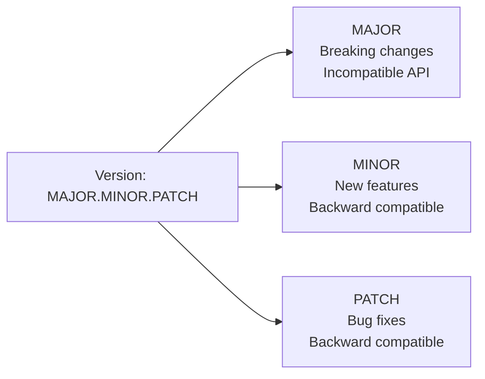
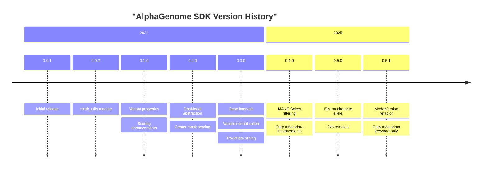
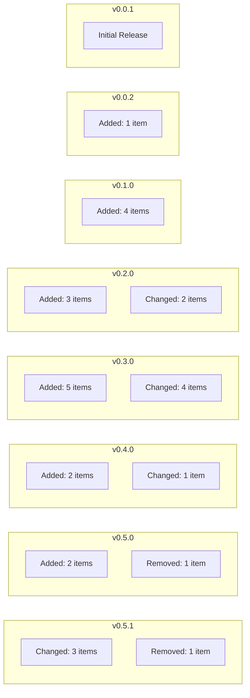

<!-- source: DeepWiki mcp.deepwiki.com · repo google-deepmind/alphagenome · page 9.4 Changelog · fetched 2026-10-26 -->

# Changelog

Relevant source files

The following files were used as context for generating this wiki page:

- [CHANGELOG.md](CHANGELOG.md)
- [src/alphagenome/__init__.py](src/alphagenome/__init__.py)

## Purpose and Scope

This page documents the complete version history of the AlphaGenome SDK, including all notable changes across releases. The changelog tracks additions, modifications, removals, and fixes from version 0.0.1 (initial release) through the current version 0.5.1. Each entry describes user-facing changes to the API, new features, deprecated functionality, and breaking changes.

For information about currently supported features and capabilities, see [Supported Features](#9.2). For information about known limitations, see [Model Limitations](#9.3).

Sources: [CHANGELOG.md:1-106](), [src/alphagenome/__init__.py:17]()

---

## Versioning Scheme

The AlphaGenome SDK follows [Semantic Versioning 2.0.0](https://semver.org/spec/v2.0.0.html) and adheres to the [Keep a Changelog](https://keepachangelog.com/en/1.1.0) format. Version numbers follow the pattern `MAJOR.MINOR.PATCH`:

- **MAJOR**: Incremented for incompatible API changes
- **MINOR**: Incremented for backward-compatible functionality additions
- **PATCH**: Incremented for backward-compatible bug fixes

**Semantic Versioning Structure**

Sources: [CHANGELOG.md:5-7]()

---

## Version Timeline

The following diagram shows the progression of AlphaGenome SDK releases and their major themes:

**Release Timeline**

Sources: [CHANGELOG.md:9-106]()

---

## Version History

### Version 0.5.1 (Current)

**Changed**
- Moved `ModelVersion` enum from `dna_client` to `dna_model` base class for better abstraction
- Added less-than operator (`__lt__`) to `Organism` enum for comparison operations
- Made `OutputMetadata` constructor keyword-only to improve API safety and support derived classes

**Removed**
- Removed automatic conversion from NumPy scalar to `int` in `Interval` class for stricter type handling

**Code Entities Affected:**
- [`dna_model.py`]() - `ModelVersion` enum location
- [`genome.py`]() - `Organism` enum, `Interval` class
- [`dna_output.py`]() - `OutputMetadata` class

Sources: [CHANGELOG.md:9-20](), [src/alphagenome/__init__.py:17]()

---

### Version 0.5.0

**Added**
- In-silico mutagenesis (ISM) support on alternate allele, enabling reproduction of Figure 4b from the AlphaGenome pre-print
- Missing extended columns in `tidy_anndata` function output

**Removed**
- Support for 2kb DNA sequence lengths due to poor model performance at very short lengths (documented in Figure 7 of the pre-print)

**Code Entities Affected:**
- [`dna_model.py`]() / [`dna_client.py`]() - ISM methods
- [`dna_output.py`]() - `tidy_anndata` function
- Input validation logic for sequence length constraints

Sources: [CHANGELOG.md:21-36]()

---

### Version 0.4.0

**Added**
- `filter_to_mane_select_transcript` function to subset GENCODE GTF files to MANE Select transcripts only
- `from_outputs` class method on `OutputMetadata` for constructing metadata from a set of outputs

**Changed**
- Updated GTF processing script to handle duplicate attributes and support downloading source GTF from URLs

**Code Entities Affected:**
- [`data/gene_annotation.py`]() - `filter_to_mane_select_transcript` function
- [`dna_output.py`]() - `OutputMetadata.from_outputs` method
- [`scripts/process_gtf.py`]() - GTF download and duplicate attribute handling

Sources: [CHANGELOG.md:37-50]()

---

### Version 0.3.0

**Added**
- `get_gene_intervals` function for retrieving multiple gene intervals in batch
- `__getitem__` method on `TrackData` to generalize filter and slice operations
- `normalize_variant` function to normalize variants against the reference assembly
- Missing metadata columns: "Assay title", "data_source", and "biosample" for splice junction data
- Splice junction section added to API documentation

**Changed**
- Updated quick start notebook to avoid shorter, less performant sequence lengths
- Updated documentation on ChIP-TF and Histone units
- Moved protocol buffer conversion functions from `data` module to `models` directory
- Added link to API terms in README license section

**Code Entities Affected:**
- [`data/gene_annotation.py`]() - `get_gene_intervals` function
- [`dna_output.py`]() - `TrackData.__getitem__` method
- [`data/genome.py`]() - `normalize_variant` function
- [`dna_output.py`]() - Splice junction metadata fields
- Protocol buffer conversion utilities

Sources: [CHANGELOG.md:51-71]()

---

### Version 0.2.0

**Added**
- `is_insertion` and `is_deletion` properties on `Variant` class
- `DnaModel` abstract base class defining the model interface
- Support for center mask scoring over entire sequence by passing `None` for width parameter

**Changed**
- Moved RPC requests and responses to `dna_model_service.proto`
- Moved `TrackData` protocol buffer conversion functions to utility module

**Code Entities Affected:**
- [`data/genome.py`]() - `Variant.is_insertion`, `Variant.is_deletion` properties
- [`dna_model.py`]() - `DnaModel` abstract base class
- [`variant_scorers.py`]() - Center mask scorer width parameter
- [`proto/dna_model_service.proto`]() - RPC definitions
- Protocol buffer utilities

Sources: [CHANGELOG.md:72-86]()

---

### Version 0.1.0

**Added**
- `L2_DIFF_LOG1P` aggregation type for variant scoring
- `is_snv` property on `Variant` class
- Non-zero mean track metadata field in model output metadata
- Optional `interval` argument to `predict_sequence` method

**Code Entities Affected:**
- [`variant_scorers.py`]() - `AggregationType.L2_DIFF_LOG1P`
- [`data/genome.py`]() - `Variant.is_snv` property
- [`dna_output.py`]() - Output metadata fields
- [`dna_model.py`]() / [`dna_client.py`]() - `predict_sequence` method signature

Sources: [CHANGELOG.md:87-95]()

---

### Version 0.0.2

**Added**
- `colab_utils` module for reading API keys from environment variables or Google Colab secrets

**Code Entities Affected:**
- [`colab_utils.py`]() - New module for API key management in Colab environments

Sources: [CHANGELOG.md:96-102]()

---

### Version 0.0.1

Initial release of the AlphaGenome SDK with core functionality:
- `DnaClient` for API communication
- Genomic data structures (`Interval`, `Variant`, `Junction`)
- Prediction methods (`predict_sequence`, `predict_interval`, `predict_variant`)
- Variant and interval scorers
- Visualization components
- Gene annotation utilities

Sources: [CHANGELOG.md:103-106]()

---

## Feature Evolution Map

The following diagram maps major features introduced across versions to the primary code entities they affected:

```mermaid
graph TB
    subgraph "Core Data Structures"
        Interval["data.genome.Interval"]
        Variant["data.genome.Variant"]
        TrackData["dna_output.TrackData"]
        OutputMetadata["dna_output.OutputMetadata"]
    end
    
    subgraph "Model Interface"
        DnaModel["dna_model.DnaModel"]
        DnaClient["dna_client.DnaClient"]
        ModelVersion["dna_model.ModelVersion"]
    end
    
    subgraph "Scoring System"
        Scorers["variant_scorers<br/>interval_scorers"]
        TidyAnnData["dna_output.tidy_anndata"]
        AggTypes["AggregationType enum"]
    end
    
    subgraph "Gene Annotations"
        GeneAnnot["gene_annotation module"]
        ProcessGTF["scripts.process_gtf"]
    end
    
    subgraph "Utilities"
        ColabUtils["colab_utils"]
        NormalizeVariant["genome.normalize_variant"]
    end
    
    v001["v0.0.1<br/>Initial Release"] -.->|created| Interval
    v001 -.->|created| Variant
    v001 -.->|created| DnaClient
    v001 -.->|created| Scorers
    v001 -.->|created| GeneAnnot
    
    v002["v0.0.2"] -.->|added| ColabUtils
    
    v010["v0.1.0"] -.->|added property| Variant
    v010 -.->|added aggregation| AggTypes
    
    v020["v0.2.0"] -.->|created abstraction| DnaModel
    v020 -.->|added properties| Variant
    
    v030["v0.3.0"] -.->|added __getitem__| TrackData
    v030 -.->|added function| NormalizeVariant
    v030 -.->|enhanced| GeneAnnot
    
    v040["v0.4.0"] -.->|added from_outputs| OutputMetadata
    v040 -.->|enhanced| ProcessGTF
    v040 -.->|added MANE filter| GeneAnnot
    
    v050["v0.5.0"] -.->|ISM on alt allele| DnaClient
    v050 -.->|enhanced| TidyAnnData
    
    v051["v0.5.1<br/>Current"] -.->|moved enum| ModelVersion
    v051 -.->|keyword-only| OutputMetadata
    v051 -.->|removed conversion| Interval
```

**Major Features and Affected Components**

Sources: [CHANGELOG.md:1-106]()

---

## Breaking Changes Summary

The following table summarizes breaking changes across versions that require user code updates:

| Version | Breaking Change | Affected API | Migration Path |
|---------|----------------|--------------|----------------|
| 0.5.1 | `OutputMetadata` now keyword-only | `dna_output.OutputMetadata` constructor | Use keyword arguments when constructing `OutputMetadata` |
| 0.5.1 | `ModelVersion` moved to base class | Import location | Import from `dna_model` instead of `dna_client` |
| 0.5.0 | 2kb sequences no longer supported | All prediction methods | Use minimum 5kb sequence length |
| 0.2.0 | RPC definitions moved | Protocol buffer imports | Update imports to reference `dna_model_service.proto` |

Sources: [CHANGELOG.md:9-86]()

---

## Change Categories by Version

The following diagram shows the distribution of change types (Added, Changed, Removed) across versions:

**Change Type Distribution Across Versions**

Sources: [CHANGELOG.md:1-106]()

---

## API Stability

The AlphaGenome SDK maintains backward compatibility within minor versions. Major version increments (not yet occurred) will signify breaking changes. Users should:

1. **Pin to minor versions** in production environments (e.g., `alphagenome>=0.5,<0.6`)
2. **Review changelog** before upgrading across minor versions
3. **Test thoroughly** when adopting new features marked as "Added"
4. **Plan migrations** for features marked as "Removed" or "Changed"

The current major version (0.x.x) indicates the SDK is in initial development, where minor version increments may include breaking changes as documented in the changelog.

Sources: [CHANGELOG.md:5-7]()