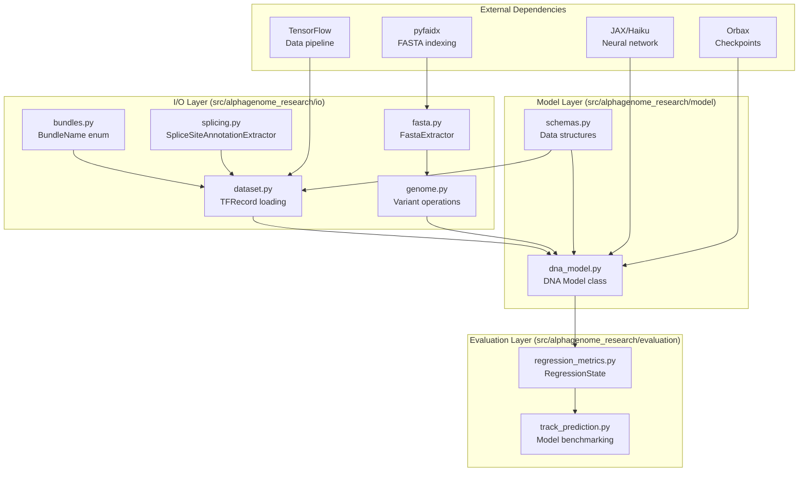
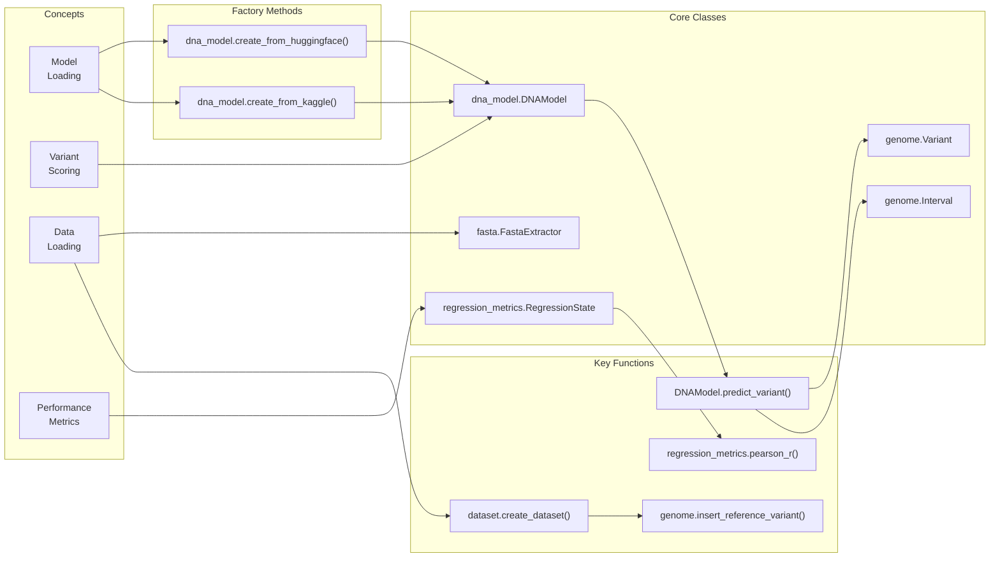
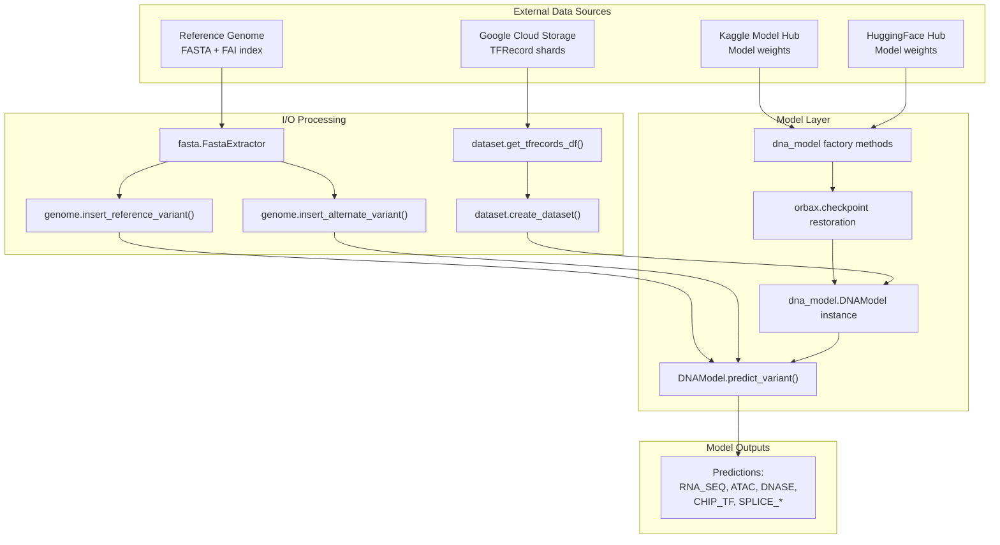
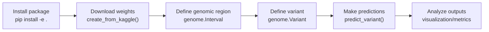

<!-- source: DeepWiki mcp.deepwiki.com · repo google-deepmind/alphagenome_research · page 1 Overview · fetched 2026-10-26 -->

# Overview

<details>
<summary>Relevant source files</summary>

The following files were used as context for generating this wiki page:

- [LICENSE](LICENSE)
- [README.md](README.md)
- [src/alphagenome_research/__init__.py](src/alphagenome_research/__init__.py)

</details>


This document provides a high-level introduction to the AlphaGenome Research repository, its architecture, and core components. For detailed installation instructions, see [Installation](#2.1). For model usage examples, see [Quick Start Tutorial](#2.2). For information about specific subsystems, refer to the [Data I/O System](#3), [Model Architecture](#4), and [Evaluation System](#5) sections.

## Purpose and Scope

AlphaGenome Research is a research codebase that implements a unified DNA sequence model for regulatory variant-effect prediction. The model analyzes DNA sequences of up to 1 million base pairs and generates single base-pair resolution predictions across multiple genomic modalities, including:

- Gene expression (RNA-seq)
- Splicing patterns (splice acceptor/donor sites)
- Chromatin features (ATAC-seq, DNase-seq, ChIP-seq)
- Spatial genome organization (contact maps)

This repository provides the JAX implementation of the AlphaGenome model, a high-level Python API for variant scoring, dataset loaders for training data, and evaluation tools for benchmarking against public datasets.

**Sources:** [README.md:13-18](), [README.md:19-28]()

## Repository Structure

The repository is organized into the following primary modules:

| Module | Purpose | Key Files |
|--------|---------|-----------|
| **I/O System** | Data loading and genomic file operations | `dataset.py`, `bundles.py`, `fasta.py`, `genome.py`, `splicing.py` |
| **Model** | Core AlphaGenome implementation and API | `dna_model.py`, `schemas.py` |
| **Evaluation** | Metrics and benchmarking tools | `regression_metrics.py`, `track_prediction.py` |
| **Examples** | Jupyter notebooks demonstrating usage | `quick_start.ipynb`, `variant_eval_examples.ipynb` |

**Sources:** [README.md:19-28](), Diagram 1 from system architecture

## High-Level Architecture

### Component Organization

The following diagram shows how the major Python modules relate to each other within the `alphagenome_research` package:



**Sources:** [README.md:19-28](), Diagram 1 from system architecture

### Code Entity Mapping

The following diagram maps high-level concepts to specific code entities:



**Sources:** [README.md:80-138](), Diagram 3 from system architecture

## Data Flow

### External Data Sources to Model Predictions

The system processes data from multiple external sources through a multi-stage pipeline:



**Sources:** [README.md:97-138](), Diagram 2 and Diagram 3 from system architecture

## Core Components

### DNA Model Class

The `DNAModel` class in [src/alphagenome_research/model/dna_model.py]() provides the primary user-facing API for model inference. It wraps the underlying JAX implementation and provides:

- **Factory methods** for loading from Kaggle (`create_from_kaggle`) or HuggingFace (`create_from_huggingface`)
- **Variant prediction** via `predict_variant()` method
- **Output processing** for extracting predictions across different genomic modalities

**Sources:** [README.md:79-82](), [README.md:84-95]()

### Data I/O System

The I/O layer handles multiple genomic file formats:

| Component | File | Purpose |
|-----------|------|---------|
| TFRecord loader | `dataset.py` | Reads training data from TensorFlow record files |
| Bundle definitions | `bundles.py` | Defines `BundleName` enum for output types (ATAC, RNA_SEQ, etc.) |
| FASTA extraction | `fasta.py` | Extracts reference genome sequences using `FastaExtractor` class |
| Variant operations | `genome.py` | Provides `Interval` and `Variant` classes, plus variant insertion functions |
| Splice annotations | `splicing.py` | Processes splice junction data via `SpliceSiteAnnotationExtractor` |

**Sources:** Diagram 1 and Diagram 2 from system architecture

### Evaluation Framework

The evaluation layer supports benchmarking against multiple datasets:

- **RegressionState** ([regression_metrics.py]()): Accumulates statistics for computing Pearson R, MSE, MAE
- **Track prediction** ([track_prediction.py]()): Orchestrates model evaluation across genomic intervals
- **Specialized metrics**: AUROC, AUPRC, tissue-weighted aggregations

**Sources:** Diagram 4 from system architecture, [README.md:27-28]()

## Model Distribution

Pre-trained model weights are distributed through two platforms:

| Platform | Access Method | Factory Function |
|----------|---------------|------------------|
| Kaggle | [kaggle.com/models/google/alphagenome](https://www.kaggle.com/models/google/alphagenome) | `dna_model.create_from_kaggle('all_folds')` |
| HuggingFace | [huggingface.co/collections/google/alphagenome](https://huggingface.co/collections/google/alphagenome) | `dna_model.create_from_huggingface('all_folds')` |

Both require accepting non-commercial model terms. Model weights are stored as Orbax checkpoints and include organism metadata required for inference.

**Sources:** [README.md:54-64](), [README.md:87-95](), Diagram 3 from system architecture

## System Requirements

### Hardware Requirements

| Operation | Recommended Hardware |
|-----------|---------------------|
| **Inference** | NVIDIA H100 GPU or equivalent |
| **Training** | TPU v3 or higher |

The model requires proper CUDA, cuDNN, and JAX installation for GPU acceleration.

**Sources:** [README.md:65-76]()

### Software Dependencies

The system depends on the following major libraries:

| Category | Libraries |
|----------|-----------|
| **Deep Learning** | JAX, dm-haiku, TensorFlow |
| **Genomics** | pyfaidx, pyranges, anndata |
| **Model Distribution** | kagglehub, huggingface_hub |
| **Checkpointing** | orbax |
| **Scientific Computing** | numpy, pandas, chex |

Complete dependency specifications are in [pyproject.toml]().

**Sources:** [README.md:163-183]()

## Usage Workflow

The typical user workflow follows this pattern:



**Example code pattern:**

```python
from alphagenome_research.model import dna_model
from alphagenome.data import genome

# Load model
model = dna_model.create_from_kaggle('all_folds')

# Define interval and variant
interval = genome.Interval(chromosome='chr22', start=35677410, end=36725986)
variant = genome.Variant(chromosome='chr22', position=36201698, 
                         reference_bases='A', alternate_bases='C')

# Predict
outputs = model.predict_variant(interval=interval, variant=variant,
                                 ontology_terms=['UBERON:0001157'],
                                 requested_outputs=[dna_model.OutputType.RNA_SEQ])
```

**Sources:** [README.md:97-138]()

## Licensing

The repository uses multiple licenses for different components:

| Component | License | Details |
|-----------|---------|---------|
| Software code | Apache 2.0 | [LICENSE]() file |
| Model weights | Non-commercial terms | Kaggle/HuggingFace distribution |
| Documentation/examples | CC-BY 4.0 | Code examples and guides |
| Research materials | CC-BY-NC 4.0 | General materials |

Training and evaluation datasets have separate licensing terms detailed in the README.

**Sources:** [README.md:186-215](), [LICENSE:1-203]()

## Development Infrastructure

The repository uses modern Python development tools:

| Tool | Purpose | Configuration |
|------|---------|---------------|
| **Hatch** | Environment management | [pyproject.toml]() |
| **Pylint** | Code quality | `.pylintrc` (Google style guide) |
| **pyink** | Code formatting | 80-char, 2-space indentation |
| **GitHub Actions** | CI/CD | `presubmit_checks.yml` |
| **pytest** | Testing | `conftest.py` for test configuration |

The CI pipeline runs quality checks and tests on Python 3.11, 3.12, and 3.13.

**Sources:** [README.md:5](), Diagram 5 from system architecture

## Related Documentation

For detailed information on specific subsystems:

- Installation and setup: [Installation](#2.1)
- First-time usage: [Quick Start Tutorial](#2.2)
- Model weights: [Model Weights and Distribution](#2.3)
- Data loading: [Data I/O System](#3)
- Model API: [DNA Model API](#4.1)
- Performance benchmarking: [Evaluation System](#5)
- Contributing: [Contributing Guidelines](#6.1)
- API reference: [API Reference](#7)

**Sources:** Table of contents provided in the task description

---

