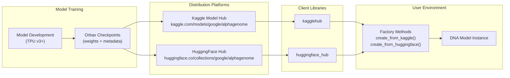
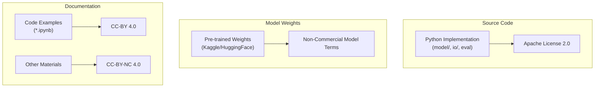
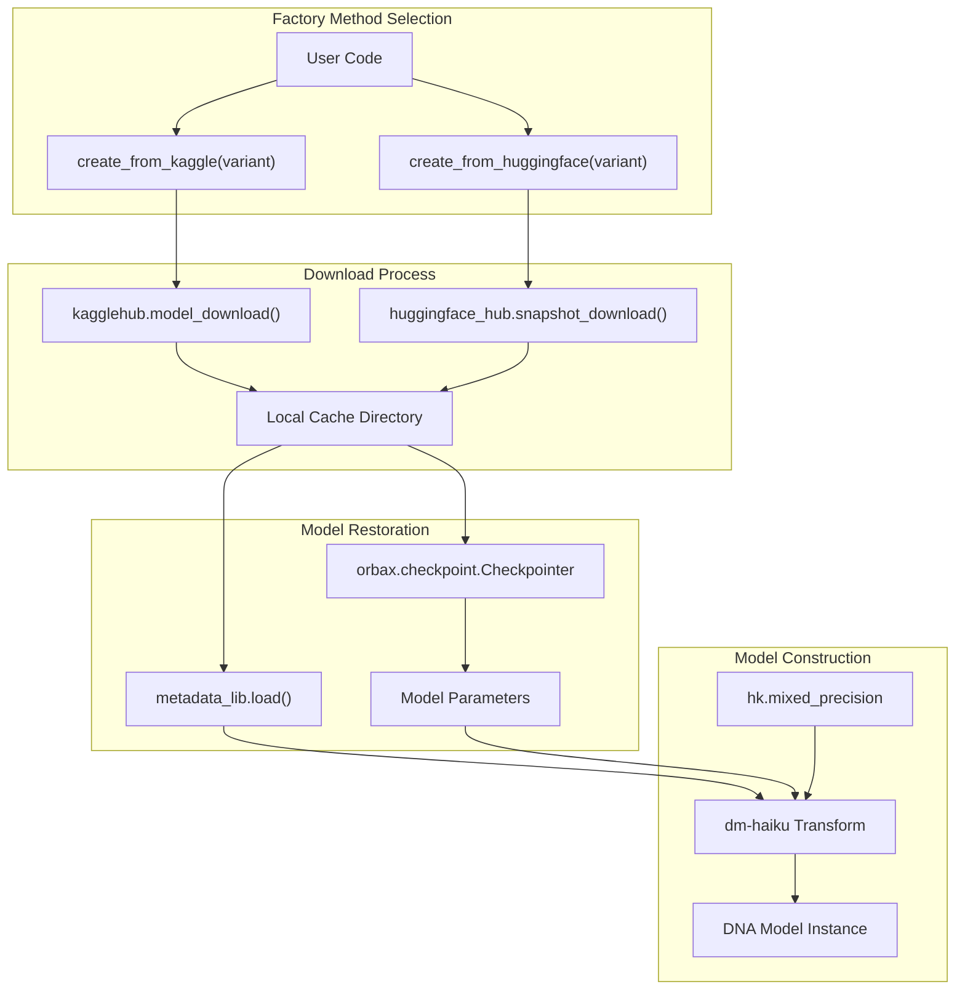
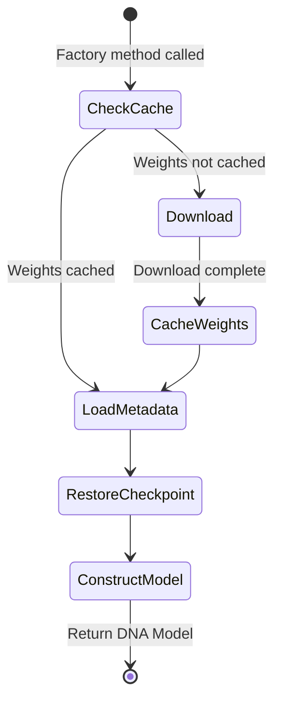
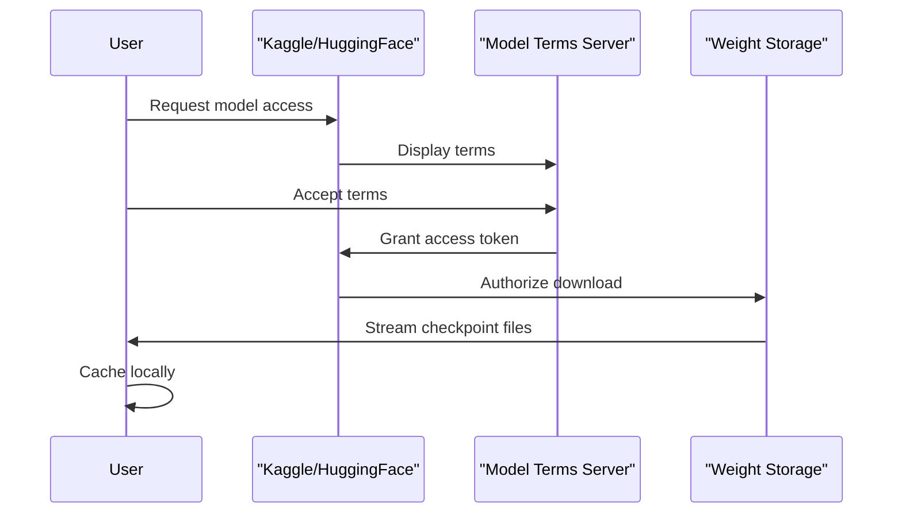

<!-- source: DeepWiki mcp.deepwiki.com · repo google-deepmind/alphagenome_research · page 2.3 Model Weights and Distribution · fetched 2026-10-26 -->

# Model Weights and Distribution

<details>
<summary>Relevant source files</summary>

The following files were used as context for generating this wiki page:

- [LICENSE](LICENSE)
- [README.md](README.md)

</details>


This page documents how to obtain and load pre-trained AlphaGenome model weights. It covers the two distribution platforms (Kaggle and HuggingFace), licensing requirements, available model variants, and the factory methods provided for model instantiation. For information on using the loaded model for inference, see [DNA Model API](#4.1). For details on the model architecture itself, see [Model Architecture](#4).

## Distribution Platforms

AlphaGenome model weights are distributed through two platforms, both requiring acceptance of non-commercial license terms before access is granted.

### Platform Overview



**Distribution Architecture**

Sources: [README.md:54-64](), [README.md:87-95]()

| Platform | URL | Client Library | Access Control |
|----------|-----|----------------|----------------|
| Kaggle | `kaggle.com/models/google/alphagenome` | `kagglehub` | Immediate upon terms acceptance |
| HuggingFace | `huggingface.co/collections/google/alphagenome` | `huggingface_hub` | Immediate upon terms acceptance |

Both platforms host identical model weights and require users to accept the model terms at `deepmind.google.com/science/alphagenome/model-terms` before downloading.

Sources: [README.md:56-63]()

## Model Variants

The AlphaGenome model weights are available in the following variant:

| Variant Name | Description | Use Case |
|--------------|-------------|----------|
| `all_folds` | Ensemble model trained across all cross-validation folds | Primary variant for general use and variant effect prediction |

When calling factory methods, the variant name is passed as a string argument:

```python
model = dna_model.create_from_kaggle('all_folds')
```

Sources: [README.md:91-94]()

## Licensing and Terms

### Software License vs. Model License

The AlphaGenome repository uses a dual licensing structure:



**Licensing Structure**

Sources: [README.md:186-212](), [LICENSE:1-203]()

### Key Licensing Points

| Component | License | Usage Rights |
|-----------|---------|--------------|
| Source code (`.py` files) | Apache 2.0 | Commercial and non-commercial use permitted |
| Model weights | Non-commercial terms | Non-commercial research only |
| Code examples and documentation | CC-BY 4.0 | Attribution required, commercial use permitted |
| Training/evaluation data | Various (see data-specific licenses) | Varies by dataset |

The model weights are subject to separate terms accessible at `deepmind.google.com/science/alphagenome/model-terms`. Users must accept these terms through the Kaggle or HuggingFace platform before downloading.

Sources: [README.md:190-195]()

## Loading Model Weights

### Factory Methods

The `dna_model` module provides two factory methods for loading pre-trained models:



**Model Loading Pipeline**

Sources: [README.md:87-95]()

### Usage Examples

#### Loading from Kaggle

```python
from alphagenome_research.model import dna_model

# Download and load model from Kaggle
model = dna_model.create_from_kaggle('all_folds')
```

The `create_from_kaggle()` method:
1. Uses `kagglehub.model_download()` to fetch weights
2. Caches weights locally to avoid repeated downloads
3. Loads organism metadata
4. Restores checkpoint using Orbax
5. Constructs the DNA Model instance

Sources: [README.md:90-91]()

#### Loading from HuggingFace

```python
from alphagenome_research.model import dna_model

# Download and load model from HuggingFace
model = dna_model.create_from_huggingface('all_folds')
```

The `create_from_huggingface()` method follows the same restoration process but uses `huggingface_hub.snapshot_download()` for fetching weights.

Sources: [README.md:93-94]()

### Download Behavior



**Model Loading State Machine**

Both factory methods implement caching to avoid redundant downloads:
- First invocation downloads weights to a local cache directory
- Subsequent invocations reuse cached weights
- Cache location is managed by the respective platform's client library

Sources: [README.md:87-95]()

## Storage Format

### Orbax Checkpoint Structure

Model weights are stored using the Orbax checkpointing format:

| Component | Format | Description |
|-----------|--------|-------------|
| Parameters | Orbax checkpoint | Neural network weights and biases |
| Metadata | JSON/Protocol Buffer | Organism-specific configuration (sequence length, output tracks, etc.) |
| Configuration | Structured data | Haiku transform configuration, precision settings |

The checkpoint restoration process uses `orbax.checkpoint.Checkpointer` to deserialize the saved parameters into JAX arrays compatible with the model's Haiku transform.

Sources: [README.md:176]()

### Required Dependencies

Loading model weights requires the following dependencies (automatically installed via `pip install`):

| Dependency | Purpose |
|------------|---------|
| `kagglehub` | Download weights from Kaggle |
| `huggingface_hub` | Download weights from HuggingFace |
| `orbax` | Checkpoint restoration |
| `dm-haiku` | Neural network framework |
| `jax` | Array computation backend |

Sources: [README.md:163-183]()

## Hardware Requirements

Model inference requires substantial computational resources:

| Configuration | Recommended Hardware | Use Case |
|---------------|---------------------|----------|
| Inference | NVIDIA H100 GPU (minimum) | Variant effect prediction |
| Training | TPU v3 or higher | Model development (not covered in research release) |

The model requires proper CUDA, cuDNN, and JAX installation. Refer to the JAX installation documentation at `docs.jax.dev/en/latest/installation.html#nvidia-gpu` for GPU setup.

Sources: [README.md:66-75]()

## Access Control and Request Processing

Both Kaggle and HuggingFace implement immediate access upon terms acceptance:



**Access Control Flow**

Requests are processed immediately upon acceptance—no manual review or waiting period is required.

Sources: [README.md:61-63]()

---

