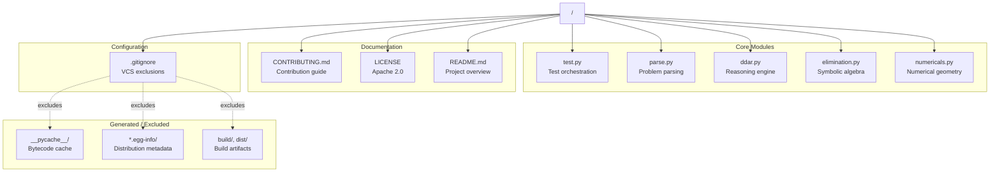
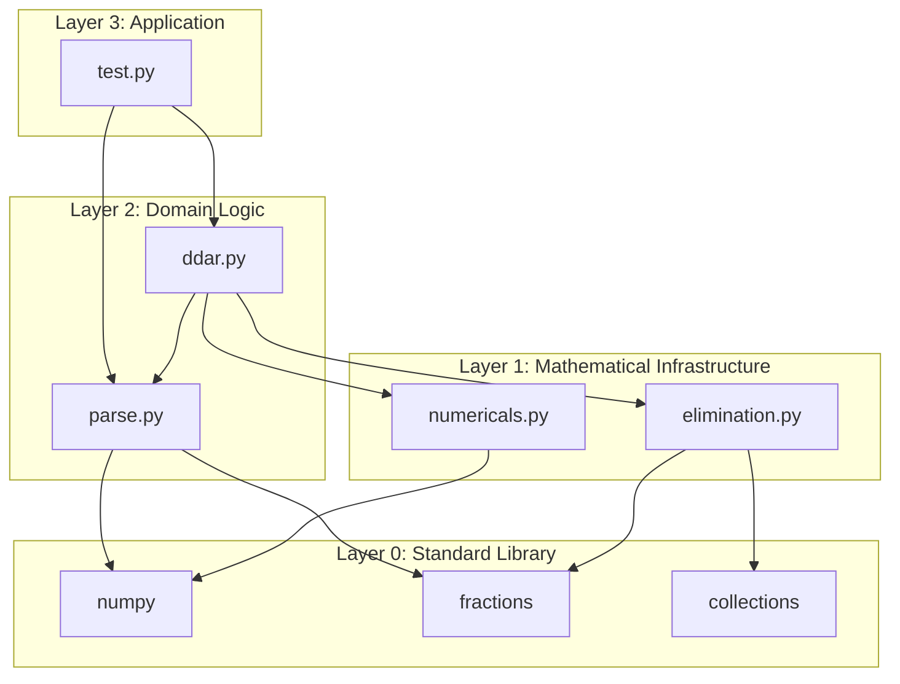
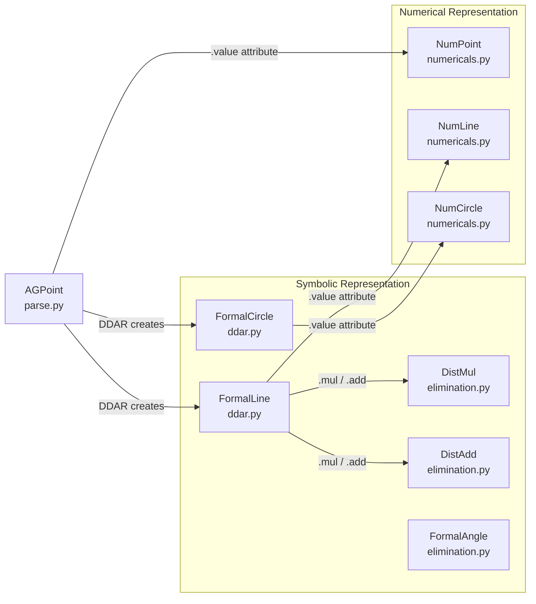
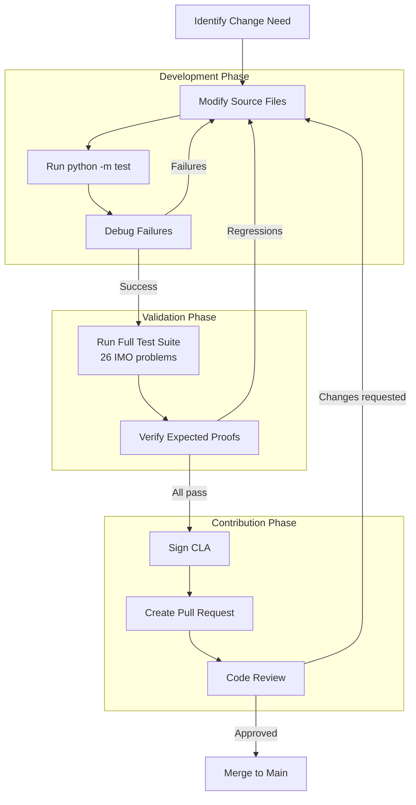
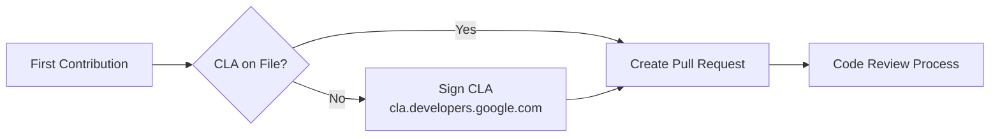

<!-- source: DeepWiki mcp.deepwiki.com · repo google-deepmind/alphageometry2 · page 10 Developer Guide · fetched 2026-10-26 -->

# Developer Guide

<details>
<summary>Relevant source files</summary>

The following files were used as context for generating this wiki page:

- [.gitignore](.gitignore)
- [CONTRIBUTING.md](CONTRIBUTING.md)
- [LICENSE](LICENSE)

</details>


## Purpose and Scope

This document provides technical information for developers who want to understand, modify, or contribute to the AlphaGeometry2 DDAR logical core codebase. It covers repository organization, development practices, contribution procedures, and licensing requirements.

For specific contribution procedures, see [Contributing Guidelines](#10.1). For detailed licensing terms, see [License Information](#10.2). For repository file organization, see [Repository Structure](#10.3).

---

## Repository Overview

The AlphaGeometry2 repository is a self-contained Python implementation of the DDAR (Deductive Database and Angle-chasing Rules) geometric reasoning system. The repository consists of four core Python modules, a test driver, and standard open-source project documentation.

### Core Components

| Component | File | Purpose |
|-----------|------|---------|
| Test Driver | `test.py` | Orchestrates problem solving and reports results |
| Parser | `parse.py` | Converts problem strings to structured objects |
| DDAR Engine | `ddar.py` | Implements geometric reasoning algorithms |
| Symbolic Algebra | `elimination.py` | Manages constraint systems via Gaussian elimination |
| Numerical Geometry | `numericals.py` | Provides geometric computation primitives |

### Project Documentation

| File | Purpose |
|------|---------|
| `CONTRIBUTING.md` | Contribution procedures and CLA requirements |
| `LICENSE` | Apache License 2.0 terms and conditions |
| `README.md` | Project overview and quick start guide |
| `.gitignore` | Version control exclusions |

**Sources:** [.gitignore:1-25](), [CONTRIBUTING.md:1-26](), [LICENSE:1-203]()

---

## Repository File Structure



**Sources:** [.gitignore:1-25]()

---

## Development Environment Setup

### Prerequisites

The system requires Python 3 with the following dependencies:

| Package | Purpose |
|---------|---------|
| `numpy` | Numerical array operations and linear algebra |
| `fractions` | Exact rational arithmetic (standard library) |
| `collections` | Specialized data structures (standard library) |

### Installation

```bash
# Clone the repository
git clone https://github.com/google-deepmind/alphageometry2.git
cd alphageometry2

# No additional installation required - standard library modules
# Optional: Install numpy if not present
pip install numpy
```

### Running Tests

```bash
# Run complete test suite
python -m test

# Run specific problem by index
# (Modify test.py to select specific problems)
```

For detailed testing procedures, see [Running the Test Suite](#2.1).

**Sources:** System architecture overview from provided diagrams

---

## Code Organization Principles

### Module Independence

The codebase follows a strict layered architecture with no circular dependencies:



**Design Constraints:**
- Layer 1 modules (`elimination.py`, `numericals.py`) are **independent** of each other
- Layer 1 has **no knowledge** of domain logic (DDAR, geometry concepts)
- Layer 2 coordinates Layer 1 components but implements domain-specific logic
- Layer 3 is the entry point with minimal logic

**Sources:** Module dependency analysis from system architecture diagrams

---

## Key Development Patterns

### Dual Representation Strategy

The system maintains parallel representations of geometric data:



**Pattern:** Each geometric object has:
1. A **symbolic form** for constraint representation (exact algebra)
2. A **numerical form** via `.value` attribute (approximate computation)

This enables both exact symbolic reasoning and efficient numerical verification.

**Sources:** Data representation analysis from system architecture diagrams

---

## Development Workflow

### Typical Development Cycle



**Sources:** [CONTRIBUTING.md:15-20]()

---

## Testing and Validation

### Test Execution Model

The system uses [test.py]() as the primary test driver, which validates the DDAR engine against 26 IMO geometry problems.

| Test Category | Problem Count | Description |
|--------------|---------------|-------------|
| Direct DDAR | 15 problems | Solvable without auxiliary points |
| With Auxiliary | 11 problems | Require manually provided auxiliary constructions |

### Expected Test Behavior

```bash
# Successful execution outputs:
# Proven: <problem_description> :-)
# for each successfully proven problem

# Failed proofs show:
# No output (problem not proven)
```

### Validation Checklist

When modifying code, ensure:

- [ ] All 26 test problems still produce "Proven :-)" output
- [ ] No new exceptions or errors are raised
- [ ] Execution completes within reasonable time (typically seconds per problem)
- [ ] No changes to problem strings unless intentional
- [ ] Symbolic constraints remain exact (using `fractions.Fraction`)

For problem categories and test structure, see [Test Suite and Problem Sets](#8).

**Sources:** Test suite structure from system architecture diagrams

---

## Contributing to the Project

### Contribution Requirements

All contributions must satisfy:

1. **Contributor License Agreement (CLA)**: Sign at https://cla.developers.google.com/
2. **Code Review**: All changes require pull request review
3. **Community Guidelines**: Follow Google's Open Source Community Guidelines

### CLA Process



**Note:** The CLA is typically required only once per contributor, even across multiple Google open-source projects.

**Sources:** [CONTRIBUTING.md:3-13]()

### Pull Request Process

1. **Fork** the repository
2. **Create** a feature branch
3. **Make** your changes
4. **Test** with full test suite
5. **Submit** pull request with description
6. **Respond** to review feedback

For detailed contribution procedures, see [Contributing Guidelines](#10.1).

**Sources:** [CONTRIBUTING.md:15-20]()

---

## Licensing

The AlphaGeometry2 repository is licensed under **Apache License 2.0**.

### Key License Terms

| Aspect | Terms |
|--------|-------|
| **Use** | Free for any purpose, including commercial |
| **Modification** | Allowed, with required notices |
| **Distribution** | Allowed under same license |
| **Patent Grant** | Contributors grant patent licenses |
| **Warranty** | Provided "AS IS" without warranties |

### License Compliance Requirements

When using or modifying this code:

- **Retain** the Apache 2.0 license header in modified files
- **Include** a copy of the LICENSE file in distributions
- **Mark** modified files with change notices
- **Include** attribution notices from original work

### Copyright Retention

Contributors retain copyright to their contributions. The license provides Google DeepMind permission to use and redistribute contributions as part of the project.

For complete license terms, see [License Information](#10.2) or the [LICENSE:1-203]() file.

**Sources:** [LICENSE:1-203](), [CONTRIBUTING.md:5-7]()

---

## Version Control Exclusions

The repository uses `.gitignore` to exclude generated files and build artifacts:

### Excluded File Categories

| Category | Pattern | Reason |
|----------|---------|--------|
| Bytecode | `__pycache__/`, `*.pyc`, `*.pyo` | Generated at runtime |
| Distribution | `*.egg-info/`, `dist/`, `build/` | Created during packaging |
| IDE | Project-specific IDE files | User-specific configuration |
| Build artifacts | `*.egg`, `MANIFEST` | Generated during builds |

### Clean Development Practice

Excluded files should never be committed. If you encounter:
- `__pycache__` directories appearing in `git status`
- Build artifacts in working directory

**Action:** Verify `.gitignore` is properly configured and run `git clean -fdX` to remove excluded files.

**Sources:** [.gitignore:1-25]()

---

## Code Quality Standards

### Style Guidelines

The codebase follows Python conventions:

- **Naming:** 
  - Classes: `PascalCase` (e.g., `AGPoint`, `FormalLine`, `ElimCore`)
  - Functions/methods: `snake_case` (e.g., `deduction_closure`, `check_pred`)
  - Constants: `UPPER_CASE` (minimal use in this codebase)

- **Documentation:**
  - Docstrings for public classes and complex methods
  - Inline comments for non-obvious algorithmic steps
  - Type hints where beneficial for clarity

### Module Boundaries

When adding or modifying code, respect module boundaries:

| Module | Allowed Dependencies | Prohibited Dependencies |
|--------|---------------------|------------------------|
| `elimination.py` | `fractions`, `collections` | `ddar.py`, `parse.py`, `numericals.py` |
| `numericals.py` | `numpy` | `ddar.py`, `parse.py`, `elimination.py` |
| `parse.py` | `fractions`, `numpy` | `ddar.py`, `elimination.py` |
| `ddar.py` | All lower layers | `test.py` |

**Sources:** Module dependency structure from system architecture diagrams

---

## Common Development Tasks

### Adding a New Geometric Predicate

To add support for a new predicate type (e.g., "parallel"):

1. **Define parsing** in [parse.py]():
   - Add predicate name to parsing logic
   - Define argument structure

2. **Implement reasoning** in [ddar.py]():
   - Add case to `force_pred` method
   - Define constraint translation
   - Update `check_pred` for verification

3. **Add inference rules** if applicable:
   - Extend `deduction_closure` with new deduction patterns
   - Ensure iterative closure terminates

4. **Test** with problems using the new predicate

### Modifying Elimination System

To enhance symbolic reasoning in [elimination.py]():

1. **Extend `ElimVar` hierarchy** if new variable types needed
2. **Update `LinComb` arithmetic** for new operations
3. **Modify Gaussian elimination** in `ElimCore` carefully
4. **Verify** exact rational arithmetic is preserved

### Enhancing Numerical Computations

To add geometric primitives in [numericals.py]():

1. **Add methods** to `NumPoint`, `NumLine`, or `NumCircle`
2. **Use NumPy** for efficient array operations
3. **Handle edge cases** (e.g., parallel lines, coincident points)
4. **Test** numerical stability with example problems

**Sources:** Code organization from provided file structures

---

## Advanced Topics

### Understanding the Deduction Loop

The core reasoning happens in `ddar.deduction_closure()`, which iteratively applies inference rules until no new facts are derived. When modifying this:

- Ensure **termination**: New rules must eventually stop producing facts
- Maintain **soundness**: Only derive true geometric consequences
- Consider **performance**: Avoid quadratic or exponential rule applications

For detailed deduction mechanics, see [Deduction Closure Process](#4.3).

### Working with Symbolic Constraints

The elimination system maintains exact arithmetic using `fractions.Fraction`. When working with constraints:

- **Never use float arithmetic** in symbolic layer
- **Preserve linearity** in constraint expressions
- **Test** that constraints remain solvable (avoid overconstrained systems)

For constraint system details, see [Symbolic Elimination System](#5).

### Numerical Precision Considerations

The numerical layer uses floating-point arithmetic. Be aware:

- **Epsilon comparisons**: Use tolerance for geometric equality tests
- **Degeneracy**: Handle collinear points, coincident lines gracefully
- **Rounding**: Numerical values are approximate; don't depend on exact equality

For numerical primitives, see [Numerical Geometry Module](#6).

**Sources:** System architecture and module responsibility diagrams

---

## Getting Help

### Documentation Resources

- **System Architecture**: See [System Architecture](#3)
- **DDAR Engine**: See [DDAR Logical Engine](#4)
- **Problem Format**: See [Problem Format and Structure](#2.2)
- **Complete Pipeline**: See [Problem-Solving Pipeline](#9)

### Community

- **Issues**: Report bugs via GitHub Issues
- **Questions**: Use GitHub Discussions for usage questions
- **Guidelines**: Follow [Google's Open Source Community Guidelines](https://opensource.google/conduct)

**Sources:** [CONTRIBUTING.md:22-25]()

---

## Summary

The AlphaGeometry2 repository provides a clean, modular implementation of geometric reasoning suitable for:

- **Research**: Understanding DDAR algorithms
- **Education**: Learning geometric theorem proving
- **Extension**: Building on the symbolic core
- **Integration**: Incorporating into larger AI systems

Key developer principles:
- Maintain **module independence**
- Preserve **exact symbolic arithmetic**
- Respect **layered architecture**
- Follow **Apache 2.0 license** terms
- Sign **CLA** before contributing

For specific development workflows, see the child pages under this Developer Guide section.

**Sources:** [CONTRIBUTING.md:1-26](), [LICENSE:1-203](), [.gitignore:1-25]()

---

