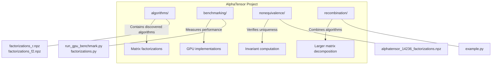
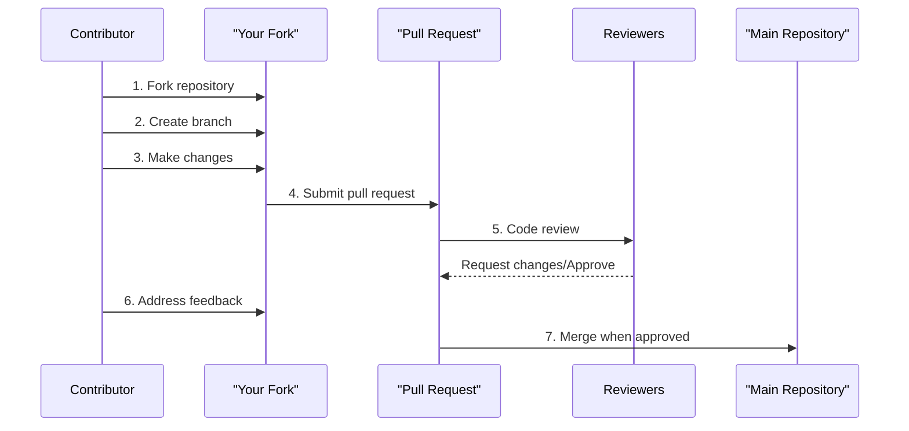
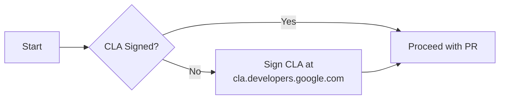
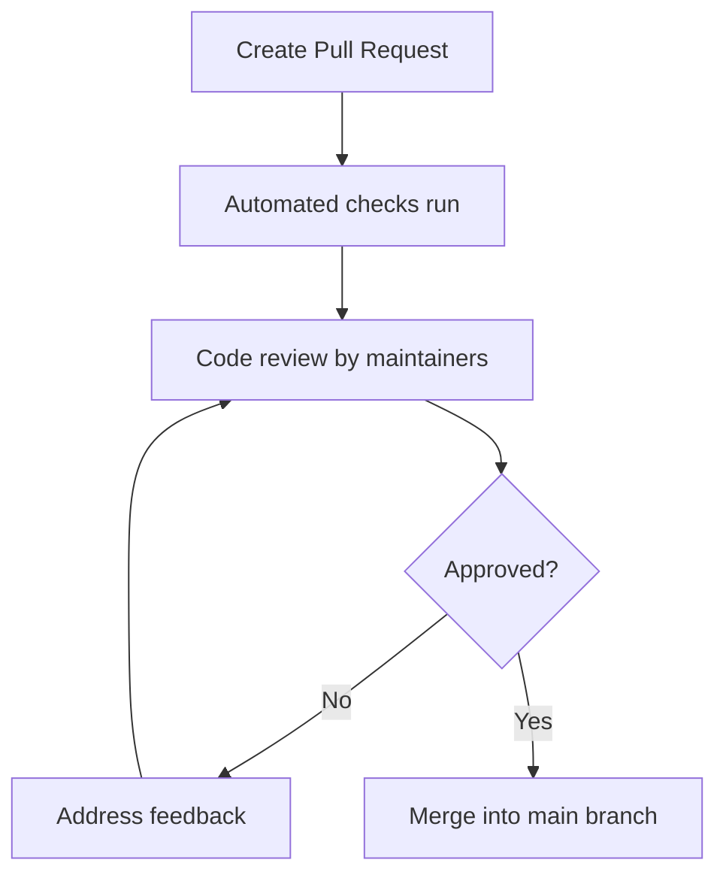
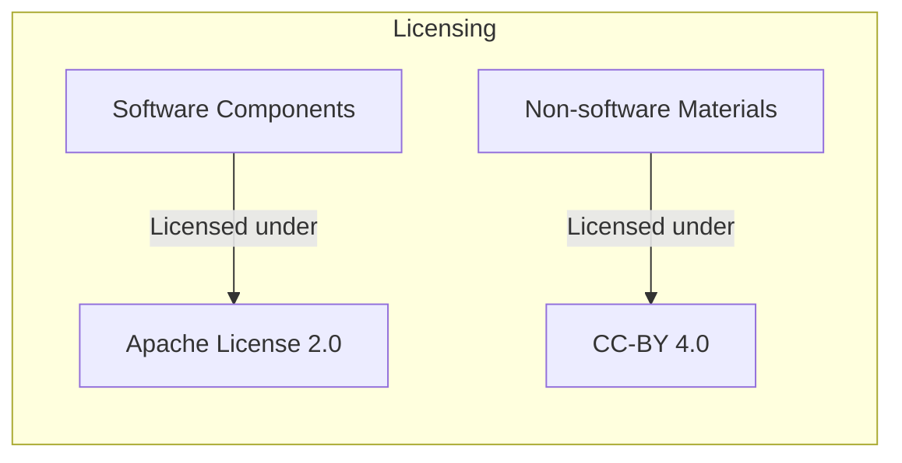
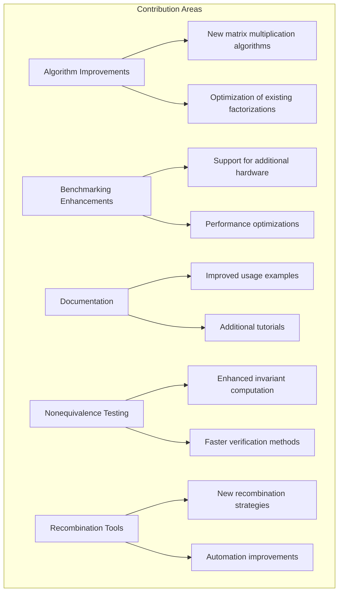

<!-- source: DeepWiki mcp.deepwiki.com · repo google-deepmind/alphatensor · page 6 Contributing · fetched 2026-10-26 -->

# Contributing

<details>
<summary>Relevant source files</summary>

The following files were used as context for generating this wiki page:

- [.gitignore](.gitignore)
- [CONTRIBUTING.md](CONTRIBUTING.md)
- [README.md](README.md)

</details>


This page provides guidelines and information for those who wish to contribute to the AlphaTensor project. It covers the contribution process, license agreements, code review procedures, and community guidelines. For information about the project's components and usage, see [AlphaTensor Project Overview](#1).

## Project Structure Overview

Before contributing, it's helpful to understand the AlphaTensor project structure. The codebase is organized into four main components:



Sources: [README.md:9-23]()

## Contribution Process

The AlphaTensor project follows standard GitHub contribution workflows. Here's the process for making contributions:



Sources: [CONTRIBUTING.md:15-20]()

### Setting Up Development Environment

Each component of the AlphaTensor project may have different setup requirements:

| Component | Setup Requirements |
|-----------|-------------------|
| algorithms | No installation required |
| benchmarking | See README in the subdirectory |
| nonequivalence | No installation required |
| recombination | Python 3 with numpy and absl-py dependencies |

For the recombination component, install dependencies using:
```
pip3 install -r alphatensor/recombination/requirements.txt
```

Sources: [README.md:26-36]()

## Contributor License Agreement

Before your contributions can be accepted, you must sign a Contributor License Agreement (CLA).



Key points about the CLA:
- You (or your employer) retain the copyright to your contribution
- The CLA simply gives permission to use and redistribute your contributions as part of the project
- You generally only need to submit a CLA once, even if it was for a different project

Sources: [CONTRIBUTING.md:3-13]()

## Code Review Process

All submissions to the AlphaTensor project require review, including submissions by project members.



The project uses GitHub pull requests for the review process. When submitting a pull request:
- Provide a clear description of the changes
- Explain how your contribution improves the project
- Ensure all tests pass
- Follow the project's coding style and conventions

Sources: [CONTRIBUTING.md:15-20]()

## Community Guidelines

The AlphaTensor project follows [Google's Open Source Community Guidelines](https://opensource.google/conduct). These guidelines promote a respectful and productive environment for collaboration.

Key principles include:
- Being respectful and constructive in communications
- Focusing on what is best for the community
- Showing empathy towards other community members
- Being collaborative rather than combative

Sources: [CONTRIBUTING.md:22-25]()

## License Information

When contributing to AlphaTensor, be aware of the project's licensing:

- All software is licensed under the Apache License, Version 2.0
- Other materials (documentation, datasets, etc.) are licensed under the Creative Commons Attribution 4.0 International License (CC-BY)

Your contributions will be subject to these licenses when merged.



Sources: [README.md:81-91]()

## Contribution Areas

The following diagram illustrates potential areas for contribution within the AlphaTensor project:



Sources: [README.md:11-23]()

## Best Practices for Contributing

When contributing to specific components of AlphaTensor, consider these best practices:

| Component | Contribution Best Practices |
|-----------|----------------------------|
| algorithms | Ensure mathematical correctness of any new factorizations |
| benchmarking | Verify performance claims with reproducible tests |
| nonequivalence | Document invariant properties thoroughly |
| recombination | Test new methods on various matrix dimensions |

Sources: [README.md:38-61]()