# Page: AlphaTensor Project Overview

# AlphaTensor Project Overview

<details>
<summary>Relevant source files</summary>

The following files were used as context for generating this wiki page:

- [README.md](README.md)

</details>


## Purpose and Scope

This document provides a comprehensive overview of the AlphaTensor project, which is designed to discover, verify, benchmark, and apply faster matrix multiplication algorithms. The project represents factorizations of matrix multiplication tensors found using reinforcement learning techniques, as described in the Nature paper "Discovering faster matrix multiplication algorithms with reinforcement learning" by Fawzi et al.

This overview covers the high-level architecture, main components, and interactions between different parts of the system. For detailed information about specific components, please refer to their dedicated wiki pages: [Algorithms](#2), [Benchmarking](#3), [Nonequivalence Testing](#4), and [Recombination](#5).

Sources: [README.md:1-23]()

## System Architecture

The AlphaTensor project consists of four independent but complementary components, each addressing different aspects of matrix multiplication algorithm discovery and verification.

### High-Level System Architecture

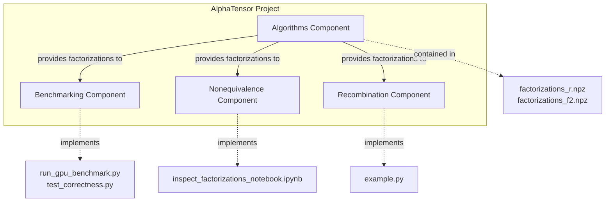

Sources: [README.md:9-23]()

### Component Interactions and Data Flow

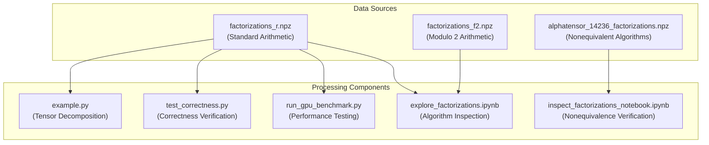

Sources: [README.md:40-61]()

## Main Components

### 1. Algorithms

The Algorithms component contains matrix multiplication algorithms discovered by AlphaTensor, represented as factorizations of matrix multiplication tensors. It includes:

- **factorizations_r.npz**: Contains algorithms in standard arithmetic
- **factorizations_f2.npz**: Contains algorithms in arithmetic modulo 2
- **explore_factorizations.ipynb**: A notebook for exploring and verifying these factorizations

The factorizations represent novel matrix multiplication algorithms that can perform multiplications with fewer operations than traditional methods.

Sources: [README.md:11-13](), [README.md:40-45]()

### 2. Benchmarking

The Benchmarking component measures the practical performance of matrix multiplication algorithms on hardware. It includes:

- **run_gpu_benchmark.py**: Script for measuring execution speed on NVIDIA V100 GPUs
- **test_correctness.py**: Verifies mathematical correctness of the algorithms
- **utils.py**: Provides support utilities for benchmarking
- **factorizations.py**: Contains optimized factorizations for specific hardware

This component allows users to validate the theoretical efficiency gains in real-world performance scenarios.

Sources: [README.md:15-16](), [README.md:47-48]()

### 3. Nonequivalence

The Nonequivalence component verifies that the discovered algorithms are truly distinct from each other. It includes:

- **inspect_factorizations_notebook.ipynb**: Notebook that computes invariants to certify algorithm nonequivalence
- **alphatensor_14236_factorizations.npz**: Dataset containing 14,236 nonequivalent algorithms for 4×4 matrix multiplication

This component demonstrates the richness of the algorithm space discovered by AlphaTensor.

Sources: [README.md:18-20](), [README.md:50-57]()

### 4. Recombination

The Recombination component demonstrates how to decompose larger matrix multiplication tensors by recombining factorizations of smaller ones. It includes:

- **example.py**: Example showing how to use recombination to find lower-rank factorizations

This allows building more efficient algorithms for larger matrix multiplications by leveraging the discovered algorithms for smaller matrices.

Sources: [README.md:22-23](), [README.md:59-61]()

## Functional Architecture

The following diagram illustrates the functional relationships between components and their outputs:

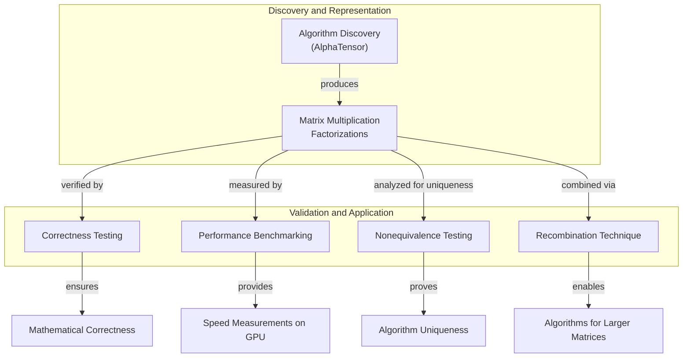

Sources: [README.md:1-61]()

## Installation and Usage

### Installation

Each component has different installation requirements:

- **Algorithms**: No installation required
- **Benchmarking**: Refer to the README in the benchmarking subdirectory
- **Nonequivalence**: No installation required
- **Recombination**: Requires Python 3 with `numpy` and `absl-py` dependencies

Sources: [README.md:26-36]()

### Usage

- **Algorithms**: Use the explore_factorizations.ipynb notebook to load and inspect factorizations
- **Benchmarking**: Follow instructions in the benchmarking subdirectory README
- **Nonequivalence**: Use the inspect_factorizations_notebook.ipynb to verify nonequivalence
- **Recombination**: Run `python3 -m alphatensor.recombination.example` from the parent directory

Sources: [README.md:38-61]()

## Data Format Overview

The AlphaTensor project primarily uses NumPy's compressed format (.npz) to store matrix multiplication factorizations:

| File | Content | Purpose |
|------|---------|---------|
| factorizations_r.npz | Factorizations in standard arithmetic | For general matrix multiplication use cases |
| factorizations_f2.npz | Factorizations in modulo 2 arithmetic | For binary matrix operations (e.g., in cryptography) |
| alphatensor_14236_factorizations.npz | 14,236 nonequivalent factorizations | For analyzing algorithm diversity |

The factorizations represent decompositions of the matrix multiplication tensor into a sum of rank-1 tensors, which translate to more efficient multiplication algorithms.

Sources: [README.md:40-57]()

## Summary

The AlphaTensor project provides a complete ecosystem for working with novel matrix multiplication algorithms discovered through reinforcement learning:

1. **Discovery and Representation**: Algorithms component with factorization data
2. **Validation**: Correctness testing and nonequivalence verification
3. **Performance Evaluation**: Benchmarking on actual hardware
4. **Application**: Recombination for larger matrices

Together, these components enable researchers and practitioners to understand, validate, and utilize faster matrix multiplication algorithms in their applications.

For detailed information about specific components, please refer to their dedicated wiki pages: [Algorithms](#2), [Benchmarking](#3), [Nonequivalence Testing](#4), and [Recombination](#5).

Sources: [README.md:1-61]()

---

# Page: Algorithms

# Algorithms

<details>
<summary>Relevant source files</summary>

The following files were used as context for generating this wiki page:

- [README.md](README.md)
- [algorithms/explore_factorizations.ipynb](algorithms/explore_factorizations.ipynb)

</details>


## Purpose and Scope

The Algorithms component of the AlphaTensor project contains matrix multiplication algorithms discovered by AlphaTensor, represented as factorizations of matrix multiplication tensors. This document explains the structure of these factorizations, how they're stored, and how to explore them using the provided tools. For information about benchmarking these algorithms, see [Benchmarking](#3). For testing the nonequivalence of algorithms, see [Nonequivalence Testing](#4).

Sources: [README.md:10-13]()

## AlphaTensor System Architecture

### Position of Algorithms Component

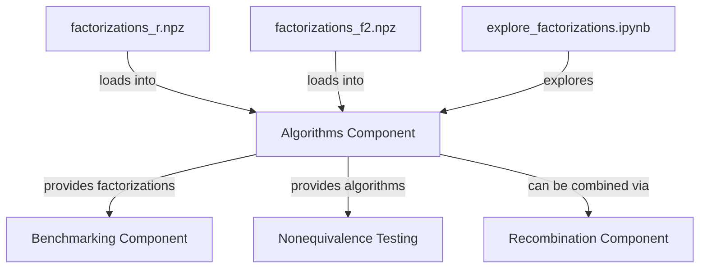

Sources: [README.md:9-23]()

## Matrix Multiplication Tensor Factorizations

Matrix multiplication factorizations represent the decomposition of the matrix multiplication operation into a sum of simpler operations. In AlphaTensor, these factorizations are represented as three sets of matrices (U, V, W) that, when combined using tensor product and summation, reconstruct the original matrix multiplication tensor.

The factorizations have the form:
T = ∑ᵣ Uᵣ ⊗ Vᵣ ⊗ Wᵣ

Where:
- T is the matrix multiplication tensor
- r ranges from 1 to the rank of the factorization
- ⊗ denotes the tensor product

### Structure of Matrix Factorizations

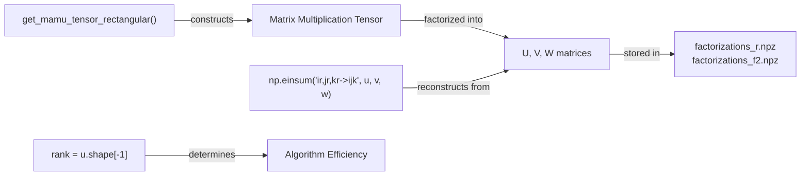

Sources: [algorithms/explore_factorizations.ipynb:87-106]()

### Symmetrized Matrix Multiplication Tensor

The factorizations in AlphaTensor decompose the *symmetrized* version of the matrix multiplication tensor, representing the bilinear operation A, B ↦ (A · B)ᵀ. This is standard in the literature, and factorizations can be easily converted between the symmetrized and non-symmetrized versions.

The symmetrized matrix multiplication tensor for dimensions a, b, c is defined in the code as:

```
T[i*b + j][j*c + k][k*a + i] = 1 for all valid i, j, k
```

Where i ranges from 0 to a-1, j from 0 to b-1, and k from 0 to c-1. All other elements are 0.

Sources: [algorithms/explore_factorizations.ipynb:74-77](), [algorithms/explore_factorizations.ipynb:87-94]()

## AlphaTensor Algorithm Formats

AlphaTensor provides discovered algorithms in two formats:

1. **Standard Arithmetic (R)**: Factorizations that work with real numbers, stored in `factorizations_r.npz`.
2. **Modular Arithmetic (F2)**: Factorizations that work with arithmetic modulo 2 (in the finite field F2), stored in `factorizations_f2.npz`.

The format of each factorization consists of three matrices U, V, and W. The rank of the factorization (which corresponds to the computational complexity of the algorithm) is equal to the number of columns in these matrices.

Each factorization is identified by a key representing the dimensions of the matrices being multiplied. For example, "3,4,5" represents a factorization for multiplying a 3×4 matrix by a 4×5 matrix.

| Format | File | Description |
|--------|------|-------------|
| Standard Arithmetic | factorizations_r.npz | Real-valued factorizations |
| Modular Arithmetic | factorizations_f2.npz | Binary field (F2) factorizations |

Sources: [README.md:43-45](), [algorithms/explore_factorizations.ipynb:36-37](), [algorithms/explore_factorizations.ipynb:60-66]()

## Exploring Factorizations

The notebook `explore_factorizations.ipynb` allows users to load and explore the factorizations through three main operations:

### Loading and Exploring Process

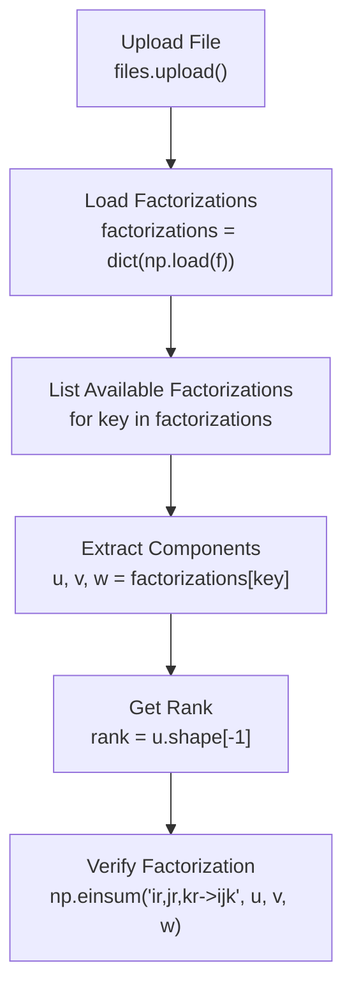

### Verification Process

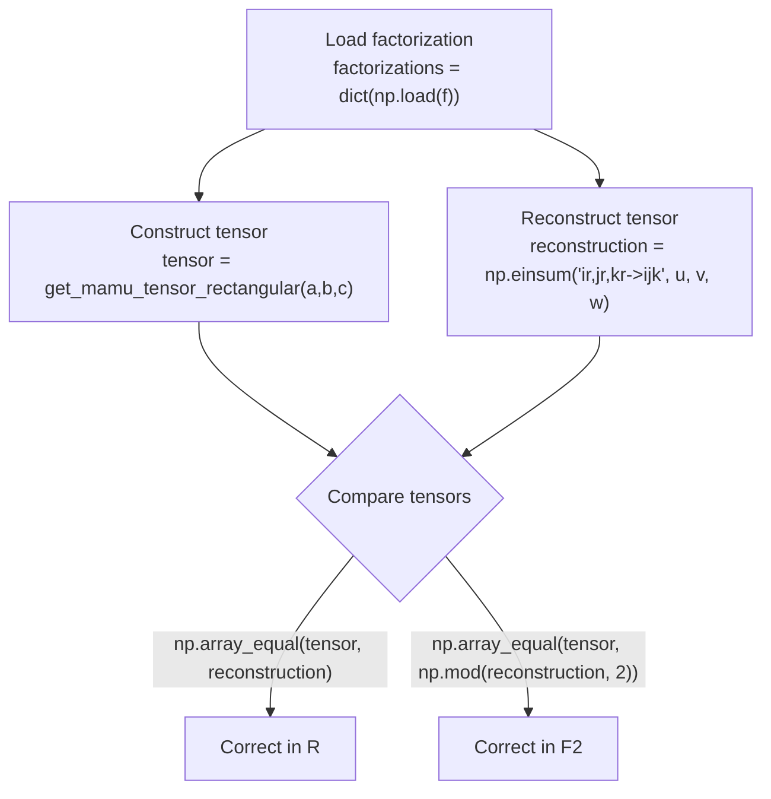

The verification process uses NumPy's Einstein summation function (`np.einsum`) to reconstruct the matrix multiplication tensor from the U, V, W components, and then compares it with the expected tensor.

Sources: [algorithms/explore_factorizations.ipynb:30-106](), [README.md:40-45]()

## Available Factorizations

AlphaTensor has discovered factorizations for various matrix dimensions. When loading a factorization file, you can list all available factorizations and their ranks using:

```python
for key in factorizations:
  u, v, w = factorizations[key]
  rank = u.shape[-1]
  print(f'{key}: rank={rank}')
```

The rank of a factorization directly relates to its computational efficiency - lower ranks correspond to faster algorithms.

Example factorizations include:
- Square matrix multiplication algorithms (e.g., 2×2, 3×3, 4×4)
- Rectangular matrix multiplication algorithms (e.g., 3×4×5 for multiplying a 3×4 matrix by a 4×5 matrix)

Sources: [algorithms/explore_factorizations.ipynb:60-66]()

---

# Page: Factorizations and Data Format

# Factorizations and Data Format

<details>
<summary>Relevant source files</summary>

The following files were used as context for generating this wiki page:

- [algorithms/explore_factorizations.ipynb](algorithms/explore_factorizations.ipynb)
- [algorithms/factorizations_f2.npz](algorithms/factorizations_f2.npz)
- [algorithms/factorizations_r.npz](algorithms/factorizations_r.npz)

</details>


This document explains how matrix multiplication factorizations discovered by AlphaTensor are stored and represented in the project's data files. For information about how to explore these factorizations, see [Exploring Factorizations](#2.2).

## Matrix Multiplication Factorizations

Matrix multiplication factorizations in AlphaTensor represent algorithms for computing matrix products more efficiently than traditional methods. The project stores these factorizations in NPZ files, which contain optimized algorithms for various matrix shapes.

### What are Matrix Factorizations?

In the context of AlphaTensor, a factorization decomposes the matrix multiplication tensor into three factor matrices, enabling faster computation. The rank of the factorization corresponds to the number of scalar multiplications required, with lower ranks indicating more efficient algorithms.

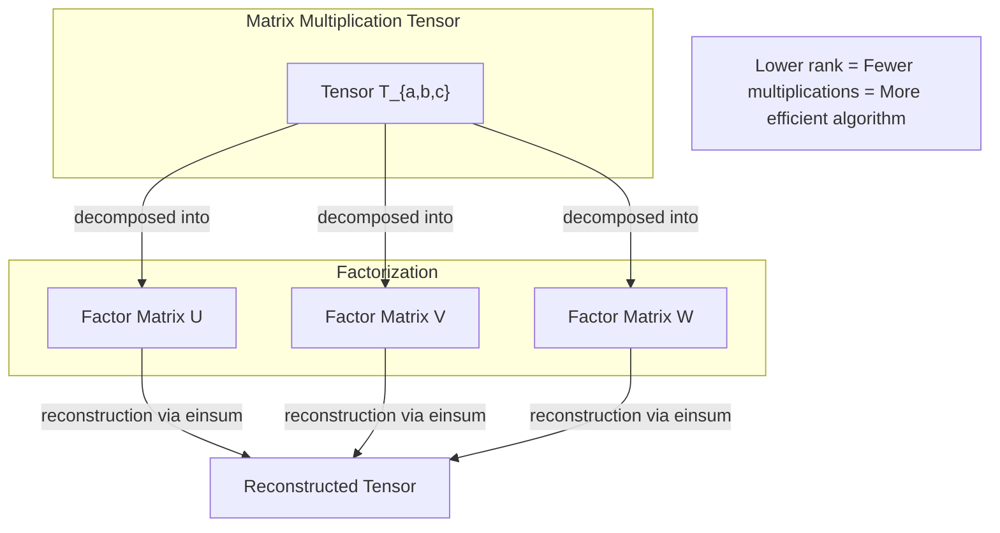

Sources: [algorithms/explore_factorizations.ipynb:87-104]()

## Data Storage Format

AlphaTensor provides factorizations in two main files:

1. `factorizations_r.npz` - Algorithms in standard arithmetic
2. `factorizations_f2.npz` - Algorithms in arithmetic modulo 2 (binary field)

These NPZ files are structured as NumPy archives containing multiple arrays, each representing a factorization for a specific matrix shape.

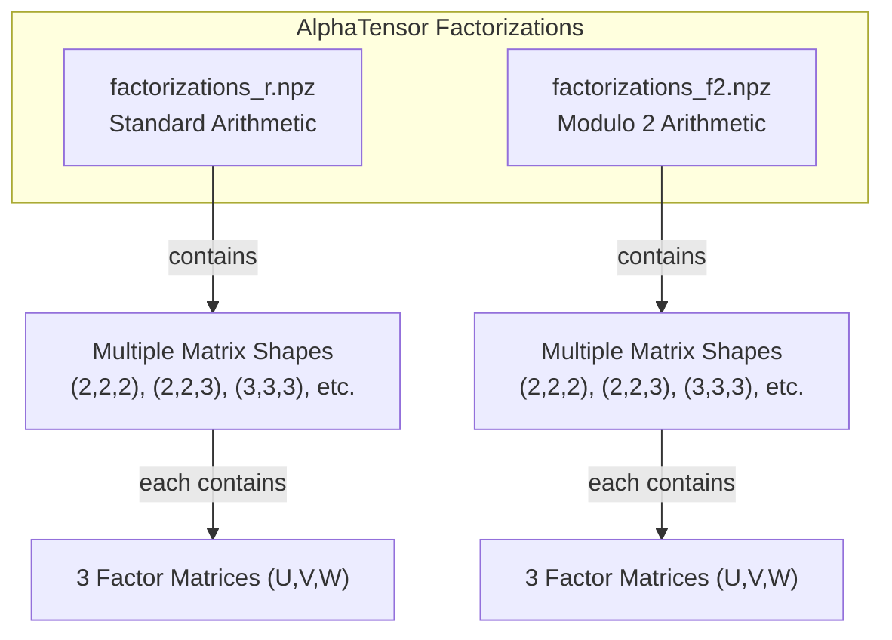

Sources: [algorithms/explore_factorizations.ipynb:30-37](), [algorithms/factorizations_f2.npz]()

## Internal Representation

Each factorization in the NPZ files is stored as a triple of matrices (U, V, W) representing the decomposition of the matrix multiplication tensor.

### Data Structure

When loaded, the factorizations are structured as a Python dictionary:
- Keys: Matrix shape strings (e.g., "3,4,5" for multiplication of a 3×4 matrix with a 4×5 matrix)
- Values: Tuples of three NumPy arrays (U, V, W) representing the factorization

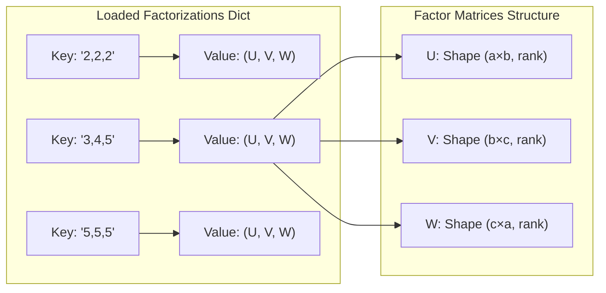

Sources: [algorithms/explore_factorizations.ipynb:46-51](), [algorithms/explore_factorizations.ipynb:61-66]()

### Symmetrized Tensor Representation

Important: The factorizations represent the *symmetrized* version of the matrix multiplication tensor, corresponding to the bilinear operation A, B ↦ (A·B)ᵀ. This is standard in the literature, and factorizations can be converted between symmetrized and non-symmetrized versions.

For matrix multiplication of size a×b with b×c to produce a c×a matrix, the tensor has dimensions (a×b, b×c, c×a).

Sources: [algorithms/explore_factorizations.ipynb:71-77]()

## Loading and Verifying Factorizations

### Loading Factorizations

Factorizations can be loaded using NumPy's `load` function:

```
with open(filename, 'rb') as f:
  factorizations = dict(np.load(f, allow_pickle=True))
```

### Verifying Correctness

To verify a factorization's correctness, reconstruct the tensor using `np.einsum` and compare it with the expected matrix multiplication tensor:

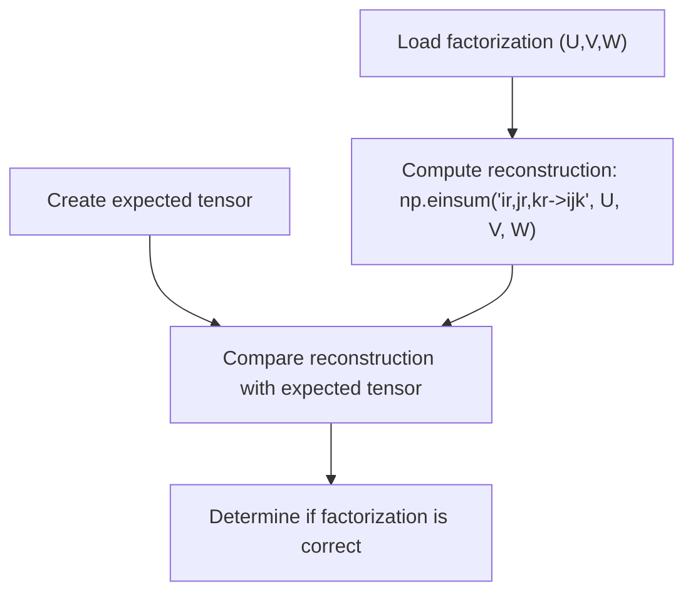

For standard arithmetic (R), the reconstruction should exactly match the expected tensor.
For modular arithmetic (F2), the reconstruction modulo 2 should match the expected tensor.

Sources: [algorithms/explore_factorizations.ipynb:87-106]()

## Available Factorizations

The provided NPZ files contain factorizations for various matrix shapes, including:

| Matrix Shape | Description |
|--------------|-------------|
| 2,2,2        | 2×2 by 2×2 matrix multiplication |
| 2,2,3        | 2×2 by 2×3 matrix multiplication |
| 2,3,3        | 2×3 by 3×3 matrix multiplication |
| 3,3,3        | 3×3 by 3×3 matrix multiplication |
| 3,4,5        | 3×4 by 4×5 matrix multiplication |
| 4,4,4        | 4×4 by 4×4 matrix multiplication |
| 5,5,5        | 5×5 by 5×5 matrix multiplication |

Each factorization's rank can be inspected using the shape of the factor matrices:

```
for key in factorizations:
  u, v, w = factorizations[key]
  rank = u.shape[-1]
  print(f'{key}: rank={rank}')
```

Sources: [algorithms/explore_factorizations.ipynb:61-66](), [algorithms/factorizations_f2.npz]()

## Relationship to Other Components

These factorizations serve as the foundation for the AlphaTensor system, feeding into:

1. **Benchmarking** - The factorizations are used to benchmark performance against standard algorithms ([Benchmarking](#3))
2. **Nonequivalence Testing** - The factorizations are analyzed to verify they represent truly distinct algorithms ([Nonequivalence Testing](#4))
3. **Recombination** - Smaller factorizations can be recombined to create algorithms for larger matrices ([Recombination](#5))

The factorization format is consistent across the project, enabling seamless integration between different components of the AlphaTensor system.

---

# Page: Exploring Factorizations

# Exploring Factorizations

<details>
<summary>Relevant source files</summary>

The following files were used as context for generating this wiki page:

- [algorithms/explore_factorizations.ipynb](algorithms/explore_factorizations.ipynb)

</details>


## Purpose

This document provides a guide to using the `explore_factorizations.ipynb` notebook for examining, verifying, and understanding the matrix multiplication factorizations discovered by AlphaTensor. The notebook allows users to load factorization data files, inspect their properties, and verify their mathematical correctness. For information about benchmarking the performance of these factorizations, see [Benchmarking](#3).

Sources: [algorithms/explore_factorizations.ipynb:4-16]()

## Factorization Data Files

AlphaTensor provides two primary factorization data files:

1. `factorizations_r.npz` - Contains factorizations in standard arithmetic (ℝ)
2. `factorizations_f2.npz` - Contains factorizations in modulo 2 arithmetic (F₂)

These files store matrix multiplication factorizations discovered by the AlphaTensor system. Each factorization represents a decomposition of the matrix multiplication tensor for specific matrix shapes.

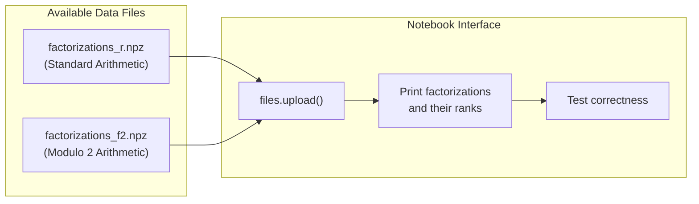

**Diagram: Factorization Data Loading Workflow**

Sources: [algorithms/explore_factorizations.ipynb:31-37](), [algorithms/explore_factorizations.ipynb:39-51]()

## Understanding Factorization Format

The factorization files contain decompositions of the symmetrized matrix multiplication tensor. Each factorization is represented as a tuple of three matrices (U, V, W), which together reconstruct the original tensor.

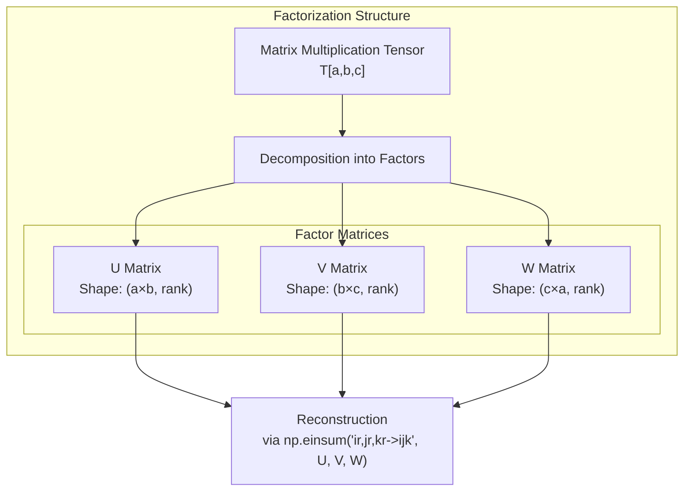

**Diagram: Matrix Factorization Structure**

Each factorization key in the data file represents the dimensions of the matrices being multiplied (e.g., `'3,4,5'` represents multiplication of a 3×4 matrix with a 4×5 matrix). The rank of the factorization indicates the efficiency of the algorithm, with lower ranks corresponding to faster multiplication algorithms.

Sources: [algorithms/explore_factorizations.ipynb:54-67](), [algorithms/explore_factorizations.ipynb:69-77]()

## Loading and Exploring Factorizations

The notebook provides a simple interface to work with these factorizations:

### Step 1: Upload Factorization File

First, upload either the `factorizations_r.npz` or `factorizations_f2.npz` file using the following code in the notebook:

```
uploaded = files.upload()
filename = list(uploaded.keys())[0]
with open(filename, 'rb') as f:
  factorizations = dict(np.load(f, allow_pickle=True))
```

This loads the factorization data into a Python dictionary.

Sources: [algorithms/explore_factorizations.ipynb:39-51]()

### Step 2: Inspect Available Factorizations

Once loaded, you can examine the available factorizations and their ranks:

```
for key in factorizations:
  u, v, w = factorizations[key]
  rank = u.shape[-1]
  assert rank == v.shape[-1] and rank == w.shape[-1]
  print(f'{key}: rank={u.shape[-1]}')
```

This code iterates through each factorization, extracts the U, V, and W matrices, and prints the dimensions and rank of each factorization.

Sources: [algorithms/explore_factorizations.ipynb:54-67]()

## Verifying Factorization Correctness

The notebook includes functionality to verify that a factorization correctly reconstructs the matrix multiplication tensor:

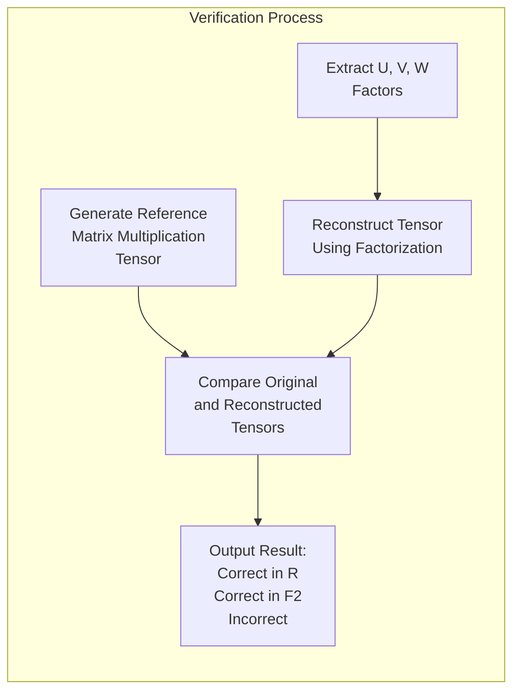

**Diagram: Factorization Verification Workflow**

The verification process works as follows:

1. The `get_mamu_tensor_rectangular(a, b, c)` function generates the reference matrix multiplication tensor for multiplying an a×b matrix with a b×c matrix.
2. The factorization (U, V, W) is extracted from the loaded data.
3. The tensor is reconstructed using `np.einsum('ir,jr,kr->ijk', u, v, w)`.
4. The original and reconstructed tensors are compared:
   - If they match directly, the factorization is correct in standard arithmetic (ℝ).
   - If they match after applying modulo 2, the factorization is correct in modulo 2 arithmetic (F₂).
   - Otherwise, the factorization is incorrect.

Sources: [algorithms/explore_factorizations.ipynb:80-107]()

## Important Technical Notes

It's important to understand that the provided factorizations decompose the *symmetrized* version of the matrix multiplication tensor, representing the bilinear operation A, B ↦ (A·B)ᵀ. This is standard in the literature, and factorizations can be easily converted between symmetrized and non-symmetrized versions.

### Factorization Keys and Tensor Shapes

The factorization dictionary uses keys formatted as `'a,b,c'` where:
- `a` is the number of rows in the first matrix
- `b` is the number of columns in the first matrix / rows in the second matrix
- `c` is the number of columns in the second matrix

For example, the key `'3,4,5'` represents factorization for multiplying a 3×4 matrix with a 4×5 matrix.

| Key Format | Example | Matrix Multiplication |
|------------|---------|------------------------|
| `'a,b,c'`  | `'3,4,5'` | (3×4) · (4×5) → (3×5) |

Sources: [algorithms/explore_factorizations.ipynb:61-67](), [algorithms/explore_factorizations.ipynb:98-100]()

## Relationship to AlphaTensor System

The exploration notebook serves as an interface to examine the results of AlphaTensor's algorithm discovery process. While the benchmark system measures the performance of these algorithms, and the nonequivalence testing verifies their uniqueness, this notebook allows users to directly inspect the mathematical properties of the discovered factorizations.

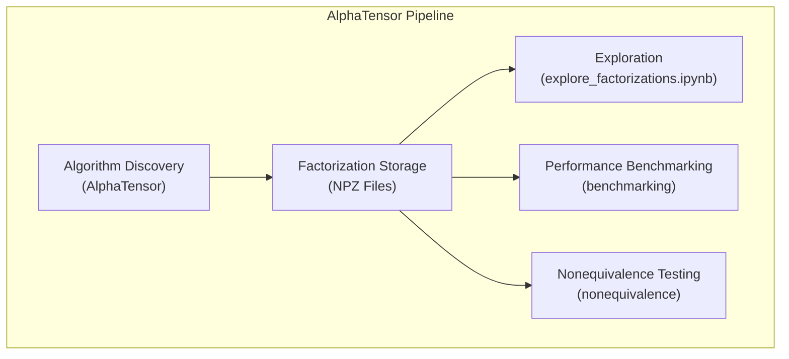

**Diagram: Position of Exploration in AlphaTensor Workflow**

Sources: [algorithms/explore_factorizations.ipynb:1-16]()

## Summary

The `explore_factorizations.ipynb` notebook provides a straightforward interface to:

1. Load matrix multiplication factorizations discovered by AlphaTensor
2. Inspect the properties of these factorizations (dimensions and rank)
3. Verify the mathematical correctness of the factorizations
4. Understand the structure of the matrix multiplication decompositions

This exploration tool serves as an entry point for examining the algorithmic discoveries of AlphaTensor before proceeding to performance benchmarking or further analysis.

---

# Page: Benchmarking

# Benchmarking

<details>
<summary>Relevant source files</summary>

The following files were used as context for generating this wiki page:

- [README.md](README.md)
- [benchmarking/README.md](benchmarking/README.md)

</details>


## Purpose and Scope

The Benchmarking component of the AlphaTensor project provides tools and infrastructure to evaluate the performance and correctness of matrix multiplication algorithms discovered by AlphaTensor. This page covers the implementation details, usage instructions, and workflow of the benchmarking system. For information about the actual algorithms being benchmarked, see [Algorithms](#2).

The benchmarking system serves three primary functions:
1. Providing optimized factorizations for specific hardware platforms
2. Converting factorizations into executable matrix multiplication algorithms
3. Verifying algorithm correctness and measuring performance

Sources: [benchmarking/README.md:1-22]()

## System Architecture

The benchmarking component consists of four primary files that work together to provide a complete testing and evaluation framework.

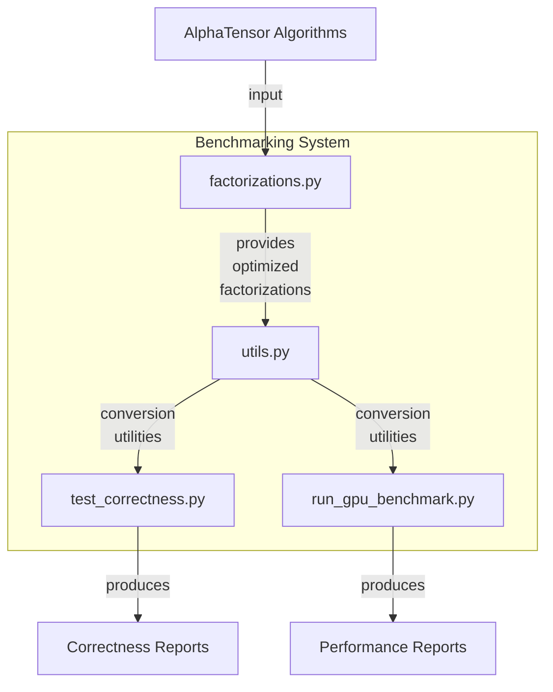

Sources: [benchmarking/README.md:5-22]()

## Core Components

### Factorization Repository

The `factorizations.py` file contains the matrix multiplication factorizations discovered by AlphaTensor when optimizing for the running time of specific multiplication scenarios. These factorizations are optimized for particular hardware platforms (GPU or TPU) and matrix sizes.

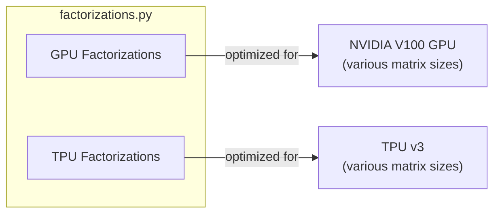

Sources: [benchmarking/README.md:5-8]()

### Conversion Utilities

The `utils.py` file provides essential functions for converting abstract tensor factorizations into executable matrix multiplication algorithms that can be run on actual hardware. This translation layer is critical for both testing correctness and measuring real-world performance.

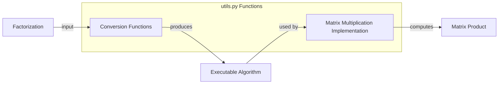

Sources: [benchmarking/README.md:10-12]()

### Correctness Testing

The `test_correctness.py` file contains unit tests that verify two critical properties of the factorizations:
1. They correctly decompose the matrix multiplication tensor
2. The resulting algorithms produce the same results as standard matrix multiplication implementations, within the bounds of numerical precision

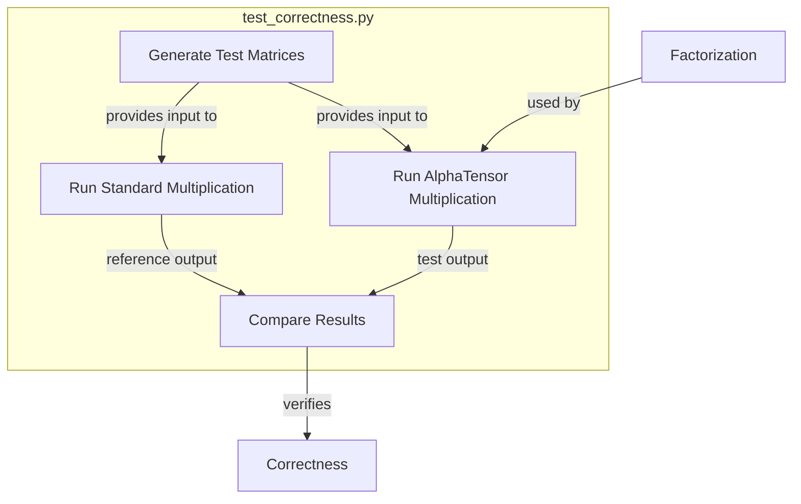

Sources: [benchmarking/README.md:13-16]()

### Performance Benchmarking

The `run_gpu_benchmark.py` file measures the actual performance of AlphaTensor's GPU-tailored algorithms against established methods, specifically Strassen's algorithm and the standard matrix multiplication implementation in JAX (`jax.numpy.dot`).

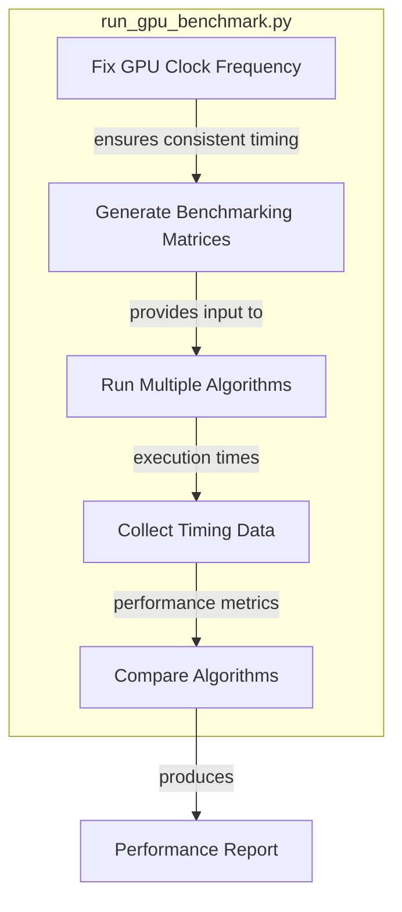

Sources: [benchmarking/README.md:18-22]()

## Implementation Details

### Factorization Structure

The factorizations in `factorizations.py` are structured as coefficient tensors that represent matrix multiplication algorithms. These factorizations are optimized for specific hardware platforms and matrix sizes, with some examples including:

- Factorizations for 5x5x5 matrix multiplication
- Specialized algorithms for 8192x8192 matrices on NVIDIA V100 GPUs
- Algorithms optimized for TPU v3 hardware

Each factorization provides a decomposition that can be translated into an efficient implementation for the target platform.

Sources: [benchmarking/README.md:5-8]()

### Algorithm Conversion

The utilities in `utils.py` provide the following key functions:

1. Converting abstract factorization representations to executable code
2. Implementing matrix multiplication operations based on the factorization
3. Supporting both standard arithmetic and modulo-2 arithmetic
4. Interfacing with JAX for GPU/TPU acceleration

This conversion process is crucial as it bridges the gap between the mathematical representation of algorithms and their practical implementation.

Sources: [benchmarking/README.md:10-12]()

### Testing Methodology

The correctness tests in `test_correctness.py` follow a systematic approach:

1. Generate test matrices of various sizes and patterns
2. Compute the matrix product using standard implementations
3. Compute the matrix product using AlphaTensor's factorizations
4. Compare results within acceptable numerical precision
5. Verify across multiple test cases and matrix sizes

| Test Type | Purpose | Verification Method |
|-----------|---------|---------------------|
| Basic Correctness | Verify factorization accuracy | Compare with reference implementation |
| Numerical Stability | Check precision limits | Measure error magnitude |
| Edge Cases | Test with special matrices | Verify correct handling |

Sources: [benchmarking/README.md:13-16]()

### Benchmarking Methodology

The benchmarking process in `run_gpu_benchmark.py` includes:

1. Setting a fixed GPU clock frequency to ensure consistent timing
2. Running matrix multiplications with various sizes (small to large)
3. Measuring execution time with multiple repetitions to reduce variance
4. Calculating effective FLOPS (floating-point operations per second)
5. Comparing performance between AlphaTensor, Strassen's algorithm, and standard matrix multiplication

The benchmark specifically targets NVIDIA V100 GPUs, as mentioned in the documentation, and requires sudo access to fix the GPU clock frequency.

Sources: [benchmarking/README.md:18-22]()

## Usage Instructions

### Installation Requirements

To use the benchmarking system, you need:

1. An NVIDIA V100 GPU (for replicating the paper's results)
2. Python 3
3. JAX and other dependencies

Installation steps:

```bash
# Clone the repository
git clone https://github.com/deepmind/alphatensor.git

# Optional: Set up a virtual environment
python3 -m venv benchmarking_env
source benchmarking_env/bin/activate

# Install dependencies
pip3 install -r alphatensor/benchmarking/requirements.txt -f https://storage.googleapis.com/jax-releases/jax_cuda_releases.html
```

Sources: [benchmarking/README.md:24-48]()

### Running Tests and Benchmarks

To run the correctness tests:

```bash
python3 -m alphatensor.benchmarking.test_correctness
```

To run the performance benchmarks:

```bash
python3 -m alphatensor.benchmarking.run_gpu_benchmark
```

**Important**: These commands must be executed from the parent directory that contains the `alphatensor` repository as a subdirectory.

Sources: [benchmarking/README.md:50-64]()

## Integration with Other Components

The benchmarking system integrates with other components of the AlphaTensor project as follows:

```mermaid
flowchart TD
    subgraph "AlphaTensor Components"
        A["Algorithms"]
        B["Benchmarking"]
        N["Nonequivalence"]
        R["Recombination"]
    end
    
    A -->|"provides factorizations to"| B
    B -->|"validates"| A
    N -->|"proves uniqueness of"| A
    R -->|"combines"| A
    B -->|"measures performance of"| R
```

The benchmarking component primarily consumes the factorizations from the algorithms component, validates their correctness, and measures their performance. This performance data can then be used to evaluate the practical utility of algorithms discovered through both direct search (algorithms component) and composition methods (recombination component).

Sources: [README.md:9-23](), [benchmarking/README.md:1-22]()

---

# Page: Benchmark Implementation

# Benchmark Implementation

<details>
<summary>Relevant source files</summary>

The following files were used as context for generating this wiki page:

- [benchmarking/README.md](benchmarking/README.md)
- [benchmarking/run_gpu_benchmark.py](benchmarking/run_gpu_benchmark.py)
- [benchmarking/utils.py](benchmarking/utils.py)

</details>


This page details the technical implementation of the benchmarking system in AlphaTensor, which evaluates and compares the performance of discovered matrix multiplication algorithms. For information about running these benchmarks, see [Running Benchmarks](#3.4). For details about pre-computed factorizations used in benchmarking, see [Pre-computed Factorizations](#3.2).

## Benchmarking Architecture

The AlphaTensor benchmarking system implements a complete pipeline for converting mathematical factorizations of tensors into executable matrix multiplication algorithms and measuring their performance against standard implementations.

```mermaid
flowchart TD
    A["Factorization Data\n[3, n², rank]"] --> B["algorithm_from_factors()\nConversion Function"]
    B --> C["JAX Function\nMatrix Multiplication Algorithm"]
    D["Input Matrices\nA, B"] --> E["block_split()\nMatrix Blocking"]
    E --> F["Blocked Matrices"]
    F --> G["Benchmark Execution"]
    C --> G
    G --> H["Performance Metrics\nTime & Speedup"]
    I["jnp.dot Baseline"] --> J["Baseline Benchmark"]
    J --> H
```

Sources: [benchmarking/utils.py:30-33](), [benchmarking/utils.py:57-116](), [benchmarking/utils.py:222-233]()

## Core Components

The benchmarking system consists of these primary components:

1. **Factorization Representation**: Tensor factorizations stored as NumPy arrays
2. **Algorithm Conversion**: Transformation of factorizations into executable code
3. **Matrix Splitting**: Techniques to partition matrices into blocks
4. **Benchmarking Functions**: Methods to measure and compare algorithm performance
5. **GPU Optimization**: Utilities to ensure consistent benchmarking conditions

```mermaid
classDiagram
    class "Factorization" {
        +numpy.ndarray factors[3, n², rank]
        +represents tensor decomposition
    }
    
    class "algorithm_from_factors()" {
        +converts factorization to algorithm
        +returns jax function
    }
    
    class "benchmark_factorized_algorithm()" {
        +measures performance
        +handles matrix preparation
        +handles jit compilation
    }
    
    class "benchmark_jnp_dot()" {
        +benchmarks baseline
        +ensures fair comparison
    }
    
    class "run_gpu_benchmark" {
        +sets GPU clock frequency
        +runs comparative benchmarks
        +calculates speedup percentages
    }
    
    "Factorization" --> "algorithm_from_factors()"
    "algorithm_from_factors()" --> "benchmark_factorized_algorithm()"
    "benchmark_factorized_algorithm()" --> "run_gpu_benchmark"
    "benchmark_jnp_dot()" --> "run_gpu_benchmark"
```

Sources: [benchmarking/utils.py:57-116](), [benchmarking/utils.py:195-233](), [benchmarking/run_gpu_benchmark.py:50-89]()

## Factorization to Algorithm Conversion

The central function `algorithm_from_factors()` converts mathematical tensor factorizations into executable JAX code. This is the critical step that enables benchmarking of AlphaTensor's discoveries.

### Input Format

Factorizations are represented as NumPy arrays with shape `[3, n², rank]`, where:
- `n²` represents the flattened dimensions of an n×n matrix
- `rank` is the number of terms in the factorization
- The 3 components correspond to the three matrices in the factorization

### Conversion Process

The conversion process transforms these mathematical factors into a function that implements a fast matrix multiplication algorithm:

```mermaid
flowchart LR
    A["Factors\n[3, n², rank]"] --> B["Reshape\n[n, n, rank]"]
    B --> C["Transposition\nCorrection"]
    C --> D["Matrix Operation\nGeneration"]
    D --> E["JAX Function\nImplementation"]
    E --> F["JIT Compilation"]
    F --> G["Executable\nAlgorithm"]
```

Sources: [benchmarking/utils.py:57-116](), [benchmarking/utils.py:119-137]()

## Matrix Blocking System

The benchmarking system uses block matrix operations to implement factorized algorithms. This allows the system to handle large matrices efficiently.

### Block Split Implementation

The `block_split()` function divides a matrix into an n×n grid of blocks:

```mermaid
flowchart TD
    A["Input Matrix\nMᵢₖ"] --> B["Split Rows\njnp.split(M, n_rows, axis=0)"]
    B --> C["Split Columns\njnp.split(row, n_cols, axis=1)"]
    C --> D["Block Matrix\n[[M₀₀, M₀₁, ...], [M₁₀, M₁₁, ...], ...]"]
```

Sources: [benchmarking/utils.py:30-33]()

## Benchmarking Process Implementation

The benchmarking process involves these steps:

1. **Setup**: Fix GPU clock frequency to ensure consistent measurements
2. **Matrix Generation**: Create random matrices of specified sizes
3. **Algorithm Preparation**: Convert factorizations to JAX functions
4. **Execution**: Run both standard and factorized algorithms multiple times
5. **Timing**: Measure execution time using `timeit.default_timer()`
6. **Analysis**: Calculate speedup percentages

### Benchmarking Flow

```mermaid
flowchart TD
    A["Matrix Dimensions\n& Algorithm Selection"] --> B["Generate Random\nInput Matrices"]
    B --> C["Prepare JAX Arrays\n& Send to GPU"]
    C --> D["JIT Compile\nFactorized Algorithm"]
    D --> E["Warmup Runs"]
    E --> F["Timed Execution\n(Multiple Trials)"]
    F --> G["Calculate Mean\nExecution Time"]
    G --> H["Compare Against\nBaseline (jnp.dot)"]
    H --> I["Calculate\nSpeedup Percentage"]
```

Sources: [benchmarking/utils.py:195-233](), [benchmarking/run_gpu_benchmark.py:66-89]()

## Benchmark Methods

The system provides two primary benchmarking functions:

1. `benchmark_jnp_dot()` - Measures the performance of JAX's standard matrix multiplication
2. `benchmark_factorized_algorithm()` - Measures the performance of factorized algorithms

Both functions use the same core timing methodology to ensure fair comparison:

| Function | Purpose | Key Parameters |
|----------|---------|----------------|
| `benchmark_jnp_dot()` | Baseline performance | `matrix_dims`, `num_trials`, `dtype` |
| `benchmark_factorized_algorithm()` | Algorithm performance | `factors`, `matrix_dims`, `num_trials`, `dtype` |
| `_benchmark_op()` | Core timing logic | `op`, `num_trials` |

Sources: [benchmarking/utils.py:195-233]()

## GPU Configuration for Consistent Benchmarking

To ensure consistent and reliable benchmark results, the system implements GPU clock frequency locking:

```mermaid
flowchart LR
    A["Check GPU Type\nnvidia-smi"] --> B["Enable Persistent Mode\nsudo nvidia-smi -pm ENABLED"]
    B --> C["Lock Clock Frequency\nsudo nvidia-smi --lock-gpu-clocks=1530,1530"]
    C --> D["Proceed with\nBenchmarking"]
```

Sources: [benchmarking/run_gpu_benchmark.py:50-64]()

## Algorithm Execution Flow

The factorized algorithm execution follows this pattern:

```mermaid
flowchart TD
    A["Blocked Matrices\nA and B"] --> B["For each rank component α"]
    B --> C["Compute Linear\nCombination of A Blocks"]
    C --> D["Compute Linear\nCombination of B Blocks"]
    D --> E["Multiply Combined\nMatrices"]
    E --> F["Scale and Add to\nResult Blocks"]
    F --> G["Return Result\nBlock Matrix"]
```

Sources: [benchmarking/utils.py:80-116]()

## Technical Implementation Details

The implementation relies heavily on JAX for GPU acceleration and just-in-time compilation:

1. **JAX JIT Compilation**: Algorithms are compiled using `jax.jit()` for optimal performance
2. **Device Transfer**: Arrays are transferred to GPU using `jax.device_put()`
3. **Block-Until-Ready**: Ensures computation is complete before timing stops with `.block_until_ready()`
4. **Garbage Collection**: Temporarily disabled during timing to prevent interference
5. **Multiple Trials**: Each benchmark runs multiple trials to obtain reliable statistics

Sources: [benchmarking/utils.py:149-152](), [benchmarking/utils.py:195-209]()

## Benchmark Configuration

The system benchmarks multiple algorithms against different matrix sizes:

| Algorithm | Description | Source |
|-----------|-------------|--------|
| `jnp.dot` | Standard JAX matrix multiplication | JAX library |
| Strassen² | Two levels of Strassen's algorithm | `factorizations.get_4x4x4_strassen_squared()` |
| AlphaTensor GPU-optimized | AlphaTensor algorithm for GPU | `factorizations.get_4x4x4_alphatensor_gpu()` |
| AlphaTensor TPU-optimized | AlphaTensor algorithm for TPU | `factorizations.get_4x4x4_alphatensor_tpu()` |

Matrix sizes tested range from 8192×8192 to 20480×20480, with each benchmark running 10 trials.

Sources: [benchmarking/run_gpu_benchmark.py:66-89]()

---

# Page: Pre-computed Factorizations

# Pre-computed Factorizations

<details>
<summary>Relevant source files</summary>

The following files were used as context for generating this wiki page:

- [benchmarking/factorizations.py](benchmarking/factorizations.py)

</details>


## Purpose and Overview

This document describes the pre-computed matrix multiplication factorizations in the AlphaTensor project that have been optimized for specific hardware platforms. These factorizations represent efficient algorithms for matrix multiplication discovered by AlphaTensor and serve as the core building blocks for the benchmarking system. For information about the benchmarking implementation that uses these factorizations, see [Benchmark Implementation](#3.1).

## Factorization Structure

The pre-computed factorizations in the AlphaTensor project are represented as 3-dimensional arrays with shape `[3, S, R]`, where:
- The first dimension (size 3) represents the factors for the three dimensions of the matrix multiplication tensor
- `S` is the square of the matrix size (16 for 4×4 matrices)
- `R` is the rank of the factorization (49 for the pre-computed factorizations)

```mermaid
flowchart TD
    subgraph "Factorization Structure"
        A["Factorization Array [3, S, R]"]
        B["First Dimension [0] (u)"]
        C["Second Dimension [1] (v)"]
        D["Third Dimension [2] (w)"]
        E["Matrix Size: n×n where S=n²"]
        F["Rank: R"]
        
        A --> B
        A --> C
        A --> D
        A --- E
        A --- F
        
        B --> G["Matrix elements [S, R]"]
        C --> H["Matrix elements [S, R]"]
        D --> I["Matrix elements [S, R]"]
    end
```

Sources: [benchmarking/factorizations.py:21-180](), [benchmarking/factorizations.py:183-341]()

## Hardware-optimized Factorizations

AlphaTensor has discovered multiple factorizations that are optimized for specific hardware platforms. Each factorization represents a different algorithm for performing matrix multiplication that has been tuned for performance on a particular type of hardware.

```mermaid
flowchart LR
    subgraph "Pre-computed Factorizations"
        A["Matrix Multiplication Algorithms"]
        B["get_4x4x4_alphatensor_gpu()"]
        C["get_4x4x4_alphatensor_tpu()"]
        D["get_4x4x4_strassen_squared()"]
        
        A --> B
        A --> C
        A --> D
        
        B --> E["GPU-optimized\nFactorization"]
        C --> F["TPU-optimized\nFactorization"]
        D --> G["Strassen² Baseline\nFactorization"]
    end
```

Sources: [benchmarking/factorizations.py:16-17](), [benchmarking/factorizations.py:21-180](), [benchmarking/factorizations.py:183-341](), [benchmarking/factorizations.py:389-401]()

### GPU-optimized Factorization

The `get_4x4x4_alphatensor_gpu()` function returns a factorization that has been optimized for NVIDIA V100 GPUs. This factorization was discovered by AlphaTensor while specifically targeting the runtime of multiplying two 8192×8192 matrices in `float32` precision on V100 GPUs.

Key properties:
- Matrix size: 4×4
- Rank: 49
- Optimized for: NVIDIA V100 GPU
- Data type: `float32`
- Matrix test size: 8192×8192

```mermaid
flowchart TD
    subgraph "get_4x4x4_alphatensor_gpu() Implementation"
        A["Function call"]
        B["Create u array [16, 49]"]
        C["Create v array [16, 49]"]
        D["Create w array [16, 49]"]
        E["Return np.array([u, v, w])"]
        
        A --> B
        B --> C
        C --> D
        D --> E
    end
```

Sources: [benchmarking/factorizations.py:21-180]()

### TPU-optimized Factorization

The `get_4x4x4_alphatensor_tpu()` function returns a factorization that has been optimized for Google TPUv2 hardware. This factorization was discovered by AlphaTensor while targeting the runtime of multiplying two 8192×8192 matrices in `bfloat16` precision on TPUv2.

Key properties:
- Matrix size: 4×4
- Rank: 49
- Optimized for: Google TPUv2
- Data type: `bfloat16`
- Matrix test size: 8192×8192

```mermaid
flowchart TD
    subgraph "get_4x4x4_alphatensor_tpu() Implementation"
        A["Function call"]
        B["Create u array [16, 49]"]
        C["Create v array [16, 49]"]
        D["Create w array [16, 49]"]
        E["Return np.array([u, v, w])"]
        
        A --> B
        B --> C
        C --> D
        D --> E
    end
```

Sources: [benchmarking/factorizations.py:183-341]()

## Strassen-squared Baseline

The `get_4x4x4_strassen_squared()` function provides a baseline factorization for 4×4 matrix multiplication based on Strassen's algorithm applied recursively twice. This is often used for comparison with the AlphaTensor-discovered factorizations.

```mermaid
flowchart TD
    subgraph "Strassen-squared Implementation"
        A["get_4x4x4_strassen_squared()"]
        B["_get_2x2x2_strassen()"]
        C["_product_factors(strassen, strassen)"]
        D["Return [3, 16, 49] factorization"]
        
        A --> B
        B --> C
        C --> D
        
        B --> E["Original Strassen\n[3, 4, 7] factorization"]
        C --> F["Kronecker product\ncomputation"]
    end
```

The implementation uses two helper functions:
- `_get_2x2x2_strassen()`: Returns the original Strassen's rank-7 factorization for 2×2 matrices
- `_product_factors()`: Computes the Kronecker product of two factorizations

Sources: [benchmarking/factorizations.py:344-401]()

## Comparison and Usage

The table below summarizes the key characteristics of the pre-computed factorizations:

| Factorization | Target Hardware | Matrix Size | Rank | Data Type | Optimization Target |
|---------------|-----------------|-------------|------|-----------|---------------------|
| AlphaTensor GPU | NVIDIA V100 GPU | 4×4 | 49 | float32 | 8192×8192 matrix multiplication |
| AlphaTensor TPU | Google TPUv2 | 4×4 | 49 | bfloat16 | 8192×8192 matrix multiplication |
| Strassen² | Generic (baseline) | 4×4 | 49 | N/A | N/A |

These pre-computed factorizations are used by the benchmarking system to evaluate the performance of AlphaTensor's discovered algorithms against existing methods. The factorizations provide the coefficients used to implement the actual matrix multiplication operations on the respective hardware platforms.

```mermaid
flowchart LR
    subgraph "Factorization Usage Flow"
        A["Benchmark System"]
        B["Factorization Selection"]
        C["get_4x4x4_alphatensor_gpu()"]
        D["get_4x4x4_alphatensor_tpu()"]
        E["get_4x4x4_strassen_squared()"]
        F["Matrix Multiplication Implementation"]
        G["Performance Measurement"]
        
        A --> B
        B --> C
        B --> D
        B --> E
        C --> F
        D --> F
        E --> F
        F --> G
    end
```

Sources: [benchmarking/factorizations.py:21-401]()

## Implementation Details

Each factorization is stored as a collection of three arrays (`u`, `v`, and `w`), each with shape `[16, 49]` for 4×4 matrix multiplication. These arrays contain integer coefficients (typically -1, 0, or 1) that define the factorization.

The representation is consistent across all factorizations, allowing them to be used interchangeably in the benchmarking system. The GPU-optimized and TPU-optimized factorizations differ in their coefficients, reflecting the different characteristics and performance optimizations for each hardware platform.

When implementing a matrix multiplication algorithm using these factorizations, the coefficients are used to determine how to combine elements from the input matrices to produce the output matrix in a way that minimizes the number of multiplication operations.

Sources: [benchmarking/factorizations.py:33-179](), [benchmarking/factorizations.py:194-340]()

---

# Page: Correctness Testing

# Correctness Testing

<details>
<summary>Relevant source files</summary>

The following files were used as context for generating this wiki page:

- [benchmarking/test_correctness.py](benchmarking/test_correctness.py)
- [benchmarking/utils.py](benchmarking/utils.py)

</details>


This document explains how the AlphaTensor project verifies the mathematical correctness of matrix multiplication algorithms represented as tensor factorizations. The correctness testing framework ensures that the factorizations discovered by AlphaTensor properly represent matrix multiplication operations and produce accurate results when implemented.

For information about benchmarking performance, see [Running Benchmarks](#3.4).

## Overview of Correctness Testing

The AlphaTensor correctness testing framework applies two primary verification methods:

1. **Tensor Decomposition Verification** - Confirms that the factors properly decompose the matrix multiplication tensor
2. **Matrix Multiplication Precision Testing** - Ensures that matrix multiplication using the factorized algorithm produces identical results to standard matrix multiplication

```mermaid
flowchart TD
    A["Matrix Multiplication Tensor Factorization"]
    B["Tensor Decomposition Verification"]
    C["Matrix Multiplication Precision Testing"]
    D["Correctness Verified"]
    
    A --> B
    A --> C
    B --> D
    C --> D
    
    subgraph "Verification Process"
        B
        C
    end
```

Sources: [benchmarking/test_correctness.py:33-45](), [benchmarking/test_correctness.py:47-67]()

## Testing Framework Components

### Tensor Decomposition Verification

The tensor decomposition verification tests that the factors (U, V, W matrices) correctly decompose the matrix multiplication tensor. This is the most fundamental test of correctness - it confirms that the mathematical decomposition is valid.

```mermaid
flowchart TD
    A["get_4x4x4_alphatensor_gpu/tpu()"] --> B["U, V, W Factors"]
    B --> C["Reconstruct Tensor using np.einsum"]
    D["get_matrix_multiplication_tensor(4)"] --> E["Expected Tensor"]
    C --> F["Comparison"]
    E --> F
    F --> G["np.testing.assert_array_equal"]
    
    style A fill:#f5f5f5,stroke:#333,stroke-width:1px
    style D fill:#f5f5f5,stroke:#333,stroke-width:1px
```

Sources: [benchmarking/test_correctness.py:33-45](), [benchmarking/utils.py:36-54]()

The test:
1. Retrieves the factors (U, V, W) for 4×4 matrix multiplication from either GPU or TPU optimized implementations
2. Reconstructs the tensor using Einstein summation (`np.einsum`)
3. Compares the reconstructed tensor against the expected matrix multiplication tensor
4. Uses `np.testing.assert_array_equal` to verify exact matching

### Matrix Multiplication Precision Testing

While tensor decomposition verification checks the mathematical correctness, precision testing confirms that the algorithm works correctly in practice for actual matrix multiplication tasks.

```mermaid
flowchart LR
    A["Random Matrix Generation"] --> B["Block Split"]
    A --> C["Standard jnp.dot Multiplication"]
    B --> D["Factorized Algorithm Multiplication"]
    C --> E["Result Comparison"]
    D --> E
    E --> F["np.testing.assert_allclose"]
    
    subgraph "Testing Components"
        A
        B
        C
        D
        E
    end
```

Sources: [benchmarking/test_correctness.py:47-67](), [benchmarking/utils.py:30-33](), [benchmarking/utils.py:57-116]()

The precision test:
1. Creates two random 1024×1024 matrices using JAX's random number generator
2. Splits these matrices into 4×4 blocks
3. Applies the factorized algorithm to multiply the matrices
4. Compares the result against standard matrix multiplication using `np.testing.assert_allclose`
5. Ensures results match up to numerical precision

## Implementation Details

### Code Structure for Correctness Testing

The correctness testing framework is composed of two main files with the following responsibilities:

```mermaid
classDiagram
    class MatrixMultiplicationCorrectnessTest {
        +testTensorDecompositionGPU()
        +testTensorDecompositionTPU()
        +testGPUMatrixMultiplicationPrecision()
    }
    
    class utils {
        +get_matrix_multiplication_tensor(n)
        +algorithm_from_factors(factors)
        +block_split(matrix, n_rows, n_cols)
    }
    
    class factorizations {
        +get_4x4x4_alphatensor_gpu()
        +get_4x4x4_alphatensor_tpu()
    }
    
    MatrixMultiplicationCorrectnessTest --> utils: uses
    MatrixMultiplicationCorrectnessTest --> factorizations: tests
```

Sources: [benchmarking/test_correctness.py:30-67](), [benchmarking/utils.py:30-116]()

### GPU and TPU Factorization Testing

The framework tests factorizations optimized for both GPU and TPU hardware:

| Test Function | Hardware Target | Factorization Source |
|---------------|----------------|----------------------|
| `testTensorDecompositionGPU` | GPU | `factorizations.get_4x4x4_alphatensor_gpu()` |
| `testTensorDecompositionTPU` | TPU | `factorizations.get_4x4x4_alphatensor_tpu()` |
| `testGPUMatrixMultiplicationPrecision` | GPU | `factorizations.get_4x4x4_alphatensor_gpu()` |

Sources: [benchmarking/test_correctness.py:33-45](), [benchmarking/test_correctness.py:47-67]()

### Matrix Multiplication Tensor Understanding

The matrix multiplication tensor is a 3D tensor that encodes the bilinear operation of matrix multiplication. For n×n matrices, this tensor has dimensions [n², n², n²].

```mermaid
flowchart TD
    A["get_matrix_multiplication_tensor(n)"] --> B["Initialize Tensor[n², n², n²]"]
    B --> C["Fill tensor entries corresponding to matrix multiplication"]
    C --> D["Return completed tensor"]
    
    subgraph "Tensor Generation"
        B
        C
    end
```

Sources: [benchmarking/utils.py:36-54]()

The `get_matrix_multiplication_tensor` function generates this tensor by:
1. Creating a tensor of zeros with shape [n², n², n²]
2. Setting specific entries to 1 based on the matrix multiplication pattern
3. These entries correspond to the terms that appear in the matrix multiplication formula

## Algorithm From Factors

One of the most important components of the correctness testing framework is the `algorithm_from_factors` function, which converts a tensor factorization into an actual matrix multiplication algorithm.

```mermaid
flowchart TD
    A["algorithm_from_factors(factors)"] --> B["Reshape factors to proper dimensions"]
    B --> C["Create matrix multiplication function"]
    C --> D["Return function f(a, b) that implements the algorithm"]
    
    subgraph "Algorithm Generation Steps"
        B
        C
    end
```

Sources: [benchmarking/utils.py:57-116]()

The function:
1. Takes a factorization represented as three matrices U, V, W
2. Reshapes these matrices appropriately
3. Returns a function that implements block matrix multiplication according to the factorization
4. The returned function takes block matrices A and B as input and returns their product C = A×B

## Running the Tests

The correctness tests are implemented using Python's unittest framework and can be run using the absltest test runner:

```
python -m alphatensor.benchmarking.test_correctness
```

When the tests pass, it confirms that:
1. The factorizations correctly decompose the matrix multiplication tensor
2. The algorithms derived from these factorizations correctly compute matrix products
3. The results match standard matrix multiplication up to numerical precision

Sources: [benchmarking/test_correctness.py:70-71]()

## Relationship to Benchmarking

While correctness testing focuses on mathematical validity, the benchmarking system (see [Running Benchmarks](#3.4)) focuses on performance. Together, they ensure that AlphaTensor's algorithms are both correct and efficient.

The correctness tests serve as a prerequisite for benchmarking - only algorithms that pass the correctness tests should be considered for performance evaluation.

---

# Page: Running Benchmarks

# Running Benchmarks

<details>
<summary>Relevant source files</summary>

The following files were used as context for generating this wiki page:

- [benchmarking/README.md](benchmarking/README.md)
- [benchmarking/requirements.txt](benchmarking/requirements.txt)
- [benchmarking/run_gpu_benchmark.py](benchmarking/run_gpu_benchmark.py)
- [nonequivalence/alphatensor_14236_factorizations.npz](nonequivalence/alphatensor_14236_factorizations.npz)

</details>


This document provides a comprehensive guide on how to run the GPU benchmarks in the AlphaTensor project and how to interpret the results. The benchmarking system allows you to compare the performance of matrix multiplication algorithms discovered by AlphaTensor against baseline methods such as Strassen's algorithm and standard matrix multiplication implementations.

For information about the implementation details of the benchmarking system, see [Benchmark Implementation](#3.1). For understanding the correctness testing process, see [Correctness Testing](#3.3).

## Prerequisites

Before running the benchmarks, you need to ensure you have the appropriate hardware and software setup.

### Hardware Requirements

The benchmarks are designed to be run on an NVIDIA V100 GPU. The benchmark script checks if you're running on a V100 GPU and will raise an error if not.

```mermaid
flowchart TD
    A["Hardware Prerequisite Check"]
    B["NVIDIA V100 GPU"]
    C["Set GPU Clock Frequency"]
    D["Run Benchmarks"]
    
    A -->|"Checks for"| B
    B -->|"If available"| C
    C -->|"Fixed to 1530MHz"| D
    B -->|"Not available"| E["Error: V100 Required"]
```

Sources: [benchmarking/run_gpu_benchmark.py:51-55](), [benchmarking/README.md:26-27]()

### Software Requirements

The benchmarks require Python 3 and a specific set of dependencies, primarily JAX with CUDA support.

Sources: [benchmarking/README.md:26-28](), [benchmarking/requirements.txt:1-6]()

## Installation

Follow these steps to set up the environment for running the benchmarks:

1. Clone the AlphaTensor repository:
   ```bash
   git clone https://github.com/deepmind/alphatensor.git
   ```

2. Set up a virtual Python environment (recommended):
   ```bash
   python3 -m venv benchmarking_env
   source benchmarking_env/bin/activate
   ```

3. Install the benchmarking dependencies:
   ```bash
   pip3 install -r alphatensor/benchmarking/requirements.txt -f https://storage.googleapis.com/jax-releases/jax_cuda_releases.html
   ```

Sources: [benchmarking/README.md:30-48]()

## Running the Benchmark

The benchmark compares the performance of different matrix multiplication algorithms on various matrix sizes. The script requires sudo access to set the GPU clock frequency, which reduces benchmarking variance.

To run the benchmark, execute from the parent directory that contains the AlphaTensor repository as a subdirectory:

```bash
python3 -m alphatensor.benchmarking.run_gpu_benchmark
```

### Benchmark Process

```mermaid
flowchart TD
    A["run_gpu_benchmark.py"]
    B["Set GPU Clock Frequency"]
    C["Matrix Size Loop"]
    D["Algorithm Comparison Loop"]
    E["Result Output"]
    
    A -->|"Starts with"| B
    B -->|"Proceeds to"| C
    C -->|"For each size"| D
    D -->|"Produces"| E
    
    subgraph "Matrix Sizes"
        C1["8192 × 8192"]
        C2["10240 × 10240"]
        C3["12288 × 12288"]
        C4["...other sizes..."]
    end
    
    subgraph "Algorithms Compared"
        D1["jnp.dot (baseline)"]
        D2["Strassen^2"]
        D3["AlphaTensor GPU-optimized"]
        D4["AlphaTensor TPU-optimized"]
    end
    
    C --> C1 & C2 & C3 & C4
    D --> D1 & D2 & D3 & D4
```

Sources: [benchmarking/run_gpu_benchmark.py:50-93](), [benchmarking/README.md:59-64]()

### Benchmark Configuration

The benchmark script is configured with the following settings:

| Parameter | Value | Description |
|-----------|-------|-------------|
| `num_trials` | 10 | Number of benchmark runs for each algorithm |
| `matrix_sizes` | [8192, 10240, 12288, 14336, 16384, 18432, 20480] | Sizes of matrices to be multiplied |
| GPU clock frequency | 1530 MHz | Fixed frequency to reduce variance |

The script benchmarks three different algorithm implementations:
1. Strassen squared (`factorizations.get_4x4x4_strassen_squared()`)
2. AlphaTensor GPU-optimized (`factorizations.get_4x4x4_alphatensor_gpu()`)  
3. AlphaTensor TPU-optimized (`factorizations.get_4x4x4_alphatensor_tpu()`)

Each algorithm is compared against the standard `jax.numpy.dot` implementation.

Sources: [benchmarking/run_gpu_benchmark.py:66-72]()

## Benchmark Components and Data Flow

```mermaid
flowchart LR
    subgraph "Benchmark System"
        A["run_gpu_benchmark.py"]
        B["factorizations.py"]
        C["utils.py"]
        
        A -->|"Uses factorizations from"| B
        A -->|"Uses utilities from"| C
        
        B1["get_4x4x4_strassen_squared()"]
        B2["get_4x4x4_alphatensor_gpu()"]
        B3["get_4x4x4_alphatensor_tpu()"]
        
        B --> B1 & B2 & B3
        
        C1["benchmark_jnp_dot()"]
        C2["benchmark_factorized_algorithm()"]
        
        C --> C1 & C2
        
        A -->|"Calls"| C1
        A -->|"Calls"| C2
    end
```

Sources: [benchmarking/run_gpu_benchmark.py:46-47](), [benchmarking/run_gpu_benchmark.py:69-72](), [benchmarking/run_gpu_benchmark.py:78-84]()

## Understanding the Results

The benchmark script outputs speedup percentages for each algorithm compared to the standard `jnp.dot` implementation. The results are presented for each matrix size.

### Example Output

For each matrix size, the script will output something like:

```
Multiplying 8192 x 8192 matrices
========================================
Strassen^2 vs `jnp.dot`: 4.23% speedup
AlphaTensor GPU-optimized vs `jnp.dot`: 8.50% speedup
AlphaTensor TPU-optimized vs `jnp.dot`: 7.35% speedup
```

### Result Calculation

The benchmark calculates the speedup ratio using this process:

```mermaid
flowchart TD
    A["Benchmark jnp.dot"]
    B["Benchmark Algorithm X"]
    C["Calculate Ratio = median(jnp.dot times / Algorithm X times)"]
    D["Calculate Improvement = (Ratio * 100) - 100"]
    E["Output: X% speedup"]
    
    A --> C
    B --> C
    C --> D
    D --> E
```

Sources: [benchmarking/run_gpu_benchmark.py:77-88]()

## Performance Interpretation

When analyzing the benchmark results, you should expect the following:

1. The AlphaTensor GPU-optimized algorithm should show approximately 8.5% speedup compared to `jnp.dot` for 8192×8192 matrices on an NVIDIA V100 GPU.

2. Performance improvements will vary by matrix size. The benchmark tests multiple sizes to give you a comprehensive view of algorithm performance across different problem scales.

3. Note that the TPU-optimized algorithm may run out of memory for very large matrices (>19000) on a V100 GPU, as indicated in the code.

Sources: [benchmarking/run_gpu_benchmark.py:16-22](), [benchmarking/run_gpu_benchmark.py:81-83]()

## Troubleshooting

If you encounter issues when running the benchmarks, check the following:

1. Verify that you're running on an NVIDIA V100 GPU. The script checks for this and will raise an error if not detected.

2. Ensure you have sudo access, as the script requires it to set the GPU clock frequency.

3. Run the benchmark on a server that is not being used by others to minimize interference.

4. If you encounter out-of-memory errors with large matrices, particularly with the TPU-optimized algorithm, try smaller matrix sizes.

Sources: [benchmarking/run_gpu_benchmark.py:51-55](), [benchmarking/run_gpu_benchmark.py:24-28]()

## Performance Factors

Several factors can influence the benchmark results:

1. **GPU Clock Frequency**: The script fixes this to 1530 MHz to reduce variance.

2. **Server Load**: Ideally, run the benchmark on a dedicated server.

3. **Hardware Configuration**: The benchmark was tested on an n1-standard-96 Google Cloud VM instance with eight V100 GPUs and Intel Skylake CPU.

4. **JAX Version**: The benchmark requires JAX with CUDA support. Ensure you've installed the correct version from the requirements file.

Sources: [benchmarking/run_gpu_benchmark.py:56-64](), [benchmarking/run_gpu_benchmark.py:30-37](), [benchmarking/requirements.txt:3-4]()

---

# Page: Nonequivalence Testing

# Nonequivalence Testing

<details>
<summary>Relevant source files</summary>

The following files were used as context for generating this wiki page:

- [README.md](README.md)
- [nonequivalence/inspect_factorizations_notebook.ipynb](nonequivalence/inspect_factorizations_notebook.ipynb)

</details>


## Purpose and Scope

The Nonequivalence Testing system verifies that matrix multiplication algorithms discovered by AlphaTensor are truly distinct from one another. This is a crucial verification step that ensures the uniqueness of each algorithm in the discovered set. Without this testing, we might incorrectly count equivalent algorithms multiple times, leading to an overestimation of the number of unique algorithms found.

This document covers:
- The nonequivalence dataset of 14,236 unique matrix multiplication algorithms
- The mathematical framework for testing algorithm uniqueness through invariants
- How to use the provided tools to verify algorithm nonequivalence

For information about the specific algorithms themselves, see [Algorithms](#2). For information about benchmarking algorithm performance, see [Benchmarking](#3).

Sources: [README.md:18-20](), [README.md:50-57]()

## Nonequivalent Factorizations Dataset

The AlphaTensor project provides a dataset of 14,236 nonequivalent factorizations for multiplying 4×4 matrices (specifically, rank-49 factorizations of the tensor T₄ in standard arithmetic). These factorizations are stored in the compressed NumPy file `alphatensor_14236_factorizations.npz`.

Each factorization in this dataset represents a fundamentally different algorithm for matrix multiplication that cannot be derived from others by simple transformations.

```mermaid
flowchart LR
    subgraph "Nonequivalence Dataset"
        NPZ["alphatensor_14236_factorizations.npz"]
        NPZ -- "contains" --> Fact["14,236 unique\nrank-49 factorizations"]
        Fact -- "each represents" --> Alg["Distinct matrix\nmultiplication algorithm"]
    end
```

**Dataset Format**:
- Each factorization is represented as a 3D array with dimensions [R, 3, S]
- R = 49 (the rank of the factorization)
- 3 represents the three factor matrices (U, V, W)
- S = 16 (the size of each factor, representing a 4×4 matrix)

Sources: [README.md:18-20](), [nonequivalence/inspect_factorizations_notebook.ipynb:9-10](), [nonequivalence/inspect_factorizations_notebook.ipynb:86-89]()

## Understanding Algorithm Equivalence

Before discussing nonequivalence testing, it's important to understand what makes two matrix multiplication algorithms equivalent or nonequivalent.

### Equivalence Transformations

Two factorizations of a matrix multiplication tensor are considered equivalent if one can be transformed into the other through certain operations that don't change the underlying algorithm's fundamental structure.

```mermaid
flowchart TD
    subgraph "Matrix Multiplication Algorithm Equivalence"
        A1["Algorithm 1"] -->|"Equivalent if\ntransformable via\n(A,B,C) actions"| A2["Algorithm 2"]
        A3["Algorithm 3"] -->|"Nonequivalent\nNo transformation\nexists"| A4["Algorithm 4"]
    end
```

In AlphaTensor's context, these transformations are known as (A, B, C) actions, which correspond to simultaneous transformations on the three factor matrices in a factorization.

Sources: [nonequivalence/inspect_factorizations_notebook.ipynb:127-133]()

## Invariant-Based Nonequivalence Testing

AlphaTensor uses mathematical invariants to prove that algorithms are nonequivalent. An invariant is a property that remains unchanged under equivalence transformations.

### The Invariant Framework

The system computes two key invariants:

1. **Matrix Rank Invariant (ℛ)**: Based on the ranks of each factor matrix when viewed as a square matrix
2. **Characteristic Polynomial Invariant (𝒦)**: A more granular invariant based on the canonicalized factorization

If two factorizations have different invariant values, they must be nonequivalent algorithms.

```mermaid
flowchart TD
    subgraph "Nonequivalence Testing Process"
        F["Factorization"] --> MR["Matrix Rank\nInvariant ℛ"]
        F --> CP["Characteristic\nPolynomial Invariant 𝒦"]
        MR --> Distinct["Different invariants\n⟹\nNonequivalent algorithms"]
        CP --> Distinct
    end
```

Sources: [nonequivalence/inspect_factorizations_notebook.ipynb:86-89](), [nonequivalence/inspect_factorizations_notebook.ipynb:98-186]()

## Implementation Details

### Matrix Rank Invariant (ℛ)

The matrix rank invariant of a factorization {Uᵣ, Vᵣ, Wᵣ}_{r=1}^R is the collection of matrix ranks for each factor when viewed as a square matrix. This is implemented in the `compute_invariant_r` function:

```mermaid
flowchart LR
    subgraph "Matrix Rank Invariant Computation"
        F["Factorization\n[R, 3, S]"] --> Reshape["Reshape to\n[R, 3, √S, √S]\nmatrices"]
        Reshape --> Rank["Compute matrix rank\nfor each factor"]
        Rank --> Sort["Sort and return\nas canonical tuple"]
    end
```

The implementation reshapes each factor into a square matrix, computes its rank using `np.linalg.matrix_rank`, and returns a sorted tuple representation.

Sources: [nonequivalence/inspect_factorizations_notebook.ipynb:106-123]()

### Characteristic Polynomial Invariant (𝒦)

The more granular invariant 𝒦 requires:

1. Canonicalizing the factorization to reveal an (I, I, I) factor through the Φ map
2. Computing characteristic polynomials of Kronecker products of the canonicalized factors

```mermaid
flowchart TD
    subgraph "Characteristic Polynomial Invariant Computation"
        F["Factorization\n[R, 3, S]"] --> M["Matricize\n[R, 3, √S, √S]"]
        M --> Phi["Apply Φ map\nCanonicalize to\nreveal (I,I,I) factor"]
        Phi --> KP["Compute Kronecker\nproducts u⊗v⊗w"]
        KP --> CP["Compute characteristic\npolynomials"]
        CP --> FSet["Return as\nfrozenset"]
    end
```

This invariant is implemented in the `compute_invariant_k` function, with helper functions `_phi` and `_action_abc` to perform the canonicalization.

Sources: [nonequivalence/inspect_factorizations_notebook.ipynb:126-186]()

## Using the Nonequivalence Testing System

To verify that the 14,236 factorizations are all nonequivalent:

1. Load the dataset from `alphatensor_14236_factorizations.npz`
2. Compute both invariants (ℛ and 𝒦) for each factorization
3. Count the number of unique invariant pairs

The system provides the notebook `inspect_factorizations_notebook.ipynb` that performs these steps automatically.

```mermaid
flowchart LR
    subgraph "Nonequivalence Verification Workflow"
        Upload["Upload .npz file"] --> Load["Load factorizations"]
        Load --> Props["Compute basic\nproperties"]
        Props --> InvR["Compute invariant ℛ\nfor each factorization"]
        InvR --> InvK["Compute invariant 𝒦\nfor each factorization"]
        InvK --> Count["Count unique\ninvariant pairs"]
        Count --> Verify["Verify count = 14,236"]
    end
```

The notebook will demonstrate that each of the 14,236 factorizations has a unique invariant signature, proving they are all nonequivalent algorithms.

Sources: [nonequivalence/inspect_factorizations_notebook.ipynb:207-217](), [README.md:50-57]()

## Relation to Other AlphaTensor Components

The Nonequivalence Testing system plays a critical verification role in the AlphaTensor project ecosystem:

```mermaid
flowchart LR
    subgraph "AlphaTensor Components"
        Alg["Algorithms\nDiscovery"] --> NonEq["Nonequivalence\nTesting"]
        NonEq --> Bench["Benchmarking"]
        NonEq --> Recomb["Recombination"]
    end
```

- **Algorithms**: Provides the discovered factorizations that require verification
- **Nonequivalence Testing**: Verifies that discovered algorithms are truly distinct
- **Benchmarking**: Relies on verified nonequivalent algorithms to measure performance
- **Recombination**: Uses verified unique algorithms as building blocks for larger matrix multiplication

Sources: [README.md:9-23]()

## Summary

The Nonequivalence Testing system ensures the mathematical rigor of AlphaTensor's discoveries by verifying that each of the 14,236 algorithms for multiplying 4×4 matrices is truly unique. This verification is critical for establishing the innovation represented by the AlphaTensor approach, as it confirms that the reinforcement learning system did not simply rediscover the same algorithms multiple times.

By computing mathematical invariants that are preserved under equivalence transformations, the system proves that each algorithm is fundamentally different from all others in the dataset.

Sources: [README.md:18-20](), [nonequivalence/inspect_factorizations_notebook.ipynb:9-10]()

---

# Page: Invariant Computation

# Invariant Computation

<details>
<summary>Relevant source files</summary>

The following files were used as context for generating this wiki page:

- [nonequivalence/inspect_factorizations_notebook.ipynb](nonequivalence/inspect_factorizations_notebook.ipynb)

</details>


## Purpose and Scope

This document details the mathematical invariants used in the AlphaTensor project to determine nonequivalence between matrix multiplication factorizations. These invariants play a critical role in certifying that discovered algorithms are truly distinct from one another, even when they might appear similar due to different representations.

The invariant computation system focuses on two specific invariants:
- The matrix rank invariant (ℛ)
- The Kronecker product polynomial invariant (𝒦)

For information about the complete dataset of nonequivalent factorizations, see [Nonequivalent Factorizations Dataset](#4.2).

Sources: [nonequivalence/inspect_factorizations_notebook.ipynb:8-15]()

## Invariant Theory Background

Matrix multiplication factorizations can be represented in different ways while encoding the same underlying algorithm. Two factorizations are considered equivalent if one can be transformed into the other through certain matrix operations without changing the underlying algorithm.

To determine whether two factorizations are truly different algorithms, we need mathematical tools that remain unchanged (invariant) under these transformations.

```mermaid
flowchart TD
    A["Matrix Multiplication Factorization"] -->|"Represented as"| B["Tensor Factorization"]
    B -->|"Equivalent under"| C["(A,B,C) Transformations"]
    B -->|"Distinguish using"| D["Mathematical Invariants"]
    D --> E["Matrix Rank Invariant (ℛ)"]
    D --> F["Kronecker Product Invariant (𝒦)"]
```

Sources: [nonequivalence/inspect_factorizations_notebook.ipynb:86-89]()

## Computing the Matrix Rank Invariant (ℛ)

The matrix rank invariant ℛ is the primary tool for distinguishing nonequivalent factorizations.

### Definition and Properties

For a factorization {U_r, V_r, W_r}_{r=1}^R, the matrix rank invariant is defined as:
ℛ = { { rank(U_r), rank(V_r), rank(W_r) } }_{r=1}^R

Where:
- U_r, V_r, W_r are the factors in the tensor decomposition
- rank(X) represents the matrix rank when X is viewed as a square matrix
- The inner braces denote an unordered tuple of ranks for a specific r
- The outer braces represent the collection of these tuples across all r values

This invariant is preserved when equivalent transformations are applied to a factorization.

### Implementation

The matrix rank invariant is implemented in the `compute_invariant_r` function:

```mermaid
flowchart TD
    A["Input: Factorization [R, 3, S]"] --> B["Matricize factorization"]
    B["Reshape to [R, 3, sqrt(S), sqrt(S)]"] --> C["Compute matrix ranks"]
    C --> D["Create sorted tuples of factor ranks"]
    D --> E["Return canonical representation"]
```

Sources: [nonequivalence/inspect_factorizations_notebook.ipynb:99-123]()

## Computing the Kronecker Product Invariant (𝒦)

The Kronecker product invariant 𝒦 provides a more granular method to distinguish factorizations when the matrix rank invariant is insufficient.

### Definition and Properties

This invariant involves:
1. Canonicalizing the factorization to reveal an identity factor through a mapping Φ
2. Computing characteristic polynomials of Kronecker products of the factors

The invariant is applicable only when the factorization has exactly one factor where U_r·V_r·W_r equals the identity matrix.

### Implementation Process

The computation of invariant 𝒦 follows these steps:

```mermaid
flowchart TD
    A["Input: Factorization [R, 3, S]"] --> B["Matricize factorization"]
    B --> C["Apply Φ transformation"]
    C -->|"One identity product exists"| D["Canonicalize factorization"]
    C -->|"No single identity product"| E["Return empty tuple"]
    D --> F["Compute Kronecker products"]
    F --> G["Calculate characteristic polynomials"]
    G --> H["Return set of polynomials"]
```

The canonicalization step (Φ transformation) applies an (A,B,C) action that transforms a factor (U_r, V_r, W_r) satisfying U_r·V_r·W_r = I into (I, I, I).

Sources: [nonequivalence/inspect_factorizations_notebook.ipynb:126-186]()

## The (A,B,C) Action

The (A,B,C) action is central to understanding factorization equivalence and is used in the canonicalization process.

### Definition

For matrices A, B, C and a factorization (U_r, V_r, W_r), the (A,B,C) action transforms the factors as:
- U_r → A·U_r·B^(-1)
- V_r → B·V_r·C^(-1)
- W_r → C·W_r·A^(-1)

This transformation preserves the overall tensor decomposition while changing the representation.

### Implementation

The action is implemented in the `_action_abc` function:

```mermaid
flowchart TD
    A["Inputs: Matrices A, B, C and factorization"] --> B["Compute inverse matrices"]
    B --> C["Apply transformations to each factor"]
    C --> D["Return transformed factorization"]
```

Sources: [nonequivalence/inspect_factorizations_notebook.ipynb:126-134]()

## Phi (Φ) Transformation

The Φ transformation is a special case of the (A,B,C) action that canonicalizes a factorization.

### Purpose and Process

The Φ transformation:
1. Identifies if exactly one factor satisfies U_r·V_r·W_r = I
2. If such a factor exists, applies an (A,B,C) action to transform it into (I, I, I)
3. Returns the canonicalized factorization or None if no such factor exists

### Implementation

The transformation is implemented in the `_phi` function:

```mermaid
flowchart TD
    A["Input: Matricized factorization"] --> B["Check for factors with U·V·W = I"]
    B -->|"Exactly one such factor"| C["Identify the factor index"]
    B -->|"Zero or multiple factors"| D["Return None"]
    C --> E["Compute matrices A, B, C for transformation"]
    E --> F["Apply (A,B,C) action"]
    F --> G["Return canonicalized factorization"]
```

Sources: [nonequivalence/inspect_factorizations_notebook.ipynb:135-163]()

## Using Invariants to Determine Nonequivalence

To determine whether factorizations are nonequivalent, we compute both invariants ℛ and 𝒦 for each factorization.

### Verification Process

1. Load factorizations from the provided data files
2. For each factorization, compute invariant ℛ and invariant 𝒦
3. Count the number of unique (ℛ, 𝒦) pairs
4. If two factorizations have different invariant values, they are definitively nonequivalent

```mermaid
flowchart TD
    A["AlphaTensor Factorization Dataset"] --> B["Load factorizations"]
    B --> C["For each factorization"]
    C --> D["Compute invariant ℛ"]
    C --> E["Compute invariant 𝒦"]
    D --> F["Generate invariant pair (ℛ, 𝒦)"]
    E --> F
    F --> G["Count unique invariant pairs"]
    G --> H["Number of nonequivalent factorizations"]
```

This process allows us to certify that the 14,236 factorizations in the AlphaTensor dataset are truly nonequivalent, representing distinct matrix multiplication algorithms.

Sources: [nonequivalence/inspect_factorizations_notebook.ipynb:195-217]()

## Implementation in the Codebase

The implementation of invariant computation is contained in the `nonequivalence/inspect_factorizations_notebook.ipynb` notebook, which provides:

1. Functions to compute the invariants:
   - `compute_invariant_r`: Computes the matrix rank invariant [nonequivalence/inspect_factorizations_notebook.ipynb:106-123]()
   - `compute_invariant_k`: Computes the Kronecker product invariant [nonequivalence/inspect_factorizations_notebook.ipynb:165-186]()

2. Helper functions:
   - `_matricize_factorization`: Reshapes factors into matrix form [nonequivalence/inspect_factorizations_notebook.ipynb:99-103]()
   - `_action_abc`: Applies the (A,B,C) action [nonequivalence/inspect_factorizations_notebook.ipynb:126-134]()
   - `_phi`: Implements the Φ transformation [nonequivalence/inspect_factorizations_notebook.ipynb:135-163]()

3. A demonstration of applying these invariants to the factorization dataset to verify nonequivalence [nonequivalence/inspect_factorizations_notebook.ipynb:208-217]()

Sources: [nonequivalence/inspect_factorizations_notebook.ipynb:25-217]()

---

# Page: Nonequivalent Factorizations Dataset

# Nonequivalent Factorizations Dataset

<details>
<summary>Relevant source files</summary>

The following files were used as context for generating this wiki page:

- [benchmarking/requirements.txt](benchmarking/requirements.txt)
- [nonequivalence/alphatensor_14236_factorizations.npz](nonequivalence/alphatensor_14236_factorizations.npz)
- [nonequivalence/inspect_factorizations_notebook.ipynb](nonequivalence/inspect_factorizations_notebook.ipynb)

</details>


## Purpose and Scope

This document describes the nonequivalent factorizations dataset (`alphatensor_14236_factorizations.npz`), which contains 14,236 provably distinct matrix multiplication algorithms discovered by AlphaTensor. These factorizations represent rank-49 decompositions of the 4×4 matrix multiplication tensor (T₄) in standard arithmetic. This page explains the dataset structure, the mathematical concept of nonequivalence, and how to verify the nonequivalence of algorithms using the provided tools.

For information about how invariants are computed to determine algorithm nonequivalence, see [Invariant Computation](#4.1).

## Dataset Overview

The nonequivalent factorizations dataset is a fundamental component of the AlphaTensor project, representing a collection of mathematically distinct matrix multiplication algorithms.

```mermaid
flowchart TD
    subgraph "AlphaTensor Project"
        A["Discovered Algorithms"] --> B["Nonequivalence Verification"]
        B --> C["Nonequivalent Factorizations Dataset"]
        C --> D["Benchmarking & Applications"]
    end
    
    subgraph "Dataset Details"
        E["alphatensor_14236_factorizations.npz"]
        F["14,236 rank-49 factorizations"]
        G["For 4×4 matrix multiplication"]
        H["Standard arithmetic"]
    end
    
    C --- E
    E --- F
    E --- G
    E --- H
```

Sources: [nonequivalence/inspect_factorizations_notebook.ipynb:8-9]()

## Dataset Structure

The dataset is stored in NumPy's `.npz` format, containing a single array named `factorizations`. This array has the following structure:

```mermaid
flowchart LR
    subgraph "Factorizations Array"
        A["Shape: [N, R, 3, S]"]
        B["N = 14,236 (number of factorizations)"]
        C["R = 49 (rank of factorizations)"]
        D["3 (U, V, W factors)"]
        E["S = 16 (tensor size for 4×4 matrices)"]
    end
    
    subgraph "Element Interpretation"
        F["Each factorization represents:"]
        G["A rank-49 decomposition"]
        H["Of the form: T₄ = ∑ᵣ Uᵣ ⊗ Vᵣ ⊗ Wᵣ"]
        I["Where Uᵣ, Vᵣ, Wᵣ are 4×4 matrices"]
    end
    
    A --> B & C & D & E
    F --> G --> H --> I
```

When loaded, the first dimension indexes the different factorizations, the second dimension represents the rank components, the third dimension represents the three factors (U, V, W), and the fourth dimension represents the flattened 4×4 matrices.

Sources: [nonequivalence/inspect_factorizations_notebook.ipynb:40-44](), [nonequivalence/inspect_factorizations_notebook.ipynb:99-103]()

## Understanding Nonequivalence

Two matrix multiplication algorithms can compute the same result but be structurally different. In the context of tensor factorizations, two factorizations are considered equivalent if one can be transformed into the other through certain symmetry operations.

```mermaid
flowchart TD
    subgraph "Equivalence Transformations"
        A["Base Factorization"] -->|"Apply permutation of rank-1 components"| B["Transformed Factorization"]
        A -->|"Apply basis change transformations"| B
        A -->|"Apply (A,B,C) action"| B
    end
    
    subgraph "Nonequivalence Verification"
        C["Compute invariants"]
        D["Matrix rank invariant ℛ"]
        E["More granular invariant 𝒦"]
        F["If invariants differ, factorizations are nonequivalent"]
    end
    
    C --> D & E --> F
```

Nonequivalent factorizations represent genuinely different algorithms that cannot be transformed into each other through symmetry operations. The dataset contains only nonequivalent factorizations, as verified through mathematical invariants.

Sources: [nonequivalence/inspect_factorizations_notebook.ipynb:86-88]()

## Computing and Verifying Nonequivalence

The dataset has been verified to contain only nonequivalent factorizations by computing two types of invariants:

1. **Matrix Rank Invariant (ℛ)**: Computes the matrix ranks of each factor when viewed as square matrices
2. **More Granular Invariant (𝒦)**: A more refined invariant based on characteristic polynomials

### Matrix Rank Invariant Implementation

The matrix rank invariant of a factorization {U_r, V_r, W_r}_{r=1}^R is the unordered collection of triples { { rank(U_r), rank(V_r), rank(W_r) } }_{r=1}^R.

```mermaid
sequenceDiagram
    participant F as "Factorization"
    participant M as "Matricize Factors"
    participant R as "Compute Matrix Ranks"
    participant I as "Build Invariant"
    
    F->>M: "Convert [R, 3, S] to [R, 3, sqrt(S), sqrt(S)]"
    M->>R: "Calculate np.linalg.matrix_rank"
    R->>I: "Sort and canonicalize ranks"
    Note over I: "Return invariant as tuple of sorted tuples"
```

Sources: [nonequivalence/inspect_factorizations_notebook.ipynb:106-123]()

### Granular Invariant Implementation

The more granular invariant 𝒦 involves transforming the factorization to a canonical form and computing characteristic polynomials.

```mermaid
sequenceDiagram
    participant F as "Factorization"
    participant C as "Canonicalize (Φ transform)"
    participant P as "Compute Characteristic Polynomials"
    participant I as "Build Invariant"
    
    F->>C: "Apply (A,B,C) action to get canonical form"
    Note over C: "Find factor with U_r V_r W_r = I and transform to (I,I,I)"
    C->>P: "For each factor triple, compute polynomial of Kronecker product"
    P->>I: "Collect polynomials into invariant"
    Note over I: "Return invariant as frozenset of polynomial coefficients"
```

Sources: [nonequivalence/inspect_factorizations_notebook.ipynb:134-186]()

## Working with the Dataset

### Loading the Dataset

The dataset can be loaded using NumPy's `load` function:

```python
import numpy as np
factorizations = np.load('alphatensor_14236_factorizations.npz')['factorizations']
print(factorizations.shape)  # Expected output: (14236, 49, 3, 16)
```

### Basic Inspection

You can compute basic properties of the factorizations:

```python
# Check unique entries in the factorization
entries = list(np.unique(factorizations))
print('Factors include {} as entries.'.format(', '.join(map(str, entries))))

# Count non-zero elements in each factorization
nonzeros = np.count_nonzero(factorizations, axis=(-3, -2, -1))
print('Nonzeros in a factorization range from {} to {}.'.format(
    np.min(nonzeros), np.max(nonzeros)))
```

Sources: [nonequivalence/inspect_factorizations_notebook.ipynb:63-77]()

### Verifying Nonequivalence

To verify that the factorizations are indeed nonequivalent, you can compute the invariants for each factorization and check that they are all unique:

```python
invariants = []
for factorization in factorizations:
    invariant_r = compute_invariant_r(factorization)
    invariant_k = compute_invariant_k(factorization)
    invariants.append((invariant_r, invariant_k))

# Check how many unique invariant combinations exist
print('Number of nonequivalent factorizations:', len(set(invariants)))
```

If the number of unique invariant combinations equals the number of factorizations, then all factorizations in the dataset are mutually nonequivalent.

Sources: [nonequivalence/inspect_factorizations_notebook.ipynb:208-216]()

## Significance and Applications

The nonequivalent factorizations dataset represents a significant achievement in computational algebra. Each factorization in the dataset corresponds to a distinct algorithm for 4×4 matrix multiplication, and these algorithms can be:

1. Benchmarked for performance on various hardware platforms
2. Used as building blocks for larger matrix multiplication algorithms via recombination techniques
3. Studied to gain insights into the algebraic structure of matrix multiplication

The existence of 14,236 nonequivalent rank-49 factorizations demonstrates the rich complexity of the matrix multiplication problem, even for relatively small matrices.

Sources: [nonequivalence/inspect_factorizations_notebook.ipynb:8-9]()

---

# Page: Recombination

# Recombination

<details>
<summary>Relevant source files</summary>

The following files were used as context for generating this wiki page:

- [README.md](README.md)
- [recombination/example.py](recombination/example.py)

</details>


## Purpose and Overview

The Recombination system is a key component of the AlphaTensor project that enables the decomposition of larger matrix multiplication tensors by recombining factorizations of smaller ones. This technique allows researchers to discover more efficient matrix multiplication algorithms for larger dimensions by leveraging known efficient factorizations for smaller dimensions.

This page explains how the recombination technique works, how to use the recombination system, and walks through an example of finding a better factorization for a specific matrix size.

For information about the actual factorizations discovered by AlphaTensor, see [Algorithms](#2). For benchmarking the performance of these factorizations, see [Benchmarking](#3).

Sources: [README.md:21-23]()

## Basic Concepts

Recombination builds on the idea that efficient factorizations for smaller matrix multiplication problems can be combined to construct efficient factorizations for larger matrix problems. In the context of matrix multiplication algorithms:

- A **factorization** represents a specific algorithm for matrix multiplication
- The **rank** of a factorization determines the number of scalar multiplications required
- Lower-rank factorizations correspond to more efficient algorithms
- Recombination allows finding potentially lower-rank factorizations for larger matrices

```mermaid
flowchart LR
    A["Small Matrix\nFactorization"] -->|"recombine"| C["Large Matrix\nFactorization"]
    B["Parameters\n(Target Dimensions)"] -->|"input"| C
    C -->|"output"| D["Lower-Rank\nAlgorithm"]
```

Sources: [recombination/example.py:16-17](), [README.md:21-23]()

## Technical Implementation

The recombination system is implemented in the `recombination` directory of the AlphaTensor project. The core functionality is provided by the `recombination.recombine` function, which takes:

1. A target matrix multiplication shape (as a tuple of dimensions)
2. Base factorizations for smaller matrix multiplication tensors

```mermaid
classDiagram
    class recombination {
        recombine(target_mamu, base_factors) result
    }
    
    class example {
        get_3x3x3_factorization() -> Tuple[ndarray]
        main(argv)
    }
    
    example --> recombination : calls
```

The recombination process returns a result dictionary that includes the rank of the new factorization, which represents the computational efficiency of the resulting algorithm.

Sources: [recombination/example.py:76-78]()

## Using the Recombination System

To use the recombination system:

1. Install the required dependencies:
   - Python 3
   - NumPy
   - absl-py

2. Call the `recombination.recombine` function with:
   - The target matrix multiplication dimensions
   - Factorizations for smaller matrices

The system will return the resulting factorization and its rank.

```mermaid
flowchart TD
    A["Prepare Base Factorization\n(e.g., get_3x3x3_factorization())"] --> B["Define Target Dimensions\n(e.g., (10,4,9))"]
    B --> C["Call recombination.recombine()"]
    C --> D["Analyze Result\n(Rank and Factorization)"]
```

Sources: [README.md:33-61](), [recombination/example.py:69-79]()

## Example: Finding a Rank-255 Factorization

The file `example.py` in the recombination directory demonstrates how to use the recombination technique to find a more efficient factorization for a specific matrix multiplication problem.

In this example:

1. A rank-23 factorization for multiplying 3×3 matrices is defined
2. This base factorization is used to find a factorization for multiplying matrices of dimensions 10×4 and 4×9
3. The recombination process produces a rank-255 factorization, which improves upon the previously known rank-259 factorization

```python
base_factors = get_3x3x3_factorization()
target_mamu = (10, 4, 9)
result = recombination.recombine(target_mamu, base_factors)
```

This example demonstrates how recombination can find more efficient algorithms for larger matrix multiplications than were previously known.

| Matrix Multiplication | Previous Best Rank | Recombination Result |
|-----------------------|-------------------|---------------------|
| T_(10,4,9)            | 259               | 255                 |

Note that the order of dimensions in the target matrix multiplication tensor affects the quality of the result. As shown in the example, `(10, 4, 9)` works better than `(4, 9, 10)`.

Sources: [recombination/example.py:16-79]()

## Implementation Details

The recombination technique is based on the principle of decomposing a larger matrix multiplication problem into smaller subproblems. The core of the implementation consists of:

1. The `get_3x3x3_factorization()` function that provides a rank-23 factorization for 3×3 matrix multiplication, represented as three matrices U, V, and W with dimensions 9×23 each:
   - Matrix U represents rows of the first input matrix
   - Matrix V represents columns of the second input matrix
   - Matrix W represents output elements

2. The `recombination.recombine()` function that constructs a factorization for the target dimensions by cleverly reusing the base factorization

```mermaid
flowchart TD
    A["Base Factorization\n(U, V, W matrices)"] --> B["recombination.recombine()"]
    C["Target Dimensions\n(10, 4, 9)"] --> B
    B --> D["Resulting Factorization\n(Rank 255)"]
    
    subgraph "Base Factorization Components"
        E["U matrix (9×23)"] --- F["V matrix (9×23)"] --- G["W matrix (9×23)"]
    end
```

The recombination system leverages mathematical properties of tensor products to construct efficient factorizations for larger tensors, which directly translate to more efficient matrix multiplication algorithms.

Sources: [recombination/example.py:26-66](), [recombination/example.py:73-79]()

## Running the Example

To run the example from the command line:

1. Ensure you have the required dependencies installed:
   ```
   pip3 install -r alphatensor/recombination/requirements.txt
   ```

2. Execute the example from the parent directory that contains the alphatensor repository:
   ```
   python3 -m alphatensor.recombination.example
   ```

3. The program will output the resulting factorization and confirm that it has a rank of 255.

For more detailed information, refer to Supplement H of the research paper referenced in the AlphaTensor documentation.

Sources: [README.md:33-61]()

---

# Page: Using Recombination

# Using Recombination

<details>
<summary>Relevant source files</summary>

The following files were used as context for generating this wiki page:

- [recombination/example.py](recombination/example.py)

</details>


## Purpose and Scope

This document explains how to use the recombination technique in AlphaTensor to find efficient matrix multiplication algorithms for larger matrices by leveraging known factorizations of smaller matrices. Recombination is a key technique that allows constructing lower-rank factorizations for larger matrix multiplication tensors from factorizations of smaller tensors, potentially resulting in more efficient algorithms than previously known methods.

For general information about the recombination concept, see [Recombination](#5).

## What is Recombination?

Recombination is a technique for constructing factorizations of larger matrix multiplication tensors by leveraging known factorizations of smaller tensors. In the context of AlphaTensor, this means using efficient algorithms for smaller matrix multiplications to build efficient algorithms for larger matrix multiplications.

The technique allows researchers to:
- Find lower-rank factorizations for larger matrix multiplication operations
- Potentially discover more efficient algorithms than previously known
- Extend the benefits of AlphaTensor's discoveries to matrices of various dimensions

```mermaid
flowchart LR
    subgraph "Recombination Process"
        direction LR
        A["Small Matrix\nFactorization"] --> |"recombine()"| B["Larger Matrix\nFactorization"]
        C["Known Efficient\nAlgorithm"] --> |"transforms to"| D["New Efficient\nAlgorithm"]
    end
```

Sources: [recombination/example.py:16-17](), [recombination/example.py:73-79]()

## How Recombination Works

The recombination technique works by taking a factorization for a smaller matrix multiplication tensor (e.g., a 3×3×3 multiplication with rank 23) and using it to construct a factorization for a larger target tensor (e.g., a 10×4×9 multiplication).

```mermaid
flowchart TD
    subgraph "Recombination Technical Process"
        A["Base Factors\n(u, v, w matrices)"] --> B["recombine()"]
        C["Target Dimensions\n(i, j, k)"] --> B
        B --> D["New Factorization\nwith Lower Rank"]
    end
```

Sources: [recombination/example.py:73-79]()

## Code Structure and Components

The recombination implementation consists of the following key components:

```mermaid
classDiagram
    class "RecombinationModule" {
        recombine(target_mamu, base_factors)
    }
    
    class "BaseFactorization" {
        u: matrix
        v: matrix
        w: matrix
    }
    
    class "ResultDict" {
        rank: int
        factors: tuple
        other_metadata: any
    }
    
    "RecombinationModule" -- "BaseFactorization" : uses
    "RecombinationModule" -- "ResultDict" : returns
```

Sources: [recombination/example.py:23-24](), [recombination/example.py:68-79]()

## Using the Recombination Module: Step-by-Step Guide

### 1. Obtain Base Factorization

First, you need a known factorization for a smaller matrix multiplication tensor. This factorization is represented as three matrices: `u`, `v`, and `w`.

```python
# Get a known efficient factorization for a smaller matrix multiplication
base_factors = get_3x3x3_factorization()  # Returns (u, v, w) matrices
```

These matrices define the rank-23 factorization for the 3×3×3 matrix multiplication tensor.

Sources: [recombination/example.py:26-66](), [recombination/example.py:73]()

### 2. Define Target Matrix Dimensions

Next, specify the dimensions of the larger matrix multiplication tensor for which you want to find a factorization:

```python
# Define the target matrix multiplication dimensions
target_mamu = (10, 4, 9)  # Represents matrices of sizes 10×4 and 4×9
```

**Important**: The ordering of dimensions can significantly affect the results of recombination. Different permutations may yield factorizations with different ranks.

Sources: [recombination/example.py:74-75]()

### 3. Apply Recombination

Call the `recombine` function with your target dimensions and base factorization:

```python
# Apply recombination to find a factorization for the target dimensions
result = recombination.recombine(target_mamu, base_factors)
```

The function returns a dictionary containing the new factorization details, including the rank achieved.

Sources: [recombination/example.py:77]()

### 4. Analyze Results

Check the rank of the resulting factorization to evaluate its efficiency:

```python
print(result)
print(f"Achieved rank: {result['rank']}")
```

A lower rank generally indicates a more efficient matrix multiplication algorithm.

Sources: [recombination/example.py:78-79]()

## Worked Example: Finding a Rank-255 Factorization

The repository includes a complete example demonstrating how to use recombination to find a rank-255 factorization for a 10×4×9 matrix multiplication, which is better than the previously known rank-259 solution:

```mermaid
flowchart LR
    subgraph "Example Workflow"
        A["3×3×3 Rank-23\nFactorization"] --> B["recombine()\nFunction"]
        C["Target: (10,4,9)\nDimensions"] --> B
        B --> D["New 10×4×9\nRank-255 Factorization"]
        E["Previous Best:\nRank-259"] --> |"improves upon"| D
    end
```

The example process:

1. Defines a known rank-23 factorization for 3×3×3 matrix multiplication
2. Sets target dimensions as (10, 4, 9)
3. Applies recombination to find a new factorization
4. Verifies the result has rank 255, which is better than the previously known 259

Sources: [recombination/example.py:16-17](), [recombination/example.py:68-79]()

## Best Practices

When using the recombination technique, consider the following best practices:

| Best Practice | Description |
|---------------|-------------|
| Dimension Ordering | Try different permutations of the target dimensions, as noted in the example: "The result depends on the order of axes; (4, 9, 10) won't work as well." |
| Base Factorization Quality | Use the most efficient (lowest rank) factorization available for your base case |
| Verification | Always verify the correctness of the resulting factorization |
| Multiple Attempts | Try recombination with different base factorizations to find the best result |

Sources: [recombination/example.py:74-75]()

## Technical Details

### Input and Output Format

The recombination function expects:

- **target_mamu**: A tuple of 3 integers (i, j, k) representing the dimensions of the target matrix multiplication (i×j × j×k)
- **base_factors**: A tuple of 3 matrices (u, v, w) representing the factorization of a smaller matrix multiplication tensor

The function returns a dictionary containing:
- **rank**: The rank of the resulting factorization
- **factors**: The factorization matrices for the larger tensor
- Additional metadata about the recombination process

Sources: [recombination/example.py:77-78]()

## Limitations and Considerations

- The efficiency of recombination depends heavily on the quality of the base factorization
- Not all dimension combinations will yield improvements over known algorithms
- The ordering of dimensions in the target tensor can significantly affect results
- Larger target dimensions may require more computational resources for the recombination process

Sources: [recombination/example.py:74-75]()

## Conclusion

The recombination technique provides a powerful method for extending the benefits of efficient matrix multiplication algorithms to larger matrix sizes. By following the steps outlined in this guide and experimenting with different base factorizations and dimension orderings, you can potentially discover more efficient algorithms for your specific matrix multiplication needs.

---

# Page: Contributing

# Contributing

<details>
<summary>Relevant source files</summary>

The following files were used as context for generating this wiki page:

- [.gitignore](.gitignore)
- [CONTRIBUTING.md](CONTRIBUTING.md)
- [README.md](README.md)

</details>


This page provides guidelines and information for those who wish to contribute to the AlphaTensor project. It covers the contribution process, license agreements, code review procedures, and community guidelines. For information about the project's components and usage, see [AlphaTensor Project Overview](#1).

## Project Structure Overview

Before contributing, it's helpful to understand the AlphaTensor project structure. The codebase is organized into four main components:

```mermaid
flowchart TD
    subgraph "AlphaTensor Project"
        A["algorithms/"] -->|"Contains discovered algorithms"| A1["Matrix factorizations"]
        B["benchmarking/"] -->|"Measures performance"| B1["GPU implementations"]
        C["nonequivalence/"] -->|"Verifies uniqueness"| C1["Invariant computation"]
        D["recombination/"] -->|"Combines algorithms"| D1["Larger matrix decomposition"]
    end
    
    A --- A2["factorizations_r.npz\nfactorizations_f2.npz"]
    B --- B2["run_gpu_benchmark.py\nfactorizations.py"]
    C --- C2["alphatensor_14236_factorizations.npz"]
    D --- D2["example.py"]
```

Sources: [README.md:9-23]()

## Contribution Process

The AlphaTensor project follows standard GitHub contribution workflows. Here's the process for making contributions:

```mermaid
sequenceDiagram
    participant Contributor
    participant Fork as "Your Fork"
    participant PR as "Pull Request"
    participant Reviewers
    participant Repository as "Main Repository"
    
    Contributor->>Fork: 1. Fork repository
    Contributor->>Fork: 2. Create branch
    Contributor->>Fork: 3. Make changes
    Fork->>PR: 4. Submit pull request
    PR->>Reviewers: 5. Code review
    Reviewers-->>PR: Request changes/Approve
    Contributor->>Fork: 6. Address feedback
    PR->>Repository: 7. Merge when approved
```

Sources: [CONTRIBUTING.md:15-20]()

### Setting Up Development Environment

Each component of the AlphaTensor project may have different setup requirements:

| Component | Setup Requirements |
|-----------|-------------------|
| algorithms | No installation required |
| benchmarking | See README in the subdirectory |
| nonequivalence | No installation required |
| recombination | Python 3 with numpy and absl-py dependencies |

For the recombination component, install dependencies using:
```
pip3 install -r alphatensor/recombination/requirements.txt
```

Sources: [README.md:26-36]()

## Contributor License Agreement

Before your contributions can be accepted, you must sign a Contributor License Agreement (CLA).

```mermaid
flowchart LR
    A["Start"] --> B{"CLA Signed?"}
    B -->|"Yes"| C["Proceed with PR"]
    B -->|"No"| D["Sign CLA at\ncla.developers.google.com"]
    D --> C
```

Key points about the CLA:
- You (or your employer) retain the copyright to your contribution
- The CLA simply gives permission to use and redistribute your contributions as part of the project
- You generally only need to submit a CLA once, even if it was for a different project

Sources: [CONTRIBUTING.md:3-13]()

## Code Review Process

All submissions to the AlphaTensor project require review, including submissions by project members.

```mermaid
flowchart TD
    A["Create Pull Request"] --> B["Automated checks run"]
    B --> C["Code review by maintainers"]
    C --> D{"Approved?"}
    D -->|"No"| E["Address feedback"]
    E --> C
    D -->|"Yes"| F["Merge into main branch"]
```

The project uses GitHub pull requests for the review process. When submitting a pull request:
- Provide a clear description of the changes
- Explain how your contribution improves the project
- Ensure all tests pass
- Follow the project's coding style and conventions

Sources: [CONTRIBUTING.md:15-20]()

## Community Guidelines

The AlphaTensor project follows [Google's Open Source Community Guidelines](https://opensource.google/conduct). These guidelines promote a respectful and productive environment for collaboration.

Key principles include:
- Being respectful and constructive in communications
- Focusing on what is best for the community
- Showing empathy towards other community members
- Being collaborative rather than combative

Sources: [CONTRIBUTING.md:22-25]()

## License Information

When contributing to AlphaTensor, be aware of the project's licensing:

- All software is licensed under the Apache License, Version 2.0
- Other materials (documentation, datasets, etc.) are licensed under the Creative Commons Attribution 4.0 International License (CC-BY)

Your contributions will be subject to these licenses when merged.

```mermaid
flowchart LR
    subgraph "Licensing"
        A["Software Components"] -->|"Licensed under"| B["Apache License 2.0"]
        C["Non-software Materials"] -->|"Licensed under"| D["CC-BY 4.0"]
    end
```

Sources: [README.md:81-91]()

## Contribution Areas

The following diagram illustrates potential areas for contribution within the AlphaTensor project:

```mermaid
flowchart TD
    subgraph "Contribution Areas"
        A["Algorithm Improvements"] --> A1["New matrix multiplication algorithms"]
        A --> A2["Optimization of existing factorizations"]
        
        B["Benchmarking Enhancements"] --> B1["Support for additional hardware"]
        B --> B2["Performance optimizations"]
        
        C["Documentation"] --> C1["Improved usage examples"]
        C --> C2["Additional tutorials"]
        
        D["Nonequivalence Testing"] --> D1["Enhanced invariant computation"]
        D --> D2["Faster verification methods"]
        
        E["Recombination Tools"] --> E1["New recombination strategies"]
        E --> E2["Automation improvements"]
    end
```

Sources: [README.md:11-23]()

## Best Practices for Contributing

When contributing to specific components of AlphaTensor, consider these best practices:

| Component | Contribution Best Practices |
|-----------|----------------------------|
| algorithms | Ensure mathematical correctness of any new factorizations |
| benchmarking | Verify performance claims with reproducible tests |
| nonequivalence | Document invariant properties thoroughly |
| recombination | Test new methods on various matrix dimensions |

Sources: [README.md:38-61]()