# Page: Overview

# Overview

<details>
<summary>Relevant source files</summary>

The following files were used as context for generating this wiki page:

- [README.md](README.md)

</details>


## Purpose and Scope

This document provides a comprehensive overview of the AlphaTensor-Quantum repository, a reinforcement learning system designed for quantum circuit optimization. The system applies the AlphaTensor approach to decompose quantum circuit tensors into rank-one factors, effectively minimizing T-gate counts in quantum circuits.

The repository implements a complete RL pipeline including neural network training, Monte Carlo Tree Search (MCTS), and specialized mathematical operations for quantum circuit analysis in Galois Field GF(2). For specific implementation details of individual components, see the respective sections: [Agent System](#3.1), [Environment System](#3.2), [Neural Networks](#3.3), and [Mathematical Foundations](#4).

Sources: [README.md:1-90]()

## System Architecture

The AlphaTensor-Quantum system follows a modular architecture built around core reinforcement learning components, with specialized utilities for quantum circuit manipulation and tensor decomposition.

### High-Level Architecture

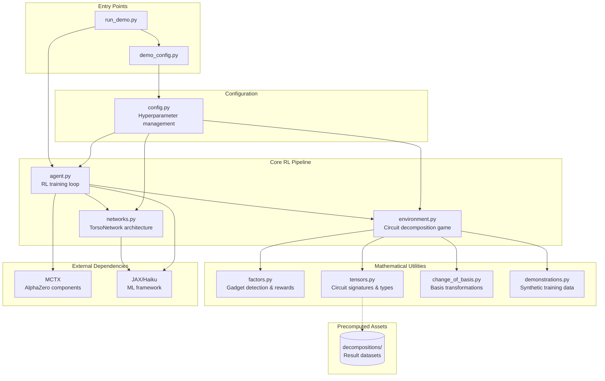

Sources: [README.md:9-28](), System architecture diagrams provided in context

## Key Components

The system's core functionality centers around three primary components that implement the reinforcement learning pipeline for quantum circuit optimization.

### Component Integration Flow

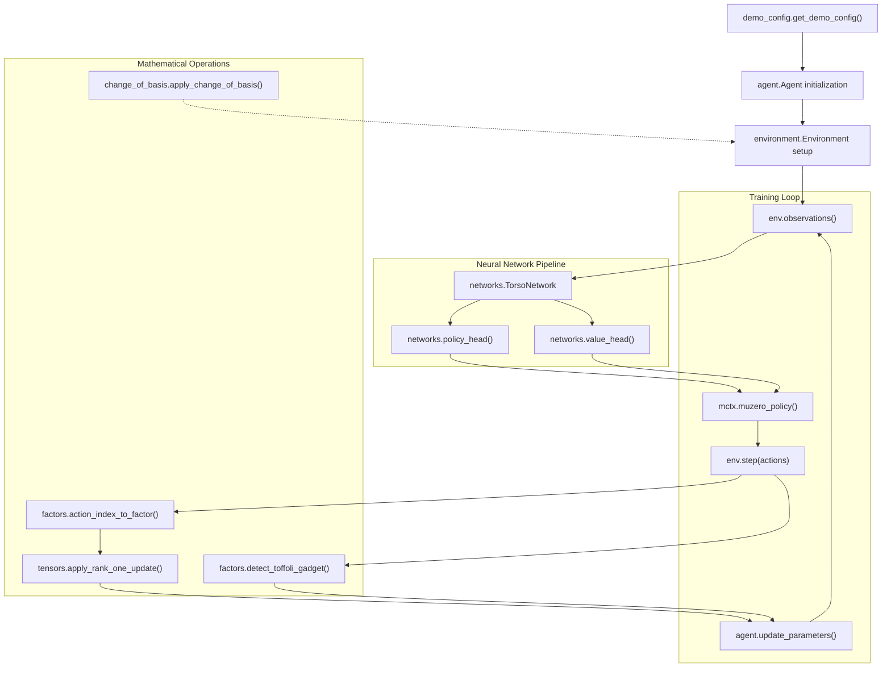

Sources: Inferred from system architecture diagrams and component interaction patterns

## Repository Structure

The repository is organized into two main directories with distinct purposes and execution models.

| Directory | Purpose | Execution Model | Key Files |
|-----------|---------|-----------------|-----------|
| `/src` | Core RL algorithm implementation | Library code (non-runnable) | `agent.py`, `environment.py`, `networks.py` |
| `/src/demo` | Runnable demonstration system | Executable module | `run_demo.py`, `demo_config.py` |
| `/decompositions` | Precomputed optimization results | Static data assets | `.npz` files, `load_decompositions.ipynb` |

### Source Code Organization

The `/src` directory contains the core algorithmic components:

- **Core RL Components**: `agent.py`, `environment.py`, `networks.py`
- **Mathematical Utilities**: `factors.py`, `tensors.py`, `change_of_basis.py`
- **Training Support**: `demonstrations.py`, `config.py`

The `/src/demo` directory provides a simplified, runnable interface that integrates the core components with MCTX for demonstration purposes.

Sources: [README.md:9-15](), [README.md:31-48]()

## Integration with External Systems

The system leverages several external frameworks and follows established patterns from the broader AlphaTensor ecosystem.

### External Dependencies

| System | Role | Integration Point |
|--------|------|------------------|
| **MCTX** | AlphaZero-style MCTS implementation | `mctx.muzero_policy()` in agent training loop |
| **JAX/Haiku** | Neural network framework and automatic differentiation | `networks.py` and `agent.py` |
| **AlphaTensor** | Parent algorithm providing RL approach | Architectural patterns and MCTS integration |
| **Circuit-to-Tensor** | Quantum circuit tensor conversion | External repository (not included) |

### Data Flow Integration

The system processes quantum circuits through a standardized pipeline:

1. **Input**: Binary tensors representing quantum circuits (from external Circuit-to-Tensor repository)
2. **Processing**: RL-based tensor decomposition using rank-one factor operations
3. **Output**: Optimized decompositions stored as `.npz` files in `/decompositions`

The precomputed results in `/decompositions` contain up to 10 non-equivalent decompositions per circuit, with equivalence determined by factor permutations.

Sources: [README.md:14-15](), [README.md:25-27](), [README.md:17-23]()

---

# Page: Getting Started

# Getting Started

<details>
<summary>Relevant source files</summary>

The following files were used as context for generating this wiki page:

- [README.md](README.md)
- [src/demo/demo_config.py](src/demo/demo_config.py)
- [src/demo/run_demo.py](src/demo/run_demo.py)

</details>


This guide walks you through setting up and running the AlphaTensor-Quantum demo, which showcases a reinforcement learning system for quantum circuit optimization. The demo provides a simplified implementation that can reproduce key results from the AlphaTensor-Quantum paper on a single machine.

For information about the overall system architecture, see [Core Architecture](#3). For details about the precomputed decomposition results, see [Precomputed Data Assets](#7).

## Prerequisites

Before running the demo, ensure you have the following requirements:

| Requirement | Details |
|-------------|---------|
| **Python Version** | Python 3 (tested with Python 3.11.9) |
| **Hardware** | Machine with GPU or TPU strongly recommended |
| **Memory** | Sufficient RAM for neural network training |
| **Operating System** | Any system supporting Python 3 and JAX |

The demo has been specifically tested on an Nvidia Quadro P1000 GPU, though other CUDA-compatible GPUs should work as well.

**Sources:** [README.md:33-37]()

## Installation

The demo requires installing Python dependencies but no complex setup procedures:

1. **Clone the repository** (if not already done):
   ```bash
   git clone https://github.com/google-deepmind/alphatensor_quantum.git
   cd alphatensor_quantum
   ```

2. **Install dependencies**:
   ```bash
   pip3 install -r alphatensor_quantum/src/demo/requirements.txt
   ```

Note that the main `/src` directory contains library code that does not require installation, while `/src/demo` contains the executable demo code.

**Sources:** [README.md:29-37]()

## Demo Execution Flow

The following diagram shows how the main demo components interact during execution:

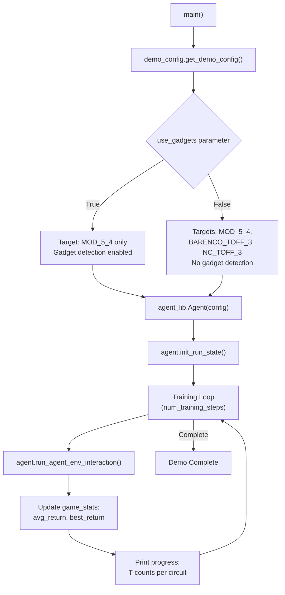

**Sources:** [src/demo/run_demo.py:51-90](), [src/demo/demo_config.py:72-96]()

## Running the Demo

Execute the demo from the parent directory containing the `alphatensor_quantum` repository:

```bash
python3 -m alphatensor_quantum.src.demo.run_demo
```

The demo will automatically start with the default configuration. By default, it runs with `use_gadgets=True`, which focuses on a single target circuit (`MOD_5_4`) and enables gadget detection for more efficient decompositions.

### Key Execution Parameters

The demo uses the following default settings from [src/demo/demo_config.py:98-111]():

| Parameter | Value | Description |
|-----------|-------|-------------|
| `batch_size` | 128 | Number of parallel environments |
| `num_mcts_simulations` | 80 | MCTS simulations per action |
| `num_training_steps` | 50,000 | Total training iterations |
| `eval_frequency_steps` | 50 | Progress reporting frequency |

**Sources:** [README.md:46-48](), [src/demo/run_demo.py:54]()

## Configuration System

The demo configuration is hierarchical, with different parameter groups controlling various aspects of the system:

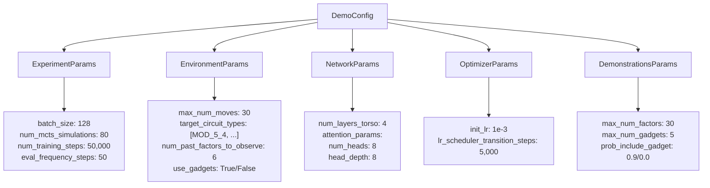

### Target Circuit Configuration

The `use_gadgets` parameter significantly affects which circuits are targeted:

- **With gadgets** (`use_gadgets=True`): Targets only `MOD_5_4` circuit with gadget detection enabled
- **Without gadgets** (`use_gadgets=False`): Targets three circuits: `MOD_5_4`, `BARENCO_TOFF_3`, and `NC_TOFF_3`

**Sources:** [src/demo/demo_config.py:72-96](), [src/demo/demo_config.py:98-146]()

## Understanding the Output

During execution, the demo prints progress information at regular intervals:

```
Step: 50 .. Running Average Returns: [-7.] .. Time taken: 0.12 seconds/step
  Best T-count for mod_5_4: 7
Step: 100 .. Running Average Returns: [-6.8] .. Time taken: 0.11 seconds/step
  Best T-count for mod_5_4: 6
```

### Output Interpretation

| Output Field | Meaning |
|--------------|---------|
| **Step** | Current training iteration |
| **Running Average Returns** | Smoothed average rewards (negative T-count) |
| **Time taken** | Seconds per training step |
| **Best T-count** | Lowest T-gate count achieved for each target circuit |

The system reports negative returns because it maximizes rewards, where the reward is the negative T-count (lower T-count = higher reward).

### Expected Performance

Based on the demo documentation, you should expect:

- **With gadgets**: Best T-count for `MOD_5_4` achievable in ~450 iterations
- **Without gadgets**: Best T-counts for all three targets achievable in ~7,800 iterations

**Sources:** [src/demo/run_demo.py:27-32](), [src/demo/run_demo.py:72-89]()

## Modifying the Configuration

To experiment with different settings, modify the configuration in [src/demo/run_demo.py:54]():

```python
# Change this line to switch between gadget modes
config = demo_config.get_demo_config(
    use_gadgets=False  # Set to True for gadget-enabled experiment
)
```

For more extensive modifications, you can create custom configuration parameters by following the patterns in [src/demo/demo_config.py]().

**Sources:** [src/demo/run_demo.py:52-55]()

## Next Steps

After successfully running the demo:

1. **Explore the configuration system** - See [Configuration System](#5) for detailed parameter explanations
2. **Understand the core architecture** - See [Core Architecture](#3) for system internals
3. **Analyze precomputed results** - See [Decomposition Analysis](#7.1) for benchmarking against known optimal results
4. **Examine the mathematical foundations** - See [Mathematical Foundations](#4) for the underlying algorithms

The demo serves as an entry point to the full AlphaTensor-Quantum system and can be extended for more complex quantum circuit optimization tasks.

**Sources:** [src/demo/run_demo.py:34-38]()

---

# Page: Core Architecture

# Core Architecture

<details>
<summary>Relevant source files</summary>

The following files were used as context for generating this wiki page:

- [src/demo/agent.py](src/demo/agent.py)
- [src/environment.py](src/environment.py)
- [src/networks.py](src/networks.py)

</details>


This document explains the main architectural components of the AlphaTensor-Quantum reinforcement learning system and how they work together in the training pipeline. The core architecture consists of three primary subsystems: the Agent system for RL orchestration, the Environment system for quantum circuit decomposition games, and the Neural Network system for policy and value prediction.

For detailed information about individual components, see [Agent System](#3.1), [Environment System](#3.2), and [Neural Networks](#3.3). For mathematical foundations underlying these components, see [Mathematical Foundations](#4).

## System Overview

The AlphaTensor-Quantum system implements a reinforcement learning approach to quantum circuit optimization using Monte Carlo Tree Search (MCTS) and neural networks. The architecture follows the AlphaZero paradigm, adapted for the specific domain of tensor decomposition games.

### Main Component Architecture

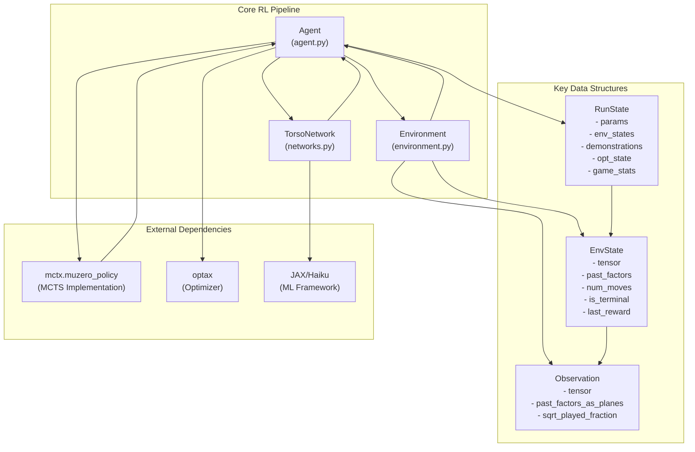

**Sources:** [src/demo/agent.py:54-73](), [src/environment.py:33-62](), [src/environment.py:65-76](), [src/networks.py:256-272]()

## Training Pipeline Data Flow

The training pipeline orchestrates the interaction between acting (gameplay), learning (neural network updates), and synthetic demonstrations. The `Agent` class manages this entire pipeline through its `run_agent_env_interaction` method.

### RL Training Loop Architecture

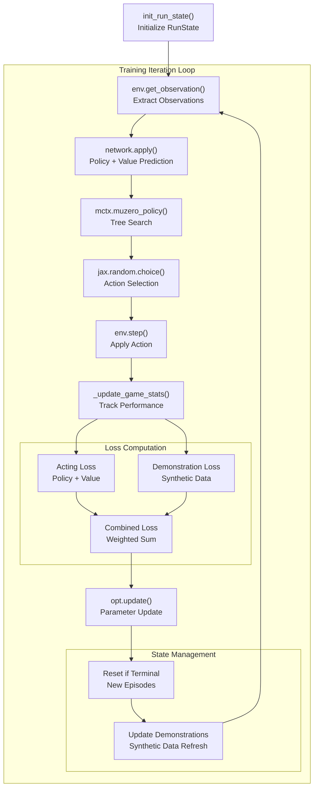

**Sources:** [src/demo/agent.py:425-548](), [src/demo/agent.py:259-332](), [src/demo/agent.py:166-221]()

## Component Integration and State Management

The system maintains several interconnected state objects that flow through the training pipeline. The `RunState` serves as the central container for all training state, while `EnvState` tracks individual game episodes.

### State and Component Interaction

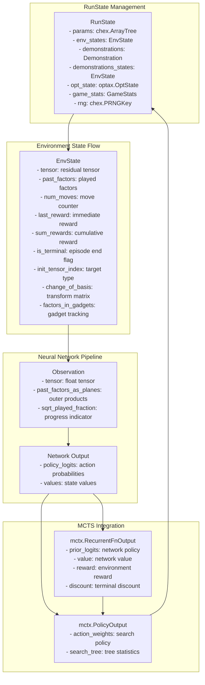

**Sources:** [src/demo/agent.py:54-73](), [src/environment.py:33-62](), [src/environment.py:65-76](), [src/demo/agent.py:223-257]()

## Key Architectural Patterns

### Neural Network Architecture

The neural network system uses a specialized `TorsoNetwork` with symmetrized axial attention, designed for the geometric structure of tensor decomposition problems.

| Component | Class | Purpose |
|-----------|-------|---------|
| Main Network | `NeuralNetwork` | Simple policy/value head wrapper |
| Feature Extraction | `TorsoNetwork` | Core network architecture |
| Attention Mechanism | `_SymmetrizedAxialAttention` | Geometric-aware attention |
| Transformer Blocks | `_TransformerDecoderBlock` | Self-attention + feedforward |
| Symmetry Handling | `Symmetrization` | Learnable symmetry operations |

**Sources:** [src/demo/agent.py:76-114](), [src/networks.py:256-309](), [src/networks.py:185-253]()

### Environment Game Mechanics

The environment implements a tensor decomposition game where actions correspond to rank-one tensor updates. The game terminates when the tensor becomes zero or maximum moves are reached.

| Mechanism | Implementation | Key Functions |
|-----------|---------------|---------------|
| Action Space | Factor indices | `factors.action_index_to_factor` |
| State Transitions | Rank-one updates | `factors.rank_one_update_to_tensor` |
| Reward System | Move penalties + gadget bonuses | Built into `step()` method |
| Termination | Zero tensor or max moves | `jnp.all(new_tensor == 0)` |
| Gadget Detection | Toffoli and CS patterns | `factors.factors_form_*_gadget` |

**Sources:** [src/environment.py:109-196](), [src/environment.py:316-340]()

### Training Loop Integration

The `Agent` orchestrates the entire training process through the `_run_iteration_agent_env_interaction` method, which handles:

1. **Acting Phase**: MCTS policy search using current network
2. **Learning Phase**: Loss computation and parameter updates  
3. **State Management**: Environment resets and demonstration updates
4. **Statistics Tracking**: Game performance monitoring

The system uses a combined loss function that balances acting experience with synthetic demonstrations, with the demonstration weight decreasing over training steps.

**Sources:** [src/demo/agent.py:425-548](), [src/demo/agent.py:334-381](), [src/demo/agent.py:383-423]()

---

# Page: Agent System

# Agent System

<details>
<summary>Relevant source files</summary>

The following files were used as context for generating this wiki page:

- [src/demo/agent.py](src/demo/agent.py)
- [src/demo/demo_config.py](src/demo/demo_config.py)

</details>


This document covers the reinforcement learning agent implementation in AlphaTensor-Quantum, including its training loop, MCTS integration, and state management components. The agent orchestrates the interaction between neural networks, the quantum circuit decomposition environment, and Monte Carlo Tree Search to learn optimal quantum circuit factorizations.

For information about the environment that the agent interacts with, see [Environment System](#3.2). For details about the neural network architecture used by the agent, see [Neural Networks](#3.3). For configuration parameters, see [Configuration System](#5).

## Agent Architecture Overview

The `Agent` class serves as the central controller that orchestrates the reinforcement learning process. It integrates multiple components including neural networks, MCTS policy search, environment interactions, and synthetic demonstrations.

```mermaid
graph TB
    subgraph "Agent System Core"
        Agent["Agent<br/>(agent.py)"]
        RunState["RunState<br/>NamedTuple"]
        GameStats["GameStats<br/>NamedTuple"]
    end
    
    subgraph "Neural Network Components"
        NeuralNetwork["NeuralNetwork<br/>hk.Module"]
        TorsoNetwork["TorsoNetwork<br/>(networks.py)"]
        PolicyHead["Policy Head<br/>Linear Layer"]
        ValueHead["Value Head<br/>Linear Layer"]
    end
    
    subgraph "MCTS Integration"
        MuzeroPolicy["mctx.muzero_policy"]
        RecurrentFn["_recurrent_fn"]
        RootFnOutput["mctx.RootFnOutput"]
        PolicyOutput["PolicyOutput"]
    end
    
    subgraph "Environment Interface"
        Environment["Environment<br/>(environment.py)"]
        EnvState["EnvState"]
        Observation["Observation"]
    end
    
    subgraph "Demonstrations"
        SyntheticDemos["demonstrations_lib"]
        Demonstrations["Demonstration"]
    end
    
    subgraph "Optimization"
        OptaxOptimizer["optax.adamw + clip"]
        LossFunction["_loss_fn"]
        Scheduler["exponential_decay"]
    end
    
    Agent --> RunState
    Agent --> NeuralNetwork
    Agent --> MuzeroPolicy
    Agent --> Environment
    Agent --> OptaxOptimizer
    
    RunState --> GameStats
    RunState --> EnvState
    RunState --> Demonstrations
    
    NeuralNetwork --> TorsoNetwork
    NeuralNetwork --> PolicyHead
    NeuralNetwork --> ValueHead
    
    MuzeroPolicy --> RecurrentFn
    MuzeroPolicy --> RootFnOutput
    MuzeroPolicy --> PolicyOutput
    
    RecurrentFn --> Environment
    
    Agent --> SyntheticDemos
    OptaxOptimizer --> Scheduler
    OptaxOptimizer --> LossFunction
```

*Sources: [src/demo/agent.py:135-165](), [src/demo/agent.py:76-115]()*

## Core Data Structures

The agent system uses several key data structures to maintain state and track training progress:

### RunState

The `RunState` NamedTuple encapsulates the complete state of the training run:

| Field | Type | Purpose |
|-------|------|---------|
| `params` | `chex.ArrayTree` | Neural network parameters |
| `env_states` | `environment.EnvState` | Current environment states for each batch element |
| `demonstrations` | `demonstrations_lib.Demonstration` | Synthetic demonstration data |
| `demonstrations_states` | `environment.EnvState` | Environment states for demonstrations |
| `opt_state` | `optax.OptState` | Optimizer state |
| `game_stats` | `GameStats` | Training statistics and metrics |
| `rng` | `chex.PRNGKey` | Random number generator key |

### GameStats

The `GameStats` NamedTuple tracks performance metrics across different target circuit types:

| Field | Type | Purpose |
|-------|------|---------|
| `num_games` | `jt.Integer[jt.Array, 'batch_size num_target_tensors']` | Count of completed games per target |
| `best_return` | `jt.Float[jt.Array, 'num_target_tensors']` | Best return achieved per target type |
| `avg_return` | `jt.Float[jt.Array, 'batch_size num_target_tensors']` | Smoothed average return per target |

*Sources: [src/demo/agent.py:54-74](), [src/demo/agent.py:36-52]()*

## Training Loop Architecture

The agent implements a structured training loop that alternates between environment interaction, MCTS search, and neural network updates:

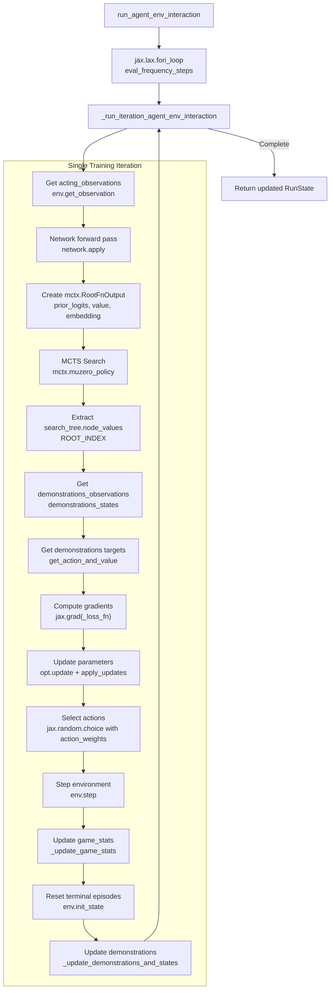

*Sources: [src/demo/agent.py:425-529](), [src/demo/agent.py:530-549]()*

## MCTS Integration

The agent integrates Monte Carlo Tree Search through the `mctx.muzero_policy` function, using a custom recurrent function to handle the deterministic quantum circuit environment:

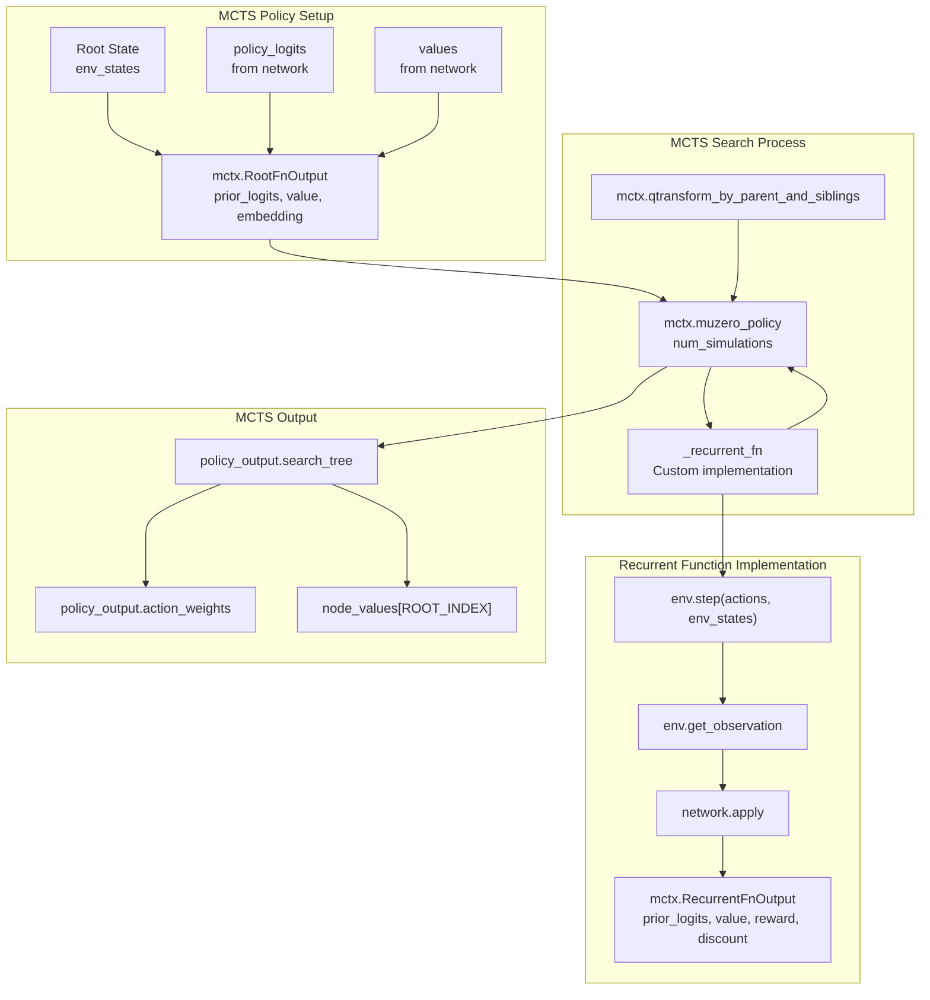

The `_recurrent_fn` method implements the environment dynamics for MCTS simulation. Since the quantum circuit environment is deterministic, it directly steps the environment and applies the neural network to get new policy and value estimates.

*Sources: [src/demo/agent.py:223-258](), [src/demo/agent.py:448-458]()*

## Loss Computation and Optimization

The agent uses a composite loss function that combines losses from both environment interaction (acting) and synthetic demonstrations:

### Loss Function Components

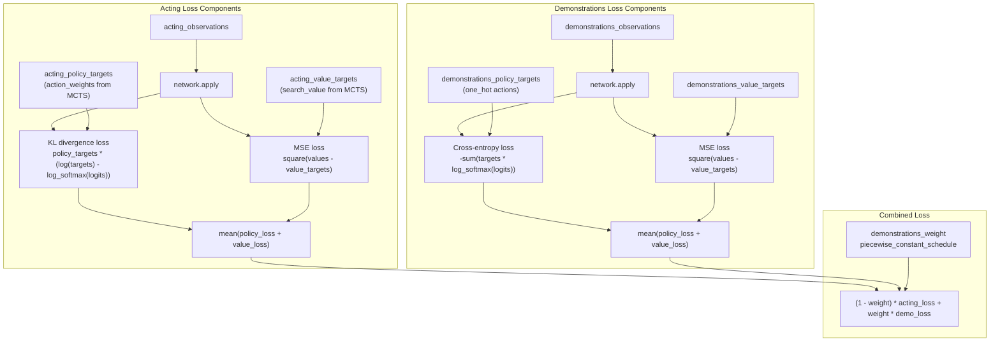

The optimizer uses `optax.adamw` with exponential learning rate decay and gradient clipping:

| Component | Configuration |
|-----------|---------------|
| Base Optimizer | `optax.adamw` with weight decay |
| Learning Rate | `exponential_decay` scheduler |
| Gradient Clipping | `clip_by_global_norm` |
| Scheduler | Staircase decay with configurable steps |

*Sources: [src/demo/agent.py:259-333](), [src/demo/agent.py:151-165]()*

## State Management

The agent manages multiple types of state that need to be synchronized and updated throughout training:

### Environment State Updates

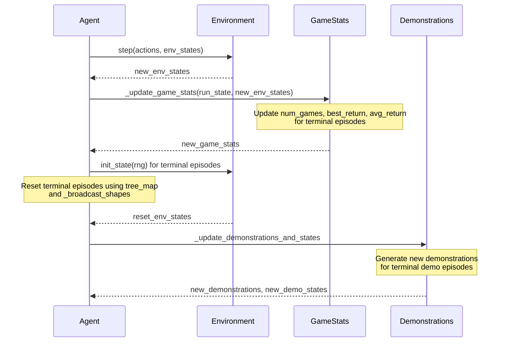

### State Broadcasting and Updates

The agent uses utility functions to handle batch-wise state updates:

- `_broadcast_shapes`: Reshapes arrays for batch-wise operations
- `tree_map`: Applies updates conditionally based on terminal states
- Smoothed averaging for `avg_return` statistics
- Reset logic for terminal episodes

*Sources: [src/demo/agent.py:334-382](), [src/demo/agent.py:383-424](), [src/demo/agent.py:117-133]()*

## Neural Network Integration

The `NeuralNetwork` class provides a simplified interface that combines the `TorsoNetwork` with linear policy and value heads:

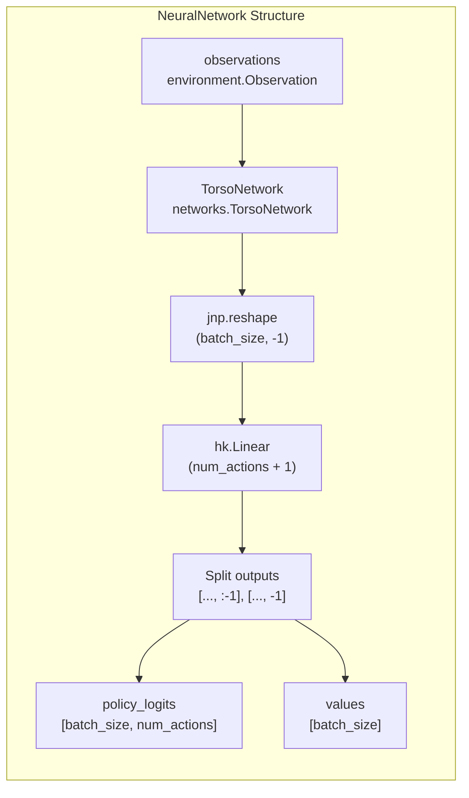

The number of actions is calculated as `2^max_tensor_size - 1`, representing all possible non-zero factor indices in the quantum circuit decomposition space.

*Sources: [src/demo/agent.py:76-115](), [src/demo/agent.py:147-150]()*

---

# Page: Environment System

# Environment System

<details>
<summary>Relevant source files</summary>

The following files were used as context for generating this wiki page:

- [src/environment.py](src/environment.py)
- [src/environment_test.py](src/environment_test.py)

</details>


The Environment System implements the quantum circuit decomposition game environment for the AlphaTensor-Quantum reinforcement learning system. This system manages state transitions, reward calculations, and observation generation for training agents to find efficient quantum circuit decompositions. For neural network architecture details, see [Neural Networks](#3.3). For agent training loop implementation, see [Agent System](#3.1).

## Core Components

The environment system consists of three main data structures that work together to manage the decomposition game state and provide observations to the neural network.

### State Representation

The `EnvState` class represents the complete state of a decomposition game at any point in time. It tracks the current residual tensor, the history of applied factors, game progress, and reward information.

| Field | Type | Purpose |
|-------|------|---------|
| `tensor` | Integer array | Current residual tensor being decomposed |
| `past_factors` | Integer array | History of applied factors (max_num_moves × size) |
| `num_moves` | Integer | Current number of moves taken |
| `last_reward` | Float | Immediate reward from last action |
| `sum_rewards` | Float | Cumulative reward total |
| `is_terminal` | Boolean | Whether game has ended |
| `init_tensor_index` | Integer | Index of target circuit type |
| `change_of_basis` | Integer array | Applied basis transformation matrix |
| `factors_in_gadgets` | Boolean array | Tracks which factors are part of gadgets |

The `Observation` class transforms the environment state into neural network input format, converting raw integer data to float arrays and computing derived features.

**Environment State and Observation Flow**
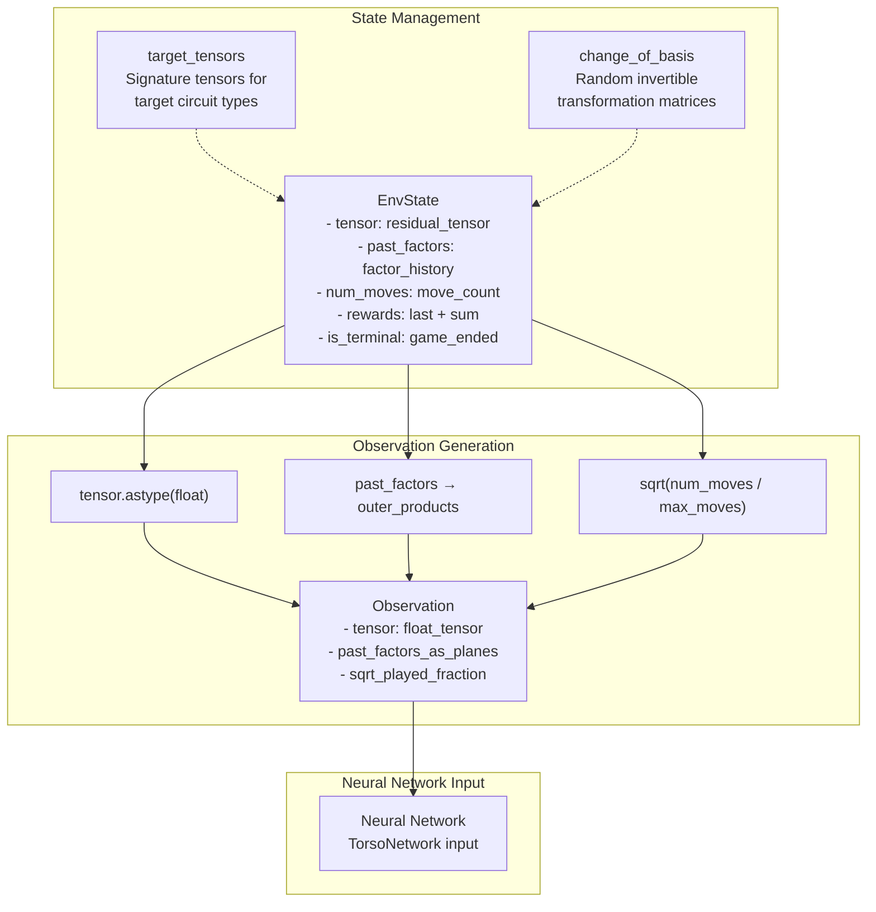

Sources: [src/environment.py:33-77]()

## Game Mechanics

### Action Processing and State Transitions

The `step` method implements the core game mechanics, converting action indices to factors and applying rank-one updates to the residual tensor. The method handles termination conditions, gadget detection, and reward calculation in a single atomic operation.

**Step Function Flow**
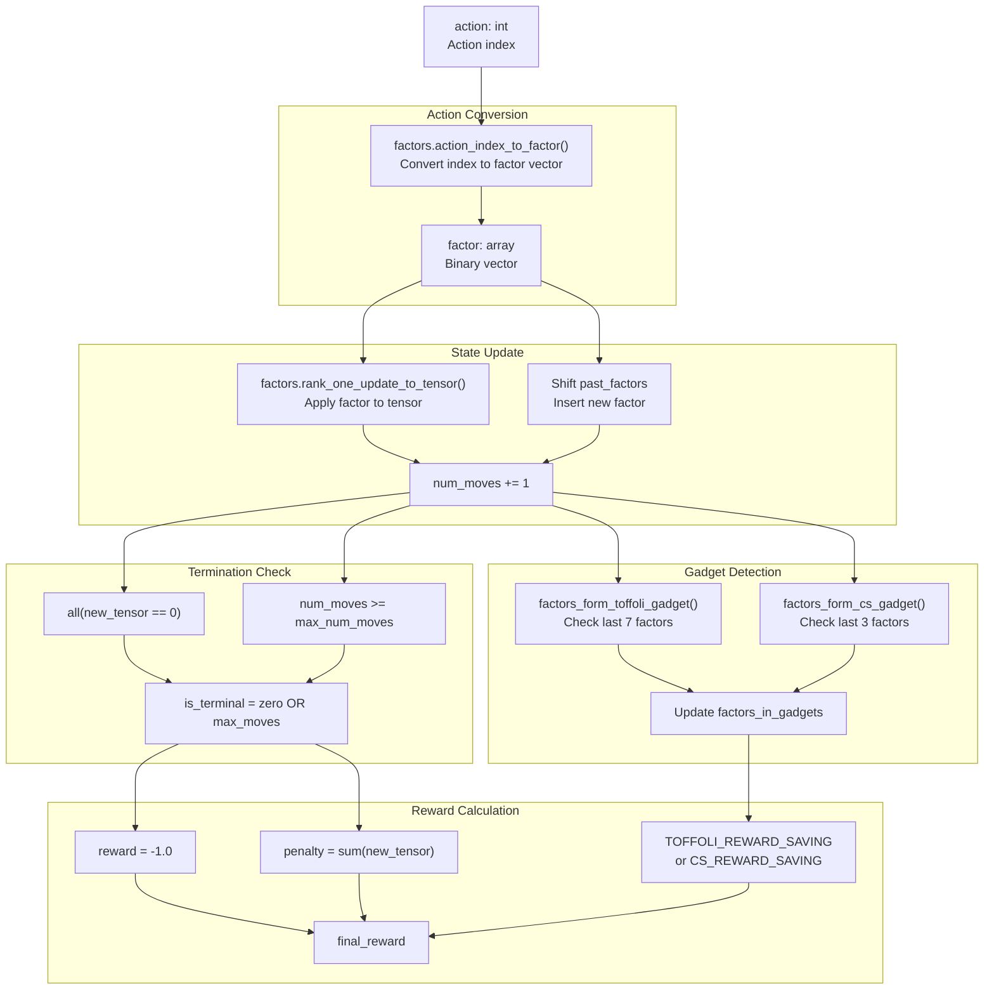

Sources: [src/environment.py:109-196]()

### Gadget Recognition and Rewards

The environment implements specialized reward bonuses for recognizing quantum circuit gadgets - specifically Toffoli and Controlled-S (CS) gadgets. These gadgets represent efficient implementations of common quantum operations.

| Gadget Type | Factors Required | Reward Saving | Detection Function |
|-------------|------------------|---------------|-------------------|
| Toffoli | 7 | `TOFFOLI_REWARD_SAVING` | `factors_form_toffoli_gadget` |
| CS | 3 | `CS_REWARD_SAVING` | `factors_form_cs_gadget` |

The gadget detection system tracks which factors are part of gadgets using the `factors_in_gadgets` boolean array, preventing double-counting and ensuring proper reward attribution.

Sources: [src/environment.py:141-185]()

## Environment Initialization

### Target Circuit Selection

The `Environment` class initializes with a set of target circuit types and their corresponding signature tensors. These tensors are zero-padded to a common size and stored for random sampling during episode initialization.

**Initialization and Target Selection**
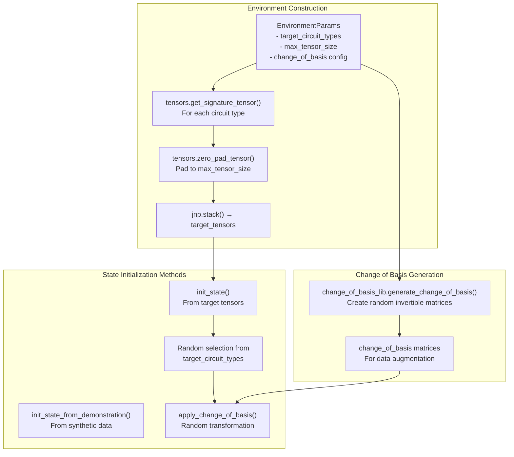

Sources: [src/environment.py:82-104](), [src/environment.py:198-283]()

### Change of Basis Transformations

The environment supports data augmentation through random change of basis transformations. Each episode can optionally apply a random invertible matrix transformation to the target tensor, increasing the diversity of training examples while preserving the underlying decomposition structure.

The `_apply_random_change_of_basis` method uses a two-stage randomization process:
1. Bernoulli trial to decide between canonical basis (identity) or transformed basis
2. Random selection from pre-generated invertible matrices

Sources: [src/environment.py:224-251]()

## Observation Generation

### Neural Network Input Format

The `get_observation` method converts the raw environment state into a format suitable for neural network processing. This transformation includes type conversion, feature engineering, and masking of gadget factors.

**Observation Processing Pipeline**
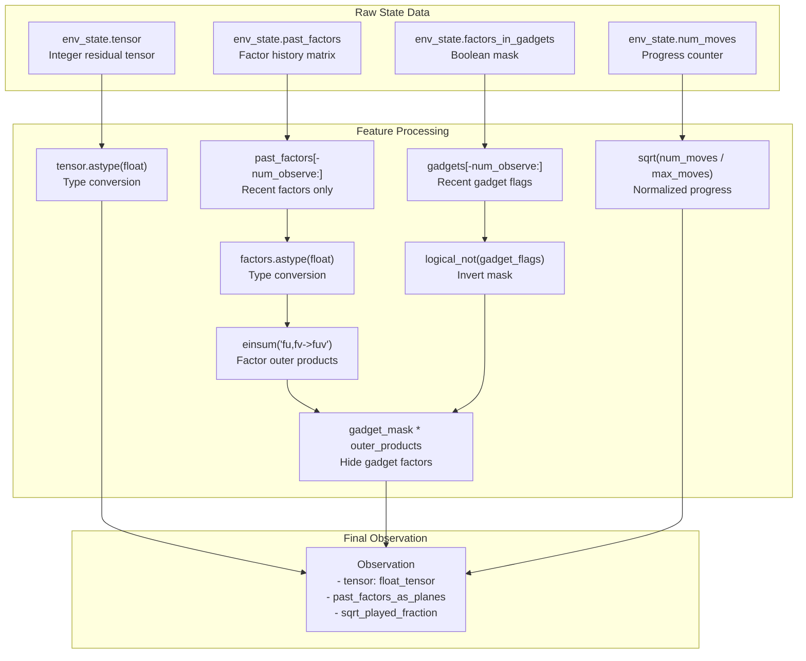

Sources: [src/environment.py:316-340]()

### Factor Masking for Gadgets

A key feature of the observation system is the masking of factors that are part of recognized gadgets. The `past_factors_as_planes` computation multiplies the outer products by the inverted gadget mask, effectively hiding gadget factors from the neural network to prevent interference with gadget recognition rewards.

Sources: [src/environment.py:329-336]()

## Integration Points

The Environment System integrates with several other components of the AlphaTensor-Quantum system:

- **Factor Operations**: Uses `factors.py` for action-to-factor conversion, rank-one updates, and gadget detection
- **Tensor Utilities**: Relies on `tensors.py` for signature tensor generation and zero-padding operations  
- **Change of Basis**: Employs `change_of_basis.py` for matrix generation and tensor transformations
- **Demonstrations**: Supports initialization from synthetic demonstrations generated by `demonstrations.py`
- **Configuration**: Configured through `EnvironmentParams` from the configuration system

Sources: [src/environment.py:26-30]()

---

# Page: Neural Networks

# Neural Networks

<details>
<summary>Relevant source files</summary>

The following files were used as context for generating this wiki page:

- [src/networks.py](src/networks.py)
- [src/networks_test.py](src/networks_test.py)

</details>


This document covers the neural network architecture used in AlphaTensor-Quantum for processing quantum circuit decomposition observations and generating policy and value predictions. The neural networks are implemented using JAX and Haiku and feature a specialized symmetrized axial attention mechanism designed for tensor data.

For information about how these networks integrate with the reinforcement learning agent, see [Agent System](#3.1). For details on the environment observations that feed into these networks, see [Environment System](#3.2).

## Overall Architecture

The neural network system in AlphaTensor-Quantum consists of a main `TorsoNetwork` that processes environment observations and outputs embeddings for downstream policy and value heads. The architecture is specifically designed to handle the structured tensor data that represents quantum circuit decomposition states.

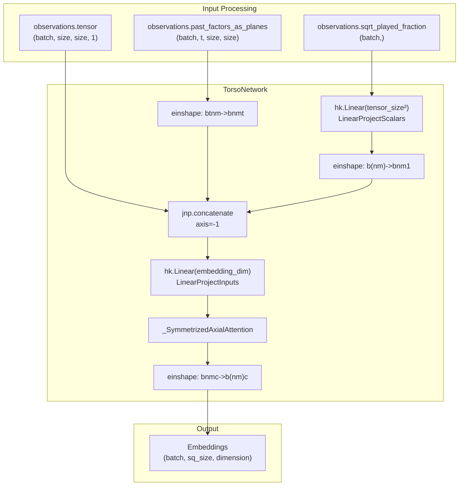

**Sources:** [src/networks.py:274-309]()

## Core Components

### TorsoNetwork

The `TorsoNetwork` is the main neural network class that processes environment observations. It takes structured observations containing the current tensor state, past factors, and game metadata, then outputs embeddings suitable for policy and value prediction.

| Component | Input Shape | Output Shape | Purpose |
|-----------|-------------|--------------|---------|
| Scalar projection | `(batch,)` | `(batch, size, size, 1)` | Embeds game progress |
| Input concatenation | `(batch, size, size, channels)` | `(batch, size, size, total_channels)` | Combines all input modalities |
| Linear projection | `(batch, size, size, total_channels)` | `(batch, size, size, embedding_dim)` | Projects to attention dimension |
| Symmetrized axial attention | `(batch, size, size, embedding_dim)` | `(batch, size, size, embedding_dim)` | Main processing |
| Final reshape | `(batch, size, size, embedding_dim)` | `(batch, size², embedding_dim)` | Flattens for heads |

**Sources:** [src/networks.py:256-310]()

### Symmetrized Axial Attention

The `_SymmetrizedAxialAttention` class implements the core processing mechanism that alternates between axial attention operations and symmetrization. This architecture is designed to respect the symmetries present in tensor decomposition problems.

```mermaid
graph TD
    subgraph "Single Layer Processing"
        Input["Input Tensor<br/>(batch, size, size, dim)"]
        Reshape1["einshape: bnme->(bn)me"]
        AxialAttn1["_TransformerDecoderBlock<br/>axial_attention_1"]
        Reshape2["einshape: (bn)me->(bm)ne"]
        AxialAttn2["_TransformerDecoderBlock<br/>axial_attention_2"]
        Reshape3["einshape: (bm)ne->bnme"]
        Symmetrize["Symmetrization<br/>A*X + (1-A)*X.T"]
        Output["Output Tensor<br/>(batch, size, size, dim)"]
    end
    
    Input --> Reshape1
    Reshape1 --> AxialAttn1
    AxialAttn1 --> Reshape2
    Reshape2 --> AxialAttn2
    AxialAttn2 --> Reshape3
    Reshape3 --> Symmetrize
    Symmetrize --> Output
    
    subgraph "Multi-Layer Structure"
        Layer1["Layer 0"]
        Layer2["Layer 1"]
        LayerN["Layer N-1"]
        Layer1 --> Layer2
        Layer2 --> LayerN
    end
```

**Sources:** [src/networks.py:185-253]()

### Self-Attention Mechanism

The `_SelfAttention` class implements standard multi-head self-attention with query, key, and value projections. It uses scaled dot-product attention with configurable number of heads and head depth.

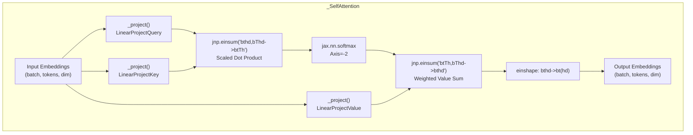

**Sources:** [src/networks.py:32-82]()

### Symmetrization Layer

The `Symmetrization` class implements a learnable symmetrization operation that blends a tensor with its transpose using learnable weights. This preserves important symmetries in the tensor decomposition problem.

The operation is: `A ⊙ X + (1 - A) ⊙ X.T` where:
- `X` is the input tensor of shape `(batch, size, size, channels)`
- `A` is a learnable weight matrix of shape `(size, size, 1)` 
- `⊙` denotes element-wise multiplication
- `X.T` transposes the two size dimensions

**Sources:** [src/networks.py:146-182]()

## Data Flow and Integration

The neural network processes observations from the quantum circuit decomposition environment and outputs embeddings that are consumed by policy and value heads (managed by the agent system).

```mermaid
graph LR
    subgraph "Environment"
        EnvObs["environment.Observation<br/>- tensor<br/>- past_factors_as_planes<br/>- sqrt_played_fraction"]
    end
    
    subgraph "TorsoNetwork Processing"
        ScalarEmbed["Scalar Embedding<br/>LinearProjectScalars"]
        InputConcat["Input Concatenation<br/>tensor + factors + scalars"]
        InitialProj["Initial Projection<br/>LinearProjectInputs"]
        SymAxial["Symmetrized Axial<br/>Attention Layers"]
        OutputFlat["Output Flattening<br/>b(nm)c shape"]
    end
    
    subgraph "Agent System"
        PolicyHead["Policy Head<br/>(External)"]
        ValueHead["Value Head<br/>(External)"]
    end
    
    EnvObs --> ScalarEmbed
    EnvObs --> InputConcat
    ScalarEmbed --> InputConcat
    InputConcat --> InitialProj
    InitialProj --> SymAxial
    SymAxial --> OutputFlat
    OutputFlat --> PolicyHead
    OutputFlat --> ValueHead
```

**Sources:** [src/networks.py:274-309](), [src/networks_test.py:41-74]()

## Configuration

The neural network architecture is controlled by configuration parameters defined in the `config_lib` module:

| Parameter | Type | Purpose |
|-----------|------|---------|
| `num_layers_torso` | int | Number of symmetrized axial attention layers |
| `attention_params.num_heads` | int | Number of attention heads |
| `attention_params.head_depth` | int | Dimension of each attention head |
| `attention_params.mlp_widening_factor` | int | MLP hidden layer expansion factor |
| `attention_params.init_scale` | float | Weight initialization scale |
| `init_scale` | float | Overall network initialization scale |

The embedding dimension is computed as `num_heads × head_depth` and determines the internal representation size throughout the network.

**Sources:** [src/networks.py:194-204](), [src/networks.py:296-299](), [src/networks_test.py:59-66]()

---

# Page: Mathematical Foundations

# Mathematical Foundations

<details>
<summary>Relevant source files</summary>

The following files were used as context for generating this wiki page:

- [src/change_of_basis.py](src/change_of_basis.py)
- [src/factors.py](src/factors.py)
- [src/tensors.py](src/tensors.py)

</details>


This document covers the core mathematical operations and utilities that underpin the quantum circuit optimization algorithms in AlphaTensor-Quantum. It explains the fundamental mathematical concepts including tensor operations in GF(2), factor manipulations, gadget detection, and basis transformations that enable the reinforcement learning system to decompose quantum circuits efficiently.

For specific implementation details of neural networks and MCTS algorithms, see [Neural Networks](#3.3). For environment-specific game mechanics, see [Environment System](#3.2).

## Overview

The AlphaTensor-Quantum system operates primarily in the Galois Field GF(2), where all arithmetic is performed modulo 2. This mathematical foundation enables efficient representation and manipulation of quantum circuit tensors through rank-one decompositions. The system identifies beneficial structures called "gadgets" that correspond to known quantum circuit patterns with favorable T-gate costs.

## Core Mathematical Components

```mermaid
graph TB
    subgraph "Mathematical Operations Layer"
        subgraph "Tensor Operations"
            TensorSignature["get_signature_tensor()<br/>Circuit Type → Tensor"]
            ZeroPad["zero_pad_tensor()<br/>Size Normalization"]
            RankOneUpdate["rank_one_update_to_tensor()<br/>Factor → Tensor Update"]
        end
        
        subgraph "Factor Operations"
            ActionConversion["action_index_to_factor()<br/>Index ↔ Binary Vector"]
            FactorConversion["action_factor_to_index()<br/>Binary Vector ↔ Index"]
            LinearIndep["factors_are_linearly_independent()<br/>GF(2) Independence Check"]
        end
        
        subgraph "Gadget Detection"
            ToffoliGadget["factors_form_toffoli_gadget()<br/>7-Factor Pattern Detection"]
            CSGadget["factors_form_cs_gadget()<br/>3-Factor Pattern Detection"]
            RewardSavings["TOFFOLI_REWARD_SAVING = 5.0<br/>CS_REWARD_SAVING = 1.0"]
        end
        
        subgraph "Basis Transformations"
            BasisGen["generate_change_of_basis()<br/>Random Invertible Matrix"]
            BasisApply["apply_change_of_basis()<br/>Transform Tensor"]
            TriangularSample["_sample_triangular_matrix()<br/>Upper/Lower Triangular"]
        end
    end
    
    subgraph "Data Structures"
        CircuitTypes["CircuitType Enum<br/>BARENCO_TOFF_3, MOD_5_4<br/>NC_TOFF_3, SMALL_TCOUNT_3"]
        TensorDict["_TENSORS_DICT<br/>Circuit → Numpy Array"]
        FixedTensors["_BARENCO_TOFF_3<br/>_MOD_5_4<br/>_NC_TOFF_3<br/>_SMALL_TCOUNT_3"]
    end
    
    %% Connections
    TensorSignature --> CircuitTypes
    CircuitTypes --> TensorDict
    TensorDict --> FixedTensors
    
    ActionConversion --> RankOneUpdate
    FactorConversion --> ActionConversion
    LinearIndep --> ToffoliGadget
    LinearIndep --> CSGadget
    
    BasisGen --> TriangularSample
    BasisApply --> BasisGen
    
    %% Cross-component connections
    RankOneUpdate -.-> BasisApply
    ToffoliGadget -.-> RewardSavings
    CSGadget -.-> RewardSavings
    
    classDef tensor fill:#e8f5e8
    classDef factor fill:#fff3e0
    classDef gadget fill:#f3e5f5
    classDef basis fill:#e1f5fe
    classDef data fill:#fce4ec
    
    class TensorSignature,ZeroPad,RankOneUpdate tensor
    class ActionConversion,FactorConversion,LinearIndep factor
    class ToffoliGadget,CSGadget,RewardSavings gadget
    class BasisGen,BasisApply,TriangularSample basis
    class CircuitTypes,TensorDict,FixedTensors data
```

Sources: [src/tensors.py:1-284](), [src/factors.py:1-189](), [src/change_of_basis.py:1-85]()

## Galois Field GF(2) Operations

All mathematical operations in the system are performed in GF(2), the field with two elements {0, 1}. This choice enables efficient quantum circuit representation where:

- Addition is performed modulo 2 (XOR operation): `jnp.mod(a + b, 2)`
- Multiplication follows standard rules: `0 * x = 0`, `1 * x = x`
- Matrix operations maintain invertibility properties for basis transformations

The key advantage is that rank-one tensor decompositions correspond directly to quantum circuit factor structures, enabling the identification of T-gate optimization opportunities.

## Mathematical Operation Flow

```mermaid
flowchart TD
    StartCircuit["Circuit Type<br/>(BARENCO_TOFF_3, MOD_5_4, etc.)"] --> GetTensor["get_signature_tensor()<br/>Retrieve 3D Tensor"]
    GetTensor --> PadTensor["zero_pad_tensor()<br/>Normalize Size"]
    
    PadTensor --> GameLoop{"RL Game Loop"}
    
    subgraph "Action Processing"
        ActionIndex["Action Index<br/>(0 to 2^n - 2)"]
        ToFactor["action_index_to_factor()<br/>Binary Vector Conversion"]
        RankUpdate["rank_one_update_to_tensor()<br/>Tensor - factor⊗factor⊗factor"]
        
        ActionIndex --> ToFactor
        ToFactor --> RankUpdate
    end
    
    subgraph "Gadget Analysis"
        CheckToffoli["factors_form_toffoli_gadget()<br/>7-Factor Pattern [a,b,c,a+b,a+c,a+b+c,b+c]"]
        CheckCS["factors_form_cs_gadget()<br/>3-Factor Pattern [a,b,a+b]"]
        CalcReward["Calculate Reward<br/>Base: -1.0 per action<br/>Toffoli Bonus: +5.0<br/>CS Bonus: +1.0"]
        
        CheckToffoli --> CalcReward
        CheckCS --> CalcReward
    end
    
    subgraph "Basis Transformation"
        GenBasis["generate_change_of_basis()<br/>Random Invertible Matrix"]
        ApplyBasis["apply_change_of_basis()<br/>Transform Tensor"]
        
        GenBasis --> ApplyBasis
    end
    
    GameLoop --> ActionIndex
    RankUpdate --> CheckToffoli
    RankUpdate --> CheckCS
    CalcReward --> GameLoop
    
    PadTensor -.-> ApplyBasis
    ApplyBasis -.-> GameLoop
    
    classDef process fill:#e8f5e8
    classDef decision fill:#fff2cc
    classDef math fill:#f0f8ff
    
    class GetTensor,PadTensor,ToFactor,RankUpdate,GenBasis,ApplyBasis process
    class GameLoop decision
    class CheckToffoli,CheckCS,CalcReward math
```

Sources: [src/tensors.py:270-284](), [src/factors.py:32-91](), [src/change_of_basis.py:46-84]()

## Key Mathematical Properties

### Tensor Decomposition Structure
The system decomposes 3D tensors representing quantum circuits into sums of rank-one tensors of the form `factor ⊗ factor ⊗ factor`, where each factor is a binary vector in GF(2). This decomposition directly corresponds to quantum gate sequences.

### Gadget Pattern Recognition
Two important structural patterns are detected:

| Gadget Type | Factor Pattern | T-Gate Cost | Reward Bonus |
|-------------|----------------|-------------|--------------|
| Toffoli | `[a, b, c, a+b, a+c, a+b+c, b+c]` (7 factors) | 2 T-gates | +5.0 |
| CS (Controlled-S) | `[a, b, a+b]` (3 factors) | 2 T-gates | +1.0 |

### Linear Independence in GF(2)
Linear independence checks use the property that in GF(2), vectors are linearly independent if and only if they are distinct and no vector equals the sum of others. This enables efficient gadget validation.

## Integration with RL System

The mathematical operations interface with the reinforcement learning components through:

- **Observations**: Current tensor state and factor history
- **Actions**: Factor indices converted to binary vectors via `action_index_to_factor()`
- **Rewards**: T-gate reductions with gadget bonuses calculated by `factors_form_toffoli_gadget()` and `factors_form_cs_gadget()`
- **State Updates**: Tensor modifications through `rank_one_update_to_tensor()`

## Related Pages

For detailed implementations of specific mathematical components:
- [Tensor Operations](#4.1) - Signature tensors, padding, and circuit types
- [Factor Operations](#4.2) - Action conversions, gadget detection, and rewards  
- [Change of Basis](#4.3) - Matrix generation and tensor transformations

Sources: [src/tensors.py:232-284](), [src/factors.py:22-189](), [src/change_of_basis.py:16-84]()

---

# Page: Tensor Operations

# Tensor Operations

<details>
<summary>Relevant source files</summary>

The following files were used as context for generating this wiki page:

- [src/tensors.py](src/tensors.py)
- [src/tensors_test.py](src/tensors_test.py)

</details>


This document covers the tensor utilities and operations that form the mathematical foundation for quantum circuit representations in the AlphaTensor-Quantum system. The module provides signature tensors for different quantum circuit types, tensor manipulation functions, and utilities for working with symmetric binary tensors in GF(2) arithmetic.

For information about tensor decomposition using rank-one factors, see [Factor Operations](#4.2). For basis transformations applied to tensors, see [Change of Basis](#4.3).

## Circuit Types and Signature Tensors

The system defines several predefined quantum circuit types, each represented by a symmetric 3D binary tensor called a signature tensor. These tensors encode the structure of quantum circuits that the reinforcement learning agent learns to decompose.

```mermaid
graph TD
    subgraph "Circuit Type System"
        CircuitTypeEnum["CircuitType(enum)"]
        TensorsDict["_TENSORS_DICT"]
        GetSignatureTensor["get_signature_tensor()"]
    end
    
    subgraph "Predefined Circuit Types"
        SmallTcount["SMALL_TCOUNT_3<br/>3×3×3 tensor<br/>Testing circuit"]
        BarencoToff["BARENCO_TOFF_3<br/>8×8×8 tensor<br/>Barenco Toffoli"]
        Mod54["MOD_5_4<br/>5×5×5 tensor<br/>Modular arithmetic"]
        NcToff["NC_TOFF_3<br/>7×7×7 tensor<br/>Negative-controlled Toffoli"]
    end
    
    subgraph "Tensor Data"
        SmallTcountData["_SMALL_TCOUNT_3<br/>np.array"]
        BarencoToffData["_BARENCO_TOFF_3<br/>np.array"]
        Mod54Data["_MOD_5_4<br/>np.array"]
        NcToffData["_NC_TOFF_3<br/>np.array"]
    end
    
    CircuitTypeEnum --> TensorsDict
    TensorsDict --> GetSignatureTensor
    
    SmallTcount --> SmallTcountData
    BarencoToff --> BarencoToffData
    Mod54 --> Mod54Data
    NcToff --> NcToffData
    
    SmallTcountData --> TensorsDict
    BarencoToffData --> TensorsDict
    Mod54Data --> TensorsDict
    NcToffData --> TensorsDict
    
    GetSignatureTensor --> SmallTcountData
    GetSignatureTensor --> BarencoToffData
    GetSignatureTensor --> Mod54Data
    GetSignatureTensor --> NcToffData
```

The `CircuitType` enum provides a type-safe way to reference different quantum circuits:

| Circuit Type | Dimensions | Purpose |
|--------------|------------|---------|
| `SMALL_TCOUNT_3` | 3×3×3 | Small testing circuit with optimal T-count of 3 |
| `BARENCO_TOFF_3` | 8×8×8 | Barenco Toffoli gate decomposition |
| `MOD_5_4` | 5×5×5 | Modular arithmetic circuit |
| `NC_TOFF_3` | 7×7×7 | Negative-controlled Toffoli gate |

Sources: [src/tensors.py:232-240](), [src/tensors.py:242-247]()

## Tensor Properties and Structure

All signature tensors in the system share several key mathematical properties that are essential for the quantum circuit decomposition algorithms.

```mermaid
graph TB
    subgraph "Tensor Properties"
        SignatureTensor["Signature Tensor T[i,j,k]"]
        
        subgraph "Property Constraints"
            Binary["Binary Values<br/>T[i,j,k] ∈ {0,1}"]
            Symmetric["Symmetric<br/>T[i,j,k] = T[σ(i,j,k)]<br/>∀ permutations σ"]
            Cubic["Cubic Shape<br/>size × size × size"]
        end
        
        subgraph "Verification Methods"
            TestSymmetry["assert_tensor_is_symmetric()"]
            TestBinary["np.unique() checks"]
            TestShape["shape validation"]
        end
    end
    
    SignatureTensor --> Binary
    SignatureTensor --> Symmetric  
    SignatureTensor --> Cubic
    
    Binary --> TestBinary
    Symmetric --> TestSymmetry
    Cubic --> TestShape
```

### Symmetry Properties

The signature tensors are fully symmetric, meaning they remain unchanged under any permutation of their three indices. This property is verified by testing all six possible permutations:

- `T[i,j,k] = T[i,k,j] = T[j,i,k] = T[j,k,i] = T[k,i,j] = T[k,j,i]`

This symmetry is crucial for the tensor decomposition algorithms, as it reduces the search space and ensures consistent behavior regardless of qubit ordering.

Sources: [src/tensors_test.py:60-64](), [src/tensors_test.py:57-58]()

## Tensor Manipulation Operations

The module provides utility functions for manipulating and accessing signature tensors within the quantum circuit decomposition environment.

```mermaid
flowchart TD
    subgraph "Tensor Access Pipeline"
        CircuitTypeInput["CircuitType input"]
        GetSignature["get_signature_tensor()"]
        TensorLookup["_TENSORS_DICT lookup"]
        JaxConversion["jnp.array() conversion"]
        SignatureTensor["Signature Tensor Output"]
    end
    
    subgraph "Tensor Padding Pipeline"
        InputTensor["Input Tensor"]
        PadFunction["zero_pad_tensor()"]
        SizeCheck["Size validation"]
        JaxPad["jnp.pad() operation"]
        PaddedTensor["Padded Tensor Output"]
    end
    
    CircuitTypeInput --> GetSignature
    GetSignature --> TensorLookup
    TensorLookup --> JaxConversion
    JaxConversion --> SignatureTensor
    
    InputTensor --> PadFunction
    PadFunction --> SizeCheck
    SizeCheck --> JaxPad
    JaxPad --> PaddedTensor
    
    SignatureTensor -.-> InputTensor
```

### Zero Padding Function

The `zero_pad_tensor()` function extends smaller tensors to a specified size by adding zeros. This operation preserves the original tensor data in the leading dimensions while filling the remaining space with zeros.

**Function Signature:**
```python
zero_pad_tensor(tensor, pad_to_size) -> padded_tensor
```

**Behavior:**
- Original tensor data is preserved in indices `[0:size, 0:size, 0:size]`
- Padded regions contain only zeros
- The `pad_to_size` parameter must be at least as large as the original tensor size

Sources: [src/tensors.py:250-267](), [src/tensors_test.py:28-38]()

### Signature Tensor Retrieval

The `get_signature_tensor()` function provides type-safe access to predefined signature tensors through the `CircuitType` enum.

**Function Signature:**
```python
get_signature_tensor(circuit_type: CircuitType) -> jax.Array
```

**Implementation Details:**
- Validates that the `circuit_type` exists in `_TENSORS_DICT`
- Returns JAX arrays for efficient numerical computation
- Raises `ValueError` for unsupported circuit types

Sources: [src/tensors.py:270-283](), [src/tensors_test.py:46-58]()

## Implementation Architecture

The tensor system uses a layered architecture that separates data definitions from access patterns and provides type safety through enums.

```mermaid
graph TB
    subgraph "Data Layer"
        NumpyArrays["NumPy Array Constants<br/>_SMALL_TCOUNT_3<br/>_BARENCO_TOFF_3<br/>_MOD_5_4<br/>_NC_TOFF_3"]
        ImmutableDict["immutabledict.immutabledict<br/>_TENSORS_DICT"]
    end
    
    subgraph "Type Safety Layer"
        CircuitTypeEnum["CircuitType enum<br/>SMALL_TCOUNT_3 = 4<br/>BARENCO_TOFF_3 = 1<br/>MOD_5_4 = 2<br/>NC_TOFF_3 = 3"]
    end
    
    subgraph "Access Layer"
        GetSignatureTensor["get_signature_tensor()<br/>Type validation<br/>JAX conversion"]
        ZeroPadTensor["zero_pad_tensor()<br/>Size validation<br/>JAX padding"]
    end
    
    subgraph "Computation Framework"
        JaxNumpy["JAX NumPy<br/>jnp.array()<br/>jnp.pad()"]
        JaxTyping["JAX Typing<br/>Shape annotations<br/>Integer constraints"]
    end
    
    NumpyArrays --> ImmutableDict
    ImmutableDict --> GetSignatureTensor
    CircuitTypeEnum --> GetSignatureTensor
    
    GetSignatureTensor --> JaxNumpy
    ZeroPadTensor --> JaxNumpy
    
    JaxTyping --> GetSignatureTensor
    JaxTyping --> ZeroPadTensor
```

The system uses `immutabledict` to ensure that the tensor mappings cannot be modified at runtime, providing data integrity guarantees. JAX typing annotations enforce shape constraints and ensure that all tensors contain integer values.

Sources: [src/tensors.py:19-24](), [src/tensors.py:242-247](), [src/tensors.py:251-253]()

---

# Page: Factor Operations

# Factor Operations

<details>
<summary>Relevant source files</summary>

The following files were used as context for generating this wiki page:

- [src/factors.py](src/factors.py)
- [src/factors_test.py](src/factors_test.py)

</details>


This document covers the factor utility methods that enable conversion between action indices and factor representations, tensor updates via rank-one operations, and detection of special quantum circuit gadgets for reward calculation. Factor operations form a core mathematical foundation for the AlphaTensor-Quantum reinforcement learning system.

For tensor manipulation and circuit types, see [Tensor Operations](#4.1). For basis transformations applied to factors, see [Change of Basis](#4.3).

## Action-Factor Conversion System

The factor operations system provides bidirectional conversion between action indices (used by the RL agent) and factor vectors (used for tensor decomposition). Actions are represented as integers in the range `[0, 2^tensor_size - 1]`, while factors are binary vectors in GF(2).

### Action Index to Factor Conversion

The `action_index_to_factor()` function converts scalar action indices to binary factor vectors using a shifted binary representation:

```mermaid
flowchart LR
    ActionIndex["action: Integer[Scalar]"] --> Shift["action += 1"]
    Shift --> BinaryConv["Binary Conversion<br/>(LSB first)"]
    BinaryConv --> Factor["factor: Integer[Array, tensor_size]"]
    
    subgraph "Conversion Process"
        BinaryConv --> BitExtract["for i in range(tensor_size):<br/>factor[i] = action % 2<br/>action = action // 2"]
    end
```

The conversion applies a unit shift to avoid the all-zero factor, mapping action 0 to factor `[1, 0, ..., 0]`. Binary digits are stored in reverse order (least significant bit first).

**Sources:** [src/factors.py:32-54]()

### Factor to Action Index Conversion  

The reverse conversion `action_factor_to_index()` reconstructs the action index from a factor vector:

```mermaid
flowchart LR
    Factor["factor: Integer[Array, tensor_size]"] --> PowerCalc["powers = 2^arange(tensor_size)"]
    PowerCalc --> DotProduct["sum(factor * powers)"]
    DotProduct --> Shift["result - 1"]
    Shift --> ActionIndex["action: Integer[Scalar]"]
```

This computes the weighted sum of binary digits and applies the inverse unit shift to recover the original action index.

**Sources:** [src/factors.py:57-72]()

## Tensor Update Operations

### Rank-One Tensor Updates

The `rank_one_update_to_tensor()` function performs the core tensor decomposition operation by subtracting rank-one tensors formed from factors:

```mermaid
flowchart TD
    subgraph "Rank-One Update Process"
        InputTensor["tensor: Integer[Array, 'size size size']"]
        InputFactor["factor: Integer[Array, 'size']"]
        
        InputFactor --> OuterProduct["rank_one_tensor = einsum('u,v,w->uvw', factor, factor, factor)"]
        InputTensor --> Subtraction["tensor - rank_one_tensor"]
        OuterProduct --> Subtraction
        Subtraction --> ModOperation["mod(result, 2)"]
        ModOperation --> UpdatedTensor["updated_tensor: Integer[Array, 'size size size']"]
    end
```

The operation computes the outer product `factor ⊗ factor ⊗ factor` and subtracts it from the input tensor modulo 2, implementing tensor decomposition in GF(2).

**Sources:** [src/factors.py:75-90]()

## Gadget Detection System

The factor operations system detects special quantum circuit patterns called "gadgets" that provide T-gate savings and reward bonuses during training.

### Gadget Types and Rewards

| Gadget Type | Factor Count | T-Gate Cost | Reward Saving | Net Reward |
|-------------|--------------|-------------|---------------|------------|
| Toffoli     | 7           | 2           | 5.0           | -2.0       |
| CS          | 3           | 2           | 1.0           | -2.0       |

```mermaid
graph TD
    subgraph "Gadget Detection System"
        FactorSequence["Factor Sequence"] --> ToffoliCheck{"factors_form_toffoli_gadget()"}
        FactorSequence --> CSCheck{"factors_form_cs_gadget()"}
        
        ToffoliCheck -->|"7 factors match pattern"| ToffoliReward["TOFFOLI_REWARD_SAVING = 5.0"]
        CSCheck -->|"3 factors match pattern"| CSReward["CS_REWARD_SAVING = 1.0"]
        
        ToffoliReward --> NetReward["Net Reward: -2.0<br/>(7 actions = -7.0 + 5.0)"]
        CSReward --> NetReward2["Net Reward: -2.0<br/>(3 actions = -3.0 + 1.0)"]
    end
```

**Sources:** [src/factors.py:22-29]()

### Toffoli Gadget Detection

The `factors_form_toffoli_gadget()` function detects 7-factor sequences matching the pattern `[a, b, c, a+b, a+c, a+b+c, b+c]` where `a`, `b`, `c` are linearly independent:

```mermaid
flowchart TD
    subgraph "Toffoli Gadget Validation"
        SevenFactors["7 factors: [a, b, c, ab, ac, abc, bc]"] --> LinearIndepCheck["factors_are_linearly_independent(a, b, c)"]
        SevenFactors --> LinearCombCheck["Check linear combinations:<br/>ab == (a + b) mod 2<br/>ac == (a + c) mod 2<br/>abc == (a + b + c) mod 2<br/>bc == (b + c) mod 2"]
        
        LinearIndepCheck --> AndGate["logical_and()"]
        LinearCombCheck --> AndGate
        AndGate --> ToffoliResult["Boolean result"]
    end
```

**Sources:** [src/factors.py:121-158]()

### CS Gadget Detection

The `factors_form_cs_gadget()` function detects 3-factor sequences matching the pattern `[a, b, a+b]` where `a` and `b` are linearly independent:

```mermaid
flowchart TD
    subgraph "CS Gadget Validation"
        ThreeFactors["3 factors: [a, b, ab]"] --> DistinctCheck["any(a != b)"]
        ThreeFactors --> CombinationCheck["all(ab == (a + b) mod 2)"]
        
        DistinctCheck --> AndGate["logical_and()"]
        CombinationCheck --> AndGate
        AndGate --> CSResult["Boolean result"]
    end
```

**Sources:** [src/factors.py:161-188]()

## Linear Independence Operations

### Three-Factor Linear Independence

The `factors_are_linearly_independent()` function determines if three factors are linearly independent over GF(2):

```mermaid
flowchart TD
    subgraph "Linear Independence Check"
        ThreeFactors["factor1, factor2, factor3"] --> DistinctCheck["Check all factors distinct:<br/>any(factor1 != factor2)<br/>any(factor1 != factor3)<br/>any(factor2 != factor3)"]
        
        ThreeFactors --> LinearCombCheck["Check factor3 != (factor1 + factor2) mod 2"]
        
        DistinctCheck --> AndGate["logical_and()"]
        LinearCombCheck --> AndGate
        AndGate --> IndependenceResult["Boolean result"]
    end
```

In GF(2), factors are linearly independent if they are distinct and no factor equals the sum of the other two.

**Sources:** [src/factors.py:93-118]()

## Integration with Environment System

The factor operations integrate with the broader AlphaTensor-Quantum system through the environment's action processing and reward calculation:

```mermaid
graph TD
    subgraph "Environment Integration"
        AgentAction["Agent Action Index"] --> ActionToFactor["action_index_to_factor()"]
        ActionToFactor --> TensorUpdate["rank_one_update_to_tensor()"]
        
        FactorHistory["Factor History"] --> GadgetCheck["Gadget Detection"]
        GadgetCheck --> ToffoliDetect["factors_form_toffoli_gadget()"]
        GadgetCheck --> CSDetect["factors_form_cs_gadget()"]
        
        ToffoliDetect --> RewardCalc["Reward Calculation"]
        CSDetect --> RewardCalc
        RewardCalc --> UpdatedReward["reward += TOFFOLI_REWARD_SAVING<br/>or CS_REWARD_SAVING"]
    end
```

**Sources:** [src/factors.py:1-189](), [src/factors_test.py:1-146]()

---

# Page: Change of Basis

# Change of Basis

<details>
<summary>Relevant source files</summary>

The following files were used as context for generating this wiki page:

- [src/change_of_basis.py](src/change_of_basis.py)
- [src/change_of_basis_test.py](src/change_of_basis_test.py)

</details>


This document covers the change of basis system for tensor transformations in the AlphaTensor-Quantum codebase. The change of basis module provides functionality to generate random invertible matrices and apply linear transformations to quantum circuit signature tensors, operating in the binary field GF(2).

For information about the signature tensors that these transformations are applied to, see [Tensor Operations](#4.1). For details on how these transformations are used in the environment system, see [Environment System](#3.2).

## Purpose and Mathematical Context

The change of basis system enables data augmentation and generalization in the quantum circuit optimization process. By applying random invertible linear transformations to the signature tensors that represent quantum circuits, the system can:

- Generate equivalent representations of the same mathematical problem
- Increase training data diversity without changing the underlying optimization challenge
- Test the robustness of learned decomposition strategies across different basis representations

All operations are performed in GF(2), the binary field, where addition and multiplication are performed modulo 2. This choice aligns with the binary nature of quantum circuit operations.

**Change of Basis Matrix Generation Process**

```mermaid
flowchart TD
    Start["generate_change_of_basis()"] --> Split["jax.random.split(rng)"]
    Split --> GenUpper["_sample_triangular_matrix()<br/>upper_triangular=True"]
    Split --> GenLower["_sample_triangular_matrix()<br/>upper_triangular=False"]
    
    GenUpper --> SampleUpper["Sample upper triangle<br/>jnp.triu() mask<br/>Bernoulli sampling"]
    GenLower --> SampleLower["Sample lower triangle<br/>jnp.tril() mask<br/>Bernoulli sampling"]
    
    SampleUpper --> AddIdentity1["Add identity matrix<br/>jnp.eye() + triangle_part"]
    SampleLower --> AddIdentity2["Add identity matrix<br/>jnp.eye() + triangle_part"]
    
    AddIdentity1 --> MatMul["Matrix multiplication<br/>jnp.matmul(upper, lower)"]
    AddIdentity2 --> MatMul
    
    MatMul --> ModTwo["Modulo 2 operation<br/>jnp.mod(result, 2)"]
    ModTwo --> Result["Invertible change of basis matrix"]
    
    classDef process fill:#f9f9f9
    classDef operation fill:#e8f4f8
    classDef result fill:#e8f8e8
    
    class Start,Split,GenUpper,GenLower process
    class SampleUpper,SampleLower,AddIdentity1,AddIdentity2,MatMul,ModTwo operation
    class Result result
```

Sources: [src/change_of_basis.py:46-65]()

## Matrix Generation Algorithm

The `generate_change_of_basis` function creates invertible matrices through a two-step triangular construction process. This approach guarantees invertibility by ensuring the determinant equals 1 in GF(2).

### Triangular Matrix Construction

The internal `_sample_triangular_matrix` function generates either upper or lower triangular matrices with the following properties:

| Parameter | Purpose |
|-----------|---------|
| `size` | Dimensions of the square matrix |
| `upper_triangular` | Boolean flag for triangle orientation |
| `prob_zero_entry` | Probability of off-diagonal entries being zero |

The construction process:
1. Uses `jnp.triu` or `jnp.tril` masking to select triangle regions
2. Samples entries using Bernoulli distribution with probability `1.0 - prob_zero_entry`
3. Adds identity matrix to ensure diagonal entries are 1

### Final Matrix Construction

The final change of basis matrix is computed as the product of upper and lower triangular matrices, modulo 2:

```
change_of_basis_matrix = (upper_triangular * lower_triangular) mod 2
```

This construction guarantees:
- Invertibility (determinant = 1 in GF(2))
- Full rank
- Reversible transformations

Sources: [src/change_of_basis.py:26-42](), [src/change_of_basis.py:46-65]()

## Tensor Transformation Process

The `apply_change_of_basis` function transforms 3D signature tensors using Einstein summation notation. The transformation applies the change of basis matrix to all three tensor modes simultaneously.

**Tensor Transformation Flow**

```mermaid
flowchart LR
    Input["Original Tensor<br/>tensor[i,j,k]"] --> Transform["Einstein Summation<br/>'ia,jb,kc,abc->ijk'"]
    CoB["Change of Basis Matrix<br/>cob_matrix[i,a]"] --> Transform
    Transform --> ModOp["Modulo 2 Operation<br/>jnp.mod(result, 2)"]
    ModOp --> Output["Transformed Tensor<br/>result[i,j,k]"]
    
    classDef tensor fill:#f0f8ff
    classDef matrix fill:#fff8dc
    classDef operation fill:#f5f5f5
    
    class Input,Output tensor
    class CoB matrix
    class Transform,ModOp operation
```

The mathematical operation performed is:
```
transformed_tensor[i,j,k] = Σ_a,b,c (cob_matrix[i,a] * cob_matrix[j,b] * cob_matrix[k,c] * tensor[a,b,c]) mod 2
```

This trilinear transformation preserves the tensor's mathematical properties while changing its representation basis.

Sources: [src/change_of_basis.py:68-84]()

## Code Structure and Integration

**Change of Basis Module Architecture**

```mermaid
graph TB
    subgraph "change_of_basis.py"
        GenCoB["generate_change_of_basis()<br/>@jax.vmap decorated"]
        ApplyCoB["apply_change_of_basis()<br/>Tensor transformation"]
        SampleTri["_sample_triangular_matrix()<br/>Internal helper"]
    end
    
    subgraph "External Dependencies"
        JAX["jax.random<br/>jax.numpy<br/>jnp.einsum"]
        Chex["chex.PRNGKey<br/>Type checking"]
        JaxTyping["jaxtyping<br/>Array type annotations"]
    end
    
    subgraph "Integration Points"
        Environment["environment.py<br/>Applies transformations"]
        Demos["demonstrations.py<br/>Data augmentation"]
        Config["config.py<br/>Transformation parameters"]
    end
    
    subgraph "Test Coverage"
        Tests["change_of_basis_test.py<br/>- Matrix invertibility<br/>- Transformation correctness<br/>- Identity preservation"]
    end
    
    GenCoB --> SampleTri
    GenCoB --> JAX
    ApplyCoB --> JAX
    
    GenCoB --> Environment
    ApplyCoB --> Environment
    GenCoB --> Demos
    ApplyCoB --> Demos
    
    GenCoB -.-> Config
    ApplyCoB -.-> Config
    
    Tests --> GenCoB
    Tests --> ApplyCoB
    
    classDef core fill:#e8f4f8
    classDef external fill:#f0f0f0
    classDef integration fill:#f8f8e8
    classDef testing fill:#ffe8e8
    
    class GenCoB,ApplyCoB,SampleTri core
    class JAX,Chex,JaxTyping external
    class Environment,Demos,Config integration
    class Tests testing
```

Sources: [src/change_of_basis.py:1-85](), [src/change_of_basis_test.py:1-74]()

## Implementation Details

### Function Signatures and Types

The module uses JAX typing annotations for precise type specification:

| Function | Input Types | Output Type |
|----------|-------------|-------------|
| `generate_change_of_basis` | `size: int`, `prob_zero_entry: float`, `rng: chex.PRNGKey` | `jt.Integer[jt.Array, '{size} {size}']` |
| `apply_change_of_basis` | `tensor: jt.Integer[jt.Array, 'size size size']`, `cob_matrix: jt.Integer[jt.Array, 'size size']` | `jt.Integer[jt.Array, 'size size size']` |

### Vectorization and Performance

The `generate_change_of_basis` function uses `@functools.partial(jax.vmap, in_axes=(None, None, 0))` decoration to enable batch processing of multiple random keys simultaneously. This allows efficient generation of multiple change of basis matrices in parallel.

### GF(2) Operations

All arithmetic operations use modulo 2 arithmetic:
- Matrix multiplication: `jnp.matmul(upper, lower)`
- Final reduction: `jnp.mod(result, 2)`
- Tensor transformation: `jnp.mod(transformed_tensor, 2)`

Sources: [src/change_of_basis.py:45](), [src/change_of_basis.py:65](), [src/change_of_basis.py:84]()

## Testing and Validation

The test suite validates critical properties of the change of basis system:

### Matrix Properties Tests
- **Invertibility**: Verifies determinant equals 1 in GF(2)
- **Shape correctness**: Confirms output dimensions match specifications
- **Batch processing**: Tests vectorized generation functionality

### Transformation Tests
- **Correctness**: Verifies specific transformation results against expected values
- **Reversibility**: Confirms that applying inverse transformation recovers original tensor
- **Identity preservation**: Tests that identity matrix transformation leaves tensors unchanged

The tests use concrete examples with known signature tensors from `tensors.CircuitType.SMALL_TCOUNT_3` to ensure transformation accuracy.

Sources: [src/change_of_basis_test.py:28-69]()

---

# Page: Configuration System

# Configuration System

<details>
<summary>Relevant source files</summary>

The following files were used as context for generating this wiki page:

- [src/config.py](src/config.py)
- [src/demo/demo_config.py](src/demo/demo_config.py)

</details>


This document covers the hierarchical configuration system used throughout AlphaTensor-Quantum. The configuration system provides structured hyperparameter management for all major components including the environment, neural networks, optimization, and synthetic demonstrations. For information about how these configurations are used within specific components, see [Core Architecture](#3), [Mathematical Foundations](#4), and [Synthetic Demonstrations](#6).

## Configuration Architecture

The configuration system is built using Python dataclasses with a hierarchical structure. Each major subsystem has its own parameter class, which are then composed into higher-level configuration objects.

### Configuration Class Hierarchy

```mermaid
graph TD
    DemoConfig["DemoConfig<br/>(demo_config.py)"]
    
    subgraph "Experiment Layer"
        ExperimentParams["ExperimentParams<br/>- batch_size<br/>- num_mcts_simulations<br/>- num_training_steps<br/>- loss"]
        LossParams["LossParams<br/>- init_demonstrations_weight<br/>- demonstrations_boundaries_and_scales"]
    end
    
    subgraph "Core Component Configs"
        EnvironmentParams["EnvironmentParams<br/>- target_circuit_types<br/>- max_num_moves<br/>- use_gadgets<br/>- num_past_factors_to_observe"]
        NetworkParams["NetworkParams<br/>- attention_params<br/>- num_layers_torso<br/>- init_scale"]
        OptimizerParams["OptimizerParams<br/>- weight_decay<br/>- init_lr<br/>- lr_scheduler_*"]
        DemonstrationsParams["DemonstrationsParams<br/>- min_num_factors<br/>- max_num_factors<br/>- prob_include_gadget"]
    end
    
    subgraph "Specialized Configs"
        ChangeOfBasisParams["ChangeOfBasisParams<br/>- prob_zero_entry<br/>- num_change_of_basis_matrices<br/>- prob_canonical_basis"]
        AttentionParams["AttentionParams<br/>- num_heads<br/>- head_depth<br/>- init_scale<br/>- mlp_widening_factor"]
    end
    
    DemoConfig --> ExperimentParams
    DemoConfig --> EnvironmentParams
    DemoConfig --> NetworkParams
    DemoConfig --> OptimizerParams
    DemoConfig --> DemonstrationsParams
    
    ExperimentParams --> LossParams
    EnvironmentParams --> ChangeOfBasisParams
    NetworkParams --> AttentionParams
```

**Sources:** [src/config.py:29-158](), [src/demo/demo_config.py:24-70]()

### Configuration Usage Flow

```mermaid
flowchart TD
    get_demo_config["get_demo_config(use_gadgets)"]
    DemoConfig["DemoConfig"]
    
    subgraph "Component Initialization"
        Agent["Agent<br/>(agent.py)"]
        Environment["Environment<br/>(environment.py)"]
        Network["TorsoNetwork<br/>(networks.py)"]
        Optimizer["Adam Optimizer"]
        Demonstrations["generate_demonstrations<br/>(demonstrations.py)"]
    end
    
    get_demo_config --> DemoConfig
    DemoConfig --> |"exp_config"| Agent
    DemoConfig --> |"env_config"| Environment
    DemoConfig --> |"net_config"| Network
    DemoConfig --> |"opt_config"| Optimizer
    DemoConfig --> |"dem_config"| Demonstrations
    
    subgraph "Runtime Parameters"
        BatchSize["batch_size: 128"]
        MCTSSimulations["num_mcts_simulations: 80"]
        TrainingSteps["num_training_steps: 50,000"]
        MaxMoves["max_num_moves: 30"]
        UseGadgets["use_gadgets: bool"]
    end
    
    DemoConfig -.-> BatchSize
    DemoConfig -.-> MCTSSimulations
    DemoConfig -.-> TrainingSteps
    DemoConfig -.-> MaxMoves
    DemoConfig -.-> UseGadgets
```

**Sources:** [src/demo/demo_config.py:72-146]()

## Core Configuration Classes

### EnvironmentParams

The `EnvironmentParams` class controls the quantum circuit decomposition game environment settings.

| Parameter | Type | Default | Description |
|-----------|------|---------|-------------|
| `target_circuit_types` | `Sequence[tensors.CircuitType]` | Required | Circuit types to decompose |
| `target_circuit_probabilities` | `Sequence[float] \| None` | `None` | Probabilities for each circuit type |
| `max_num_moves` | `int` | `250` | Maximum moves per game |
| `use_gadgets` | `bool` | `True` | Enable Toffoli and CS gadgets |
| `num_past_factors_to_observe` | `int` | `20` | Past factors for neural network |
| `change_of_basis` | `ChangeOfBasisParams` | Default instance | Basis transformation settings |

The `max_tensor_size` property is computed dynamically from the signature tensors of the target circuit types [src/config.py:73-79]().

**Sources:** [src/config.py:45-80]()

### NetworkParams and AttentionParams

Neural network architecture is configured through nested parameter classes:

```mermaid
graph LR
    NetworkParams["NetworkParams"]
    AttentionParams["AttentionParams"]
    TorsoNetwork["TorsoNetwork<br/>(networks.py)"]
    
    NetworkParams --> |"attention_params"| AttentionParams
    NetworkParams --> |"num_layers_torso: 4"| TorsoNetwork
    NetworkParams --> |"init_scale: 0.01"| TorsoNetwork
    
    AttentionParams --> |"num_heads: 16"| TorsoNetwork
    AttentionParams --> |"head_depth: 32"| TorsoNetwork
    AttentionParams --> |"mlp_widening_factor: 4"| TorsoNetwork
```

**Sources:** [src/config.py:82-115]()

### OptimizerParams

Optimization hyperparameters control the Adam optimizer and learning rate scheduling:

| Parameter | Type | Default | Description |
|-----------|------|---------|-------------|
| `weight_decay` | `float` | `1e-5` | L2 regularization strength |
| `init_lr` | `float` | `1e-4` | Initial learning rate |
| `lr_scheduler_transition_steps` | `int` | `500,000` | Steps before LR decay begins |
| `lr_scheduler_decay_factor` | `float` | `0.1` | Exponential decay factor |
| `clip_by_global_norm` | `float` | `4.0` | Gradient clipping threshold |

**Sources:** [src/config.py:140-158]()

### DemonstrationsParams

Controls synthetic demonstration generation for training:

| Parameter | Type | Default | Description |
|-----------|------|---------|-------------|
| `min_num_factors` | `int` | `1` | Minimum factors per demonstration |
| `max_num_factors` | `int` | `125` | Maximum factors per demonstration |
| `prob_zero_factor_entry` | `float` | `0.75` | Probability of zero entries |
| `prob_include_gadget` | `float` | `0.9` | Probability of including gadgets |
| `max_num_gadgets` | `int` | `15` | Maximum gadgets per demonstration |
| `prob_toffoli_gadget` | `float` | `0.6` | Probability of Toffoli vs CS gadgets |

**Sources:** [src/config.py:117-138]()

## Demo Configuration

The demo configuration system extends the core configuration with experiment-specific parameters through the `get_demo_config()` function.

### Demo-Specific Parameters

```mermaid
graph TD
    get_demo_config["get_demo_config(use_gadgets: bool)"]
    
    subgraph "Gadget-Dependent Configuration"
        GadgetTrue["use_gadgets=True"]
        GadgetFalse["use_gadgets=False"]
    end
    
    subgraph "Target Circuits"
        MOD_5_4["MOD_5_4<br/>(size 5, T-count 2 with gadgets)"]
        BARENCO_TOFF_3["BARENCO_TOFF_3<br/>(size 8, rank 13)"]
        NC_TOFF_3["NC_TOFF_3<br/>(size 7, rank 13)"]
    end
    
    subgraph "Demo Hyperparameters"
        BatchSize128["batch_size: 128"]
        MCTSSims80["num_mcts_simulations: 80"]
        Steps50k["num_training_steps: 50,000"]
        MaxMoves30["max_num_moves: 30"]
    end
    
    get_demo_config --> GadgetTrue
    get_demo_config --> GadgetFalse
    
    GadgetTrue --> MOD_5_4
    GadgetFalse --> MOD_5_4
    GadgetFalse --> BARENCO_TOFF_3
    GadgetFalse --> NC_TOFF_3
    
    get_demo_config --> BatchSize128
    get_demo_config --> MCTSSims80
    get_demo_config --> Steps50k
    get_demo_config --> MaxMoves30
```

**Sources:** [src/demo/demo_config.py:72-96](), [src/demo/demo_config.py:98-111]()

### Loss Schedule Configuration

The demo includes a sophisticated loss weighting schedule for balancing synthetic demonstrations and acting episodes:

```python
loss=LossParams(
    init_demonstrations_weight=1.0,
    demonstrations_boundaries_and_scales={
        60: 0.99, 200: 0.5, 5_000: 0.2, 10_000: 0.1
    },
)
```

This progressively reduces demonstration weight from 1.0 to 0.1 over training steps [src/demo/demo_config.py:103-110]().

**Sources:** [src/demo/demo_config.py:25-37](), [src/demo/demo_config.py:103-110]()

## Configuration Usage Patterns

### Immutable Dataclasses

All configuration classes use `@dataclasses.dataclass(frozen=True, kw_only=True)`, ensuring:
- Immutability after creation
- Keyword-only initialization for clarity
- Automatic `__init__`, `__repr__`, and comparison methods

**Sources:** [src/config.py:29](), [src/demo/demo_config.py:24]()

### Nested Configuration

Configuration objects are composed hierarchically, with specialized parameter classes embedded within broader configuration classes. The `ChangeOfBasisParams` is embedded within `EnvironmentParams`, and `AttentionParams` within `NetworkParams`.

**Sources:** [src/config.py:69-71](), [src/config.py:110-112]()

### Default Factory Pattern

Complex nested configurations use `dataclasses.field(default_factory=...)` to create fresh instances:

```python
change_of_basis: ChangeOfBasisParams = dataclasses.field(
    default_factory=ChangeOfBasisParams
)
```

**Sources:** [src/config.py:69-71](), [src/config.py:110-112]()

---

# Page: Synthetic Demonstrations

# Synthetic Demonstrations

<details>
<summary>Relevant source files</summary>

The following files were used as context for generating this wiki page:

- [src/demonstrations.py](src/demonstrations.py)
- [src/demonstrations_test.py](src/demonstrations_test.py)

</details>


This page documents the synthetic demonstration generation system used to create training data for the AlphaTensor-Quantum reinforcement learning agent. The system generates random tensor decomposition sequences that incorporate quantum circuit optimization patterns known as gadgets, providing structured training examples that help the agent learn efficient decomposition strategies.

For information about the core tensor and factor operations used in demonstrations, see [Mathematical Foundations](#4). For details about how demonstrations are integrated into the training pipeline, see [Agent System](#3.1).

## System Overview

The synthetic demonstrations system creates artificial training examples that simulate optimal quantum circuit decomposition sequences. Each demonstration consists of a target tensor and a sequence of rank-one factors that decompose it, along with metadata indicating where beneficial gadget patterns occur.

```mermaid
flowchart TD
    subgraph "Demonstration Generation Pipeline"
        Config["DemonstrationsParams<br/>Configuration"]
        RandomFactors["_generate_random_factors<br/>Initial Factor Generation"]
        GadgetSampling["_sample_num_gadgets_per_type<br/>Gadget Type Selection"]
        ToffoliGen["_generate_toffoli_gadget<br/>7-Factor Toffoli Patterns"]
        CSGen["_generate_cs_gadget<br/>3-Factor CS Patterns"]
        GadgetOverwrite["_overwrite_factors_with_gadgets<br/>Pattern Insertion"]
        TensorReconstruct["Tensor Reconstruction<br/>einsum('ru,rv,rw->uvw')"]
        DemoOutput["Demonstration<br/>Output Structure"]
    end
    
    subgraph "Action-Value Extraction"
        ActionExtract["get_action_and_value<br/>Training Pair Generation"]
        FactorIndex["action_factor_to_index<br/>Factor to Action Mapping"]
        ValueCalc["Value Calculation<br/>Future Reward Sum"]
        GadgetReward["Gadget Reward Bonus<br/>TOFFOLI_REWARD_SAVING<br/>CS_REWARD_SAVING"]
    end
    
    Config --> RandomFactors
    Config --> GadgetSampling
    RandomFactors --> GadgetOverwrite
    GadgetSampling --> ToffoliGen
    GadgetSampling --> CSGen
    ToffoliGen --> GadgetOverwrite
    CSGen --> GadgetOverwrite
    GadgetOverwrite --> TensorReconstruct
    TensorReconstruct --> DemoOutput
    
    DemoOutput --> ActionExtract
    ActionExtract --> FactorIndex
    ActionExtract --> ValueCalc
    ValueCalc --> GadgetReward
    
    classDef generation fill:#f9f9f9
    classDef extraction fill:#e8f4f8
    
    class Config,RandomFactors,GadgetSampling,ToffoliGen,CSGen,GadgetOverwrite,TensorReconstruct,DemoOutput generation
    class ActionExtract,FactorIndex,ValueCalc,GadgetReward extraction
```

**Sources:** [src/demonstrations.py:473-563](), [src/demonstrations.py:566-610]()

## Demonstration Data Structure

The `Demonstration` class represents a complete synthetic training example containing all necessary information for training the RL agent.

| Field | Type | Purpose |
|-------|------|---------|
| `tensor` | `Array[*batch, size, size, size]` | Target 3D tensor to decompose |
| `num_factors` | `Array[*batch]` | Number of valid factors in sequence |
| `factors` | `Array[*batch, max_factors, size]` | Factor sequence (zero-padded) |
| `factors_complete_toffoli_gadget` | `Array[*batch, max_factors]` | Boolean flags for Toffoli gadget completion |
| `factors_complete_cs_gadget` | `Array[*batch, max_factors]` | Boolean flags for CS gadget completion |

```mermaid
graph TD
    subgraph "Demonstration Structure"
        Demo["Demonstration<br/>NamedTuple"]
        Tensor["tensor<br/>3D Array GF(2)"]
        NumFactors["num_factors<br/>Scalar Integer"]
        Factors["factors<br/>2D Array (padded)"]
        ToffoliFlags["factors_complete_toffoli_gadget<br/>Boolean Array"]
        CSFlags["factors_complete_cs_gadget<br/>Boolean Array"]
    end
    
    subgraph "Validation Properties"
        ZeroPadding["Zero Padding<br/>factors[num_factors:] = 0"]
        TensorRecon["Tensor Reconstruction<br/>tensor = einsum(factors, factors, factors) % 2"]
        GadgetConsistency["Gadget Consistency<br/>Only last factor of gadget marked True"]
    end
    
    Demo --> Tensor
    Demo --> NumFactors
    Demo --> Factors
    Demo --> ToffoliFlags
    Demo --> CSFlags
    
    Factors --> ZeroPadding
    Tensor --> TensorRecon
    ToffoliFlags --> GadgetConsistency
    CSFlags --> GadgetConsistency
```

**Sources:** [src/demonstrations.py:30-50](), [src/demonstrations_test.py:39-69]()

## Synthetic Data Generation Process

The `generate_synthetic_demonstrations` function orchestrates the creation of complete demonstrations through a multi-stage process controlled by configuration parameters.

### Factor Generation

Initial factors are generated randomly with configurable sparsity, ensuring no all-zero factors exist:

```mermaid
flowchart TD
    subgraph "Random Factor Generation"
        InitZeros["Initialize Zero Factors<br/>zeros(num_factors, size)"]
        SampleRandom["Sample Bernoulli<br/>p = 1 - prob_zero_factor_entry"]
        CheckZeros["Check All-Zero Factors<br/>any(all(factors == 0, axis=-1))"]
        ResampleLoop["Resample Loop<br/>_resample_factors"]
    end
    
    subgraph "Gadget-Specific Generation"
        LinearIndep3["_generate_three_linearly_independent_factors<br/>For Toffoli Gadgets"]
        LinearIndep2["_generate_two_linearly_independent_factors<br/>For CS Gadgets"]
        ToffoliConstruct["Toffoli Construction<br/>[a, b, c, a+b, a+c, a+b+c, b+c]"]
        CSConstruct["CS Construction<br/>[a, b, a+b]"]
    end
    
    InitZeros --> SampleRandom
    SampleRandom --> CheckZeros
    CheckZeros -->|"Has Zeros"| ResampleLoop
    ResampleLoop --> CheckZeros
    CheckZeros -->|"No Zeros"| LinearIndep3
    
    LinearIndep3 --> ToffoliConstruct
    LinearIndep2 --> CSConstruct
```

**Sources:** [src/demonstrations.py:98-117](), [src/demonstrations.py:176-194](), [src/demonstrations.py:197-208]()

### Configuration Parameters

The generation process is controlled by `DemonstrationsParams`:

| Parameter | Purpose | Effect |
|-----------|---------|---------|
| `min_num_factors` | Minimum demonstration length | Controls training sequence diversity |
| `max_num_factors` | Maximum demonstration length | Limits computational overhead |
| `prob_zero_factor_entry` | Factor sparsity probability | Controls factor density |
| `prob_include_gadget` | Gadget inclusion probability | Balances gadget vs. random training |
| `prob_toffoli_gadget` | Toffoli vs. CS gadget ratio | Controls gadget type distribution |
| `max_num_gadgets` | Maximum gadgets per demonstration | Limits gadget density |

**Sources:** [src/demonstrations.py:480-527](), [src/config.py]()

## Gadget Integration

Gadgets are quantum circuit optimization patterns that provide efficiency benefits. The system incorporates two types: Toffoli gadgets (7 factors) and CS gadgets (3 factors).

### Gadget Insertion Process

```mermaid
sequenceDiagram
    participant Config as "Configuration"
    participant Sampler as "_sample_num_gadgets_per_type"
    participant Overwriter as "_overwrite_factors_with_gadgets"
    participant ToffoliGen as "_generate_toffoli_gadget"
    participant CSGen as "_generate_cs_gadget"
    
    Config->>Sampler: num_gadgets, prob_toffoli_gadget
    Sampler->>Sampler: Sample gadget counts within factor budget
    Sampler-->>Overwriter: num_toffoli_gadgets, num_cs_gadgets
    
    loop For each gadget to insert
        Overwriter->>Overwriter: Sample insertion position
        Overwriter->>Overwriter: Choose gadget type (Toffoli vs CS)
        alt Toffoli gadget
            Overwriter->>ToffoliGen: Generate 7-factor pattern
            ToffoliGen-->>Overwriter: [a, b, c, a+b, a+c, a+b+c, b+c]
            Overwriter->>Overwriter: Mark factor 6 as gadget completion
        else CS gadget
            Overwriter->>CSGen: Generate 3-factor pattern
            CSGen-->>Overwriter: [a, b, a+b]
            Overwriter->>Overwriter: Mark factor 2 as gadget completion
        end
        Overwriter->>Overwriter: Update insertion index
    end
```

**Sources:** [src/demonstrations.py:230-291](), [src/demonstrations.py:320-469]()

### Gadget Positioning Algorithm

The system uses a sophisticated algorithm to position gadgets uniformly throughout demonstrations while respecting factor budget constraints:

```mermaid
graph TD
    subgraph "Gadget Positioning"
        CalcBudget["Calculate Factor Budget<br/>7 * num_toffoli + 3 * num_cs"]
        SampleIndices["Sample Insertion Indices<br/>Uniform without replacement"]
        ProbDistribution["Probability Distribution<br/>P(i) = C(n-i+start-1, k-1) / C(n, k)"]
        InsertOrder["Insert in Index Order<br/>Prevents overlaps"]
    end
    
    subgraph "Budget Enforcement"
        CheckBudget["Check Budget Constraint<br/>total_factors <= num_factors"]
        DecrementGadgets["Decrement Gadget Count<br/>If budget exceeded"]
        ResampleTypes["Resample Gadget Types<br/>Until budget satisfied"]
    end
    
    CalcBudget --> CheckBudget
    CheckBudget -->|"Exceeds Budget"| DecrementGadgets
    DecrementGadgets --> ResampleTypes
    ResampleTypes --> CheckBudget
    CheckBudget -->|"Within Budget"| SampleIndices
    SampleIndices --> ProbDistribution
    ProbDistribution --> InsertOrder
```

**Sources:** [src/demonstrations.py:253-290](), [src/demonstrations.py:360-390]()

## Action-Value Extraction

The `get_action_and_value` function converts demonstrations into training pairs for the RL agent, mapping factors to action indices and computing discounted future rewards.

### Value Calculation

Values represent the sum of future rewards from a given position, incorporating gadget completion bonuses:

```mermaid
flowchart LR
    subgraph "Value Computation"
        MoveIndex["move_index<br/>Current Position"]
        BaseValue["Base Value<br/>move_index - num_factors"]
        GadgetScan["Scan Future Factors<br/>fori_loop(move_index, num_factors)"]
        ToffoliBonus["Toffoli Bonus<br/>+TOFFOLI_REWARD_SAVING"]
        CSBonus["CS Bonus<br/>+CS_REWARD_SAVING"]
        FinalValue["Final Value<br/>Sum of base + bonuses"]
    end
    
    subgraph "Action Mapping"
        FactorExtract["Extract Factor<br/>factors[move_index]"]
        ActionIndex["action_factor_to_index<br/>Binary to Integer"]
    end
    
    MoveIndex --> BaseValue
    MoveIndex --> FactorExtract
    BaseValue --> GadgetScan
    GadgetScan --> ToffoliBonus
    GadgetScan --> CSBonus
    ToffoliBonus --> FinalValue
    CSBonus --> FinalValue
    FactorExtract --> ActionIndex
```

**Sources:** [src/demonstrations.py:566-610](), [src/factors.py]()

### Reward Structure

| Event | Reward | Purpose |
|-------|--------|---------|
| Each factor applied | -1.0 | Encourages shorter decompositions |
| Toffoli gadget completion | `+TOFFOLI_REWARD_SAVING` | Rewards 4-T-gate savings |
| CS gadget completion | `+CS_REWARD_SAVING` | Rewards 1-T-gate savings |

**Sources:** [src/demonstrations.py:591-600](), [src/factors.py]()

## Configuration and Usage

Synthetic demonstrations are primarily used during agent initialization and training to provide structured examples alongside exploration-based learning.

### Integration with Training Pipeline

```mermaid
graph TD
    subgraph "Training Integration"
        AgentInit["Agent Initialization<br/>agent.py"]
        DemoConfig["DemonstrationsParams<br/>From config.py"]  
        DemoGen["generate_synthetic_demonstrations<br/>Batched generation"]
        ActionValue["get_action_and_value<br/>Training pair extraction"]
        TrainingData["Training Dataset<br/>Actions + Values"]
        NetworkUpdate["Network Parameter Update<br/>Policy + Value losses"]
    end
    
    AgentInit --> DemoConfig
    DemoConfig --> DemoGen
    DemoGen --> ActionValue  
    ActionValue --> TrainingData
    TrainingData --> NetworkUpdate
    NetworkUpdate --> AgentInit
```

**Sources:** [src/demonstrations.py:472](), [src/agent.py](), [src/config.py]()

The synthetic demonstrations system provides a crucial bootstrap mechanism for training, ensuring the agent learns from structured examples that incorporate domain knowledge about quantum circuit optimization patterns while maintaining the flexibility to discover novel decomposition strategies through reinforcement learning.

---

# Page: Precomputed Data Assets

# Precomputed Data Assets

<details>
<summary>Relevant source files</summary>

The following files were used as context for generating this wiki page:

- [decompositions/load_decompositions.ipynb](decompositions/load_decompositions.ipynb)
- [decompositions/multiplication_finite_fields_gadgets.npz](decompositions/multiplication_finite_fields_gadgets.npz)
- [decompositions/multiplication_finite_fields_no_gadgets.npz](decompositions/multiplication_finite_fields_no_gadgets.npz)

</details>


This document covers the precomputed tensor decomposition data and benchmarks included with the AlphaTensor-Quantum repository. These assets contain optimized quantum circuit decompositions discovered by the reinforcement learning system, stored in compressed formats for analysis and comparison.

For information about the algorithms that generate these decompositions, see [Core Architecture](#3). For details on synthetic demonstration generation during training, see [Synthetic Demonstrations](#6).

## Data Format and Structure

The precomputed assets are stored as compressed NumPy archives (`.npz` files) containing dictionaries that map target circuit names to decomposition arrays. Each decomposition array has shape `(num_decompositions, num_factors, tensor_size)`, where:

- `num_decompositions`: Number of non-equivalent decompositions (maximum 10)
- `num_factors`: Number of rank-one factors in the decomposition  
- `tensor_size`: Dimensionality of the target tensor

```mermaid
graph TB
    subgraph "NPZ Archive Structure"
        NPZFile["NPZ File<br/>(Compressed Archive)"]
        Dict["Dictionary<br/>str -> ndarray"]
        Arrays["Decomposition Arrays<br/>(num_decomps, num_factors, size)"]
    end
    
    subgraph "Circuit Mappings"
        QFT4["'qft_4'<br/>43 qubits, 53 T-count"]
        Toffoli["'BARENCO_TOFF_3'<br/>Circuit tensors"]
        FiniteField["'gf_2pow10_mult_comp2'<br/>GF multiplication"]
    end
    
    NPZFile --> Dict
    Dict --> Arrays
    Dict --> QFT4
    Dict --> Toffoli  
    Dict --> FiniteField
    
    subgraph "Array Contents"
        Factors["Individual Factors<br/>Binary vectors"]
        Gadgets["Gadget Patterns<br/>Toffoli (7 factors)<br/>CS (3 factors)"]
    end
    
    Arrays --> Factors
    Arrays --> Gadgets
```

Sources: [decompositions/load_decompositions.ipynb:114-125]()

## Asset Categories

### Finite Field Multiplication Components

The repository includes precomputed decompositions for finite field multiplication operations in various Galois fields. These are organized into two main categories:

**With Gadgets** (`multiplication_finite_fields_gadgets.npz`):
- Contains decompositions that leverage Toffoli and CS gadgets
- Reduced effective T-count through gadget optimization
- Components for GF(2^n) where n ranges from 2 to 10

**Without Gadgets** (`multiplication_finite_fields_no_gadgets.npz`):
- Direct factor-to-T-gate correspondence
- No gadget-based optimizations
- Baseline decompositions for comparison

```mermaid
graph LR
    subgraph "Finite Field Assets"
        GadgetFile["multiplication_finite_fields_gadgets.npz"]
        NoGadgetFile["multiplication_finite_fields_no_gadgets.npz"]
    end
    
    subgraph "GF Components"
        GF2["gf_2pow2_mult_comp2<br/>GF(2^2) multiplication"]
        GF3["gf_2pow3_mult_comp2<br/>GF(2^3) multiplication"] 
        GF10["gf_2pow10_mult_comp2<br/>GF(2^10) multiplication"]
    end
    
    GadgetFile --> GF2
    GadgetFile --> GF3
    GadgetFile --> GF10
    
    NoGadgetFile --> GF2
    NoGadgetFile --> GF3
    NoGadgetFile --> GF10
```

Sources: [decompositions/multiplication_finite_fields_gadgets.npz:1-216](), [decompositions/multiplication_finite_fields_no_gadgets.npz:1-80]()

### Benchmark Circuit Collections

Additional benchmark datasets are referenced in the analysis notebook, including:

- `benchmarks_no_gadgets.npz`: Quantum circuit benchmarks without gadget optimizations
- `benchmarks_gadgets.npz`: Quantum circuit benchmarks with gadget-based T-count reduction

These contain decompositions for standard quantum circuits such as quantum Fourier transforms (`qft_4`) and other algorithmic primitives.

Sources: [decompositions/load_decompositions.ipynb:58-59](), [decompositions/load_decompositions.ipynb:138-139]()

## Gadget Detection and Analysis

The precomputed assets support two types of quantum gadgets that provide T-count optimizations:

### Toffoli Gadgets
- Consist of 7 factors with specific linear dependency patterns
- Provide 5-factor T-count reduction (7 factors → 2 effective T-gates)
- Detected using `_check_toffoli_gadget()` function

### CS (Controlled-S) Gadgets  
- Consist of 3 factors with linear dependencies
- Provide 1-factor T-count reduction (3 factors → 2 effective T-gates)
- Detected using `_check_cs_gadget()` function

```mermaid
graph TB
    subgraph "Gadget Analysis Pipeline"
        Factors["Input Factors<br/>shape: (num_factors, size)"]
        DetectToffoli["_check_toffoli_gadget()<br/>7-factor patterns"]
        DetectCS["_check_cs_gadget()<br/>3-factor patterns"]
        FindGadgets["find_gadgets()<br/>Complete analysis"]
    end
    
    subgraph "Output Metrics"
        TCount["Effective T-count"]
        NumToffoli["Number of Toffoli gadgets"]
        NumCS["Number of CS gadgets"]
        FactorMasks["Boolean masks<br/>factors_in_toffoli_gadget<br/>factors_in_cs_gadget"]
    end
    
    Factors --> DetectToffoli
    Factors --> DetectCS
    DetectToffoli --> FindGadgets
    DetectCS --> FindGadgets
    
    FindGadgets --> TCount
    FindGadgets --> NumToffoli
    FindGadgets --> NumCS
    FindGadgets --> FactorMasks
```

Sources: [decompositions/load_decompositions.ipynb:230-306]()

## Loading and Verification

The repository provides a complete analysis framework through the Jupyter notebook interface. The loading process includes automatic verification of decomposition correctness:

```mermaid
graph TD
    subgraph "Loading Process"
        Upload["files.upload()<br/>Interactive file selection"]
        Load["np.load(filename)<br/>Extract dictionary"]
        Copy["np.copy().astype(np.int32)<br/>Deep copy for analysis"]
    end
    
    subgraph "Verification Steps"  
        CheckDims["Verify array dimensions<br/>size, num_factors"]
        CheckTensor["np.einsum('bru,brv,brw->buvw')<br/>Reconstruct target tensor"]
        CheckEquiv["assert_array_equal()<br/>Verify equivalence"]
        CheckGadgets["find_gadgets()<br/>Validate T-count metrics"]
    end
    
    Upload --> Load
    Load --> Copy
    Copy --> CheckDims
    CheckDims --> CheckTensor
    CheckTensor --> CheckEquiv
    CheckEquiv --> CheckGadgets
```

The verification process ensures that:
- All decompositions reconstruct the same target tensor
- Factor counts match expected T-gate requirements
- Gadget patterns are correctly identified and counted

Sources: [decompositions/load_decompositions.ipynb:109-126](), [decompositions/load_decompositions.ipynb:191-207](), [decompositions/load_decompositions.ipynb:317-321]()

## Integration with Training System

These precomputed assets serve multiple roles in the broader AlphaTensor-Quantum system:

- **Benchmarking**: Comparison targets for newly discovered decompositions
- **Initialization**: Starting points for further optimization
- **Validation**: Ground truth for testing decomposition algorithms
- **Research**: Analysis of gadget patterns and optimization strategies

The data format directly matches the tensor operations used in [Tensor Operations](#4.1) and the factor manipulation functions in [Factor Operations](#4.2).

Sources: [decompositions/load_decompositions.ipynb:32-33]()

---

# Page: Decomposition Analysis

# Decomposition Analysis

<details>
<summary>Relevant source files</summary>

The following files were used as context for generating this wiki page:

- [decompositions/load_decompositions.ipynb](decompositions/load_decompositions.ipynb)

</details>


This section explains how to load, analyze, and verify the precomputed tensor decompositions provided with AlphaTensor-Quantum using the interactive Jupyter notebook. The decomposition analysis tools allow researchers to examine the structure of optimized quantum circuit decompositions, verify their correctness, and analyze the presence of quantum gadgets.

For information about the underlying mathematical operations used in decompositions, see [Factor Operations](#4.2). For details about the configuration of circuits being decomposed, see [Configuration System](#5).

## Purpose and Data Structure

The decomposition analysis system processes precomputed results stored in `.npz` files, where each file contains a dictionary mapping circuit names to numpy arrays of decomposed factors. The data structure follows this format:

```
decompositions[circuit_name] -> (num_decompositions, num_factors, tensor_size)
```

Where:
- `num_decompositions`: Up to 10 non-equivalent decompositions per circuit
- `num_factors`: Number of rank-one factors in the decomposition  
- `tensor_size`: Dimension of the tensor representing the quantum circuit

The notebook distinguishes between two types of decomposition files:
- Files ending with `_no_gadgets`: Direct factor-to-T-gate mapping
- Files without this suffix: May contain Toffoli and CS gadgets for T-count optimization

## Data Loading and Verification Workflow

```mermaid
flowchart TD
    UploadFile["Upload .npz file"] --> LoadData["np.load()"]
    LoadData --> CheckKeys["List available circuits"]
    CheckKeys --> SelectCircuit["Select target circuit"]
    SelectCircuit --> ExtractFactors["Extract factors array"]
    ExtractFactors --> VerifyShape["Verify dimensions"]
    VerifyShape --> ReconstructTensor["Reconstruct tensor via einsum"]
    ReconstructTensor --> VerifyConsistency["Verify all decompositions match"]
    VerifyConsistency --> AnalyzeGadgets["Analyze gadgets (if applicable)"]
    AnalyzeGadgets --> ComputeTCount["Compute effective T-count"]
```

Sources: [decompositions/load_decompositions.ipynb:68-126]()

## Tensor Reconstruction Process

The notebook verifies decomposition correctness by reconstructing the original tensor from factors using the Einstein summation convention:

```python
tensors = np.mod(np.einsum('bru,brv,brw->buvw', factors, factors, factors), 2)
```

This operation:
1. Performs outer products of factors for each decomposition batch
2. Applies modulo-2 arithmetic (GF(2) field operations) 
3. Validates that all non-equivalent decompositions yield identical tensors

Sources: [decompositions/load_decompositions.ipynb:123-125]()

## Gadget Detection and Analysis

For files containing gadgets, the system implements specialized detection algorithms for two types of quantum gadgets:

### Gadget Detection Workflow

```mermaid
flowchart TD
    InputFactors["Input factors array"] --> InitializeFlags["Initialize gadget flags"]
    InitializeFlags --> IterateFactors["Iterate through factors"]
    IterateFactors --> CheckToffoli["Check for Toffoli gadget pattern"]
    CheckToffoli --> CheckCS["Check for CS gadget pattern"]
    CheckCS --> UpdateFlags["Update gadget membership flags"]
    UpdateFlags --> ValidateNonOverlap["Validate no overlapping gadgets"]
    ValidateNonOverlap --> ComputeCounts["Compute gadget counts"]
    ComputeCounts --> CalculateEffectiveTCount["Calculate effective T-count"]
```

Sources: [decompositions/load_decompositions.ipynb:228-306]()

### Gadget Detection Functions

| Function | Purpose | Pattern Check |
|----------|---------|---------------|
| `_check_cs_gadget` | Detects 3-factor CS gadgets | Linear independence + dependencies: `ab = a + b` |
| `_check_toffoli_gadget` | Detects 7-factor Toffoli gadgets | Complex linear relationships among 7 factors |
| `find_gadgets` | Main analysis function | Returns T-count, gadget counts, and membership flags |

The T-count calculation for decompositions with gadgets follows:
```
effective_tcount = num_factors - 5 * num_toffoli_gadgets - num_cs_gadgets
```

This reflects the T-gate savings: 5 T-gates saved per Toffoli gadget, 1 T-gate saved per CS gadget.

Sources: [decompositions/load_decompositions.ipynb:230-248](), [decompositions/load_decompositions.ipynb:302]()

## Example Usage Patterns

### Loading No-Gadget Decompositions

The notebook demonstrates loading benchmark decompositions without gadgets:

```python
target_circuit_name = 'qft_4'
expected_size = 43  # qubit count after compilation
expected_tcount = 53  # direct T-count
```

Verification ensures:
- `num_factors == expected_tcount` (direct mapping)
- All decompositions reconstruct to identical tensors
- Tensor size matches expected circuit dimensions

### Loading Gadget-Enhanced Decompositions  

For decompositions with gadgets:

```python
expected_tcount = 44  # effective T-count
expected_num_toffoli_gadgets = 4
expected_num_cs_gadgets = 3
```

The analysis verifies:
- `num_factors >= expected_tcount` (more factors than effective T-count)
- Gadget counts match expected values
- Proper gadget structure and non-overlap

Sources: [decompositions/load_decompositions.ipynb:104-120](), [decompositions/load_decompositions.ipynb:184-201]()

## File Structure and Access

The Jupyter notebook provides an interactive interface for uploading and analyzing decomposition files. Key files mentioned include:

- `benchmarks_no_gadgets.npz`: Standard decompositions without quantum gadgets
- `benchmarks_gadgets.npz`: Optimized decompositions containing Toffoli and CS gadgets

The notebook supports Google Colab integration with file upload functionality via `google.colab.files.upload()`.

Sources: [decompositions/load_decompositions.ipynb:45](), [decompositions/load_decompositions.ipynb:69](), [decompositions/load_decompositions.ipynb:149]()

---

# Page: Finite Field Data

# Finite Field Data

<details>
<summary>Relevant source files</summary>

The following files were used as context for generating this wiki page:

- [decompositions/multiplication_finite_fields_gadgets.npz](decompositions/multiplication_finite_fields_gadgets.npz)
- [decompositions/multiplication_finite_fields_no_gadgets.npz](decompositions/multiplication_finite_fields_no_gadgets.npz)

</details>


This document covers the precomputed finite field multiplication decomposition data included in the AlphaTensor-Quantum repository. These datasets contain tensor decomposition results for Galois field arithmetic operations that serve as benchmark problems and training data for the quantum circuit optimization system.

For information about analyzing these decompositions, see [Decomposition Analysis](#7.1). For other benchmark datasets, see [Benchmark Datasets](#7.3).

## Overview

The finite field data consists of precomputed tensor decomposition results for multiplication operations in various Galois fields GF(2^k) where k ranges from 2 to 10. These decompositions are provided in two variants: with and without quantum gate gadgets incorporated into the optimization process.

## File Structure

The finite field data is organized into two main compressed numpy archive files:

| File | Description |
|------|-------------|
| `decompositions/multiplication_finite_fields_gadgets.npz` | Decomposition results with Toffoli and CS gadgets |
| `decompositions/multiplication_finite_fields_no_gadgets.npz` | Decomposition results without gadget optimization |

### Data Organization

Each archive contains multiple numpy arrays following the naming convention `gf_2pow{k}_mult_comp{i}.npy`, where:
- `k` is the field size exponent (2 ≤ k ≤ 10)
- `i` is the component index (1 or 2)

**Finite Field Data Structure**
```mermaid
graph TB
    subgraph "Finite Field Archives"
        GadgetFile["multiplication_finite_fields_gadgets.npz"]
        NoGadgetFile["multiplication_finite_fields_no_gadgets.npz"]
    end
    
    subgraph "Field Sizes"
        GF22["GF(2²)"]
        GF23["GF(2³)"]
        GF24["GF(2⁴)"]
        GF25["GF(2⁵)"]
        GF26["GF(2⁶)"]
        GF27["GF(2⁷)"]
        GF28["GF(2⁸)"]
        GF29["GF(2⁹)"]
        GF210["GF(2¹⁰)"]
    end
    
    subgraph "Components per Field"
        Comp1["Component 1<br/>gf_2pow{k}_mult_comp1.npy"]
        Comp2["Component 2<br/>gf_2pow{k}_mult_comp2.npy"]
    end
    
    GadgetFile --> GF22
    GadgetFile --> GF23
    GadgetFile --> GF24
    GadgetFile --> GF25
    GadgetFile --> GF26
    GadgetFile --> GF27
    GadgetFile --> GF28
    GadgetFile --> GF29
    GadgetFile --> GF210
    
    NoGadgetFile --> GF22
    NoGadgetFile --> GF23
    NoGadgetFile --> GF24
    NoGadgetFile --> GF25
    NoGadgetFile --> GF26
    NoGadgetFile --> GF27
    NoGadgetFile --> GF28
    NoGadgetFile --> GF29
    NoGadgetFile --> GF210
    
    GF22 --> Comp1
    GF22 --> Comp2
```

Sources: [decompositions/multiplication_finite_fields_gadgets.npz:1-216](), [decompositions/multiplication_finite_fields_no_gadgets.npz:1-80]()

## Data Format

Each numpy array contains tensor decomposition results stored as binary data. The arrays represent different aspects of the multiplication operation decomposition for the corresponding Galois field.

### Galois Field Coverage

The datasets cover the following finite fields:

| Field | Elements | Polynomial Degree | Applications |
|-------|----------|-------------------|---------------|
| GF(2²) | 4 | 2 | Basic arithmetic, small examples |
| GF(2³) | 8 | 3 | Cryptographic primitives |
| GF(2⁴) | 16 | 4 | AES S-box operations |
| GF(2⁵) | 32 | 5 | Error correction codes |
| GF(2⁶) | 64 | 6 | Reed-Solomon codes |
| GF(2⁷) | 128 | 7 | BCH codes |
| GF(2⁸) | 256 | 8 | AES field operations |
| GF(2⁹) | 512 | 9 | Large field arithmetic |
| GF(2¹⁰) | 1024 | 10 | Maximum size in dataset |

## Integration with Tensor System

The finite field data integrates with the AlphaTensor-Quantum tensor decomposition system through the tensor loading and processing utilities.

**Finite Field Data Flow**
```mermaid
graph LR
    subgraph "Data Loading"
        NPZFiles["multiplication_finite_fields_*.npz"]
        LoadFunction["numpy.load()"]
    end
    
    subgraph "Tensor Processing"
        TensorUtils["tensors.py"]
        CircuitTypes["get_circuit_types()"]
        TensorOps["tensor_operations"]
    end
    
    subgraph "Decomposition System"
        Environment["environment.py"]
        Factors["factors.py"]
        GadgetDetection["gadget_detection()"]
    end
    
    subgraph "Optimization Results"
        Gadgets["With Gadgets<br/>Enhanced T-counts"]
        NoGadgets["Without Gadgets<br/>Baseline T-counts"]
    end
    
    NPZFiles --> LoadFunction
    LoadFunction --> TensorUtils
    TensorUtils --> CircuitTypes
    CircuitTypes --> Environment
    Environment --> Factors
    Factors --> GadgetDetection
    
    GadgetDetection --> Gadgets
    Environment --> NoGadgets
```

Sources: [decompositions/multiplication_finite_fields_gadgets.npz:1-216](), [decompositions/multiplication_finite_fields_no_gadgets.npz:1-80]()

## Gadget vs Non-Gadget Variants

The two archive files represent different optimization approaches:

### With Gadgets (`multiplication_finite_fields_gadgets.npz`)
- Incorporates Toffoli and Controlled-S gate gadgets during decomposition
- Achieves lower T-gate counts through gadget pattern recognition
- Results reflect the quantum circuit optimization benefits from gadget detection
- Larger file size due to additional optimization complexity

### Without Gadgets (`multiplication_finite_fields_no_gadgets.npz`)
- Baseline decomposition results without gadget optimization
- Provides comparison benchmarks for measuring gadget effectiveness
- Simpler decomposition structure
- Smaller file size due to reduced complexity

## Loading and Usage

The finite field data can be loaded using standard numpy operations:

```python
import numpy as np

# Load gadget-optimized results
with np.load('decompositions/multiplication_finite_fields_gadgets.npz') as data:
    gf_256_comp1 = data['gf_2pow8_mult_comp1.npy']  # GF(2^8) component 1
    gf_256_comp2 = data['gf_2pow8_mult_comp2.npy']  # GF(2^8) component 2

# Load baseline results
with np.load('decompositions/multiplication_finite_fields_no_gadgets.npz') as data:
    gf_256_baseline = data['gf_2pow8_mult_comp1.npy']
```

The data integrates with the tensor analysis utilities provided in the repository for detailed examination of decomposition properties and T-gate count analysis.

Sources: [decompositions/multiplication_finite_fields_gadgets.npz:1-216](), [decompositions/multiplication_finite_fields_no_gadgets.npz:1-80]()

## Applications

These finite field multiplication decompositions serve multiple purposes within the AlphaTensor-Quantum system:

1. **Benchmark Problems**: Standard test cases for evaluating decomposition algorithm performance
2. **Training Data**: Examples for reinforcement learning agent training
3. **Gadget Analysis**: Comparison studies between optimized and baseline approaches
4. **Quantum Algorithm Development**: Components for quantum algorithms requiring finite field arithmetic

The comprehensive coverage from small fields (GF(2²)) to larger ones (GF(2¹⁰)) provides a range of complexity levels for testing and development purposes.

Sources: [decompositions/multiplication_finite_fields_gadgets.npz:1-216](), [decompositions/multiplication_finite_fields_no_gadgets.npz:1-80]()

---

# Page: Benchmark Datasets

# Benchmark Datasets

<details>
<summary>Relevant source files</summary>

The following files were used as context for generating this wiki page:

- [decompositions/benchmarks_gadgets.npz](decompositions/benchmarks_gadgets.npz)
- [decompositions/benchmarks_no_gadgets.npz](decompositions/benchmarks_no_gadgets.npz)
- [decompositions/binary_addition.npz](decompositions/binary_addition.npz)
- [decompositions/quantum_chemistry.npz](decompositions/quantum_chemistry.npz)

</details>


This document covers the benchmark datasets included in the AlphaTensor-Quantum repository for evaluating quantum circuit optimization performance. These datasets contain precomputed tensor decomposition results for various quantum circuit types and serve as reference points for measuring algorithm effectiveness.

For information about loading and analyzing these datasets, see [Decomposition Analysis](#7.1). For details about the finite field multiplication components, see [Finite Field Data](#7.2).

## Dataset Categories

The benchmark datasets are organized into three main categories, each serving different evaluation purposes:

```mermaid
graph TB
    subgraph "Benchmark Dataset Files"
        BGadgets["benchmarks_gadgets.npz<br/>Results with Gadget Detection"]
        BNoGadgets["benchmarks_no_gadgets.npz<br/>Results without Gadget Detection"]
        BinaryAdd["binary_addition.npz<br/>Cuccaro Adder Circuits"]
    end
    
    subgraph "Circuit Categories"
        Arithmetic["Arithmetic Circuits<br/>• 8-bit Adder Blocks<br/>• Cuccaro Adders"]
        Quantum["Quantum Algorithm Blocks<br/>• Grover Algorithm<br/>• Hamming Codes"]
        Logic["Logic Circuits<br/>• Toffoli Gates<br/>• Multiplexers"]
    end
    
    subgraph "Analysis Types"
        WithGadgets["With Gadget Optimization<br/>• T-count Reduction<br/>• Gadget Bonuses"]
        WithoutGadgets["Without Gadget Optimization<br/>• Basic Decomposition<br/>• Raw T-counts"]
        Scalability["Scalability Analysis<br/>• Size Progression<br/>• Performance Scaling"]
    end
    
    BGadgets --> WithGadgets
    BNoGadgets --> WithoutGadgets
    BinaryAdd --> Scalability
    
    BGadgets --> Arithmetic
    BGadgets --> Quantum
    BGadgets --> Logic
    
    BNoGadgets --> Arithmetic
    BNoGadgets --> Quantum
    BNoGadgets --> Logic
    
    BinaryAdd --> Arithmetic
```

**Sources:** [decompositions/benchmarks_gadgets.npz](), [decompositions/benchmarks_no_gadgets.npz](), [decompositions/binary_addition.npz]()

## Circuit Types and Organization

The benchmark datasets cover a comprehensive range of quantum circuit types, organized by computational purpose and complexity:

```mermaid
graph TD
    subgraph "Toffoli Gate Variants"
        T3["barenco_toff_3<br/>3-qubit Toffoli"]
        T4["barenco_toff_4<br/>4-qubit Toffoli"]
        T5["barenco_toff_5<br/>5-qubit Toffoli"]
        T10["barenco_toff_10<br/>10-qubit Toffoli"]
    end
    
    subgraph "Arithmetic Circuits"
        A1["8_bit_adder_block1<br/>First Adder Block"]
        A2["8_bit_adder_block2<br/>Second Adder Block"]
        CA3["cuccaro_adder_n3<br/>3-bit Cuccaro"]
        CA4["cuccaro_adder_n4<br/>4-bit Cuccaro"]
        CA5["cuccaro_adder_n5<br/>5-bit Cuccaro"]
        CA6["cuccaro_adder_n6<br/>6-bit Cuccaro"]
        CA7["cuccaro_adder_n7<br/>7-bit Cuccaro"]
        CA8["cuccaro_adder_n8<br/>8-bit Cuccaro"]
        CA9["cuccaro_adder_n9<br/>9-bit Cuccaro"]
        CA10["cuccaro_adder_n10<br/>10-bit Cuccaro"]
    end
    
    subgraph "Quantum Algorithm Blocks"
        G1["grover_5_block1<br/>Grover Block 1"]
        G2["grover_5_block2<br/>Grover Block 2"]
    end
    
    subgraph "Error Correction Circuits"
        H6["hamming_15_high_block6<br/>Hamming Block 6"]
        H7["hamming_15_high_block7<br/>Hamming Block 7"]
        H8["hamming_15_high_block8<br/>Hamming Block 8"]
    end
    
    subgraph "Logic Circuits"
        MUX["csla_mux_3<br/>3-input MUX"]
        CSUM["csum_mux_9<br/>9-input CSUM MUX"]
    end
```

**Sources:** [decompositions/benchmarks_gadgets.npz:1-396](), [decompositions/benchmarks_no_gadgets.npz:1-396](), [decompositions/binary_addition.npz:1-35]()

## Dataset Structure and Access Patterns

The benchmark datasets are stored as NumPy compressed archives (`.npz` files) containing tensor decomposition results for each circuit:

| Dataset File | Content Type | Circuit Count | Purpose |
|-------------|--------------|---------------|---------|
| `benchmarks_gadgets.npz` | With gadget optimization | 15 circuits | Compare T-counts with gadget detection |
| `benchmarks_no_gadgets.npz` | Without gadget optimization | 15 circuits | Baseline decomposition results |
| `binary_addition.npz` | Cuccaro adder progression | 8 circuits | Scalability analysis |

### Data Loading Pattern

The datasets can be accessed through standard NumPy loading mechanisms:

```mermaid
flowchart LR
    LoadFile["np.load('dataset.npz')"] --> AccessKey["data['circuit_name.npy']"]
    AccessKey --> TensorData["Tensor Decomposition<br/>Factors/Results"]
    
    subgraph "Circuit Naming Convention"
        Pattern["circuit_name.npy<br/>• Descriptive names<br/>• Size indicators<br/>• Block numbers"]
    end
    
    AccessKey --> Pattern
```

**Sources:** [decompositions/benchmarks_gadgets.npz:1-10](), [decompositions/benchmarks_no_gadgets.npz:1-10]()

## Circuit Complexity Progression

The datasets include circuits of varying complexity to enable comprehensive performance evaluation:

### Toffoli Gate Scaling
- **barenco_toff_3**: Basic 3-qubit implementation
- **barenco_toff_4**: Extended 4-qubit version  
- **barenco_toff_5**: Medium complexity 5-qubit
- **barenco_toff_10**: High complexity 10-qubit implementation

### Adder Circuit Families
- **8-bit Adder Blocks**: Two complementary blocks for 8-bit addition
- **Cuccaro Adders**: Complete progression from 3-bit to 10-bit implementations

### Algorithm-Specific Circuits
- **Grover Blocks**: Two distinct blocks from Grover's search algorithm
- **Hamming Codes**: Three high-complexity error correction blocks
- **Multiplexers**: Carry-save and conditional sum implementations

**Sources:** [decompositions/benchmarks_gadgets.npz:73-396](), [decompositions/binary_addition.npz:1-35]()

## Gadget Optimization Comparison

The dual dataset structure allows direct comparison of optimization effectiveness:

```mermaid
graph LR
    subgraph "Same Circuit"
        Circuit["Target Circuit<br/>(e.g., barenco_toff_5)"]
    end
    
    subgraph "With Gadgets"
        WG["benchmarks_gadgets.npz<br/>• Toffoli detection<br/>• CS detection<br/>• T-count bonuses"]
    end
    
    subgraph "Without Gadgets"
        NG["benchmarks_no_gadgets.npz<br/>• Raw decomposition<br/>• No pattern detection<br/>• Base T-counts"]
    end
    
    Circuit --> WG
    Circuit --> NG
    
    WG --> Comparison["T-count Comparison<br/>Optimization Effectiveness"]
    NG --> Comparison
```

This structure enables evaluation of gadget detection algorithms by comparing T-counts between optimized and unoptimized decompositions for identical circuits.

**Sources:** [decompositions/benchmarks_gadgets.npz](), [decompositions/benchmarks_no_gadgets.npz]()

---

# Page: Development Guide

# Development Guide

<details>
<summary>Relevant source files</summary>

The following files were used as context for generating this wiki page:

- [.gitignore](.gitignore)
- [CONTRIBUTING.md](CONTRIBUTING.md)
- [LICENSE](LICENSE)

</details>


This guide provides information for contributors to the AlphaTensor-Quantum repository, including code organization, testing patterns, contribution guidelines, and development workflows. 

For information about running the system, see [Getting Started](#2). For details about the system architecture and core components, see [Core Architecture](#3). For configuration and deployment specifics, see [Configuration System](#5).

## Repository Structure and Code Organization

The AlphaTensor-Quantum codebase follows a modular architecture with clear separation between reinforcement learning components, mathematical utilities, and configuration systems.

### Core Module Organization

```mermaid
graph TB
    subgraph "Entry Points"
        RunDemo["run_demo.py<br/>Main Demo Script"]
        DemoConfig["demo_config.py<br/>Demo Configuration"]
    end
    
    subgraph "Core RL Components"
        Agent["agent.py<br/>Agent Class<br/>training_step()<br/>init_state()"]
        Environment["environment.py<br/>Environment Class<br/>step()<br/>reset()"]
        Networks["networks.py<br/>TorsoNetwork<br/>policy_head()<br/>value_head()"]
    end
    
    subgraph "Mathematical Utilities"
        Factors["factors.py<br/>factor_to_action_index()<br/>detect_toffoli_gadget()<br/>detect_cs_gadget()"]
        Tensors["tensors.py<br/>get_signature_tensor()<br/>apply_rank_one_update()"]
        ChangeOfBasis["change_of_basis.py<br/>random_invertible_matrix()<br/>apply_change_of_basis()"]
        Demonstrations["demonstrations.py<br/>generate_synthetic_demos()<br/>extract_action_values()"]
    end
    
    subgraph "Configuration"
        Config["config.py<br/>get_config()<br/>EnvironmentConfig<br/>NetworkConfig"]
    end
    
    subgraph "Data Assets"
        Decompositions[("decompositions/<br/>*.npy files<br/>benchmark data")]
    end
    
    RunDemo --> Agent
    RunDemo --> DemoConfig
    Agent --> Environment
    Agent --> Networks
    Environment --> Factors
    Environment --> Tensors
    Environment --> ChangeOfBasis
    Environment --> Demonstrations
    DemoConfig --> Config
    
    classDef entry fill:#f9f9f9
    classDef core fill:#e8f4f8
    classDef util fill:#f0f8e0
    classDef config fill:#fff2e8
    classDef data fill:#f8f0f8
    
    class RunDemo,DemoConfig entry
    class Agent,Environment,Networks core
    class Factors,Tensors,ChangeOfBasis,Demonstrations util
    class Config config
    class Decompositions data
```

Sources: [CONTRIBUTING.md:1-26](), [.gitignore:1-25]()

### Development Dependencies and Code Entities

The codebase relies on several key external libraries and internal abstractions that developers should understand:

```mermaid
graph TD
    subgraph "External Dependencies"
        JAX["JAX/Haiku<br/>Neural Networks<br/>jax.random<br/>haiku.Module"]
        MCTX["MCTX Library<br/>muzero_policy()<br/>SearchResults"]
        NumPy["NumPy<br/>Array Operations<br/>np.ndarray<br/>GF(2) arithmetic"]
    end
    
    subgraph "Core Classes"
        AgentClass["Agent<br/>__init__()<br/>training_step()<br/>_calculate_losses()"]
        EnvClass["Environment<br/>reset()<br/>step()<br/>_calculate_reward()"]
        NetworkClass["TorsoNetwork<br/>__call__()<br/>_symmetrize_axial_attention()"]
    end
    
    subgraph "Key Data Structures"
        RunState["RunState<br/>network_params<br/>env_states<br/>game_stats"]
        EnvState["EnvironmentState<br/>tensor<br/>past_factors<br/>episode_return"]
        Config["Config Objects<br/>EnvironmentConfig<br/>NetworkConfig<br/>OptimizationConfig"]
    end
    
    subgraph "Mathematical Operations"
        TensorOps["Tensor Operations<br/>rank_one_update()<br/>signature_tensor()<br/>zero_pad_tensor()"]
        FactorOps["Factor Operations<br/>gadget_detection()<br/>reward_calculation()<br/>action_conversion()"]
        BasisOps["Basis Operations<br/>matrix_generation()<br/>basis_transformation()<br/>gf2_operations()"]
    end
    
    JAX --> NetworkClass
    JAX --> AgentClass
    MCTX --> AgentClass
    NumPy --> TensorOps
    NumPy --> FactorOps
    NumPy --> BasisOps
    
    AgentClass --> RunState
    EnvClass --> EnvState
    AgentClass --> Config
    EnvClass --> Config
    NetworkClass --> Config
    
    EnvClass --> TensorOps
    EnvClass --> FactorOps
    EnvClass --> BasisOps
    
    classDef external fill:#f0f8ff
    classDef classes fill:#e8f8e8
    classDef data fill:#fff8e8
    classDef math fill:#f8e8f8
    
    class JAX,MCTX,NumPy external
    class AgentClass,EnvClass,NetworkClass classes
    class RunState,EnvState,Config data
    class TensorOps,FactorOps,BasisOps math
```

Sources: [CONTRIBUTING.md:1-26](), [.gitignore:2-3]()

## Contribution Guidelines

### Contributor License Agreement

All contributions require a signed Contributor License Agreement (CLA). This gives Google permission to use and redistribute contributions while allowing contributors to retain copyright ownership.

**Process:**
1. Visit [https://cla.developers.google.com/](https://cla.developers.google.com) to sign the CLA
2. CLAs are typically one-time requirements across Google projects
3. Both individual and corporate CLAs are available

Sources: [CONTRIBUTING.md:5-13]()

### Code Review Process

All code changes, including those from project members, require review through GitHub pull requests.

**Requirements:**
- Create pull requests for all changes
- Ensure all discussions are resolved before merging
- Follow GitHub's pull request workflow
- Maintain code quality standards

**Review Focus Areas:**
- Mathematical correctness of tensor operations
- Proper handling of GF(2) arithmetic
- Neural network architecture consistency
- Configuration system usage
- Test coverage for new functionality

Sources: [CONTRIBUTING.md:15-20]()

### Community Guidelines

The project follows Google's Open Source Community Guidelines, emphasizing:
- Respectful collaboration
- Constructive feedback
- Inclusive participation
- Professional communication

Sources: [CONTRIBUTING.md:22-25]()

## Development Workflow

### Setting Up Development Environment

The codebase requires specific dependencies for machine learning and quantum circuit operations:

| Component | Purpose | Key Modules |
|-----------|---------|-------------|
| JAX/Haiku | Neural network implementation | `networks.py`, `agent.py` |
| MCTX | Monte Carlo Tree Search | `agent.py` MCTS integration |
| NumPy | Mathematical operations | `tensors.py`, `factors.py`, `change_of_basis.py` |
| Python 3.x | Core runtime | All modules |

### Code Organization Patterns

**Module Responsibility Pattern:**
- `agent.py`: RL training loop and MCTS integration
- `environment.py`: Game environment and reward calculation
- `networks.py`: Neural network architecture definitions
- Utility modules: Mathematical operations and data handling
- `config.py`: Centralized configuration management

**Data Flow Pattern:**
- Configuration objects flow from `config.py` to all components
- Environment states flow through `Environment.step()` calls
- Network parameters flow through `Agent.training_step()` updates
- Tensor operations flow through utility functions in mathematical modules

Sources: [.gitignore:1-25]()

## Testing and Quality Assurance

### Testing Strategy

The codebase should maintain test coverage across several key areas:

**Mathematical Correctness:**
- Tensor decomposition operations in `tensors.py`
- GF(2) field arithmetic in `change_of_basis.py`
- Gadget detection algorithms in `factors.py`
- Reward calculation accuracy

**System Integration:**
- Agent-environment interaction loops
- MCTS policy integration with neural networks
- Configuration system functionality
- Data loading and preprocessing

**Performance Validation:**
- Neural network forward/backward passes
- MCTS search efficiency
- Memory usage during training
- Tensor operation performance

### Code Quality Standards

**File Organization:**
- Follow Python module naming conventions
- Maintain clear separation of concerns
- Use descriptive function and class names
- Include comprehensive docstrings

**Configuration Management:**
- Use the centralized `config.py` system
- Avoid hardcoded parameters in implementation files
- Maintain backward compatibility for configuration changes
- Document configuration parameter meanings

Sources: [.gitignore:1-25]()

## Debugging and Development Tools

### Common Development Patterns

**Configuration Debugging:**
```python
# Reference pattern from config.py usage
config = get_config()
env_config = config.environment
network_config = config.network
```

**Environment State Inspection:**
- Monitor tensor shapes and values through environment steps
- Validate GF(2) arithmetic results
- Check gadget detection accuracy
- Verify reward calculations

**Neural Network Debugging:**
- Examine network parameter updates
- Monitor policy and value head outputs
- Validate symmetrized attention mechanisms
- Check gradient flow through TorsoNetwork

### Performance Profiling

**Key Performance Areas:**
- MCTS search time per action selection
- Neural network inference latency
- Tensor operation efficiency
- Memory allocation patterns during training

**Profiling Integration Points:**
- `Agent.training_step()` for overall training performance
- `Environment.step()` for environment simulation speed
- `TorsoNetwork.__call__()` for neural network inference
- Mathematical utility functions for computational bottlenecks

Sources: [CONTRIBUTING.md:1-26](), [.gitignore:2-4]()

## License and Legal Considerations

The repository uses the Apache License 2.0, which provides:
- Permission for commercial and private use
- Distribution and modification rights
- Patent grant from contributors
- Limitation of liability and warranty disclaimers

**Key Requirements:**
- Include copyright notice in distributions
- State changes made to original files
- Include copy of license with distributions
- Include attribution notices from original work

**Contributor Responsibilities:**
- Ensure contributed code is original or properly licensed
- Respect third-party intellectual property
- Follow Google's CLA requirements
- Maintain license compatibility for dependencies

Sources: [LICENSE:1-203]()