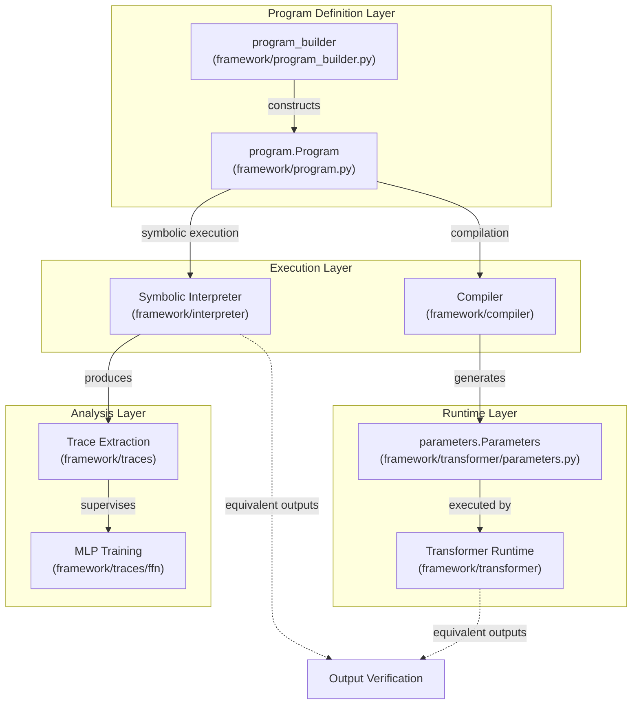
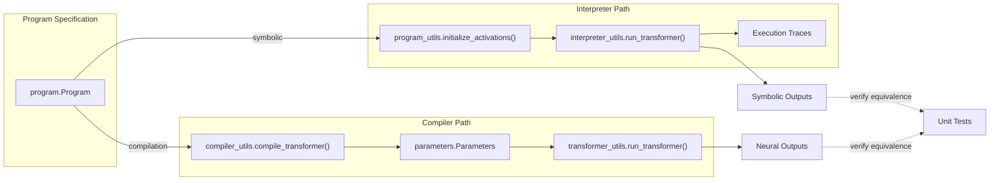
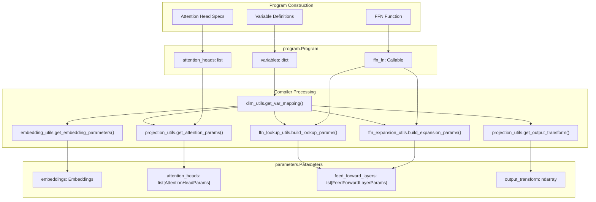
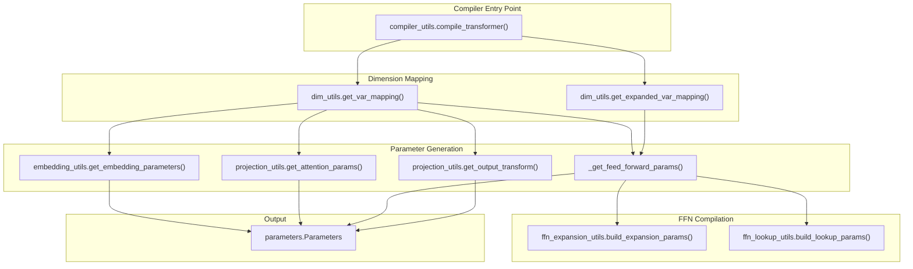
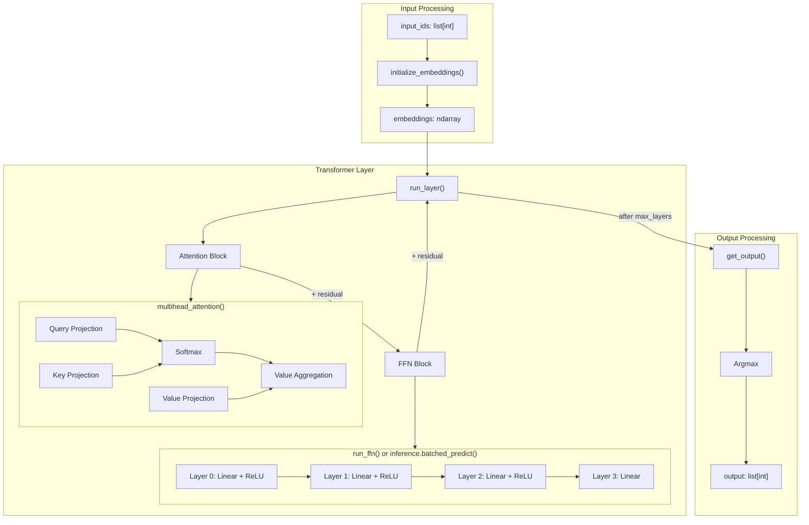
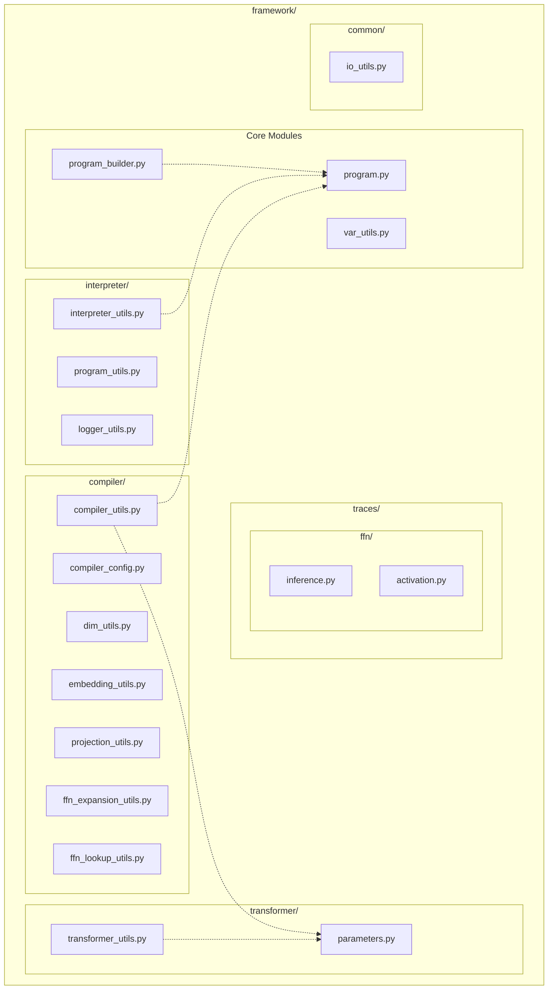

<!-- source: DeepWiki mcp.deepwiki.com · repo google-deepmind/alta · page 3 Core Architecture · fetched 2026-10-26 -->

# Core Architecture

Relevant source files

The following files were used as context for generating this wiki page:

- [README.md](README.md)
- [framework/compiler/compiler_utils.py](framework/compiler/compiler_utils.py)
- [framework/transformer/transformer_utils.py](framework/transformer/transformer_utils.py)

## Purpose and Scope

This document provides an architectural overview of the ALTA framework, describing the main components and their interactions. The architecture supports a dual execution paradigm where ALTA programs can be either symbolically interpreted or compiled to transformer parameters for neural execution.

For details on specific subsystems, see:
- Program definition and construction: [Program Specification](#3.1)
- Symbolic execution: [Symbolic Interpreter](#3.2)
- Compilation process: [Compiler Pipeline](#3.3)
- Neural execution: [Transformer Execution](#3.4)
- Analysis tools: [Traces and MLP Training](#3.5)

## System Overview

The ALTA framework consists of five primary subsystems that work together to enable dual execution of programs:

**Sources:** [README.md:28-35](), [framework/compiler/compiler_utils.py:63-99](), [framework/transformer/transformer_utils.py:171-214]()

## Dual Execution Paradigm

ALTA programs can be executed through two distinct paths that produce equivalent outputs but serve different purposes:

### Interpreter Path

The symbolic interpreter executes ALTA programs directly by maintaining symbolic representations of variables and operations. This path enables:

- **Program Analysis**: Inspection of intermediate states and variable values
- **Trace Extraction**: Recording execution traces for MLP training supervision
- **Debugging**: Direct observation of program behavior without compilation overhead

The interpreter is invoked through `interpreter_utils.run_transformer()` and operates on symbolic activations initialized by `program_utils.initialize_activations()`.

### Compiler Path

The compiler translates ALTA program specifications into concrete transformer parameters. This path enables:

- **Neural Execution**: Running programs as standard transformer networks
- **Deployment**: Integration with existing deep learning infrastructure
- **Efficiency**: Optimized execution using matrix operations

The compiler is invoked through `compiler_utils.compile_transformer()` which orchestrates multiple compilation stages to produce `parameters.Parameters` objects.

**Sources:** [README.md:28-41](), [framework/compiler/compiler_utils.py:63-99](), [framework/transformer/transformer_utils.py:171-214]()

## Core Data Structures

The framework defines several key data structures that flow between components:

| Data Structure | Location | Purpose | Key Fields |
|---|---|---|---|
| `program.Program` | `framework/program.py` | Defines ALTA program specification | `variables`, `attention_heads`, `ffn_fn`, `input_variables`, `output_variables` |
| `parameters.Parameters` | `framework/transformer/parameters.py` | Compiled transformer parameters | `embeddings`, `attention_heads`, `feed_forward_layers`, `output_transform` |
| `parameters.Embeddings` | `framework/transformer/parameters.py` | Input and positional embeddings | `input_embeddings`, `index_embeddings` |
| `parameters.AttentionHeadParams` | `framework/transformer/parameters.py` | Single attention head parameters | `query_transform`, `key_transform`, `value_transform`, `output_transform`, `relative_position_mask` |
| `parameters.FeedForwardLayerParams` | `framework/transformer/parameters.py` | Single FFN layer parameters | `weights`, `biases` |

### Data Flow

**Sources:** [framework/compiler/compiler_utils.py:28-100](), [framework/transformer/parameters.py]()

## Compiler Architecture

The compiler orchestrates multiple specialized utilities to transform program specifications into transformer parameters:

The compilation process follows a strict two-stage pipeline:

1. **Dimension Mapping Stage** ([framework/compiler/compiler_utils.py:71-75]()):
   - `dim_utils.get_var_mapping()` establishes base dimension assignments for all variables
   - `dim_utils.get_expanded_var_mapping()` creates expanded dimension mappings for FFN compilation
   - These mappings ensure consistent dimensionality across all components

2. **Parameter Generation Stage** ([framework/compiler/compiler_utils.py:77-92]()):
   - Five parallel parameter generators consume the dimension mappings
   - Each generator produces specific components of the final transformer parameters
   - The FFN generator is particularly complex, involving two sub-utilities for expansion and lookup phases

### FFN Compilation Detail

The feed-forward network compilation produces four layers through two stages ([framework/compiler/compiler_utils.py:28-60]()):

1. **Expansion Stage**: `ffn_expansion_utils.build_expansion_params()` generates layers 0-1
2. **Lookup Stage**: `ffn_lookup_utils.build_lookup_params()` generates layers 2-3

Each stage produces a pair of `FeedForwardLayerParams` objects containing weight matrices and bias vectors.

**Sources:** [framework/compiler/compiler_utils.py:1-100]()

## Transformer Runtime

The transformer runtime provides a self-contained implementation that executes compiled parameters:

### Runtime Functions

The transformer runtime is implemented in `framework/transformer/transformer_utils.py` with the following key functions:

| Function | Lines | Purpose |
|---|---|---|
| `run_transformer()` | [171-214]() | Main entry point; orchestrates layer execution loop |
| `initialize_embeddings()` | [27-40]() | Converts input token IDs to embeddings |
| `run_layer()` | [140-168]() | Executes one transformer layer (attention + FFN) |
| `multihead_attention()` | [90-107]() | Implements multi-head attention mechanism |
| `run_ffn()` | [115-137]() | Executes compiled FFN layers |
| `get_output()` | [43-47]() | Applies output transformation and argmax |

### Execution Flow

The `run_transformer()` function implements a simple loop structure ([framework/transformer/transformer_utils.py:198-213]()):

1. Initialize embeddings from input token IDs
2. For each layer (up to `max_layers`):
   - Run attention sub-layer with residual connection
   - Run FFN sub-layer with residual connection
3. Apply output transformation and return results

The FFN execution path can use either compiled parameters (`run_ffn()`) or learned MLP parameters (`inference.batched_predict()`), enabling comparison between compiled and learned feed-forward networks.

**Sources:** [framework/transformer/transformer_utils.py:1-215]()

## Module Organization

The framework is organized into a hierarchical directory structure under `framework/`:

### Module Responsibilities

| Module | Primary Responsibility | Key Exports |
|---|---|---|
| `framework/program.py` | Program specification data structure | `Program` class |
| `framework/program_builder.py` | Program construction utilities | Helper functions for building programs |
| `framework/interpreter/` | Symbolic execution | `run_transformer()`, activation management |
| `framework/compiler/` | Compilation to parameters | `compile_transformer()`, specialized utilities |
| `framework/transformer/` | Neural execution | `run_transformer()`, `Parameters` class |
| `framework/traces/` | Trace extraction and MLP training | Trace recording, MLP inference |
| `framework/common/` | Shared utilities | I/O operations, variable utilities |

### Compilation Module Detail

The compiler module is the most complex subsystem, with seven specialized utilities:

| Utility Module | Purpose | Key Functions |
|---|---|---|
| `compiler_utils.py` | Orchestration and entry point | `compile_transformer()` |
| `compiler_config.py` | Configuration data structures | `Config` class |
| `dim_utils.py` | Dimension mapping for variables | `get_var_mapping()`, `get_expanded_var_mapping()` |
| `embedding_utils.py` | Input/positional embedding generation | `get_embedding_parameters()` |
| `projection_utils.py` | Attention and output projections | `get_attention_params()`, `get_output_transform()` |
| `ffn_expansion_utils.py` | FFN expansion layers (0-1) | `build_expansion_params()` |
| `ffn_lookup_utils.py` | FFN lookup layers (2-3) | `build_lookup_params()` |

**Sources:** [README.md:28-35](), [framework/compiler/compiler_utils.py:16-26]()

## Summary

The ALTA architecture implements a dual execution paradigm where programs defined through `program.Program` specifications can be either:

1. **Symbolically interpreted** via `framework/interpreter/` for analysis and trace extraction
2. **Compiled to parameters** via `framework/compiler/` and executed neurally via `framework/transformer/`

Both paths produce equivalent outputs, validated through unit tests in the `examples/` directory. The modular compiler architecture with specialized utilities enables clean separation of concerns, while the self-contained transformer runtime provides a minimal implementation for executing compiled programs.

For detailed information on each subsystem, refer to the following pages:
- [Program Specification](#3.1)
- [Symbolic Interpreter](#3.2)
- [Compiler Pipeline](#3.3)
- [Transformer Execution](#3.4)
- [Traces and MLP Training](#3.5)

**Sources:** [README.md:1-69](), [framework/compiler/compiler_utils.py:1-100](), [framework/transformer/transformer_utils.py:1-215]()

---

