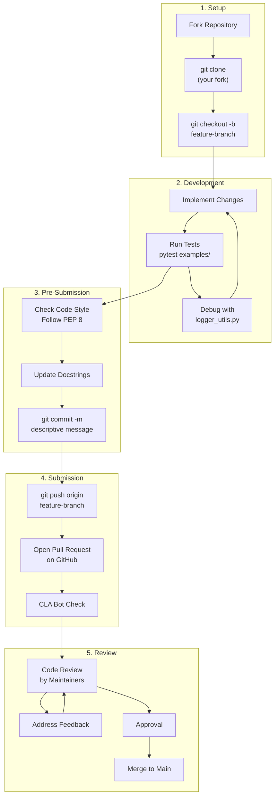
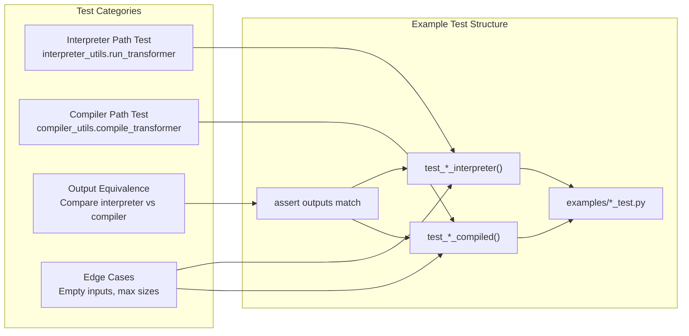
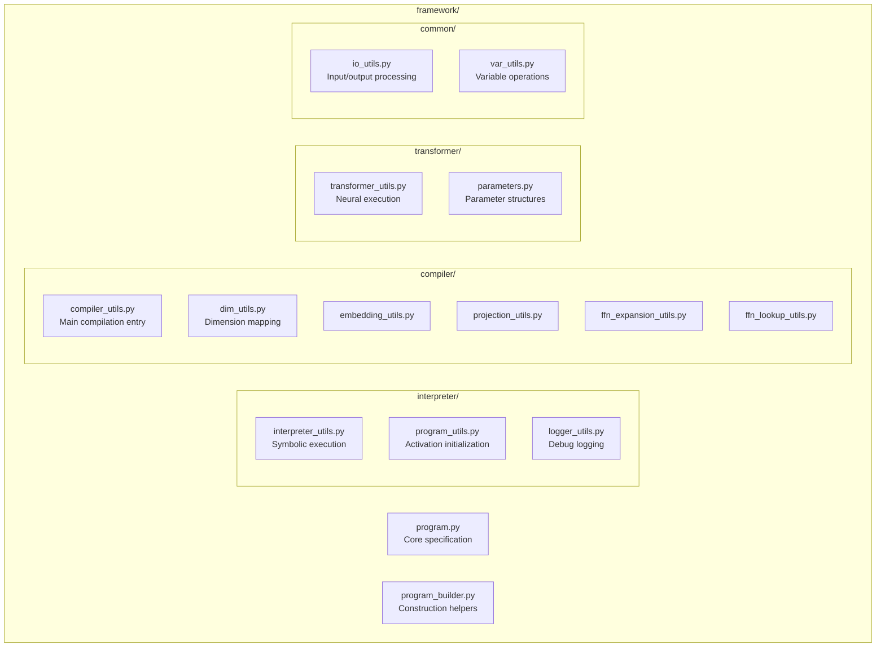
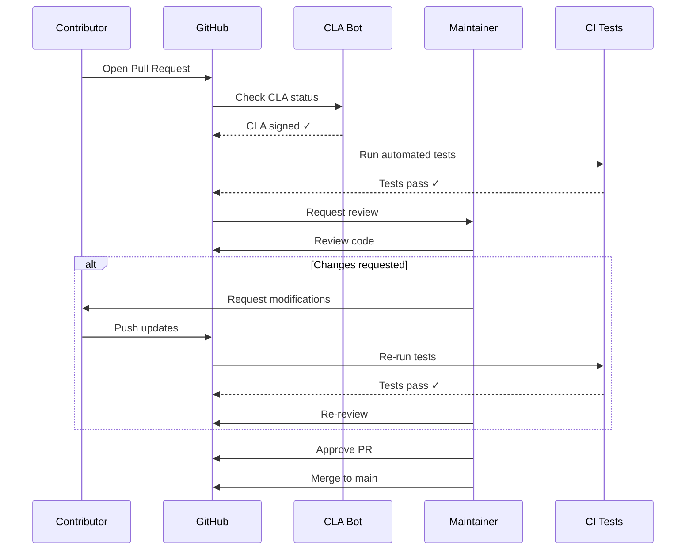

<!-- source: DeepWiki mcp.deepwiki.com · repo google-deepmind/alta · page 5.1 Contributing Guidelines · fetched 2026-10-26 -->

# Contributing Guidelines

<details>
<summary>Relevant source files</summary>

The following files were used as context for generating this wiki page:

- [.gitignore](.gitignore)
- [CONTRIBUTING.md](CONTRIBUTING.md)

</details>


**Purpose**: This document outlines the process for contributing to the ALTA project, including legal requirements, code review procedures, testing standards, and community expectations. This guide focuses on the practical workflow for submitting contributions to the ALTA codebase.

For information about debugging tools to assist during development, see [Debugging Utilities](#5.2). For understanding internal design decisions that may inform your contributions, see [Internal Architecture](#5.3).

---

## Contribution Prerequisites

### Contributor License Agreement (CLA)

All contributions to ALTA require a signed Contributor License Agreement. This legal requirement ensures that Google DeepMind has permission to use and redistribute your contributions while you retain copyright to your work.

**Process**:
1. Visit https://cla.developers.google.com/
2. Review and sign the CLA (individual or corporate, depending on your employment status)
3. The CLA is typically required only once across all Google open source projects

**Important**: Pull requests from contributors without a signed CLA cannot be merged. The CLA bot will automatically check your status when you submit a PR.

**Sources**: [CONTRIBUTING.md:1-13]()

---

## Contribution Workflow



**Sources**: [CONTRIBUTING.md:15-20]()

---

## Testing Requirements

All contributions must include appropriate test coverage. ALTA uses `pytest` for testing with specific patterns for different types of contributions.

### Test File Organization

| Contribution Type | Test Location | Test Pattern |
|------------------|---------------|--------------|
| New example program | `examples/` | `{program_name}_test.py` |
| Framework interpreter | `framework/interpreter/` | Test in example programs |
| Framework compiler | `framework/compiler/` | Test in example programs |
| Trace utilities | `framework/traces/` | Module-specific tests |
| Common utilities | `framework/common/` | Unit tests recommended |

### Required Test Coverage



### Testing Checklist

**For New ALTA Programs**:
- [ ] Create `{program_name}_test.py` in `examples/`
- [ ] Test interpreter execution path using `interpreter_utils.run_transformer()`
- [ ] Test compiler execution path using `compiler_utils.compile_transformer()` followed by `transformer_utils.run_transformer()`
- [ ] Verify outputs are equivalent between interpreter and compiled paths
- [ ] Include edge cases (empty sequences, maximum sizes, boundary conditions)
- [ ] Document expected behavior in test docstrings

**Example Test Pattern** (see [examples/parity_test.py:1-100]()):
```python
def test_program_interpreter():
    """Test symbolic execution path."""
    program_spec = build_program()
    activations = program_utils.initialize_activations(...)
    result = interpreter_utils.run_transformer(program_spec, activations, ...)
    assert result == expected_output

def test_program_compiled():
    """Test neural execution path."""
    program_spec = build_program()
    params = compiler_utils.compile_transformer(program_spec)
    result = transformer_utils.run_transformer(params, inputs, ...)
    assert result == expected_output
```

**For Framework Changes**:
- [ ] Verify existing example tests still pass (`pytest examples/`)
- [ ] Add tests for new utility functions in the modified module
- [ ] Test interaction with both interpreter and compiler paths
- [ ] Validate dimension consistency using `dim_utils` functions

**Sources**: [examples/parity_test.py:1-100](), [examples/addition_test.py:1-100]()

---

## Code Standards

### Module Structure

ALTA follows a consistent module organization pattern:



### File Naming Conventions

- Utility modules: `{domain}_utils.py` (e.g., `compiler_utils.py`, `interpreter_utils.py`)
- Test files: `{module_name}_test.py`
- Programs: `{algorithm_name}.py` (e.g., `parity.py`, `addition.py`)
- Data utilities: `data_utils.py` for dataset-specific processing

### Coding Style

**Python Standards**:
- Follow PEP 8 style guide
- Use type hints for function signatures
- Maximum line length: 80 characters (standard Python convention)
- Use descriptive variable names (e.g., `num_layers`, `attention_head_index`)

**Docstring Format**:
```python
def function_name(param1: Type1, param2: Type2) -> ReturnType:
    """Brief description of function purpose.
    
    Detailed explanation of behavior, including any assumptions or constraints.
    
    Args:
        param1: Description of first parameter
        param2: Description of second parameter
    
    Returns:
        Description of return value
    """
```

**Import Organization**:
1. Standard library imports
2. Third-party library imports (numpy, jax)
3. ALTA framework imports
4. Blank line between groups

**Sources**: [framework/]() module structure

---

## Code Review Process

All submissions require review through GitHub Pull Requests before merging.

### Pull Request Guidelines

**PR Title Format**:
- Use descriptive titles: "Add selection sort program" not "Update sort.py"
- Reference issues when applicable: "Fix dimension mapping bug (#123)"

**PR Description Should Include**:
1. **Summary**: What does this PR accomplish?
2. **Motivation**: Why is this change needed?
3. **Testing**: What tests were added/modified?
4. **Related Issues**: Link to relevant issues or discussions

**Example PR Template**:
```markdown
## Summary
Implements a new sorting algorithm using selector_width operations from RASP.

## Motivation
Demonstrates ALTA's ability to express classic algorithms and provides another example for users.

## Testing
- Added examples/sort_test.py with 10 test cases
- Verified interpreter and compiler paths produce identical outputs
- Tested edge cases: empty list, single element, already sorted

## Related Issues
Closes #42
```

### Review Process



**Review Criteria**:
- Code follows style guidelines
- Tests are comprehensive and pass
- Documentation is clear and complete
- Changes are scoped appropriately (one logical change per PR)
- No breaking changes to existing APIs without discussion

**Review Timeline**:
- Initial review: Within 1-2 weeks
- Follow-up reviews: Within 3-5 business days
- Complex changes may require additional time for thorough review

**Sources**: [CONTRIBUTING.md:15-20]()

---

## Contribution Areas

The following areas are open to community contributions:

### High-Priority Contribution Areas

| Area | Description | Skill Level | Files to Modify |
|------|-------------|-------------|-----------------|
| Example Programs | New ALTA programs demonstrating algorithms | Beginner-Intermediate | `examples/{name}.py`, `examples/{name}_test.py` |
| Compiler Optimizations | Improve FFN compilation efficiency | Advanced | `framework/compiler/ffn_*_utils.py` |
| Trace Analysis | Tools for analyzing execution traces | Intermediate | `framework/traces/` |
| Documentation | Improve docstrings and examples | Beginner | Any module |
| Testing | Additional test coverage for edge cases | Beginner-Intermediate | `examples/*_test.py` |

### New Example Programs

**Suggested algorithms that would be valuable additions**:
- Maximum/minimum finding algorithms
- Binary search
- String matching (e.g., substring search)
- Simple finite state machines
- Additional RASP algorithms from literature

**Requirements for example contributions**:
1. Create self-contained program file in `examples/`
2. Implement using `program_builder.create_program()`
3. Include comprehensive test file
4. Add docstring explaining algorithm and ALTA implementation approach
5. Ensure both interpreter and compiler paths work correctly

### Framework Enhancements

**Areas where framework improvements are welcome**:
- Enhanced debugging utilities (see [Debugging Utilities](#5.2))
- Optimizations to compiler stages while preserving correctness
- Additional trace extraction capabilities
- Performance benchmarking tools

**Requirements for framework contributions**:
1. Discuss proposed changes in GitHub issue before implementation
2. Ensure backward compatibility with existing examples
3. Add tests demonstrating the enhancement
4. Update internal documentation if architecture changes

**Sources**: [examples/]() directory structure, [framework/]() module organization

---

## Community Guidelines

ALTA follows [Google's Open Source Community Guidelines](https://opensource.google/conduct).

### Expected Behavior

**Be respectful**: Value diverse perspectives and experiences. Disagreements are natural but should be constructive.

**Be collaborative**: Share knowledge and help others learn. ALTA is a research framework, and explaining concepts benefits everyone.

**Be professional**: Focus on the technical merits of contributions. Personal attacks or harassment will not be tolerated.

### Communication Channels

- **GitHub Issues**: Bug reports, feature requests, and technical discussions
- **Pull Request Comments**: Specific feedback on code changes
- **GitHub Discussions**: General questions about ALTA usage and design

### Reporting Issues

When reporting bugs or requesting features:

1. **Search existing issues** to avoid duplicates
2. **Provide context**: What were you trying to accomplish?
3. **Include reproduction steps**: Minimal example that demonstrates the issue
4. **Specify environment**: Python version, JAX version, OS
5. **Show expected vs. actual behavior**: What should happen vs. what does happen

**Bug Report Template**:
```markdown
## Description
Brief description of the bug

## Steps to Reproduce
1. Create program with variables X, Y
2. Compile using compiler_utils.compile_transformer()
3. Observe error in attention head computation

## Expected Behavior
Attention heads should compile successfully

## Actual Behavior
ValueError: dimension mismatch in projection_utils.py line 45

## Environment
- Python: 3.10
- JAX: 0.4.13
- OS: Ubuntu 22.04
```

**Sources**: [CONTRIBUTING.md:22-25]()

---

## Submission Checklist

Before submitting a pull request, verify:

- [ ] CLA signed at https://cla.developers.google.com/
- [ ] Code follows PEP 8 style guidelines
- [ ] All functions have docstrings with type hints
- [ ] Tests added for new functionality
- [ ] All tests pass (`pytest examples/` or relevant test suite)
- [ ] Changes do not break existing examples
- [ ] PR description clearly explains changes
- [ ] Commits have descriptive messages
- [ ] No unnecessary files included (check `.gitignore` patterns)
- [ ] Documentation updated if API changes

---

## Getting Help

If you have questions during development:

1. **Check existing documentation**: Review this wiki, especially [Internal Architecture](#5.3) for design decisions
2. **Review similar examples**: Look at existing programs in `examples/` for patterns
3. **Use debugging tools**: See [Debugging Utilities](#5.2) for inspection tools
4. **Ask in GitHub Discussions**: For general questions about implementation approaches
5. **Open an issue**: For suspected bugs or missing features

**Thank you for contributing to ALTA!** Your contributions help advance research into the theoretical capabilities of transformers and make the framework more useful for the community.

**Sources**: [CONTRIBUTING.md:1-26](), [.gitignore:1-25]()

---

