# Page: Overview

# Overview

<details>
<summary>Relevant source files</summary>

The following files were used as context for generating this wiki page:

- [README.md](README.md)

</details>


This document provides a high-level introduction to ALTA, its core architectural concepts, and the dual execution paradigm that enables both symbolic analysis and neural execution of programs. For installation and setup instructions, see [Getting Started](#2). For detailed technical documentation of specific components, see [Core Architecture](#3).

## What is ALTA?

ALTA (Algorithmic Language for Transformers Analysis) is a framework for compiler-based analysis of transformer neural networks. It provides a programming language for specifying algorithms that can be executed in two equivalent ways:

1. **Symbolic interpretation** for analysis and verification
2. **Compilation to transformer weights** for neural execution

The framework is implemented in Python and consists of three main components located in the `framework/` directory:

| Component | Location | Purpose |
|-----------|----------|---------|
| Language Specification | [framework/program.py]() | Defines ALTA program structure |
| Symbolic Interpreter | [framework/interpreter/]() | Executes programs symbolically |
| Compiler | [framework/compiler/]() | Translates programs to transformer parameters |

Sources: [README.md:1-68]()

## Core Concept: Dual Execution Paradigm

ALTA programs are defined once but can be executed through two distinct paths that produce equivalent outputs:

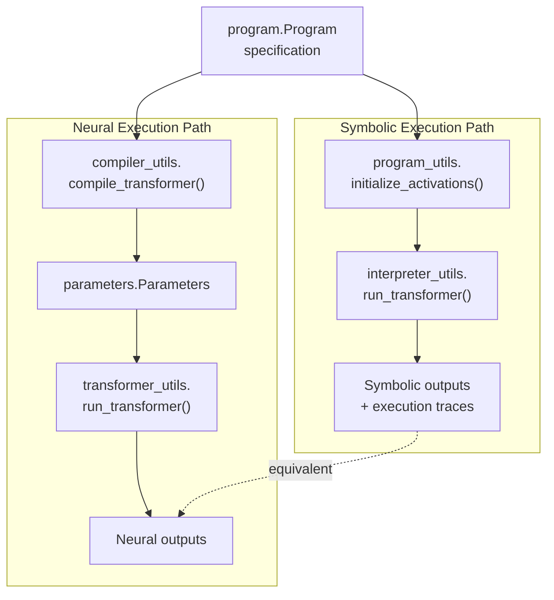

**Symbolic Execution Path**
- Entry point: [framework/interpreter/interpreter_utils.py]()
- Maintains symbolic representations of transformer activations
- Produces execution traces for analysis
- Used for program verification and debugging

**Neural Execution Path**
- Entry point: [framework/compiler/compiler_utils.py]()
- Generates fixed transformer parameters (embeddings, attention heads, FFN weights)
- Executes via self-contained transformer implementation
- Used for efficient deployment and integration with standard ML infrastructure

Sources: [README.md:28-35](), Diagram 3 from system architecture overview

## System Architecture

The following diagram maps ALTA's high-level architecture to specific code modules:

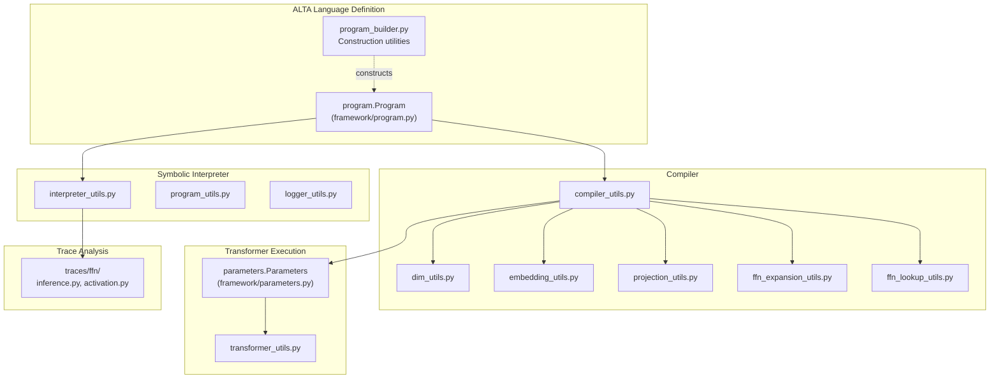

The compiler pipeline consists of six specialized utilities, each responsible for translating different aspects of the program specification:

| Utility | Responsibility |
|---------|---------------|
| `dim_utils.py` | Establishes dimension mappings for all variables |
| `embedding_utils.py` | Generates input embeddings |
| `projection_utils.py` | Creates attention head projections and output transforms |
| `ffn_expansion_utils.py` | Compiles first two FFN layers (expansion phase) |
| `ffn_lookup_utils.py` | Compiles last two FFN layers (lookup phase) |

Sources: [README.md:28-35](), Diagram 2 and Diagram 4 from system architecture overview

## Execution Flow

The following sequence diagram shows the complete lifecycle from program definition to execution:

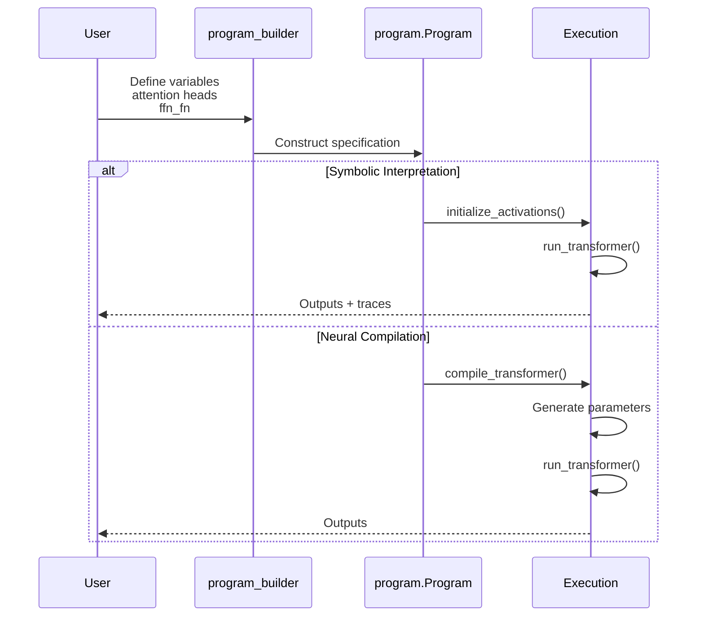

**Program Definition** ([framework/program_builder.py]()):
- Variables declared with `add_variable()`
- Attention heads defined with `add_copy_heads()`, `add_content_heads()`, etc.
- Feed-forward logic specified via `ffn_fn` parameter

**Symbolic Execution** ([framework/interpreter/]()):
- `initialize_activations()` creates symbolic state
- `run_transformer()` executes layer by layer
- Produces both outputs and execution traces

**Neural Execution** ([framework/compiler/]() + [framework/transformer/]()):
- `compile_transformer()` generates `parameters.Parameters` object
- `transformer_utils.run_transformer()` executes using neural weights
- Produces equivalent outputs without traces

Sources: [README.md:28-35](), Diagram 6 from system architecture overview

## Framework Organization

The `framework/` directory contains all core components:

```
framework/
├── program.py                      # Program specification data structures
├── program_builder.py              # High-level program construction API
├── interpreter/                    # Symbolic execution
│   ├── interpreter_utils.py       
│   ├── program_utils.py           
│   └── logger_utils.py            
├── compiler/                       # Compilation to weights
│   ├── compiler_utils.py          
│   ├── dim_utils.py               
│   ├── embedding_utils.py         
│   ├── projection_utils.py        
│   ├── ffn_expansion_utils.py     
│   └── ffn_lookup_utils.py        
├── transformer/                    # Neural execution
│   ├── transformer_utils.py       
│   └── parameters.py              
├── traces/                         # Trace extraction and MLP training
│   └── ffn/                       
│       ├── inference.py           
│       └── activation.py          
└── common/                         # Shared utilities
    ├── io_utils.py                
    └── var_utils.py               
```

**Key Modules**:

- **program.py**: Defines `Program` dataclass containing variables, attention heads, and FFN specification
- **compiler_utils.py**: Main entry point `compile_transformer()` orchestrates all compiler stages
- **interpreter_utils.py**: Main entry point `run_transformer()` executes symbolic interpretation
- **parameters.py**: Defines `Parameters` dataclass containing embeddings, attention weights, FFN weights, and output transforms
- **transformer_utils.py**: Self-contained transformer implementation that operates on `Parameters`

Sources: [README.md:28-35](), Diagram 4 from system architecture overview

## Example Programs

The `examples/` directory contains demonstration programs that showcase ALTA's capabilities:

| Program | File | Description |
|---------|------|-------------|
| Parity Detection | [examples/parity.py]() | Even/odd detection using three different algorithms |
| Multi-Digit Addition | [examples/addition.py]() | Addition with shift/reduce operations |
| Sorting | [examples/sort_unique.py]() | Implements RASP-style sorting operations |
| SCAN Parser | [examples/scan/]() | Complete compositional learning system |
| SUBLEQ ISA | [examples/subleq.py]() | Single-instruction computer implementation |

Each example includes a corresponding test file (e.g., [examples/parity_test.py]()) that demonstrates:
- Symbolic execution via the interpreter
- Compilation to transformer weights
- Verification that both execution paths produce identical results

Example test execution:
```bash
python -m examples.parity_test
```

For detailed documentation of individual examples, see [Example Programs](#4).

Sources: [README.md:37-47](), Diagram 5 from system architecture overview

## Key Components Summary

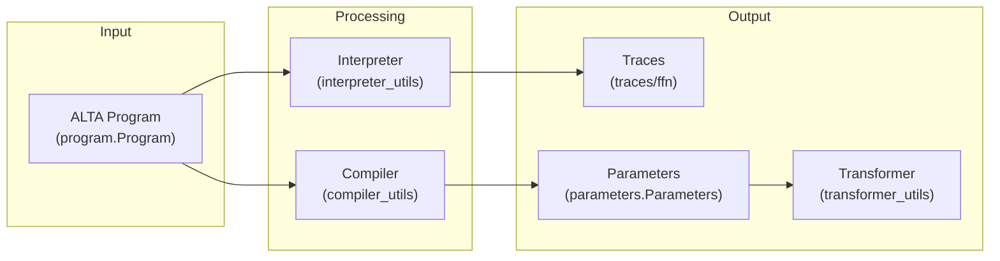

| Component | Module | Primary Function |
|-----------|--------|------------------|
| Program Builder | `program_builder.py` | Construct ALTA program specifications |
| Symbolic Interpreter | `interpreter_utils.py` | Execute programs symbolically for analysis |
| Compiler | `compiler_utils.py` | Translate programs to transformer weights |
| Transformer Runtime | `transformer_utils.py` | Execute compiled programs neurally |
| Trace Extraction | `traces/ffn/` | Extract and analyze execution traces |

Sources: [README.md:28-35](), all architectural diagrams

## Next Steps

- **To run your first program**: See [Getting Started](#2)
- **To understand program specification**: See [Program Specification](#3.1)
- **To learn about symbolic execution**: See [Symbolic Interpreter](#3.2)
- **To understand compilation**: See [Compiler Pipeline](#3.3)
- **To explore examples**: See [Example Programs](#4)
- **To contribute**: See [Developer Guide](#5)

Sources: Table of contents provided in prompt

---

# Page: Getting Started

# Getting Started

<details>
<summary>Relevant source files</summary>

The following files were used as context for generating this wiki page:

- [.gitignore](.gitignore)
- [CONTRIBUTING.md](CONTRIBUTING.md)
- [README.md](README.md)
- [setup.py](setup.py)

</details>


## Purpose and Scope

This page guides you through installing ALTA, setting up your development environment, and running your first ALTA program. You will learn how to execute programs using both the symbolic interpreter and the compiler-to-transformer pipeline. For detailed information about ALTA's underlying concepts and architecture, see [Overview](#1). For in-depth exploration of specific example programs, see [Example Programs](#4).

---

## Prerequisites

ALTA requires the following system prerequisites:

| Requirement | Version | Purpose |
|-------------|---------|---------|
| Python | ≥ 3.10 | Runtime environment |
| Git | Any recent version | Repository cloning |
| Virtual environment tool | conda, venv, or virtualenv | Dependency isolation |

**Sources:** [setup.py:28]()

---

## Installation

### Step 1: Clone the Repository

```bash
git clone https://github.com/google-deepmind/alta.git
cd alta
```

### Step 2: Create Virtual Environment

Using conda (recommended):

```bash
conda create -n alta python=3.10
conda activate alta
```

Alternatively, using venv:

```bash
python3.10 -m venv alta_env
source alta_env/bin/activate  # On Windows: alta_env\Scripts\activate
```

### Step 3: Install Dependencies

The package uses a standard Python setuptools installation:

```bash
pip install .
```

This installs the following required packages specified in `setup.py`:

| Package | Purpose |
|---------|---------|
| `absl-py` | Command-line flags and application utilities |
| `tensorflow` | Tensor operations and utilities |
| `numpy` | Numerical array operations |
| `jax` | Numerical computing library |
| `apache-beam` | Data processing pipeline utilities |
| `scipy` | Scientific computing operations |

**Sources:** [README.md:6-26](), [setup.py:20-29]()

---

## Your First ALTA Program: Parity Detection

### Overview of the Parity Example

The parity detection program is the simplest example in ALTA. It determines whether a sequence contains an even or odd number of 1s. This example demonstrates both execution paths: symbolic interpretation and neural compilation.

### Execution Path Diagram

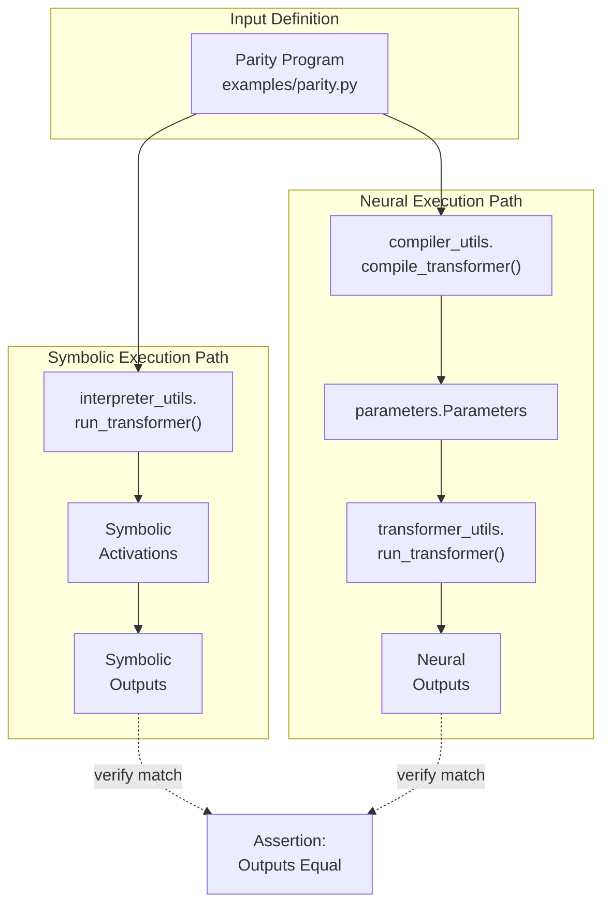

**Sources:** [README.md:37-47](), Diagram 3 from high-level overview

### Running the Parity Tests

Execute the parity program's test suite to verify both execution paths:

```bash
python -m examples.parity_test
```

This command runs unit tests located in `examples/parity_test.py` that exercise three parity algorithms:
- Sequential absolute position parity
- Sequential relative position parity  
- Sum modulo 2 parity

Each test validates that the symbolic interpreter and compiled transformer produce identical outputs.

**Sources:** [README.md:43-47]()

### Understanding the Test Structure

The test file `examples/parity_test.py` demonstrates the standard pattern for ALTA programs:

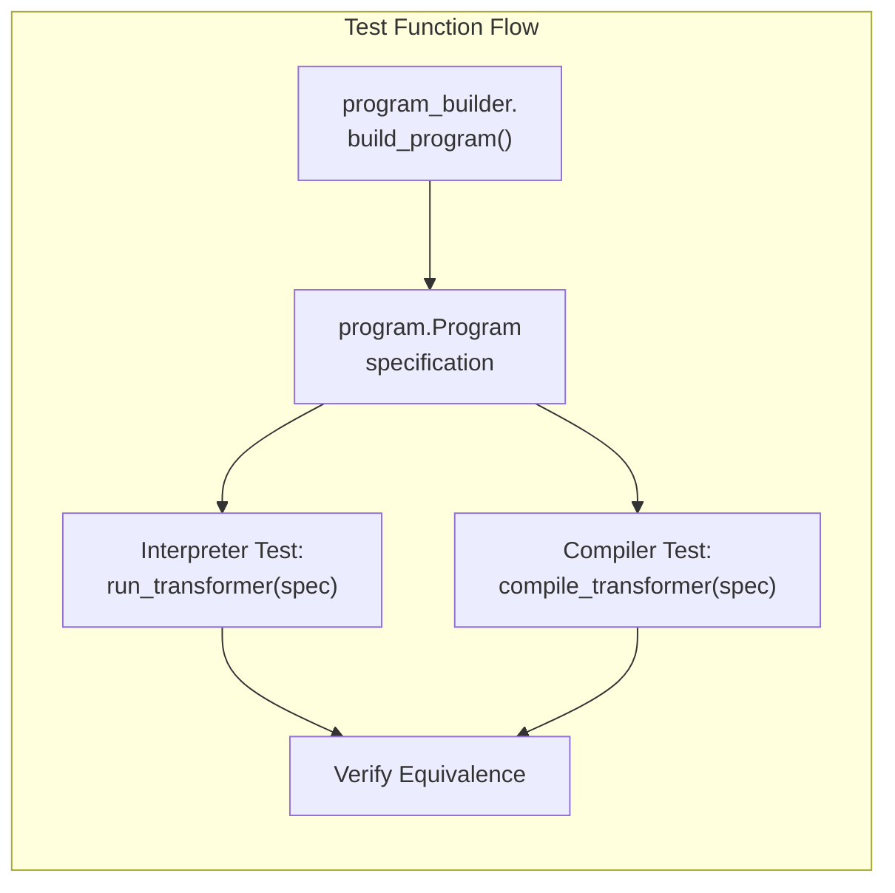

**Key files involved:**
- `examples/parity.py` - Program definition functions
- `examples/parity_test.py` - Test suite with assertions
- `framework/interpreter/interpreter_utils.py` - Symbolic execution
- `framework/compiler/compiler_utils.py` - Compilation to parameters
- `framework/transformer/transformer_utils.py` - Neural execution

**Sources:** [README.md:39-47](), Diagram 6 from high-level overview

---

## Understanding the Dual Execution Paradigm

ALTA provides two equivalent methods to execute programs:

### Execution Path Comparison

| Aspect | Symbolic Interpreter | Compiler-to-Transformer |
|--------|---------------------|-------------------------|
| Entry point | `interpreter_utils.run_transformer()` | `compiler_utils.compile_transformer()` + `transformer_utils.run_transformer()` |
| Input | `program.Program` specification | `program.Program` specification |
| Intermediate form | Symbolic activations (dictionaries) | `parameters.Parameters` (neural weights) |
| Output | Program results + execution traces | Program results |
| Use case | Analysis, debugging, trace extraction | Deployment, neural network integration |
| Performance | Slower (Python execution) | Faster (vectorized operations) |

### Workflow for Each Path

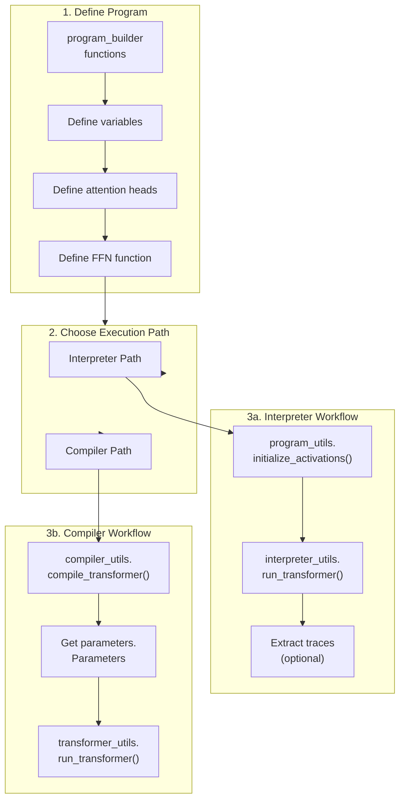

**Sources:** Diagrams 1, 3, and 6 from high-level overview, [README.md:28-36]()

### When to Use Each Path

**Use the Interpreter** when you need to:
- Debug program logic with symbolic values
- Extract execution traces for analysis
- Understand intermediate computation states
- Train MLPs using trace supervision (see [Traces and MLP Training](#3.5))

**Use the Compiler** when you need to:
- Deploy programs as standard transformer models
- Integrate with existing neural network frameworks
- Achieve optimal runtime performance
- Export fixed neural network parameters

**Sources:** Diagrams 1 and 3 from high-level overview

---

## Directory Structure Overview

After installation, familiarize yourself with the repository structure:

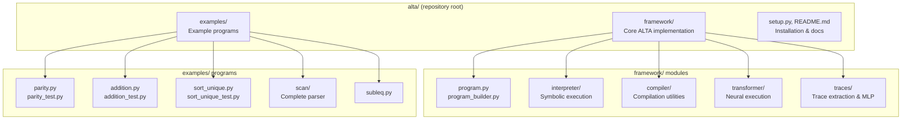

| Directory | Purpose |
|-----------|---------|
| `framework/` | Core ALTA language specification and execution engines |
| `framework/interpreter/` | Symbolic interpreter implementation |
| `framework/compiler/` | Compiler from programs to transformer parameters |
| `framework/transformer/` | Self-contained transformer execution engine |
| `framework/traces/` | Trace extraction and MLP training utilities |
| `examples/` | Example ALTA programs with test suites |

**Sources:** [README.md:28-36](), Diagram 4 from high-level overview

---

## Running Additional Examples

Once you've successfully run the parity test, explore other examples:

### Available Example Programs

| Program | Command | Purpose |
|---------|---------|---------|
| Parity Detection | `python -m examples.parity_test` | Even/odd bit counting |
| Multi-Digit Addition | `python -m examples.addition_test` | Arithmetic with carry operations |
| Sorting Unique Numbers | `python -m examples.sort_unique_test` | Sequence sorting algorithms |

Each test demonstrates both execution paths and validates output equivalence.

**Sources:** [README.md:37-47](), Diagram 5 from high-level overview

---

## Verification of Installation

To verify your installation is complete and functioning:

### Verification Checklist

1. **Python version**: Run `python --version` and verify ≥ 3.10
2. **Package installation**: Run `python -c "import framework"` - should complete without errors
3. **Dependencies**: Run `python -c "import tensorflow, jax, numpy"` - should import successfully
4. **Test execution**: Run `python -m examples.parity_test` - all tests should pass

If any verification step fails, review the installation steps and ensure all dependencies from `setup.py` are properly installed.

**Sources:** [setup.py:20-29](), [README.md:6-26]()

---

## Next Steps

After completing this getting started guide, you can:

1. **Explore program internals**: Learn how ALTA programs are defined - see [Program Specification](#3.1)
2. **Understand compilation**: Learn how programs become transformers - see [Compiler Pipeline](#3.3)
3. **Study complete examples**: Examine production-quality programs - see [SCAN Compositional Learning](#4.4)
4. **Contribute to ALTA**: Review contribution guidelines - see [Contributing Guidelines](#5.1)

For architectural details about the interpreter and compiler, proceed to [Core Architecture](#3).

**Sources:** [README.md:1-68](), [CONTRIBUTING.md:1-26]()

---

# Page: Core Architecture

# Core Architecture

<details>
<summary>Relevant source files</summary>

The following files were used as context for generating this wiki page:

- [README.md](README.md)
- [framework/compiler/compiler_utils.py](framework/compiler/compiler_utils.py)
- [framework/transformer/transformer_utils.py](framework/transformer/transformer_utils.py)

</details>


## Purpose and Scope

This document provides an architectural overview of the ALTA framework, describing the main components and their interactions. The architecture supports a dual execution paradigm where ALTA programs can be either symbolically interpreted or compiled to transformer parameters for neural execution.

For details on specific subsystems, see:
- Program definition and construction: [Program Specification](#3.1)
- Symbolic execution: [Symbolic Interpreter](#3.2)
- Compilation process: [Compiler Pipeline](#3.3)
- Neural execution: [Transformer Execution](#3.4)
- Analysis tools: [Traces and MLP Training](#3.5)

## System Overview

The ALTA framework consists of five primary subsystems that work together to enable dual execution of programs:

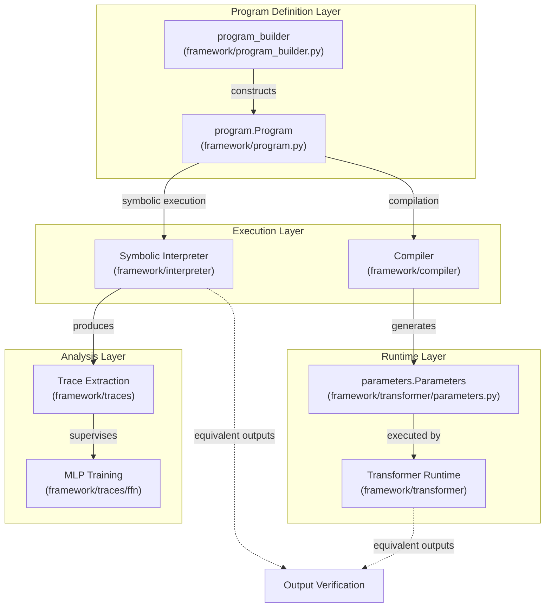

**Sources:** [README.md:28-35](), [framework/compiler/compiler_utils.py:63-99](), [framework/transformer/transformer_utils.py:171-214]()

## Dual Execution Paradigm

ALTA programs can be executed through two distinct paths that produce equivalent outputs but serve different purposes:

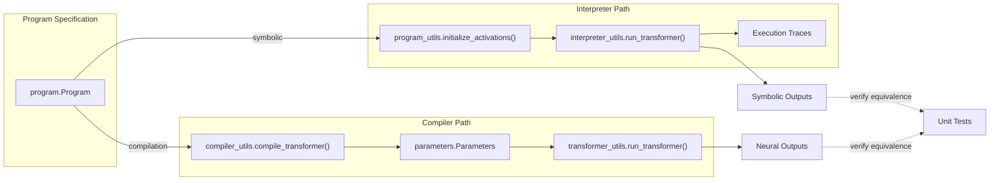

### Interpreter Path

The symbolic interpreter executes ALTA programs directly by maintaining symbolic representations of variables and operations. This path enables:

- **Program Analysis**: Inspection of intermediate states and variable values
- **Trace Extraction**: Recording execution traces for MLP training supervision
- **Debugging**: Direct observation of program behavior without compilation overhead

The interpreter is invoked through `interpreter_utils.run_transformer()` and operates on symbolic activations initialized by `program_utils.initialize_activations()`.

### Compiler Path

The compiler translates ALTA program specifications into concrete transformer parameters. This path enables:

- **Neural Execution**: Running programs as standard transformer networks
- **Deployment**: Integration with existing deep learning infrastructure
- **Efficiency**: Optimized execution using matrix operations

The compiler is invoked through `compiler_utils.compile_transformer()` which orchestrates multiple compilation stages to produce `parameters.Parameters` objects.

**Sources:** [README.md:28-41](), [framework/compiler/compiler_utils.py:63-99](), [framework/transformer/transformer_utils.py:171-214]()

## Core Data Structures

The framework defines several key data structures that flow between components:

| Data Structure | Location | Purpose | Key Fields |
|---|---|---|---|
| `program.Program` | `framework/program.py` | Defines ALTA program specification | `variables`, `attention_heads`, `ffn_fn`, `input_variables`, `output_variables` |
| `parameters.Parameters` | `framework/transformer/parameters.py` | Compiled transformer parameters | `embeddings`, `attention_heads`, `feed_forward_layers`, `output_transform` |
| `parameters.Embeddings` | `framework/transformer/parameters.py` | Input and positional embeddings | `input_embeddings`, `index_embeddings` |
| `parameters.AttentionHeadParams` | `framework/transformer/parameters.py` | Single attention head parameters | `query_transform`, `key_transform`, `value_transform`, `output_transform`, `relative_position_mask` |
| `parameters.FeedForwardLayerParams` | `framework/transformer/parameters.py` | Single FFN layer parameters | `weights`, `biases` |

### Data Flow

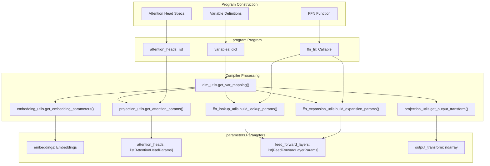

**Sources:** [framework/compiler/compiler_utils.py:28-100](), [framework/transformer/parameters.py]()

## Compiler Architecture

The compiler orchestrates multiple specialized utilities to transform program specifications into transformer parameters:

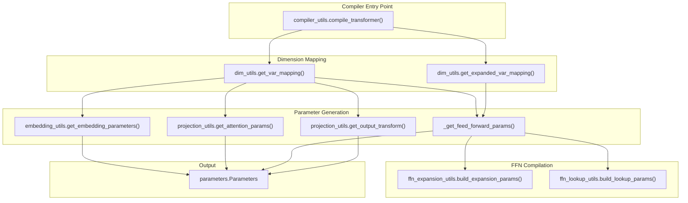

The compilation process follows a strict two-stage pipeline:

1. **Dimension Mapping Stage** ([framework/compiler/compiler_utils.py:71-75]()):
   - `dim_utils.get_var_mapping()` establishes base dimension assignments for all variables
   - `dim_utils.get_expanded_var_mapping()` creates expanded dimension mappings for FFN compilation
   - These mappings ensure consistent dimensionality across all components

2. **Parameter Generation Stage** ([framework/compiler/compiler_utils.py:77-92]()):
   - Five parallel parameter generators consume the dimension mappings
   - Each generator produces specific components of the final transformer parameters
   - The FFN generator is particularly complex, involving two sub-utilities for expansion and lookup phases

### FFN Compilation Detail

The feed-forward network compilation produces four layers through two stages ([framework/compiler/compiler_utils.py:28-60]()):

1. **Expansion Stage**: `ffn_expansion_utils.build_expansion_params()` generates layers 0-1
2. **Lookup Stage**: `ffn_lookup_utils.build_lookup_params()` generates layers 2-3

Each stage produces a pair of `FeedForwardLayerParams` objects containing weight matrices and bias vectors.

**Sources:** [framework/compiler/compiler_utils.py:1-100]()

## Transformer Runtime

The transformer runtime provides a self-contained implementation that executes compiled parameters:

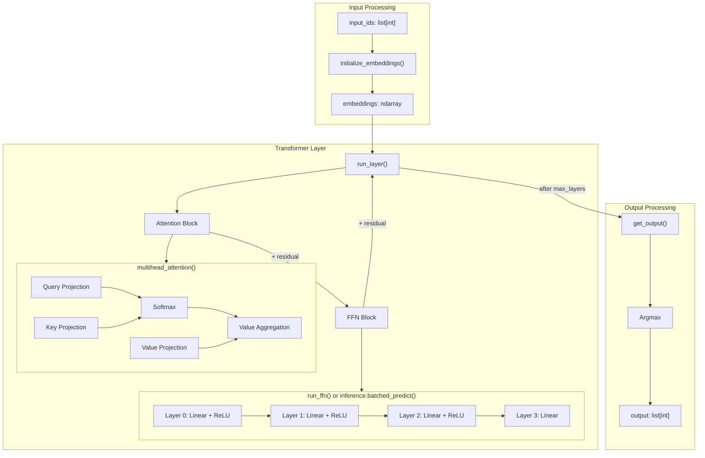

### Runtime Functions

The transformer runtime is implemented in `framework/transformer/transformer_utils.py` with the following key functions:

| Function | Lines | Purpose |
|---|---|---|
| `run_transformer()` | [171-214]() | Main entry point; orchestrates layer execution loop |
| `initialize_embeddings()` | [27-40]() | Converts input token IDs to embeddings |
| `run_layer()` | [140-168]() | Executes one transformer layer (attention + FFN) |
| `multihead_attention()` | [90-107]() | Implements multi-head attention mechanism |
| `run_ffn()` | [115-137]() | Executes compiled FFN layers |
| `get_output()` | [43-47]() | Applies output transformation and argmax |

### Execution Flow

The `run_transformer()` function implements a simple loop structure ([framework/transformer/transformer_utils.py:198-213]()):

1. Initialize embeddings from input token IDs
2. For each layer (up to `max_layers`):
   - Run attention sub-layer with residual connection
   - Run FFN sub-layer with residual connection
3. Apply output transformation and return results

The FFN execution path can use either compiled parameters (`run_ffn()`) or learned MLP parameters (`inference.batched_predict()`), enabling comparison between compiled and learned feed-forward networks.

**Sources:** [framework/transformer/transformer_utils.py:1-215]()

## Module Organization

The framework is organized into a hierarchical directory structure under `framework/`:

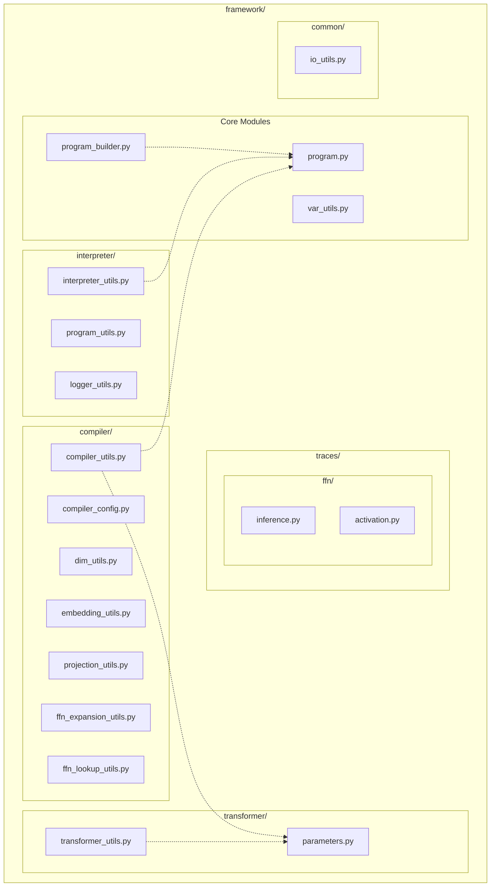

### Module Responsibilities

| Module | Primary Responsibility | Key Exports |
|---|---|---|
| `framework/program.py` | Program specification data structure | `Program` class |
| `framework/program_builder.py` | Program construction utilities | Helper functions for building programs |
| `framework/interpreter/` | Symbolic execution | `run_transformer()`, activation management |
| `framework/compiler/` | Compilation to parameters | `compile_transformer()`, specialized utilities |
| `framework/transformer/` | Neural execution | `run_transformer()`, `Parameters` class |
| `framework/traces/` | Trace extraction and MLP training | Trace recording, MLP inference |
| `framework/common/` | Shared utilities | I/O operations, variable utilities |

### Compilation Module Detail

The compiler module is the most complex subsystem, with seven specialized utilities:

| Utility Module | Purpose | Key Functions |
|---|---|---|
| `compiler_utils.py` | Orchestration and entry point | `compile_transformer()` |
| `compiler_config.py` | Configuration data structures | `Config` class |
| `dim_utils.py` | Dimension mapping for variables | `get_var_mapping()`, `get_expanded_var_mapping()` |
| `embedding_utils.py` | Input/positional embedding generation | `get_embedding_parameters()` |
| `projection_utils.py` | Attention and output projections | `get_attention_params()`, `get_output_transform()` |
| `ffn_expansion_utils.py` | FFN expansion layers (0-1) | `build_expansion_params()` |
| `ffn_lookup_utils.py` | FFN lookup layers (2-3) | `build_lookup_params()` |

**Sources:** [README.md:28-35](), [framework/compiler/compiler_utils.py:16-26]()

## Summary

The ALTA architecture implements a dual execution paradigm where programs defined through `program.Program` specifications can be either:

1. **Symbolically interpreted** via `framework/interpreter/` for analysis and trace extraction
2. **Compiled to parameters** via `framework/compiler/` and executed neurally via `framework/transformer/`

Both paths produce equivalent outputs, validated through unit tests in the `examples/` directory. The modular compiler architecture with specialized utilities enables clean separation of concerns, while the self-contained transformer runtime provides a minimal implementation for executing compiled programs.

For detailed information on each subsystem, refer to the following pages:
- [Program Specification](#3.1)
- [Symbolic Interpreter](#3.2)
- [Compiler Pipeline](#3.3)
- [Transformer Execution](#3.4)
- [Traces and MLP Training](#3.5)

**Sources:** [README.md:1-69](), [framework/compiler/compiler_utils.py:1-100](), [framework/transformer/transformer_utils.py:1-215]()

---

# Page: Program Specification

# Program Specification

<details>
<summary>Relevant source files</summary>

The following files were used as context for generating this wiki page:

- [examples/addition.py](examples/addition.py)
- [examples/sort_unique.py](examples/sort_unique.py)
- [framework/compiler/dim_utils.py](framework/compiler/dim_utils.py)

</details>


This page documents how ALTA programs are defined using the `program_builder` API. A program specification consists of three main components: **variables** that represent the transformer's state, **attention heads** that define information flow between positions, and a **feed-forward function** that implements state transitions. The program specification serves as the input to both the symbolic interpreter ([3.2](#3.2)) and the compiler ([3.3](#3.3)).

For information about executing program specifications, see the Symbolic Interpreter ([3.2](#3.2)) and Transformer Execution ([3.4](#3.4)) pages. For analysis of compiled programs, see Traces and MLP Training ([3.5](#3.5)).

---

## Program Structure

An ALTA program specification is represented by the `program.Program` dataclass, which is constructed using the `program_builder` module (typically imported as `pb`). The specification defines the complete transformer architecture and behavior.

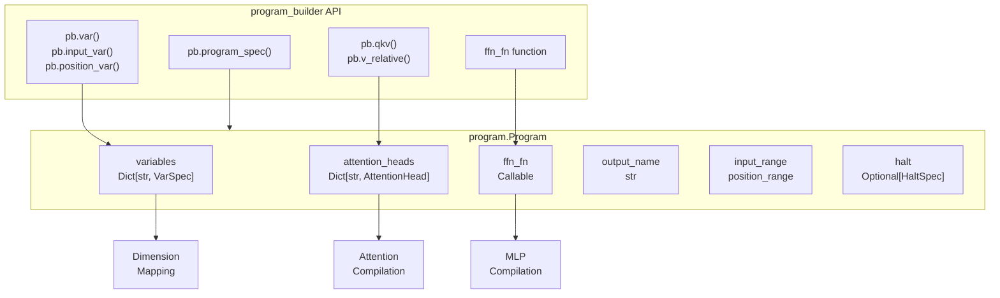

**Sources:** [examples/sort_unique.py:52-95](), [examples/addition.py:172-185]()

---

## Variable Definitions

Variables represent the transformer's state at each position. Each variable has a **name**, a **type** (categorical, set, or numerical), and a **range** that defines its possible values.

### Variable Types

The framework supports three fundamental variable types, each with different representation strategies:

| Variable Type | Constructor | Representation | Use Case |
|---------------|-------------|----------------|----------|
| **Categorical** | `pb.var(range)` | One-hot vector of size `range` | Discrete states, tokens |
| **Set** | `pb.set_var(range, values)` | Binary vector indicating set membership | Sets of discrete elements |
| **Numerical** | `pb.numeric_var()` | Single floating-point value | Continuous values, pointers |

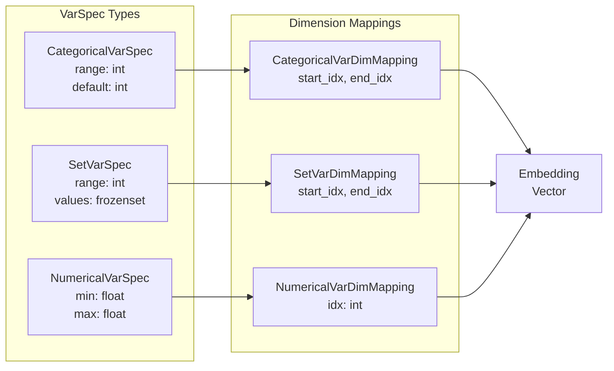

**Sources:** [framework/compiler/dim_utils.py:24-80]()

### Categorical Variables

Categorical variables represent discrete states with a finite range. They are encoded as one-hot vectors.

**Basic categorical variable:**
```python
variables = {
    "state": pb.var(2),  # Binary state: 0 or 1
    "step": pb.var(4),   # Four-step process: 0, 1, 2, 3
}
```

**Input variables** (token embeddings):
```python
variables = {
    "token": pb.input_var(INPUT_RANGE),  # Initialized from input sequence
}
```

**Position variables** (positional encodings):
```python
variables = {
    "indices": pb.position_var(POSITION_RANGE),  # Position index 0 to POSITION_RANGE-1
}
```

**Sources:** [examples/sort_unique.py:55-71](), [examples/addition.py:131-152]()

### Set Variables

Set variables represent sets of discrete elements. They require both a `range` (element space) and `values` (possible sets).

```python
def _get_target_pos_query(input_id):
    if input_id == BOS_VALUE:
        return frozenset([BOS_VALUE])
    else:
        return frozenset(range(input_id + 1))

def _possible_target_pos_query_values():
    possible_values = set()
    for input_id in range(INPUT_RANGE):
        possible_values.add(_get_target_pos_query(input_id))
    return frozenset(possible_values)

variables = {
    "target_pos_query": pb.set_var(
        range=INPUT_RANGE,
        values=_possible_target_pos_query_values(),
        input_init_fn=_get_target_pos_query,
    ),
}
```

The `input_init_fn` parameter specifies how to initialize the set variable from input values.

**Sources:** [examples/sort_unique.py:38-63]()

### Numerical Variables

Numerical variables store floating-point values in a single dimension.

```python
variables = {
    # Computed numerical value
    "target_pos": pb.var(POSITION_RANGE),
    
    # Initialized by position
    "bos": pb.numeric_var(position_init_fn=lambda x: float(x == 0)),
    
    # Static constant
    "one": pb.var(var_range=2, default=1),
}
```

**Sources:** [examples/sort_unique.py:68-70](), [examples/addition.py:150]()

### Variable Initialization

Variables can be initialized in three ways:

1. **Default values:** Specified via `default` parameter
2. **Input initialization:** Specified via `input_init_fn` parameter
3. **Position initialization:** Specified via `position_init_fn` parameter

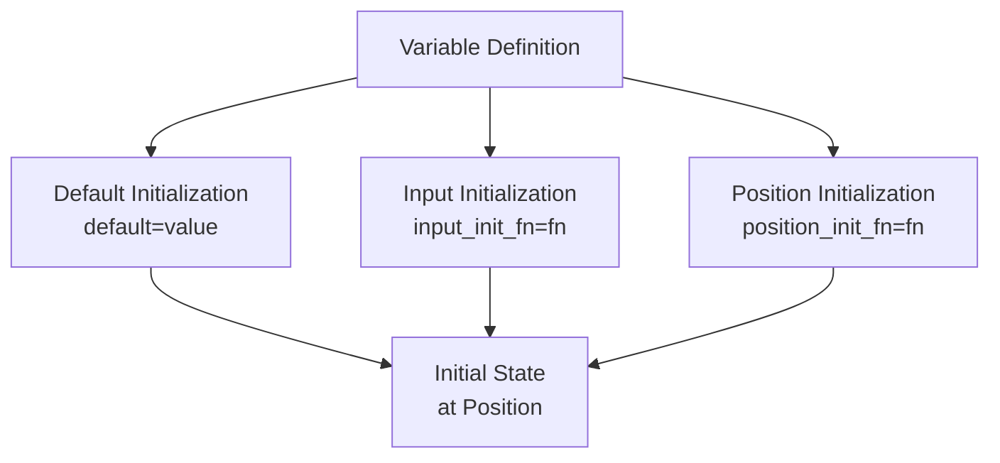

**Sources:** [examples/sort_unique.py:59-69]()

---

## Attention Head Specifications

Attention heads define how information flows between positions in the sequence. ALTA supports two types of attention patterns: **QKV attention** for content-based selection and **relative attention** for fixed positional offsets.

### QKV Attention

QKV attention heads are defined by specifying query, key, and value variable names. The attention mechanism selects positions where `query == key` and aggregates their `value` variables.

```python
attention_heads = {
    # Select positions where indices == target_pos, aggregate inputs
    "output": pb.qkv("indices", "target_pos", "inputs"),
    
    # Select positions where target_pos_query contains inputs, aggregate bos
    "x": pb.qkv("target_pos_query", "inputs", "bos"),
    
    # Select positions where one == ptr_a, aggregate token
    "ptr_a_token": pb.qkv("one", "ptr_a", "token"),
}
```

**Attention semantics:**
- For categorical variables: `query == key` (exact match)
- For set variables: `key ∈ query` (membership test)
- For numerical variables: Used as floating-point values in attention computation

**Sources:** [examples/sort_unique.py:72-75](), [examples/addition.py:155-169]()

### Relative Attention

Relative attention heads attend to a fixed offset from the current position.

```python
attention_heads = {
    # Attend to position i+1 (one position to the right)
    "token_right": pb.v_relative("token", 1),
    "ptr_a_right": pb.v_relative("ptr_a", 1),
    
    # Attend to position i-1 (one position to the left)
    "prev_state": pb.v_relative("state", -1),
}
```

The offset parameter specifies the relative position: positive values look right, negative values look left.

**Sources:** [examples/addition.py:155-164]()

### Attention Head Structure

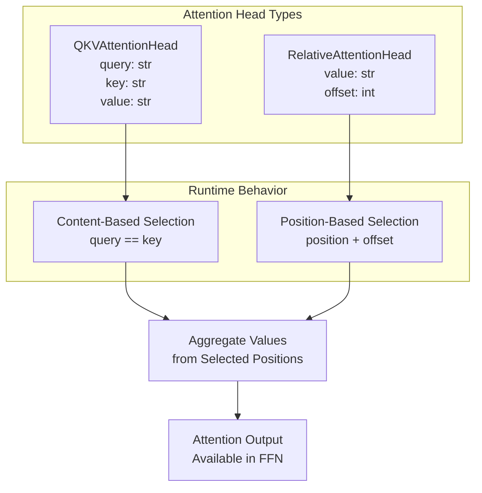

**Sources:** [examples/addition.py:155-169]()

---

## Feed-Forward Network Function

The FFN function implements the core logic of the program. It operates on the `VarsWrapper` interface, which provides access to all variables and attention outputs at a single position.

### VarsWrapper Interface

The `VarsWrapper` object passed to the FFN function provides dictionary-like access to variables:

```python
def ffn_fn(x: simple_mlp.VarsWrapper):
    # Read variable values
    current_state = x["state"]
    carry_value = x["value_carry"]
    
    # Read attention outputs
    right_token = x["token_right"]  # From relative attention
    ptr_a_value = x["ptr_a_token"]  # From QKV attention
    
    # Write variable values
    x["state"] = 1
    x["value_out"] = carry_value + ptr_a_value
```

**Key properties:**
- Reading a variable returns its current value
- Reading an attention head name returns the aggregated output
- Writing to a variable updates its value for the next layer
- Undefined attention outputs (e.g., attending past sequence end) return `undefined`

**Sources:** [examples/sort_unique.py:77-86](), [examples/addition.py:84-128]()

### FFN Function Patterns

ALTA programs typically use state machines implemented via conditional logic:

**Simple state-based computation:**
```python
def ffn_fn(x: simple_mlp.VarsWrapper):
    if x["state"] == 0:
        # Compute inverse of selector width
        x["target_pos"] = round(1 / x["x"]) - 1
        x["state"] = 1
    elif x["state"] == 1:
        # Copy attention output to program output
        x["program_ouput"] = x["output"]
```

**Multi-step processing:**
```python
def _ffn_fn(x: simple_mlp.VarsWrapper):
    if x["step"] == STEP_INIT:
        _init(x)
        x["step"] = STEP_ITERATE
    elif x["step"] == STEP_ITERATE:
        if x["ptr_a_token"] == START_TOKEN:
            x["step"] = STEP_FINALIZE
        else:
            _iterate(x)
    elif x["step"] == STEP_FINALIZE:
        _finalize(x)
```

**Sources:** [examples/sort_unique.py:77-86](), [examples/addition.py:118-128]()

### FFN Execution Model

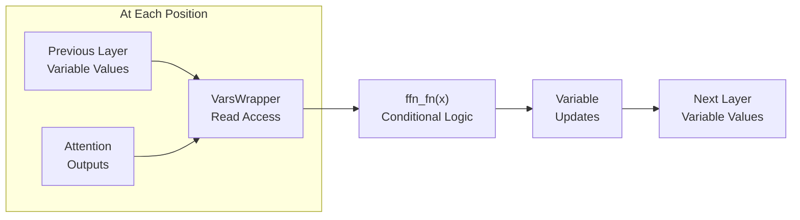

**Sources:** [examples/addition.py:84-128]()

---

## Complete Program Construction

Programs are assembled using `pb.program_spec()`, which combines all components into a `program.Program` object.

### The program_spec() Function

```python
def build_program_spec() -> program.Program:
    variables = {
        "token": pb.input_var(INPUT_RANGE),
        "state": pb.var(NUM_STEPS),
        "ptr_a": pb.var(2),
        "value_out": pb.var(10),
    }
    
    attention_heads = {
        "token_right": pb.v_relative("token", 1),
        "ptr_a_token": pb.qkv("one", "ptr_a", "token"),
    }
    
    return pb.program_spec(
        variables=variables,
        heads=attention_heads,
        ffn_fn=_ffn_fn,
        output_name="value_out",
        input_range=INPUT_RANGE,
        position_range=None,  # If None, inferred from input
        halt=pb.halt_spec("step", halt_value=STEP_DONE),
        generate_rules=False,
    )
```

**Sources:** [examples/addition.py:172-185](), [examples/sort_unique.py:52-95]()

### program_spec() Parameters

| Parameter | Type | Description |
|-----------|------|-------------|
| `variables` | `dict[str, VarSpec]` | Variable definitions |
| `heads` | `dict[str, AttentionHead]` | Attention head specifications |
| `ffn_fn` | `Callable` | Feed-forward function |
| `output_name` | `str` | Name of variable containing final output |
| `input_range` | `int` | Size of input vocabulary |
| `position_range` | `int \| None` | Maximum sequence length (None to infer) |
| `halt` | `HaltSpec \| None` | Optional early stopping condition |
| `generate_rules` | `bool` | Whether to auto-generate transition rules |

### Halt Specifications

Programs can specify early stopping conditions via `pb.halt_spec()`:

```python
halt=pb.halt_spec("step", halt_value=STEP_DONE)
```

This halts execution when the `step` variable reaches `STEP_DONE` at all positions.

**Sources:** [examples/addition.py:183]()

### Program Construction Flow

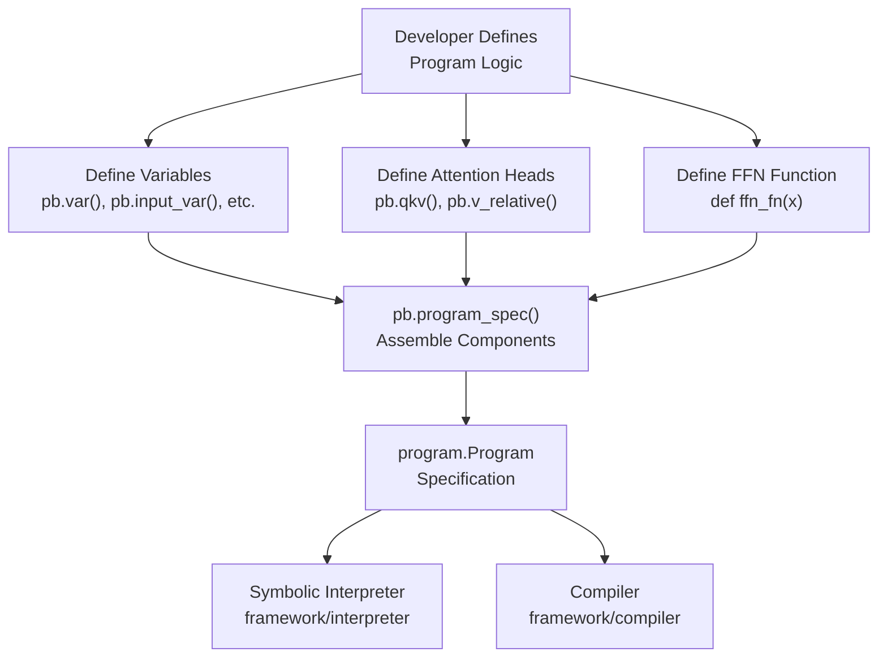

**Sources:** [examples/sort_unique.py:52-95](), [examples/addition.py:172-185]()

---

## Example: Sort Unique Program

The following example demonstrates all components of a program specification:

```mermaid
graph TB
    subgraph Variables["Variables Definition"]
        V1["inputs: pb.input_var(16)<br/>Token values"]
        V2["indices: pb.position_var(16)<br/>Position indices"]
        V3["state: pb.var(2)<br/>Processing state"]
        V4["target_pos_query: pb.set_var()<br/>Query sets"]
        V5["bos: pb.numeric_var()<br/>BOS indicator"]
        V6["target_pos: pb.var(16)<br/>Target positions"]
        V7["program_ouput: pb.var(16)<br/>Final output"]
    end
    
    subgraph Attention["Attention Heads"]
        H1["x: pb.qkv(target_pos_query,<br/>inputs, bos)<br/>Compute selector width"]
        H2["output: pb.qkv(indices,<br/>target_pos, inputs)<br/>Sort lookup"]
    end
    
    subgraph FFN["FFN Function"]
        F1["if state == 0:<br/>Compute target position"]
        F2["elif state == 1:<br/>Copy to output"]
    end
    
    Variables --> SPEC["pb.program_spec()"]
    Attention --> SPEC
    FFN --> SPEC
    
    SPEC --> RESULT["program.Program<br/>Sort Specification"]
```

**Complete specification structure:**

| Component | Count | Purpose |
|-----------|-------|---------|
| Input variables | 1 | `inputs` - token values |
| Position variables | 1 | `indices` - position indices |
| State variables | 5 | Track computation progress |
| Attention heads | 2 | Compute selector width, perform sorted lookup |
| FFN states | 2 | Two-stage computation |

**Sources:** [examples/sort_unique.py:52-95]()

---

## Variable Dimension Mapping

The compiler maps variables to dimensions in the transformer's embedding space. This mapping is computed by `dim_utils`:

```mermaid
graph LR
    subgraph ProgramVariables["Program Variables"]
        VAR1["state: pb.var(2)"]
        VAR2["token: pb.input_var(13)"]
        VAR3["target_pos: pb.var(16)"]
    end
    
    subgraph DimMapping["Dimension Mapping"]
        MAP1["CategoricalVarDimMapping<br/>start_idx=0, end_idx=2"]
        MAP2["CategoricalVarDimMapping<br/>start_idx=2, end_idx=15"]
        MAP3["CategoricalVarDimMapping<br/>start_idx=15, end_idx=31"]
    end
    
    subgraph EmbeddingVector["Embedding Vector"]
        VEC["[state_0, state_1, token_0, ..., token_12,<br/>target_pos_0, ..., target_pos_15]<br/>Total dimension: 31"]
    end
    
    VAR1 --> MAP1
    VAR2 --> MAP2
    VAR3 --> MAP3
    
    MAP1 --> VEC
    MAP2 --> VEC
    MAP3 --> VEC
```

**Dimension allocation:**
- **Categorical variables:** Allocated `range` dimensions (one-hot encoding)
- **Set variables:** Allocated `range` dimensions (binary membership vector)
- **Numerical variables:** Allocated 1 dimension (floating-point value)

**Sources:** [framework/compiler/dim_utils.py:100-122](), [framework/compiler/dim_utils.py:153-167]()

---

## Summary

An ALTA program specification consists of:

1. **Variables** - Categorical, set, or numerical state containers
2. **Attention heads** - QKV or relative attention patterns  
3. **FFN function** - State transition logic operating on `VarsWrapper`
4. **Configuration** - Output variable, ranges, halt conditions

These components are assembled via `pb.program_spec()` to create a `program.Program` object that can be:
- Executed symbolically by the interpreter ([3.2](#3.2))
- Compiled to transformer weights ([3.3](#3.3))
- Analyzed for trace extraction ([3.5](#3.5))

**Sources:** [examples/sort_unique.py:52-95](), [examples/addition.py:131-185](), [framework/compiler/dim_utils.py:1-185]()

---

# Page: Symbolic Interpreter

# Symbolic Interpreter

<details>
<summary>Relevant source files</summary>

The following files were used as context for generating this wiki page:

- [README.md](README.md)
- [examples/addition_test.py](examples/addition_test.py)
- [examples/parity_test.py](examples/parity_test.py)
- [examples/scan/data_utils.py](examples/scan/data_utils.py)

</details>


## Purpose and Scope

The symbolic interpreter provides direct execution of ALTA program specifications without compilation to neural network weights. Unlike the compiler pipeline (see [3.3](#3.3)), which transforms programs into transformer parameters, the interpreter maintains symbolic representations of variables and executes programs step-by-step through transformer layers. This enables program verification, debugging, and extraction of execution traces for analysis.

For information about the compiled execution path, see [Transformer Execution](#3.4). For trace extraction and MLP training capabilities, see [Traces and MLP Training](#3.5).

---

## System Architecture

The interpreter subsystem consists of three primary modules that work together to execute ALTA programs symbolically:

```mermaid
graph TB
    subgraph "Interpreter Subsystem"
        PU["program_utils.py<br/>Activation Initialization"]
        IU["interpreter_utils.py<br/>Core Execution Engine"]
        LU["logger_utils.py<br/>Trace Extraction"]
    end
    
    subgraph "Input"
        PS["program.Program<br/>Specification"]
        INPUT["input_ids<br/>list[int]"]
    end
    
    subgraph "Execution State"
        ACT["Activations<br/>dict[str, list[int]]"]
        LAYERS["Layer-by-layer<br/>Processing"]
    end
    
    subgraph "Output"
        OUT["output_ids<br/>list[int]"]
        TRACES["Execution Traces<br/>Variable History"]
    end
    
    PS --> PU
    INPUT --> PU
    PU --> ACT
    
    ACT --> IU
    PS --> IU
    IU --> LAYERS
    
    LAYERS --> IU
    IU --> OUT
    
    LU -.observes.-> LAYERS
    LU --> TRACES
    
    style PU fill:#e8f5e9
    style IU fill:#e8f5e9
    style LU fill:#fff3e0
```

**Interpreter Execution Flow**: The interpreter begins with `program_utils.initialize_activations()` to create initial symbolic states, then `interpreter_utils.run_transformer()` executes the program layer-by-layer. Optional `logger_utils.ActivationsLogger` instances can observe execution to extract traces.

**Sources**: [README.md:30-35](), [examples/parity_test.py:111-120](), [examples/addition_test.py:37-45]()

---

## Activation Initialization

The `program_utils.initialize_activations()` function creates the initial symbolic state for program execution by mapping input tokens to variable activations.

### Initialization Process

| Step | Function | Purpose |
|------|----------|---------|
| 1 | Parse input_ids | Convert input tokens to sequence positions |
| 2 | Initialize variables | Set initial values for all program variables |
| 3 | Create activation dict | Build mapping from variable names to activation sequences |

```mermaid
graph LR
    subgraph "Input"
        PROG["program.Program"]
        IDS["input_ids<br/>[1, 0, 1]"]
    end
    
    subgraph "program_utils.initialize_activations"
        PARSE["Parse Input<br/>Sequence"]
        INIT["Initialize<br/>Variables"]
        BUILD["Build Activation<br/>Dictionary"]
    end
    
    subgraph "Output"
        ACT["activations_seq<br/>dict[str, list[int]]"]
    end
    
    PROG --> PARSE
    IDS --> PARSE
    PARSE --> INIT
    INIT --> BUILD
    BUILD --> ACT
    
    style PARSE fill:#e8f5e9
    style INIT fill:#e8f5e9
    style BUILD fill:#e8f5e9
```

**Activation Dictionary Structure**: The `initialize_activations()` function returns a dictionary mapping variable names (strings) to sequences of activation values (lists of integers). Each position in the sequence corresponds to a token position in the input.

**Sources**: [examples/parity_test.py:113-115](), [examples/addition_test.py:37-39]()

### Usage Example

```python
# From parity_test.py
program_spec = get_program_spec(parity_algorithm)
activations_seq = program_utils.initialize_activations(
    program_spec, 
    input_ids=[1, 0, 1]
)
# activations_seq is now dict[str, list[int]] with initial variable values
```

**Sources**: [examples/parity_test.py:113-115]()

---

## Interpreter Execution

The core execution engine is `interpreter_utils.run_transformer()`, which processes the program layer-by-layer until completion or maximum layers reached.

### Execution Parameters

```mermaid
graph TB
    subgraph "run_transformer Parameters"
        PROG["program_spec<br/>program.Program"]
        ACT["activations_seq<br/>dict[str, list[int]]"]
        MAX["max_layers<br/>int | None"]
        LOG["logger<br/>ActivationsLogger | None"]
    end
    
    subgraph "Execution Control"
        LOOP["Layer Loop"]
        ATTN["Apply Attention<br/>Heads"]
        FFN["Execute FFN<br/>Functions"]
        CHECK["Check Halting<br/>Conditions"]
    end
    
    subgraph "Output"
        OUT["output_ids<br/>list[int]"]
    end
    
    PROG --> LOOP
    ACT --> LOOP
    MAX --> CHECK
    LOG -.observes.-> LOOP
    
    LOOP --> ATTN
    ATTN --> FFN
    FFN --> CHECK
    CHECK -->|continue| LOOP
    CHECK -->|halt| OUT
    
    style ATTN fill:#e1f5ff
    style FFN fill:#e1f5ff
```

**Layer-by-Layer Processing**: Each iteration applies attention heads to aggregate information, then executes FFN functions to update variable values. The loop continues until halting conditions are met or `max_layers` is reached.

**Sources**: [examples/parity_test.py:116-120](), [examples/addition_test.py:40-44]()

### Halting Mechanisms

The interpreter supports two halting mechanisms:

| Mechanism | Trigger | Behavior |
|-----------|---------|----------|
| **Fixed Layers** | `max_layers=N` (integer) | Execute exactly N layers |
| **Dynamic Halting** | `max_layers=None` | Stop when program signals completion |

```python
# Fixed layers execution
outputs = interpreter_utils.run_transformer(
    program_spec,
    activations_seq,
    max_layers=10  # Execute exactly 10 layers
)

# Dynamic halting execution
outputs = interpreter_utils.run_transformer(
    program_spec,
    activations_seq,
    max_layers=None  # Run until program halts
)
```

**Sources**: [examples/parity_test.py:326-340](), [examples/parity_test.py:342-356]()

### Return Value

The `run_transformer()` function returns `output_ids`, a list of integers representing the final output sequence. The mapping from these IDs to semantic values is program-specific and typically handled by postprocessing functions.

```python
# From addition_test.py
output_ids = interpreter_utils.run_transformer(
    program_spec,
    activations_seq,
    max_layers=None,
)
# output_ids: list[int]
output = addition.process_output(output_ids)  # Program-specific postprocessing
```

**Sources**: [examples/addition_test.py:40-46]()

---

## Trace Extraction and Logging

The `logger_utils.ActivationsLogger` class enables observation and extraction of execution traces during symbolic interpretation.

### Logger Architecture

```mermaid
graph TB
    subgraph "Logger Integration"
        LOGGER["ActivationsLogger<br/>logger_utils.py"]
        RUN["run_transformer"]
    end
    
    subgraph "Captured Data"
        VARS["Variable Values<br/>Per Layer"]
        ATTN_OUT["Attention Outputs<br/>Per Head"]
        FFN_OUT["FFN Outputs<br/>Per Layer"]
    end
    
    subgraph "Output Methods"
        TABLE["print_activations_table"]
        EXPORT["Export to Training Data"]
    end
    
    LOGGER -.observes.-> RUN
    RUN --> VARS
    RUN --> ATTN_OUT
    RUN --> FFN_OUT
    
    VARS --> TABLE
    ATTN_OUT --> TABLE
    FFN_OUT --> TABLE
    
    VARS --> EXPORT
    FFN_OUT --> EXPORT
    
    style LOGGER fill:#fff3e0
```

**Trace Collection**: The logger observes variable activations and layer outputs during execution, building a complete history of program state evolution across layers.

**Sources**: [examples/parity_test.py:215-220]()

### Logger Usage

```python
# From parity_test.py
logger = logger_utils.ActivationsLogger()
outputs = interpreter_utils.run_transformer(
    program_spec, 
    activations_seq, 
    max_layers=10, 
    logger=logger
)
# For debugging:
logger.print_activations_table()
```

**Sources**: [examples/parity_test.py:215-220]()

### Trace Applications

Execution traces captured by the logger serve multiple purposes:

| Application | Description | Reference |
|-------------|-------------|-----------|
| **Debugging** | Inspect variable values at each layer | `print_activations_table()` |
| **Verification** | Validate program correctness step-by-step | Test files |
| **MLP Training** | Generate supervised training data for FFN approximation | See [3.5](#3.5) |

**Sources**: [README.md:34-35](), [examples/parity_test.py:219-220]()

---

## Interpreter vs Compiler Comparison

The symbolic interpreter and compiler provide equivalent functionality through different mechanisms:

```mermaid
graph LR
    subgraph "Symbolic Interpreter Path"
        I_PROG["program.Program"]
        I_INIT["initialize_activations"]
        I_RUN["run_transformer<br/>interpreter_utils"]
        I_OUT["Symbolic Outputs"]
    end
    
    subgraph "Compiler Path"
        C_PROG["program.Program"]
        C_COMP["compile_transformer<br/>compiler_utils"]
        C_PARAMS["parameters.Parameters"]
        C_RUN["run_transformer<br/>transformer_utils"]
        C_OUT["Neural Outputs"]
    end
    
    I_PROG --> I_INIT
    I_INIT --> I_RUN
    I_RUN --> I_OUT
    
    C_PROG --> C_COMP
    C_COMP --> C_PARAMS
    C_PARAMS --> C_RUN
    C_RUN --> C_OUT
    
    I_OUT -.equivalent.-> C_OUT
    
    style I_RUN fill:#e8f5e9
    style C_RUN fill:#f3e5f5
```

**Functional Equivalence**: Both execution paths produce identical outputs for the same input, as verified by test suites. The interpreter maintains symbolic representations, while the compiler produces fixed neural weights.

| Aspect | Symbolic Interpreter | Compiler |
|--------|---------------------|----------|
| **Execution** | Step-by-step symbolic processing | Fixed neural network forward pass |
| **Performance** | Slower, detailed tracking | Faster, optimized matrix operations |
| **Observability** | Full variable inspection | Limited to final outputs |
| **Traces** | Can extract execution traces | Cannot extract traces |
| **Use Case** | Development, debugging, analysis | Deployment, production, efficiency |

**Sources**: [examples/parity_test.py:251-264](), [examples/parity_test.py:271-284](), [examples/addition_test.py:70-89]()

---

## Code Organization

The interpreter subsystem is organized into three modules within `framework/interpreter/`:

| Module | Key Functions | Purpose |
|--------|--------------|---------|
| `program_utils.py` | `initialize_activations()` | Create initial activation states from inputs |
| `interpreter_utils.py` | `run_transformer()` | Execute program layer-by-layer symbolically |
| `logger_utils.py` | `ActivationsLogger` | Capture execution traces for analysis |

```mermaid
graph TB
    subgraph "framework/interpreter/"
        direction TB
        
        PU["program_utils.py"]
        IU["interpreter_utils.py"]
        LU["logger_utils.py"]
        
        PU -->|"provides activations to"| IU
        IU -->|"observed by"| LU
    end
    
    subgraph "External Dependencies"
        PROG["framework/program.py"]
        VAR["framework/var_utils.py"]
    end
    
    PROG --> PU
    PROG --> IU
    VAR --> IU
    
    style PU fill:#e8f5e9
    style IU fill:#e8f5e9
    style LU fill:#fff3e0
```

**Module Separation**: The three-module design separates concerns: initialization, execution, and observation are independent and can be used separately or composed.

**Sources**: [README.md:30-35](), [examples/parity_test.py:24-29]()

---

## Testing and Validation

The interpreter is extensively tested across multiple example programs:

```python
# Standard interpreter test pattern
def test_parity(self, parity_algorithm: ParityAlgorithm):
    program_spec = get_program_spec(parity_algorithm, generate_rules=False)
    
    input_ids = [random.choice([0, 1]) for _ in range(input_length)]
    activations_seq = program_utils.initialize_activations(
        program_spec, 
        get_inputs(parity_algorithm, input_ids)
    )
    outputs = interpreter_utils.run_transformer(
        program_spec,
        activations_seq,
        max_layers=max_layers,
    )
    
    # Verify correctness
    if is_even(input_ids):
        self.assertEqual(outputs[-1], 0)
    else:
        self.assertEqual(outputs[-1], 1)
```

**Sources**: [examples/parity_test.py:103-125]()

### Test Coverage

| Test Suite | Program | Validation |
|------------|---------|------------|
| `parity_test.py` | Parity detection algorithms | Random inputs, edge cases, dynamic halting |
| `addition_test.py` | Multi-digit addition | Specific test cases, output verification |

**Sources**: [examples/parity_test.py:1-390](), [examples/addition_test.py:1-93]()

---

# Page: Compiler Pipeline

# Compiler Pipeline

<details>
<summary>Relevant source files</summary>

The following files were used as context for generating this wiki page:

- [examples/addition_test.py](examples/addition_test.py)
- [framework/compiler/compiler_utils.py](framework/compiler/compiler_utils.py)
- [framework/compiler/dim_utils.py](framework/compiler/dim_utils.py)

</details>


## Purpose and Scope

The compiler pipeline transforms ALTA program specifications into concrete Transformer parameters that can be executed by the neural network runtime. This document covers the compilation process from `program.Program` specifications to `parameters.Parameters` objects, including dimension mapping, embedding generation, attention head construction, and feed-forward network compilation.

For information about program specification syntax, see [Program Specification](#3.1). For details on how compiled parameters are executed, see [Transformer Execution](#3.4).

**Sources:** [framework/compiler/compiler_utils.py:1-100]()

---

## Compilation Overview

The compiler operates through a single entry point function `compile_transformer` that orchestrates multiple specialized compilation stages. The process begins with dimension mapping, which establishes how each program variable maps to dimensions in the embedding space. This mapping then feeds into five parallel parameter generation stages that produce the complete Transformer parameter set.

```mermaid
graph TB
    Input["program.Program<br/>specification"]
    Entry["compiler_utils.compile_transformer()"]
    
    subgraph "Stage 1: Foundation"
        DimMap["dim_utils.get_var_mapping()"]
        ExpandedDimMap["dim_utils.get_expanded_var_mapping()"]
    end
    
    subgraph "Stage 2: Parameter Generation"
        Emb["embedding_utils.get_embedding_parameters()"]
        Attn["projection_utils.get_attention_params()"]
        FFNExp["ffn_expansion_utils.build_expansion_params()"]
        FFNLook["ffn_lookup_utils.build_lookup_params()"]
        OutProj["projection_utils.get_output_transform()"]
    end
    
    subgraph "Stage 3: Assembly"
        FFNAssembly["_get_feed_forward_params()"]
        ParamObj["parameters.Parameters"]
    end
    
    Input --> Entry
    Entry --> DimMap
    Entry --> ExpandedDimMap
    
    DimMap --> Emb
    DimMap --> Attn
    DimMap --> FFNExp
    DimMap --> FFNLook
    DimMap --> OutProj
    
    ExpandedDimMap --> FFNExp
    ExpandedDimMap --> FFNLook
    
    Emb --> ParamObj
    Attn --> ParamObj
    OutProj --> ParamObj
    
    FFNExp --> FFNAssembly
    FFNLook --> FFNAssembly
    FFNAssembly --> ParamObj
```

**Sources:** [framework/compiler/compiler_utils.py:63-99]()

---

## Entry Point: compile_transformer

The `compile_transformer` function in `compiler_utils` serves as the main interface for compilation. It accepts a `program.Program` specification and a `compiler_config.Config` object, returning a complete `parameters.Parameters` object.

### Function Signature

```python
def compile_transformer(
    program_spec: program.Program,
    config: compiler_config.Config,
    compile_ffn: bool = True,
    verbose: bool = False,
) -> parameters.Parameters:
```

### Parameters

| Parameter | Type | Description |
|-----------|------|-------------|
| `program_spec` | `program.Program` | The ALTA program specification to compile |
| `config` | `compiler_config.Config` | Compiler configuration options |
| `compile_ffn` | `bool` | Whether to compile feed-forward layers (default: `True`) |
| `verbose` | `bool` | Enable detailed logging of dimension mappings (default: `False`) |

### Return Value

Returns a `parameters.Parameters` object containing:
- `embeddings`: Token embedding matrices
- `attention_heads`: List of attention head parameters
- `feed_forward_layers`: List of FFN layer parameters (or `None` if `compile_ffn=False`)
- `output_transform`: Output projection matrices

**Sources:** [framework/compiler/compiler_utils.py:63-99](), [examples/addition_test.py:70-89]()

---

## Stage 1: Dimension Mapping

Dimension mapping is the foundational stage that establishes how program variables map to dimensions in the Transformer's embedding vectors. The `dim_utils` module provides two distinct mapping strategies.

### Standard Variable Mapping

The `get_var_mapping` function creates mappings for normal Transformer execution:

```mermaid
graph LR
    VarSpecs["program_spec.variables<br/>(dict of VarSpec objects)"]
    GetVarMapping["dim_utils.get_var_mapping()"]
    Mappings["VarDimMappings"]
    
    subgraph "Variable Types"
        Cat["CategoricalVarSpec<br/>→ CategoricalVarDimMapping<br/>(range of dimensions)"]
        Set["SetVarSpec<br/>→ SetVarDimMapping<br/>(range of dimensions)"]
        Num["NumericalVarSpec<br/>→ NumericalVarDimMapping<br/>(single dimension)"]
    end
    
    VarSpecs --> GetVarMapping
    GetVarMapping --> Cat
    GetVarMapping --> Set
    GetVarMapping --> Num
    
    Cat --> Mappings
    Set --> Mappings
    Num --> Mappings
```

### Expanded Variable Mapping

The `get_expanded_var_mapping` function creates one-hot representations used internally by the FFN:

| Variable Type | Standard Mapping | Expanded Mapping |
|---------------|------------------|------------------|
| `CategoricalVarSpec` | `CategoricalVarDimMapping` (one-hot) | Same as standard |
| `SetVarSpec` | `SetVarDimMapping` (indicator vector) | `ExpandedSetVarDimMapping` (one-hot per possible set) |
| `NumericalVarSpec` | `NumericalVarDimMapping` (single float) | `ExpandedNumericalVarDimMapping` (one-hot buckets) |

### Dimension Mapping Classes

The dimension mapping classes defined in `dim_utils` are:

```mermaid
classDiagram
    class VarDimMapping {
        <<union type>>
    }
    
    class CategoricalVarDimMapping {
        +int start_idx
        +int end_idx
    }
    
    class SetVarDimMapping {
        +int start_idx
        +int end_idx
    }
    
    class NumericalVarDimMapping {
        +int idx
    }
    
    class ExpandedNumericalVarDimMapping {
        +int start_idx
        +int end_idx
        +tuple buckets
    }
    
    class ExpandedSetVarDimMapping {
        +int start_idx
        +int end_idx
        +tuple values
    }
    
    class VarDimMappings {
        +dict var_mappings
        +int start_idx
        +int end_idx
    }
    
    VarDimMapping <|-- CategoricalVarDimMapping
    VarDimMapping <|-- SetVarDimMapping
    VarDimMapping <|-- NumericalVarDimMapping
    VarDimMapping <|-- ExpandedNumericalVarDimMapping
    VarDimMapping <|-- ExpandedSetVarDimMapping
    
    VarDimMappings --> VarDimMapping : contains
```

**Sources:** [framework/compiler/dim_utils.py:1-185](), [framework/compiler/compiler_utils.py:70-75]()

---

## Stage 2: Parameter Generation

After dimension mappings are established, the compiler generates parameters for each Transformer component in parallel. Each component uses the dimension mappings to construct matrices of the appropriate size.

### Embedding Parameters

The `embedding_utils.get_embedding_parameters` function generates token embedding matrices that map input token IDs to embedding vectors.

```mermaid
graph LR
    DimMap["dim_mappings"]
    ProgramSpec["program_spec.variables"]
    EmbFunc["embedding_utils.get_embedding_parameters()"]
    EmbMatrix["Embedding matrix<br/>(vocab_size × embedding_dim)"]
    
    ProgramSpec --> EmbFunc
    DimMap --> EmbFunc
    EmbFunc --> EmbMatrix
```

The embedding matrix dimensions are determined by:
- **Rows**: Maximum token ID across all categorical variables
- **Columns**: Total embedding dimension from `dim_mappings.end_idx`

**Sources:** [framework/compiler/compiler_utils.py:77-79]()

### Attention Head Parameters

The `projection_utils.get_attention_params` function compiles each attention head defined in `program_spec.attention_heads` into parameter matrices.

```mermaid
graph TB
    Heads["program_spec.attention_heads<br/>(list of AttentionHead)"]
    Config["config"]
    DimMap["dim_mappings"]
    
    GetAttn["projection_utils.get_attention_params()"]
    
    subgraph "For each AttentionHead"
        QProj["Query projection matrix"]
        KProj["Key projection matrix"]
        VProj["Value projection matrix"]
        OutProj["Output projection matrix"]
    end
    
    HeadParams["List of AttentionHeadParams"]
    
    Heads --> GetAttn
    Config --> GetAttn
    DimMap --> GetAttn
    
    GetAttn --> QProj
    GetAttn --> KProj
    GetAttn --> VProj
    GetAttn --> OutProj
    
    QProj --> HeadParams
    KProj --> HeadParams
    VProj --> HeadParams
    OutProj --> HeadParams
```

Each attention head produces four projection matrices that implement the attention mechanism's query, key, value computations and output transformation.

**Sources:** [framework/compiler/compiler_utils.py:80-82]()

### Output Transform

The `projection_utils.get_output_transform` function generates the final projection matrix that maps from the embedding space to output token IDs.

**Sources:** [framework/compiler/compiler_utils.py:90-92]()

---

## Feed-Forward Network Compilation

FFN compilation is the most complex stage, split into two phases: expansion and lookup. Each phase contributes two FFN layers to the final network, resulting in four layers total.

### FFN Architecture

```mermaid
graph TB
    Input["Input activation<br/>(standard dimensions)"]
    
    subgraph "Expansion Phase (2 layers)"
        Exp1["FFN Layer 1<br/>ffn_expansion_utils<br/>weights_1, bias_1"]
        Exp2["FFN Layer 2<br/>ffn_expansion_utils<br/>weights_2, bias_2"]
    end
    
    subgraph "Lookup Phase (2 layers)"
        Look1["FFN Layer 3<br/>ffn_lookup_utils<br/>weights_1, bias_1"]
        Look2["FFN Layer 4<br/>ffn_lookup_utils<br/>weights_2, bias_2"]
    end
    
    Output["Output activation<br/>(standard dimensions)"]
    
    Input --> Exp1
    Exp1 --> Exp2
    Exp2 --"expanded dimensions"--> Look1
    Look1 --> Look2
    Look2 --> Output
```

### Expansion Phase

The `ffn_expansion_utils.build_expansion_params` function transforms standard dimension mappings to expanded (one-hot) representations:

| Input | Processing | Output |
|-------|------------|--------|
| Numerical variables (single float) | Discretize into buckets | One-hot bucket representation |
| Set variables (indicator vector) | Enumerate possible sets | One-hot set representation |
| Categorical variables | Pass through | Unchanged one-hot |

The expansion phase uses both `dim_mappings` (standard) and `expanded_dim_mappings` to construct transformation matrices.

**Sources:** [framework/compiler/compiler_utils.py:35-40]()

### Lookup Phase

The `ffn_lookup_utils.build_lookup_params` function implements the program's FFN logic (`program_spec.ffn_fn`) by building lookup tables in the expanded space, then projecting back to standard dimensions.

The lookup phase operates on the expanded one-hot representations, where each possible variable value combination corresponds to a single dimension. This allows the FFN function to be implemented as a simple lookup table.

**Sources:** [framework/compiler/compiler_utils.py:41-45]()

### FFN Assembly

The `_get_feed_forward_params` helper function assembles the four FFN layers into a list of `FeedForwardLayerParams` objects:

```mermaid
graph LR
    ExpParams["expansion_params"]
    LookParams["lookup_params"]
    
    subgraph "Assembly"
        Layer1["FeedForwardLayerParams<br/>(weights_1, bias_1)"]
        Layer2["FeedForwardLayerParams<br/>(weights_2, bias_2)"]
        Layer3["FeedForwardLayerParams<br/>(weights_1, bias_1)"]
        Layer4["FeedForwardLayerParams<br/>(weights_2, bias_2)"]
    end
    
    Output["list[FeedForwardLayerParams]"]
    
    ExpParams --> Layer1
    ExpParams --> Layer2
    LookParams --> Layer3
    LookParams --> Layer4
    
    Layer1 --> Output
    Layer2 --> Output
    Layer3 --> Output
    Layer4 --> Output
```

**Sources:** [framework/compiler/compiler_utils.py:28-60]()

---

## Complete Compilation Flow

The following diagram shows the complete data flow through the compilation pipeline, mapping program specification components to their corresponding parameter outputs:

```mermaid
graph TB
    subgraph "Input: program.Program"
        Variables["variables: dict[str, VarSpec]"]
        AttnHeads["attention_heads: list[AttentionHead]"]
        FFNFunc["ffn_fn: Callable"]
        Vocab["vocab_size: int"]
    end
    
    subgraph "Dimension Mapping"
        VarMap["dim_mappings<br/>VarDimMappings"]
        ExpMap["expanded_dim_mappings<br/>VarDimMappings"]
    end
    
    subgraph "Parameter Generators"
        EmbGen["embedding_utils"]
        AttnGen["projection_utils"]
        FFNExpGen["ffn_expansion_utils"]
        FFNLookGen["ffn_lookup_utils"]
        OutGen["projection_utils"]
    end
    
    subgraph "Output: parameters.Parameters"
        Embeddings["embeddings"]
        AttentionParams["attention_heads"]
        FFNParams["feed_forward_layers"]
        OutputTrans["output_transform"]
    end
    
    Variables --> VarMap
    Variables --> ExpMap
    
    Variables --> EmbGen
    VarMap --> EmbGen
    EmbGen --> Embeddings
    
    AttnHeads --> AttnGen
    VarMap --> AttnGen
    AttnGen --> AttentionParams
    
    FFNFunc --> FFNExpGen
    VarMap --> FFNExpGen
    ExpMap --> FFNExpGen
    FFNExpGen --> FFNParams
    
    FFNFunc --> FFNLookGen
    VarMap --> FFNLookGen
    ExpMap --> FFNLookGen
    FFNLookGen --> FFNParams
    
    Variables --> OutGen
    VarMap --> OutGen
    OutGen --> OutputTrans
```

**Sources:** [framework/compiler/compiler_utils.py:63-99]()

---

## Compiler Configuration

The `compiler_config.Config` class provides configuration options for the compilation process. While the specific configuration options are defined in the config module, the compiler uses these settings to control aspects like:

- Attention head dimension calculations
- Numerical discretization strategies
- Layer normalization settings
- Compilation optimizations

The config object is passed to parameter generation functions that need these settings, particularly `get_attention_params` and `build_expansion_params`.

**Sources:** [framework/compiler/compiler_utils.py:19](), [examples/addition_test.py:77]()

---

## Usage Example

The following code demonstrates typical compiler usage, taken from the addition test:

```python
from framework.compiler import compiler_config
from framework.compiler import compiler_utils

# Build program specification
program_spec = addition.build_sparse_program_spec()

# Create compiler configuration
config = compiler_config.Config()

# Compile to parameters
parameters = compiler_utils.compile_transformer(program_spec, config)

# Parameters can now be executed by transformer_utils.run_transformer
```

The compiled parameters are then passed to the Transformer execution runtime (see [Transformer Execution](#3.4)).

**Sources:** [examples/addition_test.py:70-78]()

---

## Compilation with FFN Disabled

The `compile_ffn` parameter allows compilation of only the attention mechanism, which can be useful for:

- Testing attention heads in isolation
- Programs that don't require feed-forward computation
- Debugging attention head implementations

When `compile_ffn=False`, the `feed_forward_layers` field in the returned `parameters.Parameters` object is set to `None`.

**Sources:** [framework/compiler/compiler_utils.py:66](), [framework/compiler/compiler_utils.py:84-88]()

---

## Dimension Mapping Inspection

When `verbose=True`, the compiler prints dimension mappings to aid debugging:

```python
parameters = compiler_utils.compile_transformer(
    program_spec, config, verbose=True
)
# Outputs:
# dim_mappings: VarDimMappings(...)
# expanded_dim_mappings: VarDimMappings(...)
```

This output shows exactly how each variable is mapped to embedding dimensions, which is essential for understanding the compiled network structure and debugging dimension mismatches.

**Sources:** [framework/compiler/compiler_utils.py:73-75]()

---

# Page: Transformer Execution

# Transformer Execution

<details>
<summary>Relevant source files</summary>

The following files were used as context for generating this wiki page:

- [examples/parity_test.py](examples/parity_test.py)
- [examples/scan/data_utils.py](examples/scan/data_utils.py)
- [framework/transformer/parameters.py](framework/transformer/parameters.py)
- [framework/transformer/transformer_utils.py](framework/transformer/transformer_utils.py)

</details>


## Purpose and Scope

This page documents the self-contained transformer implementation that executes compiled ALTA programs as neural networks. The transformer execution system takes compiled parameters (produced by the compiler pipeline, see [Compiler Pipeline](#3.3)) and performs forward passes using standard transformer operations implemented in numpy.

The execution system is distinct from the symbolic interpreter (see [Symbolic Interpreter](#3.2)), which executes ALTA programs symbolically. Both execution paths produce equivalent outputs, but the transformer execution path operates on fixed neural network parameters and enables efficient deployment and integration with standard deep learning frameworks.

**Sources:** [framework/transformer/transformer_utils.py:1-215](), [framework/transformer/parameters.py:1-49]()

## Parameter Structure

The transformer execution system operates on a hierarchical parameter structure defined in `parameters.py`. All parameters are represented as numpy arrays that define the behavior of the compiled transformer.

### Parameters Hierarchy

```mermaid
graph TB
    Params["parameters.Parameters"]
    Emb["EmbeddingParameters"]
    Attn["List[AttentionHeadParameters]"]
    FFN["List[FeedForwardLayerParams]"]
    Out["output_transform: ndarray"]
    
    Params --> Emb
    Params --> Attn
    Params --> FFN
    Params --> Out
    
    Emb --> InpEmb["input_embeddings: ndarray"]
    Emb --> IdxEmb["index_embeddings: ndarray | None"]
    
    Attn --> Head1["AttentionHeadParameters"]
    Attn --> Head2["AttentionHeadParameters"]
    Attn --> HeadN["..."]
    
    Head1 --> Q["query_transform"]
    Head1 --> K["key_transform"]
    Head1 --> V["value_transform"]
    Head1 --> O["output_transform"]
    Head1 --> Mask["relative_position_mask"]
    
    FFN --> Layer1["FeedForwardLayerParams"]
    FFN --> Layer2["FeedForwardLayerParams"]
    FFN --> LayerN["..."]
    
    Layer1 --> W["weights: ndarray"]
    Layer1 --> B["biases: ndarray"]
```

**Sources:** [framework/transformer/parameters.py:22-49]()

### Parameter Components

| Component | Type | Purpose |
|-----------|------|---------|
| `EmbeddingParameters` | Dataclass | Contains input token embeddings and optional positional embeddings |
| `AttentionHeadParameters` | Dataclass | Defines Q, K, V, O transforms and relative position mask for one attention head |
| `FeedForwardLayerParams` | Dataclass | Contains weights and biases for one FFN layer |
| `Parameters` | Dataclass | Top-level container holding all transformer parameters |

**Sources:** [framework/transformer/parameters.py:22-49]()

## Execution Flow

The transformer execution process follows a standard forward pass pattern with weight-shared layers. The same attention heads and FFN layers are applied repeatedly across multiple transformer layers.

### Main Execution Sequence

```mermaid
sequenceDiagram
    participant Client
    participant run_transformer
    participant init_emb["initialize_embeddings"]
    participant run_layer
    participant attn["multihead_attention"]
    participant ffn["run_ffn"]
    participant get_output
    
    Client->>run_transformer: Parameters, input_ids
    run_transformer->>init_emb: params.embeddings, input_ids
    init_emb->>run_transformer: embeddings
    
    loop for each layer (up to max_layers)
        run_transformer->>run_layer: params, embeddings
        run_layer->>attn: params.attention_heads, embeddings
        attn->>run_layer: attn_output
        Note over run_layer: attn_output += embeddings (residual)
        run_layer->>ffn: params.feed_forward_layers, attn_output
        ffn->>run_layer: ffn_output
        Note over run_layer: ffn_output += attn_output (residual)
        run_layer->>run_transformer: updated embeddings
    end
    
    run_transformer->>get_output: params.output_transform, embeddings
    get_output->>run_transformer: output_ids
    run_transformer->>Client: List[int]
```

**Sources:** [framework/transformer/transformer_utils.py:171-214]()

## Embedding Initialization

The execution begins by converting input token IDs into dense vector representations. This process combines token embeddings with optional positional information.

### Function: `initialize_embeddings`

The `initialize_embeddings` function retrieves embeddings for input tokens and adds positional embeddings if they exist.

```
def initialize_embeddings(params, input_ids):
  input_embeddings = np.take(params.embeddings.input_embeddings, np.array(input_ids), axis=0)
  
  if params.embeddings.index_embeddings is None:
    return input_embeddings
    
  indices = range(len(input_ids))
  position_embeddings = np.take(params.embeddings.index_embeddings, np.array(indices), axis=0)
  return input_embeddings + position_embeddings
```

**Behavior:**
1. Uses `np.take` to index into `input_embeddings` array with `input_ids`
2. If `index_embeddings` is present, retrieves positional embeddings for each position
3. Returns element-wise sum of input and position embeddings

**Sources:** [framework/transformer/transformer_utils.py:27-41]()

## Attention Layer Execution

The attention mechanism computes query-key similarity scores, applies masking, and aggregates values. All attention heads in the program specification are executed in parallel and their outputs are summed.

### Function: `multihead_attention`

```mermaid
graph LR
    Emb["embeddings"]
    
    subgraph "For Each Attention Head"
        Q["queries = emb × Q_transform"]
        K["keys = emb × K_transform"]
        V["values = emb × V_transform"]
        Score["scores = queries × keys^T"]
        RelPos["+ relative_position_embeddings"]
        Soft["softmax(scores)"]
        Aggr["aggregated = softmax × values"]
        OutT["output = aggr × O_transform"]
    end
    
    Sum["Σ outputs from all heads"]
    
    Emb --> Q
    Emb --> K
    Emb --> V
    Q --> Score
    K --> Score
    Score --> RelPos
    RelPos --> Soft
    Soft --> Aggr
    V --> Aggr
    Aggr --> OutT
    OutT --> Sum
```

**Key Operations:**
1. **Query/Key/Value Projection:** Multiply embeddings by learned transforms [framework/transformer/transformer_utils.py:94-96]()
2. **Attention Scores:** Compute dot product `queries @ keys.T` [framework/transformer/transformer_utils.py:96]()
3. **Relative Position Masking:** Add T5-style position masks [framework/transformer/transformer_utils.py:97-100]()
4. **Softmax Normalization:** Apply softmax along last dimension [framework/transformer/transformer_utils.py:101]()
5. **Value Aggregation:** Multiply attention weights by values [framework/transformer/transformer_utils.py:102-103]()
6. **Output Projection:** Apply output transform and sum across heads [framework/transformer/transformer_utils.py:106]()

**Sources:** [framework/transformer/transformer_utils.py:90-107]()

### Relative Position Embeddings

The `get_relative_position_embeddings` function implements T5-style position masking by setting masked positions to `-1e9` (rather than `-inf` to avoid NaN issues).

**Masking Behavior:**
- If position `j - i` is in `relative_position_mask`, the embedding is `-1e9`
- Otherwise, the embedding is `0`
- This effectively masks attention to certain relative positions

**Example:** For `relative_position_mask={-1}` and 3 tokens:
```
[[-1e9, -1e9, -1e9],
 [   0, -1e9, -1e9],
 [-1e9,    0, -1e9]]
```
This prevents tokens from attending to the previous position.

**Sources:** [framework/transformer/transformer_utils.py:50-87]()

## Feed-Forward Layer Execution

The feed-forward network applies a multi-layer perceptron with clipped ReLU activations. The compiled FFN typically consists of 4 layers corresponding to the expansion and lookup phases of the compilation process (see [Compiler Pipeline](#3.3)).

### Function: `run_ffn`

The FFN execution iterates through feed-forward layers, applying weight multiplication, bias addition, and activation functions.

```mermaid
graph LR
    Input["embeddings"]
    
    L1["Layer 0: weights × input + biases"]
    A1["clipped_relu"]
    L2["Layer 1: weights × activation + biases"]
    A2["clipped_relu"]
    L3["Layer 2: weights × activation + biases"]
    A3["clipped_relu"]
    L4["Layer 3 (final): weights × activation + biases"]
    
    Output["updated embeddings"]
    
    Input --> L1
    L1 --> A1
    A1 --> L2
    L2 --> A2
    A2 --> L3
    L3 --> A3
    A3 --> L4
    L4 --> Output
```

**Clipped ReLU:** The activation function is `clipped_relu(x) = min(1, max(0, x))`, which bounds outputs to `[0, 1]`. This is applied to all layers except the final output layer.

**Sources:** [framework/transformer/transformer_utils.py:110-137]()

### Learned FFN Alternative

The `run_layer` function supports an alternative execution path using learned FFN parameters instead of compiled parameters. When `learned_ffn_params` is provided, the system uses `inference.batched_predict` with a configurable activation function.

| Mode | Parameters | Activation Function | Use Case |
|------|-----------|-------------------|----------|
| Compiled FFN | `params.feed_forward_layers` | Sigmoid (clipped ReLU) | Standard execution of compiled programs |
| Learned FFN | `learned_ffn_params` | Configurable (e.g., sigmoid, ReLU) | MLP training from traces (see [Traces and MLP Training](#3.5)) |

**Sources:** [framework/transformer/transformer_utils.py:152-160](), [framework/traces/ffn/inference.py]()

## Layer Composition with Residuals

Each transformer layer combines attention and FFN sublayers with residual connections. The `run_layer` function orchestrates this composition.

### Layer Structure

```mermaid
graph TB
    Input["embeddings (input)"]
    
    Attn["multihead_attention"]
    Res1["+ residual (embeddings)"]
    
    FFN["run_ffn or learned FFN"]
    Res2["+ residual (after attention)"]
    
    Output["embeddings (output)"]
    
    Input --> Attn
    Input --> Res1
    Attn --> Res1
    Res1 --> FFN
    Res1 --> Res2
    FFN --> Res2
    Res2 --> Output
```

**Residual Connection Points:**
1. **After Attention:** `attn_output += embeddings` [framework/transformer/transformer_utils.py:148]()
2. **After FFN:** `ffn_output += attn_output` [framework/transformer/transformer_utils.py:165]()

These residual connections enable gradient flow and allow information to bypass sublayers, which is essential for deep transformer architectures.

**Sources:** [framework/transformer/transformer_utils.py:140-168]()

## Output Transformation

After all layers complete, the final embeddings are transformed into output predictions through a linear projection and argmax operation.

### Function: `get_output`

```
def get_output(params, embeddings):
  output = np.matmul(embeddings, params.output_transform)
  output = np.argmax(output, axis=1)
  return output.tolist()
```

**Operations:**
1. **Linear Transform:** Multiply embeddings by `output_transform` matrix to get logits
2. **Argmax:** Select the index with maximum value for each position
3. **Conversion:** Convert numpy array to Python list

This produces a list of integer IDs representing the output tokens at each sequence position.

**Sources:** [framework/transformer/transformer_utils.py:43-48]()

## Entry Point and Configuration

The `run_transformer` function serves as the main entry point for executing compiled transformers. It provides configuration options for layer depth, activation functions, and debugging.

### Function Signature

| Parameter | Type | Default | Description |
|-----------|------|---------|-------------|
| `params` | `parameters.Parameters` | Required | Compiled transformer parameters |
| `learned_ffn_params` | `list[tuple] \| None` | Required | Optional learned FFN parameters; if `None`, uses compiled FFN |
| `input_ids` | `list[int]` | Required | Input token IDs to process |
| `max_layers` | `int` | `100` | Maximum number of layers to execute |
| `activation_fn_name` | `str` | `"sigmoid"` | Activation function for learned FFN (must be "sigmoid" for compiled FFN) |
| `verbose` | `bool` | `False` | Whether to print debugging information |

**Execution Loop:**
The function executes layers sequentially up to `max_layers`, applying the same parameters at each layer (weight sharing):

```
for layer_idx in range(max_layers):
    embeddings = run_layer(params, learned_ffn_params, embeddings, activation_fn_name, verbose)
```

**Note:** Dynamic halting (early stopping based on program state) is planned but not yet implemented [framework/transformer/transformer_utils.py:212]().

**Sources:** [framework/transformer/transformer_utils.py:171-214]()

### Validation

The function enforces that compiled FFN parameters must use sigmoid activation:

```python
if not learned_ffn_params and activation_fn_name != "sigmoid":
    raise ValueError("If using compiled FFN, activation function must be sigmoid.")
```

This constraint ensures consistency with the compilation process, which produces parameters designed for clipped ReLU (sigmoid) activations.

**Sources:** [framework/transformer/transformer_utils.py:194-197]()

## Usage Example

The following example from the test suite demonstrates typical usage of the transformer execution system:

```python
# Compile program to parameters
config = compiler_config.Config(expansion_scalar_1=1000)
parameters = compiler_utils.compile_transformer(program_spec, config)

# Execute compiled transformer
input_ids = [1, 0, 1]
outputs = transformer_utils.run_transformer(
    parameters,
    learned_ffn_params=None,
    input_ids=input_ids,
    max_layers=4,
    verbose=False,
)
```

This pattern is used extensively in the parity tests to verify that compiled programs produce correct outputs.

**Sources:** [examples/parity_test.py:251-264]()

## Key Functions Reference

| Function | Location | Purpose |
|----------|----------|---------|
| `run_transformer` | [framework/transformer/transformer_utils.py:171-214]() | Main entry point for transformer execution |
| `initialize_embeddings` | [framework/transformer/transformer_utils.py:27-41]() | Converts input IDs to embeddings with positions |
| `run_layer` | [framework/transformer/transformer_utils.py:140-168]() | Executes one transformer layer with residuals |
| `multihead_attention` | [framework/transformer/transformer_utils.py:90-107]() | Computes multi-head attention mechanism |
| `run_ffn` | [framework/transformer/transformer_utils.py:115-137]() | Executes feed-forward network layers |
| `get_output` | [framework/transformer/transformer_utils.py:43-48]() | Transforms final embeddings to output IDs |
| `get_relative_position_embeddings` | [framework/transformer/transformer_utils.py:50-87]() | Generates T5-style position masks |
| `clipped_relu` | [framework/transformer/transformer_utils.py:110-113]() | Applies bounded ReLU activation |

**Sources:** [framework/transformer/transformer_utils.py:1-215]()

---

# Page: Traces and MLP Training

# Traces and MLP Training

<details>
<summary>Relevant source files</summary>

The following files were used as context for generating this wiki page:

- [README.md](README.md)
- [framework/transformer/transformer_utils.py](framework/transformer/transformer_utils.py)

</details>


## Purpose and Scope

This page documents the trace extraction and MLP training subsystem within ALTA (`framework/traces`). This system provides tools for extracting execution traces from the symbolic interpreter and using these traces to train learned MLPs that can replace the compiled feed-forward networks in transformers.

For information about the symbolic interpreter that generates traces, see [Symbolic Interpreter](#3.2). For details about compiled FFN parameters, see [Compiler Pipeline](#3.3).

## Overview

The traces subsystem serves as a bridge between symbolic and neural execution paradigms. While the ALTA compiler produces fixed feed-forward network parameters from program specifications, the trace system enables an alternative approach: training MLPs from execution traces. This provides two key benefits:

1. **Flexibility**: Learned MLPs can use arbitrary activation functions (ReLU, sigmoid, etc.), not just the clipped sigmoid required by compiled FFNs
2. **Potential for generalization**: Training from traces may enable MLPs to generalize beyond the exact symbolic specification

The system consists of two primary modules located in `framework/traces/ffn/`:
- **inference.py**: Provides forward pass functionality for learned MLPs
- **activation.py**: Defines activation functions for MLP training and inference

## Architecture

The following diagram shows how the trace system integrates with ALTA's execution paths:

```mermaid
graph TB
    subgraph "Symbolic Execution"
        INTERP["interpreter_utils.<br/>run_transformer"]
        TRACES["Execution Traces<br/>(FFN inputs/outputs)"]
    end
    
    subgraph "MLP Training"
        TRAIN["MLP Training<br/>(framework/traces)"]
        PARAMS["learned_ffn_params<br/>list[tuple[W, b]]"]
    end
    
    subgraph "Neural Execution"
        TRANS["transformer_utils.<br/>run_transformer"]
        LAYER["transformer_utils.<br/>run_layer"]
        INFER["inference.<br/>batched_predict"]
        ACT["activation.<br/>get_activation_fn"]
    end
    
    subgraph "Compiled Path (Baseline)"
        COMP_FFN["transformer_utils.<br/>run_ffn"]
        COMP_PARAMS["parameters.Parameters.<br/>feed_forward_layers"]
    end
    
    INTERP --> TRACES
    TRACES --> TRAIN
    TRAIN --> PARAMS
    
    TRANS --> LAYER
    LAYER --> INFER
    INFER --> ACT
    PARAMS --> INFER
    
    LAYER -.alternative.-> COMP_FFN
    COMP_PARAMS --> COMP_FFN
    
    Note1["If learned_ffn_params<br/>is None"]
    Note2["If learned_ffn_params<br/>is provided"]
    
    Note1 -.-> COMP_FFN
    Note2 -.-> INFER
```

**Sources**: [framework/transformer/transformer_utils.py:1-215](), [README.md:28-36]()

## Learned FFN Integration

### Parameter Structure

Learned FFN parameters are represented as a list of tuples, where each tuple contains the weights and biases for one layer:

```python
learned_ffn_params: list[tuple[jnp.ndarray, jnp.ndarray]]
```

Each tuple `(W, b)` represents:
- **W**: Weight matrix for the layer
- **b**: Bias vector for the layer

This structure differs from the compiled FFN parameters in `parameters.Parameters.feed_forward_layers`, which use a custom `FeedForwardLayerParameters` dataclass.

**Sources**: [framework/transformer/transformer_utils.py:173]()

### Execution Path Selection

The transformer execution function supports both compiled and learned FFN paths through an optional parameter:

| Parameter | Type | Default | Description |
|-----------|------|---------|-------------|
| `learned_ffn_params` | `list[tuple[jnp.ndarray, jnp.ndarray]] \| None` | `None` | If provided, uses learned MLP; otherwise uses compiled FFN |
| `activation_fn_name` | `str` | `"sigmoid"` | Activation function name (only configurable for learned FFN) |

The system enforces that compiled FFNs must use sigmoid activation:

```python
if not learned_ffn_params and activation_fn_name != "sigmoid":
    raise ValueError(
        "If using compiled FFN, activation function must be sigmoid."
    )
```

**Sources**: [framework/transformer/transformer_utils.py:171-197]()

## Layer Execution with Learned FFN

The following diagram shows the control flow within a single transformer layer:

```mermaid
graph TB
    START["run_layer(params,<br/>learned_ffn_params,<br/>embeddings, ...)"]
    ATTN["multihead_attention(params,<br/>embeddings)"]
    RESID1["+= embeddings<br/>(residual connection)"]
    
    BRANCH{learned_ffn_params<br/>is not None?}
    
    LEARNED["inference.batched_predict(<br/>learned_ffn_params,<br/>attn_output,<br/>activation_fn)"]
    
    COMPILED["run_ffn(params,<br/>attn_output)"]
    
    RESID2["+= attn_output<br/>(residual connection)"]
    END["Return ffn_output"]
    
    START --> ATTN
    ATTN --> RESID1
    RESID1 --> BRANCH
    
    BRANCH -->|Yes| LEARNED
    BRANCH -->|No| COMPILED
    
    LEARNED --> RESID2
    COMPILED --> RESID2
    RESID2 --> END
```

**Sources**: [framework/transformer/transformer_utils.py:140-168]()

### Code Implementation

The layer execution logic is implemented in `run_layer`:

```python
def run_layer(params, learned_ffn_params, embeddings, activation_fn_name, verbose=False):
    attn_output = multihead_attention(params, embeddings)
    attn_output += embeddings  # Residual connection
    
    if learned_ffn_params is not None:
        ffn_output = inference.batched_predict(
            learned_ffn_params,
            attn_output,
            activation.get_activation_fn(activation_fn_name),
        )
    else:
        ffn_output = run_ffn(params, attn_output, verbose=verbose)
    
    ffn_output += attn_output  # Residual connection
    return ffn_output
```

**Sources**: [framework/transformer/transformer_utils.py:140-168]()

## FFN Inference Module

The `inference` module in `framework/traces/ffn/inference.py` provides the forward pass implementation for learned MLPs. The primary function is `batched_predict`:

### Function Signature

```python
inference.batched_predict(
    learned_ffn_params: list[tuple[jnp.ndarray, jnp.ndarray]],
    inputs: np.ndarray,
    activation_fn: Callable
) -> np.ndarray
```

### Parameters

| Parameter | Type | Description |
|-----------|------|-------------|
| `learned_ffn_params` | `list[tuple[jnp.ndarray, jnp.ndarray]]` | List of (weights, biases) tuples for each layer |
| `inputs` | `np.ndarray` | Input activations (batch of embeddings) |
| `activation_fn` | `Callable` | Activation function to apply between layers |

### Return Value

Returns the output activations after passing through all MLP layers with the specified activation function.

**Sources**: [framework/transformer/transformer_utils.py:22-24](), [framework/transformer/transformer_utils.py:154-158]()

## Activation Functions Module

The `activation` module in `framework/traces/ffn/activation.py` provides activation function implementations and a lookup mechanism.

### Activation Function Retrieval

The module exports a `get_activation_fn` function that returns activation function implementations by name:

```python
activation_fn = activation.get_activation_fn(activation_fn_name)
```

### Supported Activation Functions

The `activation_fn_name` parameter in `run_transformer` defaults to `"sigmoid"`, but the system supports multiple activation functions when using learned FFNs. The exact set of supported functions is defined in the activation module.

**Comparison with Compiled FFN**: The compiled FFN uses a fixed `clipped_relu` activation (clipping values to [0, 1]):

```python
def clipped_relu(x):
    return np.minimum(1, np.maximum(0, x))
```

This activation is hardcoded in the compiled path and cannot be changed without recompiling the program.

**Sources**: [framework/transformer/transformer_utils.py:110-112](), [framework/transformer/transformer_utils.py:157](), [framework/transformer/transformer_utils.py:176]()

## Execution Workflow

The following sequence diagram illustrates the complete workflow from program specification to execution with learned FFN:

```mermaid
sequenceDiagram
    participant PROG as "program.Program"
    participant INTERP as "interpreter_utils"
    participant TRACES as "Trace Extraction"
    participant TRAIN as "MLP Training"
    participant TRANS as "transformer_utils"
    participant INFER as "inference.batched_predict"
    participant ACT as "activation.get_activation_fn"
    
    Note over PROG,TRACES: Phase 1: Trace Generation
    PROG->>INTERP: run_transformer(program_spec)
    INTERP->>TRACES: Generate execution traces
    
    Note over TRACES,TRAIN: Phase 2: MLP Training
    TRACES->>TRAIN: Training data (FFN inputs/outputs)
    TRAIN->>TRAIN: Train MLP parameters
    Note over TRAIN: learned_ffn_params =<br/>[(W1, b1), (W2, b2), ...]
    
    Note over TRANS,ACT: Phase 3: Neural Execution
    PROG->>TRANS: run_transformer(params,<br/>learned_ffn_params,<br/>input_ids)
    
    loop For each layer
        TRANS->>TRANS: multihead_attention()
        TRANS->>ACT: get_activation_fn(name)
        ACT-->>TRANS: activation_fn
        TRANS->>INFER: batched_predict(learned_ffn_params,<br/>activations, activation_fn)
        INFER-->>TRANS: ffn_output
        TRANS->>TRANS: Residual connection
    end
    
    TRANS-->>PROG: Output predictions
```

**Sources**: [framework/transformer/transformer_utils.py:140-214](), [README.md:28-36]()

## Usage Patterns

### Pattern 1: Using Compiled FFN (Default)

```python
# Compile program to transformer parameters
params = compiler_utils.compile_transformer(program_spec)

# Run with compiled FFN (learned_ffn_params=None)
outputs = transformer_utils.run_transformer(
    params=params,
    learned_ffn_params=None,  # Uses compiled FFN
    input_ids=input_ids,
    activation_fn_name="sigmoid"  # Must be sigmoid for compiled FFN
)
```

### Pattern 2: Using Learned FFN

```python
# 1. Extract traces from symbolic execution
# (Trace extraction code in framework/traces)

# 2. Train MLP from traces
# (Training code produces learned_ffn_params)

# 3. Run transformer with learned FFN
outputs = transformer_utils.run_transformer(
    params=params,
    learned_ffn_params=learned_ffn_params,  # Use learned MLP
    input_ids=input_ids,
    activation_fn_name="relu"  # Can use any activation
)
```

**Sources**: [framework/transformer/transformer_utils.py:171-214]()

## Comparison: Compiled vs Learned FFN

The following table summarizes the differences between the two execution paths:

| Aspect | Compiled FFN | Learned FFN |
|--------|--------------|-------------|
| **Source** | Generated by compiler from program specification | Trained from execution traces |
| **Parameter Structure** | `parameters.FeedForwardLayerParameters` | `list[tuple[jnp.ndarray, jnp.ndarray]]` |
| **Activation Function** | Fixed `clipped_relu` (sigmoid) | Configurable via `activation_fn_name` |
| **Layer Implementation** | `run_ffn()` function | `inference.batched_predict()` function |
| **Precision** | Exact implementation of program specification | Approximation learned from traces |
| **Flexibility** | None - fixed at compile time | Can adapt via retraining |
| **Location** | [framework/transformer/transformer_utils.py:115-137]() | [framework/traces/ffn/inference.py]() |

**Sources**: [framework/transformer/transformer_utils.py:115-168]()

## Benefits of Learned FFN Approach

1. **Activation Function Flexibility**: Unlike compiled FFNs which must use clipped sigmoid, learned FFNs can use any activation function (ReLU, tanh, etc.) that may be more suitable for specific tasks.

2. **Integration with Standard Deep Learning**: The learned FFN uses standard JAX/NumPy array tuples, making it easy to integrate with existing deep learning frameworks and training pipelines.

3. **Potential for Compression**: A learned MLP might discover a more compact representation than the exact compiled implementation.

4. **Experimental Analysis**: The trace system enables experiments comparing symbolic (compiled) vs learned implementations of the same logic.

**Sources**: [framework/transformer/transformer_utils.py:152-197](), [README.md:34-35]()

## File Structure

The trace and MLP training system is organized as follows:

```
framework/
└── traces/
    └── ffn/
        ├── inference.py      # MLP forward pass implementation
        └── activation.py     # Activation function definitions
```

The transformer integration is in:

```
framework/
└── transformer/
    └── transformer_utils.py  # Integration of learned FFN with transformer execution
```

**Sources**: [README.md:28-36](), [framework/transformer/transformer_utils.py:22-24]()

## Technical Implementation Details

### Batched Processing

The `batched_predict` function processes entire batches of embeddings simultaneously, maintaining efficiency when processing sequences of tokens. The input shape is `(sequence_length, embedding_dim)`, and the function processes all positions in the sequence in parallel.

### Parameter Format

Learned FFN parameters use JAX NumPy arrays (`jnp.ndarray`), which are compatible with both JAX-based training pipelines and NumPy-based inference. The tuple structure `(weights, biases)` is a common convention in neural network implementations, making the format familiar to practitioners.

### Integration Point

The learned FFN is called immediately after the attention sub-layer and its residual connection, replacing the compiled FFN at the same execution point. This ensures that learned and compiled FFNs receive identical inputs and produce outputs that are combined with the same residual connection.

**Sources**: [framework/transformer/transformer_utils.py:140-168]()

---

# Page: Example Programs

# Example Programs

<details>
<summary>Relevant source files</summary>

The following files were used as context for generating this wiki page:

- [README.md](README.md)
- [examples/addition_test.py](examples/addition_test.py)
- [examples/parity_test.py](examples/parity_test.py)
- [examples/scan/data_utils.py](examples/scan/data_utils.py)

</details>


## Purpose and Scope

This page provides an overview of the example programs included in the ALTA repository, located in the `examples/` directory. These programs demonstrate ALTA's capabilities across different domains and complexities, from simple algorithmic tasks to complete language processing applications. Each example illustrates how ALTA programs can be executed through both the symbolic interpreter and the compiled transformer path.

For detailed documentation of specific programs, see:
- Parity Detection algorithms ([4.1](#4.1))
- Multi-Digit Addition implementation ([4.2](#4.2))
- Sorting Unique Numbers ([4.3](#4.3))
- SCAN Compositional Learning system ([4.4](#4.4))
- SUBLEQ Instruction Set Architecture ([4.5](#4.5))

For information about the underlying execution mechanisms, see the Symbolic Interpreter ([3.2](#3.2)) and Compiler Pipeline ([3.3](#3.3)) pages.

---

## Directory Structure

The `examples/` directory is organized with each major program in its own file or subdirectory:

```mermaid
graph TB
    ROOT["examples/"]
    
    PARITY["parity.py<br/>Four parity algorithms"]
    PARITY_TEST["parity_test.py<br/>Test suite"]
    
    ADDITION["addition.py<br/>Multi-digit addition"]
    ADDITION_TEST["addition_test.py<br/>Test suite"]
    
    SORT["sort_unique.py<br/>Sorting algorithm"]
    SORT_TEST["sort_unique_test.py<br/>Test suite"]
    
    SUBLEQ["subleq.py<br/>Single-instruction ISA"]
    SUBLEQ_TEST["subleq_test.py<br/>Test suite"]
    
    SCAN_DIR["scan/<br/>Complete subsystem"]
    SCAN_PARSER["scan/scan_parser_program.py"]
    SCAN_SPARSE["scan/scan_sparse_program.py"]
    SCAN_UTILS["scan/scan_utils.py"]
    SCAN_DATA["scan/data_utils.py"]
    SCAN_TEST["scan/scan_test.py"]
    
    ROOT --> PARITY
    ROOT --> PARITY_TEST
    ROOT --> ADDITION
    ROOT --> ADDITION_TEST
    ROOT --> SORT
    ROOT --> SORT_TEST
    ROOT --> SUBLEQ
    ROOT --> SUBLEQ_TEST
    ROOT --> SCAN_DIR
    
    SCAN_DIR --> SCAN_PARSER
    SCAN_DIR --> SCAN_SPARSE
    SCAN_DIR --> SCAN_UTILS
    SCAN_DIR --> SCAN_DATA
    SCAN_DIR --> SCAN_TEST
```

**Sources:** [README.md:37-46](), Directory structure from high-level diagrams

---

## Program Categories

The example programs fall into three main categories based on complexity and purpose:

### Algorithmic Tasks

| Program | File | Description | Variants |
|---------|------|-------------|----------|
| **Parity Detection** | `parity.py` | Determines if input contains even/odd number of 1's | Sequential Absolute, Sequential Relative, Sum Mod 2, Intermediate Variable |
| **Multi-Digit Addition** | `addition.py` | Adds two multi-digit numbers using shift/reduce operations | Standard, Sparse |
| **Sorting Unique Numbers** | `sort_unique.py` | Sorts unique numbers using RASP-style operations | Single variant |

These programs demonstrate transformer's ability to implement algorithmic reasoning and sequential computation patterns.

### Low-Level Systems

| Program | File | Description | Purpose |
|---------|------|-------------|---------|
| **SUBLEQ** | `subleq.py` | Single-instruction computer architecture | Shows ALTA can model instruction set architectures |

This example demonstrates that ALTA can express computation at the level of individual machine instructions.

### Complete Applications

| System | Directory | Components | Purpose |
|--------|-----------|------------|---------|
| **SCAN** | `scan/` | Parser, Decoder, Data utilities | End-to-end language understanding and generation |

The SCAN system represents a production-quality application with multiple modules working together to solve compositional learning tasks.

**Sources:** [examples/parity_test.py:33-38](), [examples/addition_test.py:28-89](), [examples/scan/data_utils.py:1-51](), Diagram 5 from high-level overview

---

## Dual Execution Paradigm

All example programs can be executed through two paths: symbolic interpretation and neural compilation. The test files demonstrate both execution modes.

```mermaid
graph TB
    subgraph "Program Definition"
        BUILD["build_program_spec()<br/>or build_sparse_program_spec()"]
        SPEC["program.Program"]
    end
    
    subgraph "Interpreter Path"
        INIT_ACT["program_utils.initialize_activations()"]
        INTERP["interpreter_utils.run_transformer()"]
        INTERP_OUT["Symbolic outputs"]
    end
    
    subgraph "Compiler Path"
        CONFIG["compiler_config.Config()"]
        COMPILE["compiler_utils.compile_transformer()"]
        PARAMS["parameters.Parameters"]
        TRANS["transformer_utils.run_transformer()"]
        COMPILE_OUT["Neural outputs"]
    end
    
    BUILD --> SPEC
    
    SPEC --> INIT_ACT
    INIT_ACT --> INTERP
    INTERP --> INTERP_OUT
    
    SPEC --> COMPILE
    CONFIG --> COMPILE
    COMPILE --> PARAMS
    PARAMS --> TRANS
    TRANS --> COMPILE_OUT
    
    INTERP_OUT -.should equal.-> VERIFY{Output Match}
    COMPILE_OUT -.should equal.-> VERIFY
```

**Sources:** [examples/parity_test.py:103-325](), [examples/addition_test.py:28-89]()

### Interpreter Execution Pattern

The interpreter path executes programs symbolically, maintaining explicit variable states:

1. **Build Program Specification**: Call program-specific builder function (e.g., `parity.build_sequential_program_absolute()`)
2. **Initialize Activations**: Use `program_utils.initialize_activations()` to create initial state
3. **Run Interpreter**: Call `interpreter_utils.run_transformer()` with program spec and activations
4. **Extract Outputs**: Retrieve results from the returned output sequence

Example from parity test:
```python
program_spec = get_program_spec(parity_algorithm, generate_rules=False)
activations_seq = program_utils.initialize_activations(
    program_spec, get_inputs(parity_algorithm, input_ids)
)
outputs = interpreter_utils.run_transformer(
    program_spec,
    activations_seq,
    max_layers=max_layers,
)
```

**Sources:** [examples/parity_test.py:103-125](), [examples/addition_test.py:30-48]()

### Compiler Execution Pattern

The compiler path translates programs into transformer weights and executes them neurally:

1. **Build Program Specification**: Same as interpreter path
2. **Create Compiler Config**: Instantiate `compiler_config.Config()` with parameters
3. **Compile to Parameters**: Call `compiler_utils.compile_transformer()` to generate weights
4. **Run Transformer**: Use `transformer_utils.run_transformer()` with parameters and input
5. **Extract Outputs**: Retrieve results from the returned output sequence

Example from parity test:
```python
program_spec = get_program_spec(parity_algorithm=parity_algorithm)
config = compiler_config.Config(expansion_scalar_1=1000)
parameters = compiler_utils.compile_transformer(program_spec, config)
outputs = transformer_utils.run_transformer(
    parameters,
    learned_ffn_params=None,
    input_ids=get_inputs(parity_algorithm, input_ids),
    max_layers=4,
    verbose=False,
)
```

**Sources:** [examples/parity_test.py:251-264](), [examples/addition_test.py:70-89]()

---

## Running Examples

### Running Unit Tests

The recommended way to explore examples is through their unit tests. Each program has a corresponding `*_test.py` file:

```bash
# Run parity program tests
python -m examples.parity_test

# Run addition program tests  
python -m examples.addition_test

# Run SCAN tests
python -m examples.scan.scan_test
```

**Sources:** [README.md:43-47]()

### Test Execution Flow

```mermaid
sequenceDiagram
    participant Test as Test Method
    participant Builder as Program Builder
    participant Prep as Input Preprocessing
    participant Interp as Interpreter Path
    participant Comp as Compiler Path
    participant Assert as Assertion
    
    Test->>Builder: Call build_program_spec()
    Builder->>Test: Return program.Program
    
    Test->>Prep: preprocess_input(raw_input)
    Prep->>Test: Return input_ids
    
    alt Interpreter Test
        Test->>Interp: initialize_activations + run_transformer
        Interp->>Test: Return output_ids
    else Compiler Test
        Test->>Comp: compile_transformer + run_transformer
        Comp->>Test: Return output_ids
    end
    
    Test->>Assert: assertEqual(output, expected)
```

**Sources:** [examples/parity_test.py:103-125](), [examples/addition_test.py:30-48]()

### Input Preprocessing and Output Processing

Most examples include helper functions for preparing inputs and interpreting outputs:

| Example | Preprocessing Function | Output Processing Function | Purpose |
|---------|----------------------|---------------------------|---------|
| Parity | `get_inputs()` | Direct use of output | Adds special tokens (START, EOS) based on algorithm variant |
| Addition | `addition.preprocess_input()` | `addition.process_output()` | Converts integers to/from digit sequences |
| SCAN | `scan_utils.preprocess()` | `scan_utils.process_output()` | Tokenizes commands and converts actions |

**Sources:** [examples/parity_test.py:72-84](), [examples/addition_test.py:34-46]()

---

## Test Coverage Pattern

All example programs follow a consistent testing pattern that validates both execution paths:

```mermaid
graph LR
    subgraph "Test Categories"
        BASIC["Basic Functionality<br/>test_*_even, test_*_odd"]
        EDGE["Edge Cases<br/>test_empty_sequence<br/>test_single_element"]
        RANDOM["Randomized Tests<br/>test_parity (1000 cases)"]
        INTERP["Interpreter Tests<br/>test_interpreter_*"]
        COMP["Compiler Tests<br/>test_compiler_*"]
        LAYERS["Layer Variation<br/>test_*_extra_layers"]
    end
    
    BASIC --> INTERP
    BASIC --> COMP
    EDGE --> INTERP
    EDGE --> COMP
    RANDOM --> INTERP
    LAYERS --> COMP
```

### Common Test Patterns

**Interpreter Tests**: Verify symbolic execution correctness
- Use `program_utils.initialize_activations()` for state initialization
- Call `interpreter_utils.run_transformer()` for execution
- Optional: Use `logger_utils.ActivationsLogger()` for debugging
- Example: [examples/parity_test.py:208-221]()

**Compiler Tests**: Verify neural execution equivalence
- Create `compiler_config.Config()` with appropriate parameters
- Call `compiler_utils.compile_transformer()` to generate weights
- Use `transformer_utils.run_transformer()` for neural execution
- Example: [examples/parity_test.py:251-264]()

**Edge Case Tests**: Validate boundary conditions
- Empty sequences: [examples/parity_test.py:159-174]()
- Single elements: [examples/parity_test.py:185-197]()
- Special configurations

**Randomized Tests**: Ensure robustness across input space
- Generate random inputs with varying lengths
- Test with random layer counts
- Example: [examples/parity_test.py:103-125]()

**Sources:** [examples/parity_test.py:87-390](), [examples/addition_test.py:28-93]()

---

## Program Specification Building

Each example program defines one or more builder functions that construct `program.Program` specifications:

```mermaid
graph TB
    subgraph "Builder Functions in Examples"
        P1["parity.build_sequential_program_absolute()"]
        P2["parity.build_sequential_program_relative()"]
        P3["parity.build_sum_mod_2_program_spec()"]
        P4["parity.build_intermediate_variable_sum_mod_2_program_spec()"]
        
        A1["addition.build_program_spec()"]
        A2["addition.build_sparse_program_spec()"]
        
        SCAN1["scan_parser_program.build_scan_parser_program()"]
        SCAN2["scan_sparse_program.build_scan_sparse_program()"]
        
        SORT["sort_unique.build_sort_unique_program()"]
        
        SUBLEQ["subleq.build_subleq_program()"]
    end
    
    subgraph "Framework Components Used"
        PB["program_builder<br/>variable definitions"]
        VAR["Variables:<br/>bos, eos, counters, pointers"]
        HEADS["Attention Heads:<br/>causal, positional, content"]
        FFN["FFN Functions:<br/>conditional logic, arithmetic"]
    end
    
    P1 --> VAR
    P2 --> VAR
    P3 --> VAR
    A1 --> VAR
    SCAN1 --> VAR
    
    VAR --> PB
    HEADS --> PB
    FFN --> PB
```

**Sources:** [examples/parity_test.py:45-69](), [examples/addition_test.py:31-71](), Program builder usage across examples

---

## Special Features Demonstrated

### Dynamic Halting

Some programs demonstrate dynamic halting, where execution terminates based on program state rather than a fixed layer count:

- **Parity Sequential Relative**: [examples/parity_test.py:326-340]()
- **Parity Sequential Absolute**: [examples/parity_test.py:342-356]()

### Multiple Algorithm Variants

The parity example demonstrates how different algorithmic approaches can be expressed in ALTA:

| Algorithm | Approach | Complexity |
|-----------|----------|------------|
| Sequential Absolute | Process positions 0, 1, 2, ... directly | O(n) positions |
| Sequential Relative | Process relative to previous position | O(n) relative |
| Sum Mod 2 | Aggregate all 1's and take modulo | O(log n) aggregation |
| Intermediate Variable | Use helper variables for sum | O(log n) with variables |

**Sources:** [examples/parity_test.py:33-69]()

### Data Loading and Processing

The SCAN example demonstrates integration with external datasets:

- `scan/data_utils.py` provides dataset loading utilities
- `load_examples()` function reads examples from files
- `parse_example()` converts SCAN format to internal representation
- Token mapping with `TARGET_MAP` dictionary

**Sources:** [examples/scan/data_utils.py:21-50]()

---

## Summary

The example programs demonstrate ALTA's versatility across three categories:

1. **Algorithmic Tasks**: Parity, Addition, Sorting - show transformer's computational capabilities
2. **Low-Level Systems**: SUBLEQ - demonstrates instruction-level modeling
3. **Complete Applications**: SCAN - illustrates end-to-end language processing

All examples support dual execution (interpreter and compiler) with comprehensive test coverage validating equivalence between paths. The consistent testing patterns make it easy to understand how to use ALTA for new programs.

For detailed implementation analysis of specific programs, refer to the child pages ([4.1](#4.1) through [4.5](#4.5)).

---

# Page: Parity Detection

# Parity Detection

<details>
<summary>Relevant source files</summary>

The following files were used as context for generating this wiki page:

- [examples/parity.py](examples/parity.py)
- [examples/parity_sparse.py](examples/parity_sparse.py)
- [examples/parity_sparse_test.py](examples/parity_sparse_test.py)
- [examples/parity_test.py](examples/parity_test.py)
- [examples/scan/data_utils.py](examples/scan/data_utils.py)

</details>


## Purpose and Scope

This page documents the parity detection example programs in ALTA. Parity detection determines whether a binary sequence contains an even or odd number of 1's. This task serves as a fundamental example demonstrating ALTA's ability to compile algorithmic programs to transformer weights.

The parity task was studied in the paper "What Algorithms can Transformers Learn? A Study in Length Generalization" (https://arxiv.org/pdf/2310.16028.pdf) and is implemented in ALTA using three distinct algorithms. For general information about ALTA example programs, see [Example Programs](#4). For framework-level details on program specification, see [Program Specification](#3.1).

**Sources:** [examples/parity.py:16-26]()

## Task Definition

The parity detection task takes a sequence of binary values (0's and 1's) as input and outputs:
- A sequence of all 0's if the input contains an **even** number of 1's
- A sequence of all 1's if the input contains an **odd** number of 1's

For example:
- Input `[1, 0, 1]` → Output `[0, 0, 0]` (two 1's, even)
- Input `[1, 0, 1, 1]` → Output `[1, 1, 1, 1]` (three 1's, odd)

**Sources:** [examples/parity.py:23-25]()

## Implementation Overview

ALTA provides three algorithmic approaches to parity detection, each demonstrating different transformer capabilities:

| Algorithm | Approach | Position Encoding | Special Tokens | File |
|-----------|----------|-------------------|----------------|------|
| **Sequential Absolute** | Iterative computation using absolute positions | Absolute (`idx`, `idx_left`) | None | [examples/parity.py:37-77]() |
| **Sequential Relative** | Iterative computation using relative positions | Relative (offset -1) | START token | [examples/parity.py:80-114]() |
| **Sum Mod 2** | Parallel computation via selector_width | None required | EOS token | [examples/parity.py:117-152]() |

### Algorithm Comparison Diagram

```mermaid
graph TB
    subgraph "Sequential Absolute"
        SA_FUNC["build_sequential_program_absolute()"]
        SA_VARS["Variables: parity, done, idx, idx_left"]
        SA_HEADS["Attention Heads: parity_left, done_left"]
        SA_FFN["ffn_fn: XOR parity with parity_left"]
        
        SA_FUNC --> SA_VARS
        SA_FUNC --> SA_HEADS
        SA_FUNC --> SA_FFN
    end
    
    subgraph "Sequential Relative"
        SR_FUNC["build_sequential_program_relative()"]
        SR_VARS["Variables: parity, done"]
        SR_HEADS["Attention Heads: v_relative(parity, -1), v_relative(done, -1)"]
        SR_FFN["ffn_fn: XOR parity with parity_left"]
        
        SR_FUNC --> SR_VARS
        SR_FUNC --> SR_HEADS
        SR_FUNC --> SR_FFN
    end
    
    subgraph "Sum Mod 2"
        SM_FUNC["build_sum_mod_2_program_spec()"]
        SM_VARS["Variables: parity, eos, eos_or_one, query"]
        SM_HEADS["Attention Head: x (selector_width output)"]
        SM_FFN["ffn_fn: num_ones = round(1/x) - 1, parity = num_ones % 2"]
        
        SM_FUNC --> SM_VARS
        SM_FUNC --> SM_HEADS
        SM_FUNC --> SM_FFN
    end
```

**Sources:** [examples/parity.py:37-152]()

## Sequential Absolute Algorithm

The sequential absolute position algorithm uses absolute position encodings to iteratively compute parity from left to right.

### Variable Definitions

The program uses four variables defined in [examples/parity.py:44-51]():

- `parity`: Input variable (range 2) initialized from input tokens
- `done`: Position variable (range 2) marking processed positions, initialized to 1 at position 0
- `idx`: Position variable encoding absolute position
- `idx_left`: Position variable encoding position-1 (for left neighbor access)

### Attention Mechanism

Two attention heads enable left-neighbor access [examples/parity.py:52-55]():

- `parity_left`: Retrieves `parity` value from position `idx_left`
- `done_left`: Retrieves `done` value from position `idx_left`

Both use the query-key-value pattern: `pb.qkv("idx_left", "idx", <value_var>)`.

### Feed-Forward Logic

The FFN function [examples/parity.py:57-61]() implements the core algorithm:

```python
def ffn_fn(z):
    if z["done"] != done_value and z["done_left"] == done_value:
        z["parity"] = z["parity_left"] ^ z["parity"]
        z["done"] = done_value
```

This executes when the current position is not done but the left neighbor is done. It XORs the current `parity` with `parity_left` and marks the position as done.

### Execution Flow

```mermaid
sequenceDiagram
    participant Pos0 as "Position 0"
    participant Pos1 as "Position 1"
    participant Pos2 as "Position 2"
    participant PosN as "Position N"
    
    Note over Pos0: done=1 (initialized)
    Note over Pos1,PosN: done=0 (initialized)
    
    rect
        Note over Pos0,PosN: Layer 1
        Pos1->>Pos0: Read parity_left, done_left
        Note over Pos1: done_left=1, so update<br/>parity = parity XOR parity_left<br/>done = 1
    end
    
    rect
        Note over Pos0,PosN: Layer 2
        Pos2->>Pos1: Read parity_left, done_left
        Note over Pos2: done_left=1, so update<br/>parity = parity XOR parity_left<br/>done = 1
    end
    
    rect
        Note over Pos0,PosN: Layer N
        PosN->>Pos2: Read parity_left, done_left
        Note over PosN: Final parity computed
    end
```

**Sources:** [examples/parity.py:37-77]()

## Sequential Relative Algorithm

The sequential relative algorithm achieves the same result using relative position encoding instead of absolute positions.

### Key Differences from Absolute

1. **Position Encoding:** Uses `pb.v_relative(var, -1)` instead of absolute position variables
2. **Special Token:** Requires START token (value 2) prepended to input
3. **Initialization:** `parity` initialized to 0 for START token, otherwise from input
4. **Configuration:** Sets `position_range=None` and `input_range=3`

### Variable Definitions

Defined in [examples/parity.py:85-88]():

- `parity`: Input variable initialized via lambda: `lambda x: 0 if x == START else x`
- `done`: Input variable initialized to True for START token: `lambda x: x == START`

### Attention with Relative Positions

The attention heads use relative position encoding [examples/parity.py:89-92]():

- `parity_left`: `pb.v_relative("parity", -1)` - retrieves parity from offset -1
- `done_left`: `pb.v_relative("done", -1)` - retrieves done from offset -1

### FFN Logic

The FFN logic [examples/parity.py:94-98]() is identical to the absolute version, demonstrating algorithmic equivalence despite different position encodings.

**Sources:** [examples/parity.py:80-114]()

## Sum Mod 2 Algorithm

The sum mod 2 algorithm uses a parallel approach based on the `selector_width` technique to count 1's and compute parity in a single pass.

### Algorithm Description

Instead of iterative computation, this algorithm:
1. Uses attention to compute the reciprocal of the number of 1's (plus 1)
2. Inverts this value to get the count: `num_ones = round(1/x) - 1`
3. Computes parity: `parity = int(num_ones % 2 != 0)`

### Variable Definitions

Defined in [examples/parity.py:123-130]():

- `parity`: General variable (range 2) for output
- `eos`: Numeric variable, value 1.0 at EOS token position, 0.0 elsewhere
- `eos_or_one`: Input variable, True if input is 1 or EOS
- `query`: General variable (constant 1) for attention query

### Selector Width Attention

The key innovation is the attention head output specification [examples/parity.py:132-136]():

```python
buckets = tuple(sorted([1 / x for x in range(1, max_input_length + 1)]))
output_spec = pb.numeric_var(values=buckets)
attention_heads = {
    "x": pb.qkv("query", "eos_or_one", "eos", output_spec=output_spec),
}
```

The `buckets` contain values `[1/max_input_length, 1/(max_input_length-1), ..., 1/2, 1/1]`. The attention mechanism computes a weighted sum of `eos` values, where positions with `eos_or_one=1` contribute to the sum. The result approximates `1 / (num_ones + 1)`.

### Feed-Forward Computation

The FFN [examples/parity.py:138-142]() converts the attention output to parity:

```python
def ffn_fn(activations):
    num_ones = round(1 / activations["x"]) - 1
    activations["parity"] = int(num_ones % 2 != 0)
```

### Data Flow Diagram

```mermaid
graph LR
    INPUT["Input: [0,1,1,0,1,EOS]"]
    
    EOS_VAR["eos variable<br/>[0,0,0,0,0,1]"]
    EOS_OR_ONE["eos_or_one variable<br/>[0,1,1,0,1,1]"]
    QUERY["query variable<br/>[1,1,1,1,1,1]"]
    
    ATTN["Attention Head 'x'<br/>Weighted sum of eos<br/>by eos_or_one"]
    
    X_VAL["x = 1/4<br/>(3 ones + 1 EOS)"]
    
    FFN["FFN: num_ones = round(1/x) - 1<br/>num_ones = 3<br/>parity = 3 % 2 = 1"]
    
    OUTPUT["Output: parity=1 (odd)"]
    
    INPUT --> EOS_VAR
    INPUT --> EOS_OR_ONE
    
    EOS_VAR --> ATTN
    EOS_OR_ONE --> ATTN
    QUERY --> ATTN
    
    ATTN --> X_VAL
    X_VAL --> FFN
    FFN --> OUTPUT
```

**Sources:** [examples/parity.py:117-152]()

## Intermediate Variable Sum Mod 2

A variant of sum mod 2 designed for intermediate supervision is defined in [examples/parity.py:155-221](). This version makes two key modifications:

1. **Categorical num_ones:** Stores the count as a categorical variable (range `max_input_length+1`) rather than deriving it from a numeric value, making it easier for MLPs to learn the parity mapping.

2. **Scaled values:** Multiplies the `eos` value by `scalar=1000` to create a larger range for the `x` attention output, enabling noise injection during training.

3. **Two-stage FFN:** Uses a `state` variable to split computation across two layers:
   - Layer 1: Compute `num_ones` from `x`
   - Layer 2: Compute `parity` from `num_ones`

This program is used with `generate_rules=False` due to the combinatorial explosion of rules with the larger variable ranges [examples/parity.py:170-171]().

**Sources:** [examples/parity.py:155-221]()

## Sparse Implementations

The file `examples/parity_sparse.py` provides alternative implementations using the `MLPBuilder` API for sparse rule generation. These implementations produce identical behavior but express the FFN logic using explicit rule enumeration.

### MLPBuilder Pattern

The sparse implementations replace the `ffn_fn` function with explicit rule construction using `pb.MLPBuilder` [examples/parity_sparse.py:51-58]():

```python
x = pb.MLPBuilder(variables, attention_heads)
for done in x.get("done"):
    if done != done_value:
        for done_left in x.get("done_left"):
            if done_left == done_value:
                x.set("done", done_value)
                for parity_left, parity in x.get("parity_left", "parity"):
                    x.set("parity", parity_left ^ parity)
```

The `MLPBuilder` iterates over all possible values of variables and generates explicit rules for each combination, then passes these rules to `pb.program_spec_from_rules()`.

### Sparse vs. Dense Comparison

| Aspect | Dense (parity.py) | Sparse (parity_sparse.py) |
|--------|-------------------|---------------------------|
| FFN Specification | Python function `ffn_fn` | Explicit rules via `MLPBuilder` |
| Rule Generation | `generate_rules` parameter | Always uses rules |
| Program Creation | `pb.program_spec()` | `pb.program_spec_from_rules()` |
| Use Case | General, flexible | Explicit rule enumeration |

**Sources:** [examples/parity_sparse.py:27-147]()

## Dynamic Halting

Both sequential algorithms support optional dynamic halting, which allows the transformer to halt computation once all positions are processed.

### Enabling Dynamic Halting

Set `dynamic_halting=True` when building the program [examples/parity.py:38](), [examples/parity.py:81]():

```python
program_spec = parity.build_sequential_program_absolute(dynamic_halting=True)
```

This adds a halt specification: `halt_spec = pb.halt_spec("done", halt_value=done_value)`, which tells the interpreter to stop when all positions have `done=1`.

### Behavior

With dynamic halting:
- The interpreter automatically determines the minimum number of layers needed
- Execution stops when the halt condition is satisfied
- Useful for analyzing algorithmic complexity and minimum depth requirements

Tests demonstrate dynamic halting in [examples/parity_test.py:326-356]() and [examples/parity_sparse_test.py:293-323]().

**Sources:** [examples/parity.py:63-66](), [examples/parity_test.py:326-356]()

## Testing Infrastructure

The parity implementations are validated through comprehensive test suites in `examples/parity_test.py` and `examples/parity_sparse_test.py`.

### Test Structure

```mermaid
graph TB
    TEST_ENUM["ParityAlgorithm Enum<br/>SEQUENTIAL_ABSOLUTE<br/>SEQUENTIAL_RELATIVE<br/>SUM_MOD_2<br/>SUM_MOD_2_INTERMEDIATE_VARIABLE"]
    
    GET_PROG["get_program_spec()<br/>Creates program for algorithm"]
    GET_INPUT["get_inputs()<br/>Adds START/EOS tokens"]
    
    TEST_INTERP["Interpreter Tests<br/>test_interpreter_even/odd<br/>test_parity<br/>test_ends_in_one"]
    TEST_COMP["Compiler Tests<br/>test_compiler_even/odd<br/>test_compiler_*_extra_layers"]
    TEST_HALT["Dynamic Halting Tests<br/>test_dynamic_halting_*"]
    TEST_EDGE["Edge Case Tests<br/>test_empty_sequence<br/>test_single_element_sequence"]
    
    TEST_ENUM --> GET_PROG
    TEST_ENUM --> GET_INPUT
    
    GET_PROG --> TEST_INTERP
    GET_PROG --> TEST_COMP
    GET_PROG --> TEST_HALT
    GET_PROG --> TEST_EDGE
    
    GET_INPUT --> TEST_INTERP
    GET_INPUT --> TEST_COMP
```

### Key Test Categories

#### Parameterized Tests

All three algorithms are tested with the same test cases using `@parameterized.named_parameters` [examples/parity_test.py:94-102]():

- `test_parity`: 1000 random binary sequences of varying lengths
- `test_interpreter_even/odd`: Specific even/odd test cases
- `test_compiler_even/odd`: Same tests with compiled transformers
- `test_ends_in_one`: Edge case where input ends with 1
- `test_empty_sequence`: Empty input handling
- `test_single_element_sequence`: Single element `[1]`

#### Interpreter Execution

Tests execute programs using [examples/parity_test.py:113-120]():

```python
activations_seq = program_utils.initialize_activations(
    program_spec, get_inputs(parity_algorithm, input_ids)
)
outputs = interpreter_utils.run_transformer(
    program_spec, activations_seq, max_layers=max_layers
)
```

#### Compiler Execution

Tests compile and run using [examples/parity_test.py:253-264]():

```python
config = compiler_config.Config(expansion_scalar_1=1000)
parameters = compiler_utils.compile_transformer(program_spec, config)
outputs = transformer_utils.run_transformer(
    parameters,
    learned_ffn_params=None,
    input_ids=get_inputs(parity_algorithm, input_ids),
    max_layers=4,
    verbose=False,
)
```

### Input Preprocessing

The `get_inputs()` helper function [examples/parity_test.py:72-84]() adds algorithm-specific tokens:
- Sequential Relative: Prepends START token (value 2)
- Sum Mod 2: Appends EOS token (value 2)
- Sequential Absolute: No modification

### Expected Output Validation

All tests verify that outputs match expected parity [examples/parity_test.py:122-125]():

```python
if is_even(input_ids):
    self.assertEqual(outputs[-1], 0)
else:
    self.assertEqual(outputs[-1], 1)
```

**Sources:** [examples/parity_test.py:1-391](), [examples/parity_sparse_test.py:1-360]()

## Running the Tests

Execute the test suites from the repository root:

```bash
# Run dense implementation tests
python -m examples.parity_test

# Run sparse implementation tests  
python -m examples.parity_sparse_test

# Run specific test
python -m examples.parity_test ParityTest.test_compiler_even
```

Tests validate both interpreter and compiler paths for all algorithms, ensuring functional equivalence between symbolic execution and compiled neural execution.

**Sources:** [examples/parity_test.py:389-390](), [examples/parity_sparse_test.py:358-359]()

---

# Page: Multi-Digit Addition

# Multi-Digit Addition

<details>
<summary>Relevant source files</summary>

The following files were used as context for generating this wiki page:

- [examples/addition.py](examples/addition.py)
- [examples/addition_test.py](examples/addition_test.py)

</details>


## Purpose and Scope

This document describes the multi-digit addition program implementation in ALTA, located in [examples/addition.py](). The program demonstrates how ALTA can implement arithmetic algorithms using pointer-based operations and shift/reduce patterns. It processes two padded integers and computes their sum by iterating through digits from right to left while maintaining a carry value.

For information about other algorithmic examples, see [Parity Detection](#4.1) and [Sorting Unique Numbers](#4.3). For details on how to define programs in ALTA, see [Program Specification](#3.1).

**Sources:** [examples/addition.py:16-25]()

## Algorithm Overview

The addition algorithm operates as a state machine with four distinct processing stages:

| Step | Constant | Value | Description |
|------|----------|-------|-------------|
| Initialization | `STEP_INIT` | 0 | Set up pointers at rightmost digits |
| Iteration | `STEP_ITERATE` | 1 | Process one digit position, update carry |
| Finalization | `STEP_FINALIZE` | 2 | Write final carry to output |
| Completion | `STEP_DONE` | 3 | Halt execution |

The algorithm processes digits from right to left (least significant to most significant), maintaining three pointers to track positions in the two input operands and the output buffer. At each iteration, it adds the current digits plus any carry from the previous iteration, writes the result modulo 10 to the output, and updates the carry.

**Sources:** [examples/addition.py:32-37]()

### State Machine Diagram

```mermaid
stateDiagram-v2
    [*] --> STEP_INIT
    STEP_INIT --> STEP_ITERATE: "Initialize pointers"
    STEP_ITERATE --> STEP_ITERATE: "ptr_a_token != START_TOKEN<br/>Add digits, shift pointers"
    STEP_ITERATE --> STEP_FINALIZE: "ptr_a_token == START_TOKEN<br/>All digits processed"
    STEP_FINALIZE --> STEP_DONE: "Write final carry"
    STEP_DONE --> [*]
    
    note right of STEP_INIT
        Set ptr_a, ptr_b, ptr_out
        to rightmost positions
    end note
    
    note right of STEP_ITERATE
        Compute: value_out = (ptr_a_token + ptr_b_token + value_carry) % 10
        Update: value_carry = sum // 10
        Shift all pointers left
    end note
    
    note right of STEP_FINALIZE
        Set value_out = value_carry
        at final output position
    end note
```

**Sources:** [examples/addition.py:118-128]()

## Input and Output Format

### Input Format

The program expects inputs formatted as a single string with specific delimiters:

```
s<digits_a>+<digits_b>e
```

Where:
- `s` is the START_TOKEN (value 10)
- `<digits_a>` and `<digits_b>` are the decimal digits of the two operands (padded to equal length)
- `+` is the ADD_TOKEN (value 11)
- `e` is the END_TOKEN (value 12)

Example: `789 + 456` becomes `"s789+456e"`

### Token Vocabulary

| Token | Symbol | Token ID |
|-------|--------|----------|
| Digit 0-9 | `'0'`-`'9'` | 0-9 |
| Start marker | `'s'` | 10 |
| Addition operator | `'+'` | 11 |
| End marker | `'e'` | 12 |

The total input range is 13 tokens (`INPUT_RANGE = 13`).

### Preprocessing and Postprocessing

The module provides utility functions for converting between integers and token sequences:

- `format_input(input_a: int, input_b: int) -> str` - Pads operands to equal length and formats as string [examples/addition.py:49-55]()
- `preprocess_input(input_a: int, input_b: int) -> list[int]` - Converts to token IDs [examples/addition.py:69-74]()
- `process_output(output_ids: list[int]) -> int` - Converts token sequence back to integer [examples/addition.py:77-81]()

**Sources:** [examples/addition.py:39-82]()

## State Representation

### Variables

The program maintains seven variables at each sequence position:

```mermaid
graph TB
    subgraph "Input Variables"
        token["token<br/>(INPUT_RANGE=13)<br/>Input token ID"]
    end
    
    subgraph "Control Variables"
        step["step<br/>(NUM_STEPS=4)<br/>Current processing stage"]
    end
    
    subgraph "Pointer Variables"
        ptr_a["ptr_a<br/>(range=2)<br/>Points to current digit in operand A"]
        ptr_b["ptr_b<br/>(range=2)<br/>Points to current digit in operand B"]
        ptr_out["ptr_out<br/>(range=2)<br/>Points to current output position"]
    end
    
    subgraph "Value Variables"
        value_carry["value_carry<br/>(range=10)<br/>Carry from previous iteration"]
        value_out["value_out<br/>(range=10)<br/>Output digit at this position"]
    end
    
    subgraph "Static Variables"
        one["one<br/>(range=2, default=1)<br/>Used as attention query"]
    end
```

**Variable Details:**

| Variable | Range | Role | Definition |
|----------|-------|------|------------|
| `token` | 13 | Input token at this position | `pb.input_var(INPUT_RANGE)` |
| `step` | 4 | Current processing stage | `pb.var(NUM_STEPS)` |
| `ptr_a` | 2 | Binary pointer to operand A digit | `pb.var(2)` |
| `ptr_b` | 2 | Binary pointer to operand B digit | `pb.var(2)` |
| `ptr_out` | 2 | Binary pointer to output position | `pb.var(2)` |
| `value_carry` | 10 | Carry value (0-9) | `pb.var(10)` |
| `value_out` | 10 | Output digit (0-9) | `pb.var(10)` |
| `one` | 2 | Static query value (always 1) | `pb.var(var_range=2, default=1)` |

**Sources:** [examples/addition.py:131-152]()

### Attention Heads

The program uses six attention heads to implement pointer operations and relative position access:

```mermaid
graph LR
    subgraph "Relative Attention Heads"
        token_right["token_right<br/>pb.v_relative('token', 1)"]
        ptr_a_right["ptr_a_right<br/>pb.v_relative('ptr_a', 1)"]
        ptr_b_right["ptr_b_right<br/>pb.v_relative('ptr_b', 1)"]
        ptr_out_right["ptr_out_right<br/>pb.v_relative('ptr_out', 1)"]
    end
    
    subgraph "QKV Attention Heads"
        ptr_a_token["ptr_a_token<br/>pb.qkv('one', 'ptr_a', 'token')"]
        ptr_b_token["ptr_b_token<br/>pb.qkv('one', 'ptr_b', 'token')"]
    end
    
    token_right -.-> |"Shift operation"|ptr_a_right
    ptr_a_right -.-> |"Shift operation"|ptr_b_right
    ptr_b_right -.-> |"Shift operation"|ptr_out_right
    
    ptr_a_token -.-> |"Pointer dereference"|token
    ptr_b_token -.-> |"Pointer dereference"|token
```

**Attention Head Details:**

| Head Name | Type | Query | Key | Value | Purpose |
|-----------|------|-------|-----|-------|---------|
| `token_right` | Relative | - | - | `token` | Access token at position+1 |
| `ptr_a_right` | Relative | - | - | `ptr_a` | Access ptr_a at position+1 |
| `ptr_b_right` | Relative | - | - | `ptr_b` | Access ptr_b at position+1 |
| `ptr_out_right` | Relative | - | - | `ptr_out` | Access ptr_out at position+1 |
| `ptr_a_token` | QKV | `one` | `ptr_a` | `token` | Fetch token where ptr_a=1 |
| `ptr_b_token` | QKV | `one` | `ptr_b` | `token` | Fetch token where ptr_b=1 |

The relative attention heads enable pointer shifting (moving left by one position), while the QKV heads enable pointer dereferencing (reading the value at the pointed location).

**Sources:** [examples/addition.py:155-169]()

## Processing Stages

### Initialization Stage (STEP_INIT)

The initialization stage sets up pointers at the rightmost positions of both operands and the output buffer:

```mermaid
sequenceDiagram
    participant Pos as "Position"
    participant token as "token"
    participant token_right as "token_right"
    participant ptr_a as "ptr_a"
    participant ptr_b as "ptr_b"
    participant ptr_out as "ptr_out"
    
    Note over Pos,ptr_out: Scan sequence to find rightmost digit positions
    
    Pos->>token: Read current token
    Pos->>token_right: Read next token
    
    alt token_right == END_TOKEN
        Pos->>ptr_b: Set to 1 (rightmost digit of B)
        Pos->>ptr_out: Set to 1 (first output position)
    end
    
    alt token_right == ADD_TOKEN
        Pos->>ptr_a: Set to 1 (rightmost digit of A)
    end
```

**Implementation:**

The initialization logic examines each position and its right neighbor to identify boundary positions:
- When `token_right == END_TOKEN`, this position holds the last digit of operand B, so `ptr_b` and `ptr_out` are set to 1
- When `token_right == ADD_TOKEN`, this position holds the last digit of operand A, so `ptr_a` is set to 1

**Sources:** [examples/addition.py:84-93](), [examples/addition.py:188-196]()

### Iteration Stage (STEP_ITERATE)

The iteration stage processes one digit position per transformer layer:

```mermaid
graph TB
    Start["Start iteration"] --> Fetch["Fetch digits:<br/>ptr_a_token, ptr_b_token"]
    Fetch --> Add["Compute:<br/>raw_sum = value_carry + ptr_a_token + ptr_b_token"]
    Add --> Output["If ptr_out == 1:<br/>value_out = raw_sum % 10"]
    Output --> Carry["value_carry = raw_sum // 10"]
    Carry --> Shift["Shift pointers left:<br/>ptr_a = ptr_a_right<br/>ptr_b = ptr_b_right<br/>ptr_out = ptr_out_right"]
    Shift --> Check{"ptr_a_token == START_TOKEN?"}
    Check -->|Yes| Finalize["step = STEP_FINALIZE"]
    Check -->|No| Iterate["step = STEP_ITERATE"]
```

**Iteration Algorithm:**

1. **Fetch operand digits:** Use `ptr_a_token` and `ptr_b_token` to read the current digits
2. **Compute sum:** `raw_sum = value_carry + ptr_a_token + ptr_b_token`
3. **Write output digit:** At the position where `ptr_out == 1`, set `value_out = raw_sum % 10`
4. **Update carry:** `value_carry = raw_sum // 10`
5. **Shift pointers:** Move all pointers one position to the left using the `*_right` attention heads
6. **Check completion:** If `ptr_a_token == START_TOKEN`, all digits have been processed

**Example Execution:**

For input `s12+34e`:

| Layer | ptr_a | ptr_b | ptr_a_token | ptr_b_token | carry | raw_sum | value_out |
|-------|-------|-------|-------------|-------------|-------|---------|-----------|
| Init | `[0,1,0,0,0,0,0]` | `[0,0,0,0,1,0,0]` | 2 | 4 | 0 | - | - |
| L1 | `[1,0,0,0,0,0,0]` | `[0,0,1,0,0,0,0]` | 1 | 3 | 0 | 6 | 6 |
| L2 | `[s,0,0,0,0,0,0]` | `[0,s,0,0,0,0,0]` | s | s | 0 | 4 | 4 |

**Sources:** [examples/addition.py:95-109](), [examples/addition.py:199-218]()

### Finalization Stage (STEP_FINALIZE)

The finalization stage writes the final carry value to the output buffer:

At the position where `ptr_out == 1`, set `value_out = value_carry`. This handles cases where the sum has more digits than the operands (e.g., 99 + 1 = 100).

After writing the carry, transition to `STEP_DONE` to halt execution.

**Sources:** [examples/addition.py:111-115](), [examples/addition.py:234-238]()

## Program Specifications

The addition module provides two program specifications that implement the same algorithm using different ALTA features:

### Dense FFN Function Specification

`build_program_spec()` defines the FFN logic using a Python function:

```mermaid
graph TB
    Variables["_get_variables()"] --> ProgramSpec["pb.program_spec()"]
    AttentionHeads["_get_attention_heads()"] --> ProgramSpec
    FFNFunction["_ffn_fn()"] --> ProgramSpec
    
    FFNFunction --> Init["_init(x)"]
    FFNFunction --> Iterate["_iterate(x)"]
    FFNFunction --> Finalize["_finalize(x)"]
    
    ProgramSpec --> Output["program.Program<br/>output_name='value_out'<br/>halt='step == STEP_DONE'"]
```

The FFN function `_ffn_fn(x)` uses conditional logic with `VarsWrapper` to access variables and attention head results. This approach is more compact but produces dense MLP weights when compiled.

**Key characteristics:**
- Uses `simple_mlp.VarsWrapper` for variable access
- Direct Python conditionals (`if`/`elif`)
- `generate_rules=False` in program spec
- Produces dense FFN layers when compiled

**Sources:** [examples/addition.py:118-129](), [examples/addition.py:172-185]()

### Sparse Rules-Based Specification

`build_sparse_program_spec()` defines the FFN logic using explicit transition rules:

```mermaid
graph TB
    Variables["_get_variables()"] --> Builder["pb.MLPBuilder()"]
    AttentionHeads["_get_attention_heads()"] --> Builder
    
    Builder --> AddRules["_add_rules(x)"]
    AddRules --> InitRules["_add_init_rules(x)"]
    AddRules --> IterateRules["_add_iterate_rules(x, ptr_a_token)"]
    
    Builder --> Rules["x.rules"]
    
    Rules --> ProgramSpec["pb.program_spec_from_rules()"]
    ProgramSpec --> Output["program.Program<br/>Sparse MLP representation"]
```

The rules-based approach uses `pb.MLPBuilder` to construct transition rules by iterating over possible variable values. This produces a sparse MLP representation that can be more efficient.

**Key characteristics:**
- Uses `pb.MLPBuilder` with `.get()` and `.set()` methods
- Explicit iteration over variable value combinations
- Produces sparse rules that can be compiled more efficiently
- Same algorithmic behavior as dense version

**Example rule construction pattern:**
```python
for step in x.get("step"):
    if step == STEP_INIT:
        _add_init_rules(x)
        x.set("step", STEP_ITERATE)
```

**Sources:** [examples/addition.py:221-239](), [examples/addition.py:241-255]()

## Testing and Validation

### Test Coverage

The addition program includes comprehensive tests in [examples/addition_test.py]() covering three execution modes:

| Test | Program Spec | Execution Path | Description |
|------|--------------|----------------|-------------|
| `test_addition` | `build_program_spec()` | Interpreter | Dense FFN function via symbolic execution |
| `test_addition_sparse` | `build_sparse_program_spec()` | Interpreter | Sparse rules via symbolic execution |
| `test_addition_compiled` | `build_sparse_program_spec()` | Compiler | Sparse rules compiled to transformer weights |

### Example Test Case

All tests validate the computation `789 + 456 = 1245`:

1. **Preprocessing:** Convert to token IDs: `[10, 7, 8, 9, 11, 4, 5, 6, 12]`
2. **Execution:** Run through interpreter or compiled transformer
3. **Postprocessing:** Extract output digits and convert to integer
4. **Validation:** Assert output equals 1245

**Interpreter execution:**
```python
activations_seq = program_utils.initialize_activations(program_spec, input_ids)
output_ids = interpreter_utils.run_transformer(program_spec, activations_seq, max_layers=None)
```

**Compiled execution:**
```python
parameters = compiler_utils.compile_transformer(program_spec, config)
output_ids = transformer_utils.run_transformer(parameters, learned_ffn_params=None, 
                                                input_ids=input_ids, max_layers=10)
```

**Sources:** [examples/addition_test.py:30-89]()

### Execution Flow Diagram

```mermaid
sequenceDiagram
    participant Test as "Test Case"
    participant Prep as "preprocess_input()"
    participant Init as "initialize_activations()"
    participant Exec as "Execution Engine<br/>(Interpreter or Transformer)"
    participant Post as "process_output()"
    
    Test->>Prep: 789, 456
    Prep->>Test: [10,7,8,9,11,4,5,6,12]
    
    Test->>Init: program_spec, input_ids
    Init->>Test: activations_seq
    
    Test->>Exec: program_spec / parameters
    Note over Exec: Layer 0: STEP_INIT<br/>Set pointers
    Note over Exec: Layer 1: STEP_ITERATE<br/>Process rightmost digits
    Note over Exec: Layer 2-4: STEP_ITERATE<br/>Continue processing
    Note over Exec: Layer 5: STEP_FINALIZE<br/>Write final carry
    Note over Exec: Layer 6: STEP_DONE<br/>Halt
    Exec->>Test: output_ids
    
    Test->>Post: output_ids
    Post->>Test: 1245
    
    Test->>Test: Assert 1245 == 1245
```

**Sources:** [examples/addition_test.py:30-89]()

## Summary

The multi-digit addition program demonstrates several key ALTA programming patterns:

1. **Pointer-based computation:** Using binary pointer variables with QKV attention for dereferencing
2. **Shift/reduce operations:** Using relative attention to implement left shifts
3. **Multi-stage algorithms:** State machine with distinct initialization, iteration, and finalization phases
4. **Dual specification approaches:** Both dense FFN functions and sparse rules for the same algorithm
5. **Carry propagation:** Maintaining state across iterations to handle multi-digit arithmetic

The implementation showcases how transformer architectures can be programmed to execute algorithmic procedures that require sequential processing and state management.

**Sources:** [examples/addition.py:1-256](), [examples/addition_test.py:1-94]()

---

# Page: Sorting Unique Numbers

# Sorting Unique Numbers

<details>
<summary>Relevant source files</summary>

The following files were used as context for generating this wiki page:

- [examples/sort_unique.py](examples/sort_unique.py)

</details>


## Purpose and Scope

This page documents the sorting unique numbers example program located at [examples/sort_unique.py](). This program demonstrates how ALTA can implement the `selector_width` and `aggregate` operations from RASP (Restricted Access Sequence Processing), which are fundamental building blocks for many sequence processing algorithms. The program sorts a unique set of numbers using a two-stage attention-based approach.

For information on how to define ALTA programs in general, see [Program Specification](#3.1). For other example programs demonstrating different algorithmic patterns, see [Parity Detection](#4.1) and [Multi-Digit Addition](#4.2).

## RASP Algorithm Background

The sorting algorithm is based on the Tracr paper's toy task and implements the following RASP program:

```
smaller = select(tokens, tokens, <=)
target_pos = selector_width(smaller)
sel_sort = select(target_pos, indices, ==)
sort = aggregate(sel_sort, tokens)
```

This algorithm works by:
1. Creating a selection matrix where entry (i,j) is true if token[j] ≤ token[i]
2. Computing the width (number of true values) in each row, which gives the target sorted position
3. Creating a second selection matrix that matches target positions to sequence indices
4. Aggregating input tokens according to the second selection to produce sorted output

Sources: [examples/sort_unique.py:16-27]()

## Program Constants

The program defines three key constants that control its behavior:

| Constant | Value | Purpose |
|----------|-------|---------|
| `BOS_VALUE` | 0 | Special beginning-of-sequence marker value |
| `INPUT_RANGE` | 16 | Range of possible input values [0, 15] |
| `POSITION_RANGE` | 16 | Range of possible position values [0, 15] |

The algorithm requires a special BOS (Beginning of Sequence) token with value 0 to function correctly.

Sources: [examples/sort_unique.py:33-35]()

## Program Structure Overview

```mermaid
graph TB
    subgraph "Program Inputs"
        INPUTS["inputs<br/>(INPUT_RANGE)"]
        INDICES["indices<br/>(position_var)"]
    end
    
    subgraph "Attention Stage 1: Selector Width"
        TARGET_QUERY["target_pos_query<br/>(set_var)"]
        HEAD_X["attention_head: x<br/>Q=target_pos_query<br/>K=inputs<br/>V=bos"]
        BOS["bos<br/>(numeric_var)"]
    end
    
    subgraph "FFN State 0"
        FFN0["Compute target_pos<br/>= round(1/x) - 1"]
        STATE["state variable<br/>(tracks FFN stage)"]
    end
    
    subgraph "Attention Stage 2: Aggregate"
        TARGET_POS["target_pos<br/>(computed position)"]
        HEAD_OUT["attention_head: output<br/>Q=indices<br/>K=target_pos<br/>V=inputs"]
    end
    
    subgraph "FFN State 1"
        FFN1["Copy output to<br/>program_ouput"]
        PROG_OUT["program_ouput<br/>(final sorted result)"]
    end
    
    INPUTS --> TARGET_QUERY
    INPUTS --> HEAD_X
    INPUTS --> HEAD_OUT
    TARGET_QUERY --> HEAD_X
    BOS --> HEAD_X
    HEAD_X --> FFN0
    STATE --> FFN0
    FFN0 --> TARGET_POS
    FFN0 --> STATE
    INDICES --> HEAD_OUT
    TARGET_POS --> HEAD_OUT
    HEAD_OUT --> FFN1
    STATE --> FFN1
    FFN1 --> PROG_OUT
    
    style INPUTS fill:#e1f5ff
    style PROG_OUT fill:#e8f5e9
    style STATE fill:#fff4e1
```

**Diagram: Two-Stage Sorting Pipeline**

The program executes in two distinct stages coordinated by the `state` variable. Stage 0 computes target positions using the `selector_width` operation, and Stage 1 performs the final aggregation to produce sorted output.

Sources: [examples/sort_unique.py:55-95]()

## Variables Definition

The program defines seven variables, each serving a specific role in the sorting algorithm:

### Input Variables

**`inputs`** - [examples/sort_unique.py:56]()
- Type: `input_var(INPUT_RANGE)`
- Purpose: Holds the unsorted input sequence of unique numbers

**`indices`** - [examples/sort_unique.py:57]()
- Type: `position_var(INPUT_RANGE)`
- Purpose: Provides sequential position indices [0, 1, 2, ..., n-1]

### Intermediate Variables

**`state`** - [examples/sort_unique.py:58]()
- Type: `var(2)`
- Purpose: Tracks which FFN processing stage (0 or 1) is active

**`target_pos_query`** - [examples/sort_unique.py:59-63]()
- Type: `set_var` with custom initialization
- Purpose: For each input value, stores the set of all values ≤ that input
- Initialization: `_get_target_pos_query(input_id)` returns `frozenset(range(input_id + 1))` for non-BOS values

**`bos`** - [examples/sort_unique.py:68]()
- Type: `numeric_var` with position initialization
- Purpose: Contains 1.0 at position 0, 0.0 elsewhere (used for selector_width computation)
- Initialization: `lambda x: float(x == 0)`

**`target_pos`** - [examples/sort_unique.py:69]()
- Type: `var(POSITION_RANGE)`
- Purpose: Stores the computed target position for each element in the sorted sequence

### Output Variable

**`program_ouput`** - [examples/sort_unique.py:70]()
- Type: `var(INPUT_RANGE)`
- Purpose: Final sorted output sequence

Sources: [examples/sort_unique.py:55-71]()

## Attention Heads

The program defines two attention heads that implement the RASP select and aggregate operations:

```mermaid
graph LR
    subgraph "Head x: Selector Width Computation"
        Q1["Query:<br/>target_pos_query"]
        K1["Key:<br/>inputs"]
        V1["Value:<br/>bos"]
        X_OUT["Output: x<br/>(1/selector_width)"]
        
        Q1 --> X_OUT
        K1 --> X_OUT
        V1 --> X_OUT
    end
    
    subgraph "Head output: Aggregation"
        Q2["Query:<br/>indices"]
        K2["Key:<br/>target_pos"]
        V2["Value:<br/>inputs"]
        OUT_OUT["Output: output<br/>(sorted values)"]
        
        Q2 --> OUT_OUT
        K2 --> OUT_OUT
        V2 --> OUT_OUT
    end
    
    X_OUT -.processed by FFN.-> K2
```

**Diagram: Attention Head QKV Configuration**

### Head "x" - Selector Width

- **Query**: `target_pos_query` (set of values ≤ current input)
- **Key**: `inputs` (input sequence)
- **Value**: `bos` (1.0 at position 0, 0.0 elsewhere)

This head computes a soft approximation of selector width. For each position i, it attends to all positions j where `inputs[j] ∈ target_pos_query[i]`. Since `bos` has value 1.0 only at position 0, the attention output is approximately `1/(1 + w)` where w is the number of non-BOS positions attended to (i.e., the selector width).

### Head "output" - Aggregation

- **Query**: `indices` (position indices)
- **Key**: `target_pos` (computed target positions)
- **Value**: `inputs` (input sequence)

This head implements the aggregate operation. For each position i, it attends to the position j where `target_pos[j] == indices[i]`, effectively routing each input value to its correct sorted position.

Sources: [examples/sort_unique.py:72-75]()

## FFN Function Implementation

The feed-forward network function operates in two stages controlled by the `state` variable:

```mermaid
stateDiagram-v2
    [*] --> State0
    State0 --> State1: Compute target_pos
    State1 --> [*]: Copy to program_ouput
    
    note right of State0
        x = 1/(1 + w)
        target_pos = round(1/x) - 1
        where w is selector_width
    end note
    
    note right of State1
        program_ouput = output
        (from attention head)
    end note
```

**Diagram: FFN State Machine**

### State 0: Computing Target Positions

[examples/sort_unique.py:78-82]()

```python
if x["state"] == 0:
    x["target_pos"] = round(1 / x["x"]) - 1
    x["state"] = 1
```

This stage inverts the attention output `x["x"]` to recover the selector width. Given that `x["x"] = 1/(1 + w)`, the formula `round(1/x) - 1` recovers `w`, which is the number of elements ≤ the current element (excluding BOS). This gives the target position in the sorted sequence.

### State 1: Copying Output

[examples/sort_unique.py:83-85]()

```python
elif x["state"] == 1:
    x["program_ouput"] = x["output"]
```

This stage simply copies the attention output from head "output" to the final program output variable. This is necessary because attention outputs are considered undefined after the FFN stage in ALTA's execution model.

Sources: [examples/sort_unique.py:77-86]()

## Target Position Query Construction

The `target_pos_query` variable uses a custom initialization function to create set-valued queries:

```mermaid
graph TB
    subgraph "Input Values"
        I0["input_id = 0<br/>(BOS)"]
        I3["input_id = 3"]
        I7["input_id = 7"]
    end
    
    subgraph "_get_target_pos_query Function"
        FUNC["_get_target_pos_query"]
    end
    
    subgraph "Query Sets"
        Q0["frozenset([0])"]
        Q3["frozenset([0,1,2,3])"]
        Q7["frozenset([0,1,2,3,4,5,6,7])"]
    end
    
    I0 --> FUNC
    I3 --> FUNC
    I7 --> FUNC
    FUNC --> Q0
    FUNC --> Q3
    FUNC --> Q7
    
    Q0 -.used in.-> ATT["attention matching"]
    Q3 -.used in.-> ATT
    Q7 -.used in.-> ATT
```

**Diagram: Target Position Query Generation**

### `_get_target_pos_query(input_id)`

[examples/sort_unique.py:38-42]()

For the BOS token (value 0), returns `frozenset([BOS_VALUE])`. For all other values, returns `frozenset(range(input_id + 1))`, which represents all values from 0 to `input_id` inclusive.

This set-based representation enables the attention mechanism to match against all values less than or equal to the current input, implementing the RASP `select(tokens, tokens, <=)` operation.

### `_possible_target_pos_query_values()`

[examples/sort_unique.py:45-49]()

This helper function enumerates all possible query values across the entire input range. It is used during program compilation to determine the space of possible set values for dimension mapping purposes.

Sources: [examples/sort_unique.py:38-49]()

## Execution Flow Example

Consider sorting the sequence `[3, 1, 2]` with BOS token at position 0:

| Position | inputs | target_pos_query | selector_width | target_pos | Sorted Output |
|----------|--------|------------------|----------------|------------|---------------|
| 0 (BOS) | 0 | {0} | 0 | 0 | 0 |
| 1 | 3 | {0,1,2,3} | 3 | 3 | 1 |
| 2 | 1 | {0,1} | 1 | 1 | 2 |
| 3 | 2 | {0,1,2} | 2 | 2 | 3 |

**Stage 1 (State 0):**
1. Attention head "x" computes `x = 1/(1 + selector_width)` for each position
2. FFN inverts this to recover selector_width and stores in `target_pos`

**Stage 2 (State 1):**
1. Attention head "output" matches indices to target_pos values
2. Each input value is routed to its sorted position
3. FFN copies the result to `program_ouput`

Sources: [examples/sort_unique.py:77-86]()

## Key Operations Mapping

This table shows how RASP operations map to ALTA constructs:

| RASP Operation | ALTA Implementation | Code Location |
|----------------|---------------------|---------------|
| `select(tokens, tokens, <=)` | Set-based query matching in head "x" | [examples/sort_unique.py:59-63, 73]() |
| `selector_width(smaller)` | Inversion formula in FFN state 0 | [examples/sort_unique.py:81]() |
| `select(target_pos, indices, ==)` | Exact matching in head "output" | [examples/sort_unique.py:74]() |
| `aggregate(sel_sort, tokens)` | Value aggregation via head "output" | [examples/sort_unique.py:74]() |

Sources: [examples/sort_unique.py:20-24]()

## Program Specification Generation

The main entry point is the `build_program_spec()` function:

[examples/sort_unique.py:52-95]()

```python
def build_program_spec() -> program.Program:
    """Returns a program spec for sort unique task."""
    # ... variable definitions ...
    return pb.program_spec(
        variables=variables,
        heads=attention_heads,
        ffn_fn=ffn_fn,
        output_name="program_ouput",
        input_range=INPUT_RANGE,
        position_range=POSITION_RANGE,
        generate_rules=False,
    )
```

This function constructs a `program.Program` object that can be executed via the symbolic interpreter (see [Symbolic Interpreter](#3.2)) or compiled to transformer parameters (see [Compiler Pipeline](#3.3)).

The `generate_rules=False` parameter indicates that MLP inference rules should not be automatically generated, as this program uses a custom FFN function that requires manual implementation.

Sources: [examples/sort_unique.py:52-95]()

## Usage

To use this program:

1. Import and build the program specification:
   ```python
   from examples import sort_unique
   program_spec = sort_unique.build_program_spec()
   ```

2. Execute via interpreter or compile to transformer:
   ```python
   # Interpreter path (see section 3.2)
   from framework import interpreter_utils
   outputs = interpreter_utils.run_transformer(program_spec, inputs)
   
   # Compiler path (see section 3.3)
   from framework import compiler_utils
   params = compiler_utils.compile_transformer(program_spec)
   ```

The program expects input sequences of unique numbers in the range [0, INPUT_RANGE-1] with a BOS token at position 0.

Sources: [examples/sort_unique.py:52-95]()

---

# Page: SCAN Compositional Learning

# SCAN Compositional Learning

<details>
<summary>Relevant source files</summary>

The following files were used as context for generating this wiki page:

- [examples/parity_test.py](examples/parity_test.py)
- [examples/scan/data_utils.py](examples/scan/data_utils.py)
- [examples/scan/generate_model_inputs.py](examples/scan/generate_model_inputs.py)
- [examples/scan/scan_eval.py](examples/scan/scan_eval.py)
- [examples/scan/scan_parser_program.py](examples/scan/scan_parser_program.py)
- [examples/scan/scan_parser_program_test.py](examples/scan/scan_parser_program_test.py)
- [examples/scan/scan_sparse_program.py](examples/scan/scan_sparse_program.py)
- [examples/scan/scan_utils.py](examples/scan/scan_utils.py)

</details>


This page documents the SCAN (Simplified version of the CommAI Navigation) task implementation in ALTA. SCAN is a semantic parsing benchmark that tests compositional generalization by mapping natural language commands to sequences of actions.

For information about other example programs in ALTA, see [Example Programs](#4). For the underlying compiler and interpreter mechanisms, see [Core Architecture](#3).

## Overview

The SCAN implementation demonstrates how ALTA can encode a complete semantic parsing system that performs context-free grammar (CFG) parsing followed by tree-based decoding. The system translates commands like "jump twice after walk" into action sequences like "WALK JUMP JUMP".

Two program implementations are provided:
- **Parser-only** (`scan_parser_program.py`): CFG parsing that produces a parse tree
- **Full system** (`scan_sparse_program.py`): Complete parsing and decoding pipeline

Both implementations use shift-reduce parsing with explicit stack and tree memory structures encoded in the transformer's position space.

**Sources:** [examples/scan/scan_parser_program.py:1-189](), [examples/scan/scan_sparse_program.py:1-601]()

## System Architecture

```mermaid
graph TB
    subgraph "SCAN Task"
        INPUT["Input Command<br/>'jump twice after walk'"]
        OUTPUT["Action Sequence<br/>'WALK JUMP JUMP'"]
    end
    
    subgraph "Data Processing"
        DATASET["SCAN Dataset Files<br/>data_utils.load_examples"]
        UTILS["scan_utils<br/>input_string_to_input_ids<br/>decode_output"]
    end
    
    subgraph "Program Implementations"
        PARSER["scan_parser_program<br/>build_program_spec<br/>(Parse Only)"]
        FULL["scan_sparse_program<br/>build_program_spec<br/>(Parse + Decode)"]
    end
    
    subgraph "Execution"
        INTERP["Interpreter<br/>interpreter_utils.run_transformer"]
        EVAL["scan_eval.py<br/>get_output_string"]
        GEN["generate_model_inputs.py<br/>get_model_inputs"]
    end
    
    INPUT --> UTILS
    DATASET --> UTILS
    UTILS --> PARSER
    UTILS --> FULL
    
    PARSER --> INTERP
    FULL --> INTERP
    FULL --> EVAL
    
    INTERP --> OUTPUT
    
    style PARSER fill:#e1f5ff
    style FULL fill:#ffe1f5
```

**Sources:** [examples/scan/scan_parser_program.py:148-189](), [examples/scan/scan_sparse_program.py:485-601](), [examples/scan/scan_eval.py:46-64](), [examples/scan/data_utils.py:43-50]()

## SCAN Grammar and Task

The SCAN task uses a Quasi-Context-Free Grammar (QCFG) where:
- **Source** is the input language (natural language commands)
- **Target** is the output language (action sequences)
- Rules map source patterns to target patterns with potential reordering

Example grammar rules:
- `"jump"` → `("JUMP",)`
- `("S", "twice")` → `("S", "S")`  (repeat action twice)
- `("S", "after", "S")` → `(S₁, S₀)` (reverse order)

The grammar is defined in `grammar_utils` (referenced but not shown in provided files) and includes:
- **Source terminals**: "jump", "walk", "run", "look", "turn", "left", "right", "twice", "thrice", "and", "after"
- **Target terminals**: "JUMP", "WALK", "RUN", "LOOK", "LTURN", "RTURN"
- **Nonterminals**: "S" (sentence), "D" (direction), "V" (verb)

**Sources:** [examples/scan/scan_parser_program.py:36-86](), [examples/scan/data_utils.py:21-40]()

## Memory Layout

The SCAN program uses a sophisticated memory layout that partitions the position space into distinct regions:

```mermaid
graph LR
    subgraph "Position Space Layout"
        START["Position 0<br/>START Token"]
        MEMORY["Positions 1-3<br/>MEMORY<br/>(STACK_OFFSET-1)"]
        STACK["Positions 4-11<br/>STACK<br/>(8 positions)"]
        TREE["Positions 12-19<br/>TREE<br/>(8 positions)"]
        OUTPUT["Positions 20-67<br/>OUTPUT<br/>(48 positions)"]
        INPUT["Positions 68+<br/>INPUT + EOS"]
    end
    
    START --> MEMORY
    MEMORY --> STACK
    STACK --> TREE
    TREE --> OUTPUT
    OUTPUT --> INPUT
```

| Region | Offset Constant | Size | Purpose |
|--------|----------------|------|---------|
| Start | 0 | 1 | Special start token |
| Memory | 1 | 3 | Padding (STACK_OFFSET - 1) |
| Stack | `STACK_OFFSET=4` | 8 | Parsing stack |
| Tree | `TREE_OFFSET=12` | 8 | Parse tree nodes |
| Output | `OUTPUT_OFFSET=20` | 48 | Decoded action buffer |
| Input | `INPUT_OFFSET=68` | Variable | Input command tokens |

The total number of positions is calculated by `get_num_positions(max_num_padding)` which accounts for padding variations needed for the length generalization split.

**Sources:** [examples/scan/scan_utils.py:23-70](), [examples/scan/scan_sparse_program.py:485-487]()

## Parser-Only Implementation

### Variables and Attention Heads

The parser program (`scan_parser_program.py`) defines a minimal set of variables for CFG parsing:

**Core Variables:**
- `token`: Input token ID (size: `NUM_INPUT_TOKENS`)
- `position`: Position in sequence (size: `NUM_POSITIONS=16`)
- `done`: Parsing completion flag (size: 2)

**Stack Management:**
- `stack_pointer_0`, `stack_pointer_1`, `stack_pointer_2`, `stack_pointer_3`: Pointers to top 4 stack positions
- `symbol_id`: Symbol ID at each stack position (size: `NUM_SYMBOLS + 1`)

**Tree and Pointer Tracking:**
- `tree_pointer`: Next position to write in parse tree
- `input_pointer`: Next input token to process
- `rule_id`: Grammar rule ID for each tree node

**Attention Heads:**
```python
heads = {
    "input_pointer_token_id": pb.qkv("input_pointer", "position", "token"),
    "stack_symbol_1": pb.qkv("stack_pointer_1", "position", "symbol_id"),
    "stack_symbol_2": pb.qkv("stack_pointer_2", "position", "symbol_id"),
    "stack_symbol_3": pb.qkv("stack_pointer_3", "position", "symbol_id"),
}
```

These heads enable the program to:
1. Look up the current input token
2. Examine the top 3 symbols on the parsing stack

**Sources:** [examples/scan/scan_parser_program.py:148-189]()

### Parsing Algorithm

The parser uses a shift-reduce algorithm implemented in the FFN function:

```mermaid
stateDiagram-v2
    [*] --> CheckMatch
    CheckMatch --> Reduce: Rule matches top of stack
    CheckMatch --> CheckEOS: No rule matches
    CheckEOS --> Done: input_pointer_token_id == EOS_ID
    CheckEOS --> Shift: Otherwise
    Reduce --> CheckMatch
    Shift --> CheckMatch
    Done --> [*]
```

**Shift Operation** (`shift` function [examples/scan/scan_parser_program.py:119-126]()):
1. Push current input token onto stack
2. Increment input pointer
3. Update all stack pointers

**Reduce Operation** (`reduce` function [examples/scan/scan_parser_program.py:106-117]()):
1. Pop RHS symbols from stack (based on matched rule length)
2. Push LHS nonterminal onto stack
3. Add rule to parse tree at `tree_pointer`
4. Increment tree pointer
5. Update stack pointers

**Rule Matching** (`_maybe_match_rule` function [examples/scan/scan_parser_program.py:43-72]()):
- Compares top 1-3 stack symbols against all grammar rules
- Special handling for "S and S" and "S after S" rules (must be at root, i.e., when `input_token_str == "eos"`)
- Returns matched `QCFGRule` or `None`

**Sources:** [examples/scan/scan_parser_program.py:28-146]()

## Full Parsing and Decoding Implementation

### Processing State Machine

The full SCAN program (`scan_sparse_program.py`) uses a multi-step state machine:

```mermaid
stateDiagram-v2
    [*] --> STEP_INIT_PARSE
    STEP_INIT_PARSE --> STEP_PARSE_1
    
    STEP_PARSE_1 --> STEP_PARSE_2: Set matched_rule_id
    STEP_PARSE_2 --> STEP_PARSE_3: Set child positions
    STEP_PARSE_3 --> STEP_PARSE_4: Set indicator vars
    
    STEP_PARSE_4 --> STEP_PARSE_1: Reduce or Shift
    STEP_PARSE_4 --> STEP_INIT_DECODE: EOS reached
    
    STEP_INIT_DECODE --> STEP_DECODE_1
    
    STEP_DECODE_1 --> STEP_DECODE_2: Set decode_action
    STEP_DECODE_2 --> STEP_DECODE_3: Not done
    STEP_DECODE_2 --> STEP_DONE: Parent at root
    
    STEP_DECODE_3 --> STEP_DECODE_1: Execute action
    
    STEP_DONE --> [*]
```

**Parsing Steps:**
- `STEP_INIT_PARSE` (0): Initialize stack, tree, and input pointers
- `STEP_PARSE_1` (1): Match grammar rules and set `matched_rule_id`, `child_0_stack_position`, `child_1_stack_position`
- `STEP_PARSE_2` (2): Resolve child node positions from stack positions
- `STEP_PARSE_3` (3): Set indicator variables (`is_child_0`, `is_child_1`, `is_next_nt`, `is_tree_pointer`)
- `STEP_PARSE_4` (4): Execute shift or reduce action

**Decoding Steps:**
- `STEP_INIT_DECODE` (5): Initialize output pointer and set tree pointer to root
- `STEP_DECODE_1` (6): Determine next decode action based on current tree node
- `STEP_DECODE_2` (7): Check if decoding is complete
- `STEP_DECODE_3` (8): Execute decode action (copy terminal, navigate to child/parent)

**Sources:** [examples/scan/scan_sparse_program.py:24-42](), [examples/scan/scan_sparse_program.py:461-483]()

### Parsing Implementation Details

The parsing implementation in `scan_sparse_program.py` extends the parser-only version with additional state tracking:

**Parse Step 1** (`_step_parse_1` [examples/scan/scan_sparse_program.py:134-162]()):
- Matches rules of length 1, 2, or 3 by comparing `stack_symbol_1`, `stack_symbol_2`, `stack_symbol_3`
- Special handling for "S and S" and "S after S" rules (only match when at EOS)
- Sets `matched_rule_id`, `matched_rule_len`, `child_0_stack_position`, `child_1_stack_position`

**Parse Step 2** (`_step_parse_2` [examples/scan/scan_sparse_program.py:181-185]()):
- Resolves child positions by looking up tree node positions at stack positions
- Uses attention to `tree_node_position` variable at stack positions

**Parse Step 3** (`_step_parse_3` [examples/scan/scan_sparse_program.py:249-274]()):
- Sets indicator variables for specific positions:
  - `is_next_nt`: Position where LHS nonterminal will be placed
  - `should_reset`: Positions being popped from stack
  - `is_tree_pointer`: Current tree write position
  - `is_child_0`, `is_child_1`: Child node positions

**Parse Step 4** (`_step_parse_4` [examples/scan/scan_sparse_program.py:277-308]()):
- Executes `_reduce` if rule matched, else `_shift` or finish
- Resets temporary variables

**Shift Operation** (`_shift` [examples/scan/scan_sparse_program.py:188-202]()):
- Converts input token to symbol ID
- Writes to stack at `stack_pointer`
- Increments input pointer and stack pointers

**Reduce Operation** (`_reduce` [examples/scan/scan_sparse_program.py:204-247]()):
- Resets nodes being removed from stack (where `should_reset == 1`)
- Writes LHS nonterminal to stack at position indicated by `is_next_nt`
- Creates tree node at `tree_pointer` with `rule_id` and child pointers
- Sets `tree_parent` pointers in child nodes
- Updates stack pointers by `1 - matched_rule_len`

**Sources:** [examples/scan/scan_sparse_program.py:84-308]()

### Tree Data Structure

The parse tree is stored using three variables per position:

| Variable | Purpose |
|----------|---------|
| `rule_id` | Grammar rule ID (1-indexed, 0 = no rule) |
| `tree_child_0` | Position of first child node |
| `tree_child_1` | Position of second child node |
| `tree_parent` | Position of parent node |

This enables tree traversal during decoding using attention heads:
- `current_node_rule_id`: Rule at current node
- `current_node_child_0`: First child position
- `current_node_child_1`: Second child position
- `current_node_parent`: Parent position
- `current_node_symbol_index`: Current position in target sequence

**Sources:** [examples/scan/scan_sparse_program.py:554-589]()

### Decoding Algorithm

The decoder traverses the parse tree in depth-first order to generate the output action sequence:

```mermaid
graph TB
    INIT["STEP_INIT_DECODE<br/>Set current_node to root"]
    
    DECODE1["STEP_DECODE_1<br/>Determine decode_action<br/>based on current rule and symbol_index"]
    
    DECODE2["STEP_DECODE_2<br/>Check if done<br/>(PARENT action at root)"]
    
    DECODE3["STEP_DECODE_3<br/>Execute decode_action"]
    
    COPY["DECODE_ACTION_COPY<br/>Write terminal to output<br/>Increment symbol_index"]
    
    CHILD0["DECODE_ACTION_CHILD_0<br/>Navigate to child 0<br/>Increment symbol_index"]
    
    CHILD1["DECODE_ACTION_CHILD_1<br/>Navigate to child 1<br/>Increment symbol_index"]
    
    PARENT["DECODE_ACTION_PARENT<br/>Navigate to parent<br/>Reset symbol_index"]
    
    INIT --> DECODE1
    DECODE1 --> DECODE2
    DECODE2 --> DECODE3
    DECODE2 --> DONE["STEP_DONE"]
    
    DECODE3 --> COPY
    DECODE3 --> CHILD0
    DECODE3 --> CHILD1
    DECODE3 --> PARENT
    
    COPY --> DECODE1
    CHILD0 --> DECODE1
    CHILD1 --> DECODE1
    PARENT --> DECODE1
```

**Decode Actions:**

| Action | Value | Description |
|--------|-------|-------------|
| `DECODE_ACTION_NONE` | 0 | No action |
| `DECODE_ACTION_COPY` | 1 | Copy terminal symbol to output |
| `DECODE_ACTION_CHILD_0` | 2 | Navigate to first child |
| `DECODE_ACTION_CHILD_1` | 3 | Navigate to second child |
| `DECODE_ACTION_PARENT` | 4 | Navigate to parent |

**Decode Step 1** (`_step_decode_1` [examples/scan/scan_sparse_program.py:337-378]()):
- Looks up current rule's target sequence
- Based on `current_node_symbol_index`:
  - If equals target length: set `DECODE_ACTION_PARENT`
  - If target symbol is terminal: set `DECODE_ACTION_COPY` and `decode_symbol`
  - If target symbol is nonterminal: set `DECODE_ACTION_CHILD_0` or `DECODE_ACTION_CHILD_1` based on `rule.mapping`

**Decode Step 2** (`_step_decode_2` [examples/scan/scan_sparse_program.py:382-393]()):
- Checks if decoding is complete: `decode_action == PARENT` and `current_node_is_root`
- Otherwise proceeds to execute action

**Decode Step 3** (`_step_decode_3` [examples/scan/scan_sparse_program.py:438-459]()):
- **Copy** (`_copy_terminal` [examples/scan/scan_sparse_program.py:395-412]()): Writes `decode_symbol` to `output_symbol_id` at `output_pointer`, increments both output pointer and symbol index
- **Child navigation** (`_go_to_child` [examples/scan/scan_sparse_program.py:426-436]()): Sets `current_node_pointer` to child, increments symbol index
- **Parent navigation** (`_go_to_parent` [examples/scan/scan_sparse_program.py:414-424]()): Sets `current_node_pointer` to parent, resets symbol index to 0

**Sources:** [examples/scan/scan_sparse_program.py:310-459]()

## Data Processing

### Input Encoding

The `scan_utils.input_string_to_input_ids` function converts SCAN commands to input sequences:

```python
# Example: "jump twice" with padding=0
input_tokens = [
    "pad" * padding,           # Variable padding
    "start",                   # Position 0
    "memory" * 3,              # Positions 1-3 (STACK_OFFSET - 1)
    "memory" * 8,              # Positions 4-11 (stack area)
    "memory" * 8,              # Positions 12-19 (tree area)
    "memory" * 48,             # Positions 20-67 (output area)
    "jump", "twice",           # Actual input tokens
    "eos"                      # End of sequence marker
]
```

The function:
1. Splits input string by spaces
2. Adds padding if requested
3. Prepends special tokens and memory regions
4. Appends input tokens and EOS
5. Converts all tokens to integer IDs using `get_input_id`

**Sources:** [examples/scan/scan_utils.py:92-115]()

### Output Decoding

The `scan_utils.decode_output` function converts output IDs to action tokens:

```python
def decode_output(output_ids: list[int]) -> list[str]:
  output_tokens = []
  for output_id in output_ids:
    if output_id != 0:  # Skip empty positions
      token = grammar_utils.get_symbol_token(output_id)
      if token is not None:
        output_tokens.append(token)
  return output_tokens
```

**Sources:** [examples/scan/scan_utils.py:117-127]()

### Dataset Loading

The `data_utils` module handles loading the original SCAN dataset files:

**Token Mapping:**
```python
TARGET_MAP = {
    "I_TURN_RIGHT": "RTURN",
    "I_TURN_LEFT": "LTURN",
    "I_WALK": "WALK",
    "I_LOOK": "LOOK",
    "I_RUN": "RUN",
    "I_JUMP": "JUMP",
}
```

The original SCAN format uses verbose action names which are shortened for efficiency.

**Parsing:**
```python
# Example line: "IN: jump twice OUT: I_JUMP I_JUMP"
# Parsed to: ("jump twice", "JUMP JUMP")
```

The `parse_example` function:
1. Splits on "OUT:" to separate input and output
2. Removes "IN:" prefix from input
3. Replaces verbose action names with short versions
4. Returns `(input_string, output_string)` tuple

**Sources:** [examples/scan/data_utils.py:21-50]()

## Evaluation and Usage

### Evaluation Script

The `scan_eval.py` script evaluates the SCAN program on dataset examples:

```python
def get_output_string(input_string):
  """Returns output string for given input string."""
  program_spec = scan_sparse_program.build_program_spec()
  input_ids = scan_utils.input_string_to_input_ids(input_string)
  activations_seq = program_utils.initialize_activations(
      program_spec, input_ids, position_shift=_POSITION_SHIFT.value
  )
  outputs = interpreter_utils.run_transformer(
      program_spec, activations_seq, max_layers=128, logger=None
  )
  output_tokens = scan_utils.decode_output(outputs)
  return " ".join(output_tokens)
```

The script:
1. Loads examples from SCAN dataset file
2. Processes batch of examples (controlled by `--offset` and `--limit` flags)
3. Compares predicted output against expected output
4. Raises error on mismatch

**Command-line flags:**
- `--input`: Path to SCAN dataset file
- `--offset`: Starting example index
- `--limit`: Number of examples to process
- `--position_shift`: Offset for positional indexes (for debugging)

**Sources:** [examples/scan/scan_eval.py:1-90]()

### Generating Model Inputs

The `generate_model_inputs.py` script creates JSONL files of unique model inputs for pre-compilation:

```python
def get_model_inputs(examples):
  """Get set of unique model inputs."""
  model_inputs_set = set()
  for input_string, _ in examples:
    for padding in get_paddings():
      model_input = scan_utils.input_string_to_input_ids(
          input_string, padding=padding
      )
      model_inputs_set.add(tuple(model_input))
  
  model_inputs = []
  for model_input_tuple in model_inputs_set:
    model_inputs.append(list(model_input_tuple))
  return model_inputs
```

The script:
1. Loads examples from dataset
2. Generates input IDs with variable padding (if `--num_padding > 0`)
3. Deduplicates model inputs
4. Writes unique inputs to JSONL file

This is useful for:
- Pre-generating inputs for batch compilation
- Testing length generalization with variable padding
- Creating training data for MLP-based FFN approximations

**Sources:** [examples/scan/generate_model_inputs.py:1-91]()

### Testing

The `scan_parser_program_test.py` demonstrates parser-only testing:

```python
def test_scan(self):
  program_spec = scan_parser_program.build_program_spec()
  
  input_tokens = ["jump", "twice", "after", "walk", "eos"]
  input_ids = [scan_utils.get_input_id(token) for token in input_tokens]
  activations_seq = program_utils.initialize_activations(
      program_spec, input_ids
  )
  logger = logger_utils.ActivationsLogger()
  outputs = interpreter_utils.run_transformer(
      program_spec, activations_seq, max_layers=32, logger=logger
  )
  
  rule_ids = [x - 1 for x in outputs if x > 0]
  rule_sources = [" ".join(grammar_utils.RULES[x].source) for x in rule_ids]
  self.assertEqual(rule_sources, ["jump", "S twice", "walk", "S after S"])
```

The test verifies that the parser produces the correct sequence of grammar rules. The expected parse tree for "jump twice after walk":
1. Rule: "jump" → JUMP
2. Rule: "S twice" → S S (jump twice)
3. Rule: "walk" → WALK
4. Rule: "S after S" → S₁ S₀ (reverse order)

**Sources:** [examples/scan/scan_parser_program_test.py:28-54]()

## Implementation Comparison

| Aspect | Parser-Only | Full System |
|--------|-------------|-------------|
| **File** | `scan_parser_program.py` | `scan_sparse_program.py` |
| **Output** | Parse tree (rule IDs) | Action sequences |
| **State Machine** | Simple FFN function | Multi-step state machine (10 steps) |
| **Variables** | 9 variables | 30+ variables |
| **Attention Heads** | 4 heads | 10+ heads |
| **Max Layers** | ~32 | ~128 |
| **Tree Representation** | Rule IDs only | Full tree with parent/child pointers |
| **Use Case** | Educational/illustration | Production evaluation |

The parser-only implementation is simpler and useful for understanding the shift-reduce algorithm. The full implementation adds the complete decoding pipeline needed to generate SCAN outputs.

**Sources:** [examples/scan/scan_parser_program.py:148-189](), [examples/scan/scan_sparse_program.py:485-601]()

## Key Design Patterns

### MLPBuilder Pattern

The full SCAN program uses the `MLPBuilder` pattern from `program_builder` to define complex FFN logic:

```python
m = pb.MLPBuilder(variables, heads)
_get_rules(m)
return pb.program_spec_from_rules(
    variables=variables,
    heads=heads,
    rules=m.rules,
    output_name="output_symbol_id",
    input_range=scan_utils.NUM_INPUT_TOKENS,
    position_range=num_positions,
)
```

The `MLPBuilder` provides helper methods:
- `m.get(var_name)`: Iterate over variable values
- `m.set(var_name, value)`: Set variable to value
- `_eq(m, var_name, value)`: Helper to iterate once at specific value
- `_set_from_zero(m, var_name, value)`: Set from zero (common pattern)

This pattern enables complex conditional logic while maintaining compilability to transformer weights.

**Sources:** [examples/scan/scan_sparse_program.py:591-600](), [examples/scan/scan_sparse_program.py:60-71]()

### Position-Based Memory

Both implementations use position-based memory regions instead of learned parameters. This design:
- Makes the algorithm explicit and interpretable
- Enables verification through symbolic interpretation
- Allows compilation to exact transformer weights
- Supports variable input lengths through relative addressing

The memory layout is carefully designed to avoid position conflicts and enable efficient attention-based lookups.

**Sources:** [examples/scan/scan_utils.py:23-70]()

### Pointer-Based Data Structures

The programs implement stack and tree data structures using position pointers:
- **Stack**: Top-of-stack pointer (`stack_pointer_0`) with lookahead pointers (`stack_pointer_1-3`)
- **Tree**: Nodes with explicit child and parent pointers stored in variables
- **Buffers**: Output and input buffers with read/write pointers

This approach demonstrates how transformers can implement classical data structures using attention and positional encoding.

**Sources:** [examples/scan/scan_parser_program.py:98-126](), [examples/scan/scan_sparse_program.py:554-589]()

---

# Page: SUBLEQ Instruction Set

# SUBLEQ Instruction Set

<details>
<summary>Relevant source files</summary>

The following files were used as context for generating this wiki page:

- [examples/subleq.py](examples/subleq.py)

</details>


## Purpose and Scope

This document describes the SUBLEQ single-instruction language implementation in ALTA. SUBLEQ demonstrates how ALTA can model low-level instruction set architectures (ISAs) by implementing a Turing-complete machine with only one instruction type. The implementation is located in [examples/subleq.py]() and serves as an example of how ALTA's program specification can express complex control flow, conditional branching, and memory operations.

For other algorithmic examples, see [Parity Detection](#4.1), [Multi-Digit Addition](#4.2), and [Sorting Unique Numbers](#4.3). For higher-level language processing, see [SCAN Compositional Learning](#4.4).

---

## SUBLEQ Language Overview

SUBLEQ (SUBtract and branch if Less than or EQual to zero) is a single-instruction Turing-complete language. The entire language consists of one instruction format:

```
subleq a, b, c
```

This instruction performs the following operations:

1. **Subtract**: `mem[b] = mem[b] - mem[a]`
2. **Conditional Branch**:
   - If `mem[b] <= 0`:
     - If `c < 0`: halt execution
     - Otherwise: jump to instruction at address `c`
   - Otherwise: continue to next instruction at address `a + 3`

The instruction takes three memory addresses as operands. Since each instruction occupies three consecutive memory locations, sequential execution advances by 3 positions.

**Sources:** [examples/subleq.py:16-29]()

---

## Implementation Constants and Configuration

The SUBLEQ implementation in ALTA operates with the following constraints:

| Constant | Value | Purpose |
|----------|-------|---------|
| `NUM_POSITIONS` | 16 | Number of memory registers available |
| `MIN_VALUE` | -16 | Minimum value a register can hold |
| `MAX_VALUE` | 16 | Maximum value a register can hold |
| `STATE_1` | 0 | Fetch instruction operands |
| `STATE_2` | 1 | Execute subtraction |
| `STATE_3` | 2 | Determine next instruction |
| `STATE_DONE` | 3 | Halt state |

**Sources:** [examples/subleq.py:36-66]()

---

## Value Encoding

Since ALTA operates on non-negative integers, negative register values are encoded using offset functions:

```python
def encode(value: int) -> int:
  return value - MIN_VALUE

def decode(value: int) -> int:
  return value + MIN_VALUE
```

This encoding shifts the range `[-16, 16]` to `[0, 32]`, allowing ALTA's internal representation to work with non-negative values while the SUBLEQ semantics operate on signed integers.

**Sources:** [examples/subleq.py:44-51]()

---

## State Machine Architecture

The SUBLEQ implementation uses a three-phase state machine to execute each instruction:

```mermaid
stateDiagram-v2
    [*] --> STATE_1
    STATE_1 --> STATE_DONE: "a < 0 or b < 0<br/>(invalid instruction)"
    STATE_1 --> STATE_2: "Valid a and b"
    STATE_2 --> STATE_3: "Compute mem[b] - mem[a]<br/>Update jump flag"
    STATE_3 --> STATE_DONE: "jump=1 and c < 0"
    STATE_3 --> STATE_1: "jump=1 and c >= 0<br/>(jump to c)"
    STATE_3 --> STATE_1: "jump=0<br/>(continue to a+3)"
    STATE_DONE --> [*]
```

**State Transitions:**

| Current State | Condition | Action | Next State |
|--------------|-----------|--------|------------|
| `STATE_1` | `a < 0` or `b < 0` | Invalid instruction | `STATE_DONE` |
| `STATE_1` | Valid `a`, `b` | Fetch operands | `STATE_2` |
| `STATE_2` | Always | Compute `mem[b] - mem[a]`, set `jump` | `STATE_3` |
| `STATE_3` | `jump=1`, `c < 0` | Halt | `STATE_DONE` |
| `STATE_3` | `jump=1`, `c >= 0` | Jump to `c` | `STATE_1` |
| `STATE_3` | `jump=0` | Advance to `a+3` | `STATE_1` |

**Sources:** [examples/subleq.py:62-66](), [examples/subleq.py:75-109]()

---

## Variables and Attention Heads

### Variable Structure

The SUBLEQ implementation defines variables to track memory state, instruction pointers, and execution state:

```mermaid
graph TB
    subgraph "Input Variables"
        mem["mem<br/>input_var(mem_range)"]
        position["position<br/>position_var(mem_range)"]
    end
    
    subgraph "Instruction Pointers"
        position_a["position_a<br/>var(mem_range)"]
        position_b["position_b<br/>var(mem_range)"]
        position_c["position_c<br/>var(mem_range)"]
    end
    
    subgraph "Execution State"
        state["state<br/>var(NUM_STATES)"]
        jump["jump<br/>var(2)"]
    end
    
    subgraph "Optional Clipping"
        a_clipped["a_clipped<br/>var(mem_range)"]
        b_clipped["b_clipped<br/>var(mem_range)"]
    end
    
    mem --> |"initial register<br/>values"| position_a
    position --> |"position index"| position_a
```

| Variable | Type | Range | Purpose |
|----------|------|-------|---------|
| `mem` | input_var | `[0, 32]` | Value stored in each memory register |
| `position` | position_var | `[0, 32]` | Position index (0 to NUM_POSITIONS-1) |
| `position_a` | var | `[0, 32]` | Address of first operand (subtract from) |
| `position_b` | var | `[0, 32]` | Address of second operand (subtract into) |
| `position_c` | var | `[0, 32]` | Address of branch target |
| `state` | var | `[0, 3]` | Current execution state |
| `jump` | var | `[0, 1]` | Whether to branch (1) or continue (0) |
| `a_clipped` | var | `[0, 32]` | Clipped value of `a` for safe attention |
| `b_clipped` | var | `[0, 32]` | Clipped value of `b` for safe attention |

**Sources:** [examples/subleq.py:111-134]()

### Attention Head Structure

The attention heads retrieve instruction operands and memory values:

```mermaid
graph LR
    subgraph "Instruction Operand Retrieval"
        position_a["position_a"] --> |"query"| head_a["attention head 'a'"]
        position["position"] --> |"key"| head_a
        mem["mem"] --> |"value"| head_a
        head_a --> a["a<br/>(operand at position_a)"]
        
        position_b["position_b"] --> |"query"| head_b["attention head 'b'"]
        position["position"] --> |"key"| head_b
        mem["mem"] --> |"value"| head_b
        head_b --> b["b<br/>(operand at position_b)"]
        
        position_c["position_c"] --> |"query"| head_c["attention head 'c'"]
        position["position"] --> |"key"| head_c
        mem["mem"] --> |"value"| head_c
        head_c --> c["c<br/>(operand at position_c)"]
    end
    
    subgraph "Memory Value Retrieval"
        a_clipped["a_clipped or a"] --> |"query"| head_mem_a["attention head 'mem_a'"]
        position --> |"key"| head_mem_a
        mem --> |"value"| head_mem_a
        head_mem_a --> mem_a["mem_a<br/>(value at address a)"]
        
        b_clipped["b_clipped or b"] --> |"query"| head_mem_b["attention head 'mem_b'"]
        position --> |"key"| head_mem_b
        mem --> |"value"| head_mem_b
        head_mem_b --> mem_b["mem_b<br/>(value at address b)"]
    end
```

| Attention Head | Query | Key | Value | Purpose |
|----------------|-------|-----|-------|---------|
| `a` | `position_a` | `position` | `mem` | Retrieve operand at address stored in `position_a` |
| `b` | `position_b` | `position` | `mem` | Retrieve operand at address stored in `position_b` |
| `c` | `position_c` | `position` | `mem` | Retrieve branch target at address stored in `position_c` |
| `mem_a` | `a` (or `a_clipped`) | `position` | `mem` | Retrieve memory value at address `a` |
| `mem_b` | `b` (or `b_clipped`) | `position` | `mem` | Retrieve memory value at address `b` |

The two-level attention mechanism first retrieves instruction operands (addresses), then uses those addresses to retrieve the actual memory values needed for computation.

**Sources:** [examples/subleq.py:137-158]()

---

## Feed-Forward Function Execution

### Function-Based Implementation

The `_ffn_fn` function implements the SUBLEQ state machine logic:

```mermaid
flowchart TD
    Start["_ffn_fn(z)"] --> CheckState{"z['state']"}
    
    CheckState --> |"STATE_1"| ValidateOperands{"decode(a) >= 0<br/>and decode(b) >= 0?"}
    ValidateOperands --> |"No"| SetDone1["z['state'] = STATE_DONE"]
    ValidateOperands --> |"Yes"| SetState2["z['state'] = STATE_2"]
    
    CheckState --> |"STATE_2"| ComputeSub["mem_b = decode(z['mem_b'])<br/>- decode(z['mem_a'])"]
    ComputeSub --> SetJump["z['jump'] = int(mem_b <= 0)"]
    SetJump --> UpdateMem{"z['position'] == z['b']?"}
    UpdateMem --> |"Yes"| WriteMem["z['mem'] = encode(mem_b)"]
    UpdateMem --> |"No"| SetState3
    WriteMem --> SetState3["z['state'] = STATE_3"]
    
    CheckState --> |"STATE_3"| CheckJump{"z['jump']?"}
    CheckJump --> |"Yes"| CheckC{"decode(z['c']) < 0?"}
    CheckC --> |"Yes"| SetDone2["z['state'] = STATE_DONE"]
    CheckC --> |"No"| UpdatePos1["_update_position(z, z['c'])<br/>z['state'] = STATE_1"]
    CheckJump --> |"No"| UpdatePos2["_update_position(z, z['position_a'] + 3)<br/>z['state'] = STATE_1"]
```

The helper function `_update_position` updates the instruction pointer:

```python
def _update_position(z, position_a):
  z["position_a"] = position_a
  z["position_b"] = position_a + 1
  z["position_c"] = position_a + 2
```

**Sources:** [examples/subleq.py:69-109]()

### Rule-Based Implementation

The `_add_rules` function provides an alternative implementation using the `MLPBuilder` interface:

```mermaid
flowchart TD
    Start["_add_rules(x: pb.MLPBuilder)"] --> ClipValues["Clip a and b to non-negative:<br/>a_clipped = encode(max(0, decode(a)))<br/>b_clipped = encode(max(0, decode(b)))"]
    
    ClipValues --> ProcessStates["Process each state value"]
    
    ProcessStates --> State1{"state == STATE_1?"}
    State1 --> |"Yes"| CheckValid{"decode(a) >= 0<br/>and decode(b) >= 0?"}
    CheckValid --> |"No"| SetDone1["x.set('state', STATE_DONE)"]
    CheckValid --> |"Yes"| SetState2["x.set('state', STATE_2)"]
    
    ProcessStates --> State2{"state == STATE_2?"}
    State2 --> |"Yes"| ComputeJump["should_jump = (decode(mem_b) - decode(mem_a)) <= 0<br/>x.set('jump', int(should_jump))"]
    ComputeJump --> UpdateMemory["For position == b:<br/>mem_b = decode(mem) - decode(mem_a)<br/>x.set('mem', encode(mem_b))"]
    UpdateMemory --> SetState3["x.set('state', STATE_3)"]
    
    ProcessStates --> State3{"state == STATE_3?"}
    State3 --> |"Yes"| CheckJumpFlag{"jump?"}
    CheckJumpFlag --> |"Yes"| CheckCValue{"decode(c) < 0?"}
    CheckCValue --> |"Yes"| SetDone2["x.set('state', STATE_DONE)"]
    CheckCValue --> |"No"| JumpToC["_add_position_update_rules(x, c)<br/>x.set('state', STATE_1)"]
    CheckJumpFlag --> |"No"| Continue["_add_position_update_rules(x, position_a + 3)<br/>x.set('state', STATE_1)"]
```

**Sources:** [examples/subleq.py:186-237]()

---

## Two Program Specifications

The SUBLEQ implementation provides two ways to build a program specification:

### `build_program_spec()` - Function-Based

This specification uses the `_ffn_fn` function directly:

```python
def build_program_spec() -> program.Program:
  mem_range = (MAX_VALUE - MIN_VALUE) + 1
  variables = _get_variables(mem_range)
  attention_heads = _get_attention_heads()

  return pb.program_spec(
      variables=variables,
      heads=attention_heads,
      ffn_fn=_ffn_fn,
      output_name="mem",
      input_range=mem_range,
      position_range=NUM_POSITIONS,
      generate_rules=False,
      halt=pb.halt_spec("state", halt_value=STATE_DONE),
  )
```

**Key characteristics:**
- Uses `ffn_fn=_ffn_fn` parameter
- Sets `generate_rules=False` to prevent automatic rule generation
- Does not use value clipping variables

**Sources:** [examples/subleq.py:161-177]()

### `build_program_spec_sparse()` - Rule-Based

This specification uses explicit rules generated by `MLPBuilder`:

```python
def build_program_spec_sparse() -> program.Program:
  mem_range = (MAX_VALUE - MIN_VALUE) + 1
  variables = _get_variables(mem_range, use_clipping=True)
  attention_heads = _get_attention_heads(use_clipping=True)
  x = pb.MLPBuilder(variables, attention_heads)
  _add_rules(x)
  return pb.program_spec_from_rules(
      variables=variables,
      heads=attention_heads,
      rules=x.rules,
      output_name="mem",
      input_range=mem_range,
      position_range=NUM_POSITIONS,
      halt=pb.halt_spec("state", halt_value=STATE_DONE),
  )
```

**Key characteristics:**
- Uses `program_spec_from_rules()` instead of `program_spec()`
- Includes `a_clipped` and `b_clipped` variables to avoid undefined attention when addresses are negative
- Generates rules explicitly via `MLPBuilder`

Both specifications produce equivalent behavior but demonstrate different approaches to expressing the same computation in ALTA.

**Sources:** [examples/subleq.py:239-255]()

---

## Code Entity Mapping

The following diagram maps the conceptual SUBLEQ architecture to specific code entities:

```mermaid
graph TB
    subgraph "SUBLEQ Conceptual Model"
        ISA["SUBLEQ Instruction:<br/>mem[b] = mem[b] - mem[a]<br/>if mem[b] <= 0 then goto c"]
    end
    
    subgraph "examples/subleq.py Implementation"
        direction TB
        
        subgraph "Core Functions"
            encode["encode(value)<br/>line 44-46"]
            decode["decode(value)<br/>line 49-51"]
        end
        
        subgraph "State Machine"
            STATE_1_code["STATE_1 = 0<br/>line 62"]
            STATE_2_code["STATE_2 = 1<br/>line 63"]
            STATE_3_code["STATE_3 = 2<br/>line 64"]
            STATE_DONE_code["STATE_DONE = 3<br/>line 65"]
        end
        
        subgraph "FFN Implementation"
            ffn_fn["_ffn_fn(z)<br/>line 75-109"]
            add_rules["_add_rules(x)<br/>line 186-237"]
            update_pos["_update_position(z, position_a)<br/>line 69-73"]
        end
        
        subgraph "Variable Definitions"
            get_vars["_get_variables(mem_range, use_clipping)<br/>line 111-134"]
            get_heads["_get_attention_heads(use_clipping)<br/>line 137-158"]
        end
        
        subgraph "Program Specs"
            build_spec["build_program_spec()<br/>line 161-177"]
            build_sparse["build_program_spec_sparse()<br/>line 239-255"]
        end
    end
    
    ISA --> encode
    ISA --> decode
    ISA --> ffn_fn
    ISA --> add_rules
    
    get_vars --> build_spec
    get_heads --> build_spec
    ffn_fn --> build_spec
    
    get_vars --> build_sparse
    get_heads --> build_sparse
    add_rules --> build_sparse
    
    ffn_fn --> update_pos
```

**Sources:** [examples/subleq.py:1-256]()

---

## Usage and Integration

To use the SUBLEQ implementation:

```python
# Import the SUBLEQ module
from examples import subleq

# Build a program specification (choose one)
program_spec = subleq.build_program_spec()
# or
program_spec = subleq.build_program_spec_sparse()

# Encode input program and data
inputs = subleq.encode_inputs([3, 0, 6, 1, 0, -1, ...])  # SUBLEQ instructions

# Execute via interpreter (see section 3.2)
from framework import interpreter_utils
outputs = interpreter_utils.run_transformer(program_spec, inputs)

# Decode outputs
decoded = subleq.decode_outputs(outputs)
```

The implementation demonstrates how ALTA can express:
- **Complex control flow** through state machine encoding
- **Conditional branching** using the `halt` specification
- **Memory indirection** via two-level attention (address → value)
- **In-place memory updates** conditioned on position equality

**Sources:** [examples/subleq.py:44-60](), [examples/subleq.py:161-177](), [examples/subleq.py:239-255]()

---

# Page: Developer Guide

# Developer Guide

<details>
<summary>Relevant source files</summary>

The following files were used as context for generating this wiki page:

- [.gitignore](.gitignore)
- [CONTRIBUTING.md](CONTRIBUTING.md)
- [framework/compiler/debug_utils.py](framework/compiler/debug_utils.py)
- [framework/compiler/dim_utils.py](framework/compiler/dim_utils.py)

</details>


This guide provides information for developers who want to contribute to ALTA or understand its internal implementation. It covers development workflow, testing practices, code organization, and debugging utilities. For specific contribution requirements, see [Contributing Guidelines](#5.1). For detailed debugging tools, see [Debugging Utilities](#5.2). For in-depth architecture information, see [Internal Architecture](#5.3).

## Development Workflow

ALTA development follows a standard GitHub workflow with pull request reviews and CLA requirements. The typical development cycle involves modifying program definitions, running tests to verify both interpreter and compiler paths, and using debugging utilities to inspect intermediate states.

### Development Cycle Diagram

```mermaid
graph TB
    subgraph "1. Setup"
        CLONE["git clone repository"]
        INSTALL["Install dependencies<br/>pip install -r requirements.txt"]
    end
    
    subgraph "2. Development"
        MODIFY["Modify code<br/>framework/ or examples/"]
        TEST["Run tests<br/>pytest path/to/*_test.py"]
        DEBUG["Debug with<br/>debug_utils.vector_to_variables"]
    end
    
    subgraph "3. Validation"
        INTERP["Test interpreter path<br/>interpreter_utils.run_transformer"]
        COMPILE["Test compiler path<br/>compiler_utils.compile_transformer"]
        VERIFY["Verify outputs match"]
    end
    
    subgraph "4. Contribution"
        CLA["Sign CLA<br/>cla.developers.google.com"]
        PR["Submit Pull Request<br/>GitHub"]
        REVIEW["Code Review"]
    end
    
    CLONE --> INSTALL
    INSTALL --> MODIFY
    MODIFY --> TEST
    TEST --> DEBUG
    DEBUG --> MODIFY
    TEST --> INTERP
    TEST --> COMPILE
    INTERP --> VERIFY
    COMPILE --> VERIFY
    VERIFY --> CLA
    CLA --> PR
    PR --> REVIEW
```

Sources: [CONTRIBUTING.md:1-26]()

### Dual Path Testing

All ALTA programs must be validated through both execution paths to ensure functional equivalence. Test files verify that symbolic interpretation and neural execution produce identical results.

| Execution Path | Entry Point | Output Type | Testing Purpose |
|----------------|-------------|-------------|-----------------|
| Interpreter | `interpreter_utils.run_transformer` | Symbolic activations + traces | Verify program logic and extract traces |
| Compiler | `compiler_utils.compile_transformer` → `transformer_utils.run_transformer` | Neural activations | Verify compiled parameters produce correct outputs |

Sources: High-level diagrams (Diagram 3)

## Code Organization

The ALTA codebase is organized into two main directories with clear separation of concerns:

### Repository Structure

```mermaid
graph TB
    subgraph "framework/"
        PROGRAM["program.py<br/>Program specification"]
        BUILDER["program_builder.py<br/>Construction API"]
        
        subgraph "Interpreter Modules"
            INTERP_UTILS["interpreter_utils.py"]
            PROG_UTILS["program_utils.py"]
            LOGGER["logger_utils.py"]
        end
        
        subgraph "Compiler Modules"
            COMPILER_UTILS["compiler_utils.py"]
            DIM["dim_utils.py<br/>Dimension mappings"]
            EMB["embedding_utils.py"]
            PROJ["projection_utils.py"]
            FFN_EXP["ffn_expansion_utils.py"]
            FFN_LOOK["ffn_lookup_utils.py"]
            DEBUG["debug_utils.py<br/>Debugging tools"]
        end
        
        subgraph "Transformer Modules"
            TRANS_UTILS["transformer_utils.py"]
            PARAMS["parameters.py"]
        end
        
        subgraph "Common Utilities"
            VAR_UTILS["var_utils.py"]
            IO_UTILS["common/io_utils.py"]
        end
    end
    
    subgraph "examples/"
        PARITY["parity.py + parity_test.py"]
        ADDITION["addition.py + addition_test.py"]
        SORT["sort_unique.py"]
        SUBLEQ["subleq.py"]
        SCAN["scan/<br/>parser + decoder + tests"]
    end
    
    PROGRAM --> BUILDER
    BUILDER --> PARITY
    BUILDER --> ADDITION
    DIM --> DEBUG
```

Sources: High-level diagrams (Diagram 4), [framework/compiler/debug_utils.py:1-72](), [framework/compiler/dim_utils.py:1-185]()

### Module Dependencies

Each module has well-defined responsibilities:

| Module | Primary Responsibility | Key Functions/Classes |
|--------|------------------------|----------------------|
| `program.py` | Define program specifications | `Program`, `VarSpec` types |
| `program_builder.py` | Construct program objects | Builder helper functions |
| `dim_utils.py` | Map variables to dimensions | `get_var_mapping`, `get_expanded_var_mapping` |
| `debug_utils.py` | Convert vectors to readable format | `vector_to_variables` |
| `compiler_utils.py` | Orchestrate compilation | `compile_transformer` |
| `interpreter_utils.py` | Execute symbolically | `run_transformer` |

Sources: [framework/compiler/dim_utils.py:153-184](), [framework/compiler/debug_utils.py:56-71]()

## Testing Structure

ALTA uses pytest for testing. Each example program has an accompanying test file that validates both execution paths.

### Test File Organization

```mermaid
graph LR
    subgraph "Test Structure"
        TEST["*_test.py"]
        
        subgraph "Test Cases"
            INTERP_TEST["test_*_interpreter<br/>Symbolic execution"]
            COMPILE_TEST["test_*_compiled<br/>Neural execution"]
            EQUIV_TEST["test_equivalence<br/>Compare outputs"]
        end
        
        subgraph "Test Utilities"
            SETUP["setUp()<br/>Initialize program_spec"]
            INTERP_RUN["Run interpreter_utils.run_transformer"]
            COMPILE_RUN["Run compiler_utils.compile_transformer<br/>then transformer_utils.run_transformer"]
            ASSERT["Assert outputs match"]
        end
    end
    
    TEST --> INTERP_TEST
    TEST --> COMPILE_TEST
    TEST --> EQUIV_TEST
    
    INTERP_TEST --> SETUP
    INTERP_TEST --> INTERP_RUN
    INTERP_TEST --> ASSERT
    
    COMPILE_TEST --> SETUP
    COMPILE_TEST --> COMPILE_RUN
    COMPILE_TEST --> ASSERT
    
    EQUIV_TEST --> INTERP_RUN
    EQUIV_TEST --> COMPILE_RUN
    EQUIV_TEST --> ASSERT
```

Sources: High-level diagrams (Diagram 3), Table of Contents (section 4 example programs)

### Running Tests

Tests can be run individually or collectively:

```bash
# Run all tests
pytest

# Run specific example tests
pytest examples/parity_test.py
pytest examples/addition_test.py
pytest examples/scan/scan_test.py

# Run with verbose output
pytest -v examples/parity_test.py

# Run specific test function
pytest examples/parity_test.py::TestParity::test_parity_interpreter
```

## Dimension Mapping System

Understanding dimension mappings is critical for debugging and extending ALTA. The `dim_utils` module manages how program variables map to embedding dimensions.

### Variable Dimension Mapping Types

```mermaid
graph TB
    subgraph "program.VarSpec Types"
        CAT_SPEC["CategoricalVarSpec<br/>range: int"]
        SET_SPEC["SetVarSpec<br/>range: int, values: tuple"]
        NUM_SPEC["NumericalVarSpec<br/>min_value, max_value"]
    end
    
    subgraph "dim_utils.VarDimMapping Types"
        CAT_MAP["CategoricalVarDimMapping<br/>start_idx, end_idx"]
        SET_MAP["SetVarDimMapping<br/>start_idx, end_idx"]
        NUM_MAP["NumericalVarDimMapping<br/>idx"]
    end
    
    subgraph "Expanded Mappings (FFN Internal)"
        EXP_NUM["ExpandedNumericalVarDimMapping<br/>start_idx, end_idx, buckets"]
        EXP_SET["ExpandedSetVarDimMapping<br/>start_idx, end_idx, values"]
    end
    
    CAT_SPEC -->|"get_var_mapping"| CAT_MAP
    SET_SPEC -->|"get_var_mapping"| SET_MAP
    NUM_SPEC -->|"get_var_mapping"| NUM_MAP
    
    CAT_SPEC -->|"get_expanded_var_mapping"| CAT_MAP
    SET_SPEC -->|"get_expanded_var_mapping"| EXP_SET
    NUM_SPEC -->|"get_expanded_var_mapping"| EXP_NUM
```

Sources: [framework/compiler/dim_utils.py:24-80](), [framework/compiler/dim_utils.py:100-151]()

### Dimension Mapping Functions

The two main functions for creating dimension mappings are:

| Function | Purpose | Usage Context |
|----------|---------|---------------|
| `get_var_mapping` | Creates standard mappings where numerical variables use single dimensions | Used by embeddings, attention, output projection |
| `get_expanded_var_mapping` | Creates one-hot mappings for all variables | Used internally by FFN implementation |

**Example dimension mapping creation:**

```python
# From framework/compiler/dim_utils.py
var_mappings = dim_utils.get_var_mapping(program_spec, start_idx=0)
# Returns VarDimMappings with:
# - var_mappings: dict[str, VarDimMapping]
# - start_idx: int
# - end_idx: int

expanded_mappings = dim_utils.get_expanded_var_mapping(program_spec, start_idx=0)
# Returns VarDimMappings with expanded (one-hot) representations
```

Sources: [framework/compiler/dim_utils.py:153-184]()

## Debugging Workflow

The `debug_utils` module provides tools for inspecting intermediate states during program execution.

### Using vector_to_variables

The primary debugging function converts activation vectors back to human-readable variable dictionaries:

```mermaid
graph LR
    subgraph "Debugging Process"
        VECTOR["np.ndarray<br/>activation vector"]
        MAPPINGS["VarDimMappings<br/>from dim_utils"]
        DEBUG_FUNC["debug_utils.vector_to_variables"]
        RESULT["dict[str, Any]<br/>variable name -> value"]
    end
    
    VECTOR --> DEBUG_FUNC
    MAPPINGS --> DEBUG_FUNC
    DEBUG_FUNC --> RESULT
    
    subgraph "Value Extraction"
        CAT_EXTRACT["_get_categorical_var_value<br/>Find first dimension > THRESHOLD"]
        SET_EXTRACT["_get_set_var_value<br/>Collect all dimensions > THRESHOLD"]
        NUM_EXTRACT["Direct index lookup"]
    end
    
    DEBUG_FUNC --> CAT_EXTRACT
    DEBUG_FUNC --> SET_EXTRACT
    DEBUG_FUNC --> NUM_EXTRACT
```

Sources: [framework/compiler/debug_utils.py:56-71](), [framework/compiler/debug_utils.py:28-53]()

### Threshold Configuration

The `THRESHOLD` constant at [framework/compiler/debug_utils.py:25]() allows flexibility when interpreting values:

```python
# Default threshold
THRESHOLD = 0.9

# Used to check if a dimension is "active"
if vector[idx] > THRESHOLD:
    # Dimension is considered active
```

This threshold accounts for floating-point precision and allows dimensions close to 1.0 to be recognized as active.

Sources: [framework/compiler/debug_utils.py:24-25]()

### Example Debug Usage

```python
import numpy as np
from framework.compiler import dim_utils, debug_utils

# Get dimension mappings
var_mappings = dim_utils.get_var_mapping(program_spec)

# During execution, inspect an activation vector
activation_vector = np.array([...])  # From interpreter or transformer

# Convert to readable variables
variables = debug_utils.vector_to_variables(
    vector=activation_vector,
    var_mappings=var_mappings
)

# Result is a dictionary like:
# {'position': 3, 'char': 5, 'output_set': {0, 2, 4}}
```

Sources: [framework/compiler/debug_utils.py:56-71]()

## Code Quality Standards

### Python Style

The codebase follows standard Python conventions:

- Type hints for function signatures
- Dataclasses for structured data ([framework/compiler/dim_utils.py:24-80]())
- Descriptive variable names
- Comprehensive docstrings

### File Organization

Each file includes:

1. Copyright header with Apache 2.0 license
2. Module-level docstring
3. Imports organized by: standard library, third-party, local
4. Type definitions (dataclasses, TypeAlias)
5. Helper functions (often prefixed with `_`)
6. Public API functions

Sources: [framework/compiler/dim_utils.py:1-22](), [framework/compiler/debug_utils.py:1-16]()

## Common Development Tasks

### Adding a New Variable Type

1. Define `VarSpec` subclass in `framework/program.py`
2. Add corresponding `VarDimMapping` subclass in `framework/compiler/dim_utils.py`
3. Update `_get_mapping_from_spec` and `_get_expanded_mapping_from_spec` functions
4. Update `debug_utils.vector_to_variables` to handle new type
5. Add tests validating the new type

### Creating a New Example Program

1. Create `examples/my_program.py` with program specification
2. Create `examples/my_program_test.py` with test cases
3. Implement both interpreter and compiler test paths
4. Verify outputs match between paths
5. Document the example in the wiki

### Extending Compiler Functionality

1. Identify which compiler stage needs modification (`embedding_utils`, `projection_utils`, `ffn_*_utils`)
2. Update the relevant utility module
3. Ensure `dim_utils` mappings support your changes
4. Add test cases validating compiler output
5. Verify transformer execution produces correct results

## Next Steps

For detailed information on specific topics:

- **[Contributing Guidelines](#5.1)**: CLA requirements, pull request process, code review procedures
- **[Debugging Utilities](#5.2)**: In-depth documentation of `debug_utils.vector_to_variables` and dimension inspection tools
- **[Internal Architecture](#5.3)**: Deep dive into compiler optimization techniques, FFN implementation details, and design decisions

Sources: [CONTRIBUTING.md:1-26](), Table of Contents (sections 5.1-5.3)

---

# Page: Contributing Guidelines

# Contributing Guidelines

<details>
<summary>Relevant source files</summary>

The following files were used as context for generating this wiki page:

- [.gitignore](.gitignore)
- [CONTRIBUTING.md](CONTRIBUTING.md)

</details>


**Purpose**: This document outlines the process for contributing to the ALTA project, including legal requirements, code review procedures, testing standards, and community expectations. This guide focuses on the practical workflow for submitting contributions to the ALTA codebase.

For information about debugging tools to assist during development, see [Debugging Utilities](#5.2). For understanding internal design decisions that may inform your contributions, see [Internal Architecture](#5.3).

---

## Contribution Prerequisites

### Contributor License Agreement (CLA)

All contributions to ALTA require a signed Contributor License Agreement. This legal requirement ensures that Google DeepMind has permission to use and redistribute your contributions while you retain copyright to your work.

**Process**:
1. Visit https://cla.developers.google.com/
2. Review and sign the CLA (individual or corporate, depending on your employment status)
3. The CLA is typically required only once across all Google open source projects

**Important**: Pull requests from contributors without a signed CLA cannot be merged. The CLA bot will automatically check your status when you submit a PR.

**Sources**: [CONTRIBUTING.md:1-13]()

---

## Contribution Workflow

```mermaid
graph TB
    subgraph "1. Setup"
        FORK["Fork Repository"]
        CLONE["git clone<br/>(your fork)"]
        BRANCH["git checkout -b<br/>feature-branch"]
    end
    
    subgraph "2. Development"
        IMPL["Implement Changes"]
        TEST["Run Tests<br/>pytest examples/"]
        DEBUG["Debug with<br/>logger_utils.py"]
    end
    
    subgraph "3. Pre-Submission"
        LINT["Check Code Style<br/>Follow PEP 8"]
        DOC["Update Docstrings"]
        COMMIT["git commit -m<br/>descriptive message"]
    end
    
    subgraph "4. Submission"
        PUSH["git push origin<br/>feature-branch"]
        PR["Open Pull Request<br/>on GitHub"]
        CLA_CHECK["CLA Bot Check"]
    end
    
    subgraph "5. Review"
        REVIEW["Code Review<br/>by Maintainers"]
        REVISE["Address Feedback"]
        APPROVE["Approval"]
        MERGE["Merge to Main"]
    end
    
    FORK --> CLONE
    CLONE --> BRANCH
    BRANCH --> IMPL
    IMPL --> TEST
    TEST --> DEBUG
    DEBUG --> IMPL
    TEST --> LINT
    LINT --> DOC
    DOC --> COMMIT
    COMMIT --> PUSH
    PUSH --> PR
    PR --> CLA_CHECK
    CLA_CHECK --> REVIEW
    REVIEW --> REVISE
    REVISE --> REVIEW
    REVIEW --> APPROVE
    APPROVE --> MERGE
```

**Sources**: [CONTRIBUTING.md:15-20]()

---

## Testing Requirements

All contributions must include appropriate test coverage. ALTA uses `pytest` for testing with specific patterns for different types of contributions.

### Test File Organization

| Contribution Type | Test Location | Test Pattern |
|------------------|---------------|--------------|
| New example program | `examples/` | `{program_name}_test.py` |
| Framework interpreter | `framework/interpreter/` | Test in example programs |
| Framework compiler | `framework/compiler/` | Test in example programs |
| Trace utilities | `framework/traces/` | Module-specific tests |
| Common utilities | `framework/common/` | Unit tests recommended |

### Required Test Coverage

```mermaid
graph LR
    subgraph "Test Categories"
        INTERP["Interpreter Path Test<br/>interpreter_utils.run_transformer"]
        COMPILE["Compiler Path Test<br/>compiler_utils.compile_transformer"]
        EQUIV["Output Equivalence<br/>Compare interpreter vs compiler"]
        EDGE["Edge Cases<br/>Empty inputs, max sizes"]
    end
    
    subgraph "Example Test Structure"
        TEST_FILE["examples/*_test.py"]
        TEST_INTERP["test_*_interpreter()"]
        TEST_COMPILE["test_*_compiled()"]
        TEST_EQUIV_FN["assert outputs match"]
    end
    
    INTERP --> TEST_INTERP
    COMPILE --> TEST_COMPILE
    EQUIV --> TEST_EQUIV_FN
    EDGE --> TEST_INTERP
    EDGE --> TEST_COMPILE
    
    TEST_INTERP --> TEST_FILE
    TEST_COMPILE --> TEST_FILE
    TEST_EQUIV_FN --> TEST_INTERP
    TEST_EQUIV_FN --> TEST_COMPILE
```

### Testing Checklist

**For New ALTA Programs**:
- [ ] Create `{program_name}_test.py` in `examples/`
- [ ] Test interpreter execution path using `interpreter_utils.run_transformer()`
- [ ] Test compiler execution path using `compiler_utils.compile_transformer()` followed by `transformer_utils.run_transformer()`
- [ ] Verify outputs are equivalent between interpreter and compiled paths
- [ ] Include edge cases (empty sequences, maximum sizes, boundary conditions)
- [ ] Document expected behavior in test docstrings

**Example Test Pattern** (see [examples/parity_test.py:1-100]()):
```python
def test_program_interpreter():
    """Test symbolic execution path."""
    program_spec = build_program()
    activations = program_utils.initialize_activations(...)
    result = interpreter_utils.run_transformer(program_spec, activations, ...)
    assert result == expected_output

def test_program_compiled():
    """Test neural execution path."""
    program_spec = build_program()
    params = compiler_utils.compile_transformer(program_spec)
    result = transformer_utils.run_transformer(params, inputs, ...)
    assert result == expected_output
```

**For Framework Changes**:
- [ ] Verify existing example tests still pass (`pytest examples/`)
- [ ] Add tests for new utility functions in the modified module
- [ ] Test interaction with both interpreter and compiler paths
- [ ] Validate dimension consistency using `dim_utils` functions

**Sources**: [examples/parity_test.py:1-100](), [examples/addition_test.py:1-100]()

---

## Code Standards

### Module Structure

ALTA follows a consistent module organization pattern:

```mermaid
graph TB
    subgraph "framework/"
        PROG["program.py<br/>Core specification"]
        BUILDER["program_builder.py<br/>Construction helpers"]
        
        subgraph "interpreter/"
            INTERP_U["interpreter_utils.py<br/>Symbolic execution"]
            PROG_U["program_utils.py<br/>Activation initialization"]
            LOG["logger_utils.py<br/>Debug logging"]
        end
        
        subgraph "compiler/"
            COMP_U["compiler_utils.py<br/>Main compilation entry"]
            DIM["dim_utils.py<br/>Dimension mapping"]
            EMB["embedding_utils.py"]
            PROJ["projection_utils.py"]
            FFN_E["ffn_expansion_utils.py"]
            FFN_L["ffn_lookup_utils.py"]
        end
        
        subgraph "transformer/"
            TRANS_U["transformer_utils.py<br/>Neural execution"]
            PARAMS["parameters.py<br/>Parameter structures"]
        end
        
        subgraph "common/"
            IO["io_utils.py<br/>Input/output processing"]
            VAR["var_utils.py<br/>Variable operations"]
        end
    end
```

### File Naming Conventions

- Utility modules: `{domain}_utils.py` (e.g., `compiler_utils.py`, `interpreter_utils.py`)
- Test files: `{module_name}_test.py`
- Programs: `{algorithm_name}.py` (e.g., `parity.py`, `addition.py`)
- Data utilities: `data_utils.py` for dataset-specific processing

### Coding Style

**Python Standards**:
- Follow PEP 8 style guide
- Use type hints for function signatures
- Maximum line length: 80 characters (standard Python convention)
- Use descriptive variable names (e.g., `num_layers`, `attention_head_index`)

**Docstring Format**:
```python
def function_name(param1: Type1, param2: Type2) -> ReturnType:
    """Brief description of function purpose.
    
    Detailed explanation of behavior, including any assumptions or constraints.
    
    Args:
        param1: Description of first parameter
        param2: Description of second parameter
    
    Returns:
        Description of return value
    """
```

**Import Organization**:
1. Standard library imports
2. Third-party library imports (numpy, jax)
3. ALTA framework imports
4. Blank line between groups

**Sources**: [framework/]() module structure

---

## Code Review Process

All submissions require review through GitHub Pull Requests before merging.

### Pull Request Guidelines

**PR Title Format**:
- Use descriptive titles: "Add selection sort program" not "Update sort.py"
- Reference issues when applicable: "Fix dimension mapping bug (#123)"

**PR Description Should Include**:
1. **Summary**: What does this PR accomplish?
2. **Motivation**: Why is this change needed?
3. **Testing**: What tests were added/modified?
4. **Related Issues**: Link to relevant issues or discussions

**Example PR Template**:
```markdown
## Summary
Implements a new sorting algorithm using selector_width operations from RASP.

## Motivation
Demonstrates ALTA's ability to express classic algorithms and provides another example for users.

## Testing
- Added examples/sort_test.py with 10 test cases
- Verified interpreter and compiler paths produce identical outputs
- Tested edge cases: empty list, single element, already sorted

## Related Issues
Closes #42
```

### Review Process

```mermaid
sequenceDiagram
    participant C as Contributor
    participant GH as GitHub
    participant CLA as CLA Bot
    participant M as Maintainer
    participant CI as CI Tests
    
    C->>GH: Open Pull Request
    GH->>CLA: Check CLA status
    CLA-->>GH: CLA signed ✓
    GH->>CI: Run automated tests
    CI-->>GH: Tests pass ✓
    GH->>M: Request review
    M->>GH: Review code
    
    alt Changes requested
        M->>C: Request modifications
        C->>GH: Push updates
        GH->>CI: Re-run tests
        CI-->>GH: Tests pass ✓
        M->>GH: Re-review
    end
    
    M->>GH: Approve PR
    M->>GH: Merge to main
```

**Review Criteria**:
- Code follows style guidelines
- Tests are comprehensive and pass
- Documentation is clear and complete
- Changes are scoped appropriately (one logical change per PR)
- No breaking changes to existing APIs without discussion

**Review Timeline**:
- Initial review: Within 1-2 weeks
- Follow-up reviews: Within 3-5 business days
- Complex changes may require additional time for thorough review

**Sources**: [CONTRIBUTING.md:15-20]()

---

## Contribution Areas

The following areas are open to community contributions:

### High-Priority Contribution Areas

| Area | Description | Skill Level | Files to Modify |
|------|-------------|-------------|-----------------|
| Example Programs | New ALTA programs demonstrating algorithms | Beginner-Intermediate | `examples/{name}.py`, `examples/{name}_test.py` |
| Compiler Optimizations | Improve FFN compilation efficiency | Advanced | `framework/compiler/ffn_*_utils.py` |
| Trace Analysis | Tools for analyzing execution traces | Intermediate | `framework/traces/` |
| Documentation | Improve docstrings and examples | Beginner | Any module |
| Testing | Additional test coverage for edge cases | Beginner-Intermediate | `examples/*_test.py` |

### New Example Programs

**Suggested algorithms that would be valuable additions**:
- Maximum/minimum finding algorithms
- Binary search
- String matching (e.g., substring search)
- Simple finite state machines
- Additional RASP algorithms from literature

**Requirements for example contributions**:
1. Create self-contained program file in `examples/`
2. Implement using `program_builder.create_program()`
3. Include comprehensive test file
4. Add docstring explaining algorithm and ALTA implementation approach
5. Ensure both interpreter and compiler paths work correctly

### Framework Enhancements

**Areas where framework improvements are welcome**:
- Enhanced debugging utilities (see [Debugging Utilities](#5.2))
- Optimizations to compiler stages while preserving correctness
- Additional trace extraction capabilities
- Performance benchmarking tools

**Requirements for framework contributions**:
1. Discuss proposed changes in GitHub issue before implementation
2. Ensure backward compatibility with existing examples
3. Add tests demonstrating the enhancement
4. Update internal documentation if architecture changes

**Sources**: [examples/]() directory structure, [framework/]() module organization

---

## Community Guidelines

ALTA follows [Google's Open Source Community Guidelines](https://opensource.google/conduct).

### Expected Behavior

**Be respectful**: Value diverse perspectives and experiences. Disagreements are natural but should be constructive.

**Be collaborative**: Share knowledge and help others learn. ALTA is a research framework, and explaining concepts benefits everyone.

**Be professional**: Focus on the technical merits of contributions. Personal attacks or harassment will not be tolerated.

### Communication Channels

- **GitHub Issues**: Bug reports, feature requests, and technical discussions
- **Pull Request Comments**: Specific feedback on code changes
- **GitHub Discussions**: General questions about ALTA usage and design

### Reporting Issues

When reporting bugs or requesting features:

1. **Search existing issues** to avoid duplicates
2. **Provide context**: What were you trying to accomplish?
3. **Include reproduction steps**: Minimal example that demonstrates the issue
4. **Specify environment**: Python version, JAX version, OS
5. **Show expected vs. actual behavior**: What should happen vs. what does happen

**Bug Report Template**:
```markdown
## Description
Brief description of the bug

## Steps to Reproduce
1. Create program with variables X, Y
2. Compile using compiler_utils.compile_transformer()
3. Observe error in attention head computation

## Expected Behavior
Attention heads should compile successfully

## Actual Behavior
ValueError: dimension mismatch in projection_utils.py line 45

## Environment
- Python: 3.10
- JAX: 0.4.13
- OS: Ubuntu 22.04
```

**Sources**: [CONTRIBUTING.md:22-25]()

---

## Submission Checklist

Before submitting a pull request, verify:

- [ ] CLA signed at https://cla.developers.google.com/
- [ ] Code follows PEP 8 style guidelines
- [ ] All functions have docstrings with type hints
- [ ] Tests added for new functionality
- [ ] All tests pass (`pytest examples/` or relevant test suite)
- [ ] Changes do not break existing examples
- [ ] PR description clearly explains changes
- [ ] Commits have descriptive messages
- [ ] No unnecessary files included (check `.gitignore` patterns)
- [ ] Documentation updated if API changes

---

## Getting Help

If you have questions during development:

1. **Check existing documentation**: Review this wiki, especially [Internal Architecture](#5.3) for design decisions
2. **Review similar examples**: Look at existing programs in `examples/` for patterns
3. **Use debugging tools**: See [Debugging Utilities](#5.2) for inspection tools
4. **Ask in GitHub Discussions**: For general questions about implementation approaches
5. **Open an issue**: For suspected bugs or missing features

**Thank you for contributing to ALTA!** Your contributions help advance research into the theoretical capabilities of transformers and make the framework more useful for the community.

**Sources**: [CONTRIBUTING.md:1-26](), [.gitignore:1-25]()

---

# Page: Debugging Utilities

# Debugging Utilities

<details>
<summary>Relevant source files</summary>

The following files were used as context for generating this wiki page:

- [framework/compiler/debug_utils.py](framework/compiler/debug_utils.py)
- [framework/compiler/dim_utils.py](framework/compiler/dim_utils.py)

</details>


## Purpose and Scope

This page documents the debugging utilities provided in ALTA for inspecting internal vector representations and dimension mappings. These tools are essential for developers who need to understand how program variables are encoded in transformer activation vectors during compilation and execution.

The primary utilities enable:
- Converting activation vectors back to human-readable variable values
- Inspecting dimension mappings for categorical, set, and numerical variables
- Troubleshooting compilation issues and verifying correctness

For broader architectural context on how variables are represented in the compiler, see [Internal Architecture](#5.3). For information on using the interpreter to generate execution traces for debugging, see [Symbolic Interpreter](#3.2).

---

## Overview

The ALTA compiler translates program variables into high-dimensional vector representations. During debugging, developers often need to reverse this process to understand what values are encoded in specific activation vectors. The debugging utilities in `framework/compiler/debug_utils.py` provide this inverse mapping functionality.

**Sources:** [framework/compiler/debug_utils.py:1-72]()

---

## Core Debugging Functions

### vector_to_variables()

The primary debugging function `vector_to_variables()` converts a dense activation vector back into a dictionary of variable names and their corresponding values. This function handles all three variable types supported by ALTA: numerical, categorical, and set variables.

```mermaid
graph TB
    Vector["Input: np.ndarray<br/>activation vector"]
    VarMappings["Input: VarDimMappings<br/>dimension mapping"]
    
    Function["vector_to_variables()"]
    
    Vector --> Function
    VarMappings --> Function
    
    Function --> Process{"Variable Type?"}
    
    Process -->|"NumericalVarDimMapping"| NumExtract["Direct value extraction<br/>variables[name] = vector[idx]"]
    Process -->|"CategoricalVarDimMapping"| CatExtract["_get_categorical_var_value()<br/>Find first dimension > THRESHOLD"]
    Process -->|"SetVarDimMapping"| SetExtract["_get_set_var_value()<br/>Collect all dimensions > THRESHOLD"]
    
    NumExtract --> Output
    CatExtract --> Output
    SetExtract --> Output
    
    Output["Output: dict[str, Any]<br/>variable_name → value"]
```

**Function Signature:**
- **Input:** `vector` (np.ndarray) - The activation vector to decode
- **Input:** `var_mappings` (VarDimMappings) - The dimension mapping specification
- **Output:** `dict[str, Any]` - Dictionary mapping variable names to their decoded values

**Sources:** [framework/compiler/debug_utils.py:56-71](), [framework/compiler/dim_utils.py:84-98]()

---

## Variable Type Handlers

The `vector_to_variables()` function delegates to specialized handlers for each variable type:

### Numerical Variables

Numerical variables are stored as single floating-point values in one dimension. The handler performs direct indexing:

```python
# From framework/compiler/debug_utils.py:64
variables[var_name] = vector[var_mapping.idx]
```

The `NumericalVarDimMapping` specifies the single index where the value is stored.

**Sources:** [framework/compiler/debug_utils.py:63-64](), [framework/compiler/dim_utils.py:41-44]()

### Categorical Variables

Categorical variables use one-hot encoding across multiple dimensions. The handler `_get_categorical_var_value()` searches for the first dimension exceeding the threshold:

```mermaid
graph LR
    Start["start_idx"]
    Dims["Iterate dimensions<br/>start_idx to end_idx"]
    Check{"vector[idx] > THRESHOLD?"}
    Return["Return value"]
    Next["value++"]
    None["Return None"]
    
    Start --> Dims
    Dims --> Check
    Check -->|Yes| Return
    Check -->|No| Next
    Next --> Dims
    Dims -->|"End reached"| None
```

**Implementation Details:**
- Returns the ordinal position of the first active dimension
- Returns `None` if no dimension exceeds the threshold
- Threshold is set to `0.9` by default

**Sources:** [framework/compiler/debug_utils.py:28-37](), [framework/compiler/dim_utils.py:24-29]()

### Set Variables

Set variables can represent multiple active values simultaneously. The handler `_get_set_var_value()` collects all dimensions that exceed the threshold:

| Dimension Range | Active if vector[idx] > THRESHOLD | Resulting Set |
|----------------|-----------------------------------|---------------|
| start_idx to end_idx | Multiple positions can be active | {value₁, value₂, ...} |

**Note:** There is a bug in the current implementation at [framework/compiler/debug_utils.py:48]() where the range calculation uses `end_idx - start_idx` instead of just the dimension count. This should iterate from `start_idx` to `end_idx`.

**Sources:** [framework/compiler/debug_utils.py:40-53](), [framework/compiler/dim_utils.py:32-37]()

---

## Dimension Mapping System

The debugging utilities rely on the dimension mapping structures defined in `dim_utils.py`. Understanding these mappings is crucial for effective debugging.

### Dimension Mapping Types

```mermaid
graph TB
    VarDimMapping["VarDimMapping<br/>(Union Type)"]
    
    VarDimMapping --> Cat["CategoricalVarDimMapping<br/>start_idx: int<br/>end_idx: int"]
    VarDimMapping --> Set["SetVarDimMapping<br/>start_idx: int<br/>end_idx: int"]
    VarDimMapping --> Num["NumericalVarDimMapping<br/>idx: int"]
    VarDimMapping --> ExpNum["ExpandedNumericalVarDimMapping<br/>start_idx, end_idx<br/>buckets: tuple"]
    VarDimMapping --> ExpSet["ExpandedSetVarDimMapping<br/>start_idx, end_idx<br/>values: tuple"]
    
    Note1["Used in standard<br/>activation vectors"]
    Note2["Used internally<br/>in FFN expansion"]
    
    Cat -.-> Note1
    Set -.-> Note1
    Num -.-> Note1
    ExpNum -.-> Note2
    ExpSet -.-> Note2
```

**Sources:** [framework/compiler/dim_utils.py:24-80]()

### VarDimMappings Container

The `VarDimMappings` class aggregates all variable mappings for a program:

| Field | Type | Description |
|-------|------|-------------|
| `var_mappings` | `dict[str, VarDimMapping]` | Maps variable names to their dimension specifications |
| `start_idx` | `int` | Starting dimension index for the entire variable block |
| `end_idx` | `int` | Ending dimension index (exclusive) |

**Usage Pattern:**
```python
# Obtain mappings for a program
var_mappings = dim_utils.get_var_mapping(program_spec)

# Use in debugging
variables = debug_utils.vector_to_variables(activation_vector, var_mappings)
```

**Sources:** [framework/compiler/dim_utils.py:84-98](), [framework/compiler/dim_utils.py:153-167]()

---

## Threshold Configuration

The debugging utilities use a configurable threshold to determine when a dimension is "active":

```python
# From framework/compiler/debug_utils.py:25
THRESHOLD = 0.9
```

This threshold serves as a tolerance for the one-hot encoding used in categorical and set variables:
- Values **greater than 0.9** are considered active (representing that category or set element)
- Values **at or below 0.9** are considered inactive

**Rationale:** The threshold accounts for floating-point precision errors and near-one-hot representations that may arise during transformer execution. A perfect one-hot encoding would have exactly 1.0 in the active dimension, but numerical computation may produce values like 0.999 or 1.001.

**Sources:** [framework/compiler/debug_utils.py:25]()

---

## Practical Usage Examples

### Debugging Activation Vectors

When debugging compiled transformers, you can inspect intermediate activation vectors at specific layers:

```python
from framework.compiler import debug_utils
from framework.compiler import dim_utils

# After running a compiled transformer
activation_at_layer_2 = activations[2][position_idx]

# Get variable mappings from the program
var_mappings = dim_utils.get_var_mapping(program_spec)

# Decode the activation vector
decoded_vars = debug_utils.vector_to_variables(
    activation_at_layer_2, 
    var_mappings
)

# Inspect variables
print(f"Variable 'x' = {decoded_vars['x']}")
print(f"Variable 'category' = {decoded_vars['category']}")
```

### Inspecting Dimension Allocations

To understand how dimensions are allocated across variables:

```python
var_mappings = dim_utils.get_var_mapping(program_spec)

for var_name, mapping in var_mappings.var_mappings.items():
    if isinstance(mapping, dim_utils.NumericalVarDimMapping):
        print(f"{var_name}: dimension {mapping.idx}")
    elif isinstance(mapping, dim_utils.CategoricalVarDimMapping):
        print(f"{var_name}: dimensions {mapping.start_idx}-{mapping.end_idx}")
    elif isinstance(mapping, dim_utils.SetVarDimMapping):
        print(f"{var_name}: dimensions {mapping.start_idx}-{mapping.end_idx}")
```

**Sources:** [framework/compiler/debug_utils.py:56-71](), [framework/compiler/dim_utils.py:153-167]()

---

## Expanded Dimension Mappings

For advanced debugging of FFN internals, ALTA provides expanded dimension mappings that represent all variables in one-hot form:

```mermaid
graph LR
    Program["program.Program"]
    
    Standard["get_var_mapping()<br/>Standard Mappings"]
    Expanded["get_expanded_var_mapping()<br/>Expanded Mappings"]
    
    Program --> Standard
    Program --> Expanded
    
    Standard --> StdVec["Activation Vectors<br/>Numerical: 1 dim<br/>Categorical: range dims<br/>Set: range dims"]
    
    Expanded --> ExpVec["FFN Internal Vectors<br/>All variables: one-hot<br/>Numerical: discretized buckets<br/>Set: enumerated sets"]
```

### Expanded Mapping Types

- **ExpandedNumericalVarDimMapping:** Discretizes numerical variables into buckets, with each bucket represented as one dimension
- **ExpandedSetVarDimMapping:** Enumerates all possible set values, with each distinct set as one dimension

These expanded mappings are used internally during FFN compilation (see [Compiler Pipeline](#3.3)) but are typically not needed for standard debugging tasks.

**Sources:** [framework/compiler/dim_utils.py:48-72](), [framework/compiler/dim_utils.py:170-184]()

---

## Limitations and Considerations

### Current Implementation Issues

1. **Set Variable Bug:** The `_get_set_var_value()` function has an incorrect range calculation at line 48, using `end_idx - start_idx` instead of iterating through the full range.

2. **Threshold Sensitivity:** The fixed threshold of 0.9 may not be appropriate for all scenarios. Values close to the threshold may produce ambiguous results.

3. **No Expanded Mapping Support:** The `vector_to_variables()` function does not currently handle `ExpandedNumericalVarDimMapping` or `ExpandedSetVarDimMapping` types, limiting its use for debugging FFN internals.

### When to Use These Tools

**Appropriate Use Cases:**
- Debugging unexpected outputs from compiled transformers
- Verifying dimension mapping correctness during compiler development
- Understanding activation patterns at specific positions and layers
- Troubleshooting variable encoding issues

**Alternative Approaches:**
- For high-level program behavior, use the symbolic interpreter (see [Symbolic Interpreter](#3.2))
- For FFN-specific debugging, use execution traces (see [Traces and MLP Training](#3.5))

**Sources:** [framework/compiler/debug_utils.py:40-53](), [framework/compiler/debug_utils.py:56-71]()

---

## Integration with Compiler Components

The debugging utilities integrate with the broader compiler architecture:

```mermaid
graph TB
    ProgramSpec["program.Program"]
    
    DimUtils["dim_utils.py<br/>get_var_mapping()"]
    
    Compiler["Compiler Components<br/>embedding_utils<br/>projection_utils<br/>ffn_*_utils"]
    
    Activations["Activation Vectors<br/>from transformer"]
    
    DebugUtils["debug_utils.py<br/>vector_to_variables()"]
    
    Output["Decoded Variables<br/>dict[str, Any]"]
    
    ProgramSpec --> DimUtils
    DimUtils --> Compiler
    DimUtils --> DebugUtils
    
    Compiler --> Activations
    Activations --> DebugUtils
    
    DebugUtils --> Output
```

The `dim_utils` module serves as the bridge between program specifications and both the compiler and debugging utilities, ensuring consistent dimension mappings throughout the system.

**Sources:** [framework/compiler/debug_utils.py:22](), [framework/compiler/dim_utils.py:153-184]()

---

# Page: Internal Architecture

# Internal Architecture

<details>
<summary>Relevant source files</summary>

The following files were used as context for generating this wiki page:

- [framework/compiler/compiler_utils.py](framework/compiler/compiler_utils.py)
- [framework/compiler/dim_utils.py](framework/compiler/dim_utils.py)
- [framework/transformer/parameters.py](framework/transformer/parameters.py)

</details>


## Purpose and Scope

This document provides a deep dive into the internal design decisions, implementation strategies, and optimization techniques used within the ALTA compiler. It is intended for contributors who need to understand or modify the compiler's internals.

For high-level understanding of the compilation process, see [Compiler Pipeline](#3.3). For practical debugging tools that leverage these internals, see [Debugging Utilities](#5.2).

This document focuses on:
- Dimension mapping strategies and their two-stage design
- Compiler orchestration and dependency flow
- Parameter structure design principles
- FFN compilation approach and rationale
- Internal optimization techniques

---

## Dimension Mapping Architecture

The compiler's foundation is a two-stage dimension mapping system that determines how ALTA variables are represented in the transformer's embedding space. This system is implemented in `dim_utils.py` and consists of two distinct mapping strategies.

### Standard vs Expanded Mappings

The compiler maintains two separate dimension mappings for each program:

| Mapping Type | Purpose | Numerical Variables | Set Variables | Used By |
|--------------|---------|---------------------|---------------|---------|
| **Standard** (`VarDimMappings`) | Compact representation for attention | Single float dimension | One-hot encoding (range size) | Embeddings, Attention, Output |
| **Expanded** (`VarDimMappings`) | Discretized representation for FFN | One-hot buckets | One-hot all possible sets | FFN layers |

This dual-mapping design enables the compiler to use efficient representations in attention layers while maintaining the discrete lookup tables required for FFN computation.

**Sources:** [framework/compiler/dim_utils.py:83-98](), [framework/compiler/compiler_utils.py:70-75]()

### Mapping Type Hierarchy

```mermaid
graph TB
    VarSpec["program.VarSpec<br/>(Input Specification)"]
    
    subgraph "Standard Mapping Types"
        CatMap["CategoricalVarDimMapping<br/>start_idx, end_idx"]
        SetMap["SetVarDimMapping<br/>start_idx, end_idx"]
        NumMap["NumericalVarDimMapping<br/>idx (single dimension)"]
    end
    
    subgraph "Expanded Mapping Types"
        ExpNumMap["ExpandedNumericalVarDimMapping<br/>start_idx, end_idx, buckets"]
        ExpSetMap["ExpandedSetVarDimMapping<br/>start_idx, end_idx, values"]
    end
    
    VarSpec -->|"program.CategoricalVarSpec"| CatMap
    VarSpec -->|"program.SetVarSpec"| SetMap
    VarSpec -->|"program.NumericalVarSpec"| NumMap
    
    VarSpec -->|"program.CategoricalVarSpec<br/>(unchanged)"| CatMap
    VarSpec -->|"program.SetVarSpec<br/>(expand to all sets)"| ExpSetMap
    VarSpec -->|"program.NumericalVarSpec<br/>(discretize to buckets)"| ExpNumMap
    
    CatMap --> VarDimMappings["VarDimMappings<br/>var_mappings: dict[str, VarDimMapping]<br/>start_idx, end_idx"]
    SetMap --> VarDimMappings
    NumMap --> VarDimMappings
    ExpNumMap --> ExpandedVarDimMappings["VarDimMappings<br/>(expanded variant)"]
    ExpSetMap --> ExpandedVarDimMappings
```

**Sources:** [framework/compiler/dim_utils.py:24-80](), [framework/compiler/dim_utils.py:100-122](), [framework/compiler/dim_utils.py:124-151]()

### Dimension Allocation Algorithm

The dimension allocation follows a deterministic sequential allocation strategy:

```mermaid
graph LR
    Start["get_var_mapping()<br/>or<br/>get_expanded_var_mapping()"]
    Start --> Init["current_idx = start_idx<br/>(default 0)"]
    Init --> Loop["For each var_name, var_spec<br/>in program_spec.variables"]
    
    Loop --> GetMapping["_get_mapping_from_spec()<br/>or<br/>_get_expanded_mapping_from_spec()"]
    
    GetMapping --> Categorical{"VarSpec<br/>type?"}
    
    Categorical -->|"CategoricalVarSpec"| CatAlloc["Allocate var_spec.range dimensions<br/>[current_idx, current_idx + range)"]
    Categorical -->|"SetVarSpec"| SetAlloc["Standard: Allocate var_spec.range<br/>Expanded: Allocate len(values)"]
    Categorical -->|"NumericalVarSpec"| NumAlloc["Standard: Single dimension<br/>Expanded: len(buckets) dimensions"]
    
    CatAlloc --> Update["current_idx += allocated size"]
    SetAlloc --> Update
    NumAlloc --> Update
    
    Update --> Loop
    Loop --> Return["Return VarDimMappings<br/>(var_mappings, start_idx, end_idx)"]
```

The ordering of variables in the embedding space depends on Python dictionary insertion order (guaranteed in Python 3.6+), as noted in the TODO comment at [framework/compiler/dim_utils.py:159-160]().

**Sources:** [framework/compiler/dim_utils.py:153-168](), [framework/compiler/dim_utils.py:170-184]()

---

## Compiler Orchestration

The `compile_transformer()` function in `compiler_utils.py` orchestrates the compilation process through a carefully sequenced series of stages. Each stage depends on dimension mappings but operates independently otherwise.

### Compilation Stage Flow

```mermaid
graph TB
    Input["compile_transformer()<br/>program_spec: program.Program<br/>config: compiler_config.Config"]
    
    Input --> DimStage["dim_utils.get_var_mapping()<br/>→ dim_mappings"]
    Input --> ExpDimStage["dim_utils.get_expanded_var_mapping()<br/>→ expanded_dim_mappings"]
    
    DimStage --> Stage1["embedding_utils.get_embedding_parameters()<br/>(program_spec, dim_mappings)"]
    DimStage --> Stage2["projection_utils.get_attention_params()<br/>(program_spec, dim_mappings, config)"]
    DimStage --> Stage3["projection_utils.get_output_transform()<br/>(program_spec, dim_mappings)"]
    
    DimStage --> FFNStage
    ExpDimStage --> FFNStage
    FFNStage["_get_feed_forward_params()<br/>(program_spec, config,<br/>dim_mappings, expanded_dim_mappings)"]
    
    FFNStage --> Expansion["ffn_expansion_utils.build_expansion_params()<br/>→ expansion_params"]
    FFNStage --> Lookup["ffn_lookup_utils.build_lookup_params()<br/>→ lookup_params"]
    
    Expansion --> Layer1["FeedForwardLayerParams<br/>(weights_1, bias_1)"]
    Expansion --> Layer2["FeedForwardLayerParams<br/>(weights_2, bias_2)"]
    Lookup --> Layer3["FeedForwardLayerParams<br/>(weights_1, bias_1)"]
    Lookup --> Layer4["FeedForwardLayerParams<br/>(weights_2, bias_2)"]
    
    Stage1 --> Assemble["parameters.Parameters<br/>(attention_heads,<br/>feed_forward_layers,<br/>embeddings,<br/>output_transform)"]
    Stage2 --> Assemble
    Stage3 --> Assemble
    Layer1 --> FFNList["list[FeedForwardLayerParams]<br/>[Layer1, Layer2, Layer3, Layer4]"]
    Layer2 --> FFNList
    Layer3 --> FFNList
    Layer4 --> FFNList
    FFNList --> Assemble
```

**Sources:** [framework/compiler/compiler_utils.py:63-99](), [framework/compiler/compiler_utils.py:28-60]()

### Stage Independence and Parallelizability

The compiler's modular design has important properties:

1. **Dimension Mapping Centralization**: All stages depend on `dim_mappings` and `expanded_dim_mappings`, but these are computed once at the beginning [framework/compiler/compiler_utils.py:71-72]().

2. **Stage Independence**: After dimension mappings are computed, the five parameter generation stages (embeddings, attention, FFN expansion, FFN lookup, output) are independent and could theoretically execute in parallel.

3. **FFN Two-Phase Design**: The FFN compilation deliberately splits into expansion and lookup phases, each contributing two layers [framework/compiler/compiler_utils.py:47-60](). This separation enables different optimization strategies for different aspects of the FFN computation.

4. **Optional FFN Compilation**: The `compile_ffn` parameter allows disabling FFN compilation [framework/compiler/compiler_utils.py:66](), useful for testing attention-only programs.

**Sources:** [framework/compiler/compiler_utils.py:63-99]()

---

## Parameter Structure Design

The parameter structures in `parameters.py` use Python dataclasses to create a type-safe, hierarchical representation of transformer weights.

### Parameter Hierarchy

```mermaid
graph TB
    Params["parameters.Parameters"]
    
    Params --> AttentionList["attention_heads:<br/>list[AttentionHeadParameters]"]
    Params --> FFNList["feed_forward_layers:<br/>list[FeedForwardLayerParams] | None"]
    Params --> Embeddings["embeddings:<br/>EmbeddingParameters"]
    Params --> OutputTrans["output_transform:<br/>npt.ArrayLike"]
    
    AttentionList --> AttHead["AttentionHeadParameters"]
    AttHead --> QTrans["query_transform:<br/>npt.ArrayLike"]
    AttHead --> KTrans["key_transform:<br/>npt.ArrayLike"]
    AttHead --> VTrans["value_transform:<br/>npt.ArrayLike"]
    AttHead --> OTrans["output_transform:<br/>npt.ArrayLike"]
    AttHead --> RelMask["relative_position_mask:<br/>frozenset[int]"]
    
    FFNList --> FFNLayer["FeedForwardLayerParams"]
    FFNLayer --> Weights["weights:<br/>npt.ArrayLike"]
    FFNLayer --> Biases["biases:<br/>npt.ArrayLike"]
    
    Embeddings --> InputEmb["input_embeddings:<br/>npt.ArrayLike"]
    Embeddings --> IndexEmb["index_embeddings:<br/>npt.ArrayLike | None"]
```

**Sources:** [framework/transformer/parameters.py:22-48]()

### Design Rationale

| Design Decision | Rationale | Code Reference |
|----------------|-----------|----------------|
| **List of attention heads** | Enables multi-head attention with different query/key/value transformations | [parameters.py:45]() |
| **Optional FFN layers** | Supports attention-only programs for testing | [parameters.py:46]() |
| **Optional index embeddings** | Positional encodings only needed for position-dependent programs | [parameters.py:40]() |
| **Frozen relative position mask** | Immutable set prevents accidental modification of causal/bidirectional masks | [parameters.py:28]() |
| **Separate Q/K/V/O transforms** | Allows full flexibility in attention head design | [parameters.py:24-27]() |

The structure avoids weight sharing across heads, giving each attention head complete independence. This design choice trades memory efficiency for compilation simplicity and flexibility.

**Sources:** [framework/transformer/parameters.py:1-49]()

---

## FFN Two-Stage Compilation Strategy

The FFN compilation uses a two-stage approach that separates variable expansion from lookup table implementation. This design decision is fundamental to how ALTA implements arbitrary Python functions as neural network layers.

### Expansion Phase

The expansion phase transforms the compact standard representation into the discretized expanded representation:

```mermaid
graph LR
    Input["Input Activations<br/>(standard dim_mappings)"]
    
    Input --> Layer1["FFN Layer 1:<br/>Linear + ReLU<br/>(expansion_params.weights_1,<br/>expansion_params.bias_1)"]
    
    Layer1 --> Layer2["FFN Layer 2:<br/>Linear + ReLU<br/>(expansion_params.weights_2,<br/>expansion_params.bias_2)"]
    
    Layer2 --> Expanded["Expanded Activations<br/>(expanded_dim_mappings)<br/>One-hot representations"]
```

The expansion phase is implemented by `ffn_expansion_utils.build_expansion_params()` and produces two sequential layers. The first layer applies linear transformations and ReLU activations, while the second layer completes the discretization into one-hot encodings.

**Sources:** [framework/compiler/compiler_utils.py:35-40](), [framework/compiler/compiler_utils.py:48-52]()

### Lookup Phase

The lookup phase implements the actual FFN function as a lookup table over discretized inputs:

```mermaid
graph LR
    Expanded["Expanded Activations<br/>(one-hot representations)"]
    
    Expanded --> Layer3["FFN Layer 3:<br/>Lookup Table Layer 1<br/>(lookup_params.weights_1,<br/>lookup_params.bias_1)"]
    
    Layer3 --> Layer4["FFN Layer 4:<br/>Lookup Table Layer 2<br/>(lookup_params.weights_2,<br/>lookup_params.bias_2)"]
    
    Layer4 --> Output["Output Activations<br/>(standard dim_mappings)<br/>Updated variable values"]
```

The lookup phase is implemented by `ffn_lookup_utils.build_lookup_params()`. It encodes the user's `ffn_fn` function as a lookup table where each possible combination of discretized inputs maps to the corresponding output.

**Sources:** [framework/compiler/compiler_utils.py:41-45](), [framework/compiler/compiler_utils.py:54-58]()

### Why Two Stages?

The two-stage design provides several architectural benefits:

1. **Separation of Concerns**: Expansion handles representation transformation (continuous → discrete), while lookup handles function implementation (input → output mapping).

2. **Optimization Flexibility**: Each stage can be optimized independently. Expansion can use different discretization strategies, while lookup can employ different table encoding techniques.

3. **Debugging Clarity**: Intermediate expanded representations can be inspected to verify discretization correctness before lookup logic is applied.

4. **Modularity**: Changes to discretization strategies (e.g., different bucketing schemes) only affect `ffn_expansion_utils`, while changes to function encoding only affect `ffn_lookup_utils`.

**Sources:** [framework/compiler/compiler_utils.py:28-60]()

---

## Variable Ordering and Memory Layout

### Insertion-Order Dependency

The current implementation relies on Python 3.6+ dictionary insertion order to determine variable positions in embedding vectors. This is documented in TODO comments at [framework/compiler/dim_utils.py:159-160]() and [framework/compiler/dim_utils.py:177-178]().

**Current Behavior:**
```python
# Variables are allocated dimensions in the order they appear in
# program_spec.variables dictionary (insertion order)
for var_name, var_spec in program_spec.variables.items():
    var_mappings[var_name], current_idx = _get_mapping_from_spec(
        var_spec, current_idx
    )
```

**Implications:**
- Variable ordering is deterministic but implicit
- Programs with identical variables in different declaration order will have different dimension layouts
- No explicit control over dimension allocation strategy (e.g., grouping related variables)

**Sources:** [framework/compiler/dim_utils.py:161-164]()

### Compact vs One-Hot Encodings

The dimension mapping strategy makes deliberate trade-offs between compactness and lookup efficiency:

| Variable Type | Standard Mapping | Expanded Mapping | Design Rationale |
|---------------|------------------|------------------|------------------|
| **Categorical** | One-hot (range dimensions) | Unchanged | Already discrete, no expansion needed |
| **Set** | One-hot (range dimensions) | One-hot (all possible sets) | Expansion enumerates all 2^n possible sets |
| **Numerical** | Single float | One-hot (buckets) | Expansion discretizes continuous values |

The standard mapping prioritizes compactness for attention computation where floating-point operations are efficient. The expanded mapping prioritizes discrete representations for lookup tables where one-hot encodings enable simple linear transformations.

**Sources:** [framework/compiler/dim_utils.py:100-122](), [framework/compiler/dim_utils.py:124-151]()

---

## Compiler Configuration

The `compiler_config.Config` class (imported at [framework/compiler/compiler_utils.py:19]()) provides configuration options that affect compilation behavior. This configuration is passed to attention parameter generation [framework/compiler/compiler_utils.py:80-82]() and FFN expansion [framework/compiler/compiler_utils.py:36-39]().

Configuration options control:
- Attention head behavior (e.g., masking strategies)
- FFN layer activation functions
- Numerical precision settings
- Optimization flags

The configuration system allows experimentation with different compilation strategies without modifying core compiler logic.

**Sources:** [framework/compiler/compiler_utils.py:19](), [framework/compiler/compiler_utils.py:36-39](), [framework/compiler/compiler_utils.py:80-82]()

---

## Summary of Design Principles

The internal architecture follows these key principles:

1. **Two-Stage Dimension Mapping**: Separate standard (compact) and expanded (discrete) representations enable efficient attention and lookup-based FFN computation.

2. **Modular Stage Design**: Compiler stages are independent after dimension mapping, enabling parallel development and testing.

3. **Type-Safe Parameter Structures**: Dataclass-based parameter definitions provide compile-time type checking and clear interfaces.

4. **Expansion-Lookup Separation**: FFN compilation splits into orthogonal concerns (representation transformation vs function encoding).

5. **Configuration-Driven Behavior**: Compilation options are externalized to configuration objects rather than hardcoded.

6. **Deterministic but Implicit Ordering**: Variable dimension allocation follows dictionary insertion order, prioritizing simplicity over explicit control.

These principles guide the implementation and should inform future modifications to the compiler architecture.