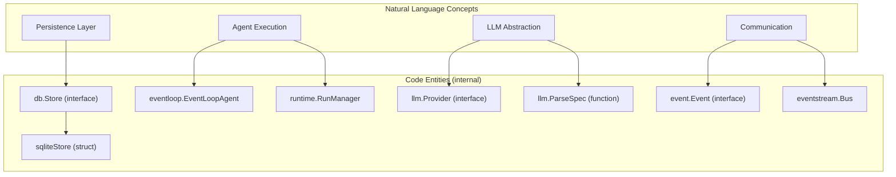
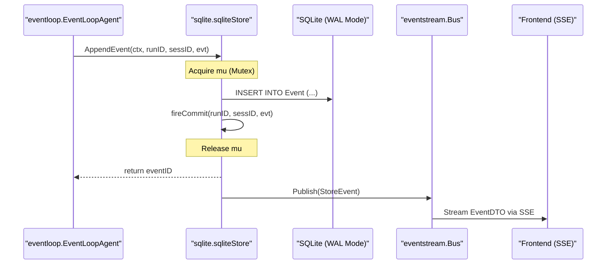
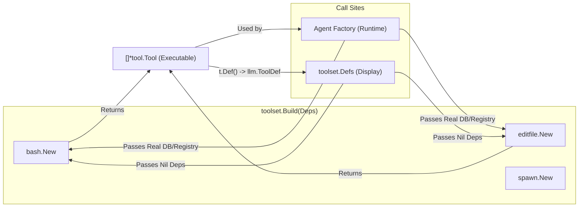

<!-- source: DeepWiki mcp.deepwiki.com · repo google-deepmind/amplio · page 9 Glossary · fetched 2026-10-26 -->

# Glossary

Relevant source files

The following files were used as context for generating this wiki page:

- [README.md](README.md)
- [bridges/README.md](bridges/README.md)
- [bridges/bridge.py](bridges/bridge.py)
- [cmd/amplio/spec_test.go](cmd/amplio/spec_test.go)
- [docs/guide/prompt-context.md](docs/guide/prompt-context.md)
- [docs/internals/session_lifecycle.md](docs/internals/session_lifecycle.md)
- [docs/internals/step_model.md](docs/internals/step_model.md)
- [internal/agent/critic/finalizer.go](internal/agent/critic/finalizer.go)
- [internal/agent/eventloop/eventloop_test.go](internal/agent/eventloop/eventloop_test.go)
- [internal/agent/toolset/toolset.go](internal/agent/toolset/toolset.go)
- [internal/config/load.go](internal/config/load.go)
- [internal/db/errtag.go](internal/db/errtag.go)
- [internal/db/sqlite/sqlite.go](internal/db/sqlite/sqlite.go)
- [internal/db/store.go](internal/db/store.go)
- [internal/llm/bridge/transport_http.go](internal/llm/bridge/transport_http.go)
- [internal/llm/label.go](internal/llm/label.go)
- [internal/llm/label_test.go](internal/llm/label_test.go)
- [internal/llm/menu.go](internal/llm/menu.go)
- [internal/llm/menu_test.go](internal/llm/menu_test.go)
- [internal/server/artifacts_test.go](internal/server/artifacts_test.go)
- [internal/server/briefings_test.go](internal/server/briefings_test.go)
- [internal/server/grades_test.go](internal/server/grades_test.go)
- [internal/server/llmapi.go](internal/server/llmapi.go)
- [internal/server/server_test.go](internal/server/server_test.go)

This glossary defines technical terms, domain concepts, and architectural patterns used throughout the Amplio codebase.

## Core Concepts

### Run
A **Run** is the top-level unit of work in Amplio, representing a single task or project. It serves as a container for one or more [Sessions](#session) and their associated artifacts.
*   **Implementation**: Represented by `db.RunRecord` [internal/db/store.go:41-43]().
*   **Data Flow**: Created via `db.Store.CreateRun` [internal/db/store.go:41](). Runs can be starred, archived, or graded by the user or the [Critic](#critic) [internal/db/store.go:48-57]().
*   **Storage**: Metadata is stored in the `Run` table; files generated during the run are stored in the [Artifact Directory](#artifact-directory).

### Session
A **Session** is an individual execution context for an [Agent](#agent). Every Run starts with a "root" session (usually the `main-agent`). Sessions can spawn child sessions to perform sub-tasks.
*   **Implementation**: Represented by `db.SessionRecord` [internal/db/store.go:88-92]().
*   **Lifecycle**: Managed by the `runtime.RunManager`. Statuses include `ongoing`, `awaiting`, `idle`, `concluded`, `crashed`, and `cancelled` [internal/db/sqlite/sqlite.go:91-95]().
*   **Exactly-Once Delivery**: The `TerminateAndNotifyParent` method ensures that when a child session finishes, its result is atomically delivered to the parent's event stream exactly once [internal/db/store.go:94-109]().

### Step
The fundamental unit of progress in an agent's trajectory. A step typically consists of a prompt, an LLM response (AssistantEvent), and zero or more ToolResultEvents.
*   **Invariant**: The `AssistantEvent` is the final event of a step for no-tool turns, or the event that triggers tool execution [internal/agent/eventloop/eventloop_test.go:199-208]().
*   **Finalization**: A step is considered "complete" only after `FinalizeStep` is called, which bumps the `last_finalized_step` cursor [internal/db/store.go:128-130]().

### Event
The atomic record of activity within a session. All communication (LLM output, tool results, user messages, system alerts) is persisted as an event.
*   **Types**: Defined in the `event` package (e.g., `AssistantEvent`, `ToolResultEvent`, `SystemEvent`, `UserEvent`).
*   **Persistence**: Events are appended to the `Event` table via `db.Store.AppendEvent` [internal/db/store.go:118-123]().

---

## Architecture & Components

### DB-First Persistence
Amplio follows a "DB-first" model where the source of truth for agent state is the SQLite database, not in-memory variables.
*   **Crash-Resume**: Because every event and step transition is committed to the DB, the `RunManager` can reconstruct an agent's state and resume execution from the last finalized step after a process crash [internal/runtime/runtime.go:68-71]().
*   **Store Interface**: The `db.Store` interface abstracts the persistence layer [internal/db/store.go:38-135]().

### RunManager
The orchestration layer that manages the lifecycle of all active runs and sessions.
*   **Function**: Handles `StartRun`, `AddChatbot`, and `RecoverRun` [internal/server/server_test.go:68-70]().
*   **Registry**: Uses a `RunRegistry` to track active goroutines and prevent duplicate execution of the same session.

### EventLoopAgent
The primary execution engine for autonomous agents. It runs a loop that projects the DB event stream into an LLM context, calls the LLM, executes tools, and persists results.
*   **Bootstrap**: On first run (Step 0), it injects system events, briefings, and recall data [internal/agent/eventloop/eventloop_test.go:199-202]().
*   **Nudge Mechanism**: If an agent attempts to conclude with empty content and no tool calls, the loop "nudges" it to provide a substantive final answer [internal/agent/eventloop/eventloop_test.go:220-230]().

### Critic (Finalizer)
A background system that evaluates a Run once all sessions have concluded.
*   **Run Report**: Generates a structured report including a summary, grade (1-5), achievements, and failures [internal/db/sqlite/sqlite.go:157-158]().
*   **Lesson Mining**: Extracts reusable "lessons" from the run's struggles or successes to improve future performance [internal/db/sqlite/sqlite.go:67-69]().

---

## Technical Jargon

### LLM Spec
A string format used to configure LLM providers, models, and parameters.
*   **Format**: `provider{client_args}:model?model_args#nickname` [internal/llm/label.go:48-56]().
*   **Nickname**: An optional display name (prefixed by `#`) that overrides the generated label in the UI [internal/llm/label.go:92-94]().
*   **ShortLabel**: A heuristic-based function that generates compact display names for chips (e.g., `vertex-claude:claude-opus-5` -> `opus-5`) [internal/llm/label.go:81-156]().

### Bridge Protocol
A protocol allowing Amplio to communicate with LLMs via external processes (e.g., Python scripts) using NDJSON over HTTP or Unix sockets.
*   **Subprocess Provider**: Spawns a local binary as a bridge [internal/llm/label.go:134-142]().
*   **Bridge Provider**: Connects to a remote URL serving the bridge protocol [internal/llm/label.go:111-124]().

### Artifact Directory
A local filesystem directory where a Run stores non-DB data like generated files, logs, and downloads.
*   **Security**: Served via a CSP sandbox to prevent malicious HTML/JS execution [internal/server/artifacts_test.go:90-96]().
*   **Implementation**: Managed via `config.ArtifactDir(runID)` [internal/server/artifacts_test.go:43]().

### Briefing
A named Markdown file containing specific instructions or domain knowledge injected into an agent's system prompt.
*   **Scope**: Can be `all` (all agents) or `root` (only the main agent) [internal/server/briefings_test.go:29-38]().

---

## Diagrams

### System Entity Mapping: Natural Language to Code
This diagram maps high-level system concepts to their specific implementation identifiers in the Go codebase.

**Sources**: [internal/db/store.go:38-135](), [internal/agent/eventloop/eventloop.go](), [internal/runtime/runtime.go](), [internal/llm/spec.go]().

### Data Flow: Event Persistence & Notification
This diagram illustrates how an event moves from an Agent to the Database and triggers system-wide updates.

**Sources**: [internal/db/sqlite/sqlite.go:52-95](), [internal/db/store.go:118-123](), [internal/server/server.go]().

### Toolset Construction Pattern
Amplio uses a "Dual-Call" pattern for toolsets to ensure the UI documentation stays in sync with the actual runtime implementation.

**Sources**: [internal/agent/toolset/toolset.go:24-112]().