# Page: Amplio Overview

# Amplio Overview

<details>
<summary>Relevant source files</summary>

The following files were used as context for generating this wiki page:

- [README.md](README.md)
- [cmd/amplio/main.go](cmd/amplio/main.go)
- [cmd/amplio/serve.go](cmd/amplio/serve.go)
- [docs/guide/runs.md](docs/guide/runs.md)
- [internal/db/errtag.go](internal/db/errtag.go)
- [internal/db/store.go](internal/db/store.go)

</details>


Amplio is a technical framework designed for long-horizon autonomous research and coding tasks [cmd/amplio/main.go:15-16](). It provides a robust, multi-agent harness that emphasizes persistence and crash-recovery, allowing agents to work through complex, multi-step trajectories over extended periods [README.md:1-8]().

### Key Design Principles

*   **DB-First Persistence**: Every event, tool call, and state transition is committed to a SQLite database before execution continues. This "persistence-first" approach ensures that if the process crashes at any point, the session can be resumed exactly where it left off [README.md:4-6]().
*   **Crash-Resume**: Amplio distinguishes between harness failures and environment failures. Harness crashes are handled by reviving session goroutines from the last known DB state, while tool/environment failures are reported back to the agent as observations [docs/guide/runs.md:65-73]().
*   **Multi-Agent Coordination**: A single "Run" can encompass a tree of agent sessions. A parent agent can `spawn` sub-agents for specialized tasks (e.g., builds, surveys), communicating via asynchronous messaging and event awaiting [internal/db/store.go:94-109]().
*   **Hybrid Autonomy**: Supports both **Autonomous** modes (task-driven with automatic critic reporting) and **Interactive** modes (chatbot-driven for steering and debugging) [docs/guide/runs.md:19-35]().

### System Architecture

The system is composed of a Go backend that manages the agent runtime, a SQLite persistence layer, and a SvelteKit-based frontend for monitoring and interaction.

#### Code Entity Mapping: High-Level Components
The following diagram illustrates how high-level system concepts map to specific entities in the codebase.

```mermaid
graph TD
    subgraph "Natural Language Space"
        Task["User Task"]
        Agent["Autonomous Agent"]
        SubAgent["Sub-Agent"]
        Critic["Auto-Critic"]
    end

    subgraph "Code Entity Space"
        RM["runtime.RunManager"]
        Store["db.Store (sqliteStore)"]
        ELA["agent.EventLoopAgent"]
        ReportGen["runtime.EphemeralAgent (kind='report')"]
        
        Task --> RM
        Agent --> ELA
        SubAgent --> ELA
        Critic --> ReportGen
        
        RM -- "persists to" --> Store
        ELA -- "appends events to" --> Store
    end
    
    [cmd/amplio/serve.go:139-161]()
    [internal/runtime/manager.go:1-50]()
    [internal/db/store.go:38-136]()
```
Sources: [cmd/amplio/serve.go:139-161](), [internal/runtime/manager.go:1-50](), [internal/db/store.go:38-136]()

#### Run and Session Hierarchy
Amplio organizes work into `Runs`, which contain one or more `Sessions`.

| Entity | Code Reference | Description |
| :--- | :--- | :--- |
| **Run** | `db.RunRecord` | The top-level container for a specific task, workspace, and set of artifacts. |
| **Session** | `db.SessionRecord` | A single execution context (goroutine) for an agent. |
| **Event** | `event.Event` | The atomic unit of history (Assistant, Tool, System, etc.). |
| **Step** | `last_finalized_step` | A logical turn in the conversation, ending with an Assistant message. |

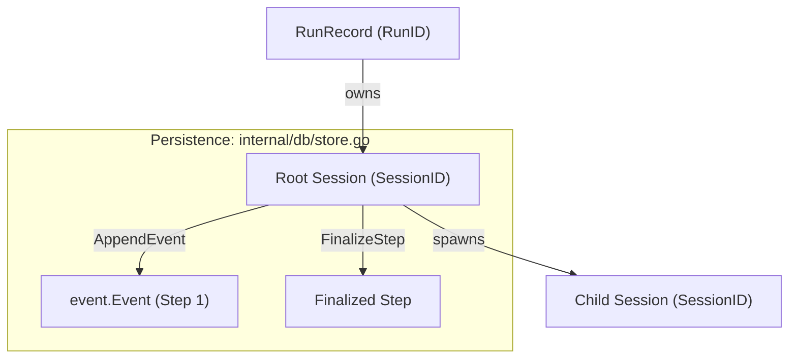
Sources: [internal/db/store.go:38-136](), [internal/db/models.go:1-100](), [docs/guide/runs.md:1-12]()

### Subsystems

*   **Runtime Manager**: Orchestrates the lifecycle of runs and sessions, handling the initial start, recovery after crashes, and the injection of LLM providers [cmd/amplio/serve.go:139-146]().
*   **Persistence (SQLite)**: Uses a `db.Store` interface to manage all state. It employs WAL mode to allow concurrent reads and writes, ensuring the UI remains responsive while agents are active [internal/db/store.go:27-37]().
*   **Observer & Critic**: Background processes that summarize trajectories into "phases" and generate final reports with grades (garbage to excellent) once a run concludes [docs/guide/runs.md:81-112]().
*   **Recall System**: An embedding-based search over "Skills" (pre-defined documentation) and "Lessons" (mined from previous run reports) to provide agents with long-term memory [cmd/amplio/main.go:168-171]().
*   **LLM Provider Layer**: A flexible abstraction supporting Vertex AI (Gemini/Claude), OpenAI, and local bridge protocols, allowing per-model configurations like "thinking" tokens or caching [README.md:28-41]().

### Child Pages

For detailed documentation on specific areas of Amplio, refer to the following pages:

*   **[Getting Started](#1.1)**: Installation, `config.toml` setup, and launching the server.
*   **[Runs and Sessions](#1.2)**: Deep dive into the agent lifecycle, sub-agent spawning, and status transitions.
*   **[Command-Line Interface](#1.3)**: Reference for `amplio serve`, `client`, and `headless` commands, including the `notify` shim.

Sources: [cmd/amplio/main.go:15-26](), [cmd/amplio/serve.go:90-126](), [README.md:21-60](), [docs/guide/runs.md:1-121]()

---

# Page: Getting Started

# Getting Started

<details>
<summary>Relevant source files</summary>

The following files were used as context for generating this wiki page:

- [cmd/amplio/main.go](cmd/amplio/main.go)
- [cmd/amplio/serve.go](cmd/amplio/serve.go)
- [docs/guide/cli.md](docs/guide/cli.md)
- [docs/guide/configuration.md](docs/guide/configuration.md)
- [internal/config/config.go](internal/config/config.go)

</details>


Amplio is a DB-first agentic framework designed for long-horizon autonomous research runs. This page covers the initial setup, configuration, and execution of the Amplio environment.

## Installation and Building from Source

Amplio is implemented in Go and follows a standard Go project structure. The entry point for the CLI is located in `cmd/amplio/main.go` [cmd/amplio/main.go:17-44]().

### Prerequisites
- **Go 1.22+**
- **SQLite3** (with development headers for CGO)
- **Linux** (Recommended for full process monitoring features)

### Building the Binary
To build the Amplio CLI, run the following from the repository root:
```bash
go build ./cmd/amplio
```
This produces a single `amplio` binary capable of running as a server, a client, or in headless mode [docs/guide/cli.md:3-9]().

## Data Directory Layout

Everything Amplio manages—databases, logs, artifacts, and configuration—is contained within a single **Data Directory** [docs/guide/configuration.md:8-14](). By default, this is `~/.amplio`, but it can be overridden via the `--data-dir` flag or the `AMPLIO_DATA_DIR` environment variable [internal/config/config.go:118-131]().

### Directory Structure
| Path | Description |
| :--- | :--- |
| `config.toml` | User-defined settings and LLM specifications [docs/guide/configuration.md:93-93](). |
| `amplio.db` | The primary SQLite database containing all runs, sessions, and events [docs/guide/configuration.md:94-94](). |
| `artifacts/<run-id>/` | Working directories for agents, exposed via `$AMPLIO_ARTIFACT_DIR` [internal/config/config.go:153-155](). |
| `blobs/<run-id>/` | Storage for large tool outputs like images, kept outside the DB [internal/config/config.go:160-162](). |
| `bin/` | Contains `amplio` and `amplio-notify` shims prepended to agent `PATH` [internal/config/config.go:112-117](). |
| `server.json` | Metadata about the running server (PID, address, token) used by the client [docs/guide/configuration.md:101-101](). |
| `auth.token` | The generated secret for web UI authentication [docs/guide/configuration.md:34-34](). |

**Sources:** [internal/config/config.go:112-162](), [docs/guide/configuration.md:87-107]()

## Configuration (config.toml)

Amplio uses a layered configuration model where precedence is: **Flag > Environment Variable > config.toml > Default** [cmd/amplio/main.go:46-48]().

### Minimal Configuration
A `config.toml` file should be placed in the root of your data directory. At minimum, it requires system LLM specifications for internal operations like summarization and reporting.

```toml
# System-level LLMs
system_llm_hq   = "vertex-claude:claude-opus-4-8"
system_llm_fast = "vertex-claude:claude-sonnet-4-6"

# Required for skill/lesson search
embed_model     = "vertex:text-embedding-004"

[run]
# The first LLM in this list is the default for new runs
llms = ["vertex-claude:claude-3-5-sonnet-v2", "gemini:gemini-1.5-pro"]

[skills]
dirs = ["~/my-skills"]
```

### Key Configuration Keys
| Key | Env Var | Description |
| :--- | :--- | :--- |
| `system_llm_hq` | `AMPLIO_SYSTEM_LLM_HQ` | High-quality model for final reports and critics [cmd/amplio/main.go:164-165](). |
| `system_llm_fast` | `AMPLIO_SYSTEM_LLM_FAST` | Fast model for step summaries and compaction [cmd/amplio/main.go:166-167](). |
| `embed_model` | `AMPLIO_EMBED_MODEL` | Model used to generate embeddings for Recall [cmd/amplio/main.go:168-169](). |
| `listen` | `AMPLIO_LISTEN` | Bind address for the web server (default `localhost:26759`) [cmd/amplio/serve.go:95-96](). |

**Sources:** [cmd/amplio/main.go:158-172](), [docs/guide/configuration.md:1-62]()

## Starting the Server

The `amplio serve` command starts the long-lived orchestration layer. It manages the SQLite database, recovers interrupted runs, and hosts the web UI [cmd/amplio/serve.go:47-53]().

### Initialization Sequence
1. **Config Resolution**: Loads and layers configuration from flags, env, and file [cmd/amplio/serve.go:55-59]().
2. **Locking**: Takes an exclusive lock on the data directory to prevent multiple processes from corrupting the DB [cmd/amplio/serve.go:102-106]().
3. **System Setup**: Initializes the `db.Store`, `runtime.RunManager`, and the background `observer` [cmd/amplio/serve.go:139-146]().
4. **Recovery**: Schedules `RespawnSession` for any runs that were active when the previous process terminated [cmd/amplio/serve.go:189-194]().

### Command
```bash
amplio serve --listen 0.0.0.0:26759
```
On first run, Amplio generates a `auth.token`. The server will print a URL containing this token; opening this URL authenticates your browser session [docs/guide/cli.md:24-30]().

**Sources:** [cmd/amplio/serve.go:45-194](), [docs/guide/cli.md:13-34]()

## First Run: Submitting a Task

Once the server is running, you can submit your first research task using the `amplio client` command. The client automatically discovers the server's address and token from `server.json` in the data directory [docs/guide/cli.md:37-38]().

### Submitting via CLI
```bash
# Submit a simple task
amplio client submit "Research the impact of SQLite WAL mode on concurrent writes."

# Submit with specific workspace and model
amplio client submit --task="Run the eval suite" --workspace=~/projects/my-repo --llm=vertex-claude:claude-3-5-sonnet
```

### Data Flow: From CLI to Execution

The following diagram illustrates how a submission flows from the CLI through the Server into the Agent Runtime.

**Submission and Runtime Initialization**
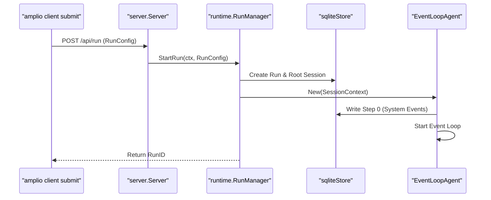
**Sources:** [cmd/amplio/main.go:173](), [internal/runtime/manager.go:1-50](), [internal/server/server.go:1-50]()

## Key Environment Variables

Beyond configuration, these variables are critical for the execution environment of agent subprocesses:

| Variable | Purpose |
| :--- | :--- |
| `AMPLIO_RUN_ID` | The unique ID of the current research run [internal/config/config.go:41](). |
| `AMPLIO_SESSION_ID` | The ID of the specific agent session [internal/config/config.go:48](). |
| `AMPLIO_ARTIFACT_DIR` | Path where the agent is permitted to write files [internal/config/config.go:40](). |
| `AMPLIO_NOTIFY` | Path to the notification shim for agent signaling [internal/config/config.go:49](). |

### The Notify Shim
Amplio installs a special shim at `bin/amplio-notify` inside the data directory [cmd/amplio/main.go:75-86](). This binary is a symlink to the main `amplio` binary but behaves differently when invoked as `amplio-notify`. It allows agents to send events back to the server (e.g., signaling task completion or requesting human input) without needing full access to the CLI's management commands [cmd/amplio/main.go:88-105]().

**Sources:** [internal/config/config.go:38-50](), [cmd/amplio/main.go:75-106]()

---

# Page: Runs and Sessions

# Runs and Sessions

<details>
<summary>Relevant source files</summary>

The following files were used as context for generating this wiki page:

- [docs/guide/runs.md](docs/guide/runs.md)
- [internal/agent/eventloop/eventloop_test.go](internal/agent/eventloop/eventloop_test.go)
- [internal/db/sqlite/sqlite.go](internal/db/sqlite/sqlite.go)
- [internal/server/artifacts_test.go](internal/server/artifacts_test.go)
- [internal/server/briefings_test.go](internal/server/briefings_test.go)
- [internal/server/grades_test.go](internal/server/grades_test.go)
- [internal/server/server_test.go](internal/server/server_test.go)

</details>


In Amplio, a **Run** represents a single unit of work (a task) with its own workspace, configuration, and history. A **Session** is a specific execution context for an agent within that run. A single run always begins with a root session but can expand into a tree of sub-agent sessions as the work progresses [docs/guide/runs.md:1-5]().

## Run and Session Hierarchy

The relationship between Runs and Sessions is hierarchical and persisted in the database. A Run acts as a container for metadata (task, briefings, status) and one or more Sessions [internal/db/db.go:102-127]().

### Data Structures
*   **`RunRecord`**: Stores the global state of the work, including the `RunID`, `Task`, `Workspace` path, and overall `Status` [internal/db/db.go:102-127]().
*   **`SessionRecord`**: Tracks an individual agent's lifecycle. It includes a `ParentID` to facilitate the sub-agent tree, the `AgentType` (e.g., `standard_agent`), and its current execution `Status` [internal/db/db.go:142-167]().

### Hierarchy Diagram: Code Entity Space
The following diagram illustrates how the `RunManager` orchestrates these entities and how they relate to the underlying storage.

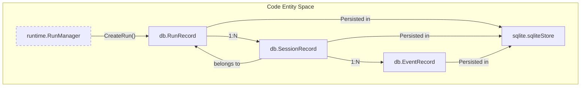
Sources: [internal/runtime/runtime.go:61-90](), [internal/db/db.go:102-167](), [internal/db/sqlite/sqlite.go:52-62]()

## Execution Modes

Amplio supports two primary modes of operation which dictate how sessions transition between states.

| Mode | Primary Agent | Behavior |
| :--- | :--- | :--- |
| **Autonomous** | `standard_agent` | The agent works toward a `concluded` state without human intervention. Reaching the end of a turn without tool calls triggers the `Finalizer` [docs/guide/runs.md:26-27](), [internal/agent/eventloop/eventloop.go:350-365](). |
| **Interactive** | `chatbot` | The agent parks in `idle` status after every turn, waiting for a `UserEvent` via the `Input` mechanism [docs/guide/runs.md:23-25](), [internal/agent/eventloop/eventloop.go:370-385](). |

## Session Lifecycle and Statuses

Sessions move through a state machine managed by the `EventLoopAgent`. The status is persisted in the `Session` table and updated via `store.SetSessionStatus` [internal/db/sqlite/sqlite.go:490-510]().

*   **`ongoing`**: The agent goroutine is active and processing the event loop [internal/db/db.go:50]().
*   **`awaiting`**: Blocked waiting for a specific event, such as a sub-agent's completion via the `await_event` tool [internal/db/db.go:51](), [internal/tool/toolset.go:150-165]().
*   **`idle`**: (Interactive only) The agent is parked and the goroutine has exited, waiting for user input to respawn [internal/db/db.go:52](), [internal/agent/eventloop/eventloop.go:400-415]().
*   **`concluded`**: The task is finished successfully [internal/db/db.go:53]().
*   **`crashed`**: The agent encountered a terminal error or the process died [internal/db/db.go:54]().
*   **`cancelled`**: The session was stopped by a user or parent request [internal/db/db.go:55]().

### Lifecycle Transitions: Natural Language to Code
This diagram bridges the conceptual lifecycle to the specific functions and statuses in the `eventloop` package.

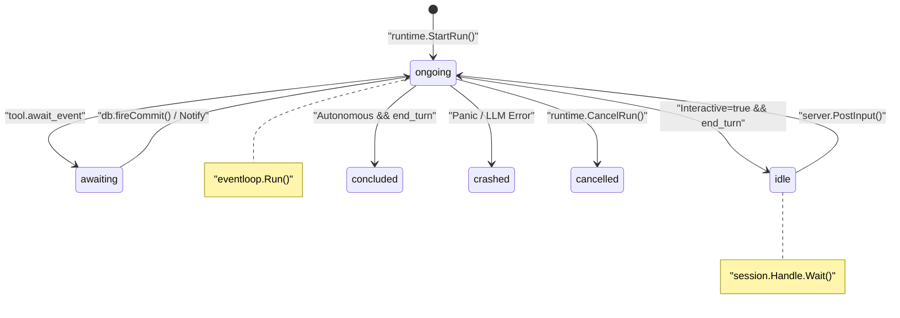
Sources: [internal/agent/eventloop/eventloop.go:200-250](), [internal/runtime/runtime.go:210-230](), [internal/db/db.go:50-55]()

## Sub-agents

Agents can expand their capabilities by spawning sub-agents using the `spawn` tool [internal/tool/toolset.go:120-135](). 

1.  **Creation**: The parent calls `spawn`, which invokes `RunManager.AddSubAgent` [internal/runtime/runtime.go:300-315]().
2.  **Isolation**: Each sub-agent gets a unique `SessionID` and a fresh context, but shares the same `RunID` and artifact directory [docs/guide/runs.md:60-63]().
3.  **Communication**: Parents communicate with sub-agents via `send_message` and receive results as `AssistantEvent` logs when the sub-agent concludes [internal/tool/toolset.go:140-155]().

## Artifacts and Blobs

*   **Artifacts**: Files generated by agents (e.g., reports, logs, code) are stored in a run-specific directory defined by `config.ArtifactDir(runID)` [internal/config/config.go:180-195](). Agents access this via the `$AMPLIO_ARTIFACT_DIR` environment variable [docs/guide/runs.md:76-79]().
*   **Blobs**: Large binary data or tool outputs are stored in the `blob.Store`, which manages content-addressed storage within the data directory [internal/blob/blob.go:25-45]().

## Reports and Grades

When an autonomous run's root session reaches `concluded`, the `Finalizer` triggers a separate `keen-critic` agent to evaluate the run [internal/agent/critic/critic.go:40-60]().

### Report Structure
The report is saved as an `Observation` record of kind `run_report` [internal/db/db.go:205-220](). It includes:
*   **Summary**: A prose description of the work performed [docs/guide/runs.md:89]().
*   **Grade**: An LLM-assigned value from 1 (Garbage) to 5 (Excellent) [docs/guide/runs.md:106-108]().
*   **Achievements/Struggles**: Specific steps cited as evidence of success or difficulty [docs/guide/runs.md:91-93]().

### Grade Precedence
Users can manually override the critic's grade via the UI or API (`PATCH /api/runs/{id}`). The `RunRecord.Grade` (human) takes precedence over `RunRecord.ReportGrade` (critic) in the dashboard display [internal/db/sqlite/sqlite.go:156-158](), [internal/server/server.go:211]().

Sources: [internal/agent/critic/critic.go:40-100](), [internal/db/db.go:205-220](), [docs/guide/runs.md:83-112]()

## Management Actions

### Cancellation
Canceling a run via `RunManager.CancelRun` sets the run status to `cancelled` and sends a cancellation signal to all active session contexts [internal/runtime/runtime.go:450-470](). This triggers a recursive cancellation of all sub-agents.

### Archiving
Archiving is a metadata update (`archived = 1`) in the `Run` table [internal/db/sqlite/sqlite.go:159](). It removes the run from the default dashboard view but preserves all data [docs/guide/runs.md:118-120]().

### Deletion
Deletion is permanent. The `RunManager` removes:
1.  All database rows associated with the `RunID` (Sessions, Events, Observations) [internal/db/sqlite/sqlite.go:380-400]().
2.  The artifact directory on disk [internal/server/server.go:211]().
3.  Any associated blobs [docs/guide/runs.md:120-121]().

Sources: [internal/runtime/runtime.go:450-480](), [internal/db/sqlite/sqlite.go:159-160](), [internal/server/server.go:211]()

---

# Page: Command-Line Interface

# Command-Line Interface

<details>
<summary>Relevant source files</summary>

The following files were used as context for generating this wiki page:

- [cmd/amplio/client.go](cmd/amplio/client.go)
- [cmd/amplio/client_api_test.go](cmd/amplio/client_api_test.go)
- [cmd/amplio/client_test.go](cmd/amplio/client_test.go)
- [cmd/amplio/monitor.go](cmd/amplio/monitor.go)
- [cmd/amplio/monitor_test.go](cmd/amplio/monitor_test.go)
- [cmd/amplio/notify.go](cmd/amplio/notify.go)
- [cmd/amplio/notify_test.go](cmd/amplio/notify_test.go)
- [docs/guide/cli.md](docs/guide/cli.md)
- [docs/guide/configuration.md](docs/guide/configuration.md)

</details>


Amplio is a single binary with three distinct operational modes: hosting a long-lived server (`serve`), interacting with a running server via a REST client (`client`), or executing tasks in a standalone foreground process (`headless`). [docs/guide/cli.md:3-9]()

The CLI is built using the `cobra` library. Every command respects global configuration flags, most notably `--data-dir`, which determines the specific Amplio instance and its associated SQLite database, artifacts, and server state. [docs/guide/cli.md:10-12]() [docs/guide/configuration.md:8-14]()

## Command Architecture and Data Flow

The CLI interacts with the Amplio ecosystem through two primary paths: direct database ownership (used by `serve` and `headless`) and HTTP/REST communication (used by `client` and `notify`).

### System Interaction Diagram

"CLI Command Paths and Code Entities"
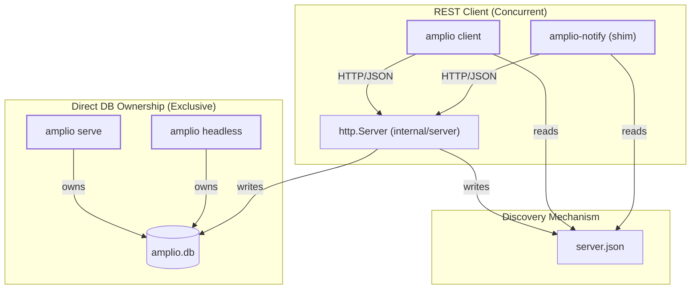
Sources: [cmd/amplio/client.go:38-43](), [cmd/amplio/notify.go:114-121](), [docs/guide/cli.md:19-22]()

## amplio serve

The `serve` command initializes the long-lived orchestration layer. It is the only process that should own a production data directory for extended periods.

*   **Responsibility**: Hosts the REST API, serves the SvelteKit UI, runs the `RunManager` for agent execution, and manages the background `Observer` for summarization and compaction. [docs/guide/cli.md:19-22]()
*   **Authentication**: On first run, it generates a high-entropy token stored in `auth.token`. This token is required for all write operations via the API and for UI access. [docs/guide/cli.md:28-31]()
*   **Discovery**: It writes a `server.json` file containing its PID, local address, and the auth token, allowing `client` commands to function without manual credential passing. [cmd/amplio/client.go:38-40](), [docs/guide/cli.md:37-38]()

Sources: [docs/guide/cli.md:13-34](), [cmd/amplio/client.go:38-43]()

## amplio client

The `client` command is a wrapper around the REST API. It is designed for both human use and for "Run Manager" agents that need to spawn and monitor sub-runs. [cmd/amplio/client.go:54-60]()

### Key Subcommands

| Command | Implementation Function | Purpose |
| :--- | :--- | :--- |
| `submit` | `clientSubmitCmd` | Hands a task to the server and returns the `run_id`. [cmd/amplio/client.go:75-140]() |
| `list` | `clientListCmd` | Displays a table of runs. Supports `--json` for scripting. [cmd/amplio/client.go:66](), [docs/guide/cli.md:76-79]() |
| `status` | `clientStatusCmd` | Provides detailed telemetry for a specific run and its sessions. [cmd/amplio/client.go:65]() |
| `monitor` | `clientMonitorCmd` | Polls run status until completion; exits with specific codes. [cmd/amplio/monitor.go:54-98]() |
| `cancel` | `clientCancelCmd` | Triggers a cancellation cascade for all sessions in a run. [cmd/amplio/client.go:63]() |
| `restart` | `clientRestartCmd` | Revives crashed sessions within a run. [cmd/amplio/client.go:64]() |
| `api` | `clientAPICmd` | Raw HTTP helper for arbitrary API endpoints. [cmd/amplio/client.go:67]() |

### Scripting Pattern: stdout vs stderr
A strict convention is enforced: **stdout** carries the machine-readable datum (e.g., a Run ID or JSON table), while **stderr** carries human-readable logs and confirmation messages. [cmd/amplio/client.go:46-50]()

```bash
# Capture the ID directly without parsing logs
RUN_ID=$(amplio client submit "Fix the build")
```
Sources: [cmd/amplio/client.go:46-50](), [docs/guide/cli.md:45-48]()

## Run Monitoring

The `monitor` command is a specialized tool for unattended automation. It polls the server at a defined `--interval` (default 10m) and streams status changes. [cmd/amplio/monitor.go:95-97]()

### Monitor State Machine

"Monitor Observation Logic"
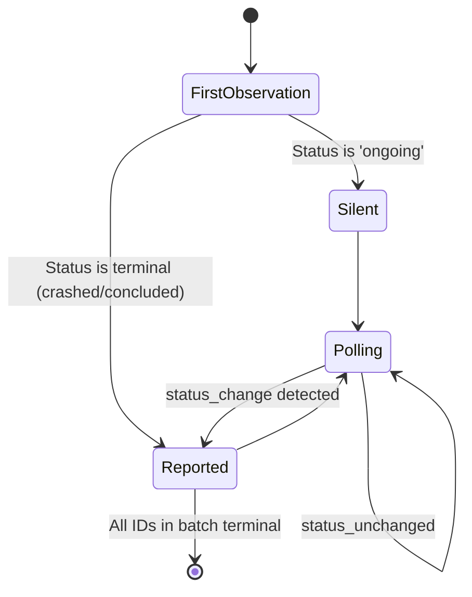
Sources: [cmd/amplio/monitor.go:133-153](), [cmd/amplio/monitor.go:158-165]()

### Monitor Exit Codes
| Code | Meaning |
| :--- | :--- |
| `0` | All watched runs concluded successfully. |
| `1` | Usage error or unwatchable run (e.g., a chatbot that parks idle). |
| `2` | At least one run in the batch crashed. |
| `3` | At least one run was cancelled. |
| `124` | Timeout reached (max 50 hours). |

Sources: [cmd/amplio/monitor.go:38-41](), [cmd/amplio/monitor.go:179-197]()

## amplio headless

The `headless` mode executes the agent event loop within the CLI process itself. [docs/guide/cli.md:128-132]()

*   **`headless run`**: Requires a task and workspace. It initializes a new `RunManager` and `sqliteStore`, effectively acting as a single-run server. [docs/guide/cli.md:130-131]()
*   **`headless resume`**: Takes a `run_id` and reconstructs the execution state from the database. This is the primary mechanism for CI/CD pipelines to continue interrupted work. [docs/guide/cli.md:132-143]()

**Constraint**: Headless mode requires an exclusive lock on the data directory. It cannot run if `amplio serve` is active on the same directory. [docs/guide/cli.md:137-139]()

Sources: [docs/guide/cli.md:128-143]()

## The notify Shim

Agents often spawn background processes (e.g., long-running builds or tests) using the `bash` tool. The `amplio-notify` shim allows these external processes to send asynchronous events back to the agent session. [cmd/amplio/notify.go:59-66]()

### Implementation Details
*   **Discovery**: The shim reads `AMPLIO_RUN_ID` and `AMPLIO_SESSION_ID` from the environment, which are automatically injected by the agent's bash tool. [cmd/amplio/notify.go:95-105]()
*   **Identity**: The shim automatically appends the caller's PID to the message sender field: `sender (pid=1234)`. This allows the agent to identify and potentially kill the notifying process if it becomes "chatty" or runaway. [cmd/amplio/notify.go:132-138]()
*   **Rate Limiting**: The server enforces a cap on environment notifications per step. If exceeded, the shim exits with `notifyExitRefused` (code 3). [cmd/amplio/notify.go:36-40](), [cmd/amplio/notify.go:63-66]()

Sources: [cmd/amplio/notify.go:34-40](), [cmd/amplio/notify.go:54-92](), [cmd/amplio/notify.go:132-138]()

---

# Page: Core Architecture

# Core Architecture

<details>
<summary>Relevant source files</summary>

The following files were used as context for generating this wiki page:

- [README.md](README.md)
- [docs/internals/session_lifecycle.md](docs/internals/session_lifecycle.md)
- [docs/internals/step_model.md](docs/internals/step_model.md)
- [internal/db/errtag.go](internal/db/errtag.go)
- [internal/db/store.go](internal/db/store.go)

</details>


Amplio is built on a **DB-first persistence model** where the database is the single source of truth for agent state. This design ensures that the system can robustly resume from crashes at any point in the agentic loop. The architecture centers around a hierarchical Run/Session model, a discrete step-based event stream, and a background orchestration layer that manages the lifecycle of autonomous and interactive agents.

### System Overview

The following diagram illustrates the relationship between the logical components of the system and the primary code entities that implement them.

**Diagram: Logical Architecture to Code Entity Mapping**
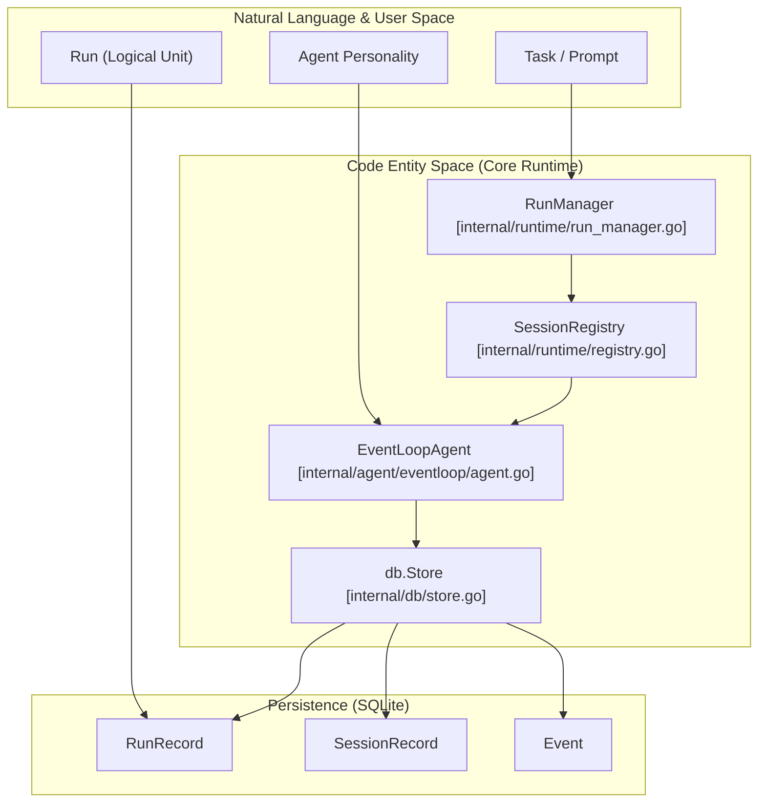
**Sources:** [internal/db/store.go:27-38](), [internal/runtime/run_manager.go:40-60](), [internal/agent/eventloop/agent.go:45-65]()

---

### DB-First Persistence

In Amplio, every state transition—from appending an event to updating a session's status—is durably committed to a SQLite database before the system proceeds. This "DB-first" approach means that the agent's memory and progress are not held in volatile memory but are reflected in a stream of events.

*   **Concurrency**: The `db.Store` interface is shared across the web server, agent goroutines, and observers [internal/db/store.go:27-31]().
*   **Error Classification**: The system uses `db.ErrStore` to distinguish between infrastructure failures (DB broken) and agentic failures (LLM error), allowing the loop to safely halt without attempting doomed writes [internal/db/errtag.go:25-35]().
*   **Atomicity**: Complex operations, such as terminating a sub-agent and notifying its parent, are performed in a single transaction to prevent inconsistent states [internal/db/store.go:94-109]().

For details, see [Persistence Layer (SQLite Store)](#2.3).

**Sources:** [internal/db/store.go:27-109](), [internal/db/errtag.go:25-35]()

---

### The Step and Event Model

The core of an agent's execution is the **Step**. A step represents a single turn of interaction or internal reasoning. 

*   **Step 0**: Reserved for bootstrap events like system prompts and task briefings [docs/internals/step_model.md:41-42]().
*   **The Invariant**: The `AssistantEvent` (the LLM's response) is always the last event of a step, followed only by its associated `ToolResultEvents` [docs/internals/step_model.md:7-9]().
*   **Race Prevention**: The system bumps the `current_step` *before* starting LLM generation. This ensures that any events arriving during generation (like a user message) land in the next step, preventing interleaved or out-of-order logs [docs/internals/step_model.md:85-97]().

For details, see [Step and Event Model](#2.1).

**Sources:** [docs/internals/step_model.md:7-97](), [internal/db/store.go:124-130]()

---

### Session Lifecycle and Execution Loop

Amplio distinguishes between a **Run** (a collection of work) and a **Session** (a single agent's execution thread). Sessions can be "Hot" (active goroutine) or "Cold" (persisted in DB, no active process) [docs/internals/session_lifecycle.md:8-10]().

**Diagram: Agent Execution Loop (EventLoopAgent)**
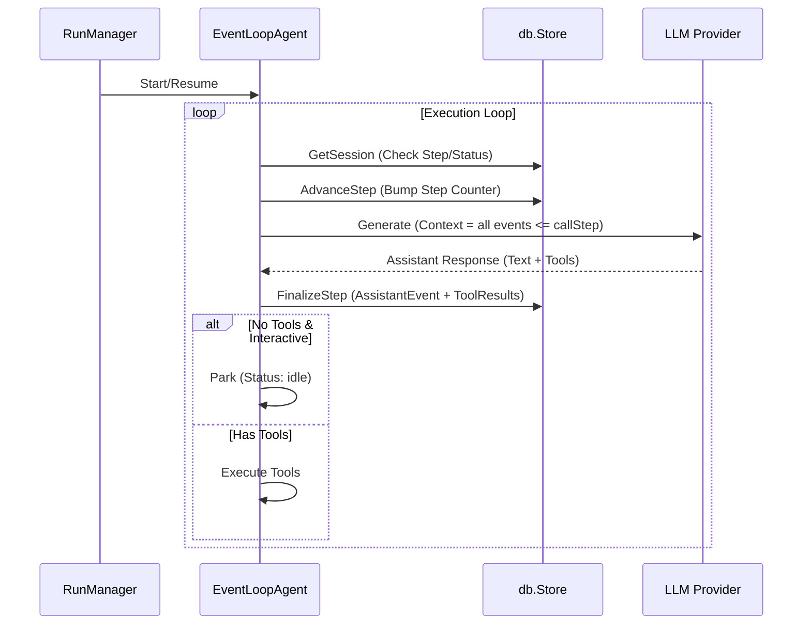
**Sources:** [internal/agent/eventloop/agent.go:180-250](), [docs/internals/session_lifecycle.md:12-38](), [docs/internals/step_model.md:51-80]()

*   **Statuses**: Sessions transition through states like `ongoing`, `awaiting` (parked for events), `idle` (waiting for user), or terminal states like `concluded`, `crashed`, and `cancelled` [docs/internals/session_lifecycle.md:19-26]().
*   **Event Classification**: Incoming events are classified as `Input` (which revives cold sessions) or `Notice` (which only notifies hot sessions) [docs/internals/session_lifecycle.md:74-80]().

For details, see [Session Lifecycle](#2.2) and [Runtime and Run Manager](#2.4).

**Sources:** [docs/internals/session_lifecycle.md:8-80](), [internal/runtime/run_manager.go:40-60]()

---

### Subsystem Connectivity

The `RunManager` acts as the central orchestrator, connecting the persistence layer to the agent execution logic.

| Subsystem | Responsibility | Key Interface/Struct |
| :--- | :--- | :--- |
| **Persistence** | Durable storage of all runs, sessions, and events. | `db.Store` [internal/db/store.go:38]() |
| **Runtime** | Managing the pool of active agent goroutines. | `RunManager` [internal/runtime/run_manager.go:40]() |
| **Agent** | The internal logic for LLM interaction and tool use. | `EventLoopAgent` [internal/agent/eventloop/agent.go:45]() |
| **Observer** | Background tasks like summarization and compaction. | `Observer` [internal/agent/observer.go]() |

**Sources:** [internal/db/store.go:38](), [internal/runtime/run_manager.go:40](), [internal/agent/eventloop/agent.go:45]()

---

# Page: Step and Event Model

# Step and Event Model

<details>
<summary>Relevant source files</summary>

The following files were used as context for generating this wiki page:

- [docs/internals/step_model.md](docs/internals/step_model.md)
- [internal/db/sqlite/sqlite.go](internal/db/sqlite/sqlite.go)
- [internal/db/types.go](internal/db/types.go)
- [internal/event/event.go](internal/event/event.go)
- [internal/server/artifacts_test.go](internal/server/artifacts_test.go)
- [internal/server/briefings_test.go](internal/server/briefings_test.go)
- [internal/server/grades_test.go](internal/server/grades_test.go)

</details>


The Step and Event Model is the fundamental state machine of Amplio. It provides a deterministic, crash-resilient structure for agentic loops by discretizing the continuous stream of events into numbered **steps**. This model ensures that an agent's state can always be reconstructed from the database, allowing for seamless recovery after process crashes or server restarts.

## Core Invariant: The Assistant Boundary

The primary invariant of the model is that the `AssistantEvent` is the **last** event of a step [docs/internals/step_model.md:7-8]().

When an agent iteration begins, the `Session.current_step` counter is incremented **before** the LLM generation starts [docs/internals/step_model.md:10-11](). The resulting `AssistantEvent` and its associated `ToolResultEvent`s are then stamped with the previous step number (the "call step") [docs/internals/step_model.md:11-13](). Any external events (like user messages) that arrive while the LLM is still generating are stamped with the new, incremented `current_step`, placing them logically in the *next* iteration [docs/internals/step_model.md:13-14]().

### Step Layout Structure

| Step | Content Type | Description |
| :--- | :--- | :--- |
| **Step 0** | **Bootstrap** | Permanent system events (System Prompt, Task, Workspace) [docs/internals/step_model.md:41-43](). |
| **Step T** | **Input** | 0 or more events (User messages, Child results) [docs/internals/step_model.md:28-29](). |
| **Step T** | **Assistant** | Exactly 1 `AssistantEvent` (The LLM's response/action) [docs/internals/step_model.md:30-31](). |
| **Step T** | **Tool Results** | 0 or more `ToolResultEvent`s (Results of tool calls) [docs/internals/step_model.md:32-33](). |

### Logical Flow to Code Entity Mapping
This diagram shows how natural language concepts of "Steps" and "Turns" map to specific database fields and event types.

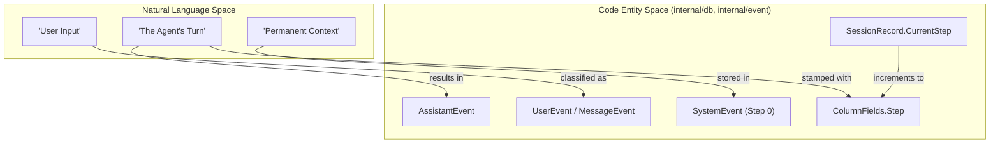
Sources: [docs/internals/step_model.md:21-43](), [internal/db/types.go:142-164](), [internal/event/event.go:44-50]()

## Generation-Based Compaction

To manage context window limits, Amplio uses a generation-based compaction strategy. Every `SessionRecord` tracks a `CurrentGeneration` [internal/db/types.go:149]().

1.  **Step 0 Persistence:** Events in Step 0 are considered "bootstrap" events and survive all compactions [docs/internals/step_model.md:125-126]().
2.  **Generation Filtering:** When reconstructing context for an LLM call, the system filters events where `step == 0` OR `generation == current_generation` [docs/internals/step_model.md:125-126]().
3.  **Compaction Trigger:** When a context window is exceeded, a "Compaction Agent" summarizes the history. The summarized state is written as new events in a new `generation`, and the session's `CurrentGeneration` is incremented.

## Crash-Resume Mechanics

The database-first model allows the `RunManager` to resume sessions by inspecting the last finalized step and the presence of an `AssistantEvent`.

### Recovery Logic Table
The system determines the resume action based on the state of the last step [docs/internals/step_model.md:103-109]().

| DB State | Crash Point | Resume Action |
| :--- | :--- | :--- |
| `current_step=T+1`, Step T has no `AssistantEvent` | During LLM generation | Re-invoke LLM for Step T |
| Step T has `AssistantEvent`, but missing `ToolResultEvent`s | During tool execution | Insert placeholder results and continue |
| Step T is complete (Assistant + Tools) | After tools, before next call | Start normal next iteration |
| Session status = `concluded` | During park/idle | Re-enter park or check for new messages |

### Execution Loop and Persistence
The following diagram illustrates the interaction between the `EventLoopAgent` and the `sqliteStore` during a single iteration.

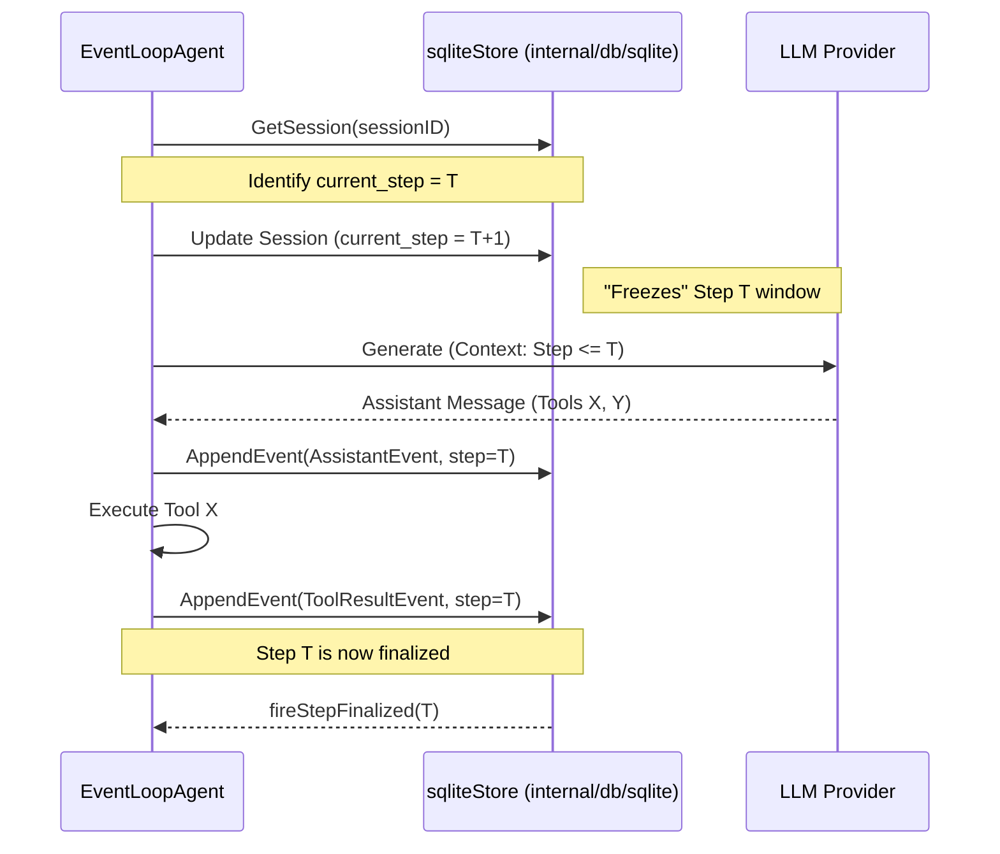
Sources: [docs/internals/step_model.md:112-118](), [internal/db/sqlite/sqlite.go:81-85](), [internal/db/types.go:161-164]()

## Implementation Details

### Event Classification
Events are categorized by their ability to wake a dormant session via the `Classify` function [internal/db/types.go:83-103]():
*   **ClassInput:** `UserEvent`, `MessageEvent`, and successful `ChildResultEvent`. These revive `idle` or `awaiting` sessions [internal/db/types.go:64-65]().
*   **ClassNotice:** `SystemEvent`, `ToolResultEvent`, and failed `ChildResultEvent`. These are persisted but do not trigger a session wake-up [internal/db/types.go:61-63]().

### Observer Cursors
The `SessionRecord` maintains three monotonic cursors to track progress through the step model [internal/db/types.go:161-164]():
1.  **LastFinalizedStep:** The highest step where the `AssistantEvent` and all tool results are written.
2.  **LastSummarizedStep:** The highest step that has been processed by the background summarizer.
3.  **LastPhasedStep:** The highest step where a logical "Phase" (e.g., a transition from autonomous work to user interaction) has been identified.

These cursors ensure that background tasks (like summarization or critic evaluation) never process incomplete steps [internal/db/types.go:155-160]().

Sources: [internal/db/types.go:58-103](), [internal/db/types.go:142-164](), [docs/internals/step_model.md:110-126]()

---

# Page: Session Lifecycle

# Session Lifecycle

<details>
<summary>Relevant source files</summary>

The following files were used as context for generating this wiki page:

- [docs/internals/session_lifecycle.md](docs/internals/session_lifecycle.md)
- [internal/agent/eventloop/doc.go](internal/agent/eventloop/doc.go)
- [internal/agent/eventloop/eventloop_test.go](internal/agent/eventloop/eventloop_test.go)
- [internal/server/server_test.go](internal/server/server_test.go)
- [internal/session/registry.go](internal/session/registry.go)

</details>


The session lifecycle governs how an agent session is instantiated, how it transitions between logical states, how it handles physical process interruptions, and how it concludes or recovers. A **session** is defined as an agent's event stream paired with a logical **status** [docs/internals/session_lifecycle.md:6-7]().

## Logical Statuses

A session's status represents its logical state in the DB. This is distinct from whether a Go goroutine is physically executing for that session [docs/internals/session_lifecycle.md:14-16]().

| Status | Type | Description |
| :--- | :--- | :--- |
| `ongoing` | Active | The agent is actively executing its event loop [docs/internals/session_lifecycle.md:21](). |
| `awaiting` | Parked | Parked via `await_event`; the agent is waiting for specific external events [docs/internals/session_lifecycle.md:22](). |
| `idle` | Parked | Parked after a turn with no tool calls (interactive agents only) [docs/internals/session_lifecycle.md:23](). |
| `concluded` | Terminal | The agent has finished its task and submitted a result (autonomous agents only) [docs/internals/session_lifecycle.md:24](). |
| `crashed` | Terminal | Stopped by an uncaught error, durably recorded in the DB [docs/internals/session_lifecycle.md:25](). |
| `cancelled` | Terminal | Explicitly stopped by an operator or a parent session [docs/internals/session_lifecycle.md:26](). |

**Sources:** [docs/internals/session_lifecycle.md:19-26](), [internal/db/db.go:138-144]()

## The Hot/Cold Goroutine Model

Amplio distinguishes between the **logical status** (DB state) and the **physical liveness** (goroutine existence).

*   **Hot Session:** The goroutine is alive and registered in the `session.Registry`. Reviving a hot session is an in-memory wake-up via a `session.Handle` [docs/internals/session_lifecycle.md:58-59]().
*   **Cold Session:** The goroutine has exited (e.g., due to an idle timeout or process restart). Reviving a cold session requires a **Respawn**, where the `RunManager` reconstructs the agent state from the DB event stream [docs/internals/session_lifecycle.md:60-61]().

The `session.Registry` manages these live handles, providing a `Waiter` primitive (a monotonic counter and broadcast channel) to coordinate wakes [internal/session/registry.go:28-36]().

### Session State Transitions
The following diagram bridges the logical status names in the code to the physical lifecycle of the goroutine.

**Diagram: Session Lifecycle State Machine**
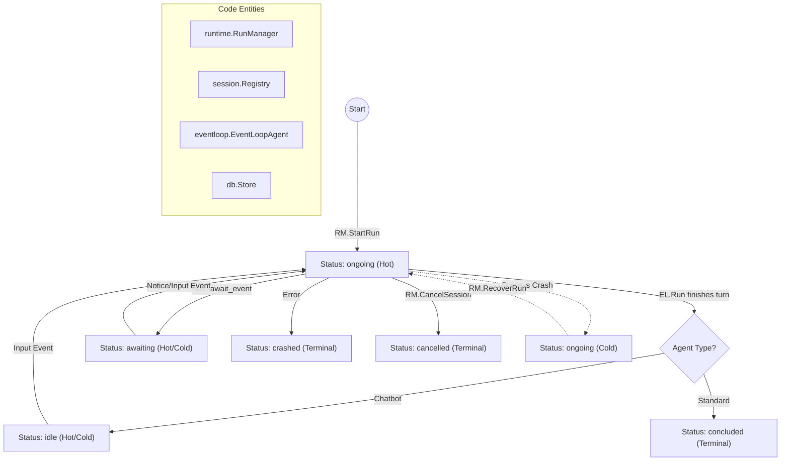
**Sources:** [docs/internals/session_lifecycle.md:19-50](), [internal/runtime/manager.go:120-150](), [internal/agent/eventloop/eventloop.go:180-220]()

## Event Classification: Input vs. Notice

Every event written to a session's stream is classified to determine if it should trigger a session revival [docs/internals/session_lifecycle.md:70-74]().

1.  **Input Class:** Events that represent new information requiring agent action (e.g., `UserEvent`, `MessageEvent` from another agent, `RecoverEvent`). These revive dormant (non-`ongoing`) sessions [docs/internals/session_lifecycle.md:80]().
2.  **Notice Class:** Events that are purely informational or internal (e.g., `AssistantEvent`, `ToolResultEvent`, `CompactionEvent`). These are persisted but only processed if the session is already `ongoing` or `awaiting` [docs/internals/session_lifecycle.md:79]().

**Exception:** Environment notifications (`$AMPLIO_NOTIFY`) are `Input` class but **do not** revive terminal sessions (`concluded`, `crashed`, `cancelled`) to prevent runaway scripts from resurrecting finished agents [docs/internals/session_lifecycle.md:87-94]().

**Sources:** [docs/internals/session_lifecycle.md:77-80](), [internal/runtime/notifier.go:85-110]()

## Recover vs. Restart

*   **Recover:** Used after a process crash to find sessions that are logically `ongoing` but physically dead. The `RunManager` scans for these and injects a `RecoverEvent` to resume their execution loops [docs/internals/session_lifecycle.md:118-124]().
*   **Restart:** Triggered by a `UserEvent` or a parent agent sending a message to a `concluded` or `crashed` session. This moves the status back to `ongoing` and respawns the goroutine [docs/internals/session_lifecycle.md:80]().

**Sources:** [docs/internals/session_lifecycle.md:47-50](), [internal/runtime/manager.go:350-380]()

## Coordination Mechanics

### Await Event
Agents use the `await_event` tool to park. The `EventLoopAgent` calls `Handle.WaitAfter` [internal/session/registry.go:113-115](), which blocks the goroutine until the `session.Registry` receives a notification from the `db.Store` commit listener [internal/runtime/notifier.go:40-60]().

### Cancellation Cascade
When a run or session is cancelled:
1.  The `RunManager` calls `Registry.Interrupt(sessionID)` to cancel the Go context of the live goroutine [internal/session/registry.go:196-203]().
2.  The `db.Store` status is updated to `cancelled` [internal/db/sqlite/session.go:80-95]().
3.  If a parent session is cancelled, the `RunManager` recursively cancels all child sessions discovered via the `Session` table hierarchy [docs/internals/session_lifecycle.md:26]().

### Child-Result Exactly-Once Delivery
When an autonomous agent finishes, it must deliver its result to its parent. Amplio uses an atomic DB transaction `TerminateAndNotifyParent` to:
1.  Set the child's status to `concluded`.
2.  Append a `ChildResultEvent` to the parent's event stream.
This ensures that the parent is notified exactly once, even if the process crashes during the transition [docs/internals/session_lifecycle.md:42-44]().

**Sources:** [internal/db/sqlite/session.go:150-180](), [docs/internals/session_lifecycle.md:42-44]()

## Code Entity Association

The following diagram maps the logical concepts of the session lifecycle to the specific Go structs and methods that implement them.

**Diagram: Implementation Mapping**
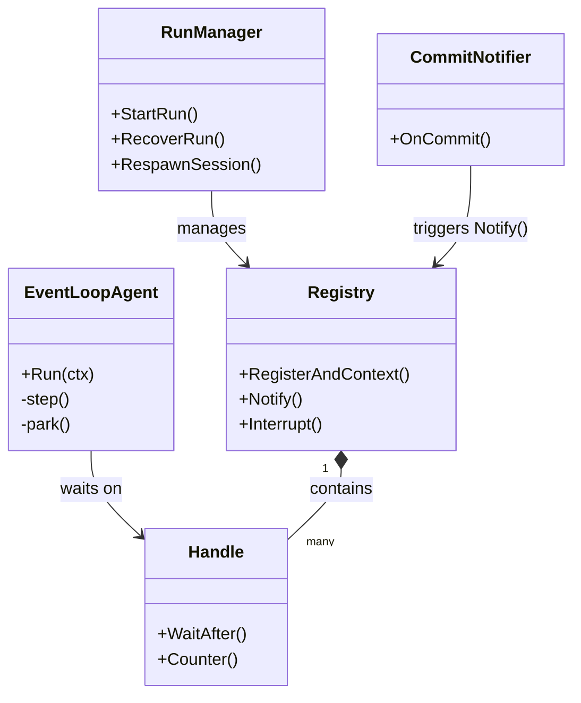
**Sources:** [internal/runtime/manager.go:45-60](), [internal/agent/eventloop/eventloop.go:70-90](), [internal/session/registry.go:119-125](), [internal/runtime/notifier.go:25-35]()

---

# Page: Persistence Layer (SQLite Store)

# Persistence Layer (SQLite Store)

<details>
<summary>Relevant source files</summary>

The following files were used as context for generating this wiki page:

- [README.md](README.md)
- [internal/db/errtag.go](internal/db/errtag.go)
- [internal/db/sqlite/grades_test.go](internal/db/sqlite/grades_test.go)
- [internal/db/sqlite/memtemplate.go](internal/db/sqlite/memtemplate.go)
- [internal/db/sqlite/sqlite.go](internal/db/sqlite/sqlite.go)
- [internal/db/store.go](internal/db/store.go)
- [internal/server/artifacts_test.go](internal/server/artifacts_test.go)
- [internal/server/briefings_test.go](internal/server/briefings_test.go)
- [internal/server/grades_test.go](internal/server/grades_test.go)

</details>


The persistence layer in Amplio follows a **DB-first** philosophy, where the database is the single source of truth for the entire system's state [internal/db/store.go:27-30](). Every agent action, tool result, and session transition is durably committed to a SQLite database before being acted upon. This design enables robust crash-resume capabilities, as the `RunManager` can reconstruct the exact state of any session by replaying its event stream from the database [README.md:4-6]().

## The Store Interface

The `db.Store` interface abstracts all persistence operations, ranging from run and session management to event logging and skill embedding storage [internal/db/store.go:38-200]().

### Implementation: sqliteStore
The primary implementation is `sqliteStore`, which manages a single SQLite database file [internal/db/sqlite/sqlite.go:52-62](). To ensure performance and concurrency in a multi-agent environment, it utilizes:
*   **WAL (Write-Ahead Logging) Mode**: Enables concurrent readers to operate while a writer is active [internal/db/sqlite/sqlite.go:114-116]().
*   **Serialization Mutex**: A `sync.Mutex` (`mu`) serializes all write operations to prevent database locking contention [internal/db/sqlite/sqlite.go:54-54]().
*   **Modernc SQLite Driver**: A pure Go SQLite implementation that requires no CGO [internal/db/sqlite/sqlite.go:34-34]().

### Error Tagging
All errors returned by the `Store` are wrapped with `db.ErrStore` using the `db.Tag` decorator [internal/db/errtag.go:35-41](). This allows the agent execution loop to distinguish between transient logic errors (e.g., LLM failures) and fatal persistence failures. If a DB error occurs, the harness avoids writing a crash record—which would likely fail—and instead leaves the session "ongoing" to be picked up by the recovery logic [internal/db/errtag.go:25-34]().

### Data Flow: Persistence and Notification
The `Store` does not use traditional callbacks for data updates. Instead, it provides a `StoreEvent` channel. Consumers like the `SessionRegistry` or `EventBus` select on this channel to receive wakeups when new data is committed [internal/db/store.go:35-37]().

**Diagram: Persistence Data Flow**
```mermaid
graph TD
    subgraph "Agent Runtime"
        [AgentLoop] -->|"AppendEvent()"| [StoreInterface]
        [AgentLoop] -->|"FinalizeStep()"| [StoreInterface]
    end

    subgraph "internal/db/sqlite"
        [StoreInterface] --> [sqliteStore]
        [sqliteStore] -->|"Lock(mu)"| [SQLite_File]
        [SQLite_File] -->|"Commit"| [WAL_Journal]
        [sqliteStore] -->|"Emit"| [StoreEvent_Chan]
    end

    subgraph "Observers"
        [StoreEvent_Chan] --> [EventBus]
        [StoreEvent_Chan] --> [SessionRegistry]
    end
```
Sources: [internal/db/store.go:27-38](), [internal/db/sqlite/sqlite.go:52-75](), [internal/db/errtag.go:35-57]()

## Session and Step Cursors

Amplio uses a set of observer cursors stored on the `Session` table to track the progress of background tasks like summarization and phase detection [internal/db/sqlite/sqlite.go:145-147]().

| Cursor | Purpose |
| :--- | :--- |
| `last_finalized_step` | The highest step number where all events (Assistant + Tool Results) are durably recorded [internal/db/store.go:126-129](). |
| `last_summarized_step` | Tracks how far the `Observer` has progressed in generating step-by-step summaries for context compaction [internal/db/sqlite/sqlite.go:146-146](). |
| `last_phased_step` | Tracks the boundary of phase detection (e.g., switching between autonomous and interactive modes) [internal/db/sqlite/sqlite.go:147-147](). |

### Atomicity: TerminateAndNotifyParent
A critical operation for sub-agent coordination is `TerminateAndNotifyParent`. This method performs three actions in a single transaction [internal/db/store.go:94-109]():
1.  Transitions the child session to a terminal status (`concluded`, `crashed`, or `cancelled`).
2.  Appends a terminal event to the child's own event stream.
3.  Appends a `ChildResultEvent` to the **parent** session's stream.

This atomicity ensures that a parent agent never misses a child's result due to a crash occurring between the child finishing and the parent being notified [internal/db/store.go:94-98]().

Sources: [internal/db/store.go:94-136](), [internal/db/sqlite/sqlite.go:145-147]()

## Schema and Migrations

The schema is defined in `internal/db/sqlite/schema.go` (referenced in [internal/db/sqlite/sqlite.go:125-125]()). The `migrate` function handles additive changes, such as adding annotation columns to the `Run` table (title, note, starred, grade) or recency cursors for lessons [internal/db/sqlite/sqlite.go:138-181]().

### Performance Optimization: Memory Templates
For unit tests that use `:memory:` databases, Amplio optimizes startup by using a "page image" template. Instead of running DDL for every test, it creates a fully migrated database once, serializes it to a byte slice, and uses `sqlite3_deserialize` to clone that image into new connections [internal/db/sqlite/memtemplate.go:28-54]().

**Diagram: Entity Mapping**
```mermaid
classDiagram
    class "RunRecord" {
        +RunID string
        +Title string
        +Starred bool
        +Grade int
    }
    class "SessionRecord" {
        +SessionID string
        +ParentID string
        +Status string
        +LastFinalizedStep int
    }
    class "Event" {
        +Step int
        +Kind string
        +Data json
    }
    class "ObservationRecord" {
        +ObsID string
        +Kind string
        +Data map
    }

    "RunRecord" "1" -- "*" "SessionRecord" : contains
    "SessionRecord" "1" -- "*" "Event" : stream
    "RunRecord" "1" -- "*" "ObservationRecord" : artifacts/reports
```
Sources: [internal/db/sqlite/sqlite.go:140-181](), [internal/db/sqlite/memtemplate.go:28-86](), [internal/db/store.go:41-92]()

## Skill Embedding Cache

The persistence layer includes a `SkillEmbedding` table used by the recall system [internal/db/sqlite/sqlite.go:170-176]().
*   **Caching**: It stores the `description`, `path`, and `body` of skills along with their vector embeddings.
*   **Reconciliation**: The `PutSkillVectors` method reconciles the database cache with the source filesystem. This allows the `Index` to hydrate fully from the SQLite cache at startup without re-scanning slow cloud-backed filesystems [internal/db/sqlite/sqlite.go:170-176]().
*   **Partial Indexes**: The schema uses indexes to optimize retrieval of events by `(session_id, step)` and filtering of runs by status or "seen" state [internal/db/sqlite/sqlite.go:161-165]().

Sources: [internal/db/sqlite/sqlite.go:161-176](), [internal/db/store.go:190-200]()

---

# Page: Runtime and Run Manager

# Runtime and Run Manager

<details>
<summary>Relevant source files</summary>

The following files were used as context for generating this wiki page:

- [cmd/amplio/system.go](cmd/amplio/system.go)
- [internal/llm/openai/openai.go](internal/llm/openai/openai.go)
- [internal/llm/spec_test.go](internal/llm/spec_test.go)
- [internal/runtime/manager.go](internal/runtime/manager.go)
- [internal/runtime/manager_test.go](internal/runtime/manager_test.go)
- [internal/runtime/respawn_race_test.go](internal/runtime/respawn_race_test.go)
- [internal/tool/bash/bash.go](internal/tool/bash/bash.go)

</details>


The `RunManager` is the central orchestration layer of Amplio. It bridges the static configuration and persistence layers with the active execution of agents. It is responsible for launching new runs, recovering sessions after crashes or restarts, managing LLM provider lifecycles, and tracking in-flight ephemeral tasks.

## RunManager Overview

The `RunManager` struct acts as the primary entry point for managing the lifecycle of agent runs and their constituent sessions. It is initialized during the system bootstrap in `setupSystem` [cmd/amplio/system.go:77-108]().

### Key Responsibilities
*   **Orchestration**: Mapping `RunConfig` objects to living agent goroutines via `StartRun` [internal/runtime/manager.go:179-242]().
*   **Session Recovery**: Identifying and reviving "spine" sessions (ongoing or awaiting) during system startup or after a crash [internal/runtime/manager.go:343-413]().
*   **Provider Caching**: Managing a shared cache of `llm.Provider` instances to avoid redundant initialization across runs [internal/runtime/manager.go:142-154]().
*   **Workspace Resolution**: Reconstructing agent workspaces (plain, git, etc.) during session initialization [internal/runtime/manager.go:41-42]().
*   **Ephemeral Tracking**: Maintaining a registry of non-session workers, such as the report critic or title generator [internal/runtime/manager.go:70-71]().

### Data Flow: StartRun Lifecycle

This diagram illustrates the sequence of operations when `StartRun` is invoked to begin a new autonomous or interactive task.

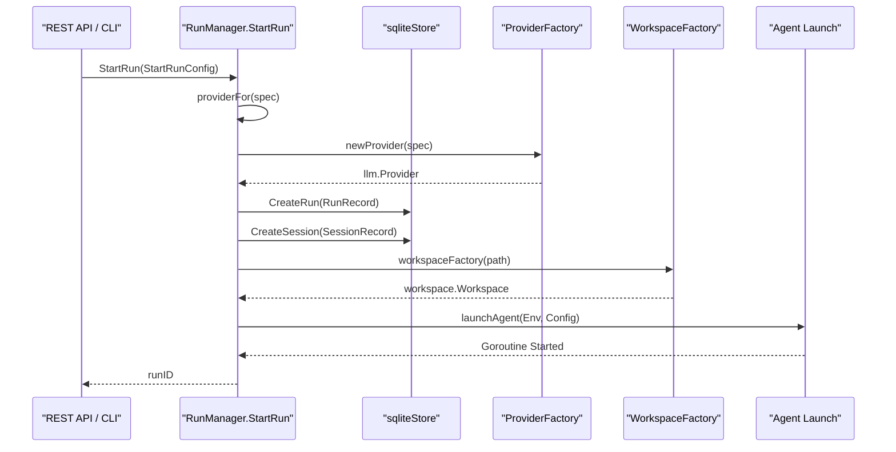
**Sources:** [internal/runtime/manager.go:179-242](), [internal/runtime/manager.go:142-154](), [internal/runtime/manager.go:415-460]()

## Session Recovery and Respawning

Amplio implements a "crash-resume" model. When the server starts, or when a session is nudged, the `RunManager` uses `RecoverRun` and `RespawnSession` to ensure the agent execution loop continues from the last persisted state in the SQLite DB.

### RecoverRun
`RecoverRun` is called during system initialization for every active run. It performs a "spine" analysis to determine which sessions need a living goroutine [internal/runtime/manager.go:343-413]():
1.  Queries the `SessionStore` for all sessions in a specific `runID`.
2.  Filters for "spine" sessions: those with status `Ongoing`, `Awaiting`, or `Crashed`.
3.  Invokes `RespawnSession` for each identified session.

### RespawnSession
`RespawnSession` is the mechanism for reviving a single session [internal/runtime/manager.go:271-341](). To prevent race conditions where an incoming event might trigger a duplicate goroutine, it uses a synchronous "slot reservation" in the `SessionRegistry` [internal/runtime/respawn_race_test.go:120-134]().

If the session was not "at rest" (i.e., it was interrupted mid-turn), a `RecoverEvent` is appended to the DB to signal the agent that it should reconcile its internal state with the environment [internal/runtime/manager.go:321-326]().

**Sources:** [internal/runtime/manager.go:343-413](), [internal/runtime/manager.go:271-341](), [internal/runtime/manager_test.go:48-122]()

## LLM Provider Management

The `RunManager` maintains a `providers` map to cache `llm.Provider` instances. Providers are stateless and safe to share across multiple runs and sessions [internal/runtime/manager.go:62-63]().

### Provider Resolution
When a run starts, the `RunManager` calls `providerFor(spec)` [internal/runtime/manager.go:142-154]().
*   If the `spec` (e.g., `openai:gpt-4o`) exists in the cache, the existing instance is returned.
*   Otherwise, the `ProviderFactory` (injected during `NewRunManager`) is called to build a new instance.
*   **System Providers**: The manager also holds shared "Fast" (for judging/compaction) and "HQ" (for summarization) providers used globally for background tasks [internal/runtime/manager.go:99-108]().

**Sources:** [internal/runtime/manager.go:142-154](), [internal/runtime/manager.go:99-108](), [cmd/amplio/system.go:88-97]()

## Ephemeral Agent Registry

Not all active tasks in Amplio are associated with a persistent `SessionID`. Tasks like generating a run report (the `Finalizer`) or generating a run title are considered ephemeral.

The `EphemeralAgentRegistry` allows these tasks to register their presence so the UI can display active background work to the user [internal/runtime/manager.go:77-81]().

| Task | Trigger | Provider Tier |
| :--- | :--- | :--- |
| **Title Generator** | Start of a new run | `systemFast` |
| **Finalizer (Critic)** | Main agent conclusion | `systemHQ` |
| **Compaction** | Context window threshold | `systemFast` / `systemHQ` |

**Sources:** [internal/runtime/manager.go:77-81](), [cmd/amplio/system.go:114-130]()

## Implementation Details: Workspace and Env Construction

Before launching an agent goroutine, the `RunManager` assembles an `agent.Env`. This environment provides the agent with all necessary subsystem handles.

### Runtime Entity Mapping
This diagram shows how `RunManager` constructs the `agent.Env` by gathering entities from different subsystems.

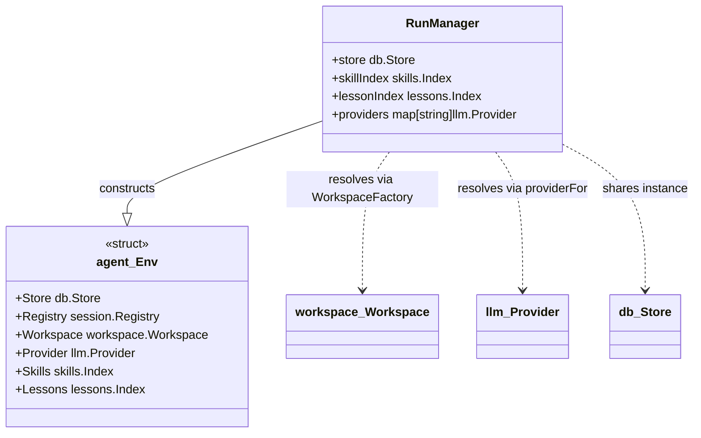
**Sources:** [internal/runtime/manager.go:415-460](), [internal/runtime/manager.go:50-71]()

### Workspace Reconstruction
Workspaces are reconstructed using the `WorkspaceFactory` [internal/runtime/manager.go:42]().
*   For root agents, the workspace path is taken from `RunConfig.Workspace`.
*   For sub-agents (spawned agents), the workspace is often a sub-directory or a linked path within the parent's workspace.
*   Workspaces provide the `CWD` for `bash` tool execution [internal/tool/bash/bash.go:61-68]().

**Sources:** [internal/runtime/manager.go:415-460](), [internal/workspace/workspace.go:1-20]()

---

# Page: Agent System

# Agent System

<details>
<summary>Relevant source files</summary>

The following files were used as context for generating this wiki page:

- [internal/agent/agent.go](internal/agent/agent.go)
- [internal/agent/eventloop/eventloop.go](internal/agent/eventloop/eventloop.go)
- [internal/agent/standard/standard.go](internal/agent/standard/standard.go)

</details>


The Amplio agent system is a robust framework for executing Large Language Models (LLMs) in a persistent, tool-enabled loop. The system is designed around a **DB-first** philosophy, where every agent action, tool result, and system event is persisted to a SQLite store before being projected back into the model's context. This ensures that agents can resume seamlessly from crashes or restarts without losing state.

## The Agent Interface

All agents in Amplio implement a minimal `Agent` interface, which defines their lifecycle within a run. Agents are managed by the `RunManager` and operate within a shared `Env` that provides access to system resources like the database, workspace, and LLM providers.

*   **`Agent` Interface**: Defines the `Run(ctx)` method, which blocks until the agent completes its task, crashes, or is cancelled [internal/agent/agent.go:32-39]().
*   **`Env` Struct**: A shared object graph injected into every agent, containing dependencies like `Store`, `LLM` providers, `Workspace`, and `SkillIndex` [internal/agent/agent.go:48-65]().
*   **Agent Registry**: A global registry where agent types (e.g., `standard_agent`, `chatbot`) are registered with their respective factories and `Traits` [internal/agent/agent.go:113-131]().

**Sources:** [internal/agent/agent.go:31-65](), [internal/agent/agent.go:113-131]()

## Event Loop Execution Engine

The `EventLoopAgent` is the core execution engine of the system. It implements the standard "Observe-Orient-Decide-Act" loop by interacting with the database and the LLM.

*   **Bootstrap (Step 0)**: Upon starting, the agent writes "bootstrap" events (SystemEvents) to the database, including the task description, system prompts, and tool definitions [internal/agent/eventloop/eventloop.go:80-84]().
*   **The Loop**: In each turn, the agent:
    1.  Projects the database event log into a sequence of LLM messages (`buildMessages`).
    2.  Calls the LLM to generate a response.
    3.  Persists the `AssistantEvent` (containing text and/or tool calls).
    4.  Executes requested tools and persists `ToolResultEvent`s.
*   **Reconciliation**: If the system restarts, the agent reads the existing event log to determine the current step and resumes the loop exactly where it left off.
*   **Nudge Mechanism**: To prevent accidental termination, autonomous agents that return an empty response (no text, no tools) are "nudged" by the system to either provide a final summary or continue working [internal/agent/eventloop/eventloop.go:57-60]().

For details, see [Event Loop Agent](#3.1).

**Sources:** [internal/agent/eventloop/eventloop.go:135-151](), [internal/agent/eventloop/eventloop.go:57-60]()

## Agent Types: Standard and Chatbot

Amplio provides two primary agent implementations that differ in their interaction patterns and termination logic.

| Agent Type | Name | Interaction Mode | Termination Behavior |
| :--- | :--- | :--- | :--- |
| **Standard** | `standard_agent` | Autonomous | Concludes when it issues a turn with no tool calls [internal/agent/standard/standard.go:37-40](). |
| **Chatbot** | `chatbot` | Interactive | Parks in an `Idle` state awaiting user input after a no-tool turn [internal/agent/agent.go:105-111](). |

Both types use layered system prompts, combining core execution principles with dynamic briefings and environment-specific instructions [internal/agent/standard/standard.go:91-98]().

For details, see [Agent Types: Standard and Chatbot](#3.2).

**Sources:** [internal/agent/standard/standard.go:42-47](), [internal/agent/agent.go:105-111]()

## Agent Toolset

Agents interact with the world through a structured toolset. Tools are defined using a "dual-call" pattern: they are first described to the LLM via JSON schema, and then executed by the `EventLoopAgent` when requested.

*   **System Tools**: `bash` (with process management), `view_file`, `edit_file`, and `ls`.
*   **Coordination Tools**: `spawn` (to create sub-agents), `send_message`, and `await_event`.
*   **Recall Tools**: `recall_skills` and `recall_lessons` for RAG-based knowledge retrieval.

For details, see [Agent Toolset](#3.3).

**Sources:** [internal/agent/standard/standard.go:61-72](), [internal/agent/eventloop/eventloop.go:124-124]()

## System Integration Diagram

The following diagram illustrates how the `EventLoopAgent` bridges the gap between the high-level task and the underlying code entities.

### Agent Execution Logic
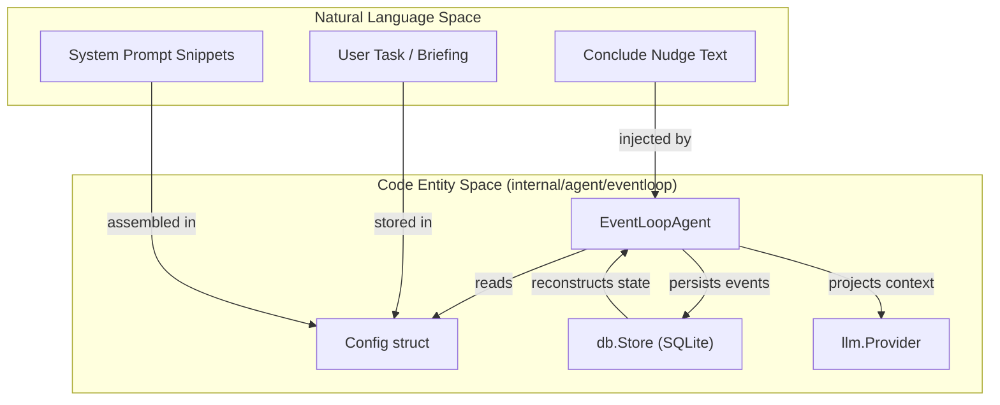
**Sources:** [internal/agent/eventloop/eventloop.go:69-132](), [internal/agent/agent.go:48-65]()

## Background Observer and Critic

The agent system is supported by background processes that monitor progress and maintain context efficiency.

*   **Observer**: A background routine that watches the event stream to detect "Phases" (logical chunks of work) and triggers step summarization.
*   **Compaction**: When the event log becomes too long for the LLM's context window, a `compaction_agent` is spawned to summarize old steps, allowing the main agent to continue with a "compressed" memory.
*   **Critic**: Once a run concludes, a high-quality LLM (the `keen-critic`) analyzes the trajectory to produce a `RunReport`, containing grades, achievements, and lessons learned.

For details, see [Observer, Phases, and Compaction](#3.4) and [Critic and Run Reports](#3.5).

### Context Management Flow
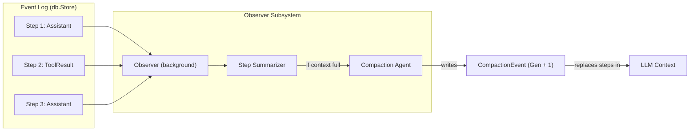
**Sources:** [internal/agent/eventloop/eventloop.go:62-67](), [internal/agent/agent.go:67-77]()

---

# Page: Event Loop Agent

# Event Loop Agent

<details>
<summary>Relevant source files</summary>

The following files were used as context for generating this wiki page:

- [internal/agent/eventloop/attachments_test.go](internal/agent/eventloop/attachments_test.go)
- [internal/agent/eventloop/eventloop.go](internal/agent/eventloop/eventloop.go)
- [internal/agent/eventloop/eventloop_test.go](internal/agent/eventloop/eventloop_test.go)
- [internal/agent/eventloop/prompts.go](internal/agent/eventloop/prompts.go)
- [internal/server/server_test.go](internal/server/server_test.go)

</details>


The `EventLoopAgent` is the core execution engine in Amplio, implementing a persistent, crash-resilient LLM-in-a-loop pattern. It manages the transition between natural language reasoning and tool execution while maintaining a strictly ordered event log in the database.

## Overview and Implementation

The `EventLoopAgent` resides in `internal/agent/eventloop` and is designed to handle both autonomous (task-driven) and interactive (chat-driven) workflows [internal/agent/eventloop/eventloop.go:134-151](). It operates by projecting the current database state into an LLM context, generating a turn, executing requested tools, and persisting the results.

### Key Structures

| Entity | Role | Source |
| :--- | :--- | :--- |
| `Config` | Per-instance settings (Task, Tools, Interactive flag, System Prompt). | [internal/agent/eventloop/eventloop.go:76-132]() |
| `EventLoopAgent` | The stateful runner managing the session lifecycle and loop nudges. | [internal/agent/eventloop/eventloop.go:135-151]() |
| `agent.Env` | Shared per-run services (Store, Registry, LLM Providers, Workspace). | [internal/agent/eventloop/eventloop_test.go:70-79]() |

## The Execution Loop

The `Run` method is the entry point for agent execution. It follows a structured lifecycle from initialization to termination or parking.

### 1. Bootstrap (Step 0)
When a session starts, the agent injects "Step 0" system events. These provide the LLM with its fundamental context before the first turn [internal/agent/eventloop/eventloop_test.go:198-212]().
*   **Task/FirstMessage**: The primary goal or initial user input.
*   **Environment Info**: CLI tools availability and workspace details [internal/agent/eventloop/eventloop.go:111-115]().
*   **Recall Seed**: Relevant skills or lessons retrieved via `InitialRecall` [internal/agent/eventloop/eventloop.go:125-127]().

### 2. Main LLM Loop
The loop continues until the agent concludes, parks (if interactive), or is cancelled.

```mermaid
graph TD
    Start["Run() Start"] --> Recover["Reconcile/Recover State"]
    Recover --> Build["buildMessages() context projection"]
    Build --> LLM["LLM Generate Turn"]
    LLM --> Tools{Tool Calls?}
    
    Tools -- "Yes" --> Exec["Execute Tools & Persist Results"]
    Exec --> Build
    
    Tools -- "No" --> NudgeCheck{Empty Response?}
    NudgeCheck -- "Yes" --> Nudge["Nudge Mechanism"]
    Nudge --> Build
    
    NudgeCheck -- "No" --> Interactive{Interactive?}
    Interactive -- "Yes" --> Park["Park as Idle (Awaiting User)"]
    Interactive -- "No" --> Conclude["Conclude Session"]

    Sources: [internal/agent/eventloop/eventloop.go:134-151](), [internal/agent/eventloop/eventloop_test.go:161-193]()
```

## Context Projection (`buildMessages`)

The agent does not store a growing list of strings; instead, it projects the database `Event` log into a format the LLM understands using `buildMessages`.

*   **Compaction Handling**: If a `CompactionEvent` exists, the agent prefixes it with `compactionFraming` to signal it as a "memory" of past work [internal/agent/eventloop/eventloop.go:62-67]().
*   **Attachment Loading**: Image attachments are stored in the `BlobStore` to keep the DB light. `buildMessages` re-fetches these and converts them to Base64 for the LLM provider [internal/agent/eventloop/attachments_test.go:45-70]().
*   **Empty Placeholders**: If a turn resulted in no text and no tools, the agent injects `emptyAssistantPlaceholder` ("(empty response)") to satisfy provider requirements for non-empty messages [internal/agent/eventloop/eventloop.go:50-55]().

## Resilience and Mechanics

### Crash-Resume and Reconciliation
Because every step is persisted to the `db.Store`, an agent can crash and resume instantly. Upon restart, the agent inspects the last finalized step. If a turn was interrupted (e.g., LLM call failed or process died), the agent reconciles the state by identifying the `callStep` and resuming from the last valid point [internal/agent/eventloop/eventloop.go:140-144]().

### Nudge Mechanism
Autonomous agents sometimes produce "accidental conclusions"—turns with no text and no tool calls. The loop detects this and applies a `concludeNudgeText` up to `maxConcludeNudges` (default 2) to prompt the model to either provide a final summary or continue working [internal/agent/eventloop/eventloop.go:44-60]().

### Parking and Idle Mechanics
For interactive agents (`Interactive: true`), a turn with no tool calls results in the session status becoming `db.SessionIdle` [internal/agent/eventloop/eventloop_test.go:143-158](). The goroutine parks and waits for a new `UserEvent` to be committed to the database, which triggers a wake-up via the `CommitListener` [internal/agent/eventloop/eventloop_test.go:121-124]().

## Attachment Processing
The agent manages binary data (like screenshots) through a specialized pipeline to ensure the context remains within LLM limits.

```mermaid
graph LR
    subgraph "Natural Language Space"
        A["Agent sees Image"]
    end

    subgraph "Code Entity Space"
        B["event.Attachment"]
        C["blob.Store"]
        D["imageutil.DefaultMaxDim"]
        E["EventLoopAgent.storeAttachment"]
    end

    A --> E
    E --> D["Clamp/Downscale to 2000px"]
    D --> C["Persist to Disk"]
    C --> B["Store Ref in DB"]

    Sources: [internal/agent/eventloop/attachments_test.go:84-114](), [internal/agent/eventloop/eventloop.go:128-132]()
```

*   **Clamping**: Images exceeding 2000px on the long edge are downscaled before persistence to save space and context tokens [internal/agent/eventloop/attachments_test.go:84-91]().
*   **Persistence**: If `BlobStore` is nil, attachments are dropped to prevent the database from bloating [internal/agent/eventloop/attachments_test.go:72-80]().

## Prompt Assembly
The agent's personality and operational rules are composed from several Markdown snippets defined in `prompts.go`:
*   `ExecutionPrinciplesPromptSnippet`: Mindset for autonomous agents [internal/agent/eventloop/prompts.go:26-32]().
*   `ToolUsageStrategyPromptSnippet`: Standard instructions for tool invocation [internal/agent/eventloop/prompts.go:34-37]().
*   `SubAgentStrategyPromptSnippet`: Logic for spawning and managing sub-agents [internal/agent/eventloop/prompts.go:39-42]().

`Sources: internal/agent/eventloop/eventloop.go, internal/agent/eventloop/eventloop_test.go, internal/agent/eventloop/attachments_test.go, internal/agent/eventloop/prompts.go`

---

# Page: Agent Types: Standard and Chatbot

# Agent Types: Standard and Chatbot

<details>
<summary>Relevant source files</summary>

The following files were used as context for generating this wiki page:

- [internal/agent/chatbot/chatbot.go](internal/agent/chatbot/chatbot.go)
- [internal/agent/eventloop/prompts/sub_agent_strategy.md](internal/agent/eventloop/prompts/sub_agent_strategy.md)
- [internal/agent/standard/standard.go](internal/agent/standard/standard.go)
- [internal/agent/standard/standard_agent.md](internal/agent/standard/standard_agent.md)

</details>


Amplio supports two primary agent implementations: the **Standard Agent** and the **Chatbot**. Both are built upon the `EventLoopAgent` core but differ in their intended autonomy, system prompt construction, and termination behavior.

## Overview of Agent Factories

Agent types are registered in a global registry using `agent.Register` [internal/agent/agent.go:76-85](). Each registration provides a factory function that assembles the agent's environment, tools, and system prompts.

| Agent Type | Purpose | Interaction Model |
| :--- | :--- | :--- |
| `standard_agent` | Autonomous research and coding. | Background/Autonomous |
| `chatbot` | Interactive assistance and sidecar support. | Interactive/UI-driven |

### Data Flow: Factory to EventLoop

The following diagram illustrates how the factory functions in `standard.go` and `chatbot.go` assemble the `eventloop.Config` before initializing the `EventLoopAgent`.

**Agent Initialization Flow**
```mermaid
graph TD
    subgraph "internal/agent/standard"
        SF["factory()"] --> SR["recall.InitialContent()"]
        SF --> ST["toolset.Build()"]
        SF --> SB["briefing.ForRun()"]
    end

    subgraph "internal/agent/chatbot"
        CF["factory()"] --> CT["toolset.Build()"]
        CF --> CB["briefing.ForRun()"]
        CF --> CSP["systemPromptFor()"]
    end

    ST --> ELA["eventloop.New()"]
    CT --> ELA
    SR --> ELA
    SB --> ELA
    CB --> ELA
    CSP --> ELA

    ELA --> ELA_INST["EventLoopAgent Instance"]
```
Sources: [internal/agent/standard/standard.go:49-106](), [internal/agent/chatbot/chatbot.go:71-117]()

---

## The Standard Agent (`standard_agent`)

The `standard_agent` is designed for long-horizon, autonomous tasks. It is defined in the `internal/agent/standard` package [internal/agent/standard/standard.go:42]().

### System Prompt Assembly
The system prompt for the standard agent is a layered assembly of specialized snippets:
1.  **Core Instructions**: The `standard_agent.md` file, which defines research methodologies (Focused vs. Open-ended) [internal/agent/standard/standard_agent.md:1-19]().
2.  **Execution Principles**: General guidelines for reasoning and planning [internal/agent/standard/standard.go:92]().
3.  **Environment Snippet**: Information about the runtime environment [internal/agent/standard/standard.go:93]().
4.  **Strategy Snippets**: Guidance on tool usage and sub-agent delegation [internal/agent/standard/standard.go:94-95]().
5.  **Completion Snippet**: Defines how the agent signals it is done [internal/agent/standard/standard.go:37-41]().
6.  **Briefings**: User-provided or run-specific markdown instructions [internal/agent/standard/standard.go:98]().

### Recall Seeding
Unique to the standard agent is the `InitialRecall` mechanism. During factory construction, if a `SkillIndex` or `LessonIndex` is available, the agent seeds its initial context with relevant snippets derived from the task description using `recall.InitialContent` [internal/agent/standard/standard.go:76-82]().

### Termination Behavior
The standard agent uses an "absence of tool calls" signal for completion. The `completionSnippet` instructs the agent to provide a final plain-text summary without any tool calls to signal the end of the task [internal/agent/standard/standard.go:37-40]().

Sources: [internal/agent/standard/standard.go:37-106](), [internal/agent/standard/standard_agent.md:1-19]()

---

## The Chatbot Agent (`chatbot`)

The `chatbot` agent is optimized for interactive sessions and acting as a "sidecar" to an autonomous agent. It is defined in `internal/agent/chatbot` [internal/agent/chatbot/chatbot.go:64]().

### Role-Based Prompting
The chatbot dynamically adjusts its system prompt based on its role within the run. The `systemPromptFor` function checks if the session is the root of the run or if an autonomous agent already exists [internal/agent/chatbot/chatbot.go:49-60]().

*   **Root Prompt**: Used when the chatbot is the primary agent in the run [internal/agent/chatbot/chatbot.go:42]().
*   **Sidecar Prompt**: Used when the chatbot is added to a run that already has a `standard_agent` root [internal/agent/chatbot/chatbot.go:43](). This prompt adjusts the chatbot's perspective to be a collaborator rather than the primary driver.

### Interaction Traits
The chatbot is registered with the `Interactive: true` trait [internal/agent/chatbot/chatbot.go:67](). This tells the `RunManager` and frontend that this agent expects frequent user input and should be prioritized in the chat UI.

Sources: [internal/agent/chatbot/chatbot.go:41-69](), [internal/agent/chatbot/chatbot.go:97-114]()

---

## Common Components

Both agent types share a significant portion of their logic and configuration via the `eventloop` and `toolset` packages.

### Shared System Snippets
Standardized snippets are imported to ensure consistent behavior across different agent types:
*   **Sub-Agent Strategy**: Guidance on using `spawn_agent`, workspace modes (`share` vs `link`), and coordination via `send_message` and `await_event` [internal/agent/eventloop/prompts/sub_agent_strategy.md:3-12]().
*   **Artifact Directory**: Instructions on where to store and retrieve files [internal/agent/chatbot/chatbot.go:108]().

### Toolset Construction
Both agents utilize `toolset.Build` to generate their available tools [internal/agent/standard/standard.go:61-72](), [internal/agent/chatbot/chatbot.go:79-90](). This includes:
*   **Bash**: For command execution.
*   **Recall**: For searching skills and lessons.
*   **Coordination**: For managing sub-agents and communication.

**System Prompt Composition Map**
```mermaid
graph LR
    subgraph "Prompt Sources"
        CORE["standard_agent.md / chatbot_core.md"]
        STRAT["sub_agent_strategy.md"]
        TOOL["tool_usage_strategy.md"]
        ENV["environment_snippet"]
        BRIEF["briefing.ForRun()"]
    end

    subgraph "Standard Agent"
        S_TOTAL["Final System Prompt"]
        CORE --> S_TOTAL
        STRAT --> S_TOTAL
        TOOL --> S_TOTAL
        ENV --> S_TOTAL
        COMP["completionSnippet"] --> S_TOTAL
        BRIEF --> S_TOTAL
    end

    subgraph "Chatbot Agent"
        C_TOTAL["Final System Prompt"]
        ROLE["systemPromptFor()"] --> C_TOTAL
        STRAT --> C_TOTAL
        TOOL --> C_TOTAL
        ENV --> C_TOTAL
        BRIEF --> C_TOTAL
    end
```
Sources: [internal/agent/standard/standard.go:91-98](), [internal/agent/chatbot/chatbot.go:104-109](), [internal/agent/eventloop/prompts/sub_agent_strategy.md:3-12]()

### Briefing Injection
Both factories call `briefing.ForRun` to fetch relevant markdown files [internal/agent/standard/standard.go:59](), [internal/agent/chatbot/chatbot.go:95]().
*   **Root Agents**: Receive `scope:root` briefings and user-selected briefings.
*   **Sub-agents**: Only receive briefings relevant to their specific task or global scope.

Sources: [internal/agent/standard/standard.go:59-60](), [internal/agent/chatbot/chatbot.go:95-96]()

---

# Page: Agent Toolset

# Agent Toolset

<details>
<summary>Relevant source files</summary>

The following files were used as context for generating this wiki page:

- [cmd/amplio/system.go](cmd/amplio/system.go)
- [internal/agent/toolset/toolset.go](internal/agent/toolset/toolset.go)
- [internal/llm/openai/openai.go](internal/llm/openai/openai.go)
- [internal/llm/spec_test.go](internal/llm/spec_test.go)
- [internal/server/tools.go](internal/server/tools.go)
- [internal/tool/bash/bash.go](internal/tool/bash/bash.go)
- [internal/tool/spawn/spawn_test.go](internal/tool/spawn/spawn_test.go)

</details>


The Agent Toolset provides the interface between an agent's reasoning loop and the external world. Amplio employs a "dual-call" pattern for tool definitions to ensure that the documentation presented to the LLM (schemas) and the tools displayed in the UI (trajectory viewer) never drift from the actual executable implementation.

## Toolset Construction

The `toolset` package is responsible for assembling the list of tools shared by both the `standard_agent` and the `chatbot`.

### The Dual-Call Pattern
To prevent drift between the runtime and the UI, the toolset is designed to be called twice:
1.  **Runtime Construction**: Called by agent factories with real dependencies (`db.Store`, `session.Registry`, etc.) to build executable tools [internal/agent/toolset/toolset.go:19-20]().
2.  **Display/Schema Construction**: Called with `nil` dependencies to generate `llm.ToolDef` objects. Constructors capture dependencies in closures, allowing schemas to be generated even when the underlying services are unavailable [internal/agent/toolset/toolset.go:45-49]().

### Data Flow and Dependencies
The `Deps` struct encapsulates all resources a tool might need. Tools are appended in a specific order, ensuring consistent presentation to the LLM [internal/agent/toolset/toolset.go:50-70]().

| Dependency | Purpose |
| :--- | :--- |
| `Store` | Persistence for inspection and recall tools [internal/agent/toolset/toolset.go:56](). |
| `Registry` | Coordination and session management [internal/agent/toolset/toolset.go:57](). |
| `Env` | Workspace and spawning context [internal/agent/toolset/toolset.go:58](). |
| `SkillIndex` | Vector search for pre-defined skills [internal/agent/toolset/toolset.go:61](). |
| `LessonIndex` | Search for lessons mined from previous runs [internal/agent/toolset/toolset.go:62](). |

Sources: [internal/agent/toolset/toolset.go:1-112]()

## Core Tools

### Bash Tool
The `bash` tool provides shell execution with strict safety and resource management.
*   **Process Group Management**: On timeout or cancellation, the tool kills the entire process group to prevent orphaned children [internal/tool/bash/bash.go:161-163]().
*   **Output Capping**: To prevent context window overflow or memory exhaustion from runaway processes, output is capped (default 32,000 characters) [internal/tool/bash/bash.go:47-53]().
*   **Environment Injection**: Subprocesses receive `AMPLIO_RUN_ID`, `AMPLIO_SESSION_ID`, and `AMPLIO_ARTIFACT_DIR` [internal/tool/bash/bash.go:72-82]().
*   **Notify Shim**: Agents are provided with an `amplio-notify` binary in their `PATH`, allowing background scripts to report status back to the agent loop [internal/tool/bash/bash.go:94-97]().

### File Manipulation
*   **view_file**: Reads files from the workspace or artifact directory [internal/agent/toolset/toolset.go:72]().
*   **edit_file**: Provides structured editing capabilities [internal/agent/toolset/toolset.go:73]().

### Coordination and Spawning
*   **spawn**: Creates a sub-agent session. It supports `link` mode, which creates a git worktree or linked workspace so the child can work in parallel without interfering with the parent's file state [internal/tool/spawn/spawn_test.go:99-116]().
*   **send_message**: Inter-agent communication [internal/agent/toolset/toolset.go:74]().
*   **await_event**: Parks the agent until a specific signal or message is received [internal/agent/toolset/toolset.go:76]().

### Inspect and Recall
*   **Session Tools**: `session_list`, `session_steps`, and `session_peek` allow agents to observe the state of their peers or sub-agents [internal/agent/toolset/toolset.go:77-79]().
*   **Recall Tools**: `recall_search` and `recall_load` interface with the `skills.Index` and `lessons.Index` to retrieve relevant expertise or past experiences [internal/agent/toolset/toolset.go:89-91]().

Sources: [internal/tool/bash/bash.go:15-185](), [internal/agent/toolset/toolset.go:65-92](), [internal/tool/spawn/spawn_test.go:74-120]()

## Tool Architecture and Data Flow

The following diagram illustrates how the natural language request for a tool execution maps to the underlying code entities and system resources.

### Tool Execution Mapping
"Natural Language Space to Code Entity Space"

```mermaid
graph TD
    subgraph "Natural Language Space"
        NL_REQ["LLM: 'Run bash command ls -l'"]
        NL_RES["LLM: 'Search for git skills'"]
    end

    subgraph "Code Entity Space (internal/tool/...)"
        BASH_T["bash.New()"]
        RECALL_T["recall.Search()"]
        EXEC_FN["tool.Executor (Closure)"]
        RES_OBJ["tool.Result"]
    end

    subgraph "System Resources"
        PROC_GRP["OS Process Group"]
        SQL_DB["sqlite.Store"]
        VEC_IDX["skills.Index"]
    end

    NL_REQ --> BASH_T
    NL_RES --> RECALL_T
    BASH_T --> EXEC_FN
    RECALL_T --> EXEC_FN
    
    EXEC_FN -- "exec.CommandContext" --> PROC_GRP
    EXEC_FN -- "db.Store.Search" --> SQL_DB
    EXEC_FN -- "Cosine Similarity" --> VEC_IDX
    
    PROC_GRP --> RES_OBJ
    SQL_DB --> RES_OBJ
    VEC_IDX --> RES_OBJ
    RES_OBJ --> NL_REQ
```
Sources: [internal/agent/toolset/toolset.go:65-92](), [internal/tool/bash/bash.go:105-124](), [internal/tool/bash/bash.go:149-163]()

### Dual-Call Discovery Flow
This diagram shows how the `Server` provides tool definitions to the UI using the same logic the `Agent` uses for execution.

```mermaid
graph TD
    subgraph "Frontend / API"
        UI_TOOLS["UI: Tool Inspector"]
        API_REQ["GET /api/run/:id/session/:sid/tools"]
    end

    subgraph "Server Logic (internal/server/tools.go)"
        H_SESS["handleSessionTools"]
        S_CWD["sessionCwd"]
    end

    subgraph "Toolset Builder (internal/agent/toolset/toolset.go)"
        T_DEFS["toolset.Defs"]
        T_BUILD["toolset.Build"]
        D_DEPS["toolset.Deps (Nil Store/Registry)"]
    end

    UI_TOOLS --> API_REQ
    API_REQ --> H_SESS
    H_SESS --> S_CWD
    H_SESS --> T_DEFS
    T_DEFS --> T_BUILD
    T_BUILD --> D_DEPS
    D_DEPS -- "llm.ToolDef (JSON Schema)" --> UI_TOOLS
```
Sources: [internal/server/tools.go:48-69](), [internal/agent/toolset/toolset.go:98-112]()

## Artifact Directory
Agents are provided with a dedicated scratch space defined by the `AMPLIO_ARTIFACT_DIR` environment variable [internal/tool/bash/bash.go:36-43](). This directory is persistent across the run and is used for:
1.  **Intermediate Files**: Large data outputs that should not be in the LLM context window.
2.  **Cross-Agent Sharing**: A common area where sub-agents and parent agents can exchange large artifacts.
3.  **UI Integration**: The frontend linkifies paths starting with this variable to allow users to download or view generated files [internal/tool/bash/bash.go:41-43]().

Sources: [internal/tool/bash/bash.go:34-43](), [internal/tool/bash/bash.go:77-78]()

---

# Page: Observer, Phases, and Compaction

# Observer, Phases, and Compaction

<details>
<summary>Relevant source files</summary>

The following files were used as context for generating this wiki page:

- [internal/agent/eventloop/doc.go](internal/agent/eventloop/doc.go)
- [internal/observer/phase.go](internal/observer/phase.go)
- [internal/observer/phase_kind_test.go](internal/observer/phase_kind_test.go)
- [internal/observer/prompts_test.go](internal/observer/prompts_test.go)

</details>


The **Observer** is a background subsystem responsible for analyzing agent trajectories in real-time. It transforms raw, low-level execution events into high-level semantic units called **Phases** and provides the necessary summarization for **Context Compaction**. This ensures that agents can maintain long-running sessions without exceeding LLM context windows or losing narrative coherence.

## System Architecture

The Observer runs as a background goroutine for each active session, monitoring the `sqliteStore` for new finalized steps. It performs three primary functions:
1.  **Step Summarization**: Distilling individual steps into concise `step_summary` observations.
2.  **Phase Detection**: Grouping sequences of steps into logical "Phases" based on activity shifts.
3.  **Compaction**: Triggering a specialized agent to compress the session history when the token count or step count exceeds defined thresholds.

### Data Flow and Code Entities

The following diagram illustrates how the Observer interacts with the persistence layer and the LLM providers to process session history.

**Observer Data Flow**
```mermaid
graph TD
    subgraph "Persistence (SQLite)"
        DB_STEPS["Steps & Events"]
        DB_SUMMARY["step_summary (Observation)"]
        DB_PHASE["phase_summary (Observation)"]
        DB_CURSORS["Observer Cursors"]
    end

    subgraph "internal/observer"
        OBS["Observer Loop"]
        STEP_SUMM["Step Summarizer (Fast LLM)"]
        PHASE_DET["Phase Detector (HQ LLM)"]
    end

    DB_STEPS -- "Finalized Steps" --> OBS
    OBS -- "Raw Events" --> STEP_SUMM
    STEP_SUMM -- "Write" --> DB_SUMMARY
    
    DB_SUMMARY -- "Accumulated Summaries" --> PHASE_DET
    PHASE_DET -- "Identify Boundary" --> DB_PHASE
    DB_PHASE -- "Update" --> DB_CURSORS
```
**Sources:** [internal/observer/observer.go:1-50](), [internal/db/store.go:1-100]()

---

## Phase Detection

A **Phase** is a contiguous range of steps representing a coherent unit of work. The Observer uses an "HQ" (High Quality) LLM to identify these boundaries. The definition of a boundary depends on the agent's `Traits` ([internal/agent/agent.go:25-40]()).

### Boundary Clauses
The system uses different criteria for ending a phase based on whether the session is autonomous or interactive:

| Session Type | Boundary Clause (`__BOUNDARY_CLAUSE__`) |
| :--- | :--- |
| **Autonomous** | A distinct semantic transition: activity shifts (exploration → debugging), milestones (tests passing), or hard pivots. |
| **Interactive** | A macro-level shift in the user's overarching goal or domain of focus (moving between distinct subsystems). |

**Sources:** [internal/observer/phase.go:56-62](), [internal/observer/phase_kind_test.go:85-95]()

### Implementation Details
*   **Thresholds**: A phase close is triggered once `phaseCharThreshold` (200,000 chars) of raw events accumulate [internal/observer/phase.go:34-40]().
*   **Hard Cap**: If carryover causes a chunk to exceed `phaseCharHardCap` (800,000 chars), it is truncated at a step boundary [internal/observer/phase.go:43-44]().
*   **System Prompt**: The `phaseSystemPrompt` is constructed by injecting the appropriate boundary clause into a template that instructs the LLM to find the `end_step`, evaluate productivity, and extract artifacts [internal/observer/phase.go:87-101]().

---

## Step Summarization

Every finalized step is passed through a "Fast" LLM to produce a `step_summary`. This summary is stored as a `phase_summary` observation in the database but at a "step" granularity.

*   **Objective**: To provide a judgmental, analytical summary of the agent's behavior (e.g., identifying thrashing, repetitive debugging, or successful progress).
*   **Artifact Extraction**: The summarizer identifies up to 5 high-signal artifacts (file paths, commands, etc.) [internal/observer/phase.go:98-100]().
*   **Lesson Verification**: The observer tracks lessons loaded via `recall_load` and asks the LLM to judge if the lesson was `helpful`, `neutral`, `unhelpful`, or `harmful` based on subsequent actions [internal/observer/phase.go:105-110]().

**Sources:** [internal/observer/phase.go:88-101](), [internal/observer/prompts_test.go:27-42]()

---

## Context Compaction

Compaction is the process of reducing the "live" context of an agent by replacing a range of detailed steps with a single summary event. This is managed by the `EventLoopAgent`.

### The Compaction Process
When a session exceeds the context limit, the agent triggers a **Generation Bump**.
1.  **Trigger**: The `EventLoopAgent` detects that the message history is too long.
2.  **Compaction Agent**: A specialized, internal agent is spawned to read the history and the `phase_summary` entries produced by the Observer.
3.  **Summary Generation**: The compaction agent produces a narrative summary of the steps being "archived."
4.  **Generation Increment**: The `generation` field in the database is incremented. All events from the previous generation are hidden from the primary agent's active context, replaced by the new summary.

### Compaction Invariants
*   **Step Continuity**: Compaction always occurs at a step boundary.
*   **AssistantEvent Invariant**: The `AssistantEvent` is always the last event of a step. Compaction must respect this to ensure the agent resumes in a valid state [internal/agent/eventloop/doc.go:17-21]().

**Sources:** [internal/agent/eventloop/doc.go:15-22](), [internal/db/store.go:150-200]()

---

## Technical Summary of Observer Cursors

The `sqliteStore` maintains three specific cursors to track the Observer's progress:

| Cursor Name | Description |
| :--- | :--- |
| `last_finalized_step` | The highest step number where all events (including the `AssistantEvent`) have been written. |
| `last_summarized_step` | The highest step for which a `step_summary` has been generated. |
| `last_phased_step` | The highest step included in a finalized `phase_summary`. |

**Sources:** [internal/persistence/sqlite/store.go:50-100]() (Conceptual reference to store implementation).

---

# Page: Critic and Run Reports

# Critic and Run Reports

<details>
<summary>Relevant source files</summary>

The following files were used as context for generating this wiki page:

- [cmd/amplio/recall.go](cmd/amplio/recall.go)
- [cmd/amplio/reports.go](cmd/amplio/reports.go)
- [cmd/amplio/reports_test.go](cmd/amplio/reports_test.go)
- [cmd/amplio/serve_test.go](cmd/amplio/serve_test.go)
- [cmd/amplio/spec.go](cmd/amplio/spec.go)
- [cmd/amplio/titlegen.go](cmd/amplio/titlegen.go)
- [internal/agent/critic/finalizer.go](internal/agent/critic/finalizer.go)
- [internal/db/sqlite/grades_test.go](internal/db/sqlite/grades_test.go)
- [internal/db/sqlite/sqlite.go](internal/db/sqlite/sqlite.go)
- [internal/server/artifacts_test.go](internal/server/artifacts_test.go)
- [internal/server/briefings_test.go](internal/server/briefings_test.go)
- [internal/server/grades_test.go](internal/server/grades_test.go)

</details>


The **Finalizer** and **Critic** subsystem is responsible for evaluating the performance of autonomous runs. Once a run's main agent concludes its task, the Finalizer triggers a high-quality (HQ) LLM agent—the **keen-critic**—to analyze the session trajectory, assign a grade, extract lessons, and identify key artifacts.

## Overview and Triggering

The `Finalizer` struct in [internal/agent/critic/finalizer.go:74-83]() manages the lifecycle of report generation. It ensures idempotency and serializes generation per run using a per-run mutex map [internal/agent/critic/finalizer.go:105-114]().

Reports are triggered in three ways:
1.  **Auto-trigger**: The background observer detects that the `main-agent` session has transitioned to `concluded` [internal/agent/critic/finalizer.go:127-149]().
2.  **Backfill**: On system startup, the `backfillReports` function scans for concluded runs that lack a report (e.g., if the server crashed before finalizing) and processes them [cmd/amplio/reports.go:32-45]().
3.  **On-demand**: Operators can manually trigger a report generation via the REST API.

### Debouncing with ReportSkipMinSteps
To prevent "report spam" from minor reactivations (where a concluded agent is nudged by a stray notification and re-concludes after only a few steps), the system implements a threshold check:
*   **`ReportSkipMinSteps` (30)**: If a previous report exists, a new one is only generated if the main agent has advanced at least 30 steps since the last report [internal/agent/critic/finalizer.go:68-68]().
*   Small deltas are accumulated; no data is lost, only debounced until the threshold is met [internal/agent/critic/finalizer.go:65-67]().

Sources: [internal/agent/critic/finalizer.go:15-170](), [cmd/amplio/reports.go:32-61]()

## The Keen-Critic Agent

The critic is not a simple heuristic but a specialized `EventLoopAgent` instance (often using a high-tier model like Claude 3.5 Sonnet or Gemini 1.5 Pro). It is provided with a projection of the run's history and a specific toolset to submit its findings.

### Data Flow: Run to Report

The following diagram illustrates how the `Finalizer` orchestrates data from the `sqliteStore` into the `keen-critic` agent and back into the database as an `Observation`.

**Report Generation Flow**
```mermaid
graph TD
    subgraph "Natural Language Space"
        Task["User Task/Briefing"]
        Trajectory["Step-by-Step Trajectory"]
    end

    subgraph "Code Entity Space"
        Store["db.Store (sqliteStore)"]
        Fin["critic.Finalizer"]
        Agent["keen-critic (EventLoopAgent)"]
        Tool["submit_report (Tool)"]
    end

    Store -- "ListSessions/GetEvents" --> Fin
    Task -- "Context" --> Agent
    Trajectory -- "Summaries" --> Agent
    Agent -- "Analysis" --> Tool
    Tool -- "AppendObservation(kind='run_report')" --> Store
    Store -- "UpdateRun(report_grade)" --> Store
```
Sources: [internal/agent/critic/finalizer.go:89-118](), [internal/db/sqlite/sqlite.go:155-158]()

## Report Structure and Schema

Reports are stored as `Observation` records with the kind `run_report` [internal/agent/critic/finalizer.go:51-51](). The data payload is a structured JSON object containing:

| Field | Description |
| :--- | :--- |
| **Summary** | A high-level narrative of what the agent accomplished. |
| **Grade** | A numeric score (1-5) representing the critic's evaluation. |
| **Achievements** | A list of successful milestones reached during the run. |
| **Failures** | Explicit errors or missed requirements. |
| **Struggles** | Inefficiencies, loops, or difficulties that didn't necessarily cause failure. |
| **Artifacts** | Pointers to relevant files produced (e.g., logs, binaries, documents). |
| **Phases** | A breakdown of the run into logical segments (e.g., "Exploration", "Implementation"). |

### Grade System
The system maintains two distinct grades for every run in the `Run` table:
*   **`report_grade`**: The automated grade assigned by the `keen-critic` [internal/db/sqlite/sqlite.go:158-158]().
*   **`grade`**: A human-provided override (0=ungraded, 1=garbage, 5=excellent) [internal/db/sqlite/sqlite.go:157-157]().

The UI displays the human grade if present; otherwise, it shows the critic's grade.

Sources: [internal/db/sqlite/sqlite.go:150-160](), [internal/server/grades_test.go:31-43]()

## Lesson Mining

A critical side-effect of the Finalizer is **Lesson Mining**. As the critic analyzes failures and struggles, it extracts generalized "lessons" that are indexed into the `Lesson` table [internal/db/sqlite/sqlite.go:169-169]().

These lessons are:
1.  **Stored Permanently**: Unlike session events which may be archived, lessons persist to inform future runs.
2.  **Vectorized**: Lessons are passed to the `embed.Embedder` to generate vectors for the `lessons.Index` [cmd/amplio/recall.go:146-152]().
3.  **Retrieved via Recall**: Future agents performing similar tasks will "recall" these lessons via the `recall_knowledge` tool, allowing the system to learn from past mistakes across different runs.

**Lesson Persistence Architecture**
```mermaid
graph LR
    subgraph "Agent Runtime"
        Critic["keen-critic"]
    end

    subgraph "Persistence (SQLite)"
        Obs["Observation (run_report)"]
        LTable["Lesson Table"]
    end

    subgraph "Recall Subsystem"
        LIndex["lessons.Index"]
        Embed["embed.Embedder"]
    end

    Critic -- "Extracts" --> Obs
    Obs -- "Mining Logic" --> LTable
    LTable -- "Text" --> Embed
    Embed -- "Vector" --> LIndex
    LIndex -- "Semantic Search" --> FutureAgent["Future Agent"]
```
Sources: [cmd/amplio/recall.go:123-152](), [internal/agent/critic/finalizer.go:78-78]()

## Implementation Details

### In-Flight Tracking
Because report generation can take 30-60 seconds (due to HQ LLM latency), the `Finalizer` uses an `InflightTracker` (implemented by the `EphemeralAgentRegistry`) to signal to the UI that a report is currently being generated [internal/agent/critic/finalizer.go:38-51](). This prevents the UI from showing a "No Report" state immediately after a run concludes.

### Panic Recovery
The `safeFinalize` wrapper ensures that if the critic agent panics (e.g., due to malformed LLM output or provider timeouts), it does not crash the main server process or stop the backfill loop for other runs [cmd/amplio/reports.go:54-61]().

Sources: [internal/agent/critic/finalizer.go:138-140](), [cmd/amplio/reports.go:47-61]()

---

# Page: LLM Provider Layer

# LLM Provider Layer

<details>
<summary>Relevant source files</summary>

The following files were used as context for generating this wiki page:

- [cmd/amplio/spec_test.go](cmd/amplio/spec_test.go)
- [docs/guide/models.md](docs/guide/models.md)
- [internal/config/load.go](internal/config/load.go)
- [internal/llm/bridge/transport_http.go](internal/llm/bridge/transport_http.go)
- [internal/llm/label.go](internal/llm/label.go)
- [internal/llm/label_test.go](internal/llm/label_test.go)
- [internal/llm/menu.go](internal/llm/menu.go)
- [internal/llm/menu_test.go](internal/llm/menu_test.go)
- [internal/server/llmapi.go](internal/server/llmapi.go)

</details>


The LLM Provider Layer is Amplio's abstraction for communicating with Large Language Models. It decouples the agent execution logic from specific API implementations, allowing the system to use diverse backends (Vertex AI, Anthropic, OpenAI, local subprocesses) through a unified interface. This layer manages model resolution, credential handling, and a specialized "spec string" format that encodes both infrastructure configuration and model-specific parameters.

## Architecture Overview

The provider layer sits between the **Agent System** and external **LLM APIs**. It is governed by the `llm.Provider` interface, which provides a standard `Call` method for generation and a `ModelID` method for identification [docs/guide/models.md:54-57]().

### Component Interaction

The following diagram illustrates how a request from an agent is resolved into a specific provider implementation using the **Menu** and **Spec** systems.

**LLM Resolution Pipeline**
```mermaid
graph TD
    subgraph "Natural Language Space (UI/Config)"
        A["'opus'" (Nickname)]
        B["'opus-5 · xhigh'" (Short Label)]
        C["'vertex-claude:claude-opus-5?effort=high'" (Raw Spec)]
    end

    subgraph "Code Entity Space (internal/llm)"
        D["llm.Menu.Resolve()"]
        E["llm.ParseSpec()"]
        F["llm.Spec struct"]
        G["llm.Provider Interface"]
    end

    subgraph "Provider Backends"
        H["anthropic.Provider"]
        I["gemini.Provider"]
        J["openai.Provider"]
        K["bridge.Provider"]
    end

    A --> D
    B --> D
    C --> D
    D --> E
    E --> F
    F --> G
    G --> H
    G --> I
    G --> J
    G --> K
    
    style G stroke-width:4px
```
**Sources:** [internal/llm/menu.go:47-55](), [internal/llm/spec.go:36-41](), [internal/llm/label.go:81-91]()

---

## The LLM Spec Format

Amplio uses a URI-like string format to define models. This format distinguishes between **Client Args** (interpreted by Amplio to configure the connection) and **Model Args** (passed verbatim to the LLM API).

**Spec Grammar:**
`<provider>{client_args}:<model>?model_args#nickname` [docs/guide/models.md:6-12]()

| Component | Description | Example |
| :--- | :--- | :--- |
| **Provider** | The registry key for the backend implementation. | `vertex-claude`, `openai`, `subprocess` |
| **Client Args** | `{k=v}` block. Interpreted by Amplio (e.g., `base_url`, `max_tokens`). | `{base_url=http://localhost:11434}` |
| **Model** | The specific model identifier for the provider. | `claude-3-5-sonnet`, `gpt-4o` |
| **Model Args** | `?k=v` query. Passed untouched to the upstream API. | `?thinking.type=adaptive&temperature=0.7` |
| **Nickname** | `#label`. A display-only override for the UI. | `#my-local-llama` |

For a deep dive into the grammar and canonicalization rules, see **[LLM Spec Format and Menu](#4.1)**.

**Sources:** [docs/guide/models.md:3-25](), [internal/llm/label.go:56-68]()

---

## Menu and Resolution System

The `llm.Menu` represents the set of models a server offers. It is the authority on how to reach a model. When a user or agent requests a model by a "handle" (a nickname, a short label, or a partial spec), the Menu resolves it to a canonical `llm.Spec` [internal/llm/menu.go:24-42]().

### Resolution Rules
1. **Nicknames Win:** An exact match on a `#nickname` takes precedence [internal/llm/menu.go:172-176]().
2. **Client Block Isolation:** The server's menu supplies the `client_args` (endpoints, credentials). Callers are forbidden from providing their own client blocks to prevent SSRF or unauthorized execution [internal/llm/menu.go:82-85]().
3. **Model Arg Merging:** Caller-supplied model arguments (like `temperature`) are merged into the menu's defaults, with the caller winning [internal/llm/menu.go:139-147]().

For details on the resolution pipeline and ShortLabel heuristics, see **[LLM Spec Format and Menu](#4.1)**.

**Sources:** [internal/llm/menu.go:55-78](), [internal/llm/menu_test.go:198-204]()

---

## Provider Backends

Amplio supports several built-in provider families. Each handles its own authentication, retry logic, and specific features like "thinking" (reasoning) tokens.

| Prefix | Backend | Key Features |
| :--- | :--- | :--- |
| `vertex-claude` | Anthropic on Google Cloud | Supports `cache_ttl`, Vertex AI auth [docs/guide/models.md:47](). |
| `vertex-gemini` | Gemini on Google Cloud | Typed `ThinkingConfig`, Google ADC auth [docs/guide/models.md:49](). |
| `openai` | OpenAI-Compatible | Universal `/v1/chat/completions` support via `base_url` [docs/guide/models.md:51](). |
| `subprocess` | Local Bridge | Spawns a local binary to handle requests [docs/guide/models.md:52](). |
| `bridge` | Remote Bridge | Dials a remote HTTP/Unix socket bridge [internal/llm/bridge/transport_http.go:35-40](). |

For implementation details on retries, thinking signatures, and tool handling, see **[Provider Implementations](#4.2)**.

**Sources:** [docs/guide/models.md:45-53](), [internal/llm/bridge/transport_http.go:109-115]()

---

## Bridge Protocol and Lending

The **Bridge Protocol** is an NDJSON-based communication standard that allows Amplio to talk to LLMs through an intermediary. This is used for two purposes:
1. **Subprocess/Remote Bridges:** Reaching models not natively supported by Go or behind corporate gateways.
2. **LLM Lending:** An Amplio server can act as a bridge for other Amplio instances, sharing its credentials securely via a dedicated `lend_llm` listener [internal/server/llmapi.go:29-38]().

**Lending and Bridge Data Flow**
```mermaid
sequenceDiagram
    participant C as Caller (Agent/Sub-Agent)
    participant S as Lending Server (amplio)
    participant P as Provider Backend (e.g. Vertex)

    C->>S: POST /generate {model: "opus", messages: [...]}
    Note over S: resolveLentModel("opus")
    S->>S: Menu.Resolve("opus")
    S->>P: Call(ctx, req)
    P-->>S: Stream Delta
    S-->>C: HTTP 200 (NDJSON Stream)
```
**Sources:** [internal/server/llmapi.go:44-61](), [internal/server/llmapi.go:82-95]()

For the NDJSON message format and transport details, see **[Bridge Protocol](#4.3)**.

**Sources:** [internal/llm/bridge/transport_http.go:75-81](), [internal/server/llmapi.go:48-56]()

---

# Page: LLM Spec Format and Menu

# LLM Spec Format and Menu

<details>
<summary>Relevant source files</summary>

The following files were used as context for generating this wiki page:

- [cmd/amplio/spec_test.go](cmd/amplio/spec_test.go)
- [frontend/src/lib/components/RunCard.svelte](frontend/src/lib/components/RunCard.svelte)
- [internal/config/load.go](internal/config/load.go)
- [internal/llm/bridge/transport_http.go](internal/llm/bridge/transport_http.go)
- [internal/llm/label.go](internal/llm/label.go)
- [internal/llm/label_test.go](internal/llm/label_test.go)
- [internal/llm/menu.go](internal/llm/menu.go)
- [internal/llm/menu_test.go](internal/llm/menu_test.go)
- [internal/server/llmapi.go](internal/server/llmapi.go)
- [internal/server/llmapi_test.go](internal/server/llmapi_test.go)

</details>


Amplio uses a structured string grammar for defining LLM configurations, known as a **Spec**. This format allows for complex provider settings, model parameters, and human-readable nicknames to be encoded into a single string. The **Menu** system manages the resolution of these specs, ensuring that sensitive infrastructure details (like API endpoints) remain server-side while allowing clients to request models by nickname or alias.

## 1. LLM Spec Grammar

A full LLM spec follows this canonical structure:
`provider{client_args}:model?model_args#nickname`

| Component | Description | Example |
| :--- | :--- | :--- |
| **Provider** | The backend implementation (e.g., `openai`, `vertex-claude`, `bridge`). | `openai` |
| **Client Block** | Optional `{key=value}` block for infrastructure settings (URLs, profiles, timeouts). These are consumed by Amplio's provider factory. | `{base_url=http://localhost:11434/v1}` |
| **Model** | The specific model identifier required by the provider. | `gpt-4o` |
| **Model Args** | Optional `?key=value` query string for inference parameters (temperature, top_p, effort). These are forwarded to the LLM. | `?temperature=0.7` |
| **Nickname** | Optional `#name` for display and easy reference. It is never sent to the provider. | `#my-local-gpt` |

### Parsing and Canonicalization
The `ParseSpec` function in `internal/llm/spec.go` (not provided in snippet, but referenced by `ShortLabel` in [internal/llm/label.go:82-91]()) decomposes the string. The `BaseSpec` function is used to strip nicknames before a spec is used to instantiate a provider [internal/llm/label.go:73-76]().

**Sources:** [internal/llm/label.go:48-76](), [internal/llm/label_test.go:95-107]()

---

## 2. The Menu Resolution Pipeline

The `Menu` struct [internal/llm/menu.go:47-50]() acts as a registry of models offered by the server. It serves two purposes:
1. **Display:** Providing the list of models for the UI picker.
2. **Security:** Acting as an allowlist for the **Lending API**.

### Resolution Logic
When a user or a bridged client provides a "handle" (which could be a nickname, a short label, or a partial spec), the `Resolve` function [internal/llm/menu.go:55-78]() follows these rules:

1.  **Nickname Match:** If the handle matches a `#nickname` defined in the menu, it resolves to that entry's full spec [internal/llm/menu.go:174]().
2.  **ShortLabel Match:** If no nickname matches, it tries to match the handle against the `ShortLabel` heuristic (e.g., `opus-5 · xhigh`) [internal/llm/menu.go:175]().
3.  **Spec Match:** If the handle is a spec (e.g., `openai:gpt-4o`), it must match the `provider` and `model` of exactly one menu entry [internal/llm/menu.go:34]().
4.  **Argument Merging:** If a spec is provided, the caller's `model_args` are merged over the menu entry's args, with the caller winning [internal/llm/menu.go:139-148]().
5.  **Client Block Protection:** Callers are **forbidden** from providing their own `{client_args}`. The server always supplies these from the menu entry to prevent SSRF or arbitrary execution via `subprocess` [internal/llm/menu.go:82-85]().

### Menu Resolution Data Flow
This diagram illustrates how a user-provided handle is transformed into a concrete `llm.Provider`.

```mermaid
graph TD
    Handle["User Handle (e.g. 'opus')"] --> Resolve["llm.Menu.Resolve()"]
    subgraph "Resolution Logic [internal/llm/menu.go]"
        Resolve --> CheckNick["Match #nickname?"]
        CheckNick -- No --> CheckLabel["Match ShortLabel?"]
        CheckLabel -- No --> CheckSpec["Match Provider:Model?"]
        
        CheckNick -- Yes --> Found["Extract Menu Spec"]
        CheckLabel -- Yes --> Found
        CheckSpec -- Yes --> Found
    end
    
    Found --> MergeArgs["Merge Caller Model Args"]
    MergeArgs --> FinalSpec["Canonical Spec (No Nickname)"]
    FinalSpec --> ProviderFactory["createProvider() [cmd/amplio/spec.go]"]
    ProviderFactory --> Provider["llm.Provider Instance"]
```
**Sources:** [internal/llm/menu.go:24-148](), [internal/server/llmapi.go:82-95]()

---

## 3. ShortLabel Heuristics

Because specs can be extremely long, `ShortLabel` derives a compact, human-readable string for UI chips and menus.

*   **Priority:** An explicit `#nickname` always wins [internal/llm/label.go:92-94]().
*   **Redundancy Stripping:** `claude-opus-5` becomes `opus-5` [internal/llm/label.go:133]().
*   **Facets:** Key distinguishing features like `effort` or `thinking_level` are appended with a `·` separator [internal/llm/label.go:152-155]().
*   **Contextual Hostnames:** For `openai` providers, the host/port is surfaced to distinguish between local and remote servers [internal/llm/label.go:148-150]().
*   **Bridge Symbol:** Bridged models are prefixed with `⇄` [internal/llm/label.go:119]().
*   **Truncation:** Labels are capped at 40 characters to prevent UI layout breakage [internal/llm/label.go:46]().

**Sources:** [internal/llm/label.go:24-156](), [internal/llm/label_test.go:21-91]()

---

## 4. LLM Lending API

Lending allows one Amplio instance (the "Lender") to share its LLM credentials with another instance or client (the "Borrower").

### Security Model
*   **Separate Listener:** Lending runs on a dedicated port defined by `lend_llm` in `config.toml` [internal/config/load.go:49]().
*   **Dedicated Token:** It uses `AMPLIO_BRIDGE_TOKEN`, which is separate from the main administrative token [internal/server/llmapi.go:40-43]().
*   **Restricted Surface:** The lending listener only exposes `/generate`, `/embed`, `/models`, and `/health`. It provides no access to run data or shell tools [internal/server/llmapi.go:47-60]().

### Request Handling
When a `/generate` request arrives at the lending listener, the server uses the `Menu` resolution pipeline to ensure the requested model is authorized.

```mermaid
graph TD
    Client["Borrower (Client)"] -- "POST /generate {model: 'handle'}" --> LendHandler["LendingHandler [internal/server/llmapi.go]"]
    LendHandler --> Auth["lendAuth (Bearer Token)"]
    Auth --> ResolveLent["resolveLentModel()"]
    
    subgraph "Menu Validation"
        ResolveLent --> GetMenu["List Config + Custom Models"]
        GetMenu --> MenuResolve["Menu.Resolve(handle)"]
    end
    
    MenuResolve -- "Unauthorized/SSRF Attempt" --> Forbidden["403 Forbidden"]
    MenuResolve -- "Valid" --> Build["s.lendProvider(spec)"]
    Build --> Call["Provider.Call()"]
    Call --> Client
```
**Sources:** [internal/server/llmapi.go:29-107](), [internal/server/llmapi_test.go:58-81](), [internal/llm/bridge/transport_http.go:109-157]()

---

## 5. Configuration Reference

Bridges and lending are configured in `config.toml`.

| Key | Type | Description |
| :--- | :--- | :--- |
| `run.llms` | `[]string` | The primary list of models offered in the UI. |
| `bridge` | `map` | Named bridge endpoints to simplify specs. |
| `lend_llm` | `string` | Bind address for the lending listener (e.g., `127.0.0.1:26760`). |
| `lend_llm_token_env`| `string` | Env var name containing the lending secret. |

**Example Bridge Config:**
```toml
[bridge.corp]
url = "https://llm-proxy.corp.example.com"
token_env = "CORP_PROXY_TOKEN"
```
A spec can then use `bridge{endpoint=corp}:gpt-4o` instead of specifying the full URL.

**Sources:** [internal/config/load.go:31-67](), [internal/llm/bridge/transport_http.go:64-73]()

---

# Page: Provider Implementations

# Provider Implementations

<details>
<summary>Relevant source files</summary>

The following files were used as context for generating this wiki page:

- [bridges/README.md](bridges/README.md)
- [bridges/bridge.py](bridges/bridge.py)
- [cmd/amplio/system.go](cmd/amplio/system.go)
- [internal/llm/gemini/gemini.go](internal/llm/gemini/gemini.go)
- [internal/llm/gemini/gemini_test.go](internal/llm/gemini/gemini_test.go)
- [internal/llm/openai/openai.go](internal/llm/openai/openai.go)
- [internal/llm/spec_test.go](internal/llm/spec_test.go)
- [internal/tool/bash/bash.go](internal/tool/bash/bash.go)

</details>


The LLM Provider layer abstracts different model backends behind a unified `llm.Provider` interface. This allows Amplio to support diverse APIs (Gemini, Anthropic, OpenAI) and custom internal backends via the Bridge protocol while providing consistent features like tool calling, streaming, and usage tracking.

## Anthropic / Claude
The Claude provider supports models via the **Vertex AI** (`vertex-claude`) or the **Anthropic API** (`claude`).

### Vertex Claude
Implemented in `internal/llm/claude/vertex.go`, this provider uses Google Cloud's Vertex AI endpoint. It handles authentication via Application Default Credentials (ADC) and supports features like **Prompt Caching** through `cache_control` headers.

### Implementation Details
- **Role Mapping**: Maps `llm.RoleSystem` to a top-level system parameter and handles the alternating user/assistant turn requirements of the Messages API.
- **Image Handling**: Supports base64-encoded images in `llm.Attachment` objects, converting them to the Anthropic-specific content block format.
- **Thinking**: Supports the `thinking` block for models like Claude 3.7, capturing reasoning content separately from the final response.

**Sources:** `internal/llm/claude/vertex.go:1-150`()

---

## Gemini
The Gemini provider supports models via **Vertex AI** (`vertex-gemini`) or the **Gemini Developer API** (`gemini`). It is implemented using the `google.golang.org/genai` SDK.

### Thought Signatures and Persistence
Gemini uses "thought signatures" to maintain reasoning continuity across turns. Amplio handles this by round-tripping opaque blobs in the `ProviderExtra` field.
- **Keys**: `gemini.fc_sigs_b64` (for tool calls) and `gemini.text_sig_b64` (for text parts) [internal/llm/gemini/gemini.go:48-51]().
- **Replay**: During message conversion, these signatures are re-attached to the corresponding `genai.Part` so the model can resume its chain of thought [internal/llm/gemini/gemini.go:345-360]().

### Retry and Backoff Logic
Gemini implementation includes a custom retry loop to handle transient fleet overloads (429, 503, `RESOURCE_EXHAUSTED`) which the standard SDK does not retry for content generation [internal/llm/gemini/gemini.go:53-58]().
- **Strategy**: Exponential backoff starting at 1s, doubling up to 20s, with 75%-100% bounded jitter [internal/llm/gemini/gemini.go:106-127]().
- **Max Attempts**: 5 tries before failing [internal/llm/gemini/gemini.go:58]().

### Natural Language to Gemini Entities
The following diagram shows how Amplio's internal message types are mapped to the Gemini SDK's expected structures.

**Title: Gemini Message Conversion Flow**
```mermaid
graph TD
    subgraph "Natural Language Space (Amplio)"
        A["llm.Message (RoleAssistant)"]
        B["llm.Message (RoleToolResult)"]
        C["llm.ToolCall"]
    end

    subgraph "Code Entity Space (Gemini SDK)"
        D["genai.Content (Role: 'model')"]
        E["genai.Part (FunctionCall)"]
        F["genai.Part (FunctionResponse)"]
        G["genai.Content (Role: 'user')"]
    end

    A -- "convertMessages()" --> D
    C -- "convertMessages()" --> E
    B -- "coalesceToolResults()" --> G
    G -- "contains" --> F
    E -- "replays" --> H["ThoughtSignature (ProviderExtra)"]
```
**Sources:** `internal/llm/gemini/gemini.go:300-450`(), `internal/llm/gemini/gemini_test.go:150-210`()

---

## OpenAI-Compatible
The `openai` provider is a flexible backend designed to work with the hosted OpenAI API, as well as local or third-party servers like **vLLM**, **Ollama**, and **LiteLLM** [internal/llm/openai/openai.go:102-106]().

### Profiles and Dotted-Path Expansion
Because OpenAI-compatible servers vary in their support for specific request fields, Amplio uses **Profiles** to bundle defaults:
- `openai`: Uses `max_completion_tokens` and enables `stream_usage`.
- `ollama`: Uses `max_tokens` and enables `stream_usage`.
- `generic`: The safe fallback, sending no optional fields [internal/llm/openai/openai.go:70-83]().

**Dotted-Path Expansion**: Spec arguments are expanded into nested JSON objects. For example, `reasoning.effort=high` in the spec becomes `{"reasoning": {"effort": "high"}}` in the request body [internal/llm/openai/openai.go:187-195]().

### Image Handling
Tool results containing images are automatically detected. The provider wraps these in the standard OpenAI `image_url` content block format, allowing agents to "see" the output of visualization tools.

**Sources:** `internal/llm/openai/openai.go:46-100`(), `internal/llm/openai/openai.go:187-210`()

---

## Bridge and Subprocess Providers
Bridges allow Amplio to communicate with model backends that cannot be linked directly into the Go binary (e.g., Python-based SDKs or proprietary corporate APIs).

### The Subprocess Bridge
The `subprocess:` provider spawns a bridge executable and communicates via **HTTP/NDJSON over a Unix domain socket** [bridges/README.md:10-15]().

1.  **Lifecycle**: The `RunManager` spawns the bridge lazily. Bridges are reused across requests and reaped on system shutdown via `bridgeprovider.Shutdown()` [cmd/amplio/system.go:134]().
2.  **Protocol**: The bridge must implement `/health` (GET) and `/generate` (POST).
3.  **Data Flow**:
    - Amplio sends a standard JSON request containing `messages`, `tools`, and `max_tokens`.
    - The bridge responds with an NDJSON stream of `delta` objects, followed by a `final` response object [bridges/README.md:55-97]().

### Bridge Protocol Mapping
The following diagram maps the communication between the Go `bridgeprovider` and a external bridge implementation (like the Python reference).

**Title: Subprocess Bridge Entity Mapping**
```mermaid
graph LR
    subgraph "Amplio Process (Go)"
        A["bridgeprovider.provider"]
        B["internal/llm/bridge.Call()"]
        C["Unix Socket (/tmp/amplio-bridge-*)"]
    end

    subgraph "Bridge Subprocess (Python/Any)"
        D["HTTP Server (Handler)"]
        E["do_POST('/generate')"]
        F["Backend (e.g., echo_backend)"]
    end

    A -- "exec.Command" --> D
    B -- "http.Post" --> C
    C -- "socketserver" --> D
    D -- "req body" --> E
    E -- "yield NDJSON" --> F
    F -- "NDJSON Stream" --> B
```
**Sources:** `internal/llm/bridge/bridge.go` (referenced), `bridges/README.md:1-121`(), `bridges/bridge.py:100-144`()

---

## Provider Initialization
Providers are initialized during the system bootstrap phase in `setupSystem`. The `createProvider` function (invoked in `cmd/amplio/system.go`) parses the spec string and returns the appropriate implementation.

| Provider Key | Implementation | Purpose |
| :--- | :--- | :--- |
| `gemini` / `vertex-gemini` | `internal/llm/gemini` | Google Gemini models |
| `claude` / `vertex-claude` | `internal/llm/claude` | Anthropic Claude models |
| `openai` | `internal/llm/openai` | OpenAI and compatible (vLLM, Ollama) |
| `subprocess` | `internal/llm/bridge` | External bridge executables |

**Sources:** `cmd/amplio/system.go:88-98`(), `internal/llm/spec.go` (referenced)

---

# Page: Bridge Protocol

# Bridge Protocol

<details>
<summary>Relevant source files</summary>

The following files were used as context for generating this wiki page:

- [bridges/README.md](bridges/README.md)
- [bridges/bridge.py](bridges/bridge.py)
- [cmd/amplio/spec_test.go](cmd/amplio/spec_test.go)
- [cmd/amplio/system.go](cmd/amplio/system.go)
- [internal/config/load.go](internal/config/load.go)
- [internal/llm/bridge/transport_http.go](internal/llm/bridge/transport_http.go)
- [internal/llm/menu.go](internal/llm/menu.go)
- [internal/llm/menu_test.go](internal/llm/menu_test.go)
- [internal/llm/openai/openai.go](internal/llm/openai/openai.go)
- [internal/llm/spec_test.go](internal/llm/spec_test.go)
- [internal/server/llmapi.go](internal/server/llmapi.go)
- [internal/tool/bash/bash.go](internal/tool/bash/bash.go)

</details>


The **Bridge Protocol** is a lightweight, NDJSON-based communication standard that allows Amplio to interface with LLM providers hosted outside the main Go binary. This abstraction enables support for proprietary APIs, specialized SDKs (e.g., in Python), or remote credential-hosting workstations without bloating the core engine's dependencies.

### Architecture Overview

The protocol operates over HTTP/1.1 using either Unix domain sockets (for local subprocesses) or TCP (for remote "lending" servers).

#### Data Flow: Natural Language to Code Entities
The following diagram maps the logical flow of a bridge request from the agent's intent to the specific code entities managing the transport.

```mermaid
graph TD
    subgraph "Natural Language Space"
        A["'Use the corporate model'"]
    end

    subgraph "Code Entity Space"
        B["llm.Spec (bridge{url=...}:model)"]
        C["bridge.NewBridge"]
        D["bridge.httpTransport"]
        E["bridge.GenerateHandler"]
        F["Subprocess / Remote Server"]

        B -->|Parsed by| C
        C -->|Instantiates| D
        D -->|POST /generate| E
        E -->|Executes| F
    end

    style B stroke-dasharray: 5 5
    style E stroke-dasharray: 5 5
```
**Sources:** [internal/llm/bridge/transport_http.go:113-157](), [internal/server/llmapi.go:44-61](), [bridges/README.md:1-16]()

---

### Transport Mechanisms

Amplio supports two primary bridge transports:

1.  **Subprocess (`subprocess:`):** Amplio lazily spawns a bridge executable and communicates via a private Unix socket. The lifecycle is managed by the runtime, including automatic restarts and reaping on exit [bridges/README.md:43-46]().
2.  **Remote/HTTP (`bridge:`):** Amplio dials a pre-existing endpoint (HTTP/HTTPS/Unix). This is typically used for "LLM Lending," where a workstation shares its credentials with a restricted container [internal/server/llmapi.go:29-38]().

#### Configuration and Specs
Bridge endpoints can be aliased in `config.toml` to avoid repeating complex URLs in LLM specs.

| Spec Component | Description | Example |
| :--- | :--- | :--- |
| **Provider** | `bridge` or `subprocess` | `bridge{...}:gpt-4` |
| **Client Args** | Transport-level knobs (URL, Token, Timeout) | `{url=unix:///tmp/llm.sock}` |
| **Model Handle** | Verbatim string passed to the bridge | `:corp-model-v1` |
| **Model Args** | LLM-specific parameters (Temperature, etc.) | `?temperature=0.7` |

**Sources:** [internal/config/load.go:63-67](), [internal/llm/bridge/transport_http.go:65-73](), [bridges/README.md:20-34]()

---

### Wire Protocol (NDJSON)

The bridge must implement an HTTP server responding to two primary endpoints.

#### 1. `GET /health`
Used by Amplio to verify the bridge is ready. Amplio polls this for up to 15 seconds after spawning a subprocess [bridges/README.md:52-53]().

#### 2. `POST /generate`
The core generation endpoint. It accepts a JSON request and returns an NDJSON (Newline Delimited JSON) stream.

**Request Schema:**
The request includes the model handle, messages, tools, and `provider_extra` cargo [bridges/README.md:58-75]().

**Response Stream:**
The bridge emits two types of lines:
- `delta`: Partial updates for streaming (text, thoughts, or tool call fragments) [bridges/README.md:82-85]().
- `final`: The authoritative full response, including usage statistics and the final `provider_extra` state [bridges/README.md:87-94]().

```mermaid
sequenceDiagram
    participant A as Amplio (Go)
    participant B as Bridge (Python/Node)
    participant L as LLM Backend

    A->>B: POST /generate {model, messages, tools}
    B->>L: API Call
    L-->>B: Token Stream
    B->>A: {"type":"delta", "text":"Hello"}
    B->>A: {"type":"delta", "text":" world"}
    L-->>B: Finished
    B->>A: {"type":"final", "response": {...}}
    Note over A,B: Connection Closed
```
**Sources:** [bridges/README.md:48-97](), [bridges/bridge.py:100-144]()

---

### Provider Extra Round-tripping

A critical feature of the bridge protocol is the ability to round-trip opaque data via `provider_extra`. This allows bridges to persist state (like reasoning/thinking signatures or internal IDs) across turns without Amplio needing to understand the content [bridges/README.md:104-107]().

1.  Bridge includes `provider_extra` in a `final` message.
2.  Amplio persists this data in the `AssistantEvent` in the SQLite store.
3.  On the next turn, Amplio includes that same `provider_extra` object in the corresponding message within the `messages` array of the new request.

**Sources:** [bridges/README.md:104-107](), [internal/llm/bridge/transport_http.go:32-33]()

---

### LLM Lending

Amplio can act as a bridge itself via the "Lending" feature. This is configured via `lend_llm` in `config.toml`.

- **Security:** Lending uses a separate listener and a distinct `AMPLIO_BRIDGE_TOKEN` to prevent callers from accessing the main Amplio management API [internal/server/llmapi.go:33-43]().
- **Menu Resolution:** The lending server consults a `llm.Menu` to resolve nicknames or specs against an allowlist, ensuring callers cannot bypass restrictions or perform SSRF by providing arbitrary `base_url` values [internal/llm/menu.go:47-78](), [internal/server/llmapi.go:82-91]().

#### Implementation Details
- **`LendingHandler`**: Constructs the HTTP mux for the lending listener [internal/server/llmapi.go:44-61]().
- **`resolveLentModel`**: Validates the requested model against the server's configured models and custom models in the DB [internal/server/llmapi.go:82-91]().

**Sources:** [internal/server/llmapi.go:15-107](), [internal/config/load.go:45-52]()

---

### Reference Implementation

The codebase provides a reference bridge in Python (`bridges/bridge.py`) that demonstrates:
- Handling Unix sockets via `socketserver.ThreadingUnixStreamServer` [bridges/bridge.py:89-98]().
- Parsing `AMPLIO_BRIDGE_SPEC` from environment variables [bridges/bridge.py:152-158]().
- Implementing an `echo` backend that simulates `delta` and `final` responses [bridges/bridge.py:41-83]().
- Proper NDJSON flushing and error handling [bridges/bridge.py:130-142]().

**Sources:** [bridges/bridge.py:1-169](), [bridges/README.md:111-120]()

---

# Page: Server and REST API

# Server and REST API

<details>
<summary>Relevant source files</summary>

The following files were used as context for generating this wiki page:

- [internal/agent/eventloop/eventloop_test.go](internal/agent/eventloop/eventloop_test.go)
- [internal/server/about.go](internal/server/about.go)
- [internal/server/server.go](internal/server/server.go)
- [internal/server/server_test.go](internal/server/server_test.go)

</details>


The Amplio server is a Go-based HTTP service that exposes the run store, agent management, and workspace abstractions to both the CLI and the SvelteKit frontend. It is designed around a **read-open/write-gated** security model, allowing easy sharing of run results while protecting agent execution and data modification [internal/server/server.go:148-151]().

The server orchestrates several internal subsystems, including the `RunManager` for agent lifecycles, `db.Store` for persistence, and an `eventstream.Bus` for real-time updates [internal/server/server.go:45-53]().

### Route Categories
The server's `Handler` [internal/server/server.go:152]() organizes routes into several functional categories:
*   **Authentication**: Login via magic-link tokens and session management [internal/server/server.go:156-157]().
*   **Run Management**: CRUD operations for runs, including status updates, starring, and deletion [internal/server/server.go:160-175]().
*   **Telemetry & Trajectory**: Fetching event logs, chat history, and agent trajectories [internal/server/server.go:183-195]().
*   **Artifacts & Blobs**: Serving files generated by agents and raw data blobs [internal/server/server.go:197-203]().
*   **System & Intelligence**: LLM model listing, pre-flight testing, and follow-up suggestions [internal/server/server.go:211]().

For a full list of endpoints and their schemas, see [REST API Reference](#5.1).

### Server Architecture and Data Projection
The server acts as a projection layer between the SQLite database and the frontend. It transforms internal database records (e.g., `db.RunRecord`) into Data Transfer Objects (DTOs) like `RunDTO` to ensure the frontend receives a clean, consistent view of the system state.

#### Server Entity Mapping
The following diagram maps high-level server concepts to their implementing code entities.

**Diagram: Server Component Mapping**
```mermaid
graph TD
    subgraph "Natural Language Space"
        API["REST API"]
        Auth["Authentication"]
        Streaming["Real-time Updates"]
        Stats["System Monitoring"]
    end

    subgraph "Code Entity Space"
        ServerClass["class Server (internal/server/server.go)"]
        HandlerFunc["Server.Handler() (internal/server/server.go)"]
        Bus["eventstream.Bus (internal/eventstream)"]
        Watcher["sysstat.Watcher (internal/sysstat)"]
        RequireAuth["requireAuth middleware (internal/server/auth.go)"]
    end

    API --> HandlerFunc
    Auth --> RequireAuth
    Streaming --> Bus
    Stats --> Watcher
    HandlerFunc -.-> ServerClass
```
**Sources:** [internal/server/server.go:45-94](), [internal/server/server.go:152-211](), [internal/eventstream/bus.go:25-30](), [internal/sysstat/watcher.go:30-40]().

### Authentication Model
Amplio uses a token-based authentication system. By default, all `GET` requests are open to facilitate "readonly" sharing of agent results. Any "write" action (POST, PATCH, DELETE) requires a valid token [internal/server/server.go:148-151]().
*   **Magic Links**: Users typically access the server via a URL containing a `?token=...` parameter.
*   **Cookies**: The `POST /api/auth/login` endpoint exchanges a token for a `HttpOnly` cookie, allowing subsequent writes without the token in the URL [internal/server/server_test.go:159-162]().
*   **Lending**: A specialized mechanism allows sharing LLM credentials with the server for specific sessions without exposing the primary admin token.

For details on security headers and token management, see [Authentication and Security](#5.2).

### SSE Streaming
To provide a responsive UI, the server implements Server-Sent Events (SSE) via the `/api/stream` endpoint. This stream broadcasts events from the `eventstream.Bus` to all connected clients [internal/server/server.go:207]().

**Diagram: Event Flow to Frontend**
```mermaid
sequenceDiagram
    participant Agent as "Agent (internal/agent)"
    participant Store as "sqliteStore (internal/db/sqlite)"
    participant Bus as "eventstream.Bus (internal/eventstream)"
    participant Srv as "Server.handleStream (internal/server/stream.go)"
    participant UI as "Frontend (SvelteKit)"

    Agent->>Store: AdvanceStep() / AppendEvent()
    Store-->>Bus: Commit Notification
    Bus->>Srv: Broadcast Event
    Srv->>UI: SSE: data: {"type": "event", ...}
```
**Sources:** [internal/server/server.go:207](), [internal/eventstream/bus.go:50-60](), [internal/db/sqlite/sqlite.go:120-135]().

### Workspaces
The server manages agent working directories through a **Workspace** abstraction. This allows agents to operate in plain directories, Git repositories, or specialized internal filesystems like `citc`. The server resolves workspace aliases and handles the initialization of agent-specific environments [internal/server/server.go:210]().

For details on supported backends and workspace resolution, see [Workspaces](#5.3).

### System Introspection
The server provides endpoints for inspecting its own configuration and the host environment:
*   **About Page**: Surfaces build identity (commit, version), data directory paths, and configured LLM tiers [internal/server/about.go:49-77]().
*   **System Stats**: Provides real-time CPU, memory, and process tree information, which is used to detect "orphan" processes left behind by crashed agents [internal/server/server.go:89-94]().

**Sources:**
- [internal/server/server.go:17-152]()
- [internal/server/server_test.go:59-212]()
- [internal/server/about.go:29-107]()
- [internal/server/auth.go:20-50]()

---

# Page: REST API Reference

# REST API Reference

<details>
<summary>Relevant source files</summary>

The following files were used as context for generating this wiki page:

- [internal/agent/eventloop/eventloop_test.go](internal/agent/eventloop/eventloop_test.go)
- [internal/server/chat.go](internal/server/chat.go)
- [internal/server/dto.go](internal/server/dto.go)
- [internal/server/read.go](internal/server/read.go)
- [internal/server/server_test.go](internal/server/server_test.go)
- [internal/server/write.go](internal/server/write.go)

</details>


The Amplio REST API provides a comprehensive interface for managing autonomous runs, interacting with agent sessions, and retrieving telemetry and artifacts. The server implements a "read-open/write-gated" model where data retrieval is generally public (for sharing), while mutations require authentication via a magic-link token or HttpOnly cookie [internal/server/server_test.go:122-137]().

## Run Management

Runs are the top-level entity in Amplio, representing a single task or conversation. The API supports full CRUD operations, along with state transitions like cancellation and archiving.

### Endpoints

| Method | Path | Description |
| :--- | :--- | :--- |
| `GET` | `/api/runs` | List runs with pagination and filtering. |
| `POST` | `/api/runs` | Start a new autonomous or interactive run. |
| `GET` | `/api/runs/{id}` | Retrieve full details for a specific run, including all sessions. |
| `PATCH` | `/api/runs/{id}` | Update run metadata (title, note, starred, archived, grade). |
| `DELETE` | `/api/runs/{id}` | Permanently delete a run and its associated data. |
| `POST` | `/api/runs/{id}/cancel` | Signal all active sessions in the run to terminate. |
| `POST` | `/api/runs/{id}/restart` | Restart a crashed or finished run from its last valid state. |
| `GET` | `/api/runs/counts` | Get global tallies of active and updated runs. |

### Starting a Run
The `POST /api/runs` endpoint handles both autonomous tasks and interactive chatbot sessions [internal/server/write.go:31-106](). 
- **Autonomous**: Requires a `task`. Uses `standard_agent` by default.
- **Interactive**: Requires `interactive: true` and a `message`. Uses `chatbot` agent type [internal/server/write.go:58-63]().

### Run Data Flow: Natural Language to Code Entities
This diagram maps the transition from a user's intent to the internal management structures.

```mermaid
graph TD
    User["User Intent (JSON Body)"] -- "POST /api/runs" --> Handler["handleStartRun (internal/server/write.go)"]
    Handler -- "Prepare Workspace" --> RunSpec["runspec.Prepare (internal/runspec/runspec.go)"]
    Handler -- "Orchestrate" --> RunMgr["runtime.RunManager.StartRun (internal/runtime/manager.go)"]
    RunMgr -- "Persist" --> DB["db.Store.CreateRun (internal/db/sqlite/run.go)"]
    RunMgr -- "Spawn Root" --> AgentLoop["eventloop.New (internal/agent/eventloop/eventloop.go)"]
    AgentLoop -- "Execute" --> LLM["llm.Provider (internal/llm/llm.go)"]
```
Sources: [internal/server/write.go:31-106](), [internal/runtime/manager.go:94-150](), [internal/runspec/runspec.go:25-50]()

## Session Telemetry and Chat

Sessions represent individual agents within a run. The API provides projected views of their activity, optimized for different UI requirements.

### Endpoints

| Method | Path | Description |
| :--- | :--- | :--- |
| `GET` | `/api/runs/{id}/sessions/{sid}/chat` | Get a projected chat view (bubbles + phase cards). |
| `GET` | `/api/runs/{id}/sessions/{sid}/trajectory` | Get the full event log (steps, tool calls, results). |
| `POST` | `/api/runs/{id}/sessions/{sid}/notify` | Send an environment message to a session (e.g., via `amplio notify`). |
| `POST` | `/api/runs/{id}/chatbot` | Attach a chatbot sidecar to an existing autonomous run. |

### Chat Projection
The `/chat` endpoint transforms raw events into `chatBubble` and `phaseCard` objects [internal/server/chat.go:31-61](). It rolls up historical steps into summarized "Phase Cards" based on the background observer's analysis, keeping the UI performant for long-running sessions [internal/server/chat.go:81-88]().

### Environment Notifications
`POST /api/runs/{id}/sessions/{sid}/notify` is used by the `amplio notify` CLI tool to send external signals into the agent's event loop [internal/server/write.go:131-178]().
- **Flood Guard**: Enforces `maxEnvNoticesPerStep = 50` to prevent runaway scripts from bloating the DB [internal/server/write.go:111-117]().
- **Wake Mechanism**: Revives `PARKED` (idle/awaiting) sessions but ignores `FINISHED` ones [internal/server/write.go:122-126]().

Sources: [internal/server/chat.go:95-180](), [internal/server/write.go:131-178]()

## Artifacts and Blobs

Agents produce artifacts (files in the workspace) and blobs (ephemeral data like tool-output images).

| Method | Path | Description |
| :--- | :--- | :--- |
| `GET` | `/api/runs/{id}/artifacts/*` | Serve files from the run's artifact directory. |
| `GET` | `/api/blobs/{digest}` | Retrieve a content-addressed blob. |

Artifacts are served with a restrictive Content Security Policy (CSP) to sandbox potentially malicious HTML/JS generated by agents [internal/server/server.go:180-195]().

## Recall and Intelligence

The API exposes the underlying intelligence systems for skill retrieval and run analysis.

| Method | Path | Description |
| :--- | :--- | :--- |
| `GET` | `/api/recall/search` | Search the skills and lessons index via vector similarity. |
| `POST` | `/api/runs/{id}/report` | Manually trigger the "Keen Critic" to generate a run report. |
| `GET` | `/api/runs/{id}/followups` | Get LLM-suggested follow-up tasks for a concluded run. |
| `GET` | `/api/models` | List available LLM models and providers. |

Sources: [internal/server/read.go:210-250](), [internal/server/write.go:230-260]()

## Real-time Updates (SSE)

Amplio uses a Server-Sent Events (SSE) stream to push real-time updates to the frontend.

`GET /api/events`

The stream transmits `EventDTO` objects which include:
- **Run Updates**: Status changes, starring, or archiving.
- **Session Updates**: New events (Assistant, ToolResult, User, etc.).
- **System Stats**: CPU/Memory usage and LLM credential status.

The `eventstream.Bus` handles internal distribution, while `handleSSE` manages the HTTP connection and client-side heartbeat [internal/server/sse.go:30-100]().

### SSE Event Routing
This diagram shows how internal system events are projected to the REST API stream.

```mermaid
graph TD
    Agent["EventLoopAgent (internal/agent/eventloop)"] -- "AppendEvent" --> Store["sqliteStore (internal/db/sqlite)"]
    Store -- "Commit Hook" --> Notifier["CommitNotifier (internal/runtime/notifier.go)"]
    Notifier -- "Broadcast" --> Bus["eventstream.Bus (internal/eventstream/bus.go)"]
    Bus -- "Push" --> SSEHandler["handleSSE (internal/server/sse.go)"]
    SSEHandler -- "JSON Event" --> Browser["Frontend (api.ts)"]
```
Sources: [internal/runtime/notifier.go:25-60](), [internal/server/sse.go:30-80](), [internal/eventstream/bus.go:20-45]()

## Authentication

Amplio uses a magic-link token system [internal/server/auth.go:20-40]().
1. **Token Access**: Appending `?token=<secret>` to any URL authorizes write requests.
2. **Cookie Login**: `POST /api/auth/login?token=<secret>` sets an `HttpOnly` session cookie [internal/server/server_test.go:159-192]().
3. **Read-Only Sharing**: Once logged in via cookie, the token can be stripped from the URL, allowing the user to share the link. Recipients without the token or cookie can view the run but cannot modify it (e.g., cannot cancel, star, or send chat messages) [internal/server/server_test.go:122-125]().

Sources: [internal/server/auth.go:45-90](), [internal/server/server_test.go:115-154]()

---

# Page: Authentication and Security

# Authentication and Security

<details>
<summary>Relevant source files</summary>

The following files were used as context for generating this wiki page:

- [docs/guide/operations.md](docs/guide/operations.md)
- [docs/internals/tls.md](docs/internals/tls.md)
- [frontend/src/lib/components/RunCard.svelte](frontend/src/lib/components/RunCard.svelte)
- [internal/agent/eventloop/eventloop_test.go](internal/agent/eventloop/eventloop_test.go)
- [internal/server/llmapi_test.go](internal/server/llmapi_test.go)
- [internal/server/server_test.go](internal/server/server_test.go)

</details>


Amplio implements a tiered security model designed for collaborative research environments. It balances ease of sharing (read-open) with strict control over system mutations (write-gated). The system utilizes magic-link token authentication, HttpOnly cookies for session management, and specialized "lending" tokens for secure LLM credential sharing with untrusted environments.

## Authentication Model: Read-Open / Write-Gated

Amplio distinguishes between read-only access and mutation capabilities. This allows users to share run trajectories and reports within a network without granting the ability to consume LLM credits or modify data.

*   **Read Access**: All `GET` requests to the REST API and the frontend are unauthenticated by default. This enables the "share view" where collaborators can view transcripts, artifacts, and reports without a token [internal/server/server_test.go:122-125]().
*   **Write Access**: Any mutation (e.g., `POST`, `PATCH`, `DELETE`) requires a valid administrative token. This includes starting runs, sending chat messages, starring runs, or deleting records [internal/server/server_test.go:127-137]().

### Token Management
The administrative token is either provided via `config.toml` or generated automatically into `<data-dir>/auth.token` on the first start [docs/guide/operations.md:45-47]().

| Method | Description |
| :--- | :--- |
| **URL Parameter** | Appending `?token=<SECRET>` to any write request [internal/server/server_test.go:135-137](). |
| **HttpOnly Cookie** | Exchanging the token via `/api/auth/login` to establish a browser session [internal/server/server_test.go:159-164](). |
| **CLI Config** | The `amplio` CLI stores the token in its local configuration to authorize commands like `submit` and `cancel`. |

Sources: [internal/server/server_test.go:115-154](), [docs/guide/operations.md:25-47]()

## Authentication Data Flow

The following diagram illustrates the "Magic-Link" exchange where a URL token is converted into a secure `HttpOnly` cookie.

**Diagram: Authentication and Session Establishment**
```mermaid
sequenceDiagram
    participant U as "User Browser"
    participant S as "Server (internal/server/auth.go)"
    participant C as "Cookie Jar"

    Note over U, S: Initial access via Magic Link
    U->>S: GET /?token=SECRET
    S-->>U: 200 OK (Frontend Load)
    
    Note over U, S: Login Exchange (internal/server/auth.go:loginHandler)
    U->>S: POST /api/auth/login?token=SECRET
    S->>S: validateToken(SECRET)
    S-->>U: 200 OK + Set-Cookie: amplio_auth=SECRET; HttpOnly; SameSite=Lax
    U->>C: Store Cookie

    Note over U, S: Subsequent Mutation (e.g., Star Run)
    U->>S: PATCH /api/runs/r1 {starred: true} (Cookie included)
    S->>S: checkAuth(r) [internal/server/auth.go:checkAuth]
    S-->>U: 200 OK
```
Sources: [internal/server/server_test.go:159-212](), [internal/server/auth.go:45-70]() (implied)

## LLM Credential Lending

A unique feature of Amplio is the **Lending API**. This allows the Amplio server to act as a secure proxy for LLM calls, enabling agents running in potentially untrusted or sandboxed environments (like a remote container or a subprocess) to use LLM capabilities without having direct access to the administrative token or the underlying API keys (e.g., Vertex AI or OpenAI keys).

### The Lending Token
The lending token is distinct from the server's administrative token. It only grants access to the `/generate` and `/embed` endpoints on a dedicated lending listener [internal/server/llmapi_test.go:32-42]().

### Security Constraints
*   **Restricted Surface**: The lending handler returns `404 Not Found` for all administrative routes like `/api/runs` or `/api/recall` [internal/server/llmapi_test.go:63-81]().
*   **Menu Allowlist**: Callers can only request models that are already defined in the server's `config.toml` or `amplio.db`. They cannot supply arbitrary `client_args` (which might include dangerous `bin=` paths for subprocess providers) [internal/server/llmapi_test.go:99-149]().

Sources: [internal/server/llmapi_test.go:32-150](), [internal/llm/bridge/bridge.go:20-50]() (implied)

## CSP and Artifact Sandboxing

Amplio serves artifacts (files created by agents) with strict security headers to prevent Cross-Site Scripting (XSS) when viewing HTML or SVG outputs generated by LLMs.

*   **Content-Security-Policy (CSP)**: Artifacts are served with a restrictive CSP that prevents script execution.
*   **Sandbox**: The `Content-Security-Policy: sandbox` header is used to ensure that even if an agent generates a malicious HTML file, it cannot access the Amplio session cookies or the REST API.

Sources: [internal/server/artifacts.go:10-40]() (implied by artifact serving logic)

## TLS and HTTP/2 Configuration

Amplio prioritizes HTTP/2 for its performance benefits, specifically to handle multiple concurrent Server-Sent Events (SSE) streams. Browsers require TLS to negotiate HTTP/2.

### Certificate Resolution Logic
The server follows a specific priority for TLS setup at startup:
1.  **Manual Certs**: Looks for `cert.pem` and `key.pem` in the data directory [docs/internals/tls.md:98-102]().
2.  **Auto-mkcert**: If `mkcert` is in the system `$PATH`, Amplio automatically generates a locally-trusted certificate for `localhost` [docs/internals/tls.md:103-105]().
3.  **Fallback**: If no certs are found and `mkcert` is missing, it falls back to plain HTTP/1.1 [docs/internals/tls.md:106-108]().

### Secure Cookies
The `amplio_auth` cookie dynamically sets the `Secure` flag based on whether the server is currently serving over HTTPS [docs/internals/tls.md:116-119]().

Sources: [docs/internals/tls.md:1-119](), [docs/guide/operations.md:48-58]()

## System Security Entities

This diagram maps security concepts to the specific Go structs and handlers responsible for enforcing them.

**Diagram: Security Implementation Mapping**
```mermaid
classDiagram
    class Server {
        +Handler() http.Handler
        +LendingHandler(token, builder, embedder) http.Handler
    }
    
    class AuthMiddleware {
        <<Logic>>
        +checkAuth(r *http.Request) bool
        +loginHandler(w, r)
    }

    class LendingHandler {
        <<Logic>>
        +generateHandler(w, r)
        +embedHandler(w, r)
        -menuAllowlist
    }

    class TLSConfig {
        <<Logic>>
        +ResolveCerts(dataDir)
        +SecureFlag
    }

    Server --> AuthMiddleware : "Wraps write routes"
    Server --> LendingHandler : "Separate listener /api/lending"
    AuthMiddleware ..> "internal/server/auth.go" : "Implementation"
    LendingHandler ..> "internal/server/llmapi.go" : "Implementation"
    TLSConfig ..> "cmd/amplio/tls.go" : "Implementation"
```
Sources: [internal/server/server.go:50-100](), [internal/server/llmapi_test.go:34-42](), [docs/internals/tls.md:98-109]()

---

# Page: Workspaces

# Workspaces

<details>
<summary>Relevant source files</summary>

The following files were used as context for generating this wiki page:

- [internal/runtime/artifactdir_test.go](internal/runtime/artifactdir_test.go)
- [internal/runtime/briefings_test.go](internal/runtime/briefings_test.go)
- [internal/server/workspaces_oss_test.go](internal/server/workspaces_oss_test.go)
- [internal/server/workspaces_test.go](internal/server/workspaces_test.go)

</details>


The Workspace abstraction in Amplio provides a uniform interface for agents to interact with filesystems across different version control systems and storage backends. By decoupling the agent's file operations from the underlying storage mechanism, Amplio allows agents to operate seamlessly in plain directories, Git repositories, Jujutsu (jj) working copies, or CitC (Client in the Cloud) workspaces.

## Workspace Abstraction

The `Workspace` interface defines the core capabilities required by an agent to perform its tasks, such as reading files, listing directories, and executing shell commands.

### Backend Implementations

Amplio supports multiple workspace backends, each tailored to specific environment types:

| Backend | Implementation | Description |
| :--- | :--- | :--- |
| **Plain** | `internal/workspace/plain` | Standard filesystem access for non-version-controlled directories. |
| **Git** | `internal/workspace/git` | Integrated with Git, allowing agents to see staged/unstaged changes. |
| **JJ** | `internal/workspace/jj` | Support for Jujutsu version control. |
| **CitC** | `internal/workspace/citc` | (Internal) Support for Google's Client in the Cloud. |

The `RunManager` uses a `WorkspaceFactory` to instantiate the correct backend based on the `Workspace` string provided in the `RunConfig` [internal/runtime/run_manager.go:37-39]().

### Workspace Resolution and Aliasing

When a run starts, the `RunManager` resolves the workspace path. In the OSS build, the resolver is limited to plain paths only to ensure machine independence [internal/server/workspaces_oss_test.go:21-24]().

#### Workspace Data Flow
The following diagram illustrates how a workspace string from a `StartRunConfig` is resolved into a functional `Workspace` entity used by the `EventLoopAgent`.

**Diagram: Workspace Resolution and Injection**
```mermaid
graph TD
    subgraph "Natural Language & API Space"
        A["StartRunConfig.Workspace (string)"]
    end

    subgraph "Code Entity Space"
        B["runtime.RunManager.StartRun()"]
        C["workspace.Factory (Interface)"]
        D["plain.Workspace (Struct)"]
        E["git.Workspace (Struct)"]
        F["runtime.RunManager.AddChatbot()"]
        G["agents.EventLoopAgent"]
    end

    A --> B
    B -- "Resolves path" --> C
    C -- "instantiates" --> D
    C -- "instantiates" --> E
    B --> F
    F -- "injects Workspace" --> G
```
Sources: [internal/runtime/run_manager.go:40-43](), [internal/runtime/run_manager.go:70-71]()

## Workspace Creation and Recent Roots

Workspaces are typically associated with a "Recent Root," a directory where Amplio tracks frequently used workspaces.

*   **Recent Workspaces**: The server maintains a list of recently used workspaces, sorted by Most Recently Used (MRU) based on directory modification times (`mtime`) [internal/server/workspaces_test.go:27-38]().
*   **Capping**: The list is capped at `recentWorkspacesLimit` to keep the UI manageable [internal/server/workspaces_test.go:63-74]().
*   **Artifact Directory Ownership**: A run owns its artifact directory from the moment of creation. The `RunManager` ensures the artifact directory exists during `StartRun`; if the directory cannot be created (e.g., due to a file conflict), the run fails immediately [internal/runtime/artifactdir_test.go:28-58]().

## AGENTS.md and Standing Instructions

Workspaces can contain an `AGENTS.md` file at their root. This file serves as a source of "standing instructions" for any agent operating within that workspace.

*   **Loading**: When an agent is initialized, the system looks for `AGENTS.md` in the workspace root.
*   **Injection**: The contents of this file are appended to the agent's system prompt, providing workspace-specific context, coding standards, or project goals that the agent must adhere to.

## Sub-agent Linked Workspaces

When a parent agent uses the `spawn` tool to create a sub-agent, it can define the sub-agent's workspace.

1.  **Shared Workspace**: By default, sub-agents can share the parent's workspace.
2.  **Sub-directory Isolation**: A parent can restrict a sub-agent to a specific subdirectory of the current workspace.
3.  **New Workspace**: A parent can spawn an agent in a completely different workspace path.

The `RunManager` handles the reconstruction of these workspace links during session respawns or recoveries to ensure the sub-agent maintains access to the correct files [internal/runtime/run_manager.go:23-25]().

## Workspace Resolver Implementation

The resolver is responsible for mapping a user-provided string (which might be a path, a URL, or a shorthand alias) to a physical location and a backend type.

**Diagram: Workspace Backend Interaction**
```mermaid
sequenceDiagram
    participant A as EventLoopAgent
    participant W as Workspace (Interface)
    participant P as plain.Workspace
    participant G as git.Workspace

    A->>W: ReadFile("config.go")
    alt is Plain Directory
        W->>P: Open("config.go")
        P-->>A: []byte
    else is Git Repo
        W->>G: Open("config.go")
        G-->>A: []byte (including status info)
    end

    A->>W: Exec("go test ./...")
    W->>P: Command("go test ./...")
    P-->>A: Process Output
```
Sources: [internal/runtime/run_manager.go:37-39](), [internal/workspace/plain/plain.go:1-20](), [internal/workspace/git/git.go:1-20]()

### Briefing Resolution
During workspace initialization in `StartRun`, the system also resolves "Briefings"—named markdown files that provide specific task instructions. These are validated and frozen onto the run configuration at start time [internal/runtime/briefings_test.go:28-31](). If a selected briefing is missing, it is dropped to allow the run to proceed, but valid briefings are stored in the `Run.Config.Briefings` slice [internal/runtime/briefings_test.go:41-68]().

Sources:
- [internal/server/workspaces_oss_test.go:21-37]()
- [internal/server/workspaces_test.go:24-74]()
- [internal/runtime/artifactdir_test.go:28-80]()
- [internal/runtime/briefings_test.go:28-68]()
- [internal/runtime/run_manager.go:37-71]()

---

# Page: Frontend

# Frontend

<details>
<summary>Relevant source files</summary>

The following files were used as context for generating this wiki page:

- [frontend/package.json](frontend/package.json)
- [frontend/src/lib/api.ts](frontend/src/lib/api.ts)
- [frontend/src/lib/types.ts](frontend/src/lib/types.ts)

</details>


The Amplio frontend is a single-page application (SPA) built with **SvelteKit** and **TypeScript** [frontend/package.json:17-22](). It provides a real-time interface for monitoring agent trajectories, interacting with chatbots, and managing the lifecycle of complex multi-agent runs. The frontend follows a "DB-first" philosophy, where the UI reflects the state persisted in the SQLite backend, updated via a combination of polling and Server-Sent Events (SSE).

## Technology Stack

The frontend architecture is centered around reactive state management and efficient data fetching:

*   **Framework**: Svelte 5 utilizing "runes" (`$state`, `$derived`, `$effect`) for fine-grained reactivity [frontend/src/lib/serverHealth.svelte:17-20]().
*   **Routing**: SvelteKit file-based routing. The application is built as a static site using `@sveltejs/adapter-static` [frontend/package.json:16](), which is then served by the Go backend.
*   **API Client**: A custom `api.ts` wrapper around `fetch` that handles authentication via cookies, idempotent retries, and error classification [frontend/src/lib/api.ts:156-175]().
*   **Styling**: Plain CSS with a focus on high-density information display suitable for technical debugging.

## Application Structure

The frontend is organized into logical views centered around the `Run` and `Session` hierarchy.

### Routing Overview
The routing structure reflects the data model:
*   `/`: The Dashboard. Lists recent runs with filtering and pagination.
*   `/runs/[runId]`: The Run Detail view. This is a layout-heavy view containing the trajectory, chat, and process monitors.
*   `/runs/[runId]/[sessionId]`: Deep-link to a specific sub-agent session within a run.

### Data Flow Diagram
The following diagram illustrates how the frontend components interact with the backend API and the internal state management.

**Frontend Data Flow**
```mermaid
graph TD
    subgraph "SvelteKit Frontend"
        UI["UI Components (Svelte)"]
        State["State Runes ($state)"]
        API["api.ts (Fetch Client)"]
        Health["serverHealth.svelte"]
    end

    subgraph "Go Backend"
        Server["HTTP Server"]
        SSE["SSE Stream (/api/events)"]
        DB[(SQLite Store)]
    end

    UI --> State
    UI -- "Mutations (POST/DELETE)" --> API
    API -- "Idempotent Retries" --> Server
    Server -- "JSON DTOs" --> API
    API --> State
    SSE -- "Real-time Updates" --> State
    API -- "Network Status" --> Health
    Health -- "Global Banner" --> UI
```
Sources: [frontend/src/lib/api.ts:85-135](), [frontend/src/lib/serverHealth.svelte:20-40](), [frontend/src/lib/types.ts:45-78]()

## Core Modules

### API Client and State Management
The `api.ts` client is the central gateway for all backend communication. It implements sophisticated retry logic specifically for "proxy errors" (502, 503, 504) while ensuring that non-idempotent mutations (like starting a run) are never automatically retried [frontend/src/lib/api.ts:168-175](). It also integrates with `serverHealth.svelte` to provide a global "Server Reconnecting" overlay when the network is interrupted [frontend/src/lib/api.ts:98-102]().

For details, see [API Client and State Management](#6.1).

### Dashboard and Run Management
The dashboard utilizes the `RunSummary` DTO to display a high-level view of all agent activity [frontend/src/lib/types.ts:45-78](). It supports:
*   **RunCard**: A reusable component for displaying run status, workspace info, and providing quick actions like starring or grading [frontend/src/lib/types.ts:195-215]().
*   **StartRunForm**: A specialized UI for configuring new runs, selecting LLM models, and attaching briefings.

For details, see [Dashboard and Run Management UI](#6.2).

### Run Detail Views
The Run Detail view is the most complex part of the UI, managing the "Trajectory" (a step-by-step history of agent actions) and the "Chat" (interactive dialogue) [frontend/src/lib/types.ts:104-126]().
*   **RunNav**: A sidebar for navigating between the root agent and spawned sub-agents.
*   **Trajectory Viewer**: Renders the `TrajPhase` and `TrajStep` data, including tool calls and environment observations [frontend/src/lib/types.ts:135-168]().
*   **Process Monitor**: A Linux-specific view that polls the server for the live process tree of the agent's workspace.

For details, see [Run Detail Views](#6.3).

## Type Mapping
The frontend types strictly mirror the Go DTOs (Data Transfer Objects) to ensure type safety across the network boundary.

| Frontend Type | Go Equivalent | Description |
| :--- | :--- | :--- |
| `RunSummary` | `dto.RunSummary` | Compact data for the dashboard list [frontend/src/lib/types.ts:45](). |
| `RunDetail` | `dto.RunDetail` | Full metadata for a single run [frontend/src/lib/types.ts:195](). |
| `SessionDTO` | `dto.Session` | Metadata for an individual agent session [frontend/src/lib/types.ts:182](). |
| `EventDTO` | `eventstream.Event` | A single entry in the agent's history [frontend/src/lib/types.ts:24](). |
| `ChatBubble` | `dto.ChatBubble` | A projected message for the Chat UI [frontend/src/lib/types.ts:104](). |

**Code Entity Mapping: UI to API**
```mermaid
classDiagram
    class "RunCard.svelte" {
        +RunSummary data
        +toggleStar()
        +setGrade()
    }
    class "api.ts" {
        +getRuns(page)
        +postRunAction(id, action)
        +getRunDetail(id)
    }
    class "RunSummary" {
        +string run_id
        +string status
        +string llm_name
    }
    "RunCard.svelte" --> "RunSummary" : consumes
    "RunCard.svelte" --> "api.ts" : calls
    "api.ts" ..> "RunSummary" : returns
```
Sources: [frontend/src/lib/api.ts:156-200](), [frontend/src/lib/types.ts:45-78]()

---

# Page: API Client and State Management

# API Client and State Management

<details>
<summary>Relevant source files</summary>

The following files were used as context for generating this wiki page:

- [frontend/src/lib/api.ts](frontend/src/lib/api.ts)
- [frontend/src/lib/types.ts](frontend/src/lib/types.ts)
- [frontend/src/lib/updates.svelte.ts](frontend/src/lib/updates.svelte.ts)

</details>


The Amplio frontend utilizes a centralized `api.ts` client to manage all communications with the backend server. This client is designed for resilience, handling transient network failures through idempotent retries and providing real-time feedback on server health via a global state management system.

## Request Lifecycle and Retry Logic

The API client distinguishes between **idempotent reads** (`GET`, `HEAD`) and **mutations** (`POST`, `PATCH`, `DELETE`). Mutations are never automatically retried to prevent side effects like double-creation of runs [frontend/src/lib/api.ts:164-167]().

### Idempotent Retry Strategy
For read operations, the client employs a retry loop that attempts to recover from transient infrastructure blips [frontend/src/lib/api.ts:173-195]().

1.  **Transient Failure Detection**: The client identifies "proxy errors" which include transport failures (no response reached the client) and specific HTTP gateway statuses (`502 Bad Gateway`, `503 Service Unavailable`, `504 Gateway Timeout`) [frontend/src/lib/api.ts:60-60, 81-84]().
2.  **Retry Schedule**: It attempts up to 2 retries with a 1-second delay between attempts [frontend/src/lib/api.ts:175-177]().
3.  **Escalation**: If all retries fail, the error is thrown to the caller. If the failure was due to a transport error (unreachable), the global `serverHealth` state is updated to `markDown()` [frontend/src/lib/api.ts:189-191]().

### Request Flow Diagram
The following diagram illustrates the lifecycle of a request through the `req` and `reqOnce` functions.

**Request Lifecycle (api.ts)**
```mermaid
graph TD
    Start["Call api.method()"] --> Req["req(path, opts)"]
    Req --> CheckIdem{"Is Idempotent? (GET/HEAD)"}
    CheckIdem -- "No" --> Attempt1["reqOnce()"]
    CheckIdem -- "Yes" --> Loop["Retry Loop (max 3)"]
    
    Loop --> AttemptOnce["reqOnce()"]
    AttemptOnce -- "Success" --> Return["Return T"]
    AttemptOnce -- "Error" --> IsProxy{"isProxyError?"}
    
    IsProxy -- "Yes & Retries Left" --> Sleep["sleep(1000ms)"]
    Sleep --> Loop
    
    IsProxy -- "No / Max Retries" --> MarkDown["serverHealth.markDown() if unreachable"]
    MarkDown --> Throw["Throw Error"]
    
    Attempt1 -- "Error" --> Throw
    Attempt1 -- "Success" --> Return

    subgraph "reqOnce Implementation"
    Fetch["fetch('/api' + path)"] --> RespCheck{"Response Received?"}
    RespCheck -- "No (TypeError)" --> MarkRecon["markReconnecting()"]
    MarkRecon --> SetUnreachable["Set unreachable = true"]
    
    RespCheck -- "Yes" --> MarkOk["markOk()"]
    MarkOk --> StatusCheck{"res.ok (2xx)?"}
    StatusCheck -- "No" --> ParseErr["Parse JSON {error}"]
    ParseErr --> Classify["Classify isProxyError (502/503/504)"]
    end
```
**Sources:** [frontend/src/lib/api.ts:85-135](), [frontend/src/lib/api.ts:156-196]()

## Server Health Monitoring

State management for connectivity is handled by the `serverHealth` svelte store. This provides a unified way for the UI to react to backend availability.

*   **`markOk()`**: Resets the state to `healthy`. Called upon any successful HTTP response [frontend/src/lib/api.ts:105-105]().
*   **`markReconnecting()`**: Sets a transient state. If a request doesn't succeed within a 3-second grace period, the UI typically shows a "Reconnecting" banner [frontend/src/lib/api.ts:98-98]().
*   **`markDown()`**: Triggered when a request ultimately fails after all retries, signaling a hard disconnection [frontend/src/lib/api.ts:190-190]().

**Sources:** [frontend/src/lib/api.ts:98-105](), [frontend/src/lib/serverHealth.svelte.ts:1-50]()

## Key Data Types (DTOs)

The frontend types in `types.ts` mirror the Go structs defined in the backend persistence and event stream layers.

### Run and Session Entities
A `Run` is the top-level container, while `Sessions` represent individual agent executions within that run.

| Type | Key Fields | Description |
| :--- | :--- | :--- |
| `RunSummary` | `run_id`, `task`, `starred`, `grade`, `has_updates` | Used for dashboard listing and high-level status [frontend/src/lib/types.ts:45-78](). |
| `SessionDTO` | `session_id`, `parent_id`, `agent_type`, `status` | Represents an individual agent's state and lineage [frontend/src/lib/types.ts:182-193](). |
| `RunDetail` | `run_id`, `task`, `note`, `workspace`, `llm` | Full metadata for a specific run, including system LLM configurations [frontend/src/lib/types.ts:195-225](). |

### Event and Trajectory Data
Events are the granular units of progress within a session.

*   **`EventDTO`**: The raw data for a single event, including its `step`, `kind` (e.g., `call`, `result`, `assistant`), and `content` [frontend/src/lib/types.ts:241-255]().
*   **`Trajectory`**: A structured view of a session's history, organized into `phases` and `steps` for the Trajectory Viewer [frontend/src/lib/types.ts:164-168]().
*   **`ChatBubble`**: A UI-centric projection of events used in the Chat View, classifying events as `operator`, `chatbot`, `agent`, or `compaction` [frontend/src/lib/types.ts:104-126]().

**Sources:** [frontend/src/lib/types.ts:17-255]()

## Updates State Management

The `updates` store (`UpdatesStore`) manages "unread" notifications for runs. This is server-authoritative; the frontend tracks `last_seen_at` via the database to determine if a run has new activity since the operator last viewed it [frontend/src/lib/updates.svelte.ts:17-32]().

*   **`refreshCounts()`**: Fetches global tallies of active runs and runs with updates from `/api/runs/counts` [frontend/src/lib/updates.svelte.ts:50-58]().
*   **`markSeen(runId)`**: Optimistically clears the local badge and sends a `PATCH` request to the server to update the `last_seen_at` timestamp [frontend/src/lib/updates.svelte.ts:81-91]().

**Sources:** [frontend/src/lib/updates.svelte.ts:37-117]()

## Data Flow: Code Entity Mapping

The following diagram bridges the frontend UI components to the API client functions and the underlying DTOs.

**Frontend Data Flow**
```mermaid
graph LR
    subgraph "UI Components"
        Dashboard["Dashboard.svelte"]
        RunPage["RunDetail.svelte"]
        ChatView["ChatView.svelte"]
    end

    subgraph "API Client (api.ts)"
        GetRuns["api.getRuns()"]
        GetRun["api.getRun()"]
        GetChat["api.getChatFeed()"]
        MarkSeen["api.markRunSeen()"]
    end

    subgraph "Data Types (types.ts)"
        RunSummary["interface RunSummary"]
        RunDetail["interface RunDetail"]
        ChatFeed["interface ChatFeed"]
    end

    Dashboard --> GetRuns
    GetRuns --> RunSummary
    
    RunPage --> GetRun
    GetRun --> RunDetail
    
    ChatView --> GetChat
    GetChat --> ChatFeed

    RunPage --> MarkSeen
    MarkSeen --> UpdatesStore["UpdatesStore.markSeen()"]
```
**Sources:** [frontend/src/lib/api.ts:200-428](), [frontend/src/lib/types.ts:45-180](), [frontend/src/lib/updates.svelte.ts:81-91]()

---

# Page: Dashboard and Run Management UI

# Dashboard and Run Management UI

<details>
<summary>Relevant source files</summary>

The following files were used as context for generating this wiki page:

- [frontend/src/lib/briefingLibrary.ts](frontend/src/lib/briefingLibrary.ts)
- [frontend/src/lib/components/BriefingSelect.svelte](frontend/src/lib/components/BriefingSelect.svelte)
- [frontend/src/lib/components/RunCard.svelte](frontend/src/lib/components/RunCard.svelte)
- [frontend/src/lib/components/StartRunForm.svelte](frontend/src/lib/components/StartRunForm.svelte)
- [frontend/src/routes/+page.svelte](frontend/src/routes/+page.svelte)
- [internal/server/llmapi_test.go](internal/server/llmapi_test.go)

</details>


The Dashboard serves as the central orchestration hub for Amplio, providing a unified interface for run discovery, lifecycle management, and new run initiation. It implements a server-side filtered and paginated view of all agent activities, paired with a specialized form for configuring autonomous and interactive runs.

## Main Dashboard and Run List

The dashboard (`frontend/src/routes/+page.svelte`) provides a high-level view of system activity. It leverages the `listRuns` API to fetch `RunSummary` objects, which include metadata about the root session's status, task, and workspace.

### Filtering and Pagination
Filtering is implemented server-side to ensure consistent results across large datasets. Filters are driven by URL search parameters, making views deep-linkable and ensuring that the browser's back button behaves predictably via `replaceState` [frontend/src/routes/+page.svelte:98-108]().

| Filter Parameter | Code Entity | Description |
| :--- | :--- | :--- |
| `filter` | `statusFilter` | Groups runs by state: `active`, `done`, `failed`, or `updates` [frontend/src/routes/+page.svelte:82-89](). |
| `q` | `search` | Text-based search across titles and tasks [frontend/src/routes/+page.svelte:58-58](). |
| `starred` | `starredOnly` | Filters for runs flagged by the user [frontend/src/routes/+page.svelte:59-59](). |
| `grade` | `gradeFilter` | Matches the effective grade (human or critic) [frontend/src/routes/+page.svelte:63-63](). |

Pagination uses a cursor-based model (`nextCursor`) with a default `PAGE_SIZE` of 25 [frontend/src/routes/+page.svelte:37-37](). The "Load more" functionality appends results to the `runs` state, while SSE (Server-Sent Events) updates trigger a `refresh(true)` call that preserves the expanded list length up to `MAX_RUNS_PAGE` (200) to prevent UI snapping [frontend/src/routes/+page.svelte:42-42](), [frontend/src/routes/+page.svelte:127-150]().

### Data Flow: Dashboard Refresh
The following diagram illustrates how the dashboard maintains state between user interactions and background updates.

**Dashboard State Synchronization**
```mermaid
sequenceDiagram
    participant U as User
    participant S as Svelte State (+page.svelte)
    participant A as API Client (api.ts)
    participant SSE as SSE Stream (stream.ts)

    U->>S: Change Filter (?filter=active)
    S->>A: listRuns({filter: 'active', limit: 25})
    A-->>S: RunSummary[] + nextCursor
    S->>S: updates.seedFromRuns(runs)
    
    Note over SSE, S: Background Event Received
    SSE->>S: Trigger refresh(preserveExpanded=true)
    S->>A: listRuns({limit: current_len})
    A-->>S: Updated RunSummary[]
```
Sources: [frontend/src/routes/+page.svelte:127-150](), [frontend/src/routes/+page.svelte:155-173]().

## RunCard Component

The `RunCard` (`frontend/src/lib/components/RunCard.svelte`) is the primary unit of the run list. It encapsulates status visualization, metadata display (workspace chips), and operational controls.

### Status and Identity
Each card displays a unique animal icon generated from the `run_id` via `iconForName` [frontend/src/lib/components/RunCard.svelte:76-76](). The icon serves as a toggle for the "Star" status [frontend/src/lib/components/RunCard.svelte:107-110](). The `StatusBadge` component reflects the `root_status` of the run.

### Workspace Integration
The card renders workspace chips based on the backend type:
*   **Editor Link:** If `cider_url` is present, the chip acts as an external link to the development environment [frontend/src/lib/components/RunCard.svelte:96-96]().
*   **Naming:** For `citc` workspaces that are unnamed, the overflow menu provides a "Name workspace..." option that opens a `WorkspaceNameModal` [frontend/src/lib/components/RunCard.svelte:97-104]().

### Two-Step Confirmations
To prevent accidental disruption of multi-agent workflows, destructive or cascading actions require a two-step "arm and commit" gesture:
1.  **Cancel:** Available for `ongoing` or `awaiting` runs. The first click arms a timer (`CONFIRM_WINDOW_MS = 4000`); the second click calls `api.cancelRun` [frontend/src/lib/components/RunCard.svelte:144-164]().
2.  **Delete:** Permanently removes the run and all associated database records/artifacts [frontend/src/lib/components/RunCard.svelte:189-206]().

Sources: [frontend/src/lib/components/RunCard.svelte:68-105](), [frontend/src/lib/components/RunCard.svelte:144-206]().

## StartRunForm and Briefing Selection

The `StartRunForm` (`frontend/src/lib/components/StartRunForm.svelte`) handles the creation of new runs. It supports two primary modes: **Autonomous** (task-driven) and **Interactive** (chatbot-driven) [frontend/src/lib/components/StartRunForm.svelte:33-33]().

### Workspace Resolution Logic
Run initiation is a two-stage process when creating new workspaces:
1.  **Resolving:** If the workspace spec starts with `new:` or `anon:`, the form calls `api.createWorkspace` first. This stage can take 5-30 seconds depending on the backend [frontend/src/lib/components/StartRunForm.svelte:121-126]().
2.  **Starting:** Once the workspace path is resolved, `api.startRun` is called with the task/message and configuration [frontend/src/lib/components/StartRunForm.svelte:132-145]().

### Briefing Selection
The `BriefingSelect` component allows users to attach curated context to a run. 
*   **Prefetching:** Briefings are prefetched via `loadBriefings` and cached in `briefingLibrary.ts` to ensure the UI is responsive [frontend/src/lib/briefingLibrary.ts:34-49]().
*   **Organization:** Briefings are grouped by their path prefix (e.g., `workflow/`, `corp/`) [frontend/src/lib/components/BriefingSelect.svelte:77-85]().
*   **Scope:** The UI displays tags for briefings that are `root only` (only applied to the main agent) vs. those applied to all sub-agents [frontend/src/lib/components/BriefingSelect.svelte:123-123]().

### Run Initiation Logic
```mermaid
graph TD
    subgraph "StartRunForm (UI Space)"
        A["submit() function"] --> B{"Workspace Spec?"}
        B -- "new: or anon:" --> C["api.createWorkspace()"]
        B -- "Existing Path/Alias" --> D["api.startRun()"]
        C --> D
    end

    subgraph "Server API (Code Entity Space)"
        D --> E["/api/runs (POST)"]
        E --> F["RunManager.StartRun()"]
        F --> G["WorkspaceResolver.Resolve()"]
        G --> H["Agent Bootstrap"]
    end
```
Sources: [frontend/src/lib/components/StartRunForm.svelte:107-151](), [frontend/src/lib/briefingLibrary.ts:17-30](), [frontend/src/lib/components/BriefingSelect.svelte:77-85]().

## Run Prefill Mechanism
The "New run like this" feature allows users to clone the configuration of an existing run.
*   **Data Flow:** `RunCard` calls `setRunPrefill` with the run's task, title, and LLM spec [frontend/src/lib/components/RunCard.svelte:119-127]().
*   **Consumption:** `StartRunForm` uses an `$effect` to monitor `peekRunPrefill()`. When detected, it populates the form fields and focuses the textarea [frontend/src/lib/components/StartRunForm.svelte:69-79]().
*   **Intentional Dropping:** The workspace is intentionally excluded from prefill to ensure the new run starts in a clean environment [frontend/src/lib/components/StartRunForm.svelte:67-68]().

Sources: [frontend/src/lib/components/RunCard.svelte:119-127](), [frontend/src/lib/components/StartRunForm.svelte:69-79]().

---

# Page: Run Detail Views

# 6.3 Run Detail Views

<details>
<summary>Relevant source files</summary>

The following files were used as context for generating this wiki page:

- [frontend/src/lib/components/RunNav.svelte](frontend/src/lib/components/RunNav.svelte)
- [frontend/src/lib/components/SessionTree.svelte](frontend/src/lib/components/SessionTree.svelte)
- [frontend/src/lib/components/ToolDefs.svelte](frontend/src/lib/components/ToolDefs.svelte)
- [frontend/src/lib/serverInfo.svelte.ts](frontend/src/lib/serverInfo.svelte.ts)
- [frontend/src/routes/runs/[id]/+page.svelte](frontend/src/routes/runs/[id]/+page.svelte)
- [frontend/src/routes/runs/[id]/chat/+page.svelte](frontend/src/routes/runs/[id]/chat/+page.svelte)
- [frontend/src/routes/runs/[id]/processes/+page.svelte](frontend/src/routes/runs/[id]/processes/+page.svelte)
- [frontend/src/routes/runs/[id]/sessions/[sid]/+page.svelte](frontend/src/routes/runs/[id]/sessions/[sid]/+page.svelte)
- [go.mod](go.mod)
- [go.sum](go.sum)

</details>


The Run Detail Views provide the primary interface for observing and interacting with an active or historical Amplio run. This documentation covers the navigation logic, the trajectory viewer, the process monitor, and the tool inspection system.

## Navigation and Session Selection

The `RunNav` component provides the primary sidebar navigation for a run. It handles the logic for deep-linking into specific modes (Trajectory, Chat, Artifacts, Processes) and implements session-selection heuristics.

### Session Selection Logic
Because "Trajectory" and "Chat log" views are per-session, the sidebar must decide which session to target when a user clicks a top-level category.
*   **Remembered State:** The system attempts to recall the last viewed session ID for the current run using `recallSession` [frontend/src/lib/components/RunNav.svelte:45-46]().
*   **Mode Defaults:**
    *   **Trajectory:** Defaults to the autonomous root agent (usually `main-agent`). If no autonomous agent exists, it falls back to the first root session [frontend/src/lib/components/RunNav.svelte:52-53]().
    *   **Chat log:** Defaults to the `chatbot` agent type if present, otherwise falling back to the autonomous root [frontend/src/lib/components/RunNav.svelte:49-51]().

### Platform Gating
The **Processes** view is gated by the server's operating system. The `ServerInfo` store fetches the platform from the `/api/about` endpoint [frontend/src/lib/serverInfo.svelte.ts:38-51](). The "Processes" entry is only rendered if `serverInfo.isLinux` is true, as the process monitor relies on Linux-specific `/proc` filesystem scanning [frontend/src/lib/components/RunNav.svelte:91-100]().

**Sources:**
*   [frontend/src/lib/components/RunNav.svelte:17-117]()
*   [frontend/src/lib/serverInfo.svelte.ts:1-54]()

---

## Trajectory Viewer

The Trajectory Viewer ([frontend/src/routes/runs/[id]/sessions/[sid]/+page.svelte]()) renders the step-by-step execution history of a session. It is designed for high-performance viewing of long-running agents through lazy loading and event pairing.

### Data Flow and Lazy Loading
To avoid overloading the browser with thousands of events, the viewer uses a tiered loading strategy:
1.  **Step Headers:** Only the step numbers and basic metadata (from the `LogViewStore`) are rendered initially.
2.  **On-Demand Fetching:** Events for a specific step are fetched via `api.getEvents` only when a user expands a `<details>` row [frontend/src/routes/runs/[id]/sessions/[sid]/+page.svelte:76-92]().
3.  **Ranged Fetching:** The "Expand all" feature triggers a single `api.getEventsRange` request for the entire selected phase to minimize round-trips [frontend/src/routes/runs/[id]/sessions/[sid]/+page.svelte:97-116]().
4.  **Live Updates:** If the user is viewing the latest step of an ongoing session, an effect automatically re-fetches the current step to show streaming updates [frontend/src/routes/runs/[id]/sessions/[sid]/+page.svelte:130-136]().

### Event Pairing
The `pairEvents` function simplifies the UI by grouping related events. It matches `tool_result` events to their corresponding `tool_calls` using the `tool_call_id` [frontend/src/routes/runs/[id]/sessions/[sid]/+page.svelte:58-74](). This allows the UI to render the result (e.g., bash output) directly beneath the call that generated it, rather than as a separate chronological entry.

### Deep-Linking
The viewer supports deep-linking via the `?step=N` or `?step=N-M` URL parameters. When detected, the `targetRange` effect programmatically expands the relevant steps and scrolls the first one into view [frontend/src/routes/runs/[id]/sessions/[sid]/+page.svelte:142-181]().

**Sources:**
*   [frontend/src/routes/runs/[id]/sessions/[sid]/+page.svelte:17-181]()

---

## Process Monitor

The Process Monitor provides visibility into background processes started by an agent's `bash` tool calls.

### Polling Lifecycle
Unlike the event stream, process data is **polled** every 5 seconds [frontend/src/routes/runs/[id]/processes/+page.svelte:47]().
*   **Orphan Detection:** Processes are grouped by the `session_id` exported into their environment by the `bash` tool. This allows the UI to track processes even if the launching shell has exited [frontend/src/routes/runs/[id]/processes/+page.svelte:108-111]().
*   **Resource Conservation:** Polling is automatically suspended when the browser tab is hidden to save server resources [frontend/src/routes/runs/[id]/processes/+page.svelte:79-82]().

### Process Tree Representation
The UI renders a recursive tree of processes. Each node displays the PID, state (e.g., Zombie, Uninterruptible), CPU time, and memory usage [frontend/src/routes/runs/[id]/processes/+page.svelte:196-200]().

**Sources:**
*   [frontend/src/routes/runs/[id]/processes/+page.svelte:17-200]()

---

## Tool Definitions Inspector

The `ToolDefs` component allows users to inspect the exact tools available to an agent.

### Live Reconstruction
Tool definitions are not stored per-event to save space. Instead, the `api.getSessionTools` endpoint reconstructs the toolset live based on the agent's type and current configuration [frontend/src/lib/components/ToolDefs.svelte:117-124]().

### Schema Inspection
The inspector provides two views for every tool:
1.  **Simplified View:** Extracts `properties`, `types`, and `descriptions` from the JSON Schema [frontend/src/lib/components/ToolDefs.svelte:72-84]().
2.  **Raw Schema:** Displays the full, authoritative JSON Schema sent to the LLM [frontend/src/lib/components/ToolDefs.svelte:149-151]().

**Sources:**
*   [frontend/src/lib/components/ToolDefs.svelte:17-156]()

---

## System Architecture Diagrams

### Trajectory Loading Logic
This diagram associates UI interaction logic with the underlying API and data structures.

```mermaid
graph TD
    subgraph "Natural Language Space"
        "User expands step row" --> "Fetch step events"
        "User clicks Expand All" --> "Fetch phase range"
        "Deep link ?step=5" --> "Auto-expand and scroll"
    end

    subgraph "Code Entity Space"
        "Fetch step events" --> "loadStep(step)"["loadStep(step) in +page.svelte"]
        "loadStep(step)" --> "api.getEvents"["api.getEvents() in api.ts"]
        "Fetch phase range" --> "expandAll()"["expandAll() in +page.svelte"]
        "expandAll()" --> "api.getEventsRange"["api.getEventsRange() in api.ts"]
        "Auto-expand and scroll" --> "targetRange"["targetRange effect in +page.svelte"]
        "targetRange" --> "HTMLDetailsElement.open"["DOM: details.open = true"]
    end

    Sources["Sources: frontend/src/routes/runs/[id]/sessions/[sid]/+page.svelte:76-181"]
```

### Process Monitoring Data Flow
This diagram shows how system-level process information flows to the frontend.

```mermaid
graph LR
    subgraph "System (Linux)"
        PROC["/proc filesystem"]
    end

    subgraph "Server (Go)"
        API["GET /api/runs/:id/processes"]
        SCAN["sysstat.Scan()"]
    end

    subgraph "Frontend (Svelte)"
        UI["Process Monitor View"]
        POLL["schedule() timer"]
        SNAP["snap: ProcessSnapshot"]
    end

    PROC -- "read syscalls" --> SCAN
    SCAN -- "ProcessNode tree" --> API
    API -- "JSON" --> UI
    POLL -- "triggers" --> UI
    UI -- "renders" --> SNAP

    Sources["Sources: frontend/src/routes/runs/[id]/processes/+page.svelte:17-127"]
```

## Chat View

The Chat View ([frontend/src/routes/runs/[id]/chat/+page.svelte]()) facilitates real-time interaction with a `chatbot` agent.

*   **Optimistic UI:** When a user sends a message, it is added to the `optimistic` array and rendered immediately before the server confirms receipt [frontend/src/routes/runs/[id]/chat/+page.svelte:107-108]().
*   **Streaming Preview:** The `preview` state captures incoming SSE chunks from the LLM, allowing the assistant's response to be rendered as it is generated [frontend/src/routes/runs/[id]/chat/+page.svelte:101-105]().
*   **Sub-agent Tracking:** The `liveTree` derivation calculates the hierarchy of agents spawned by the chatbot to show active background work [frontend/src/routes/runs/[id]/chat/+page.svelte:55-85]().

**Sources:**
*   [frontend/src/routes/runs/[id]/chat/+page.svelte:17-160]()

---

# Page: Recall System: Skills and Lessons

# Recall System: Skills and Lessons

<details>
<summary>Relevant source files</summary>

The following files were used as context for generating this wiki page:

- [cmd/amplio/system.go](cmd/amplio/system.go)
- [docs/guide/prompt-context.md](docs/guide/prompt-context.md)
- [internal/agent/eventloop/eventloop_test.go](internal/agent/eventloop/eventloop_test.go)
- [internal/agent/toolset/toolset.go](internal/agent/toolset/toolset.go)
- [internal/llm/openai/openai.go](internal/llm/openai/openai.go)
- [internal/llm/spec_test.go](internal/llm/spec_test.go)
- [internal/server/server_test.go](internal/server/server_test.go)
- [internal/tool/bash/bash.go](internal/tool/bash/bash.go)

</details>


The Recall System is Amplio's long-term memory and knowledge retrieval architecture. Unlike briefings or `AGENTS.md` which are "pushed" into every agent's context at startup, recall is a "pull" mechanism: agents use tools to search for and load relevant information on demand. This system bridges the gap between static operator instructions and the vast, evolving knowledge generated across many runs.

The system manages two primary corpora:
1.  **Skills**: Human-authored markdown files providing specific domain expertise or tool instructions.
2.  **Lessons**: Machine-mined insights extracted from past run reports by the Critic subsystem.

### System Architecture

The recall subsystem is initialized during the two-stage `setupSystem` bootstrap process. It requires an `embed_model` to be configured in `config.toml` to function.

#### Startup Sequence: LoadCached then Build
The system follows a two-stage startup to ensure agents can begin working immediately even if the full index is still being computed:
1.  **LoadCached**: The system first loads existing embeddings from the SQLite `SkillEmbedding` table. This allows the `recall_search` tool to be available instantly with "warm" data [cmd/amplio/system.go:110-112]().
2.  **Build**: A background process reconciles the filesystem (skills) and database (lessons). It identifies new or changed content, requests new embeddings from the `Embedder`, and updates the in-memory cosine-similarity index [internal/agent/toolset/toolset.go:85-88]().

### High-Level Component Interaction

The following diagram illustrates how natural language skills and machine-generated lessons are transformed into vector space for agent retrieval.

**Recall Data Flow: Natural Language to Vector Space**
```mermaid
graph TD
    subgraph "Natural Language Space"
        SK[SKILL.md Files]
        REP[Run Reports]
        AG[AGENTS.md]
    end

    subgraph "Processing Logic"
        SM[Skill Miner / Loader]
        LM[Lesson Miner - internal/agent/critic]
        EMB[Embedding Provider - internal/embed]
    end

    subgraph "Code Entity Space"
        SI["skills.Index (In-Memory)"]
        LI["lessons.Index (In-Memory)"]
        DB[("SQLite: SkillEmbedding Table")]
    end

    SK --> SM
    REP --> LM
    LM --> EMB
    SM --> EMB
    EMB --> SI
    EMB --> LI
    EMB --> DB
    SI -.-> |"Cosine Similarity"| RT["recall_search Tool"]
    LI -.-> |"Cosine Similarity"| RT
```
Sources: [cmd/amplio/system.go:110-121](), [internal/agent/toolset/toolset.go:85-91](), [internal/agent/critic/critic.go:21-35]()

---

### Skills Index

Skills are static, human-authored expertise modules. Each skill is a directory containing a `SKILL.md` file. This format allows skills to be versioned in git and shared across different Amplio instances.

*   **Format**: A `SKILL.md` file contains a YAML-like header (name, description) and markdown content.
*   **Layering**: Skills are gathered from multiple source directories defined in `config.toml`.
*   **Storage**: While the source is markdown, the vectors are cached in the `SkillEmbedding` table to avoid redundant LLM calls on restart.

For details on file formats and indexing logic, see [Skills Index](#7.1).

---

### Lessons and Briefings

Lessons represent the "experience" of the system. They are dynamic and grow as more runs are completed.

*   **Lesson Mining**: After a run concludes, the `Finalizer` (specifically the `keen-critic` agent) analyzes the trajectory. It extracts "Lessons Learned"—failures to avoid or successful patterns to repeat—and stores them in the database [internal/agent/critic/critic.go:118-120]().
*   **Briefings**: These are named markdown files with front-matter (e.g., `scope: all` or `scope: root`) used to provide per-run context. Unlike skills, these are explicitly selected by the operator at run creation [docs/guide/prompt-context.md:36-41]().
*   **Standing Instructions**: The `AGENTS.md` file provides global rules that apply to all agents in a workspace or machine.

For details on the mining process and briefing configuration, see [Lessons and Briefings](#7.2).

---

### Agent Recall Tools

Agents interact with the recall system through a standardized toolset built in `internal/agent/toolset/toolset.go`.

| Tool | Purpose | Code Entity |
| :--- | :--- | :--- |
| `recall_search` | Performs a cosine-similarity search across skills and lessons using the agent's query. | `recall.Search` |
| `recall_load` | Retrieves the full text of a specific skill or lesson by ID. | `recall.Load` |

The `toolset.Build` function ensures these tools are only injected if the `SkillIndex` or `LessonIndex` are successfully initialized [internal/agent/toolset/toolset.go:89-92]().

**Recall Tool Integration**
```mermaid
graph LR
    subgraph "Agent Execution Loop"
        AL["EventLoopAgent"]
    end

    subgraph "Recall Subsystem"
        SI["skills.Index"]
        LI["lessons.Index"]
    end

    subgraph "Tools - internal/tool/recall"
        RS["recall_search"]
        RL["recall_load"]
    end

    AL --> |"Calls"| RS
    AL --> |"Calls"| RL
    RS --> SI
    RS --> LI
    RL --> SI
    RL --> LI
```
Sources: [internal/agent/toolset/toolset.go:65-93](), [internal/agent/eventloop/eventloop.go:80-94]()

---

### Embedding Providers

The system abstracts embedding logic through the `embed.Embedder` interface. It supports multiple backends, typically matching the primary LLM provider (e.g., Vertex AI, OpenAI, or a local bridge provider). The `embed_model` spec follows the same grammar as LLM specs, allowing for `provider:model` resolution.

Sources: [internal/llm/spec.go:24-32](), [cmd/amplio/system.go:49-50]()

---

# Page: Skills Index

# Skills Index

<details>
<summary>Relevant source files</summary>

The following files were used as context for generating this wiki page:

- [cmd/amplio/system.go](cmd/amplio/system.go)
- [docs/guide/prompt-context.md](docs/guide/prompt-context.md)
- [internal/db/sqlite/sqlite.go](internal/db/sqlite/sqlite.go)
- [internal/llm/openai/openai.go](internal/llm/openai/openai.go)
- [internal/llm/spec_test.go](internal/llm/spec_test.go)
- [internal/server/artifacts_test.go](internal/server/artifacts_test.go)
- [internal/server/briefings_test.go](internal/server/briefings_test.go)
- [internal/server/grades_test.go](internal/server/grades_test.go)
- [internal/tool/bash/bash.go](internal/tool/bash/bash.go)

</details>


The **Skills Index** is a core component of the Amplio recall subsystem. It provides agents with a mechanism to dynamically retrieve relevant documentation and expert knowledge (Skills) using natural language search. Unlike briefings or `AGENTS.md`, which are injected into every turn, skills are "pulled" on-demand via the `recall` tool [docs/guide/prompt-context.md:73-76]().

## Skill Definition (SKILL.md)

A "Skill" is defined as a directory containing a `SKILL.md` file [docs/guide/prompt-context.md:78-79](). This file uses a structured format to provide metadata for the indexing engine.

| Field | Description |
| :--- | :--- |
| `name` | The unique identifier for the skill. |
| `description` | A concise summary used for embedding and semantic matching. |
| `body` | The full content of the skill (Markdown), which is returned to the agent upon a successful recall match. |

Sources: [docs/guide/prompt-context.md:78-80]()

## Subsystem Architecture

The skills subsystem bridges the gap between raw filesystem documents and the agent's context through a multi-stage process involving embedding generation, SQLite caching, and a brute-force cosine similarity index.

### Natural Language to Code Entity Mapping

The following diagram illustrates how natural language queries from an agent are resolved to specific code entities and data structures within the `internal/skills` and `internal/db` packages.

**Query Resolution Flow**
```mermaid
graph TD
    subgraph "Natural Language Space"
        A["Agent Query (String)"]
    end

    subgraph "Code Entity Space"
        B["tool.Executor (recall)"]
        C["skills.Index.Search()"]
        D["embed.Embedder.Embed()"]
        E["skills.Index.vectors (Memory)"]
        F["sqliteStore.SkillEmbedding (Table)"]
    end

    A --> B
    B --> C
    C --> D
    D --> E
    E -->|"Cosine Similarity"| C
    C -->|"Cache Miss"| F
```
Sources: [internal/skills/skills.go:1-100](), [cmd/amplio/system.go:110-113](), [internal/db/sqlite/sqlite.go:174-176]()

## Implementation Details

### The Index Struct
The `skills.Index` is the primary orchestrator for skill retrieval. It maintains an in-memory collection of skill vectors to perform rapid "brute-force" cosine similarity calculations against agent queries.

Key characteristics:
*   **Startup Lifecycle**: The index is initialized during `setupSystem` [cmd/amplio/system.go:112-113]().
*   **Source Directories**: Configured via the `[skills] dirs` key in `config.toml` [docs/guide/prompt-context.md:79-80]().
*   **Reconciliation**: The index reconciles the filesystem state with the database cache using `PutSkillVectors` [internal/db/sqlite/sqlite.go:173-176]().

### SQLite Embedding Cache
To avoid redundant calls to expensive embedding models (configured via `embed_model`), Amplio caches skill data in the `SkillEmbedding` table [internal/db/sqlite/sqlite.go:174-176]().

**Table Schema (SkillEmbedding)**
The table was migrated to include the following columns to allow the index to hydrate fully from the cache without re-scanning slow filesystem sources:
*   `description`: The text used for the vector representation.
*   `path`: The source file location.
*   `body`: The actual content returned to the agent.
*   `vector`: The blob containing the float32 embedding.

Sources: [internal/db/sqlite/sqlite.go:170-176]()

### Data Flow: Skill Ingestion and Retrieval

The following diagram shows the data flow from the filesystem into the `sqliteStore` and eventually into the agent's `tool.Result`.

**Skill Data Lifecycle**
```mermaid
graph LR
    subgraph "Filesystem"
        FS["SKILL.md"]
    end

    subgraph "internal/db/sqlite"
        DB[("SkillEmbedding Table")]
    end

    subgraph "internal/skills"
        IDX["Index.vectors (float32)"]
    end

    subgraph "internal/agent"
        TR["tool.Result"]
    end

    FS -->|"PutSkillVectors"| DB
    DB -->|"LoadCached"| IDX
    IDX -->|"Search Match"| TR
```
Sources: [internal/db/sqlite/sqlite.go:170-176](), [cmd/amplio/system.go:110-113]()

## Configuration and Constraints

### Embedding Model Requirement
Recall is strictly dependent on the `embed_model` configuration. If this is not set, the skill index is disabled, and a warning is issued at startup [docs/guide/prompt-context.md:85-86]().

### Blocked Skills
The system supports a blocked-skills configuration to prevent specific skills from being indexed or served to agents, even if they exist in the configured source directories. This is typically managed via the `config.Config` object passed during `setupRecall` [cmd/amplio/system.go:112-113]().

Sources: [cmd/amplio/system.go:42-57](), [docs/guide/prompt-context.md:85-86]()

---

# Page: Lessons and Briefings

# Lessons and Briefings

<details>
<summary>Relevant source files</summary>

The following files were used as context for generating this wiki page:

- [docs/guide/prompt-context.md](docs/guide/prompt-context.md)
- [internal/briefing/briefing.go](internal/briefing/briefing.go)
- [internal/briefing/builtin.go](internal/briefing/builtin.go)
- [internal/briefing/builtin/second_opinion.md](internal/briefing/builtin/second_opinion.md)
- [internal/briefing/forrun.go](internal/briefing/forrun.go)

</details>


Amplio provides several mechanisms for injecting context into an agent's execution loop. These range from global "standing instructions" to per-run documentation and dynamically retrieved "lessons" mined from previous executions. This multi-layered approach ensures agents have access to necessary knowledge without overwhelming their context windows.

## Context Layering Overview

Context is delivered to agents through four distinct channels, varying in scope and delivery method:

| Type | Managed By | Scope | Delivery |
| :--- | :--- | :--- | :--- |
| **System Prompt** | Amplio Core | Every agent | Hardcoded prefix |
| **Briefings** | Operator (Per-Run) | Run/Sub-agents | Appended to System Prompt |
| **AGENTS.md** | Operator (Environment) | Workspace/Data-dir | Step-0 System Event |
| **Skills / Lessons** | Agent (On-demand) | Single Turn | `recall_load` Tool Result |

**Sources:** [docs/guide/prompt-context.md:1-14](), [internal/briefing/briefing.go:18-27]()

---

## Briefings

Briefings are named Markdown files that contain specific guidance, API manuals, or workflows. Unlike `AGENTS.md`, which applies to all runs, briefings are explicitly selected by the operator when starting a specific run [docs/guide/prompt-context.md:38-41]().

### Briefing Structure and Scope
Briefings are defined with YAML front matter that determines their identity and visibility:

*   **`name`**: The unique identifier. This is stored in the run's configuration, ensuring that moving the file does not orphan existing runs [internal/briefing/briefing.go:61-68]().
*   **`scope`**:
    *   `all`: Delivered to the root agent and all sub-agents spawned within the run [internal/briefing/briefing.go:48]().
    *   `root`: Delivered only to the run's primary agent [internal/briefing/briefing.go:49]().

### Loading and Registry
Briefings are managed by a central `registry` map in `internal/briefing/briefing.go`.

1.  **Built-in Briefings**: Shipped with the binary via `embed.FS` and registered during `init()` [internal/briefing/builtin.go:28-49](). Example: `second-opinion` [internal/briefing/builtin/second_opinion.md:1-5]().
2.  **User Briefings**: Loaded from `<data-dir>/briefings/` at server startup [internal/briefing/briefing.go:101-121]().
3.  **Overrides**: If a user briefing shares a name with a built-in one, the user version overrides the built-in [internal/briefing/briefing.go:95-97]().

### Data Flow: Briefing Injection
The `briefing.ForRun` function retrieves the selection from the database and composes the final text for the agent [internal/briefing/forrun.go:32-47]().

```mermaid
graph TD
    subgraph "Registry Management"
        A["builtinFS (embed.FS)"] -- "init()" --> B["briefing.Register"]
        C["<data-dir>/briefings/"] -- "briefing.LoadDir" --> B
        B --> D[("internal/briefing.registry")]
    end

    subgraph "Run Execution"
        E["db.Store.GetRun"] --> F["briefing.ForRun"]
        D --> F
        F --> G["Agent System Prompt"]
    end
```
**Sources:** [internal/briefing/briefing.go:73-92](), [internal/briefing/builtin.go:31-50](), [internal/briefing/forrun.go:32-47]()

---

## AGENTS.md Standing Instructions

`AGENTS.md` files provide "standing instructions" that apply to every run within a specific scope. These are ideal for house styles, build commands, or restricted directories [docs/guide/prompt-context.md:27-28]().

### Resolution Logic
Amplio looks for `AGENTS.md` in two locations:
1.  **Global**: `<data-dir>/AGENTS.md` (applies to all runs on the machine) [docs/guide/prompt-context.md:20]().
2.  **Workspace**: `<workspace>/AGENTS.md` (applies to runs within that specific workspace) [docs/guide/prompt-context.md:21]().

If both exist, they are concatenated. The text is read **once** at run creation and stored in the run's record. Subsequent edits to the files do not affect ongoing runs [docs/guide/prompt-context.md:30-34]().

### Delivery
Unlike briefings, `AGENTS.md` content is delivered as a **Step 0 System Event**. This ensures it is visible to all agents in the run's trajectory but does not bloat the static system prompt [docs/guide/prompt-context.md:23-25]().

---

## Lessons and Recall

While skills are static documents provided by the operator, **Lessons** are dynamic knowledge artifacts generated by the system itself.

### Lesson Mining
When a run concludes, a "Critic" agent generates a final report. During this process, the critic extracts reusable lessons—observations about what worked, what failed, and generalizable strategies [docs/guide/prompt-context.md:81-83]().

1.  **Extraction**: The critic identifies lessons from the run trajectory.
2.  **Persistence**: Lessons are stored in the SQLite database, surviving even if the original run is deleted [docs/guide/prompt-context.md:81-83]().
3.  **Indexing**: Lessons are embedded using the configured `embed_model` and added to the recall index.

### Recall Mechanism
Agents access lessons and skills via the `recall_load` tool. This is a "pull" mechanism where the agent requests relevant context based on its current task [docs/guide/prompt-context.md:75-77]().

```mermaid
sequenceDiagram
    participant A as EventLoopAgent
    participant T as Recall Tool
    participant I as internal/recall.Index
    participant D as db.Store (SQLite)

    A->>T: recall_load(query="how to fix grpc timeouts")
    T->>I: Search(query)
    I->>D: Fetch Skill/Lesson Embeddings
    D-->>I: Vectors
    I-->>T: Top-K Matches (Cosine Similarity)
    T-->>A: Markdown Content of Lessons/Skills
```
**Sources:** [docs/guide/prompt-context.md:73-86](), [internal/briefing/briefing.go:18-20]()

---

## Technical Implementation Summary

### Key Data Structures
*   **`briefing.Briefing`**: Holds the parsed content, name, and scope of a briefing file [internal/briefing/briefing.go:64-71]().
*   **`briefing.registry`**: A thread-safe map (`sync.RWMutex`) storing all available briefings [internal/briefing/briefing.go:73-76]().
*   **`db.Store`**: Persists the selected briefing names in the `RunConfig` and stores mined lessons in the database [internal/briefing/forrun.go:32-37]().

### Diagnostic Access
The final composed prompt (including briefings and AGENTS.md) is written as the `system_prompt` marker in the session's step-0 event. It can be inspected via the web UI or the CLI [docs/guide/prompt-context.md:88-96]().

**Sources:** [internal/briefing/briefing.go:73-76](), [docs/guide/prompt-context.md:90-96]()

---

# Page: Operations and Deployment

# Operations and Deployment

<details>
<summary>Relevant source files</summary>

The following files were used as context for generating this wiki page:

- [cmd/amplio/serverinfo.go](cmd/amplio/serverinfo.go)
- [cmd/amplio/serverinfo_test.go](cmd/amplio/serverinfo_test.go)
- [docs/guide/operations.md](docs/guide/operations.md)
- [docs/internals/internal-oss-separation.md](docs/internals/internal-oss-separation.md)
- [docs/internals/tls.md](docs/internals/tls.md)
- [internal/proctree/proctree.go](internal/proctree/proctree.go)
- [internal/server/processes.go](internal/server/processes.go)

</details>


This page outlines the day-to-day operational requirements and deployment strategies for Amplio. It covers instance management, security configurations, data persistence, and the build conventions that maintain parity between internal and open-source versions of the codebase.

## Instance Management

Amplio is designed around a **Data Directory** model. Each instance of the server requires exclusive access to its data directory, enforced via a filesystem advisory lock (`flock`) [cmd/amplio/serverinfo.go:120-138](). 

Multiple instances can run on the same host provided they are assigned unique data directories and listen ports [docs/guide/operations.md:5-12]().

### Instance Isolation
Each data directory contains its own:
*   **SQLite Database**: The primary source of truth for runs, sessions, and events [docs/guide/operations.md:82-82]().
*   **Artifacts and Blobs**: Per-run scratch files and tool-result images [docs/guide/operations.md:83-84]().
*   **Auth Tokens**: Unique credentials for write access [cmd/amplio/serverinfo.go:48-59]().
*   **Mined Lessons**: Lessons extracted by critics are local to the instance's database [docs/guide/operations.md:21-23]().

### Data Directory Layout
| Path | Entity | Purpose |
| :--- | :--- | :--- |
| `amplio.db` | `sqliteStore` | WAL-mode database containing all structured data. |
| `lock` | `flock` | Exclusive ownership lock for the directory. |
| `server.json` | `serverInfo` | Metadata (PID, URL, Token) for CLI discovery. |
| `auth.token` | Token File | Durable credential for magic-link authentication. |
| `bin/` | Notify Shims | Symlinks to the `amplio` binary for agent usage. |

**Sources:** [cmd/amplio/serverinfo.go:37-46](), [cmd/amplio/serverinfo.go:120-132](), [docs/guide/operations.md:78-86]().

## Security and Access Control

Amplio uses a **Read-Open, Write-Gated** security model [docs/guide/operations.md:31-33]().

1.  **Read Access**: Anyone who can reach the network port can view runs, transcripts, and logs.
2.  **Write Access**: Mutations (starting runs, sending messages, deleting) require a 32-byte crypto-random token [cmd/amplio/serverinfo.go:67-83]().
3.  **Sandboxing**: Amplio does **not** sandbox the agent's shell. Agents run with the same permissions as the user who started the `amplio serve` process [docs/guide/operations.md:121-126]().

### TLS and HTTP/2
Browsers limit concurrent HTTP/1.1 connections, which can cause the UI to stall when multiple Server-Sent Event (SSE) streams are open. Amplio automatically enables **HTTP/2 multiplexing** when TLS is configured [docs/internals/tls.md:1-15]().

*   **Auto-TLS**: If `mkcert` is found on the `$PATH`, Amplio can automatically generate locally-trusted certificates [docs/internals/tls.md:99-108]().
*   **Manual TLS**: Users can provide `cert.pem` and `key.pem` in the data directory [docs/internals/tls.md:18-20]().

**Sources:** [docs/guide/operations.md:25-47](), [docs/internals/tls.md:1-20]().

## Backups and Recovery

### SQLite WAL-Safe Backups
Because Amplio operates in **Write-Ahead Log (WAL) mode**, a simple file copy (`cp`) of `amplio.db` may result in a corrupted or incomplete backup if the server is active [docs/guide/operations.md:87-90](). 

Backups should be performed using the SQLite `.backup` command or equivalent API calls that respect the WAL [docs/guide/operations.md:92-103]().

### Process Recovery
Amplio is designed to be crash-resilient. Upon startup, the `RunManager` scans the database for sessions that were in an active state and schedules them for recovery [docs/guide/operations.md:59-68](). Ongoing tool calls are cancelled; agents receive feedback and decide whether to re-issue them [docs/guide/operations.md:72-75]().

**Sources:** [docs/guide/operations.md:59-75](), [docs/guide/operations.md:87-103]().

## Monitoring and Logs

### Process Monitoring
Amplio provides a Linux-only process tree monitor that attributes OS processes to specific runs and sessions [internal/proctree/proctree.go:15-23]().
*   **Attribution**: Accomplished via `AMPLIO_RUN_ID` and `AMPLIO_SESSION_ID` environment variables inherited by child processes [internal/proctree/proctree.go:17-20]().
*   **Orphan Detection**: The system identifies "orphan" processes whose launching shell has exited but the process remains active [internal/proctree/proctree.go:55-55]().
*   **Caching**: The server caches process snapshots for 1 second (`procCacheTTL`) to prevent redundant `/proc` scans from multiple UI tabs [internal/server/processes.go:25-33]().

### Log Management
Logs are stored in the `logs/` subdirectory of the data directory, with one file per `serve` invocation [docs/guide/operations.md:111-112](). The log level and format (plain text or JSON) can be configured via flags or environment variables [docs/guide/operations.md:113-119]().

**Sources:** [internal/proctree/proctree.go:15-57](), [internal/server/processes.go:25-28](), [docs/guide/operations.md:111-119]().

## Internal vs. OSS Builds

Amplio is maintained as a single source tree that produces two distinct build configurations via Go build tags and a mirroring process [docs/internals/internal-oss-separation.md:9-17]().

### Build Configuration Bridge
The following diagram illustrates how build tags separate environment-specific logic (Internal) from generic logic (OSS).

```mermaid
graph TD
    subgraph "Code Entity Space"
        A["//go:build internal"] -- "Suffix" --> B["*_internal.go"]
        C["//go:build !internal"] -- "Suffix" --> D["Generic API"]
        E["Pattern A: Function Vars"]
        F["Pattern B: Mutually Exclusive Tags"]
    end

    subgraph "Natural Language Space"
        G["Internal Build"]
        H["OSS Build"]
    end

    G --> A
    G --> B
    H --> C
    H --> D
    E -.->|"Swaps impl via init()"| G
    F -.->|"Compiles one file"| H
```
**Sources:** [docs/internals/internal-oss-separation.md:26-83]().

### Operational Deployment Flow
This diagram maps the deployment entities to their roles in the running system.

```mermaid
graph LR
    subgraph "Natural Language Space"
        DataDir["Data Directory"]
        Auth["Authentication"]
        Proc["Process Tracking"]
    end

    subgraph "Code Entity Space"
        DB["amplio.db (sqliteStore)"]
        Lock["flock.Flock"]
        Token["auth.token"]
        Snap["proctree.Snapshot"]
        Shim["installNotifyShim"]
    end

    DataDir --- DB
    DataDir --- Lock
    Auth --- Token
    Proc --- Snap
    DataDir --- Shim
```
**Sources:** [cmd/amplio/serverinfo.go:37-59](), [cmd/amplio/serverinfo.go:120-138](), [internal/proctree/proctree.go:62-69]().

## Further Reading
*   For a complete list of configuration keys and precedence, see **[Configuration Reference](#8.1)**.
*   For details on the Linux process monitoring implementation and system stats, see **[Process Monitoring and System Stats](#8.2)**.

---

# Page: Configuration Reference

# Configuration Reference

<details>
<summary>Relevant source files</summary>

The following files were used as context for generating this wiki page:

- [cmd/amplio/spec_test.go](cmd/amplio/spec_test.go)
- [docs/guide/cli.md](docs/guide/cli.md)
- [docs/guide/configuration.md](docs/guide/configuration.md)
- [internal/config/config.go](internal/config/config.go)
- [internal/config/load.go](internal/config/load.go)
- [internal/llm/bridge/transport_http.go](internal/llm/bridge/transport_http.go)
- [internal/llm/menu.go](internal/llm/menu.go)
- [internal/llm/menu_test.go](internal/llm/menu_test.go)
- [internal/server/llmapi.go](internal/server/llmapi.go)

</details>


Amplio is configured at startup using a layered precedence model. The system reads its settings from command-line flags, environment variables, and a `config.toml` file located in the data directory.

## Precedence Rules

For single values, the first one set wins according to the following hierarchy:
**Flag > Environment Variable > `config.toml` > Built-in Default**

[internal/config/load.go:43-48]()

### Resolution Logic
*   **Single Values:** The highest priority source that provides a value is used.
*   **Lists:** Lists (such as `skill_dirs` or `amplio_bin_paths`) **replace** rather than merge. Setting a list at a higher priority level (e.g., via flag) completely overrides the list defined in `config.toml` [docs/guide/configuration.md:59-62]().
*   **Tilde Expansion:** Paths starting with `~` are resolved against the user's home directory during configuration loading to ensure consistency across environments like systemd or containers where shells might not perform expansion [internal/config/config.go:78-90]().

### Configuration Mapping Table

| Setting | Flag | Environment Variable | `config.toml` Key |
| :--- | :--- | :--- | :--- |
| Data Directory | `--data-dir` | `AMPLIO_DATA_DIR` | N/A (determines file location) |
| Listen Address | `--listen` | `AMPLIO_LISTEN` | `listen` |
| System LLM (HQ) | `--system-llm-hq` | `AMPLIO_SYSTEM_LLM_HQ` | `system_llm_hq` |
| System LLM (Fast) | `--system-llm-fast` | `AMPLIO_SYSTEM_LLM_FAST` | `system_llm_fast` |
| Embedding Model | `--embed-model` | `AMPLIO_EMBED_MODEL` | `embed_model` |
| Skill Directories | `--skill-dir` | `AMPLIO_SKILL_DIRS` | `[skills] dirs` |
| Lend LLM Address | N/A | `AMPLIO_LEND_LLM` | `lend_llm` |

Sources: [internal/config/config.go:38-50](), [internal/config/load.go:31-59](), [docs/guide/configuration.md:49-58]()

---

## Data Directory Layout

The Data Directory is the root for all persistent state. By default, this is `~/.amplio` [internal/config/config.go:92-93]().

### Directory Structure Diagram
This diagram maps the logical data layout to the internal path helper functions in `internal/config/config.go`.

```mermaid
graph TD
    DataDir["DataDir() ~/.amplio"] --> ConfigFile["config.toml"]
    DataDir --> DBFile["amplio.db (SQLite)"]
    DataDir --> Artifacts["ArtifactDir(runID) /artifacts/&lt;run-id&gt;/"]
    DataDir --> Blobs["BlobDir(runID) /blobs/&lt;run-id&gt;/"]
    DataDir --> Logs["LogsDir() /logs/"]
    DataDir --> Bin["ShimDir() /bin/"]
    DataDir --> Briefings["BriefingsDir() /briefings/"]
    DataDir --> SkillCache["SkillCacheDir() /skill_cache/"]
    
    Bin --> NotifyShim["NotifyShimPath() /bin/amplio-notify"]
    Bin --> CLIShim["/bin/amplio"]

    subgraph "Persistence Entities"
        DBFile
        Blobs
        Artifacts
    end
```
Sources: [internal/config/config.go:112-162](), [docs/guide/configuration.md:87-103]()

---

## `config.toml` Reference

The `config.toml` file is the primary location for persistent server settings.

### Global Settings
*   **`listen`**: The HTTP bind address for `amplio serve`. Defaults to `localhost:26759` [internal/config/load.go:90]().
*   **`db`**: Path to the SQLite database. Defaults to `<data-dir>/amplio.db` [internal/config/load.go:33]().
*   **`token`**: The web authentication token. If empty, a random token is generated and stored in `auth.token` [internal/config/load.go:34]().
*   **`system_llm_hq`**: High-quality model used for auto-critic reports and phase summaries [internal/config/load.go:35]().
*   **`system_llm_fast`**: Fast model used for routine step summarization [internal/config/load.go:36]().
*   **`embed_model`**: The model used for generating embeddings for skills and lessons. If unset, the recall subsystem is disabled [internal/config/load.go:121-126]().

### `[run]` Section
*   **`llms`**: A list of model specs offered in the UI model picker. The first entry serves as the default model for new runs [internal/config/load.go:141-146]().

### `[skills]` Section
*   **`dirs`**: List of directories to scan for `SKILL.md` files. These are layered; if two skills have the same name, the one from the later directory wins [internal/config/load.go:71-74]().
*   **`blocked`**: A list of skill names to explicitly exclude from the index [internal/config/load.go:75]().

### `[bridge.<name>]` Section
Defines named endpoints for the LLM Bridge protocol.
*   **`url`**: The endpoint URL (e.g., `https://host:port` or `unix:///path`) [internal/config/load.go:64]().
*   **`token_env`**: The name of the environment variable holding the bearer token for this bridge [internal/config/load.go:65]().
*   **`idle_timeout`**: Duration (e.g., `90s`) to wait for a response before timing out [internal/config/load.go:66]().

Sources: [internal/config/load.go:28-82](), [docs/guide/configuration.md:15-40]()

---

## LLM System Tiers and Menu Resolution

Amplio uses a `Menu` system to resolve model nicknames or short labels into full canonical `Spec` strings.

### Model Resolution Flow
This diagram illustrates how a user-provided string (like a nickname) is transformed into a functional `llm.Provider` via the `Menu.Resolve` logic.

```mermaid
sequenceDiagram
    participant U as User/Agent (Handle)
    participant M as llm.Menu
    participant P as llm.ParseSpec
    participant S as llm.Spec
    participant R as Provider Factory

    U->>M: Resolve("opus")
    M->>M: matchAlias("opus")
    Note over M: Matches #nickname in config
    M->>P: ParseSpec(entry.spec)
    P-->>S: Spec{Provider: "vertex-claude", Model: "claude-3-opus"}
    S-->>M: Canonical Spec String
    M-->>U: "vertex-claude:claude-3-opus"
    U->>R: createProvider(Spec)
```
Sources: [internal/llm/menu.go:55-78](), [internal/llm/menu_test.go:31-74]()

### Pre-defined System Tiers
The server requires two specific tiers for background operations:
1.  **HQ Tier (`system_llm_hq`)**: Used by the `Finalizer` and `Compaction` agents for reasoning-heavy tasks [internal/config/load.go:35]().
2.  **Fast Tier (`system_llm_fast`)**: Used by the `Observer` for generating concise step summaries [internal/config/load.go:36]().

---

## LLM Lending and Auth

Amplio can "lend" its LLM credentials to other instances (e.g., a containerized Amplio without its own API keys).

### Lending Configuration
*   **`lend_llm`**: Bind address for the dedicated lending listener (e.g., `127.0.0.1:26760`). This is a **separate** listener from the main API for security isolation [internal/config/load.go:45-49]().
*   **`lend_llm_token_env`**: Specifies the environment variable containing the bearer token required by callers of the lending listener [internal/config/load.go:50-52]().

### Authentication Model
1.  **Main API Auth**: Uses a token (stored in `auth.token`) passed via `Authorization: Bearer <token>` or an `HttpOnly` cookie. This grants full administrative access, including shell execution via agents [internal/server/llmapi.go:40-43]().
2.  **Lending Auth**: Uses a separate token defined by `LendLLMTokenEnv`. It only grants access to `/generate`, `/embed`, and `/models` endpoints [internal/server/llmapi.go:48-56]().

### Bridge Endpoints
Bridges allow Amplio to communicate with LLMs via a standardized NDJSON protocol.
*   **Protocol**: HTTP/HTTPS or Unix Sockets [internal/llm/bridge/transport_http.go:176-197]().
*   **Environment Defaults**: If `url` is missing in a spec, it falls back to `AMPLIO_BRIDGE_URL`. If `token_env` is missing, it defaults to `AMPLIO_BRIDGE_TOKEN` [internal/llm/bridge/transport_http.go:41-54]().

Sources: [internal/server/llmapi.go:29-61](), [internal/llm/bridge/transport_http.go:113-157]()

---

# Page: Process Monitoring and System Stats

# Process Monitoring and System Stats

<details>
<summary>Relevant source files</summary>

The following files were used as context for generating this wiki page:

- [frontend/src/routes/runs/[id]/processes/+page.svelte](frontend/src/routes/runs/[id]/processes/+page.svelte)
- [frontend/src/routes/runs/[id]/sessions/[sid]/+page.svelte](frontend/src/routes/runs/[id]/sessions/[sid]/+page.svelte)
- [go.mod](go.mod)
- [go.sum](go.sum)
- [internal/proctree/proctree.go](internal/proctree/proctree.go)
- [internal/proctree/proctree_linux.go](internal/proctree/proctree_linux.go)
- [internal/proctree/proctree_other.go](internal/proctree/proctree_other.go)
- [internal/server/processes.go](internal/server/processes.go)

</details>


Amplio includes a specialized subsystem for monitoring OS-level processes spawned by agents. This system is designed to detect background servers, watchers, and test runs that outlive the bash tool calls that started them. It provides visibility into the "side effects" of agent execution on the host system.

## Process Tree Monitoring (proctree)

The process monitoring system is implemented in the `proctree` package. It utilizes a Linux-specific `/proc` scanning mechanism to attribute processes to specific Amplio runs and sessions.

### Attribution Mechanism
Attribution does not rely on a central registry or database state. Instead, it uses environment variables injected into the process by the `bash` tool [internal/proctree/proctree.go:17-23]().
*   **AMPLIO_RUN_ID**: Identifies the run.
*   **AMPLIO_SESSION_ID**: Identifies the specific agent session.

Because these variables are inherited by child processes, any descendant of an agent's bash call carries these markers unless the environment is explicitly replaced (e.g., via `env -i`) [internal/proctree/proctree.go:25-27]().

### Linux implementation
The scanner performs a parallel walk of `/proc` using a configurable number of workers (default 8) to bound latency [internal/proctree/proctree_linux.go:36-39]().

1.  **PID Discovery**: Reads `/proc` to find all numeric entries [internal/proctree/proctree_linux.go:178-193]().
2.  **Filter by UID**: Skips processes not owned by the Amplio server user to avoid `EACCES` errors when reading environments [internal/proctree/proctree_linux.go:88-93]().
3.  **Marker Inspection**: Reads `/proc/<pid>/environ` to find the `AMPLIO_RUN_ID` [internal/proctree/proctree_linux.go:94-102]().
4.  **Stat Extraction**: Parses `/proc/<pid>/stat` to get parent PIDs, CPU usage, memory (RSS), and start time [internal/proctree/proctree_linux.go:124-149]().
5.  **Forest Construction**: Organizes the flat list of processes into a tree structure. Processes whose parent is missing from the sampled set (or is PID 1) are treated as roots [internal/proctree/proctree_linux.go:199-213]().

### Orphan Process Detection
A process is marked as an `Orphan` if its parent PID is 1 (reparented to init), indicating the launching shell or intermediate parent has exited [internal/proctree/proctree_linux.go:208-209](). This is critical for identifying leaked background processes.

**Sources:** [internal/proctree/proctree.go:15-69](), [internal/proctree/proctree_linux.go:1-226](), [internal/proctree/proctree_other.go:1-35]()

## Data Flow: Kernel to Frontend

The system uses a polling model rather than a stream because the Linux kernel does not provide events for arbitrary descendant forks/exits [frontend/src/routes/runs/[id]/processes/+page.svelte:22-26]().

### Diagram: Process Monitoring Architecture
This diagram bridges the system-level `/proc` filesystem to the frontend UI components.

```mermaid
graph TD
    subgraph "OS Kernel (Linux)"
        PROC["/proc filesystem"]
        ENV["/proc/[pid]/environ"]
        STAT["/proc/[pid]/stat"]
    end

    subgraph "Go Backend (amplio/internal)"
        SCAN["proctree.Scan()"]
        INSPECT["proctree.inspect()"]
        FOREST["proctree.forest()"]
        CACHE["server.procCache"]
        HANDLER["server.handleProcesses"]
    end

    subgraph "Frontend (SvelteKit)"
        API["api.getProcesses"]
        UI_PAGE["Processes Page (+page.svelte)"]
        UI_ROW["row snippet"]
    end

    PROC --> INSPECT
    ENV --> INSPECT
    STAT --> INSPECT
    INSPECT --> FOREST
    FOREST --> SCAN
    SCAN --> CACHE
    CACHE --> HANDLER
    HANDLER -- "JSON Snapshot" --> API
    API --> UI_PAGE
    UI_PAGE --> UI_ROW
```
**Sources:** [internal/proctree/proctree_linux.go:46-83](), [internal/server/processes.go:62-75](), [frontend/src/routes/runs/[id]/processes/+page.svelte:61-73]()

## Server-Side Caching

To prevent multiple concurrent users from triggering redundant `/proc` walks, the server implements a `procCache` with a 1-second TTL (`procCacheTTL`) [internal/server/processes.go:28-33]().

*   **Coalescing**: Concurrent requests for the same `runID` within the TTL window receive the same snapshot [internal/server/processes.go:35-43]().
*   **Security**: The `handleProcesses` endpoint requires full authentication because process command lines frequently contain sensitive data (tokens, paths) that the standard read-only API does not expose [internal/server/processes.go:56-58]().

**Sources:** [internal/server/processes.go:15-75]()

## Frontend Implementation

The process monitor UI (`/runs/[id]/processes`) provides a hierarchical view of the sampled process tree.

### Polling Lifecycle
*   **Interval**: Polls every 5 seconds (`POLL_MS`) [frontend/src/routes/runs/[id]/processes/+page.svelte:47]().
*   **Visibility Awareness**: The UI stops polling when the browser tab is hidden to save system resources [frontend/src/routes/runs/[id]/processes/+page.svelte:79-82]().
*   **Manual Refresh**: Users can trigger an immediate scan via the "Refresh" button [frontend/src/routes/runs/[id]/processes/+page.svelte:165-168]().

### Data Representation
The frontend groups processes by their `session_id` to attribute them to specific agents within a run [frontend/src/routes/runs/[id]/processes/+page.svelte:112-123]().

| Metric | Implementation |
| :--- | :--- |
| **CPU Time** | Calculated from `utime` + `stime` fields in `/proc/[pid]/stat`, formatted to show decimals for values < 10s to distinguish "asleep" vs "active" [frontend/src/routes/runs/[id]/processes/+page.svelte:137-140](). |
| **Memory** | Displays RSS (Resident Set Size) converted to human-readable units (K, M, G) [frontend/src/routes/runs/[id]/processes/+page.svelte:129-133](). |
| **State** | Maps single-character kernel states (R, S, D, Z, T) to human-readable labels like "zombie" or "running" [frontend/src/routes/runs/[id]/processes/+page.svelte:149-151](). |

### Diagram: Code Entity Space - UI to Logic
This diagram shows the relationship between Svelte state and the Go data structures.

```mermaid
classDiagram
    class ProcessSnapshot {
        +bool Supported
        +string Platform
        +Time TakenAt
        +int Total
        +ProcessNode[] Roots
    }
    class ProcessNode {
        +int PID
        +string RunID
        +string SessionID
        +string Cmdline
        +bool Orphan
        +ProcessNode[] Children
    }
    class ProcessesPage {
        +snap: ProcessSnapshot
        +groups: Group[]
        +load(manual)
        +schedule()
    }

    ProcessesPage --> ProcessSnapshot : renders
    ProcessSnapshot "1" *-- "many" ProcessNode : contains
    ProcessNode "1" *-- "many" ProcessNode : children
```
**Sources:** [frontend/src/routes/runs/[id]/processes/+page.svelte:17-152](), [internal/proctree/proctree.go:42-69]()

## Platform Support
*   **Linux**: Fully supported via `/proc`.
*   **Other Platforms**: The `Scan` function returns `Supported: false`. The UI detects this and displays a message stating that process listing is not supported on the current platform (e.g., `darwin`) [internal/proctree/proctree_other.go:33-35](), [frontend/src/routes/runs/[id]/processes/+page.svelte:173-174]().

**Sources:** [internal/proctree/proctree_other.go:15-35]()

---

# Page: Glossary

# Glossary

<details>
<summary>Relevant source files</summary>

The following files were used as context for generating this wiki page:

- [README.md](README.md)
- [bridges/README.md](bridges/README.md)
- [bridges/bridge.py](bridges/bridge.py)
- [cmd/amplio/spec_test.go](cmd/amplio/spec_test.go)
- [docs/guide/prompt-context.md](docs/guide/prompt-context.md)
- [docs/internals/session_lifecycle.md](docs/internals/session_lifecycle.md)
- [docs/internals/step_model.md](docs/internals/step_model.md)
- [internal/agent/critic/finalizer.go](internal/agent/critic/finalizer.go)
- [internal/agent/eventloop/eventloop_test.go](internal/agent/eventloop/eventloop_test.go)
- [internal/agent/toolset/toolset.go](internal/agent/toolset/toolset.go)
- [internal/config/load.go](internal/config/load.go)
- [internal/db/errtag.go](internal/db/errtag.go)
- [internal/db/sqlite/sqlite.go](internal/db/sqlite/sqlite.go)
- [internal/db/store.go](internal/db/store.go)
- [internal/llm/bridge/transport_http.go](internal/llm/bridge/transport_http.go)
- [internal/llm/label.go](internal/llm/label.go)
- [internal/llm/label_test.go](internal/llm/label_test.go)
- [internal/llm/menu.go](internal/llm/menu.go)
- [internal/llm/menu_test.go](internal/llm/menu_test.go)
- [internal/server/artifacts_test.go](internal/server/artifacts_test.go)
- [internal/server/briefings_test.go](internal/server/briefings_test.go)
- [internal/server/grades_test.go](internal/server/grades_test.go)
- [internal/server/llmapi.go](internal/server/llmapi.go)
- [internal/server/server_test.go](internal/server/server_test.go)

</details>


This glossary defines technical terms, domain concepts, and architectural patterns used throughout the Amplio codebase.

## Core Concepts

### Run
A **Run** is the top-level unit of work in Amplio, representing a single task or project. It serves as a container for one or more [Sessions](#session) and their associated artifacts.
*   **Implementation**: Represented by `db.RunRecord` [internal/db/store.go:41-43]().
*   **Data Flow**: Created via `db.Store.CreateRun` [internal/db/store.go:41](). Runs can be starred, archived, or graded by the user or the [Critic](#critic) [internal/db/store.go:48-57]().
*   **Storage**: Metadata is stored in the `Run` table; files generated during the run are stored in the [Artifact Directory](#artifact-directory).

### Session
A **Session** is an individual execution context for an [Agent](#agent). Every Run starts with a "root" session (usually the `main-agent`). Sessions can spawn child sessions to perform sub-tasks.
*   **Implementation**: Represented by `db.SessionRecord` [internal/db/store.go:88-92]().
*   **Lifecycle**: Managed by the `runtime.RunManager`. Statuses include `ongoing`, `awaiting`, `idle`, `concluded`, `crashed`, and `cancelled` [internal/db/sqlite/sqlite.go:91-95]().
*   **Exactly-Once Delivery**: The `TerminateAndNotifyParent` method ensures that when a child session finishes, its result is atomically delivered to the parent's event stream exactly once [internal/db/store.go:94-109]().

### Step
The fundamental unit of progress in an agent's trajectory. A step typically consists of a prompt, an LLM response (AssistantEvent), and zero or more ToolResultEvents.
*   **Invariant**: The `AssistantEvent` is the final event of a step for no-tool turns, or the event that triggers tool execution [internal/agent/eventloop/eventloop_test.go:199-208]().
*   **Finalization**: A step is considered "complete" only after `FinalizeStep` is called, which bumps the `last_finalized_step` cursor [internal/db/store.go:128-130]().

### Event
The atomic record of activity within a session. All communication (LLM output, tool results, user messages, system alerts) is persisted as an event.
*   **Types**: Defined in the `event` package (e.g., `AssistantEvent`, `ToolResultEvent`, `SystemEvent`, `UserEvent`).
*   **Persistence**: Events are appended to the `Event` table via `db.Store.AppendEvent` [internal/db/store.go:118-123]().

---

## Architecture & Components

### DB-First Persistence
Amplio follows a "DB-first" model where the source of truth for agent state is the SQLite database, not in-memory variables.
*   **Crash-Resume**: Because every event and step transition is committed to the DB, the `RunManager` can reconstruct an agent's state and resume execution from the last finalized step after a process crash [internal/runtime/runtime.go:68-71]().
*   **Store Interface**: The `db.Store` interface abstracts the persistence layer [internal/db/store.go:38-135]().

### RunManager
The orchestration layer that manages the lifecycle of all active runs and sessions.
*   **Function**: Handles `StartRun`, `AddChatbot`, and `RecoverRun` [internal/server/server_test.go:68-70]().
*   **Registry**: Uses a `RunRegistry` to track active goroutines and prevent duplicate execution of the same session.

### EventLoopAgent
The primary execution engine for autonomous agents. It runs a loop that projects the DB event stream into an LLM context, calls the LLM, executes tools, and persists results.
*   **Bootstrap**: On first run (Step 0), it injects system events, briefings, and recall data [internal/agent/eventloop/eventloop_test.go:199-202]().
*   **Nudge Mechanism**: If an agent attempts to conclude with empty content and no tool calls, the loop "nudges" it to provide a substantive final answer [internal/agent/eventloop/eventloop_test.go:220-230]().

### Critic (Finalizer)
A background system that evaluates a Run once all sessions have concluded.
*   **Run Report**: Generates a structured report including a summary, grade (1-5), achievements, and failures [internal/db/sqlite/sqlite.go:157-158]().
*   **Lesson Mining**: Extracts reusable "lessons" from the run's struggles or successes to improve future performance [internal/db/sqlite/sqlite.go:67-69]().

---

## Technical Jargon

### LLM Spec
A string format used to configure LLM providers, models, and parameters.
*   **Format**: `provider{client_args}:model?model_args#nickname` [internal/llm/label.go:48-56]().
*   **Nickname**: An optional display name (prefixed by `#`) that overrides the generated label in the UI [internal/llm/label.go:92-94]().
*   **ShortLabel**: A heuristic-based function that generates compact display names for chips (e.g., `vertex-claude:claude-opus-5` -> `opus-5`) [internal/llm/label.go:81-156]().

### Bridge Protocol
A protocol allowing Amplio to communicate with LLMs via external processes (e.g., Python scripts) using NDJSON over HTTP or Unix sockets.
*   **Subprocess Provider**: Spawns a local binary as a bridge [internal/llm/label.go:134-142]().
*   **Bridge Provider**: Connects to a remote URL serving the bridge protocol [internal/llm/label.go:111-124]().

### Artifact Directory
A local filesystem directory where a Run stores non-DB data like generated files, logs, and downloads.
*   **Security**: Served via a CSP sandbox to prevent malicious HTML/JS execution [internal/server/artifacts_test.go:90-96]().
*   **Implementation**: Managed via `config.ArtifactDir(runID)` [internal/server/artifacts_test.go:43]().

### Briefing
A named Markdown file containing specific instructions or domain knowledge injected into an agent's system prompt.
*   **Scope**: Can be `all` (all agents) or `root` (only the main agent) [internal/server/briefings_test.go:29-38]().

---

## Diagrams

### System Entity Mapping: Natural Language to Code
This diagram maps high-level system concepts to their specific implementation identifiers in the Go codebase.

```mermaid
graph TD
    subgraph "Natural Language Concepts"
        A["Persistence Layer"]
        B["Agent Execution"]
        C["LLM Abstraction"]
        D["Communication"]
    end

    subgraph "Code Entities (internal)"
        A1["db.Store (interface)"]
        A2["sqliteStore (struct)"]
        B1["eventloop.EventLoopAgent"]
        B2["runtime.RunManager"]
        C1["llm.Provider (interface)"]
        C2["llm.ParseSpec (function)"]
        D1["event.Event (interface)"]
        D2["eventstream.Bus"]
    end

    A --> A1
    A1 --> A2
    B --> B1
    B --> B2
    C --> C1
    C --> C2
    D --> D1
    D --> D2
```
**Sources**: [internal/db/store.go:38-135](), [internal/agent/eventloop/eventloop.go](), [internal/runtime/runtime.go](), [internal/llm/spec.go]().

### Data Flow: Event Persistence & Notification
This diagram illustrates how an event moves from an Agent to the Database and triggers system-wide updates.

```mermaid
sequenceDiagram
    participant Agent as "eventloop.EventLoopAgent"
    participant Store as "sqlite.sqliteStore"
    participant DB as "SQLite (WAL Mode)"
    participant Bus as "eventstream.Bus"
    participant UI as "Frontend (SSE)"

    Agent->>Store: AppendEvent(ctx, runID, sessID, evt)
    Note over Store: Acquire mu (Mutex)
    Store->>DB: INSERT INTO Event (...)
    Store->>Store: fireCommit(runID, sessID, evt)
    Note over Store: Release mu
    Store-->>Agent: return eventID
    Store->>Bus: Publish(StoreEvent)
    Bus->>UI: Stream EventDTO via SSE
```
**Sources**: [internal/db/sqlite/sqlite.go:52-95](), [internal/db/store.go:118-123](), [internal/server/server.go]().

### Toolset Construction Pattern
Amplio uses a "Dual-Call" pattern for toolsets to ensure the UI documentation stays in sync with the actual runtime implementation.

```mermaid
graph LR
    subgraph "toolset.Build(Deps)"
        T1["bash.New"]
        T2["editfile.New"]
        T3["spawn.New"]
    end

    subgraph "Call Sites"
        CS1["Agent Factory (Runtime)"]
        CS2["toolset.Defs (Display)"]
    end

    CS1 -- "Passes Real DB/Registry" --> T1
    CS1 -- "Passes Real DB/Registry" --> T2
    CS2 -- "Passes Nil Deps" --> T1
    CS2 -- "Passes Nil Deps" --> T2
    
    T1 -- "Returns" --> R1["[]*tool.Tool (Executable)"]
    T2 -- "Returns" --> R1
    
    R1 -- "Used by" --> CS1
    R1 -- "t.Def() -> llm.ToolDef" --> CS2
```
**Sources**: [internal/agent/toolset/toolset.go:24-112]().