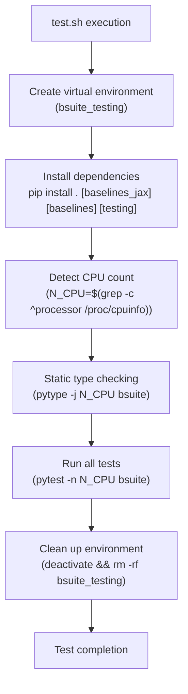
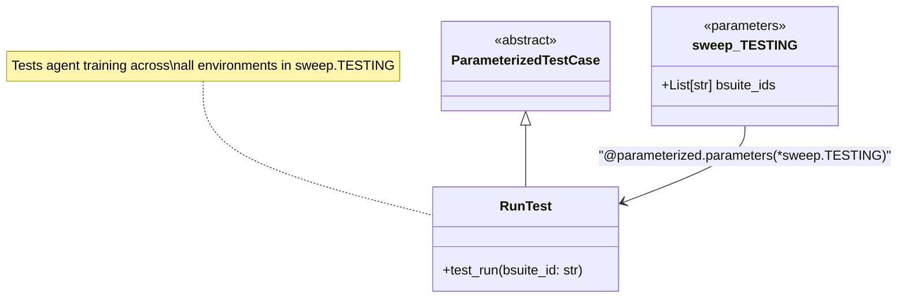
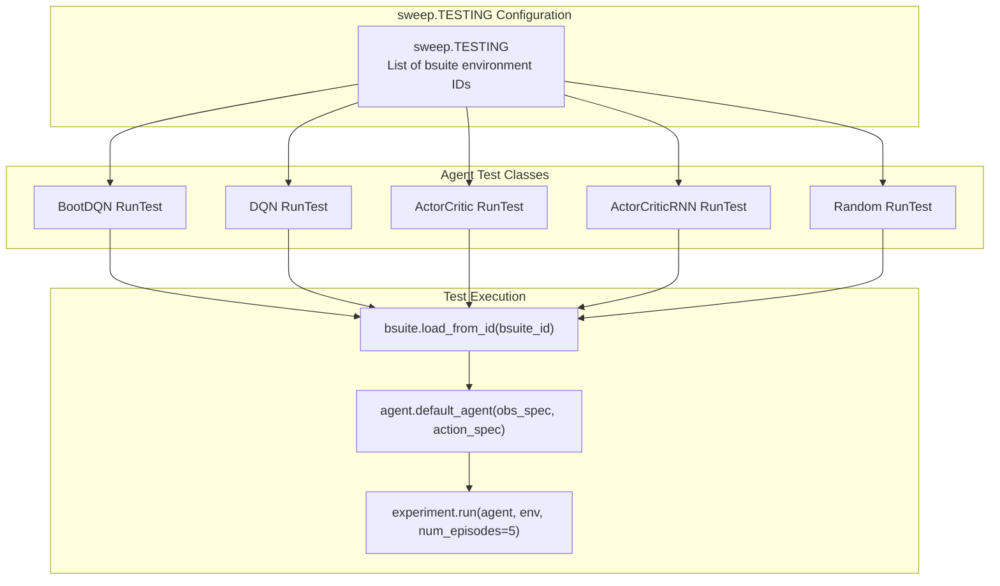

<!-- source: DeepWiki mcp.deepwiki.com · repo google-deepmind/bsuite · page 7.1 Testing Framework · fetched 2026-10-26 -->

# Testing Framework

<details>
<summary>Relevant source files</summary>

The following files were used as context for generating this wiki page:

- [bsuite/baselines/jax/actor_critic/run_test.py](bsuite/baselines/jax/actor_critic/run_test.py)
- [bsuite/baselines/jax/actor_critic_rnn/run_test.py](bsuite/baselines/jax/actor_critic_rnn/run_test.py)
- [bsuite/baselines/jax/boot_dqn/run_test.py](bsuite/baselines/jax/boot_dqn/run_test.py)
- [bsuite/baselines/jax/dqn/run_test.py](bsuite/baselines/jax/dqn/run_test.py)
- [bsuite/baselines/random/run_test.py](bsuite/baselines/random/run_test.py)
- [test.sh](test.sh)

</details>


The testing framework provides comprehensive test coverage for bsuite's agent implementations, environments, and core functionality. This framework ensures that all baseline agents can successfully train on the diagnostic environments and that the system maintains reliability across different configurations.

For information about development setup and contribution guidelines, see [Development Setup](#7.2). For details about experiment execution outside of testing, see [Running Experiments](#5.1).

## Test Infrastructure and Execution

The bsuite testing system is built around automated test execution with parallel processing capabilities. The primary test runner is implemented in the shell script `test.sh`, which orchestrates the complete testing workflow including environment setup, dependency installation, static analysis, and test execution.

### Test Execution Flow



The test execution process automatically parallelizes both static type checking and test running based on available CPU cores, ensuring efficient use of system resources.

**Sources:** [test.sh:1-32]()

### Testing Dependencies and Setup

The testing infrastructure requires specific dependencies installed through the `[testing]` extra specification. The test runner creates an isolated virtual environment to prevent conflicts with existing installations and ensures reproducible test execution.

| Component | Purpose | Installation |
|-----------|---------|-------------|
| Virtual Environment | Isolated test execution | `python3 -m venv bsuite_testing` |
| Core Package | Base bsuite functionality | `pip install .` |
| JAX Baselines | JAX-based agent implementations | `pip install .[baselines_jax]` |
| TensorFlow Baselines | TF-based agent implementations | `pip install .[baselines]` |
| Test Dependencies | Testing framework and utilities | `pip install .[testing]` |

**Sources:** [test.sh:8-19]()

## Agent Testing Structure

All baseline agent implementations follow a standardized testing pattern that ensures consistent coverage across different agent types and environments. Each agent's test suite is implemented as a `RunTest` class that inherits from `parameterized.TestCase`.

### Parameterized Agent Tests



Each agent test follows this standardized pattern:

1. **Environment Loading**: Uses `bsuite.load_from_id(bsuite_id)` to instantiate test environments
2. **Agent Initialization**: Creates agent using `default_agent()` factory method with environment specs
3. **Training Execution**: Runs short training session using `experiment.run()` with 5 episodes
4. **Parameterization**: Tests across all environments defined in `sweep.TESTING`

**Sources:** [bsuite/baselines/jax/boot_dqn/run_test.py:27-39](), [bsuite/baselines/random/run_test.py:27-39]()

### Agent-Specific Test Implementations

The testing framework includes dedicated test suites for each baseline agent implementation:

| Agent Type | Test Module | Key Features |
|------------|-------------|------------|
| BootstrappedDQN | `bsuite/baselines/jax/boot_dqn/run_test.py` | Tests with `num_ensemble=2` parameter |
| Standard DQN | `bsuite/baselines/jax/dqn/run_test.py` | Basic Q-learning functionality |
| Actor-Critic | `bsuite/baselines/jax/actor_critic/run_test.py` | Policy gradient methods |
| Actor-Critic RNN | `bsuite/baselines/jax/actor_critic_rnn/run_test.py` | Recurrent policy networks |
| Random Agent | `bsuite/baselines/random/run_test.py` | Baseline random behavior |

Each test module implements the same interface but instantiates agents with appropriate configurations for their specific implementation requirements.

**Sources:** [bsuite/baselines/jax/boot_dqn/run_test.py:33-34](), [bsuite/baselines/jax/dqn/run_test.py:33-34](), [bsuite/baselines/jax/actor_critic/run_test.py:33-34](), [bsuite/baselines/jax/actor_critic_rnn/run_test.py:33-34](), [bsuite/baselines/random/run_test.py:33-34]()

## Test Organization and Coverage

### Environment Coverage through sweep.TESTING

The testing framework leverages the `sweep.TESTING` configuration to ensure comprehensive coverage across bsuite's diagnostic environments. This parameterized approach automatically tests each agent against all environments in the testing sweep.



**Sources:** [bsuite/baselines/jax/boot_dqn/run_test.py:29](), [bsuite/baselines/random/run_test.py:29]()

### Test Execution Framework

Each test method follows the standard pattern of environment-agent interaction through the `experiment.run()` framework. The tests validate that agents can:

- Successfully initialize with environment specifications
- Execute training episodes without errors
- Interact properly with all bsuite diagnostic environments
- Complete short training runs (5 episodes) within reasonable time

The short episode count (`num_episodes=5`) ensures fast test execution while still validating the core agent-environment interaction loop.

**Sources:** [bsuite/baselines/jax/boot_dqn/run_test.py:36-39](), [bsuite/baselines/random/run_test.py:36-39]()

## Running Tests

### Automated Test Execution

The complete test suite can be executed using the provided shell script:

```bash
./test.sh
```

This script handles all aspects of test execution including environment setup, dependency management, and cleanup. The script automatically:

- Creates isolated virtual environment
- Installs required dependencies
- Runs static type checking with `pytype`
- Executes all tests with `pytest` using parallel processing
- Cleans up the test environment

**Sources:** [test.sh:1-32]()

### Manual Test Execution

For development and debugging purposes, tests can also be run manually after proper setup:

```bash
# Run all tests
pytest bsuite

# Run specific agent tests
pytest bsuite/baselines/jax/boot_dqn/run_test.py

# Run with parallel processing
pytest -n auto bsuite
```

### Static Analysis Integration

The testing framework includes static type checking through `pytype`, which runs automatically as part of the test suite. This ensures type safety across the codebase and catches potential issues before runtime.

**Sources:** [test.sh:24]()

---

