# Page: Overview

# Overview

<details>
<summary>Relevant source files</summary>

The following files were used as context for generating this wiki page:

- [.github/workflows/ci.yml](.github/workflows/ci.yml)
- [README.md](README.md)
- [bsuite/_metadata.py](bsuite/_metadata.py)
- [setup.py](setup.py)

</details>


This document introduces the bsuite (Behaviour Suite) repository, explaining its purpose as a comprehensive evaluation framework for reinforcement learning agents, its core architectural components, and how they work together to enable systematic RL research. For detailed information about specific components, see [Package Structure and Installation](#1.1), [Core Framework](#2), [Environments](#3), [Agent Implementations](#4), [Experiment Management](#5), and [Data and Analysis](#6).

## Purpose and Scope

bsuite is a collection of carefully-designed diagnostic environments and evaluation tools for reinforcement learning research. The system serves two primary objectives: (1) providing clear, informative problems that capture key issues in RL algorithm design, and (2) enabling systematic study of agent behavior through standardized benchmarks with automated evaluation and analysis.

The framework automates the entire research pipeline from experiment definition through execution to comprehensive analysis, supporting multiple machine learning frameworks and providing reproducible evaluation protocols for RL algorithms.

Sources: [README.md:11-21](), [setup.py:62-63]()

## System Architecture

The bsuite system consists of five major subsystems that work together to provide end-to-end evaluation capabilities:

### High-Level System Components

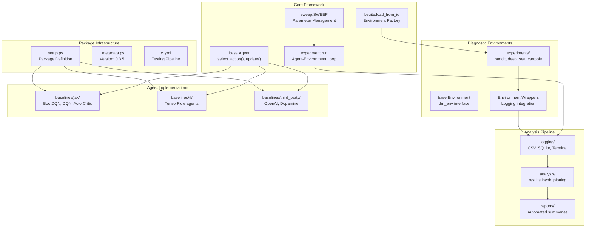

Sources: [setup.py:1-104](), [README.md:31-48](), [bsuite/_metadata.py:22]()

## Core Framework Integration

The system integrates multiple frameworks through a unified interface while maintaining framework-specific optimizations:

### Framework Support Structure

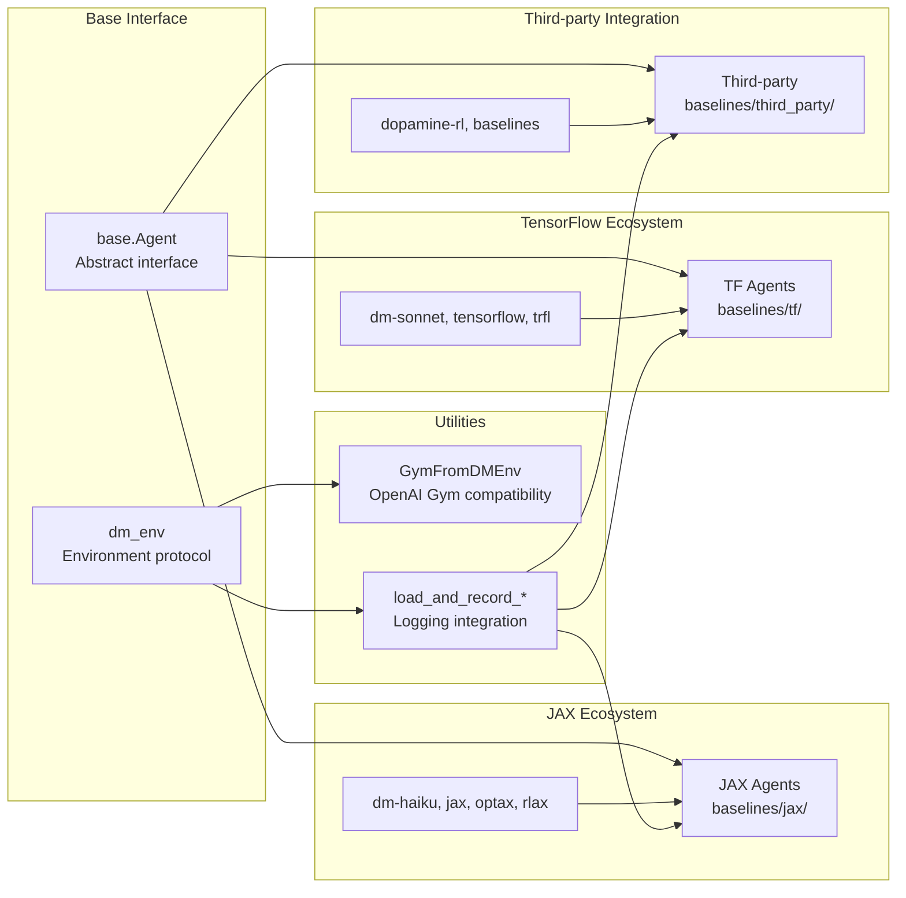

Sources: [setup.py:24-50](), [README.md:187-199]()

## Data Flow and Experiment Execution

The system orchestrates experiments through a standardized pipeline that maintains consistency across different agent implementations:

### Experiment Execution Pipeline

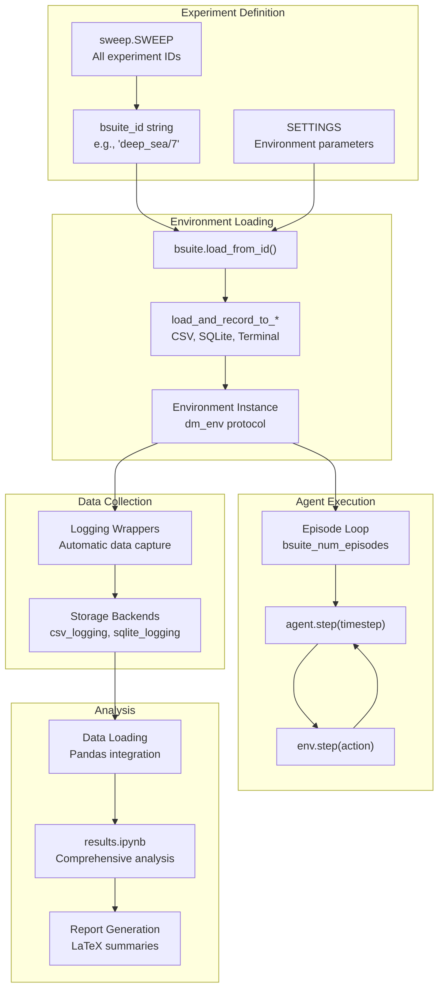

Sources: [README.md:93-112](), [README.md:138-154](), [README.md:176-185]()

## Package Dependencies and Installation

The system supports flexible installation with optional dependencies for different use cases:

| Dependency Group | Key Libraries | Purpose |
|------------------|---------------|---------|
| Core | `dm_env`, `numpy`, `pandas`, `matplotlib` | Basic functionality |
| JAX Baselines | `jax`, `dm-haiku`, `optax`, `rlax` | JAX agent implementations |
| TF Baselines | `tensorflow`, `dm-sonnet`, `trfl` | TensorFlow agents |
| Third-party | `dopamine-rl`, `baselines` | External agent integration |
| Testing | `pytest-xdist`, `pytype`, `gym==0.20.0` | Development and CI |

The modular dependency structure allows users to install only the components they need:

- `pip install bsuite` - Core framework only
- `pip install bsuite[baselines_jax]` - Include JAX agents  
- `pip install bsuite[baselines]` - Include TensorFlow agents
- `pip install bsuite[testing]` - Include development tools

Sources: [setup.py:73-91](), [README.md:58-82]()

## Research Integration and Extensibility  

bsuite supports the complete research lifecycle from hypothesis testing to publication-ready results. The system provides:

- **Standardized Benchmarks**: Consistent evaluation across different algorithms
- **Automated Analysis**: Pre-built Jupyter notebooks for comprehensive evaluation
- **Publication Support**: LaTeX report generation for conference submissions
- **Framework Agnostic**: Support for JAX, TensorFlow, and third-party libraries
- **Extensible Design**: Clear interfaces for adding new environments and agents

The framework facilitates reproducible research by automating data collection within environments through the `load_and_record_*` functions, ensuring consistent logging across all experiments without constraining agent implementations.

Sources: [README.md:11-26](), [README.md:278-288](), [setup.py:95-103]()

---

# Page: Package Structure and Installation

# Package Structure and Installation

<details>
<summary>Relevant source files</summary>

The following files were used as context for generating this wiki page:

- [bsuite/_metadata.py](bsuite/_metadata.py)
- [setup.py](setup.py)

</details>


This document covers the bsuite package organization, dependency management, installation procedures, and metadata handling. It explains how the package is structured for distribution and the various installation options available for different use cases.

For information about getting started with basic usage after installation, see [Quick Start Guide](#1.2). For details about the development environment setup, see [Development Setup](#7.2).

## Package Organization

The bsuite package follows a standard Python package structure with modular organization and flexible dependency management. The package definition and metadata are centrally managed through setuptools configuration.

### Package Structure Diagram

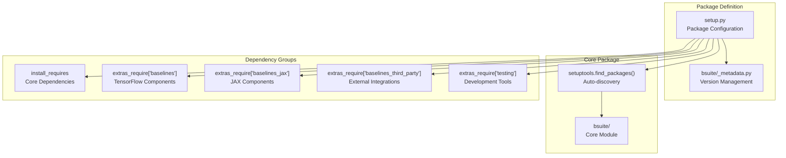

Sources: [setup.py:60-104](), [bsuite/_metadata.py:22]()

The package uses `setuptools.find_packages()` for automatic package discovery, which recursively identifies all Python packages within the bsuite directory structure.

## Core Dependencies

The bsuite package has a minimal set of core dependencies required for basic functionality, with additional optional dependencies organized into logical groups.

### Core Requirements

The following dependencies are required for all bsuite installations:

| Package | Purpose |
|---------|---------|
| `absl-py` | Command-line flag handling and logging |
| `dm_env` | DeepMind environment interface |
| `immutabledict` | Immutable dictionary data structures |
| `matplotlib` | Plotting and visualization |
| `numpy` | Numerical computing |
| `pandas` | Data manipulation and analysis |
| `plotnine` | Grammar of graphics plotting |
| `scipy` | Scientific computing |
| `scikit-image` | Image processing |
| `six` | Python 2/3 compatibility |
| `termcolor` | Terminal color output |

Sources: [setup.py:73-85]()

## Installation Options

The bsuite package supports multiple installation configurations through setuptools extras, allowing users to install only the components they need.

### Installation Methods Diagram

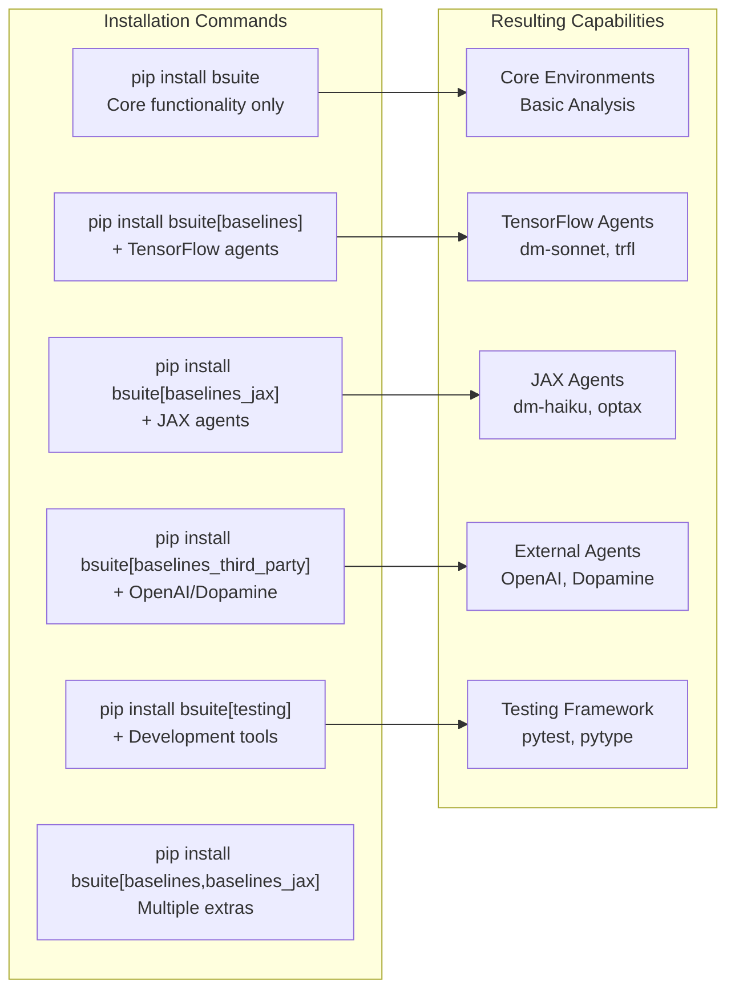

Sources: [setup.py:86-91]()

### Basic Installation

For core bsuite functionality without baseline agents:

```bash
pip install bsuite
```

This installs only the core dependencies and provides access to all bsuite environments and basic analysis tools.

### Extended Installation Options

#### TensorFlow Baselines
Includes TensorFlow-based agent implementations:

```bash
pip install bsuite[baselines]
```

Dependencies added: `dm-sonnet`, `dm-tree`, `tensorflow`, `tensorflow_probability`, `trfl`, `tqdm`

#### JAX Baselines  
Includes JAX-based agent implementations:

```bash
pip install bsuite[baselines_jax]
```

Dependencies added: `dataclasses`, `dm-haiku`, `dm-tree`, `jax`, `jaxlib`, `optax`, `rlax`, `tqdm`

#### Third-party Integrations
Includes OpenAI Baselines and Dopamine integration:

```bash
pip install bsuite[baselines_third_party]
```

Dependencies added: `tensorflow==1.15`, `dopamine-rl`, `baselines`

#### Development Environment
Includes testing and development tools:

```bash
pip install bsuite[testing]
```

Dependencies added: `gym==0.20.0`, `tensorflow_probability==0.14.1`, `mock`, `pytest-xdist`, `pytype`

Sources: [setup.py:22-58]()

## Version Management

The bsuite package implements a centralized version management system that separates version information from the main package code.

### Version System Architecture

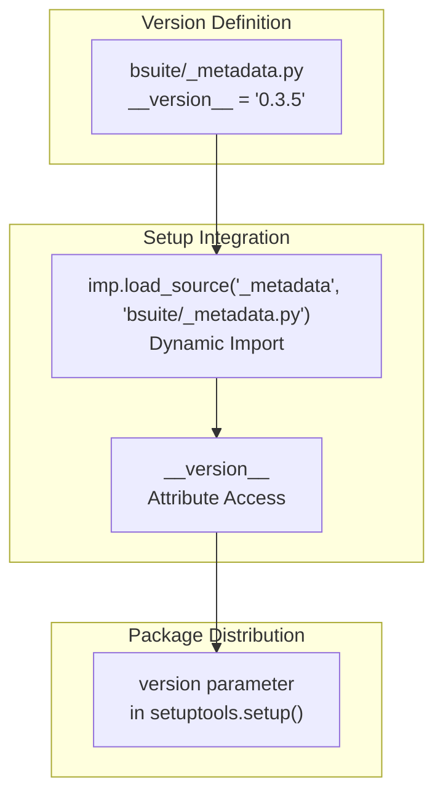

Sources: [bsuite/_metadata.py:22](), [setup.py:70]()

The version is defined in `bsuite/_metadata.py` as `__version__ = '0.3.5'` and dynamically imported during package setup using `imp.load_source()`. This separation allows the version to be accessed during installation before bsuite's dependencies are available.

## Platform and Python Support

The package supports multiple operating systems and Python versions:

### Supported Platforms
- Linux (POSIX)
- Windows  
- macOS

### Python Versions
- Python 3.6
- Python 3.7

### Package Metadata
- Development Status: Alpha
- License: Apache License, Version 2.0
- Intended Audience: Science/Research
- Topic: Scientific/Engineering/Artificial Intelligence

Sources: [setup.py:92-103]()

## Package Metadata Configuration

The setuptools configuration defines comprehensive package metadata for distribution:

| Field | Value |
|-------|-------|
| Name | `bsuite` |
| Description | Core RL Behaviour Suite. A collection of reinforcement learning experiments. |
| URL | https://github.com/deepmind/bsuite |
| Author | DeepMind |
| License | Apache License, Version 2.0 |
| Keywords | reinforcement-learning, python, machine-learning |

The long description is automatically loaded from `README.md` with Markdown content type for package repository display.

Sources: [setup.py:60-71]()

---

# Page: Quick Start Guide

# Quick Start Guide

<details>
<summary>Relevant source files</summary>

The following files were used as context for generating this wiki page:

- [.github/workflows/ci.yml](.github/workflows/ci.yml)
- [README.md](README.md)
- [bsuite/baselines/tf/actor_critic/__init__.py](bsuite/baselines/tf/actor_critic/__init__.py)
- [bsuite/baselines/tf/actor_critic/agent.py](bsuite/baselines/tf/actor_critic/agent.py)
- [bsuite/baselines/tf/actor_critic/run.py](bsuite/baselines/tf/actor_critic/run.py)
- [bsuite/baselines/tf/actor_critic/run_test.py](bsuite/baselines/tf/actor_critic/run_test.py)
- [bsuite/bsuite.py](bsuite/bsuite.py)
- [bsuite/experiments/bandit_noise/__init__.py](bsuite/experiments/bandit_noise/__init__.py)
- [bsuite/experiments/umbrella_length/umbrella_length.py](bsuite/experiments/umbrella_length/umbrella_length.py)

</details>


This guide provides a concise walkthrough for getting started with bsuite, covering environment loading, basic agent interaction, and result logging. For detailed information about specific environments, see [Core Diagnostic Environments](#3.1). For comprehensive experiment management and parameter sweeps, see [Experiment Configuration and Sweeps](#5.2).

## Installation

Install bsuite from PyPI with basic dependencies:

```bash
pip install bsuite
```

For baseline agent implementations, install with additional dependencies:

```bash
pip install bsuite[baselines]
```

Sources: [README.md:59-82]()

## Basic Environment Loading

Load any bsuite environment using its `bsuite_id` string identifier:

```python
import bsuite

# Load a specific environment
env = bsuite.load_from_id('catch/0')
```

### Environment ID System

**Environment ID Structure**
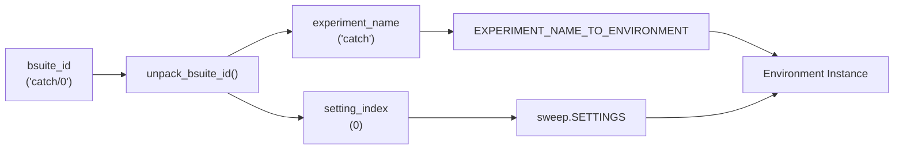

Get all available environment IDs:

```python
from bsuite import sweep

# All environments in the full sweep
print(sweep.SWEEP)

# Specific experiment variants
print(sweep.DEEP_SEA)
print(sweep.CARTPOLE)

# Environments grouped by research focus
print(sweep.TAGS['basic'])
print(sweep.TAGS['exploration'])
```

Sources: [bsuite/bsuite.py:85-110](), [README.md:105-136]()

## Agent-Environment Interaction Loop

All bsuite environments implement the `dm_env` interface with discrete actions:

```python
# Get environment specifications
num_actions = env.action_spec().num_values
obs_shape = env.observation_spec().shape

# Basic interaction loop
for episode in range(env.bsuite_num_episodes):
    timestep = env.reset()
    while not timestep.last():
        # Your agent logic here
        action = select_action(timestep.observation)
        timestep = env.step(action)
```

### Core Interaction Components

**Agent-Environment Interface**
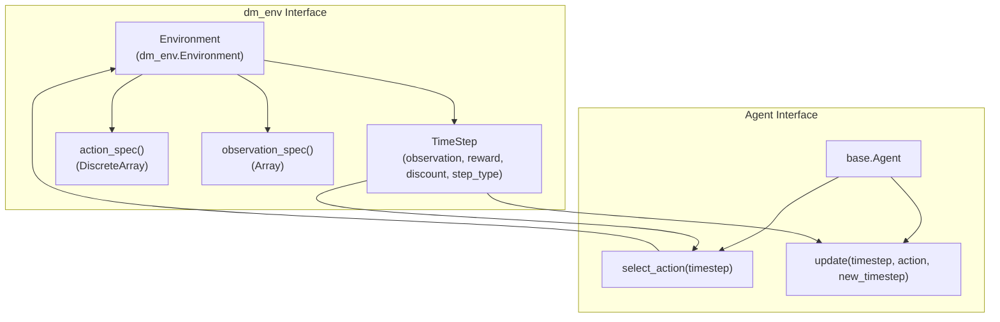

Sources: [README.md:156-185](), [bsuite/baselines/tf/actor_critic/agent.py:105-127]()

## Logging Results

bsuite provides automatic logging wrappers that capture data without modifying your agent code:

### CSV Logging
```python
# Log to separate CSV files per environment
env = bsuite.load_and_record_to_csv(
    bsuite_id='catch/0',
    results_dir='/path/to/results',
    overwrite=False
)
```

### SQLite Logging
```python
# Log to single database file (recommended for multiple experiments)
env = bsuite.load_and_record_to_sqlite(
    bsuite_id='catch/0', 
    db_path='/path/to/results.db'
)
```

### Terminal Logging
```python
# Log to terminal output
env = bsuite.load_and_record_to_terminal('catch/0')
```

**Logging System Architecture**
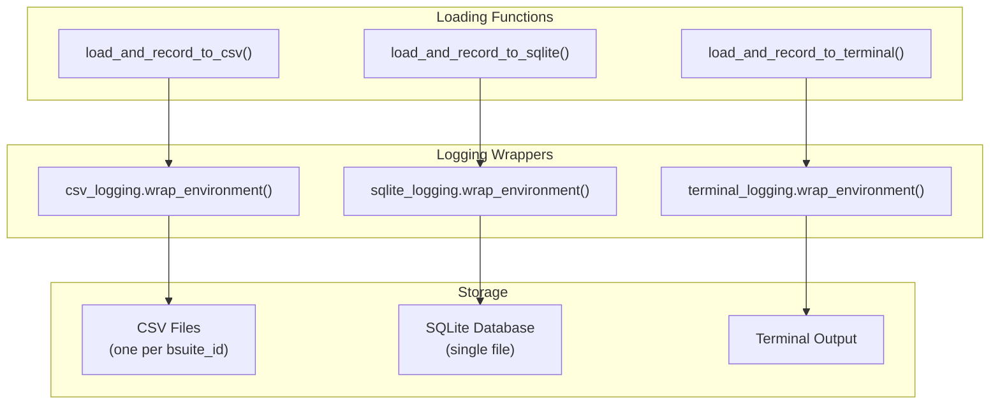

Sources: [bsuite/bsuite.py:112-216](), [README.md:138-154]()

## Using Baseline Agents

bsuite includes several baseline agent implementations. Here's how to use the TensorFlow Actor-Critic agent:

```python
from bsuite.baselines.tf import actor_critic
from bsuite.baselines import experiment

# Load environment with logging
env = bsuite.load_and_record_to_csv('cartpole/0', '/tmp/results')

# Create agent with default parameters
agent = actor_critic.default_agent(
    obs_spec=env.observation_spec(),
    action_spec=env.action_spec()
)

# Run experiment
experiment.run(
    agent=agent,
    environment=env,
    num_episodes=env.bsuite_num_episodes
)
```

### Agent Implementation Pattern

**Baseline Agent Structure**
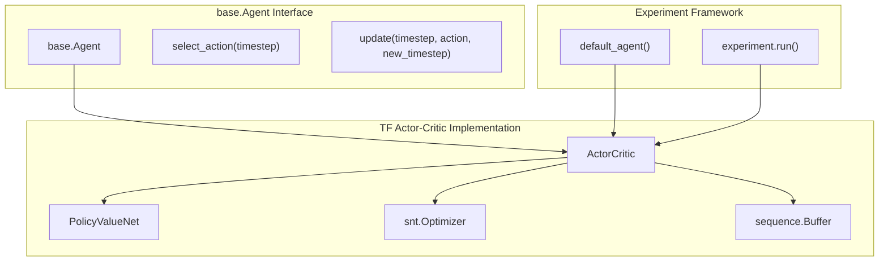

Sources: [bsuite/baselines/tf/actor_critic/agent.py:40-169](), [bsuite/baselines/tf/actor_critic/run.py:55-89]()

## Running Full Experiments

Use the provided run scripts to execute complete experiments:

```bash
# Run single environment
python -m bsuite.baselines.tf.actor_critic.run --bsuite_id=catch/0

# Run full sweep (all environments)
python -m bsuite.baselines.tf.actor_critic.run --bsuite_id=SWEEP
```

### Command Line Parameters

| Parameter | Description | Default |
|-----------|-------------|---------|
| `--bsuite_id` | Environment ID or sweep name | `'catch/0'` |
| `--save_path` | Results directory | `'/tmp/bsuite'` |
| `--logging_mode` | Logging format | `'csv'` |
| `--num_episodes` | Override episode count | `None` |
| `--seed` | Random seed | `42` |

**Experiment Execution Flow**
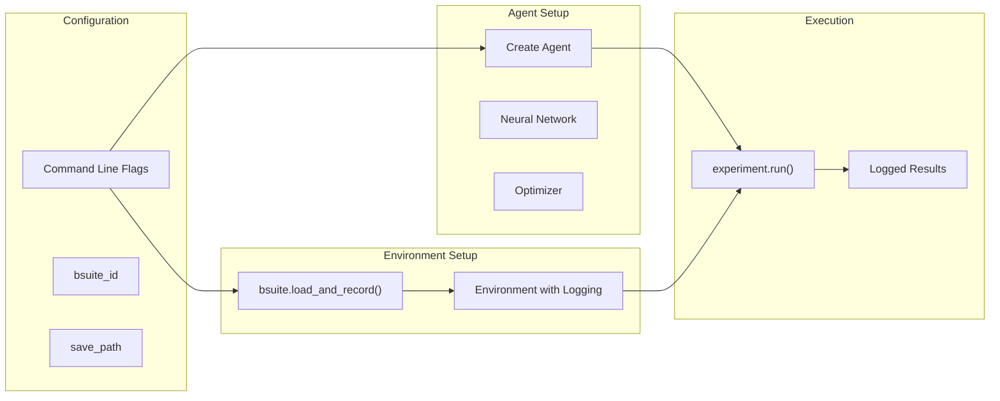

Sources: [bsuite/baselines/tf/actor_critic/run.py:32-111](), [README.md:214-267]()

## OpenAI Gym Compatibility

Use bsuite environments with Gym-compatible codebases:

```python
import bsuite
from bsuite.utils import gym_wrapper

# Load with logging
env = bsuite.load_and_record_to_csv('catch/0', '/tmp/results')

# Wrap for Gym compatibility  
gym_env = gym_wrapper.GymFromDMEnv(env)

# Use with Gym-style interface
obs = gym_env.reset()
action = gym_env.action_space.sample()
obs, reward, done, info = gym_env.step(action)
```

Sources: [README.md:187-202]()

## Next Steps

- **Environment Details**: See [Core Diagnostic Environments](#3.1) for comprehensive environment descriptions
- **Agent Development**: See [Agent Interface and Experiment Framework](#2.1) for implementing custom agents  
- **Large-Scale Experiments**: See [Running Experiments](#5.1) for parallel execution and parameter sweeps
- **Analysis**: See [Analysis and Visualization](#6.2) for result analysis tools and Jupyter notebooks

Sources: [README.md:47-48](), [README.md:269-289]()

---

# Page: Core Framework

# Core Framework

<details>
<summary>Relevant source files</summary>

The following files were used as context for generating this wiki page:

- [bsuite/__init__.py](bsuite/__init__.py)
- [bsuite/baselines/base.py](bsuite/baselines/base.py)
- [bsuite/baselines/experiment.py](bsuite/baselines/experiment.py)
- [bsuite/baselines/jax/__init__.py](bsuite/baselines/jax/__init__.py)
- [bsuite/baselines/tf/__init__.py](bsuite/baselines/tf/__init__.py)
- [bsuite/baselines/third_party/__init__.py](bsuite/baselines/third_party/__init__.py)

</details>


This document covers the fundamental abstractions and interfaces that form the foundation of the bsuite system. The core framework provides the essential building blocks for agent-environment interaction, experiment orchestration, and data collection that all other components depend on.

For information about specific agent implementations, see [Agent Implementations](#4). For details about environment-specific functionality, see [Environments](#3). For execution and configuration management, see [Experiment Management](#5).

## Agent Interface

The core of bsuite's agent abstraction is defined by the `Agent` class in [bsuite/baselines/base.py:24-38](). This abstract base class establishes the fundamental contract that all agents must implement.

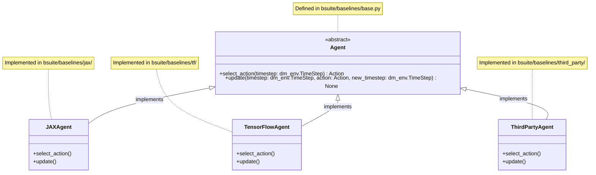

### Agent Interface Components

| Method | Purpose | Parameters | Returns |
|--------|---------|------------|---------|
| `select_action()` | Action selection from agent's policy | `timestep: dm_env.TimeStep` | `Action` (int) |
| `update()` | Learning update from transition data | `timestep`, `action`, `new_timestep` | `None` |

The interface uses discrete actions only, as specified by the type alias `Action = int` at [bsuite/baselines/base.py:21]().

**Sources:** [bsuite/baselines/base.py:1-39]()

## Environment Loading System

The bsuite package provides a standardized interface for loading environments through functions exported in the main module. These functions handle environment instantiation, configuration, and optional logging integration.

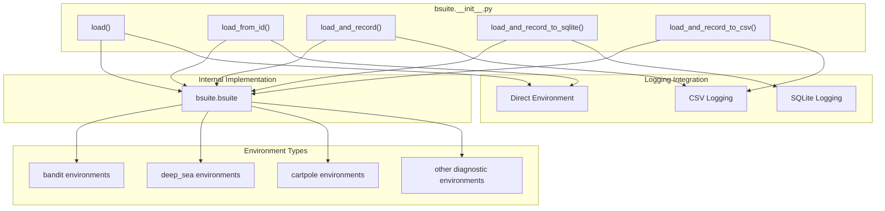

### Loading Function Categories

| Function | Purpose | Logging |
|----------|---------|---------|
| `load()` | Basic environment loading | None |
| `load_from_id()` | Load by environment identifier | None |
| `load_and_record()` | Load with automatic logging | Configurable |
| `load_and_record_to_sqlite()` | Load with SQLite logging | SQLite database |
| `load_and_record_to_csv()` | Load with CSV logging | CSV files |

All loading functions delegate to the internal `bsuite.bsuite` module implementation, providing a clean public API while maintaining implementation flexibility.

**Sources:** [bsuite/__init__.py:16-26]()

## Experiment Execution Framework

The experiment execution framework coordinates the interaction between agents and environments through the `run()` function in [bsuite/baselines/experiment.py:24-57](). This function implements the standard reinforcement learning training loop.

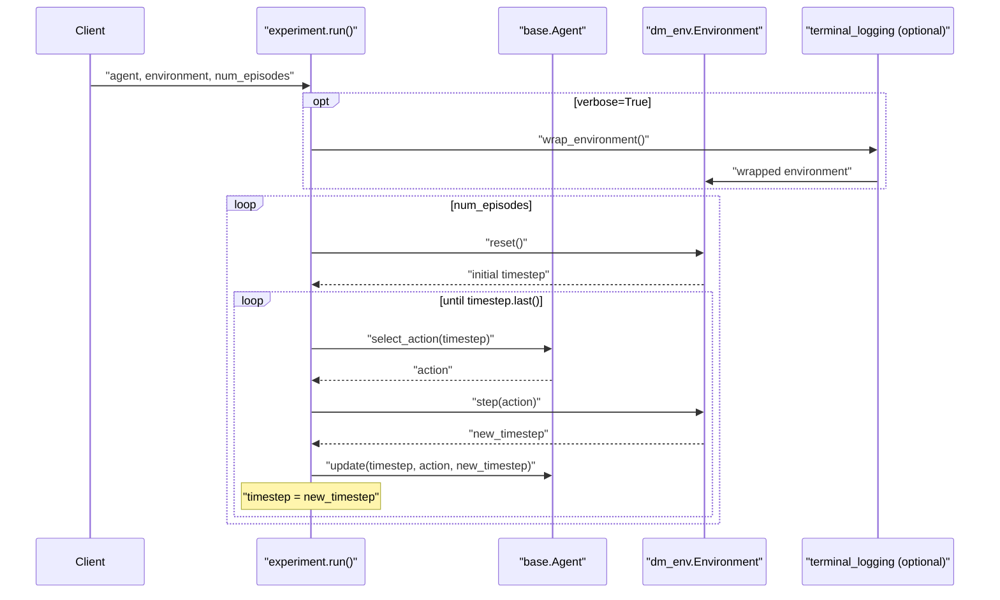

### Execution Loop Components

The `run()` function orchestrates four key interactions:

1. **Environment Reset**: Each episode begins with `environment.reset()` 
2. **Action Selection**: Agent chooses actions via `agent.select_action(timestep)`
3. **Environment Step**: Environment advances with `environment.step(action)`
4. **Agent Update**: Agent learns from `agent.update(timestep, action, new_timestep)`

### Optional Logging Integration

When `verbose=True`, the framework automatically wraps the environment with terminal logging through `terminal_logging.wrap_environment()`, providing real-time training feedback without modifying the core loop logic.

**Sources:** [bsuite/baselines/experiment.py:1-58]()

## Core Framework Integration

The core framework components work together to provide a unified foundation for reinforcement learning experiments in bsuite.

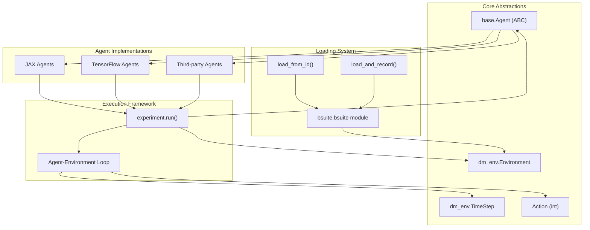

### Framework Flow

1. **Environment Loading**: Client code calls loading functions to instantiate environments
2. **Agent Creation**: Agent implementations inherit from `base.Agent` and implement required methods
3. **Experiment Execution**: `experiment.run()` coordinates agent-environment interaction
4. **Data Flow**: `dm_env.TimeStep` objects and discrete actions flow between components

This architecture enables modular development where agents, environments, and execution logic can evolve independently while maintaining consistent interfaces.

**Sources:** [bsuite/baselines/base.py:1-39](), [bsuite/__init__.py:16-26](), [bsuite/baselines/experiment.py:1-58]()

---

# Page: Agent Interface and Experiment Framework

# Agent Interface and Experiment Framework

<details>
<summary>Relevant source files</summary>

The following files were used as context for generating this wiki page:

- [bsuite/__init__.py](bsuite/__init__.py)
- [bsuite/baselines/base.py](bsuite/baselines/base.py)
- [bsuite/baselines/experiment.py](bsuite/baselines/experiment.py)
- [bsuite/baselines/jax/__init__.py](bsuite/baselines/jax/__init__.py)
- [bsuite/baselines/tf/__init__.py](bsuite/baselines/tf/__init__.py)
- [bsuite/baselines/third_party/__init__.py](bsuite/baselines/third_party/__init__.py)

</details>


This document covers the core abstractions and execution framework that enable systematic agent evaluation in bsuite. It explains the `Agent` interface that all baseline implementations must implement, and the experiment execution framework that orchestrates agent-environment interactions.

For information about environment loading and ID management, see [Environment Loading System](#2.2). For parameter sweeps and configuration management, see [Sweep and Configuration Management](#2.3). For specific agent implementations, see [Agent Implementations](#4).

## Agent Interface

The bsuite framework defines a minimal but powerful agent interface through the abstract `Agent` class. This interface ensures all agents can be evaluated consistently across the diagnostic environments.

### Base Agent Abstraction

The `Agent` class in [bsuite/baselines/base.py:24-38]() defines the core interface that all bsuite agents must implement:

```python
class Agent(abc.ABC):
  @abc.abstractmethod
  def select_action(self, timestep: dm_env.TimeStep) -> Action:
    """Takes in a timestep, samples from agent's policy, returns an action."""

  @abc.abstractmethod
  def update(self, timestep: dm_env.TimeStep, action: Action, 
             new_timestep: dm_env.TimeStep) -> None:
    """Updates the agent given a transition."""
```

#### Agent Interface Components

| Method | Purpose | Input | Output |
|--------|---------|-------|--------|
| `select_action()` | Policy execution | `dm_env.TimeStep` | `Action` (int) |
| `update()` | Learning from experience | Transition tuple | None |

**Action Space**: Currently limited to discrete actions represented as integers [bsuite/baselines/base.py:21]().

**State Representation**: Uses DeepMind Environment `TimeStep` objects containing observations, rewards, discounts, and step types.

### Agent Interface Design Principles

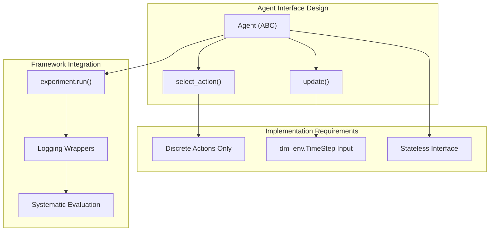

Sources: [bsuite/baselines/base.py:18-38]()

## Experiment Execution Framework

The experiment framework provides a standardized training loop that works with any agent implementation and bsuite environment. This ensures consistent evaluation conditions across all experiments.

### Core Execution Loop

The `run()` function in [bsuite/baselines/experiment.py:24-58]() implements the agent-environment interaction loop:

#### Execution Flow

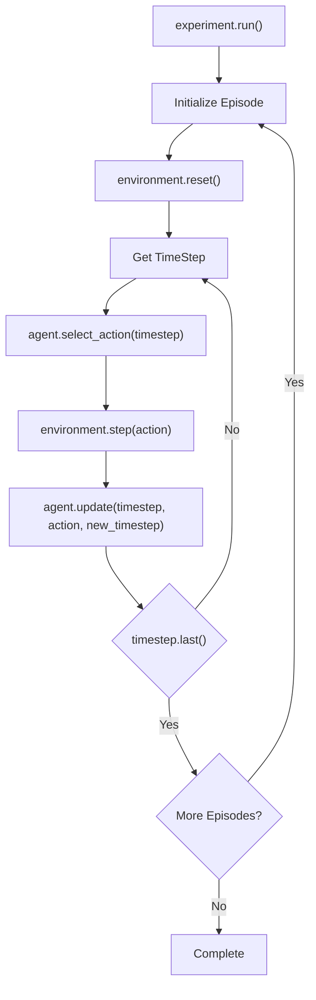

Sources: [bsuite/baselines/experiment.py:24-58]()

### Experiment Parameters

The `run()` function accepts the following parameters [bsuite/baselines/experiment.py:24-27]():

| Parameter | Type | Purpose |
|-----------|------|---------|
| `agent` | `base.Agent` | Agent implementation to evaluate |
| `environment` | `dm_env.Environment` | Environment to run on |
| `num_episodes` | `int` | Number of episodes to execute |
| `verbose` | `bool` | Enable terminal logging |

### Logging Integration

The experiment framework integrates seamlessly with bsuite's logging system:

- **Automatic Logging**: bsuite environments handle logging internally [bsuite/baselines/experiment.py:30]()
- **Optional Terminal Output**: Verbose mode wraps environment with terminal logging [bsuite/baselines/experiment.py:39-41]()
- **Transparent Wrappers**: Logging wrappers maintain the `dm_env.Environment` interface

## Agent-Environment Interaction Protocol

The interaction between agents and environments follows a strict protocol that enables consistent data collection and analysis.

### Interaction Sequence

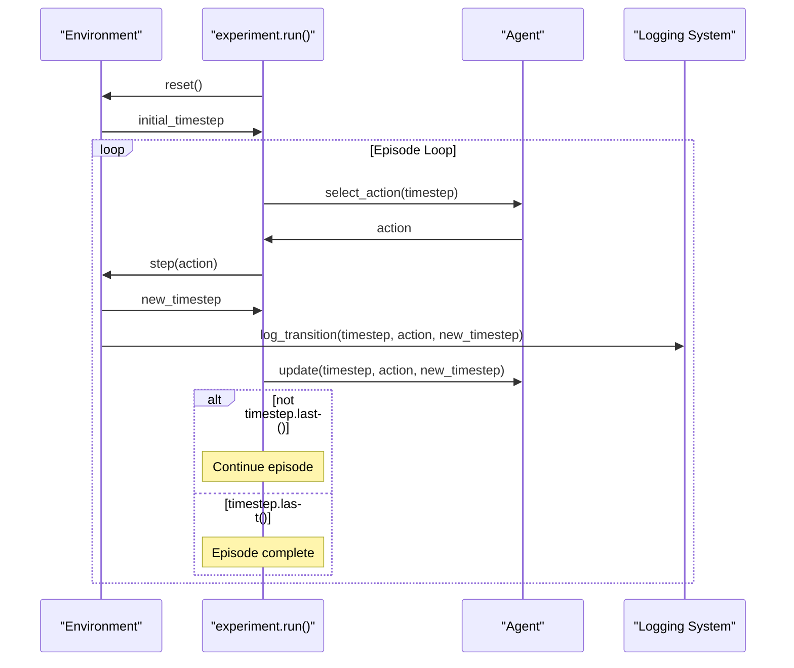

Sources: [bsuite/baselines/experiment.py:43-57]()

### Data Flow Architecture

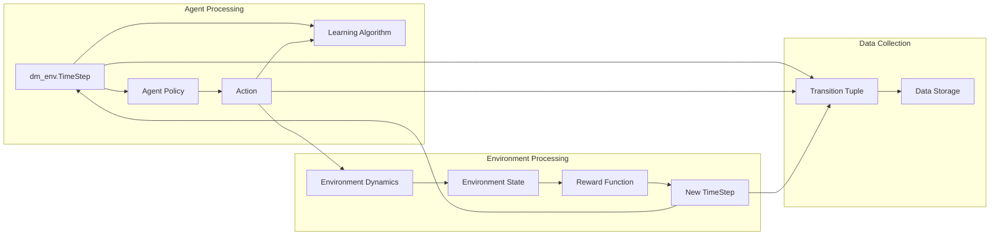

Sources: [bsuite/baselines/experiment.py:47-57](), [bsuite/baselines/base.py:28-38]()

## Integration with bsuite System

The agent interface and experiment framework integrate with the broader bsuite system through several key mechanisms.

### Environment Loading Integration

The experiment framework works with environments loaded through bsuite's loading system:

```python
# From bsuite.__init__.py
load = _bsuite.load
load_from_id = _bsuite.load_from_id
load_and_record = _bsuite.load_and_record
```

**Typical Usage Pattern**:
1. Load environment with `bsuite.load_from_id()`
2. Create agent instance
3. Call `experiment.run(agent, environment, num_episodes)`

### Framework Extension Points

The experiment framework provides several extension points:

| Extension Point | Mechanism | Purpose |
|----------------|-----------|---------|
| **Logging** | Environment wrappers | Data collection and analysis |
| **Visualization** | Terminal logging wrapper | Real-time monitoring |
| **Environment Modification** | Wrapper system | Reward scaling, observation processing |

### Multi-Framework Support

The agent interface supports implementations across multiple ML frameworks:

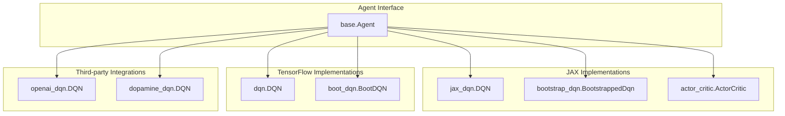

Sources: [bsuite/__init__.py:21-25](), [bsuite/baselines/jax/__init__.py](), [bsuite/baselines/tf/__init__.py](), [bsuite/baselines/third_party/__init__.py]()

## Key Design Benefits

The agent interface and experiment framework provide several important benefits for reproducible RL research:

**Standardization**: All agents implement the same interface, enabling fair comparison across algorithms and frameworks.

**Simplicity**: The minimal interface reduces implementation overhead while maintaining full functionality.

**Transparency**: The experiment loop is explicit and visible, making it easy to understand and modify.

**Integration**: Seamless integration with bsuite's logging, analysis, and environment systems.

**Extensibility**: The abstract interface supports diverse learning algorithms from value-based methods to policy gradients.

Sources: [bsuite/baselines/base.py:16-38](), [bsuite/baselines/experiment.py:16-58]()

---

# Page: Environment Loading System

# Environment Loading System

<details>
<summary>Relevant source files</summary>

The following files were used as context for generating this wiki page:

- [bsuite/baselines/tf/actor_critic/__init__.py](bsuite/baselines/tf/actor_critic/__init__.py)
- [bsuite/baselines/tf/actor_critic/agent.py](bsuite/baselines/tf/actor_critic/agent.py)
- [bsuite/baselines/tf/actor_critic/run.py](bsuite/baselines/tf/actor_critic/run.py)
- [bsuite/baselines/tf/actor_critic/run_test.py](bsuite/baselines/tf/actor_critic/run_test.py)
- [bsuite/bsuite.py](bsuite/bsuite.py)
- [bsuite/experiments/bandit_noise/__init__.py](bsuite/experiments/bandit_noise/__init__.py)
- [bsuite/experiments/deep_sea/__init__.py](bsuite/experiments/deep_sea/__init__.py)
- [bsuite/experiments/deep_sea/deep_sea.py](bsuite/experiments/deep_sea/deep_sea.py)
- [bsuite/experiments/discounting_chain/__init__.py](bsuite/experiments/discounting_chain/__init__.py)
- [bsuite/experiments/discounting_chain/discounting_chain.py](bsuite/experiments/discounting_chain/discounting_chain.py)
- [bsuite/experiments/memory_len/__init__.py](bsuite/experiments/memory_len/__init__.py)
- [bsuite/experiments/memory_len/memory_len.py](bsuite/experiments/memory_len/memory_len.py)
- [bsuite/experiments/mnist/mnist.py](bsuite/experiments/mnist/mnist.py)
- [bsuite/experiments/mountain_car/mountain_car.py](bsuite/experiments/mountain_car/mountain_car.py)
- [bsuite/experiments/umbrella_length/umbrella_length.py](bsuite/experiments/umbrella_length/umbrella_length.py)

</details>


This document covers the bsuite environment loading system, which provides a unified interface for creating and configuring diagnostic environments with integrated logging capabilities. The system handles environment instantiation from string identifiers, parameter management, and automatic logging wrapper integration.

For information about the experiment execution framework that uses these loaded environments, see [Agent Interface and Experiment Framework](#2.1). For details about parameter sweeps and configuration management, see [Sweep and Configuration Management](#2.3).

## Core Architecture

The environment loading system consists of three main components: environment registration, ID-based loading, and logging integration.

```mermaid
graph TB
    subgraph "Environment Registration"
        REGISTRY["EXPERIMENT_NAME_TO_ENVIRONMENT<br/>dict mapping names to constructors"]
        CONSTRUCTORS["Experiment Load Functions<br/>bandit.load, deep_sea.load, etc."]
    end
    
    subgraph "ID System"
        BSUITE_ID["bsuite_id<br/>format: 'experiment_name/setting_index'"]
        UNPACK["unpack_bsuite_id()<br/>splits ID into components"]
        SWEEP_SETTINGS["sweep.SETTINGS<br/>parameter configurations"]
    end
    
    subgraph "Core Loading Functions"
        LOAD_BASIC["load(experiment_name, kwargs)<br/>basic environment creation"]
        LOAD_FROM_ID["load_from_id(bsuite_id)<br/>main loading interface"]
        LOAD_AND_RECORD["load_and_record()<br/>with logging integration"]
    end
    
    subgraph "Logging Integration"
        CSV_LOGGING["csv_logging.wrap_environment"]
        SQLITE_LOGGING["sqlite_logging.wrap_environment"] 
        TERMINAL_LOGGING["terminal_logging.wrap_environment"]
    end
    
    REGISTRY --> LOAD_BASIC
    CONSTRUCTORS --> REGISTRY
    
    BSUITE_ID --> UNPACK
    UNPACK --> LOAD_FROM_ID
    SWEEP_SETTINGS --> LOAD_FROM_ID
    LOAD_FROM_ID --> LOAD_BASIC
    
    LOAD_AND_RECORD --> LOAD_FROM_ID
    LOAD_AND_RECORD --> CSV_LOGGING
    LOAD_AND_RECORD --> SQLITE_LOGGING
    LOAD_AND_RECORD --> TERMINAL_LOGGING
```

Sources: [bsuite/bsuite.py:55-82](), [bsuite/bsuite.py:85-110](), [bsuite/bsuite.py:112-130]()

## Environment Registration System

The loading system maintains a central registry that maps experiment names to their corresponding constructors or load functions. Each experiment provides either a constructor class or a `load` function that accepts keyword arguments.

| Experiment | Constructor/Load Function | Type |
|------------|---------------------------|------|
| `bandit` | `bandit.load` | Function |
| `deep_sea` | `deep_sea.load` | Function |
| `cartpole_swingup` | `cartpole_swingup.CartpoleSwingup` | Class |
| `memory_len` | `memory_len.load` | Function |
| `mountain_car` | `mountain_car.load` | Function |

The registry is defined in `EXPERIMENT_NAME_TO_ENVIRONMENT` and includes all available diagnostic environments with their noise and scale variants.

```python
# Example registration pattern
EXPERIMENT_NAME_TO_ENVIRONMENT = dict(
    bandit=bandit.load,
    deep_sea=deep_sea.load,
    cartpole_swingup=cartpole_swingup.CartpoleSwingup,
    # ... other experiments
)
```

Sources: [bsuite/bsuite.py:58-82](), [bsuite/experiments/deep_sea/deep_sea.py:20](), [bsuite/experiments/mountain_car/mountain_car.py:26](), [bsuite/experiments/memory_len/memory_len.py:31-39]()

## ID System and Loading Process

The loading system uses a hierarchical identifier format where each environment is specified by `experiment_name/setting_index`. The system parses these IDs and maps them to specific parameter configurations.

```mermaid
graph LR
    subgraph "ID Parsing Flow"
        INPUT["bsuite_id<br/>'deep_sea/3'"]
        UNPACK_FUNC["unpack_bsuite_id()"]
        EXPERIMENT_NAME["experiment_name<br/>'deep_sea'"]
        SETTING_INDEX["setting_index<br/>3"]
    end
    
    subgraph "Parameter Resolution"
        SWEEP_LOOKUP["sweep.SETTINGS[bsuite_id]"]
        KWARGS["Parameter Dictionary<br/>{size: 10, seed: 42}"]
    end
    
    subgraph "Environment Creation"
        LOAD_FUNC["load(experiment_name, kwargs)"]
        REGISTRY_LOOKUP["EXPERIMENT_NAME_TO_ENVIRONMENT[experiment_name]"]
        ENV_INSTANCE["Environment Instance"]
    end
    
    INPUT --> UNPACK_FUNC
    UNPACK_FUNC --> EXPERIMENT_NAME
    UNPACK_FUNC --> SETTING_INDEX
    
    INPUT --> SWEEP_LOOKUP
    SWEEP_LOOKUP --> KWARGS
    
    EXPERIMENT_NAME --> REGISTRY_LOOKUP
    KWARGS --> LOAD_FUNC
    REGISTRY_LOOKUP --> LOAD_FUNC
    LOAD_FUNC --> ENV_INSTANCE
```

The `unpack_bsuite_id` function splits the ID using `sweep.SEPARATOR` and validates the format:

```python
def unpack_bsuite_id(bsuite_id: str) -> Tuple[str, int]:
  parts = bsuite_id.split(sweep.SEPARATOR)
  assert len(parts) == 2
  experiment_name = parts[0]
  setting_index = int(parts[1])
  return experiment_name, setting_index
```

Sources: [bsuite/bsuite.py:85-91](), [bsuite/bsuite.py:102-109](), [bsuite/bsuite.py:94-99]()

## Logging Integration

The loading system provides three logging modes that wrap environments transparently to capture experimental data. Each mode serves different use cases and storage requirements.

```mermaid
graph TB
    subgraph "Logging Mode Selection"
        LOAD_AND_RECORD["load_and_record(bsuite_id, save_path, logging_mode)"]
        MODE_SWITCH{"logging_mode"}
    end
    
    subgraph "CSV Logging"
        CSV_FUNC["load_and_record_to_csv()"]
        CSV_WRAPPER["csv_logging.wrap_environment"]
        CSV_FILES["Individual CSV files<br/>per bsuite_id"]
    end
    
    subgraph "SQLite Logging"  
        SQLITE_FUNC["load_and_record_to_sqlite()"]
        SQLITE_WRAPPER["sqlite_logging.wrap_environment"]
        SQLITE_DB["Single SQLite database<br/>all experiments"]
    end
    
    subgraph "Terminal Logging"
        TERMINAL_FUNC["load_and_record_to_terminal()"]
        TERMINAL_WRAPPER["terminal_logging.wrap_environment"]
        TERMINAL_OUTPUT["Console output<br/>real-time feedback"]
    end
    
    LOAD_AND_RECORD --> MODE_SWITCH
    MODE_SWITCH -->|"csv"| CSV_FUNC
    MODE_SWITCH -->|"sqlite"| SQLITE_FUNC  
    MODE_SWITCH -->|"terminal"| TERMINAL_FUNC
    
    CSV_FUNC --> CSV_WRAPPER
    CSV_WRAPPER --> CSV_FILES
    
    SQLITE_FUNC --> SQLITE_WRAPPER
    SQLITE_WRAPPER --> SQLITE_DB
    
    TERMINAL_FUNC --> TERMINAL_WRAPPER
    TERMINAL_WRAPPER --> TERMINAL_OUTPUT
```

### Logging Mode Characteristics

| Mode | Storage | Use Case | Multi-process Safe |
|------|---------|----------|-------------------|
| `csv` | Separate files per experiment | Individual analysis, simple debugging | Yes (with different directories) |
| `sqlite` | Single database file | Aggregate analysis, complex queries | Yes |
| `terminal` | Console output | Real-time monitoring, debugging | N/A |

The SQLite mode automatically handles database file extension and provides centralized storage for sweep analysis:

```python
if logging_mode == 'sqlite':
  if not save_path.endswith('.db'):
    save_path += '.db'
```

Sources: [bsuite/bsuite.py:112-130](), [bsuite/bsuite.py:132-171](), [bsuite/bsuite.py:173-207](), [bsuite/bsuite.py:210-215]()

## Usage Patterns

The loading system supports several common usage patterns for different experimental workflows.

### Basic Environment Loading

```python
# Direct loading with ID
env = bsuite.load_from_id('deep_sea/3')

# Manual parameter specification  
env = bsuite.load('deep_sea', {'size': 10, 'seed': 42})
```

### Experimental Workflows

```python
# Single experiment with CSV logging
env = bsuite.load_and_record(
    bsuite_id='catch/0',
    save_path='/tmp/results', 
    logging_mode='csv'
)

# Sweep with SQLite aggregation
env = bsuite.load_and_record(
    bsuite_id='bandit/5',
    save_path='/tmp/sweep_results.db',
    logging_mode='sqlite'
)
```

### Testing and Development

The system integrates with the testing framework through parameterized tests that iterate over sweep configurations:

```python
@parameterized.parameters(*sweep.TESTING)
def test_run(self, bsuite_id: str):
  env = bsuite.load_from_id(bsuite_id)
  agent = create_test_agent(env.observation_spec(), env.action_spec())
  # ... run test
```

Sources: [bsuite/baselines/tf/actor_critic/run_test.py:29-39](), [bsuite/baselines/tf/actor_critic/run.py:58-63]()

---

# Page: Sweep and Configuration Management

# Sweep and Configuration Management

<details>
<summary>Relevant source files</summary>

The following files were used as context for generating this wiki page:

- [bsuite/experiments/umbrella_distract/analysis.py](bsuite/experiments/umbrella_distract/analysis.py)
- [bsuite/experiments/umbrella_distract/sweep.py](bsuite/experiments/umbrella_distract/sweep.py)
- [bsuite/experiments/umbrella_length/analysis.py](bsuite/experiments/umbrella_length/analysis.py)
- [bsuite/experiments/umbrella_length/sweep.py](bsuite/experiments/umbrella_length/sweep.py)
- [bsuite/sweep.py](bsuite/sweep.py)
- [bsuite/sweep_test.py](bsuite/sweep_test.py)

</details>


This document covers the sweep and configuration management system in bsuite, which provides a standardized way to define, organize, and iterate over experiment parameter configurations. The system enables systematic evaluation across multiple environment variants and parameter settings through a unified interface.

For information about running experiments using these sweep configurations, see [Experiment Configuration and Sweeps](#5.2). For details about the environment loading system that uses these sweep IDs, see [Environment Loading System](#2.2).

## Overview

The sweep system manages experiment configurations through a hierarchical identifier system. Each experiment variant is assigned a unique `bsuite_id` string that encodes both the environment name and parameter configuration index. This enables reproducible experiment specification and systematic parameter exploration.

## BSuite ID System

### ID Format and Structure

Each `bsuite_id` follows the format `environment_name/index`, where the index corresponds to a specific parameter configuration within that environment's sweep definition.

```mermaid
graph TD
    subgraph "BSuite ID Components"
        ID["bsuite_id: 'deep_sea/5'"]
        ENV["environment_name: 'deep_sea'"]
        IDX["index: 5"]
        ID --> ENV
        ID --> IDX
    end
    
    subgraph "Resolution Process"
        ENV --> SWEEP_DEF["experiment sweep.py"]
        IDX --> SETTINGS_LIST["SETTINGS[5]"]
        SETTINGS_LIST --> KWARGS["Environment kwargs"]
    end
    
    subgraph "Global Collections"
        KWARGS --> SETTINGS_MAP["sweep.SETTINGS"]
        ID --> SWEEP_TUPLE["sweep.SWEEP"]
        ID --> TAG_MAP["sweep.TAGS"]
    end
```

**BSuite ID Resolution Flow**

Sources: [bsuite/sweep.py:16-34]()

The core type definitions establish the system's data structures:

| Type | Definition | Purpose |
|------|------------|---------|
| `BSuiteId` | `str` | Unique experiment identifier |
| `Tag` | `str` | Experiment category label |
| `EnvKWargs` | `Dict[str, Any]` | Environment constructor arguments |

Sources: [bsuite/sweep.py:64-67]()

### Sweep Processing Architecture

The `_parse_sweep()` function processes individual experiment sweep modules to build the global configuration mappings:

```mermaid
graph TB
    subgraph "Experiment Modules"
        BANDIT_SWEEP["bandit_sweep"]
        DEEP_SEA_SWEEP["deep_sea_sweep"]
        CARTPOLE_SWEEP["cartpole_sweep"]
        OTHER_SWEEPS["...other sweep modules"]
    end
    
    subgraph "Parse Process"
        PARSE_FUNC["_parse_sweep()"]
        BANDIT_SWEEP --> PARSE_FUNC
        DEEP_SEA_SWEEP --> PARSE_FUNC
        CARTPOLE_SWEEP --> PARSE_FUNC
        OTHER_SWEEPS --> PARSE_FUNC
    end
    
    subgraph "Global Data Structures"
        PARSE_FUNC --> SETTINGS_DICT["_SETTINGS"]
        PARSE_FUNC --> SWEEP_LIST["_SWEEP"]
        PARSE_FUNC --> TAGS_DICT["_TAGS"]
        PARSE_FUNC --> TESTING_LIST["_TESTING"]
        PARSE_FUNC --> EPISODES_DICT["_EPISODES"]
    end
    
    subgraph "Immutable Exports"
        SETTINGS_DICT --> SETTINGS_EXPORT["sweep.SETTINGS"]
        SWEEP_LIST --> SWEEP_EXPORT["sweep.SWEEP"]
        TAGS_DICT --> TAGS_EXPORT["sweep.TAGS"]
        TESTING_LIST --> TESTING_EXPORT["sweep.TESTING"]
        EPISODES_DICT --> EPISODES_EXPORT["sweep.EPISODES"]
    end
```

**Sweep Processing Pipeline**

Sources: [bsuite/sweep.py:81-105]()

The processing logic extracts experiment names from module paths, constructs `bsuite_id` strings, and populates the global data structures while handling special cases like test sweep eligibility.

## Configuration Data Structures

### Core Mappings

The sweep system exposes five primary immutable data structures:

| Structure | Type | Purpose |
|-----------|------|---------|
| `SETTINGS` | `Mapping[BSuiteId, EnvKWargs]` | Maps IDs to environment parameters |
| `SWEEP` | `Tuple[BSuiteId, ...]` | All available experiment IDs |
| `TAGS` | `Mapping[Tag, Tuple[BSuiteId, ...]]` | Groups experiments by category |
| `TESTING` | `Tuple[BSuiteId, ...]` | Subset for agent testing |
| `EPISODES` | `Mapping[BSuiteId, int]` | Episode counts per experiment |

Sources: [bsuite/sweep.py:133-150]()

### Environment-Specific Collections

Individual experiment collections are created through sweep parsing:

```mermaid
graph LR
    subgraph "Environment Collections"
        BANDIT["sweep.BANDIT"]
        DEEP_SEA["sweep.DEEP_SEA"]
        CARTPOLE["sweep.CARTPOLE"]
        MEMORY_LEN["sweep.MEMORY_LEN"]
        MOUNTAIN_CAR["sweep.MOUNTAIN_CAR"]
        MNIST["sweep.MNIST"]
    end
    
    subgraph "Variant Collections"
        BANDIT_NOISE["sweep.BANDIT_NOISE"]
        BANDIT_SCALE["sweep.BANDIT_SCALE"]
        CARTPOLE_NOISE["sweep.CARTPOLE_NOISE"]
        CARTPOLE_SCALE["sweep.CARTPOLE_SCALE"]
        MNIST_NOISE["sweep.MNIST_NOISE"]
        MNIST_SCALE["sweep.MNIST_SCALE"]
    end
    
    subgraph "Parse Function"
        PARSE["_parse_sweep()"]
    end
    
    PARSE --> BANDIT
    PARSE --> DEEP_SEA
    PARSE --> CARTPOLE
    PARSE --> MEMORY_LEN
    PARSE --> MOUNTAIN_CAR
    PARSE --> MNIST
    PARSE --> BANDIT_NOISE
    PARSE --> BANDIT_SCALE
    PARSE --> CARTPOLE_NOISE
    PARSE --> CARTPOLE_SCALE
    PARSE --> MNIST_NOISE
    PARSE --> MNIST_SCALE
```

**Environment Collection Organization**

Sources: [bsuite/sweep.py:108-131]()

## Experiment Sweep Definitions

### Sweep Module Structure

Each experiment defines its parameter space through a sweep module containing:

- `SETTINGS`: Tuple of parameter dictionaries
- `TAGS`: Tuple of category strings
- `NUM_EPISODES`: Integer episode count

Example from umbrella_length experiment:

```python
# Parameter space definition
_log_spaced = []
_log_spaced.extend(range(1, 11))          # 1-10
_log_spaced.extend([12, 14, 17, 20, 25])  # Selected mid-range
_log_spaced.extend(range(30, 105, 10))    # 30-100 by 10s

SETTINGS = tuple({'chain_length': n, 'n_distractor': 20} for n in _log_spaced)
TAGS = ('credit_assignment', 'noise')
NUM_EPISODES = 10000
```

Sources: [bsuite/experiments/umbrella_length/sweep.py:18-27]()

### Parameter Configuration Patterns

The system supports various parameter space exploration patterns:

| Pattern | Example | Use Case |
|---------|---------|----------|
| Linear Range | `range(1, 11)` | Simple parameter scaling |
| Log Spacing | `[1, 2, 5, 10, 20, 50]` | Exponential parameter effects |
| Fixed Combinations | `{'param1': a, 'param2': b}` | Multi-parameter settings |
| Inheritance | Import from base experiment | Variant experiments |

### Tag-Based Organization

Tags group experiments by research focus:

```mermaid
graph TB
    subgraph "Research Categories"
        BASIC["'basic'"]
        EXPLORATION["'exploration'"]
        MEMORY["'memory'"]
        CREDIT["'credit_assignment'"]
        NOISE["'noise'"]
        SCALE["'scale'"]
    end
    
    subgraph "Tag Assignment"
        BASIC --> BANDIT_EXP["Bandit experiments"]
        EXPLORATION --> DEEP_SEA_EXP["Deep Sea experiments"]
        MEMORY --> MEMORY_EXP["Memory experiments"]
        CREDIT --> UMBRELLA_EXP["Umbrella experiments"]
        NOISE --> NOISE_EXP["Noise variants"]
        SCALE --> SCALE_EXP["Scale variants"]
    end
    
    subgraph "Usage"
        TAG_ACCESS["sweep.TAGS['memory']"]
        BANDIT_EXP --> TAG_ACCESS
        DEEP_SEA_EXP --> TAG_ACCESS
        MEMORY_EXP --> TAG_ACCESS
        UMBRELLA_EXP --> TAG_ACCESS
        NOISE_EXP --> TAG_ACCESS
        SCALE_EXP --> TAG_ACCESS
    end
```

**Tag-Based Experiment Organization**

Sources: [bsuite/sweep.py:99-103](), [bsuite/experiments/umbrella_length/sweep.py:27](), [bsuite/experiments/umbrella_distract/sweep.py:28]()

## Testing and Quality Assurance

### Test Sweep Selection

The system automatically creates a representative test subset by including the first setting (index 0) from each base environment, excluding noise and scale variants:

```python
IGNORE_FOR_TESTING = ('_noise', '_scale')

# In _parse_sweep():
eligible_for_test_sweep = not any(experiment_name.endswith(s) 
                                  for s in IGNORE_FOR_TESTING)
if i == 0 and eligible_for_test_sweep:
    _TESTING.append(bsuite_id)
```

Sources: [bsuite/sweep.py:72](), [bsuite/sweep.py:86-94]()

### Immutability Guarantees

All exported data structures use `immutabledict` to prevent accidental modification:

```python
SETTINGS: Mapping[BSuiteId, EnvKWargs] = immutabledict.immutabledict(**_SETTINGS)
TAGS: Mapping[Tag, Tuple[BSuiteId, ...]] = immutabledict.immutabledict(
    **{k: tuple(v) for k, v in _TAGS.items()})
```

Sources: [bsuite/sweep.py:134-144]()

## Integration with Analysis

### Analysis Module Interface

Experiment analysis modules use sweep parameters for data processing and visualization:

```python
def score_by_group(df: pd.DataFrame, group_col: str) -> float:
    """Score grouped by sweep parameter."""
    regret_list = []
    for _, sub_df in df.groupby(group_col):
        max_eps = np.minimum(sub_df.episode.max(), sweep.NUM_EPISODES)
        # ... scoring logic
    return np.mean(np.array(regret_list) < REGRET_THRESH)
```

Sources: [bsuite/experiments/umbrella_length/analysis.py:32-40]()

### Sweep-Aware Plotting

Analysis functions group data by sweep parameters for visualization:

```python
def plot_learning(df: pd.DataFrame, sweep_vars=None) -> gg.ggplot:
    """Plot learning curves grouped by sweep parameter."""
    return plotting.plot_regret_group_nosmooth(
        df_in=df,
        group_col='chain_length',  # Sweep parameter
        sweep_vars=sweep_vars,
        max_episode=sweep.NUM_EPISODES,
    )
```

Sources: [bsuite/experiments/umbrella_length/analysis.py:47-55]()

## Usage Patterns

### Complete Sweep Iteration

```python
# Iterate over all experiments
for bsuite_id in sweep.SWEEP:
    env = bsuite.load_from_id(bsuite_id)
    # Run experiment...

# Category-specific sweeps
for bsuite_id in sweep.TAGS['memory']:
    # Run memory experiments...

# Environment-specific sweeps  
for bsuite_id in sweep.DEEP_SEA:
    # Run deep sea variants...
```

### Configuration Access

```python
# Get environment parameters
env_kwargs = sweep.SETTINGS['deep_sea/5']
episode_count = sweep.EPISODES['deep_sea/5']

# Check experiment categories
memory_experiments = sweep.TAGS['memory']
test_experiments = sweep.TESTING
```

Sources: [bsuite/sweep.py:27-33](), [bsuite/sweep.py:133-150]()

---

# Page: Environments

# Environments

<details>
<summary>Relevant source files</summary>

The following files were used as context for generating this wiki page:

- [bsuite/environments/bandit.py](bsuite/environments/bandit.py)
- [bsuite/environments/deep_sea.py](bsuite/environments/deep_sea.py)
- [bsuite/environments/discounting_chain.py](bsuite/environments/discounting_chain.py)
- [bsuite/environments/memory_chain.py](bsuite/environments/memory_chain.py)
- [bsuite/environments/mnist.py](bsuite/environments/mnist.py)
- [bsuite/environments/mountain_car.py](bsuite/environments/mountain_car.py)
- [bsuite/environments/umbrella_chain.py](bsuite/environments/umbrella_chain.py)

</details>


The bsuite environments provide a collection of diagnostic tasks designed to systematically evaluate reinforcement learning algorithms across key behavioral competencies. Each environment implements a specific research challenge such as exploration, memory, credit assignment, or generalization, allowing researchers to identify strengths and weaknesses in their agents' capabilities.

For information about running experiments with these environments, see [Experiment Management](#5). For details about agent implementations that interact with these environments, see [Agent Implementations](#4).

## Environment System Overview

The bsuite environment system is built around the `dm_env.Environment` interface, with all diagnostic environments inheriting from `base.Environment`. Each environment is designed to test a specific aspect of agent behavior while providing standardized logging and evaluation metrics.

**Environment System Architecture**

```mermaid
graph TB
    subgraph "Base Infrastructure"
        BASE_ENV["base.Environment<br/>Abstract base class"]
        DM_ENV["dm_env.Environment<br/>DeepMind interface"]
    end
    
    subgraph "Diagnostic Categories"
        BANDIT["SimpleBandit<br/>Exploration without state"]
        DEEP_SEA["DeepSea<br/>Deep exploration challenge"]
        MEMORY["MemoryChain<br/>Memory requirement"]
        MNIST["MNISTBandit<br/>Generalization testing"]
        MOUNTAIN["MountainCar<br/>Control challenge"]
        UMBRELLA["UmbrellaChain<br/>Credit assignment"]
        DISCOUNT["DiscountingChain<br/>Temporal discounting"]
    end
    
    subgraph "Environment Loading"
        LOAD_FUNC["bsuite.load_from_id()<br/>Environment factory"]
        SWEEP_CONFIGS["sweep.NUM_EPISODES<br/>Configuration constants"]
    end
    
    subgraph "Logging Integration"
        BSUITE_INFO["bsuite_info()<br/>Environment metrics"]
        WRAPPERS["Logging wrappers<br/>Data collection"]
    end
    
    DM_ENV --> BASE_ENV
    BASE_ENV --> BANDIT
    BASE_ENV --> DEEP_SEA
    BASE_ENV --> MEMORY
    BASE_ENV --> MNIST
    BASE_ENV --> MOUNTAIN
    BASE_ENV --> UMBRELLA
    BASE_ENV --> DISCOUNT
    
    LOAD_FUNC --> BANDIT
    LOAD_FUNC --> DEEP_SEA
    LOAD_FUNC --> MEMORY
    LOAD_FUNC --> MNIST
    LOAD_FUNC --> MOUNTAIN
    LOAD_FUNC --> UMBRELLA
    LOAD_FUNC --> DISCOUNT
    
    SWEEP_CONFIGS --> BANDIT
    SWEEP_CONFIGS --> DEEP_SEA
    SWEEP_CONFIGS --> MEMORY
    SWEEP_CONFIGS --> MNIST
    SWEEP_CONFIGS --> MOUNTAIN
    SWEEP_CONFIGS --> UMBRELLA
    SWEEP_CONFIGS --> DISCOUNT
    
    BANDIT --> BSUITE_INFO
    DEEP_SEA --> BSUITE_INFO
    MEMORY --> BSUITE_INFO
    MNIST --> BSUITE_INFO
    MOUNTAIN --> BSUITE_INFO
    UMBRELLA --> BSUITE_INFO
    DISCOUNT --> BSUITE_INFO
    
    BSUITE_INFO --> WRAPPERS
```

Sources: [bsuite/environments/bandit.py:32-74](), [bsuite/environments/deep_sea.py:48-156](), [bsuite/environments/memory_chain.py:34-113](), [bsuite/environments/mnist.py:33-86](), [bsuite/environments/mountain_car.py:34-101](), [bsuite/environments/umbrella_chain.py:36-115](), [bsuite/environments/discounting_chain.py:37-106]()

## Environment Categories

The diagnostic environments are organized into distinct categories, each targeting specific aspects of reinforcement learning competency:

### Exploration Environments

**Bandit Tasks**
- `SimpleBandit`: Tests exploration in a stateless multi-armed bandit setting with 11 arms and deterministic rewards linearly spaced from 0 to 1
- `MNISTBandit`: Evaluates generalization using MNIST digit classification as a contextual bandit problem

**Deep Exploration**
- `DeepSea`: Implements the classic deep exploration challenge on an N×N grid where the agent must consistently take the "right" action to reach a valuable terminal state

### Memory and Credit Assignment

**Memory Tasks**
- `MemoryChain`: Tests working memory by requiring agents to remember and recall context information after a specified delay period
- `UmbrellaChain`: Evaluates credit assignment by separating action consequences from rewards across long temporal delays

**Temporal Understanding**
- `DiscountingChain`: Tests the agent's ability to properly discount future rewards across different time horizons (1, 3, 10, 30, 100 steps)

### Control Challenges

**Classic Control**
- `MountainCar`: Implements the standard underpowered car environment requiring momentum-based solutions to reach the goal

| Environment | Primary Challenge | Observation Space | Action Space | Episode Length |
|-------------|------------------|------------------|--------------|----------------|
| `SimpleBandit` | Exploration | (1,1) constant | 11 discrete | 1 step |
| `DeepSea` | Deep exploration | (N,N) grid | 2 discrete | N steps |
| `MemoryChain` | Working memory | (1, num_bits+2) | 2 discrete | memory_length+1 |
| `UmbrellaChain` | Credit assignment | (1, 3+n_distractor) | 2 discrete | chain_length |
| `DiscountingChain` | Temporal discounting | (1,2) | 5 discrete | 100 steps |
| `MNISTBandit` | Generalization | (28,28) images | 10 discrete | 1 step |
| `MountainCar` | Control | (1,3) continuous | 3 discrete | max_steps |

Sources: [bsuite/environments/bandit.py:16-20](), [bsuite/environments/deep_sea.py:16-26](), [bsuite/environments/memory_chain.py:16-23](), [bsuite/environments/umbrella_chain.py:16-24](), [bsuite/environments/discounting_chain.py:16-25](), [bsuite/environments/mnist.py:16-20](), [bsuite/environments/mountain_car.py:16-22]()

## Technical Implementation

All bsuite environments follow a consistent implementation pattern, inheriting from `base.Environment` and implementing the `dm_env.Environment` interface with specific diagnostic metrics.

**Environment Implementation Pattern**

```mermaid
graph TB
    subgraph "dm_env Interface Methods"
        RESET["_reset()<br/>Initialize episode"]
        STEP["_step(action)<br/>Execute action"]
        OBS_SPEC["observation_spec()<br/>Observation specification"]
        ACTION_SPEC["action_spec()<br/>Action specification"]
    end
    
    subgraph "bsuite Extensions"
        GET_OBS["_get_observation()<br/>Generate observations"]
        BSUITE_INFO["bsuite_info()<br/>Diagnostic metrics"]
        BSUITE_EPISODES["bsuite_num_episodes<br/>Experiment length"]
    end
    
    subgraph "Environment State"
        INTERNAL_STATE["Internal state variables<br/>_timestep, _rng, etc."]
        METRICS["Logging metrics<br/>_total_regret, etc."]
        CONFIG["Configuration parameters<br/>From sweep constants"]
    end
    
    subgraph "Random Number Generation"
        MAPPING_RNG["_mapping_rng<br/>Action mapping seed"]
        MAIN_RNG["_rng<br/>Main randomization"]
        TRANSITION_RNG["Transition randomness<br/>Environment dynamics"]
    end
    
    RESET --> GET_OBS
    STEP --> GET_OBS
    GET_OBS --> INTERNAL_STATE
    
    STEP --> METRICS
    BSUITE_INFO --> METRICS
    
    CONFIG --> BSUITE_EPISODES
    CONFIG --> INTERNAL_STATE
    
    MAPPING_RNG --> INTERNAL_STATE
    MAIN_RNG --> INTERNAL_STATE
    TRANSITION_RNG --> STEP
    
    INTERNAL_STATE --> OBS_SPEC
    INTERNAL_STATE --> ACTION_SPEC
```

### Core Implementation Components

**State Management**
Each environment maintains internal state through private attributes:
- `_timestep`: Current step within episode
- `_rng`: NumPy RandomState for reproducible randomness  
- Environment-specific state variables (e.g., `_position`, `_velocity` in MountainCar)

**Observation Generation**
The `_get_observation()` method constructs observations specific to each diagnostic challenge:
- `SimpleBandit`: Returns constant observation `np.ones(shape=(1, 1))` [bsuite/environments/bandit.py:53-54]()
- `DeepSea`: Creates N×N grid with agent position marked [bsuite/environments/deep_sea.py:103-108]()
- `MemoryChain`: Encodes time, query, and context information [bsuite/environments/memory_chain.py:60-71]()

**Diagnostic Metrics**
The `bsuite_info()` method returns environment-specific metrics for analysis:
- `total_regret`: Cumulative suboptimality measure
- `total_bad_episodes`: Count of episodes with exploration failures
- `denoised_return`: Clean reward signal without noise

**Randomization Control**
Environments support multiple random seeds for different aspects:
- `seed`: Main environment randomness
- `mapping_seed`: Action mapping randomization (e.g., in DeepSea)
- Deterministic variants for debugging and analysis

Sources: [bsuite/environments/bandit.py:35-74](), [bsuite/environments/deep_sea.py:51-156](), [bsuite/environments/memory_chain.py:37-113](), [bsuite/environments/umbrella_chain.py:39-115](), [bsuite/environments/discounting_chain.py:40-106]()

## Integration with bsuite Framework

The environments integrate seamlessly with the broader bsuite experimental framework through standardized interfaces and configuration management.

### Environment Loading System

Environments are instantiated through the central loading system using unique identifiers and parameter sweeps. Each environment specifies its experiment length through `bsuite_num_episodes` attributes that reference sweep configurations.

### Logging and Analysis

The `bsuite_info()` method provides standardized metrics that feed into the logging and analysis systems. These metrics are automatically collected during experiment runs and used for cross-algorithm comparisons and behavioral analysis.

### Sweep Integration  

Each environment references sweep constants for consistent experimental parameters:
- `sweep.NUM_EPISODES`: Standard episode count per experiment
- Parameter variations for systematic evaluation across different environment configurations

Sources: [bsuite/environments/bandit.py:51](), [bsuite/environments/deep_sea.py:101](), [bsuite/environments/memory_chain.py:58](), [bsuite/environments/mnist.py:59](), [bsuite/environments/mountain_car.py:60](), [bsuite/environments/umbrella_chain.py:58](), [bsuite/environments/discounting_chain.py:61]()

---

# Page: Core Diagnostic Environments

# Core Diagnostic Environments

<details>
<summary>Relevant source files</summary>

The following files were used as context for generating this wiki page:

- [bsuite/environments/bandit.py](bsuite/environments/bandit.py)
- [bsuite/environments/cartpole.py](bsuite/environments/cartpole.py)
- [bsuite/environments/catch.py](bsuite/environments/catch.py)
- [bsuite/environments/deep_sea.py](bsuite/environments/deep_sea.py)
- [bsuite/environments/discounting_chain.py](bsuite/environments/discounting_chain.py)
- [bsuite/environments/memory_chain.py](bsuite/environments/memory_chain.py)
- [bsuite/environments/mnist.py](bsuite/environments/mnist.py)
- [bsuite/environments/mountain_car.py](bsuite/environments/mountain_car.py)
- [bsuite/environments/umbrella_chain.py](bsuite/environments/umbrella_chain.py)
- [bsuite/experiments/cartpole_swingup/analysis.py](bsuite/experiments/cartpole_swingup/analysis.py)
- [bsuite/experiments/cartpole_swingup/cartpole_swingup.py](bsuite/experiments/cartpole_swingup/cartpole_swingup.py)

</details>


This document covers the main diagnostic environments provided by bsuite and their specific research objectives. These environments are designed to test different aspects of reinforcement learning agent capabilities through carefully controlled scenarios.

For information about environment wrappers and utilities, see [Environment Wrappers and Utilities](#3.2). For details about environment variants and extensions, see [Environment Variants and Extensions](#3.3).

## Research Categories and Objectives

The bsuite environments are organized around specific research challenges in reinforcement learning. Each environment is designed to isolate and test particular agent capabilities.

```mermaid
graph TB
    subgraph "Exploration Challenges"
        DeepSea["DeepSea<br/>deep exploration"]
        CartpoleSwingup["CartpoleSwingup<br/>exploration + control"]
    end
    
    subgraph "Memory Challenges"
        MemoryChain["MemoryChain<br/>short-term memory"]
        UmbrellaChain["UmbrellaChain<br/>credit assignment"]
    end
    
    subgraph "Control Challenges"
        Cartpole["Cartpole<br/>balance control"]
        MountainCar["MountainCar<br/>momentum control"]
        Catch["Catch<br/>coordination"]
    end
    
    subgraph "Learning Efficiency"
        SimpleBandit["SimpleBandit<br/>basic exploration"]
        DiscountingChain["DiscountingChain<br/>temporal discounting"]
    end
    
    subgraph "Generalization"
        MNISTBandit["MNISTBandit<br/>supervised learning"]
    end
```

## Environment Class Hierarchy

All bsuite environments inherit from the base `Environment` class and implement the DeepMind Environment (dm_env) interface.

```mermaid
graph TD
    BaseEnv["base.Environment"]
    DMEnv["dm_env.Environment"]
    
    BaseEnv --> SimpleBandit["SimpleBandit"]
    BaseEnv --> DeepSea["DeepSea"] 
    BaseEnv --> MemoryChain["MemoryChain"]
    BaseEnv --> UmbrellaChain["UmbrellaChain"]
    BaseEnv --> DiscountingChain["DiscountingChain"]
    BaseEnv --> Cartpole["Cartpole"]
    BaseEnv --> MountainCar["MountainCar"]
    BaseEnv --> Catch["Catch"]
    BaseEnv --> MNISTBandit["MNISTBandit"]
    BaseEnv --> CartpoleSwingup["CartpoleSwingup"]
    
    DMEnv --> BaseEnv
    
    SimpleBandit --> SimpleBanditMethods["_reset()<br/>_step()<br/>observation_spec()<br/>action_spec()<br/>bsuite_info()"]
    DeepSea --> DeepSeaMethods["_get_observation()<br/>bsuite_num_episodes<br/>from sweep.NUM_EPISODES"]
```

Sources: [bsuite/environments/base.py](), [bsuite/environments/bandit.py:32-74](), [bsuite/environments/deep_sea.py:48-156]()

## Core Environment Implementations

### Bandit Environments

**SimpleBandit** provides the most basic reinforcement learning challenge - a multi-armed bandit problem with deterministic rewards.

| Property | Value |
|----------|-------|
| Class | `SimpleBandit` |
| Observation | Single pixel (1x1) with value 0 |
| Actions | 11 discrete actions (configurable) |
| Reward | Deterministic values [0, 0.1, ..., 1] randomly assigned to arms |
| Key Metric | `total_regret` |

The environment maps random reward values to actions using `mapping_seed` and tracks cumulative regret against the optimal policy.

Sources: [bsuite/environments/bandit.py:32-74]()

### Exploration Environments

**DeepSea** tests deep exploration capabilities through a grid-world where the agent must navigate to a distant high-reward state.

| Property | Value |
|----------|-------|
| Class | `DeepSea` |
| Observation | N×N grid with agent position |
| Actions | 2 discrete (left/right, state-dependent mapping) |
| Reward | +1 at bottom-right, small move cost |
| Key Metrics | `total_bad_episodes`, `denoised_return` |

The environment includes action randomization per state and optional stochastic transitions for increased difficulty.

Sources: [bsuite/environments/deep_sea.py:48-156]()

**CartpoleSwingup** combines exploration with control by requiring the agent to swing up an inverted pendulum from the bottom position.

Sources: [bsuite/experiments/cartpole_swingup/cartpole_swingup.py:29-156]()

### Memory Environments

**MemoryChain** tests short-term memory by showing context information only at the beginning of episodes.

| Property | Value |
|----------|-------|
| Class | `MemoryChain` |
| Observation | [time, query, context_bits] |
| Actions | 2 discrete (binary response) |
| Challenge | Remember initial context for later query |
| Key Metrics | `total_perfect`, `total_regret` |

Sources: [bsuite/environments/memory_chain.py:34-113]()

**UmbrellaChain** tests credit assignment by requiring the agent to make an early decision that only affects reward at the end of long episodes.

| Property | Value |
|----------|-------|
| Class | `UmbrellaChain` |
| Observation | [need_umbrella, have_umbrella, time_to_live, distractors] |
| Actions | 2 discrete (take/don't take umbrella) |
| Challenge | First action determines final reward |
| Key Metric | `total_regret` |

Sources: [bsuite/environments/umbrella_chain.py:36-115]()

### Control Environments

**Cartpole** implements the classic pole-balancing control task.

```mermaid
graph LR
    State["CartpoleState"] --> X["x: position"]
    State --> XDot["x_dot: velocity"] 
    State --> Theta["theta: angle"]
    State --> ThetaDot["theta_dot: angular velocity"]
    State --> Time["time_elapsed"]
    
    Actions["Actions"] --> Left["0: Left"]
    Actions --> Stay["1: Stay"] 
    Actions --> Right["2: Right"]
    
    Observation["Observation"] --> NormX["x/x_threshold"]
    Observation --> NormXDot["x_dot/x_threshold"]
    Observation --> SinTheta["sin(theta)"]
    Observation --> CosTheta["cos(theta)"]
    Observation --> ThetaDotRaw["theta_dot"]
    Observation --> NormTime["time/max_time"]
```

Sources: [bsuite/environments/cartpole.py:68-182]()

**MountainCar** tests the agent's ability to build momentum to reach a goal despite insufficient immediate power.

| Property | Value |
|----------|-------|
| Class | `MountainCar` |
| Observation | [position, velocity, time_fraction] |
| Actions | 3 discrete (left, stay, right) |
| Challenge | Build momentum to reach goal |
| Key Metric | `raw_return` |

Sources: [bsuite/environments/mountain_car.py:34-103]()

**Catch** provides a simple coordination task where the agent controls a paddle to catch falling balls.

Sources: [bsuite/environments/catch.py:30-118]()

### Generalization Environments

**MNISTBandit** tests generalization by framing MNIST digit classification as a bandit problem.

| Property | Value |
|----------|-------|
| Class | `MNISTBandit` |
| Observation | 28×28 MNIST image |
| Actions | 10 discrete (digit classes 0-9) |
| Challenge | Classify digits without explicit supervision |
| Key Metric | `total_regret` |

Sources: [bsuite/environments/mnist.py:33-86]()

## Common Interface Patterns

All environments implement a consistent interface following the dm_env specification:

```mermaid
graph LR
    Interface["Environment Interface"]
    
    Interface --> Reset["_reset() -> TimeStep"]
    Interface --> Step["_step(action) -> TimeStep"] 
    Interface --> ObsSpec["observation_spec() -> specs.Array"]
    Interface --> ActSpec["action_spec() -> specs.DiscreteArray"]
    Interface --> BSuiteInfo["bsuite_info() -> Dict[str, Any]"]
    
    Reset --> Restart["dm_env.restart(observation)"]
    Step --> Transition["dm_env.transition(reward, observation)"]
    Step --> Termination["dm_env.termination(reward, observation)"]
    
    BSuiteInfo --> Metrics["Environment-specific metrics<br/>total_regret, total_perfect, etc."]
```

### Episode Configuration

Environments integrate with the sweep system for experiment configuration:

| Pattern | Implementation |
|---------|----------------|
| Episode Count | `self.bsuite_num_episodes = sweep.NUM_EPISODES` |
| Random Seeds | `np.random.RandomState(seed)` for reproducibility |
| Parameter Sweeps | Configuration via constructor arguments |

### Logging and Metrics

Each environment tracks domain-specific metrics through the `bsuite_info()` method:

- **Regret-based**: `total_regret` for bandit-style problems
- **Performance-based**: `raw_return`, `best_episode` for control tasks  
- **Success-based**: `total_perfect`, `total_bad_episodes` for binary outcomes

Sources: [bsuite/environments/bandit.py:72-73](), [bsuite/environments/deep_sea.py:153-155](), [bsuite/environments/memory_chain.py:109-112]()

## Environment-Specific Features

### Stochastic Variants

Several environments support stochastic modes for increased difficulty:

- **DeepSea**: Optional "windy" transitions with probability 1/N failure rate
- **Memory/Umbrella Chains**: Random distractor observations to test robustness

### Action Randomization

**DeepSea** implements state-dependent action mapping to prevent trivial solutions:
```python
self._action_mapping = self._mapping_rng.binomial(1, 0.5, [size, size])
action_right = action == self._action_mapping[self._row, self._column]
```

### Auto-reset Behavior

**Cartpole** and **CartpoleSwingup** implement custom auto-reset behavior rather than using the standard `_reset()/_step()` pattern, allowing for seamless episode transitions.

Sources: [bsuite/environments/deep_sea.py:79-85](), [bsuite/environments/cartpole.py:118-153]()

---

# Page: Environment Wrappers and Utilities

# Environment Wrappers and Utilities

<details>
<summary>Relevant source files</summary>

The following files were used as context for generating this wiki page:

- [bsuite/logging/csv_load_test.py](bsuite/logging/csv_load_test.py)
- [bsuite/logging/sqlite_load.py](bsuite/logging/sqlite_load.py)
- [bsuite/logging/sqlite_logging.py](bsuite/logging/sqlite_logging.py)
- [bsuite/utils/datasets.py](bsuite/utils/datasets.py)
- [bsuite/utils/gym_wrapper.py](bsuite/utils/gym_wrapper.py)
- [bsuite/utils/gym_wrapper_test.py](bsuite/utils/gym_wrapper_test.py)
- [bsuite/utils/plotting.py](bsuite/utils/plotting.py)
- [bsuite/utils/smoothers.py](bsuite/utils/smoothers.py)
- [bsuite/utils/wrappers.py](bsuite/utils/wrappers.py)
- [bsuite/utils/wrappers_test.py](bsuite/utils/wrappers_test.py)

</details>


This document covers the wrapper system and utility functions that extend and modify bsuite environments without changing their core behavior. Environment wrappers provide transparent functionality for logging, observation transformation, reward modification, and compatibility with external frameworks like OpenAI Gym. For information about the core diagnostic environments themselves, see [Core Diagnostic Environments](#3.1). For environment variants and extensions, see [Environment Variants and Extensions](#3.3).

## Wrapper Architecture Overview

The bsuite wrapper system follows the decorator pattern, allowing multiple wrappers to be composed around base environments. All wrappers implement the `dm_env.Environment` interface and delegate core functionality to the wrapped environment while adding their specific behavior.

### Wrapper Class Hierarchy

```mermaid
graph TB
    subgraph "Base Interfaces"
        dm_env["dm_env.Environment<br/>Interface"]
        bsuite_env["environments.Environment<br/>Base Class"]
    end
    
    subgraph "Core Wrappers"
        logging["Logging<br/>Data collection wrapper"]
        image_obs["ImageObservation<br/>Observation transformer"]
        reward_noise["RewardNoise<br/>Reward perturbation"]
        reward_scale["RewardScale<br/>Reward scaling"]
    end
    
    subgraph "Gym Compatibility"
        gym_from_dm["GymFromDMEnv<br/>dm_env → OpenAI Gym"]
        dm_from_gym["DMEnvFromGym<br/>OpenAI Gym → dm_env"]
    end
    
    subgraph "Environment Chain"
        base_env["Base Environment<br/>(bandit, catch, etc.)"]
        wrapped_env["Wrapped Environment<br/>Multiple wrappers"]
    end
    
    dm_env --> logging
    dm_env --> image_obs
    bsuite_env --> reward_noise
    bsuite_env --> reward_scale
    dm_env --> gym_from_dm
    dm_env --> dm_from_gym
    
    base_env --> wrapped_env
    logging --> wrapped_env
    reward_noise --> wrapped_env
    reward_scale --> wrapped_env
```

Sources: [bsuite/utils/wrappers.py:34-138](), [bsuite/utils/gym_wrapper.py:30-185]()

## Logging Wrapper System

The `Logging` wrapper provides transparent data collection for bsuite experiments without modifying environment behavior. It tracks standard metrics and delegates environment-specific metadata collection to the underlying environment.

### Logging Data Flow

```mermaid
graph LR
    subgraph "Agent Interaction"
        agent["Agent"]
        action["action"]
        timestep["TimeStep"]
    end
    
    subgraph "Logging Wrapper"
        logging_wrapper["Logging<br/>wrapper"]
        track_method["_track()<br/>Statistics computation"]
        log_method["_log_bsuite_data()<br/>Data writing"]
    end
    
    subgraph "Data Storage"
        logger["Logger<br/>(CSV, SQLite, Terminal)"]
        standard_keys["STANDARD_KEYS<br/>steps, episode, total_return<br/>episode_len, episode_return"]
        bsuite_info["env.bsuite_info()<br/>Environment-specific data"]
    end
    
    subgraph "Base Environment"
        base_env["Base Environment<br/>(unwrapped)"]
    end
    
    agent --> action
    action --> logging_wrapper
    logging_wrapper --> base_env
    base_env --> timestep
    timestep --> logging_wrapper
    timestep --> track_method
    track_method --> log_method
    log_method --> logger
    standard_keys --> logger
    bsuite_info --> logger
    logging_wrapper --> agent
```

Sources: [bsuite/utils/wrappers.py:30-126](), [bsuite/logging/sqlite_logging.py:35-42]()

### Standard Logging Keys

The logging wrapper automatically computes and tracks these standard metrics:

| Key | Description | Computation |
|-----|-------------|-------------|
| `steps` | Total environment steps | Incremented on each transition |
| `episode` | Episode number | Incremented on episode termination |
| `total_return` | Cumulative reward | Sum of all rewards received |
| `episode_len` | Current episode length | Steps in current episode |
| `episode_return` | Current episode return | Rewards in current episode |

Sources: [bsuite/utils/wrappers.py:30-31](), [bsuite/utils/wrappers.py:114-125]()

### Logarithmic Logging Strategy

The logging wrapper uses a logarithmic strategy to reduce data volume while maintaining temporal resolution:

```python
# Logs at episodes: 1, 1.2, 1.4, 1.7, 2, 2.5, 3, 4, 5, 6, 7, 8, 9, 10, 12, 14, ...
def _logarithmic_logging(episode: int) -> bool
```

Sources: [bsuite/utils/wrappers.py:140-147]()

## Observation Transformation Wrappers

### ImageObservation Wrapper

The `ImageObservation` wrapper converts scalar or small-dimensional observations into image-like formats, enabling the use of convolutional architectures on traditionally non-visual environments.

```mermaid
graph TB
    subgraph "Observation Transformation Pipeline"
        original_obs["Original Observation<br/>np.ndarray"]
        shape_check["Shape Analysis<br/>observation.size <= 4?"]
        small_state["_small_state_to_image()<br/>Hand-crafted mapping"]
        interpolate["_interpolate_to_image()<br/>Resize with interpolation"]
        image_obs["Image Observation<br/>Target shape"]
    end
    
    subgraph "Transformation Methods"
        size_1["Size 1<br/>Fill entire image"]
        size_2["Size 2<br/>Left/right split"]
        size_3_4["Size 3-4<br/>Quadrant mapping"]
        resize_2d["2D Resize<br/>skimage.transform.resize"]
    end
    
    original_obs --> shape_check
    shape_check -->|"≤ 4"| small_state
    shape_check -->|"> 4"| interpolate
    small_state --> size_1
    small_state --> size_2
    small_state --> size_3_4
    interpolate --> resize_2d
    size_1 --> image_obs
    size_2 --> image_obs
    size_3_4 --> image_obs
    resize_2d --> image_obs
```

Sources: [bsuite/utils/wrappers.py:150-248]()

### Image Transformation Examples

```python
# Convert 3-element state to 84x84x4 Atari-like format
observation = to_image((84, 84, 4), np.array([1, 2, 0]))

# Small state mappings:
# Size 1: fills entire image with single value
# Size 2: left half = first value, right half = second value  
# Size 3-4: quadrant mapping (top-left, top-right, bottom-left, bottom-right)
```

Sources: [bsuite/utils/wrappers.py:222-248]()

## Reward Modification Wrappers

### RewardNoise Wrapper

Adds Gaussian noise to environment rewards to test agent robustness:

```python
reward_noisy = reward_original + noise_scale * random_normal()
```

### RewardScale Wrapper  

Scales all rewards by a constant factor:

```python
reward_scaled = reward_original * reward_scale
```

Both wrappers preserve the `raw_env` property for unwrapping and delegate `bsuite_info()` calls to maintain environment metadata.

Sources: [bsuite/utils/wrappers.py:250-373]()

## Gym Compatibility Layer

The Gym compatibility system provides bidirectional conversion between DeepMind Environment (`dm_env`) and OpenAI Gym interfaces.

### Gym Conversion Architecture

```mermaid
graph LR
    subgraph "dm_env Ecosystem"
        dm_env_interface["dm_env.Environment"]
        dm_timestep["dm_env.TimeStep<br/>observation, reward, discount, step_type"]
        dm_specs["dm_env.specs<br/>Array, BoundedArray, DiscreteArray"]
    end
    
    subgraph "Conversion Layer"
        gym_from_dm["GymFromDMEnv<br/>dm_env → Gym"]
        dm_from_gym["DMEnvFromGym<br/>Gym → dm_env"]
        space2spec["space2spec()<br/>Gym space → dm_env spec"]
    end
    
    subgraph "OpenAI Gym Ecosystem"
        gym_env["gym.Env"]
        gym_tuple["Gym Tuple<br/>obs, reward, done, info"]
        gym_spaces["gym.spaces<br/>Box, Discrete, Tuple, Dict"]
    end
    
    dm_env_interface --> gym_from_dm
    gym_from_dm --> gym_env
    gym_env --> dm_from_gym
    dm_from_gym --> dm_env_interface
    
    dm_timestep --> gym_tuple
    gym_tuple --> dm_timestep
    
    dm_specs --> space2spec
    space2spec --> gym_spaces
    gym_spaces --> space2spec
```

Sources: [bsuite/utils/gym_wrapper.py:30-185]()

### Space and Spec Conversions

| Gym Space | dm_env Spec | Conversion Notes |
|-----------|-------------|------------------|
| `spaces.Discrete(n)` | `specs.DiscreteArray(num_values=n)` | Direct mapping |
| `spaces.Box(low, high, shape)` | `specs.BoundedArray(minimum=low, maximum=high, shape=shape)` | Preserves bounds |
| `spaces.MultiBinary(n)` | `specs.BoundedArray(minimum=0, maximum=1, shape=n)` | Binary constraint |
| `spaces.MultiDiscrete(nvec)` | `specs.BoundedArray(minimum=0, maximum=nvec, shape=nvec.shape)` | Per-dimension bounds |
| `spaces.Tuple(spaces)` | `tuple(specs)` | Recursive conversion |
| `spaces.Dict(spaces)` | `dict(specs)` | Recursive conversion |

Sources: [bsuite/utils/gym_wrapper.py:103-142]()

### Gym Wrapper Features

The `GymFromDMEnv` wrapper provides:
- Rendering support (`render()` method with 'human' and 'rgb_array' modes)
- Game state tracking (`game_over` attribute for Dopamine compatibility)
- Proper episode termination handling
- Reward range specification from environment specs

Sources: [bsuite/utils/gym_wrapper.py:30-101]()

## Utility Functions and Helpers

### Plotting Utilities

The plotting system provides specialized functions for visualizing bsuite experiment results:

```mermaid
graph TB
    subgraph "Plotting Infrastructure"
        plotting_py["plotting.py<br/>ggplot-based visualization"]
        smoothers_py["smoothers.py<br/>Data smoothing functions"]
    end
    
    subgraph "Core Plot Types"
        regret_learning["plot_regret_learning()<br/>Learning curves over time"]
        regret_average["plot_regret_average()<br/>Final performance bars"]
        individual_returns["plot_individual_returns()<br/>Per-setting curves"]
    end
    
    subgraph "Data Processing"
        ave_regret_score["ave_regret_score()<br/>Performance scoring"]
        score_by_scaling["score_by_scaling()<br/>Statistical aggregation"]
        mean_smoother["mean()<br/>Rolling mean with confidence intervals"]
    end
    
    subgraph "Styling and Themes"
        color_palettes["FIVE_COLOURS, CATEGORICAL_COLOURS<br/>Consistent color schemes"]
        theme_settings["ggplot themes<br/>Publication-ready styling"]
    end
    
    plotting_py --> regret_learning
    plotting_py --> regret_average
    plotting_py --> individual_returns
    
    smoothers_py --> mean_smoother
    mean_smoother --> regret_learning
    
    ave_regret_score --> regret_average
    score_by_scaling --> ave_regret_score
```

Sources: [bsuite/utils/plotting.py:57-274](), [bsuite/utils/smoothers.py:57-122]()

### Dataset Utilities

The `datasets.py` module provides MNIST dataset loading functionality for environments that require image classification capabilities:

```python
def load_mnist(directory="/tmp/mnist") -> Tuple[Tuple[np.ndarray, np.ndarray], Tuple[np.ndarray, np.ndarray]]
```

This downloads and parses MNIST data for use in environments like `mnist_bandit`.

Sources: [bsuite/utils/datasets.py:42-69]()

### Wrapper Composition and Unwrapping

All bsuite wrappers support the `raw_env` property for accessing the underlying unwrapped environment:

```python
# Recursive unwrapping through multiple wrapper layers
@property
def raw_env(self):
    wrapped = self._env
    if hasattr(wrapped, 'raw_env'):
        return wrapped.raw_env
    return wrapped
```

This enables introspection and debugging of heavily wrapped environments.

Sources: [bsuite/utils/wrappers.py:127-133](), [bsuite/utils/wrappers.py:291-297]()

---

# Page: Environment Variants and Extensions

# Environment Variants and Extensions

<details>
<summary>Relevant source files</summary>

The following files were used as context for generating this wiki page:

- [bsuite/experiments/bandit_noise/bandit_noise.py](bsuite/experiments/bandit_noise/bandit_noise.py)
- [bsuite/experiments/bandit_noise/bandit_noise_test.py](bsuite/experiments/bandit_noise/bandit_noise_test.py)
- [bsuite/experiments/bandit_noise/sweep.py](bsuite/experiments/bandit_noise/sweep.py)
- [bsuite/experiments/bandit_scale/bandit_scale.py](bsuite/experiments/bandit_scale/bandit_scale.py)
- [bsuite/experiments/bandit_scale/bandit_scale_test.py](bsuite/experiments/bandit_scale/bandit_scale_test.py)
- [bsuite/experiments/bandit_scale/sweep.py](bsuite/experiments/bandit_scale/sweep.py)
- [bsuite/experiments/deep_sea/__init__.py](bsuite/experiments/deep_sea/__init__.py)
- [bsuite/experiments/deep_sea/deep_sea.py](bsuite/experiments/deep_sea/deep_sea.py)
- [bsuite/experiments/discounting_chain/__init__.py](bsuite/experiments/discounting_chain/__init__.py)
- [bsuite/experiments/discounting_chain/discounting_chain.py](bsuite/experiments/discounting_chain/discounting_chain.py)
- [bsuite/experiments/memory_len/__init__.py](bsuite/experiments/memory_len/__init__.py)
- [bsuite/experiments/memory_len/memory_len.py](bsuite/experiments/memory_len/memory_len.py)
- [bsuite/experiments/mnist/mnist.py](bsuite/experiments/mnist/mnist.py)
- [bsuite/experiments/mountain_car/mountain_car.py](bsuite/experiments/mountain_car/mountain_car.py)

</details>


This section documents the variant and extension system in bsuite, which enables systematic evaluation of agent performance across modified versions of base environments. Environment variants test agent robustness to different conditions such as reward noise, scaling, and parameter variations without requiring separate environment implementations.

For information about the core diagnostic environments themselves, see [Core Diagnostic Environments](#3.1). For details about environment wrappers and utilities, see [Environment Wrappers and Utilities](#3.2).

## Variant Creation Patterns

Environment variants in bsuite follow two primary patterns: wrapper-based modifications and parameter-based variations. Both approaches maintain the same interface as base environments while systematically altering specific aspects for evaluation.

### Wrapper-Based Variants

**Wrapper-Based Environment Variant Architecture**
```mermaid
graph TB
    subgraph "Base Environment"
        BANDIT["bandit.SimpleBandit"]
    end
    
    subgraph "Wrapper Variants"
        NOISE_WRAP["wrappers.RewardNoise"]
        SCALE_WRAP["wrappers.RewardScale"]
    end
    
    subgraph "Variant Experiments"
        BANDIT_NOISE["bandit_noise.load()"]
        BANDIT_SCALE["bandit_scale.load()"]
    end
    
    subgraph "Sweep Configurations"
        NOISE_SWEEP["bandit_noise/sweep.py<br/>SETTINGS"]
        SCALE_SWEEP["bandit_scale/sweep.py<br/>SETTINGS"]
    end
    
    BANDIT --> NOISE_WRAP
    BANDIT --> SCALE_WRAP
    
    NOISE_WRAP --> BANDIT_NOISE
    SCALE_WRAP --> BANDIT_SCALE
    
    NOISE_SWEEP --> BANDIT_NOISE
    SCALE_SWEEP --> BANDIT_SCALE
```

The most common variant pattern applies environment wrappers to base environments. The `bandit_noise` experiment demonstrates this approach by wrapping the base bandit environment with reward noise:

```python
def load(noise_scale, seed, mapping_seed, num_actions=11):
  env = wrappers.RewardNoise(
      env=bandit.SimpleBandit(mapping_seed, num_actions=num_actions),
      noise_scale=noise_scale,
      seed=seed)
  env.bsuite_num_episodes = sweep.NUM_EPISODES
  return env
```

Similarly, `bandit_scale` applies reward scaling through the `RewardScale` wrapper:

```python
def load(reward_scale, seed, mapping_seed):
  env = wrappers.RewardScale(
      env=bandit.SimpleBandit(mapping_seed=mapping_seed),
      reward_scale=reward_scale,
      seed=seed)
  env.bsuite_num_episodes = sweep.NUM_EPISODES
  return env
```

Sources: [bsuite/experiments/bandit_noise/bandit_noise.py:27-34](), [bsuite/experiments/bandit_scale/bandit_scale.py:27-34]()

### Parameter-Based Variants

Parameter-based variants modify constructor arguments of base environments to create systematic variations. The `memory_len` experiment exemplifies this pattern by varying the `memory_length` parameter of `MemoryChain`:

```python
def load(memory_length: int, seed: Optional[int] = 0):
  env = memory_chain.MemoryChain(
      memory_length=memory_length,
      num_bits=1,
      seed=seed,
  )
  env.bsuite_num_episodes = sweep.NUM_EPISODES
  return env
```

This approach enables systematic evaluation of how agents perform as problem complexity scales through parameter changes.

Sources: [bsuite/experiments/memory_len/memory_len.py:31-39]()

## Systematic Sweep Configurations

**Variant Sweep Configuration System**
```mermaid
graph LR
    subgraph "Parameter Ranges"
        NOISE_PARAMS["Noise Scales:<br/>[0.1, 0.3, 1.0, 3.0, 10.0]"]
        SCALE_PARAMS["Reward Scales:<br/>[0.001, 0.03, 1.0, 30.0, 1000.0]"]
        SEEDS["Mapping Seeds:<br/>[0, 1, 2, 3]"]
    end
    
    subgraph "Sweep Generation"
        CARTESIAN["Cartesian Product<br/>Parameters × Seeds"]
    end
    
    subgraph "Experiment Settings"
        NOISE_SETTINGS["bandit_noise<br/>SETTINGS tuple"]
        SCALE_SETTINGS["bandit_scale<br/>SETTINGS tuple"]
    end
    
    NOISE_PARAMS --> CARTESIAN
    SCALE_PARAMS --> CARTESIAN
    SEEDS --> CARTESIAN
    
    CARTESIAN --> NOISE_SETTINGS
    CARTESIAN --> SCALE_SETTINGS
```

Variant experiments define systematic parameter sweeps to enable comprehensive evaluation. Each sweep configuration generates multiple environment instances with different parameter combinations.

### Noise Variants Sweep

The `bandit_noise` experiment defines noise scale variations:

| Parameter | Values |
|-----------|--------|
| `noise_scale` | 0.1, 0.3, 1.0, 3.0, 10.0 |
| `mapping_seed` | 0, 1, 2, 3 |
| `seed` | None |

This generates 20 total configurations (5 noise scales × 4 mapping seeds).

### Scale Variants Sweep  

The `bandit_scale` experiment defines reward scaling variations:

| Parameter | Values |
|-----------|--------|
| `reward_scale` | 0.001, 0.03, 1.0, 30.0, 1000.0 |
| `mapping_seed` | 0, 1, 2, 3 |
| `seed` | None |

This also generates 20 total configurations, spanning several orders of magnitude in reward scaling.

Sources: [bsuite/experiments/bandit_noise/sweep.py:22-28](), [bsuite/experiments/bandit_scale/sweep.py:22-28]()

## Variant Integration with bsuite System

**Environment Variant Integration Flow**
```mermaid
graph TB
    subgraph "Variant Definition"
        LOAD_FUNC["variant.load()"]
        SWEEP_CONFIG["sweep.SETTINGS"]
        SWEEP_TAGS["sweep.TAGS"]
    end
    
    subgraph "bsuite Loading System"
        LOAD_FROM_ID["bsuite.load_from_id()"]
        ENV_REGISTRY["Environment Registry"]
    end
    
    subgraph "Experiment Execution"
        AGENT_LOOP["Agent-Environment Loop"]
        LOGGING["Logging Wrappers"]
    end
    
    subgraph "Analysis System"
        TAG_ANALYSIS["Tag-based Analysis"]
        SWEEP_RESULTS["Sweep Aggregation"]
    end
    
    LOAD_FUNC --> ENV_REGISTRY
    SWEEP_CONFIG --> ENV_REGISTRY
    SWEEP_TAGS --> TAG_ANALYSIS
    
    ENV_REGISTRY --> LOAD_FROM_ID
    LOAD_FROM_ID --> AGENT_LOOP
    AGENT_LOOP --> LOGGING
    
    LOGGING --> SWEEP_RESULTS
    SWEEP_TAGS --> SWEEP_RESULTS
    SWEEP_RESULTS --> TAG_ANALYSIS
```

All environment variants integrate with the standard bsuite loading and analysis systems. Key integration points include:

### Standard Load Interface

Every variant experiment provides a `load()` function that accepts the sweep parameters and returns a configured environment. The function signature varies by experiment but follows consistent patterns:

- **Wrapper variants**: Accept wrapper parameters plus base environment parameters
- **Parameter variants**: Accept modified constructor parameters
- **All variants**: Set `bsuite_num_episodes` attribute for experiment management

### Sweep Configuration Structure

Variant sweeps define three key components:

- **`SETTINGS`**: Tuple of parameter dictionaries for each experiment instance
- **`TAGS`**: Tuple of analysis tags (e.g., `('noise',)`, `('scale',)`)  
- **`NUM_EPISODES`**: Episode count (typically inherited from base experiment)

### Analysis Tag System

Variants use tags to enable systematic analysis across related experiments. Tags group experiments by the type of variation applied:

- `'noise'` tag: Groups experiments with reward noise variations
- `'scale'` tag: Groups experiments with reward scaling variations

Sources: [bsuite/experiments/bandit_noise/sweep.py:28](), [bsuite/experiments/bandit_scale/sweep.py:28]()

## Creating Custom Environment Variants

Custom variants can be created following the established patterns in bsuite. The process involves three main steps:

### 1. Define Variant Load Function

Create a load function that applies modifications to a base environment:

```python
def load(variant_param, seed, base_env_params):
  """Load custom variant with prescribed settings."""
  base_env = BaseEnvironment(**base_env_params)
  variant_env = CustomWrapper(base_env, variant_param=variant_param, seed=seed)
  variant_env.bsuite_num_episodes = base_sweep.NUM_EPISODES
  return variant_env
```

### 2. Configure Parameter Sweep

Define systematic parameter variations in a sweep configuration:

```python
_settings = []
for param_value in [list_of_values]:
  for seed_idx in range(num_seeds):
    _settings.append({
        'variant_param': param_value,
        'seed': None,
        'base_env_params': seed_idx
    })

SETTINGS = tuple(_settings)
TAGS = ('custom_variant',)
```

### 3. Add Testing Infrastructure

Implement standard environment tests to ensure dm_env compatibility:

```python
class InterfaceTest(test_utils.EnvironmentTestMixin, absltest.TestCase):
  def make_object_under_test(self):
    return custom_variant.load(default_params)
```

This pattern ensures custom variants integrate seamlessly with bsuite's experiment management, logging, and analysis systems.

Sources: [bsuite/experiments/bandit_noise/bandit_noise_test.py:24-34](), [bsuite/experiments/bandit_scale/bandit_scale_test.py:24-34]()

---

# Page: Agent Implementations

# Agent Implementations

<details>
<summary>Relevant source files</summary>

The following files were used as context for generating this wiki page:

- [bsuite/baselines/random/__init__.py](bsuite/baselines/random/__init__.py)

</details>


This section documents the baseline agent implementations provided in bsuite, which serve as reference implementations for evaluating reinforcement learning algorithms across the diagnostic environments. These agents implement the standard `base.Agent` interface and span multiple machine learning frameworks including JAX, TensorFlow, and third-party integrations.

The agent implementations are organized into several categories based on their underlying frameworks and purposes. For detailed information about running experiments with these agents, see [Experiment Management](#5). For information about the base agent interface and experiment framework, see [Agent Interface and Experiment Framework](#2.1).

## Agent Architecture Overview

All bsuite agents implement a common interface defined by the `base.Agent` abstract class, which provides a standardized way to interact with environments regardless of the underlying implementation framework.

### Agent Interface Structure

```mermaid
graph TD
    BaseAgent["base.Agent<br/>Abstract Interface"]
    BaseAgent --> SelectAction["select_action(timestep)<br/>→ action"]
    BaseAgent --> Update["update(timestep, action, new_timestep)<br/>→ None"]
    BaseAgent --> ObsSpec["obs_spec<br/>Property"]
    BaseAgent --> ActionSpec["action_spec<br/>Property"]
    
    BaseAgent --> ConcreteAgents["Concrete Implementations"]
    ConcreteAgents --> JAXAgents["JAX-based Agents"]
    ConcreteAgents --> TFAgents["TensorFlow Agents"]  
    ConcreteAgents --> ThirdParty["Third-party Agents"]
    ConcreteAgents --> SimpleAgents["Simple Baselines"]
```

**Agent Interface Methods:**
- `select_action(timestep)`: Takes environment timestep and returns action
- `update(timestep, action, new_timestep)`: Updates agent with transition experience
- `obs_spec` and `action_spec`: Properties defining observation and action spaces

Sources: Based on architectural diagrams and expected `bsuite/base.py` structure

## Agent Implementation Categories

The bsuite codebase provides agent implementations across multiple frameworks, each serving different research and practical purposes.

### Framework Distribution

```mermaid
graph TB
    subgraph JAX["JAX Implementations (Primary)"]
        JAXBoot["BootstrappedDqn<br/>Ensemble Q-learning"]
        JAXDQN["DQN<br/>Standard Q-learning"]
        JAXAC["ActorCritic<br/>Policy gradients"]
        JAXRNN["ActorCriticRNN<br/>Recurrent policies"]
    end
    
    subgraph TF["TensorFlow Implementations"]
        TFDQN["DQN<br/>Sonnet-based"]
        TFBoot["BootstrappedDqn<br/>TF ensemble"]
        TFAC["ActorCritic<br/>TF policies"]
    end
    
    subgraph ThirdParty["Third-party Integrations"]
        OpenAIDQN["OpenAI DQN<br/>Baselines integration"]
        OpenAIPPO["OpenAI PPO<br/>Proximal policy"]
        Dopamine["Dopamine DQN<br/>Google framework"]
    end
    
    subgraph Simple["Simple Baselines"]
        Random["Random<br/>Uniform sampling"]
    end
    
    BaseInterface["base.Agent"] --> JAX
    BaseInterface --> TF
    BaseInterface --> ThirdParty  
    BaseInterface --> Simple
```

Sources: Architecture diagrams and [bsuite/baselines/random/__init__.py:18-19]()

### Agent Types by Algorithm

| Algorithm Type | JAX Implementation | TensorFlow Implementation | Third-party Options |
|---|---|---|---|
| **Deep Q-Network** | `bsuite.baselines.jax.dqn` | `bsuite.baselines.tf.dqn` | OpenAI, Dopamine |
| **Bootstrapped DQN** | `bsuite.baselines.jax.boot_dqn` | `bsuite.baselines.tf.boot_dqn` | - |
| **Actor-Critic** | `bsuite.baselines.jax.actor_critic` | `bsuite.baselines.tf.actor_critic` | - |
| **Recurrent AC** | `bsuite.baselines.jax.actor_critic_rnn` | - | - |
| **PPO** | - | - | OpenAI Baselines |
| **Random Baseline** | `bsuite.baselines.random` | `bsuite.baselines.random` | - |

## Agent-Environment Integration

Agents integrate with the bsuite framework through a standardized execution pattern that handles environment interaction, logging, and experiment management.

### Execution Flow

```mermaid
sequenceDiagram
    participant Exp as "experiment.run"
    participant Agent as "Agent Implementation"
    participant Env as "bsuite Environment" 
    participant Logger as "Logging Wrapper"
    
    Exp->>Env: reset()
    Env->>Exp: initial_timestep
    
    loop Episode
        Exp->>Agent: select_action(timestep)
        Agent->>Exp: action
        Exp->>Env: step(action)
        Env->>Logger: timestep + action
        Logger->>Exp: logged_timestep
        Exp->>Agent: update(timestep, action, new_timestep)
    end
    
    Exp->>Logger: episode_complete
    Logger->>Logger: write_logs()
```

### Agent Factory Pattern

Most agent implementations follow a factory pattern for easy instantiation:

```mermaid
graph LR
    Config["Agent Configuration"] --> Factory["default_agent()<br/>Factory Function"]
    Factory --> Agent["Configured Agent<br/>Instance"]
    
    Factory --> ObsSpec["obs_spec"]
    Factory --> ActionSpec["action_spec"] 
    Factory --> Hyperparams["Hyperparameters"]
    
    Agent --> SelectAction["select_action()"]
    Agent --> Update["update()"]
```

**Common Factory Functions:**
- `default_agent(obs_spec, action_spec, **kwargs)`: Standard instantiation
- Agent-specific configuration parameters (learning rates, network architectures, etc.)

Sources: [bsuite/baselines/random/__init__.py:18]() and expected patterns from architecture

## Implementation Patterns

### Framework-Specific Patterns

**JAX Implementations:**
- Use JAX transformations (`jit`, `grad`, `vmap`)
- Functional programming paradigms
- Haiku for neural network layers
- Optax for optimization

**TensorFlow Implementations:**
- Use Sonnet for neural network components
- TensorFlow 2.x eager execution
- Built-in optimizers and losses

**Third-party Integrations:**
- Wrapper classes that adapt external agent APIs
- Standardized interface translation
- Framework-specific dependency management

### Common Utilities

Agent implementations share common utilities for:
- **Replay Buffers**: Experience storage and sampling
- **Network Architectures**: Standard neural network components  
- **Preprocessing**: Observation and action transformations
- **Sequence Handling**: Support for recurrent and multi-step learning

Sources: Expected from [Agent Utilities and Components](#4.4) subsection scope

## Usage Examples

### Basic Agent Instantiation

```python
# Load environment and create agent
env = bsuite.load_from_id('deep_sea/0')
agent = jax_dqn.default_agent(env.observation_spec(), env.action_spec())

# Run experiment
experiment.run(env, agent, num_episodes=100)
```

### Custom Agent Configuration

```python
# Configure agent with custom hyperparameters
agent = actor_critic.default_agent(
    obs_spec=env.observation_spec(),
    action_spec=env.action_spec(),
    learning_rate=1e-3,
    hidden_sizes=[64, 64]
)
```

This overview provides the foundation for understanding bsuite's agent implementations. For detailed information about specific agent types, see the framework-specific subsections: [JAX-based Agents](#4.1), [TensorFlow-based Agents](#4.2), [Third-party Agent Integrations](#4.3), and [Agent Utilities and Components](#4.4).

Sources: [bsuite/baselines/random/__init__.py:16-19](), architecture diagrams, and expected implementation patterns

---

# Page: JAX-based Agents

# JAX-based Agents

<details>
<summary>Relevant source files</summary>

The following files were used as context for generating this wiki page:

- [bsuite/baselines/README.md](bsuite/baselines/README.md)
- [bsuite/baselines/jax/actor_critic/agent.py](bsuite/baselines/jax/actor_critic/agent.py)
- [bsuite/baselines/jax/actor_critic_rnn/agent.py](bsuite/baselines/jax/actor_critic_rnn/agent.py)
- [bsuite/baselines/jax/boot_dqn/__init__.py](bsuite/baselines/jax/boot_dqn/__init__.py)
- [bsuite/baselines/jax/boot_dqn/agent.py](bsuite/baselines/jax/boot_dqn/agent.py)
- [bsuite/baselines/jax/boot_dqn/run.py](bsuite/baselines/jax/boot_dqn/run.py)
- [bsuite/baselines/jax/dqn/agent.py](bsuite/baselines/jax/dqn/agent.py)

</details>


This document covers the JAX-based reinforcement learning agent implementations provided in bsuite. These agents serve as baseline implementations for evaluating RL algorithms across the diagnostic environments in the behavior suite.

For TensorFlow-based agent implementations, see [TensorFlow-based Agents](#4.2). For third-party agent integrations, see [Third-party Agent Integrations](#4.3).

## Agent Implementations

The JAX baseline implementations include four main agent types, each implementing the `base.Agent` interface:

| Agent Class | Algorithm | Key Features |
|-------------|-----------|--------------|
| `BootstrappedDqn` | Bootstrapped DQN | Ensemble of Q-networks, exploration via Thompson sampling |
| `DQN` | Deep Q-Networks | Standard value-based learning with experience replay |
| `ActorCritic` | Actor-Critic (A2C) | Policy gradient with value function baseline |
| `ActorCriticRNN` | Recurrent A2C | Memory-capable version using LSTM |

## JAX Agent Architecture

```mermaid
graph TB
    subgraph "JAX Technology Stack"
        JAX["JAX<br/>NumPy-compatible arrays + JIT"]
        HAIKU["Haiku<br/>Neural network library"]
        RLAX["RLax<br/>RL primitives"]
        OPTAX["Optax<br/>Gradient optimization"]
    end
    
    subgraph "Base Interface"
        BASE_AGENT["base.Agent<br/>select_action(), update()"]
    end
    
    subgraph "JAX Agent Implementations"
        BOOT_DQN["BootstrappedDqn<br/>Ensemble Q-learning"]
        DQN_AGENT["DQN<br/>Standard Q-learning"]
        AC_AGENT["ActorCritic<br/>Policy gradients"]
        AC_RNN["ActorCriticRNN<br/>Recurrent policies"]
    end
    
    subgraph "Training Components"
        TRAINING_STATE["TrainingState<br/>params, opt_state, step"]
        AGENT_STATE["AgentState<br/>params, opt_state, rnn_state"]
        SGD_STEP["sgd_step<br/>@jax.jit compiled updates"]
    end
    
    subgraph "Utilities"
        REPLAY["replay.Replay<br/>Experience buffer"]
        SEQUENCE["sequence.Buffer<br/>Trajectory storage"]
    end
    
    JAX --> HAIKU
    JAX --> RLAX
    JAX --> OPTAX
    
    BASE_AGENT --> BOOT_DQN
    BASE_AGENT --> DQN_AGENT
    BASE_AGENT --> AC_AGENT  
    BASE_AGENT --> AC_RNN
    
    BOOT_DQN --> TRAINING_STATE
    DQN_AGENT --> TRAINING_STATE
    AC_AGENT --> TRAINING_STATE
    AC_RNN --> AGENT_STATE
    
    HAIKU --> SGD_STEP
    RLAX --> SGD_STEP
    OPTAX --> SGD_STEP
    
    BOOT_DQN --> REPLAY
    DQN_AGENT --> REPLAY
    AC_AGENT --> SEQUENCE
    AC_RNN --> SEQUENCE
```

Sources: [bsuite/baselines/jax/boot_dqn/agent.py:59-241](), [bsuite/baselines/jax/dqn/agent.py:45-186](), [bsuite/baselines/jax/actor_critic/agent.py:41-148](), [bsuite/baselines/jax/actor_critic_rnn/agent.py:46-182]()

## Dependencies and Installation

JAX agents require the JAX ecosystem libraries:

- **JAX**: Core array library with JIT compilation
- **Haiku**: Neural network library for parameter management  
- **RLax**: Reinforcement learning primitives
- **Optax**: Gradient-based optimization
- **dm-env**: Environment interface compatibility

Install JAX dependencies using:
```bash
pip install bsuite[baselines_jax]
```

Sources: [bsuite/baselines/README.md:34-47]()

## Code Organization

```mermaid
graph TB
    subgraph "bsuite/baselines/jax/"
        subgraph "boot_dqn/"
            BOOT_AGENT["agent.py<br/>BootstrappedDqn class"]
            BOOT_RUN["run.py<br/>Execution script"]
            BOOT_INIT["__init__.py<br/>Module exports"]
        end
        
        subgraph "dqn/"
            DQN_AGENT["agent.py<br/>DQN class"]
            DQN_RUN["run.py<br/>Execution script"]
        end
        
        subgraph "actor_critic/"
            AC_AGENT["agent.py<br/>ActorCritic class"]
            AC_RUN["run.py<br/>Execution script"]
        end
        
        subgraph "actor_critic_rnn/"
            AC_RNN_AGENT["agent.py<br/>ActorCriticRNN class"]
            AC_RNN_RUN["run.py<br/>Execution script"]
        end
    end
    
    subgraph "Shared Utilities"
        BASE_AGENT_DEF["baselines/base.py<br/>Agent interface"]
        REPLAY_UTIL["baselines/utils/replay.py<br/>Experience replay"]
        SEQUENCE_UTIL["baselines/utils/sequence.py<br/>Trajectory handling"]
    end
    
    BOOT_AGENT --> BASE_AGENT_DEF
    DQN_AGENT --> BASE_AGENT_DEF
    AC_AGENT --> BASE_AGENT_DEF
    AC_RNN_AGENT --> BASE_AGENT_DEF
    
    BOOT_AGENT --> REPLAY_UTIL
    DQN_AGENT --> REPLAY_UTIL
    AC_AGENT --> SEQUENCE_UTIL
    AC_RNN_AGENT --> SEQUENCE_UTIL
```

Sources: [bsuite/baselines/jax/boot_dqn/agent.py:1](), [bsuite/baselines/jax/dqn/agent.py:1](), [bsuite/baselines/jax/actor_critic/agent.py:1](), [bsuite/baselines/jax/actor_critic_rnn/agent.py:1]()

## Common Implementation Patterns

### Training State Management

JAX agents use `NamedTuple` structures to manage training state:

```python
class TrainingState(NamedTuple):
    params: hk.Params
    target_params: hk.Params  # For DQN variants
    opt_state: Any
    step: int
```

The `AgentState` variant used by recurrent agents adds RNN state:

```python
class AgentState(NamedTuple):
    params: hk.Params
    opt_state: Any
    rnn_state: LSTMState
    rnn_unroll_state: LSTMState
```

Sources: [bsuite/baselines/jax/boot_dqn/agent.py:52-57](), [bsuite/baselines/jax/dqn/agent.py:37-43](), [bsuite/baselines/jax/actor_critic_rnn/agent.py:38-44]()

### JIT-Compiled Updates

All agents use `@jax.jit` compiled update functions for performance:

```python
@jax.jit
def sgd_step(state: TrainingState, 
             transitions: Sequence[jnp.ndarray]) -> TrainingState:
    """Performs an SGD step on a batch of transitions."""
    gradients = jax.grad(loss)(state.params, state.target_params, transitions)
    updates, new_opt_state = optimizer.update(gradients, state.opt_state)
    new_params = optax.apply_updates(state.params, updates)
    return TrainingState(...)
```

Sources: [bsuite/baselines/jax/dqn/agent.py:78-92](), [bsuite/baselines/jax/boot_dqn/agent.py:96-109]()

### Network Transformation

Networks are transformed from impure functions to pure functions using Haiku:

```python
# Transform the (impure) network into a pure function
network = hk.without_apply_rng(hk.transform(network))

# Initialize with dummy data
dummy_observation = np.zeros((1, *obs_spec.shape), jnp.float32)
initial_params = network.init(next(rng), dummy_observation)
```

Sources: [bsuite/baselines/jax/dqn/agent.py:63-96](), [bsuite/baselines/jax/boot_dqn/agent.py:80-116]()

## Agent-Specific Implementation Details

### BootstrappedDqn

Implements deep exploration via ensemble of Q-networks with randomized priors:

- **Ensemble Size**: Configurable number of Q-networks (`num_ensemble`)
- **Thompson Sampling**: Selects active network per episode
- **Bootstrap Masking**: Uses Bernoulli masks for ensemble training
- **Prior Networks**: Adds randomized prior functions with `prior_scale`

Key methods:
- `select_action()`: Thompson sampling with epsilon-greedy fallback
- `update()`: Updates all ensemble members with masked bootstrapping

Sources: [bsuite/baselines/jax/boot_dqn/agent.py:59-202]()

### DQN

Standard Deep Q-Networks implementation:

- **Experience Replay**: Uses `replay.Replay` buffer
- **Target Networks**: Separate target parameters updated periodically  
- **Epsilon-Greedy**: Configurable exploration policy
- **Double DQN**: Uses target network for action value estimation

Sources: [bsuite/baselines/jax/dqn/agent.py:45-159]()

### ActorCritic

Feed-forward policy gradient agent:

- **Policy-Value Network**: Shared trunk with separate heads
- **TD(λ) Returns**: Uses `rlax.td_lambda` for advantage estimation
- **Trajectory Buffer**: Uses `sequence.Buffer` for batch collection
- **Softmax Policy**: Categorical action selection

Sources: [bsuite/baselines/jax/actor_critic/agent.py:41-121]()

### ActorCriticRNN

Recurrent variant with memory:

- **LSTM State**: Maintains hidden and cell states
- **Dynamic Unroll**: Uses `hk.dynamic_unroll` for sequence processing
- **State Reset**: Resets RNN state at episode boundaries
- **Separate Unroll State**: Maintains separate state for training unrolls

Sources: [bsuite/baselines/jax/actor_critic_rnn/agent.py:46-145]()

## Usage Examples

### Creating Default Agents

Each agent provides a `default_agent()` factory function:

```python
# BootstrappedDqn with ensemble
agent = boot_dqn.default_agent(
    obs_spec=env.observation_spec(),
    action_spec=env.action_spec(),
    seed=0,
    num_ensemble=20
)

# Standard DQN
agent = dqn.default_agent(
    obs_spec=env.observation_spec(), 
    action_spec=env.action_spec(),
    seed=0
)
```

### Running Experiments

Use the provided run scripts for single experiments or full sweeps:

```bash
# Single environment
python bsuite/baselines/jax/dqn/run.py --bsuite_id=cartpole/0

# Full sweep  
python bsuite/baselines/jax/boot_dqn/run.py --bsuite_id=SWEEP
```

Sources: [bsuite/baselines/jax/boot_dqn/run.py:51-98](), [bsuite/baselines/jax/boot_dqn/agent.py:204-241](), [bsuite/baselines/jax/dqn/agent.py:161-186]()

## Network Architecture Patterns

JAX agents use consistent network architecture patterns:

```mermaid
graph LR
    subgraph "Input Processing"
        OBS["Observations<br/>timestep.observation"]
        FLATTEN["hk.Flatten()<br/>Reshape inputs"]
    end
    
    subgraph "Network Bodies"
        MLP["hk.nets.MLP<br/>Hidden layers"]
        LSTM["hk.LSTM<br/>Recurrent processing"]
    end
    
    subgraph "Output Heads"
        Q_HEAD["Q-values<br/>action_spec.num_values"]
        POLICY_HEAD["Policy logits<br/>action_spec.num_values"] 
        VALUE_HEAD["State values<br/>1 output"]
        PRIOR_HEAD["Prior network<br/>Randomized initialization"]
    end
    
    OBS --> FLATTEN
    FLATTEN --> MLP
    FLATTEN --> LSTM
    
    MLP --> Q_HEAD
    MLP --> POLICY_HEAD
    MLP --> VALUE_HEAD
    MLP --> PRIOR_HEAD
    
    LSTM --> POLICY_HEAD
    LSTM --> VALUE_HEAD
```

Sources: [bsuite/baselines/jax/boot_dqn/agent.py:216-222](), [bsuite/baselines/jax/dqn/agent.py:166-170](), [bsuite/baselines/jax/actor_critic/agent.py:128-136](), [bsuite/baselines/jax/actor_critic_rnn/agent.py:157-169]()

---

# Page: TensorFlow-based Agents

# TensorFlow-based Agents

<details>
<summary>Relevant source files</summary>

The following files were used as context for generating this wiki page:

- [bsuite/baselines/tf/boot_dqn/agent.py](bsuite/baselines/tf/boot_dqn/agent.py)
- [bsuite/baselines/tf/dqn/agent.py](bsuite/baselines/tf/dqn/agent.py)
- [bsuite/experiments/bandit/analysis.py](bsuite/experiments/bandit/analysis.py)
- [bsuite/experiments/cartpole/analysis.py](bsuite/experiments/cartpole/analysis.py)
- [bsuite/experiments/catch/analysis.py](bsuite/experiments/catch/analysis.py)

</details>


This document covers the TensorFlow 2 and Sonnet 2 implementations of reinforcement learning agents in bsuite. These agents provide reference implementations for Deep Q-Networks (DQN) and Bootstrapped DQN algorithms using Google's TensorFlow ecosystem.

For JAX-based implementations, see [JAX-based Agents](#4.1). For third-party agent integrations, see [Third-party Agent Integrations](#4.3).

## Agent Implementation Overview

The TensorFlow-based agents are located in the `bsuite/baselines/tf/` directory and implement the base `Agent` interface defined in the core framework. These implementations prioritize readability and serve as educational references for the algorithms.

```mermaid
graph TD
    subgraph "Core Interface"
        BASE_AGENT["base.Agent<br/>select_action()<br/>update()"]
    end
    
    subgraph "TensorFlow Implementations"
        TF_DQN["tf.dqn.agent.DQN<br/>Standard Q-learning"]
        TF_BOOT["tf.boot_dqn.agent.BootstrappedDqn<br/>Ensemble exploration"]
    end
    
    subgraph "Framework Dependencies"
        TF2["TensorFlow 2<br/>Neural network computation"]
        SONNET["Sonnet 2<br/>Neural network modules"]
        REPLAY["replay.Replay<br/>Experience buffer"]
    end
    
    BASE_AGENT --> TF_DQN
    BASE_AGENT --> TF_BOOT
    
    TF_DQN --> TF2
    TF_DQN --> SONNET
    TF_DQN --> REPLAY
    
    TF_BOOT --> TF2
    TF_BOOT --> SONNET
    TF_BOOT --> REPLAY
```

Sources: [bsuite/baselines/tf/dqn/agent.py:35-36](), [bsuite/baselines/tf/boot_dqn/agent.py:50-51]()

## DQN Agent Implementation

The `DQN` class provides a standard Deep Q-Network implementation using TensorFlow 2. It implements epsilon-greedy exploration with experience replay and target network updates.

### Core Components

| Component | Type | Purpose |
|-----------|------|---------|
| `_online_network` | `snt.Module` | Primary Q-function approximator |
| `_target_network` | `snt.Module` | Stabilized target for Q-learning |
| `_replay` | `replay.Replay` | Experience replay buffer |
| `_optimizer` | `snt.Optimizer` | Network parameter updates |

### Action Selection and Learning

The DQN agent uses epsilon-greedy action selection with tie-breaking:

```mermaid
graph LR
    TIMESTEP["dm_env.TimeStep"] --> EPSILON_CHECK{"Random < ε?"}
    EPSILON_CHECK -->|Yes| RANDOM_ACTION["Random action"]
    EPSILON_CHECK -->|No| FORWARD["_forward(observation)"]
    FORWARD --> Q_VALUES["Q-values array"]
    Q_VALUES --> TIE_BREAK["np.flatnonzero(q == q.max())"]
    TIE_BREAK --> GREEDY_ACTION["Greedy action"]
    
    RANDOM_ACTION --> ACTION_OUT["Selected action"]
    GREEDY_ACTION --> ACTION_OUT
```

The learning process follows standard Q-learning with experience replay:

```mermaid
graph TD
    TRANSITION["Transition tuple"] --> REPLAY_ADD["_replay.add()"]
    REPLAY_ADD --> CHECK_SIZE{"Replay size >= min?"}
    CHECK_SIZE -->|No| SKIP["Skip update"]
    CHECK_SIZE -->|Yes| SAMPLE["_replay.sample(batch_size)"]
    SAMPLE --> TRAINING_STEP["_training_step()"]
    
    subgraph "Training Step"
        TRAINING_STEP --> ONLINE_Q["Online Q(s,a)"]
        TRAINING_STEP --> TARGET_Q["Target max Q(s')"]
        ONLINE_Q --> TD_TARGET["r + γ * max Q(s')"]
        TARGET_Q --> TD_TARGET
        TD_TARGET --> LOSS["MSE Loss"]
        LOSS --> GRADIENTS["Gradient computation"]
        GRADIENTS --> UPDATE_ONLINE["Update online network"]
        UPDATE_ONLINE --> UPDATE_TARGET{"Update target?"}
        UPDATE_TARGET -->|Every N steps| COPY_WEIGHTS["Copy online → target"]
    end
```

Sources: [bsuite/baselines/tf/dqn/agent.py:74-83](), [bsuite/baselines/tf/dqn/agent.py:111-143]()

### Default Configuration

The `default_agent` factory function provides standard hyperparameters:

| Parameter | Value | Purpose |
|-----------|-------|---------|
| `batch_size` | 32 | SGD batch size |
| `discount` | 0.99 | Future reward discount |
| `replay_capacity` | 10000 | Maximum replay buffer size |
| `min_replay_size` | 100 | Minimum transitions before learning |
| `sgd_period` | 1 | Steps between SGD updates |
| `target_update_period` | 4 | Steps between target updates |
| `epsilon` | 0.05 | Exploration probability |

Sources: [bsuite/baselines/tf/dqn/agent.py:146-166]()

## Bootstrapped DQN Agent Implementation

The `BootstrappedDqn` class implements an ensemble-based approach for deep exploration, combining multiple Q-networks with bootstrap sampling and optional prior networks.

### Ensemble Architecture

```mermaid
graph TB
    subgraph "Ensemble Structure"
        NET1["Network 1<br/>+ Prior 1"]
        NET2["Network 2<br/>+ Prior 2"]
        NETK["Network K<br/>+ Prior K"]
        NET1 -.-> NET2
        NET2 -.-> NETK
    end
    
    subgraph "NetworkWithPrior"
        TRAIN_NET["Trainable Network<br/>snt.Sequential"]
        PRIOR_NET["Prior Network<br/>Fixed weights"]
        TRAIN_NET --> ADD["Q + prior_scale * Q_prior"]
        PRIOR_NET --> ADD
    end
    
    subgraph "Target Ensemble"
        TARGET1["Target 1"]
        TARGET2["Target 2"]
        TARGETK["Target K"]
    end
    
    NET1 -.->|Copy periodically| TARGET1
    NET2 -.->|Copy periodically| TARGET2
    NETK -.->|Copy periodically| TARGETK
```

### Thompson Sampling and Bootstrap Learning

The agent uses Thompson sampling for exploration by randomly selecting an active ensemble member:

```mermaid
graph LR
    EPISODE_START["Episode start"] --> SELECT_HEAD["Random ensemble member"]
    SELECT_HEAD --> ACTIVE_HEAD["_active_head"]
    
    ACTION_SELECT["Action selection"] --> USE_HEAD["Use _active_head network"]
    USE_HEAD --> Q_FORWARD["Forward pass"]
    Q_FORWARD --> GREEDY["Greedy action selection"]
```

The bootstrap learning process incorporates masking and noise injection:

```mermaid
graph TD
    TRANSITION["Transition"] --> ADD_EXTRAS["Add mask & noise"]
    ADD_EXTRAS --> MASK["m_t ~ Bernoulli(mask_prob)"]
    ADD_EXTRAS --> NOISE["z_t ~ N(0, noise_scale²)"]
    
    subgraph "Ensemble Training"
        MASK --> LOSS_K["Loss_k = (Q_k - target)² * m_k"]
        NOISE --> TARGET_K["target = r + z_k + γ * max Q'(s')"]
        TARGET_K --> LOSS_K
        LOSS_K --> TOTAL_LOSS["Σ Loss_k"]
    end
    
    TOTAL_LOSS --> GRADIENTS["Joint gradient update"]
```

Sources: [bsuite/baselines/tf/boot_dqn/agent.py:133-142](), [bsuite/baselines/tf/boot_dqn/agent.py:100-132]()

### Prior Network Integration

The `NetworkWithPrior` class combines trainable and fixed prior networks:

```mermaid
graph LR
    INPUT["Input observation"] --> TRAIN_NET["Trainable network"]
    INPUT --> PRIOR_NET["Prior network<br/>(stop_gradient)"]
    
    TRAIN_NET --> Q_TRAIN["Q_trainable"]
    PRIOR_NET --> Q_PRIOR["Q_prior"]
    
    Q_TRAIN --> COMBINE["Q_train + scale * Q_prior"]
    Q_PRIOR --> COMBINE
    COMBINE --> OUTPUT["Final Q-values"]
```

Sources: [bsuite/baselines/tf/boot_dqn/agent.py:186-201]()

## Agent Factory Functions and Integration

Both agents provide `default_agent` factory functions that integrate with the bsuite experiment framework:

```mermaid
graph TD
    subgraph "Agent Creation"
        OBS_SPEC["specs.Array<br/>Observation specification"]
        ACTION_SPEC["specs.DiscreteArray<br/>Action specification"] 
        
        OBS_SPEC --> DEFAULT_AGENT["default_agent()"]
        ACTION_SPEC --> DEFAULT_AGENT
        
        DEFAULT_AGENT --> DQN_INSTANCE["DQN instance"]
        DEFAULT_AGENT --> BOOT_INSTANCE["BootstrappedDqn instance"]
    end
    
    subgraph "Experiment Integration"
        LOAD_ENV["bsuite.load_from_id()"]
        LOAD_ENV --> ENV_SPECS["Environment specs"]
        ENV_SPECS --> DEFAULT_AGENT
        
        DQN_INSTANCE --> EXPERIMENT_RUN["experiment.run()"]
        BOOT_INSTANCE --> EXPERIMENT_RUN
    end
    
    subgraph "Analysis Integration"
        EXPERIMENT_RUN --> DATA_LOG["Logged data"]
        DATA_LOG --> ANALYSIS["analysis.py modules"]
    end
```

### Usage in Experiments

The TensorFlow agents are used across bsuite experiments with environment-specific analysis modules:

| Experiment | Analysis Module | Scoring Function |
|------------|----------------|------------------|
| Bandit | `bandit.analysis` | Average regret score |
| Cartpole | `cartpole.analysis` | 50% regret + 50% solve rate |
| Catch | `catch.analysis` | Average regret score |

Sources: [bsuite/baselines/tf/dqn/agent.py:146-166](), [bsuite/baselines/tf/boot_dqn/agent.py:225-249](), [bsuite/experiments/cartpole/analysis.py:32-42]()

## Implementation Characteristics

### TensorFlow 2 Features

Both agents leverage TensorFlow 2 features:

- `@tf.function` decorators for compiled execution
- `tf.GradientTape` for automatic differentiation  
- `tf.Variable` for mutable state tracking
- `tf.random.set_seed` for reproducibility

### Sonnet 2 Integration

Network construction uses Sonnet 2 modules:

- `snt.Sequential` for layer composition
- `snt.nets.MLP` for fully connected networks
- `snt.Flatten` for input preprocessing
- `snt.optimizers.Adam` for parameter updates

Sources: [bsuite/baselines/tf/dqn/agent.py:32](), [bsuite/baselines/tf/boot_dqn/agent.py:46]()

---

# Page: Third-party Agent Integrations

# Third-party Agent Integrations

<details>
<summary>Relevant source files</summary>

The following files were used as context for generating this wiki page:

- [bsuite/baselines/third_party/dopamine_dqn/__init__.py](bsuite/baselines/third_party/dopamine_dqn/__init__.py)
- [bsuite/baselines/third_party/dopamine_dqn/run.py](bsuite/baselines/third_party/dopamine_dqn/run.py)
- [bsuite/baselines/third_party/openai_dqn/__init__.py](bsuite/baselines/third_party/openai_dqn/__init__.py)
- [bsuite/baselines/third_party/openai_dqn/run.py](bsuite/baselines/third_party/openai_dqn/run.py)
- [bsuite/baselines/third_party/openai_ppo/__init__.py](bsuite/baselines/third_party/openai_ppo/__init__.py)
- [bsuite/baselines/third_party/openai_ppo/run.py](bsuite/baselines/third_party/openai_ppo/run.py)

</details>


This document covers the integration of external reinforcement learning libraries with bsuite, including OpenAI Baselines and Google's Dopamine framework. These integrations enable evaluation of well-established RL algorithms on bsuite's diagnostic environments without requiring users to reimplement algorithms from scratch.

For bsuite's native agent implementations, see [JAX-based Agents](#4.1) and [TensorFlow-based Agents](#4.2). For information about creating custom agents, see [Agent Interface and Experiment Framework](#2.1).

## Integration Architecture Overview

The third-party integrations follow a consistent pattern of adapting external RL frameworks to work with bsuite's environment and logging infrastructure. Each integration provides a complete runnable script that handles environment loading, agent configuration, and experiment execution.

### Third-party Integration Structure

```mermaid
graph TB
    subgraph "bsuite Core"
        LOAD["bsuite.load_and_record()"]
        SWEEP["sweep.py"]
        LOG["logging system"]
    end
    
    subgraph "Environment Adaptation"
        GYM_WRAP["gym_wrapper.GymFromDMEnv"]
        IMG_WRAP["wrappers.ImageObservation"]
        TERM_LOG["terminal_logging.wrap_environment"]
        VEC_ENV["dummy_vec_env.DummyVecEnv"]
    end
    
    subgraph "Third-party Frameworks"
        OPENAI_DQN["baselines.deepq.learn()"]
        OPENAI_PPO["baselines.ppo2.learn()"]
        DOPAMINE["dopamine agents"]
    end
    
    subgraph "Execution Scripts"
        DQN_RUN["openai_dqn/run.py"]
        PPO_RUN["openai_ppo/run.py"] 
        DOP_RUN["dopamine_dqn/run.py"]
    end
    
    LOAD --> GYM_WRAP
    LOAD --> IMG_WRAP
    GYM_WRAP --> OPENAI_DQN
    GYM_WRAP --> OPENAI_PPO
    IMG_WRAP --> DOPAMINE
    
    OPENAI_DQN --> DQN_RUN
    OPENAI_PPO --> PPO_RUN
    DOPAMINE --> DOP_RUN
    
    SWEEP --> DQN_RUN
    SWEEP --> PPO_RUN
    SWEEP --> DOP_RUN
    
    VEC_ENV --> OPENAI_PPO
    TERM_LOG --> GYM_WRAP
    TERM_LOG --> IMG_WRAP
```

Sources: [bsuite/baselines/third_party/openai_dqn/run.py:1-134](), [bsuite/baselines/third_party/openai_ppo/run.py:1-106](), [bsuite/baselines/third_party/dopamine_dqn/run.py:1-165]()

## OpenAI Baselines DQN Integration

The OpenAI DQN integration adapts the `baselines.deepq` module to work with bsuite environments. This integration demonstrates how to use established DQN implementations for systematic evaluation.

### DQN Integration Implementation

```mermaid
graph TB
    subgraph "Environment Setup"
        LOAD_ENV["bsuite.load_and_record()"]
        TERM_WRAP["terminal_logging.wrap_environment()"]
        GYM_CONV["gym_wrapper.GymFromDMEnv()"]
    end
    
    subgraph "OpenAI DQN Configuration"
        DEEPQ_LEARN["deepq.learn()"]
        CALLBACK["callback function"]
        HYPERPARAMS["DQN hyperparameters"]
    end
    
    subgraph "Execution Control"
        RUN_FUNC["run(bsuite_id)"]
        MAIN_FUNC["main()"]
        SWEEP_CHECK["sweep validation"]
    end
    
    LOAD_ENV --> TERM_WRAP
    TERM_WRAP --> GYM_CONV
    GYM_CONV --> DEEPQ_LEARN
    
    CALLBACK --> DEEPQ_LEARN
    HYPERPARAMS --> DEEPQ_LEARN
    
    RUN_FUNC --> LOAD_ENV
    MAIN_FUNC --> RUN_FUNC
    SWEEP_CHECK --> MAIN_FUNC
```

The DQN integration uses the following key components:

**Environment Loading**: The `run()` function loads environments using `bsuite.load_and_record()` [bsuite/baselines/third_party/openai_dqn/run.py:71-76]() and wraps them for OpenAI compatibility with `gym_wrapper.GymFromDMEnv()` [bsuite/baselines/third_party/openai_dqn/run.py:79]().

**Algorithm Configuration**: The `deepq.learn()` function is called with bsuite-appropriate hyperparameters including network architecture, replay buffer settings, and exploration parameters [bsuite/baselines/third_party/openai_dqn/run.py:92-108]().

**Episode Termination**: A custom callback function ensures experiments terminate after the correct number of episodes for each bsuite environment [bsuite/baselines/third_party/openai_dqn/run.py:82-87]().

### Key Configuration Parameters

| Parameter | Default | Purpose |
|-----------|---------|---------|
| `num_hidden_layers` | 2 | Network depth |
| `num_units` | 50 | Hidden layer width |
| `replay_capacity` | 100000 | Replay buffer size |
| `target_update_period` | 4 | Target network update frequency |
| `learning_rate` | 1e-3 | Optimizer learning rate |
| `epsilon` | 0.05 | Exploration rate |

Sources: [bsuite/baselines/third_party/openai_dqn/run.py:49-63]()

## OpenAI Baselines PPO Integration

The PPO integration uses OpenAI's `ppo2` module with vectorized environments. This demonstrates policy gradient methods on bsuite's diagnostic tasks.

### PPO Integration Components

```mermaid
graph TB
    subgraph "Vectorized Environment Setup"
        LOAD_FUNC["_load_env() function"]
        VEC_ENV["dummy_vec_env.DummyVecEnv"]
        ENV_LIST["[_load_env]"]
    end
    
    subgraph "PPO Algorithm"
        PPO2_LEARN["ppo2.learn()"]
        NETWORK_ARCH["network architecture"]
        ROLLOUT_CONFIG["rollout configuration"]
    end
    
    subgraph "BSuite Integration"
        BSUITE_LOAD["bsuite.load_and_record()"]
        GYM_WRAPPER["gym_wrapper.GymFromDMEnv()"]
        LOGGING["terminal_logging"]
    end
    
    LOAD_FUNC --> BSUITE_LOAD
    BSUITE_LOAD --> LOGGING
    LOGGING --> GYM_WRAPPER
    
    LOAD_FUNC --> ENV_LIST  
    ENV_LIST --> VEC_ENV
    VEC_ENV --> PPO2_LEARN
    
    NETWORK_ARCH --> PPO2_LEARN
    ROLLOUT_CONFIG --> PPO2_LEARN
```

**Vectorized Environment**: PPO requires vectorized environments, implemented using `dummy_vec_env.DummyVecEnv` with a single environment factory function [bsuite/baselines/third_party/openai_ppo/run.py:61-71]().

**Policy Network**: Uses the `mlp` network architecture by default, configurable via the `network` flag [bsuite/baselines/third_party/openai_ppo/run.py:49]().

**Rollout Configuration**: Configured with `nsteps=100` for rollout length and standard PPO hyperparameters [bsuite/baselines/third_party/openai_ppo/run.py:73-80]().

Sources: [bsuite/baselines/third_party/openai_ppo/run.py:58-82]()

## Dopamine DQN Integration

The Dopamine integration is more complex, requiring custom network definitions and image observations. It demonstrates integration with Google's Dopamine framework for deep RL research.

### Dopamine Integration Architecture

```mermaid
graph TB
    subgraph "Custom Network Definition"
        NETWORK_CLASS["Network(tf.keras.Model)"]
        FORWARD_FN["forward_fn Sequential"]
        CALL_METHOD["call() method"]
    end
    
    subgraph "Agent Factory"
        CREATE_AGENT["create_agent()"]
        DQN_AGENT["dqn_agent.DQNAgent"]
        AGENT_CONFIG["agent configuration"]
    end
    
    subgraph "Environment Factory"
        CREATE_ENV["create_environment()"]
        IMG_OBS["wrappers.ImageObservation"]
        GYM_ADAPT["gym_wrapper.GymFromDMEnv"]
    end
    
    subgraph "Experiment Runner"
        RUNNER["run_experiment.Runner"]
        RUN_EPISODE["_run_one_episode()"]
        EPISODE_LOOP["episode loop"]
    end
    
    NETWORK_CLASS --> FORWARD_FN
    FORWARD_FN --> CALL_METHOD
    CALL_METHOD --> CREATE_AGENT
    
    CREATE_AGENT --> DQN_AGENT
    AGENT_CONFIG --> DQN_AGENT
    
    CREATE_ENV --> IMG_OBS
    IMG_OBS --> GYM_ADAPT
    
    RUNNER --> CREATE_AGENT
    RUNNER --> CREATE_ENV
    RUNNER --> RUN_EPISODE
    RUN_EPISODE --> EPISODE_LOOP
```

**Custom Network**: Defines a `Network` class inheriting from `tf.keras.Model` with a configurable MLP architecture [bsuite/baselines/third_party/dopamine_dqn/run.py:84-100]().

**Image Observations**: Uses `wrappers.ImageObservation` to convert bsuite observations to 20x20 images required by Dopamine [bsuite/baselines/third_party/dopamine_dqn/run.py:71](), [bsuite/baselines/third_party/dopamine_dqn/run.py:124]().

**Agent Creation**: The `create_agent()` factory function configures `dqn_agent.DQNAgent` with bsuite-appropriate parameters [bsuite/baselines/third_party/dopamine_dqn/run.py:102-120]().

**Experiment Execution**: Uses Dopamine's `run_experiment.Runner` with custom factory functions for both agent and environment creation [bsuite/baselines/third_party/dopamine_dqn/run.py:131-140]().

Sources: [bsuite/baselines/third_party/dopamine_dqn/run.py:74-141]()

## Common Integration Patterns

All third-party integrations share several common patterns that facilitate integration with bsuite's infrastructure.

### Shared Integration Utilities

```mermaid
graph TB
    subgraph "Environment Loading"
        LOAD_RECORD["bsuite.load_and_record()"]
        LOGGING_MODE["logging_mode flag"]
        SAVE_PATH["save_path flag"]
    end
    
    subgraph "Wrapper Chain"
        TERMINAL_LOG["terminal_logging.wrap_environment()"]
        CUSTOM_WRAPPERS["algorithm-specific wrappers"]
        GYM_CONVERSION["gym_wrapper.GymFromDMEnv()"]
    end
    
    subgraph "Execution Management"
        SINGLE_RUN["single experiment"]
        SWEEP_RUN["sweep execution"]
        POOL_MAP["pool.map_mpi()"]
    end
    
    subgraph "Configuration"
        FLAGS_DEF["absl.flags definitions"]
        HYPERPARAMS["algorithm hyperparameters"]
        BSUITE_ID["bsuite_id selection"]
    end
    
    LOAD_RECORD --> TERMINAL_LOG
    TERMINAL_LOG --> CUSTOM_WRAPPERS
    CUSTOM_WRAPPERS --> GYM_CONVERSION
    
    LOGGING_MODE --> LOAD_RECORD
    SAVE_PATH --> LOAD_RECORD
    
    SINGLE_RUN --> LOAD_RECORD
    SWEEP_RUN --> POOL_MAP
    POOL_MAP --> LOAD_RECORD
    
    FLAGS_DEF --> HYPERPARAMS
    FLAGS_DEF --> BSUITE_ID
    BSUITE_ID --> SINGLE_RUN
    BSUITE_ID --> SWEEP_RUN
```

**Standard Flags**: All integrations use consistent flag definitions for `bsuite_id`, `save_path`, `logging_mode`, and `overwrite` [bsuite/baselines/third_party/openai_dqn/run.py:39-46]().

**Environment Wrapping**: Common pattern of loading with `bsuite.load_and_record()`, optional terminal logging, and conversion to Gym format [bsuite/baselines/third_party/openai_dqn/run.py:71-79]().

**Sweep Support**: All scripts support both single experiment runs and full sweeps using `pool.map_mpi()` for parallel execution [bsuite/baselines/third_party/openai_dqn/run.py:118-129]().

Sources: [bsuite/baselines/third_party/openai_dqn/run.py:113-133](), [bsuite/baselines/third_party/openai_ppo/run.py:85-105](), [bsuite/baselines/third_party/dopamine_dqn/run.py:144-164]()

## Usage Examples

The third-party integrations can be executed as standalone scripts or integrated into larger experimental pipelines.

### Running Single Experiments

```bash
# OpenAI DQN on a specific bsuite environment
python -m bsuite.baselines.third_party.openai_dqn.run \
    --bsuite_id=deep_sea/0 \
    --save_path=/tmp/results \
    --logging_mode=csv

# OpenAI PPO with custom hyperparameters  
python -m bsuite.baselines.third_party.openai_ppo.run \
    --bsuite_id=cartpole/0 \
    --learning_rate=3e-4 \
    --nsteps=128

# Dopamine DQN with terminal logging
python -m bsuite.baselines.third_party.dopamine_dqn.run \
    --bsuite_id=catch/0 \
    --verbose=True \
    --base_dir=/tmp/dopamine
```

### Running Experiment Sweeps

```bash
# Run full sweep using MPI parallelization
python -m bsuite.baselines.third_party.openai_dqn.run \
    --bsuite_id=SWEEP \
    --save_path=/tmp/sweep_results
```

**Installation Requirements**: Third-party integrations require additional dependencies not included with bsuite by default. OpenAI Baselines requires `gym` and `baselines`, while Dopamine requires the `dopamine-rl` package.

Sources: [bsuite/baselines/third_party/openai_dqn/run.py:17-22](), [bsuite/baselines/third_party/dopamine_dqn/run.py:17-22]()

---

# Page: Agent Utilities and Components

# Agent Utilities and Components

<details>
<summary>Relevant source files</summary>

The following files were used as context for generating this wiki page:

- [bsuite/baselines/utils/__init__.py](bsuite/baselines/utils/__init__.py)
- [bsuite/baselines/utils/pool.py](bsuite/baselines/utils/pool.py)
- [bsuite/baselines/utils/replay.py](bsuite/baselines/utils/replay.py)
- [bsuite/baselines/utils/replay_test.py](bsuite/baselines/utils/replay_test.py)
- [bsuite/baselines/utils/sequence.py](bsuite/baselines/utils/sequence.py)
- [bsuite/baselines/utils/sequence_test.py](bsuite/baselines/utils/sequence_test.py)
- [bsuite/experiments/mountain_car_scale/__init__.py](bsuite/experiments/mountain_car_scale/__init__.py)
- [bsuite/experiments/mountain_car_scale/mountain_car_scale.py](bsuite/experiments/mountain_car_scale/mountain_car_scale.py)
- [bsuite/experiments/mountain_car_scale/mountain_car_scale_test.py](bsuite/experiments/mountain_car_scale/mountain_car_scale_test.py)

</details>


This document covers the shared utility components and building blocks used by agent implementations in bsuite. These utilities provide essential functionality for trajectory handling, experience replay, and parallel execution that are commonly needed across different agent architectures. For the specific agent implementations that use these utilities, see [JAX-based Agents](#4.1), [TensorFlow-based Agents](#4.2), and [Third-party Agent Integrations](#4.3).

## Sequence Handling System

The sequence handling utilities provide efficient buffering and trajectory management for agents that need to accumulate sequences of experience data before processing.

### Trajectory Data Structure

The `Trajectory` named tuple serves as the standard format for representing sequences of agent-environment interactions:

| Field | Type | Shape | Description |
|-------|------|-------|-------------|
| `observations` | `np.ndarray` | `[T+1, ...]` | Sequence of observations including final state |
| `actions` | `np.ndarray` | `[T]` | Actions taken by the agent |
| `rewards` | `np.ndarray` | `[T]` | Rewards received from environment |
| `discounts` | `np.ndarray` | `[T]` | Discount factors for each step |

The extra observation in the observations array ensures complete transition information for value function bootstrapping.

### Buffer Class Operations

The `Buffer` class provides windowed trajectory accumulation with automatic memory management:

```mermaid
graph TB
    subgraph "Buffer Class Methods"
        INIT["__init__(obs_spec, action_spec, max_sequence_length)"]
        APPEND["append(timestep, action, new_timestep)"]
        DRAIN["drain() -> Trajectory"]
        EMPTY["empty() -> bool"]
        FULL["full() -> bool"]
    end
    
    subgraph "Internal State"
        OBS["_observations: np.ndarray"]
        ACTS["_actions: np.ndarray"] 
        REWS["_rewards: np.ndarray"]
        DISC["_discounts: np.ndarray"]
        T["_t: int"]
        RESET["_needs_reset: bool"]
    end
    
    INIT --> OBS
    INIT --> ACTS
    INIT --> REWS
    INIT --> DISC
    
    APPEND --> T
    APPEND --> RESET
    DRAIN --> T
    DRAIN --> RESET
```

Sources: [bsuite/baselines/utils/sequence.py:26-116]()

### Buffer Usage Pattern

The buffer follows a clear lifecycle for trajectory management:

```mermaid
sequenceDiagram
    participant Agent
    participant Buffer as "sequence.Buffer"
    participant Env as "Environment"
    
    Agent->>Buffer: __init__(obs_spec, action_spec, max_len)
    
    loop Episode Steps
        Env->>Agent: timestep
        Agent->>Agent: select_action(timestep)
        Agent->>Env: action
        Env->>Agent: new_timestep
        Agent->>Buffer: append(timestep, action, new_timestep)
        
        alt Buffer Full or Episode End
            Agent->>Buffer: drain()
            Buffer->>Agent: Trajectory
            Agent->>Agent: process_trajectory()
        end
    end
```

Sources: [bsuite/baselines/utils/sequence.py:67-107]()

## Replay Buffer System

The replay buffer system provides uniform sampling of past experiences for off-policy learning algorithms.

### Replay Class Architecture

The `Replay` class implements a circular buffer with lazy memory allocation:

| Method | Parameters | Returns | Purpose |
|--------|------------|---------|---------|
| `__init__` | `capacity: int` | - | Initialize with maximum capacity |
| `add` | `items: Sequence[Any]` | - | Add single transition to buffer |
| `sample` | `size: int` | `Sequence[np.ndarray]` | Sample batch of experiences |
| `reset` | - | - | Clear all stored data |

### Memory Management Strategy

```mermaid
graph LR
    subgraph "Lazy Allocation"
        INIT["Replay(capacity)"] 
        NONE["_data = None"]
        FIRST["First add() call"]
        PREALLOC["_preallocate()"]
        ARRAYS["Pre-allocated np.ndarray slots"]
    end
    
    subgraph "Circular Buffer"
        ADD["add(items)"]
        INDEX["_num_added % _capacity"]
        OVERWRITE["Overwrite oldest data"]
    end
    
    subgraph "Sampling"
        SAMPLE["sample(size)"]
        INDICES["Random indices"]
        BATCH["Batched arrays"]
    end
    
    INIT --> NONE
    NONE --> FIRST
    FIRST --> PREALLOC
    PREALLOC --> ARRAYS
    
    ADD --> INDEX
    INDEX --> OVERWRITE
    
    SAMPLE --> INDICES
    INDICES --> BATCH
```

Sources: [bsuite/baselines/utils/replay.py:23-87]()

### Buffer Properties and Monitoring

The replay buffer provides runtime monitoring capabilities:

| Property | Type | Description |
|----------|------|-------------|
| `size` | `int` | Current number of stored items |
| `fraction_filled` | `float` | Ratio of current size to capacity |
| `_capacity` | `int` | Maximum storage capacity |
| `_num_added` | `int` | Total items added (including overwrites) |

Sources: [bsuite/baselines/utils/replay.py:65-72]()

## Multiprocessing Utilities

The pool utilities enable parallel execution of bsuite experiments across multiple processes.

### Parallel Execution Framework

The `map_mpi` function orchestrates experiment execution with progress tracking:

```mermaid
graph TB
    subgraph "Input Processing"
        BSUITE_IDS["bsuite_ids: Sequence[BsuiteId]"]
        RUN_FN["run_fn: Callable[[BsuiteId], BsuiteId]"]
        NUM_PROC["num_processes: Optional[int]"]
    end
    
    subgraph "Process Pool Management"
        CPU_COUNT["multiprocessing.cpu_count()"]
        POOL["futures.ProcessPoolExecutor"]
        DISPATCH["pool.map(run_fn, bsuite_ids)"]
    end
    
    subgraph "Progress Monitoring"
        TQDM["tqdm.tqdm progress bar"]
        TERMCOLOR["termcolor status updates"]
        COMPLETION["Per-experiment completion tracking"]
    end
    
    NUM_PROC --> CPU_COUNT
    CPU_COUNT --> POOL
    RUN_FN --> DISPATCH
    BSUITE_IDS --> DISPATCH
    POOL --> DISPATCH
    
    DISPATCH --> TQDM
    DISPATCH --> TERMCOLOR
    DISPATCH --> COMPLETION
```

Sources: [bsuite/baselines/utils/pool.py:28-55]()

## Integration Patterns

These utilities integrate into agent training workflows through standard patterns:

### Typical Agent Training Loop Integration

```mermaid
flowchart TD
    subgraph "Agent Initialization"
        REPLAY["replay = Replay(capacity)"]
        BUFFER["buffer = Buffer(obs_spec, action_spec, max_len)"]
    end
    
    subgraph "Training Loop"
        STEP["Environment step"]
        ADD_BUFFER["buffer.append(...)"]
        CHECK_FULL{"buffer.full() or episode_end?"}
        DRAIN["trajectory = buffer.drain()"]
        ADD_REPLAY["replay.add(transition)"]
        SAMPLE["batch = replay.sample(size)"]
        UPDATE["agent.update(batch)"]
    end
    
    subgraph "Parallel Execution"
        MAP_MPI["map_mpi(run_experiment, bsuite_ids)"]
        MULTIPROC["Multiple processes"]
    end
    
    REPLAY --> STEP
    BUFFER --> STEP
    STEP --> ADD_BUFFER
    ADD_BUFFER --> CHECK_FULL
    CHECK_FULL --> DRAIN
    DRAIN --> ADD_REPLAY
    ADD_REPLAY --> SAMPLE
    SAMPLE --> UPDATE
    UPDATE --> STEP
    
    MAP_MPI --> MULTIPROC
    MULTIPROC --> REPLAY
```

Sources: [bsuite/baselines/utils/sequence.py:67-94](), [bsuite/baselines/utils/replay.py:42-59](), [bsuite/baselines/utils/pool.py:28-55]()

### Component Dependencies

The utility components have minimal external dependencies:

| Component | Dependencies | Purpose |
|-----------|-------------|----------|
| `sequence.Buffer` | `dm_env`, `numpy`, `bsuite.baselines.base` | Trajectory accumulation |
| `replay.Replay` | `numpy` | Experience replay storage |
| `pool.map_mpi` | `concurrent.futures`, `multiprocessing`, `tqdm`, `termcolor` | Parallel execution |

These utilities are designed to be framework-agnostic and can be used with JAX, TensorFlow, or other machine learning frameworks.

Sources: [bsuite/baselines/utils/sequence.py:18-24](), [bsuite/baselines/utils/replay.py:18-21](), [bsuite/baselines/utils/pool.py:18-24]()

---

# Page: Experiment Management

# Experiment Management

<details>
<summary>Relevant source files</summary>

The following files were used as context for generating this wiki page:

- [bsuite/baselines/random/run.py](bsuite/baselines/random/run.py)

</details>


This document covers the experiment management system in bsuite, which orchestrates the execution of reinforcement learning experiments from single runs to large-scale parameter sweeps. The system provides command-line interfaces, configuration management, parallel execution capabilities, and integration with the logging framework.

For detailed information about running individual experiments, see [Running Experiments](#5.1). For information about parameter sweeps and configuration, see [Experiment Configuration and Sweeps](#5.2). For logging and data collection specifics, see [Logging System](#6.1).

## System Overview

The experiment management system coordinates the execution of RL experiments by integrating environment loading, agent instantiation, execution loops, and data collection. It supports both individual experiment runs and systematic parameter sweeps with parallel execution capabilities.

## Experiment Execution Architecture

The experiment management system follows a hierarchical execution model that handles both single experiments and multi-experiment sweeps:

```mermaid
graph TD
    CLI["Command Line Interface"] --> PARSE["Flag Parsing"]
    PARSE --> DECISION{"bsuite_id Type"}
    
    DECISION -->|"Single ID"| SINGLE["Single Experiment"]
    DECISION -->|"Sweep Name"| SWEEP["Sweep Execution"]
    
    SINGLE --> LOAD["bsuite.load_and_record()"]
    SWEEP --> POOL["pool.map_mpi()"]
    POOL --> LOAD
    
    LOAD --> AGENT["Agent Instantiation"]
    AGENT --> RUN["experiment.run()"]
    
    RUN --> LOOP["Agent-Environment Loop"]
    LOOP --> LOG["Logging & Data Collection"]
    
    subgraph "Configuration Sources"
        FLAGS["Command Line Flags"]
        SWEEP_DEF["sweep.SWEEP"]
        ENV_SPEC["Environment Specifications"]
    end
    
    FLAGS --> PARSE
    SWEEP_DEF --> DECISION
    ENV_SPEC --> LOAD
```

Sources: [bsuite/baselines/random/run.py:46-84]()

## Core Execution Components

### Environment Loading with Logging

The `bsuite.load_and_record()` function serves as the primary entry point for experiment execution, automatically setting up environments with integrated logging:

| Parameter | Purpose | Configuration Flag |
|-----------|---------|-------------------|
| `bsuite_id` | Environment identifier | `--bsuite_id` |
| `save_path` | Data output directory | `--save_path` |
| `logging_mode` | Logging format (csv/sqlite/terminal) | `--logging_mode` |
| `overwrite` | Overwrite existing data | `--overwrite` |

The system automatically configures the environment with appropriate wrappers based on the logging mode specified.

Sources: [bsuite/baselines/random/run.py:49-54]()

### Experiment Execution Loop

```mermaid
graph LR
    START["experiment.run()"] --> INIT["Initialize Agent & Environment"]
    INIT --> EPISODE["Episode Loop"]
    EPISODE --> STEP["Agent-Environment Step"]
    STEP --> UPDATE["Agent Update"]
    UPDATE --> CHECK{"Episode Complete?"}
    CHECK -->|"No"| STEP
    CHECK -->|"Yes"| NEXT{"More Episodes?"}
    NEXT -->|"Yes"| EPISODE
    NEXT -->|"No"| COMPLETE["Experiment Complete"]
    
    subgraph "Configuration"
        NUM_EP["num_episodes"]
        VERBOSE["verbose logging"]
    end
    
    NUM_EP --> EPISODE
    VERBOSE --> STEP
```

The execution loop handles episode management, agent updates, and progress logging based on configuration parameters.

Sources: [bsuite/baselines/random/run.py:59-63]()

## Sweep Management

### Sweep Identification and Execution

The system distinguishes between single experiments and parameter sweeps using the `sweep` module:

```mermaid
graph TD
    BSUITE_ID["bsuite_id Input"] --> CHECK_SINGLE{"ID in sweep.SWEEP?"}
    CHECK_SINGLE -->|"Yes"| SINGLE_RUN["Single Experiment Execution"]
    CHECK_SINGLE -->|"No"| CHECK_SWEEP{"hasattr(sweep, ID)?"}
    
    CHECK_SWEEP -->|"Yes"| GET_SWEEP["getattr(sweep, bsuite_id)"]
    CHECK_SWEEP -->|"No"| ERROR["ValueError: Invalid ID"]
    
    GET_SWEEP --> DISABLE_VERBOSE["FLAGS.verbose = False"]
    DISABLE_VERBOSE --> PARALLEL["pool.map_mpi(run, sweep)"]
    
    SINGLE_RUN --> RUN_FUNC["run(bsuite_id)"]
    PARALLEL --> RUN_FUNC
    
    subgraph "Sweep Types"
        SWEEP_BANDIT["sweep.BANDIT"]
        SWEEP_CARTPOLE["sweep.CARTPOLE"] 
        SWEEP_DEEP_SEA["sweep.DEEP_SEA"]
        SWEEP_ALL["sweep.BSUITE"]
    end
    
    GET_SWEEP --> SWEEP_BANDIT
    GET_SWEEP --> SWEEP_CARTPOLE
    GET_SWEEP --> SWEEP_DEEP_SEA
    GET_SWEEP --> SWEEP_ALL
```

Sources: [bsuite/baselines/random/run.py:73-84]()

### Parallel Execution

For sweep execution, the system uses `pool.map_mpi()` to distribute experiments across multiple processes:

- Automatically disables verbose logging to reduce output noise
- Maps the `run()` function across all experiment IDs in the sweep
- Supports MPI-based parallel processing for large-scale experiments

Sources: [bsuite/baselines/random/run.py:79-81]()

## Configuration Management

### Command-Line Interface

The experiment management system provides comprehensive configuration through command-line flags:

| Flag | Type | Default | Purpose |
|------|------|---------|---------|
| `bsuite_id` | string | 'catch/0' | Environment identifier or sweep name |
| `save_path` | string | '/tmp/bsuite' | Output directory for results |
| `logging_mode` | enum | 'csv' | Logging format (csv/sqlite/terminal) |
| `overwrite` | boolean | False | Overwrite existing data files |
| `num_episodes` | integer | None | Override environment episode count |
| `seed` | integer | 42 | Random seed for reproducibility |
| `verbose` | boolean | True | Enable detailed output logging |

Sources: [bsuite/baselines/random/run.py:31-42]()

### Dynamic Configuration

The system supports runtime configuration adjustments:

- Episode count can be overridden or use environment defaults via `env.bsuite_num_episodes`
- Verbose logging is automatically disabled during sweep execution
- Agent configuration adapts to environment specifications

Sources: [bsuite/baselines/random/run.py:62-63](), [bsuite/baselines/random/run.py:80]()

## Integration Points

### Agent Integration

The experiment management system integrates with the agent framework through standardized interfaces:

- Agent instantiation uses environment specifications (`obs_spec`, `action_spec`)
- Seed management ensures reproducible experiments
- Agent updates occur within the experiment execution loop

Sources: [bsuite/baselines/random/run.py:55-57]()

### Logging Integration

Experiment management automatically configures logging based on the specified mode:

- `csv`: Structured data output for analysis
- `sqlite`: Database storage for complex queries
- `terminal`: Real-time output for monitoring

The logging system captures experiment metadata, episode results, and agent performance metrics transparently.

Sources: [bsuite/baselines/random/run.py:35-36](), [bsuite/baselines/random/run.py:52]()

---

# Page: Running Experiments

# Running Experiments

<details>
<summary>Relevant source files</summary>

The following files were used as context for generating this wiki page:

- [bsuite/baselines/random/run.py](bsuite/baselines/random/run.py)

</details>


This document covers the basic execution of bsuite experiments, including command-line interfaces, experiment orchestration, and integration with the logging system. It focuses on the run scripts and execution patterns used to evaluate agents on bsuite environments.

For information about parameter sweeps and systematic evaluation approaches, see [Experiment Configuration and Sweeps](#5.2). For details about the logging system and data collection, see [Logging System](#6.1).

## Experiment Execution Overview

The bsuite experiment execution system provides a standardized way to run agents on diagnostic environments with automatic logging and data collection. The core execution pattern involves loading an environment with logging wrappers, instantiating an agent, and running the agent-environment interaction loop.

### Basic Execution Flow

```mermaid
graph TD
    CLI["Command Line Interface"] --> FLAGS["Flag Parsing<br/>bsuite_id, save_path, logging_mode"]
    FLAGS --> LOAD["bsuite.load_and_record()<br/>Environment + Logging"]
    FLAGS --> AGENT["Agent Instantiation<br/>default_agent()"]
    LOAD --> RUN["experiment.run()<br/>Agent-Environment Loop"]
    AGENT --> RUN
    RUN --> LOGS["Data Collection<br/>CSV/SQLite/Terminal"]
    
    FLAGS --> SWEEP_CHECK{"bsuite_id in sweep.SWEEP?"}
    SWEEP_CHECK -->|Yes| SINGLE["Single Experiment"]
    SWEEP_CHECK -->|No| MULTI_CHECK{"hasattr(sweep, bsuite_id)?"}
    MULTI_CHECK -->|Yes| BATCH["Batch Execution<br/>pool.map_mpi()"]
    MULTI_CHECK -->|No| ERROR["ValueError"]
    
    SINGLE --> RUN
    BATCH --> RUN
```

Sources: [bsuite/baselines/random/run.py:46-88]()

## Command-Line Interface

The run scripts use `absl.flags` to provide a consistent command-line interface across all baseline agents. The standard flags control environment selection, logging configuration, and execution parameters.

### Standard Experiment Flags

| Flag | Type | Default | Purpose |
|------|------|---------|---------|
| `bsuite_id` | string | 'catch/0' | Environment identifier or sweep name |
| `save_path` | string | '/tmp/bsuite' | Directory for logging output |
| `logging_mode` | enum | 'csv' | Logging format: csv, sqlite, terminal |
| `overwrite` | boolean | False | Whether to overwrite existing logs |
| `num_episodes` | integer | None | Override default episode count |
| `seed` | integer | 42 | Random seed for reproducibility |
| `verbose` | boolean | True | Enable stdout logging |

Sources: [bsuite/baselines/random/run.py:31-42]()

### Usage Examples

```bash
# Run single experiment
python run.py --bsuite_id=deep_sea/0 --save_path=/results --logging_mode=csv

# Run with custom episode count
python run.py --bsuite_id=bandit/0 --num_episodes=1000 --seed=123

# Run a complete sweep
python run.py --bsuite_id=DEEP_SEA --verbose=False
```

## Environment Loading and Configuration

The experiment execution uses `bsuite.load_and_record()` to create environments with integrated logging. This function wraps the base environment with appropriate logging wrappers based on the specified configuration.

### Environment Loading Pattern

```mermaid
graph LR
    BSUITE_ID["bsuite_id<br/>'deep_sea/0'"] --> LOAD_AND_RECORD["bsuite.load_and_record()"]
    SAVE_PATH["save_path<br/>'/tmp/bsuite'"] --> LOAD_AND_RECORD
    LOGGING_MODE["logging_mode<br/>'csv'"] --> LOAD_AND_RECORD
    OVERWRITE["overwrite<br/>False"] --> LOAD_AND_RECORD
    
    LOAD_AND_RECORD --> ENV_WITH_LOGGING["Environment + LoggingWrapper"]
    ENV_WITH_LOGGING --> OBS_SPEC["env.observation_spec()"]
    ENV_WITH_LOGGING --> ACTION_SPEC["env.action_spec()"]
    ENV_WITH_LOGGING --> NUM_EPISODES["env.bsuite_num_episodes"]
```

Sources: [bsuite/baselines/random/run.py:49-54]()

The loaded environment provides the specifications needed for agent instantiation and includes the default episode count for the specific bsuite task.

## Agent Instantiation

Each baseline implementation provides a `default_agent()` factory function that creates an appropriately configured agent for the given environment specifications.

### Agent Creation Pattern

```python
agent = random.default_agent(
    obs_spec=env.observation_spec(),
    action_spec=env.action_spec(),
    seed=FLAGS.seed
)
```

The agent factory functions handle:
- Observation and action space compatibility
- Default hyperparameter configuration
- Random seed initialization
- Framework-specific setup (JAX, TensorFlow, etc.)

Sources: [bsuite/baselines/random/run.py:55-57]()

## Experiment Execution Loop

The core experiment execution is handled by `experiment.run()`, which orchestrates the agent-environment interaction loop with episode management and logging integration.

### Execution Parameters

```python
experiment.run(
    agent=agent,
    environment=env,
    num_episodes=FLAGS.num_episodes or env.bsuite_num_episodes,
    verbose=FLAGS.verbose
)
```

The execution loop:
- Respects the environment's default episode count unless overridden
- Handles episode initialization and termination
- Manages agent training and evaluation phases
- Integrates with the logging system for data collection
- Provides optional verbose output for monitoring

Sources: [bsuite/baselines/random/run.py:59-63]()

## Single Experiment vs. Sweep Execution

The run scripts support both individual experiment execution and batch processing of experiment sweeps through a unified interface.

### Execution Mode Selection

```mermaid
graph TD
    BSUITE_ID["FLAGS.bsuite_id"] --> IN_SWEEP{"bsuite_id in sweep.SWEEP?"}
    IN_SWEEP -->|True| SINGLE["Single Experiment<br/>run(bsuite_id)"]
    IN_SWEEP -->|False| HAS_ATTR{"hasattr(sweep, bsuite_id)?"}
    
    HAS_ATTR -->|True| GET_SWEEP["bsuite_sweep = getattr(sweep, bsuite_id)"]
    GET_SWEEP --> DISABLE_VERBOSE["FLAGS.verbose = False"]
    DISABLE_VERBOSE --> BATCH["pool.map_mpi(run, bsuite_sweep)"]
    
    HAS_ATTR -->|False| INVALID["ValueError<br/>'Invalid flag: bsuite_id'"]
    
    SINGLE --> RUN_FUNC["run() function"]
    BATCH --> RUN_FUNC
```

Sources: [bsuite/baselines/random/run.py:73-84]()

### Sweep Execution Features

When running sweeps:
- Verbose output is automatically disabled to reduce log noise
- Parallel execution is handled through `pool.map_mpi()`
- Each experiment in the sweep runs with the same configuration flags
- Results are collected across all sweep variants

The sweep system allows systematic evaluation across:
- Multiple environment variants
- Different parameter settings
- Statistical replications with different seeds

Sources: [bsuite/baselines/random/run.py:77-81]()

## Return Values and Integration

The `run()` function returns the `bsuite_id` for integration with batch processing systems and workflow management. This enables:
- Progress tracking in sweep execution
- Result correlation with experiment identifiers
- Integration with analysis pipelines
- Error handling and retry logic

Sources: [bsuite/baselines/random/run.py:46-65]()

---

# Page: Experiment Configuration and Sweeps

# Experiment Configuration and Sweeps

<details>
<summary>Relevant source files</summary>

The following files were used as context for generating this wiki page:

- [bsuite/experiments/deep_sea/sweep.py](bsuite/experiments/deep_sea/sweep.py)
- [bsuite/experiments/discounting_chain/analysis.py](bsuite/experiments/discounting_chain/analysis.py)
- [bsuite/experiments/discounting_chain/sweep.py](bsuite/experiments/discounting_chain/sweep.py)
- [bsuite/experiments/mnist/sweep.py](bsuite/experiments/mnist/sweep.py)
- [bsuite/experiments/mountain_car/sweep.py](bsuite/experiments/mountain_car/sweep.py)
- [bsuite/experiments/umbrella_distract/analysis.py](bsuite/experiments/umbrella_distract/analysis.py)
- [bsuite/experiments/umbrella_distract/sweep.py](bsuite/experiments/umbrella_distract/sweep.py)
- [bsuite/experiments/umbrella_length/analysis.py](bsuite/experiments/umbrella_length/analysis.py)
- [bsuite/experiments/umbrella_length/sweep.py](bsuite/experiments/umbrella_length/sweep.py)
- [bsuite/sweep.py](bsuite/sweep.py)
- [bsuite/sweep_test.py](bsuite/sweep_test.py)

</details>


This page documents bsuite's experiment configuration and sweep system, which enables systematic evaluation of reinforcement learning agents across diverse parameter settings. The sweep system provides a structured way to define parameter configurations for each experiment and organize them into collections for batch execution.

For information about actually running experiments and sweeps, see [Running Experiments](#5.1). For analysis of sweep results, see [Analysis and Visualization](#6.2).

## Overview of the Sweep System

The bsuite sweep system is built around the concept of `bsuite_id` strings that uniquely identify specific experiment configurations. Each experiment defines multiple parameter settings, and the sweep system aggregates these into organized collections for systematic evaluation.

```mermaid
graph TB
    subgraph "Individual Experiments"
        EXP1[bandit/sweep.py]
        EXP2[deep_sea/sweep.py] 
        EXP3[cartpole/sweep.py]
        EXPN["...other experiments"]
    end
    
    subgraph "Central Sweep System"
        PARSE["_parse_sweep()"]
        SETTINGS_MAP["SETTINGS mapping"]
        EPISODES_MAP["EPISODES mapping"]
    end
    
    subgraph "Sweep Collections"
        MAIN_SWEEP["SWEEP (all experiments)"]
        TAG_SWEEPS["TAGS (by category)"]
        TEST_SWEEP["TESTING (subset)"]
        ENV_SWEEPS["Environment-specific sweeps"]
    end
    
    subgraph "bsuite_id Format"
        ID_FORMAT["environment_name/index<br/>e.g. 'bandit/0', 'deep_sea/15'"]
    end
    
    EXP1 --> PARSE
    EXP2 --> PARSE
    EXP3 --> PARSE
    EXPN --> PARSE
    
    PARSE --> SETTINGS_MAP
    PARSE --> EPISODES_MAP
    PARSE --> MAIN_SWEEP
    PARSE --> TAG_SWEEPS
    PARSE --> TEST_SWEEP
    PARSE --> ENV_SWEEPS
    
    SETTINGS_MAP --> ID_FORMAT
    ID_FORMAT --> MAIN_SWEEP
```

**bsuite_id Format and Usage**

Sources: [bsuite/sweep.py:16-34]()

## Experiment Parameter Configuration

Each experiment defines its parameter space through a sweep module that specifies the settings to evaluate. The configuration follows a standardized structure across all experiments.

### Individual Experiment Sweep Structure

```mermaid
graph LR
    subgraph "Experiment Sweep Module"
        NUM_EPS["NUM_EPISODES<br/>int"]
        SETTINGS_DEF["SETTINGS<br/>tuple of dicts"]
        TAGS_DEF["TAGS<br/>tuple of strings"]
    end
    
    subgraph "Example: discounting_chain"
        DC_EPS["NUM_EPISODES = 1000"]
        DC_SET["SETTINGS = tuple({'mapping_seed': n}<br/>for n in range(20))"]
        DC_TAG["TAGS = ('credit_assignment',)"]
    end
    
    subgraph "Example: deep_sea"
        DS_EPS["NUM_EPISODES = 10000"]
        DS_SET["SETTINGS = tuple({'size': n, 'mapping_seed': 42}<br/>for n in range(10, 51, 2))"]
        DS_TAG["TAGS = ('exploration',)"]
    end
    
    NUM_EPS --> DC_EPS
    NUM_EPS --> DS_EPS
    SETTINGS_DEF --> DC_SET
    SETTINGS_DEF --> DS_SET
    TAGS_DEF --> DC_TAG
    TAGS_DEF --> DS_TAG
```

**Key Configuration Elements:**

| Element | Type | Purpose |
|---------|------|---------|
| `NUM_EPISODES` | `int` | Number of episodes to run for this experiment |
| `SETTINGS` | `tuple[dict[str, Any], ...]` | Parameter configurations for the experiment |
| `TAGS` | `tuple[str, ...]` | Category tags for organizing experiments |

**Parameter Configuration Examples:**

- **Fixed Parameters**: `{'size': 10, 'mapping_seed': 42}` - specific values for all runs
- **Sweep Parameters**: `{'mapping_seed': n} for n in range(20)` - systematic variation
- **Complex Sweeps**: Mixed fixed and varied parameters across multiple dimensions

Sources: [bsuite/experiments/discounting_chain/sweep.py:18-21](), [bsuite/experiments/deep_sea/sweep.py:18-21](), [bsuite/experiments/mountain_car/sweep.py:18-21]()

### Settings Processing and Validation

The sweep system processes experiment configurations through the `_parse_sweep` function, which converts raw experiment definitions into the structured collections used throughout bsuite.

```mermaid
graph TB
    subgraph "Processing Pipeline"
        IMPORT["Import experiment<br/>sweep module"]
        EXTRACT["Extract experiment name<br/>from module path"]
        ENUMERATE["Enumerate SETTINGS<br/>with indices"]
        BUILD_ID["Build bsuite_id<br/>'{name}/{index}'"]
        POPULATE["Populate global<br/>collections"]
    end
    
    subgraph "Global Collections Updated"
        UPDATE_SETTINGS["_SETTINGS[bsuite_id] = setting"]
        UPDATE_EPISODES["_EPISODES[bsuite_id] = NUM_EPISODES"]
        UPDATE_SWEEP["_SWEEP.append(bsuite_id)"]
        UPDATE_TAGS["_TAGS[tag].extend(results)"]
        UPDATE_TESTING["_TESTING.append(bsuite_id)<br/>(first setting only)"]
    end
    
    IMPORT --> EXTRACT
    EXTRACT --> ENUMERATE
    ENUMERATE --> BUILD_ID
    BUILD_ID --> POPULATE
    
    POPULATE --> UPDATE_SETTINGS
    POPULATE --> UPDATE_EPISODES
    POPULATE --> UPDATE_SWEEP
    POPULATE --> UPDATE_TAGS
    POPULATE --> UPDATE_TESTING
```

Sources: [bsuite/sweep.py:81-106]()

## Sweep Collections and Organization

The sweep system organizes experiments into several immutable collections, each serving different purposes for experiment selection and execution.

### Primary Sweep Collections

```mermaid
graph TB
    subgraph "Collection Types"
        SETTINGS["SETTINGS<br/>Mapping[BSuiteId, EnvKWargs]<br/>Parameter configurations"]
        MAIN_SWEEP["SWEEP<br/>Tuple[BSuiteId, ...]<br/>All experiments"]
        TAG_COLLECTION["TAGS<br/>Mapping[Tag, Tuple[BSuiteId, ...]]<br/>Experiments by category"]
        TEST_COLLECTION["TESTING<br/>Tuple[BSuiteId, ...]<br/>Representative subset"]
        EPISODES_MAP["EPISODES<br/>Mapping[BSuiteId, int]<br/>Episode counts"]
    end
    
    subgraph "Environment-Specific"
        BANDIT_SWEEP["BANDIT<br/>bandit experiments"]
        DEEP_SEA_SWEEP["DEEP_SEA<br/>deep_sea experiments"]
        CARTPOLE_SWEEP["CARTPOLE<br/>cartpole experiments"]
        OTHER_ENV["...other environments"]
    end
    
    subgraph "Immutability"
        IMMUTABLE["immutabledict<br/>prevents modification"]
    end
    
    SETTINGS --> IMMUTABLE
    TAG_COLLECTION --> IMMUTABLE
    EPISODES_MAP --> IMMUTABLE
    
    MAIN_SWEEP --> BANDIT_SWEEP
    MAIN_SWEEP --> DEEP_SEA_SWEEP
    MAIN_SWEEP --> CARTPOLE_SWEEP
    MAIN_SWEEP --> OTHER_ENV
```

**Collection Usage Patterns:**

| Collection | Use Case | Example |
|------------|----------|---------|
| `sweep.SWEEP` | Complete evaluation | Run all 230+ experiments |
| `sweep.TESTING` | Quick validation | Test agent on representative subset |
| `sweep.TAGS['exploration']` | Focused evaluation | Test exploration capabilities |
| `sweep.BANDIT` | Single environment | Evaluate on bandit variants only |

Sources: [bsuite/sweep.py:133-151]()

### Tag-based Organization

The tag system enables logical grouping of experiments by research focus or algorithmic requirements.

```mermaid
graph LR
    subgraph "Tag Categories"
        BASIC["'basic'<br/>Fundamental tasks"]
        EXPLORATION["'exploration'<br/>Exploration challenges"]
        MEMORY["'memory'<br/>Memory requirements"]
        CREDIT["'credit_assignment'<br/>Credit assignment"]
        GENERALIZATION["'generalization'<br/>Generalization tests"]
        NOISE["'noise'<br/>Noise robustness"]
        SCALE["'scale'<br/>Scaling behavior"]
    end
    
    subgraph "Example Experiment Assignments"
        BANDIT_TAG["bandit → 'basic'"]
        DEEP_SEA_TAG["deep_sea → 'exploration'"]
        MEMORY_TAG["memory_len → 'memory'"]
        UMBRELLA_TAG["umbrella_length → 'credit_assignment', 'noise'"]
    end
    
    BASIC --> BANDIT_TAG
    EXPLORATION --> DEEP_SEA_TAG
    MEMORY --> MEMORY_TAG
    CREDIT --> UMBRELLA_TAG
    NOISE --> UMBRELLA_TAG
```

Sources: [bsuite/experiments/discounting_chain/sweep.py:21](), [bsuite/experiments/deep_sea/sweep.py:21](), [bsuite/experiments/umbrella_length/sweep.py:27]()

## Working with Sweep Configurations

### Loading and Using Sweep Data

The sweep system provides programmatic access to experiment configurations through the central `bsuite.sweep` module.

**Basic Sweep Access:**
```python
import bsuite.sweep as sweep

# Get all experiment IDs
all_experiments = sweep.SWEEP

# Get experiments by tag
exploration_experiments = sweep.TAGS['exploration']

# Get specific environment experiments
bandit_experiments = sweep.BANDIT

# Get experiment configuration
config = sweep.SETTINGS['bandit/0']  # Returns: EnvKWargs dict
episodes = sweep.EPISODES['bandit/0']  # Returns: int
```

**Configuration Structure:**
```mermaid
graph TB
    subgraph "Configuration Access Pattern"
        BSUITE_ID["bsuite_id<br/>'environment_name/index'"]
        SETTINGS_LOOKUP["sweep.SETTINGS[bsuite_id]"]
        EPISODES_LOOKUP["sweep.EPISODES[bsuite_id]"]
        
        ENV_KWARGS["EnvKWargs<br/>Dict[str, Any]"]
        NUM_EPISODES["int"]
    end
    
    BSUITE_ID --> SETTINGS_LOOKUP
    BSUITE_ID --> EPISODES_LOOKUP
    SETTINGS_LOOKUP --> ENV_KWARGS
    EPISODES_LOOKUP --> NUM_EPISODES
```

Sources: [bsuite/sweep.py:64-67](), [bsuite/sweep.py:133-151]()

### Testing Sweep Validation

The sweep system includes validation to ensure configuration integrity and immutability.

**Immutability Enforcement:**
- All sweep collections use `immutabledict` to prevent modification
- Prevents accidental configuration changes during execution
- Ensures reproducible experiment definitions

**Testing Coverage:**
- Validates sweep structure and contents
- Checks bsuite_id format compliance  
- Verifies tag assignments and collection integrity

Sources: [bsuite/sweep_test.py:24-61]()

## Configuration Examples by Experiment Type

### Simple Parameter Sweeps

**Single Parameter Variation:**
```python
# discounting_chain: varies mapping_seed
SETTINGS = tuple({'mapping_seed': n} for n in range(20))
```

**Multi Parameter Variation:**
```python  
# deep_sea: varies size, fixes mapping_seed
SETTINGS = tuple({'size': n, 'mapping_seed': 42} for n in range(10, 51, 2))
```

### Complex Parameter Spaces

**Logarithmic Spacing:**
```python
# umbrella_length: non-uniform parameter spacing
_log_spaced = []
_log_spaced.extend(range(1, 11))
_log_spaced.extend([12, 14, 17, 20, 25])
_log_spaced.extend(range(30, 105, 10))

SETTINGS = tuple({'chain_length': n, 'n_distractor': 20} for n in _log_spaced)
```

**Random Seeds and Replication:**
```python
# mountain_car: multiple random seeds for statistical reliability  
SETTINGS = tuple({'seed': None} for n in range(20))
```

Sources: [bsuite/experiments/discounting_chain/sweep.py:20](), [bsuite/experiments/deep_sea/sweep.py:20](), [bsuite/experiments/umbrella_length/sweep.py:20-26](), [bsuite/experiments/mountain_car/sweep.py:20]()

---

# Page: Data and Analysis

# Data and Analysis

<details>
<summary>Relevant source files</summary>

The following files were used as context for generating this wiki page:

- [bsuite/logging/__init__.py](bsuite/logging/__init__.py)
- [bsuite/logging/base.py](bsuite/logging/base.py)
- [bsuite/logging/csv_load.py](bsuite/logging/csv_load.py)
- [bsuite/logging/logging_utils.py](bsuite/logging/logging_utils.py)
- [bsuite/logging/sqlite_load_test.py](bsuite/logging/sqlite_load_test.py)
- [bsuite/logging/sqlite_logging_test.py](bsuite/logging/sqlite_logging_test.py)

</details>


The Data and Analysis system provides comprehensive capabilities for collecting, storing, loading, and analyzing experimental data in bsuite. This system enables transparent data capture during experiment execution, flexible storage options, and powerful analysis tools for evaluating agent performance across the diagnostic environments.

For specific details about the logging infrastructure, see [Logging System](#6.1). For analysis tools and visualization capabilities, see [Analysis and Visualization](#6.2). For automated reporting and results notebooks, see [Results and Reporting](#6.3).

## System Overview

The data and analysis pipeline in bsuite follows a systematic flow from experiment execution through storage to analysis and visualization. The system is designed to be transparent to researchers while providing rich data collection and analysis capabilities.

### Data Flow Architecture

```mermaid
graph TB
    subgraph "Experiment Execution"
        ENV["Environment Instance"]
        AGENT["Agent Implementation"]
        WRAPPER["Logging Wrapper"]
    end
    
    subgraph "Data Collection Layer"
        LOGGER_BASE["base.Logger"]
        CSV_LOGGER["csv_logging.Logger"]
        SQLITE_LOGGER["sqlite_logging.Logger"]
        TERMINAL_LOGGER["terminal_logging.Logger"]
    end
    
    subgraph "Storage Layer"
        CSV_FILES["CSV Files<br/>bsuite_*.csv"]
        SQLITE_DB["SQLite Database<br/>experiment.db"]
        TERMINAL_OUT["Terminal Output"]
    end
    
    subgraph "Data Loading Layer"
        CSV_LOAD["csv_load.load_bsuite()"]
        SQLITE_LOAD["sqlite_load.load_bsuite()"]
        UTILS["logging_utils.join_metadata()"]
    end
    
    subgraph "Analysis Layer"
        DATAFRAME["pandas.DataFrame<br/>with metadata"]
        PLOTTING["Plotting Functions"]
        ANALYSIS["Analysis Notebooks"]
    end
    
    ENV --> WRAPPER
    AGENT --> WRAPPER
    WRAPPER --> LOGGER_BASE
    
    LOGGER_BASE --> CSV_LOGGER
    LOGGER_BASE --> SQLITE_LOGGER
    LOGGER_BASE --> TERMINAL_LOGGER
    
    CSV_LOGGER --> CSV_FILES
    SQLITE_LOGGER --> SQLITE_DB
    TERMINAL_LOGGER --> TERMINAL_OUT
    
    CSV_FILES --> CSV_LOAD
    SQLITE_DB --> SQLITE_LOAD
    
    CSV_LOAD --> UTILS
    SQLITE_LOAD --> UTILS
    UTILS --> DATAFRAME
    
    DATAFRAME --> PLOTTING
    DATAFRAME --> ANALYSIS
```

Sources: [bsuite/logging/base.py:22-28](), [bsuite/logging/csv_load.py:28-58](), [bsuite/logging/logging_utils.py:27-46]()

### Core Components

The data and analysis system consists of several key components that work together to provide end-to-end data management:

| Component | Purpose | Key Classes/Functions |
|-----------|---------|----------------------|
| **Logger Interface** | Abstract base for all logging implementations | `base.Logger` |
| **Storage Backends** | Concrete implementations for different storage formats | `csv_logging.Logger`, `sqlite_logging.Logger` |
| **Data Loading** | Functions to read stored experiment data | `csv_load.load_bsuite()`, `sqlite_load.load_bsuite()` |
| **Metadata Management** | Utilities for joining sweep parameters with results | `logging_utils.join_metadata()` |
| **Multi-run Support** | Handling multiple experimental runs and agents | `logging_utils.load_multiple_runs()` |

## Logger Architecture

The logging system is built around a simple but powerful abstraction that allows different storage backends while maintaining a consistent interface for data collection.

### Logger Interface Design

```mermaid
graph TB
    subgraph "Abstract Interface"
        BASE_LOGGER["base.Logger<br/>ABC"]
        WRITE_METHOD["write(data: Mapping[str, Any])"]
    end
    
    subgraph "Concrete Implementations"
        CSV_IMPL["csv_logging.Logger<br/>File-based storage"]
        SQLITE_IMPL["sqlite_logging.Logger<br/>Database storage"]
        TERMINAL_IMPL["terminal_logging.Logger<br/>Console output"]
    end
    
    subgraph "Data Flow"
        EXPERIMENT_DATA["Experiment Data<br/>{steps, episode, returns, ...}"]
        STORAGE_FORMAT["Storage Format<br/>CSV/SQLite/Terminal"]
    end
    
    BASE_LOGGER --> WRITE_METHOD
    BASE_LOGGER --> CSV_IMPL
    BASE_LOGGER --> SQLITE_IMPL
    BASE_LOGGER --> TERMINAL_IMPL
    
    EXPERIMENT_DATA --> WRITE_METHOD
    WRITE_METHOD --> STORAGE_FORMAT
```

Sources: [bsuite/logging/base.py:22-28]()

The `Logger` abstract base class defines a single `write` method that accepts a mapping of string keys to arbitrary values. This simple interface allows for flexible data collection while enabling different storage backends to handle the data according to their specific requirements.

## Data Storage and Loading

The system supports multiple storage formats, each with corresponding loading functions that return standardized pandas DataFrames for analysis.

### Storage Format Support

| Format | Logger Class | Loader Function | Use Case |
|--------|-------------|----------------|----------|
| **CSV** | `csv_logging.Logger` | `csv_load.load_bsuite()` | Human-readable, portable |
| **SQLite** | `sqlite_logging.Logger` | `sqlite_load.load_bsuite()` | Structured queries, large datasets |
| **Terminal** | `terminal_logging.Logger` | N/A | Real-time monitoring |

### Data Loading Pipeline

```mermaid
graph LR
    subgraph "Storage Sources"
        CSV_FILES["CSV Files<br/>*.csv"]
        SQLITE_DB["SQLite DB<br/>*.db"]
    end
    
    subgraph "Loading Functions"
        LOAD_ONE["load_one_result_set()"]
        LOAD_MULTIPLE["load_multiple_runs()"]
    end
    
    subgraph "Data Processing"
        JOIN_META["join_metadata()"]
        SWEEP_DATA["sweep.SETTINGS"]
    end
    
    subgraph "Output"
        FINAL_DF["pandas.DataFrame<br/>with bsuite_id, agent_name, etc."]
        SWEEP_VARS["List[str]<br/>grouping columns"]
    end
    
    CSV_FILES --> LOAD_ONE
    SQLITE_DB --> LOAD_ONE
    LOAD_ONE --> LOAD_MULTIPLE
    
    LOAD_MULTIPLE --> JOIN_META
    SWEEP_DATA --> JOIN_META
    JOIN_META --> FINAL_DF
    
    LOAD_MULTIPLE --> SWEEP_VARS
```

Sources: [bsuite/logging/csv_load.py:28-58](), [bsuite/logging/logging_utils.py:52-86]()

## Metadata Integration

A key feature of the data analysis system is automatic integration of experimental metadata with collected results. The `join_metadata` function enriches experiment data with parameters from the sweep configuration.

### Metadata Joining Process

The system automatically joins experimental results with sweep metadata using the `bsuite_id` as a key:

1. **Data Collection**: Each logged data point includes a `bsuite_id` identifying the specific experiment configuration
2. **Metadata Lookup**: The `join_metadata` function retrieves parameters from `sweep.SETTINGS` 
3. **Environment Parsing**: The environment name is extracted from the `bsuite_id`
4. **Parameter Enrichment**: Environment-specific parameters are added to the dataset

```python
# Example of metadata joining from logging_utils.py:27-46
def join_metadata(df: pd.DataFrame) -> pd.DataFrame:
  """Returns a DataFrame with bsuite sweep metadata joined on bsuite_id."""
  metadata = copy.deepcopy(sweep.SETTINGS)
  
  for bsuite_id, env_kwargs in metadata.items():
    bsuite_env = bsuite_id.split(sweep.SEPARATOR)[0]
    bsuite_params = {
        'bsuite_id': bsuite_id,
        'bsuite_env': bsuite_env,
    }
    bsuite_params.update(env_kwargs)
```

Sources: [bsuite/logging/logging_utils.py:27-46]()

## Multi-Agent and Multi-Run Support

The system is designed to handle complex experimental scenarios involving multiple agents, algorithm variants, and repeated runs.

### Path Collection Handling

The `load_multiple_runs` function provides flexible input handling for different experimental setups:

| Input Type | Description | Example |
|------------|-------------|---------|
| **String** | Single path | `"/path/to/results"` |
| **Sequence** | Multiple paths | `["/path1", "/path2"]` |
| **Mapping** | Named agent results | `{"DQN": "/path1", "PPO": "/path2"}` |

### Data Standardization

All loading functions return a consistent tuple format:
- `pd.DataFrame`: Combined results with standardized columns
- `List[str]`: Grouping variables for analysis (e.g., `['agent_name']`)

This standardization enables consistent analysis across different experimental setups and storage formats.

Sources: [bsuite/logging/logging_utils.py:52-86]()

## Integration with Experiment Framework

The data and analysis system integrates seamlessly with bsuite's experiment execution framework through environment wrappers that provide transparent data collection.

### Wrapper-Based Data Collection

Data collection occurs transparently during experiment execution through logging wrappers that intercept environment interactions without affecting agent behavior. This design ensures that:

- **Transparency**: Agents are unaware of data collection
- **Consistency**: All experiments collect standardized metrics
- **Flexibility**: Different logging backends can be used without code changes
- **Completeness**: Full interaction histories are captured for analysis

The collected data includes standard RL metrics (returns, episode lengths, steps) as well as environment-specific information that can be used for detailed analysis of agent behavior across bsuite's diagnostic environments.

Sources: [bsuite/logging/base.py:22-28](), [bsuite/logging/logging_utils.py:27-46]()

---

# Page: Logging System

# Logging System

<details>
<summary>Relevant source files</summary>

The following files were used as context for generating this wiki page:

- [bsuite/logging/__init__.py](bsuite/logging/__init__.py)
- [bsuite/logging/base.py](bsuite/logging/base.py)
- [bsuite/logging/csv_load.py](bsuite/logging/csv_load.py)
- [bsuite/logging/csv_logging.py](bsuite/logging/csv_logging.py)
- [bsuite/logging/logging_utils.py](bsuite/logging/logging_utils.py)
- [bsuite/logging/sqlite_load_test.py](bsuite/logging/sqlite_load_test.py)
- [bsuite/logging/sqlite_logging_test.py](bsuite/logging/sqlite_logging_test.py)
- [bsuite/logging/terminal_logging.py](bsuite/logging/terminal_logging.py)

</details>


## Purpose and Scope

The logging system provides comprehensive data collection, storage, and retrieval capabilities for bsuite experiments. It enables transparent capture of agent-environment interactions across multiple storage backends including CSV files, SQLite databases, and terminal output. The system integrates seamlessly with bsuite environments through wrapper mechanisms and supports downstream analysis workflows.

For information about experiment configuration and parameter sweeps, see [Experiment Configuration and Sweeps](#5.2). For analysis and visualization of logged data, see [Analysis and Visualization](#6.2).

## Logging Architecture

The logging system follows a modular architecture with abstract interfaces, multiple concrete implementations, and integrated data loading capabilities.

### Core Architecture Diagram

```mermaid
graph TB
    subgraph "Base Interface"
        BaseLogger["base.Logger"]
    end
    
    subgraph "Logger Implementations"
        TerminalLogger["terminal_logging.Logger"]
        CSVLogger["csv_logging.Logger"] 
        SQLiteLogger["sqlite_logging.Logger"]
    end
    
    subgraph "Environment Integration"
        LoggingWrapper["wrappers.Logging"]
        WrapFunctions["wrap_environment functions"]
    end
    
    subgraph "Data Loading"
        CSVLoad["csv_load.load_bsuite"]
        SQLiteLoad["sqlite_load.load_bsuite"]
        LoggingUtils["logging_utils.join_metadata"]
    end
    
    subgraph "Storage Backends"
        Terminal["Terminal Output"]
        CSVFiles["CSV Files"]
        SQLiteDB["SQLite Database"]
    end
    
    BaseLogger --> TerminalLogger
    BaseLogger --> CSVLogger
    BaseLogger --> SQLiteLogger
    
    TerminalLogger --> Terminal
    CSVLogger --> CSVFiles
    SQLiteLogger --> SQLiteDB
    
    WrapFunctions --> LoggingWrapper
    LoggingWrapper --> BaseLogger
    
    CSVFiles --> CSVLoad
    SQLiteDB --> SQLiteLoad
    CSVLoad --> LoggingUtils
    SQLiteLoad --> LoggingUtils
```

Sources: [bsuite/logging/base.py:22-28](), [bsuite/logging/terminal_logging.py:29-38](), [bsuite/logging/csv_logging.py:34-41](), [bsuite/logging/csv_load.py:28-47]()

## Logger Interface and Implementations

### Base Logger Interface

The logging system is built around the abstract `base.Logger` class which defines a simple but flexible interface:

| Method | Description | Parameters |
|--------|-------------|------------|
| `write` | Writes data to storage backend | `data: Mapping[str, Any]` |

The `write` method receives a dictionary of key-value pairs representing experiment data such as episode returns, step counts, and custom metrics.

Sources: [bsuite/logging/base.py:22-28]()

### Terminal Logger Implementation

The `terminal_logging.Logger` provides real-time experiment monitoring through formatted console output:

```mermaid
graph LR
    subgraph "terminal_logging Module"
        WrapEnv["wrap_environment()"]
        Logger["Logger"]
        PrettyDict["pretty_dict()"]
        ValueFormat["value_format()"]
    end
    
    subgraph "Configuration"
        PrettyPrint["pretty_print: bool"]
        AbslLogging["absl_logging: bool"]
        LogEvery["log_every: bool"]
        LogByStep["log_by_step: bool"]
    end
    
    WrapEnv --> Logger
    Logger --> PrettyDict
    PrettyDict --> ValueFormat
    PrettyPrint --> Logger
    AbslLogging --> Logger
```

Key features:
- **Pretty printing**: Formats data as `key = value | key = value` strings
- **Numeric formatting**: Integers displayed as-is, floats rounded to 4 decimal places
- **Logging integration**: Supports both standard `print` and `absl.logging`
- **Flexible timing**: Configurable logging frequency via `log_every` and `log_by_step`

Sources: [bsuite/logging/terminal_logging.py:41-75]()

### CSV Logger Implementation

The `csv_logging.Logger` persists experiment data to CSV files for offline analysis:

```mermaid
graph TB
    subgraph "csv_logging Module"
        WrapEnv["wrap_environment()"]
        Logger["Logger.__init__()"]
        Write["Logger.write()"]
        Pandas["pd.DataFrame.to_csv()"]
    end
    
    subgraph "File Management"
        BSuiteID["bsuite_id parameter"]
        ResultsDir["results_dir path"]
        SafeID["SAFE_SEPARATOR replacement"]
        Filename["BSUITE_PREFIX + safe_id + .csv"]
    end
    
    subgraph "Configuration"
        Overwrite["overwrite: bool"]
        LogByStep["log_by_step: bool"]
    end
    
    BSuiteID --> SafeID
    SafeID --> Filename
    ResultsDir --> Logger
    Filename --> Logger
    WrapEnv --> Logger
    Logger --> Write
    Write --> Pandas
```

Key implementation details:
- **File naming**: Uses pattern `bsuite_id_-_{safe_bsuite_id}.csv` with dangerous characters replaced
- **Directory management**: Automatically creates results directories
- **Data accumulation**: Maintains internal list and rewrites entire CSV on each `write()` call
- **Collision detection**: Prevents overwriting existing files unless `overwrite=True`

Constants used:
- `SAFE_SEPARATOR = '-'`: Replaces filesystem-unsafe characters
- `INITIAL_SEPARATOR = '_-_'`: Separates prefix from bsuite ID
- `BSUITE_PREFIX = 'bsuite_id' + INITIAL_SEPARATOR`: File naming prefix

Sources: [bsuite/logging/csv_logging.py:29-90](), [bsuite/logging/csv_logging.py:44-58]()

## Data Loading System

The logging system provides comprehensive data loading capabilities to support analysis workflows.

### CSV Data Loading

```mermaid
graph TB
    subgraph "csv_load Module"
        LoadOne["load_one_result_set()"]
        LoadBsuite["load_bsuite()"]
        FileLoop["File iteration loop"]
        IDExtraction["bsuite_id extraction"]
    end
    
    subgraph "logging_utils Module"  
        LoadMultiple["load_multiple_runs()"]
        JoinMeta["join_metadata()"]
        SweepJoin["sweep.SETTINGS join"]
    end
    
    subgraph "Data Processing"
        GlobFiles["glob.glob('*.csv')"]
        ReadCSV["pd.read_csv()"]
        ConcatDFs["pd.concat()"]
        MergeMeta["pd.merge()"]
    end
    
    LoadOne --> FileLoop
    FileLoop --> GlobFiles
    GlobFiles --> ReadCSV
    ReadCSV --> IDExtraction
    IDExtraction --> ConcatDFs
    
    LoadBsuite --> LoadMultiple
    LoadMultiple --> LoadOne
    ConcatDFs --> JoinMeta
    JoinMeta --> SweepJoin
    SweepJoin --> MergeMeta
```

The loading process involves several key steps:

1. **File discovery**: Uses `glob.glob()` to find CSV files matching bsuite naming patterns
2. **ID extraction**: Parses filenames to recover original `bsuite_id` values
3. **Data aggregation**: Combines multiple CSV files into unified DataFrames
4. **Metadata joining**: Merges experiment data with sweep configuration metadata

Sources: [bsuite/logging/csv_load.py:28-58](), [bsuite/logging/logging_utils.py:27-86]()

### Metadata Integration

The `join_metadata()` function enriches experiment data with configuration parameters:

| Data Source | Contribution |
|-------------|--------------|
| `sweep.SETTINGS` | Environment parameters and configurations |
| `bsuite_id` parsing | Environment name extraction |
| File metadata | Results directory paths |
| Agent identification | Agent name assignment for multi-run analysis |

Sources: [bsuite/logging/logging_utils.py:27-46]()

## Environment Integration

The logging system integrates transparently with bsuite environments through the wrapper mechanism.

### Wrapper Integration Pattern

```mermaid
graph LR
    subgraph "Environment Wrapping"
        BaseEnv["environments.Environment"]
        LoggingWrapper["wrappers.Logging"]
        WrappedEnv["Wrapped Environment"]
    end
    
    subgraph "Logger Selection"
        WrapFunction["*_logging.wrap_environment()"]
        LoggerImpl["Logger Implementation"]
        Config["Configuration Parameters"]
    end
    
    BaseEnv --> WrapFunction
    Config --> WrapFunction
    WrapFunction --> LoggerImpl
    LoggerImpl --> LoggingWrapper
    LoggingWrapper --> WrappedEnv
```

Each logging backend provides a `wrap_environment()` function that:
1. Instantiates the appropriate logger with configuration
2. Wraps the environment using `wrappers.Logging`
3. Returns a transparent logging-enabled environment

### Logging Configuration Options

| Parameter | Purpose | Available In |
|-----------|---------|--------------|
| `log_by_step` | Log every environment step | All backends |
| `log_every` | Log at episode boundaries | Terminal |
| `pretty_print` | Format output for readability | Terminal |
| `overwrite` | Allow file overwriting | CSV, SQLite |
| `results_dir` | Output directory path | CSV, SQLite |

Sources: [bsuite/logging/terminal_logging.py:29-38](), [bsuite/logging/csv_logging.py:34-41]()

## Usage Patterns and Examples

### Basic Logger Usage

The typical workflow involves three steps:

1. **Environment wrapping**: Use backend-specific `wrap_environment()` functions
2. **Agent interaction**: Standard agent-environment loop with transparent logging
3. **Data analysis**: Load and analyze logged data using provided utilities

### Multi-Run Analysis Support

The system supports complex analysis scenarios through the `load_multiple_runs()` function:

```mermaid
graph TB
    subgraph "Input Types"
        SinglePath["Single path string"]
        PathList["List of paths"] 
        PathMapping["Agent name -> path mapping"]
    end
    
    subgraph "Processing"
        Normalize["Convert to dict format"]
        LoadFn["Apply single_load_fn"]
        AddAgent["Add agent_name column"]
        Combine["Concatenate results"]
    end
    
    subgraph "Output"
        DataFrame["Combined DataFrame"]
        SweepVars["Grouping variables"]
    end
    
    SinglePath --> Normalize
    PathList --> Normalize
    PathMapping --> Normalize
    
    Normalize --> LoadFn
    LoadFn --> AddAgent
    AddAgent --> Combine
    Combine --> DataFrame
    Combine --> SweepVars
```

This enables comparative analysis across different agents, parameter settings, and experimental conditions.

Sources: [bsuite/logging/logging_utils.py:52-86]()

---

# Page: Analysis and Visualization

# Analysis and Visualization

<details>
<summary>Relevant source files</summary>

The following files were used as context for generating this wiki page:

- [bsuite/experiments/deep_sea/sweep.py](bsuite/experiments/deep_sea/sweep.py)
- [bsuite/experiments/discounting_chain/analysis.py](bsuite/experiments/discounting_chain/analysis.py)
- [bsuite/experiments/discounting_chain/sweep.py](bsuite/experiments/discounting_chain/sweep.py)
- [bsuite/experiments/mnist/sweep.py](bsuite/experiments/mnist/sweep.py)
- [bsuite/experiments/mountain_car/sweep.py](bsuite/experiments/mountain_car/sweep.py)
- [bsuite/experiments/summary_analysis.py](bsuite/experiments/summary_analysis.py)

</details>


This document covers bsuite's analysis and visualization system, which provides tools for evaluating agent performance across experiments, generating summary statistics, and creating publication-ready plots. The system processes logged experimental data to produce comparative analyses and visualizations that help researchers understand agent behavior patterns.

For information about data collection and logging mechanisms, see [Logging System](#6.1). For the comprehensive results notebook and automated reporting, see [Results and Reporting](#6.3).

## Analysis Framework Architecture

The analysis system is built around a modular architecture that separates experiment-specific analysis from cross-experiment summary analysis:

```mermaid
graph TB
    subgraph "Experiment Analysis Modules"
        bandit_analysis["bandit/analysis.py<br/>score(), plot_learning()"]
        deep_sea_analysis["deep_sea/analysis.py<br/>score(), plot_learning()"]
        discounting_analysis["discounting_chain/analysis.py<br/>score(), plot_learning()"]
        other_analyses["Other experiment<br/>analysis modules"]
    end
    
    subgraph "Summary Analysis Core"
        BSuiteSummary["BSuiteSummary<br/>NamedTuple container"]
        BSUITE_INFO["BSUITE_INFO<br/>Dict[str, BSuiteSummary]"]
        parse_bsuite["_parse_bsuite()<br/>Extract metadata"]
    end
    
    subgraph "Scoring System"
        bsuite_score["bsuite_score()<br/>Score all experiments"] 
        score_single["_bsuite_score_single()<br/>Score one agent"]
        is_finished["_is_finished()<br/>Check completion"]
    end
    
    subgraph "Visualization Engine"
        bar_plots["Bar Plot Functions<br/>bsuite_bar_plot()"]
        radar_plots["Radar Plot Functions<br/>bsuite_radar_plot()"]
        comparison_plots["Comparison Functions<br/>plot_single_experiment()"]
    end
    
    bandit_analysis --> parse_bsuite
    deep_sea_analysis --> parse_bsuite  
    discounting_analysis --> parse_bsuite
    other_analyses --> parse_bsuite
    
    parse_bsuite --> BSUITE_INFO
    BSuiteSummary --> BSUITE_INFO
    
    BSUITE_INFO --> bsuite_score
    bsuite_score --> score_single
    score_single --> is_finished
    
    bsuite_score --> bar_plots
    bsuite_score --> radar_plots
    bsuite_score --> comparison_plots
```

Sources: [bsuite/experiments/summary_analysis.py:55-96](), [bsuite/experiments/summary_analysis.py:111-147]()

## Summary Analysis System

The summary analysis system aggregates results across all bsuite experiments through a standardized interface. Each experiment provides analysis metadata via the `BSuiteSummary` structure:

| Component | Purpose | Key Attributes |
|-----------|---------|----------------|
| `BSuiteSummary` | Metadata container | `score`, `type`, `tags`, `episode` |
| `BSUITE_INFO` | Experiment registry | Maps experiment names to summaries |
| `bsuite_score()` | Cross-experiment scoring | Applies scoring functions uniformly |
| `ave_score_by_tag()` | Tag-based aggregation | Groups experiments by capability tags |

The scoring system processes experimental data through several stages:

```mermaid
graph LR
    subgraph "Input Data"
        logged_data["Logged DataFrame<br/>episode, total_return, etc."]
    end
    
    subgraph "Scoring Pipeline"
        group_by_env["Group by<br/>bsuite_env"]
        apply_score["Apply experiment<br/>score() function"]
        check_finished["Check completion<br/>_is_finished()"]
        aggregate_tags["Aggregate by<br/>experiment tags"]
    end
    
    subgraph "Output Scores"
        experiment_scores["Per-experiment<br/>score DataFrame"]
        tag_scores["Per-tag<br/>aggregated scores"]
    end
    
    logged_data --> group_by_env
    group_by_env --> apply_score
    apply_score --> check_finished
    check_finished --> experiment_scores
    experiment_scores --> aggregate_tags
    aggregate_tags --> tag_scores
```

Sources: [bsuite/experiments/summary_analysis.py:133-147](), [bsuite/experiments/summary_analysis.py:165-173]()

## Visualization Components

The visualization system provides multiple plot types for different analysis needs:

### Bar Plot System

Bar plots compare agent performance across experiments or agents within specific experiments:

- `bsuite_bar_plot()` - Performance across all experiments for single agent
- `bsuite_bar_plot_compare()` - Multiple agents across all experiments  
- `plot_single_experiment()` - Agent comparison on specific experiment

The plotting system handles categorical ordering and sweep variable support:

```mermaid
graph TB
    subgraph "Plot Configuration"
        ORDERED_EXPERIMENTS["_ORDERED_EXPERIMENTS<br/>Experiment display order"]
        ORDERED_TYPES["_ORDERED_TYPES<br/>basic, noise, scale, etc."]
        clean_bar_plot_data["_clean_bar_plot_data()<br/>Data preprocessing"]
    end
    
    subgraph "Plot Generation"
        ggplot_base["plotnine ggplot<br/>Base plot structure"]
        categorical_colors["plotting.CATEGORICAL_COLOURS<br/>Color scheme"]
        facet_wrap["facet_wrap()<br/>Multiple plot panels"]
    end
    
    subgraph "Plot Types"
        single_agent["Single Agent<br/>Performance Overview"]
        agent_comparison["Agent Comparison<br/>Cross-experiment"]
        experiment_focus["Single Experiment<br/>Agent comparison"]
    end
    
    ORDERED_EXPERIMENTS --> clean_bar_plot_data
    ORDERED_TYPES --> clean_bar_plot_data
    clean_bar_plot_data --> ggplot_base
    
    ggplot_base --> categorical_colors
    categorical_colors --> facet_wrap
    
    facet_wrap --> single_agent
    facet_wrap --> agent_comparison  
    facet_wrap --> experiment_focus
```

Sources: [bsuite/experiments/summary_analysis.py:180-294](), [bsuite/experiments/summary_analysis.py:217-268]()

### Radar Plot System

The radar plot system creates comprehensive capability overviews by aggregating experiment scores by tags:

- `bsuite_radar_plot()` - Multi-dimensional performance visualization
- `_radar()` - Core radar plotting utility
- Tag-based aggregation across experiment categories

Key features include:
- Polar coordinate system with capability axes
- Semi-transparent fill areas with edge highlighting
- Support for multiple agents with color coding
- Automatic legend and label positioning

Sources: [bsuite/experiments/summary_analysis.py:300-421]()

## Individual Experiment Analysis

Each experiment provides specialized analysis functions following a consistent interface:

```mermaid
graph TB
    subgraph "Standard Analysis Interface"
        score_func["score(df: DataFrame) -> float<br/>Performance metric"]
        plot_learning["plot_learning()<br/>Learning curve visualization"]  
        plot_average["plot_average()<br/>Final performance comparison"]
        preprocess["Experiment-specific<br/>preprocessing functions"]
    end
    
    subgraph "Example: Discounting Chain"
        dc_score["score()<br/>Clip raw score [0,1]"]
        dc_preprocess["dc_preprocess()<br/>Add optimal_horizon, regret"]
        dc_learning["plot_learning()<br/>Regret by horizon"]
        dc_seeds["plot_seeds()<br/>Individual run traces"]
    end
    
    subgraph "Common Utilities"
        plotting_utils["bsuite.utils.plotting<br/>Shared plot functions"]
        regret_learning["plot_regret_learning()"]
        regret_average["plot_regret_average()"]
    end
    
    score_func --> dc_score
    plot_learning --> dc_learning
    preprocess --> dc_preprocess
    
    dc_learning --> regret_learning
    dc_learning --> plotting_utils
    regret_learning --> plotting_utils
```

Example analysis workflow for discounting chain experiment:

| Function | Purpose | Key Operations |
|----------|---------|----------------|
| `dc_preprocess()` | Data preparation | Add `optimal_horizon`, compute `total_regret` |
| `score()` | Performance metric | Normalize average return to [0,1] score |
| `plot_learning()` | Learning dynamics | Regret curves grouped by horizon |
| `plot_seeds()` | Individual traces | Per-run return trajectories |

Sources: [bsuite/experiments/discounting_chain/analysis.py:33-114](), [bsuite/experiments/discounting_chain/analysis.py:58-67]()

## Plot Types and Usage

The analysis system supports several visualization patterns:

### Learning Curve Plots
- Time-series performance tracking
- Grouping by experimental conditions
- Confidence intervals across seeds
- Baseline comparison lines

### Performance Distribution Plots  
- Final episode performance comparisons
- Statistical significance testing
- Hyperparameter sweep visualization
- Error bar representations

### Summary Comparison Plots
- Cross-experiment performance matrices
- Agent capability profiles
- Tag-based performance aggregation
- Publication-ready formatting

All plotting functions accept optional `sweep_vars` parameters for hyperparameter analysis and use consistent color schemes from `bsuite.utils.plotting.CATEGORICAL_COLOURS`.

Sources: [bsuite/experiments/summary_analysis.py:16-49](), [bsuite/experiments/discounting_chain/analysis.py:69-114]()

---

# Page: Results and Reporting

# Results and Reporting

<details>
<summary>Relevant source files</summary>

The following files were used as context for generating this wiki page:

- [bsuite/analysis/results.ipynb](bsuite/analysis/results.ipynb)

</details>


This document covers bsuite's comprehensive analysis and reporting system for evaluating reinforcement learning agent performance. The system provides automated visualization, statistical analysis, and report generation capabilities for experiment results collected through the logging framework.

For information about data collection and logging setup, see [Logging System](#6.1). For details on analysis tools and plotting utilities, see [Analysis and Visualization](#6.2).

## Overview

The results and reporting system centers around a comprehensive Jupyter notebook that provides standardized analysis and visualization of bsuite experiment results. The system supports both CSV and SQLite data sources, generates multiple visualization types including radar plots and learning curves, and provides automated report generation capabilities.

The main analysis interface is provided through `bsuite/analysis/results.ipynb`, which serves as both an interactive analysis environment and a template for generating standardized performance reports.

## Analysis Pipeline Architecture

```mermaid
graph TB
    subgraph "Data Sources"
        CSV["CSV Files<br/>(experiments dict)"]
        SQLITE["SQLite Database<br/>(experiments dict)"]
    end
    
    subgraph "Data Loading"
        CSV_LOAD["csv_load.load_bsuite()"]
        SQLITE_LOAD["sqlite_load.load_bsuite()"]
    end
    
    subgraph "Core Analysis"
        DF["DataFrame (DF)"]
        SWEEP_VARS["SWEEP_VARS"]
        BSUITE_SCORE["summary_analysis.bsuite_score()"]
        BSUITE_SUMMARY["summary_analysis.ave_score_by_tag()"]
    end
    
    subgraph "Visualization Generation"
        RADAR["summary_analysis.bsuite_radar_plot()"]
        BAR_SINGLE["summary_analysis.bsuite_bar_plot()"]
        BAR_COMPARE["summary_analysis.bsuite_bar_plot_compare()"]
        SINGLE_EXP["summary_analysis.plot_single_experiment()"]
    end
    
    subgraph "Individual Experiments"
        EXP_ANALYSIS["*_analysis.plot_learning()<br/>*_analysis.plot_seeds()<br/>*_analysis.plot_average()"]
    end
    
    subgraph "Export System"
        IMAGES["images/ folder"]
        PDF_EXPORT["LaTeX Report Generation"]
    end
    
    CSV --> CSV_LOAD
    SQLITE --> SQLITE_LOAD
    CSV_LOAD --> DF
    SQLITE_LOAD --> DF
    CSV_LOAD --> SWEEP_VARS
    SQLITE_LOAD --> SWEEP_VARS
    
    DF --> BSUITE_SCORE
    SWEEP_VARS --> BSUITE_SCORE
    BSUITE_SCORE --> BSUITE_SUMMARY
    SWEEP_VARS --> BSUITE_SUMMARY
    
    BSUITE_SUMMARY --> RADAR
    BSUITE_SCORE --> BAR_SINGLE
    BSUITE_SCORE --> BAR_COMPARE
    BSUITE_SCORE --> SINGLE_EXP
    
    DF --> EXP_ANALYSIS
    SWEEP_VARS --> EXP_ANALYSIS
    
    RADAR --> IMAGES
    BAR_SINGLE --> IMAGES
    BAR_COMPARE --> IMAGES
    EXP_ANALYSIS --> IMAGES
    IMAGES --> PDF_EXPORT
```

Sources: [bsuite/analysis/results.ipynb:36-48](), [bsuite/analysis/results.ipynb:123-129]()

## Data Loading and Processing

The analysis system supports loading experimental data from multiple sources through standardized interfaces:

### Data Source Configuration

```mermaid
graph LR
    subgraph "Input Format"
        EXPERIMENTS["experiments = {<br/>'agent_name': 'path/to/results'<br/>}"]
    end
    
    subgraph "Loading Functions"
        CSV_FUNC["csv_load.load_bsuite(experiments)"]
        SQLITE_FUNC["sqlite_load.load_bsuite(experiments)"]
    end
    
    subgraph "Output Data"
        DF_OUTPUT["DataFrame (DF)<br/>- bsuite_env<br/>- episode<br/>- total_regret<br/>- total_return"]
        SWEEP_OUTPUT["SWEEP_VARS<br/>Parameter metadata"]
    end
    
    EXPERIMENTS --> CSV_FUNC
    EXPERIMENTS --> SQLITE_FUNC
    CSV_FUNC --> DF_OUTPUT
    CSV_FUNC --> SWEEP_OUTPUT
    SQLITE_FUNC --> DF_OUTPUT
    SQLITE_FUNC --> SWEEP_OUTPUT
```

The system expects an `experiments` dictionary that maps experiment names to result paths. For CSV logging, paths point to directories containing result files. For SQLite logging, paths point to database files.

| Data Source | Function | Path Format |
|-------------|----------|-------------|
| CSV Files | `csv_load.load_bsuite()` | Directory containing CSV files |
| SQLite Database | `sqlite_load.load_bsuite()` | Path to `.db` file |

Sources: [bsuite/analysis/results.ipynb:125-128]()

## Overall Performance Analysis

### Radar Plot Visualization

The primary summary visualization is a radar plot that provides a comprehensive view of agent performance across all challenge domains:

```python
BSUITE_SCORE = summary_analysis.bsuite_score(DF, SWEEP_VARS)
BSUITE_SUMMARY = summary_analysis.ave_score_by_tag(BSUITE_SCORE, SWEEP_VARS)
radar_fig = summary_analysis.bsuite_radar_plot(BSUITE_SUMMARY, SWEEP_VARS)
```

The radar plot displays normalized scores (0-1) across different challenge categories:
- **Basic**: Fundamental learning tasks
- **Noise**: Robustness to reward noise
- **Scale**: Robustness to reward scaling
- **Exploration**: Deep exploration capabilities
- **Credit Assignment**: Temporal credit assignment
- **Memory**: Memory and context retention

Sources: [bsuite/analysis/results.ipynb:145-147]()

### Bar Plot Comparisons

The system generates multiple bar plot formats for detailed performance comparison:

| Plot Type | Function | Purpose |
|-----------|----------|---------|
| Individual Scores | `bsuite_bar_plot()` | Per-agent performance by challenge |
| Cross-Agent Comparison | `bsuite_bar_plot_compare()` | Side-by-side agent comparison |
| Single Experiment | `plot_single_experiment()` | Detailed single challenge analysis |

Sources: [bsuite/analysis/results.ipynb:189](), [bsuite/analysis/results.ipynb:222]()

## Individual Experiment Analysis

Each bsuite experiment provides specialized analysis functions tailored to its specific evaluation criteria:

### Analysis Function Structure

```mermaid
graph TB
    subgraph "Experiment Types"
        BASIC["Basic Experiments<br/>bandit, mnist, catch,<br/>cartpole, mountain_car"]
        NOISE["Noise Variants<br/>*_noise experiments"]
        SCALE["Scale Variants<br/>*_scale experiments"]
        EXPLORATION["Exploration<br/>deep_sea, cartpole_swingup"]
        CREDIT["Credit Assignment<br/>umbrella_*, discounting_chain"]
        MEMORY["Memory Tasks<br/>memory_len, memory_size"]
    end
    
    subgraph "Common Analysis Functions"
        PLOT_LEARNING["*.plot_learning()<br/>Learning curves over time"]
        PLOT_SEEDS["*.plot_seeds()<br/>Individual seed performance"]
        PLOT_AVERAGE["*.plot_average()<br/>Average performance by parameter"]
        PLOT_SCALE["*.plot_scale()<br/>Scaling with difficulty"]
    end
    
    subgraph "Specialized Functions"
        DEEP_SEA_SCALING["deep_sea_analysis.plot_scaling()<br/>Exponential scaling analysis"]
        DEEP_SEA_LOG["deep_sea_analysis.plot_scaling_log()<br/>Log-scale scaling analysis"]
        UMBRELLA_SCALE["umbrella_*_analysis.plot_scale()<br/>Chain length scaling"]
        MEMORY_SCALE["memory_*_analysis.plot_scale()<br/>Memory capacity scaling"]
    end
    
    BASIC --> PLOT_LEARNING
    BASIC --> PLOT_SEEDS
    NOISE --> PLOT_LEARNING
    NOISE --> PLOT_SEEDS
    NOISE --> PLOT_AVERAGE
    SCALE --> PLOT_LEARNING
    SCALE --> PLOT_SEEDS
    SCALE --> PLOT_AVERAGE
    
    EXPLORATION --> DEEP_SEA_SCALING
    EXPLORATION --> DEEP_SEA_LOG
    CREDIT --> UMBRELLA_SCALE
    MEMORY --> MEMORY_SCALE
```

Sources: [bsuite/analysis/results.ipynb:63-85](), [bsuite/analysis/results.ipynb:317-320]()

### Standard Analysis Workflow

Each experiment analysis follows a consistent pattern:

1. **Data Filtering**: Extract experiment-specific data from the main DataFrame
2. **Score Computation**: Calculate experiment-specific performance metrics
3. **Visualization Generation**: Create standard plots (learning curves, seed plots, scaling analysis)
4. **Specialized Analysis**: Generate experiment-specific visualizations

Example workflow for bandit analysis:
```python
bandit_df = DF[DF.bsuite_env == 'bandit'].copy()
summary_analysis.plot_single_experiment(BSUITE_SCORE, 'bandit', SWEEP_VARS).draw()
bandit_analysis.plot_learning(bandit_df, SWEEP_VARS).draw()
bandit_analysis.plot_seeds(bandit_df, SWEEP_VARS).draw()
```

Sources: [bsuite/analysis/results.ipynb:318-320](), [bsuite/analysis/results.ipynb:337](), [bsuite/analysis/results.ipynb:370]()

## Experiment Categories and Analysis

### Basic Experiments

| Environment | Analysis Focus | Key Metrics |
|-------------|----------------|-------------|
| `bandit` | Regret minimization | Average regret over episodes |
| `mnist` | Classification accuracy | Correct classifications |
| `catch` | Control learning | Successful catches |
| `cartpole` | Balancing control | Time spent balancing |
| `mountain_car` | Goal reaching | Steps to goal |

### Robustness Testing

**Noise Experiments**: Test robustness to Gaussian reward noise with `noise_scale = [0.1, 0.3, 1, 3, 10]`

**Scale Experiments**: Test robustness to reward scaling with `reward_scale = [0.01, 0.1, 1, 10, 100]`

Both categories use the same base analysis functions but with parameter-specific filtering and interpretation.

Sources: [bsuite/analysis/results.ipynb:843-871](), [bsuite/analysis/results.ipynb:1564-1598]()

### Exploration Analysis

Deep exploration experiments use specialized scaling analysis to evaluate exponential vs. polynomial learning time scaling:

```python
deep_sea_plt = deep_sea_analysis.find_solution(deep_sea_df, SWEEP_VARS)
deep_sea_analysis.plot_scaling(deep_sea_plt, SWEEP_VARS).draw()
deep_sea_analysis.plot_scaling_log(deep_sea_plt, SWEEP_VARS).draw()
```

The analysis identifies whether agents achieve polynomial-time learning (good exploration) versus exponential-time scaling (poor exploration).

Sources: [bsuite/analysis/results.ipynb:2351](), [bsuite/analysis/results.ipynb:2402]()

## Export and Reporting System

### Image Export Pipeline

```mermaid
graph LR
    subgraph "Visualization Objects"
        RADAR_FIG["__radar_fig__<br/>Radar plot object"]
        OTHER_PLOTS["Learning curves<br/>Bar plots<br/>Scaling plots"]
    end
    
    subgraph "Export Process"
        IMAGES_DIR["images/ directory<br/>creation"]
        SAVE_RADAR["radar_fig.savefig()<br/>'images/radar_plot.png'"]
        ZIP_CREATION["zip -r images.zip<br/>/content/images"]
    end
    
    subgraph "LaTeX Integration"
        TEX_REPORT["bsuite/reports/<br/>bsuite_report.tex"]
        PDF_OUTPUT["Final PDF Report"]
    end
    
    RADAR_FIG --> SAVE_RADAR
    OTHER_PLOTS --> IMAGES_DIR
    SAVE_RADAR --> ZIP_CREATION
    IMAGES_DIR --> ZIP_CREATION
    ZIP_CREATION --> TEX_REPORT
    TEX_REPORT --> PDF_OUTPUT
```

The export system generates a compressed archive of visualization images for integration with LaTeX-based report generation:

```python
# Create images directory
if not os.path.exists('images'):
    os.makedirs('images')

# Save radar plot
__radar_fig__.savefig('images/radar_plot.png', bbox_inches="tight")

# Create downloadable archive
!zip -r /images.zip /content/images > /dev/null
files.download("images.zip")
```

Sources: [bsuite/analysis/results.ipynb:3610-3622]()

### Report Generation Workflow

1. **Execute Analysis**: Run all cells in `results.ipynb` to generate visualizations
2. **Export Images**: Use the export cell to download `images.zip`
3. **LaTeX Integration**: Copy images to `bsuite/reports/images/`
4. **PDF Generation**: Compile `bsuite_report.tex` to produce final report

Sources: [bsuite/analysis/results.ipynb:3589-3595]()

## Configuration and Customization

### Visualization Settings

The notebook includes comprehensive visualization configuration:

```python
import plotnine as gg
pd.options.mode.chained_assignment = None
gg.theme_set(gg.theme_bw(base_size=16, base_family='serif'))
gg.theme_update(figure_size=(12, 8), panel_spacing_x=0.5, panel_spacing_y=0.5)
```

### Analysis Parameters

| Parameter | Purpose | Default Behavior |
|-----------|---------|------------------|
| Smoothing | Learning curve smoothing | Rolling mean over 10% of data |
| Confidence Intervals | Error bars | 95% Gaussian standard error |
| Regret Thresholds | Success criteria | Environment-specific values |
| Episode Limits | Analysis windows | Per-experiment specifications |

Sources: [bsuite/analysis/results.ipynb:44-47]()

## Integration Points

The reporting system integrates with other bsuite components through well-defined interfaces:

- **Data Input**: Consumes logged data from CSV and SQLite logging systems
- **Analysis Modules**: Uses experiment-specific analysis functions from each environment package
- **Visualization**: Leverages plotnine/ggplot2 for consistent plot styling
- **Export**: Generates assets for external reporting tools

This comprehensive system provides researchers with standardized, reproducible analysis and reporting capabilities for evaluating reinforcement learning agent performance across the full spectrum of bsuite challenges.

Sources: [bsuite/analysis/results.ipynb:1-48]()

---

# Page: Development and Testing

# Development and Testing

<details>
<summary>Relevant source files</summary>

The following files were used as context for generating this wiki page:

- [test.sh](test.sh)

</details>


This section provides guidance for developers contributing to the bsuite codebase, including development environment setup, testing procedures, and development workflows. It covers the infrastructure and processes needed to maintain code quality and ensure reproducible research results.

For information about running experiments and analysis, see [Experiment Management](#5) and [Data and Analysis](#6). For details about the testing framework implementation, see [Testing Framework](#7.1). For comprehensive development setup instructions, see [Development Setup](#7.2).

## Development Workflow Overview

The bsuite development process follows a systematic approach that ensures code quality through automated testing, type checking, and dependency management. The primary development workflow is encapsulated in the automated testing pipeline.

```mermaid
graph TB
    subgraph "Development Environment Setup"
        VENV["python3 -m venv bsuite_testing"]
        ACTIVATE["source bsuite_testing/bin/activate"]
        UPGRADE["pip install --upgrade pip setuptools"]
    end
    
    subgraph "Dependency Installation"
        BASE_INSTALL["pip install ."]
        JAX_INSTALL["pip install .[baselines_jax]"]
        TF_INSTALL["pip install .[baselines]"]
        TEST_INSTALL["pip install .[testing]"]
    end
    
    subgraph "Quality Assurance"
        TYPE_CHECK["pytype -j N_CPU bsuite"]
        RUN_TESTS["pytest -n N_CPU bsuite"]
        PARALLEL["N_CPU = grep -c ^processor /proc/cpuinfo"]
    end
    
    subgraph "Cleanup"
        DEACTIVATE["deactivate"]
        CLEANUP["rm -rf bsuite_testing/"]
    end
    
    VENV --> ACTIVATE
    ACTIVATE --> UPGRADE
    UPGRADE --> BASE_INSTALL
    BASE_INSTALL --> JAX_INSTALL
    JAX_INSTALL --> TF_INSTALL
    TF_INSTALL --> TEST_INSTALL
    TEST_INSTALL --> PARALLEL
    PARALLEL --> TYPE_CHECK
    TYPE_CHECK --> RUN_TESTS
    RUN_TESTS --> DEACTIVATE
    DEACTIVATE --> CLEANUP
```

**Development Workflow Process**
Sources: [test.sh:1-32]()

## Testing Infrastructure

The bsuite testing infrastructure is designed to ensure code quality across multiple dimensions including type safety, functionality, and integration across different ML frameworks.

```mermaid
graph LR
    subgraph "Testing Tools"
        PYTYPE["pytype<br/>Static Type Checker"]
        PYTEST["pytest<br/>Test Runner"]
        CPU_PARALLEL["Parallel Execution<br/>-j N_CPU / -n N_CPU"]
    end
    
    subgraph "Test Dependencies"
        TESTING_EXTRA["[testing]<br/>Extra Dependencies"]
        BASE_DEPS["Base Package<br/>Core Dependencies"]
        JAX_DEPS["[baselines_jax]<br/>JAX Framework"]
        TF_DEPS["[baselines]<br/>TensorFlow Framework"]
    end
    
    subgraph "Test Execution"
        TYPE_ANALYSIS["Static Analysis<br/>Type checking all modules"]
        UNIT_TESTS["Unit Tests<br/>Individual component testing"]
        INTEGRATION_TESTS["Integration Tests<br/>Cross-component functionality"]
    end
    
    TESTING_EXTRA --> PYTEST
    BASE_DEPS --> PYTYPE
    JAX_DEPS --> PYTEST
    TF_DEPS --> PYTEST
    
    PYTYPE --> TYPE_ANALYSIS
    PYTEST --> UNIT_TESTS
    PYTEST --> INTEGRATION_TESTS
    
    CPU_PARALLEL --> PYTYPE
    CPU_PARALLEL --> PYTEST
```

**Testing Architecture Components**
Sources: [test.sh:18-27]()

## Package Dependencies and Installation

The bsuite package supports multiple installation configurations to accommodate different development and usage scenarios. The testing process validates all supported dependency combinations.

| Dependency Group | Command | Purpose |
|------------------|---------|---------|
| Core Package | `pip install .` | Base bsuite functionality |
| JAX Baselines | `pip install .[baselines_jax]` | JAX-based agent implementations |
| TensorFlow Baselines | `pip install .[baselines]` | TensorFlow/Sonnet agents |
| Testing Dependencies | `pip install .[testing]` | Development and testing tools |

**Installation Dependencies**
Sources: [test.sh:14-19]()

## Automated Testing Pipeline

The automated testing pipeline executes both static analysis and dynamic testing in parallel to maximize efficiency while ensuring comprehensive validation.

### Static Type Checking

The `pytype` tool performs static type analysis across the entire bsuite codebase:

```bash
pytype -j "${N_CPU}" bsuite
```

This command utilizes all available CPU cores for parallel type checking of the `bsuite` module and its submodules.

### Dynamic Testing

The `pytest` framework executes the test suite with parallel processing:

```bash
pytest -n "${N_CPU}" bsuite
```

The `-n` flag enables parallel test execution across multiple CPU cores, significantly reducing test execution time.

**Testing Commands**
Sources: [test.sh:21-27]()

## Environment Management

The development workflow uses isolated virtual environments to ensure reproducible testing conditions and prevent dependency conflicts.

### Virtual Environment Lifecycle

1. **Creation**: `python3 -m venv bsuite_testing`
2. **Activation**: `source bsuite_testing/bin/activate`
3. **Dependency Installation**: Multiple `pip install` commands for different configurations
4. **Testing Execution**: Type checking and test running
5. **Cleanup**: `deactivate` and `rm -rf bsuite_testing/`

This approach ensures that each test run starts with a clean environment and doesn't interfere with the developer's local Python setup.

**Environment Management**
Sources: [test.sh:8-31]()

## Development Setup Requirements

The development environment requires several system-level dependencies and tools:

- **Python 3**: Base Python interpreter
- **Virtual Environment Support**: `python3 -m venv` capability
- **Multi-core Processing**: CPU detection via `/proc/cpuinfo` for parallel execution
- **Package Management**: `pip` with `setuptools` for dependency installation

The testing script automatically detects the number of available CPU cores and configures both `pytype` and `pytest` to utilize parallel processing for optimal performance.

**System Requirements**
Sources: [test.sh:21-27]()

---

# Page: Testing Framework

# Testing Framework

<details>
<summary>Relevant source files</summary>

The following files were used as context for generating this wiki page:

- [bsuite/baselines/jax/actor_critic/run_test.py](bsuite/baselines/jax/actor_critic/run_test.py)
- [bsuite/baselines/jax/actor_critic_rnn/run_test.py](bsuite/baselines/jax/actor_critic_rnn/run_test.py)
- [bsuite/baselines/jax/boot_dqn/run_test.py](bsuite/baselines/jax/boot_dqn/run_test.py)
- [bsuite/baselines/jax/dqn/run_test.py](bsuite/baselines/jax/dqn/run_test.py)
- [bsuite/baselines/random/run_test.py](bsuite/baselines/random/run_test.py)
- [test.sh](test.sh)

</details>


The testing framework provides comprehensive test coverage for bsuite's agent implementations, environments, and core functionality. This framework ensures that all baseline agents can successfully train on the diagnostic environments and that the system maintains reliability across different configurations.

For information about development setup and contribution guidelines, see [Development Setup](#7.2). For details about experiment execution outside of testing, see [Running Experiments](#5.1).

## Test Infrastructure and Execution

The bsuite testing system is built around automated test execution with parallel processing capabilities. The primary test runner is implemented in the shell script `test.sh`, which orchestrates the complete testing workflow including environment setup, dependency installation, static analysis, and test execution.

### Test Execution Flow

```mermaid
flowchart TD
    START["test.sh execution"] --> VENV["Create virtual environment<br/>(bsuite_testing)"]
    VENV --> DEPS["Install dependencies<br/>pip install . [baselines_jax] [baselines] [testing]"]
    DEPS --> CPU_COUNT["Detect CPU count<br/>(N_CPU=$(grep -c ^processor /proc/cpuinfo))"]
    CPU_COUNT --> PYTYPE["Static type checking<br/>(pytype -j N_CPU bsuite)"]
    PYTYPE --> PYTEST["Run all tests<br/>(pytest -n N_CPU bsuite)"]
    PYTEST --> CLEANUP["Clean up environment<br/>(deactivate && rm -rf bsuite_testing)"]
    CLEANUP --> END["Test completion"]
```

The test execution process automatically parallelizes both static type checking and test running based on available CPU cores, ensuring efficient use of system resources.

**Sources:** [test.sh:1-32]()

### Testing Dependencies and Setup

The testing infrastructure requires specific dependencies installed through the `[testing]` extra specification. The test runner creates an isolated virtual environment to prevent conflicts with existing installations and ensures reproducible test execution.

| Component | Purpose | Installation |
|-----------|---------|-------------|
| Virtual Environment | Isolated test execution | `python3 -m venv bsuite_testing` |
| Core Package | Base bsuite functionality | `pip install .` |
| JAX Baselines | JAX-based agent implementations | `pip install .[baselines_jax]` |
| TensorFlow Baselines | TF-based agent implementations | `pip install .[baselines]` |
| Test Dependencies | Testing framework and utilities | `pip install .[testing]` |

**Sources:** [test.sh:8-19]()

## Agent Testing Structure

All baseline agent implementations follow a standardized testing pattern that ensures consistent coverage across different agent types and environments. Each agent's test suite is implemented as a `RunTest` class that inherits from `parameterized.TestCase`.

### Parameterized Agent Tests

```mermaid
classDiagram
    class RunTest {
        +test_run(bsuite_id: str)
    }
    class ParameterizedTestCase {
        <<abstract>>
    }
    class sweep_TESTING {
        <<parameters>>
        +List[str] bsuite_ids
    }
    
    ParameterizedTestCase <|-- RunTest
    sweep_TESTING --> RunTest : "@parameterized.parameters(*sweep.TESTING)"
    
    note for RunTest "Tests agent training across\nall environments in sweep.TESTING"
```

Each agent test follows this standardized pattern:

1. **Environment Loading**: Uses `bsuite.load_from_id(bsuite_id)` to instantiate test environments
2. **Agent Initialization**: Creates agent using `default_agent()` factory method with environment specs
3. **Training Execution**: Runs short training session using `experiment.run()` with 5 episodes
4. **Parameterization**: Tests across all environments defined in `sweep.TESTING`

**Sources:** [bsuite/baselines/jax/boot_dqn/run_test.py:27-39](), [bsuite/baselines/random/run_test.py:27-39]()

### Agent-Specific Test Implementations

The testing framework includes dedicated test suites for each baseline agent implementation:

| Agent Type | Test Module | Key Features |
|------------|-------------|------------|
| BootstrappedDQN | `bsuite/baselines/jax/boot_dqn/run_test.py` | Tests with `num_ensemble=2` parameter |
| Standard DQN | `bsuite/baselines/jax/dqn/run_test.py` | Basic Q-learning functionality |
| Actor-Critic | `bsuite/baselines/jax/actor_critic/run_test.py` | Policy gradient methods |
| Actor-Critic RNN | `bsuite/baselines/jax/actor_critic_rnn/run_test.py` | Recurrent policy networks |
| Random Agent | `bsuite/baselines/random/run_test.py` | Baseline random behavior |

Each test module implements the same interface but instantiates agents with appropriate configurations for their specific implementation requirements.

**Sources:** [bsuite/baselines/jax/boot_dqn/run_test.py:33-34](), [bsuite/baselines/jax/dqn/run_test.py:33-34](), [bsuite/baselines/jax/actor_critic/run_test.py:33-34](), [bsuite/baselines/jax/actor_critic_rnn/run_test.py:33-34](), [bsuite/baselines/random/run_test.py:33-34]()

## Test Organization and Coverage

### Environment Coverage through sweep.TESTING

The testing framework leverages the `sweep.TESTING` configuration to ensure comprehensive coverage across bsuite's diagnostic environments. This parameterized approach automatically tests each agent against all environments in the testing sweep.

```mermaid
graph TB
    subgraph "sweep.TESTING Configuration"
        TESTING_SWEEP["sweep.TESTING<br/>List of bsuite environment IDs"]
    end
    
    subgraph "Agent Test Classes"
        BOOT_DQN_TEST["BootDQN RunTest"]
        DQN_TEST["DQN RunTest"]
        AC_TEST["ActorCritic RunTest"]
        AC_RNN_TEST["ActorCriticRNN RunTest"]
        RANDOM_TEST["Random RunTest"]
    end
    
    subgraph "Test Execution"
        ENV_LOAD["bsuite.load_from_id(bsuite_id)"]
        AGENT_CREATE["agent.default_agent(obs_spec, action_spec)"]
        EXPERIMENT_RUN["experiment.run(agent, env, num_episodes=5)"]
    end
    
    TESTING_SWEEP --> BOOT_DQN_TEST
    TESTING_SWEEP --> DQN_TEST
    TESTING_SWEEP --> AC_TEST
    TESTING_SWEEP --> AC_RNN_TEST
    TESTING_SWEEP --> RANDOM_TEST
    
    BOOT_DQN_TEST --> ENV_LOAD
    DQN_TEST --> ENV_LOAD
    AC_TEST --> ENV_LOAD
    AC_RNN_TEST --> ENV_LOAD
    RANDOM_TEST --> ENV_LOAD
    
    ENV_LOAD --> AGENT_CREATE
    AGENT_CREATE --> EXPERIMENT_RUN
```

**Sources:** [bsuite/baselines/jax/boot_dqn/run_test.py:29](), [bsuite/baselines/random/run_test.py:29]()

### Test Execution Framework

Each test method follows the standard pattern of environment-agent interaction through the `experiment.run()` framework. The tests validate that agents can:

- Successfully initialize with environment specifications
- Execute training episodes without errors
- Interact properly with all bsuite diagnostic environments
- Complete short training runs (5 episodes) within reasonable time

The short episode count (`num_episodes=5`) ensures fast test execution while still validating the core agent-environment interaction loop.

**Sources:** [bsuite/baselines/jax/boot_dqn/run_test.py:36-39](), [bsuite/baselines/random/run_test.py:36-39]()

## Running Tests

### Automated Test Execution

The complete test suite can be executed using the provided shell script:

```bash
./test.sh
```

This script handles all aspects of test execution including environment setup, dependency management, and cleanup. The script automatically:

- Creates isolated virtual environment
- Installs required dependencies
- Runs static type checking with `pytype`
- Executes all tests with `pytest` using parallel processing
- Cleans up the test environment

**Sources:** [test.sh:1-32]()

### Manual Test Execution

For development and debugging purposes, tests can also be run manually after proper setup:

```bash
# Run all tests
pytest bsuite

# Run specific agent tests
pytest bsuite/baselines/jax/boot_dqn/run_test.py

# Run with parallel processing
pytest -n auto bsuite
```

### Static Analysis Integration

The testing framework includes static type checking through `pytype`, which runs automatically as part of the test suite. This ensures type safety across the codebase and catches potential issues before runtime.

**Sources:** [test.sh:24]()

---

# Page: Development Setup

# Development Setup

<details>
<summary>Relevant source files</summary>

The following files were used as context for generating this wiki page:

- [bsuite/_metadata.py](bsuite/_metadata.py)
- [setup.py](setup.py)
- [test.sh](test.sh)

</details>


This document covers the development environment setup for contributing to bsuite, including dependency management, testing configuration, and development workflow. For information about the testing framework and test organization, see [Testing Framework](#7.1).

## Purpose and Scope

This page provides technical guidance for setting up a development environment to contribute to the bsuite codebase. It covers the package structure, dependency installation, testing setup, and automated development workflows. The focus is on the practical aspects of getting a working development environment rather than the testing infrastructure itself.

## Package Structure and Dependencies

The bsuite package uses a modular dependency structure with optional extras for different use cases. The core package provides the essential framework, while additional functionality is available through optional dependency groups.

### Core Dependencies

The base bsuite installation includes fundamental libraries for reinforcement learning research and data analysis:

| Category | Dependencies |
|----------|-------------|
| Core Framework | `dm_env`, `absl-py`, `immutabledict` |
| Data Analysis | `numpy`, `pandas`, `scipy`, `matplotlib`, `plotnine` |
| Utilities | `scikit-image`, `six`, `termcolor` |

### Optional Dependency Groups

The package defines several optional extras that enable different agent implementations and development tools:

```mermaid
graph TB
    subgraph "bsuite Package Structure"
        CORE["Core Package<br/>Base dependencies"]
        
        subgraph "Optional Extras"
            BL["baselines<br/>TensorFlow agents"]
            BLJ["baselines_jax<br/>JAX agents"]
            BLTP["baselines_third_party<br/>External integrations"]
            TEST["testing<br/>Development tools"]
        end
    end
    
    CORE --> BL
    CORE --> BLJ
    CORE --> BLTP
    CORE --> TEST
    
    subgraph "TensorFlow Stack"
        BL --> TF["tensorflow"]
        BL --> SONNET["dm-sonnet"]
        BL --> TFP["tensorflow_probability"]
        BL --> TRFL["trfl"]
    end
    
    subgraph "JAX Stack"
        BLJ --> JAX["jax"]
        BLJ --> JAXLIB["jaxlib"]
        BLJ --> HAIKU["dm-haiku"]
        BLJ --> OPTAX["optax"]
        BLJ --> RLAX["rlax"]
    end
    
    subgraph "Third-party Integrations"
        BLTP --> TF15["tensorflow==1.15"]
        BLTP --> DOPAMINE["dopamine-rl"]
        BLTP --> BASELINES["baselines"]
    end
    
    subgraph "Testing Tools"
        TEST --> GYM["gym==0.20.0"]
        TEST --> PYTEST["pytest-xdist"]
        TEST --> PYTYPE["pytype"]
        TEST --> MOCK["mock"]
    end
```

Sources: [setup.py:22-58]()

## Development Environment Setup

### Virtual Environment Creation

The recommended development setup uses Python virtual environments to isolate dependencies. The automated testing script demonstrates the standard workflow:

```bash
python3 -m venv bsuite_testing
source bsuite_testing/bin/activate
```

### Package Installation

Install the package in development mode with all relevant extras:

```bash
pip install --upgrade pip setuptools
pip install .                    # Core package
pip install .[baselines_jax]     # JAX baselines
pip install .[baselines]         # TensorFlow baselines
pip install .[testing]           # Development tools
```

The installation order is important as some baselines may have conflicting dependency versions, particularly for TensorFlow versions between the main baselines and third-party integrations.

Sources: [test.sh:8-19]()

## Testing and Development Workflow

### Static Type Checking

The codebase uses `pytype` for static type analysis. The development workflow runs type checking across all CPU cores:

```bash
N_CPU=$(grep -c ^processor /proc/cpuinfo)
pytype -j "${N_CPU}" bsuite
```

### Test Execution

Tests are executed using `pytest` with parallel execution across available CPU cores:

```bash
pytest -n "${N_CPU}" bsuite
```

The testing configuration uses `pytest-xdist` for parallel test execution, which significantly reduces testing time for the comprehensive test suite.

### Automated Development Workflow

The complete development workflow is captured in the test automation script:

```mermaid
graph TD
    START["Development Setup"]
    
    subgraph "Environment Setup"
        VENV["python3 -m venv bsuite_testing"]
        ACTIVATE["source bsuite_testing/bin/activate"]
    end
    
    subgraph "Package Installation"
        UPGRADE["pip install --upgrade pip setuptools"]
        CORE_INSTALL["pip install ."]
        JAX_INSTALL["pip install .[baselines_jax]"]
        TF_INSTALL["pip install .[baselines]"]
        TEST_INSTALL["pip install .[testing]"]
    end
    
    subgraph "Quality Assurance"
        CPU_COUNT["N_CPU = grep -c processor /proc/cpuinfo"]
        PYTYPE["pytype -j N_CPU bsuite"]
        PYTEST["pytest -n N_CPU bsuite"]
    end
    
    subgraph "Cleanup"
        DEACTIVATE["deactivate"]
        CLEANUP["rm -rf bsuite_testing/"]
    end
    
    START --> VENV
    VENV --> ACTIVATE
    ACTIVATE --> UPGRADE
    UPGRADE --> CORE_INSTALL
    CORE_INSTALL --> JAX_INSTALL
    JAX_INSTALL --> TF_INSTALL
    TF_INSTALL --> TEST_INSTALL
    TEST_INSTALL --> CPU_COUNT
    CPU_COUNT --> PYTYPE
    PYTYPE --> PYTEST
    PYTEST --> DEACTIVATE
    DEACTIVATE --> CLEANUP
```

Sources: [test.sh:1-31]()

## Version Management

The package version is managed through a separate metadata module to avoid circular dependencies during installation. The version information is stored in `bsuite/_metadata.py` and imported by the setup script.

The current version is defined as `__version__ = '0.3.5'` and is accessed during package building through dynamic import in the setup script: `imp.load_source('_metadata', 'bsuite/_metadata.py').__version__`.

Sources: [bsuite/_metadata.py:22](), [setup.py:70]()

## Development Considerations

### Dependency Conflicts

The package structure accommodates potential conflicts between different ML framework versions. The third-party baselines specifically require `tensorflow == 1.15`, which may conflict with the main TensorFlow baselines that use more recent versions.

### Platform Compatibility

The package is designed for cross-platform compatibility, supporting Linux, Windows, and macOS environments as specified in the classifier metadata.

### Python Version Support

The package officially supports Python 3.6 and 3.7, as indicated in the setup classifiers. Development environments should use compatible Python versions.

Sources: [setup.py:92-103]()