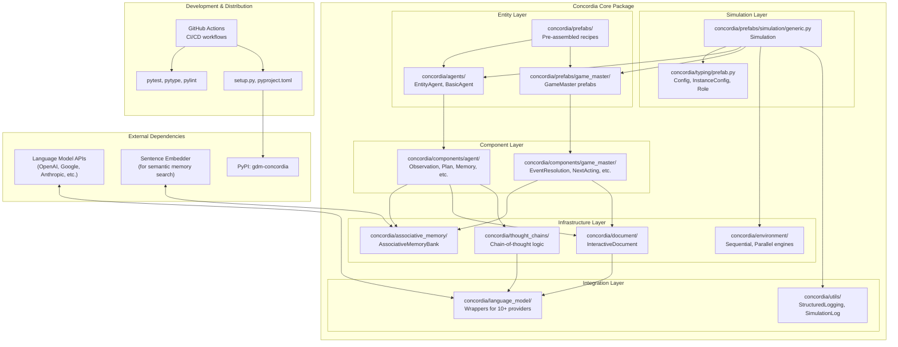
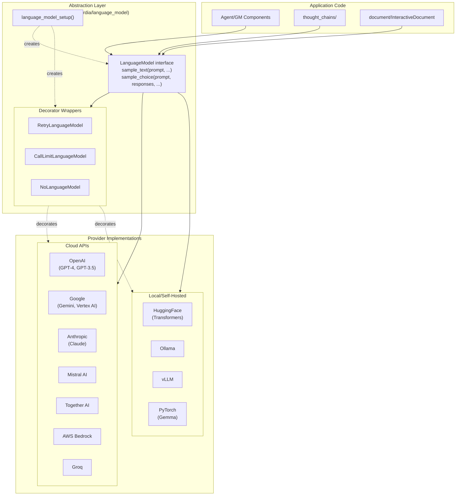

<!-- source: DeepWiki mcp.deepwiki.com · repo google-deepmind/concordia · page 1 Overview · fetched 2026-10-26 -->

# Overview

<details>
<summary>Relevant source files</summary>

The following files were used as context for generating this wiki page:

- [CHANGELOG.md](CHANGELOG.md)
- [CITATION.bib](CITATION.bib)
- [README.md](README.md)
- [setup.py](setup.py)

</details>


## What is Concordia?

**Concordia** is a Python library for building generative agent-based simulations where artificial agents interact in grounded physical, social, or digital environments. The library enables researchers and developers to create sophisticated multi-agent simulations powered by large language models (LLMs).

Published by Google DeepMind and available on PyPI as `gdm-concordia`, Concordia supports applications ranging from social science research and AI ethics to economics, cognitive neuroscience, and service evaluation through simulated usage.

*Sources: [setup.py:34-51](), [README.md:1-38]()*

## Core Concept: The Game Master Pattern

Concordia is structured like a **Game Engine** for generative agents, implementing a design pattern borrowed from tabletop role-playing games:

- **Game Master (GM)**: A special agent responsible for simulating the environment, resolving actions, determining outcomes, and generating observations for player agents. The GM acts as a narrator and arbiter of reality within the simulation.

- **Entities**: The actors in the simulation, which can be:
  - **Player agents** (`EntityAgent`): Autonomous agents with memory, reasoning, and decision-making capabilities
  - **Game Masters** (`GameMaster`): Environment controllers that process actions and maintain world state

- **Components**: Modular building blocks assembled to create entity behaviors. Examples include memory systems, observation processors, planning modules, and action generators.

- **Engine**: The orchestration loop that drives the simulation by requesting actions from entities and having the Game Master resolve them.

This architecture allows agents to take actions by describing what they want to do in natural language, while the GM translates these intentions into appropriate implementations, checks plausibility, and describes effects.

*Sources: [README.md:16-50](), [setup.py:43-45]()*

## Key Features

| Feature | Description |
|---------|-------------|
| **Entity-Component System** | Both agents and game masters are composed from modular, reusable components |
| **LLM Provider Agnostic** | Unified abstraction layer supporting 10+ providers (OpenAI, Google, Anthropic, Mistral, HuggingFace, Ollama, etc.) |
| **Prefab Configuration** | Declarative system for assembling entities from pre-built component recipes |
| **Phase-Based Lifecycle** | Structured execution flow through `PRE_ACT`, `POST_ACT`, `PRE_OBSERVE`, `POST_OBSERVE`, and `UPDATE` phases |
| **Thought Chains** | Chain-of-thought reasoning functions for complex decision-making and event resolution |
| **Memory Systems** | Associative memory with semantic search using sentence embeddings |
| **Scene Management** | Support for multi-scene simulations with participant tracking and scene-aware event delivery |
| **Checkpointing** | State serialization for reproducible experiments and simulation resumption |
| **Structured Logging** | HTML and JSON export of simulation events with content deduplication |

*Sources: [setup.py:69-136](), [CHANGELOG.md:7-60](), [README.md:40-73]()*

## High-Level Architecture

Concordia's architecture is organized into five layers, each with distinct responsibilities. The layers interact through well-defined interfaces, enabling modularity and extensibility.

### Package Organization and Layer Structure



### Layer Responsibilities

| Layer | Purpose | Key Modules |
|-------|---------|-------------|
| **Simulation Layer** | Orchestrates the entire simulation using `Config` objects to instantiate entities | [concordia/prefabs/simulation/generic.py](), [concordia/typing/prefab.py]() |
| **Entity Layer** | Provides agents and game masters built from component compositions | [concordia/agents/](), [concordia/prefabs/game_master/]() |
| **Component Layer** | Modular building blocks for entity behaviors (memory, planning, observation, event resolution) | [concordia/components/agent/](), [concordia/components/game_master/]() |
| **Infrastructure Layer** | Core services: memory systems, execution engines, LLM interaction tools, reasoning chains | [concordia/associative_memory/](), [concordia/environment/](), [concordia/document/](), [concordia/thought_chains/]() |
| **Integration Layer** | Abstracts 10+ LLM providers and handles structured logging | [concordia/language_model/](), [concordia/utils/]() |

**Architectural Principles:**

- **Game masters** have references to all entities and can observe their actions
- **Entities** remain isolated from each other, receiving information only through the GM
- **Components** are composable and reusable across different entity types
- **Memory banks** are separate per entity (isolated) but shared across all game masters
- **LLM providers** are swappable through a unified interface without code changes

*Sources: [setup.py:66-137](), [README.md:55-72]()*

## Entity-Component Architecture

Both agents and game masters are built using an Entity-Component System pattern. Entities are composed from modular components that participate in a phase-based lifecycle.

### Component Composition and Phase Lifecycle

```mermaid
graph TB
    subgraph Configuration["Configuration Phase"]
        User["Developer"] -->|defines| Config["Config<br/>(concordia/typing/prefab.py)"]
        Config -->|contains| Prefabs["prefabs:<br/>dict of Prefab objects"]
        Config -->|contains| Instances["instances:<br/>list of InstanceConfig"]
        Instances -->|specifies| Role["Role:<br/>ENTITY or GAME_MASTER"]
    end
    
    subgraph Build["Build Phase"]
        Prefab["Prefab.build()"] -->|creates| Entity["EntityAgent or GameMaster"]
        Prefab -->|assembles| Components["Components"]
        
        subgraph AgentComps["Agent Components"]
            Obs["ObservationToMemory<br/>LastNObservations"]
            Mem["AllSimilarMemories<br/>QuestionByQuery"]
            State["Identity<br/>SelfPerception<br/>SituationPerception"]
            Plan["Plan<br/>Schedule"]
            Act["ConcatActComponent<br/>SwitchActComponent"]
        end
        
        subgraph GMComps["Game Master Components"]
            Next["NextActing<br/>NextActionSpec"]
            Resolve["EventResolution<br/>SendEventToRelevantPlayers"]
            ObsGen["MakeObservation<br/>ObservationQueue"]
            Scene["SceneTracker<br/>SceneRunner"]
            World["GenerativeClock<br/>WorldState"]
        end
        
        Components --> AgentComps
        Components --> GMComps
    end
    
    subgraph Runtime["Runtime Phase Lifecycle"]
        READY["Phase: READY<br/>(waiting)"]
        PRE_ACT["Phase: PRE_ACT<br/>(gather context)"]
        POST_ACT["Phase: POST_ACT<br/>(react to action)"]
        PRE_OBS["Phase: PRE_OBSERVE<br/>(pre-process observation)"]
        POST_OBS["Phase: POST_OBSERVE<br/>(post-process observation)"]
        UPDATE["Phase: UPDATE<br/>(persist state)"]
        
        READY -->|act() called| PRE_ACT
        PRE_ACT -->|action generated| POST_ACT
        POST_ACT --> UPDATE
        
        READY -->|observe() called| PRE_OBS
        PRE_OBS --> POST_OBS
        POST_OBS --> UPDATE
        
        UPDATE --> READY
    end
    
    Config --> Prefab
    Prefab --> Entity
    Entity --> Runtime
```

### Component Base Classes

| Base Class | Module | Purpose |
|------------|--------|---------|
| `ContextComponent` | [concordia/typing/entity_component.py]() | Provides context strings during action generation (e.g., observations, memories, identity) |
| `ActingComponent` | [concordia/typing/entity_component.py]() | Generates actions from aggregated context provided by other components |
| `ContextProcessorComponent` | [concordia/typing/entity_component.py]() | Processes and transforms context from other components before action generation |

### Phase Execution Model

Components implement methods that are called during specific phases:

1. **`PRE_ACT`**: Components gather relevant information via `pre_act(action_spec)` and return context strings
2. **`POST_ACT`**: Components react to generated actions via `post_act(action_attempt)`
3. **`PRE_OBSERVE`**: Components pre-process observations via `pre_observe(observation)`
4. **`POST_OBSERVE`**: Components post-process observations via `post_observe(observation)`
5. **`UPDATE`**: Components persist state changes via `update()`

The phase-based lifecycle ensures orderly component interactions and prevents race conditions when multiple components access shared resources like memory banks.

*Sources: [concordia/typing/entity_component.py](), [concordia/agents/entity_agent.py](), [concordia/typing/prefab.py](), [concordia/prefabs/simulation/generic.py]()*

## Language Model Integration

Concordia abstracts language model interactions through a provider-agnostic interface, allowing users to swap LLMs without modifying simulation code.

### LLM Abstraction and Provider Support



### Core Interface

The `LanguageModel` abstract base class defines two primary methods:

| Method | Signature | Purpose |
|--------|-----------|---------|
| `sample_text` | `(prompt, *, max_tokens, terminators, temperature, ...) -> str` | Generate free-form text completion |
| `sample_choice` | `(prompt, responses, *, seed) -> tuple[int, str, dict]` | Select from predefined multiple-choice options |

### Supported Providers

Concordia includes wrappers for 10+ language model providers:

| Provider | Module | Extra Install |
|----------|--------|---------------|
| OpenAI | [concordia/language_model/]() | `pip install gdm-concordia[openai]` |
| Google (Gemini, Vertex) | [concordia/language_model/]() | `pip install gdm-concordia[google]` |
| Anthropic (Claude) | Available via langchain | `pip install gdm-concordia[langchain]` |
| Mistral AI | [concordia/language_model/]() | `pip install gdm-concordia[mistralai]` |
| Together AI | [concordia/language_model/]() | `pip install gdm-concordia[together]` |
| AWS Bedrock | [concordia/language_model/]() | `pip install gdm-concordia[amazon]` |
| Groq | [concordia/language_model/]() | `pip install gdm-concordia[groq]` |
| HuggingFace | [concordia/language_model/]() | `pip install gdm-concordia[huggingface]` |
| Ollama | [concordia/language_model/]() | `pip install gdm-concordia[ollama]` |
| vLLM | [concordia/language_model/]() | `pip install gdm-concordia[vllm]` |

### Wrapper Utilities

Decorator wrappers add cross-cutting functionality:

- **`RetryLanguageModel`**: Implements exponential backoff for transient API failures
- **`CallLimitLanguageModel`**: Enforces usage caps by tracking API call counts
- **`NoLanguageModel`**: Returns empty strings for testing without API calls

*Sources: [setup.py:80-136](), [concordia/language_model/](), [README.md:146-154]()*

## Simulation Execution Flow

Concordia orchestrates multi-agent interactions through a structured execution loop. The `Simulation` class manages the overall lifecycle, while `Engine` implementations control the specific turn-taking patterns.

### Simulation Lifecycle

```mermaid
sequenceDiagram
    participant User
    participant Sim["Simulation<br/>(generic.py)"]
    participant Engine["Engine<br/>(Sequential/Parallel)"]
    participant GM["GameMaster"]
    participant Agent["EntityAgent"]
    
    User->>Sim: "Initialize with Config"
    Sim->>Sim: "Create memory banks<br/>(isolated per entity,<br/>shared for GMs)"
    Sim->>Sim: "Instantiate entities<br/>from prefabs"
    
    User->>Sim: "play(max_steps)"
    
    loop Each step
        Sim->>Engine: "run_loop()"
        
        Engine->>GM: "make_observation(entity)"
        GM-->>Agent: "observe(observation)"
        Agent->>Agent: "PRE_OBSERVE →<br/>POST_OBSERVE →<br/>UPDATE phases"
        
        Engine->>GM: "next_acting()"
        GM-->>Engine: "Selected entity +<br/>ActionSpec"
        
        Engine->>Agent: "act(action_spec)"
        Agent->>Agent: "PRE_ACT phase<br/>(gather context)"
        Agent->>Agent: "Generate action"
        Agent->>Agent: "POST_ACT →<br/>UPDATE phases"
        Agent-->>Engine: "Action attempt"
        
        Engine->>GM: "resolve(action_attempt)"
        GM->>GM: "Apply thought chains<br/>(EventResolution)"
        GM-->>Agent: "observe(resolved_event)"
        
        opt Checkpoint enabled
            Sim->>Sim: "save_checkpoint()"
        end
        
        Sim->>Sim: "Log events"
    end
    
    Sim-->>User: "SimulationLog<br/>(HTML/JSON)"
```

### Key Execution Components

| Component | Module | Role |
|-----------|--------|------|
| `Simulation` | [concordia/prefabs/simulation/generic.py]() | Top-level orchestrator; processes `Config`, creates entities, manages execution |
| `Config` | [concordia/typing/prefab.py]() | Declarative configuration specifying prefabs and instances |
| `Engine` | [concordia/environment/]() | Defines turn-taking pattern (sequential, parallel, etc.) |
| `Prefab` | [concordia/typing/prefab.py]() | Factory function that builds entities from components |
| `ActionSpec` | [concordia/typing/action_spec.py]() | Specifies the format and constraints for entity actions |

### Memory Architecture

A critical design decision in Concordia:

- **Entity Memory Banks**: Each `EntityAgent` has an isolated `AssociativeMemoryBank` to prevent cross-contamination
- **Game Master Memory Bank**: All `GameMaster` instances share one collective memory bank (with `allow_duplicates=True`) to maintain consistent world state

This asymmetry ensures entities only learn through observation while game masters have full knowledge of events.

*Sources: [concordia/prefabs/simulation/generic.py](), [concordia/environment/](), [concordia/typing/prefab.py](), [CHANGELOG.md:26-32]()*

## Development and Integration

### Package Structure

The `gdm-concordia` package requires Python ≥3.11 and includes comprehensive dependencies for various LLM providers and supporting libraries. Key development tools include:

- **Testing**: `pytest` with parallel execution via `pytest-xdist`
- **Type Checking**: `pytype` for static analysis  
- **Code Formatting**: `pyink` (Google's Python formatter)
- **Linting**: `pylint` for code quality

### Installation and Setup

```bash
# PyPI installation
pip install gdm-concordia

# Development installation
git clone https://github.com/google-deepmind/concordia
cd concordia
pip install --editable .[dev]
```

The library supports multiple deployment patterns:
- **Local Development**: Using local LLMs via Ollama or PyTorch
- **Cloud Services**: Integration with major cloud LLM providers
- **Research Environments**: Jupyter notebooks and Colab integration
- **Production Simulations**: Scalable execution with concurrent processing

*Sources: [setup.py:68-106](), [README.md:41-72](), [pyproject.toml:24-38]()*

---

