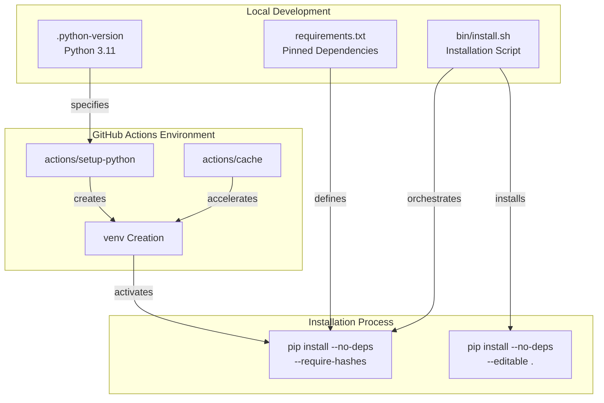
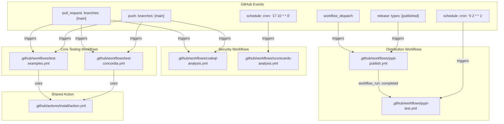
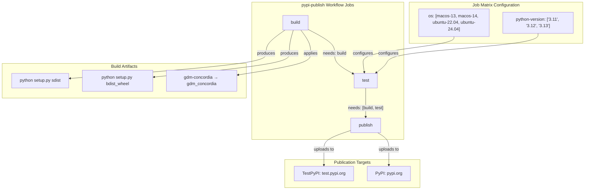
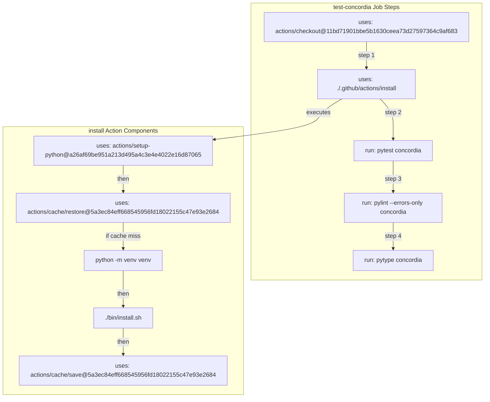
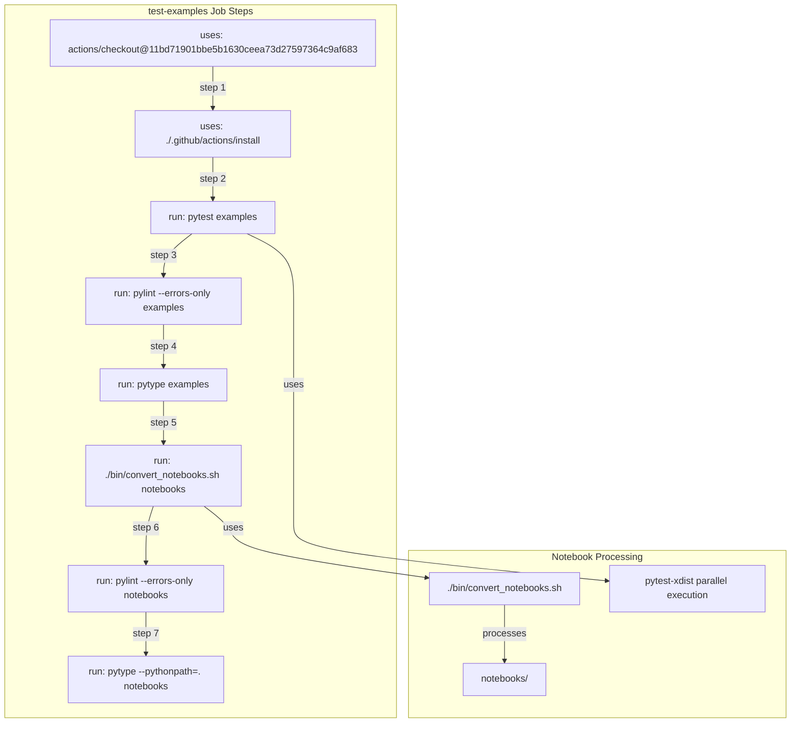
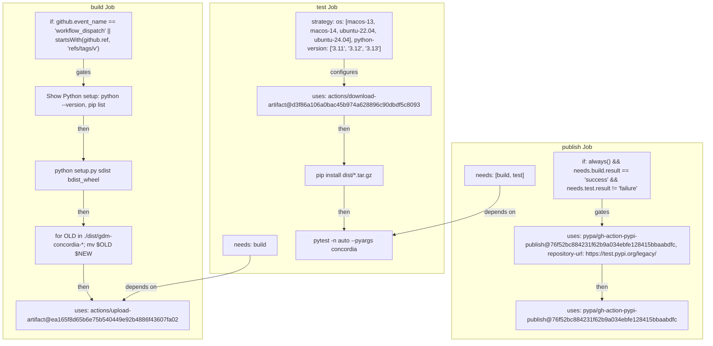
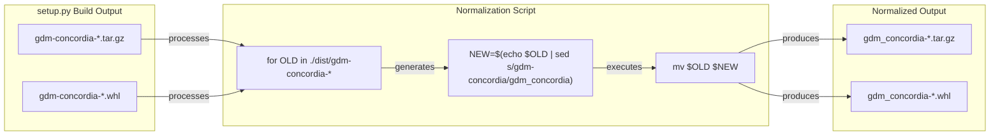
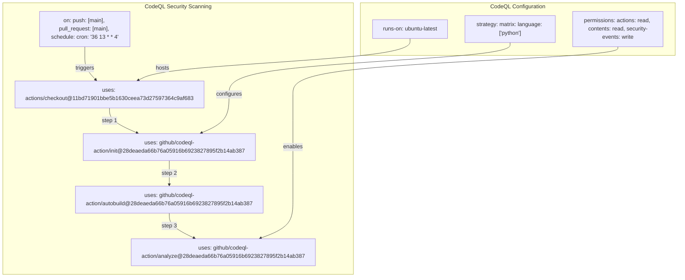
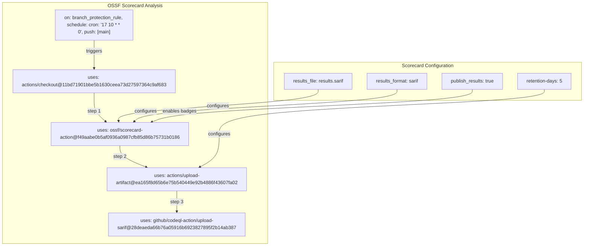
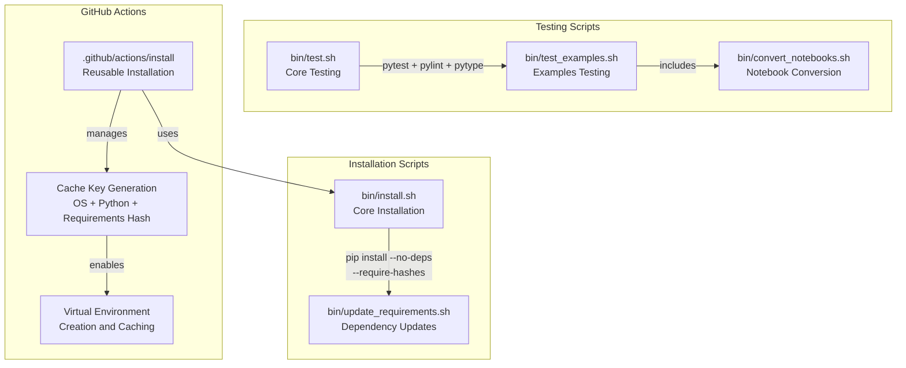

<!-- source: DeepWiki mcp.deepwiki.com · repo google-deepmind/concordia · page 7 Development and Deployment · fetched 2026-10-26 -->

# Development and Deployment

Relevant source files

The following files were used as context for generating this wiki page:

- [.github/actions/install/action.yml](.github/actions/install/action.yml)
- [.github/workflows/codeql-analysis.yml](.github/workflows/codeql-analysis.yml)
- [.github/workflows/pypi-publish.yml](.github/workflows/pypi-publish.yml)
- [.github/workflows/pypi-test.yml](.github/workflows/pypi-test.yml)
- [.github/workflows/scorecards-analysis.yml](.github/workflows/scorecards-analysis.yml)
- [.github/workflows/test-concordia.yml](.github/workflows/test-concordia.yml)
- [.github/workflows/test-examples.yml](.github/workflows/test-examples.yml)
- [bin/install.sh](bin/install.sh)
- [bin/test.sh](bin/test.sh)
- [bin/test_examples.sh](bin/test_examples.sh)
- [bin/update_requirements.sh](bin/update_requirements.sh)
- [pyproject.toml](pyproject.toml)
- [requirements.txt](requirements.txt)

This document covers the development infrastructure, continuous integration/continuous deployment (CI/CD) pipeline, testing framework, and package distribution system for the Concordia repository. It provides technical details for contributors and maintainers working on the codebase.

For information about configuring and launching simulations, see [Configuration and Launching](#4). For details about the core architecture and components, see [Core Architecture](#2).

## Development Environment

Concordia uses Python 3.11 as the primary development environment, with support for Python 3.11, 3.12, and 3.13 in production. The development environment is configured through several key files:

- **Python Version**: Specified in [.python-version:1]() as `3.11`
- **Dependencies**: Managed through [requirements.txt:1-1800]() with pinned versions and cryptographic hashes
- **Installation**: Automated via [bin/install.sh:1-32]()

### Development Environment Setup

Sources: [.python-version:1](), [requirements.txt:1-1800](), [bin/install.sh:1-32](), [.github/actions/install/action.yml:1-84]()

## CI/CD Pipeline Overview

The CI/CD system consists of six GitHub Actions workflows that handle testing, security analysis, and package distribution:

### GitHub Actions Workflow Architecture

### Workflow Job Dependencies

Sources: [.github/workflows/test-concordia.yml:1-56](), [.github/workflows/test-examples.yml:1-70](), [.github/workflows/pypi-publish.yml:1-114](), [.github/workflows/codeql-analysis.yml:1-63](), [.github/workflows/scorecards-analysis.yml:1-63](), [.github/workflows/pypi-test.yml:1-75]()

## Testing Framework

The testing system consists of two primary workflows with distinct validation phases:

### test-concordia Workflow Steps

### test-examples Workflow Steps

### Testing Tool Configuration

| Tool | Command | Target | Configuration |
|------|---------|--------|---------------|
| `pytest` | `pytest concordia` | Core library | Runs from [.github/workflows/test-concordia.yml:49]() |
| `pytest` | `pytest examples` | Examples directory | Runs from [.github/workflows/test-examples.yml:54]() |
| `pytest` | `pytest -n auto --pyargs concordia` | Installed package | Uses `pytest-xdist` from [.github/workflows/pypi-publish.yml:82]() |
| `pylint` | `pylint --errors-only` | Code quality | Error-only mode from [.github/workflows/test-concordia.yml:52]() |
| `pytype` | `pytype concordia` | Type checking | Static analysis from [.github/workflows/test-concordia.yml:55]() |
| `pytype` | `pytype --pythonpath=.` | Notebooks | Custom path from [.github/workflows/test-examples.yml:69]() |

Sources: [.github/workflows/test-concordia.yml:1-56](), [.github/workflows/test-examples.yml:1-70](), [.github/actions/install/action.yml:1-84]()

## Package Building and Distribution

The package distribution system is implemented through the `pypi-publish` workflow with three sequential jobs:

### pypi-publish Workflow Job Chain

### Package Name Normalization Process

### pypi-test Validation Workflow

The `pypi-test` workflow validates published packages independently:

| Trigger | Description | Configuration |
|---------|-------------|---------------|
| `schedule: cron: "0 2 * * 1"` | Weekly Monday 2am validation | [.github/workflows/pypi-test.yml:7]() |
| `workflow_run: workflows: [pypi-publish]` | Triggered after publication | [.github/workflows/pypi-test.yml:18-22]() |
| `workflow_dispatch: inputs.version` | Manual testing with version | [.github/workflows/pypi-test.yml:24-28]() |

The workflow installs via `pip install "gdm-concordia${VERSION:+==$VERSION}"` and validates with `pytest -n auto --pyargs concordia`.

Sources: [.github/workflows/pypi-publish.yml:1-114](), [.github/workflows/pypi-test.yml:1-75]()

## Security and Quality Assurance

The security framework consists of two dedicated workflows for vulnerability detection and supply chain analysis:

### codeql-analysis Workflow Steps

### scorecards-analysis Workflow Steps

### Security Analysis Permissions and Triggers

| Workflow | Permissions | Trigger Schedule | Output Format |
|----------|-------------|------------------|---------------|
| `codeql-analysis` | `security-events: write` | `cron: '36 13 * * 4'` (Thursday 1:36 PM) | SARIF uploaded to code-scanning |
| `scorecards-analysis` | `security-events: write, id-token: write` | `cron: '17 10 * * 0'` (Sunday 10:17 AM) | SARIF + artifacts with 5-day retention |

Both workflows use `permissions: read-all` as default with specific write permissions for security events.

Sources: [.github/workflows/codeql-analysis.yml:1-63](), [.github/workflows/scorecards-analysis.yml:1-63]()

## Development Tools and Scripts

The repository includes several utility scripts for development tasks:

### Development Script Architecture

### Script Functions

Each development script serves specific purposes:

- **Installation**: [bin/install.sh:21-27]() handles dependency installation with hash verification
- **Testing**: [bin/test.sh:22-35]() runs the complete test suite with failure tracking
- **Requirements Update**: [bin/update_requirements.sh:21-22]() updates dependencies using `pip-compile`
- **GitHub Actions Cache**: [.github/actions/install/action.yml:24-37]() generates cache keys based on OS, Python version, and requirements hash

Sources: [bin/install.sh:1-32](), [bin/test.sh:1-42](), [bin/test_examples.sh:1-57](), [bin/update_requirements.sh:1-23](), [.github/actions/install/action.yml:1-84]()

---

