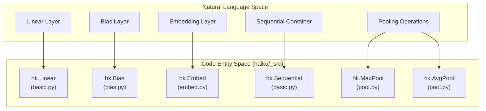
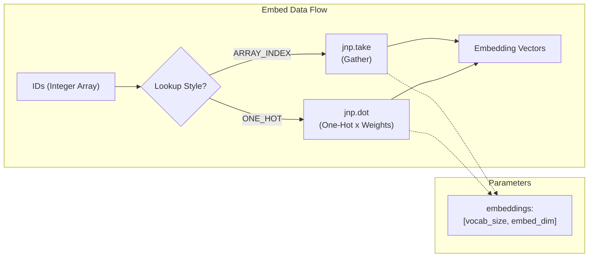

<!-- source: DeepWiki mcp.deepwiki.com · repo google-deepmind/dm-haiku · page 3.1 Basic Modules · fetched 2026-10-26 -->

# Basic Modules

Relevant source files

The following files were used as context for generating this wiki page:

- [examples/haiku_lstms.ipynb](examples/haiku_lstms.ipynb)
- [haiku/_src/basic.py](haiku/_src/basic.py)
- [haiku/_src/basic_test.py](haiku/_src/basic_test.py)
- [haiku/_src/bias.py](haiku/_src/bias.py)
- [haiku/_src/bias_test.py](haiku/_src/bias_test.py)
- [haiku/_src/embed.py](haiku/_src/embed.py)
- [haiku/_src/nets/mlp.py](haiku/_src/nets/mlp.py)
- [haiku/_src/nets/mlp_test.py](haiku/_src/nets/mlp_test.py)
- [haiku/_src/pool.py](haiku/_src/pool.py)
- [haiku/_src/pool_test.py](haiku/_src/pool_test.py)
- [haiku/_src/spectral_norm_test.py](haiku/_src/spectral_norm_test.py)
- [haiku/_src/typing.py](haiku/_src/typing.py)

This page documents the foundational building blocks in Haiku's module library. These basic modules serve as the core components for constructing neural networks, providing essential functionality like linear transformations, embeddings, pooling, and sequential composition.

## Module Overview

Haiku provides several fundamental modules that inherit from the base `hk.Module` [haiku/_src/module.py:59-61]() class. These modules bridge the object-oriented design of neural network layers with JAX's functional paradigm.

### Code Entity Relationship
The following diagram maps the natural language concepts of "Layers" to the specific Haiku classes and functions that implement them.

Sources: [haiku/_src/basic.py:87-187](), [haiku/_src/bias.py:37-137](), [haiku/_src/embed.py:59-140](), [haiku/_src/pool.py:149-210]()

## Linear and Bias Modules

### Linear Module
The `hk.Linear` [haiku/_src/basic.py:130-132]() module implements a transformation of the form $y = Wx + b$.

- **Parameters**: 
    - `w`: Weights of shape `[input_size, output_size]` [haiku/_src/basic.py:177]().
    - `b`: Bias of shape `[output_size]` [haiku/_src/basic.py:182]().
- **Initialization**: Default weight initialization is `TruncatedNormal` with `stddev = 1 / sqrt(fan_in)` [haiku/_src/basic.py:175-176](). Bias defaults to zeros [haiku/_src/basic.py:157]().
- **Data Flow**: It uses `jnp.dot` [haiku/_src/basic.py:179]() for the transformation and `jnp.broadcast_to` [haiku/_src/basic.py:183]() to align the bias with the output shape.

### Bias Module
The `hk.Bias` [haiku/_src/bias.py:37-38]() module provides more granular control over adding learned biases. It supports broadcasting over specific dimensions via the `bias_dims` argument [haiku/_src/bias.py:139-154]().

Sources: [haiku/_src/basic.py:130-187](), [haiku/_src/bias.py:37-137]()

## Embedding Module

The `hk.Embed` [haiku/_src/embed.py:59-60]() module maps integer indices to dense vectors.

### Implementation and Performance
Haiku supports two lookup styles via `hk.EmbedLookupStyle` [haiku/_src/embed.py:38-50]():
1. **ARRAY_INDEX**: Uses `embeddings[ids]`. Optimized for GPU and large vocabularies on TPU [haiku/_src/embed.py:41-44]().
2. **ONE_HOT**: Uses `dot(one_hot(ids), embeddings)`. Often faster on TPU for small vocabularies [haiku/_src/embed.py:46-49]().

Sources: [haiku/_src/embed.py:38-140]()

## Pooling Modules

Haiku provides both functional pooling and module-based wrappers.

- **Functional**: `max_pool` [haiku/_src/pool.py:75-81]() and `avg_pool` [haiku/_src/pool.py:105-111]().
- **Modules**: `hk.MaxPool` [haiku/_src/pool.py:149-153]() and `hk.AvgPool` [haiku/_src/pool.py:183-187]().

### Shape Inference
The pooling modules use `_infer_shape` [haiku/_src/pool.py:35-54]() to handle different input ranks. If an integer is provided for `window_shape`, Haiku assumes the first dimension is the batch dimension and skips it [haiku/_src/pool.py:42-47]().

Sources: [haiku/_src/pool.py:35-210]()

## Sequential and MLP

### Sequential
`hk.Sequential` [haiku/_src/basic.py:87-88]() is a container that calls a list of layers in order. Only the first layer can accept additional `*args` or `**kwargs` [haiku/_src/basic.py:122-127]().

### MLP (Multi-Layer Perceptron)
The `hk.nets.MLP` [haiku/_src/nets/mlp.py:39-40]() module is a high-level wrapper that constructs a sequence of `hk.Linear` [haiku/_src/nets/mlp.py:80-84]() layers with interleaving activations [haiku/_src/nets/mlp.py:119]().

- **Reverse Pattern**: The `reverse()` [haiku/_src/nets/mlp.py:123-127]() method creates a symmetric MLP where output sizes match the input sizes of the original layers. This is useful for autoencoders.

Sources: [haiku/_src/basic.py:87-128](), [haiku/_src/nets/mlp.py:39-177]()

## Utility Modules and Functions

### BatchApply
`hk.BatchApply` [haiku/_src/basic.py:222-223]() merges leading dimensions (e.g., `[Time, Batch]`) into one before applying a function, then splits them back [haiku/_src/basic.py:206-220](). This is essential for applying image layers to video sequences.

### Dropout
`hk.dropout` [haiku/_src/basic.py:299-300]() applies a random mask to inputs. It requires an explicit RNG key [haiku/_src/basic.py:318](). It supports `broadcast_dims` [haiku/_src/basic.py:321]() to apply the same mask across specific axes (e.g., spatial dropout).

### to_module
`hk.to_module` [haiku/_src/basic.py:360-361]() transforms a plain function into a `hk.Module` class. This allows functions that use `hk.get_parameter` to be instantiated and named like standard modules [haiku/_src/basic.py:383-399]().

Sources: [haiku/_src/basic.py:189-403]()

---

