# Page: Overview

# Overview

<details>
<summary>Relevant source files</summary>

The following files were used as context for generating this wiki page:

- [README.md](README.md)
- [docs/api.rst](docs/api.rst)
- [examples/README.md](examples/README.md)
- [examples/requirements.txt](examples/requirements.txt)
- [haiku/BUILD](haiku/BUILD)
- [haiku/__init__.py](haiku/__init__.py)
- [haiku/_src/BUILD](haiku/_src/BUILD)
- [haiku/_src/integration/BUILD](haiku/_src/integration/BUILD)

</details>


Haiku is a neural network library for JAX that enables object-oriented programming while preserving JAX's functional transformations and performance benefits. It provides a simple yet powerful interface for building neural networks with modules, parameters, and state management while maintaining compatibility with JAX's transformation system.

> [!IMPORTANT]
> As of July 2023, Google DeepMind recommends that new projects adopt **Flax** instead of Haiku. Haiku is currently in **maintenance mode**, focusing on bug fixes and compatibility with new JAX releases [README.md:16-39]().

## Core Architecture

Haiku bridges the gap between object-oriented programming and JAX's functional programming model through three key concepts:
1. **Modules**: Object-oriented building blocks for neural networks.
2. **Transformations**: Functions that convert modules into pure functions.
3. **State Management**: Systems for managing parameters and other state.

### System Entity Map

The following diagram maps high-level concepts to the specific code entities that implement them within the Haiku source tree.

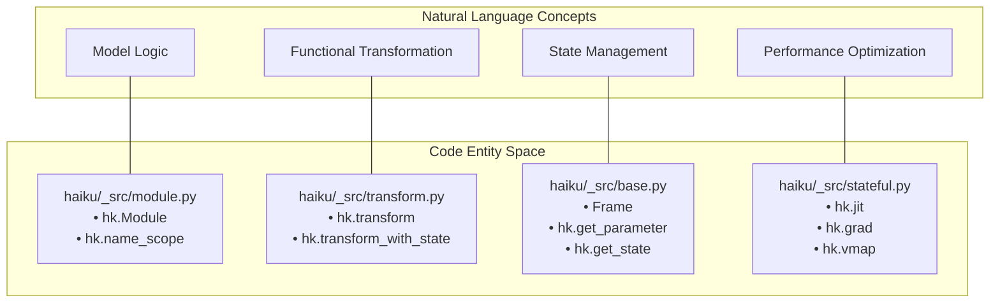

Sources: [haiku/__init__.py:15-146](), [haiku/_src/base.py](), [haiku/_src/module.py](), [haiku/_src/transform.py](), [haiku/_src/stateful.py]()

## Module System

The core concept in Haiku is the `Module` class [haiku/_src/module.py:421-423](). All neural network components in Haiku inherit from this base class, allowing for a familiar object-oriented interface.

Modules encapsulate parameters and behaviors, provide automatic hierarchical name scoping via `name_scope` [haiku/_src/module.py:1010-1012](), and can be composed to create complex networks. Unlike traditional object-oriented frameworks, Haiku modules are designed to work within JAX's functional paradigm through transformations.

Sources: [haiku/_src/module.py](), [README.md:64-68]()

## Transformation System

Haiku transformations convert your object-oriented code into pure functions compatible with JAX transformations like `jax.jit`, `jax.grad`, and `jax.vmap`.

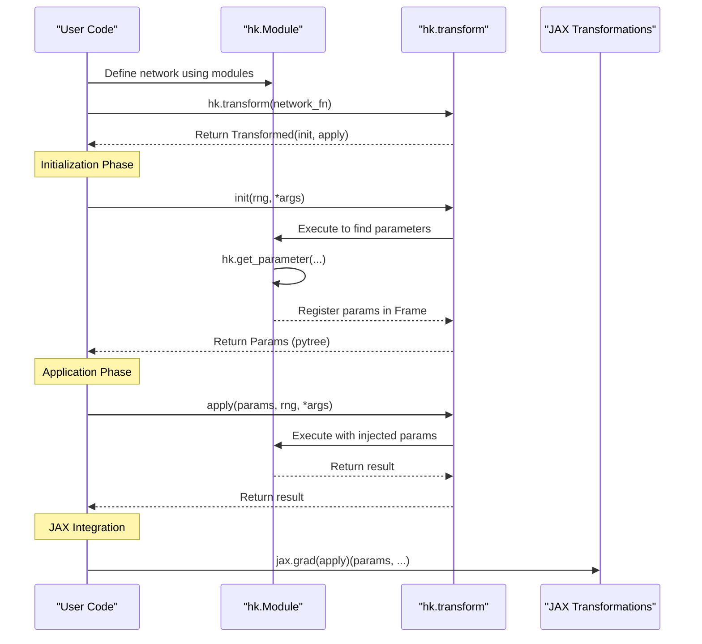

The primary transformations are:
- `hk.transform`: For pure functional transformations with parameters [haiku/_src/transform.py:383-385]().
- `hk.transform_with_state`: For transformations that involve mutable state (e.g., BatchNorm statistics) [haiku/_src/transform.py:431-433]().

These return a `Transformed` [haiku/_src/transform.py:73-77]() or `TransformedWithState` [haiku/_src/transform.py:80-85]() namedtuple containing `init` and `apply` functions.

Sources: [haiku/_src/transform.py](), [README.md:160-175]()

## Parameter and State Management

Haiku provides a system for handling parameters and state in a functional setting using a `Frame` [haiku/_src/base.py:168-170]() which is managed by the `HaikuContext` [haiku/_src/base.py:612-614]().

### Parameter Lifecycle
1. **Request**: Inside a transformed function, `hk.get_parameter` is called [haiku/_src/base.py:805-807]().
2. **Creation**: If in `init`, Haiku uses the provided initializer to create the array [haiku/_src/base.py:839-841]().
3. **Retrieval**: If in `apply`, Haiku looks up the value in the provided `params` pytree using the module's unique name [haiku/_src/base.py:829-831]().

State is managed similarly via `hk.get_state` [haiku/_src/base.py:1003-1005]() and `hk.set_state` [haiku/_src/base.py:1049-1051]().

Sources: [haiku/_src/base.py](), [README.md:356-387]()

## Module Library and Common Components

Haiku includes a wide array of pre-built modules available in the top-level namespace:

| Category | Key Entities | File Path |
| --- | --- | --- |
| **Basic** | `Linear`, `Sequential`, `Dropout` | [haiku/_src/basic.py]() |
| **Convolution** | `Conv2D`, `Conv2DTranspose` | [haiku/_src/conv.py]() |
| **Normalization** | `BatchNorm`, `LayerNorm`, `RMSNorm` | [haiku/_src/batch_norm.py](), [haiku/_src/layer_norm.py](), [haiku/_src/rms_norm.py]() |
| **Recurrent** | `LSTM`, `GRU`, `DeepRNN` | [haiku/_src/recurrent.py]() |
| **Attention** | `MultiHeadAttention` | [haiku/_src/attention.py]() |
| **Architectures** | `ResNet`, `MobileNetV1`, `MLP` | [haiku/_src/nets/]() |

Sources: [haiku/__init__.py:48-146](), [haiku/BUILD:22-83]()

## JAX Integration

Haiku provides specialized wrappers for JAX transformations in `haiku/_src/stateful.py`. These wrappers ensure that Haiku's internal state (like the `Frame` and RNG state) is correctly "threaded" through JAX transformations.

- `hk.jit`: Wraps `jax.jit` [haiku/_src/stateful.py:596-598]().
- `hk.grad`: Wraps `jax.grad` [haiku/_src/stateful.py:115-117]().
- `hk.vmap`: Wraps `jax.vmap` [haiku/_src/stateful.py:431-433]().
- `hk.scan`: Wraps `jax.lax.scan` for stateful loops [haiku/_src/stateful.py:238-240]().

Sources: [haiku/_src/stateful.py]()

## Random Number Generation

Haiku simplifies RNG management within transformed functions. Instead of manually splitting `jax.random.PRNGKey`s, users call `hk.next_rng_key()` [haiku/_src/base.py:1162-1164]().

- `hk.next_rng_key()`: Deterministically splits the key currently held in the `Frame` [haiku/_src/base.py:1182-1184]().
- `hk.PRNGSequence`: A helper class to generate an infinite stream of keys outside of transformed functions [haiku/_src/base.py:1268-1270]().

Sources: [haiku/_src/base.py](), [README.md:112-118]()

---

# Page: Core Architecture

# Core Architecture

<details>
<summary>Relevant source files</summary>

The following files were used as context for generating this wiki page:

- [docs/api.rst](docs/api.rst)
- [haiku/BUILD](haiku/BUILD)
- [haiku/__init__.py](haiku/__init__.py)
- [haiku/_src/BUILD](haiku/_src/BUILD)
- [haiku/_src/integration/BUILD](haiku/_src/integration/BUILD)

</details>


This page provides an overview of Haiku's core architectural components and explains how they fit together to create a neural network library that combines JAX's functional programming paradigm with an object-oriented API. For specific details about the module library provided by Haiku, see [Module Library](#3).

## Overview of Core Systems

Haiku's architecture is built around five core systems that work together to allow neural network construction with an object-oriented API while leveraging JAX's functional transformations:

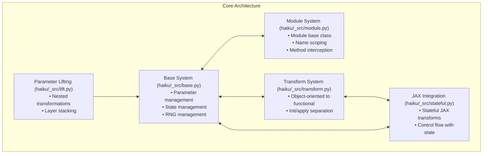

Sources: [haiku/_src/base.py:1-44](), [haiku/_src/module.py:1-35](), [haiku/_src/transform.py:1-42](), [haiku/_src/stateful.py:1-32](), [haiku/_src/lift.py:1-30]()

## Base System

The Base system is the foundation of Haiku, responsible for managing parameters, state, and random number generation. It provides the context management necessary for tracking and accessing these elements in a functional programming environment. For details, see [Parameter and State Management](#2.1).

### Frame and Context Management

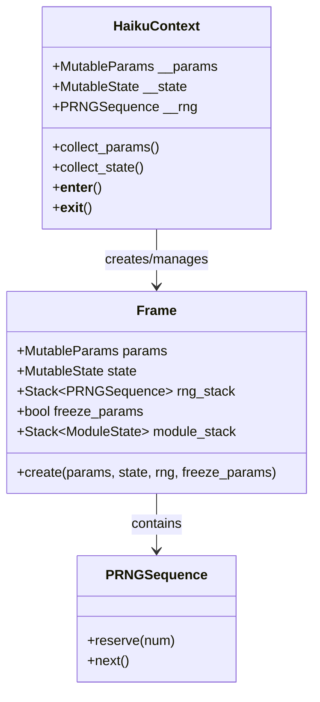

Sources: [haiku/_src/base.py:86-154](), [haiku/_src/base.py:161-215](), [haiku/_src/base.py:1016-1098]()

The `Frame` [haiku/_src/base.py:86-154]() serves as the central data store for parameters, state, and random number generation during a Haiku computation. The `HaikuContext` [haiku/_src/base.py:161-215]() creates and manages frames during initialization and application phases. These components allow Haiku to track the execution context and manage parameters and state in a way that's compatible with JAX's functional paradigm.

## Module System

The Module system provides the object-oriented interface for Haiku, allowing users to define reusable neural network components. For details, see [Module System](#2.2).

### Module Class and Module Hierarchy

```mermaid
flowchart TD
    subgraph "Module Hierarchy"
        Module["hk.Module (haiku/_src/module.py)
        • Base class for all modules
        • Name scoping
        • Parameter collection"]
        
        LinearModule["hk.Linear, hk.Conv2D, etc.
        • Standard neural network layers"]
        
        CustomModule["Custom user-defined modules
        • Inherit from hk.Module"]
    end
    
    subgraph "Metaclass Logic"
        ModuleMetaclass["ModuleMetaclass
        • Wraps methods for tracking
        • Adds name scoping"]
        
        intercept_methods["hk.intercept_methods
        • Customizes method behavior"]
    end
    
    Module --> LinearModule
    Module --> CustomModule
    ModuleMetaclass --> Module : creates
    Module --> intercept_methods : supports
```

Sources: [haiku/_src/module.py:419-683](), [haiku/_src/module.py:61-160](), [haiku/_src/module.py:244-322]()

The `Module` class [haiku/_src/module.py:419-683]() serves as the base class for all Haiku modules. It manages module naming, parameter creation, and method interception. The `ModuleMetaclass` [haiku/_src/module.py:61-160]() handles the wrapping of methods to ensure they operate within the correct context and track parameters and state correctly.

## Transformation System

The transformation system is responsible for converting Haiku's object-oriented code into JAX's functional style. For details, see [Transformation System](#2.3).

### Transform Functions and Workflow

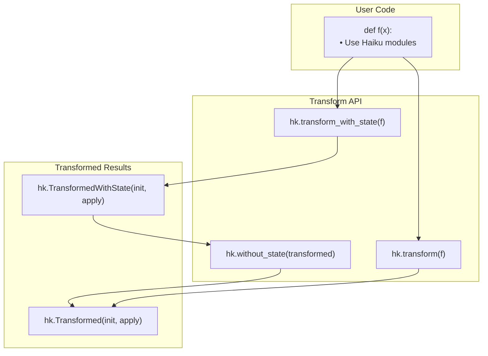

Sources: [haiku/_src/transform.py:264-339](), [haiku/_src/transform.py:360-476](), [haiku/_src/transform.py:143-201]()

The transformation system converts Haiku's object-oriented API into JAX's functional style through the `transform` [haiku/_src/transform.py:264-339]() and `transform_with_state` [haiku/_src/transform.py:360-476]() functions. These functions return pairs of pure functions: `init` for creating parameters, and `apply` for using those parameters in computation.

## JAX Integration

Haiku integrates with JAX by providing stateful versions of JAX transformations that correctly handle Haiku's internal state. For details, see [JAX Integration](#2.4).

### Stateful JAX Transformations

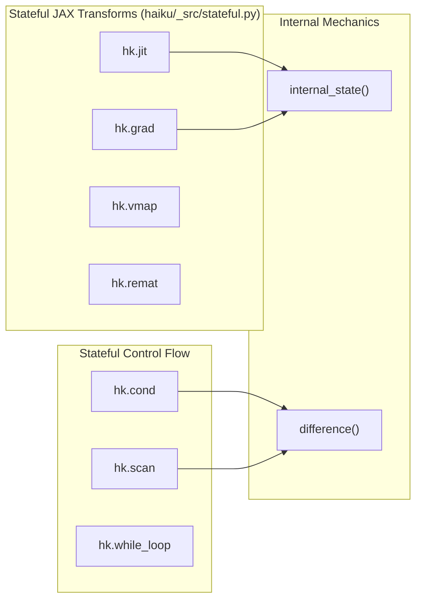

Sources: [haiku/_src/stateful.py:38-46](), [haiku/_src/stateful.py:60-67](), [haiku/_src/stateful.py:276-340](), [haiku/_src/stateful.py:476-585]()

Haiku provides stateful versions of JAX transformations like `hk.jit`, `hk.grad`, and control flow operations like `hk.cond` and `hk.scan`. These functions capture and update Haiku's internal state [haiku/_src/stateful.py:246-273](), allowing for stateful operations within JAX's functional framework.

## Parameter Lifting

Parameter lifting enables nested transformations and layer stacking, allowing for more modular and reusable code. For details, see [Parameter Lifting](#2.5).

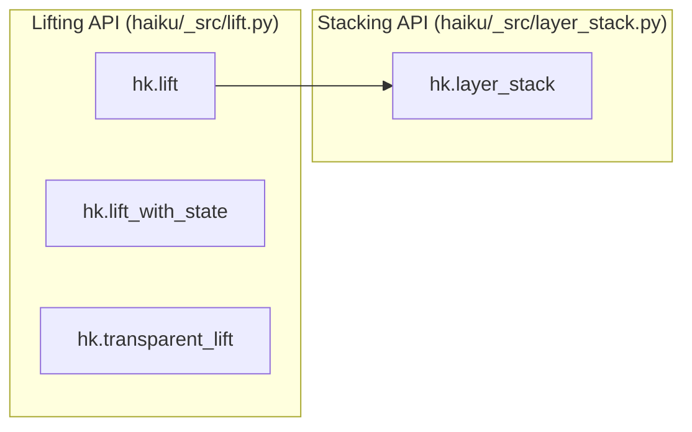

Sources: [haiku/_src/lift.py:45-132](), [haiku/_src/lift.py:157-234](), [haiku/_src/layer_stack.py:155-275]()

Parameter lifting [haiku/_src/lift.py:45-132]() allows for nesting transformed functions, where parameters from an inner transformation are "lifted" to be managed by an outer transformation. `hk.layer_stack` [haiku/_src/layer_stack.py:155-275]() uses these lifting mechanisms to efficiently stack identical layers using `jax.lax.scan`.

## Putting It All Together

The following diagram shows how all components work together in a typical Haiku workflow:

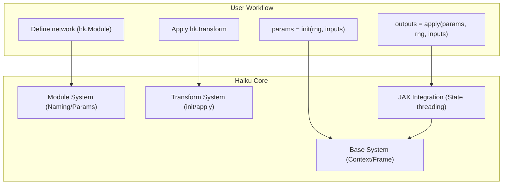

Sources: [haiku/_src/transform.py:264-339](), [haiku/_src/base.py:161-215](), [haiku/_src/stateful.py:38-46]()

---

# Page: Parameter and State Management

# Parameter and State Management

<details>
<summary>Relevant source files</summary>

The following files were used as context for generating this wiki page:

- [haiku/_src/base.py](haiku/_src/base.py)
- [haiku/_src/base_test.py](haiku/_src/base_test.py)
- [haiku/_src/data_structures.py](haiku/_src/data_structures.py)
- [haiku/_src/data_structures_test.py](haiku/_src/data_structures_test.py)
- [haiku/_src/filtering.py](haiku/_src/filtering.py)
- [haiku/_src/filtering_test.py](haiku/_src/filtering_test.py)

</details>


This page documents how Haiku manages parameters (such as weights and biases) and state (such as running averages in batch normalization) within JAX's pure functional paradigm. For details on the transformation system that enables this management, see [Transformation System](#2.3), and for the module system that leverages these parameters, see [Module System](#2.2).

## Core Concepts

Haiku provides a way to maintain object-oriented parameter management in the functional JAX framework. Parameters are created during initialization and reused during application, while state can be both read and updated during application.

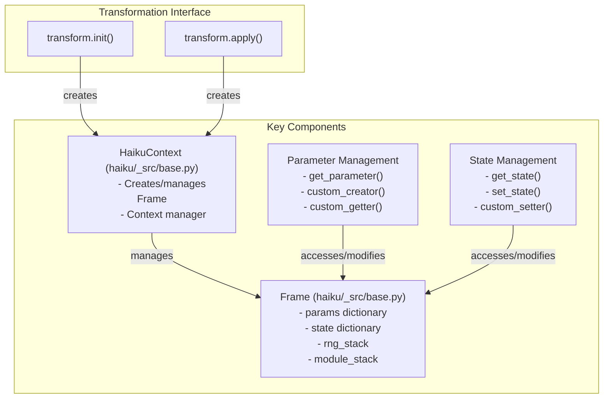

Sources: [haiku/_src/base.py:89-126](), [haiku/_src/base.py:164-216]()

## Frame and HaikuContext

The `Frame` and `HaikuContext` classes form the foundation of Haiku's parameter and state management.

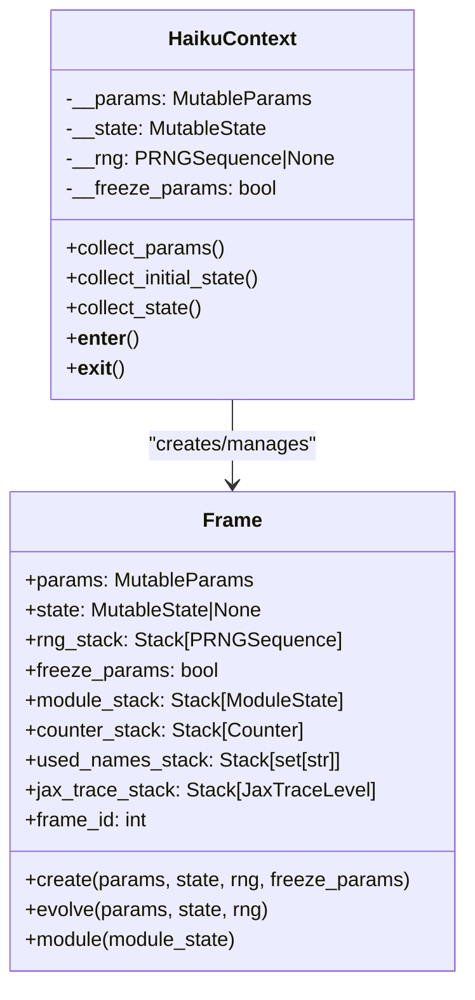

Sources: [haiku/_src/base.py:89-158](), [haiku/_src/base.py:164-216]()

### Frame

`Frame` is a named tuple that stores all per-transform values [haiku/_src/base.py:89-103]():

- `params`: The parameter dictionary (mapping module names to parameter names and values) [haiku/_src/base.py:93]().
- `state`: The state dictionary (mapping module names to state names and `StatePair` objects) [haiku/_src/base.py:94]().
- `rng_stack`: A stack of `PRNGSequence` objects for random number generation [haiku/_src/base.py:95]().
- `freeze_params`: Boolean indicating if we're in apply mode (params frozen) [haiku/_src/base.py:98]().
- `module_stack`: Stack tracking the current module path [haiku/_src/base.py:99]().
- `counter_stack`, `used_names_stack`: Used for unique name management [haiku/_src/base.py:100-101]().
- `jax_trace_stack`: Stores JAX trace state to detect leaking tracers [haiku/_src/base.py:102]().
- `frame_id`: Unique identifier for the frame [haiku/_src/base.py:103]().

### HaikuContext

`HaikuContext` creates and manages frames through a context manager interface [haiku/_src/base.py:164-187]():

- During `__enter__`, it creates a new `Frame` and pushes it onto the `frame_stack` [haiku/_src/base.py:201-207]().
- During `__exit__`, it pops the frame off the stack and executes teardown callbacks [haiku/_src/base.py:209-216]().
- It provides methods to collect parameters (`collect_params`) and state (`collect_state`) from the internal mutable storage [haiku/_src/base.py:189-196]().

## Parameter Management

Parameters in Haiku are managed through `get_parameter()`, with different behaviors during initialization and application phases [haiku/_src/base.py:603-692]().

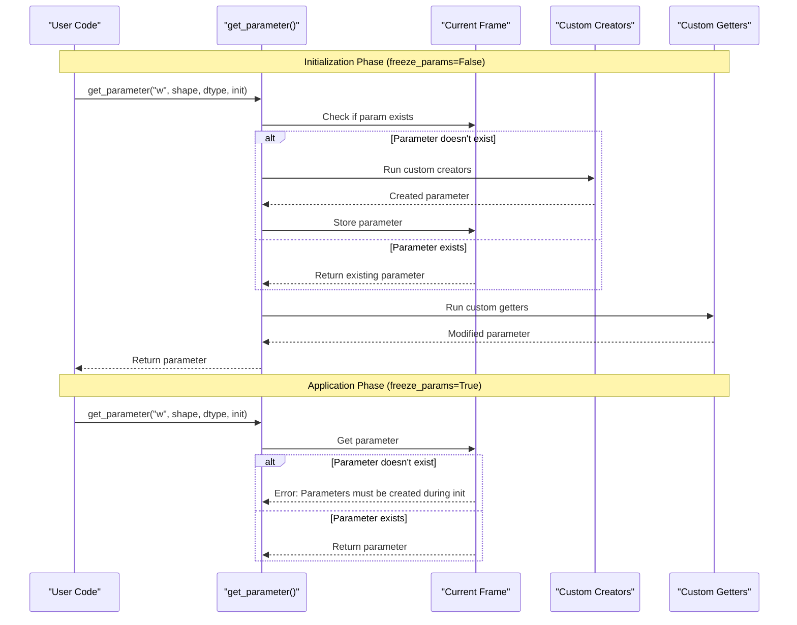

Sources: [haiku/_src/base.py:603-692](), [haiku/_src/base_test.py:116-130]()

### Key Functions

- `get_parameter(name, shape, dtype, init)`: Retrieves an existing parameter or creates a new one if allowed [haiku/_src/base.py:603-692]().
- `custom_creator(creator, params=True, state=False)`: Registers a custom creator hook [haiku/_src/base.py:770-803]().
- `custom_getter(getter, params=True, state=False)`: Registers a custom getter hook [haiku/_src/base.py:840-883]().

### Init vs Apply Behavior

- During **init** (`freeze_params=False`): If the parameter doesn't exist, it is created using the provided `init` function [haiku/_src/base.py:643-652]().
- During **apply** (`freeze_params=True`): Parameters must already exist in the frame. Requesting a non-existent parameter raises a `ValueError` [haiku/_src/base.py:633-640]().

## State Management

State enables modules to maintain values that change during the `apply` phase (like running statistics in `BatchNorm`) [haiku/_src/base.py:419-514]().

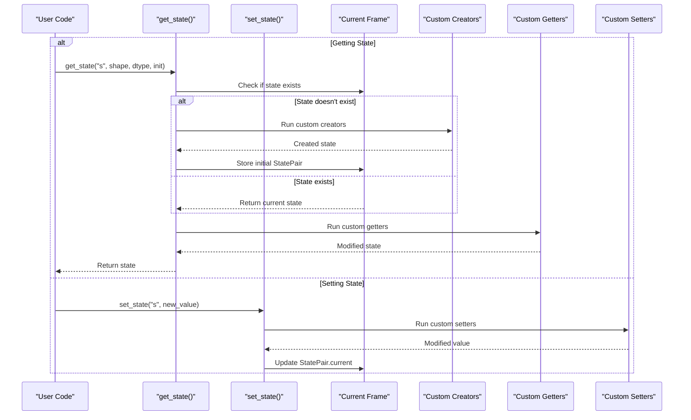

Sources: [haiku/_src/base.py:419-514](), [haiku/_src/base.py:884-969]()

### StatePair

State is internally tracked using a `StatePair` named tuple with `initial` and `current` fields [haiku/_src/base.py:54]():

- `initial`: The state value at the start of the transform (returned by `collect_initial_state`) [haiku/_src/base.py:192-193]().
- `current`: The latest state value updated via `set_state` (returned by `collect_state`) [haiku/_src/base.py:195-196]().

### Key Functions

- `get_state(name, shape, dtype, init)`: Gets or creates state [haiku/_src/base.py:419-466]().
- `set_state(name, value)`: Updates the `current` value of the state [haiku/_src/base.py:467-514]().
- `custom_setter(setter)`: Registers a custom state setter hook [haiku/_src/base.py:945-969]().

## Custom Parameter/State Handling

Haiku provides powerful customization capabilities through stackable hooks.

### Custom Creators

Custom creators allow intercepting the creation of parameters or state [haiku/_src/base.py:770-803]().

```python
def zeros_creator(next_creator, shape, dtype, init, context):
    return next_creator(shape, dtype, jnp.zeros)

with hk.custom_creator(zeros_creator):
    # Initialized with zeros despite init=jnp.ones
    w = hk.get_parameter("w", [], init=jnp.ones)
```

Sources: [haiku/_src/base.py:770-803](), [haiku/_src/base_test.py:32-33]()

### Custom Getters and Setters

- **Custom Getters**: Intercept every call to `get_parameter` or `get_state` to modify the returned value (e.g., for quantization or casting) [haiku/_src/base.py:840-883]().
- **Custom Setters**: Intercept calls to `set_state` to modify values before they are stored in the frame (e.g., for clipping) [haiku/_src/base.py:945-969]().

## Special Features

### DO_NOT_STORE

`DO_NOT_STORE` is a special sentinel value [haiku/_src/base.py:516](). If a creator returns this, the parameter/state is not stored in the Haiku frame dictionaries. This is useful for parameters managed by external systems or for "lifting" parameters from one scope to another [haiku/_src/base.py:516-589]().

### RNG Management

Random number generation is managed through a `PRNGSequence` stored in the frame's `rng_stack` [haiku/_src/base.py:95]().

- `next_rng_key()`: Splits the current RNG and returns a new key [haiku/_src/base.py:1016-1043]().
- `reserve_rng_keys(n)`: Pre-splits `n` keys for use in JAX control flow where side-effects are restricted [haiku/_src/base.py:1137-1161]().

Sources: [haiku/_src/base.py:1016-1043](), [haiku/_src/base.py:1137-1161]()

## Data Structures and Filtering

Haiku uses specialized data structures for parameters and state to ensure compatibility with JAX transformations.

- `FlatMap`: An immutable mapping optimized for JAX `tree_util` operations [haiku/_src/data_structures.py:180-214]().
- `partition`: Splits a parameter/state dictionary into two based on a predicate (e.g., separating weights and biases) [haiku/_src/filtering.py:50-81]().
- `traverse`: Generator that yields `(module_name, name, value)` tuples in sorted order [haiku/_src/filtering.py:30-47]().

Sources: [haiku/_src/data_structures.py:180-214](), [haiku/_src/filtering.py:30-81]()

---

# Page: Module System

# Module System

<details>
<summary>Relevant source files</summary>

The following files were used as context for generating this wiki page:

- [haiku/_src/basic.py](haiku/_src/basic.py)
- [haiku/_src/basic_test.py](haiku/_src/basic_test.py)
- [haiku/_src/bias_test.py](haiku/_src/bias_test.py)
- [haiku/_src/module.py](haiku/_src/module.py)
- [haiku/_src/module_test.py](haiku/_src/module_test.py)

</details>


The Haiku Module System provides the foundation for building neural networks in an object-oriented style while maintaining JAX's functional transformation capabilities. This page explains how modules are defined, named, and organized, as well as how method interception works within the module hierarchy.

## Overview of the Module System

The Module System in Haiku allows developers to create reusable neural network components through an object-oriented paradigm. The core of this system is the `Module` class, which serves as the base class for all neural network components in Haiku. Modules manage their own parameters and state while providing a consistent interface for defining neural network operations.

### Core Class Relationships

The module system relies on a metaclass to orchestrate method wrapping and name scoping.

Title: Module System Entity Mapping
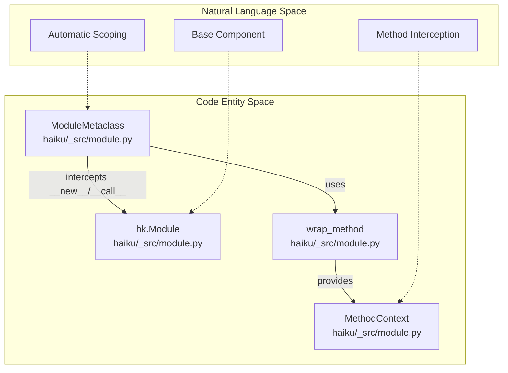

Sources: [haiku/_src/module.py:419-480](), [haiku/_src/module.py:62-166](), [haiku/_src/module.py:169-235]()

## Module Creation and Naming

When you create a Haiku module, it is automatically assigned a unique name derived from its class name (converted to `snake_case`) or a custom name if provided via the `name` argument [haiku/_src/module.py:496-529](). This name is used to organize parameters and state in a hierarchical structure.

The `ModuleMetaclass` overrides `__call__` to ensure that `__init__` runs within a protected name scope, even if an exception occurs [haiku/_src/module.py:127-160]().

### Naming Logic and Conflict Resolution

1.  **Class to Name**: If no name is provided, `utils.class_to_name` converts the class name to snake case [haiku/_src/module.py:643-644]().
2.  **Uniqueness**: Haiku checks the current `Frame` to see if a name is already in use. If it is, it appends an index (e.g., `linear_1`) [haiku/_src/module.py:656-663]().
3.  **Validation**: Module names must be valid Python identifiers and cannot contain reserved characters like `/` [haiku/_src/module.py:532-544]().

Title: Module Initialization Sequence
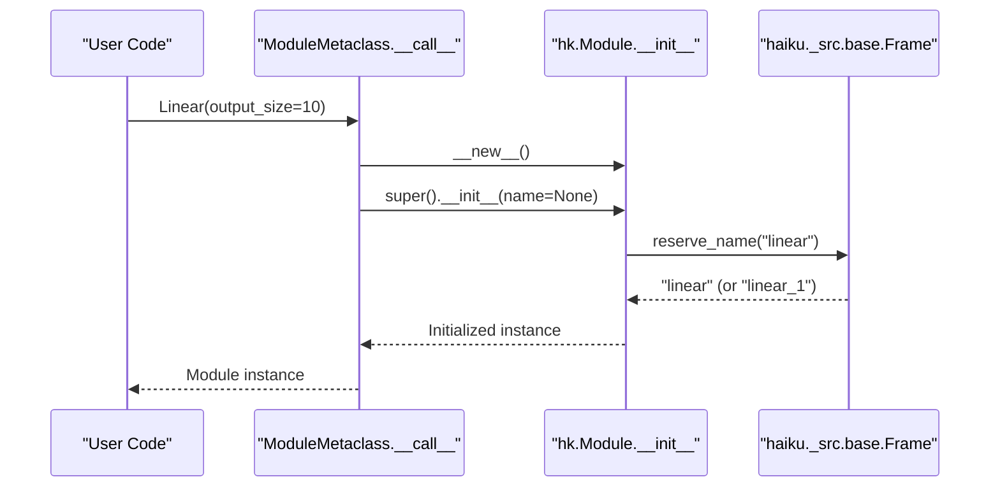

Sources: [haiku/_src/module.py:127-160](), [haiku/_src/module.py:638-668](), [haiku/_src/module_test.py:41-52]()

## Module Hierarchy and Parameter Organization

Modules automatically track their submodules and organize parameters and state in a tree structure. When a module method is called, Haiku enters a `name_scope` corresponding to that module [haiku/_src/module.py:441-443]().

The hierarchy is represented by `/` separators. Parameters created within a module's `__call__` method typically appear as `module_name/parameter_name`. Parameters created in other methods (like `__init__`) are prefixed with a tilde `~` to indicate they are not part of the primary forward pass scope [haiku/_src/module_test.py:141-148]().

Sources: [haiku/_src/module.py:673-687](), [haiku/_src/module_test.py:149-155]()

## Name Scopes and Manual Naming

### Name Scopes
The `hk.name_scope` context manager allows grouping operations under a common namespace without defining a full module [haiku/_src/module.py:827-828](). Internally, this uses a `NameScopeModule` to hook into the standard module naming logic [haiku/_src/module.py:367-416]().

### Forced Naming
The `hk.force_name(name)` function can be passed to a module's `name` argument to bypass uniqueness checks and hierarchy rules [haiku/_src/module.py:558-596](). This is primarily used for parameter sharing across different parts of a model [haiku/_src/module_test.py:715-770]().

Sources: [haiku/_src/module.py:331-366](), [haiku/_src/module.py:558-596]()

## Method Interception

Haiku provides a powerful interception system via `hk.intercept_methods`. This allows wrapping every method call on a module with a custom function.

### Interceptor Components
-   **`MethodContext`**: A `NamedTuple` containing the `module` instance, `method_name`, the `orig_method` being called, and the `orig_class` where it was defined [haiku/_src/module.py:169-176]().
-   **`intercept_methods`**: A context manager that pushes an interceptor onto a thread-local stack [haiku/_src/module.py:295-322]().

### Implementation Detail
The `ModuleMetaclass` uses `wrap_method` to wrap all public methods of a class [haiku/_src/module.py:113-123](). When a wrapped method is called, it checks `base.current_frame().interceptor_stack`. If interceptors exist, they are called in LIFO order [haiku/_src/module.py:255-271]().

Sources: [haiku/_src/module.py:169-235](), [haiku/_src/module.py:242-288](), [haiku/_src/module_test.py:392-456]()

## Method Wrapping via Metaclass

The `ModuleMetaclass` is responsible for transforming standard Python classes into Haiku Modules.

| Feature | Metaclass Implementation |
| :--- | :--- |
| **Method Wrapping** | Iterates through `clsdict` and wraps functions with `wrap_method` [haiku/_src/module.py:71-125](). |
| **Property Support** | Wraps property getters, setters, and deleters [haiku/_src/module.py:84-91](). |
| **Auto Repr** | Automatically generates a string representation using `utils.auto_repr` unless disabled [haiku/_src/module.py:139-142](). |
| **Signature** | Overrides `__signature__` to match `__init__` but excluding `self` [haiku/_src/module.py:162-166](). |

Sources: [haiku/_src/module.py:62-166](), [haiku/_src/module.py:419-480]()

## Special Module Features

### Transparent Methods
The `@hk.transparent` decorator marks a method so that it does not create a new level in the naming hierarchy [haiku/_src/module.py:709-724](). This is useful for internal helper methods that should share the scope of the calling method [haiku/_src/module_test.py:290-294]().

### Name Customization with `name_like`
The `@hk.name_like(other_method_name)` decorator allows a method to "pretend" it is another method for naming purposes [haiku/_src/module.py:727-807](). This is frequently used to make methods like `encode` or `decode` behave like `__call__` regarding parameter naming [haiku/_src/module_test.py:603-631]().

### Hook Methods
`hk.hook_methods` allows attaching pre- and post-call hooks to module methods. Unlike interceptors, hooks cannot modify the arguments or return values, making them safer for logging or state tracking [haiku/_src/module.py:325-328]().

## Integration with JAX

The module system bridges the gap between Object-Oriented Design and JAX's Functional requirement.

Title: OO to Functional Bridge
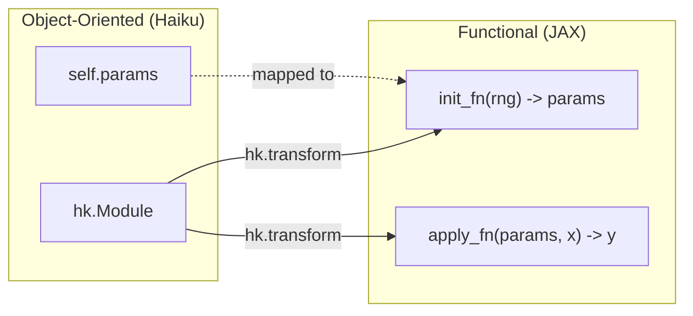

Sources: [haiku/__init__.py:133-146](), [haiku/_src/module.py:610-668]()

## Best Practices

1.  **Super Constructor**: Always call `super().__init__(name=name)` as the first line of a module's `__init__`. Failure to do so will raise a `ValueError` [haiku/_src/module.py:153-158]().
2.  **Naming Validation**: Avoid using `/` or `~` in custom names, as these are reserved for hierarchy and internal scoping [haiku/_src/module.py:532-544]().
3.  **Lazy Initialization**: Define parameters inside `__call__` or other methods rather than `__init__` to allow for automatic shape inference [haiku/_src/basic.py:177-182]().
4.  **Metaclass Conflicts**: If inheriting from a class with its own metaclass (like `abc.ABC`), ensure compatibility. `ModuleMetaclass` inherits from `type(Protocol)` to minimize these conflicts [haiku/_src/module.py:59-62]().

Sources: [haiku/_src/module.py:153-158](), [haiku/_src/module_test.py:1-105]()

---

# Page: Transformation System

# Transformation System

<details>
<summary>Relevant source files</summary>

The following files were used as context for generating this wiki page:

- [haiku/BUILD](haiku/BUILD)
- [haiku/_src/BUILD](haiku/_src/BUILD)
- [haiku/_src/integration/BUILD](haiku/_src/integration/BUILD)
- [haiku/_src/multi_transform.py](haiku/_src/multi_transform.py)
- [haiku/_src/multi_transform_test.py](haiku/_src/multi_transform_test.py)
- [haiku/_src/transform.py](haiku/_src/transform.py)
- [haiku/_src/transform_test.py](haiku/_src/transform_test.py)

</details>


The Transformation System is a core component of Haiku that bridges object-oriented programming (using Haiku modules) and functional programming (required by JAX). It converts functions that use Haiku modules into pure functions that explicitly manage parameters and state, making them compatible with JAX transformations like `jit`, `grad`, and `vmap`.

## Purpose and Functionality

The transformation system serves two main purposes:

1.  **Parameter Management**: It extracts parameters from the object-oriented model into explicit data structures (`hk.Params`) that can be passed around functionally.
2.  **State Handling**: It supports maintaining and updating state variables (`hk.State`) in a functional paradigm for modules like `BatchNorm`.

### System Overview Diagram
"Natural Language Space" to "Code Entity Space" mapping:

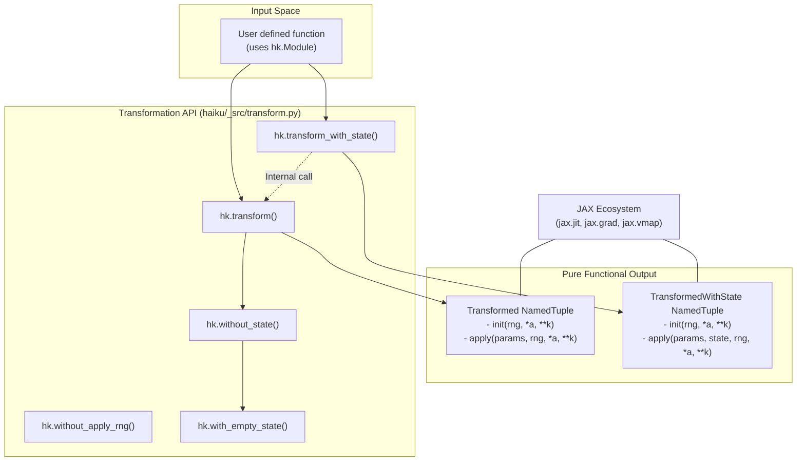
Sources: [haiku/_src/transform.py:91-119](), [haiku/_src/transform.py:264-339](), [haiku/_src/transform.py:360-476]()

## Core Transformation Functions

### `hk.transform`
The `transform` function converts a function using Haiku modules into a `Transformed` named tuple. This is used for models that do not require mutable state updates (e.g., standard MLPs).

**Data Flow:**
1.  **Init Phase**: The `init` function runs the user code inside a `HaikuContext` to collect all parameters created via `hk.get_parameter`.
2.  **Apply Phase**: The `apply` function runs the user code, injecting the provided `Params` into the modules.

Sources: [haiku/_src/transform.py:264-339](), [haiku/_src/transform_test.py:45-52]()

### `hk.transform_with_state`
`transform_with_state` handles both parameters and mutable state (e.g., moving averages in `BatchNorm`). It returns a `TransformedWithState` named tuple.

**Data Flow:**
1.  **Init Phase**: Returns both `Params` and initial `State`.
2.  **Apply Phase**: Accepts `Params` and `State`, and returns the function output plus the updated `State`.

Sources: [haiku/_src/transform.py:360-476](), [haiku/_src/transform_test.py:106-114]()

## Transformation Data Structures

The system relies on specific `NamedTuple` structures to provide a consistent interface for JAX.

| Class | Attributes | Use Case |
| :--- | :--- | :--- |
| `Transformed` | `init`, `apply` | Stateless modules (Params only) |
| `TransformedWithState` | `init`, `apply` | Stateful modules (Params + State) |
| `MultiTransformed` | `init`, `apply` (tree) | Shared parameters across multiple functions |
| `MultiTransformedWithState`| `init`, `apply` (tree) | Shared parameters + state across multiple functions |

Sources: [haiku/_src/transform.py:91-119](), [haiku/_src/multi_transform.py:50-89]()

## Multi-Transformation System

`hk.multi_transform` allows multiple functions to share a single set of parameters. This is essential for architectures like Autoencoders where an `encode` and `decode` function must share the same weights.

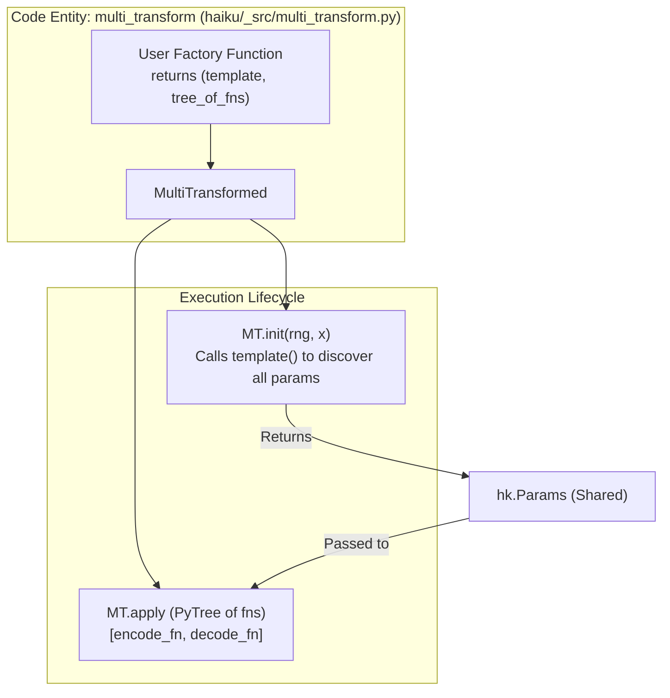
Sources: [haiku/_src/multi_transform.py:176-237](), [haiku/_src/multi_transform_test.py:58-74]()

## Lifecycle and Utilities

### `hk.running_init`
This utility returns `True` if the current code is executing inside an `init` function. It is used to guard logic that should only happen during parameter initialization, such as certain shape-dependent setup.
Sources: [haiku/_src/transform.py:514-541]()

### `hk.without_state` and `hk.without_apply_rng`
These wrappers simplify the functional interface:
-   **`without_state`**: Converts `TransformedWithState` to `Transformed`. It raises `base.NonEmptyStateError` if the function actually attempts to use state. [haiku/_src/transform.py:141-199]()
-   **`without_apply_rng`**: Removes the `rng` argument from the `apply` function. This is useful when the model is deterministic during inference. [haiku/_src/multi_transform.py:240-305]()

### RNG Handling
Haiku transforms automatically handle JAX PRNGKeys. The system converts the input `rng` into a `hk.PRNGSequence` internally during the transformation lifecycle to allow modules to call `hk.next_rng_key()` without manually splitting keys.
Sources: [haiku/_src/transform.py:121-129](), [haiku/_src/transform.py:402-425]()

## Implementation Details

### Signature Preservation
Haiku uses `inspect.Signature` manipulation to ensure that transformed functions (`init` and `apply`) retain the parameter names and default values of the original user-defined function, while prepending the necessary JAX-compatible arguments (`params`, `state`, `rng`).
Sources: [haiku/_src/transform.py:45-60](), [haiku/_src/transform.py:427-438]()

### Error Handling and Validation
The system validates inputs to prevent common JAX/Haiku integration errors:
-   **Tracing Errors**: Detects if JAX transformations (like `jax.vmap`) are used directly on Haiku modules instead of using `hk.vmap`. [haiku/_src/transform.py:345-357]()
-   **Late Parameter Creation**: Ensures parameters are not created during the `apply` phase, which would violate JAX's requirement for pure functions. [haiku/_src/transform_test.py:72-79]()
-   **RNG Validation**: Validates that a non-None `PRNGKey` is provided if the model is stochastic. [haiku/_src/transform_test.py:97-104]()

Sources: `haiku/_src/transform.py`, `haiku/_src/multi_transform.py`, `haiku/_src/transform_test.py`.

---

# Page: JAX Integration

# JAX Integration

<details>
<summary>Relevant source files</summary>

The following files were used as context for generating this wiki page:

- [haiku/_src/integration/hk_transforms_test.py](haiku/_src/integration/hk_transforms_test.py)
- [haiku/_src/integration/jax_transforms_test.py](haiku/_src/integration/jax_transforms_test.py)
- [haiku/_src/integration/numpy_inputs_test.py](haiku/_src/integration/numpy_inputs_test.py)
- [haiku/_src/random_test.py](haiku/_src/random_test.py)
- [haiku/_src/stateful.py](haiku/_src/stateful.py)
- [haiku/_src/stateful_test.py](haiku/_src/stateful_test.py)
- [haiku/nets.py](haiku/nets.py)
- [requirements-jax.txt](requirements-jax.txt)
- [requirements-test.txt](requirements-test.txt)

</details>


This page explains how Haiku integrates with JAX's transformations like `jit`, `grad`, and `vmap`, while managing the internal state of Haiku modules. Haiku modules maintain parameters, state, and random number generators, which must be properly threaded through JAX's functional transformations.

For information about the transformation system that converts object-oriented Haiku code to JAX-compatible functions, see **2.3. Transformation System**.

## Overview

Haiku implements an object-oriented neural network API over JAX's functional programming model. While JAX transformations expect pure functions without side effects, Haiku modules maintain internal state like parameters, module state, and random number generators. Haiku's JAX integration system bridges this gap by providing wrappers around JAX transformations that correctly handle Haiku's internal state.

### Mapping JAX Transformations to Haiku Entities

The following diagram maps JAX transformation concepts to the specific Haiku implementation entities that handle state threading.

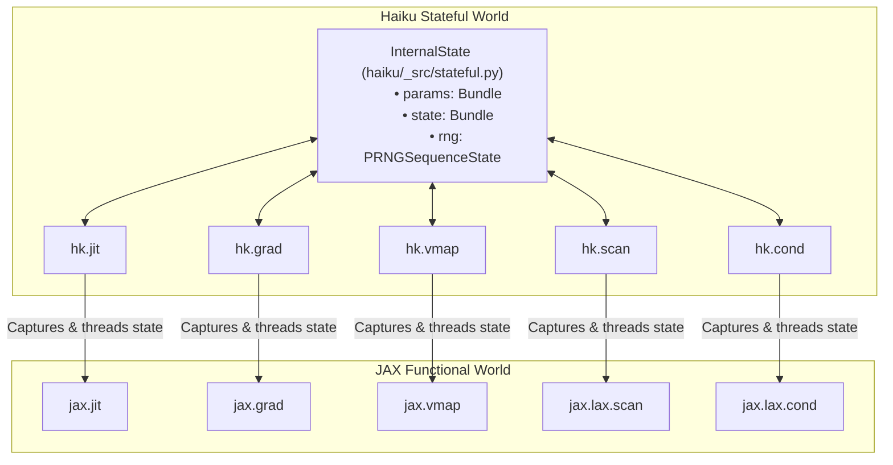

Sources: [haiku/_src/stateful.py:15-17](), [haiku/_src/stateful.py:28-29](), [haiku/_src/stateful.py:378-380](), [haiku/_src/stateful.py:99-100]().

## Internal State Management

The core of Haiku's JAX integration is its internal state management system, which is implemented through the `InternalState` namedtuple and managed within a `Frame`.

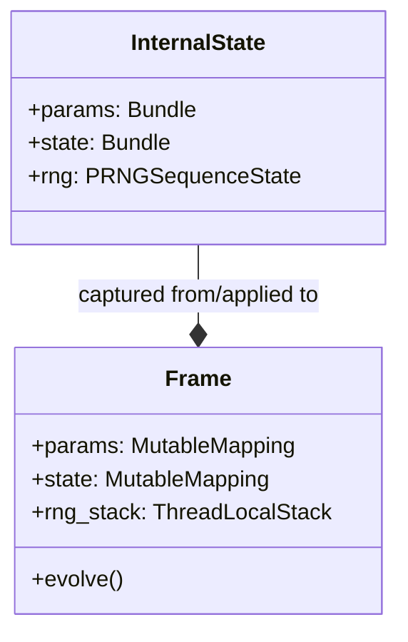

The `InternalState` [haiku/_src/stateful.py:28-28]() manages three components:
1. **params**: Parameters of modules (e.g., weights, biases).
2. **state**: Stateful values that modules maintain (e.g., moving averages).
3. **rng**: Random number generator state for stochastic operations.

### Key Internal State Operations

- **Capture**: `internal_state()` [haiku/_src/stateful.py:38-46]() captures the current Haiku frame's state using `base.current_frame()`.
- **Update**: `update_internal_state(state)` [haiku/_src/stateful.py:60-68]() applies changes back to the frame, recursively merging updates via `update_recursive` [haiku/_src/stateful.py:49-58]().
- **Temporary Context**: `temporary_internal_state(state)` [haiku/_src/stateful.py:70-86]() creates a context with a specific state by evolving the current frame and pushing it onto the `base.frame_stack`.
- **Difference Tracking**: The `difference(before, after)` [haiku/_src/stateful.py:276-318]() function identifies changes between two `InternalState` snapshots, allowing Haiku to only propagate modified state back to JAX.

Sources: [haiku/_src/stateful.py:28-46](), [haiku/_src/stateful.py:60-86](), [haiku/_src/stateful.py:276-318]().

## JAX Transformation Wrappers

Haiku provides wrappers for JAX transformations that thread Haiku state through the transformation. These wrappers follow a common pattern facilitated by the `thread_hk_state_in_kwargs` [haiku/_src/stateful.py:343-375]() helper.

### The Threading Mechanism

Haiku intercepts the function call, extracts the current state, and injects it into the JAX transformation as an auxiliary argument.

```mermaid
sequenceDiagram
    participant User as "User Code"
    participant HKWrapper as "Haiku Wrapper (e.g., hk.jit)"
    participant Internal as "InternalState"
    participant JAX as "JAX Transformation (e.g., jax.jit)"
    
    User->>HKWrapper: Call wrapper with function and args
    HKWrapper->>Internal: internal_state()
    HKWrapper->>JAX: Create wrapped function including state
    JAX->>HKWrapper: Return transformed function
    HKWrapper->>User: Return wrapped function
    
    User->>HKWrapper: Call wrapped function with args
    HKWrapper->>Internal: Capture state before execution
    HKWrapper->>JAX: Call JAX-transformed function (args + state)
    JAX->>HKWrapper: Return result and modified state
    HKWrapper->>Internal: update_internal_state(new_state)
    HKWrapper->>User: Return original result
```

Sources: [haiku/_src/stateful.py:343-375](), [haiku/_src/stateful.py:378-391]().

## Key JAX Transformations in Haiku

### Just-in-Time Compilation (hk.jit)

`hk.jit` [haiku/_src/stateful.py:378-391]() compiles a function for faster execution while handling Haiku state. It uses `jax.jit` internally but wraps the input function to handle the `InternalState`.

Example from test [haiku/_src/stateful_test.py:175-180]():
```python
@test_utils.transform_and_run
def test_jit(self):
  mod = SquareModule()
  x = jnp.array(2)
  y = stateful.jit(mod)(x)
  self.assertEqual(y, x ** 2)
```

### Automatic Differentiation (hk.grad)

`hk.grad` [haiku/_src/stateful.py:99-161]() and `hk.value_and_grad` [haiku/_src/stateful.py:164-233]() compute gradients while correctly managing Haiku state. This is critical when a module uses `hk.set_state` inside the function being differentiated.

### Vectorization (hk.vmap)

`hk.vmap` [haiku/_src/stateful.py:757-870]() vectorizes a function across a batch dimension. A key feature is the `split_rng` parameter:

- **split_rng=False**: The same RNG key is broadcast to all mapped function calls.
- **split_rng=True**: The RNG key is split into independent keys for each mapped element using `jax.random.split`.

Sources: [haiku/_src/stateful.py:99-233](), [haiku/_src/stateful.py:757-870]().

### Control Flow Operators

Haiku provides several control flow operators that ensure module state updates within branches or loops are properly captured:

| Haiku Function | JAX Equivalent | Purpose |
|:---|:---|:---|
| `hk.cond` [haiku/_src/stateful.py:411-482]() | `jax.lax.cond` | Conditional execution of stateful functions. |
| `hk.switch` [haiku/_src/stateful.py:546-585]() | `jax.lax.switch` | Multi-way conditional branch. |
| `hk.scan` [haiku/_src/stateful.py:588-653]() | `jax.lax.scan` | Iterative loop with state threading. |
| `hk.while_loop` [haiku/_src/stateful.py:875-918]() | `jax.lax.while_loop` | Dynamic loop with state. |
| `hk.fori_loop` [haiku/_src/stateful.py:665-698]() | `jax.lax.fori_loop` | Counted loop with state. |

Sources: [haiku/_src/stateful.py:411-698](), [haiku/_src/stateful.py:875-918]().

## Usage Patterns and RNG Handling

### RNG Reservation

When using stateful control flow (like `hk.scan` or `hk.cond`), Haiku uses `reserve_up_to_full_rng_block()` [haiku/_src/stateful.py:89-97]() to ensure that the PRNG sequence has a consistent block of keys available, preventing unexpected behavior when the RNG is active across branches.

### Initialization vs. Application

A common pitfall is creating parameters inside conditional branches. Haiku's `hk.cond` implementation includes logic to detect if it is being run during `hk.running_init()` [haiku/_src/stateful.py:434-458](). If so, it may execute branches to ensure parameters are initialized, even if the condition would otherwise skip them.

### State Tracking and Difference

To optimize performance and avoid unnecessary state updates, Haiku uses a "difference-tracking" mechanism. The `difference` function [haiku/_src/stateful.py:276-318]() compares the state before and after a transformation, returning only the modified leaves. This is used in `thread_hk_state_in_kwargs` to return only changed state back to the JAX transformation.

Sources: [haiku/_src/stateful.py:89-97](), [haiku/_src/stateful.py:276-318](), [haiku/_src/stateful.py:434-458]().

---

# Page: Parameter Lifting

# Parameter Lifting

<details>
<summary>Relevant source files</summary>

The following files were used as context for generating this wiki page:

- [haiku/_src/layer_stack.py](haiku/_src/layer_stack.py)
- [haiku/_src/layer_stack_test.py](haiku/_src/layer_stack_test.py)
- [haiku/_src/lift.py](haiku/_src/lift.py)
- [haiku/_src/lift_test.py](haiku/_src/lift_test.py)

</details>


Parameter lifting is a mechanism in Haiku that enables nested transformations by properly connecting parameters between inner and outer transformed functions. It is primarily used when you need to apply JAX transformations (like `jax.vmap` or `jax.scan`) inside a Haiku transformed function. This page covers the parameter lifting system and related layer stacking functionality.

For information about the broader transformation system, see [Transformation System](2.3).

## Overview of Parameter Lifting

Parameter lifting allows you to register parameters from an inner transformed function within an outer transform's parameter collection. This solves the problem of parameter management in nested transformations, which commonly occurs when using JAX transformations like `vmap` or `scan` inside Haiku modules.

### Natural Language to Code Entity Space: Lifting Components
The following diagram maps the conceptual lifting process to the specific classes and functions in the Haiku codebase.

```mermaid
flowchart TB
    subgraph "Haiku Transformation Context"
        direction TB
        hk_transform["hk.transform / hk.transform_with_state"]
        running_init["hk.running_init()"]
        base_frame["haiku._src.base.Frame"]
    end
    
    subgraph "Lifting Logic (haiku/_src/lift.py)"
        direction TB
        LiftingModule["class LiftingModule"]
        lift_fn["def lift()"]
        lift_state_fn["def lift_with_state()"]
        transparent_lift["def transparent_lift()"]
        pack_into_dict["def pack_into_dict()"]
        unpack_from_dict["def unpack_from_dict()"]
    end
    
    subgraph "State Management"
        direction TB
        Updater["class LiftWithStateUpdater"]
        StatePair["haiku._src.base.StatePair"]
    end

    hk_transform -- "calls" --> lift_fn
    lift_fn -- "instantiates" --> LiftingModule
    LiftingModule -- "checks" --> running_init
    LiftingModule -- "mutates" --> base_frame
    LiftingModule -- "during init" --> pack_into_dict
    LiftingModule -- "during apply" --> unpack_from_dict
    lift_state_fn -- "returns" --> Updater
    pack_into_dict -- "wraps values in" --> StatePair
```

Sources: [haiku/_src/lift.py:85-130](), [haiku/_src/lift.py:133-167](), [haiku/_src/lift.py:367-428](), [haiku/_src/lift.py:43-61](), [haiku/_src/lift.py:63-69]()

### Problem Solved by Parameter Lifting

Without parameter lifting, when you transform a function that itself uses another transformed function, you would need to manually handle parameter passing between the transforms. Parameter lifting automates this process, making nested transformations seamless and avoiding parameter duplication or loss.

```mermaid
sequenceDiagram
    participant User as "User Code"
    participant OuterTransform as "Outer Transform"
    participant Lift as "Parameter Lifting (LiftingModule)"
    participant InnerTransform as "Inner Transform"
    
    User->>OuterTransform: Call init(rng, ...)
    OuterTransform->>Lift: Call lift(inner_init)(rng, ...)
    Note over Lift: Check hk.running_init()
    Lift->>InnerTransform: Call inner_init(rng, ...)
    InnerTransform-->>Lift: Return inner_params
    Lift->>Lift: pack_into_dict(inner_params, outer_params, prefix)
    Lift-->>OuterTransform: Return inner_params
    OuterTransform-->>User: Return outer_params (including inner_params)
    
    User->>OuterTransform: Call apply(params, ...)
    OuterTransform->>Lift: Call lift(inner_init)(...)
    Note over Lift: Check hk.running_init() -> False
    Lift->>Lift: unpack_from_dict(outer_params, prefix)
    Lift-->>OuterTransform: Return inner_params
    OuterTransform->>InnerTransform: Call inner_apply(inner_params, ...)
    InnerTransform-->>OuterTransform: Return result
    OuterTransform-->>User: Return final result
```

Sources: [haiku/_src/lift.py:101-130](), [haiku/_src/lift.py:43-61](), [haiku/_src/lift.py:63-69]()

## Lifting Functions

Haiku provides four primary lifting functions for different scenarios:

| Function | Purpose | Adds Namespace | Handles State | Implementation |
|----------|---------|----------------|---------------|----------------|
| `lift` | Basic parameter lifting | Yes | No | [haiku/_src/lift.py:133-254]() |
| `lift_with_state` | Lifts parameters and state | Yes | Yes | [haiku/_src/lift.py:367-428]() |
| `transparent_lift` | Lifts parameters without namespace | No | No | [haiku/_src/lift.py:257-296]() |
| `transparent_lift_with_state` | Lifts parameters and state without namespace | No | Yes | [haiku/_src/lift.py:438-477]() |

### Basic Parameter Lifting

The `lift` function is used to lift parameters from an inner transformation to an outer one. It creates a `LiftingModule` that handles the logic of whether to run the inner `init` or pull from existing parameters based on `hk.running_init()` [haiku/_src/lift.py:105-130]().

The `lift` function wraps the parameters in a namespace (by default named "lifted") to prevent name collisions [haiku/_src/lift.py:137]().

### Lifting with State

When your inner function has state that needs to be tracked, use `lift_with_state`. This returns two objects: a function to retrieve parameters/state and a `LiftWithStateUpdater` [haiku/_src/lift.py:427]().

```python
# Inside a transformed_with_state function
inner_fn = hk.transform_with_state(...)
params_and_state_fn, updater = hk.lift_with_state(inner_fn.init)
params, state = params_and_state_fn(rng, x)
out, new_state = inner_fn.apply(params, state, rng, x)
updater.update(new_state)  # Updates the outer state with the new inner state
```

The `LiftWithStateUpdater` ensures that the state update is called exactly once during the execution of the outer transform [haiku/_src/lift.py:343-348]().

Sources: [haiku/_src/lift.py:323-359](), [haiku/_src/lift.py:367-428]()

## Layer Stack

The `layer_stack` functionality builds on parameter lifting to create stacks of layers with non-shared parameters using `jax.lax.scan`. This is highly efficient for deep networks with repeated layers.

### Natural Language to Code Entity Space: Layer Stacking Implementation
This diagram maps the high-level `layer_stack` API to the internal scanning and lifting mechanisms.

```mermaid
flowchart LR
    subgraph "Public API"
        layer_stack["hk.layer_stack()"]
    end

    subgraph "Internal Implementation (haiku/_src/layer_stack.py)"
        LayerStack_class["class _LayerStack"]
        scanned_init["scanned_init_fn()"]
        layer_step["def layer()"]
        split_params["def _split_params()"]
        stack_params["def _stack_params()"]
    end

    subgraph "JAX / Lifting Bridge"
        jax_scan["jax.lax.scan"]
        transparent_lift["hk.transparent_lift_with_state"]
        lift_with_state["hk.lift_with_state"]
    end

    layer_stack -- "instantiates" --> LayerStack_class
    LayerStack_class -- "defines" --> scanned_init
    LayerStack_class -- "calls" --> lift_with_state
    LayerStack_class -- "calls" --> transparent_lift
    LayerStack_class -- "uses for apply" --> jax_scan
    jax_scan -- "iterates" --> layer_step
    scanned_init -- "unstacks params via" --> split_params
    layer_step -- "restacks params via" --> stack_params
```

Sources: [haiku/_src/layer_stack.py:132-223](), [haiku/_src/layer_stack.py:284-412](), [haiku/_src/layer_stack.py:84-130]()

### How Layer Stack Works

1. **Initialization**: `layer_stack` creates a `scanned_init_fn` that uses `jax.lax.scan` to run the layer's `init` function `count` times [haiku/_src/layer_stack.py:164-171]().
2. **Lifting**: It uses `lift.lift_with_state` (or `transparent_lift_with_state`) to register the resulting stacked parameters and state in the outer Haiku context [haiku/_src/layer_stack.py:174-182]().
3. **Application**: During the `apply` phase, it uses `jax.lax.scan` to iterate through the layers, passing the relevant slice of parameters and state to each step [haiku/_src/layer_stack.py:186-215]().

### Transparency in Layer Stack

Layer stack supports "transparent" mode which allows parameters to appear as if they were created in a standard loop. This requires a `LayerStackTransparencyMapping` to define how stacked names map to flat names [haiku/_src/layer_stack.py:58-83]().

The `_split_params` function converts stacked parameters (with an extra dimension) into a flat Haiku dictionary during init [haiku/_src/layer_stack.py:84-100](). Conversely, `_stack_params` aggregates them back into a stacked format for the scan operation [haiku/_src/layer_stack.py:103-129]().

Sources: [haiku/_src/layer_stack.py:132-223](), [haiku/_src/layer_stack.py:284-412]()

## Common Use Cases

### Using JAX vmap Inside Haiku

A common usage of `lift` is to use `jax.vmap` to create an ensemble where each member has its own parameters [haiku/_src/lift.py:170-180]().

```python
def ensemble_fn(x):
    model = hk.transform(MyModel)
    # vmap the init to create 'size' sets of parameters
    init_fn = jax.vmap(model.init, in_axes=(0, None))
    # Lift the vmapped init
    params = hk.lift(init_fn)(hk.next_rng_keys(size), x)
    # vmap the apply
    return jax.vmap(model.apply, in_axes=(0, None, None))(params, None, x)
```

Sources: [haiku/_src/lift.py:181-227](), [haiku/_src/lift_test.py:95-120]()

### Implementation of Recurrent Structures

Parameter lifting is the foundation for stateful scanning, allowing Haiku modules to maintain state across iterations of a `jax.lax.scan` while keeping the parameters correctly registered [haiku/_src/lift_test.py:122-161]().

Sources: [haiku/_src/lift.py:15-16](), [haiku/_src/layer_stack.py:15-16]()

---

# Page: Module Library

# Module Library

<details>
<summary>Relevant source files</summary>

The following files were used as context for generating this wiki page:

- [docs/api.rst](docs/api.rst)
- [haiku/BUILD](haiku/BUILD)
- [haiku/__init__.py](haiku/__init__.py)
- [haiku/_src/BUILD](haiku/_src/BUILD)
- [haiku/_src/integration/BUILD](haiku/_src/integration/BUILD)

</details>


This page provides a comprehensive overview of the neural network building blocks available in the DeepMind Haiku (`dm-haiku`) library. The Module Library contains a diverse set of components that can be combined to build various neural network architectures, from simple multi-layer perceptrons to complex transformer models.

For detailed information about the core architecture and how modules integrate with the transformation system, see [Core Architecture](#2). For information about specific module categories, see their dedicated pages: [Basic Modules](#3.1), [Convolutional Modules](#3.2), [Recurrent Modules](#3.3), and [Advanced Modules](#3.4).

## Module Hierarchy

Haiku provides a clean, hierarchical organization of neural network components. All modules inherit from the base `hk.Module` class, which provides common functionality like name scoping, parameter management, and method interception [haiku/_src/module.py:35-43]().

### Haiku Module Map
The following diagram maps high-level module categories to their primary code implementations and file locations.

```mermaid
graph TD
    subgraph "Natural Language Space"
        Base["Base Module"]
        Basic["Basic Layers"]
        Conv["Convolutional"]
        RNN["Recurrent"]
        Norm["Normalization"]
        Nets["Pre-built Networks"]
    end

    subgraph "Code Entity Space"
        HK_MOD["hk.Module [haiku/_src/module.py]"]
        HK_LIN["hk.Linear [haiku/_src/basic.py]"]
        HK_CONV["hk.Conv2D [haiku/_src/conv.py]"]
        HK_LSTM["hk.LSTM [haiku/_src/recurrent.py]"]
        HK_BN["hk.BatchNorm [haiku/_src/batch_norm.py]"]
        HK_RESNET["hk.nets.ResNet [haiku/_src/nets/resnet.py]"]
    end

    Base -.-> HK_MOD
    Basic -.-> HK_LIN
    Conv -.-> HK_CONV
    RNN -.-> HK_LSTM
    Norm -.-> HK_BN
    Nets -.-> HK_RESNET

    HK_MOD --> HK_LIN
    HK_MOD --> HK_CONV
    HK_MOD --> HK_LSTM
    HK_MOD --> HK_BN
    HK_MOD --> HK_RESNET
```
Sources: [haiku/_src/module.py:35-43](), [haiku/_src/basic.py:88-187](), [haiku/_src/conv.py:228-258](), [haiku/_src/recurrent.py:461-543](), [haiku/_src/batch_norm.py:44-96](), [haiku/_src/nets/resnet.py:321-365]()

## Basic Modules

Basic modules form the foundation of neural networks in Haiku. These include:

- **Linear**: Applies a linear transformation to the input [haiku/_src/basic.py:88-187]().
- **Sequential**: Chains multiple modules together in a sequence [haiku/_src/basic.py:227-268]().
- **Bias**: Adds a trainable bias to inputs [haiku/_src/bias.py:30-68]().
- **Dropout**: Randomly zeros elements of the input tensor during training [haiku/_src/basic.py:433-475]().

For details, see [Basic Modules](#3.1).

Sources: [haiku/_src/basic.py](), [haiku/_src/bias.py]()

## Convolutional Modules

Convolutional modules are specialized for processing grid-like data such as images:

- **Conv1D/2D/3D**: Applies N-dimensional convolution operations [haiku/_src/conv.py:228-360]().
- **ConvTranspose**: Performs transposed convolution [haiku/_src/conv.py:534-666]().
- **DepthwiseConv**: Applies depthwise convolution [haiku/_src/depthwise_conv.py:43-125]().

For details, see [Convolutional Modules](#3.2).

Sources: [haiku/__init__.py:58-70](), [haiku/_src/conv.py](), [haiku/_src/depthwise_conv.py]()

## Recurrent Modules

Recurrent modules are designed for sequence processing tasks and typically implement the `RNNCore` interface [haiku/_src/recurrent.py:73-104]():

- **LSTM**: Long Short-Term Memory cell [haiku/_src/recurrent.py:461-543]().
- **GRU**: Gated Recurrent Unit [haiku/_src/recurrent.py:596-654]().
- **ConvLSTM**: Combines convolutional and LSTM layers [haiku/_src/recurrent.py:928-984]().
- **DeepRNN**: Allows stacking multiple `RNNCore` instances [haiku/_src/recurrent.py:255-288]().

For details, see [Recurrent Modules](#3.3).

Sources: [haiku/_src/recurrent.py]()

## Normalization and Advanced Modules

Haiku provides several specialized modules for stabilization and complex architectures:

- **Normalization**: Includes `BatchNorm` [haiku/_src/batch_norm.py:44-96](), `LayerNorm` [haiku/_src/layer_norm.py:35-85](), and `RMSNorm` [haiku/_src/rms_norm.py:31-70]().
- **Attention**: `MultiHeadAttention` for transformer-based architectures [haiku/_src/attention.py:36-118]().
- **Pre-built Networks**: Standard implementations like `ResNet` [haiku/_src/nets/resnet.py]() and `MobileNetV1` [haiku/_src/nets/mobilenetv1.py]().

For details, see [Advanced Modules](#3.4).

### Specialized Module Architecture
This diagram illustrates the relationship between advanced modules and their internal dependencies.

```mermaid
graph LR
    subgraph "Advanced Components"
        MHA["MultiHeadAttention [haiku/_src/attention.py]"]
        BN["BatchNorm [haiku/_src/batch_norm.py]"]
        SN["SpectralNorm [haiku/_src/spectral_norm.py]"]
    end

    subgraph "Internal Utilities"
        LIN["Linear [haiku/_src/basic.py]"]
        EMA["ExponentialMovingAverage [haiku/_src/moving_averages.py]"]
    end

    MHA -- "uses" --> LIN
    BN -- "uses" --> EMA
    SN -- "wraps" --> LIN
```
Sources: [haiku/_src/attention.py:155-162](), [haiku/_src/batch_norm.py:214-219](), [haiku/_src/spectral_norm.py:108-115]()

## Module Creation Patterns

Haiku supports several patterns for creating and composing modules.

### Standard Pattern
Users typically define a class inheriting from `hk.Module` and implement the `__call__` method [haiku/_src/module.py:35-43](). Parameters are often initialized lazily using `hk.get_parameter` [haiku/_src/base.py:554-601]().

### Function to Module Pattern
The `hk.to_module` utility converts a function into a full Haiku module, enabling quick prototyping of stateless or simple stateful logic [haiku/_src/basic.py:353-403]().

Sources: [haiku/_src/module.py](), [haiku/_src/basic.py](), [haiku/_src/base.py]()

## Using Modules with Transformations

To use modules in a JAX functional context, Haiku uses a transformation pipeline:

1.  **Define**: Create a function that instantiates and calls modules.
2.  **Transform**: Use `hk.transform` [haiku/_src/transform.py:211-264]() or `hk.transform_with_state` [haiku/_src/transform.py:333-388]().
3.  **Initialize**: Call the `init` function to generate the initial `Params` and `State`.
4.  **Apply**: Call the `apply` function to perform inference or training steps.

Sources: [haiku/_src/transform.py]()

---

# Page: Basic Modules

# Basic Modules

<details>
<summary>Relevant source files</summary>

The following files were used as context for generating this wiki page:

- [examples/haiku_lstms.ipynb](examples/haiku_lstms.ipynb)
- [haiku/_src/basic.py](haiku/_src/basic.py)
- [haiku/_src/basic_test.py](haiku/_src/basic_test.py)
- [haiku/_src/bias.py](haiku/_src/bias.py)
- [haiku/_src/bias_test.py](haiku/_src/bias_test.py)
- [haiku/_src/embed.py](haiku/_src/embed.py)
- [haiku/_src/nets/mlp.py](haiku/_src/nets/mlp.py)
- [haiku/_src/nets/mlp_test.py](haiku/_src/nets/mlp_test.py)
- [haiku/_src/pool.py](haiku/_src/pool.py)
- [haiku/_src/pool_test.py](haiku/_src/pool_test.py)
- [haiku/_src/spectral_norm_test.py](haiku/_src/spectral_norm_test.py)
- [haiku/_src/typing.py](haiku/_src/typing.py)

</details>


This page documents the foundational building blocks in Haiku's module library. These basic modules serve as the core components for constructing neural networks, providing essential functionality like linear transformations, embeddings, pooling, and sequential composition.

## Module Overview

Haiku provides several fundamental modules that inherit from the base `hk.Module` [haiku/_src/module.py:59-61]() class. These modules bridge the object-oriented design of neural network layers with JAX's functional paradigm.

### Code Entity Relationship
The following diagram maps the natural language concepts of "Layers" to the specific Haiku classes and functions that implement them.

```mermaid
graph TD
    subgraph "Natural Language Space"
        LinearLayer["Linear Layer"]
        BiasLayer["Bias Layer"]
        EmbedLayer["Embedding Layer"]
        SeqLayer["Sequential Container"]
        PoolLayer["Pooling Operations"]
    end

    subgraph "Code Entity Space (haiku/_src)"
        hkLinear["hk.Linear
        (basic.py)"]
        hkBias["hk.Bias
        (bias.py)"]
        hkEmbed["hk.Embed
        (embed.py)"]
        hkSequential["hk.Sequential
        (basic.py)"]
        hkMaxPool["hk.MaxPool
        (pool.py)"]
        hkAvgPool["hk.AvgPool
        (pool.py)"]
    end

    LinearLayer --> hkLinear
    BiasLayer --> hkBias
    EmbedLayer --> hkEmbed
    SeqLayer --> hkSequential
    PoolLayer --> hkMaxPool
    PoolLayer --> hkAvgPool
```

Sources: [haiku/_src/basic.py:87-187](), [haiku/_src/bias.py:37-137](), [haiku/_src/embed.py:59-140](), [haiku/_src/pool.py:149-210]()

## Linear and Bias Modules

### Linear Module
The `hk.Linear` [haiku/_src/basic.py:130-132]() module implements a transformation of the form $y = Wx + b$.

- **Parameters**: 
    - `w`: Weights of shape `[input_size, output_size]` [haiku/_src/basic.py:177]().
    - `b`: Bias of shape `[output_size]` [haiku/_src/basic.py:182]().
- **Initialization**: Default weight initialization is `TruncatedNormal` with `stddev = 1 / sqrt(fan_in)` [haiku/_src/basic.py:175-176](). Bias defaults to zeros [haiku/_src/basic.py:157]().
- **Data Flow**: It uses `jnp.dot` [haiku/_src/basic.py:179]() for the transformation and `jnp.broadcast_to` [haiku/_src/basic.py:183]() to align the bias with the output shape.

### Bias Module
The `hk.Bias` [haiku/_src/bias.py:37-38]() module provides more granular control over adding learned biases. It supports broadcasting over specific dimensions via the `bias_dims` argument [haiku/_src/bias.py:139-154]().

Sources: [haiku/_src/basic.py:130-187](), [haiku/_src/bias.py:37-137]()

## Embedding Module

The `hk.Embed` [haiku/_src/embed.py:59-60]() module maps integer indices to dense vectors.

### Implementation and Performance
Haiku supports two lookup styles via `hk.EmbedLookupStyle` [haiku/_src/embed.py:38-50]():
1. **ARRAY_INDEX**: Uses `embeddings[ids]`. Optimized for GPU and large vocabularies on TPU [haiku/_src/embed.py:41-44]().
2. **ONE_HOT**: Uses `dot(one_hot(ids), embeddings)`. Often faster on TPU for small vocabularies [haiku/_src/embed.py:46-49]().

```mermaid
graph LR
    subgraph "Embed Data Flow"
        IDs["IDs (Integer Array)"] --> StyleCheck{"Lookup Style?"}
        StyleCheck -- "ARRAY_INDEX" --> Gather["jnp.take
        (Gather)"]
        StyleCheck -- "ONE_HOT" --> DotProd["jnp.dot
        (One-Hot x Weights)"]
        Gather --> Output["Embedding Vectors"]
        DotProd --> Output
    end
    
    subgraph "Parameters"
        W["embeddings:
        [vocab_size, embed_dim]"]
    end
    
    Gather -.-> W
    DotProd -.-> W
```

Sources: [haiku/_src/embed.py:38-140]()

## Pooling Modules

Haiku provides both functional pooling and module-based wrappers.

- **Functional**: `max_pool` [haiku/_src/pool.py:75-81]() and `avg_pool` [haiku/_src/pool.py:105-111]().
- **Modules**: `hk.MaxPool` [haiku/_src/pool.py:149-153]() and `hk.AvgPool` [haiku/_src/pool.py:183-187]().

### Shape Inference
The pooling modules use `_infer_shape` [haiku/_src/pool.py:35-54]() to handle different input ranks. If an integer is provided for `window_shape`, Haiku assumes the first dimension is the batch dimension and skips it [haiku/_src/pool.py:42-47]().

Sources: [haiku/_src/pool.py:35-210]()

## Sequential and MLP

### Sequential
`hk.Sequential` [haiku/_src/basic.py:87-88]() is a container that calls a list of layers in order. Only the first layer can accept additional `*args` or `**kwargs` [haiku/_src/basic.py:122-127]().

### MLP (Multi-Layer Perceptron)
The `hk.nets.MLP` [haiku/_src/nets/mlp.py:39-40]() module is a high-level wrapper that constructs a sequence of `hk.Linear` [haiku/_src/nets/mlp.py:80-84]() layers with interleaving activations [haiku/_src/nets/mlp.py:119]().

- **Reverse Pattern**: The `reverse()` [haiku/_src/nets/mlp.py:123-127]() method creates a symmetric MLP where output sizes match the input sizes of the original layers. This is useful for autoencoders.

Sources: [haiku/_src/basic.py:87-128](), [haiku/_src/nets/mlp.py:39-177]()

## Utility Modules and Functions

### BatchApply
`hk.BatchApply` [haiku/_src/basic.py:222-223]() merges leading dimensions (e.g., `[Time, Batch]`) into one before applying a function, then splits them back [haiku/_src/basic.py:206-220](). This is essential for applying image layers to video sequences.

### Dropout
`hk.dropout` [haiku/_src/basic.py:299-300]() applies a random mask to inputs. It requires an explicit RNG key [haiku/_src/basic.py:318](). It supports `broadcast_dims` [haiku/_src/basic.py:321]() to apply the same mask across specific axes (e.g., spatial dropout).

### to_module
`hk.to_module` [haiku/_src/basic.py:360-361]() transforms a plain function into a `hk.Module` class. This allows functions that use `hk.get_parameter` to be instantiated and named like standard modules [haiku/_src/basic.py:383-399]().

Sources: [haiku/_src/basic.py:189-403]()

---

# Page: Convolutional Modules

# Convolutional Modules

<details>
<summary>Relevant source files</summary>

The following files were used as context for generating this wiki page:

- [haiku/_src/conv.py](haiku/_src/conv.py)
- [haiku/_src/conv_test.py](haiku/_src/conv_test.py)
- [haiku/_src/depthwise_conv.py](haiku/_src/depthwise_conv.py)
- [haiku/_src/depthwise_conv_test.py](haiku/_src/depthwise_conv_test.py)
- [haiku/_src/integration/checkpoints/DepthwiseConv1D.json](haiku/_src/integration/checkpoints/DepthwiseConv1D.json)
- [haiku/_src/integration/checkpoints/DepthwiseConv3D.json](haiku/_src/integration/checkpoints/DepthwiseConv3D.json)
- [haiku/_src/pad.py](haiku/_src/pad.py)
- [haiku/_src/reshape.py](haiku/_src/reshape.py)
- [haiku/_src/reshape_test.py](haiku/_src/reshape_test.py)
- [haiku/_src/rms_norm.py](haiku/_src/rms_norm.py)
- [haiku/_src/rms_norm_test.py](haiku/_src/rms_norm_test.py)

</details>


This page explains the convolutional modules in Haiku, covering standard convolutions (1D, 2D, 3D), transposed variants, depthwise operations, and associated utility modules for padding and reshaping.

## Overview of Convolutional Modules

Haiku provides a consistent interface for convolutional layers across different dimensionalities. The implementation follows a hierarchical structure where general `ND` base classes handle logic for arbitrary spatial dimensions, while specific `1D`, `2D`, and `3D` classes provide convenient wrappers.

### Class Hierarchy and Entity Mapping

The following diagram maps the Natural Language concepts to the specific Code Entities within the Haiku library.

```mermaid
graph TD
    subgraph "Natural Language Space"
        Standard["Standard Convolution"]
        Transposed["Transposed Convolution"]
        Depthwise["Depthwise Convolution"]
        ReshapeOps["Reshaping & Flattening"]
    end

    subgraph "Code Entity Space (haiku/_src)"
        ConvND["conv.ConvND"]
        ConvTransposeND["conv.ConvNDTranspose"]
        DepthwiseConvND["depthwise_conv.DepthwiseConvND"]
        Flatten["reshape.Flatten"]
        Reshape["reshape.Reshape"]
        
        ConvND --> Conv1D["conv.Conv1D"]
        ConvND --> Conv2D["conv.Conv2D"]
        ConvND --> Conv3D["conv.Conv3D"]
        
        ConvTransposeND --> Conv1DT["conv.Conv1DTranspose"]
        ConvTransposeND --> Conv2DT["conv.Conv2DTranspose"]
        
        DepthwiseConvND --> DW1D["depthwise_conv.DepthwiseConv1D"]
        DepthwiseConvND --> DW2D["depthwise_conv.DepthwiseConv2D"]
    end

    Standard --- ConvND
    Transposed --- ConvTransposeND
    Depthwise --- DepthwiseConvND
    ReshapeOps --- Flatten
```
Sources: [haiku/_src/conv.py:66-446](), [haiku/_src/conv.py:485-793](), [haiku/_src/depthwise_conv.py:52-143](), [haiku/_src/reshape.py:54-179]()

## Standard Convolutional Modules

Standard convolutions are implemented via `ConvND` [haiku/_src/conv.py:66](). It serves as the base for `Conv1D`, `Conv2D`, and `Conv3D`.

### Implementation Details
The core logic resides in `__call__`, which:
1.  Determines weight shape based on input channels and `output_channels` [haiku/_src/conv.py:198-200]().
2.  Initializes weights using `TruncatedNormal` by default [haiku/_src/conv.py:202-206]().
3.  Calls `jax.lax.conv_general_dilated` with appropriate `dimension_numbers` [haiku/_src/conv.py:215-221]().
4.  Applies an optional weight `mask` if provided [haiku/_src/conv.py:209-210]().

### Data Flow for ConvND

```mermaid
flowchart TD
    Input["Input Array"] --> ShapeCheck["Determine Rank & Channel Index"]
    ShapeCheck --> ParamInit["hk.get_parameter('w') & 'b'"]
    ParamInit --> Masking["Apply Weight Mask (Optional)"]
    Masking --> LaxConv["jax.lax.conv_general_dilated"]
    LaxConv --> Bias["Add Bias (Optional)"]
    Bias --> Output["Output Array"]
```
Sources: [haiku/_src/conv.py:161-234]()

## Transposed Convolutional Modules

`ConvNDTranspose` [haiku/_src/conv.py:485]() implements "deconvolution" operations. Unlike standard convolution, it allows specifying an explicit `output_shape` to resolve ambiguity when using strides [haiku/_src/conv.py:497]().

### Dimension Numbers
Haiku uses `to_dimension_numbers` to map `data_format` (e.g., `channels_last`) to JAX `ConvDimensionNumbers` [haiku/_src/conv.py:42-63]().

| Format | Dimension Numbers (LHS, RHS, Out) |
| :--- | :--- |
| `channels_last` (Standard) | `(0, N+1, 1...N)` |
| `channels_last` (Transpose) | `(0, N+1, 1...N)` |
| `channels_first` | `(0, 1, 2...N+1)` |

Sources: [haiku/_src/conv.py:42-63](), [haiku/_src/conv.py:147-149]()

## Depthwise and Separable Convolutions

### DepthwiseConvND
`DepthwiseConvND` [haiku/_src/depthwise_conv.py:52]() applies a single filter to each input channel independently. The number of output channels is `input_channels * channel_multiplier` [haiku/_src/depthwise_conv.py:114-115](). It uses `feature_group_count` in `lax.conv_general_dilated` set to the number of input channels to achieve the depthwise effect [haiku/_src/depthwise_conv.py:132]().

### SeparableDepthwiseConv2D
`SeparableDepthwiseConv2D` [haiku/_src/depthwise_conv.py:146]() implements a depthwise spatial convolution followed by a point-wise (1x1) convolution. This is a common building block in architectures like MobileNet.

Sources: [haiku/_src/depthwise_conv.py:52-143](), [haiku/_src/depthwise_conv.py:146-215]()

## Reshaping and Padding Utilities

### Reshape and Flatten
*   `hk.Reshape`: Reshapes input while preserving a specified number of leading dimensions (`preserve_dims`) [haiku/_src/reshape.py:54]().
*   `hk.Flatten`: A specialized `Reshape` that collapses all non-preserved dimensions into a single vector [haiku/_src/reshape.py:137]().

### Padding Modules
The `haiku.pad` module provides functional padding strategies [haiku/_src/pad.py:15]():
*   `same`: Pads such that output size matches input for stride 1 [haiku/_src/pad.py:41]().
*   `causal`: Pads the start of a dimension so output depends only on past/current values [haiku/_src/pad.py:51]().
*   `reverse_causal`: Pads the end of a dimension [haiku/_src/pad.py:56]().
*   `valid`: No padding [haiku/_src/pad.py:35]().

Sources: [haiku/_src/reshape.py:54-179](), [haiku/_src/pad.py:35-60]()

## RMSNorm
While often categorized as a normalization layer, `RMSNorm` [haiku/_src/rms_norm.py:44]() is frequently used in convolutional pipelines (especially in modern Transformers and GenAI models). It normalizes inputs by the root-mean-square and scales them by a learned parameter without recentering [haiku/_src/rms_norm.py:47-49]().

```python
# RMSNorm implementation logic
mean_squared = jnp.mean(jnp.square(inputs), axis=axis, keepdims=True)
output = inputs * scale * jax.lax.rsqrt(mean_squared + self.eps)
```
Sources: [haiku/_src/rms_norm.py:129-132]()

---

# Page: Recurrent Modules

# Recurrent Modules

<details>
<summary>Relevant source files</summary>

The following files were used as context for generating this wiki page:

- [examples/rnn/BUILD](examples/rnn/BUILD)
- [examples/rnn/dataset.py](examples/rnn/dataset.py)
- [examples/rnn/train.py](examples/rnn/train.py)
- [haiku/_src/integration/descriptors.py](haiku/_src/integration/descriptors.py)
- [haiku/_src/recurrent.py](haiku/_src/recurrent.py)
- [haiku/_src/recurrent_test.py](haiku/_src/recurrent_test.py)

</details>


This page documents Haiku's recurrent neural network modules, which enable sequential data processing and modeling with state persistence. We cover the core `RNNCore` interface, standard implementations (LSTM, GRU, VanillaRNN), convolutional variants, and utilities for dynamic and static unrolling of recurrent computations.

For information about basic modules like Linear layers, see [Basic Modules](#3.1). For advanced modules like VQVAEs, see [Advanced Modules](#3.4).

## RNNCore Interface

All recurrent modules in Haiku inherit from the abstract base class `RNNCore` [haiku/_src/recurrent.py:47-47](). This interface requires implementing two methods:

1. `__call__(inputs, prev_state)`: Processes one timestep, returning a tuple of `(outputs, next_state)` [haiku/_src/recurrent.py:60-71]().
2. `initial_state(batch_size)`: Constructs an initial state for the core, optionally batched [haiku/_src/recurrent.py:74-84]().

### Code Entity Mapping: RNN Hierarchy
The following diagram maps the conceptual RNN components to their specific implementations in the Haiku codebase.

```mermaid
classDiagram
    class "RNNCore" {
        <<abstract>>
        +__call__(inputs, prev_state) tuple[Any, Any]
        +initial_state(batch_size: Optional[int]) Any
    }
    
    "RNNCore" <|-- "VanillaRNN"
    "RNNCore" <|-- "LSTM"
    "RNNCore" <|-- "GRU"
    "RNNCore" <|-- "ConvNDLSTM"
    "RNNCore" <|-- "IdentityCore"
    "RNNCore" <|-- "ResetCore"
    "RNNCore" <|-- "DeepRNN"
    
    "ConvNDLSTM" <|-- "Conv1DLSTM"
    "ConvNDLSTM" <|-- "Conv2DLSTM"
    "ConvNDLSTM" <|-- "Conv3DLSTM"
```

Sources: [haiku/_src/recurrent.py:47-84](), [haiku/_src/recurrent.py:227-227](), [haiku/_src/recurrent.py:273-273](), [haiku/_src/recurrent.py:522-522](), [haiku/_src/recurrent.py:592-592](), [haiku/_src/recurrent.py:617-617](), [haiku/_src/recurrent.py:723-723]()

## Unrolling RNNs

Haiku provides two methods for unrolling RNN computations over sequences:

### Static Unrolling
`static_unroll` replaces the loop with its body repeated multiple times when executed inside `jax.jit` [haiku/_src/recurrent.py:87-105](). This creates an unrolled computation graph where each timestep's operations are explicitly laid out.

```python
# Conceptual implementation of static unrolling
state = initial_state
outputs0, state = core(input_sequence[0], state)
outputs1, state = core(input_sequence[1], state)
outputs2, state = core(input_sequence[2], state)
...
```

### Dynamic Unrolling
`dynamic_unroll` preserves the loop structure when executed inside `jax.jit`, using JAX's `scan` primitive [haiku/_src/recurrent.py:147-165](). This is generally more memory-efficient for longer sequences. It supports returning all intermediate states via `return_all_states=True` [haiku/_src/recurrent.py:188-189]().

### Sequence Processing Logic
This diagram illustrates how data flows through the unroll utilities.

```mermaid
flowchart TD
    subgraph "Dynamic Unrolling (dynamic_unroll)"
        input["Input Sequence [T, B, F]"] --> scan["hk.scan / jax.lax.scan"]
        initial["Initial State"] --> scan
        scan --> output["Output Sequence [T, B, F]"]
        scan --> final["Final State / State Sequence"]
    end
    
    subgraph "Static Unrolling (static_unroll)"
        input2["Input Sequence [T, B, F]"] --> unroll["Explicit Python Loop"]
        initial2["Initial State"] --> unroll
        unroll --> output2["Output Sequence [T, B, F]"]
        unroll --> final2["Final State"]
    end
```

Key parameters for both unrolling methods:
- `core`: The `RNNCore` to unroll [haiku/_src/recurrent.py:109]().
- `input_sequence`: Sequence of inputs with shape `[T, ...]` (time-major) or `[B, T, ...]` (batch-major) [haiku/_src/recurrent.py:110-112]().
- `initial_state`: Initial state for the RNN core [haiku/_src/recurrent.py:113]().
- `time_major`: Whether inputs are time-major (default) or batch-major [haiku/_src/recurrent.py:114-115]().

Sources: [haiku/_src/recurrent.py:87-218](), [haiku/_src/recurrent_test.py:79-135]()

## Core Implementations

### VanillaRNN
A basic fully-connected RNN core [haiku/_src/recurrent.py:227-227](). It implements a simple linear transformation followed by an activation:
$$h_t = \operatorname{ReLU}(w_i x_t + b_i + w_h h_{t-1} + b_h)$$
The output equals the new state, $h_t$ [haiku/_src/recurrent.py:255-257]().

Key parameters:
- `hidden_size`: Size of the hidden layer [haiku/_src/recurrent.py:240]().
- `double_bias`: Whether to use separate biases for input and hidden transformations [haiku/_src/recurrent.py:241]().

Sources: [haiku/_src/recurrent.py:227-270](), [haiku/_src/recurrent_test.py:137-150]()

### LSTM
Long short-term memory implementation [haiku/_src/recurrent.py:273-273](). It maintains an `LSTMState` named tuple with `hidden` and `cell` fields [haiku/_src/recurrent.py:275-276]().

```mermaid
flowchart LR
    x["Input x_t"] --> concat["Concatenate"]
    prev_h["Previous Hidden h_(t-1)"] --> concat
    concat --> gates["Linear(4 * hidden_size)"]
    gates --> split["Split into i, f, g, o"]
    
    split -->|"i"| sigmoid_i["Sigmoid"]
    split -->|"g"| tanh_g["Tanh"]
    split -->|"f"| sigmoid_f["Sigmoid (+1 Bias)"]
    split -->|"o"| sigmoid_o["Sigmoid"]
    
    prev_c["Previous Cell c_(t-1)"] --> mult_f["×"]
    sigmoid_f --> mult_f
    
    sigmoid_i --> mult_i["×"]
    tanh_g --> mult_i
    
    mult_f --> add["Add"]
    mult_i --> add
    
    add --> c_t["New Cell c_t"]
    c_t --> tanh_c["Tanh"]
    
    tanh_c --> mult_o["×"]
    sigmoid_o --> mult_o
    
    mult_o --> h_t["New Hidden h_t"]
    
    c_t --> state["LSTMState(hidden=h_t, cell=c_t)"]
    h_t --> state
```

Sources: [haiku/_src/recurrent.py:273-346](), [haiku/_src/recurrent_test.py:152-164]()

### GRU
Gated Recurrent Unit implementation with reset and update gates [haiku/_src/recurrent.py:522-522]().
Key parameters include `hidden_size`, `w_i_init`, and `w_h_init` [haiku/_src/recurrent.py:536-540]().

Sources: [haiku/_src/recurrent.py:522-589](), [haiku/_src/recurrent_test.py:186-194]()

### Convolutional LSTMs
`ConvNDLSTM` provides convolutional variants where matrix multiplications are replaced with convolutions [haiku/_src/recurrent.py:349-349](). Haiku provides:
- `Conv1DLSTM` [haiku/_src/recurrent.py:465-465]()
- `Conv2DLSTM` [haiku/_src/recurrent.py:483-483]()
- `Conv3DLSTM` [haiku/_src/recurrent.py:501-501]()

Key parameters:
- `input_shape`: Spatial dimensions of input [haiku/_src/recurrent.py:365]().
- `output_channels`: Number of output filters [haiku/_src/recurrent.py:366]().
- `kernel_shape`: Size of the convolutional kernel [haiku/_src/recurrent.py:367]().

Sources: [haiku/_src/recurrent.py:349-519](), [haiku/_src/recurrent_test.py:166-184]()

## Utility Cores

### IdentityCore and ResetCore
- `IdentityCore`: Forwards inputs and returns an empty state [haiku/_src/recurrent.py:592-603]().
- `ResetCore`: A wrapper that allows resetting the inner core's state during unrolling based on a boolean signal [haiku/_src/recurrent.py:617-633]().

Sources: [haiku/_src/recurrent.py:592-720](), [haiku/_src/recurrent_test.py:250-440]()

## Composing RNNs

### DeepRNN
`DeepRNN` wraps a sequence of cores and callables (e.g., activation functions) into a single `RNNCore` [haiku/_src/recurrent.py:723-744](). The state of a `DeepRNN` is a tuple containing the states of each underlying core [haiku/_src/recurrent.py:772-777]().

```python
# DeepRNN usage from examples
model = hk.DeepRNN([
    lambda x: jax.nn.one_hot(x, num_classes=dataset.NUM_CHARS),
    hk.LSTM(HIDDEN_SIZE.value),
    jax.nn.relu,
    hk.LSTM(HIDDEN_SIZE.value),
    hk.nets.MLP([HIDDEN_SIZE.value, dataset.NUM_CHARS]),
])
```

Sources: [haiku/_src/recurrent.py:723-796](), [examples/rnn/train.py:57-63]()

### Deep RNN with Skip Connections
`deep_rnn_with_skip_connections` creates a `DeepRNN` where inputs to each layer are the concatenation of the original input and the outputs of all previous layers [haiku/_src/recurrent.py:799-813]().

```mermaid
flowchart TD
    input["Inputs"] --> lstm1["LSTM Layer 1"]
    lstm1 -->|"Output 1"| concat1["jnp.concatenate"]
    input --> concat1
    concat1 --> lstm2["LSTM Layer 2"]
    lstm1 -->|"Output 1"| concat_out["jnp.concatenate"]
    lstm2 -->|"Output 2"| concat_out
    concat_out --> output["Final Output"]
```

Sources: [haiku/_src/recurrent.py:799-826](), [haiku/_src/recurrent_test.py:475-497]()

## Performance Considerations

| Method | Advantages | Disadvantages | Best For |
|--------|------------|--------------|----------|
| `static_unroll` | Better JAX optimization [haiku/_src/recurrent.py:97-98]() | High memory usage [haiku/_src/recurrent.py:106]() | Short sequences |
| `dynamic_unroll` | Memory efficient [haiku/_src/recurrent.py:163-164]() | Loop overhead | Long sequences |

The `unroll` parameter in `dynamic_unroll` allows partial unrolling within the loop to balance speed and memory [haiku/_src/recurrent.py:181-182]().

Sources: [haiku/_src/recurrent.py:87-218]()

---

# Page: Advanced Modules

# Advanced Modules

<details>
<summary>Relevant source files</summary>

The following files were used as context for generating this wiki page:

- [haiku/_src/attention.py](haiku/_src/attention.py)
- [haiku/_src/attention_test.py](haiku/_src/attention_test.py)
- [haiku/_src/batch_norm.py](haiku/_src/batch_norm.py)
- [haiku/_src/batch_norm_test.py](haiku/_src/batch_norm_test.py)
- [haiku/_src/group_norm.py](haiku/_src/group_norm.py)
- [haiku/_src/integration/checkpoints/LayerNorm.json](haiku/_src/integration/checkpoints/LayerNorm.json)
- [haiku/_src/integration/checkpoints/MultiHeadAttention.json](haiku/_src/integration/checkpoints/MultiHeadAttention.json)
- [haiku/_src/layer_norm.py](haiku/_src/layer_norm.py)
- [haiku/_src/layer_norm_test.py](haiku/_src/layer_norm_test.py)
- [haiku/_src/moving_averages.py](haiku/_src/moving_averages.py)
- [haiku/_src/moving_averages_test.py](haiku/_src/moving_averages_test.py)
- [haiku/_src/nets/BUILD](haiku/_src/nets/BUILD)
- [haiku/_src/nets/mobilenetv1.py](haiku/_src/nets/mobilenetv1.py)
- [haiku/_src/nets/resnet.py](haiku/_src/nets/resnet.py)
- [haiku/_src/nets/resnet_test.py](haiku/_src/nets/resnet_test.py)
- [haiku/_src/nets/vqvae.py](haiku/_src/nets/vqvae.py)
- [haiku/_src/nets/vqvae_test.py](haiku/_src/nets/vqvae_test.py)
- [haiku/_src/spectral_norm.py](haiku/_src/spectral_norm.py)

</details>


This page documents specialized modules in Haiku that provide advanced functionality beyond basic neural network layers. These modules implement techniques commonly used in state-of-the-art models, including normalization variants, attention mechanisms, vector quantization, and moving averages.

## Normalization Layers

Haiku provides a comprehensive suite of normalization layers. These modules are essential for stabilizing training by controlling the distribution of activations.

### BatchNorm
`BatchNorm` normalizes inputs to maintain a mean of ~0 and standard deviation of ~1 [haiku/_src/batch_norm.py:41-44](). It supports:
*   **Trainable scale/offset**: Created and owned by the module if `create_scale` or `create_offset` are `True` [haiku/_src/batch_norm.py:115-116]().
*   **External scale/offset**: Can be passed at call time for conditional normalization [haiku/_src/batch_norm.py:132-133]().
*   **Cross-replica statistics**: Can calculate batch statistics across devices using `cross_replica_axis` [haiku/_src/batch_norm.py:93-97]().
*   **Moving Averages**: Uses `ExponentialMovingAverage` to track running mean and variance [haiku/_src/batch_norm.py:124-125]().

### LayerNorm
`LayerNorm` normalizes activations across the specified `axis` for each example independently [haiku/_src/layer_norm.py:66-70](). Unlike BatchNorm, it does not maintain moving averages of statistics and behaves identically during training and inference.
*   **Flexible Axis**: Can normalize over a single integer, a list of integers, or a slice [haiku/_src/layer_norm.py:80]().
*   **Parameter Shape**: The `param_axis` argument controls the shape of learnable scale and offset parameters [haiku/_src/layer_norm.py:108-112]().

### Other Normalization Variants
*   **GroupNorm**: Normalizes groups of channels [haiku/_src/group_norm.py:38]().
*   **InstanceNorm**: Normalizes each example and channel independently (equivalent to GroupNorm with groups equal to channels) [haiku/_src/group_norm.py:175]().
*   **RMSNorm**: A simpler, computationally efficient variant of LayerNorm that only scales by the root mean square [haiku/_src/layer_norm.py:214]().

Sources: [haiku/_src/batch_norm.py:41-152](), [haiku/_src/layer_norm.py:66-184](), [haiku/_src/group_norm.py:38-175]()

## Attention Mechanisms

### MultiHeadAttention
The `MultiHeadAttention` (MHA) module is a core component for Transformer architectures [haiku/_src/attention.py:15](). It attends over sequences of vectors by projecting inputs into keys, queries, and values.

**Data Flow in MultiHeadAttention:**
1.  **Projections**: Inputs are projected using `hk.Linear` into `query_heads`, `key_heads`, and `value_heads` [haiku/_src/attention.py:139-141]().
2.  **Logits**: Scaled dot-product attention is computed: $Softmax(\frac{QK^T}{\sqrt{d_k}})$ [haiku/_src/attention.py:144-145]().
3.  **Masking**: Optional boolean masks can be applied to attention weights [haiku/_src/attention.py:146-152]().
4.  **Output**: Weighted values are concatenated and passed through a final linear projection [haiku/_src/attention.py:160-162]().

```mermaid
flowchart TD
    subgraph "MultiHeadAttention [haiku/_src/attention.py]"
        Q["query"] --> QProj["_linear_projection"]
        K["key"] --> KProj["_linear_projection"]
        V["value"] --> VProj["_linear_projection"]
        
        QProj --> Attn["jnp.einsum (Dot Product)"]
        KProj --> Attn
        Attn --> Scale["Scale / sqrt(key_size)"]
        Scale --> Mask["Apply Mask (Optional)"]
        Mask --> Softmax["jax.nn.softmax"]
        
        Softmax --> Combine["jnp.einsum (Weight Values)"]
        VProj --> Combine
        Combine --> Reshape["jnp.reshape (Flatten Heads)"]
        Reshape --> FinalProj["hk.Linear (model_size)"]
    end
```

Sources: [haiku/_src/attention.py:37-175]()

## Vector Quantized-Variational Autoencoders (VQ-VAE)

Haiku provides implementations of VQ-VAE, as introduced in ["Neural Discrete Representation Learning"](https://arxiv.org/abs/1711.00937). These modules enable discrete representation learning by quantizing continuous inputs into a finite set of learned embeddings.

### Vector Quantization Architecture

```mermaid
flowchart TB
    subgraph "VectorQuantizer Process [haiku/_src/nets/vqvae.py]"
        a["Input Tensor<br/>shape=[B, ..., D]"] --> b["Reshape to [N, D]"]
        b --> c["Calculate Euclidean distances<br/>to codebook 'embeddings'"]
        c --> d["Find nearest embedding<br/>with argmax(-distances)"]
        d --> e["Quantize input<br/>using selected embeddings"]
        e --> f["Straight-Through Estimator<br/>inputs + stop_gradient(quantized - inputs)"]
        f --> g["Output dict<br/>{'quantize', 'loss', 'perplexity', ...}"]
    end

    subgraph "Loss Components"
        e --> h["q_latent_loss<br/>(quantized - stop_gradient(inputs))^2"]
        b --> i["e_latent_loss<br/>(stop_gradient(quantized) - inputs)^2"]
        h & i --> j["Total Loss = q_loss + beta * e_loss"]
    end
```

Sources: [haiku/_src/nets/vqvae.py:40-166]()

Haiku provides two implementations:
1.  **VectorQuantizer**: Uses the standard loss-based updates for the codebook [haiku/_src/nets/vqvae.py:40]().
2.  **VectorQuantizerEMA**: Uses Exponential Moving Averages to update the codebook, which is often more stable and independent of the optimizer [haiku/_src/nets/vqvae.py:175](). It tracks `cluster_size` and `ema_dw` (hidden sum of vectors) as state [haiku/_src/nets/vqvae.py:273-274]().

## Moving Averages

### ExponentialMovingAverage
The `ExponentialMovingAverage` class maintains a running average of values using the Adam debiasing procedure [haiku/_src/moving_averages.py:40-45]().
*   **State**: It stores `hidden` (raw sum), `average` (debiased result), and a `counter` [haiku/_src/moving_averages.py:90-91, 113]().
*   **Warmup**: Supports a `warmup_length` where the average is initialized to the input value after a set number of steps [haiku/_src/moving_averages.py:60-63]().

### EMAParamsTree
`EMAParamsTree` allows applying EMA to an entire JAX pytree of parameters [haiku/_src/moving_averages.py:141-146](). This is commonly used for "Polyak averaging" of model weights to improve generalization.

Sources: [haiku/_src/moving_averages.py:40-215]()

## Spectral Normalization

Spectral normalization constrains the Lipschitz constant of a layer by normalizing the weight matrix by its largest singular value (spectral norm).

*   **SpectralNorm**: Normalizes a single tensor. It uses power iteration to approximate the first singular value [haiku/_src/spectral_norm.py:65-70]().
*   **SNParamsTree**: A utility to apply spectral normalization across all parameters in a pytree [haiku/_src/spectral_norm.py:161]().

Sources: [haiku/_src/spectral_norm.py:65-207]()

## Vision Architectures

Haiku includes high-quality implementations of standard vision models:

### ResNet
Haiku provides ResNet V1 and V2 [haiku/_src/nets/resnet.py:15]().
*   **BlockV1/BlockV2**: Implement the residual units with optional bottlenecks [haiku/_src/nets/resnet.py:43, 125]().
*   **ResNet Class**: A configurable module that builds the full stack of `BlockGroup` components [haiku/_src/nets/resnet.py:240]().
*   **Pre-defined variants**: `ResNet18`, `ResNet34`, `ResNet50`, `ResNet101`, `ResNet152`, and `ResNet200` are available as ready-to-use functions [haiku/_src/nets/resnet.py:456-558]().

### MobileNetV1
A computationally efficient architecture using depthwise separable convolutions [haiku/_src/nets/mobilenetv1.py:15]().
*   **Depthwise Separable Conv**: Implemented as a combination of `DepthwiseConv2D` and `Conv2D` (1x1) [haiku/_src/nets/mobilenetv1.py:46-60]().

Sources: [haiku/_src/nets/resnet.py:43-558](), [haiku/_src/nets/mobilenetv1.py:15-135]()

---

# Page: Utilities

# Utilities

<details>
<summary>Relevant source files</summary>

The following files were used as context for generating this wiki page:

- [docs/api.rst](docs/api.rst)
- [haiku/__init__.py](haiku/__init__.py)
- [haiku/data_structures.py](haiku/data_structures.py)
- [haiku/initializers.py](haiku/initializers.py)
- [haiku/pad.py](haiku/pad.py)
- [haiku/testing.py](haiku/testing.py)
- [haiku/typing.py](haiku/typing.py)

</details>


This page provides an overview of the utility functions and data structures in Haiku. These utilities form the foundation for parameter management, transformation, and manipulating parameter structures within the Haiku neural network library.

Haiku provides several utility components that make it easier to work with neural network parameters and state:

1. Data structures for managing parameters and state.
2. Parameter initialization utilities for creating weights and biases.
3. Visualization tools for model inspection.
4. Mixed precision and global configuration settings.
5. Interoperability layers for the Flax ecosystem.

## Data Structures and Filtering

Haiku provides specialized data structures designed to work efficiently with JAX's functional programming paradigm. These are primarily found in `hk.data_structures` [haiku/data_structures.py:1-45]().

### Core Data Structures

The most important data structure is `FlatMap`, which is central to Haiku's parameter handling. It provides an immutable mapping optimized to work with JAX's tree utilities.

| Class | Role | Source |
| :--- | :--- | :--- |
| `FlatMap` | Immutable mapping optimized for JAX tree operations (O(1) flatten). | [haiku/_src/data_structures.py:228-369]() |
| `frozendict` | Legacy immutable dictionary. | [haiku/_src/data_structures.py:108-164]() |
| `ThreadLocalStack` | Ensures isolation of Haiku contexts between threads. | [haiku/_src/data_structures.py:65-72]() |

### Filtering Utilities

Haiku provides a set of utilities for manipulating parameter and state structures (nested mappings). These allow for advanced strategies like freezing layers or applying different learning rates to specific parameter groups.

- `hk.data_structures.filter`: Returns a structure with elements matching a predicate [haiku/_src/filtering.py:40-67]().
- `hk.data_structures.partition`: Splits a structure into two parts based on a predicate [haiku/_src/filtering.py:69-95]().
- `hk.data_structures.merge`: Combines multiple structures into one [haiku/_src/filtering.py:160-186]() .
- `hk.data_structures.traverse`: Iterates over module names, parameter names, and values [haiku/_src/filtering.py:228-257]().

For details, see [Data Structures and Filtering](#4.1).

**Sources:** [haiku/data_structures.py:1-45](), [haiku/_src/data_structures.py:1-369](), [haiku/_src/filtering.py:1-257]()

## Parameter Initialization

Haiku provides a comprehensive set of initializers in `hk.initializers` [haiku/initializers.py:1-40](). These are used with `hk.get_parameter` to define how weights and biases are created.

### System Mapping: Initializers to Code Entities

```mermaid
graph TD
    subgraph "Natural Language Concepts"
        A["Zero/Constant Init"]
        B["Variance Scaling"]
        C["Orthogonal Init"]
        D["Normal/Uniform Dist"]
    end

    subgraph "Code Entities (haiku._src.initializers)"
        A --> E["Constant"]
        B --> F["VarianceScaling"]
        B --> G["UniformScaling"]
        C --> H["Orthogonal"]
        C --> I["Identity"]
        D --> J["RandomNormal"]
        D --> K["RandomUniform"]
        D --> L["TruncatedNormal"]
    end

    E -- "haiku/_src/initializers.py" --> E_CODE["Line 38"]
    F -- "haiku/_src/initializers.py" --> F_CODE["Line 153"]
    H -- "haiku/_src/initializers.py" --> H_CODE["Line 259"]
```

Common schemes like **Glorot (Xavier)** or **He (Kaiming)** are implemented via specific configurations of `VarianceScaling` [haiku/_src/initializers.py:153-238]().

For details, see [Parameter Initialization](#4.2).

**Sources:** [haiku/initializers.py:1-40](), [haiku/_src/initializers.py:38-325]()

## Visualization Tools

Haiku includes tools to inspect and visualize the structure of transformed models.

- **Graph Visualization**: `hk.to_dot` generates Graphviz DOT graphs of the module hierarchy [haiku/_src/dot.py:1-100]().
- **Tabulation**: `hk.experimental.tabulate` (often used via `summarise`) provides a text-based summary of module parameters and shapes.
- **Shape Evaluation**: `hk.eval_shape` allows computing the output shapes of a Haiku function without actually running the computation [haiku/_src/stateful.py:214-239]().

For details, see [Visualization Tools](#4.3).

**Sources:** [haiku/_src/dot.py:1-100](), [haiku/_src/stateful.py:214-239](), [docs/api.rst:415-426]()

## Mixed Precision and Configuration

Haiku manages global state and numerical precision through the `hk.config` and `hk.mixed_precision` modules.

### Mixed Precision System

Haiku integrates with `jmp` to provide a policy-based mixed precision system. Users can use `hk.mixed_precision.push_policy` to locally override the precision of modules (e.g., forcing certain layers to `float16`).

### Global Configuration

The `hk.config` module controls library-wide behaviors:
- `check_jax_usage`: Validates that Haiku is used correctly within JAX transforms.
- `rng_reserve_size`: Controls the internal cache size for PRNG keys.

For details, see [Mixed Precision and Configuration](#4.4).

**Sources:** [haiku/__init__.py:18-22](), [haiku/_src/config.py:1-100](), [haiku/_src/mixed_precision.py:1-150]()

## Flax Interoperability

Haiku provides a bridge to the Flax library, allowing modules from one library to be used inside the other.

### Interop Entities

```mermaid
flowchart LR
    subgraph "Haiku World"
        H_MOD["hk.Module"]
        H_TRANS["hk.transform"]
    end

    subgraph "Interop Bridge (haiku.experimental.flax)"
        F_WRAP["flax_module"]
        F_LIFT["lift"]
        F_FLATTEN["flatten_flax_to_haiku"]
    end

    subgraph "Flax World"
        FL_MOD["flax.linen.Module"]
    end

    H_MOD --> F_WRAP --> FL_MOD
    FL_MOD --> F_LIFT --> H_MOD
```

- `hk.experimental.flax.lift`: Allows running a Flax module inside a Haiku `transform` [docs/api.rst:288-295]().
- `hk.experimental.flax.Module`: A Flax wrapper that allows Haiku modules to behave like Flax modules [docs/api.rst:278-282]().

For details, see [Flax Interoperability](#4.5).

**Sources:** [docs/api.rst:270-295](), [haiku/experimental/flax.py:1-50]()

---

# Page: Data Structures and Filtering

# Data Structures and Filtering

<details>
<summary>Relevant source files</summary>

The following files were used as context for generating this wiki page:

- [haiku/_src/data_structures.py](haiku/_src/data_structures.py)
- [haiku/_src/data_structures_test.py](haiku/_src/data_structures_test.py)
- [haiku/_src/filtering.py](haiku/_src/filtering.py)
- [haiku/_src/filtering_test.py](haiku/_src/filtering_test.py)
- [haiku/data_structures.py](haiku/data_structures.py)
- [haiku/initializers.py](haiku/initializers.py)
- [haiku/pad.py](haiku/pad.py)
- [haiku/testing.py](haiku/testing.py)
- [haiku/typing.py](haiku/typing.py)

</details>


This page documents the data structures and filtering utilities in Haiku, which are fundamental to working with neural network parameters and state. For information about parameter initialization, see [Parameter Initialization](4.2).

## Introduction

Haiku's data structures and filtering utilities are designed to efficiently manage and manipulate the parameter and state dictionaries that are central to Haiku's implementation. These tools provide immutable data structures for JAX compatibility and powerful filtering functions to work with subsets of parameters.

Parameters and state in Haiku are typically organized in a two-level nested structure:
- The first level contains module names (e.g., `"linear1"`, `"conv2d_3"`) [haiku/_src/data_structures.py:153-166]()
- The second level contains parameter or state variable names (e.g., `"w"`, `"b"`, `"moving_mean"`) [haiku/_src/filtering.py:30-47]()

```python
# Typical parameter structure
{
  "linear1": {
    "w": jnp.array(...),  # Weights
    "b": jnp.array(...)   # Biases
  },
  "batch_norm": {
    "scale": jnp.array(...),
    "offset": jnp.array(...),
    "moving_mean": jnp.array(...),
    "moving_var": jnp.array(...)
  }
}
```

Sources: [haiku/_src/data_structures.py:15-37](), [haiku/_src/filtering.py:15-30]()

## Core Data Structures

Haiku provides several specialized data structures to optimize operations commonly performed when working with neural networks.

### Class Hierarchy and Utility Container
```mermaid
classDiagram
    class Stack {
        +_storage: collections.deque
        +__init__()
        +__len__()
        +__iter__()
        +clone()
        +map(fn)
        +push(elem)
        +pop()
        +peek(depth)
        +__call__(elem)
    }
    
    class ThreadLocalStack {
        +Inherits threading.local
        +Thread-specific stacks
    }
    
    class FlatMap {
        +_structure: PyTreeDef
        +_leaves: tuple
        +_mapping: Mapping
        +__init__(*args, **kwargs)
        +keys()
        +values()
        +items()
        +__getitem__(key)
    }
    
    class FlatComponents {
        +leaves: Sequence[Any]
        +structure: PyTreeDef
    }
    
    Stack <|-- ThreadLocalStack
    FlatMap -- FlatComponents
    
    class "Utility Functions" {
        <<container>>
        +to_immutable_dict()
        +to_mutable_dict()
        +to_haiku_dict()
        +to_dict()
    }
```
Sources: [haiku/_src/data_structures.py:38-83](), [haiku/_src/data_structures.py:175-178](), [haiku/_src/data_structures.py:180-269](), [haiku/_src/data_structures.py:83-84]()

### Stack and ThreadLocalStack

`Stack` is a general-purpose stack implementation supporting operations like `push`, `pop`, `peek`, and iteration [haiku/_src/data_structures.py:38-72](). It also provides a context manager interface for temporary stack operations via `__call__` [haiku/_src/data_structures.py:74-81](). `ThreadLocalStack` extends this with thread-specific storage using `threading.local`, which is critical for Haiku's internal state tracking across different threads [haiku/_src/data_structures.py:83-84]().

Sources: [haiku/_src/data_structures.py:38-84](), [haiku/_src/data_structures_test.py:35-152]()

### FlatMap

`FlatMap` is an immutable mapping optimized for JAX's tree utilities. It offers O(1) flatten and O(n) unflatten operations by storing the underlying `PyTreeDef` and leaves [haiku/_src/data_structures.py:180-210]().

Key features:
- Registered as a JAX pytree node (via `jax.tree_util.register_pytree_node` in the library) [haiku/_src/data_structures.py:183-184]().
- Immutable: Prevents accidental mutation of parameters or state [haiku/_src/data_structures.py:186-187]().
- Lazy Reconstruction: Reconstructs the internal mapping only when accessed via `keys()`, `values()`, or `items()` [haiku/_src/data_structures.py:211-214]().

Sources: [haiku/_src/data_structures.py:180-269](), [haiku/_src/data_structures_test.py:154-395]()

### Dictionary Conversion Functions

Haiku provides several utilities for converting between different mapping types to ensure compatibility with JAX and user expectations:

| Function | Purpose |
|----------|---------|
| `to_immutable_dict` | Converts a mapping to an immutable `FlatMap` [haiku/_src/data_structures.py:100-110]() |
| `to_mutable_dict` | Converts a `FlatMap` to a standard mutable Python `dict` [haiku/_src/data_structures.py:114-122]() |
| `to_haiku_dict` | Alias for `to_dict`, returning the mapping type used by `init` and `apply` [haiku/_src/data_structures.py:125-137]() |
| `to_dict` | Recursively returns a `dict` copy of a nested structure [haiku/_src/data_structures.py:153-166]() |

Sources: [haiku/_src/data_structures.py:100-166](), [haiku/_src/data_structures_test.py:397-425]()

## Parameter Filtering

Haiku provides a rich set of utilities for manipulating parameter and state structures, especially for filtering, partitioning, and transforming them.

### Data Flow for Filtering Operations
```mermaid
flowchart TB
    subgraph "Haiku Parameter Structure"
        params["Parameters Dictionary
        {module_name: {param_name: value}}"]
    end
    
    subgraph "Filtering Operations"
        direction LR
        traverse["traverse()
        Iterate over structure"]
        
        filter["filter()
        Select matching elements"]
        
        partition["partition()
        Split into two parts"]
        
        partition_n["partition_n()
        Split into n parts"]
        
        map["map()
        Transform elements"]
        
        merge["merge()
        Combine structures"]
        
        is_subset["is_subset()
        Check containment"]
    end
    
    params --> traverse
    params --> filter
    params --> partition
    params --> partition_n
    params --> map
    params --> merge
    params --> is_subset
    
    traverse --> traversed["(module_name, name, value) tuples"]
    filter --> filtered["Filtered structure"]
    partition --> partitioned["(matches, non_matches)"]
    partition_n --> n_parts["(part_0, part_1, ..., part_n-1)"]
    map --> transformed["Transformed structure"]
    merge --> combined["Combined structure"]
    is_subset --> result["Boolean result"]
```
Sources: [haiku/_src/filtering.py:30-257]()

### Traversing Parameter Structures

The `traverse` function provides a generator yielding `(module_name, name, value)` tuples in key-sorted order [haiku/_src/filtering.py:30-47]().

```python
# Iterate through all parameters
for module_name, name, value in traverse(params):
    print(f"{module_name}/{name}: shape={value.shape}")
```

Sources: [haiku/_src/filtering.py:30-47](), [haiku/_src/filtering_test.py:180-198]()

### Filtering and Partitioning

- **`filter`**: Returns a new structure containing only elements where `predicate(module_name, name, value)` is `True` [haiku/_src/filtering.py:126-155]().
- **`partition`**: Splits a structure into two: those matching the predicate and those that do not [haiku/_src/filtering.py:50-81]().
- **`partition_n`**: Generalizes partitioning into `n` buckets based on an integer returned by a function [haiku/_src/filtering.py:84-123]().

Sources: [haiku/_src/filtering.py:50-155](), [haiku/_src/filtering_test.py:104-196]()

### Mapping and Merging

- **`map`**: Applies a transformation function to every value in the structure, returning a new structure [haiku/_src/filtering.py:158-185]().
- **`merge`**: Combines multiple parameter/state structures into one. It supports an optional `check_duplicates` flag to ensure no overlapping keys have different values [haiku/_src/filtering.py:188-232]().
- **`is_subset`**: Verifies if all keys and values in one structure exist within another [haiku/_src/filtering.py:235-257]().

Sources: [haiku/_src/filtering.py:158-257](), [haiku/_src/filtering_test.py:284-352]()

## Common Use Cases

### Regularization and Optimization
Filtering is often used to apply weight decay only to specific parameters (e.g., weights but not biases) [haiku/_src/filtering.py:50-65]().

### Parameter Freezing
By using `partition`, users can separate trainable parameters from frozen ones, passing only the trainable subset to a JAX optimizer while merging both for the forward pass [haiku/_src/filtering_test.py:34-66]().

### Model Surgery
`merge` and `filter` allow for "surgery" where parts of one model (like a backbone) are combined with another (like a new head) [haiku/_src/filtering.py:188-198]().

Sources: [haiku/_src/filtering_test.py:34-66](), [haiku/_src/filtering_test.py:224-278]()

## Integration with JAX Transformations

Haiku's `FlatMap` is compatible with JAX transformations like `jit`, `vmap`, and `grad` because it is registered as a pytree [haiku/_src/data_structures.py:183-184](). Filtering utilities like `partition` are frequently used inside or around `jax.grad` to control which parameters receive updates [haiku/_src/filtering_test.py:34-66]().

Sources: [haiku/_src/data_structures.py:271-274](), [haiku/_src/filtering_test.py:33-83]()

---

# Page: Parameter Initialization

# Parameter Initialization

<details>
<summary>Relevant source files</summary>

The following files were used as context for generating this wiki page:

- [haiku/_src/embed_test.py](haiku/_src/embed_test.py)
- [haiku/_src/initializers.py](haiku/_src/initializers.py)
- [haiku/_src/initializers_test.py](haiku/_src/initializers_test.py)
- [haiku/_src/integration/descriptors_test.py](haiku/_src/integration/descriptors_test.py)
- [haiku/_src/integration/float64_test.py](haiku/_src/integration/float64_test.py)

</details>


This page documents the parameter initialization system in Haiku, which provides a set of initializers for neural network parameters (weights and biases). Properly initializing parameters is crucial for training neural networks effectively, as it affects convergence speed, stability, and final performance.

For general information about parameter management, see [Parameter and State Management](./2.1.-Parameter-and-State-Management).

## Overview of Initializers

Haiku provides various initializer classes that implement the `Initializer` interface. Each initializer is responsible for creating initial values for parameters with a specified shape and data type.

### Initializer Class Hierarchy
```mermaid
classDiagram
    class "Initializer" {
        <<interface>>
        +__call__(shape, dtype) Array
    }
    class "Constant" {
        +constant: Any
    }
    class "RandomNormal" {
        +stddev: float
        +mean: float
    }
    class "VarianceScaling" {
        +scale: float
        +mode: str
        +distribution: str
    }
    "Initializer" <|-- "Constant"
    "Initializer" <|-- "RandomNormal"
    "Initializer" <|-- "TruncatedNormal"
    "Initializer" <|-- "RandomUniform"
    "Initializer" <|-- "VarianceScaling"
    "Initializer" <|-- "UniformScaling"
    "Initializer" <|-- "Orthogonal"
    "Initializer" <|-- "Identity"
```

Sources: [haiku/_src/initializers.py:21-326](), [haiku/_src/initializers_test.py:36-75]()

## Core Initializers

### Constant Initializer
The `Constant` initializer sets all parameter values to a specified constant using `jnp.broadcast_to`.

```python
# Example usage
initializer = hk.initializers.Constant(5.0)
params = initializer(shape=(3, 3), dtype=jnp.float32)  # Creates a 3x3 array of 5.0
```

Sources: [haiku/_src/initializers.py:61-75]()

### Random Distribution Initializers
Haiku provides several initializers that sample values from different probability distributions. These initializers consume RNG keys via `hk.next_rng_key()`.

| Initializer | Description | Parameters |
|-------------|-------------|------------|
| `RandomNormal` | Samples from a normal distribution | `stddev` (default=1.0), `mean` (default=0.0) |
| `TruncatedNormal` | Samples from a truncated normal distribution | `stddev` (default=1.0), `mean` (default=0.0), `lower` (default=-2.0), `upper` (default=2.0) |
| `RandomUniform` | Samples from a uniform distribution | `minval` (default=0.0), `maxval` (default=1.0) |

Sources: [haiku/_src/initializers.py:78-149]()

## Advanced Initializers

### VarianceScaling
The `VarianceScaling` initializer adapts the scale of the initialization based on the shape of the parameter tensor. It first computes a scaling factor `s = scale / n`, where `n` is determined by the `mode`.

### Variance Scaling Logic
```mermaid
flowchart TD
    VS["VarianceScaling.__call__"] --> CF["_compute_fans(shape, fan_in_axes)"]
    CF --> MODE{"mode?"}
    MODE -- "fan_in" --> N1["n = fan_in"]
    MODE -- "fan_out" --> N2["n = fan_out"]
    MODE -- "fan_avg" --> N3["n = (fan_in + fan_out) / 2"]
    
    N1 & N2 & N3 --> SCALE["s = scale / n"]
    
    SCALE --> DIST{"distribution?"}
    DIST -- "normal" --> DN["stddev = sqrt(s)"]
    DIST -- "truncated_normal" --> DTN["stddev = sqrt(s) / 0.87962566103423978"]
    DIST -- "uniform" --> DU["limit = sqrt(3 * s)"]
```

Common configurations available through `VarianceScaling`:

| Name | Configuration | Use Case |
|------|--------------|-------------|
| Glorot/Xavier uniform | `(1.0, "fan_avg", "uniform")` | Sigmoid/Tanh activations |
| Glorot/Xavier normal | `(1.0, "fan_avg", "truncated_normal")` | Sigmoid/Tanh activations |
| He uniform | `(2.0, "fan_in", "uniform")` | ReLU activations |
| He normal | `(2.0, "fan_in", "truncated_normal")` | ReLU activations |
| LeCun uniform | `(1.0, "fan_in", "uniform")` | Standard scaling |

Sources: [haiku/_src/initializers.py:152-234]()

### Orthogonal and Identity
- **`Orthogonal`**: Generates a random orthogonal matrix. Requires at least a 2D shape. If the shape is more than 2D, it flattens all but the last dimension to perform QR decomposition or SVD. [haiku/_src/initializers.py:259-299]()
- **`Identity`**: Generates an identity matrix. For tensors with more than 2 dimensions, it creates a "batch" of identity matrices. [haiku/_src/initializers.py:302-325]()

## Fan-in and Fan-out Computation
The internal utility `_compute_fans` determines the connectivity scale for various tensor types.

| Shape Rank | `fan_in` | `fan_out` |
|------------|----------|-----------|
| 0 (Scalar) | 1 | 1 |
| 1 (Bias) | `shape[0]` | `shape[0]` |
| 2 (Linear) | `shape[0]` | `shape[1]` |
| > 2 (Conv) | `shape[-2] * kernel_size` | `shape[-1] * kernel_size` |

Sources: [haiku/_src/initializers.py:38-58](), [haiku/_src/initializers_test.py:99-111]()

## Integration with get_parameter

Initializers are integrated into the core Haiku lifecycle via `hk.get_parameter`. When a parameter is first created during `hk.transform().init`, the `init` argument is called.

### Data Flow: Initialization during Parameter Creation
```mermaid
sequenceDiagram
    participant M as Module
    participant GP as hk.get_parameter
    participant I as Initializer
    participant B as hk.base (Context)

    M->>GP: get_parameter("w", shape, dtype, init=w_init)
    GP->>B: Check if "w" exists in state
    Note over GP, B: During first init call, it does not exist
    GP->>I: __call__(shape, dtype)
    I->>B: hk.next_rng_key()
    B-->>I: PRNGKey
    I-->>GP: Initialized jax.Array
    GP->>B: Store array in Frame
    GP-->>M: Initialized Parameter
```

Sources: [haiku/_src/initializers.py:29-33](), [haiku/_src/embed_test.py:59-62]()

## Data Type Support

Haiku initializers are designed to be dtype-aware:
- **Float64**: Supported if `jax_enable_x64` is True. [haiku/_src/integration/float64_test.py:31-50]()
- **Complex**: `RandomNormal` and `TruncatedNormal` handle complex types by sampling real and imaginary parts separately and combining them (e.g., `unscaled[0] + 1j * unscaled[1]`). [haiku/_src/initializers.py:124-131]()
- **Integer**: `Constant` and `Identity` can be used with integer dtypes. [haiku/_src/initializers_test.py:152-158]()

Sources: [haiku/_src/initializers_test.py:161-186](), [haiku/_src/initializers.py:120-131]()

---

# Page: Visualization Tools

# Visualization Tools

<details>
<summary>Relevant source files</summary>

The following files were used as context for generating this wiki page:

- [haiku/_src/dot.py](haiku/_src/dot.py)
- [haiku/_src/dot_test.py](haiku/_src/dot_test.py)
- [haiku/_src/eval_shape.py](haiku/_src/eval_shape.py)
- [haiku/_src/eval_shape_test.py](haiku/_src/eval_shape_test.py)
- [haiku/_src/integration/jaxpr_info_test.py](haiku/_src/integration/jaxpr_info_test.py)
- [haiku/_src/jaxpr_info.py](haiku/_src/jaxpr_info.py)
- [haiku/_src/jaxpr_info_test.py](haiku/_src/jaxpr_info_test.py)
- [haiku/_src/summarise.py](haiku/_src/summarise.py)
- [haiku/_src/summarise_test.py](haiku/_src/summarise_test.py)
- [haiku/benchmarks/BUILD](haiku/benchmarks/BUILD)
- [haiku/benchmarks/README.md](haiku/benchmarks/README.md)
- [haiku/benchmarks/eval_shape.py](haiku/benchmarks/eval_shape.py)
- [haiku/benchmarks/init.py](haiku/benchmarks/init.py)

</details>


This page documents the visualization and inspection tools available in Haiku that help developers understand, debug, and optimize their models. These tools enable you to visualize the computation graph, examine model structure, analyze parameter usage, and inspect JAX expressions.

## Overview

Haiku provides several utilities for model introspection:

1.  **Tabulation (`hk.experimental.tabulate`)**: Summarizes module structure, parameters, and shapes in a tabular format.
2.  **Dot Graph Visualization (`to_dot` / `abstract_to_dot`)**: Converts Haiku functions to Graphviz DOT graphs.
3.  **JAXpr Information (`jaxpr_info`)**: Provides detailed hierarchical information about JAX expressions and FLOP estimates.
4.  **Shape Evaluation (`eval_shape` / `fast_eval_shape`)**: Inspects output shapes without executing full computation.

## Tabulation and Summarization

The `hk.experimental.tabulate` utility (and the underlying `eval_summary`) provides a high-level overview of module execution. It records every method call on a module and extracts metadata like parameter sizes and input/output shapes.

### Key Components
- **`MethodInvocation`**: A record containing the module details, arguments, keyword arguments, and output specifications for a single call [haiku/_src/summarise.py:97-122]().
- **`ModuleDetails`**: Captures the module instance, the method name invoked, and the `ArraySpec` (shape/dtype) of its parameters and state [haiku/_src/summarise.py:73-93]().

### Usage Example
```python
import haiku as hk
import haiku.experimental as hke

def forward(x):
  return hk.nets.MLP([300, 100, 10])(x)

# Tabulate the model
table = hke.tabulate(forward)(jnp.ones([8, 784]))
print(table)
```

Sources: [haiku/_src/summarise.py:167-192](), [haiku/_src/summarise.py:73-93]()

---

## Dot Graph Visualization

The Dot Graph tools convert Haiku functions into Graphviz DOT format, visualizing the flow of operations clustered by module.

### Functions
- **`hk.to_dot`**: Converts a function to a dot graph using concrete inputs [haiku/_src/dot.py:71-98]().
- **`hk.abstract_to_dot`**: Uses JAX's abstract interpretation to generate the graph without concrete values, supporting `jax.ShapeDtypeStruct` [haiku/_src/dot.py:101-136]().

### Implementation Detail
The visualization uses a custom JAX `Trace` called `DotTrace` and a `DotTracer` to intercept JAX primitives during execution [haiku/_src/dot.py:188-216](). It also uses `hk.hook_methods` to create subgraphs for each Haiku module [haiku/_src/dot.py:153-162]().

```mermaid
flowchart TD
    subgraph "Dot Generation Logic"
        A["to_dot(fun)"] --> B["to_graph(fun)"]
        B --> C["hk.hook_methods"]
        C --> D["_interpret_subtrace"]
        D --> E["DotTrace / DotTracer"]
        E --> F["Graph IR (Nodes/Edges)"]
        F --> G["_graph_to_dot"]
    end
```
Sources: [haiku/_src/dot.py:71-136](), [haiku/_src/dot.py:143-175](), [haiku/_src/dot.py:199-216]()

---

## JAXpr Information Visualization

`jaxpr_info` provides a deeper look into the underlying JAX expressions (`jaxprs`) generated by Haiku modules. It is particularly useful for counting FLOPs and understanding how JAX transforms (like `jit` or `grad`) affect the model.

### Data Structures
- **`Module`**: A dataclass containing the module name, FLOPs, nested expressions, and parameter/state info [haiku/_src/jaxpr_info.py:54-77]().
- **`Expression`**: Information about a single JAX primitive call (e.g., `conv_general_dilated`), including its input/output variables and FLOPs [haiku/_src/jaxpr_info.py:80-109]().

### FLOP Estimation
Users can provide a `ComputeFlopsFn` to `make_model_info` to estimate the computational cost of specific JAX equations [haiku/_src/jaxpr_info.py:114-134]().

```mermaid
classDiagram
    class Module {
        +str name
        +int flops
        +List~Expression~ expressions
        +int total_param_size
    }
    class Expression {
        +str primitive
        +str invars
        +str outvars
        +int flops
        +Module submodule
    }
    Module "1" *-- "many" Expression : contains
    Expression "0..1" o-- "1" Module : wraps
```
Sources: [haiku/_src/jaxpr_info.py:54-109](), [haiku/_src/jaxpr_info.py:114-141]()

---

## Shape Evaluation

Haiku provides utilities to determine the shapes of outputs and parameters without performing the actual heavy computation.

### `fast_eval_shape`
This is an optimized version of `jax.eval_shape`. It avoids Python overhead in large models by applying several shortcuts [haiku/_src/eval_shape.py:37-65]():
1.  **`zeros_creator`**: Replaces all parameter/state initializers with zeros to avoid random number generation or complex init logic [haiku/_src/eval_shape.py:26-29]().
2.  **`noop_dropout`**: Replaces `hk.dropout` with an identity function [haiku/_src/eval_shape.py:32-34]().
3.  **RNG folding**: Replaces `jax.random.fold_in` with an identity to save trace time [haiku/_src/eval_shape.py:60]().

### Comparison Table

| Feature | `jax.eval_shape` | `hk.experimental.fast_eval_shape` |
| :--- | :--- | :--- |
| **Primary Use** | General JAX shape tracing | Optimized Haiku model shape tracing |
| **Initializers** | Run normally | Replaced with `jnp.zeros` |
| **Dropout** | Applies mask (if rng provided) | Identity (no-op) |
| **Performance** | Standard | Faster for very large models |

Sources: [haiku/_src/eval_shape.py:37-65](), [haiku/benchmarks/eval_shape.py:1-27]()

---

## Summary of Tools

| Tool | Code Entity | Best For |
| :--- | :--- | :--- |
| **Tabulate** | `hk.experimental.tabulate` | Quick summary of layers and parameter counts. |
| **Dot Graph** | `hk.to_dot` | Visualizing connectivity and module nesting. |
| **JAXpr Info** | `hk.experimental.jaxpr_info` | FLOP counting and inspecting low-level JAX operations. |
| **Fast Eval** | `hk.experimental.fast_eval_shape` | Rapidly getting shapes for huge models. |

Sources: [haiku/_src/dot.py:71-72](), [haiku/_src/jaxpr_info.py:114-115](), [haiku/_src/summarise.py:167-168](), [haiku/_src/eval_shape.py:37-38]()

---

# Page: Mixed Precision and Configuration

# Mixed Precision and Configuration

<details>
<summary>Relevant source files</summary>

The following files were used as context for generating this wiki page:

- [docs/ext/coverage_check.py](docs/ext/coverage_check.py)
- [docs/notebooks/visualization.ipynb](docs/notebooks/visualization.ipynb)
- [haiku/_src/config.py](haiku/_src/config.py)
- [haiku/_src/config_test.py](haiku/_src/config_test.py)
- [haiku/_src/mixed_precision.py](haiku/_src/mixed_precision.py)
- [haiku/_src/mixed_precision_test.py](haiku/_src/mixed_precision_test.py)
- [haiku/config.py](haiku/config.py)
- [haiku/experimental/__init__.py](haiku/experimental/__init__.py)
- [haiku/experimental/jaxpr_info.py](haiku/experimental/jaxpr_info.py)
- [haiku/mixed_precision.py](haiku/mixed_precision.py)

</details>


Haiku provides a robust system for managing numerical precision across model hierarchies and a centralized configuration system to control library-wide behaviors. The mixed precision system integrates with the `jmp` library to allow granular control over compute, parameter, and output types, while the configuration system manages safety checks, RNG behavior, and module representations.

## Mixed Precision System

Haiku's mixed precision system is built around `jmp.Policy` objects. These policies define how three categories of data are handled within a module:
1.  **Parameters**: The precision in which parameters are stored and created.
2.  **Compute**: The precision used for internal operations.
3.  **Output**: The precision of the values returned by the module.

### Policy Application Logic
Policies are applied to module classes rather than instances. When a policy is set for a class (e.g., `hk.Linear`), Haiku uses a method interceptor to wrap the module's calls, ensuring that inputs are cast to the compute type and outputs are cast to the output type [haiku/_src/mixed_precision.py:145-160]().

**Mixed Precision Data Flow**
The following diagram illustrates how a `jmp.Policy` interacts with a Haiku `Module` during execution.

```mermaid
graph TD
    subgraph "jmp.Policy"
        P_PARAM["param_dtype"]
        P_COMP["compute_dtype"]
        P_OUT["output_dtype"]
    end

    INPUT["Module Input"] --> CAST_IN["Cast to compute_dtype"]
    P_PARAM -->|hk.get_parameter| PARAM["Stored Parameter"]
    PARAM --> CAST_P["Cast to compute_dtype"]
    
    CAST_IN --> OP["Module Operations (Compute)"]
    CAST_P --> OP
    
    OP --> CAST_OUT["Cast to output_dtype"]
    CAST_OUT --> OUTPUT["Module Output"]

    style OP stroke-width:2px
```
Sources: [haiku/_src/mixed_precision.py:145-180]()

### Key Functions
*   `hk.mixed_precision.set_policy(cls, policy)`: Globally associates a `jmp.Policy` with a specific `hk.Module` class for the current thread [haiku/_src/mixed_precision.py:145-148]().
*   `hk.mixed_precision.push_policy(cls, policy)`: A context manager that temporarily applies a policy to a class, restoring the previous state upon exit [haiku/_src/mixed_precision.py:192-198]().
*   `hk.mixed_precision.get_policy(cls)`: Retrieves the policy explicitly assigned to a class [haiku/_src/mixed_precision.py:121-142]().
*   `hk.mixed_precision.current_policy()`: Returns the policy active in the current execution context [haiku/_src/mixed_precision.py:105-118]().

### Implementation Detail: The Interceptor
Mixed precision is implemented via `module.intercept_methods_global` [haiku/_src/mixed_precision.py:86-88](). When `set_policy` is first called, an interceptor (`_mixed_precision_interceptor`) is installed. This interceptor checks the class of the module being called against the `_ThreadState` registry to determine if a policy should be applied [haiku/_src/mixed_precision.py:60-95]().

Sources: [haiku/_src/mixed_precision.py:15-95](), [haiku/mixed_precision.py:18-30]()

---

## Global Configuration (`hk.config`)

Haiku maintains a global configuration state via the `Config` dataclass, which is managed per-thread to ensure safety during parallel execution [haiku/_src/config.py:22-36]().

### Configuration Options

| Option | Type | Default | Description |
| :--- | :--- | :--- | :--- |
| `check_jax_usage` | `bool` | `False` | Validates that JAX transforms (e.g., `vmap`) are used correctly within Haiku transformed functions [haiku/_src/config.py:206-210](). |
| `module_auto_repr` | `bool` | `True` | Automatically generates a string representation for modules [haiku/_src/config.py:162-175](). |
| `rng_reserve_size` | `int` | `1` | Number of keys to reserve when calling `next_rng_key()`. Increasing this can improve performance by reducing JAX overhead [haiku/_src/config.py:72-76](). |
| `restore_flatmap` | `bool` | `False` | Determines if legacy checkpoints should be restored as `FlatMap` or plain dicts [haiku/_src/config.py:69-71](). |

### Configuration Scoping
Haiku provides multiple ways to modify these settings:
1.  **Global Set**: `hk.config.set(option=value)` updates the current thread's state permanently [haiku/_src/config.py:86-116]().
2.  **Context Manager**: `with hk.config.context(option=value):` updates settings for a block of code [haiku/_src/config.py:48-81]().
3.  **Decorator**: `@hk.config.with_config(option=value)` wraps a function with specific settings [haiku/_src/config.py:132-139]().

**Configuration State Management**
```mermaid
graph LR
    subgraph "Thread Storage"
        TLS["ThreadLocalStorage (threading.local)"]
        MTC["main_thread_config (Config)"]
    end

    subgraph "Access Methods"
        SET["hk.config.set"]
        CTX["hk.config.context"]
        DEC["hk.config.with_config"]
    end

    MTC -->|Initialized from| TLS
    SET -->|Writes to| TLS
    CTX -->|Assigns/Restores| TLS
    DEC -->|Wraps Assign| TLS
```
Sources: [haiku/_src/config.py:121-160]()

---

## Experimental Namespace

The `haiku.experimental` namespace contains features that are under active development. While they are public, their APIs are subject to change.

### Key Experimental Features
*   **JAX Integration Tools**: `jaxpr_info` provides tools for inspecting the underlying JAX expressions generated by Haiku modules [haiku/experimental/jaxpr_info.py:18-36]().
*   **Visualization**: `tabulate` generates a table summary of module execution, including parameter counts and array shapes [haiku/experimental/__init__.py:54]().
*   **Parameter Lifting**: Functions like `lift` and `lift_with_state` allow parameters to be shared or manipulated across transformation boundaries [haiku/experimental/__init__.py:39-43]().
*   **Flax Interop**: The `flax` sub-namespace (or `no_flax` shim) handles interoperability between Haiku and Flax modules [haiku/experimental/__init__.py:58-66]().

Sources: [haiku/experimental/__init__.py:21-110](), [haiku/experimental/jaxpr_info.py:1-36]()

---

# Page: Flax Interoperability

# Flax Interoperability

<details>
<summary>Relevant source files</summary>

The following files were used as context for generating this wiki page:

- [docs/notebooks/flax.ipynb](docs/notebooks/flax.ipynb)
- [haiku/_src/flax/BUILD](haiku/_src/flax/BUILD)
- [haiku/_src/flax/flax_module.py](haiku/_src/flax/flax_module.py)
- [haiku/_src/flax/flax_module_test.py](haiku/_src/flax/flax_module_test.py)
- [haiku/_src/flax/transform_flax.py](haiku/_src/flax/transform_flax.py)
- [haiku/_src/flax/transform_flax_test.py](haiku/_src/flax/transform_flax_test.py)
- [haiku/_src/flax/utils.py](haiku/_src/flax/utils.py)
- [haiku/_src/no_flax.py](haiku/_src/no_flax.py)
- [haiku/_src/no_flax_test.py](haiku/_src/no_flax_test.py)
- [haiku/experimental/flax.py](haiku/experimental/flax.py)
- [requirements-flax.txt](requirements-flax.txt)

</details>


Haiku provides a suite of experimental utilities to facilitate interoperability with [Flax](https://github.com/google/flax). These tools allow developers to "lift" Flax modules into Haiku transformations or wrap Haiku modules/functions as Flax `nn.Module` instances. This bi-directional integration enables mixing layers from both libraries within a single JAX program.

## Lifting Flax into Haiku

The primary mechanism for using Flax components inside a Haiku model is `hk.experimental.flax.lift` [haiku/experimental/flax.py:19-25](). This function converts a Flax `nn.Module` into a callable that behaves like a Haiku module, registering Flax's parameters and state within Haiku's management system [haiku/_src/flax/transform_flax.py:149-185]().

### Data Flow and Transformation
When `lift` is called, it internally creates a Haiku-compatible transformation of the Flax module using `_flax_transform_with_state` [haiku/_src/flax/transform_flax.py:186](). This involves mapping Flax's hierarchical variable collections (like `params` and `batch_stats`) into Haiku's flat `Params` and `State` dictionaries.

| Feature | Implementation Detail |
| :--- | :--- |
| **Parameter Mapping** | Flax `params` are flattened into Haiku keys using `/` delimiters [haiku/_src/flax/transform_flax.py:54-67](). |
| **State Mapping** | Non-parameter collections (e.g., `state`) are prefixed with their collection name in Haiku [haiku/_src/flax/transform_flax.py:70-80](). |
| **RNG Handling** | Haiku's `hk.next_rng_key()` is used to provide keys for Flax's `init` and `apply` calls [haiku/_src/flax/transform_flax.py:192-201](). |

**Flax-to-Haiku Entity Mapping**
The following diagram illustrates how Flax internal entities are exposed through the Haiku lifting shim.

```mermaid
graph TD
    subgraph "Flax Space (nn.Module)"
        A["flax.linen.Module"] --> B["mod.init()"]
        A --> C["mod.apply()"]
        B --> D["Variables Dict"]
    end

    subgraph "Haiku Shim (transform_flax.py)"
        E["hk.experimental.flax.lift"] --> F["_flax_transform_with_state"]
        F --> G["init_fn"]
        F --> H["apply_fn"]
    end

    subgraph "Haiku Space (hk.transform)"
        I["hk.Params"]
        J["hk.State"]
    end

    D -- "flatten_flax_to_haiku" --> I
    D -- "_to_haiku_state" --> J
    G -- "Registers via" --> K["hk.lift_with_state"]
```
Sources: [haiku/_src/flax/transform_flax.py:102-146](), [haiku/_src/flax/utils.py:41-51]()

## Wrapping Haiku as Flax Modules

To use Haiku code inside a Flax-centric project, Haiku provides `hk.experimental.flax.Module` [haiku/_src/flax/flax_module.py:80-109](). This class is a native Flax `nn.Module` that wraps a Haiku `Transformed` or `TransformedWithState` object.

### Module Creation
There are two ways to instantiate a Haiku-in-Flax module:
1.  **Direct Wrapping**: Pass an existing `hk.transform` result to the `Module` constructor [haiku/_src/flax/flax_module.py:87-94]().
2.  **Class Factory**: Use `Module.create(hk_cls, *args)` to wrap a Haiku module class (e.g., `hk.Linear`) directly [haiku/_src/flax/flax_module.py:119-158]().

### State Synchronization
During the Flax `__call__`, the wrapper performs the following:
1.  **Initialization**: If the Flax module is initializing, it runs `transformed.init` and stores the resulting Haiku params/state into Flax variables via `store_haiku_collections` [haiku/_src/flax/flax_module.py:161-164]().
2.  **Application**: It flattens Flax's nested variables back into Haiku's format, executes `transformed.apply`, and then identifies changed state using `only_changed_state` to update Flax's mutable collections [haiku/_src/flax/flax_module.py:166-173]().

**Haiku-to-Flax Entity Mapping**
This diagram shows the structural relationship when a Haiku module is embedded in a Flax model.

```mermaid
graph LR
    subgraph "Flax nn.Module"
        A["hk.experimental.flax.Module"] --> B["nn.compact __call__"]
        B --> C["self.variables"]
    end

    subgraph "Haiku Engine"
        D["transformed.apply"]
        E["transformed.init"]
    end

    C -- "flatten_flax_to_haiku" --> D
    E -- "store_haiku_collections" --> C
    D -- "only_changed_state" --> F["Mutable Collections"]
```
Sources: [haiku/_src/flax/flax_module.py:159-175](), [haiku/_src/flax/utils.py:41-51]()

## The `no_flax` Shim

Haiku is designed to be usable even if Flax is not installed in the environment. This is handled by a shim module.

- **`FlaxNotInstalled`**: A placeholder module class that raises a descriptive `ImportError` only when a user attempts to access an attribute of `haiku.experimental.flax` [haiku/_src/no_flax.py:21-31]().
- **`inject_shim_module`**: This function inserts the `FlaxNotInstalled` instance into `sys.modules['haiku.experimental.flax']` [haiku/_src/no_flax.py:34-39]().

This ensures that the core Haiku library remains lightweight while providing clear feedback when optional interoperability features are requested without the necessary dependencies [haiku/_src/no_flax_test.py:41-47]().

Sources: [haiku/_src/no_flax.py:15-39](), [haiku/_src/no_flax_test.py:16-53]()

## Key Implementation Utilities

| Function | Purpose | File |
| :--- | :--- | :--- |
| `flatten_flax_to_haiku` | Converts Flax's nested dictionary structure into Haiku's flat module-delimited structure. | [haiku/_src/flax/utils.py:41-51]() |
| `_from_haiku_state` | Reconstructs Flax's nested variable collections from Haiku's flat state dictionary. | [haiku/_src/flax/transform_flax.py:83-99]() |
| `store_haiku_collections` | Recursively pushes Haiku parameters/state into a Flax `Scope`. | [haiku/_src/flax/flax_module.py:55-66]() |
| `only_changed_state` | Optimization that filters the state dictionary to only include keys where values have changed (identity check). | [haiku/_src/flax/flax_module.py:68-77]() |

Sources: [haiku/_src/flax/utils.py:41-70](), [haiku/_src/flax/transform_flax.py:54-99](), [haiku/_src/flax/flax_module.py:55-77]()

---

# Page: Development and Testing

# Development and Testing

<details>
<summary>Relevant source files</summary>

The following files were used as context for generating this wiki page:

- [.github/workflows/ci.yml](.github/workflows/ci.yml)
- [.github/workflows/docs.yml](.github/workflows/docs.yml)
- [.github/workflows/integration.yml](.github/workflows/integration.yml)
- [MANIFEST.in](MANIFEST.in)
- [docs/conf.py](docs/conf.py)
- [haiku/_src/integration/doctest_test.py](haiku/_src/integration/doctest_test.py)
- [haiku/_src/integration/jax2tf_test.py](haiku/_src/integration/jax2tf_test.py)
- [haiku/_src/test_utils.py](haiku/_src/test_utils.py)
- [readthedocs.yml](readthedocs.yml)
- [requirements.txt](requirements.txt)
- [setup.py](setup.py)
- [test.sh](test.sh)

</details>


This document provides a high-level overview of the development workflow, testing infrastructure, and CI/CD pipelines for Haiku. It explains how the library ensures correctness through various testing patterns and how the build system manages dependencies and documentation.

## Development Workflow

Haiku's development environment is centered around JAX and its ecosystem. The project uses standard Python tooling for dependency management and package distribution.

```mermaid
graph TD
    subgraph "Environment Setup"
        [setup.py] -->|"defines"| Deps["Dependencies"]
        Deps -->|"Core"| [requirements.txt]
        Deps -->|"JAX"| [requirements-jax.txt]
        Deps -->|"Flax"| [requirements-flax.txt]
        Deps -->|"Test"| [requirements-test.txt]
    end

    subgraph "Local Development"
        [test.sh] -->|"orchestrates"| Venv["Virtual Env"]
        Venv -->|"installs"| Install["pip install ."]
        Install -->|"runs"| pytest["pytest"]
    end

    subgraph "CI/CD"
        GithubActions["GitHub Actions"] -->|"triggers"| CI[".github/workflows/ci.yml"]
        GithubActions -->|"triggers"| Integration[".github/workflows/integration.yml"]
        GithubActions -->|"triggers"| Docs[".github/workflows/docs.yml"]
    end
```

Sources: [setup.py:38-56](), [test.sh:17-44](), [.github/workflows/ci.yml:1-10]()

## Testing Infrastructure

Haiku uses a multi-layered testing strategy to verify functional correctness, JAX transformation compatibility, and documentation accuracy.

| Component | Description | Key Code Entities |
| :--- | :--- | :--- |
| **Unit Tests** | Standard tests for individual modules and utilities. | `pytest` |
| **Integration Tests** | Tests for cross-library compatibility and complex behaviors. | `haiku/_src/integration/` |
| **Transformation Tests** | Utilities to run Haiku code through JAX transforms like `jit` or `vmap`. | `hk.testing.transform_and_run` |
| **Doctests** | Verification of code snippets within docstrings. | `haiku/_src/integration/doctest_test.py` |

### Testing Utilities
The `hk.testing.transform_and_run` utility is the primary tool for unit testing Haiku modules. It automates the `init` and `apply` lifecycle within a test case, allowing developers to write tests in a natural imperative style.

For details, see [Testing Infrastructure](#5.1).

Sources: [haiku/_src/test_utils.py:35-147](), [haiku/_src/integration/doctest_test.py:15-37](), [test.sh:46-56]()

## CI/CD and Build System

Haiku utilizes GitHub Actions for its Continuous Integration pipeline. The build system ensures that every pull request is validated against multiple Python versions and dependency configurations.

```mermaid
flowchart LR
    subgraph "Validation Pipeline"
        direction TB
        Trigger["Push / PR"] --> CI["Unit Tests (ci.yml)"]
        Trigger --> Integ["Integration (integration.yml)"]
        Trigger --> DocTest["Docs & Doctest (docs.yml)"]
    end

    subgraph "Code Entities"
        CI --> pytest_unit["pytest -n auto haiku"]
        Integ --> float64["float64_test.py"]
        Integ --> jax2tf["jax2tf_test.py"]
        DocTest --> sphinx["Sphinx Build"]
    end
```

### Key Workflows
*   **Unit Testing**: Runs the core test suite using `pytest`. It ignores integration tests to maintain speed.
*   **Integration Testing**: Specifically runs tests in `haiku/_src/integration/`, including specialized environments like `float64` precision which require early JAX flag configuration.
*   **Documentation**: Validates that the Sphinx documentation builds without errors and that all internal links and doctests are valid.

For details, see [CI/CD and Build System](#5.2).

Sources: [.github/workflows/ci.yml:11-37](), [.github/workflows/integration.yml:11-40](), [.github/workflows/docs.yml:11-42](), [test.sh:48-55]()

## Documentation System

Haiku's documentation is built using Sphinx and hosted on ReadTheDocs. The system integrates API references directly from source code docstrings using `autodoc` and `autosummary`.

*   **Configuration**: Managed via `docs/conf.py`.
*   **Math Support**: Uses KaTeX for rendering LaTeX equations.
*   **Notebooks**: `nbsphinx` is used to include Jupyter notebooks as tutorials.
*   **Verification**: The `coverage_check` and `doctest` targets in the `docs/` directory ensure the documentation remains complete and accurate.

Sources: [docs/conf.py:85-99](), [readthedocs.yml:1-26](), [test.sh:58-63]()

---

# Page: Testing Infrastructure

# Testing Infrastructure

<details>
<summary>Relevant source files</summary>

The following files were used as context for generating this wiki page:

- [docs/conf.py](docs/conf.py)
- [haiku/_src/embed_test.py](haiku/_src/embed_test.py)
- [haiku/_src/initializers.py](haiku/_src/initializers.py)
- [haiku/_src/initializers_test.py](haiku/_src/initializers_test.py)
- [haiku/_src/integration/check_tracer_leaks_test.py](haiku/_src/integration/check_tracer_leaks_test.py)
- [haiku/_src/integration/checkpoint_utils.py](haiku/_src/integration/checkpoint_utils.py)
- [haiku/_src/integration/descriptors_test.py](haiku/_src/integration/descriptors_test.py)
- [haiku/_src/integration/doctest_test.py](haiku/_src/integration/doctest_test.py)
- [haiku/_src/integration/float64_test.py](haiku/_src/integration/float64_test.py)
- [haiku/_src/integration/jax2tf_test.py](haiku/_src/integration/jax2tf_test.py)
- [haiku/_src/integration/jax_transforms_test.py](haiku/_src/integration/jax_transforms_test.py)
- [haiku/_src/test_utils.py](haiku/_src/test_utils.py)
- [haiku/nets.py](haiku/nets.py)

</details>


Haiku provides a comprehensive testing infrastructure designed to validate the functional transformation of object-oriented modules, ensure compatibility with JAX transformations, and maintain the integrity of the codebase through automated documentation testing.

### Overview of Testing Patterns

Haiku's testing philosophy centers on bridging the gap between its object-oriented `hk.Module` API and JAX's functional requirements. The infrastructure includes specialized decorators for running Haiku code in tests, integration descriptors for library-wide coverage, and leak detection for JAX tracers.

| Component | Purpose | Key Entity |
| :--- | :--- | :--- |
| **Transform & Run** | Executes Haiku code within a temporary functional context. | `hk.testing.transform_and_run` |
| **Integration Descriptors** | Standardized definitions for all modules to enable bulk testing. | `descriptors.ALL_MODULES` |
| **Tracer Leak Checks** | Ensures JAX tracers do not escape their transformation scope. | `jax_check_tracer_leaks` |
| **Doctest Framework** | Validates that code samples in docstrings are executable and correct. | `doctest_test.py` |

---

### Transform and Run Utility

The most critical utility for unit testing Haiku is `transform_and_run`. It automates the boilerplate of calling `hk.transform`, initializing parameters, and applying the function [haiku/_src/test_utils.py:35-42]().

#### Implementation Details
`transform_and_run` wraps a function, internally calling `hk.transform_with_state` [haiku/_src/test_utils.py:139-139](). It manages two PRNGKeys: one for `init` and one for `apply` [haiku/_src/test_utils.py:133-134]().

**Data Flow in `transform_and_run`:**

```mermaid
graph TD
    subgraph "Test Execution"
        A["Test Method (@transform_and_run)"] --> B["wrapper(*a, **k)"]
        B --> C["hk.transform_with_state(f)"]
        C --> D["init(init_rng)"]
        D --> E["params, state"]
        E --> F["apply(params, state, apply_rng)"]
        F --> G["Return Output"]
    end
    
    subgraph "PRNG Management"
        H["seed (default 42)"] --> I["init_rng"]
        H --> J["apply_rng (seed + 1)"]
        I --> D
        J --> F
    end
```
**Sources:** [haiku/_src/test_utils.py:35-147](), [haiku/_src/initializers_test.py:31-32]()

---

### Integration Test Descriptors

To ensure that changes to the core Haiku library do not break any existing modules, Haiku uses a "descriptor" system. Descriptors provide a standardized way to instantiate every module in the library with valid shapes and dtypes [haiku/_src/integration/descriptors_test.py:31-32]().

#### Coverage and Validation
The `DescriptorsTest` class uses `find_subclasses` to reflectively find all `hk.Module` implementations in the library and verifies that every module is either covered by an integration descriptor or explicitly ignored [haiku/_src/integration/descriptors_test.py:29-32]().

**System-Wide Integration Flow:**

```mermaid
graph LR
    subgraph "Discovery"
        A["hk.Module"] -- "find_subclasses" --> B["Module Classes"]
    end

    subgraph "Descriptor Registry"
        C["descriptors.ALL_MODULES"] -- "contains" --> D["ModuleFn"]
        D -- "instantiates" --> E["Module Instance"]
    end

    subgraph "Validation Tests"
        B -- "compare" --> C
        F["JaxTransformsTest"] -- "uses" --> C
        G["Float64Test"] -- "uses" --> C
        H["LeakCheckerTest"] -- "uses" --> C
    end
```
**Sources:** [haiku/_src/integration/descriptors_test.py:15-32](), [haiku/_src/integration/jax_transforms_test.py:39-40](), [haiku/_src/integration/check_tracer_leaks_test.py:43-44]()

---

### JAX Transformations and Leak Checking

Haiku modules are tested against standard JAX transformations to ensure they behave predictably when `jit`, `vmap`, or `jax2tf` are applied.

#### Tracer Leak Checks
Haiku includes tests that enable `jax_check_tracer_leaks` [haiku/_src/integration/check_tracer_leaks_test.py:37-37](). These tests use `jax.eval_shape` to run module initialization and application, ensuring that no JAX tracers are leaked into global state or captured incorrectly in closures [haiku/_src/integration/check_tracer_leaks_test.py:50-56]().

#### JAX/TF Integration
The `JaxToTfTest` suite validates that Haiku models can be converted to TensorFlow using `jax2tf.convert` [haiku/_src/integration/jax2tf_test.py:72-78](). It compares the outputs of the JAX version (potentially JIT-compiled) against the TensorFlow version (potentially wrapped in `tf.function`) [haiku/_src/integration/jax2tf_test.py:41-53]().

**Sources:** [haiku/_src/integration/check_tracer_leaks_test.py:15-56](), [haiku/_src/integration/jax_transforms_test.py:37-89](), [haiku/_src/integration/jax2tf_test.py:40-84]()

---

### Doctest Framework

Haiku maintains high documentation quality by treating code samples in docstrings as executable tests.

#### Automated Module Discovery
The `DoctestTest` class uses `find_internal_python_modules` to locate every module in the Haiku package [haiku/_src/integration/doctest_test.py:39-39](). It then iterates through all exported symbols in `__all__` [haiku/_src/integration/doctest_test.py:73-73]().

#### Execution Context
Because many Haiku modules require being inside an `hk.transform` to function, the doctest runner wraps each test execution in an `hk.transform_with_state` context [haiku/_src/integration/doctest_test.py:113-115](). This prevents "Haiku modules must be used inside hk.transform" errors during documentation testing.

**Doctest Configuration:**
- **Flags:** Uses `ELLIPSIS` and `NORMALIZE_WHITESPACE` to handle non-deterministic output formatting [haiku/_src/integration/doctest_test.py:44-44]().
- **Globs:** Provides common aliases like `hk`, `jnp`, `jax`, and `nn` (Flax) to the doctest environment [haiku/_src/integration/doctest_test.py:45-56]().

**Sources:** [haiku/_src/integration/doctest_test.py:15-120](), [docs/conf.py:135-158]()

---

### Utility Functions for Tests

Haiku provides several small utilities to simplify parameterized testing:

| Function | Description |
| :--- | :--- |
| `find_internal_python_modules` | Recursively finds all submodules under a root module [haiku/_src/test_utils.py:150-169](). |
| `find_subclasses` | Finds all classes that inherit from a specific base class (e.g., `hk.Module`) [haiku/_src/test_utils.py:172-184](). |
| `combined_named_parameters` | Performs a Cartesian product of multiple parameter sets for use with `@parameterized.named_parameters` [haiku/_src/test_utils.py:187-211](). |
| `named_bools` | Generates `(name, True)` and `(not_name, False)` pairs for testing boolean flags [haiku/_src/test_utils.py:214-216](). |

**Sources:** [haiku/_src/test_utils.py:150-216]()

---

# Page: CI/CD and Build System

# CI/CD and Build System

<details>
<summary>Relevant source files</summary>

The following files were used as context for generating this wiki page:

- [.github/workflows/ci.yml](.github/workflows/ci.yml)
- [.github/workflows/docs.yml](.github/workflows/docs.yml)
- [.github/workflows/integration.yml](.github/workflows/integration.yml)
- [CONTRIBUTING.md](CONTRIBUTING.md)
- [MANIFEST.in](MANIFEST.in)
- [WORKSPACE](WORKSPACE)
- [docs/.gitignore](docs/.gitignore)
- [docs/Makefile](docs/Makefile)
- [docs/index.rst](docs/index.rst)
- [docs/requirements.txt](docs/requirements.txt)
- [readthedocs.yml](readthedocs.yml)
- [requirements.txt](requirements.txt)
- [setup.py](setup.py)
- [test.sh](test.sh)

</details>


This page details the automation and infrastructure used to build, test, and distribute Haiku. The system relies on GitHub Actions for continuous integration, Sphinx for documentation generation, and standard Python packaging tools for distribution.

## CI/CD Workflows

Haiku utilizes GitHub Actions to automate testing and documentation verification. These workflows are triggered on every push to the `main` branch and on every pull request [`.github/workflows/ci.yml`:4-9]().

### Continuous Integration (Unit Tests)
The primary CI workflow executes the Haiku test suite across supported environments. It performs the following steps:
1.  **Environment Setup**: Initializes a runner with Python 3.12 [`.github/workflows/ci.yml`:17]().
2.  **Dependency Installation**: Installs core requirements, JAX-specific requirements, Flax interoperability requirements, and testing utilities via `pip` [`.github/workflows/ci.yml`:29]().
3.  **Haiku Installation**: Installs the local version of Haiku in editable mode [`.github/workflows/ci.yml`:30]().
4.  **Test Execution**: Runs `pytest` using `pytest-xdist` for parallel execution (`-n auto`) [`.github/workflows/ci.yml`:37](). Note that integration tests are explicitly ignored in this workflow to keep feedback cycles fast [`.github/workflows/ci.yml`:37]().

### Integration Testing
A dedicated workflow handles integration tests, which are more resource-intensive or require specific global configurations.
-   **Float64 Isolation**: The integration suite isolates `float64_test.py` because it requires setting JAX flags at startup, which can interfere with other tests [`.github/workflows/integration.yml`:37-39]().
-   **Execution**: After the isolated test, the remaining integration tests in `haiku/_src/integration/` are run in parallel [`.github/workflows/integration.yml`:40]().

### Documentation CI
The documentation workflow ensures that the API reference and tutorials remain valid:
-   **Pandoc Requirement**: Uses `pandoc` to handle document conversions [`.github/workflows/docs.yml`:28]().
-   **Coverage Check**: Executes `make coverage_check` within the `docs` directory to ensure all public symbols are documented [`.github/workflows/docs.yml`:38]().
-   **HTML Build**: Verifies that the Sphinx documentation builds successfully into HTML [`.github/workflows/docs.yml`:42]().

### CI/CD Workflow Data Flow

The following diagram illustrates how code changes flow through the CI system.

**Workflow Execution Path**
```mermaid
graph TD
    subgraph "GitHub Actions Triggers"
        PR["Pull Request to main"] --> CI_Trigger["Trigger Workflows"]
        PUSH["Push to main"] --> CI_Trigger
    end

    subgraph "Test Jobs"
        CI_Trigger --> UT["pytest (Unit Tests)"]
        CI_Trigger --> IT["Integration Tests"]
        CI_Trigger --> DOCS["Docs Build"]
    end

    subgraph "Execution Logic (test.sh / workflows)"
        UT --> PYTEST["pytest -n auto haiku --ignore=haiku/_src/integration/"]
        IT --> F64["pytest haiku/_src/integration/float64_test.py"]
        F64 --> IT_ALL["pytest haiku/_src/integration/ (remaining)"]
        DOCS --> MAKE_HTML["make html"]
    end

    PYTEST -.-> [".github/workflows/ci.yml"]
    F64 -.-> [".github/workflows/integration.yml"]
    MAKE_HTML -.-> [".github/workflows/docs.yml"]
```
Sources: [`.github/workflows/ci.yml`:1-38](), [`.github/workflows/integration.yml`:1-41](), [`.github/workflows/docs.yml`:1-43]().

---

## Build System and Packaging

Haiku uses `setuptools` for its build system, defined in `setup.py`.

### Package Configuration
-   **Dynamic Versioning**: The version is extracted directly from `haiku/__init__.py` using a custom `_get_version` function that executes the version line [`setup.py`:21-28]().
-   **Dependency Management**: Dependencies are split into several files to allow for flexible installation:
    -   `requirements.txt`: Core dependencies like `absl-py`, `jmp`, `numpy`, and `tabulate` [`requirements.txt`:1-4]().
    -   `requirements-jax.txt`: JAX-specific requirements [`setup.py`:52]().
    -   `requirements-flax.txt`: Flax for interoperability tests [`setup.py`:53]().
-   **Namespace Packages**: The build uses `find_namespace_packages` but excludes tests and examples from the final distribution [`setup.py`:49]().

### Manifest and Distribution
The `MANIFEST.in` file ensures that non-code files like `LICENSE`, `requirements.txt`, and the `py.typed` marker (for PEP 561 compatibility) are included in the source distribution [`MANIFEST.in`:1-8]().

### Local Development Script
For local developers, `test.sh` provides a reproducible environment setup:
1.  Creates a virtual environment in `/tmp/haiku-env` [`test.sh`:22-30]().
2.  Installs all dependency tiers [`test.sh`:36-40]().
3.  Executes the full suite including `doctest` and `coverage_check` [`test.sh`:61-63]().

**Packaging and Distribution Logic**
```mermaid
graph LR
    subgraph "Source Components"
        INIT["haiku/__init__.py"]
        REQ["requirements.txt"]
        SRC["haiku/_src/"]
    end

    subgraph "setup.py Logic"
        V_FUNC["_get_version()"]
        P_FUNC["_parse_requirements()"]
        SETUP["setup()"]
    end

    INIT --> V_FUNC
    REQ --> P_FUNC
    V_FUNC --> SETUP
    P_FUNC --> SETUP
    SRC --> SETUP

    SETUP --> WHEEL["dm-haiku Wheel/SDist"]
    WHEEL --> PYPI["PyPI Distribution"]

    style SETUP stroke-width:2px
```
Sources: [`setup.py`:15-73](), [`requirements.txt`:1-5](), [`test.sh`:1-64]().

---

## Documentation System

The documentation is built using Sphinx and hosted on Read the Docs.

### Configuration and Tools
The system integrates several Sphinx extensions to handle the hybrid nature of the Haiku codebase (API docs + Jupyter notebooks):
-   **nbsphinx**: Used for executing and rendering the tutorial notebooks found in `docs/notebooks/` [`docs/requirements.txt`:9]().
-   **sphinx-autodoc-typehints**: Ensures Python type annotations are correctly rendered in the API reference [`docs/requirements.txt`:4]().
-   **sphinxcontrib-katex**: Provides LaTeX support for mathematical formulas in neural network descriptions [`docs/requirements.txt`:3]().

### Read the Docs Integration
The `.readthedocs.yml` file configures the remote build environment:
-   **OS**: Uses `ubuntu-22.04` [`readthedocs.yml`:7]().
-   **Python**: Specified as version `3.11` [`readthedocs.yml`:9]().
-   **Installation**: Automatically installs all dependency files (core, JAX, Flax, and docs-specific) before running the Sphinx builder [`readthedocs.yml`:17-21]().

### Documentation Structure
The documentation is organized via `docs/index.rst` into three main categories:
1.  **Basics**: Introduction and transformation concepts [`docs/index.rst`:41-46]().
2.  **API Reference**: Automated documentation of the `haiku` namespace [`docs/index.rst`:48-51]().
3.  **Advanced**: Specialized topics like `jax2tf`, parameter sharing, and visualization [`docs/index.rst`:53-62]().

Sources: [`docs/requirements.txt`:1-11](), [`readthedocs.yml`:1-27](), [`docs/index.rst`:1-95]().

---

# Page: Examples

# Examples

<details>
<summary>Relevant source files</summary>

The following files were used as context for generating this wiki page:

- [examples/imagenet/BUILD](examples/imagenet/BUILD)
- [examples/imagenet/README.md](examples/imagenet/README.md)
- [examples/imagenet/dataset.py](examples/imagenet/dataset.py)
- [examples/imagenet/train.py](examples/imagenet/train.py)
- [examples/mnist.py](examples/mnist.py)
- [examples/mnist_pruning.py](examples/mnist_pruning.py)
- [examples/transformer/BUILD](examples/transformer/BUILD)
- [examples/transformer/dataset.py](examples/transformer/dataset.py)
- [examples/transformer/model.py](examples/transformer/model.py)
- [examples/transformer/train.py](examples/transformer/train.py)
- [examples/vae.py](examples/vae.py)

</details>


This page provides an overview of the example applications and models included in the Haiku codebase. These examples demonstrate how to use Haiku for various machine learning tasks and showcase common patterns for building and training models in JAX.

## Example Overview

Haiku includes several example implementations ranging from basic image classifiers to complex reinforcement learning agents. These examples serve as both tutorials and reference implementations for users.

```mermaid
graph TD
    subgraph "Computer Vision"
        mnist["MNIST Classifier"]
        imagenet["ImageNet (ResNet50)"]
        vae["Variational Autoencoder"]
        gan["MNIST GAN"]
    end

    subgraph "Sequence Modeling"
        transformer["Transformer LM"]
        lstm["LSTM Time Series"]
    end

    subgraph "Reinforcement Learning"
        impala["IMPALA / IMPALA-lite"]
        rnn_rl["RNN RL Training"]
    end

    HaikuExamples["Haiku Examples"] --> mnist
    HaikuExamples --> imagenet
    HaikuExamples --> vae
    HaikuExamples --> transformer
    HaikuExamples --> impala
```

Sources: [examples/mnist.py:15-135](), [examples/imagenet/train.py:15-186](), [examples/transformer/model.py:15-124](), [examples/vae.py:15-203]()

## Image Classification

Haiku provides several examples for image classification and generation, ranging from the standard LeNet-style MLP on MNIST to a production-ready ResNet50 pipeline for ImageNet.

*   **MNIST Classifier**: A minimal example demonstrating `hk.Sequential` and `hk.transform` for a standard MLP [examples/mnist.py:42-51]().
*   **ImageNet Training**: A high-performance ResNet50 implementation using `hk.nets.ResNet50` [examples/imagenet/train.py:90-93](). It demonstrates mixed-precision training using the `jmp` library and data parallelism with `jax.pmap` [examples/imagenet/train.py:149-186]().
*   **Generative Models**: Includes a Variational Autoencoder (VAE) that uses `hk.next_rng_key()` for stochastic latent sampling [examples/vae.py:114-124]().

For details, see [Image Classification](#6.1).

Sources: [examples/mnist.py:1-135](), [examples/imagenet/train.py:1-186](), [examples/vae.py:1-203]()

## Transformer Models

The transformer example provides a didactic implementation of an autoregressive language model. It showcases how to compose complex modules like `hk.MultiHeadAttention` and `hk.LayerNorm` into a stack.

```mermaid
flowchart LR
    subgraph "LanguageModel [examples/transformer/model.py]"
        input["Tokens [B, T]"] --> embed["hk.Embed"]
        pos["Positional Embeddings"] --> add["+"]
        embed --> add
        add --> trans["Transformer Stack"]
        trans --> linear["hk.Linear (Vocab)"]
        linear --> logits["Logits [B, T, V]"]
    end

    subgraph "Transformer Layer"
        mha["hk.MultiHeadAttention"]
        ln["hk.LayerNorm"]
        mlp["MLP (hk.Linear)"]
        mha --> ln
        ln --> mlp
    end
```

The training loop demonstrates character-level language modeling on text datasets (e.g., Shakespeare) using `optax` for optimization [examples/transformer/train.py:154-183]().

For details, see [Transformer Models](#6.2).

Sources: [examples/transformer/model.py:39-124](), [examples/transformer/train.py:78-91]()

## Reinforcement Learning Examples

Haiku is extensively used for Reinforcement Learning (RL). The examples include the IMPALA (Importance Weighted Actor-Learner Architecture) algorithm, demonstrating how to bridge Haiku networks with environment loops.

*   **IMPALA-lite**: A simplified actor-learner setup for the "Catch" environment.
*   **Recurrent Agents**: Demonstrates the use of `hk.LSTM` and `hk.dynamic_unroll` for agents with memory.
*   **VQ-VAE**: An example of Vector Quantized Variational Autoencoders, often used in model-based RL or representation learning.

For details, see [Reinforcement Learning Examples](#6.3).

Sources: [examples/vae.py:108-124](), [examples/transformer/model.py:65-88]()

## Common Patterns

The examples highlight several Haiku-specific patterns:

| Pattern | Code Entity | Description |
| :--- | :--- | :--- |
| **Pure Transformation** | `hk.transform` | Converting OO modules to JAX-compatible functions [examples/mnist.py:73](). |
| **Stateful Models** | `hk.transform_with_state` | Managing non-trainable state (e.g., BatchNorm statistics) [examples/imagenet/train.py:96](). |
| **Stochasticity** | `hk.next_rng_key` | Handling internal PRNG state for dropout or VAE sampling [examples/vae.py:118](). |
| **Parameter Partitioning** | `hk.data_structures.partition` | Splitting parameters for selective updates like pruning [examples/mnist_pruning.py:102](). |

Sources: [examples/mnist.py:73-74](), [examples/imagenet/train.py:96-97](), [examples/vae.py:118-124](), [examples/mnist_pruning.py:102-106]()

---

# Page: Image Classification

# Image Classification

<details>
<summary>Relevant source files</summary>

The following files were used as context for generating this wiki page:

- [examples/imagenet/BUILD](examples/imagenet/BUILD)
- [examples/imagenet/README.md](examples/imagenet/README.md)
- [examples/imagenet/dataset.py](examples/imagenet/dataset.py)
- [examples/imagenet/train.py](examples/imagenet/train.py)
- [examples/mnist.py](examples/mnist.py)
- [examples/mnist_gan.ipynb](examples/mnist_gan.ipynb)
- [examples/mnist_pruning.py](examples/mnist_pruning.py)
- [examples/vae.py](examples/vae.py)

</details>


This document details the implementation of image classification models and generative examples using the Haiku neural network library. It covers examples ranging from simple MNIST classifiers to more complex ImageNet models, including specialized variants like pruning, Variational Autoencoders (VAEs), and Generative Adversarial Networks (GANs).

## Overview of Haiku Classification Models

Haiku provides a clean, object-oriented interface for building image classification models while leveraging JAX's functional programming paradigm. The examples in the codebase demonstrate implementations for:

1.  **MNIST classification**: LeNet-300-100 MLP architecture [examples/mnist.py:42-51]().
2.  **Advanced MNIST**: Network pruning implementation [examples/mnist_pruning.py:170-179]().
3.  **Generative Models**: VAE [examples/vae.py:108-124]() and GAN [examples/mnist_gan.ipynb]().
4.  **ImageNet**: ResNet50 training pipeline [examples/imagenet/train.py:81-93]().

The following diagram bridges the high-level classification concept to specific Haiku code entities:

### Entity Mapping: Classification Pipeline
```mermaid
flowchart LR
    subgraph "Logic Space"
        data["Input Data"]
        arch["Model Architecture"]
        pure["Pure Functions"]
        loop["Training Loop"]
    end

    subgraph "Code Entity Space"
        Batch["class Batch (NamedTuple)"]
        net_fn["def net_fn(images)"]
        hk_transform["hk.transform()"]
        hk_init["transformed.init()"]
        hk_apply["transformed.apply()"]
        update["def update(state, batch)"]
    end

    data --> Batch
    arch --> net_fn
    net_fn --> hk_transform
    hk_transform --> hk_init
    hk_transform --> hk_apply
    hk_apply --> update
    loop --> update
```
Sources: [examples/mnist.py:31-51](), [examples/mnist.py:73-106](), [examples/imagenet/train.py:66-96]()

## MNIST Classification Examples

### Basic MNIST Classifier
The basic MNIST example implements a minimal classification pipeline using a LeNet-300-100 MLP [examples/mnist.py:42-51](). It demonstrates the `hk.transform` workflow where object-oriented modules are converted into pure functions for JAX [examples/mnist.py:73]().

The network uses `hk.Sequential` to stack `hk.Flatten` and `hk.Linear` layers [examples/mnist.py:45-50](). Training utilizes `optax.adam` and manages an exponential moving average of parameters (`avg_params`) for more stable evaluation [examples/mnist.py:102-106]().

### MNIST with Pruning
The pruning example implements magnitude-based pruning as described by Zhu & Gupta (2017) [examples/mnist_pruning.py:15]().

**Key Pruning Functions:**
*   `topk_mask`: Generates a binary mask where 1s mark the top fraction of values by magnitude [examples/mnist_pruning.py:34-69]().
*   `zhugupta_func`: A cubic sparsity schedule that increases pruning levels over time [examples/mnist_pruning.py:72-74]().
*   `_create_partitions`: Uses `hk.data_structures.partition` to separate parameters into those to be pruned and those to be ignored (e.g., biases and batch norm) [examples/mnist_pruning.py:77-106](), [examples/mnist_pruning.py:109-112]().

### Generative Models (VAE & GAN)
Haiku's flexibility extends to generative tasks on MNIST:

*   **VAE**: Implements an `Encoder` and `Decoder` as `hk.Module` subclasses [examples/vae.py:63-97](). The `VariationalAutoEncoder` module uses `hk.next_rng_key()` to handle the stochastic reparameterization trick and Bernoulli sampling [examples/vae.py:117-124]().
*   **GAN**: Uses `hk.Conv2DTranspose` in the `Generator` to upsample noise into images and `hk.Conv2D` in the `Discriminator` for classification [examples/mnist_gan.ipynb]().

## ImageNet Classification with ResNet50

The ImageNet example demonstrates a production-grade training pipeline for ResNet50 [examples/imagenet/train.py:15]().

### ResNet Architecture and State
The model uses `hk.nets.ResNet50` and is transformed via `hk.transform_with_state` because ResNet uses `BatchNorm`, which requires tracking moving averages [examples/imagenet/train.py:90-96]().

```mermaid
flowchart TB
    subgraph "Data Flow: imagenet/train.py"
        Batch["dataset.Batch"]
        Forward["_forward()"]
        Apply["forward.apply()"]
        Loss["loss_fn()"]
        Grad["jax.grad()"]
        Update["train_step()"]

        Batch --> Forward
        Forward --> Apply
        Apply --> Loss
        Loss --> Grad
        Grad --> Update
    end

    subgraph "State Entities"
        Params["hk.Params\n(Weights)"]
        State["hk.State\n(BN Averages)"]
        OptState["optax.OptState"]
        LossScale["jmp.LossScale"]
    end

    Params --> Apply
    State --> Apply
    Apply --> State
    OptState --> Update
    LossScale --> Loss
```
Sources: [examples/imagenet/train.py:66-70](), [examples/imagenet/train.py:130-145](), [examples/imagenet/train.py:149-191]()

### Training Pipeline Features
*   **Distributed Training**: Uses `jax.pmap` with `axis_name='i'` to shard computation across multiple devices [examples/imagenet/train.py:148](). Gradients are synchronized using `jax.lax.pmean` [examples/imagenet/train.py:166]().
*   **Mixed Precision**: Integrates with the `jmp` library. Policies for parameters, computation, and output are configurable via flags [examples/imagenet/train.py:53-57](), [examples/imagenet/train.py:72-73]().
*   **Dataset Optimization**: The pipeline includes a "double transpose trick" (HWCN format) for TPU performance [examples/imagenet/dataset.py:126-133]() and a `double_buffer` utility to overlap host-to-device transfers with computation [examples/imagenet/dataset.py:168-198]().

## Implementation Comparison

| Feature | MNIST (`mnist.py`) | ImageNet (`train.py`) | VAE (`vae.py`) |
| :--- | :--- | :--- | :--- |
| **Haiku Transform** | `hk.transform` [73] | `hk.transform_with_state` [96] | `hk.transform` [138] |
| **Module Type** | `hk.Sequential` [45] | `hk.nets.ResNet50` [90] | Custom `hk.Module` [63, 83] |
| **Optimizer** | `optax.adam` [74] | `optax.chain` (SGD + Mom) [119] | `optax.adam` [163] |
| **Parallelism** | `jax.jit` [89] | `jax.pmap` [148] | `jax.jit` [146] |
| **Precision** | Float32 | Mixed (F16/BF16/F32) [72] | Float32 |

Sources: [examples/mnist.py](), [examples/imagenet/train.py](), [examples/vae.py]()

## Performance and Scaling
For ImageNet, the example achieves ~77% top-1 accuracy. Scaling is handled by:
1.  **Sharding**: `_shard` function in the dataset loader partitions data across JAX processes [examples/imagenet/dataset.py:204-213]().
2.  **Loss Scaling**: Uses `jmp.LossScale` to prevent gradient underflow when using float16 [examples/imagenet/train.py:76-78]().
3.  **Prefetching**: Uses `tf.data.experimental.AUTOTUNE` for background data loading [examples/imagenet/dataset.py:151]().

Sources: [examples/imagenet/train.py](), [examples/imagenet/dataset.py](), [examples/imagenet/README.md]()

---

# Page: Transformer Models

# Transformer Models

<details>
<summary>Relevant source files</summary>

The following files were used as context for generating this wiki page:

- [examples/transformer/BUILD](examples/transformer/BUILD)
- [examples/transformer/dataset.py](examples/transformer/dataset.py)
- [examples/transformer/model.py](examples/transformer/model.py)
- [examples/transformer/train.py](examples/transformer/train.py)
- [haiku/_src/attention.py](haiku/_src/attention.py)
- [haiku/_src/attention_test.py](haiku/_src/attention_test.py)
- [haiku/_src/integration/checkpoints/MultiHeadAttention.json](haiku/_src/integration/checkpoints/MultiHeadAttention.json)

</details>


This page documents the implementation of Transformer models in Haiku, focusing on the example implementation located in the `examples/transformer` directory. This document covers the architecture of the transformer implementation, its components, and how to train a transformer model for language modeling tasks.

## Overview

The Haiku transformer implementation provides a clean, modular approach for building transformer-based models for sequence modeling tasks, particularly language modeling. The implementation follows the architecture described in the "Attention is All You Need" paper but adapted to fit within Haiku's module system.

```mermaid
flowchart TB
    subgraph "Transformer Model Architecture (Natural Language to Code Entity)"
        direction TB
        LM["LanguageModel (hk.Module)"]
        TF["Transformer (hk.Module)"]
        MHA["MultiHeadAttention (hk.Module)"]
        FF["Feed-Forward Block (hk.Sequential)"]
        LN["LayerNorm (_layer_norm helper)"]
        
        LM -->|contains| TF
        TF -->|uses| MHA
        TF -->|uses| FF
        TF -->|uses| LN
    end
```

Sources: [examples/transformer/model.py:38-90](), [examples/transformer/model.py:92-123]()

## Components

### Transformer Module

The core `Transformer` class implements a stack of transformer layers. Each layer contains a multi-head self-attention mechanism, a feed-forward neural network, and includes layer normalization and residual connections.

```mermaid
flowchart TB
    subgraph "Transformer Layer (Code Entity Space)"
        direction TB
        Input["Input [B, T, D]"]
        Norm1["_layer_norm()"]
        Attn["hk.MultiHeadAttention"]
        Drop1["hk.dropout()"]
        Add1["Residual Add (+)"]
        Norm2["_layer_norm()"]
        FF["hk.Sequential (Linear -> GeLU -> Linear)"]
        Drop2["hk.dropout()"]
        Add2["Residual Add (+)"]
        Output["Output [B, T, D]"]
        
        Input --> Norm1
        Input --> Add1
        Norm1 --> Attn
        Attn --> Drop1
        Drop1 --> Add1
        Add1 --> Norm2
        Add1 --> Add2
        Norm2 --> FF
        FF --> Drop2
        Drop2 --> Add2
        Add2 --> Output
    end
```

The `Transformer` class is implemented as a dataclass and inherits from `hk.Module` [examples/transformer/model.py:39](). It has the following parameters:

| Parameter | Description |
|-----------|-------------|
| `num_heads` | Number of attention heads [examples/transformer/model.py:42]() |
| `num_layers` | Number of transformer layers to stack [examples/transformer/model.py:43]() |
| `attn_size` | Size of the attention vectors (key, query, value) [examples/transformer/model.py:44]() |
| `dropout_rate` | Probability with which to apply dropout [examples/transformer/model.py:45]() |
| `widening_factor` | Factor by which the MLP hidden layer widens (default: 4) [examples/transformer/model.py:46]() |

The `__call__` method transforms input embeddings to output embeddings by:
1. Computing a causal mask using `np.tril` for autoregressive modeling [examples/transformer/model.py:59-62]().
2. Iterating through `num_layers`, applying `hk.MultiHeadAttention` and a `hk.Sequential` dense block [examples/transformer/model.py:65-87]().
3. Applying residual connections and `_layer_norm` (which uses `hk.LayerNorm`) at each stage [examples/transformer/model.py:73-89]().

Sources: [examples/transformer/model.py:32-90](), [haiku/_src/attention.py:37-175]()

### Language Model

The `LanguageModel` class wraps the transformer to create a complete autoregressive language model. It handles token embedding, positional embedding, input masking, and output projection to vocabulary logits.

The `LanguageModel` class is also implemented as a dataclass with the following parameters:

| Parameter | Description |
|-----------|-------------|
| `transformer` | The `Transformer` instance to use [examples/transformer/model.py:96]() |
| `model_size` | Size of the embedding vectors [examples/transformer/model.py:97]() |
| `vocab_size` | Size of the vocabulary [examples/transformer/model.py:98]() |
| `pad_token` | Identity of the padding token (used for masking) [examples/transformer/model.py:99]() |

The `__call__` method processes a batch of input tokens by:
1. Creating an input mask where `tokens != self.pad_token` [examples/transformer/model.py:107]().
2. Embedding input tokens using `hk.Embed` [examples/transformer/model.py:112-114]().
3. Adding positional embeddings retrieved via `hk.get_parameter` [examples/transformer/model.py:115-117]().
4. Running the `Transformer` module on the combined embeddings [examples/transformer/model.py:120]().
5. Projecting the final embeddings to vocabulary size using `hk.Linear` [examples/transformer/model.py:123]().

Sources: [examples/transformer/model.py:92-124]()

## Training Implementation

The example implementation in `examples/transformer/train.py` demonstrates how to train a transformer-based language model on a text dataset.

```mermaid
flowchart TB
    subgraph "Training Loop (Code Entities)"
        direction TB
        DS["dataset.load_ascii_dataset()"]
        TS["TrainingState (NamedTuple)"]
        Init["init() (hk.transform.init)"]
        Upd["update() (jax.jit)"]
        Loss["loss_fn() (hk.transform)"]
        Opt["optimiser() (optax.chain)"]
        
        DS -->|"Batch"| Init
        DS -->|"Batch"| Upd
        Init -->|"params/opt_state"| TS
        TS --> Upd
        Upd -->|"jax.value_and_grad"| Loss
        Loss -->|"optax.apply_updates"| Upd
        Opt --> Upd
    end
```

The training implementation includes:

1.  **Forward Pass**: A `forward_pass` function [examples/transformer/train.py:78-91]() that instantiates the `LanguageModel` and `Transformer`.
2.  **Loss Function**: A `loss_fn` decorated with `@hk.transform` [examples/transformer/train.py:101-111]() that computes scalar negative log-likelihood loss, masking out the `PAD_TOKEN`.
3.  **Optimizer**: An `optimiser` function [examples/transformer/train.py:94-98]() using `optax.chain` to combine `optax.clip_by_global_norm` and `optax.adam`.
4.  **Training State**: A `TrainingState` named tuple [examples/transformer/train.py:70-75]() containing `params`, `opt_state`, `rng_key`, and `step`.
5.  **Update Step**: An `update` function [examples/transformer/train.py:129-151]() decorated with `@jax.jit` that uses `jax.value_and_grad` to compute gradients and update parameters.

Sources: [examples/transformer/train.py:70-151]()

## Dataset Handling

The `dataset.py` file provides a simple dataset loader for ASCII text. It tokenizes the text by using ASCII code points as tokens and handles batching and sequence generation for the language modeling task.

Key features of the dataset implementation:
1.  **Vocabulary**: Consists of 128 ASCII characters; code point 0 is reserved as `PAD_TOKEN` [examples/transformer/dataset.py:24-25]().
2.  **Tokenization**: Performed in `load_ascii_dataset` by converting characters to integers via `ord()` [examples/transformer/dataset.py:65]().
3.  **Batching**: The corpus is reshaped into sequences of `sequence_length + 1` to allow for shifted input/target pairs [examples/transformer/dataset.py:68-72]().
4.  **Structure**: The `Batch` named tuple [examples/transformer/dataset.py:30-32]() provides `inputs` (tokens 0 to T-1) and `targets` (tokens 1 to T) [examples/transformer/dataset.py:84]().

Sources: [examples/transformer/dataset.py:24-85]()

## Multi-Head Attention Details

Haiku provides a standard `MultiHeadAttention` module in `haiku/_src/attention.py`.

*   **Initialization**: Takes `num_heads`, `key_size`, and `w_init` [haiku/_src/attention.py:56-110]().
*   **Projections**: Uses `_linear_projection` (wrapped in `@hk.transparent`) to project inputs into query, key, and value heads [haiku/_src/attention.py:139-141, 164-175]().
*   **Attention Calculation**: Uses `jnp.einsum` for the dot-product attention and applies a mask (if provided) by setting masked values to `-1e30` before the softmax [haiku/_src/attention.py:144-153]().
*   **Output**: Flattens the heads and applies a final `hk.Linear` projection [haiku/_src/attention.py:156-162]().

Sources: [haiku/_src/attention.py:37-175]()

---

# Page: Reinforcement Learning Examples

# Reinforcement Learning Examples

<details>
<summary>Relevant source files</summary>

The following files were used as context for generating this wiki page:

- [examples/BUILD](examples/BUILD)
- [examples/impala/BUILD](examples/impala/BUILD)
- [examples/impala/actor.py](examples/impala/actor.py)
- [examples/impala/agent.py](examples/impala/agent.py)
- [examples/impala/haiku_nets.py](examples/impala/haiku_nets.py)
- [examples/impala/learner.py](examples/impala/learner.py)
- [examples/impala_lite.py](examples/impala_lite.py)
- [examples/rnn/BUILD](examples/rnn/BUILD)
- [examples/rnn/dataset.py](examples/rnn/dataset.py)
- [examples/rnn/train.py](examples/rnn/train.py)
- [haiku/_src/build_defs.bzl](haiku/_src/build_defs.bzl)

</details>


Haiku provides several examples of Reinforcement Learning (RL) implementations, ranging from minimal single-process setups to full actor-learner architectures. These examples demonstrate how Haiku modules, particularly recurrent ones, integrate with JAX transformations and RL libraries like `rlax`.

## IMPALA and IMPALA-Lite

The IMPALA (Importance Weighted Actor-Learner Architecture) examples implement the off-policy actor-critic algorithm. Haiku provides two versions: a "Lite" version for quick experimentation and a full version with a decoupled actor-learner architecture.

### IMPALA-Lite
`impala_lite.py` provides a minimal, single-process implementation of IMPALA using the `bsuite` Catch environment [examples/impala_lite.py:15-21](). It uses a simple feed-forward network and handles the V-trace return calculation using `rlax`.

Key components include:
*   **SimpleNet**: A basic `hk.Module` that outputs policy logits and a baseline value from an observation [examples/impala_lite.py:47-66]().
*   **Agent**: Wraps the network apply function and implements the `step` and `loss` functions [examples/impala_lite.py:69-72]().
*   **V-trace Loss**: The `loss` function uses `hk.BatchApply` to process trajectories and `rlax.vtrace_td_error_and_advantage` to compute returns [examples/impala_lite.py:91-125]().

### Full IMPALA Architecture
The full IMPALA implementation is split into specialized modules for actors and learners, allowing for potentially distributed execution.

| Entity | Role | File |
| :--- | :--- | :--- |
| `Actor` | Manages environment interaction and collects trajectories. | [examples/impala/actor.py:25-26]() |
| `Learner` | Performs parameter updates using V-trace loss on batches of trajectories. | [examples/impala/learner.py:51-52]() |
| `Agent` | A stateless interface wrapping the Haiku network for stepping and unrolling. | [examples/impala/agent.py:36-37]() |

#### Actor-Learner Data Flow
The system uses a queue-based mechanism to move data between actors and the learner.

**IMPALA System Architecture**
```mermaid
graph TD
    subgraph "Actor Space"
        A["Actor.unroll()"] -->|"Transition"| HQ["Host Queue"]
    end

    subgraph "Learner Space"
        HQ -->|"Batch"| DW["host_to_device_worker()"]
        DW -->|"Device Batch"| DQ["Device Queue"]
        DQ -->|"util.Transition"| L["Learner.update()"]
        L -->|"hk.Params"| P["Params for Actor"]
    end

    P -.->|"pull_params()"| A
```
Sources: [examples/impala/actor.py:94-103](), [examples/impala/learner.py:167-185](), [examples/impala/learner.py:145-158]()

## Haiku Networks for RL

The RL examples utilize specialized Haiku modules designed for the temporal nature of reinforcement learning tasks. These are primarily defined in `haiku_nets.py`.

*   **CatchNet**: A simple `hk.RNNCore` for the Catch environment. Although it is defined as an RNN core, it uses a dummy state to maintain the `RNNCore` interface while acting as a feed-forward network [examples/impala/haiku_nets.py:26-50]().
*   **AtariNet**: A more complex network that supports both ResNet (`AtariDeepTorso`) and convolutional (`AtariShallowTorso`) torsos [examples/impala/haiku_nets.py:133-142](). It optionally wraps an `hk.LSTM` inside an `hk.ResetCore` to handle environment resets during unrolls [examples/impala/haiku_nets.py:141-142]().
*   **Custom Unrolls**: To improve efficiency, these networks often override the `unroll` method to use `hk.BatchApply` instead of `hk.dynamic_unroll` when recurrence is not strictly required or when processing large batches [examples/impala/haiku_nets.py:51-55]().

**RL Network Composition**
```mermaid
graph TD
    subgraph "AtariNet (hk.RNNCore)"
        DT["AtariDeepTorso"] --- RB["ResidualBlock"]
        ST["AtariShallowTorso"]
        RC["hk.ResetCore"] --- LSTM["hk.LSTM"]
        HEAD["_head"]
    end

    Input["dm_env.TimeStep"] --> DT
    Input --> ST
    DT --> RC
    ST --> RC
    RC --> HEAD
    HEAD --> Output["NetOutput (logits, value)"]
```
Sources: [examples/impala/haiku_nets.py:104-130](), [examples/impala/haiku_nets.py:133-172]()

## RNN Training Example

The character-level language modeling example in `examples/rnn/train.py` demonstrates how to use Haiku's recurrent modules for sequence processing, which is a core component of many RL agents.

### Implementation Details
*   **Network Construction**: Uses `hk.DeepRNN` to stack multiple layers, including `hk.LSTM` and `hk.nets.MLP` [examples/rnn/train.py:55-64]().
*   **Dynamic Unrolling**: The `sequence_loss` function utilizes `hk.dynamic_unroll` to process a time-major batch of sequences [examples/rnn/train.py:72-81]().
*   **Sampling**: Demonstrates how to manually loop over an RNN core using `jax.lax.fori_loop` to generate character-by-character samples [examples/rnn/train.py:95-121]().

Sources: [examples/rnn/train.py:55-64](), [examples/rnn/train.py:78-81](), [examples/rnn/train.py:119-121]()

## VQ-VAE Example

While often used in generative modeling, Vector Quantized Variational Autoencoders (VQ-VAEs) are frequently employed in RL for state representation learning. Haiku includes a VQ-VAE example (`examples/vae.py`) that demonstrates the use of the `hk.nets.VectorQuantizer` module.

The implementation focuses on:
*   **Encoder/Decoder**: Standard convolutional architectures built with `hk.Conv2D`.
*   **Quantization**: Utilizing `hk.nets.VectorQuantizer` to map continuous embeddings to a discrete codebook.

Sources: [examples/vae.py:24-35](), [examples/BUILD:23-36]()

---

# Page: Glossary

# Glossary

<details>
<summary>Relevant source files</summary>

The following files were used as context for generating this wiki page:

- [docs/api.rst](docs/api.rst)
- [haiku/__init__.py](haiku/__init__.py)
- [haiku/_src/base.py](haiku/_src/base.py)
- [haiku/_src/base_test.py](haiku/_src/base_test.py)
- [haiku/_src/integration/hk_transforms_test.py](haiku/_src/integration/hk_transforms_test.py)
- [haiku/_src/layer_stack.py](haiku/_src/layer_stack.py)
- [haiku/_src/layer_stack_test.py](haiku/_src/layer_stack_test.py)
- [haiku/_src/lift.py](haiku/_src/lift.py)
- [haiku/_src/lift_test.py](haiku/_src/lift_test.py)
- [haiku/_src/module.py](haiku/_src/module.py)
- [haiku/_src/module_test.py](haiku/_src/module_test.py)
- [haiku/_src/multi_transform.py](haiku/_src/multi_transform.py)
- [haiku/_src/multi_transform_test.py](haiku/_src/multi_transform_test.py)
- [haiku/_src/stateful.py](haiku/_src/stateful.py)
- [haiku/_src/stateful_test.py](haiku/_src/stateful_test.py)
- [haiku/_src/transform.py](haiku/_src/transform.py)
- [haiku/_src/transform_test.py](haiku/_src/transform_test.py)

</details>


This glossary provides definitions for codebase-specific terms, jargon, and abstractions used within the Haiku library. Haiku is designed as a "bridge" between object-oriented neural network definitions and the functional requirements of JAX.

## Core Concepts

### Frame
A `Frame` is the primary internal data structure that tracks the state of a single Haiku transformation (e.g., during `hk.transform`). It acts as a container for parameters, state, RNG sequences, and the module hierarchy for the current execution context [haiku/_src/base.py:89-103]().

### HaikuContext
The `HaikuContext` manages the lifecycle of `Frame` objects. It is responsible for collecting parameters and state from the current frame and injecting them back into computations [haiku/_src/base.py:164-188](). It ensures that side-effecting operations (like `get_parameter`) are mapped to the correct storage dictionaries.

### Module
The fundamental building block in Haiku. `hk.Module` is a Python class that maintains its own name scope and can contain parameters, state, or other modules [haiku/_src/module.py:465-470](). Haiku uses a metaclass, `ModuleMetaclass`, to intercept method calls and manage naming automatically [haiku/_src/module.py:62-125]().

### Transformation
The process of converting a function that uses Haiku modules into a pair of pure functions: `init` and `apply`.
*   **init**: Returns the initial parameters (and state) for the model [haiku/_src/transform.py:95-100]().
*   **apply**: Executes the model logic using a set of parameters [haiku/_src/transform.py:102-103]().

---

## Technical Terms & Jargon

| Term | Definition | Code Pointer |
| :--- | :--- | :--- |
| **Bundle** | A nested mapping (usually `dict` or `FlatMapping`) representing a collection of parameters or state, indexed by `module_name/parameter_name`. | [haiku/_src/stateful.py:29]() |
| **Creator** | A hook function used to intercept the creation of parameters or state. Often used for custom initialization or logging. | [haiku/_src/base.py:28-31]() |
| **Getter** | A hook function that intercepts requests for existing parameters or state. | [haiku/_src/base.py:61-62]() |
| **Lifting** | The process of taking an inner Haiku transformation and making its parameters visible to an outer transformation. | [haiku/_src/lift.py:133-154]() |
| **PRNGSequence** | A stateful wrapper around `jax.random.PRNGKey` that provides a stream of unique keys via `next_rng_key()`. | [haiku/_src/base.py:42]() |
| **StatePair** | A `NamedTuple` containing `(initial, current)` values for a state variable, used to track updates across `apply` calls. | [haiku/_src/base.py:54]() |
| **Transparent** | A property of a module or function (e.g., `transparent_lift`) where it does not create a new level in the naming hierarchy. | [haiku/_src/module.py:368-369]() |

---

## Architectural Diagrams

### Transformation Lifecycle
The following diagram illustrates how Haiku bridges the gap between the Object-Oriented user code and JAX's Functional requirements.

**Natural Language to Code Entity: Transformation**
```mermaid
graph TD
    subgraph "Natural Language Space"
        UserCode["User defines a Module-based function"]
        InitStep["Initialize Weights"]
        ApplyStep["Run Forward Pass"]
    end

    subgraph "Code Entity Space"
        Func["Python Function"]
        HKT["hk.transform / hk.transform_with_state"]
        Transformed["Transformed (NamedTuple)"]
        Init["init()"]
        Apply["apply()"]
        Frame["Frame (haiku/_src/base.py)"]
    end

    UserCode --> Func
    Func --> HKT
    HKT --> Transformed
    Transformed --> Init
    Transformed --> Apply
    InitStep --> Init
    ApplyStep --> Apply
    Init -.-> Frame
    Apply -.-> Frame
```
**Sources:** [haiku/_src/transform.py:91-120](), [haiku/_src/base.py:89-126]()

### State and Parameter Resolution
When a user calls `hk.get_parameter`, Haiku traverses its internal stacks to find or create the variable.

**Natural Language to Code Entity: Variable Resolution**
```mermaid
graph LR
    subgraph "User Logic"
        GP["hk.get_parameter('w', ...)"]
    end

    subgraph "Haiku Internals"
        CS["context_stack (base.py)"]
        FS["frame_stack (base.py)"]
        PCS["param_creator_stack (base.py)"]
        MD["MutableParams (typing.py)"]
    end

    GP --> CS
    CS --> FS
    FS --> PCS
    PCS -->|Check Existence| MD
    MD -->|Return Value| GP
```
**Sources:** [haiku/_src/base.py:56-65](), [haiku/_src/base.py:160-161](), [haiku/_src/typing.py:31]()

---

## Implementation Details

### Parameter Management
Parameters are stored in a `MutableParams` dictionary. During the `init` phase of a transformation, `get_parameter` creates new arrays using the provided `Initializer` [haiku/_src/base.py:34](). During `apply`, Haiku verifies that the parameters already exist in the provided dictionary and returns them; attempting to create new parameters during `apply` results in a `ValueError` [haiku/_src/transform_test.py:76-79]().

### Method Interception
Haiku uses `intercept_methods` and `MethodContext` to allow users to wrap or modify module behavior globally (e.g., for quantization or logging). This is implemented by patching the module methods through the `ModuleMetaclass` [haiku/_src/module.py:62-125]().

### Stateful Control Flow
Standard JAX transformations like `jax.jit` or `jax.grad` are "pure" and do not understand Haiku's internal state (side effects). Haiku provides wrappers (e.g., `hk.jit`, `hk.grad`, `hk.scan`) that explicitly thread the `InternalState` (params, state, and RNG) through the JAX transformation to ensure consistency [haiku/_src/stateful.py:15-28]().

**Sources:**
*   `Frame` and `HaikuContext`: [haiku/_src/base.py:89-204]()
*   `Module` and naming: [haiku/_src/module.py:465-500]()
*   `Transformed` types: [haiku/_src/transform.py:91-120]()
*   Stateful wrappers: [haiku/_src/stateful.py:99-164]()
*   Lifting: [haiku/_src/lift.py:85-131]()