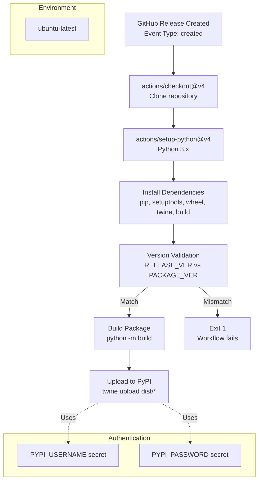
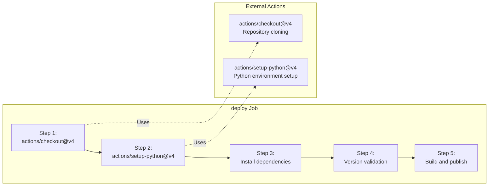
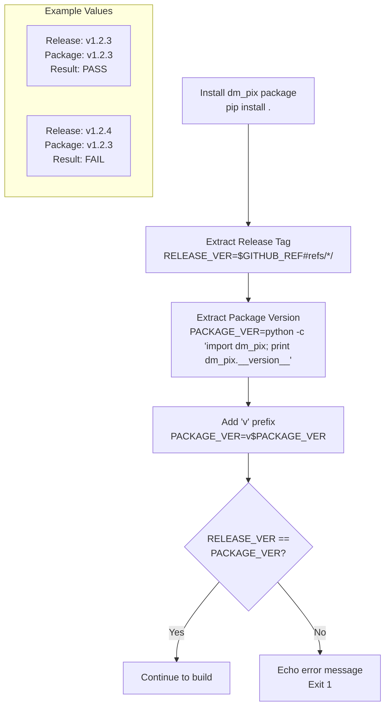
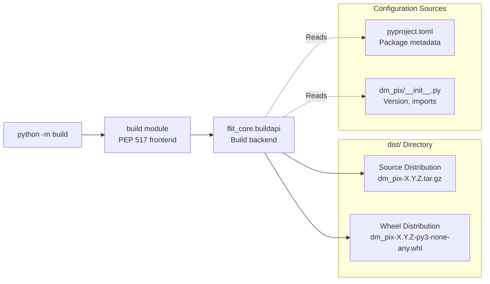
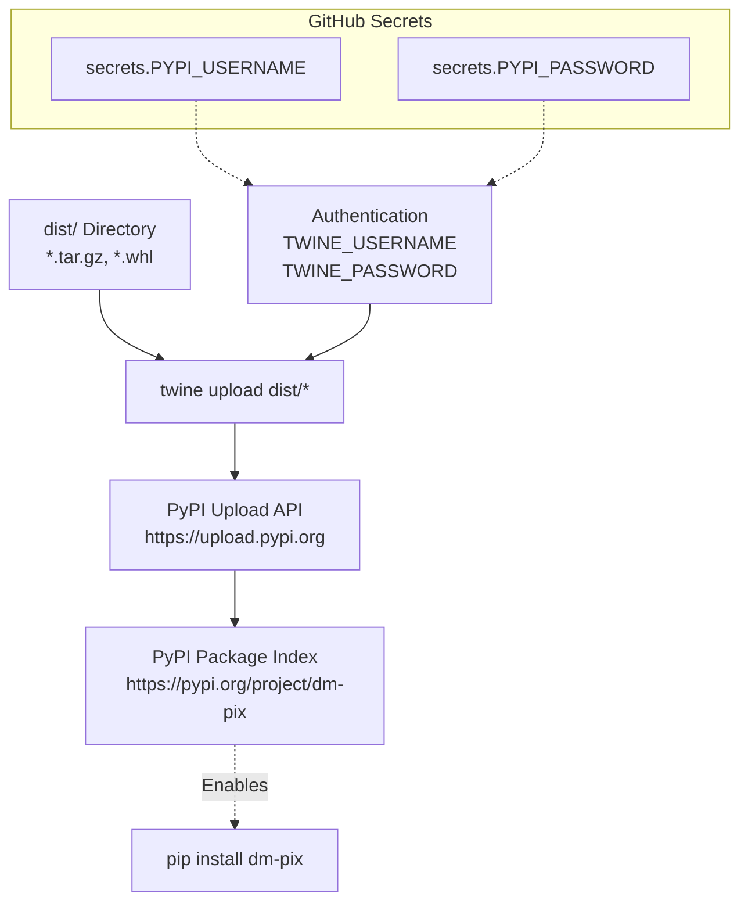
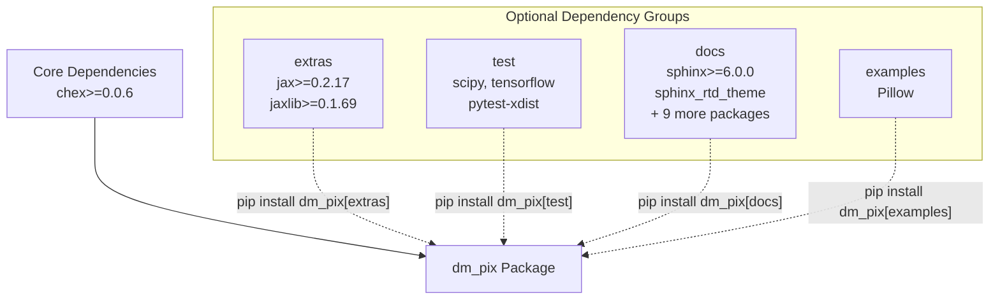
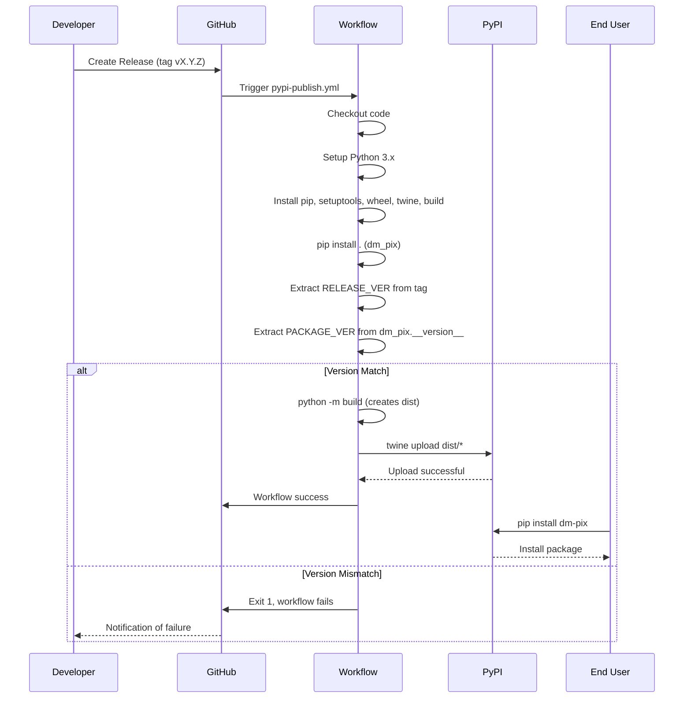

<!-- source: DeepWiki mcp.deepwiki.com · repo google-deepmind/dm_pix · page 8.2 PyPI Publishing Workflow · fetched 2026-10-26 -->

# PyPI Publishing Workflow

<details>
<summary>Relevant source files</summary>

The following files were used as context for generating this wiki page:

- [.github/workflows/ci.yml](.github/workflows/ci.yml)
- [.github/workflows/pypi-publish.yml](.github/workflows/pypi-publish.yml)
- [pyproject.toml](pyproject.toml)

</details>


## Purpose and Scope

This document describes the automated PyPI publishing workflow for dm_pix, which packages and distributes releases to the Python Package Index (PyPI). The workflow is triggered when a GitHub release is created and handles version validation, package building, and distribution upload.

For information about the continuous integration testing that occurs before release, see [Continuous Integration Workflow](#8.1). For general information about the release process and contribution workflow, see [Contributing to PIX](#11.1).

**Sources:** [.github/workflows/pypi-publish.yml:1-36]()

## Workflow Architecture

The PyPI publishing workflow is a fully automated GitHub Actions pipeline that executes on release creation. It validates version consistency, builds distribution artifacts using `flit_core`, and publishes to PyPI using `twine`.

### PyPI Publishing Pipeline



**Sources:** [.github/workflows/pypi-publish.yml:1-36]()

## Workflow Trigger Configuration

The workflow is triggered exclusively by GitHub release events with type `created`. This ensures that package publishing only occurs when an official release is intentionally created through the GitHub UI or API.

| Configuration | Value |
|--------------|-------|
| Workflow Name | `pypi` |
| Trigger Event | `release` |
| Event Type | `created` |
| Runner OS | `ubuntu-latest` |
| Python Version | `3.x` (latest 3.x release) |

The trigger configuration in [.github/workflows/pypi-publish.yml:3-5]() specifies:

```yaml
on:
  release:
    types: [created]
```

This means the workflow will not run on:
- Push events
- Pull request events  
- Draft releases
- Pre-releases (unless explicitly published)
- Release edits or deletions

**Sources:** [.github/workflows/pypi-publish.yml:3-5]()

## Workflow Job Structure

### Job Configuration and Actions



The workflow consists of a single job named `deploy` that runs on `ubuntu-latest`. Each step is executed sequentially, with failure at any step halting the entire workflow.

**Sources:** [.github/workflows/pypi-publish.yml:7-36]()

## Dependency Installation

The workflow installs the following dependencies before building and publishing:

| Package | Purpose |
|---------|---------|
| `pip` | Package installer, upgraded to latest version |
| `setuptools` | Build system utilities |
| `wheel` | Wheel distribution format support |
| `twine` | Secure PyPI upload utility |
| `build` | PEP 517 build frontend |

Installation commands in [.github/workflows/pypi-publish.yml:17-19]():

```bash
python -m pip install --upgrade pip
pip install setuptools wheel twine build
```

These tools work in conjunction with the `flit_core` build backend specified in [pyproject.toml:2-3]():

```toml
[build-system]
requires = ["flit_core >=3.2,<4"]
build-backend = "flit_core.buildapi"
```

**Sources:** [.github/workflows/pypi-publish.yml:17-19](), [pyproject.toml:1-3]()

## Version Validation

The workflow includes a critical validation step that ensures the release tag matches the package version. This prevents accidental publishing of incorrect versions.

### Version Extraction and Comparison



The validation logic in [.github/workflows/pypi-publish.yml:20-28]() performs these operations:

1. **Install Package:** Installs dm_pix from the current repository state
2. **Extract Release Version:** Parses `GITHUB_REF` environment variable to get the release tag
3. **Extract Package Version:** Imports dm_pix and reads `__version__` attribute
4. **Prepend Prefix:** Adds 'v' prefix to package version for comparison
5. **Compare:** Checks equality and exits with error code 1 if mismatched

Example validation output on failure:
```
package ver. (v1.2.3) != release ver. (v1.2.4)
```

This step ensures that the version declared in [dm_pix/_src/__init__.py]() (which defines `__version__`) matches the GitHub release tag.

**Sources:** [.github/workflows/pypi-publish.yml:20-28]()

## Build Process

The build process uses Python's PEP 517 build frontend via the `build` module, which interfaces with the `flit_core` build backend.

### Build System Architecture



The build command in [.github/workflows/pypi-publish.yml:34]() is:

```bash
python -m build
```

This generates two distribution artifacts in the `dist/` directory:
- **Source distribution (sdist):** `.tar.gz` format containing source code
- **Built distribution (wheel):** `.whl` format for faster installation

`flit_core` reads configuration from [pyproject.toml:5-33](), including:
- Package name: `dm_pix`
- Version: Dynamically extracted from `dm_pix/__version__`
- Dependencies: `chex>=0.0.6`
- Python requirement: `>=3.8`
- Classifiers and metadata

**Sources:** [.github/workflows/pypi-publish.yml:34](), [pyproject.toml:1-65]()

## PyPI Publishing

After successful build, the workflow uploads distribution artifacts to PyPI using `twine`.

### Twine Upload Configuration

| Parameter | Value | Source |
|-----------|-------|--------|
| Username | `TWINE_USERNAME` | GitHub secret: `PYPI_USERNAME` |
| Password | `TWINE_PASSWORD` | GitHub secret: `PYPI_PASSWORD` |
| Upload Target | PyPI (production) | Default twine repository |
| Artifacts | `dist/*` | All files in dist directory |

The upload command in [.github/workflows/pypi-publish.yml:35]():

```bash
twine upload dist/*
```

This uploads both the source distribution and wheel to PyPI's production index at https://pypi.org/project/dm-pix/.

### Publishing Flow



**Sources:** [.github/workflows/pypi-publish.yml:30-35]()

## Authentication and Secrets

The workflow uses GitHub repository secrets to authenticate with PyPI. These secrets must be configured by repository administrators with appropriate PyPI credentials.

### Required Secrets

| Secret Name | Environment Variable | Purpose |
|-------------|---------------------|---------|
| `PYPI_USERNAME` | `TWINE_USERNAME` | PyPI account username or `__token__` |
| `PYPI_PASSWORD` | `TWINE_PASSWORD` | PyPI account password or API token |

The secrets are exposed as environment variables in [.github/workflows/pypi-publish.yml:30-32]():

```yaml
env:
  TWINE_USERNAME: ${{ secrets.PYPI_USERNAME }}
  TWINE_PASSWORD: ${{ secrets.PYPI_PASSWORD }}
```

### Authentication Methods

PyPI supports two authentication methods:

1. **Username/Password:**
   - `TWINE_USERNAME`: PyPI account username
   - `TWINE_PASSWORD`: Account password

2. **API Token (Recommended):**
   - `TWINE_USERNAME`: `__token__`
   - `TWINE_PASSWORD`: PyPI API token (starts with `pypi-`)

API tokens are recommended as they can be scoped to specific projects and revoked independently.

**Sources:** [.github/workflows/pypi-publish.yml:30-35]()

## Package Metadata Configuration

The package metadata read during the build process is defined in `pyproject.toml`. This metadata appears on the PyPI project page and in package manifests.

### Project Metadata

| Field | Value | Line Reference |
|-------|-------|----------------|
| Package Name | `dm_pix` | [pyproject.toml:6]() |
| Description | "PIX is an image processing library in JAX, for JAX." | [pyproject.toml:8]() |
| Python Requirement | `>=3.8` | [pyproject.toml:11]() |
| License | Apache 2.0 (via LICENSE file) | [pyproject.toml:10]() |
| Author | Google DeepMind | [pyproject.toml:12-14]() |
| Contact Email | pix-dev@google.com | [pyproject.toml:13]() |

### PyPI Classifiers

The package includes 9 classifiers in [pyproject.toml:15-28]() that categorize the project on PyPI:

- **Development Status:** Beta
- **Audience:** Developers, Education, Science/Research
- **License:** Apache Software License
- **Language:** Python 3
- **Topics:** AI, Image Processing, Mathematics, Software Libraries

These classifiers enable users to discover dm_pix through PyPI's search and filtering features.

**Sources:** [pyproject.toml:5-28]()

## Dependencies and Optional Extras

The package declares a minimal core dependency and several optional dependency groups.

### Dependency Configuration



**Core Dependencies** [pyproject.toml:29-33]():
- `chex>=0.0.6`: Always installed, provides testing utilities

**Optional Dependencies:**
- `extras`: JAX framework (not in core to allow user control of JAX version)
- `test`: Testing framework dependencies for contributors
- `docs`: Sphinx and documentation build tools
- `examples`: Image loading for example notebooks

This structure allows users to install only what they need:
```bash
pip install dm_pix              # Minimal install
pip install dm_pix[extras]      # With JAX
pip install dm_pix[test,docs]   # For development
```

**Sources:** [pyproject.toml:29-60]()

## Version Management

The package version is dynamically extracted by `flit_core` from the `__version__` attribute in the package's `__init__.py` file.

### Version Source

The `dynamic = ["version"]` declaration in [pyproject.toml:7]() instructs `flit_core` to read the version from [dm_pix/_src/__init__.py]() rather than hardcoding it in `pyproject.toml`.

This approach:
- **Ensures single source of truth:** Version is defined once in Python code
- **Simplifies releases:** No need to update multiple files
- **Enables runtime version checks:** Code can access `dm_pix.__version__`
- **Supports validation:** Workflow can import and verify version

The version must follow [PEP 440](https://peps.python.org/pep-0440) format (e.g., `1.2.3`, `0.1.0`, `2.0.0rc1`).

**Sources:** [pyproject.toml:7](), [.github/workflows/pypi-publish.yml:24]()

## Workflow Execution Summary

### Complete Workflow Steps



The workflow executes the following sequence:

1. **Trigger:** GitHub release created
2. **Setup:** Clone repository, configure Python 3.x
3. **Preparation:** Install build and upload tools
4. **Validation:** Check release tag matches package version
5. **Build:** Generate source distribution and wheel
6. **Publish:** Upload artifacts to PyPI with authentication
7. **Completion:** Package available for `pip install`

The entire process is automated and typically completes in 1-2 minutes if all validation passes.

**Sources:** [.github/workflows/pypi-publish.yml:1-36]()

## Error Handling and Failure Modes

The workflow can fail at several stages, each requiring different remediation steps:

| Failure Point | Cause | Error Message | Resolution |
|--------------|-------|---------------|------------|
| Version Validation | Tag doesn't match `__version__` | "package ver. (vX.Y.Z) != release ver. (vA.B.C)" | Update version in code or delete/recreate release |
| Build | Invalid `pyproject.toml` or missing files | Build error from `flit_core` | Fix configuration, push changes, recreate release |
| Authentication | Invalid PyPI credentials | `twine` authentication error | Update `PYPI_USERNAME` and `PYPI_PASSWORD` secrets |
| Upload | Package version already exists | "File already exists" error | Increment version number, cannot overwrite existing releases |
| Network | PyPI unavailable | Connection timeout or 5xx errors | Retry workflow manually |

Version conflicts are the most common failure mode. The validation step in [.github/workflows/pypi-publish.yml:20-28]() prevents publishing incorrect versions by catching mismatches early.

**Sources:** [.github/workflows/pypi-publish.yml:20-28](), [.github/workflows/pypi-publish.yml:30-35]()

---

