# Page: PIX Overview

# PIX Overview

<details>
<summary>Relevant source files</summary>

The following files were used as context for generating this wiki page:

- [README.md](README.md)
- [dm_pix/__init__.py](dm_pix/__init__.py)
- [dm_pix/images/pix_logo.png](dm_pix/images/pix_logo.png)
- [pyproject.toml](pyproject.toml)

</details>


## Purpose and Scope

This document introduces **dm_pix**, a JAX-based image processing library designed for machine learning workflows. It covers the library's purpose, architecture, module organization, and design principles. For detailed information about the public API structure and function organization, see [Public API Organization](#1.1). For installation procedures and dependency setup, see [Installation and Setup](#1.2).

## What is dm_pix?

dm_pix is an image processing library built on top of [JAX](https://github.com/jax-ml/jax) that provides image manipulation functions optimized for high-performance machine learning research. The library exposes functions that can be seamlessly integrated with JAX transformations:

- **`jax.jit`** - Just-in-time compilation for performance optimization
- **`jax.vmap`** - Automatic vectorization for batch processing  
- **`jax.pmap`** - Multi-device parallelization for distributed computing

All functions in dm_pix are designed as pure functions that operate on JAX arrays, making them fully compatible with JAX's functional programming paradigm and automatic differentiation capabilities.

**Current Version:** `0.4.4` ([dm_pix/__init__.py:23]())

Sources: [README.md:1-20](), [dm_pix/__init__.py:14-23]()

## High-Level Architecture

dm_pix implements a **facade pattern** where a single public API module ([dm_pix/__init__.py]()) re-exports functionality from six internal implementation modules located in the `_src` directory. This design hides implementation details while providing a clean, flat namespace for users.

### Module Organization

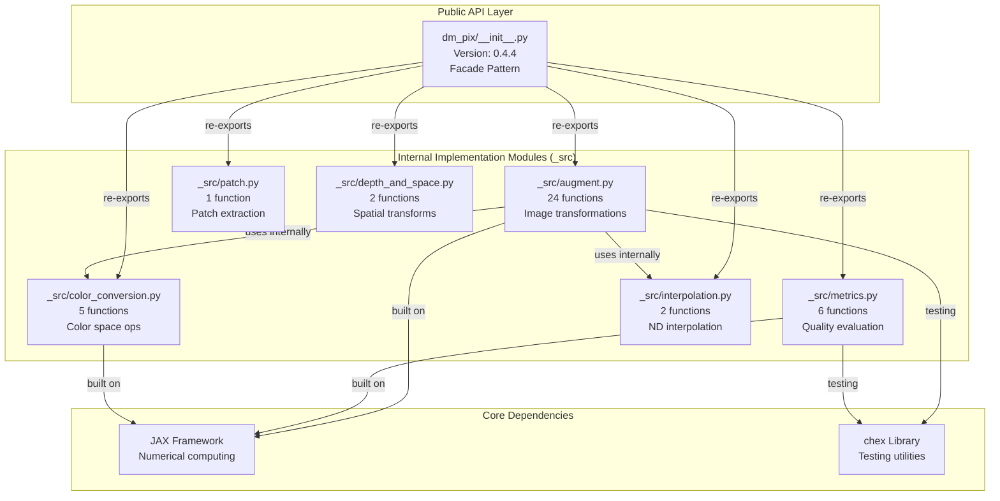

**Diagram: dm_pix Module Architecture and Dependencies**

The public API explicitly deletes internal module references after re-exporting to prevent direct access to `_src` internals ([dm_pix/__init__.py:78]()). A warning message in the source code emphasizes this: "Please don't use symbols in `_src` they are not part of the PIX public API" ([dm_pix/__init__.py:123-131]()).

Sources: [dm_pix/__init__.py:16-78]()

## Core Modules and Function Inventory

The following table summarizes the six implementation modules and their exported functionality:

| Module | Exported Functions | Primary Purpose |
|--------|-------------------|-----------------|
| `augment` | 24 | Image augmentation operations (color adjustments, geometric transforms, filters) |
| `metrics` | 6 | Image quality metrics (MAE, MSE, PSNR, RMSE, SSIM, SIMSE) |
| `color_conversion` | 5 | Color space conversions (RGB↔HSV, RGB↔HSL, RGB→Grayscale) |
| `patch` | 1 | Patch extraction from images |
| `depth_and_space` | 2 | Channel-spatial dimension rearrangement |
| `interpolation` | 2 | N-dimensional linear interpolation |

**Total Public API Surface:** 40 functions exposed through `dm_pix.__all__` ([dm_pix/__init__.py:80-121]())

For comprehensive documentation of each module, see:
- Image augmentation: [Image Augmentation Module](#2)
- Quality metrics: [Image Quality Metrics](#3)
- Color operations: [Color Space Conversions](#4)
- Other utilities: [Additional Core Modules](#5)

Sources: [dm_pix/__init__.py:25-76](), [dm_pix/__init__.py:80-121]()

## Public API Function Mapping

The following diagram shows how public API functions map to their internal module implementations:

```mermaid
graph LR
    subgraph "Augmentation Functions (augment.py)"
        A1["adjust_brightness"]
        A2["adjust_contrast"]
        A3["adjust_gamma"]
        A4["adjust_hue"]
        A5["adjust_saturation"]
        A6["affine_transform"]
        A7["center_crop"]
        A8["elastic_deformation"]
        A9["flip_left_right"]
        A10["flip_up_down"]
        A11["gaussian_blur"]
        A12["pad_to_size"]
        A13["random_brightness"]
        A14["random_contrast"]
        A15["random_crop"]
        A16["random_flip_left_right"]
        A17["random_flip_up_down"]
        A18["random_gamma"]
        A19["random_hue"]
        A20["random_saturation"]
        A21["resize_with_crop_or_pad"]
        A22["rotate"]
        A23["rot90"]
        A24["solarize"]
    end
    
    subgraph "Color Functions (color_conversion.py)"
        C1["hsl_to_rgb"]
        C2["hsv_to_rgb"]
        C3["rgb_to_hsl"]
        C4["rgb_to_hsv"]
        C5["rgb_to_grayscale"]
    end
    
    subgraph "Metric Functions (metrics.py)"
        M1["mae"]
        M2["mse"]
        M3["psnr"]
        M4["rmse"]
        M5["simse"]
        M6["ssim"]
    end
    
    subgraph "Other Functions"
        O1["depth_to_space<br/>(depth_and_space.py)"]
        O2["space_to_depth<br/>(depth_and_space.py)"]
        O3["extract_patches<br/>(patch.py)"]
        O4["flat_nd_linear_interpolate<br/>(interpolation.py)"]
        O5["flat_nd_linear_interpolate_constant<br/>(interpolation.py)"]
    end
```

**Diagram: Public API Function Categories**

Sources: [dm_pix/__init__.py:25-76]()

## Dependency Model

dm_pix has an unusual dependency configuration due to JAX's platform-specific installation requirements. The library is written in pure Python but depends on C++ code via JAX ([README.md:23]()).

### Core Dependencies

**Required:**
- `chex>=0.0.6` - Testing and assertion utilities ([pyproject.toml:30]())

**Optional (but essential):**
- `jax>=0.2.17` - Not listed in `dependencies` but required for all functionality
- `jaxlib>=0.1.69` - Platform-specific JAX backend

The JAX dependencies are commented out in `pyproject.toml` ([pyproject.toml:31-32]()) and instead listed in `[project.optional-dependencies.extras]` ([pyproject.toml:36-39]()). This allows users to install the correct JAX variant for their CUDA version before installing dm_pix.

### Optional Dependencies

```python
# Test dependencies (pyproject.toml:40-44)
test = [
    "scipy",           # Reference implementations for validation
    "tensorflow",      # Reference implementations for validation  
    "pytest-xdist",    # Parallel test execution
]

# Documentation dependencies (pyproject.toml:45-57)
docs = [
    "sphinx>=6.0.0",
    "sphinx_rtd_theme",
    "sphinxcontrib-katex",
    "sphinx-autodoc-typehints",
    "myst_nb",
    "matplotlib",
    # ... and others
]

# Example dependencies (pyproject.toml:58-60)
examples = [
    "Pillow",          # Image I/O for examples
]
```

Sources: [README.md:23-36](), [pyproject.toml:29-60]()

## Design Principles

### 1. Pure Functional Design

All dm_pix functions are implemented as pure functions with no side effects. This design enables:
- **Composability**: Functions can be chained and combined
- **JAX Transformation Compatibility**: Works with `jit`, `vmap`, `pmap`
- **Automatic Differentiation**: Functions are differentiable where mathematically valid

### 2. Array Format Conventions

Images in dm_pix follow consistent format conventions:
- **Data Type**: Float arrays (typically `float32`)
- **Value Range**: `[0, 1]` for RGB channels
- **Shape Format**: `(H, W, C)` or `(N, H, W, C)` where:
  - `H` = height, `W` = width, `C` = channels, `N` = batch size

### 3. JAX Transformation Examples

The README demonstrates all three major JAX transformations ([README.md:67-91]()):

```python
import dm_pix as pix
import jax

image = load_image()  # Shape: (H, W, C)

# Vanilla function call
result = pix.flip_left_right(image)

# JIT compilation
result = jax.jit(pix.flip_left_right)(image)

# Vectorized batch processing
images = image[np.newaxis, ...]  # Shape: (1, H, W, C)
result = jax.vmap(pix.flip_left_right)(images)

# Multi-device parallelization
result = jax.pmap(pix.flip_left_right)(images)
```

### 4. Internal Module Isolation

The `_src` directory pattern isolates implementation details:
- Public API surface remains stable
- Internal refactoring doesn't break user code
- Clear separation between public and private interfaces

The `__init__.py` explicitly deletes internal module references ([dm_pix/__init__.py:78]()) and includes a cow ASCII art warning about not using `_src` symbols ([dm_pix/__init__.py:123-131]()).

Sources: [README.md:12-20](), [README.md:67-96](), [dm_pix/__init__.py:78](), [dm_pix/__init__.py:123-136]()

## Typical Usage Pattern

The following diagram illustrates a common image processing pipeline using dm_pix functions:

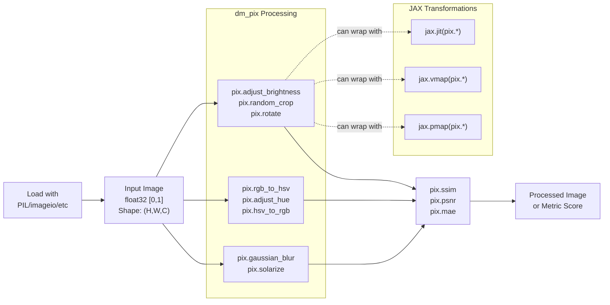

**Diagram: Typical dm_pix Processing Pipeline**

Sources: [README.md:38-96]()

## Integration with JAX Ecosystem

dm_pix is part of the [DeepMind JAX Ecosystem](https://deepmind.com/blog/article/using-jax-to-accelerate-our-research), a collection of libraries designed to accelerate ML research. For JAX integration details including performance optimization strategies, see [JAX Integration](#6).

Key integration points:
- **JIT Compilation**: See [JIT Compilation](#6.1)
- **Vectorization**: See [Vectorization with vmap](#6.2)
- **Parallelization**: See [Parallelization with pmap](#6.3)

Sources: [README.md:124-127]()

## Quick Start Example

From the README, here's the simplest usage example ([README.md:38-61]()):

```python
import dm_pix as pix

# Load an image into a NumPy array with your preferred library
image = load_image()

# Apply transformation
flip_left_right_image = pix.flip_left_right(image)
```

All functions maintain consistent behavior across JAX transformations, with results identical up to floating-point precision ([README.md:93-95]()).

For more examples including Jupyter notebooks, see [Examples and Usage Patterns](#10).

Sources: [README.md:38-96]()

## Repository Structure Overview

```
dm_pix/
├── __init__.py              # Public API facade
├── _src/                    # Internal implementations
│   ├── augment.py          # 24 augmentation functions
│   ├── metrics.py          # 6 quality metrics
│   ├── color_conversion.py # 5 color space functions
│   ├── patch.py            # Patch extraction
│   ├── depth_and_space.py  # Spatial transforms
│   └── interpolation.py    # ND interpolation
├── *_test.py               # Test files for each module
└── images/                 # Logo and assets
```

The `_src` directory is intentionally excluded from the public API namespace. The `__init__.py` includes explicit cleanup code to prevent accidental usage ([dm_pix/__init__.py:133-136]()).

Sources: [dm_pix/__init__.py:16-22](), [pyproject.toml:62-64]()

## Testing and Quality Assurance

dm_pix includes a comprehensive test suite that validates:
- **Correctness**: Comparison against TensorFlow and SciPy reference implementations
- **JAX Compatibility**: Testing with `chex.all_variants` for `jit`, `vmap`, `pmap`
- **Edge Cases**: NaN handling, boundary conditions, gradient stability

For detailed testing procedures, see [Testing and Quality Assurance](#7).

Sources: [README.md:103-122]()

## Documentation and Resources

- **Source Code**: https://github.com/google-deepmind/dm_pix
- **API Documentation**: https://dm-pix.readthedocs.io/
- **PyPI Package**: https://pypi.org/project/dm-pix/

For documentation system architecture, see [Documentation System](#9).

Sources: [README.md:7-9]()

## Version History

**Current Version**: `0.4.4` ([dm_pix/__init__.py:23]())

The version string is defined directly in the `__init__.py` module and is accessible as `dm_pix.__version__`.

Sources: [dm_pix/__init__.py:23]()

---

# Page: Public API Organization

# Public API Organization

<details>
<summary>Relevant source files</summary>

The following files were used as context for generating this wiki page:

- [dm_pix/__init__.py](dm_pix/__init__.py)
- [docs/api.rst](docs/api.rst)

</details>


## Purpose and Scope

This document describes the structure and organization of dm_pix's public API, explaining how internal modules are organized and exposed to users through a facade pattern. It covers the API surface area, module categorization, and the design principles that keep internal implementation details hidden from users.

For information about specific augmentation functions and their implementations, see [Image Augmentation Module](#2). For details about installation and initial setup, see [Installation and Setup](#1.2).

## API Facade Pattern

dm_pix implements a **facade pattern** in [`dm_pix/__init__.py`](dm_pix/__init__.py:1-137)() to provide a clean, flat public API while maintaining internal modularity. All implementation code resides in the `dm_pix._src` directory, but users interact exclusively with the top-level `dm_pix` namespace.

### Module Import and Re-export Architecture

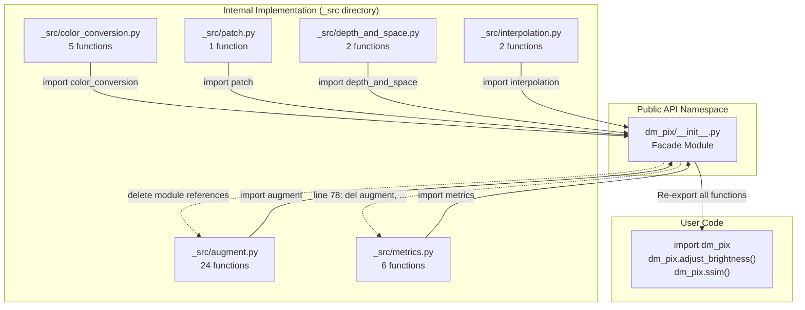

**Facade Implementation Pattern**

Sources: [dm_pix/__init__.py:16-22](dm_pix/__init__.py:16-22)(), [dm_pix/__init__.py:78](dm_pix/__init__.py:78)()

The facade pattern follows this three-step process:

1. **Import internal modules** from `_src` directory ([lines 16-21](dm_pix/__init__.py:16-21)())
2. **Re-export individual functions** by direct assignment ([lines 26-76](dm_pix/__init__.py:26-76)())
3. **Delete module references** to prevent direct access ([line 78](dm_pix/__init__.py:78)())

```python
# Step 1: Import
from dm_pix._src import augment
from dm_pix._src import metrics

# Step 2: Re-export
adjust_brightness = augment.adjust_brightness
ssim = metrics.ssim

# Step 3: Clean up
del augment, metrics
```

This ensures users cannot access `dm_pix._src` directly, enforcing API stability.

Sources: [dm_pix/__init__.py:16-78](dm_pix/__init__.py:16-78)()

## Module Organization and Categories

The public API organizes 40 functions into six logical categories, each corresponding to an internal module:

| Category | Internal Module | Function Count | Lines in __init__.py |
|----------|----------------|----------------|---------------------|
| Augmentations | `augment` | 24 | [26-49](dm_pix/__init__.py:26-49)() |
| Metrics | `metrics` | 6 | [68-73](dm_pix/__init__.py:68-73)() |
| Color conversions | `color_conversion` | 5 | [52-56](dm_pix/__init__.py:52-56)() |
| Interpolation | `interpolation` | 2 | [63-65](dm_pix/__init__.py:63-65)() |
| Depth/space transforms | `depth_and_space` | 2 | [59-60](dm_pix/__init__.py:59-60)() |
| Patch extraction | `patch` | 1 | [76](dm_pix/__init__.py:76)() |

Sources: [dm_pix/__init__.py:1-137](dm_pix/__init__.py:1-137)()

### Function Categories Mapped to Code Entities


Sources: [dm_pix/__init__.py:26-76](dm_pix/__init__.py:26-76)()

## Public API Definition

### The __all__ Tuple

The public API is formally defined in the `__all__` tuple at [lines 80-121](dm_pix/__init__.py:80-121)(). This tuple:

- **Lists all 40 public functions** in alphabetical order
- **Controls wildcard imports** (`from dm_pix import *`)
- **Serves as API contract** for documentation and testing
- **Enables API coverage validation** (see [API Documentation Structure](#9.3))

The `__all__` tuple is the authoritative source of truth for what constitutes the dm_pix public API.

Sources: [dm_pix/__init__.py:80-121](dm_pix/__init__.py:80-121)()

### Augmentation Functions

The augmentation category is the largest, comprising 24 of the 40 public functions ([lines 26-49](dm_pix/__init__.py:26-49)()). These functions follow a naming pattern:

**Deterministic Functions** (14 functions):
- Color adjustments: `adjust_brightness`, `adjust_contrast`, `adjust_gamma`, `adjust_hue`, `adjust_saturation`
- Geometric transforms: `affine_transform`, `center_crop`, `flip_left_right`, `flip_up_down`, `rotate`, `rot90`
- Filters/effects: `gaussian_blur`, `pad_to_size`, `solarize`
- Layout operations: `resize_with_crop_or_pad`, `elastic_deformation`

**Stochastic Functions** (10 functions):
- Random variants: `random_brightness`, `random_contrast`, `random_gamma`, `random_hue`, `random_saturation`
- Random geometric: `random_flip_left_right`, `random_flip_up_down`, `random_crop`

For detailed documentation of these functions, see [Image Augmentation Module](#2).

Sources: [dm_pix/__init__.py:26-49](dm_pix/__init__.py:26-49)(), [docs/api.rst:1-152](docs/api.rst:1-152)()

### Metrics Functions

Six image quality and similarity metrics ([lines 68-73](dm_pix/__init__.py:68-73)()):

| Function | Description | Documentation |
|----------|-------------|---------------|
| `mae` | Mean Absolute Error | [docs/api.rst:246-249](docs/api.rst:246-249)() |
| `mse` | Mean Squared Error | [docs/api.rst:251-254](docs/api.rst:251-254)() |
| `rmse` | Root Mean Squared Error | [docs/api.rst:261-264](docs/api.rst:261-264)() |
| `psnr` | Peak Signal-to-Noise Ratio | [docs/api.rst:256-259](docs/api.rst:256-259)() |
| `ssim` | Structural Similarity Index | [docs/api.rst:271-274](docs/api.rst:271-274)() |
| `simse` | Structural Information MSE | [docs/api.rst:266-269](docs/api.rst:266-269)() |

For implementation details, see [Image Quality Metrics](#3).

Sources: [dm_pix/__init__.py:68-73](dm_pix/__init__.py:68-73)(), [docs/api.rst:233-274](docs/api.rst:233-274)()

### Color Conversion Functions

Five bidirectional color space transformations ([lines 52-56](dm_pix/__init__.py:52-56)()):

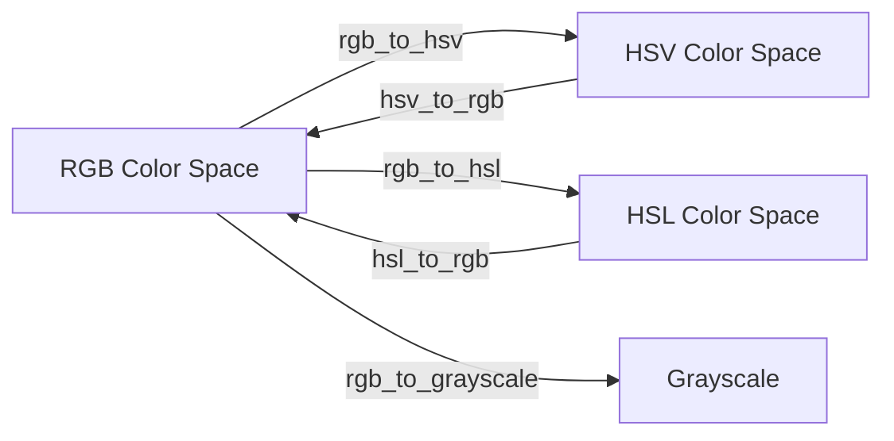

**Available Conversions:**
- `rgb_to_hsv` / `hsv_to_rgb` - RGB ↔ Hue-Saturation-Value
- `rgb_to_hsl` / `hsl_to_rgb` - RGB ↔ Hue-Saturation-Lightness  
- `rgb_to_grayscale` - RGB → Grayscale (one-way)

For conversion algorithms and use cases, see [Color Space Conversions](#4).

Sources: [dm_pix/__init__.py:52-56](dm_pix/__init__.py:52-56)(), [docs/api.rst:155-191](docs/api.rst:155-191)()

### Interpolation Functions

Two N-dimensional linear interpolation functions ([lines 63-65](dm_pix/__init__.py:63-65)()):

- `flat_nd_linear_interpolate` - Standard ND interpolation
- `flat_nd_linear_interpolate_constant` - Constant boundary variant

These functions support the geometric transformations in the augmentation module. For technical details, see [ND Linear Interpolation](#5.2).

Sources: [dm_pix/__init__.py:63-65](dm_pix/__init__.py:63-65)(), [docs/api.rst:213-230](docs/api.rst:213-230)()

### Depth and Space Functions

Two channel-spatial dimension rearrangement functions ([lines 59-60](dm_pix/__init__.py:59-60)()):

- `depth_to_space` - Move depth dimension to spatial dimensions
- `space_to_depth` - Move spatial dimensions to depth dimension

For implementation and use cases, see [Depth and Space Transforms](#5.3).

Sources: [dm_pix/__init__.py:59-60](dm_pix/__init__.py:59-60)(), [docs/api.rst:193-210](docs/api.rst:193-210)()

### Patch Extraction Functions

One function for extracting patches from images ([line 76](dm_pix/__init__.py:76)()):

- `extract_patches` - TensorFlow-compatible patch extraction

For details on patch extraction, see [Patch Extraction](#5.1).

Sources: [dm_pix/__init__.py:76](dm_pix/__init__.py:76)(), [docs/api.rst:277-288](docs/api.rst:277-288)()

## Version Management

The library version is defined as a module constant at [line 23](dm_pix/__init__.py:23)():

```python
__version__ = "0.4.4"
```

This version string:
- Follows semantic versioning (MAJOR.MINOR.PATCH)
- Is accessible via `dm_pix.__version__`
- Is used by the PyPI publishing workflow (see [PyPI Publishing Workflow](#8.2))
- Must be manually updated before releases

Sources: [dm_pix/__init__.py:23](dm_pix/__init__.py:23)()

## Internal Module Hiding

### The _src Directory Pattern

All implementation code resides in `dm_pix._src`, following Python's convention that underscore-prefixed modules are private. The facade enforces this in two ways:

**1. Module Deletion** ([line 78](dm_pix/__init__.py:78)()):
```python
del augment, color_conversion, depth_and_space, interpolation, metrics, patch
```

After re-exporting functions, the module references are deleted, preventing:
```python
import dm_pix
dm_pix.augment.adjust_brightness()  # AttributeError: no attribute 'augment'
```

**2. _src Cleanup** ([lines 133-136](dm_pix/__init__.py:133-136)()):
```python
try:
  del _src  # pylint: disable=undefined-variable
except NameError:
  pass
```

This attempts to delete any `_src` attribute that might exist, though this is primarily defensive programming since the import statement `from dm_pix._src import X` doesn't create an `_src` attribute.

### User Warning

The module includes an ASCII art warning at [lines 123-132](dm_pix/__init__.py:123-132)():

```
#  _________________________________________
# / Please don't use symbols in `_src` they \
# \ are not part of the PIX public API.     /
#  -----------------------------------------
#         \   ^__^
#          \  (oo)\_______
#             (__)\       )\/\
#                 ||----w |
#                 ||     ||
```

This serves as documentation for developers reading the source code that `_src` is internal-only.

Sources: [dm_pix/__init__.py:78](dm_pix/__init__.py:78)(), [dm_pix/__init__.py:123-136](dm_pix/__init__.py:123-136)()

## API Documentation Correspondence

The public API structure in `__init__.py` corresponds directly to the documentation structure in `docs/api.rst`:

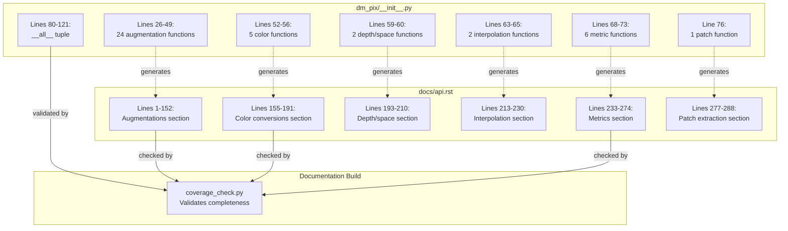

The `coverage_check.py` Sphinx extension ensures that every function in `__all__` is documented in `api.rst`. For details on the documentation system, see [Documentation System](#9).

Sources: [dm_pix/__init__.py:80-121](dm_pix/__init__.py:80-121)(), [docs/api.rst:1-289](docs/api.rst:1-289)()

## Summary Table: Public API Surface

| Module Category | Internal Module | Function Count | Public API Lines | Documentation Lines |
|----------------|-----------------|----------------|------------------|---------------------|
| Augmentations | `_src/augment` | 24 | [26-49](dm_pix/__init__.py:26-49)() | [1-152](docs/api.rst:1-152)() |
| Metrics | `_src/metrics` | 6 | [68-73](dm_pix/__init__.py:68-73)() | [233-274](docs/api.rst:233-274)() |
| Color conversions | `_src/color_conversion` | 5 | [52-56](dm_pix/__init__.py:52-56)() | [155-191](docs/api.rst:155-191)() |
| Interpolation | `_src/interpolation` | 2 | [63-65](dm_pix/__init__.py:63-65)() | [213-230](docs/api.rst:213-230)() |
| Depth/space | `_src/depth_and_space` | 2 | [59-60](dm_pix/__init__.py:59-60)() | [193-210](docs/api.rst:193-210)() |
| Patch extraction | `_src/patch` | 1 | [76](dm_pix/__init__.py:76)() | [277-288](docs/api.rst:277-288)() |
| **Total** | **6 modules** | **40 functions** | **51 lines** | **289 lines** |

Sources: [dm_pix/__init__.py:1-137](dm_pix/__init__.py:1-137)(), [docs/api.rst:1-289](docs/api.rst:1-289)()

---

# Page: Installation and Setup

# Installation and Setup

<details>
<summary>Relevant source files</summary>

The following files were used as context for generating this wiki page:

- [README.md](README.md)
- [dm_pix/images/pix_logo.png](dm_pix/images/pix_logo.png)
- [pyproject.toml](pyproject.toml)

</details>


## Purpose and Scope

This document provides comprehensive instructions for installing and configuring dm_pix for use in your environment. It covers the mandatory JAX dependency installation, the dm_pix package installation, optional dependencies for testing and development, and verification procedures. For information about the overall system architecture and public API organization, see [PIX Overview](#1) and [Public API Organization](#1.1).

## Prerequisites

dm_pix requires the following system prerequisites:

| Requirement | Minimum Version | Notes |
|------------|----------------|-------|
| Python | 3.8 | Specified in [pyproject.toml:11]() |
| pip | Latest stable | For package installation |
| Virtual environment tool | Any | Recommended: venv, virtualenv, or conda |

**Important**: dm_pix is written in pure Python but depends on C++ code via JAX. The installation process requires careful attention to JAX setup, as JAX installation varies based on your accelerator configuration (CPU, CUDA, TPU).

**Sources**: [pyproject.toml:11](), [README.md:23-27]()

## Dependency Architecture

```mermaid
graph TB
    subgraph "User Environment"
        PYTHON["Python >=3.8"]
        VENV["Virtual Environment<br/>(recommended)"]
    end
    
    subgraph "Core Dependencies"
        JAX["jax>=0.2.17<br/>jaxlib>=0.1.69<br/>(NOT auto-installed)"]
        CHEX["chex>=0.0.6<br/>(auto-installed)"]
    end
    
    subgraph "dm_pix Package"
        PIX["dm-pix<br/>(PyPI package)"]
    end
    
    subgraph "Optional Dependencies"
        TEST["Test Dependencies<br/>scipy, tensorflow<br/>pytest-xdist"]
        DOCS["Documentation<br/>sphinx, sphinx_rtd_theme<br/>sphinxcontrib-*"]
        EXAMPLES["Examples<br/>Pillow"]
    end
    
    PYTHON --> VENV
    VENV --> JAX
    JAX --> PIX
    CHEX --> PIX
    
    PIX -.->|pip install -e '.[test]'| TEST
    PIX -.->|pip install -e '.[docs]'| DOCS
    PIX -.->|pip install -e '.[examples]'| EXAMPLES
    
    PIX -.->|imports| JAX
    PIX -.->|imports| CHEX
```

**Diagram**: Dependency installation hierarchy showing the critical JAX prerequisite and optional dependency groups.

**Sources**: [pyproject.toml:29-60](), [README.md:23-27]()

## JAX Installation (Critical First Step)

### Why JAX Must Be Installed Separately

JAX is **not** listed as an automatic dependency in dm_pix's [pyproject.toml:29-33]() because JAX installation differs based on hardware accelerators:

- **CPU-only**: Standard JAX installation
- **CUDA GPUs**: Requires CUDA-version-specific jaxlib builds
- **TPUs**: Requires TPU-specific jaxlib builds

The JAX dependency lines in [pyproject.toml:31-32]() are commented out for this reason:

```toml
# jax>=0.2.17
# jaxlib>=0.1.69
```

### Installation Workflow

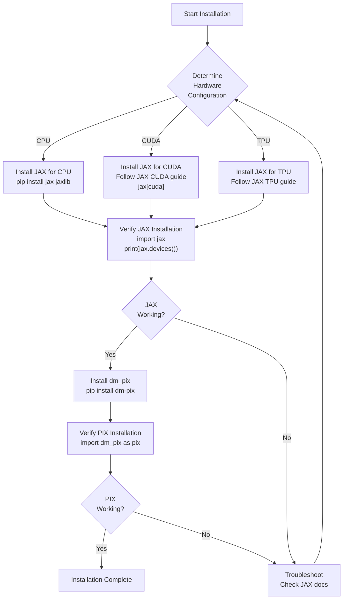

**Diagram**: Complete installation workflow showing JAX prerequisite verification before dm_pix installation.

**Sources**: [README.md:23-36]()

### JAX Installation Commands

Follow the [official JAX installation instructions](https://github.com/jax-ml/jax#installation) at the JAX repository. As referenced in [README.md:29-30](), the installation method depends on your configuration:

**CPU-only installation**:
```bash
pip install jax jaxlib
```

**CUDA GPU installation** (example for CUDA 11.x):
```bash
pip install "jax[cuda11_pip]" -f https://storage.googleapis.com/jax-releases/jax_cuda_releases.html
```

**TPU installation** (on Google Cloud TPU):
```bash
pip install "jax[tpu]" -f https://storage.googleapis.com/jax-releases/libtpu_releases.html
```

**Sources**: [README.md:29-30]()

## dm_pix Installation

Once JAX is successfully installed and verified, install dm_pix from PyPI:

```bash
pip install dm-pix
```

This command installs:
- The `dm_pix` Python package
- The `chex>=0.0.6` dependency (automatically, as specified in [pyproject.toml:30]())

The package is built using the flit build system as defined in [pyproject.toml:1-3]().

### Package Metadata

The installed package has the following metadata from [pyproject.toml:6-28]():

| Attribute | Value |
|-----------|-------|
| Package name | `dm_pix` |
| Distribution name (PyPI) | `dm-pix` |
| Python version requirement | `>=3.8` |
| Development status | Beta |
| License | Apache 2.0 |

**Sources**: [README.md:32-36](), [pyproject.toml:1-33]()

## Optional Dependencies

dm_pix defines three optional dependency groups in [pyproject.toml:35-60]():

### Test Dependencies (`test`)

Required for running the test suite:

```bash
pip install -e ".[test]"
```

Installs:
- `scipy` - Reference implementations for validation (see [Reference Implementation Validation](#7.2))
- `tensorflow` - Reference implementations for validation
- `pytest-xdist` - Parallel test execution

**Usage**: Enables running tests with `pytest` as described in [README.md:109-115]().

### Documentation Dependencies (`docs`)

Required for building documentation locally:

```bash
pip install -e ".[docs]"
```

Installs:
- `sphinx>=6.0.0` - Documentation generator
- `sphinx_rtd_theme` - ReadTheDocs theme
- `sphinxcontrib-katex` - Math rendering
- `sphinxcontrib-bibtex` - Bibliography support
- `sphinx-autodoc-typehints` - Type hint documentation
- `IPython`, `ipykernel` - Notebook support
- `pandoc`, `myst_nb` - Markdown notebook support
- `matplotlib` - Plotting for documentation

See [Documentation System](#9) for details on the documentation build process.

### Examples Dependencies (`examples`)

Required for running example scripts and notebooks:

```bash
pip install -e ".[examples]"
```

Installs:
- `Pillow` - Image loading/saving library

**Usage**: Enables running examples in the `examples/` directory as mentioned in [README.md:97-101]().

### Multiple Optional Groups

Install multiple dependency groups simultaneously:

```bash
pip install -e ".[test,examples]"
```

**Sources**: [pyproject.toml:35-60](), [README.md:109-115]()

## Dependency Resolution Matrix

The following table shows which dependencies are installed for each configuration:

| Dependency | Base Install | `[test]` | `[docs]` | `[examples]` |
|------------|--------------|----------|----------|--------------|
| `chex>=0.0.6` | ✓ | ✓ | ✓ | ✓ |
| `jax>=0.2.17` | Manual | Manual | Manual | Manual |
| `jaxlib>=0.1.69` | Manual | Manual | Manual | Manual |
| `scipy` | ✗ | ✓ | ✗ | ✗ |
| `tensorflow` | ✗ | ✓ | ✗ | ✗ |
| `pytest-xdist` | ✗ | ✓ | ✗ | ✗ |
| `sphinx>=6.0.0` | ✗ | ✗ | ✓ | ✗ |
| `Pillow` | ✗ | ✗ | ✗ | ✓ |

**Sources**: [pyproject.toml:29-60]()

## Verifying Installation

### Basic Import Verification

After installation, verify that dm_pix is correctly installed:

```python
import dm_pix as pix
print(pix.__version__)
```

As shown in [README.md:40-41](), the package is imported using the `dm_pix` module name with conventional alias `pix`.

### Functional Verification

Test a basic operation as demonstrated in [README.md:50-57]():

```python
import dm_pix as pix
import jax.numpy as jnp

# Create a test image (random data)
image = jnp.ones((100, 100, 3))

# Test a simple augmentation function
flipped = pix.flip_left_right(image)
print(f"Original shape: {image.shape}")
print(f"Flipped shape: {flipped.shape}")
```

Expected output:
```
Original shape: (100, 100, 3)
Flipped shape: (100, 100, 3)
```

### JAX Transformation Verification

Verify that dm_pix functions work with JAX transformations as shown in [README.md:67-91]():

```python
import dm_pix as pix
import jax
import jax.numpy as jnp

image = jnp.ones((100, 100, 3))

# Test jax.jit compilation
jitted_flip = jax.jit(pix.flip_left_right)
result = jitted_flip(image)
print(f"JIT compilation: {'✓' if result.shape == image.shape else '✗'}")

# Test jax.vmap vectorization
batch_images = jnp.ones((4, 100, 100, 3))
vmapped_flip = jax.vmap(pix.flip_left_right)
batch_result = vmapped_flip(batch_images)
print(f"vmap vectorization: {'✓' if batch_result.shape == batch_images.shape else '✗'}")
```

Expected output:
```
JIT compilation: ✓
vmap vectorization: ✓
```

**Sources**: [README.md:40-95]()

## Development Setup

### Editable Installation

For development and contribution, install dm_pix in editable mode:

```bash
# Clone the repository
git clone https://github.com/google-deepmind/dm_pix.git
cd dm_pix

# Install in editable mode with test dependencies
pip install -e ".[test]"
```

The editable installation (`-e` flag) allows you to modify source code without reinstalling the package.

### Running Tests

Two methods are available for running tests:

**Method 1: Using pytest directly** (as shown in [README.md:109-115]()):
```bash
# Install test dependencies
pip install -e ".[test]"

# Run all tests
python -m pytest dm_pix

# Run tests in parallel using all available CPUs
python -m pytest -n auto dm_pix

# Run tests in parallel with specific CPU count
python -m pytest -n 4 dm_pix
```

**Method 2: Using the test script** (as shown in [README.md:117-122]()):
```bash
# Creates isolated virtual environment and runs tests
./test.sh
```

The [test.sh]() script provides an isolated environment for testing.

### File System Structure

After installation, the dm_pix package structure matches the repository layout:

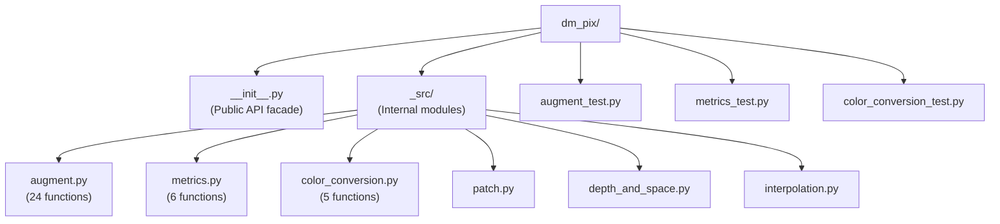

**Diagram**: Package file structure showing the public API layer and internal `_src` modules.

**Sources**: [README.md:117-122](), [pyproject.toml:62-65]()

## Common Installation Issues

### Issue: JAX Not Found

**Symptom**:
```
ModuleNotFoundError: No module named 'jax'
```

**Solution**: Install JAX first (see [JAX Installation](#jax-installation-critical-first-step))

### Issue: Incorrect JAX Version for Hardware

**Symptom**: JAX installed but not detecting GPU/TPU

**Solution**: Reinstall JAX with correct accelerator support. Follow JAX installation guide for your specific hardware configuration.

### Issue: Test Dependencies Missing

**Symptom**:
```
ModuleNotFoundError: No module named 'scipy'
```

**Solution**: Install test dependencies:
```bash
pip install -e ".[test]"
```

### Issue: Build System Errors

**Symptom**: Installation fails during package build

**Solution**: Ensure build system dependencies are available:
```bash
pip install --upgrade pip setuptools wheel
pip install flit_core
```

**Sources**: [pyproject.toml:1-3](), [README.md:23-27]()

## Virtual Environment Recommendations

It is strongly recommended to use a virtual environment for dm_pix installation:

**Using venv** (Python 3.8+):
```bash
python -m venv dm_pix_env
source dm_pix_env/bin/activate  # On Unix/macOS
# dm_pix_env\Scripts\activate  # On Windows

pip install dm-pix
```

**Using conda**:
```bash
conda create -n dm_pix_env python=3.9
conda activate dm_pix_env
pip install dm-pix
```

Virtual environments prevent dependency conflicts with other Python projects and ensure reproducible installations.

**Sources**: [pyproject.toml:11](), [README.md:117-122]()

## Next Steps

After successful installation:

1. Review the [Public API Organization](#1.1) to understand available functions
2. Explore the [Image Augmentation Module](#2) for data augmentation capabilities
3. Check [Image Quality Metrics](#3) for evaluation functions
4. Read [JAX Integration](#6) to learn about optimization with `jit`, `vmap`, and `pmap`
5. Try the [Examples and Usage Patterns](#10) for practical demonstrations

For contributing to dm_pix development, see the [Developer Guide](#11).

**Sources**: [README.md:1-151](), [pyproject.toml:1-65]()

---

# Page: Image Augmentation Module

# Image Augmentation Module

<details>
<summary>Relevant source files</summary>

The following files were used as context for generating this wiki page:

- [dm_pix/_src/augment.py](dm_pix/_src/augment.py)
- [dm_pix/_src/augment_test.py](dm_pix/_src/augment_test.py)

</details>


## Purpose and Scope

The image augmentation module ([dm_pix/_src/augment.py]()) is the largest and most important component of dm_pix, with an importance score of 29.69 and containing 24 distinct augmentation functions. This module provides a comprehensive set of tools for applying transformations to images during training or inference, including color adjustments, geometric transformations, and filtering effects.

This page documents the overall architecture, design patterns, and conventions used throughout the augmentation module. For detailed information on specific function categories, see:
- Color adjustment functions: [Color Adjustments](#2.1)
- Geometric transformation functions: [Geometric Transformations](#2.2)
- Filter and effect functions: [Filters and Effects](#2.3)
- Random augmentation design pattern: [Random Augmentation Pattern](#2.4)

For information on how augmentation functions integrate with JAX transformations, see [JAX Integration](#6).

**Sources:** [dm_pix/_src/augment.py:1-32]()

---

## Module Architecture

The augmentation module organizes its 24 functions into three logical categories and maintains dependencies on two internal modules for specialized operations. The diagram below shows the high-level organization:

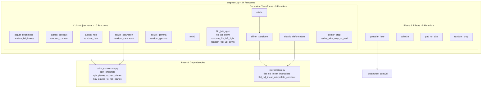

**Function Distribution:**
| Category | Count | Examples |
|----------|-------|----------|
| Color Adjustments | 10 | `adjust_brightness`, `adjust_contrast`, `adjust_hue`, `adjust_saturation`, `adjust_gamma` + random variants |
| Geometric Transforms | 9 | `affine_transform`, `rotate`, `rot90`, `flip_left_right`, `flip_up_down`, `elastic_deformation`, `center_crop`, `resize_with_crop_or_pad` + random variants |
| Filters & Effects | 5 | `gaussian_blur`, `solarize`, `pad_to_size`, `random_crop` |

**Sources:** [dm_pix/_src/augment.py:1-1040](), [dm_pix/_src/augment.py:22-29]()

---

## Input and Output Conventions

All augmentation functions follow consistent conventions for image representation and processing:

### Image Encoding

Images must be **float-encoded** with pixel values in the range **[0, 1]**. This is explicitly documented at the module level:

[dm_pix/_src/augment.py:14-20]()

```python
"""This module provides image augmentation functions.

All functions expect float-encoded images, with values in [0, 1].
Do not clip their outputs to this range to allow chaining without losing
information. The outside-of-bounds behavior is (as much as possible) similar to
that of TensorFlow.
"""
```

### Output Behavior

Importantly, **outputs are not clipped** to the [0, 1] range. This design decision allows multiple augmentations to be chained without losing information through intermediate clipping. Users should clip the final result if needed for their specific use case.

### Image Format Support

Functions support both channel-last and channel-first image formats:

| Format | Shape | Description |
|--------|-------|-------------|
| HWC (channels-last) | `(height, width, channels)` | Default format, `channel_axis=-1` |
| CHW (channels-first) | `(channels, height, width)` | Alternative format, `channel_axis=-3` or `0` |
| NHWC (batched) | `(batch, height, width, channels)` | Batch with channels-last |
| NCHW (batched) | `(batch, channels, height, width)` | Batch with channels-first |

The `channel_axis` parameter (default: `-1`) controls interpretation of the image format. Internal helper function `_channels_last()` determines the format:

[dm_pix/_src/augment.py:931-936]()

**Sources:** [dm_pix/_src/augment.py:14-20](), [dm_pix/_src/augment.py:931-936](), [dm_pix/_src/augment.py:1009-1040]()

---

## Function Organization by Category

### Overview Diagram

The following diagram maps specific function names to their categories and shows the data flow pattern:

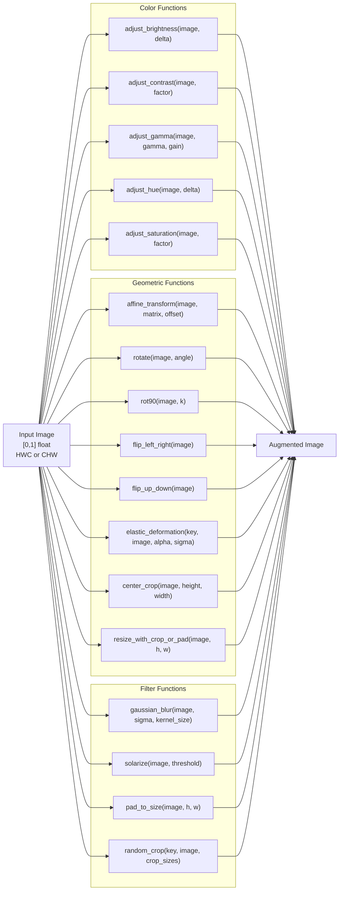

Each category has distinct characteristics:

**Color Adjustments** ([Color Adjustments](#2.1)) modify pixel values to change brightness, contrast, hue, saturation, or apply gamma correction. These operations work in the value domain and some require color space conversions.

**Geometric Transformations** ([Geometric Transformations](#2.2)) modify the spatial arrangement of pixels through rotation, flipping, affine transformations, elastic deformations, cropping, and padding. These often require interpolation to sample pixel values at non-integer coordinates.

**Filters and Effects** ([Filters and Effects](#2.3)) apply convolution-based filters (blur) or threshold-based effects (solarization), as well as spatial resizing operations.

**Sources:** [dm_pix/_src/augment.py:34-929]()

---

## Design Patterns

### Deterministic and Random Variants

The module follows a consistent pattern where many augmentation functions come in two flavors:

1. **Deterministic functions**: Take explicit parameters and produce reproducible results
2. **Random functions**: Wrap deterministic functions with random parameter sampling

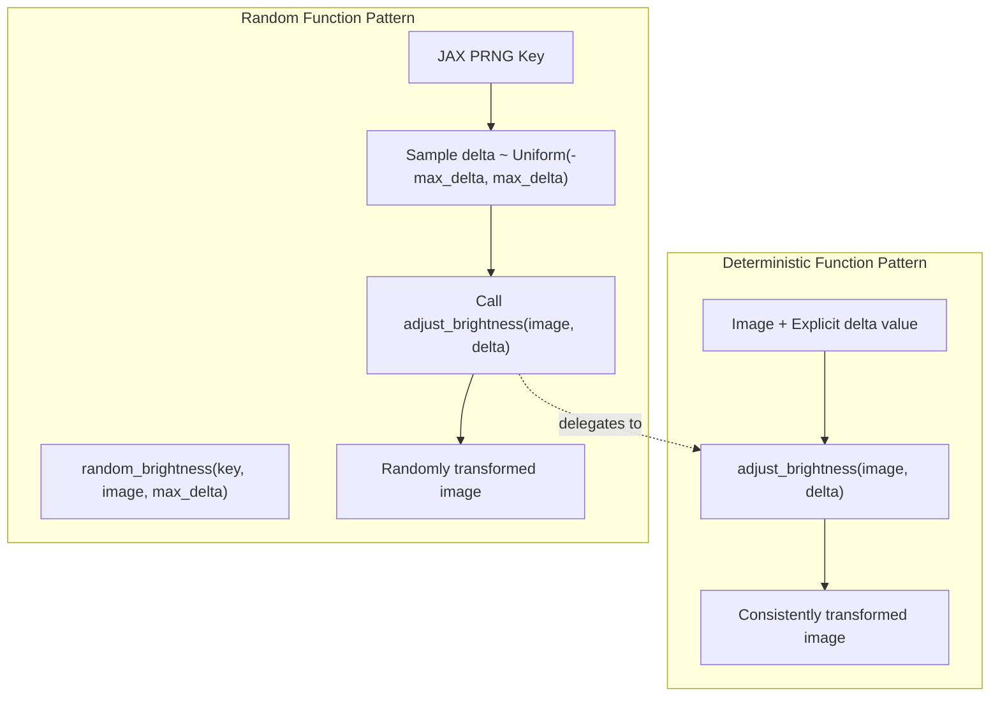

**Example Implementation:** The `random_brightness` function demonstrates this pattern:

[dm_pix/_src/augment.py:815-824]()

**Random Function Naming Convention:**
| Deterministic | Random Variant |
|---------------|----------------|
| `adjust_brightness` | `random_brightness` |
| `adjust_contrast` | `random_contrast` |
| `adjust_gamma` | `random_gamma` |
| `adjust_hue` | `random_hue` |
| `adjust_saturation` | `random_saturation` |
| `flip_left_right` | `random_flip_left_right` |
| `flip_up_down` | `random_flip_up_down` |

For detailed information on the random augmentation pattern and PRNG key usage, see [Random Augmentation Pattern](#2.4).

**Sources:** [dm_pix/_src/augment.py:815-824](), [dm_pix/_src/augment.py:767-813](), [dm_pix/_src/augment.py:827-886]()

---

## JAX Integration and Transformations

All augmentation functions are designed to be compatible with JAX's core transformations: `jax.jit`, `jax.vmap`, and `jax.pmap`. This compatibility is extensively tested in the test suite.

### Transformation Testing

The test suite includes specialized test classes to verify transformation compatibility:

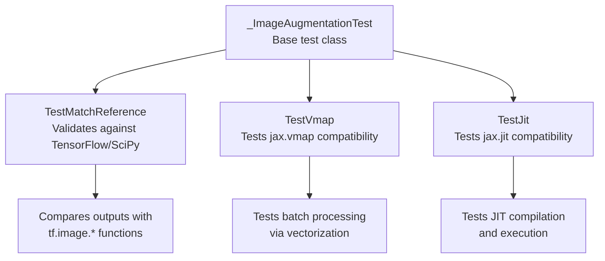

**Test Coverage Examples:**

| Test Class | Purpose | Key Methods |
|------------|---------|-------------|
| `TestMatchReference` | Validates correctness against reference implementations | `_test_fn()`, `_test_fn_with_random_arg()` |
| `TestVmap` | Ensures functions work with `jax.vmap` for batch processing | Tests stacking and vectorization |
| `TestJit` | Verifies JIT compilation compatibility | Tests compilation and execution consistency |

**Sources:** [dm_pix/_src/augment_test.py:428-509](), [dm_pix/_src/augment_test.py:35-426]()

### Practical JAX Usage

Functions can be directly composed with JAX transformations:

```python
# JIT compilation for performance
blur_jitted = jax.jit(dm_pix.gaussian_blur)

# Vectorization for batch processing
rotate_batch = jax.vmap(dm_pix.rotate, in_axes=(0, None))

# Parallel execution across devices
parallel_flip = jax.pmap(dm_pix.flip_left_right)
```

For comprehensive documentation on JAX integration patterns, see [JAX Integration](#6).

**Sources:** [dm_pix/_src/augment_test.py:456-509]()

---

## Internal Utilities

The augmentation module includes several internal utility functions that support the public API:

### Helper Functions

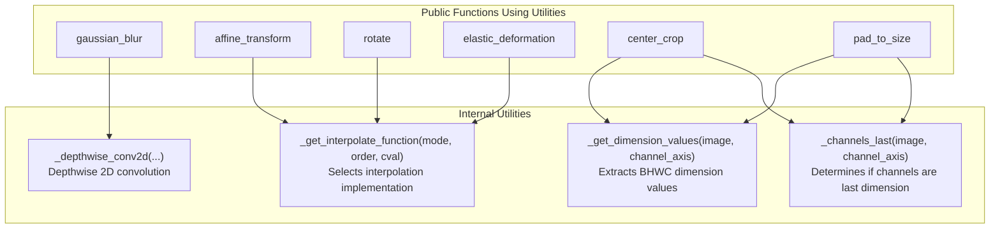

### Key Utility Descriptions

**`_channels_last(image, channel_axis)`** [dm_pix/_src/augment.py:931-936]()
- Determines whether the channel dimension is the last axis
- Returns boolean indicating format (HWC vs CHW)
- Used throughout the module to handle both formats correctly

**`_depthwise_conv2d(...)`** [dm_pix/_src/augment.py:938-970]()
- Implements depthwise 2D convolution using `jax.lax.conv_general_dilated`
- Used by `gaussian_blur` for separable convolution
- Supports both NHWC and NCHW formats via `dimension_numbers`

**`_get_interpolate_function(mode, order, cval)`** [dm_pix/_src/augment.py:972-1006]()
- Selects the appropriate interpolation implementation based on parameters
- Prefers fast PIX interpolation when possible (modes: "nearest", "constant"; order: 1)
- Falls back to `jax.scipy.ndimage.map_coordinates` for other modes ("wrap", "mirror", "reflect") or orders

**Interpolation Selection Logic:**
| Mode | Order | Implementation |
|------|-------|----------------|
| "nearest" | 1 | `interpolation.flat_nd_linear_interpolate` |
| "constant" | 1 | `interpolation.flat_nd_linear_interpolate_constant` |
| Others | Any | `jax.scipy.ndimage.map_coordinates` |

**`_get_dimension_values(image, channel_axis)`** [dm_pix/_src/augment.py:1009-1040]()
- Extracts shape values in consistent BHWC order
- Handles both single images (3D) and batches (4D)
- Returns tuple: `(batch, height, width, channel)` where `batch` is `None` for single images

**Sources:** [dm_pix/_src/augment.py:931-936](), [dm_pix/_src/augment.py:938-970](), [dm_pix/_src/augment.py:972-1006](), [dm_pix/_src/augment.py:1009-1040]()

---

## Dependencies

The augmentation module has two key internal dependencies:

### Color Conversion Module

Used by hue and saturation adjustment functions to perform RGB ↔ HSV color space conversions:


**Functions using color conversion:**
- `adjust_hue` [dm_pix/_src/augment.py:110-136]()
- `adjust_saturation` [dm_pix/_src/augment.py:139-164]()

For details on color conversion operations, see [Color Space Conversions](#4).

### Interpolation Module

Used by geometric transformation functions to sample pixel values at non-integer coordinates:

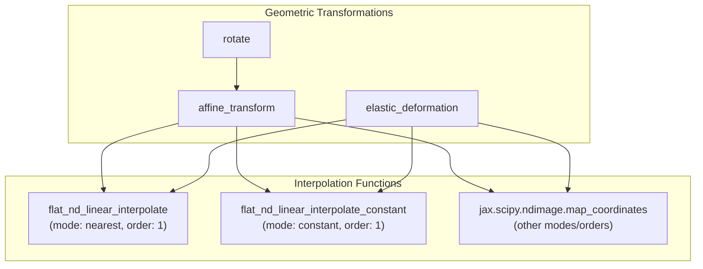

**Functions using interpolation:**
- `affine_transform` [dm_pix/_src/augment.py:572-726]()
- `rotate` [dm_pix/_src/augment.py:728-764]()
- `elastic_deformation` [dm_pix/_src/augment.py:167-254]()

For details on interpolation methods, see [ND Linear Interpolation](#5.2).

**Sources:** [dm_pix/_src/augment.py:26-27](), [dm_pix/_src/augment.py:110-136](), [dm_pix/_src/augment.py:139-164](), [dm_pix/_src/augment.py:572-726](), [dm_pix/_src/augment.py:728-764](), [dm_pix/_src/augment.py:167-254]()

---

## Testing Strategy

The augmentation module has the most comprehensive test coverage in dm_pix, with an importance score of 15.61 for the test file. The testing strategy employs three validation approaches:

### Three-Pronged Validation

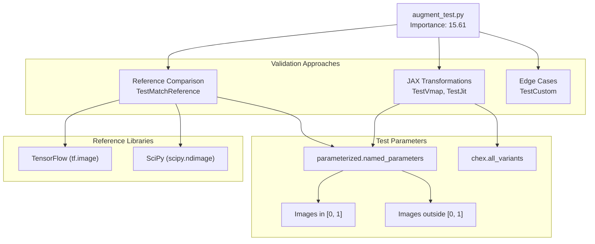

**Test Statistics:**
- Total test file lines: 566
- Test images: 10 random images per range (in-range and out-of-range)
- Image dimensions: (131, 111, 3)
- Tolerance: 1e-4 (CPU/GPU), 1e-2 (TPU)

**Sources:** [dm_pix/_src/augment_test.py:1-566](), [dm_pix/_src/augment_test.py:27-32](), [dm_pix/_src/augment_test.py:428-509]()

---

# Page: Color Adjustments

# Color Adjustments

<details>
<summary>Relevant source files</summary>

The following files were used as context for generating this wiki page:

- [dm_pix/_src/augment.py](dm_pix/_src/augment.py)
- [dm_pix/_src/augment_test.py](dm_pix/_src/augment_test.py)

</details>


This page documents the color adjustment functions in the augmentation module, which provide 10 functions (5 deterministic and 5 random variants) for modifying color properties of images. These functions operate on RGB images and support brightness, contrast, gamma, hue, and saturation adjustments. All functions are JAX-compatible and can be used with `jit`, `vmap`, and `pmap` transformations.

For geometric transformations such as rotation and flipping, see [Geometric Transformations](#2.2). For other effects like blur and solarization, see [Filters and Effects](#2.3). For the design pattern of random augmentation wrappers, see [Random Augmentation Pattern](#2.4).

## Overview

The color adjustment subsystem consists of paired deterministic and stochastic functions. Each deterministic function applies a specific transformation with user-provided parameters, while its random counterpart samples parameters from a specified range using JAX PRNG keys.

**Sources:** [dm_pix/_src/augment.py:14-20](), [dm_pix/_src/augment.py:34-885]()

## Function Categories

The color adjustment functions are organized into three operational categories based on the color space and mathematical operations they employ:

| Function Pair | Color Space | Operation Type | Parameter Range | Lines |
|---------------|-------------|----------------|-----------------|-------|
| `adjust_brightness` / `random_brightness` | RGB | Additive shift | Any float | [34-48](), [815-824]() |
| `adjust_contrast` / `random_contrast` | RGB | Multiplicative around mean | Any float | [51-76](), [858-870]() |
| `adjust_gamma` / `random_gamma` | RGB | Power function | Positive float | [79-107](), [827-841]() |
| `adjust_hue` / `random_hue` | HSV | Hue rotation | [-1.0, 1.0] | [110-136](), [844-855]() |
| `adjust_saturation` / `random_saturation` | HSV | Saturation scaling | [0.0, ∞) | [139-164](), [873-885]() |

**Sources:** [dm_pix/_src/augment.py:34-885]()

## Architecture and Dependencies

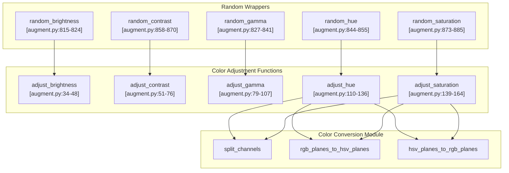

**Sources:** [dm_pix/_src/augment.py:26-27](), [dm_pix/_src/augment.py:110-164]()

## Deterministic Color Adjustment Functions

### adjust_brightness

Applies an additive shift to all RGB channels equally. This function is equivalent to `tf.image.adjust_brightness`.

**Function Signature:**
```python
def adjust_brightness(image: chex.Array, delta: chex.Numeric) -> chex.Array
```

**Mathematical Operation:**
```
output[i,j,c] = image[i,j,c] + delta
```

**Parameters:**
- `image`: RGB image as float tensor in [0, 1]
- `delta`: Additive shift value (any float)

**Returns:** Brightness-adjusted image (may be outside [0, 1] range)

**Implementation:** The function performs a simple element-wise addition after converting `delta` to the image's dtype. No clipping is applied to allow chaining transformations without information loss.

**Sources:** [dm_pix/_src/augment.py:34-48]()

### adjust_contrast

Adjusts contrast by scaling pixel deviations from the spatial mean. Equivalent to `tf.image.adjust_contrast`.

**Function Signature:**
```python
def adjust_contrast(
    image: chex.Array,
    factor: chex.Numeric,
    *,
    channel_axis: int = -1,
) -> chex.Array
```

**Mathematical Operation:**
```
mean = spatial_mean(image)
output = factor * (image - mean) + mean
```

**Parameters:**
- `image`: RGB image as float tensor in [0, 1]
- `factor`: Multiplicative contrast factor (any float)
- `channel_axis`: Index of channel axis (default: -1)

**Implementation Details:**
- Computes spatial mean over height and width dimensions ([augment.py:71-76]())
- Handles both channels-last (HWC) and channels-first (CHW) formats
- Preserves mean intensity while scaling deviations

**Sources:** [dm_pix/_src/augment.py:51-76]()

### adjust_gamma

Applies gamma correction using the formula `gain * image^gamma`. Equivalent to `tf.image.adjust_gamma`.

**Function Signature:**
```python
def adjust_gamma(
    image: chex.Array,
    gamma: chex.Numeric,
    *,
    gain: chex.Numeric = 1.,
    assume_in_bounds: bool = False,
) -> chex.Array
```

**Mathematical Operation:**
```
output = gain * image^gamma
```

**Parameters:**
- `image`: RGB image as float tensor in [0, 1]
- `gamma`: Exponent for power function (positive float)
- `gain`: Multiplicative gain factor (default: 1.0)
- `assume_in_bounds`: Skip input clipping if True (default: False)

**Safety Mechanism:** By default, inputs are clipped to [0, 1] to prevent NaN values from negative bases with non-integer exponents ([augment.py:104-105]()).

**Sources:** [dm_pix/_src/augment.py:79-107]()

### adjust_hue

Adjusts hue by rotating colors in HSV space. Equivalent to `tf.image.adjust_hue` on GPU (CPU behavior differs outside [0,1] range).

**Function Signature:**
```python
def adjust_hue(
    image: chex.Array,
    delta: chex.Numeric,
    *,
    channel_axis: int = -1,
) -> chex.Array
```

**Mathematical Operation:**
```
RGB → HSV
H' = (H + delta) mod 1.0
HSV' → RGB'
```

**Parameters:**
- `image`: RGB image as float tensor in [0, 1]
- `delta`: Additive hue shift in [0, 1] range (wraps around)
- `channel_axis`: Index of channel axis (default: -1)

**Implementation Flow:**

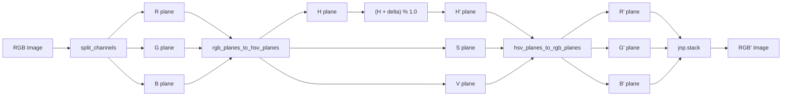

**Sources:** [dm_pix/_src/augment.py:110-136](), [dm_pix/_src/color_conversion.py]()

### adjust_saturation

Adjusts saturation by scaling the S component in HSV space. Equivalent to `tf.image.adjust_saturation`.

**Function Signature:**
```python
def adjust_saturation(
    image: chex.Array,
    factor: chex.Numeric,
    *,
    channel_axis: int = -1,
) -> chex.Array
```

**Mathematical Operation:**
```
RGB → HSV
S' = clip(S * factor, 0.0, 1.0)
HSV' → RGB'
```

**Parameters:**
- `image`: RGB image as float tensor in [0, 1]
- `factor`: Multiplicative saturation factor (any float)
- `channel_axis`: Index of channel axis (default: -1)

**Implementation Notes:**
- Saturation is explicitly clipped to [0, 1] after scaling ([augment.py:163]())
- Uses same color space conversion pipeline as `adjust_hue`
- Preserves hue and value components

**Sources:** [dm_pix/_src/augment.py:139-164]()

## Random Augmentation Wrappers

All random variants follow a consistent pattern: they accept a JAX PRNG key, sample parameters from specified ranges, and delegate to their deterministic counterparts. This design enables composable stochastic augmentation pipelines.

```mermaid
graph TB
    subgraph "Random Wrapper Pattern"
        key["JAX PRNGKey"] --> uniform["jax.random.uniform"]
        param_range["Parameter Range<br/>(min, max)"] --> uniform
        uniform --> sampled["Sampled Parameter"]
        image["Input Image"] --> det_fn["Deterministic Function"]
        sampled --> det_fn
        det_fn --> output["Output Image"]
    end
```

**Sources:** [dm_pix/_src/augment.py:815-885]()

### Parameter Sampling Ranges

| Function | Parameter Sampled | Sampling Range | Usage |
|----------|------------------|----------------|-------|
| `random_brightness` | `delta` | `[-max_delta, max_delta)` | [815-824]() |
| `random_contrast` | `factor` | `[lower, upper)` | [858-870]() |
| `random_gamma` | `gamma` | `[min_gamma, max_gamma)` | [827-841]() |
| `random_hue` | `delta` | `[-max_delta, max_delta)` | [844-855]() |
| `random_saturation` | `factor` | `[lower, upper)` | [873-885]() |

**Sources:** [dm_pix/_src/augment.py:815-885]()

### Example: random_brightness Implementation

```python
def random_brightness(
    key: chex.PRNGKey,
    image: chex.Array,
    max_delta: chex.Numeric,
) -> chex.Array:
  delta = jax.random.uniform(key, (), minval=-max_delta, maxval=max_delta)
  return adjust_brightness(image, delta)
```

This minimal wrapper pattern is repeated across all five random variants, ensuring consistent API design and behavior.

**Sources:** [dm_pix/_src/augment.py:815-824]()

## Input and Output Specifications

### Image Format Requirements

All color adjustment functions expect and return images in the following format:

**Input:**
- Type: `chex.Array` (JAX array)
- Data type: Float (typically `float32`)
- Value range: [0, 1] (RGB color space)
- Shape: `(..., H, W, C)` for channels-last or `(..., C, H, W)` for channels-first
- Channels: C=3 (RGB)

**Output:**
- Same type and shape as input
- Value range: **Not clipped** - may extend outside [0, 1]
- Rationale: Allows chaining transformations without information loss ([augment.py:16-19]())

**Sources:** [dm_pix/_src/augment.py:14-20]()

### Channel Axis Handling

Functions that require spatial operations (`adjust_contrast`, `adjust_hue`, `adjust_saturation`) accept a `channel_axis` parameter:

```python
channel_axis: int = -1  # Default: channels-last format
```

The internal helper `_channels_last()` determines the axis layout and adjusts operations accordingly:

```mermaid
graph TB
    input["Image Input"] --> check{"channel_axis == -1<br/>or channel_axis == ndim-1?"}
    check -->|Yes| channels_last["Channels-Last (HWC)"]
    check -->|No| channels_first["Channels-First (CHW)"]
    
    channels_last --> spatial_hwc["Spatial axes: (-3, -2)"]
    channels_first --> spatial_chw["Spatial axes: (-2, -1)"]
```

**Sources:** [dm_pix/_src/augment.py:931-935]()

## JAX Integration and Performance

### Transformation Compatibility

All color adjustment functions are designed to work seamlessly with JAX transformations:

**JIT Compilation:** All functions are jit-compatible with no restrictions:
```python
adjust_brightness_jit = jax.jit(dm_pix.adjust_brightness)
result = adjust_brightness_jit(image, delta=0.2)
```

**Vectorization:** Functions automatically vectorize over batch dimensions:
```python
adjust_brightness_batched = jax.vmap(dm_pix.adjust_brightness)
batch_results = adjust_brightness_batched(image_batch, deltas)
```

**Parallelization:** Compatible with `pmap` for multi-device execution.

**Sources:** [dm_pix/_src/augment_test.py:456-509]()

### Performance Characteristics

**RGB-space operations** (`adjust_brightness`, `adjust_contrast`, `adjust_gamma`):
- Direct array operations on RGB values
- No color space conversions required
- Minimal computational overhead
- Optimal for accelerator execution

**HSV-space operations** (`adjust_hue`, `adjust_saturation`):
- Require RGB↔HSV conversions ([augment.py:132-136](), [159-164]())
- More computationally intensive
- Depend on `color_conversion` module
- See [RGB-HSV Conversions](#4.1) for conversion details

**Sources:** [dm_pix/_src/augment.py:110-164]()

## Testing and Validation

### Reference Implementation Comparison

The color adjustment functions are validated against TensorFlow reference implementations to ensure correctness:

```mermaid
graph LR
    test_input["Test Image"] --> jax_fn["dm_pix Function"]
    test_input --> tf_fn["TensorFlow Reference"]
    
    jax_fn --> jax_output["JAX Output"]
    tf_fn --> tf_output["TF Output"]
    
    jax_output --> compare["assertAllCloseTolerant"]
    tf_output --> compare
    
    compare --> result{"Match?"}
```

**Test Coverage:**

| Function | Reference | Test Lines | In-Range Tests | Out-of-Range Tests |
|----------|-----------|------------|----------------|-------------------|
| `adjust_brightness` | `tf.image.adjust_brightness` | [51-66]() | ✓ | ✓ |
| `adjust_contrast` | `tf.image.adjust_contrast` | [67-81]() | ✓ | ✓ |
| `adjust_gamma` | `tf.image.adjust_gamma` | [83-96]() | ✓ | ✗ |
| `adjust_hue` | `tf.image.adjust_hue` | [127-141]() | ✓ | ✗* |
| `adjust_saturation` | `tf.image.adjust_saturation` | [97-124]() | ✓ | ✓** |

\* CPU TensorFlow uses different hue adjustment outside [0,1]  
\** Requires perturbation to avoid TensorFlow rounding bug

**Sources:** [dm_pix/_src/augment_test.py:51-141]()

### Test Strategy

The test suite employs three validation approaches:

1. **Reference Matching:** Compares output against TensorFlow/SciPy ([augment_test.py:428-454]())
2. **JAX Transformation Testing:** Validates jit and vmap compatibility ([augment_test.py:456-509]())
3. **Edge Case Testing:** Tests boundary conditions and parameter ranges

**Test Data:**
- `_RAND_FLOATS_IN_RANGE`: 10 images with values in [0, 1]
- `_RAND_FLOATS_OUT_OF_RANGE`: 10 images with values in [-0.5, 1.5]
- Image shape: (131, 111, 3)

**Sources:** [dm_pix/_src/augment_test.py:27-32]()

## Usage Examples

### Basic Color Adjustments

```python
import dm_pix as pix
import jax.numpy as jnp

# Load or create an RGB image in [0, 1] range
image = jnp.array(..., dtype=jnp.float32)

# Brighten image by adding 0.2
brighter = pix.adjust_brightness(image, delta=0.2)

# Increase contrast by 50%
higher_contrast = pix.adjust_contrast(image, factor=1.5)

# Apply gamma correction
gamma_corrected = pix.adjust_gamma(image, gamma=2.2)

# Shift hue by 0.5 (180 degrees)
hue_shifted = pix.adjust_hue(image, delta=0.5)

# Increase saturation by 30%
more_saturated = pix.adjust_saturation(image, factor=1.3)
```

### Stochastic Augmentation Pipeline

```python
import jax

# Initialize PRNG key
key = jax.random.PRNGKey(42)

# Split keys for multiple random operations
k1, k2, k3, k4, k5 = jax.random.split(key, 5)

# Apply random augmentations
augmented = image
augmented = pix.random_brightness(k1, augmented, max_delta=0.2)
augmented = pix.random_contrast(k2, augmented, lower=0.8, upper=1.2)
augmented = pix.random_gamma(k3, augmented, min_gamma=0.8, max_gamma=1.2)
augmented = pix.random_hue(k4, augmented, max_delta=0.1)
augmented = pix.random_saturation(k5, augmented, lower=0.9, upper=1.1)
```

### Batch Processing with vmap

```python
# Process batch of images with same parameters
adjust_fn = lambda img: pix.adjust_brightness(img, delta=0.3)
batched_adjust = jax.vmap(adjust_fn)
batch_results = batched_adjust(image_batch)

# Process batch with different parameters per image
def adjust_with_params(img, delta):
    return pix.adjust_brightness(img, delta)

batched_adjust_params = jax.vmap(adjust_with_params)
batch_results = batched_adjust_params(image_batch, deltas_array)
```

**Sources:** [dm_pix/_src/augment.py:34-885](), [dm_pix/_src/augment_test.py:456-486]()

## Color Space Dependencies

The hue and saturation adjustments require conversions between RGB and HSV color spaces, implemented in the `color_conversion` module:

```mermaid
graph TB
    subgraph "adjust_hue / adjust_saturation"
        input["RGB Image<br/>[0,1] float"] --> split["split_channels<br/>[color_conversion]"]
        split --> r["R plane"]
        split --> g["G plane"]
        split --> b["B plane"]
        
        r --> to_hsv["rgb_planes_to_hsv_planes<br/>[color_conversion]"]
        g --> to_hsv
        b --> to_hsv
        
        to_hsv --> h["H plane [0,1]"]
        to_hsv --> s["S plane [0,1]"]
        to_hsv --> v["V plane [0,1]"]
        
        h --> modify["Modify H or S"]
        s --> modify
        v --> modify
        
        modify --> h2["H' plane"]
        modify --> s2["S' plane"]
        modify --> v2["V' plane"]
        
        h2 --> to_rgb["hsv_planes_to_rgb_planes<br/>[color_conversion]"]
        s2 --> to_rgb
        v2 --> to_rgb
        
        to_rgb --> r2["R' plane"]
        to_rgb --> g2["G' plane"]
        to_rgb --> b2["B' plane"]
        
        r2 --> stack["jnp.stack<br/>channel_axis"]
        g2 --> stack
        b2 --> stack
        
        stack --> output["RGB' Image"]
    end
```

For detailed information on color space conversion algorithms, see:
- [RGB-HSV Conversions](#4.1) - Mathematical operations for RGB↔HSV transforms
- [RGB-HSL Conversions](#4.2) - Alternative HSL color space
- [Color Space Conversions](#4) - Overview of all conversion functions

**Sources:** [dm_pix/_src/augment.py:132-136](), [dm_pix/_src/augment.py:159-164](), [dm_pix/_src/color_conversion.py]()

## Compatibility Notes

### TensorFlow Equivalence

The functions maintain behavioral equivalence with TensorFlow image operations:

- `adjust_brightness` ≡ `tf.image.adjust_brightness`
- `adjust_contrast` ≡ `tf.image.adjust_contrast`
- `adjust_gamma` ≡ `tf.image.adjust_gamma`
- `adjust_hue` ≡ `tf.image.adjust_hue` (GPU mode)
- `adjust_saturation` ≡ `tf.image.adjust_saturation`

**Known Differences:**

1. **Hue adjustment out-of-range:** CPU TensorFlow uses a different method when all RGB values are outside [0,1] ([augment.py:118-120]())

2. **No automatic clipping:** Unlike TensorFlow, dm_pix functions do not clip outputs to [0,1] to enable lossless chaining ([augment.py:16-19]())

3. **Saturation TensorFlow bug:** TensorFlow has a rounding error when green and blue channels are very close but differ from red ([augment_test.py:100-106]())

**Sources:** [dm_pix/_src/augment.py:37](), [dm_pix/_src/augment.py:59](), [dm_pix/_src/augment.py:88](), [dm_pix/_src/augment.py:117](), [dm_pix/_src/augment.py:147](), [dm_pix/_src/augment_test.py:100-110]()

### Type Safety

All functions use `chex` type annotations for validation:
- `chex.Array` for image inputs/outputs
- `chex.Numeric` for scalar parameters (int or float)
- `chex.PRNGKey` for random functions

This enables runtime type checking when chex assertions are enabled.

**Sources:** [dm_pix/_src/augment.py:25]()

---

# Page: Geometric Transformations

# Geometric Transformations

<details>
<summary>Relevant source files</summary>

The following files were used as context for generating this wiki page:

- [dm_pix/_src/augment.py](dm_pix/_src/augment.py)
- [dm_pix/_src/augment_test.py](dm_pix/_src/augment_test.py)

</details>


## Purpose and Scope

This document covers the geometric transformation functions in the `dm_pix` augmentation module. Geometric transformations modify the spatial arrangement of pixels without changing their color values, including flipping, rotation, affine transforms, elastic deformation, and crop/pad operations.

For color-based augmentation functions (brightness, contrast, hue, saturation, gamma), see [Color Adjustments](#2.1). For image filtering operations (blur, solarization), see [Filters and Effects](#2.3).

All geometric transformation functions in this module:
- Support both HWC (channels-last) and CHW (channels-first) layouts via the `channel_axis` parameter
- Accept float-encoded images with values in [0, 1]
- Are compatible with JAX transformations (`jit`, `vmap`, `pmap`)
- Provide deterministic and stochastic (random) variants where applicable

**Sources:** [dm_pix/_src/augment.py:14-20](), [dm_pix/_src/augment.py:415-928]()

---

## Function Organization

The geometric transformation module contains 12 functions organized into four categories: flipping, rotation, affine/elastic transformations, and cropping/padding operations.

```mermaid
graph TB
    subgraph "Flipping Operations"
        FLR["flip_left_right"]
        FUD["flip_up_down"]
        RFLR["random_flip_left_right"]
        RFUD["random_flip_up_down"]
    end
    
    subgraph "Rotation Operations"
        ROT90["rot90"]
        ROTATE["rotate"]
    end
    
    subgraph "Affine and Elastic"
        AFFINE["affine_transform"]
        ELASTIC["elastic_deformation"]
    end
    
    subgraph "Crop and Pad"
        CCROP["center_crop"]
        PSIZE["pad_to_size"]
        RCWP["resize_with_crop_or_pad"]
        RCROP["random_crop"]
    end
    
    subgraph "Dependencies"
        INTERP["interpolation.flat_nd_linear_interpolate"]
        GBLUR["gaussian_blur"]
    end
    
    RFLR --> FLR
    RFUD --> FUD
    ROTATE --> AFFINE
    ELASTIC --> GBLUR
    ELASTIC --> INTERP
    AFFINE --> INTERP
    RCWP --> CCROP
    RCWP --> PSIZE
    
    style FLR fill:#f9f9f9
    style FUD fill:#f9f9f9
    style ROT90 fill:#f9f9f9
    style AFFINE fill:#e9e9e9
    style ROTATE fill:#e9e9e9
```

**Sources:** [dm_pix/_src/augment.py:415-928]()

---

## Flipping Operations

Flipping operations reverse the pixel order along the horizontal or vertical axis. These are the simplest geometric transformations, implemented using `jnp.flip`.

### flip_left_right

```python
flip_left_right(image: chex.Array, *, channel_axis: int = -1) -> chex.Array
```

Flips an image horizontally (along the width axis). For HWC images, this flips axis -2; for CHW images, axis -1.

| Parameter | Type | Description |
|-----------|------|-------------|
| `image` | `chex.Array` | Input image (HWC or CHW format) |
| `channel_axis` | `int` | Index of the channel axis (default: -1) |

**Implementation:** The function determines the correct axis based on channel layout and applies `jnp.flip` [dm_pix/_src/augment.py:415-438](). For channels-last layout (HWC), the width axis is -2; for channels-first (CHW), it is -1.

**Sources:** [dm_pix/_src/augment.py:415-438]()

### flip_up_down

```python
flip_up_down(image: chex.Array, *, channel_axis: int = -1) -> chex.Array
```

Flips an image vertically (along the height axis). For HWC images, this flips axis -3; for CHW images, axis -2.

| Parameter | Type | Description |
|-----------|------|-------------|
| `image` | `chex.Array` | Input image (HWC or CHW format) |
| `channel_axis` | `int` | Index of the channel axis (default: -1) |

**Sources:** [dm_pix/_src/augment.py:441-464]()

### Random Flip Variants

Both `random_flip_left_right` and `random_flip_up_down` accept a JAX PRNG key and a probability parameter (default 0.5). They use `jax.random.bernoulli` to decide whether to apply the flip, then use `jax.lax.cond` for conditional execution compatible with JIT compilation.

```mermaid
graph LR
    KEY["PRNG Key"] --> BERNOULLI["jax.random.bernoulli"]
    PROB["probability"] --> BERNOULLI
    BERNOULLI --> COND["jax.lax.cond"]
    COND --> FLIP["flip_left_right or flip_up_down"]
    COND --> IDENTITY["lambda x: x"]
    IMAGE["Input Image"] --> FLIP
    IMAGE --> IDENTITY
```

**Sources:** [dm_pix/_src/augment.py:767-812]()

---

## Rotation Operations

### rot90

```python
rot90(image: chex.Array, k: int = 1, *, channel_axis: int = -1) -> chex.Array
```

Rotates an image counter-clockwise by 90-degree increments. This is a fast, exact operation that transposes and flips axes without interpolation.

| Parameter | Type | Description |
|-----------|------|-------------|
| `image` | `chex.Array` | Input image (HWC or CHW format) |
| `k` | `int` | Number of 90-degree rotations (default: 1) |
| `channel_axis` | `int` | Index of the channel axis (default: -1) |

The function delegates to `jnp.rot90` with the appropriate spatial axes: (-3, -2) for HWC images, (-2, -1) for CHW images [dm_pix/_src/augment.py:527-552]().

**TensorFlow Equivalence:** This function is equivalent to `tf.image.rot90`.

**Sources:** [dm_pix/_src/augment.py:527-552]()

### rotate

```python
rotate(image: chex.Array, angle: float, *, order: int = 1, mode: str = "nearest", cval: float = 0.0) -> chex.Array
```

Rotates an image around its center by an arbitrary angle (in radians) using interpolation. This is a wrapper around `affine_transform` that constructs the appropriate rotation matrix and offset.

| Parameter | Type | Description |
|-----------|------|-------------|
| `image` | `chex.Array` | Input image (HWC or CHW format) |
| `angle` | `float` | Counter-clockwise rotation angle in radians |
| `order` | `int` | Interpolation order (0 or 1, default: 1) |
| `mode` | `str` | Boundary mode ("nearest", "constant", etc., default: "nearest") |
| `cval` | `float` | Fill value for "constant" mode (default: 0.0) |

**Implementation Details:**

1. Constructs an inverse rotation matrix [dm_pix/_src/augment.py:755-757]():
   ```python
   matrix = jnp.array([[cos(angle), sin(angle), 0], 
                       [-sin(angle), cos(angle), 0], 
                       [0, 0, 1]])
   ```

2. Calculates offset to rotate around image center [dm_pix/_src/augment.py:760-761]():
   ```python
   image_center = (jnp.asarray(image.shape) - 1.) / 2.
   offset = image_center - matrix @ image_center
   ```

3. Delegates to `affine_transform` with the computed matrix and offset.

**Sources:** [dm_pix/_src/augment.py:728-764]()

---

## Affine Transformations

### affine_transform

```python
affine_transform(image: chex.Array, matrix: chex.Array, *, offset: Union[chex.Array, chex.Numeric] = 0., 
                 order: int = 1, mode: str = "nearest", cval: float = 0.0) -> chex.Array
```

Applies a general affine transformation to an image. This is the most flexible geometric transformation function, supporting rotation, translation, scaling, shearing, and reflection.

| Parameter | Type | Description |
|-----------|------|-------------|
| `image` | `chex.Array` | Input image (must be rank 3: HWC or CHW) |
| `matrix` | `chex.Array` | Inverse transformation matrix (see below) |
| `offset` | `Union[chex.Array, chex.Numeric]` | Offset applied after transformation (default: 0) |
| `order` | `int` | Interpolation order (0 or 1, default: 1) |
| `mode` | `str` | Boundary mode (default: "nearest") |
| `cval` | `float` | Fill value for "constant" mode (default: 0.0) |

**Matrix Format:** The function accepts four matrix shapes [dm_pix/_src/augment.py:597-607]():

| Shape | Description |
|-------|-------------|
| `(ndim, ndim)` | Linear transformation matrix |
| `(ndim,)` | Diagonal matrix (specified as vector) |
| `(ndim + 1, ndim + 1)` | Homogeneous transformation matrix |
| `(ndim, ndim + 1)` | Homogeneous matrix without bottom row |

**Transformation Model:** The function performs "pull" (backward) resampling. For output pixel `o`, the value is sampled from input position `matrix @ o + offset` [dm_pix/_src/augment.py:583-584]().

```mermaid
graph LR
    subgraph "Transformation Pipeline"
        MESH["Create meshgrid of output coordinates"] --> TRANSFORM["coordinates = indices @ matrix.T"]
        TRANSFORM --> OFFSET["coordinates += offset"]
        OFFSET --> INTERP["Interpolate from input"]
    end
    
    subgraph "Interpolation Selection"
        MODE["mode parameter"] --> SELECT["_get_interpolate_function"]
        ORDER["order parameter"] --> SELECT
        SELECT --> PIX_INTERP["PIX: flat_nd_linear_interpolate"]
        SELECT --> JAX_SCIPY["JAX SciPy: map_coordinates"]
    end
    
    INTERP --> SELECT
```

**Example Transformations:**

The function documentation provides detailed examples for common transformations [dm_pix/_src/augment.py:627-686]():

- **Rotation:** Use rotation matrix with sine/cosine components
- **Translation:** Encode in matrix or use offset parameter
- **Reflection:** Diagonal matrix with -1 for reflected axes
- **Scale:** Diagonal matrix with scale factors
- **Shear:** Off-diagonal elements in transformation matrix

**Sources:** [dm_pix/_src/augment.py:572-726]()

### elastic_deformation

```python
elastic_deformation(key: chex.PRNGKey, image: chex.Array, alpha: chex.Numeric, sigma: chex.Numeric, *,
                    order: int = 1, mode: str = "nearest", cval: float = 0., channel_axis: int = -1) -> chex.Array
```

Applies elastic deformation to an image by generating random displacement fields and smoothing them with Gaussian blur. This technique was introduced by Simard (2003) and popularized by Ronneberger (2015) for data augmentation in image segmentation.

| Parameter | Type | Description |
|-----------|------|-------------|
| `key` | `chex.PRNGKey` | JAX PRNG key for random displacement generation |
| `image` | `chex.Array` | Input image (must be rank 3) |
| `alpha` | `chex.Numeric` | Distortion strength (pixel displacement magnitude) |
| `sigma` | `chex.Numeric` | Gaussian smoothing standard deviation |
| `order` | `int` | Interpolation order (0 or 1, default: 1) |
| `mode` | `str` | Boundary mode (default: "nearest") |
| `cval` | `float` | Fill value for "constant" mode (default: 0.0) |
| `channel_axis` | `int` | Index of the channel axis (default: -1) |

**Algorithm:**

1. Generate random noise fields for each spatial dimension [dm_pix/_src/augment.py:217-219]():
   ```python
   noise_i = jax.random.uniform(key_i, shape=single_channel_shape) * 2 - 1
   noise_j = jax.random.uniform(key_j, shape=single_channel_shape) * 2 - 1
   ```

2. Smooth noise with Gaussian blur to create displacement fields [dm_pix/_src/augment.py:225-232]():
   ```python
   shift_map_i = gaussian_blur(noise_i, sigma=sigma, kernel_size=kernel_size) * alpha
   shift_map_j = gaussian_blur(noise_j, sigma=sigma, kernel_size=kernel_size) * alpha
   ```

3. Add displacements to coordinate meshgrid [dm_pix/_src/augment.py:234-238]().

4. Interpolate image values at displaced coordinates for each channel [dm_pix/_src/augment.py:245-249]().

**Parameter Guidelines:** The documentation recommends alpha values 5-10 times larger than sigma for sensible results. Small sigma values (< 1) produce pixelated deformations, while larger values create smooth, water-like effects [dm_pix/_src/augment.py:183-185]().

**Sources:** [dm_pix/_src/augment.py:167-254]()

---

## Crop and Pad Operations

These operations modify image dimensions by removing or adding pixels, keeping the original image centered.

### Function Comparison Table

| Function | Behavior | Use Case |
|----------|----------|----------|
| `center_crop` | Extracts center region, no-op if target > current | Reduce image size |
| `pad_to_size` | Adds padding around edges, no-op if target < current | Increase image size |
| `resize_with_crop_or_pad` | Crops then pads to exact size | Ensure fixed dimensions |
| `random_crop` | Extracts random region (any offset) | Stochastic augmentation |

### center_crop

```python
center_crop(image: chex.Array, height: chex.Numeric, width: chex.Numeric, *, channel_axis: int = -1) -> chex.Array
```

Extracts a centered region from an image. If the target dimension is larger than the current size, that dimension is unchanged (no-op).

**Implementation:** Uses `jax.lax.slice` with computed start/limit indices [dm_pix/_src/augment.py:257-308]().

**Odd Size Handling:** When cropping by an odd number of pixels, the bottom/right side gets the extra pixel [dm_pix/_src/augment.py:270]().

**Sources:** [dm_pix/_src/augment.py:257-308]()

### pad_to_size

```python
pad_to_size(image: chex.Array, target_height: int, target_width: int, *, mode: str = "constant",
            pad_kwargs: Optional[Any] = None, channel_axis: int = -1) -> chex.Array
```

Pads an image to the specified size, centering the original content. If the target dimension is smaller than the current size, that dimension is unchanged.

**Padding Modes:** Delegates to `jnp.pad`, supporting all JAX padding modes:
- `"constant"`: Fill with constant value (default 0)
- `"edge"`: Extend edge values
- `"reflect"`: Mirror reflection
- `"symmetric"`: Symmetric reflection
- `"wrap"`: Periodic wrapping

**Additional Parameters:** The `pad_kwargs` parameter accepts keyword arguments for `jnp.pad`, such as `constant_values` for constant mode [dm_pix/_src/augment.py:338-339]().

**Sources:** [dm_pix/_src/augment.py:311-365]()

### resize_with_crop_or_pad

```python
resize_with_crop_or_pad(image: chex.Array, target_height: chex.Numeric, target_width: chex.Numeric, *,
                         pad_mode: str = "constant", pad_kwargs: Optional[Any] = None, 
                         channel_axis: int = -1) -> chex.Array
```

Combines `center_crop` and `pad_to_size` to resize an image to exact dimensions. First crops if the image is too large, then pads if it's too small [dm_pix/_src/augment.py:399-412]().

**TensorFlow Equivalence:** Provides the same functionality as `tf.image.resize_with_crop_or_pad` but with additional padding mode options [dm_pix/_src/augment.py:379-380]().

```mermaid
graph LR
    INPUT["Input Image<br/>H×W"] --> CROP["center_crop<br/>min(H, target_h) × min(W, target_w)"]
    CROP --> PAD["pad_to_size<br/>target_h × target_w"]
    PAD --> OUTPUT["Output Image<br/>target_h × target_w"]
```

**Sources:** [dm_pix/_src/augment.py:368-412]()

### random_crop

```python
random_crop(key: chex.PRNGKey, image: chex.Array, crop_sizes: Sequence[int]) -> chex.Array
```

Extracts a randomly positioned region from an image. Unlike `center_crop`, this function can crop from any position, making it useful for stochastic data augmentation.

**Implementation:** 
1. Generates random offsets for each dimension using `jax.random.randint` [dm_pix/_src/augment.py:922-925]()
2. Uses `jax.lax.dynamic_slice` to extract the region [dm_pix/_src/augment.py:926]()

**Constraints:** Crop sizes must not exceed image dimensions in any axis [dm_pix/_src/augment.py:917-919]().

**Sources:** [dm_pix/_src/augment.py:888-928]()

---

## Channel Axis Handling

All geometric transformation functions support both channels-last (HWC) and channels-first (CHW) layouts through the `channel_axis` parameter.

### _channels_last Helper

The internal helper function `_channels_last` determines the image layout [dm_pix/_src/augment.py:931-935]():

```python
def _channels_last(image: chex.Array, channel_axis: int):
    last = channel_axis == -1 or channel_axis == (image.ndim - 1)
    if not last:
        assert channel_axis == -3 or channel_axis == range(image.ndim)[-3]
    return last
```

### Axis Selection Pattern

Functions use conditional logic to select the correct axes based on layout:

```mermaid
graph TD
    LAYOUT["Channel Layout?"] --> HWC["channels_last = True<br/>Image is ...HWC"]
    LAYOUT --> CHW["channels_last = False<br/>Image is ...CHW"]
    
    HWC --> HWC_H["Height axis: -3"]
    HWC --> HWC_W["Width axis: -2"]
    HWC --> HWC_C["Channel axis: -1"]
    
    CHW --> CHW_C["Channel axis: -3"]
    CHW --> CHW_H["Height axis: -2"]
    CHW --> CHW_W["Width axis: -1"]
```

**Example:** In `flip_left_right` [dm_pix/_src/augment.py:434-437]():
```python
if _channels_last(image, channel_axis):
    flip_axis = -2  # Image is ...HWC, flip width
else:
    flip_axis = -1  # Image is ...CHW, flip width
```

**Sources:** [dm_pix/_src/augment.py:931-935](), [dm_pix/_src/augment.py:434-437]()

---

## Interpolation Modes and Performance

Functions that require resampling (`affine_transform`, `rotate`, `elastic_deformation`) support multiple interpolation methods with significant performance implications.

### Interpolation Function Selection

The `_get_interpolate_function` helper selects the appropriate interpolation backend based on `mode` and `order` parameters [dm_pix/_src/augment.py:972-1006]():

| Mode | Order | Backend | Performance |
|------|-------|---------|-------------|
| `"nearest"` | 1 | `interpolation.flat_nd_linear_interpolate` | Fast (PIX) |
| `"constant"` | 1 | `interpolation.flat_nd_linear_interpolate_constant` | Fast (PIX) |
| `"wrap"` | any | `jax.scipy.ndimage.map_coordinates` | Slow on accelerators |
| `"mirror"` | any | `jax.scipy.ndimage.map_coordinates` | Slow on accelerators |
| `"reflect"` | any | `jax.scipy.ndimage.map_coordinates` | Slow on accelerators |
| any | 0 | `jax.scipy.ndimage.map_coordinates` | Slow on accelerators |

**Performance Recommendation:** The PIX interpolation functions (`flat_nd_linear_interpolate` and its constant variant) are optimized for accelerators, especially TPUs. The documentation explicitly warns that `jax.scipy.ndimage.map_coordinates` is slow on accelerators and should be used with care [dm_pix/_src/augment.py:987-989]().

```mermaid
graph TB
    START["affine_transform, rotate, or elastic_deformation"] --> PARAMS["mode + order parameters"]
    PARAMS --> SELECT["_get_interpolate_function"]
    
    SELECT --> CHECK_MODE{"mode == 'nearest' or 'constant'?"}
    CHECK_MODE -->|Yes| CHECK_ORDER{"order == 1?"}
    CHECK_ORDER -->|Yes| PIX["PIX Interpolation<br/>FAST on TPU/GPU"]
    CHECK_ORDER -->|No| SCIPY["JAX SciPy<br/>SLOW on accelerators"]
    CHECK_MODE -->|No| SCIPY
    
    PIX --> FLAT_ND["interpolation.flat_nd_linear_interpolate"]
    PIX --> FLAT_ND_CONST["interpolation.flat_nd_linear_interpolate_constant"]
    
    SCIPY --> MAP_COORDS["jax.scipy.ndimage.map_coordinates"]
```

**Sources:** [dm_pix/_src/augment.py:972-1006](), [dm_pix/_src/augment.py:198-203]()

---

## Batch and Dimension Handling

### Supported Ranks

Most geometric transformation functions support both single images (rank 3) and batches (rank 4):

- **Rank 3:** `(H, W, C)` or `(C, H, W)` - single image
- **Rank 4:** `(B, H, W, C)` or `(B, C, H, W)` - batch of images

Functions like `center_crop`, `pad_to_size`, and `resize_with_crop_or_pad` explicitly check for rank 3 or 4 using `chex.assert_rank(image, {3, 4})` [dm_pix/_src/augment.py:284]().

### _get_dimension_values Helper

The internal helper `_get_dimension_values` extracts shape information in BHWC order regardless of layout [dm_pix/_src/augment.py:1009-1039]():

```python
def _get_dimension_values(image: chex.Array, channel_axis: int) -> Tuple[Optional[int], int, int, int]:
    """Gets shape values in BHWC order. If single image is given B is None."""
    chex.assert_rank(image, {3, 4})
    if image.ndim == 4:
        if _channels_last(image=image, channel_axis=channel_axis):
            batch, height, width, channel = image.shape
        else:
            batch, channel, height, width = image.shape
    else:
        if _channels_last(image=image, channel_axis=channel_axis):
            batch, (height, width, channel) = None, image.shape
        else:
            batch, (channel, height, width) = None, image.shape
    return batch, height, width, channel
```

This utility is used by `center_crop`, `pad_to_size`, and `resize_with_crop_or_pad` to compute padding and cropping indices that work for both single images and batches.

**Sources:** [dm_pix/_src/augment.py:1009-1039](), [dm_pix/_src/augment.py:284-287]()

---

## Testing and Validation

The geometric transformation functions are extensively tested against reference implementations and for JAX compatibility.

### Test Categories

```mermaid
graph TB
    subgraph "Test Suites"
        MATCH["TestMatchReference<br/>Validate against TF/SciPy"]
        VMAP["TestVmap<br/>Test batch processing"]
        JIT["TestJit<br/>Test compilation"]
        CUSTOM["TestCustom<br/>Edge cases"]
    end
    
    subgraph "Reference Libraries"
        TF["TensorFlow<br/>tf.image functions"]
        SCIPY["SciPy<br/>scipy.ndimage functions"]
    end
    
    subgraph "Tested Functions"
        FLIP["flip_left_right, flip_up_down"]
        ROT["rot90, rotate"]
        AFF["affine_transform"]
        CROP["center_crop, pad_to_size"]
    end
    
    MATCH --> TF
    MATCH --> SCIPY
    MATCH --> FLIP
    MATCH --> ROT
    MATCH --> AFF
    MATCH --> CROP
    
    VMAP --> FLIP
    VMAP --> ROT
    VMAP --> AFF
    VMAP --> CROP
    
    JIT --> FLIP
    JIT --> ROT
    JIT --> AFF
    JIT --> CROP
    
    CUSTOM --> CROP
```

### Reference Validation Examples

**Rotation:** Tests validate against `scipy.ndimage.rotate` with degree-to-radian conversion [dm_pix/_src/augment_test.py:283-301]():
```python
jax_fn=functools.partial(augment.rotate, angle=angle, mode=mode, order=order, cval=cval)
reference_fn=functools.partial(scipy.ndimage.rotate, angle=angle * 180 / np.pi, ...)
```

**Affine Transform:** Tests validate multiple matrix formats against `scipy.ndimage.affine_transform` [dm_pix/_src/augment_test.py:202-267]():
- `(ndim, ndim)` matrix with offset
- `(ndim + 1, ndim + 1)` homogeneous matrix
- `(ndim, ndim + 1)` homogeneous matrix without bottom row
- `(ndim,)` diagonal matrix as vector

**Flipping:** Tests validate against `tf.image.flip_left_right` and `tf.image.flip_up_down` [dm_pix/_src/augment_test.py:162-170]().

### JAX Transformation Tests

The `TestVmap` and `TestJit` suites ensure all functions work correctly with `jax.vmap` and `jax.jit`:

- **Vmap tests:** Stack multiple images and parameters, apply vmapped function, compare with individual function calls [dm_pix/_src/augment_test.py:456-485]()
- **Jit tests:** Compare jitted and non-jitted outputs for numerical equivalence [dm_pix/_src/augment_test.py:488-508]()

### Custom Edge Case Tests

The `TestCustom` suite validates special behaviors:

- **center_crop with oversized targets:** Ensures no-op when target dimensions exceed image size [dm_pix/_src/augment_test.py:521-536]()
- **pad_to_size with undersized targets:** Ensures no-op when target dimensions are smaller than image [dm_pix/_src/augment_test.py:545-560]()

**Sources:** [dm_pix/_src/augment_test.py:35-565](), [dm_pix/_src/augment_test.py:162-426]()

---

## Integration with Other Modules

### Dependencies on interpolation Module

Functions requiring resampling depend on the `interpolation` module for fast, accelerator-optimized interpolation:

| Function | Interpolation Usage |
|----------|-------------------|
| `affine_transform` | Uses `flat_nd_linear_interpolate` or `flat_nd_linear_interpolate_constant` |
| `rotate` | Delegates to `affine_transform` |
| `elastic_deformation` | Uses interpolation for displaced coordinate sampling |

The interpolation functions are selected through `_get_interpolate_function` based on mode and order parameters. See [ND Linear Interpolation](#5.2) for details on the interpolation module.

### Dependencies on Other Augmentation Functions

`elastic_deformation` uses `gaussian_blur` internally to smooth the random displacement fields [dm_pix/_src/augment.py:225-232](). The kernel size is computed from sigma using OpenCV's formula [dm_pix/_src/augment.py:224]():

```python
kernel_size = ((sigma - 0.8) / 0.3 + 1) / 0.5 + 1
```

### Usage in Random Augmentation Pattern

Random variants of geometric transformations follow the pattern described in [Random Augmentation Pattern](#2.4):

1. Accept a `jax.random.PRNGKey` as the first parameter
2. Use `jax.random.uniform` or `jax.random.bernoulli` to generate random parameters
3. Call the deterministic variant with the generated parameters
4. Use `jax.lax.cond` for conditional application (flip functions)

**Sources:** [dm_pix/_src/augment.py:167-254](), [dm_pix/_src/augment.py:767-812](), [dm_pix/_src/augment.py:888-928]()

---

# Page: Filters and Effects

# Filters and Effects

<details>
<summary>Relevant source files</summary>

The following files were used as context for generating this wiki page:

- [dm_pix/_src/augment.py](dm_pix/_src/augment.py)
- [dm_pix/_src/augment_test.py](dm_pix/_src/augment_test.py)

</details>


## Purpose and Scope

This page documents the filters and effects category of the augmentation module, which provides image filtering and spatial manipulation operations. This includes Gaussian blur for smoothing, solarization for threshold-based color inversion, and various cropping and padding utilities for spatial resizing. For color-based transformations, see [Color Adjustments](#2.1). For geometric transformations like rotation and affine transforms, see [Geometric Transformations](#2.2).

Sources: [dm_pix/_src/augment.py:1-1040]()

## Overview

The filters and effects category contains five primary functions organized into two groups: filtering operations and spatial resizing operations. All functions operate on float-encoded images with values in [0, 1] and support both HWC (channels-last) and CHW (channels-first) formats.

```mermaid
graph TB
    subgraph "Filtering Operations"
        GB["gaussian_blur()<br/>Lines 467-524"]
        SOL["solarize()<br/>Lines 555-569"]
    end
    
    subgraph "Spatial Resizing Operations"
        CC["center_crop()<br/>Lines 257-308"]
        PTS["pad_to_size()<br/>Lines 311-365"]
        RC["random_crop()<br/>Lines 888-928"]
        RWCP["resize_with_crop_or_pad()<br/>Lines 368-412"]
    end
    
    RWCP -->|"calls"| CC
    RWCP -->|"calls"| PTS
    
    GB -->|"uses"| DWCONV["_depthwise_conv2d()<br/>Lines 938-969"]
    DWCONV -->|"uses"| JAX_LAX["jax.lax.conv_general_dilated"]
    
    RC -->|"uses"| JAX_DYN["jax.lax.dynamic_slice"]
    CC -->|"uses"| JAX_SLICE["jax.lax.slice"]
    PTS -->|"uses"| JNP_PAD["jnp.pad"]
```

Sources: [dm_pix/_src/augment.py:467-928]()

## Gaussian Blur

### Function Signature and Parameters

The `gaussian_blur` function applies Gaussian blur through convolution with a Gaussian kernel. It is implemented using separable convolution (horizontal then vertical) for computational efficiency.

**Function:** `gaussian_blur(image, sigma, kernel_size, *, padding="SAME", channel_axis=-1)`

| Parameter | Type | Description |
|-----------|------|-------------|
| `image` | `chex.Array` | Input image as [0-1] float tensor, rank 3 or 4 with two spatial dimensions |
| `sigma` | `chex.Numeric` | Standard deviation in pixels of the Gaussian kernel |
| `kernel_size` | `float` | Size in pixels of the square Gaussian kernel (rounded to next odd integer) |
| `padding` | `str` | Either "SAME" or "VALID", passed to underlying convolution (default: "SAME") |
| `channel_axis` | `int` | Index of the channel axis (default: -1) |

Sources: [dm_pix/_src/augment.py:467-489]()

### Implementation Details

The function implements Gaussian blur through a two-stage separable convolution:

1. **Kernel Generation**: Creates a 1D Gaussian kernel using the formula `exp(-x²/(2σ²))` normalized to sum to 1
2. **Separable Convolution**: Applies horizontal then vertical convolution using `_depthwise_conv2d`
3. **Depthwise Operation**: Uses `jax.lax.conv_general_dilated` with `feature_group_count` equal to number of channels

```mermaid
graph LR
    INPUT["Input Image<br/>HWC or NCHW"]
    
    subgraph "Kernel Generation"
        GEN["Generate 1D Gaussian<br/>Lines 497-499<br/>exp(-x²/(2σ²))"]
        NORM["Normalize<br/>Line 499<br/>÷ sum"]
        RESHAPE_H["Reshape Horizontal<br/>Line 501<br/>[1, K, 1, 1]"]
        RESHAPE_V["Reshape Vertical<br/>Line 500<br/>[K, 1, 1, 1]"]
        TILE["Tile for Channels<br/>Lines 502-503"]
    end
    
    subgraph "Separable Convolution"
        CONV_H["Horizontal Convolution<br/>_depthwise_conv2d<br/>Lines 508-514"]
        CONV_V["Vertical Convolution<br/>_depthwise_conv2d<br/>Lines 515-521"]
    end
    
    OUTPUT["Blurred Image"]
    
    INPUT --> GEN
    GEN --> NORM
    NORM --> RESHAPE_H
    NORM --> RESHAPE_V
    RESHAPE_H --> TILE
    RESHAPE_V --> TILE
    TILE --> CONV_H
    INPUT --> CONV_H
    CONV_H --> CONV_V
    CONV_V --> OUTPUT
```

**Kernel Size Calculation**: The kernel size is rounded to ensure odd dimensions: `kernel_size_ = 2 * radius + 1` where `radius = int(kernel_size / 2)`.

**Batch Handling**: If input is 3D (single image), a batch dimension is temporarily added before convolution and removed afterward (lines 505-523).

Sources: [dm_pix/_src/augment.py:467-524](), [dm_pix/_src/augment.py:938-969]()

### Usage in Elastic Deformation

The `gaussian_blur` function is internally used by `elastic_deformation` to smooth displacement fields. The kernel size is computed from sigma using the formula: `kernel_size = ((sigma - 0.8) / 0.3 + 1) / 0.5 + 1`, which ensures approximately 3σ coverage on each side (99.7% of probability mass).

Sources: [dm_pix/_src/augment.py:224-232]()

### Testing and Validation

Tests verify Gaussian blur across various sigma values and kernel sizes. The function is tested with both in-range [0,1] and out-of-range images.

```python
# From augment_test.py
blur_fn = functools.partial(augment.gaussian_blur, kernel_size=_KERNEL_SIZE)
self._test_fn_with_random_arg(
    images_list, jax_fn=blur_fn, reference_fn=None, sigma=(0.1, 2.0))
```

Tests also validate JAX transformation compatibility (jit, vmap).

Sources: [dm_pix/_src/augment_test.py:312-317]()

## Solarize

### Function Signature and Parameters

The `solarize` function inverts pixel values above a specified threshold, creating a photographic solarization effect.

**Function:** `solarize(image, threshold)`

| Parameter | Type | Description |
|-----------|------|-------------|
| `image` | `chex.Array` | RGB image as [0-1] float tensor |
| `threshold` | `chex.Numeric` | Threshold for inversion |

**Returns:** Image where pixels below threshold remain unchanged, and pixels above threshold are inverted as `1 - pixel_value`.

Sources: [dm_pix/_src/augment.py:555-569]()

### Implementation

The implementation is straightforward, using `jnp.where` for element-wise conditional operation:

```python
return jnp.where(image < threshold, image, 1. - image)
```

This creates a threshold-based effect where:
- **Below threshold**: Pixel value remains unchanged
- **At or above threshold**: Pixel value becomes `1 - pixel_value`

```mermaid
graph LR
    INPUT["Input Pixel<br/>value p"]
    
    COMP{"p < threshold?"}
    
    KEEP["Output = p"]
    INVERT["Output = 1 - p"]
    
    OUTPUT["Solarized Pixel"]
    
    INPUT --> COMP
    COMP -->|"Yes"| KEEP
    COMP -->|"No"| INVERT
    KEEP --> OUTPUT
    INVERT --> OUTPUT
```

Sources: [dm_pix/_src/augment.py:555-569]()

### Testing

Solarization is tested with random threshold values between 0 and 1 for both in-range and out-of-range images. The function has no TensorFlow reference implementation, so tests only verify execution without NaN or gradient issues.

Sources: [dm_pix/_src/augment_test.py:305-310]()

## Spatial Resizing Operations

The augmentation module provides four interconnected functions for spatial resizing: cropping and padding operations that can be combined for flexible image size adjustment.

### Function Relationships

```mermaid
graph TB
    INPUT["Input Image<br/>HWC or CHW"]
    
    CC["center_crop<br/>Lines 257-308<br/>Crops from center"]
    PTS["pad_to_size<br/>Lines 311-365<br/>Pads to target size"]
    RC["random_crop<br/>Lines 888-928<br/>Crops at random offset"]
    RWCP["resize_with_crop_or_pad<br/>Lines 368-412<br/>Combines crop + pad"]
    
    INPUT --> CC
    INPUT --> PTS
    INPUT --> RC
    INPUT --> RWCP
    
    RWCP -->|"Step 1"| CC
    RWCP -->|"Step 2"| PTS
    
    CC -->|"uses"| SLICE["jax.lax.slice<br/>Lines 306-308"]
    PTS -->|"uses"| PAD["jnp.pad<br/>Line 365"]
    RC -->|"uses"| DYN_SLICE["jax.lax.dynamic_slice<br/>Line 926"]
    
    HELPER["_get_dimension_values<br/>Lines 1009-1039<br/>Extracts B,H,W,C"]
    
    CC --> HELPER
    PTS --> HELPER
```

Sources: [dm_pix/_src/augment.py:257-412](), [dm_pix/_src/augment.py:888-928]()

## center_crop

### Function Signature and Parameters

The `center_crop` function crops an image to specified dimensions while maintaining the same center point.

**Function:** `center_crop(image, height, width, *, channel_axis=-1)`

| Parameter | Type | Description |
|-----------|------|-------------|
| `image` | `chex.Array` | Image as ...HWC or ...CHW, rank 3 or 4 |
| `height` | `chex.Numeric` | Target height to crop to |
| `width` | `chex.Numeric` | Target width to crop to |
| `channel_axis` | `int` | Index of channel axis (default: -1) |

**Behavior:**
- If target dimensions exceed current size, function is a no-op for that dimension
- For odd-sized differences, bottom/right side gets the extra pixel
- Supports batched images (rank 4) and single images (rank 3)

Sources: [dm_pix/_src/augment.py:257-308]()

### Implementation Algorithm

```mermaid
graph TD
    START["Input: image, height, width"]
    
    GET_DIM["Get Dimensions<br/>_get_dimension_values<br/>Lines 285-287"]
    
    CALC_CENTER["Calculate Center<br/>center_h = H // 2<br/>center_w = W // 2<br/>Lines 288"]
    
    CALC_BOUNDS["Calculate Crop Bounds<br/>left = max(center_w - width//2, 0)<br/>right = min(left + width, W)<br/>top = max(center_h - height//2, 0)<br/>bottom = min(top + height, H)<br/>Lines 290-293"]
    
    FORMAT_INDICES["Format Slice Indices<br/>Based on channel_axis<br/>Lines 295-301"]
    
    ADD_BATCH{"Has Batch<br/>Dimension?"}
    
    PREPEND["Prepend Batch Indices<br/>(0, ...) to (..., B)<br/>Lines 302-304"]
    
    SLICE["Apply jax.lax.slice<br/>Lines 306-308"]
    
    OUTPUT["Cropped Image"]
    
    START --> GET_DIM
    GET_DIM --> CALC_CENTER
    CALC_CENTER --> CALC_BOUNDS
    CALC_BOUNDS --> FORMAT_INDICES
    FORMAT_INDICES --> ADD_BATCH
    ADD_BATCH -->|"Yes"| PREPEND
    ADD_BATCH -->|"No"| SLICE
    PREPEND --> SLICE
    SLICE --> OUTPUT
```

**Key Implementation Details:**
1. Uses `_get_dimension_values` helper to extract dimensions in BHWC order
2. Computes center point of current image
3. Calculates crop boundaries using `max` and `min` to handle oversized targets
4. Formats indices based on `channel_axis` (channels-last vs channels-first)
5. Uses `jax.lax.slice` for efficient slicing

Sources: [dm_pix/_src/augment.py:257-308](), [dm_pix/_src/augment.py:1009-1039]()

### Testing and Edge Cases

The function has special test cases for when target size exceeds original size:

| Scenario | Input Size | Target Size | Expected Output |
|----------|------------|-------------|-----------------|
| Smaller target | 131×111 | 100×100 | 100×100 (cropped) |
| Larger target | 131×111 | 200×200 | 131×111 (no-op) |
| Mixed dimensions | 131×111 | 200×100 | 131×100 (H no-op, W cropped) |

Sources: [dm_pix/_src/augment_test.py:363-377](), [dm_pix/_src/augment_test.py:521-536]()

## pad_to_size

### Function Signature and Parameters

The `pad_to_size` function pads an image to specified dimensions, centering the original image within the padded result.

**Function:** `pad_to_size(image, target_height, target_width, *, mode="constant", pad_kwargs=None, channel_axis=-1)`

| Parameter | Type | Description |
|-----------|------|-------------|
| `image` | `chex.Array` | Image as ...HWC or ...CHW, rank 3 or 4 |
| `target_height` | `int` | Target height to pad to |
| `target_width` | `int` | Target width to pad to |
| `mode` | `str` | Padding mode for `jnp.pad` (default: "constant") |
| `pad_kwargs` | `Optional[Any]` | Additional kwargs for `jnp.pad` |
| `channel_axis` | `int` | Index of channel axis (default: -1) |

**Behavior:**
- If target dimensions are smaller than current size, function is a no-op for that dimension
- For odd-sized padding, bottom/right side gets the extra pixel
- Supports all `jnp.pad` modes: constant, edge, reflect, symmetric, wrap

Sources: [dm_pix/_src/augment.py:311-365]()

### Implementation Algorithm

The function calculates symmetric padding around the original image:

```python
delta_width = max(target_width - width, 0)
delta_height = max(target_height - height, 0)

left = delta_width // 2
right = max(target_width - (left + width), 0)
top = delta_height // 2
bottom = max(target_height - (top + height), 0)
```

**Padding Width Construction:**
```mermaid
graph LR
    START["Original Image<br/>H × W"]
    
    CALC_DELTA["Calculate Padding<br/>ΔH = target_H - H<br/>ΔW = target_W - W<br/>Lines 351-352"]
    
    CHECK{"ΔH = 0 AND<br/>ΔW = 0?"}
    
    RETURN_ORIG["Return Original<br/>Lines 353-354"]
    
    CALC_PAD["Calculate Pad Width<br/>left = ΔW // 2<br/>right = target_W - (left + W)<br/>top = ΔH // 2<br/>bottom = target_H - (top + H)<br/>Lines 356-359"]
    
    FORMAT["Format pad_width<br/>((top, bottom), (left, right), (0, 0))<br/>Lines 361"]
    
    ADD_BATCH{"Has Batch?"}
    
    PREPEND["Prepend (0, 0)<br/>Lines 362-363"]
    
    PAD["Apply jnp.pad<br/>Line 365"]
    
    OUTPUT["Padded Image<br/>target_H × target_W"]
    
    START --> CALC_DELTA
    CALC_DELTA --> CHECK
    CHECK -->|"Yes"| RETURN_ORIG
    CHECK -->|"No"| CALC_PAD
    CALC_PAD --> FORMAT
    FORMAT --> ADD_BATCH
    ADD_BATCH -->|"Yes"| PREPEND
    ADD_BATCH -->|"No"| PAD
    PREPEND --> PAD
    PAD --> OUTPUT
```

**Early Exit Optimization:** If both `delta_width` and `delta_height` are zero, the function immediately returns the original image without calling `jnp.pad`.

Sources: [dm_pix/_src/augment.py:311-365]()

### Padding Modes

The function delegates to `jnp.pad`, supporting all its modes:

| Mode | Description | Use Case |
|------|-------------|----------|
| `constant` | Pads with constant value (default: 0) | Most common, zero-padding |
| `edge` | Pads with edge values | Extends image borders naturally |
| `reflect` | Reflects values at boundaries | Creates mirror effect |
| `symmetric` | Symmetric padding including edge | Similar to reflect |
| `wrap` | Wraps values around | Tiling effect |

Custom padding values can be specified via `pad_kwargs`, e.g., `pad_kwargs={"constant_values": 0.5}`.

Sources: [dm_pix/_src/augment.py:322-339]()

### Testing

The function is tested with various target sizes relative to the input image (131×111):

| Target Size | Behavior | Expected Result |
|-------------|----------|-----------------|
| 156×156 | Larger than input | Pads both dimensions |
| 131×111 | Same as input | No-op (early exit) |
| 200×251 | Much larger | Significant padding |
| 84×84 | Smaller than input | No-op (early exit) |

Sources: [dm_pix/_src/augment_test.py:379-400](), [dm_pix/_src/augment_test.py:545-560]()

## random_crop

### Function Signature and Parameters

The `random_crop` function crops images to specified sizes with randomly selected offsets.

**Function:** `random_crop(key, image, crop_sizes)`

| Parameter | Type | Description |
|-----------|------|-------------|
| `key` | `chex.PRNGKey` | JAX PRNG key for random number generation |
| `image` | `chex.Array` | JAX array representing an image |
| `crop_sizes` | `Sequence[int]` | Crop size for each dimension, must match image rank |

**Requirements:**
- Length of `crop_sizes` must equal rank of `image`
- Each crop size must not exceed corresponding image dimension

Sources: [dm_pix/_src/augment.py:888-928]()

### Implementation Algorithm

The function uses `jax.random.randint` to generate random offsets for each dimension, then applies `jax.lax.dynamic_slice`:

```mermaid
graph TD
    START["Input: key, image, crop_sizes"]
    
    VALIDATE["Validate Inputs<br/>len(crop_sizes) = rank(image)<br/>crop_sizes ≤ image.shape<br/>Lines 914-919"]
    
    SPLIT["Split PRNG Keys<br/>jax.random.split<br/>Lines 920"]
    
    GEN_OFFSETS["Generate Random Offsets<br/>For each dimension:<br/>randint(0, img_size - crop_size + 1)<br/>Lines 922-925"]
    
    SLICE["Apply Dynamic Slice<br/>jax.lax.dynamic_slice<br/>Line 926"]
    
    OUTPUT["Cropped Image"]
    
    START --> VALIDATE
    VALIDATE --> SPLIT
    SPLIT --> GEN_OFFSETS
    GEN_OFFSETS --> SLICE
    SLICE --> OUTPUT
```

**Key Implementation Details:**
1. Splits PRNG key into multiple keys (one per dimension)
2. Generates random start indices ensuring crop stays within bounds
3. Uses `jax.lax.dynamic_slice` which supports traced execution (unlike regular slicing)

**Offset Range:** For each dimension with size `img_size` and crop size `crop_size`, the random offset is sampled from `[0, img_size - crop_size + 1)`, ensuring the crop stays within image bounds.

Sources: [dm_pix/_src/augment.py:888-928]()

### Comparison with Deterministic Cropping

For deterministic cropping with explicit offsets, use `jax.lax.dynamic_slice` directly:

```python
# Random cropping
cropped = dm_pix.random_crop(key, image, crop_sizes=(100, 100, 3))

# Deterministic cropping (alternative)
cropped = jax.lax.dynamic_slice(image, start_indices=(15, 20, 0), 
                                 slice_sizes=(100, 100, 3))
```

Sources: [dm_pix/_src/augment.py:896-898]()

### Testing

Tests validate random crop with various crop sizes on images of shape (131, 111, 3):

```python
key = jax.random.PRNGKey(43)
crop_fn = lambda img: augment.random_crop(key, img, (100, 100, 3))
```

The function is tested for correctness and JAX transformation compatibility (jit, vmap).

Sources: [dm_pix/_src/augment_test.py:319-324]()

## resize_with_crop_or_pad

### Function Signature and Parameters

The `resize_with_crop_or_pad` function is a composite operation that resizes images by combining center cropping and padding to reach exact target dimensions. This is equivalent to TensorFlow's `tf.image.resize_with_crop_or_pad`.

**Function:** `resize_with_crop_or_pad(image, target_height, target_width, *, pad_mode="constant", pad_kwargs=None, channel_axis=-1)`

| Parameter | Type | Description |
|-----------|------|-------------|
| `image` | `chex.Array` | Image as ...HWC or ...CHW, rank 3 or 4 |
| `target_height` | `chex.Numeric` | Target height |
| `target_width` | `chex.Numeric` | Target width |
| `pad_mode` | `str` | Mode for padding (default: "constant") |
| `pad_kwargs` | `Optional[Any]` | Additional kwargs for padding |
| `channel_axis` | `int` | Index of channel axis (default: -1) |

Sources: [dm_pix/_src/augment.py:368-412]()

### Two-Stage Algorithm

The function applies two sequential operations:

```mermaid
graph LR
    INPUT["Input Image<br/>H × W"]
    
    STAGE1["Stage 1: Center Crop<br/>center_crop<br/>Lines 399-404<br/>Crops to min(H, target_H) × min(W, target_W)"]
    
    STAGE2["Stage 2: Pad to Size<br/>pad_to_size<br/>Lines 405-412<br/>Pads to target_H × target_W"]
    
    OUTPUT["Output Image<br/>target_H × target_W"]
    
    INPUT --> STAGE1
    STAGE1 --> STAGE2
    STAGE2 --> OUTPUT
```

**Behavior by Scenario:**

| Input vs Target | Operation Applied | Result |
|-----------------|-------------------|--------|
| H > target_H, W > target_W | Crop only | Center-cropped to target size |
| H < target_H, W < target_W | Pad only | Center-padded to target size |
| H > target_H, W < target_W | Crop H, pad W | Cropped height, padded width |
| H < target_H, W > target_W | Pad H, crop W | Padded height, cropped width |

**Implementation:** The function simply chains `center_crop` followed by `pad_to_size`:

```python
image = center_crop(image, height=target_height, width=target_width, 
                    channel_axis=channel_axis)
return pad_to_size(image, target_height=target_height, 
                   target_width=target_width, channel_axis=channel_axis,
                   mode=pad_mode, pad_kwargs=pad_kwargs)
```

Sources: [dm_pix/_src/augment.py:368-412]()

### Testing and TensorFlow Equivalence

The function is tested for equivalence with TensorFlow's reference implementation:

```python
resize_crop_or_pad = functools.partial(
    augment.resize_with_crop_or_pad,
    target_height=target_height,
    target_width=target_width,
    pad_mode="constant",
    pad_kwargs={"constant_values": 0},
)
reference_fn = functools.partial(
    tf.image.resize_with_crop_or_pad,
    target_height=target_height,
    target_width=target_width,
)
```

Tests validate correctness across multiple target sizes (156, 138, 200, 251) with both in-range and out-of-range input images.

Sources: [dm_pix/_src/augment_test.py:402-425]()

## JAX Integration

All filters and effects functions are designed for full compatibility with JAX transformations.

### JIT Compilation

All functions support `jax.jit` compilation for performance optimization:

```python
gaussian_blur_jit = jax.jit(dm_pix.gaussian_blur)
blurred = gaussian_blur_jit(image, sigma=2.0, kernel_size=11)

solarize_jit = jax.jit(dm_pix.solarize)
solarized = solarize_jit(image, threshold=0.5)
```

**Note for Gaussian Blur:** The kernel size is derived from sigma, so sigma must be constant for JIT compilation unless kernel size is pre-computed.

Sources: [dm_pix/_src/augment_test.py:488-508]()

### Vectorization with vmap

All functions support automatic vectorization across batch dimensions:

```python
# Process batch of images
images_batch = jnp.stack([image1, image2, image3])
blur_vmap = jax.vmap(lambda img: dm_pix.gaussian_blur(img, sigma=1.5, kernel_size=7))
blurred_batch = blur_vmap(images_batch)

# Vectorize with different thresholds per image
thresholds = jnp.array([0.3, 0.5, 0.7])
solarize_vmap = jax.vmap(dm_pix.solarize)
solarized_batch = solarize_vmap(images_batch, thresholds)
```

Sources: [dm_pix/_src/augment_test.py:456-485]()

### Random Operations and PRNG Keys

The `random_crop` function requires careful key management when used with JAX transformations:

```python
# Generate unique keys for batch
key = jax.random.PRNGKey(42)
keys = jax.random.split(key, num_images)

# Vectorize random crop with different keys
random_crop_vmap = jax.vmap(
    lambda k, img: dm_pix.random_crop(k, img, crop_sizes=(100, 100, 3))
)
cropped_batch = random_crop_vmap(keys, images_batch)
```

Sources: [dm_pix/_src/augment.py:888-928]()

## Performance Considerations

### Gaussian Blur Optimization

The Gaussian blur implementation uses **separable convolution** (horizontal then vertical) rather than 2D convolution, reducing computational complexity from O(K²) to O(2K) where K is kernel size. This is particularly efficient on accelerators.

The function uses **depthwise convolution** via `jax.lax.conv_general_dilated` with `feature_group_count=num_channels`, which processes each channel independently and is highly optimized on TPUs and GPUs.

Sources: [dm_pix/_src/augment.py:467-524](), [dm_pix/_src/augment.py:938-969]()

### Cropping and Padding Efficiency

- `center_crop` uses `jax.lax.slice` for zero-copy slicing when possible
- `pad_to_size` includes early-exit optimization when no padding is needed
- `random_crop` uses `jax.lax.dynamic_slice` which is trace-compatible and efficient

All spatial operations avoid data copies when dimensions don't require modification.

Sources: [dm_pix/_src/augment.py:257-365](), [dm_pix/_src/augment.py:888-928]()

---

# Page: Random Augmentation Pattern

# Random Augmentation Pattern

<details>
<summary>Relevant source files</summary>

The following files were used as context for generating this wiki page:

- [dm_pix/_src/augment.py](dm_pix/_src/augment.py)
- [dm_pix/_src/augment_test.py](dm_pix/_src/augment_test.py)

</details>


This page documents the design pattern used for stochastic image augmentation in dm_pix. It explains how `random_*` wrapper functions use JAX's pseudo-random number generation (PRNG) system to add controlled randomness to deterministic augmentation operations. This pattern enables composable, reproducible, and JAX-transformation-compatible data augmentation pipelines.

For documentation on the underlying deterministic augmentation operations, see [Color Adjustments](#2.1), [Geometric Transformations](#2.2), and [Filters and Effects](#2.3).

## Overview of Random Augmentation Functions

The augmentation module provides eight `random_*` functions that wrap deterministic augmentation operations with stochastic behavior. Each function accepts a `chex.PRNGKey` as its first argument and uses JAX's random number generation to produce randomized transformations.

| Random Function | Deterministic Base | Randomization Type | Lines |
|----------------|-------------------|-------------------|-------|
| `random_brightness` | `adjust_brightness` | Uniform delta in range | [815-824](dm_pix/_src/augment.py:815-824) |
| `random_gamma` | `adjust_gamma` | Uniform gamma in range | [827-841](dm_pix/_src/augment.py:827-841) |
| `random_hue` | `adjust_hue` | Uniform delta in range | [844-855](dm_pix/_src/augment.py:844-855) |
| `random_contrast` | `adjust_contrast` | Uniform factor in range | [858-870](dm_pix/_src/augment.py:858-870) |
| `random_saturation` | `adjust_saturation` | Uniform factor in range | [873-885](dm_pix/_src/augment.py:873-885) |
| `random_flip_left_right` | `flip_left_right` | Bernoulli (apply/skip) | [767-788](dm_pix/_src/augment.py:767-788) |
| `random_flip_up_down` | `flip_up_down` | Bernoulli (apply/skip) | [791-812](dm_pix/_src/augment.py:791-812) |
| `random_crop` | `jax.lax.dynamic_slice` | Uniform crop offsets | [888-928](dm_pix/_src/augment.py:888-928) |

Additionally, `elastic_deformation` [167-254](dm_pix/_src/augment.py:167-254) accepts a PRNG key to generate random displacement fields, though it does not follow the `random_*` naming convention.

**Sources:** [dm_pix/_src/augment.py:767-928](dm_pix/_src/augment.py:767-928)

## JAX PRNG Key System

JAX uses an explicit, functional approach to pseudo-random number generation that differs from stateful random number generators. Each random operation requires a PRNG key, and keys must be explicitly split to produce independent random values.

### PRNG Key Properties

```mermaid
graph LR
    PRNG["chex.PRNGKey<br/>Immutable State"]
    SPLIT["jax.random.split(key, n)"]
    KEYS["Independent Keys<br/>[key1, key2, ..., keyn]"]
    OP1["jax.random.uniform(key1)"]
    OP2["jax.random.bernoulli(key2)"]
    
    PRNG --> SPLIT
    SPLIT --> KEYS
    KEYS --> OP1
    KEYS --> OP2
```

Key characteristics:
- **Immutable**: PRNG keys are not modified by random operations
- **Deterministic**: Same key produces same random values
- **Splittable**: Keys can be split into independent sub-keys
- **Reproducible**: Enables exact reproduction of random behavior

**Sources:** [dm_pix/_src/augment.py:167-254](dm_pix/_src/augment.py:167-254), [dm_pix/_src/augment.py:920-928](dm_pix/_src/augment.py:920-928)

## Random Wrapper Function Pattern

### Pattern Structure

All `random_*` functions follow a consistent three-step pattern:

```mermaid
graph TD
    INPUT["Input:<br/>key: chex.PRNGKey<br/>image: chex.Array<br/>range parameters"]
    SAMPLE["Generate Random Value:<br/>jax.random.uniform()<br/>or jax.random.bernoulli()"]
    APPLY["Call Deterministic Function:<br/>adjust_*(image, sampled_value)"]
    OUTPUT["Output:<br/>Augmented Image"]
    
    INPUT --> SAMPLE
    SAMPLE --> APPLY
    APPLY --> OUTPUT
```

**Sources:** [dm_pix/_src/augment.py:815-885](dm_pix/_src/augment.py:815-885)

### Example: random_brightness

The implementation of `random_brightness` demonstrates this pattern:

```python
def random_brightness(
    key: chex.PRNGKey,
    image: chex.Array,
    max_delta: chex.Numeric,
) -> chex.Array:
  """`adjust_brightness(...)` with random delta in `[-max_delta, max_delta)`."""
  delta = jax.random.uniform(key, (), minval=-max_delta, maxval=max_delta)
  return adjust_brightness(image, delta)
```

**Pattern breakdown:**
1. **Accept key**: First parameter is `chex.PRNGKey`
2. **Sample random value**: Use `jax.random.uniform` to generate `delta` in `[-max_delta, max_delta)`
3. **Call deterministic function**: Pass sampled value to `adjust_brightness`

**Sources:** [dm_pix/_src/augment.py:815-824](dm_pix/_src/augment.py:815-824)

### Example: random_flip_left_right

The flip functions use a different randomization approach with conditional application:

```python
def random_flip_left_right(
    key: chex.PRNGKey,
    image: chex.Array,
    *,
    probability: chex.Numeric = 0.5,
) -> chex.Array:
  """Applies `flip_left_right` with a given probability."""
  should_transform = jax.random.bernoulli(key=key, p=probability)
  return jax.lax.cond(should_transform, flip_left_right, lambda x: x, image)
```

**Pattern variation:**
1. **Accept key and probability**: First parameter is key, optional `probability` parameter
2. **Sample binary decision**: Use `jax.random.bernoulli` to decide whether to apply
3. **Conditional execution**: Use `jax.lax.cond` to apply transformation or return original image

**Sources:** [dm_pix/_src/augment.py:767-788](dm_pix/_src/augment.py:767-788)

## Randomization Strategies

### Uniform Sampling for Continuous Parameters

Functions that adjust continuous properties (brightness, contrast, hue, saturation, gamma) use `jax.random.uniform` to sample values from a specified range.

```mermaid
graph LR
    KEY["PRNG Key"]
    UNIFORM["jax.random.uniform<br/>(key, (), minval, maxval)"]
    VALUE["Sampled Value"]
    ADJUST["adjust_*(image, value)"]
    RESULT["Augmented Image"]
    
    KEY --> UNIFORM
    UNIFORM --> VALUE
    VALUE --> ADJUST
    ADJUST --> RESULT
```

**Functions using uniform sampling:**
- `random_brightness`: delta in `[-max_delta, max_delta)`
- `random_gamma`: gamma in `[min_gamma, max_gamma)`
- `random_hue`: delta in `[-max_delta, max_delta)`
- `random_contrast`: factor in `[lower, upper)`
- `random_saturation`: factor in `[lower, upper)`

**Sources:** [dm_pix/_src/augment.py:815-885](dm_pix/_src/augment.py:815-885)

### Bernoulli Sampling for Binary Decisions

Functions that conditionally apply transformations use `jax.random.bernoulli` to make binary decisions based on a probability parameter.

```mermaid
graph TD
    KEY["PRNG Key"]
    BERNOULLI["jax.random.bernoulli<br/>(key, p=probability)"]
    DECISION{"should_transform?"}
    APPLY["Apply Transformation"]
    SKIP["Return Original"]
    
    KEY --> BERNOULLI
    BERNOULLI --> DECISION
    DECISION -->|True| APPLY
    DECISION -->|False| SKIP
```

**Functions using bernoulli sampling:**
- `random_flip_left_right`: applies flip with probability (default 0.5)
- `random_flip_up_down`: applies flip with probability (default 0.5)

**Sources:** [dm_pix/_src/augment.py:767-812](dm_pix/_src/augment.py:767-812)

### Multi-Dimensional Sampling for Spatial Operations

The `random_crop` function uses per-dimension random sampling to determine crop offsets:

```python
random_keys = jax.random.split(key, len(crop_sizes))

slice_starts = [
    jax.random.randint(k, (), 0, img_size - crop_size + 1)
    for k, img_size, crop_size in zip(random_keys, image_shape, crop_sizes)
]
```

This demonstrates **key splitting** to generate independent random values for each dimension.

**Sources:** [dm_pix/_src/augment.py:920-925](dm_pix/_src/augment.py:920-925)

## Key Splitting in Complex Operations

The `elastic_deformation` function demonstrates key splitting for generating multiple independent random fields:

```mermaid
graph TD
    MAIN_KEY["Input Key"]
    SPLIT["jax.random.split(key)"]
    KEY_I["key_i"]
    KEY_J["key_j"]
    NOISE_I["Uniform Noise<br/>[-1, 1] for i-axis"]
    NOISE_J["Uniform Noise<br/>[-1, 1] for j-axis"]
    BLUR_I["Gaussian Blur<br/>shift_map_i"]
    BLUR_J["Gaussian Blur<br/>shift_map_j"]
    DISPLACE["Apply Displacement Field"]
    
    MAIN_KEY --> SPLIT
    SPLIT --> KEY_I
    SPLIT --> KEY_J
    KEY_I --> NOISE_I
    KEY_J --> NOISE_J
    NOISE_I --> BLUR_I
    NOISE_J --> BLUR_J
    BLUR_I --> DISPLACE
    BLUR_J --> DISPLACE
```

Implementation:

```python
key_i, key_j = jax.random.split(key)
noise_i = jax.random.uniform(key_i, shape=single_channel_shape) * 2 - 1
noise_j = jax.random.uniform(key_j, shape=single_channel_shape) * 2 - 1
```

This ensures that the displacement fields in different dimensions are statistically independent.

**Sources:** [dm_pix/_src/augment.py:217-219](dm_pix/_src/augment.py:217-219)

## Composing Random Augmentations

### Sequential Key Splitting

To apply multiple random augmentations to the same image, split the key before each operation:

```python
key = jax.random.PRNGKey(42)

# Split key for independent augmentations
k1, k2, k3, k4 = jax.random.split(key, 4)

# Apply augmentations with independent randomness
image = dm_pix.random_brightness(k1, image, max_delta=0.2)
image = dm_pix.random_contrast(k2, image, lower=0.8, upper=1.2)
image = dm_pix.random_flip_left_right(k3, image)
image = dm_pix.random_hue(k4, image, max_delta=0.1)
```

**Key principle**: Each augmentation receives an independent key to ensure uncorrelated randomness.

**Sources:** Implicit from JAX PRNG design, demonstrated in test patterns [dm_pix/_src/augment_test.py:60-65](dm_pix/_src/augment_test.py:60-65)

### Pipeline Pattern

```mermaid
graph LR
    SEED["Initial Seed<br/>PRNGKey(42)"]
    SPLIT["split(key, n)"]
    KEYS["[k1, k2, k3, k4]"]
    AUG1["random_brightness<br/>(k1, img, ...)"]
    AUG2["random_contrast<br/>(k2, img, ...)"]
    AUG3["random_flip<br/>(k3, img, ...)"]
    AUG4["random_hue<br/>(k4, img, ...)"]
    FINAL["Augmented Image"]
    
    SEED --> SPLIT
    SPLIT --> KEYS
    KEYS --> AUG1
    AUG1 --> AUG2
    AUG2 --> AUG3
    AUG3 --> AUG4
    AUG4 --> FINAL
```

### Batch Processing with vmap

Random augmentation functions are compatible with `jax.vmap` for efficient batch processing:

```python
# Apply random brightness to batch of images
keys = jax.random.split(key, batch_size)
batched_fn = jax.vmap(dm_pix.random_brightness, in_axes=(0, 0, None))
augmented_batch = batched_fn(keys, image_batch, max_delta)
```

**In-axes specification:**
- `in_axes=(0, 0, None)`: vmap over keys (axis 0), images (axis 0), but not max_delta

**Sources:** Test validation in [dm_pix/_src/augment_test.py:456-486](dm_pix/_src/augment_test.py:456-486)

## JAX Transformation Compatibility

All random augmentation functions are designed to work correctly with JAX transformations:

### JIT Compilation

Random functions can be JIT-compiled for performance:

```python
jitted_aug = jax.jit(dm_pix.random_brightness)
augmented = jitted_aug(key, image, max_delta=0.3)
```

**Constraint**: Random parameters (like `max_delta`) should be static or traceable values.

**Sources:** Test validation in [dm_pix/_src/augment_test.py:488-509](dm_pix/_src/augment_test.py:488-509)

### Gradient Computation

Random augmentations maintain differentiability through the deterministic operations:

```python
def loss_fn(image, key):
    augmented = dm_pix.random_brightness(key, image, max_delta=0.2)
    return jnp.sum(augmented ** 2)

grad_fn = jax.grad(loss_fn)
gradient = grad_fn(image, key)
```

**Note**: Gradients flow through the sampled random value as a constant.

### Conditional Application Pattern

The use of `jax.lax.cond` in flip functions ensures proper behavior under JAX transformations:

```python
return jax.lax.cond(should_transform, flip_left_right, lambda x: x, image)
```

**Why `jax.lax.cond`**: Ensures both branches are compiled and the condition is traced correctly in JIT.

**Sources:** [dm_pix/_src/augment.py:788](dm_pix/_src/augment.py:788), [dm_pix/_src/augment.py:812](dm_pix/_src/augment.py:812)

## Testing Strategy

### Reference Implementation Validation

Tests compare random augmentation outputs against reference implementations where available:

```mermaid
graph LR
    TEST["Test Case"]
    JAX_FN["dm_pix.random_*<br/>(key, image, params)"]
    REF_FN["Reference<br/>(TensorFlow/SciPy)"]
    COMPARE["Assert Close"]
    
    TEST --> JAX_FN
    TEST --> REF_FN
    JAX_FN --> COMPARE
    REF_FN --> COMPARE
```

**Sources:** [dm_pix/_src/augment_test.py:53-65](dm_pix/_src/augment_test.py:53-65), [dm_pix/_src/augment_test.py:428-454](dm_pix/_src/augment_test.py:428-454)

### Transformation Validation

Tests verify that random functions work correctly with `jax.vmap` and `jax.jit`:

**Vmap Test Pattern:**
```python
fn_vmap = jax.vmap(jax_fn)
outputs_vmaped = fn_vmap(np.stack(images_list), np.stack(arguments))
```

Validates that vmapped execution produces same results as sequential execution.

**JIT Test Pattern:**
```python
jax_fn_jitted = jax.jit(jax_fn)
adjusted_jax = jax_fn(image, argument)
adjusted_jit = jax_fn_jitted(image, argument)
```

Validates that JIT compilation preserves numerical behavior.

**Sources:** [dm_pix/_src/augment_test.py:456-509](dm_pix/_src/augment_test.py:456-509)

### Parameterized Testing

Tests use parameterized testing to validate behavior across:
- Image value ranges (in-range [0,1], out-of-range)
- Different parameter values
- Multiple transformation modes

Example parameterization:
```python
@parameterized.named_parameters(
    ("in_range", _RAND_FLOATS_IN_RANGE),
    ("out_of_range", _RAND_FLOATS_OUT_OF_RANGE))
def test_adjust_brightness(self, images_list):
    self._test_fn_with_random_arg(
        images_list,
        jax_fn=augment.adjust_brightness,
        reference_fn=tf.image.adjust_brightness,
        delta=(-0.5, 0.5))
```

**Sources:** [dm_pix/_src/augment_test.py:51-65](dm_pix/_src/augment_test.py:51-65)

## Design Principles

### Functional Purity

All random augmentation functions are pure functions:
- **No side effects**: Functions do not modify input arrays or global state
- **Explicit randomness**: All randomness comes from the input key
- **Referential transparency**: Same inputs always produce same outputs

### Composability

The design enables flexible composition:
- **Independent operations**: Each augmentation can be applied independently
- **Sequential application**: Multiple augmentations can be chained
- **Batch processing**: Compatible with `vmap` for efficient batching

### Reproducibility

Explicit key passing ensures reproducible augmentation:
- **Deterministic from seed**: Same initial seed produces same augmentation sequence
- **Debuggable**: Can reproduce exact augmentation behavior by saving keys
- **Testable**: Enables unit testing with fixed random seeds

**Sources:** JAX design philosophy, pattern implementation in [dm_pix/_src/augment.py:767-928](dm_pix/_src/augment.py:767-928)

---

# Page: Image Quality Metrics

# Image Quality Metrics

<details>
<summary>Relevant source files</summary>

The following files were used as context for generating this wiki page:

- [dm_pix/_src/metrics.py](dm_pix/_src/metrics.py)
- [dm_pix/_src/metrics_test.py](dm_pix/_src/metrics_test.py)

</details>


## Purpose and Scope

This document covers the image quality metrics module ([dm_pix/_src/metrics.py]()), which provides six functions for evaluating image quality and comparing image pairs. All metrics are designed to work with JAX arrays and support both single images and batches.

For color space manipulation operations used in augmentation, see [Color Space Conversions](#4). For augmentation functions that modify images, see [Image Augmentation Module](#2).

## Module Overview

The metrics module provides quantitative measures to compare image pairs. It implements two categories of metrics:

1. **Error-based metrics**: Direct pixel-wise comparison (MAE, MSE, RMSE, PSNR)
2. **Structural similarity metrics**: Perceptual quality measures (SSIM, SIMSE)

All metrics in this module share common design principles:
- Accept float-encoded images with values in [0, 1]
- Support both rank-3 (HWC) and rank-4 (NHWC) inputs
- Return scalar values per image pair
- Provide optional `ignore_nans` parameter for handling missing data
- Are fully compatible with JAX transformations (jit, vmap, pmap)

**Sources:** [dm_pix/_src/metrics.py:1-27]()

## Common Input Specifications

### Input Format Requirements

All metric functions enforce consistent input requirements through `chex` assertions:

| Requirement | Specification | Enforced By |
|-------------|---------------|-------------|
| Array rank | 3 (HWC) or 4 (NHWC) | `chex.assert_rank([a, b], {3, 4})` |
| Data type | Float (any precision) | `chex.assert_type([a, b], float)` |
| Shape matching | Arrays `a` and `b` must have identical shapes | `chex.assert_equal_shape([a, b])` |
| Value range | [0, 1] (not enforced, but assumed) | Documentation requirement |

### Return Values

- **Rank-3 inputs (HWC)**: Returns a single scalar value
- **Rank-4 inputs (NHWC)**: Returns a 1D array with one scalar per image in the batch

All reductions occur over the spatial and channel dimensions (axes -3, -2, -1), preserving the batch dimension when present.

**Sources:** [dm_pix/_src/metrics.py:29-51](), [dm_pix/_src/metrics.py:54-76]()

## Metric Categories and Relationships

```mermaid
graph TB
    subgraph "metrics.py Module"
        MAE["mae()<br/>Line 29"]
        MSE["mse()<br/>Line 54"]
        RMSE["rmse()<br/>Line 106"]
        PSNR["psnr()<br/>Line 79"]
        SIMSE["simse()<br/>Line 130"]
        SSIM["ssim()<br/>Line 172"]
    end
    
    subgraph "Error-Based Metrics"
        MAE
        MSE
        RMSE
        PSNR
    end
    
    subgraph "Structural Metrics"
        SIMSE
        SSIM
    end
    
    MSE --> RMSE
    MSE --> PSNR
    MSE --> SIMSE
    
    RMSE -.->|"sqrt(mse)"| MSE
    PSNR -.->|"-10*log10(mse)"| MSE
    SIMSE -.->|"mse after scaling"| MSE
    
    SSIM -.->|"local window processing"| FILTER["Gaussian blur filter"]
```

**Diagram: Metric Function Dependencies and Categories**

This diagram shows how the six metric functions are organized and their internal dependencies. The `mse()` function serves as a building block for `rmse()`, `psnr()`, and `simse()`, while `ssim()` is independent and uses local window processing.

**Sources:** [dm_pix/_src/metrics.py:29-293]()

## Metric Selection Guide

Different metrics serve different purposes in image quality assessment:

| Metric | Best For | Range | Interpretation |
|--------|----------|-------|----------------|
| MAE | Simple pixel differences, robust to outliers | [0, ∞) | Lower is better; average absolute difference |
| MSE | Penalizing large errors, optimization objectives | [0, ∞) | Lower is better; squared differences |
| RMSE | Same scale as input values | [0, ∞) | Lower is better; same units as pixels |
| PSNR | Signal quality in decibels, common benchmark | (-∞, ∞) | Higher is better; typically 20-50 dB |
| SSIM | Perceptual similarity, structural comparison | [-1, 1] | Higher is better; 1 = identical |
| SIMSE | Scale-invariant comparison, illumination-robust | [0, ∞) | Lower is better; invariant to scaling |

**Sources:** [dm_pix/_src/metrics.py:14-18](), [dm_pix/_src/metrics_test.py:24-81]()

## Error-Based Metrics

See [Error-Based Metrics](#3.1) for detailed documentation of MAE, MSE, RMSE, and PSNR.

## Structural Similarity Metrics

See [Structural Similarity Metrics](#3.2) for detailed documentation of SSIM and SIMSE.

## Function Signatures and Parameters

### Mean Absolute Error (MAE)

```python
def mae(a: chex.Array, b: chex.Array, *, ignore_nans: bool = False) -> chex.Numeric
```

Computes the mean absolute error: `mean(|a - b|)` over spatial and channel dimensions.

**Parameters:**
- `a`: First image or batch of images
- `b`: Second image or batch of images  
- `ignore_nans`: If True, uses `jnp.nanmean` to exclude NaN values from computation

**Implementation:** [dm_pix/_src/metrics.py:29-51]()

### Mean Squared Error (MSE)

```python
def mse(a: chex.Array, b: chex.Array, *, ignore_nans: bool = False) -> chex.Numeric
```

Computes the mean squared error: `mean((a - b)²)` over spatial and channel dimensions. This function serves as the foundation for RMSE, PSNR, and SIMSE.

**Parameters:**
- `a`: First image or batch of images
- `b`: Second image or batch of images
- `ignore_nans`: If True, uses `jnp.nanmean` to exclude NaN values from computation

**Implementation:** [dm_pix/_src/metrics.py:54-76]()

### Root Mean Squared Error (RMSE)

```python
def rmse(a: chex.Array, b: chex.Array, *, ignore_nans: bool = False) -> chex.Array
```

Computes the square root of MSE: `sqrt(mse(a, b))`. This metric is in the same units as the input pixels, making it more interpretable than MSE.

**Parameters:**
- `a`: First image or batch of images
- `b`: Second image or batch of images
- `ignore_nans`: If True, propagates through to `mse()` call

**Implementation:** [dm_pix/_src/metrics.py:106-127]()

### Peak Signal-to-Noise Ratio (PSNR)

```python
def psnr(a: chex.Array, b: chex.Array, *, ignore_nans: bool = False) -> chex.Numeric
```

Computes PSNR in decibels: `-10 * log₁₀(mse(a, b))`. Assumes a dynamic range of 1.0 (since inputs are in [0, 1]).

**Parameters:**
- `a`: First image or batch of images
- `b`: Second image or batch of images
- `ignore_nans`: If True, propagates through to `mse()` call

**Returns:** PSNR value in decibels (dB). Higher values indicate better quality. Typical range: 20-50 dB.

**Implementation:** [dm_pix/_src/metrics.py:79-103]()

**Sources:** [dm_pix/_src/metrics.py:29-127]()

### Scale-Invariant Mean Squared Error (SIMSE)

```python
def simse(a: chex.Array, b: chex.Array, *, ignore_nans: bool = False) -> chex.Numeric
```

Computes a scale-invariant MSE by finding an optimal scaling factor α for `b` that minimizes `||a - α·b||₂²`, then computing `mse(a, α·b)`.

**Mathematical Formulation:**

The scaling factor α is computed as:
```
α = (a · b) / (b · b)
```
where the dot product is computed over all spatial and channel dimensions.

**Properties:**
- Scale-invariant: `simse(x, y) == simse(x, k·y)` for any constant k
- Useful for comparing images that may differ in overall brightness/intensity
- Returns 0 when images are identical up to a scaling factor

**Parameters:**
- `a`: First image or batch of images (reference)
- `b`: Second image or batch of images (to be scaled)
- `ignore_nans`: If True, uses `jnp.nansum` and propagates through `mse()` call

**Reference:** Barron and Malik, "Shape, Illumination, and Reflectance from Shading", TPAMI 2015.

**Implementation:** [dm_pix/_src/metrics.py:130-169]()

**Sources:** [dm_pix/_src/metrics.py:130-169](), [dm_pix/_src/metrics_test.py:64-69]()

### Structural Similarity Index (SSIM)

```python
def ssim(
    a: chex.Array,
    b: chex.Array,
    *,
    max_val: float = 1.0,
    filter_size: int = 11,
    filter_sigma: float = 1.5,
    k1: float = 0.01,
    k2: float = 0.03,
    return_map: bool = False,
    precision=jax.lax.Precision.HIGHEST,
    filter_fn: Optional[Callable[[chex.Array], chex.Array]] = None,
    ignore_nans: bool = False,
) -> chex.Numeric
```

Computes the structural similarity index, a perceptual metric that considers luminance, contrast, and structure. This implementation follows the standard SSIM definition and matches `tf.image.ssim` output.

**Parameters:**
- `a`: First image or batch of images
- `b`: Second image or batch of images
- `max_val`: Maximum magnitude that inputs can have (default: 1.0)
- `filter_size`: Window size for local statistics (must be >= 1)
- `filter_sigma`: Standard deviation of Gaussian filter (must be > 0)
- `k1`, `k2`: SSIM dampening parameters to avoid division by zero (must be > 0)
- `return_map`: If True, returns per-pixel SSIM map instead of mean value
- `precision`: JAX precision for convolution operations
- `filter_fn`: Optional custom filter function to replace default Gaussian blur
- `ignore_nans`: If True, uses `jnp.nanmean` for final averaging

**Returns:** 
- If `return_map=False`: Mean SSIM value per image, range [-1, 1]
- If `return_map=True`: Per-pixel SSIM map with same spatial dimensions as input

**Important Notes:**
- True SSIM is defined only for grayscale images; for color images, computes average SSIM across channels
- Values range from -1 (completely anti-correlated) to 1 (identical)
- Typical values for similar images are 0.9-0.99

**Implementation:** [dm_pix/_src/metrics.py:172-292]()

**Reference:** Wang et al., "Image quality assessment: from error visibility to structural similarity", IEEE Transactions on Image Processing, 2004.

**Sources:** [dm_pix/_src/metrics.py:172-292](), [dm_pix/_src/metrics_test.py:83-206]()

## SSIM Implementation Details

```mermaid
graph TB
    INPUT_A["Input a<br/>Shape: (H,W,C) or (N,H,W,C)"]
    INPUT_B["Input b<br/>Shape: (H,W,C) or (N,H,W,C)"]
    
    subgraph "Filter Construction (Lines 224-265)"
        GAUSSIAN["Build 1D Gaussian filter<br/>Size: filter_size<br/>Sigma: filter_sigma"]
        FILTER_X["filter_fn_x()<br/>Apply along x-axis"]
        FILTER_Y["filter_fn_y()<br/>Apply along y-axis"]
        FILTER["filter_fn = filter_fn_y ∘ filter_fn_x"]
    end
    
    subgraph "Local Statistics (Lines 267-274)"
        MU0["μ₀ = filter_fn(a)"]
        MU1["μ₁ = filter_fn(b)"]
        SIGMA00["σ₀₀ = filter_fn(a²) - μ₀²"]
        SIGMA11["σ₁₁ = filter_fn(b²) - μ₁²"]
        SIGMA01["σ₀₁ = filter_fn(a·b) - μ₀·μ₁"]
    end
    
    subgraph "Stability (Lines 276-283)"
        CLIP["Clip variances/covariances<br/>σ₀₀, σ₁₁ ≥ ε<br/>|σ₀₁| ≤ sqrt(σ₀₀·σ₁₁)"]
    end
    
    subgraph "SSIM Formula (Lines 285-289)"
        CONSTANTS["c₁ = (k1·max_val)²<br/>c₂ = (k2·max_val)²"]
        SSIM_CALC["SSIM = (2μ₀μ₁ + c₁)(2σ₀₁ + c₂)<br/>──────────────────────<br/>(μ₀² + μ₁² + c₁)(σ₀₀ + σ₁₁ + c₂)"]
    end
    
    OUTPUT["Output: scalar or map<br/>Range: [-1, 1]"]
    
    INPUT_A --> GAUSSIAN
    INPUT_B --> GAUSSIAN
    GAUSSIAN --> FILTER_X
    FILTER_X --> FILTER_Y
    FILTER_Y --> FILTER
    
    FILTER --> MU0
    FILTER --> MU1
    FILTER --> SIGMA00
    FILTER --> SIGMA11
    FILTER --> SIGMA01
    
    MU0 --> SIGMA00
    MU1 --> SIGMA11
    MU0 --> SIGMA01
    MU1 --> SIGMA01
    
    SIGMA00 --> CLIP
    SIGMA11 --> CLIP
    SIGMA01 --> CLIP
    
    CLIP --> SSIM_CALC
    CONSTANTS --> SSIM_CALC
    MU0 --> SSIM_CALC
    MU1 --> SSIM_CALC
    
    SSIM_CALC --> OUTPUT
```

**Diagram: SSIM Computation Pipeline**

This diagram shows the three-phase computation in the `ssim()` function: filter construction, local statistics computation, and SSIM formula application with stability guarantees.

**Sources:** [dm_pix/_src/metrics.py:224-292]()

## SSIM Filter Implementation

The SSIM implementation uses a separable 2D Gaussian filter for efficiency:

```mermaid
graph LR
    INPUT["Input Image<br/>(H, W, C)"]
    
    subgraph "1D Gaussian Construction"
        GAUSSIAN_1D["1D Gaussian array<br/>Length: filter_size<br/>σ = filter_sigma"]
        NORMALIZE["Normalize: sum = 1"]
    end
    
    subgraph "Separable Convolution"
        RESHAPE_Y["Reshape for Y-axis<br/>moveaxis(-3, -1)"]
        CONVOLVE_Y["jnp.convolve(mode='valid')<br/>Apply along Y"]
        RESHAPE_X["Reshape for X-axis<br/>moveaxis(-2, -1)"]
        CONVOLVE_X["jnp.convolve(mode='valid')<br/>Apply along X"]
    end
    
    OUTPUT["Filtered Output<br/>(H-k+1, W-k+1, C)<br/>k = filter_size"]
    
    GAUSSIAN_1D --> NORMALIZE
    NORMALIZE --> CONVOLVE_Y
    NORMALIZE --> CONVOLVE_X
    
    INPUT --> RESHAPE_Y
    RESHAPE_Y --> CONVOLVE_Y
    CONVOLVE_Y --> RESHAPE_X
    RESHAPE_X --> CONVOLVE_X
    CONVOLVE_X --> OUTPUT
```

**Diagram: SSIM Separable Filter Application**

The filter is applied as two sequential 1D convolutions (Y-axis then X-axis) rather than a single 2D convolution, reducing computational complexity from O(k²) to O(2k) per pixel.

**Sources:** [dm_pix/_src/metrics.py:224-265]()

## NaN Handling

All metrics support the `ignore_nans` parameter for robust computation in the presence of missing data:

```mermaid
graph TD
    INPUT["Input arrays a, b<br/>May contain NaN values"]
    
    IGNORE_FLAG{"ignore_nans<br/>parameter"}
    
    MEAN_FN["Select aggregation:<br/>jnp.nanmean or jnp.mean"]
    SUM_FN["Select aggregation:<br/>jnp.nansum or jnp.sum"]
    
    COMPUTE_MAE["Compute |a - b|<br/>NaN propagates"]
    COMPUTE_MSE["Compute (a - b)²<br/>NaN propagates"]
    COMPUTE_SIMSE["Compute dot products<br/>for scaling factor"]
    COMPUTE_SSIM["Compute SSIM map<br/>NaN propagates through filter"]
    
    AGGREGATE["Apply mean/sum function"]
    
    RESULT["Result:<br/>NaN excluded if ignore_nans=True"]
    
    INPUT --> IGNORE_FLAG
    
    IGNORE_FLAG -->|"True"| MEAN_FN
    IGNORE_FLAG -->|"False"| MEAN_FN
    IGNORE_FLAG -->|"True (SIMSE)"| SUM_FN
    IGNORE_FLAG -->|"False (SIMSE)"| SUM_FN
    
    MEAN_FN --> COMPUTE_MAE
    MEAN_FN --> COMPUTE_MSE
    SUM_FN --> COMPUTE_SIMSE
    MEAN_FN --> COMPUTE_SSIM
    
    COMPUTE_MAE --> AGGREGATE
    COMPUTE_MSE --> AGGREGATE
    COMPUTE_SIMSE --> AGGREGATE
    COMPUTE_SSIM --> AGGREGATE
    
    AGGREGATE --> RESULT
```

**Diagram: NaN Handling Strategy**

When `ignore_nans=True`, the metrics use `jnp.nanmean` or `jnp.nansum` which exclude NaN values from aggregation. NaN values still propagate through intermediate computations (e.g., squared differences), but are excluded during final averaging.

**Sources:** [dm_pix/_src/metrics.py:29-292](), [dm_pix/_src/metrics_test.py:53-61](), [dm_pix/_src/metrics_test.py:72-80](), [dm_pix/_src/metrics_test.py:179-205]()

## Testing and Validation

The metrics module is validated through comprehensive tests in [dm_pix/_src/metrics_test.py]():

| Test Suite | Purpose | Reference Implementation |
|------------|---------|-------------------------|
| `MSETest.test_psnr_match` | Validates PSNR against TensorFlow | `tf.image.psnr` |
| `MSETest.test_psnr_ignore_nans` | Tests NaN handling for PSNR | Custom validation |
| `MSETest.test_simse_invariance` | Validates scale invariance property | Compares `simse(x, x)` vs `simse(x, 2x)` |
| `MSETest.test_simse_ignore_nans` | Tests NaN handling for SIMSE | Custom validation |
| `SSIMTests.test_ssim_golden` | Validates SSIM against TensorFlow | `tf.image.ssim` |
| `SSIMTests.test_ssim_lowerbound` | Tests SSIM = -1 edge case | Anti-correlated synthetic images |
| `SSIMTests.test_ssim_finite_grad` | Ensures finite gradients on flat regions | `jax.grad(metrics.ssim)` |
| `SSIMTests.test_ssim_ignore_nans` | Tests NaN handling for SSIM | Custom validation |

All tests use `chex.all_variants` to verify compatibility with `jax.jit`, `jax.vmap`, and `jax.pmap`.

**Sources:** [dm_pix/_src/metrics_test.py:24-209]()

## JAX Transformation Compatibility

All metric functions are designed to work seamlessly with JAX transformations:

### JIT Compilation

```python
import jax
from dm_pix import ssim

# Compile metric function for faster execution
ssim_jit = jax.jit(ssim)
similarity = ssim_jit(image1, image2)
```

### Vectorization with vmap

```python
import jax
from dm_pix import mse

# Compute MSE for all pairs in two batches
# images1: (B, H, W, C), images2: (B, H, W, C)
mse_vmap = jax.vmap(mse)
errors = mse_vmap(images1, images2)  # Returns (B,) array
```

### Gradient Computation

All metrics support automatic differentiation:

```python
import jax
from dm_pix import psnr

# Compute gradient of PSNR with respect to first image
grad_fn = jax.grad(psnr)
gradient = grad_fn(image1, image2)
```

The SSIM implementation includes special handling to ensure finite gradients on flat image regions ([dm_pix/_src/metrics.py:276-283]()), preventing numerical instabilities during optimization.

**Sources:** [dm_pix/_src/metrics.py:1-293](), [dm_pix/_src/metrics_test.py:43-50](), [dm_pix/_src/metrics_test.py:170-176]()

## Performance Considerations

### Computational Complexity

| Metric | Time Complexity | Notes |
|--------|----------------|-------|
| MAE | O(HWC) | Single pass, element-wise operation |
| MSE | O(HWC) | Single pass, element-wise operation |
| RMSE | O(HWC) | Calls MSE + sqrt |
| PSNR | O(HWC) | Calls MSE + log |
| SIMSE | O(HWC) | Two passes: compute α, then MSE |
| SSIM | O(HWCk) | Local window processing with separable filter, k=filter_size |

### Memory Usage

- **Error-based metrics**: Minimal intermediate storage, O(1) beyond input size
- **SIMSE**: Additional O(N) for scaling factors (N = batch size)
- **SSIM**: O(HWC) for local statistics maps (μ, σ) plus filtered outputs

### Optimization Recommendations

1. **Use JIT compilation** for repeated metric evaluations on fixed-size inputs
2. **Batch processing** with `vmap` is more efficient than loops for multiple image pairs
3. **SSIM filter customization**: Provide custom `filter_fn` to reuse filters across multiple calls
4. **Precision control**: SSIM accepts `precision` parameter; use lower precision for faster computation if acceptable

**Sources:** [dm_pix/_src/metrics.py:172-292]()

## Common Usage Patterns

### Comparing a Batch of Predictions to Ground Truth

```python
from dm_pix import psnr, ssim
import jax.numpy as jnp

# predictions: (N, H, W, C), ground_truth: (N, H, W, C)
psnr_values = psnr(predictions, ground_truth)  # Returns (N,) array
ssim_values = ssim(predictions, ground_truth)  # Returns (N,) array

# Compute mean quality across batch
mean_psnr = jnp.mean(psnr_values)
mean_ssim = jnp.mean(ssim_values)
```

### Computing Multiple Metrics

```python
from dm_pix import mae, mse, psnr, ssim

def evaluate_quality(pred, target):
    return {
        'mae': mae(pred, target),
        'mse': mse(pred, target),
        'psnr': psnr(pred, target),
        'ssim': ssim(pred, target),
    }

metrics = evaluate_quality(prediction, ground_truth)
```

### Scale-Invariant Comparison

```python
from dm_pix import simse

# Useful when comparing images that may have different brightness
# Example: comparing depth maps or images under different lighting
error = simse(image1, image2)
# Result is invariant to: simse(image1, k * image2) for any k
```

### Per-Pixel SSIM Analysis

```python
from dm_pix import ssim
import jax.numpy as jnp

# Get per-pixel SSIM map for visualization
ssim_map = ssim(image1, image2, return_map=True)

# Identify regions with low similarity
low_quality_mask = ssim_map < 0.8
problem_regions = jnp.where(low_quality_mask)
```

**Sources:** [dm_pix/_src/metrics.py:14-18](), [dm_pix/_src/metrics.py:172-292]()

---

# Page: Error-Based Metrics

# Error-Based Metrics

<details>
<summary>Relevant source files</summary>

The following files were used as context for generating this wiki page:

- [dm_pix/_src/metrics.py](dm_pix/_src/metrics.py)
- [dm_pix/_src/metrics_test.py](dm_pix/_src/metrics_test.py)

</details>


This page documents the error-based image quality metrics in dm_pix, which provide pixel-wise comparison measures between image pairs. These metrics compute differences between corresponding pixels in two images to quantify dissimilarity. For structural similarity metrics that consider local image structure, see [Structural Similarity Metrics](#3.2).

## Overview

The error-based metrics module provides four fundamental functions for comparing images through pixel-wise error computation:

| Metric | Function | Output Range | Unit |
|--------|----------|--------------|------|
| Mean Absolute Error | `mae()` | [0, ∞) | Pixel intensity |
| Mean Squared Error | `mse()` | [0, ∞) | Pixel intensity² |
| Root Mean Squared Error | `rmse()` | [0, ∞) | Pixel intensity |
| Peak Signal-to-Noise Ratio | `psnr()` | (-∞, ∞) | Decibels (dB) |

All functions are located in [dm_pix/_src/metrics.py]() and share common characteristics: they accept float-encoded images with values in [0, 1], support both single images (HWC) and batched images (NHWC), and return scalar values per image pair.

Sources: [dm_pix/_src/metrics.py:1-293]()

## Metric Function Architecture

```mermaid
graph TB
    subgraph "Input Layer"
        A["Input Images<br/>(a, b)<br/>Shape: HWC or NHWC<br/>Type: float[0,1]"]
    end
    
    subgraph "Validation Layer"
        V["chex.assert_rank([a,b], {3,4})<br/>chex.assert_type([a,b], float)<br/>chex.assert_equal_shape([a,b])"]
    end
    
    subgraph "Error-Based Metrics"
        MAE["mae()<br/>jnp.mean(jnp.abs(a-b))"]
        MSE["mse()<br/>jnp.mean(jnp.square(a-b))"]
        RMSE["rmse()<br/>jnp.sqrt(mse(a,b))"]
        PSNR["psnr()<br/>-10*log10(mse(a,b))"]
    end
    
    subgraph "Output Layer"
        OUT["Scalar per image pair<br/>Shape: () or (N,)"]
    end
    
    A --> V
    V --> MAE
    V --> MSE
    V --> RMSE
    V --> PSNR
    
    MSE --> RMSE
    MSE --> PSNR
    
    MAE --> OUT
    MSE --> OUT
    RMSE --> OUT
    PSNR --> OUT
```

**Metric Function Architecture**: This diagram shows the common processing pipeline for all error-based metrics. Input images flow through a validation layer that enforces rank (3 or 4), type (float), and shape constraints. The four metric functions then compute their respective error measures, with `rmse()` and `psnr()` building on top of `mse()`. All metrics reduce spatial dimensions to return scalars.

Sources: [dm_pix/_src/metrics.py:29-127]()

## Mean Absolute Error (MAE)

The `mae()` function computes the Mean Absolute Error, measuring the average absolute difference between corresponding pixels.

### Function Signature

```python
def mae(
    a: chex.Array,
    b: chex.Array,
    *,
    ignore_nans: bool = False,
) -> chex.Numeric
```

### Implementation Details

The MAE computation follows these steps:
1. **Validation**: [dm_pix/_src/metrics.py:47-49]() validates input rank (3 or 4), type (float), and shape equality
2. **Difference**: Computes absolute pixel-wise differences `jnp.abs(a - b)`
3. **Reduction**: Averages over spatial and channel dimensions `axis=(-3, -2, -1)` corresponding to (H, W, C)

The function selects `jnp.nanmean` or `jnp.mean` based on the `ignore_nans` parameter [dm_pix/_src/metrics.py:50-51]().

### Mathematical Definition

For images **a** and **b** of shape (H, W, C):

```
MAE = (1 / (H × W × C)) × Σ |a[i,j,k] - b[i,j,k]|
```

Where the sum is over all pixels i ∈ [0, H), j ∈ [0, W), k ∈ [0, C).

Sources: [dm_pix/_src/metrics.py:29-51]()

## Mean Squared Error (MSE)

The `mse()` function computes the Mean Squared Error, measuring the average squared difference between corresponding pixels. This metric penalizes larger errors more heavily than MAE.

### Function Signature

```python
def mse(
    a: chex.Array,
    b: chex.Array,
    *,
    ignore_nans: bool = False,
) -> chex.Numeric
```

### Implementation Details

The MSE computation is structurally identical to MAE but uses squared differences:
1. **Validation**: [dm_pix/_src/metrics.py:72-74]() enforces the same constraints as MAE
2. **Difference**: Computes squared pixel-wise differences `jnp.square(a - b)`
3. **Reduction**: Averages over spatial and channel dimensions [dm_pix/_src/metrics.py:76]()

### Mathematical Definition

For images **a** and **b** of shape (H, W, C):

```
MSE = (1 / (H × W × C)) × Σ (a[i,j,k] - b[i,j,k])²
```

MSE serves as the foundation for both `rmse()` and `psnr()` computations.

Sources: [dm_pix/_src/metrics.py:54-76]()

## Root Mean Squared Error (RMSE)

The `rmse()` function returns the square root of MSE, providing an error metric in the same units as the original pixel intensities.

### Function Signature

```python
def rmse(
    a: chex.Array,
    b: chex.Array,
    *,
    ignore_nans: bool = False,
) -> chex.Array
```

### Implementation Details

RMSE is implemented as a simple transformation of MSE [dm_pix/_src/metrics.py:127]():

```python
return jnp.sqrt(mse(a, b, ignore_nans=ignore_nans))
```

The validation is delegated to the `mse()` function call, though redundant checks exist at [dm_pix/_src/metrics.py:124-126]() for consistency.

### Mathematical Definition

```
RMSE = √MSE
```

RMSE provides an error measure that is more interpretable than MSE since it's in the same scale as the input pixels (e.g., if pixels are in [0, 1], RMSE is also roughly in that range).

Sources: [dm_pix/_src/metrics.py:106-127]()

## Peak Signal-to-Noise Ratio (PSNR)

The `psnr()` function computes the Peak Signal-to-Noise Ratio, expressing image quality in decibels (dB). Higher PSNR values indicate better quality (less error).

### Function Signature

```python
def psnr(
    a: chex.Array,
    b: chex.Array,
    *,
    ignore_nans: bool = False,
) -> chex.Numeric
```

### Implementation Details

PSNR is computed from MSE using a logarithmic transformation [dm_pix/_src/metrics.py:103]():

```python
return -10.0 * jnp.log(mse(a, b, ignore_nans=ignore_nans)) / jnp.log(10.0)
```

The function assumes a dynamic range of 1.0 (the difference between maximum and minimum allowed values) as stated in [dm_pix/_src/metrics.py:87-88](). This is appropriate since dm_pix expects images in [0, 1] range.

### Mathematical Definition

```
PSNR = -10 × log₁₀(MSE)
     = 10 × log₁₀(1 / MSE)
```

For a dynamic range of 1.0. When images are identical, MSE → 0 and PSNR → ∞. When images differ maximally, PSNR becomes negative.

### Logarithmic Scale Properties

```mermaid
graph LR
    subgraph "MSE to PSNR Mapping"
        M1["MSE = 0.1<br/>Poor quality"]
        M2["MSE = 0.01<br/>Moderate quality"]
        M3["MSE = 0.001<br/>Good quality"]
        M4["MSE = 0.0001<br/>Excellent quality"]
        
        P1["PSNR = 10 dB"]
        P2["PSNR = 20 dB"]
        P3["PSNR = 30 dB"]
        P4["PSNR = 40 dB"]
        
        M1 --> P1
        M2 --> P2
        M3 --> P3
        M4 --> P4
    end
```

**PSNR Interpretation**: This diagram illustrates how MSE values map to PSNR in decibels. Each 10 dB increase in PSNR corresponds to a 10× decrease in MSE. PSNR is widely used in image compression and quality assessment because the logarithmic scale better matches human perception of quality.

Sources: [dm_pix/_src/metrics.py:79-103]()

## Common Parameters and Behavior

### Input Requirements

All error-based metrics enforce identical requirements [dm_pix/_src/metrics.py:14-18]():

| Requirement | Specification | Validation |
|------------|---------------|------------|
| Encoding | Float values | `chex.assert_type([a, b], float)` |
| Value range | [0, 1] | Assumed, not enforced |
| Shape format | HWC or NHWC | `chex.assert_rank([a, b], {3, 4})` |
| Shape matching | `a.shape == b.shape` | `chex.assert_equal_shape([a, b])` |

### NaN Handling

The `ignore_nans` parameter controls how NaN values are treated:

```mermaid
graph TD
    A["Input images (a, b)"]
    B{"ignore_nans?"}
    C["mean_fn = jnp.nanmean"]
    D["mean_fn = jnp.mean"]
    E["Compute difference"]
    F["Apply mean_fn"]
    G["Output scalar"]
    
    A --> B
    B -->|"True"| C
    B -->|"False"| D
    C --> E
    D --> E
    E --> F
    F --> G
```

**NaN Handling Strategy**: When `ignore_nans=True`, the functions use `jnp.nanmean` which excludes NaN values from the mean computation. When `False`, standard `jnp.mean` is used, and any NaN in the input will propagate to the output. This is implemented consistently across all metrics at [dm_pix/_src/metrics.py:50](), [dm_pix/_src/metrics.py:75]().

Sources: [dm_pix/_src/metrics.py:33-51](), [dm_pix/_src/metrics.py:56-76]()

### Dimension Reduction

All metrics reduce over the last three dimensions corresponding to (height, width, channels):

```python
axis=(-3, -2, -1)  # Reduces over H, W, C
```

For batched inputs (NHWC), this produces one scalar per image in the batch. For single images (HWC), it produces a single scalar.

| Input Shape | Output Shape | Interpretation |
|-------------|--------------|----------------|
| (H, W, C) | () | Single scalar for the image pair |
| (N, H, W, C) | (N,) | N scalars, one per image pair |

Sources: [dm_pix/_src/metrics.py:51](), [dm_pix/_src/metrics.py:76]()

## Relationship Between Metrics

```mermaid
graph TD
    subgraph "Metric Dependency Graph"
        INPUT["Input images (a, b)"]
        DIFF_ABS["Absolute difference<br/>jnp.abs(a - b)"]
        DIFF_SQ["Squared difference<br/>jnp.square(a - b)"]
        
        MAE_OUT["mae()<br/>Mean of absolute diff"]
        MSE_OUT["mse()<br/>Mean of squared diff"]
        RMSE_OUT["rmse()<br/>Square root of MSE"]
        PSNR_OUT["psnr()<br/>-10*log10(MSE)"]
        
        INPUT --> DIFF_ABS
        INPUT --> DIFF_SQ
        DIFF_ABS --> MAE_OUT
        DIFF_SQ --> MSE_OUT
        MSE_OUT --> RMSE_OUT
        MSE_OUT --> PSNR_OUT
    end
```

**Metric Interdependencies**: This diagram shows how the metrics relate to each other. MAE and MSE are independent base metrics. RMSE depends on MSE via square root. PSNR depends on MSE via logarithmic transformation. This structure allows for efficient computation when multiple metrics are needed, as MSE can be computed once and reused.

Sources: [dm_pix/_src/metrics.py:29-127]()

## Testing and Validation

### Test Coverage

The error-based metrics are tested in [dm_pix/_src/metrics_test.py]() with focus on:

1. **Reference Implementation Matching**: [dm_pix/_src/metrics_test.py:44-50]() validates PSNR against TensorFlow's `tf.image.psnr()` implementation
2. **NaN Handling**: [dm_pix/_src/metrics_test.py:53-61]() verifies that `ignore_nans=True` produces finite outputs even with NaN inputs
3. **JAX Transformation Compatibility**: Tests use `chex.all_variants` decorator to ensure compatibility with `jax.jit`, `jax.vmap`, and `jax.pmap`

### Test Architecture

```mermaid
graph TB
    subgraph "Test Setup"
        SEED["PRNGKey(0)"]
        IMG1["Random image 1<br/>(4,32,32,3)"]
        IMG2["Random image 2<br/>(4,32,32,3)"]
    end
    
    subgraph "Validation Tests"
        TF_REF["TensorFlow Reference<br/>tf.image.psnr()"]
        JAX_PSNR["dm_pix.psnr()"]
        COMP["np.testing.assert_allclose()"]
    end
    
    subgraph "Edge Case Tests"
        NAN_INPUT["Images with NaN<br/>img.at[:,0,0,0].set(np.nan)"]
        NAN_TEST["psnr(..., ignore_nans=True)"]
        NAN_CHECK["assert not np.any(np.isnan(...))"]
    end
    
    SEED --> IMG1
    SEED --> IMG2
    
    IMG1 --> TF_REF
    IMG2 --> TF_REF
    IMG1 --> JAX_PSNR
    IMG2 --> JAX_PSNR
    
    TF_REF --> COMP
    JAX_PSNR --> COMP
    
    IMG1 --> NAN_INPUT
    NAN_INPUT --> NAN_TEST
    NAN_TEST --> NAN_CHECK
```

**Testing Strategy**: The test suite validates correctness through reference comparison with TensorFlow's implementation and verifies robustness through edge case testing. All tests use `chex.all_variants` to automatically test with JAX transformations (jit, vmap, pmap).

Sources: [dm_pix/_src/metrics_test.py:24-81]()

## Usage Examples

### Basic Single Image Comparison

```python
import dm_pix as pix
import jax.numpy as jnp

# Two images in HWC format
original = jnp.array(...)  # shape: (256, 256, 3)
compressed = jnp.array(...)  # shape: (256, 256, 3)

# Compute error metrics
mae_value = pix.mae(original, compressed)
mse_value = pix.mse(original, compressed)
rmse_value = pix.rmse(original, compressed)
psnr_value = pix.psnr(original, compressed)
```

### Batch Processing

```python
# Batch of images in NHWC format
batch_original = jnp.array(...)  # shape: (32, 256, 256, 3)
batch_compressed = jnp.array(...)  # shape: (32, 256, 256, 3)

# Returns array of shape (32,) with one value per image pair
psnr_values = pix.psnr(batch_original, batch_compressed)
```

### Handling Images with NaN

```python
# Image with some NaN values
noisy_image = jnp.array(...)  # contains NaN values
reference = jnp.array(...)

# Ignore NaN values in computation
mae_value = pix.mae(noisy_image, reference, ignore_nans=True)
```

### JAX Transformation Compatibility

```python
import jax

# JIT compilation
psnr_jit = jax.jit(pix.psnr)
result = psnr_jit(img1, img2)

# Vectorization over an extra dimension
psnr_vmap = jax.vmap(pix.psnr, in_axes=(0, None))
results = psnr_vmap(batch_variations, reference_image)
```

Sources: [dm_pix/_src/metrics.py:14-127](), documentation in README

## Implementation Notes

### Performance Characteristics

1. **Memory Efficiency**: Metrics compute differences in-place and reduce immediately, avoiding intermediate storage of full difference arrays
2. **Numerical Precision**: All computations use JAX's default float32 precision unless inputs are explicitly float64
3. **Gradient Compatibility**: All metrics are differentiable and can be used in loss functions for optimization

### Design Decisions

1. **Axis Reduction**: The choice of `axis=(-3, -2, -1)` [dm_pix/_src/metrics.py:51]() ensures consistent behavior whether inputs are rank-3 (HWC) or rank-4 (NHWC)
2. **Dynamic Range Assumption**: PSNR assumes dynamic range of 1.0, matching the [0, 1] encoding convention stated in [dm_pix/_src/metrics.py:14-18]()
3. **Chex Validation**: Explicit validation with chex assertions provides clear error messages and documents expected input formats

### Relationship to Other Modules

Error-based metrics are independent of other dm_pix modules. They do not depend on:
- Color conversion operations (unlike hue/saturation adjustments)
- Interpolation functions (unlike geometric transforms)
- Filter operations (unlike SSIM which uses Gaussian blur)

This independence makes them lightweight and suitable for use in tight training loops or large-scale evaluation pipelines.

Sources: [dm_pix/_src/metrics.py:1-127]()

---

# Page: Structural Similarity Metrics

# Structural Similarity Metrics

<details>
<summary>Relevant source files</summary>

The following files were used as context for generating this wiki page:

- [dm_pix/_src/metrics.py](dm_pix/_src/metrics.py)
- [dm_pix/_src/metrics_test.py](dm_pix/_src/metrics_test.py)

</details>


## Purpose and Scope

This document describes the structural similarity metrics in dm_pix, specifically the `ssim()` and `simse()` functions. These metrics evaluate image quality based on perceptual and structural properties rather than pixel-wise differences. For pixel-wise error metrics (MAE, MSE, RMSE, PSNR), see [Error-Based Metrics](#3.1).

Both functions are implemented in [dm_pix/_src/metrics.py]() and accept float-encoded images with values in [0, 1] in either HWC or NHWC format, returning scalar scores per image pair.

**Sources:** [dm_pix/_src/metrics.py:1-293]()

## Metric Comparison

The two structural similarity metrics serve different purposes:

| Metric | Property | Use Case | Output Range |
|--------|----------|----------|--------------|
| `ssim()` | Perceptual similarity | General image quality assessment | [-1, 1] (typically [0, 1]) |
| `simse()` | Scale invariance | Shape/structure comparison independent of intensity scaling | [0, ∞) |

**Sources:** [dm_pix/_src/metrics.py:172-292](), [dm_pix/_src/metrics.py:130-169]()

## SSIM Implementation

### Mathematical Foundation

The `ssim()` function implements the Structural Similarity Index from Wang et al. (2004). The algorithm compares local patterns of pixel intensities through three components: luminance, contrast, and structure. The SSIM formula for each local window is:

```
SSIM(x, y) = (2*μ_x*μ_y + c1) * (2*σ_xy + c2) / ((μ_x² + μ_y² + c1) * (σ_x² + σ_y² + c2))
```

Where:
- `μ_x`, `μ_y` are local means
- `σ_x²`, `σ_y²` are local variances  
- `σ_xy` is the local covariance
- `c1`, `c2` are stability constants

**Sources:** [dm_pix/_src/metrics.py:172-217]()

### Filter Construction and Processing Pipeline

```mermaid
graph TB
    A["Input Images a, b<br/>(NHWC or HWC)"]
    B["Gaussian Filter Construction<br/>filter_size, filter_sigma"]
    C["1D Filter Generation<br/>lines 226-230"]
    D["Separable 2D Convolution<br/>filter_fn_x, filter_fn_y"]
    E["Compute Local Statistics<br/>μ0, μ1, σ00, σ11, σ01"]
    F["Variance Clipping<br/>lines 276-283"]
    G["SSIM Map Computation<br/>lines 285-289"]
    H["Mean Aggregation<br/>or Return Map"]
    I["SSIM Score or Map"]
    
    A --> B
    B --> C
    C --> D
    D --> E
    E --> F
    F --> G
    G --> H
    H --> I
    
    D -.->|"jax.vmap for<br/>vectorization"| D
```

**Diagram:** SSIM processing pipeline showing filter construction, local statistics computation, and score aggregation

**Sources:** [dm_pix/_src/metrics.py:224-265](), [dm_pix/_src/metrics.py:267-292]()

### Separable 2D Gaussian Filtering

The implementation uses a separable filtering approach for efficiency. A 1D Gaussian filter is constructed and applied sequentially along each spatial dimension:

**1D Gaussian Construction** [dm_pix/_src/metrics.py:226-230]():
- Window size: `filter_size // 2` on each side
- Gaussian kernel: `exp(-0.5 * ((i - hw + shift) / filter_sigma)²)`
- Normalized to sum to 1

**Separable Application** [dm_pix/_src/metrics.py:232-265]():
- `filter_fn_1`: 1D convolution using `jnp.convolve` with `mode="valid"`
- `filter_fn_vmap`: Vectorized 1D filter using `jax.vmap`
- `filter_fn_y`: Apply along height dimension
- `filter_fn_x`: Apply along width dimension
- `filter_fn`: Combined function `filter_fn_y(filter_fn_x(z))`

The vectorized approach efficiently processes all channels and batch elements simultaneously through axis manipulation with `jnp.moveaxis`.

**Sources:** [dm_pix/_src/metrics.py:224-265]()

### Local Statistics Computation

After filtering, the algorithm computes local statistics for each spatial location:

```mermaid
graph LR
    A["Filtered Images<br/>μ0 = filter_fn(a)<br/>μ1 = filter_fn(b)"]
    B["Second Moments<br/>filter_fn(a²), filter_fn(b²)<br/>filter_fn(a*b)"]
    C["Variances & Covariance<br/>σ00 = E[a²] - μ0²<br/>σ11 = E[b²] - μ1²<br/>σ01 = E[a*b] - μ0*μ1"]
    D["Clipping & Stabilization<br/>lines 276-283"]
    
    A --> B
    B --> C
    C --> D
```

**Diagram:** Local statistics computation showing mean filtering, variance/covariance calculation, and stabilization

**Sources:** [dm_pix/_src/metrics.py:267-283]()

### Gradient Stability Mechanisms

The implementation includes two critical stability features:

**Variance Clipping** [dm_pix/_src/metrics.py:276-280]():
```python
epsilon = jnp.finfo(jnp.float32).eps ** 2
sigma00 = jnp.maximum(epsilon, sigma00)
sigma11 = jnp.maximum(epsilon, sigma11)
```
Ensures non-negative variances to prevent numerical issues.

**Covariance Bounding** [dm_pix/_src/metrics.py:281-283]():
```python
sigma01 = jnp.sign(sigma01) * jnp.minimum(
    jnp.sqrt(sigma00 * sigma11), jnp.abs(sigma01)
)
```
Ensures the covariance satisfies the Cauchy-Schwarz inequality, preventing invalid correlation values that could cause undefined gradients on flat regions.

These mechanisms are tested in [dm_pix/_src/metrics_test.py:170-176]() which verifies that SSIM produces finite gradients on large flat regions (all zeros), a scenario that historically caused issues in naive implementations.

**Sources:** [dm_pix/_src/metrics.py:276-283](), [dm_pix/_src/metrics_test.py:170-176]()

### SSIM Parameters

| Parameter | Type | Default | Description |
|-----------|------|---------|-------------|
| `max_val` | float | 1.0 | Maximum magnitude that input images can have |
| `filter_size` | int | 11 | Gaussian window size; image dimensions must be ≥ filter_size |
| `filter_sigma` | float | 1.5 | Gaussian bandwidth for filtering (must be > 0) |
| `k1` | float | 0.01 | SSIM stability constant for luminance comparison |
| `k2` | float | 0.03 | SSIM stability constant for contrast comparison |
| `return_map` | bool | False | If True, returns per-pixel SSIM map instead of mean |
| `precision` | Precision | HIGHEST | JAX numerical precision for convolution operations |
| `filter_fn` | Optional[Callable] | None | Custom filter function (overrides Gaussian) |
| `ignore_nans` | bool | False | If True, uses `jnp.nanmean` for aggregation |

The stability constants `c1` and `c2` are computed as:
- `c1 = (k1 * max_val)²`
- `c2 = (k2 * max_val)²`

These constants prevent division by zero when comparing uniform regions.

**Sources:** [dm_pix/_src/metrics.py:172-217](), [dm_pix/_src/metrics.py:285-286]()

## SIMSE Implementation

### Scale Invariance Property

The `simse()` function computes Scale-Invariant Mean Squared Error, which measures similarity independent of intensity scaling. For each image pair, an optimal scaling factor `α` is computed by solving:

```
min_α ||vec(a) - α * vec(b)||₂²
```

The closed-form solution is:
```
α = (a · b) / (b · b)
```

where the dot product is taken over all pixels. The metric then returns `mse(a, α*b)`.

**Key property:** `simse(x, y) == simse(x, y*k)` for any positive scalar `k`.

This metric was introduced in Barron and Malik's "Shape, Illumination, and Reflectance from Shading" (TPAMI 2015) for comparing geometric structure independent of illumination intensity.

**Sources:** [dm_pix/_src/metrics.py:130-169]()

### Implementation Architecture

```mermaid
graph TB
    INPUT["Input images a, b"]
    DOT_AB["Compute a·b<br/>sum_fn(a * b)"]
    DOT_BB["Compute b·b<br/>sum_fn(b * b)"]
    ALPHA["Optimal scaling<br/>α = (a·b)/(b·b)<br/>line 168"]
    SCALE["Scale image b<br/>α * b"]
    MSE["Compute MSE<br/>mse(a, α*b, ignore_nans)"]
    OUTPUT["SIMSE score"]
    
    INPUT --> DOT_AB
    INPUT --> DOT_BB
    DOT_AB --> ALPHA
    DOT_BB --> ALPHA
    ALPHA --> SCALE
    INPUT --> SCALE
    SCALE --> MSE
    MSE --> OUTPUT
    
    subgraph "Summation axis=(−3, −2, −1)"
        DOT_AB
        DOT_BB
    end
```

**Diagram:** SIMSE computation showing optimal scaling factor derivation and scaled MSE calculation

The summation is performed over spatial and channel dimensions (`axis=(-3, -2, -1)`) with `keepdims=True` to maintain broadcasting compatibility for the alpha computation.

**Sources:** [dm_pix/_src/metrics.py:165-169]()

### NaN Handling

Both `ssim()` and `simse()` support the `ignore_nans` parameter:

- **SIMSE**: Uses `jnp.nansum` for dot products [dm_pix/_src/metrics.py:165-168]()
- **SSIM**: Uses `jnp.nanmean` for final aggregation [dm_pix/_src/metrics.py:290-291]()

This allows computing metrics on images with invalid or missing pixels, which is tested in [dm_pix/_src/metrics_test.py:179-205]() and [dm_pix/_src/metrics_test.py:72-80]().

**Sources:** [dm_pix/_src/metrics.py:165-168](), [dm_pix/_src/metrics.py:290-291](), [dm_pix/_src/metrics_test.py:72-80](), [dm_pix/_src/metrics_test.py:179-205]()

## Validation and Testing

### Reference Implementation Comparison

The SSIM implementation is validated against TensorFlow's `tf.image.ssim` across multiple test scenarios:

**Test Coverage** [dm_pix/_src/metrics_test.py:86-146]():
- Multiple image shapes: (2, 12, 12, 3), (12, 12, 3), (2, 12, 15, 3), (17, 12, 3)
- Randomized parameters: `max_val`, `filter_size`, `filter_sigma`, `k1`, `k2`
- Both scalar output and per-pixel map (`return_map=True`)
- Tolerance: `atol=1e-5`, `rtol=1e-5`

**Edge Cases**:
- SSIM lower bound verification: Tests that `ssim(img, -img) ≈ -1` [dm_pix/_src/metrics_test.py:148-167]()
- Flat region gradients: Verifies finite gradients on uniform images [dm_pix/_src/metrics_test.py:170-176]()

**Sources:** [dm_pix/_src/metrics_test.py:86-146](), [dm_pix/_src/metrics_test.py:148-167](), [dm_pix/_src/metrics_test.py:170-176]()

### Scale Invariance Testing

SIMSE scale invariance is validated by verifying:
```
simse(img, img * 2.0) ≈ 0
```

This confirms that doubling all pixel values produces zero error when the metric accounts for optimal scaling.

**Sources:** [dm_pix/_src/metrics_test.py:64-69]()

### JAX Transformation Testing

Both metrics are tested with `@chex.all_variants` which automatically tests:
- JIT compilation: `jax.jit(ssim)(a, b)`
- Vectorization: `jax.vmap(ssim)(a, b)`
- Gradient computation: `jax.grad(ssim)(a, b)`

This ensures compatibility with all JAX transformations for performance and composability in ML pipelines.

**Sources:** [dm_pix/_src/metrics_test.py:43-50](), [dm_pix/_src/metrics_test.py:85-146]()

## Usage Patterns

### Basic SSIM Computation

```python
import dm_pix as pix

# Single image pair (HWC)
score = pix.ssim(image_a, image_b)

# Batch of images (NHWC)
scores = pix.ssim(batch_a, batch_b)  # Returns score per image

# With custom parameters
score = pix.ssim(
    image_a, image_b,
    max_val=255.0,  # For uint8 images scaled to [0, 255]
    filter_size=7,
    filter_sigma=1.0
)
```

### Per-Pixel SSIM Map

```python
# Get spatial SSIM map for visualization
ssim_map = pix.ssim(image_a, image_b, return_map=True)
# Shape: same spatial dims as input, reduced by filter_size-1 per dimension
```

### Scale-Invariant Comparison

```python
# Compare structure independent of brightness/illumination
simse_score = pix.simse(structure_a, structure_b)

# Useful for depth maps, normal maps, or geometric comparisons
depth_error = pix.simse(predicted_depth, ground_truth_depth)
```

**Sources:** [dm_pix/_src/metrics.py:172-292](), [dm_pix/_src/metrics.py:130-169]()

## Implementation Notes

### Precision and Performance

The SSIM implementation uses `precision=jax.lax.Precision.HIGHEST` by default for convolution operations to ensure numerical accuracy. This can be overridden for performance:

```python
score = pix.ssim(a, b, precision=jax.lax.Precision.DEFAULT)
```

The separable filtering approach reduces computational complexity from O(N²) to O(2N) per spatial dimension for a filter of size N.

**Sources:** [dm_pix/_src/metrics.py:182](), [dm_pix/_src/metrics.py:234]()

### Input Validation

Both metrics enforce strict input requirements through `chex` assertions:
- Rank must be 3 (HWC) or 4 (NHWC)
- Data type must be float
- Both inputs must have identical shapes

**Sources:** [dm_pix/_src/metrics.py:220-222](), [dm_pix/_src/metrics.py:161-163]()

### Color Space Considerations

The SSIM implementation notes that true SSIM is defined only for grayscale images. When applied to color images, it computes the average SSIM across all channels. For proper perceptual color comparison, consider converting to grayscale first using `dm_pix.rgb_to_grayscale()` (see [Grayscale Conversion](#4.3)).

**Sources:** [dm_pix/_src/metrics.py:196-198]()

---

# Page: Color Space Conversions

# Color Space Conversions

<details>
<summary>Relevant source files</summary>

The following files were used as context for generating this wiki page:

- [dm_pix/_src/color_conversion.py](dm_pix/_src/color_conversion.py)
- [dm_pix/_src/color_conversion_test.py](dm_pix/_src/color_conversion_test.py)

</details>


## Purpose and Scope

This document describes the color space conversion functions provided by dm_pix in the `color_conversion` module. These functions convert images between RGB, HSV, HSL, and grayscale color spaces. All conversions are implemented as pure JAX operations, making them compatible with `jax.jit`, `jax.vmap`, and `jax.grad` transformations.

For detailed information on specific conversion types:
- RGB-HSV conversions: see [RGB-HSV Conversions](#4.1)
- RGB-HSL conversions: see [RGB-HSL Conversions](#4.2)  
- Grayscale conversion: see [Grayscale Conversion](#4.3)

For usage of color conversions in augmentation operations (hue/saturation adjustments), see [Color Adjustments](#2.1).

**Sources:** [dm_pix/_src/color_conversion.py:1-295]()

## Module Overview

The `color_conversion` module provides five public conversion functions that operate on float-encoded images with values in the range [0, 1]. The module is located at [dm_pix/_src/color_conversion.py]() and is re-exported through the main `dm_pix` API.

| Function | Input Space | Output Space | Line Reference |
|----------|-------------|--------------|----------------|
| `rgb_to_hsv` | RGB | HSV | [49-71]() |
| `hsv_to_rgb` | HSV | RGB | [74-93]() |
| `rgb_to_hsl` | RGB | HSL | [175-215]() |
| `hsl_to_rgb` | HSL | RGB | [218-250]() |
| `rgb_to_grayscale` | RGB | Grayscale | [253-294]() |

**Sources:** [dm_pix/_src/color_conversion.py:1-295]()

## Color Space Conversion Graph

The following diagram shows the available conversion paths between color spaces:

```mermaid
graph LR
    RGB["RGB Color Space<br/>(Red, Green, Blue)"]
    HSV["HSV Color Space<br/>(Hue, Saturation, Value)"]
    HSL["HSL Color Space<br/>(Hue, Saturation, Lightness)"]
    GRAY["Grayscale<br/>(Luma)"]
    
    RGB -->|"rgb_to_hsv()"| HSV
    HSV -->|"hsv_to_rgb()"| RGB
    RGB -->|"rgb_to_hsl()"| HSL
    HSL -->|"hsl_to_rgb()"| RGB
    RGB -->|"rgb_to_grayscale()"| GRAY
    
    HSV -.->|"via RGB"| HSL
    HSL -.->|"via RGB"| HSV
```

**Sources:** [dm_pix/_src/color_conversion.py:49-294]()

## Function Architecture and Dependencies

The module uses a layered architecture with plane-based operations as the foundation:

```mermaid
graph TB
    subgraph "Public API Layer"
        RGB_TO_HSV["rgb_to_hsv()"]
        HSV_TO_RGB["hsv_to_rgb()"]
        RGB_TO_HSL["rgb_to_hsl()"]
        HSL_TO_RGB["hsl_to_rgb()"]
        RGB_TO_GRAY["rgb_to_grayscale()"]
    end
    
    subgraph "Internal Helper Functions"
        SPLIT["split_channels()"]
        RGB_PLANES_HSV["rgb_planes_to_hsv_planes()"]
        HSV_PLANES_RGB["hsv_planes_to_rgb_planes()"]
    end
    
    subgraph "JAX Operations"
        JAX_OPS["jnp.stack()<br/>jnp.split()<br/>jnp.where()<br/>jnp.clip()"]
    end
    
    subgraph "External Usage"
        AUG_HUE["augment.adjust_hue()"]
        AUG_SAT["augment.adjust_saturation()"]
    end
    
    RGB_TO_HSV --> SPLIT
    HSV_TO_RGB --> SPLIT
    RGB_TO_HSL --> SPLIT
    HSL_TO_RGB --> SPLIT
    
    RGB_TO_HSV --> RGB_PLANES_HSV
    HSV_TO_RGB --> HSV_PLANES_RGB
    
    SPLIT --> JAX_OPS
    RGB_PLANES_HSV --> JAX_OPS
    HSV_PLANES_RGB --> JAX_OPS
    RGB_TO_HSL --> JAX_OPS
    HSL_TO_RGB --> JAX_OPS
    RGB_TO_GRAY --> JAX_OPS
    
    AUG_HUE --> RGB_TO_HSV
    AUG_HUE --> HSV_TO_RGB
    AUG_SAT --> RGB_TO_HSV
    AUG_SAT --> HSV_TO_RGB
```

**Sources:** [dm_pix/_src/color_conversion.py:27-294](), [dm_pix/_src/augment.py]()

## Input Format and Constraints

All color conversion functions expect images with specific format requirements:

### Image Format Requirements

- **Data Type:** Float arrays (`chex.Array`)
- **Value Range:** [0, 1] (behavior outside this range is not guaranteed)
- **Channel Dimension:** 3 channels along the specified `channel_axis`
- **Channel Axis:** Configurable via `channel_axis` parameter (default: -1, last axis)
- **Shape:** Any shape with 3 channels at `channel_axis` (e.g., HWC, NHWC, CHW)

### Example Valid Shapes

| Format | Shape | Channel Axis | Description |
|--------|-------|--------------|-------------|
| HWC | `(height, width, 3)` | -1 | Single image, channels last |
| NHWC | `(batch, height, width, 3)` | -1 | Batch of images, channels last |
| CHW | `(3, height, width)` | 0 | Single image, channels first |
| NCHW | `(batch, 3, height, width)` | 1 | Batch of images, channels first |

**Sources:** [dm_pix/_src/color_conversion.py:34-36](), [dm_pix/_src/color_conversion_test.py:71-86]()

## Design Patterns

### Split-Convert-Stack Pattern

The RGB-HSV and HSV-RGB conversions follow a consistent pattern:

```mermaid
graph LR
    INPUT["Input Image<br/>(3 channels)"]
    SPLIT["split_channels()<br/>Extract 3 planes"]
    CONVERT["Plane Conversion<br/>rgb_planes_to_hsv_planes()<br/>or<br/>hsv_planes_to_rgb_planes()"]
    STACK["jnp.stack()<br/>Recombine channels"]
    OUTPUT["Output Image<br/>(3 channels)"]
    
    INPUT --> SPLIT
    SPLIT --> CONVERT
    CONVERT --> STACK
    STACK --> OUTPUT
```

This pattern is implemented in:
- [dm_pix/_src/color_conversion.py:49-71]() (`rgb_to_hsv`)
- [dm_pix/_src/color_conversion.py:74-93]() (`hsv_to_rgb`)

**Sources:** [dm_pix/_src/color_conversion.py:49-93]()

### Gradient-Safe Division

All conversion functions use careful handling of division operations to avoid NaN gradients. The pattern involves:

1. Creating "safe" values for division operations: [dm_pix/_src/color_conversion.py:125-126]()
2. Using `jnp.where()` to mask results: [dm_pix/_src/color_conversion.py:128-135]()
3. Filtering out subnormal floating points: [dm_pix/_src/color_conversion.py:67-68]()

This design ensures that:
- Forward pass produces correct results
- Backward pass (gradients) never contains NaN values
- Works correctly with JAX transformations

**Sources:** [dm_pix/_src/color_conversion.py:122-135](), [dm_pix/_src/color_conversion_test.py:88-93](), [dm_pix/_src/color_conversion_test.py:129-139]()

## Plane-Based Operations

The HSV conversions use separate plane-based helper functions that operate on individual color channels:

### RGB Planes to HSV Planes

The `rgb_planes_to_hsv_planes()` function [dm_pix/_src/color_conversion.py:96-137]() converts three separate color planes (red, green, blue) to HSV planes (hue, saturation, value). This function:

- Computes the maximum and minimum values across RGB channels to determine value and range
- Calculates saturation as the ratio of range to value
- Determines hue based on which RGB channel is maximum
- Uses gradient-safe division with safe values and masking

### HSV Planes to RGB Planes

The `hsv_planes_to_rgb_planes()` function [dm_pix/_src/color_conversion.py:140-172]() converts HSV planes back to RGB. This function:

- Wraps hue values to handle cyclic nature (hue >= 360°)
- Computes intermediate values (dr, dg, db) based on hue
- Applies saturation and value scaling to generate RGB channels

**Sources:** [dm_pix/_src/color_conversion.py:96-172]()

## JAX Integration

All color conversion functions are pure JAX operations that support:

### JIT Compilation

All functions work with `jax.jit`:
```python
rgb_init = jnp.array([...])  # shape (H, W, 3)
hsv = jax.jit(color_conversion.rgb_to_hsv)(rgb_init)
rgb_final = jax.jit(color_conversion.hsv_to_rgb)(hsv)
```

Tested in: [dm_pix/_src/color_conversion_test.py:151-156]()

### Vectorization

Functions support `jax.vmap` for batch processing:
```python
rgb_batch = jnp.array([...])  # shape (N, H, W, 3)
hsv_batch = jax.vmap(color_conversion.rgb_to_hsv)(rgb_batch)
```

Tested in: [dm_pix/_src/color_conversion_test.py:142-149]()

### Gradient Computation

All functions produce valid gradients without NaN values:
```python
jacobian = jax.jacrev(color_conversion.rgb_to_hsv)(image)
# jacobian contains no NaN values
```

Tested in: [dm_pix/_src/color_conversion_test.py:88-93](), [dm_pix/_src/color_conversion_test.py:119-127]()

**Sources:** [dm_pix/_src/color_conversion_test.py:88-156]()

## Usage in Augmentation Module

Color conversions are used internally by the augmentation module for hue and saturation adjustments:

```mermaid
graph TB
    INPUT["RGB Image"]
    
    subgraph "adjust_hue() / adjust_saturation()"
        TO_HSV["rgb_to_hsv()"]
        MODIFY["Modify H or S channel"]
        TO_RGB["hsv_to_rgb()"]
    end
    
    OUTPUT["Modified RGB Image"]
    
    INPUT --> TO_HSV
    TO_HSV --> MODIFY
    MODIFY --> TO_RGB
    TO_RGB --> OUTPUT
```

These augmentation functions rely on the color conversions to:
1. Convert RGB to HSV
2. Modify the hue or saturation channel
3. Convert back to RGB

This demonstrates the composability of color conversion functions within the dm_pix pipeline.

**Sources:** [dm_pix/_src/augment.py](), Diagram 4 from context

## Validation and Testing

The color conversion functions are validated against reference implementations:

### Reference Implementations

| Function | Reference | Test Location |
|----------|-----------|---------------|
| `rgb_to_hsv` | TensorFlow's `tf.image.rgb_to_hsv` | [color_conversion_test.py:105-127]() |
| `hsv_to_rgb` | TensorFlow's `tf.image.hsv_to_rgb` | [color_conversion_test.py:73-93]() |
| `rgb_to_hsl` | Python's `colorsys.rgb_to_hls` | [color_conversion_test.py:164-190]() |
| `hsl_to_rgb` | Python's `colorsys.hls_to_rgb` | [color_conversion_test.py:214-235]() |
| `rgb_to_grayscale` | TensorFlow's `tf.image.rgb_to_grayscale` | [color_conversion_test.py:264-284]() |

### Test Coverage

Tests validate:
- Correctness against reference implementations
- Gradient stability (no NaN values)
- Roundtrip conversions (RGB→HSV→RGB, RGB→HSL→RGB)
- Edge cases (all zeros, all ones, out-of-range values)
- Different channel axis configurations (channels first/last)
- JAX transformations (jit, vmap)

**Sources:** [dm_pix/_src/color_conversion_test.py:1-289]()

## Channel Axis Configuration

All functions (except `rgb_to_grayscale`) use a `channel_axis` parameter with default value -1 (last axis):

```mermaid
graph LR
    HWC["Channels Last<br/>HWC or NHWC<br/>channel_axis=-1"]
    CHW["Channels First<br/>CHW or NCHW<br/>channel_axis=0 or 1"]
    FUNC["color_conversion<br/>functions"]
    
    HWC --> FUNC
    CHW --> FUNC
```

The `split_channels()` helper function [dm_pix/_src/color_conversion.py:27-46]() handles channel splitting and squeezing for any axis configuration, enabling flexible input formats.

**Sources:** [dm_pix/_src/color_conversion.py:27-46](), [dm_pix/_src/color_conversion_test.py:71-86]()

---

# Page: RGB-HSV Conversions

# RGB-HSV Conversions

<details>
<summary>Relevant source files</summary>

The following files were used as context for generating this wiki page:

- [dm_pix/_src/color_conversion.py](dm_pix/_src/color_conversion.py)
- [dm_pix/_src/color_conversion_test.py](dm_pix/_src/color_conversion_test.py)

</details>


## Purpose and Scope

This page documents the RGB-HSV color space conversion functions in dm_pix. These functions enable bidirectional conversion between RGB (Red, Green, Blue) and HSV (Hue, Saturation, Value) color spaces, supporting both full image conversion and individual color plane operations. The conversions are implemented with gradient stability for use in differentiable augmentation pipelines.

For RGB-HSL conversions, see [RGB-HSL Conversions](#4.2). For grayscale conversion, see [Grayscale Conversion](#4.3). For usage in color adjustments, see [Color Adjustments](#2.1).

Sources: [dm_pix/_src/color_conversion.py:1-295]()

## HSV Color Space

HSV represents colors using three components:

| Component | Range | Interpretation |
|-----------|-------|----------------|
| **Hue** | [0, 1] | Color angle on color wheel (wraps at 1.0 = 360°) |
| **Saturation** | [0, 1] | Color purity (0 = grayscale, 1 = pure color) |
| **Value** | [0, 1] | Brightness (0 = black, 1 = maximum brightness) |

HSV is particularly useful for color-based augmentations because:
- **Hue** can be adjusted independently to shift colors
- **Saturation** controls color intensity without affecting brightness
- **Value** provides perceptual brightness control

Sources: [dm_pix/_src/color_conversion.py:49-94]()

## Public API Functions

### Core Conversion Functions

```mermaid
graph TB
    subgraph "Image-Level Conversions"
        RGB_IMG["rgb_to_hsv(image_rgb, channel_axis=-1)"]
        HSV_IMG["hsv_to_rgb(image_hsv, channel_axis=-1)"]
    end
    
    subgraph "Plane-Level Conversions"
        RGB_PLANES["rgb_planes_to_hsv_planes(red, green, blue)"]
        HSV_PLANES["hsv_planes_to_rgb_planes(hue, saturation, value)"]
    end
    
    subgraph "Helper Functions"
        SPLIT["split_channels(image, channel_axis)"]
    end
    
    RGB_IMG -->|"uses"| SPLIT
    RGB_IMG -->|"delegates to"| RGB_PLANES
    HSV_IMG -->|"uses"| SPLIT
    HSV_IMG -->|"delegates to"| HSV_PLANES
    
    RGB_IMG -.->|"Input: RGB [H,W,3]"| HSV_IMG
    HSV_IMG -.->|"Output: RGB [H,W,3]"| RGB_IMG
```

Sources: [dm_pix/_src/color_conversion.py:27-172]()

### Function Signatures

**`rgb_to_hsv(image_rgb: chex.Array, *, channel_axis: int = -1) -> chex.Array`**

Converts an RGB image to HSV color space.

| Parameter | Type | Description |
|-----------|------|-------------|
| `image_rgb` | `chex.Array` | RGB image with float values in [0, 1] |
| `channel_axis` | `int` | Axis containing RGB channels (default: -1) |
| **Returns** | `chex.Array` | HSV image with float values in [0, 1] |

Sources: [dm_pix/_src/color_conversion.py:49-72]()

**`hsv_to_rgb(image_hsv: chex.Array, *, channel_axis: int = -1) -> chex.Array`**

Converts an HSV image to RGB color space.

| Parameter | Type | Description |
|-----------|------|-------------|
| `image_hsv` | `chex.Array` | HSV image with float values in [0, 1] |
| `channel_axis` | `int` | Axis containing HSV channels (default: -1) |
| **Returns** | `chex.Array` | RGB image with float values in [0, 1] |

Sources: [dm_pix/_src/color_conversion.py:74-94]()

**`rgb_planes_to_hsv_planes(red, green, blue) -> Tuple[hue, saturation, value]`**

Converts individual RGB color planes to HSV planes. All planes must have the same shape.

Sources: [dm_pix/_src/color_conversion.py:96-137]()

**`hsv_planes_to_rgb_planes(hue, saturation, value) -> Tuple[red, green, blue]`**

Converts individual HSV planes to RGB color planes. All planes must have the same shape.

Sources: [dm_pix/_src/color_conversion.py:140-172]()

## Implementation Architecture

### Data Flow Through Conversions

```mermaid
graph LR
    subgraph "RGB to HSV Pipeline"
        RGB_IN["RGB Image<br/>[H,W,3]"]
        SPLIT_RGB["split_channels()"]
        R["red plane"]
        G["green plane"]
        B["blue plane"]
        RGB_TO_HSV["rgb_planes_to_hsv_planes()"]
        H["hue plane"]
        S["saturation plane"]
        V["value plane"]
        STACK_HSV["jnp.stack()"]
        HSV_OUT["HSV Image<br/>[H,W,3]"]
        
        RGB_IN --> SPLIT_RGB
        SPLIT_RGB --> R
        SPLIT_RGB --> G
        SPLIT_RGB --> B
        R --> RGB_TO_HSV
        G --> RGB_TO_HSV
        B --> RGB_TO_HSV
        RGB_TO_HSV --> H
        RGB_TO_HSV --> S
        RGB_TO_HSV --> V
        H --> STACK_HSV
        S --> STACK_HSV
        V --> STACK_HSV
        STACK_HSV --> HSV_OUT
    end
```

Sources: [dm_pix/_src/color_conversion.py:49-72]()

### RGB to HSV Mathematical Implementation

The `rgb_planes_to_hsv_planes` function implements the standard RGB to HSV conversion algorithm:

```mermaid
graph TB
    subgraph "Input Planes"
        RED["red"]
        GREEN["green"]
        BLUE["blue"]
    end
    
    subgraph "Value Calculation"
        MAX["value = max(red, green, blue)"]
        MIN["minimum = min(red, green, blue)"]
        RANGE["range = value - minimum"]
    end
    
    subgraph "Saturation Calculation"
        SAT_CALC["saturation = range / value<br/>(0 if value == 0)"]
        SAFE_VAL["safe_value = where(value > 0, value, 1)"]
    end
    
    subgraph "Hue Calculation"
        NORM["norm = 1 / (6 * range)"]
        HUE_CALC["Conditional hue calculation<br/>based on which channel<br/>is maximum"]
        SAFE_RANGE["safe_range = where(range > 0, range, 1)"]
    end
    
    subgraph "Output Planes"
        HUE["hue"]
        SAT["saturation"]
        VAL["value"]
    end
    
    RED --> MAX
    GREEN --> MAX
    BLUE --> MAX
    RED --> MIN
    GREEN --> MIN
    BLUE --> MIN
    
    MAX --> RANGE
    MIN --> RANGE
    MAX --> VAL
    
    MAX --> SAFE_VAL
    SAFE_VAL --> SAT_CALC
    RANGE --> SAT_CALC
    SAT_CALC --> SAT
    
    RANGE --> SAFE_RANGE
    SAFE_RANGE --> NORM
    NORM --> HUE_CALC
    RED --> HUE_CALC
    GREEN --> HUE_CALC
    BLUE --> HUE_CALC
    MAX --> HUE_CALC
    HUE_CALC --> HUE
```

Sources: [dm_pix/_src/color_conversion.py:96-137]()

#### Key Implementation Details

**Value Component** [dm_pix/_src/color_conversion.py:118-120]()
```python
value = jnp.maximum(jnp.maximum(red, green), blue)
minimum = jnp.minimum(jnp.minimum(red, green), blue)
range_ = value - minimum
```

**Saturation Component** [dm_pix/_src/color_conversion.py:125-128]()
```python
safe_value = jnp.where(value > 0, value, 1.)
saturation = jnp.where(value > 0, range_ / safe_value, 0.)
```
Uses `safe_value` to avoid division by zero while maintaining gradient stability.

**Hue Component** [dm_pix/_src/color_conversion.py:129-135]()
```python
safe_range = jnp.where(range_ > 0, range_, 1.)
norm = 1. / (6. * safe_range)

hue = jnp.where(value == green,
                norm * (blue - red) + 2. / 6.,
                norm * (red - green) + 4. / 6.)
hue = jnp.where(value == red, norm * (green - blue), hue)
hue = jnp.where(range_ > 0, hue, 0.) + (hue < 0.)
```
Calculates hue based on which RGB component is maximum, with wrapping for negative values.

Sources: [dm_pix/_src/color_conversion.py:96-137]()

### HSV to RGB Mathematical Implementation

The `hsv_planes_to_rgb_planes` function uses a geometric approach based on the HSV color cylinder:

```mermaid
graph TB
    subgraph "Input Planes"
        HUE_IN["hue (wrapping)"]
        SAT_IN["saturation"]
        VAL_IN["value"]
    end
    
    subgraph "Hue Angle Conversion"
        DH["dh = (hue % 1.0) * 6<br/>Convert to 0-6 range"]
    end
    
    subgraph "Channel Distance Calculations"
        DR["dr = clip(abs(dh - 3) - 1, 0, 1)"]
        DG["dg = clip(2 - abs(dh - 2), 0, 1)"]
        DB["db = clip(2 - abs(dh - 4), 0, 1)"]
    end
    
    subgraph "RGB Reconstruction"
        FORMULA["RGB = value * (1-sat + sat*distance)"]
        RED_OUT["red = value * (1-sat + sat*dr)"]
        GREEN_OUT["green = value * (1-sat + sat*dg)"]
        BLUE_OUT["blue = value * (1-sat + sat*db)"]
    end
    
    HUE_IN --> DH
    DH --> DR
    DH --> DG
    DH --> DB
    
    DR --> RED_OUT
    DG --> GREEN_OUT
    DB --> BLUE_OUT
    
    SAT_IN --> RED_OUT
    SAT_IN --> GREEN_OUT
    SAT_IN --> BLUE_OUT
    
    VAL_IN --> RED_OUT
    VAL_IN --> GREEN_OUT
    VAL_IN --> BLUE_OUT
```

Sources: [dm_pix/_src/color_conversion.py:140-172]()

#### Implementation Code Structure

**Hue Wrapping and Scaling** [dm_pix/_src/color_conversion.py:162]()
```python
dh = (hue % 1.0) * 6.  # Wrap when hue >= 360°.
```

**Distance Calculations** [dm_pix/_src/color_conversion.py:163-165]()
```python
dr = jnp.clip(jnp.abs(dh - 3.) - 1., 0., 1.)
dg = jnp.clip(2. - jnp.abs(dh - 2.), 0., 1.)
db = jnp.clip(2. - jnp.abs(dh - 4.), 0., 1.)
```
These represent the distance of each RGB channel from its peak in the color wheel.

**RGB Reconstruction** [dm_pix/_src/color_conversion.py:166-170]()
```python
one_minus_s = 1. - saturation
red = value * (one_minus_s + saturation * dr)
green = value * (one_minus_s + saturation * dg)
blue = value * (one_minus_s + saturation * db)
```

Sources: [dm_pix/_src/color_conversion.py:140-172]()

## Gradient Stability and NaN Prevention

The implementations include several safeguards to prevent NaN values in gradients, which is critical for differentiable augmentation pipelines.

### Division by Zero Protection

```mermaid
graph TB
    subgraph "RGB to HSV Safeguards"
        DIV1["safe_value = where(value > 0, value, 1)<br/>Prevents division by zero in saturation"]
        DIV2["safe_range = where(range > 0, range, 1)<br/>Prevents division by zero in hue"]
        MASK1["saturation = where(value > 0, range/safe_value, 0)"]
        MASK2["hue = where(range > 0, calculated_hue, 0)"]
    end
    
    subgraph "Subnormal Handling"
        EPS["eps = finfo(dtype).eps"]
        CLAMP["image_rgb = where(abs(image_rgb) < eps, 0, image_rgb)"]
    end
    
    DIV1 --> MASK1
    DIV2 --> MASK2
    EPS --> CLAMP
```

Sources: [dm_pix/_src/color_conversion.py:122-135](), [dm_pix/_src/color_conversion.py:67-68]()

### Subnormal Float Handling

The `rgb_to_hsv` function includes special handling for subnormal floating-point values [dm_pix/_src/color_conversion.py:67-68]():

```python
eps = jnp.finfo(image_rgb.dtype).eps
image_rgb = jnp.where(jnp.abs(image_rgb) < eps, 0., image_rgb)
```

This clamps values smaller than machine epsilon to zero, preventing gradient issues when processing blurred images or other operations that produce very small values.

**Gradient Testing** [dm_pix/_src/color_conversion_test.py:129-139]():
```python
def test_rgb_to_hsv_subnormals(self):
    img = jnp.zeros((5, 5, 3))
    img = img.at[2, 2, 1].set(1)
    blurred_img = augment.gaussian_blur(img, sigma=0.08, kernel_size=5.)
    fun = lambda x: color_conversion.rgb_to_hsv(x).sum()
    grad_fun = jax.grad(fun)
    
    grad = grad_fun(blurred_img)
    self.assertFalse(jnp.isnan(grad).any())
```

Sources: [dm_pix/_src/color_conversion.py:67-68](), [dm_pix/_src/color_conversion_test.py:129-139]()

## Channel Axis Flexibility

Both `rgb_to_hsv` and `hsv_to_rgb` support flexible channel axis positioning through the `channel_axis` parameter:

| Layout | `channel_axis` | Shape Example |
|--------|---------------|---------------|
| **Channel-last** (default) | `-1` | `[H, W, 3]` |
| **Channel-first** | `-3` or `0` (batched: `1`) | `[3, H, W]` or `[N, 3, H, W]` |

The `split_channels` helper function [dm_pix/_src/color_conversion.py:27-46]() handles splitting and squeezing along any axis:

```python
def split_channels(image: chex.Array, channel_axis: int):
    chex.assert_axis_dimension(image, axis=channel_axis, expected=3)
    split_axes = jnp.split(image, 3, axis=channel_axis)
    return tuple(map(lambda x: jnp.squeeze(x, axis=channel_axis), split_axes))
```

Sources: [dm_pix/_src/color_conversion.py:27-46](), [dm_pix/_src/color_conversion.py:49-94]()

## Usage in Color Adjustments

The HSV conversion functions are used internally by hue and saturation adjustment functions in the augmentation module:

```mermaid
graph LR
    subgraph "augment.py Color Adjustments"
        ADJ_HUE["adjust_hue()"]
        ADJ_SAT["adjust_saturation()"]
        RAND_HUE["random_hue()"]
        RAND_SAT["random_saturation()"]
    end
    
    subgraph "color_conversion.py"
        RGB_TO_HSV["rgb_to_hsv()"]
        HSV_TO_RGB["hsv_to_rgb()"]
    end
    
    ADJ_HUE -->|"1. Convert to HSV"| RGB_TO_HSV
    RGB_TO_HSV -->|"2. Adjust hue plane"| ADJ_HUE
    ADJ_HUE -->|"3. Convert back"| HSV_TO_RGB
    
    ADJ_SAT -->|"1. Convert to HSV"| RGB_TO_HSV
    RGB_TO_HSV -->|"2. Adjust saturation plane"| ADJ_SAT
    ADJ_SAT -->|"3. Convert back"| HSV_TO_RGB
    
    RAND_HUE -.->|"wraps"| ADJ_HUE
    RAND_SAT -.->|"wraps"| ADJ_SAT
```

For detailed documentation of these augmentation functions, see [Color Adjustments](#2.1).

Sources: [dm_pix/_src/color_conversion.py:49-94]()

## JAX Transformation Compatibility

All conversion functions are pure functions compatible with JAX transformations:

### JIT Compilation

```python
import jax
from dm_pix._src import color_conversion

# JIT compile the conversion
rgb_to_hsv_jit = jax.jit(color_conversion.rgb_to_hsv)
hsv_to_rgb_jit = jax.jit(color_conversion.hsv_to_rgb)

# Use on images
hsv = rgb_to_hsv_jit(rgb_image)
rgb = hsv_to_rgb_jit(hsv_image)
```

Sources: [dm_pix/_src/color_conversion_test.py:151-156]()

### Vectorization with vmap

```python
# Batch process multiple images
rgb_batch = jnp.stack([img1, img2, img3])  # [N, H, W, 3]

rgb_to_hsv_batch = jax.vmap(color_conversion.rgb_to_hsv)
hsv_batch = rgb_to_hsv_batch(rgb_batch)
```

Sources: [dm_pix/_src/color_conversion_test.py:142-149]()

### Roundtrip Conversion

HSV conversions are designed to be numerically stable for roundtrip operations:

```python
rgb_init = jax.random.uniform(key, (16, 16, 3))
hsv = color_conversion.rgb_to_hsv(rgb_init)
rgb_final = color_conversion.hsv_to_rgb(hsv)
# rgb_init ≈ rgb_final within 1e-3 tolerance
```

Sources: [dm_pix/_src/color_conversion_test.py:142-156]()

## Validation and Testing

### Reference Implementation Comparison

The implementation is validated against TensorFlow's reference implementation:

```mermaid
graph LR
    subgraph "Test Validation Pipeline"
        TEST_IMG["Test Images<br/>- Random [0,1]<br/>- Out of range<br/>- All ones<br/>- All zeros"]
        
        TF_IMPL["tf.image.rgb_to_hsv<br/>tf.image.hsv_to_rgb"]
        DM_PIX["dm_pix conversions"]
        
        COMPARE["np.testing.assert_allclose<br/>rtol=1e-3, atol=1e-3"]
    end
    
    TEST_IMG --> TF_IMPL
    TEST_IMG --> DM_PIX
    TF_IMPL --> COMPARE
    DM_PIX --> COMPARE
```

Sources: [dm_pix/_src/color_conversion_test.py:63-128]()

### Test Coverage

The test suite validates:

| Test Category | Coverage |
|--------------|----------|
| **Reference comparison** | TensorFlow `tf.image` functions [dm_pix/_src/color_conversion_test.py:73-86, 105-117]() |
| **Gradient stability** | No NaNs with `jax.jacrev` [dm_pix/_src/color_conversion_test.py:92-93, 126-127]() |
| **Subnormal handling** | Blurred images with tiny values [dm_pix/_src/color_conversion_test.py:129-139]() |
| **Roundtrip accuracy** | RGB → HSV → RGB within tolerance [dm_pix/_src/color_conversion_test.py:142-156]() |
| **Channel axis variants** | Both channel-last and channel-first [dm_pix/_src/color_conversion_test.py:71-86]() |
| **JAX transformations** | `jit`, `vmap` compatibility [dm_pix/_src/color_conversion_test.py:142-156]() |
| **Edge cases** | All zeros, all ones, out-of-range values [dm_pix/_src/color_conversion_test.py:64-70]() |

Sources: [dm_pix/_src/color_conversion_test.py:58-289]()

### Test Execution

Tests use `chex.all_variants` to automatically test all JAX transformation contexts:

```python
@chex.all_variants
def test_rgb_to_hsv(self):
    rgb_to_hsv = self.variant(color_conversion.rgb_to_hsv)
    # Tests run with: no transform, jit, vmap, etc.
```

Sources: [dm_pix/_src/color_conversion_test.py:95-128]()

## Performance Considerations

1. **Plane-based operations**: Direct use of `rgb_planes_to_hsv_planes` and `hsv_planes_to_rgb_planes` avoids channel splitting/stacking overhead when working with separated planes.

2. **JIT compilation**: Recommended for repeated conversions to amortize compilation cost.

3. **Vectorization**: Use `jax.vmap` for batch processing multiple images rather than looping.

4. **Channel layout**: Choose channel layout that matches your pipeline to minimize transposes.

Sources: [dm_pix/_src/color_conversion.py:49-172]()

---

# Page: RGB-HSL Conversions

# RGB-HSL Conversions

<details>
<summary>Relevant source files</summary>

The following files were used as context for generating this wiki page:

- [dm_pix/_src/color_conversion.py](dm_pix/_src/color_conversion.py)
- [dm_pix/_src/color_conversion_test.py](dm_pix/_src/color_conversion_test.py)

</details>


## Purpose and Scope

This page documents the RGB to HSL (Hue, Saturation, Lightness) and HSL to RGB color space conversion functions in dm_pix. These conversions are provided as alternatives to the RGB-HSV conversions documented in [RGB-HSV Conversions](#4.1). While both HSL and HSV represent colors using cylindrical coordinates, they differ in how they define saturation and the third component (Lightness vs Value).

The primary functions covered are `rgb_to_hsl()` and `hsl_to_rgb()`, located in [dm_pix/_src/color_conversion.py]().

For grayscale conversion from RGB, see [Grayscale Conversion](#4.3).

---

## HSL Color Space Overview

HSL represents colors using three components arranged in a cylindrical coordinate system:

| Component | Range | Description |
|-----------|-------|-------------|
| **Hue (H)** | [0, 1] | Color type, wrapping around the color wheel (0 = red, 1/3 = green, 2/3 = blue) |
| **Saturation (S)** | [0, 1] | Color intensity relative to lightness (0 = gray, 1 = pure color) |
| **Lightness (L)** | [0, 1] | Brightness level (0 = black, 0.5 = pure color, 1 = white) |

### Key Difference from HSV

The critical distinction between HSL and HSV lies in their third component:
- **HSV Value**: Pure colors occur at V=1, independent of saturation
- **HSL Lightness**: Pure colors occur at L=0.5, with L=0 being black and L=1 being white

This makes HSL more intuitive for certain applications where brightness control around a midpoint is desired.

**Sources:** [dm_pix/_src/color_conversion.py:175-251]()

---

## Function Architecture

```mermaid
graph TB
    subgraph "Public API"
        rgb_to_hsl["rgb_to_hsl(image_rgb, channel_axis=-1)"]
        hsl_to_rgb["hsl_to_rgb(image_hsl, channel_axis=-1)"]
    end
    
    subgraph "Helper Functions"
        split_channels["split_channels(image, channel_axis)"]
    end
    
    subgraph "Input Processing"
        rgb_in["RGB Image<br/>[H, W, 3]<br/>float32 [0, 1]"]
        hsl_in["HSL Image<br/>[H, W, 3]<br/>float32 [0, 1]"]
    end
    
    subgraph "Internal Operations"
        minmax["Min/Max Detection<br/>c_max, c_min, c_diff"]
        hue_calc["Hue Calculation<br/>conditional on max channel"]
        sat_calc["Saturation Calculation<br/>based on lightness"]
        rgb_interp["RGB Interpolation<br/>piecewise function _f()"]
    end
    
    subgraph "Output"
        hsl_out["HSL Image<br/>[H, W, 3]"]
        rgb_out["RGB Image<br/>[H, W, 3]"]
    end
    
    rgb_in --> rgb_to_hsl
    rgb_to_hsl --> split_channels
    split_channels --> minmax
    minmax --> hue_calc
    minmax --> sat_calc
    hue_calc --> hsl_out
    sat_calc --> hsl_out
    
    hsl_in --> hsl_to_rgb
    hsl_to_rgb --> split_channels
    split_channels --> rgb_interp
    rgb_interp --> rgb_out
```

**Sources:** [dm_pix/_src/color_conversion.py:27-47](), [dm_pix/_src/color_conversion.py:175-251]()

---

## RGB to HSL Conversion

### Function Signature

```python
rgb_to_hsl(image_rgb: chex.Array, *, channel_axis: int = -1) -> chex.Array
```

**Location:** [dm_pix/_src/color_conversion.py:175-216]()

### Parameters

| Parameter | Type | Description |
|-----------|------|-------------|
| `image_rgb` | `chex.Array` | RGB image with float values in [0, 1]. Behavior outside this range is not guaranteed. |
| `channel_axis` | `int` | The axis containing the 3 color channels (default: -1 for last axis) |

### Returns

An HSL image with float values in [0, 1], stacked along `channel_axis`.

### Algorithm Implementation

The conversion algorithm computes HSL components as follows:

```mermaid
graph TD
    input["RGB Channels<br/>red, green, blue"]
    
    subgraph "Step 1: Compute Range"
        cmax["c_max = max(r, g, b)"]
        cmin["c_min = min(r, g, b)"]
        csum["c_sum = c_max + c_min"]
        cdiff["c_diff = c_max - c_min"]
    end
    
    subgraph "Step 2: Lightness"
        light["l = c_sum / 2"]
    end
    
    subgraph "Step 3: Saturation"
        mask["mask = (c_min == c_max)"]
        sat_denom["denom = c_sum if c_sum ≤ 1<br/>else 2 - c_sum"]
        sat_calc["s = c_diff / denom<br/>or 0 if mask"]
    end
    
    subgraph "Step 4: Hue"
        rc["rc = (c_max - red) / c_diff"]
        gc["gc = (c_max - green) / c_diff"]
        bc["bc = (c_max - blue) / c_diff"]
        hue_select["if red == c_max: bc - gc<br/>elif green == c_max: 2 + rc - bc<br/>else: 4 + gc - rc"]
        hue_norm["h = (hue_select / 6) % 1<br/>or 0 if mask"]
    end
    
    output["HSL = [h, s, l]"]
    
    input --> cmax
    input --> cmin
    cmax --> csum
    cmin --> csum
    cmax --> cdiff
    cmin --> cdiff
    
    csum --> light
    
    cmax --> mask
    cmin --> mask
    mask --> sat_calc
    cdiff --> sat_calc
    csum --> sat_denom
    sat_denom --> sat_calc
    
    cmax --> rc
    cmax --> gc
    cmax --> bc
    cdiff --> rc
    cdiff --> gc
    cdiff --> bc
    rc --> hue_select
    gc --> hue_select
    bc --> hue_select
    hue_select --> hue_norm
    mask --> hue_norm
    
    hue_norm --> output
    sat_calc --> output
    light --> output
```

**Key Implementation Details:**

1. **Epsilon Handling**: The implementation adds `eps = jnp.finfo(jnp.float32).eps` to denominators to prevent division by zero [dm_pix/_src/color_conversion.py:206-212]()

2. **Masking for Gray Colors**: When `c_min == c_max` (grayscale), both hue and saturation are set to 0 [dm_pix/_src/color_conversion.py:200]()

3. **Hue Calculation**: Hue is computed based on which RGB channel is maximum, then normalized to [0, 1] with modulo wrapping [dm_pix/_src/color_conversion.py:207-210]()

4. **Saturation Adaptation**: Saturation calculation adapts based on lightness level, using different denominators for light vs. dark colors [dm_pix/_src/color_conversion.py:211-212]()

**Sources:** [dm_pix/_src/color_conversion.py:175-216]()

---

## HSL to RGB Conversion

### Function Signature

```python
hsl_to_rgb(image_hsl: chex.Array, *, channel_axis: int = -1) -> chex.Array
```

**Location:** [dm_pix/_src/color_conversion.py:218-251]()

### Parameters

| Parameter | Type | Description |
|-----------|------|-------------|
| `image_hsl` | `chex.Array` | HSL image with float values in [0, 1]. Behavior outside this range is not guaranteed. |
| `channel_axis` | `int` | The axis containing the 3 color channels (default: -1 for last axis) |

### Returns

An RGB image with float values in [0, 1], stacked along `channel_axis`.

### Algorithm Implementation

The inverse conversion uses a piecewise interpolation function:

```mermaid
graph TD
    input["HSL Channels<br/>h, s, l"]
    
    subgraph "Step 1: Compute Interpolation Points"
        m2_calc["m2 = l × (1 + s) if l ≤ 0.5<br/>else l + s - l × s"]
        m1_calc["m1 = 2 × l - m2"]
    end
    
    subgraph "Step 2: Define Piecewise Function _f(hue)"
        hue_mod["hue = hue % 1.0"]
        f_case1["if hue < 1/6:<br/>m1 + 6(m2 - m1) × hue"]
        f_case2["elif hue < 0.5:<br/>m2"]
        f_case3["elif hue < 2/3:<br/>m1 + 6(m2 - m1) × (2/3 - hue)"]
        f_case4["else:<br/>m1"]
    end
    
    subgraph "Step 3: Apply to RGB Channels"
        r_calc["red = _f(h + 1/3)"]
        g_calc["green = _f(h)"]
        b_calc["blue = _f(h - 1/3)"]
    end
    
    subgraph "Step 4: Handle Grayscale"
        gray_check["if s == 0:<br/>return [l, l, l]"]
        rgb_stack["else:<br/>return [red, green, blue]"]
    end
    
    output["RGB Image"]
    
    input --> m2_calc
    m2_calc --> m1_calc
    
    m1_calc --> hue_mod
    hue_mod --> f_case1
    f_case1 --> f_case2
    f_case2 --> f_case3
    f_case3 --> f_case4
    
    f_case4 --> r_calc
    f_case4 --> g_calc
    f_case4 --> b_calc
    
    r_calc --> gray_check
    g_calc --> gray_check
    b_calc --> gray_check
    input --> gray_check
    
    gray_check --> rgb_stack
    rgb_stack --> output
```

**Implementation Details:**

1. **Interpolation Points**: Two temporary values `m1` and `m2` are computed based on lightness and saturation [dm_pix/_src/color_conversion.py:238-239]()

2. **Piecewise Function**: The internal `_f(hue)` function applies a piecewise linear interpolation with 4 regions [dm_pix/_src/color_conversion.py:241-247]()

3. **Hue Wrapping**: Hue wraps with modulo 1.0 to handle values outside [0, 1] [dm_pix/_src/color_conversion.py:242]()

4. **Grayscale Special Case**: When saturation is 0, all RGB channels are set to lightness value [dm_pix/_src/color_conversion.py:250]()

5. **Channel Offsets**: Red, green, and blue are computed by calling `_f()` with hue offsets of +1/3, 0, and -1/3 respectively [dm_pix/_src/color_conversion.py:249]()

**Sources:** [dm_pix/_src/color_conversion.py:218-251]()

---

## Testing and Validation

The HSL conversion functions are validated using multiple strategies:

### Validation Methods

| Method | Description | Test Location |
|--------|-------------|---------------|
| **Golden Reference** | Compare against Python's `colorsys.rgb_to_hls` and `colorsys.hls_to_rgb` | [dm_pix/_src/color_conversion_test.py:164-191](), [214-235]() |
| **Roundtrip Testing** | Verify RGB → HSL → RGB produces original values | [dm_pix/_src/color_conversion_test.py:238-251]() |
| **Stability Testing** | Ensure output remains in [0, 1] near black/white corners | [dm_pix/_src/color_conversion_test.py:197-211]() |
| **Quantization Testing** | Test with quantized inputs (16 levels, 2 levels) to probe color cube corners | [dm_pix/_src/color_conversion_test.py:167-179]() |
| **JAX Transformations** | Verify compatibility with `jax.jit`, `jax.vmap`, `chex.all_variants` | [dm_pix/_src/color_conversion_test.py:63-94]() |

### Test Coverage

```mermaid
graph LR
    subgraph "Test Suite"
        golden["test_rgb_to_hsl_golden<br/>test_hsl_to_rgb_golden"]
        roundtrip["test_hsl_rgb_roundtrip"]
        stable["test_rgb_to_hsl_stable"]
    end
    
    subgraph "Reference Implementation"
        colorsys["Python colorsys library<br/>rgb_to_hls()<br/>hls_to_rgb()"]
    end
    
    subgraph "Test Cases"
        black["Black corner<br/>minval=0, maxval=0"]
        gray["Gray values<br/>minval=0.000001<br/>maxval=0.999999"]
        white["White corner<br/>minval=0.999999<br/>maxval=1"]
        quant["Quantized inputs<br/>None, 16, 2 levels"]
    end
    
    subgraph "Validation Checks"
        accuracy["Numerical accuracy<br/>atol=1E-5, rtol=1E-5"]
        bounds["Range validation<br/>all values in [0, 1]"]
        finite["Finite check<br/>no NaN or Inf"]
    end
    
    golden --> colorsys
    colorsys --> accuracy
    
    roundtrip --> accuracy
    
    stable --> bounds
    stable --> finite
    
    black --> stable
    gray --> golden
    white --> stable
    quant --> golden
    quant --> roundtrip
```

**Notable Test Characteristics:**

1. **Parameterized Testing**: Tests run with `chex.all_variants` to verify JIT, vmap, and pmap compatibility [dm_pix/_src/color_conversion_test.py:63]()

2. **Edge Case Focus**: Special attention to black and white corners where numerical instability can occur [dm_pix/_src/color_conversion_test.py:193-211]()

3. **Tight Tolerance**: Both absolute and relative tolerances set to 1E-5 [dm_pix/_src/color_conversion_test.py:190]()

4. **Flat Image Reshaping**: Tests use flattened images `(_IMG_SHAPE[0] * _IMG_SHAPE[1], 3)` for pixel-wise comparison with reference [dm_pix/_src/color_conversion_test.py:32]()

**Sources:** [dm_pix/_src/color_conversion_test.py:164-251]()

---

## Usage Considerations

### Channel Axis Configuration

Both functions support flexible channel axis specification:

```python
# Standard last-axis channels (HWC format)
hsl = rgb_to_hsl(rgb_image, channel_axis=-1)

# First-axis channels (CHW format) 
hsl = rgb_to_hsl(rgb_image, channel_axis=0)

# Batch with channels last (NHWC)
hsl = jax.vmap(rgb_to_hsl)(rgb_batch)  # Automatically handles batch dimension
```

### Gradient Stability

The implementations are designed for gradient stability:

1. **Division by Zero Protection**: Epsilon values prevent division by zero in saturation calculation [dm_pix/_src/color_conversion.py:206]()

2. **Masking Strategy**: Conditional operations use `jnp.where` to avoid gradient discontinuities [dm_pix/_src/color_conversion.py:211]()

3. **Finite Gradients**: Tests verify that gradients remain finite even at color space boundaries [dm_pix/_src/color_conversion_test.py:209]()

### Input Requirements

| Requirement | Description |
|-------------|-------------|
| **Data Type** | Float32 recommended (eps handling assumes float32) |
| **Value Range** | [0, 1] required; behavior outside this range is not guaranteed |
| **Channel Count** | Exactly 3 channels required along `channel_axis` |
| **Array Backend** | JAX arrays (NumPy arrays automatically converted) |

### Relationship to HSV

When choosing between HSL and HSV conversions:

| Use HSL When... | Use HSV When... |
|-----------------|-----------------|
| Lightness control around 50% gray is needed | Maximum brightness is the primary concern |
| Perceptual brightness consistency matters | Matching traditional HSV tools (Photoshop, GIMP) |
| Color picking with symmetric black/white | Working with existing HSV color specifications |

For HSV conversions, see [RGB-HSV Conversions](#4.1).

**Sources:** [dm_pix/_src/color_conversion.py:175-251](), [dm_pix/_src/color_conversion_test.py:164-251]()

---

## Integration with JAX Ecosystem

Both HSL conversion functions are fully compatible with JAX transformations:

### JIT Compilation

```python
# Single image
hsl_jitted = jax.jit(rgb_to_hsl)(rgb_image)
rgb_jitted = jax.jit(hsl_to_rgb)(hsl_image)
```

### Vectorization

```python
# Batch processing with vmap
batch_rgb_to_hsl = jax.vmap(rgb_to_hsl)
hsl_batch = batch_rgb_to_hsl(rgb_batch)
```

### Gradient Computation

```python
# Compute gradients through color conversion
loss_fn = lambda rgb: jnp.sum(rgb_to_hsl(rgb))
grad = jax.grad(loss_fn)(rgb_image)
```

For detailed JAX integration patterns, see [JAX Integration](#6).

**Sources:** [dm_pix/_src/color_conversion.py:175-251](), [dm_pix/_src/color_conversion_test.py:238-251]()

---

# Page: Grayscale Conversion

# Grayscale Conversion

<details>
<summary>Relevant source files</summary>

The following files were used as context for generating this wiki page:

- [dm_pix/_src/color_conversion.py](dm_pix/_src/color_conversion.py)
- [dm_pix/_src/color_conversion_test.py](dm_pix/_src/color_conversion_test.py)

</details>


This document describes the grayscale conversion functionality in dm_pix, specifically the `rgb_to_grayscale` function that converts RGB color images to grayscale using industry-standard luma calculations. For information about other color space conversions, see [RGB-HSV Conversions](#4.1) and [RGB-HSL Conversions](#4.2).

The implementation provides compatibility with TensorFlow's `tf.image.rgb_to_grayscale` while offering additional flexibility through multiple luma standards and dimension handling options. All operations are fully compatible with JAX transformations (`jit`, `vmap`, `pmap`).

**Sources:** [dm_pix/_src/color_conversion.py:253-294]()

## Function Interface

The `rgb_to_grayscale` function is defined in [dm_pix/_src/color_conversion.py:253-294]() with the following signature:

```python
def rgb_to_grayscale(
    image: chex.Array,
    *,
    keep_dims: bool = False,
    luma_standard="rec601",
    channel_axis: int = -1,
) -> chex.Array
```

### Parameters

| Parameter | Type | Default | Description |
|-----------|------|---------|-------------|
| `image` | `chex.Array` | Required | RGB image as float tensor in [0, 1] range |
| `keep_dims` | `bool` | `False` | If `True`, output has 3 channels; if `False`, single channel |
| `luma_standard` | `str` | `"rec601"` | Luma calculation standard: `"rec601"`, `"rec709"`, or `"bt2001"` |
| `channel_axis` | `int` | `-1` | Index of the channel axis in the input tensor |

### Returns

A grayscale image as a float tensor. If `keep_dims=False`, the output has a single channel along `channel_axis`. If `keep_dims=True`, the grayscale value is tiled across 3 channels.

**Sources:** [dm_pix/_src/color_conversion.py:253-274]()

## Luma Standards

The function supports three industry-standard luma calculation methods, each defining different weights for the RGB channels. The choice of standard affects how perceived brightness is calculated.

```mermaid
graph TD
    RGB["RGB Input<br/>(R, G, B)"]
    
    REC601["rec601 (Default)<br/>TensorFlow Compatible"]
    REC709["rec709<br/>HD Video Standard"]
    BT2001["bt2001<br/>UHD Video Standard"]
    
    W601["Weights:<br/>R=0.2989<br/>G=0.5870<br/>B=0.1140"]
    W709["Weights:<br/>R=0.2126<br/>G=0.7152<br/>B=0.0722"]
    W2001["Weights:<br/>R=0.2627<br/>G=0.6780<br/>B=0.0593"]
    
    GRAY["Grayscale Output<br/>Y = wR*R + wG*G + wB*B"]
    
    RGB --> REC601
    RGB --> REC709
    RGB --> BT2001
    
    REC601 --> W601
    REC709 --> W709
    BT2001 --> W2001
    
    W601 --> GRAY
    W709 --> GRAY
    W2001 --> GRAY
```

### Weight Definitions

The weights are defined in [dm_pix/_src/color_conversion.py:277-284]():

- **rec601** (default): `[0.2989, 0.5870, 0.1140]` - Matches TensorFlow's `tf.image.rgb_to_grayscale`
- **rec709**: `[0.2126, 0.7152, 0.0722]` - ITU-R BT.709 standard for HD video
- **bt2001**: `[0.2627, 0.6780, 0.0593]` - ITU-R BT.2001 standard for UHD video

All three standards assign the highest weight to the green channel, reflecting human visual perception's greater sensitivity to green wavelengths.

**Sources:** [dm_pix/_src/color_conversion.py:277-284]()

## Implementation Details

The grayscale conversion is implemented using a weighted sum of RGB channels via tensor dot product:

```mermaid
graph LR
    INPUT["Input Image<br/>Shape: [..., 3]<br/>channel_axis=-1"]
    
    WEIGHTS["RGB Weights<br/>Based on luma_standard"]
    
    TENSORDOT["jnp.tensordot()<br/>axes=(channel_axis, -1)"]
    
    EXPAND["jnp.expand_dims()<br/>Add back channel axis"]
    
    TILE{"keep_dims?"}
    
    SINGLE["Single Channel<br/>Shape: [..., 1]"]
    
    TRIPLE["jnp.tile()<br/>Replicate 3x"]
    
    OUTPUT_1["Output: [..., 1]"]
    OUTPUT_3["Output: [..., 3]"]
    
    INPUT --> TENSORDOT
    WEIGHTS --> TENSORDOT
    TENSORDOT --> EXPAND
    EXPAND --> TILE
    
    TILE -->|"False"| SINGLE
    TILE -->|"True"| TRIPLE
    
    SINGLE --> OUTPUT_1
    TRIPLE --> OUTPUT_3
```

### Core Calculation

The grayscale value is computed using `jnp.tensordot` at [dm_pix/_src/color_conversion.py:285]():

```python
grayscale = jnp.tensordot(image, rgb_weights, axes=(channel_axis, -1))
```

This operation performs a weighted sum: `Y = wR * R + wG * G + wB * B` for each pixel, where `(wR, wG, wB)` are the RGB weights determined by the `luma_standard`.

### Dimension Handling

After the tensor dot product removes the channel dimension, it is restored at [dm_pix/_src/color_conversion.py:287]():

```python
grayscale = jnp.expand_dims(grayscale, axis=channel_axis)
```

**Sources:** [dm_pix/_src/color_conversion.py:285-287]()

## keep_dims Parameter Behavior

The `keep_dims` parameter controls whether the output maintains three channels or collapses to a single channel:

```mermaid
graph TD
    INPUT["Input RGB Image<br/>Shape: [H, W, 3]"]
    
    COMPUTE["Compute Luma<br/>Y = wR*R + wG*G + wB*B"]
    
    EXPAND["Add Channel Axis<br/>Shape: [H, W, 1]"]
    
    BRANCH{"keep_dims?"}
    
    RETURN_SINGLE["Return Single Channel<br/>Shape: [H, W, 1]"]
    
    TILE_OP["Tile Along Channel Axis<br/>jnp.tile(grayscale, reps)"]
    
    RETURN_TRIPLE["Return Three Channels<br/>Shape: [H, W, 3]<br/>All channels identical"]
    
    INPUT --> COMPUTE
    COMPUTE --> EXPAND
    EXPAND --> BRANCH
    
    BRANCH -->|"False"| RETURN_SINGLE
    BRANCH -->|"True"| TILE_OP
    TILE_OP --> RETURN_TRIPLE
```

### Tiling Implementation

When `keep_dims=True`, the implementation at [dm_pix/_src/color_conversion.py:288-292]() tiles the grayscale value across 3 channels:

```python
if keep_dims:
    if channel_axis < 0:
        channel_axis += image.ndim
    reps = [(1 if axis != channel_axis else 3) for axis in range(image.ndim)]
    return jnp.tile(grayscale, reps)
```

The `reps` list specifies repetition counts: `1` for all dimensions except `channel_axis`, which gets `3` to replicate the grayscale value across three channels.

**Sources:** [dm_pix/_src/color_conversion.py:288-294]()

## Channel Axis Flexibility

The function supports arbitrary channel axis placement through the `channel_axis` parameter:

| Format | `channel_axis` | Input Shape | Output Shape (keep_dims=False) |
|--------|---------------|-------------|--------------------------------|
| HWC | `-1` or `2` | `[H, W, 3]` | `[H, W, 1]` |
| CHW | `-3` or `0` | `[3, H, W]` | `[1, H, W]` |
| NHWC | `-1` or `3` | `[N, H, W, 3]` | `[N, H, W, 1]` |
| NCHW | `-3` or `1` | `[N, 3, H, W]` | `[N, 1, H, W]` |

The tests at [dm_pix/_src/color_conversion_test.py:264-284]() verify both channel-last (`channel_axis=-1`) and channel-first (`channel_axis=-3`) formats using the `channel_last` parameter.

**Sources:** [dm_pix/_src/color_conversion.py:258-270](), [dm_pix/_src/color_conversion_test.py:264-284]()

## TensorFlow Compatibility

The function is explicitly designed to be compatible with TensorFlow's `tf.image.rgb_to_grayscale` when using default parameters:

```mermaid
graph LR
    TF["tf.image.rgb_to_grayscale<br/>Default behavior"]
    
    DMPIX["dm_pix.rgb_to_grayscale<br/>luma_standard='rec601'<br/>keep_dims=False"]
    
    SAME["Identical Results<br/>Numerically equivalent"]
    
    TF --> SAME
    DMPIX --> SAME
```

The documentation at [dm_pix/_src/color_conversion.py:262]() states: "This is equivalent to `tf.image.rgb_to_grayscale` (when keep_channels=False)."

The test suite validates this compatibility at [dm_pix/_src/color_conversion_test.py:272-284]() by comparing outputs:

```python
grayscale_tf = tf.image.rgb_to_grayscale(rgb).numpy()
# ... process with dm_pix ...
np.testing.assert_allclose(grayscale_jax, grayscale_tf, atol=1E-5, rtol=1E-5)
```

**Sources:** [dm_pix/_src/color_conversion.py:262](), [dm_pix/_src/color_conversion_test.py:272-284]()

## JAX Transformation Compatibility

The function is designed to work seamlessly with JAX transformations:

```mermaid
graph TD
    FUNC["rgb_to_grayscale"]
    
    JIT["jax.jit<br/>JIT Compilation"]
    VMAP["jax.vmap<br/>Batch Vectorization"]
    GRAD["jax.grad<br/>Gradient Computation"]
    
    COMP1["Compiled Function<br/>Optimized execution"]
    COMP2["Batched Function<br/>Process multiple images"]
    COMP3["Gradient Function<br/>Differentiable pipeline"]
    
    FUNC --> JIT
    FUNC --> VMAP
    FUNC --> GRAD
    
    JIT --> COMP1
    VMAP --> COMP2
    GRAD --> COMP3
```

### Tested Transformations

The test suite at [dm_pix/_src/color_conversion_test.py:264-284]() uses `@chex.all_variants` decorator to automatically test the function with:

- **JIT compilation**: All tests run with `self.variant()` which applies `jax.jit`
- **Batched processing**: Tests verify shape handling across different batch dimensions
- **Gradient stability**: No special gradient tests for grayscale (unlike HSV/HSL), as the operation is inherently stable

The function's use of pure JAX operations (`jnp.tensordot`, `jnp.expand_dims`, `jnp.tile`) ensures full compatibility with all JAX transformations without requiring special handling.

**Sources:** [dm_pix/_src/color_conversion_test.py:264-284]()

## Test Coverage

The grayscale conversion is tested across multiple scenarios:

### Test Parameters

```mermaid
graph TB
    TEST["test_grayscale<br/>@chex.all_variants<br/>@parameterized.product"]
    
    subgraph "Test Images"
        T1["RAND_FLOATS_IN_RANGE<br/>[0.0, 1.0]"]
        T2["RAND_FLOATS_OUT_OF_RANGE<br/>[-0.5, 1.5]"]
        T3["ALL_ONES<br/>Value: 1.0"]
        T4["ALL_ZEROS<br/>Value: 0.0"]
    end
    
    subgraph "keep_dims Values"
        K1["keep_dims=True"]
        K2["keep_dims=False"]
    end
    
    subgraph "Channel Axis"
        C1["channel_last=True<br/>axis=-1"]
        C2["channel_last=False<br/>axis=-3"]
    end
    
    TEST --> T1
    TEST --> T2
    TEST --> T3
    TEST --> T4
    
    TEST --> K1
    TEST --> K2
    
    TEST --> C1
    TEST --> C2
```

### Validation Strategy

The test at [dm_pix/_src/color_conversion_test.py:264-284]() validates:

1. **TensorFlow Reference**: Compares against `tf.image.rgb_to_grayscale` with tolerance `atol=1E-5, rtol=1E-5`
2. **Channel Swapping**: Tests both channel-last and channel-first formats by swapping axes
3. **Dimension Preservation**: When `keep_dims=True`, verifies all three output channels are identical
4. **Edge Cases**: Tests with all-zeros, all-ones, and out-of-range values

The test generates 100 random images per test case using `generate_test_images` at [dm_pix/_src/color_conversion_test.py:45-55]().

**Sources:** [dm_pix/_src/color_conversion_test.py:264-284](), [dm_pix/_src/color_conversion_test.py:45-55]()

## Integration with Color Conversion Module

The `rgb_to_grayscale` function is part of the broader color conversion module:

```mermaid
graph TB
    MODULE["color_conversion.py<br/>IMPORTANCE: 7.21"]
    
    subgraph "Public Functions"
        RGB2GRAY["rgb_to_grayscale<br/>Lines 253-294"]
        RGB2HSV["rgb_to_hsv<br/>Lines 49-71"]
        HSV2RGB["hsv_to_rgb<br/>Lines 74-93"]
        RGB2HSL["rgb_to_hsl<br/>Lines 175-215"]
        HSL2RGB["hsl_to_rgb<br/>Lines 218-250"]
    end
    
    subgraph "Helper Functions"
        SPLIT["split_channels<br/>Lines 27-46"]
        RGB2HSV_PLANES["rgb_planes_to_hsv_planes<br/>Lines 96-137"]
        HSV2RGB_PLANES["hsv_planes_to_rgb_planes<br/>Lines 140-172"]
    end
    
    MODULE --> RGB2GRAY
    MODULE --> RGB2HSV
    MODULE --> HSV2RGB
    MODULE --> RGB2HSL
    MODULE --> HSL2RGB
    
    RGB2HSV --> SPLIT
    HSV2RGB --> SPLIT
    RGB2HSL --> SPLIT
    HSL2RGB --> SPLIT
    
    RGB2HSV --> RGB2HSV_PLANES
    HSV2RGB --> HSV2RGB_PLANES
```

The grayscale conversion is independent of other color space operations and does not use the helper functions. It's exposed through the public API at `dm_pix.rgb_to_grayscale` via the facade pattern described in [Public API Organization](#1.1).

**Sources:** [dm_pix/_src/color_conversion.py:1-295]()

## Usage Examples

### Basic Grayscale Conversion

```python
import dm_pix as pix
import jax.numpy as jnp

# RGB image in [0, 1] range
rgb_image = jnp.array([[[0.8, 0.2, 0.1]]])  # Shape: [1, 1, 3]

# Convert to grayscale (single channel)
gray = pix.rgb_to_grayscale(rgb_image)
# Output shape: [1, 1, 1]
```

### Using Different Luma Standards

```python
# Default rec601 (TensorFlow compatible)
gray_rec601 = pix.rgb_to_grayscale(rgb_image, luma_standard="rec601")

# HD video standard
gray_rec709 = pix.rgb_to_grayscale(rgb_image, luma_standard="rec709")

# UHD video standard
gray_bt2001 = pix.rgb_to_grayscale(rgb_image, luma_standard="bt2001")
```

### Maintaining Three Channels

```python
# Keep three identical channels (useful for certain pipelines)
gray_3ch = pix.rgb_to_grayscale(rgb_image, keep_dims=True)
# Output shape: [1, 1, 3] - all channels have same grayscale value
```

### Channel-First Format

```python
# NCHW format (batch, channels, height, width)
rgb_nchw = jnp.ones((4, 3, 32, 32))  # Batch of 4 images

gray_nchw = pix.rgb_to_grayscale(rgb_nchw, channel_axis=1)
# Output shape: [4, 1, 32, 32]
```

### Batched Processing with vmap

```python
import jax

# Batch of images
rgb_batch = jnp.ones((10, 32, 32, 3))

# Vectorize for efficient batch processing
grayscale_fn = jax.vmap(pix.rgb_to_grayscale)
gray_batch = grayscale_fn(rgb_batch)
# Output shape: [10, 32, 32, 1]
```

**Sources:** [dm_pix/_src/color_conversion.py:253-294]()

---

# Page: Additional Core Modules

# Additional Core Modules

<details>
<summary>Relevant source files</summary>

The following files were used as context for generating this wiki page:

- [dm_pix/_src/depth_and_space.py](dm_pix/_src/depth_and_space.py)
- [dm_pix/_src/interpolation.py](dm_pix/_src/interpolation.py)
- [dm_pix/_src/patch.py](dm_pix/_src/patch.py)
- [dm_pix/_src/patch_test.py](dm_pix/_src/patch_test.py)

</details>


This page documents the utility modules in dm_pix that provide specialized image processing operations beyond the main augmentation, metrics, and color conversion functionality. These modules include patch extraction ([patch.py:1-96]()), N-dimensional linear interpolation ([interpolation.py:1-217]()), and depth/space channel rearrangement ([depth_and_space.py:1-93]()).

For image augmentation operations, see [Image Augmentation Module](#2). For image quality evaluation, see [Image Quality Metrics](#3). For color space transformations, see [Color Space Conversions](#4).

## Overview

The additional core modules provide three distinct categories of functionality:

| Module | Primary Functions | Importance Score | Primary Use Case |
|--------|------------------|------------------|------------------|
| `patch.py` | `extract_patches` | 5.34 | Extracting sliding window patches from images |
| `interpolation.py` | `flat_nd_linear_interpolate`, `flat_nd_linear_interpolate_constant` | 2.83 | Resampling for geometric transformations |
| `depth_and_space.py` | `depth_to_space`, `space_to_depth` | 3.24 | Channel-spatial dimension rearrangement |

These modules serve as building blocks for more complex operations. The interpolation module is used internally by the augmentation module for geometric transforms like `affine_transform` and `rotate` ([augment.py:1-800]()). The patch extraction module provides TensorFlow-compatible functionality for sliding window operations. The depth/space transforms enable efficient pixel shuffling operations common in super-resolution and image compression tasks.

**Sources:** [dm_pix/_src/patch.py:1-96](), [dm_pix/_src/interpolation.py:1-217](), [dm_pix/_src/depth_and_space.py:1-93]()

## Module Architecture

```mermaid
graph TB
    subgraph "Public API"
        API["dm_pix/__init__.py"]
    end
    
    subgraph "Additional Core Modules"
        PATCH["patch.py<br/>extract_patches"]
        INTERP["interpolation.py<br/>flat_nd_linear_interpolate<br/>flat_nd_linear_interpolate_constant"]
        DEPTH["depth_and_space.py<br/>depth_to_space<br/>space_to_depth"]
    end
    
    subgraph "Higher-Level Modules"
        AUG["augment.py<br/>affine_transform<br/>elastic_deformation<br/>rotate"]
    end
    
    subgraph "JAX Foundation"
        JAX_LAX["jax.lax<br/>conv_general_dilated_patches"]
        JAX_CORE["jax.numpy<br/>jax.vmap"]
    end
    
    API -->|"re-exports"| PATCH
    API -->|"re-exports"| INTERP
    API -->|"re-exports"| DEPTH
    
    AUG -->|"uses for<br/>geometric ops"| INTERP
    
    PATCH -->|"wraps"| JAX_LAX
    INTERP -->|"built on"| JAX_CORE
    DEPTH -->|"uses vmap<br/>for batching"| JAX_CORE
    
    style INTERP fill:#e8e8e8,stroke:#333,stroke-width:2px
    style AUG fill:#f0f0f0,stroke:#333,stroke-width:2px
```

**Sources:** [dm_pix/_src/patch.py:25-95](), [dm_pix/_src/interpolation.py:136-217](), [dm_pix/_src/depth_and_space.py:23-93](), [dm_pix/_src/augment.py:1-800]()

## Patch Extraction Module

The `patch.py` module provides the `extract_patches` function, which extracts sliding window patches from N-dimensional images. This function wraps `jax.lax.conv_general_dilated_patches` to provide an interface compatible with TensorFlow's `tf.image.extract_patches`, but with support for arbitrary-dimensional inputs ([patch.py:25-39]()).

### Function Signature

```python
def extract_patches(
    images: chex.Array,
    sizes: Sequence[int],
    strides: Sequence[int],
    rates: Sequence[int],
    *,
    padding: str = "VALID",
) -> jnp.ndarray
```

The function extracts patches of shape `sizes` from `images` using a stride of `strides` and dilation rates of `rates`. The patches are stacked in the channel dimension, similar to how a convolution operation processes input with a kernel ([patch.py:40-43]()).

### Key Features

- **Arbitrary Dimensionality**: Unlike TensorFlow's implementation (limited to 4D), this function supports N-dimensional images ([patch.py:37-38]())
- **TensorFlow Compatibility**: Interface matches `tf.image.extract_patches` for easy migration
- **Dilated Sampling**: Supports `rates` parameter for dilated (atrous) patch extraction ([patch.py:51-56]())
- **Padding Schemes**: Supports both "VALID" and "SAME" padding modes ([patch.py:57]())

### Implementation Details

The function performs several validations to ensure parameters are properly formatted ([patch.py:65-75]()):
- All parameter sequences must have length equal to `images.ndim`
- First and last elements of `sizes`, `strides`, and `rates` must be 1
- This maintains the batch and channel dimensions unchanged

The core operation delegates to `jax.lax.conv_general_dilated_patches` ([patch.py:80-88]()), then rearranges the output to match TensorFlow's channel ordering ([patch.py:90-95]()).

**Sources:** [dm_pix/_src/patch.py:25-96](), [dm_pix/_src/patch_test.py:31-202]()

## N-Dimensional Linear Interpolation Module

The `interpolation.py` module provides functions for linear interpolation in N-dimensional space, primarily used for geometric image transformations. The module expects float-encoded images with values in [0, 1] ([interpolation.py:14-17]()).

### Core Interpolation Functions

```mermaid
graph LR
    subgraph "Public Functions"
        FLAT["flat_nd_linear_interpolate"]
        FLAT_CONST["flat_nd_linear_interpolate_constant"]
    end
    
    subgraph "Internal Helpers"
        INDICES_FLAT["_make_linear_interpolation_indices_flat_nd"]
        INDICES_ND["_make_linear_interpolation_indices_nd"]
        INTERP["_linear_interpolate_using_indices_nd"]
    end
    
    subgraph "Mathematical Primitives"
        FLOOR["jnp.floor"]
        CEIL["jnp.ceil"]
        CLIP["jnp.clip"]
    end
    
    FLAT -->|"calls"| INDICES_FLAT
    FLAT -->|"calls"| INTERP
    FLAT_CONST -->|"delegates to"| FLAT
    FLAT_CONST -->|"adds boundary<br/>checking"| FLAT
    
    INDICES_FLAT -->|"calls"| INDICES_ND
    
    INDICES_ND -->|"uses"| FLOOR
    INDICES_ND -->|"uses"| CEIL
    INDICES_ND -->|"uses"| CLIP
```

**Sources:** [dm_pix/_src/interpolation.py:33-217]()

### flat_nd_linear_interpolate

The primary interpolation function maps an N-dimensional volume to specified coordinates using linear interpolation ([interpolation.py:136-167]()):

```python
def flat_nd_linear_interpolate(
    volume: chex.Array,
    coordinates: chex.Array,
    *,
    unflattened_vol_shape: Optional[Sequence[int]] = None,
) -> chex.Array
```

**Key Parameters:**
- `volume`: Input volume (optionally pre-flattened for efficiency)
- `coordinates`: Array of shape `(N, M_coordinates)` specifying query locations
- `unflattened_vol_shape`: Original shape if `volume` is pre-flattened

The function performs multi-linear interpolation by:
1. Computing lower/upper indices and interpolation weights ([interpolation.py:46-57]())
2. Converting N-dimensional indices to flat indices using stride calculations ([interpolation.py:84-108]())
3. Sampling at 2^N corner points and computing weighted average ([interpolation.py:110-121]())

### flat_nd_linear_interpolate_constant

This variant extends the base interpolation with boundary handling ([interpolation.py:170-216]()):

```python
def flat_nd_linear_interpolate_constant(
    volume: chex.Array,
    coordinates: chex.Array,
    *,
    cval: Optional[float] = 0.,
    unflattened_vol_shape: Optional[Sequence[int]] = None,
) -> chex.Array
```

The function returns a constant value `cval` (default 0.0) for coordinates falling outside the volume boundaries ([interpolation.py:189-190]()). This is essential for geometric transformations where rotations or affine transforms may map output pixels to locations outside the input image.

### Usage in Augmentation

The interpolation module is used internally by geometric transformation functions in the augmentation module:
- `affine_transform` uses interpolation to sample the transformed image
- `elastic_deformation` applies local warping using interpolated displacement fields
- `rotate` delegates to `affine_transform`, which uses interpolation

**Sources:** [dm_pix/_src/interpolation.py:136-217](), [dm_pix/_src/augment.py:1-800]()

## Depth and Space Transforms Module

The `depth_and_space.py` module provides functions for rearranging data between channel (depth) and spatial dimensions ([depth_and_space.py:1-93]()). These operations are useful for pixel shuffle operations in super-resolution networks and efficient spatial-to-channel transforms.

### Function Signatures

```python
def depth_to_space(inputs: chex.Array, block_size: int) -> chex.Array
def space_to_depth(inputs: chex.Array, block_size: int) -> chex.Array
```

### Transformation Diagram

```mermaid
graph TD
    subgraph "depth_to_space"
        D_IN["Input: [H, W, C]<br/>C divisible by block_size²"]
        D_OUT["Output: [H×B, W×B, C/B²]<br/>B = block_size"]
        D_IN -->|"reshape & transpose"| D_OUT
    end
    
    subgraph "space_to_depth"
        S_IN["Input: [H, W, C]<br/>H,W divisible by block_size"]
        S_OUT["Output: [H/B, W/B, C×B²]<br/>B = block_size"]
        S_IN -->|"reshape & transpose"| S_OUT
    end
    
    D_OUT -.->|"inverse operation"| S_IN
```

**Sources:** [dm_pix/_src/depth_and_space.py:23-93]()

### depth_to_space

Rearranges data from depth (channels) into blocks of spatial data ([depth_and_space.py:23-54]()):

**Input Requirements:**
- Shape: `[H, W, C]` or `[N, H, W, C]` (batched)
- Constraint: `C % (block_size ** 2) == 0` ([depth_and_space.py:43-47]())

**Transformation Process:**
1. Reshape input to `[H, W, block_size, block_size, new_depth]` ([depth_and_space.py:49-50]())
2. Transpose to `[H, block_size, W, block_size, new_depth]` ([depth_and_space.py:51]())
3. Reshape to final `[H * block_size, W * block_size, new_depth]` ([depth_and_space.py:52-53]())

**Batching Support:**
The function automatically handles batched inputs using `jax.vmap` ([depth_and_space.py:39-40]()):
```python
if inputs.ndim == 4:  # Batched case.
    return jax.vmap(depth_to_space, in_axes=(0, None))(inputs, block_size)
```

### space_to_depth

The inverse operation, rearranging spatial blocks into depth ([depth_and_space.py:57-92]()):

**Input Requirements:**
- Shape: `[H, W, C]` or `[N, H, W, C]` (batched)
- Constraints: `H % block_size == 0` and `W % block_size == 0` ([depth_and_space.py:79-84]())

**Transformation Process:**
1. Reshape input to `[new_height, block_size, new_width, block_size, depth]` ([depth_and_space.py:88-89]())
2. Transpose to `[new_height, new_width, block_size, block_size, depth]` ([depth_and_space.py:90]())
3. Reshape to final `[new_height, new_width, new_depth]` ([depth_and_space.py:91]())

**Common Use Cases:**
- Pixel shuffle operations in super-resolution networks
- Efficient downsampling by moving spatial information to channels
- Preprocessing for certain network architectures that expect specific channel configurations

**Sources:** [dm_pix/_src/depth_and_space.py:23-93]()

## Module Interaction Patterns

```mermaid
graph TB
    subgraph "Typical Usage Flow"
        INPUT["Input Image<br/>[H, W, C]"]
        
        CHOICE{"Processing Type?"}
        
        PATH1["Patch-based<br/>Processing"]
        PATH2["Geometric<br/>Transform"]
        PATH3["Channel<br/>Rearrangement"]
        
        EXTRACT["extract_patches<br/>Extract overlapping regions"]
        TRANSFORM["augment.affine_transform<br/>Uses interpolation internally"]
        REARRANGE["depth_to_space or<br/>space_to_depth"]
        
        OUTPUT1["Patches<br/>[B, pH, pW, size²×C]"]
        OUTPUT2["Transformed Image<br/>[H', W', C]"]
        OUTPUT3["Rearranged Image<br/>Different H,W,C ratio"]
    end
    
    INPUT --> CHOICE
    
    CHOICE -->|"sliding window"| PATH1
    CHOICE -->|"rotation/affine"| PATH2
    CHOICE -->|"pixel shuffle"| PATH3
    
    PATH1 --> EXTRACT
    PATH2 --> TRANSFORM
    PATH3 --> REARRANGE
    
    EXTRACT --> OUTPUT1
    TRANSFORM --> OUTPUT2
    REARRANGE --> OUTPUT3
    
    TRANSFORM -.->|"internally uses"| INTERP_MOD["flat_nd_linear_interpolate_constant"]
```

**Sources:** [dm_pix/_src/patch.py:25-95](), [dm_pix/_src/interpolation.py:170-217](), [dm_pix/_src/depth_and_space.py:23-93](), [dm_pix/_src/augment.py:1-800]()

## JAX Integration

All three modules are designed to work seamlessly with JAX transformations:

| Module | JIT-Compatible | vmap-Compatible | pmap-Compatible | Notes |
|--------|---------------|-----------------|-----------------|-------|
| `patch.py` | ✓ | ✓ | ✓ | Static arguments: `sizes`, `strides`, `rates` |
| `interpolation.py` | ✓ | ✓ | ✓ | Pre-flatten volume for efficiency |
| `depth_and_space.py` | ✓ | ✓ | ✓ | Built-in vmap for batched inputs |

### Static Arguments

When using `jax.jit` with `extract_patches`, the structural parameters must be marked as static ([patch_test.py:46-48]()):

```python
extract_patches_jit = jax.jit(
    functools.partial(patch.extract_patches, padding='VALID'),
    static_argnums=(1, 2, 3)  # sizes, strides, rates
)
```

### Automatic Batching

The `depth_to_space` and `space_to_depth` functions automatically handle batched inputs using `jax.vmap` internally ([depth_and_space.py:39-40](), [depth_and_space.py:75-76]()), so explicit vmapping is not required for batch processing.

**Sources:** [dm_pix/_src/patch_test.py:46-54](), [dm_pix/_src/depth_and_space.py:23-93]()

## Testing and Validation

The testing strategy for these modules emphasizes:

1. **Reference Implementation Comparison**: Tests validate against TensorFlow implementations where available ([patch_test.py:55-62]())
2. **Multi-Dimensional Support**: Tests verify functionality across 0D, 1D, 2D, and 3D cases ([patch_test.py:69-149]())
3. **JAX Transformation Compatibility**: Tests use `chex.all_variants` to verify compatibility with `jit`, `vmap`, and `pmap` ([patch_test.py:33-34]())
4. **Edge Case Validation**: Tests cover boundary conditions, invalid parameters, and reconstruction correctness ([patch_test.py:188-201]())

For detailed information on the testing infrastructure, see [Test Architecture](#7.1).

**Sources:** [dm_pix/_src/patch_test.py:31-202]()

---

# Page: Patch Extraction

# Patch Extraction

<details>
<summary>Relevant source files</summary>

The following files were used as context for generating this wiki page:

- [dm_pix/_src/patch.py](dm_pix/_src/patch.py)
- [dm_pix/_src/patch_test.py](dm_pix/_src/patch_test.py)

</details>


## Purpose and Scope

This document describes the patch extraction functionality provided by the `patch` module in dm_pix. The module contains a single public function, `extract_patches`, which extracts fixed-size patches from multi-dimensional arrays (typically images) in a manner compatible with TensorFlow's `tf.image.extract_patches`, while supporting arbitrary dimensions beyond the standard 4D image tensors.

For geometric transformations that manipulate entire images, see [Geometric Transformations](#2.2). For spatial dimension rearrangement operations, see [Depth and Space Transforms](#5.3).

**Sources:** [dm_pix/_src/patch.py:1-96]()

---

## Function Overview

The `extract_patches` function is a JAX-native wrapper around `jax.lax.conv_general_dilated_patches` that provides a TensorFlow-compatible interface for extracting image patches. The function extracts patches of a specified size from input arrays using a sliding window approach, similar to a convolution operation with a kernel of the patch size.

```mermaid
graph TB
    Input["Input Images<br/>[B, H, W, ..., C]"]
    Validate["Input Validation<br/>Check sizes/strides/rates format"]
    Extract["jax.lax.conv_general_dilated_patches<br/>Convolution-based extraction"]
    Reshape["Output Reshaping<br/>Rearrange to TF format"]
    Output["Output Patches<br/>[B, patch_rows, patch_cols, ..., size_rows * size_cols * ... * C]"]
    
    Input --> Validate
    Validate --> Extract
    Extract --> Reshape
    Reshape --> Output
```

**Sources:** [dm_pix/_src/patch.py:25-95]()

---

## Function Signature and Parameters

### Function Definition

```python
def extract_patches(
    images: chex.Array,
    sizes: Sequence[int],
    strides: Sequence[int],
    rates: Sequence[int],
    *,
    padding: str = "VALID",
) -> jnp.ndarray
```

### Parameters

| Parameter | Type | Description |
|-----------|------|-------------|
| `images` | `chex.Array` | Input batch of images with shape `[B, H, W, ..., C]` where B is batch size, H/W/... are spatial dimensions, and C is channels |
| `sizes` | `Sequence[int]` | Size of extracted patches. Must be `[1, size_rows, size_cols, ..., 1]` |
| `strides` | `Sequence[int]` | Stride for patch centers. Must be `[1, stride_rows, stride_cols, ..., 1]` |
| `rates` | `Sequence[int]` | Sampling rate (dilation). Must be `[1, rate_rows, rate_cols, ..., 1]` |
| `padding` | `str` | Padding algorithm: `"VALID"` or `"SAME"` (default: `"VALID"`) |

### Returns

Returns a `jnp.ndarray` with shape `[B, patch_rows, patch_cols, ..., size_rows * size_cols * ... * C]`, where the patch dimensions depend on the input size, patch size, stride, and padding mode.

**Sources:** [dm_pix/_src/patch.py:25-62]()

---

## Parameter Format Requirements

All three spatial parameter sequences (`sizes`, `strides`, `rates`) must follow a specific format convention to maintain compatibility with the TensorFlow interface:

```mermaid
graph LR
    subgraph "Parameter Format: [1, spatial_dims..., 1]"
        P1["Index 0:<br/>Must be 1<br/>(batch dim)"]
        P2["Index 1..n-1:<br/>Spatial values<br/>(rows, cols, ...)"]
        P3["Index n:<br/>Must be 1<br/>(channel dim)"]
    end
    
    P1 --> P2
    P2 --> P3
```

### Format Validation

The function performs strict validation on all three parameters:

- **Length Check**: Each parameter must have the same length as `images.ndim`
- **First Element**: Must equal 1 (corresponds to batch dimension)
- **Last Element**: Must equal 1 (corresponds to channel dimension)
- **Middle Elements**: Spatial dimension values (e.g., patch height, width, depth)

Invalid inputs raise a `ValueError` with a descriptive message indicating which parameter failed validation and what the expected format should be.

**Sources:** [dm_pix/_src/patch.py:65-75]()

---

## Implementation Details

### Convolution-Based Extraction

The core extraction mechanism uses `jax.lax.conv_general_dilated_patches`, which treats patch extraction as a special case of convolution where the "filter" slides over the input array:

```mermaid
graph TB
    subgraph "Convolution Setup"
        LHS["lhs: images<br/>Dimension spec: (0, ndim-1) + (1...ndim-2)"]
        FILTER["filter_shape: sizes[1:-1]<br/>Excludes batch and channel dims"]
        STRIDES["window_strides: strides[1:-1]"]
        DILATION["rhs_dilation: rates[1:-1]"]
        PADDING["padding: 'VALID' or 'SAME'"]
    end
    
    subgraph "Dimension Numbers"
        LHSSPEC["lhs_spec: (0, C) + spatial"]
        RHSSPEC["rhs_spec: (0, 1, ..., ndim-1)"]
        OUTSPEC["out_spec: (0, C) + spatial"]
    end
    
    LHS --> LHSSPEC
    FILTER --> RHSSPEC
    STRIDES --> OUTSPEC
```

The dimension number specification tells JAX how to interpret each axis:
- **lhs_spec**: Specifies batch (0), channel (ndim-1), then spatial dimensions
- **rhs_spec**: Standard sequential ordering for the filter
- **out_spec**: Same as lhs_spec to maintain batch-channel-spatial ordering

**Sources:** [dm_pix/_src/patch.py:77-88]()

### Output Reshaping

After extraction, `jax.lax.conv_general_dilated_patches` returns patches in channel-major order, which differs from TensorFlow's format. The function performs a series of reshaping operations to match the expected output format:

```mermaid
graph LR
    Conv["conv_general_dilated_patches<br/>output: channel-major"]
    R1["Reshape<br/>Split last dim into (channels, patch_elements)"]
    R2["Move Axis<br/>Move channel dim to end"]
    R3["Reshape<br/>Flatten last two dims"]
    Output["Final output:<br/>TF-compatible format"]
    
    Conv --> R1
    R1 --> R2
    R2 --> R3
    R3 --> Output
```

The three-step reshaping process:

1. **Reshape**: Separates the flattened output into original channels and patch elements
2. **Move Axis**: Repositions the channel dimension from position -2 to -1
3. **Reshape**: Flattens the final two dimensions into a single dimension

**Sources:** [dm_pix/_src/patch.py:90-95]()

---

## Supported Dimensionalities

Unlike TensorFlow's `tf.image.extract_patches`, which only supports 4D tensors (batch, height, width, channels), dm_pix's `extract_patches` supports arbitrary-dimensional inputs.

### Dimensionality Support Matrix

| Dimensionality | Input Shape | Example Use Case | Test Coverage |
|----------------|-------------|------------------|---------------|
| 2D (0D spatial) | `[B, C]` | Feature vectors | ✓ [test_extract_patches_0d]() |
| 3D (1D spatial) | `[B, W, C]` | Time series, audio | ✓ [test_extract_patches_1d]() |
| 4D (2D spatial) | `[B, H, W, C]` | Standard images | ✓ [test_extract_patches]() |
| 5D (3D spatial) | `[B, D, H, W, C]` | Volumetric data, video | ✓ [test_extract_patches_3d]() |
| 6D+ | `[B, D1, D2, ..., C]` | Higher-dimensional data | ✓ (implicit support) |

### Example: 2D Image Patches

For a standard 2D image with shape `[batch, height, width, channels]`:

```python
images = jnp.array([...])  # shape: [2, 28, 28, 3]
sizes = [1, 7, 7, 1]       # Extract 7x7 patches
strides = [1, 7, 7, 1]     # Non-overlapping patches
rates = [1, 1, 1, 1]       # No dilation
padding = "VALID"

patches = extract_patches(images, sizes, strides, rates, padding=padding)
# Output shape: [2, 4, 4, 147]  (4x4 grid of patches, 7*7*3=147 elements each)
```

### Example: 3D Volumetric Patches

For volumetric data with shape `[batch, depth, height, width, channels]`:

```python
volumes = jnp.array([...])  # shape: [2, 16, 32, 32, 3]
sizes = [1, 4, 8, 8, 1]     # Extract 4x8x8 patches
strides = [1, 4, 8, 8, 1]   # Non-overlapping patches
rates = [1, 1, 1, 1, 1]     # No dilation
padding = "VALID"

patches = extract_patches(volumes, sizes, strides, rates, padding=padding)
# Output shape: [2, 4, 4, 4, 768]  (4x4x4 grid of patches, 4*8*8*3=768 elements each)
```

**Sources:** [dm_pix/_src/patch_test.py:38-62](), [dm_pix/_src/patch_test.py:69-88](), [dm_pix/_src/patch_test.py:94-121](), [dm_pix/_src/patch_test.py:123-150]()

---

## Dilation (Rates) Parameter

The `rates` parameter implements dilated (atrous) patch extraction, which is equivalent to sampling patches at a lower resolution from the input. This is analogous to dilated convolutions.

```mermaid
graph TB
    subgraph "rates = [1, 1, 1, 1]"
        N1["Standard sampling<br/>Extract adjacent pixels"]
    end
    
    subgraph "rates = [1, 2, 2, 1]"
        N2["Dilated sampling<br/>Skip every other pixel<br/>Effective patch size: 2*size-1"]
    end
    
    subgraph "rates = [1, r, r, 1]"
        N3["General case<br/>Extract every r-th pixel<br/>Effective size: size + (size-1)*(r-1)"]
    end
```

**Effective Patch Size Formula:**

For a patch with nominal size `s` and dilation rate `r`:
```
effective_size = s + (s - 1) * (r - 1)
```

This means:
- `rates = [1, 1, 1, 1]`: Extract dense patches
- `rates = [1, 2, 1, 1]`: Sample every 2nd row, creating larger effective patches
- `rates = [1, 2, 2, 1]`: Sample every 2nd pixel in both dimensions

**Sources:** [dm_pix/_src/patch.py:51-56](), [dm_pix/_src/patch_test.py:38-62]()

---

## Padding Modes

The function supports two padding modes that determine how patches are extracted near image boundaries:

### VALID Padding

- **Behavior**: Only extract patches that fit entirely within the input
- **Output Size**: Smaller than input, depends on patch size and stride
- **Use Case**: When you need complete patches without boundary effects

### SAME Padding

- **Behavior**: Pad input to ensure output spatial dimensions match input spatial dimensions (when stride=1)
- **Output Size**: Can be equal to input size (stride-dependent)
- **Use Case**: When you need to preserve spatial dimensions through patch extraction

```mermaid
graph LR
    subgraph "Input: 7x7 image, 3x3 patches, stride=2"
        direction TB
        V["VALID padding<br/>Output: 3x3 patches"]
        S["SAME padding<br/>Output: 4x4 patches<br/>(pads boundaries)"]
    end
```

**Sources:** [dm_pix/_src/patch.py:57](), [dm_pix/_src/patch_test.py:35-37]()

---

## TensorFlow Compatibility

The function is designed to be a drop-in replacement for `tf.image.extract_patches` with extended dimensionality support:

### Compatibility Guarantees

| Aspect | TensorFlow | dm_pix |
|--------|------------|--------|
| **Parameter names** | Identical | Identical |
| **Parameter formats** | `[1, spatial..., 1]` | `[1, spatial..., 1]` |
| **Output format** | `[B, rows, cols, size*C]` | `[B, rows, cols, ..., size*C]` |
| **Padding modes** | VALID, SAME | VALID, SAME |
| **Dimensionality** | 4D only | Arbitrary dimensions |
| **Dilation (rates)** | Supported | Supported |

### Test Validation

The test suite validates compatibility by comparing outputs directly against TensorFlow:

```python
# From patch_test.py
jax_patches = extract_patches(images, sizes, strides, rates, padding=padding)
tf_patches = tf.image.extract_patches(images, sizes, strides, rates, padding)
np.testing.assert_array_equal(jax_patches, tf_patches.numpy())
```

All standard 2D image patch extraction operations produce identical outputs to TensorFlow's implementation.

**Sources:** [dm_pix/_src/patch.py:36-38](), [dm_pix/_src/patch_test.py:55-62]()

---

## Code Entity Reference

### Main Module Components

```mermaid
graph TB
    subgraph "dm_pix/_src/patch.py"
        EP["extract_patches()<br/>Lines 25-95<br/>Main public function"]
    end
    
    subgraph "External Dependencies"
        CGDP["jax.lax.conv_general_dilated_patches<br/>Core extraction engine"]
        CDN["jax.lax.ConvDimensionNumbers<br/>Dimension specification"]
    end
    
    subgraph "JAX Operations Used"
        RESHAPE["jnp.reshape<br/>Output formatting"]
        MOVEAXIS["jnp.moveaxis<br/>Dimension reordering"]
    end
    
    EP --> CGDP
    EP --> CDN
    EP --> RESHAPE
    EP --> MOVEAXIS
```

### Test Coverage

```mermaid
graph TB
    subgraph "dm_pix/_src/patch_test.py"
        T1["test_extract_patches<br/>Lines 38-62<br/>2D images vs TensorFlow"]
        T2["test_extract_patches_0d<br/>Lines 69-88<br/>0D spatial (no-op case)"]
        T3["test_extract_patches_1d<br/>Lines 94-121<br/>1D spatial sequences"]
        T4["test_extract_patches_3d<br/>Lines 123-150<br/>3D volumetric data"]
        T5["test_extract_patches_raises<br/>Lines 188-201<br/>Invalid input validation"]
    end
    
    subgraph "Test Infrastructure"
        CHEX["chex.all_variants<br/>Tests jit, vmap, pmap"]
        PARAM["parameterized.named_parameters<br/>VALID/SAME padding variants"]
    end
    
    T1 --> CHEX
    T1 --> PARAM
    T2 --> CHEX
    T3 --> CHEX
    T4 --> CHEX
    T5 --> CHEX
```

**Sources:** [dm_pix/_src/patch_test.py:1-206]()

---

## Usage Patterns

### Basic 2D Image Patch Extraction

```python
import dm_pix as pix
import jax.numpy as jnp

# Load or create image: [batch, height, width, channels]
images = jnp.array([...])  # shape: [1, 224, 224, 3]

# Extract 32x32 patches with stride 32 (non-overlapping)
patches = pix.extract_patches(
    images=images,
    sizes=[1, 32, 32, 1],
    strides=[1, 32, 32, 1],
    rates=[1, 1, 1, 1],
    padding='VALID'
)
# Output shape: [1, 7, 7, 3072]  (7x7 grid of 32x32x3 patches)
```

### Overlapping Patches

```python
# Extract overlapping 16x16 patches with stride 8
patches = pix.extract_patches(
    images=images,
    sizes=[1, 16, 16, 1],
    strides=[1, 8, 8, 1],
    rates=[1, 1, 1, 1],
    padding='VALID'
)
# Patches overlap by 50% in each dimension
```

### Dilated Patch Extraction

```python
# Extract dilated patches (sample every 2nd pixel)
# Effective patch size: 16 + (16-1)*(2-1) = 31x31
patches = pix.extract_patches(
    images=images,
    sizes=[1, 16, 16, 1],
    strides=[1, 16, 16, 1],
    rates=[1, 2, 2, 1],  # Dilation rate of 2
    padding='VALID'
)
```

### 3D Video Patch Extraction

```python
# Video data: [batch, time, height, width, channels]
video = jnp.array([...])  # shape: [1, 30, 224, 224, 3]

# Extract 10-frame, 32x32 spatial patches
patches = pix.extract_patches(
    images=video,
    sizes=[1, 10, 32, 32, 1],
    strides=[1, 5, 32, 32, 1],  # 50% temporal overlap
    rates=[1, 1, 1, 1, 1],
    padding='VALID'
)
# Output shape: [1, 5, 7, 7, 30720]  (5 temporal x 7x7 spatial patches)
```

**Sources:** [dm_pix/_src/patch.py:25-95](), [dm_pix/_src/patch_test.py:38-150]()

---

## Performance Considerations

### JAX Transformation Compatibility

The `extract_patches` function is fully compatible with JAX transformations:

| Transformation | Support | Notes |
|----------------|---------|-------|
| `jax.jit` | ✓ Full | Compile for faster execution; use `static_argnums=(1,2,3)` for sizes/strides/rates |
| `jax.vmap` | ✓ Full | Batch over additional dimensions automatically |
| `jax.pmap` | ✓ Full | Parallelize across devices |
| `jax.grad` | ✓ Full | Differentiable (though rarely needed for patch extraction) |

### JIT Compilation Example

```python
import jax
import dm_pix as pix

# Compile with static arguments for sizes, strides, rates
extract_patches_jit = jax.jit(
    pix.extract_patches,
    static_argnums=(1, 2, 3)  # sizes, strides, rates are static
)

patches = extract_patches_jit(
    images, 
    sizes=[1, 32, 32, 1],
    strides=[1, 16, 16, 1],
    rates=[1, 1, 1, 1]
)
```

### Memory Considerations

Patch extraction can significantly increase memory usage. For an input of shape `[B, H, W, C]` with patch size `[1, Ph, Pw, 1]` and stride `[1, Sh, Sw, 1]`:

- **Number of patches**: `((H - Ph) / Sh + 1) * ((W - Pw) / Sw + 1)`
- **Elements per patch**: `Ph * Pw * C`
- **Total output size**: `B * num_patches * patch_elements`

For overlapping patches (stride < patch size), memory usage can grow substantially compared to the input.

**Sources:** [dm_pix/_src/patch_test.py:33-62]()

---

## Error Handling

The function performs comprehensive input validation and raises `ValueError` for invalid inputs:

### Common Error Cases

```mermaid
graph TD
    Check1{"sizes length == images.ndim?"}
    Check2{"sizes[0] == 1?"}
    Check3{"sizes[-1] == 1?"}
    Check4{"strides length == images.ndim?"}
    Check5{"strides[0] == 1 and strides[-1] == 1?"}
    Check6{"rates length == images.ndim?"}
    Check7{"rates[0] == 1 and rates[-1] == 1?"}
    
    Success["Proceed with extraction"]
    Error["Raise ValueError"]
    
    Check1 -->|No| Error
    Check1 -->|Yes| Check2
    Check2 -->|No| Error
    Check2 -->|Yes| Check3
    Check3 -->|No| Error
    Check3 -->|Yes| Check4
    Check4 -->|No| Error
    Check4 -->|Yes| Check5
    Check5 -->|No| Error
    Check5 -->|Yes| Check6
    Check6 -->|No| Error
    Check6 -->|Yes| Check7
    Check7 -->|No| Error
    Check7 -->|Yes| Success
```

### Error Messages

The function provides detailed error messages indicating:
- Which parameter failed validation (`sizes`, `strides`, or `rates`)
- The expected format: `[1, size_rows, size_cols, ..., 1]`
- The actual input dimensions (`images.ndim`)
- The actual value provided

**Sources:** [dm_pix/_src/patch.py:67-75](), [dm_pix/_src/patch_test.py:152-201]()

---

## Integration with dm_pix

The `extract_patches` function is exported through the main dm_pix API:

```python
# Import directly from dm_pix
import dm_pix as pix
patches = pix.extract_patches(...)

# Or import the function directly
from dm_pix import extract_patches
patches = extract_patches(...)
```

The function is located in `dm_pix/_src/patch.py` but re-exported through `dm_pix/__init__.py` for public access.

**Sources:** [dm_pix/_src/patch.py:1-96]()

---

# Page: ND Linear Interpolation

# ND Linear Interpolation

<details>
<summary>Relevant source files</summary>

The following files were used as context for generating this wiki page:

- [dm_pix/_src/interpolation.py](dm_pix/_src/interpolation.py)
- [dm_pix/_src/interpolation_test.py](dm_pix/_src/interpolation_test.py)

</details>


This page documents the N-dimensional linear interpolation module in dm_pix, which provides functions for mapping N-dimensional volumes to arbitrary coordinates using linear interpolation. This functionality is primarily used internally by geometric transformation functions in the augmentation module (see [Image Augmentation Module](#2)) to resample images during operations like rotation and affine transformations.

The module provides two main public functions:
- `flat_nd_linear_interpolate` - Standard linear interpolation with boundary clamping
- `flat_nd_linear_interpolate_constant` - Linear interpolation that returns a constant value for out-of-bounds coordinates

**Sources**: [dm_pix/_src/interpolation.py:14-17]()

## Core Functions Overview

The interpolation module exposes two primary functions with distinct boundary handling behaviors.

```mermaid
graph TB
    subgraph "Public API"
        FLAT["flat_nd_linear_interpolate()<br/>[interpolation.py:136-167]"]
        FLAT_CONST["flat_nd_linear_interpolate_constant()<br/>[interpolation.py:170-216]"]
    end
    
    subgraph "Internal Helpers"
        MAKE_INDICES["_make_linear_interpolation_indices_flat_nd()<br/>[interpolation.py:60-121]"]
        MAKE_INDICES_ND["_make_linear_interpolation_indices_nd()<br/>[interpolation.py:33-57]"]
        INTERP_USING["_linear_interpolate_using_indices_nd()<br/>[interpolation.py:124-133]"]
        ROUND["_round_half_away_from_zero()<br/>[interpolation.py:29-30]"]
    end
    
    subgraph "Inputs"
        VOL["volume: chex.Array<br/>N-dimensional data"]
        COORDS["coordinates: chex.Array<br/>Shape (N, M_coordinates)"]
    end
    
    subgraph "Outputs"
        RESULT["Interpolated values<br/>Shape M_coordinates"]
    end
    
    VOL --> FLAT
    COORDS --> FLAT
    VOL --> FLAT_CONST
    COORDS --> FLAT_CONST
    
    FLAT --> MAKE_INDICES
    FLAT_CONST --> FLAT
    MAKE_INDICES --> MAKE_INDICES_ND
    MAKE_INDICES --> INTERP_USING
    FLAT --> INTERP_USING
    INTERP_USING --> ROUND
    
    INTERP_USING --> RESULT
    
    style FLAT fill:#f9f9f9
    style FLAT_CONST fill:#f9f9f9
```

**Function Signatures**

| Function | Parameters | Boundary Behavior |
|----------|-----------|-------------------|
| `flat_nd_linear_interpolate` | `volume`, `coordinates`, `unflattened_vol_shape=None` | Clamps coordinates to volume boundaries |
| `flat_nd_linear_interpolate_constant` | `volume`, `coordinates`, `cval=0.0`, `unflattened_vol_shape=None` | Returns `cval` for out-of-bounds coordinates |

**Sources**: [dm_pix/_src/interpolation.py:136-216]()

## Interpolation Algorithm

The linear interpolation algorithm operates in three stages: index computation, weight calculation, and weighted summation.

```mermaid
graph LR
    subgraph "Stage 1: Index Generation"
        COORDS["Input Coordinates<br/>(N, M_coordinates)"]
        FLOOR["jnp.floor()<br/>Lower indices"]
        CEIL["jnp.ceil()<br/>Upper indices"]
        COORDS --> FLOOR
        COORDS --> CEIL
    end
    
    subgraph "Stage 2: Weight Calculation"
        WEIGHTS["weights = coordinates - lower<br/>Fractional parts"]
        FLOOR --> WEIGHTS
    end
    
    subgraph "Stage 3: Binary Expansion"
        BINARY["Binary array<br/>2^N combinations<br/>(e.g., [0,0], [0,1], [1,0], [1,1])"]
        POINT_INDICES["point_indices<br/>2^N index combinations"]
        POINT_WEIGHTS["point_weights<br/>2^N weight products"]
        BINARY --> POINT_INDICES
        BINARY --> POINT_WEIGHTS
        WEIGHTS --> POINT_WEIGHTS
    end
    
    subgraph "Stage 4: Interpolation"
        SUM["jnp.sum(weights * volume[indices])<br/>Weighted average"]
        POINT_INDICES --> SUM
        POINT_WEIGHTS --> SUM
    end
    
    style COORDS fill:#f9f9f9
    style SUM fill:#f9f9f9
```

### Index and Weight Generation

The `_make_linear_interpolation_indices_nd` function computes floor and ceiling indices along with interpolation weights:

```python
# From interpolation.py:46-48
lower = jnp.floor(coordinates).astype(jnp.int32)
upper = jnp.ceil(coordinates).astype(jnp.int32)
weights = coordinates - lower
```

Indices are clipped to volume boundaries to handle edge cases:

```python
# From interpolation.py:54-55
lower = jnp.clip(lower, 0, shape - 1)
upper = jnp.clip(upper, 0, shape - 1)
```

**Sources**: [dm_pix/_src/interpolation.py:33-57]()

### Binary Expansion for N-Dimensional Interpolation

For N-dimensional interpolation, the algorithm generates 2^N corner points. Each corner is defined by a binary vector indicating whether to use the lower (0) or upper (1) index for each dimension:

```python
# From interpolation.py:97-98
binary_array = jnp.array(
    list(itertools.product([0, 1], repeat=shape.shape[0])))
```

**Example**: For 2D interpolation (N=2), binary_array = [[0,0], [0,1], [1,0], [1,1]]

| Binary Vector | Interpretation (y, x) |
|---------------|----------------------|
| [0, 0] | (lower_y, lower_x) |
| [0, 1] | (lower_y, upper_x) |
| [1, 0] | (upper_y, lower_x) |
| [1, 1] | (upper_y, upper_x) |

**Sources**: [dm_pix/_src/interpolation.py:96-121]()

## Flat Indexing Strategy

The module uses a flattened indexing approach for efficiency, converting N-dimensional indices to 1D indices using strides.

```mermaid
graph TB
    subgraph "ND Volume Shape = (5, 4, 2)"
        SHAPE["shape = [5, 4, 2]"]
    end
    
    subgraph "Stride Calculation"
        STRIDES["strides = [8, 2, 1]<br/>jnp.cumprod(shape[:0:-1])[::-1]"]
        SHAPE --> STRIDES
    end
    
    subgraph "ND to Flat Conversion"
        ND_IDX["ND indices<br/>(z, y, x)"]
        FLAT_IDX["flat_idx = z*8 + y*2 + x*1<br/>Sum of (indices * strides)"]
        ND_IDX --> FLAT_IDX
        STRIDES --> FLAT_IDX
    end
    
    subgraph "Example"
        EX["Coordinate (2, 1, 0)<br/>→ 2*8 + 1*2 + 0*1 = 18"]
    end
    
    style SHAPE fill:#f9f9f9
    style FLAT_IDX fill:#f9f9f9
```

**Stride Calculation**

The stride for each dimension represents how many elements must be skipped to move to the next position along that axis:

```python
# From interpolation.py:94
strides = jnp.concatenate([jnp.cumprod(shape[:0:-1])[::-1], jnp.array([1])])
```

For a shape `(5, 4, 2)`:
- Stride for axis 0: `4 * 2 = 8`
- Stride for axis 1: `2`
- Stride for axis 2: `1`

**Flat Index Computation**

Each corner point's flat index is computed as:

```python
# From interpolation.py:118
point_indices.append(jnp.sum(upper_1d * r + lower_1d * (1 - r), axis=0))
```

Where `r` is a row from the binary array, and `upper_1d` and `lower_1d` are the ND indices multiplied by strides.

**Sources**: [dm_pix/_src/interpolation.py:84-121]()

## Boundary Handling

The two interpolation functions differ in their handling of coordinates that fall outside volume boundaries.

```mermaid
graph TB
    subgraph "flat_nd_linear_interpolate"
        CLIP_CHECK["Coordinates outside bounds?"]
        CLIP_ACTION["Clip to [0, shape-1]<br/>jnp.clip(lower/upper, 0, shape-1)"]
        CLIP_RESULT["Sample from boundary pixels"]
        CLIP_CHECK -->|"Yes"| CLIP_ACTION
        CLIP_ACTION --> CLIP_RESULT
    end
    
    subgraph "flat_nd_linear_interpolate_constant"
        CONST_CHECK["Coordinates outside bounds?"]
        CONST_BOUNDS["is_in_bounds mask<br/>Check: 0 <= coord <= dim_size-1"]
        CONST_BLEND["result * is_in_bounds +<br/>cval * (1 - is_in_bounds)"]
        CONST_RESULT["Return cval for out-of-bounds"]
        CONST_CHECK -->|"Yes"| CONST_BOUNDS
        CONST_BOUNDS --> CONST_BLEND
        CONST_BLEND --> CONST_RESULT
    end
    
    style CLIP_ACTION fill:#f9f9f9
    style CONST_BLEND fill:#f9f9f9
```

### Clipping Strategy (Standard Function)

The standard `flat_nd_linear_interpolate` clamps all indices to valid ranges:

```python
# From interpolation.py:54-55
lower = jnp.clip(lower, 0, shape - 1)
upper = jnp.clip(upper, 0, shape - 1)
```

This causes out-of-bounds coordinates to sample from the nearest edge pixels.

### Constant Value Strategy

The `flat_nd_linear_interpolate_constant` function computes a boundary mask and blends results:

```python
# From interpolation.py:206-216
is_in_bounds = jnp.full(coordinates.shape[1:], True)
for dim, dim_size in enumerate(volume_shape):
    is_in_bounds = jnp.logical_and(is_in_bounds, coordinates[dim] >= 0)
    is_in_bounds = jnp.logical_and(is_in_bounds,
                                   coordinates[dim] <= dim_size - 1)

return flat_nd_linear_interpolate(
    volume,
    coordinates,
    unflattened_vol_shape=unflattened_vol_shape
) * is_in_bounds + (1. - is_in_bounds) * cval
```

**Sources**: [dm_pix/_src/interpolation.py:54-55](), [dm_pix/_src/interpolation.py:204-216]()

## Flattened Volume Support

Both functions support pre-flattened volumes for performance optimization. The `unflattened_vol_shape` parameter allows the function to interpret the shape of a 1D array.

| Parameter State | Volume Format | Shape Information |
|----------------|---------------|-------------------|
| `unflattened_vol_shape=None` | N-dimensional | Derived from `volume.shape`, then flattened internally |
| `unflattened_vol_shape` provided | Pre-flattened (1D) | Uses provided shape for stride calculation |

**Usage Pattern**

```python
# Standard usage - volume not pre-flattened
result = flat_nd_linear_interpolate(volume_nd, coordinates)

# Optimized usage - volume pre-flattened
volume_flat = volume_nd.flatten()
result = flat_nd_linear_interpolate(
    volume_flat, 
    coordinates, 
    unflattened_vol_shape=volume_nd.shape
)
```

**Sources**: [dm_pix/_src/interpolation.py:160-162](), [dm_pix/_src/interpolation.py:200-202]()

## Integration with Augmentation Module

The interpolation functions are used internally by geometric transformation functions in the augmentation module.

```mermaid
graph LR
    subgraph "augment.py"
        AFFINE["affine_transform()<br/>General affine transformations"]
        ROTATE["rotate()<br/>Image rotation"]
        ELASTIC["elastic_deformation()<br/>Non-rigid deformation"]
    end
    
    subgraph "interpolation.py"
        FLAT_INTERP["flat_nd_linear_interpolate()<br/>or<br/>flat_nd_linear_interpolate_constant()"]
    end
    
    subgraph "Workflow"
        COORDS_GEN["Generate output<br/>coordinate grid"]
        TRANSFORM["Apply inverse<br/>transformation matrix"]
        SAMPLE["Sample from<br/>input image"]
    end
    
    AFFINE --> COORDS_GEN
    ROTATE --> AFFINE
    ELASTIC --> COORDS_GEN
    
    COORDS_GEN --> TRANSFORM
    TRANSFORM --> FLAT_INTERP
    FLAT_INTERP --> SAMPLE
    
    style AFFINE fill:#f9f9f9
    style FLAT_INTERP fill:#f9f9f9
```

The typical usage pattern in geometric transformations:

1. **Generate output grid**: Create a coordinate grid for the output image
2. **Apply inverse transform**: Map output coordinates to input space using the inverse transformation
3. **Interpolate**: Use `flat_nd_linear_interpolate` or `flat_nd_linear_interpolate_constant` to sample values from the input image at the transformed coordinates

**Sources**: [dm_pix/_src/interpolation.py:14-17](), Context from Diagram 4

## Coordinate Format

The `coordinates` parameter has a specific shape requirement:

**Shape**: `(N, M_coordinates)` where:
- `N`: Number of dimensions in the volume
- `M_coordinates`: Shape of the output (can be M-dimensional)

**Special Case**: If `M_coordinates == 1`, coordinates can be provided as shape `(N,)`

### Examples

| Volume Dimensions | Coordinate Shape | Interpretation |
|-------------------|------------------|----------------|
| 2D (H, W) | (2, 100, 100) | Query 100×100 grid of (y, x) coordinates |
| 3D (D, H, W) | (3, 50, 50) | Query 50×50 grid of (z, y, x) coordinates |
| 2D (H, W) | (2,) | Query single (y, x) coordinate |
| 3D (D, H, W) | (3, 10) | Query 10 (z, y, x) coordinates |

The output shape is `M_coordinates`, derived by dropping the first axis from the input coordinates.

**Sources**: [dm_pix/_src/interpolation.py:147-156]()

## Data Type Handling

The interpolation functions handle integer volumes specially to maintain data type integrity:

```python
# From interpolation.py:131-133
target = jnp.sum(weights * volume[indices], axis=0)
if jnp.issubdtype(volume.dtype, jnp.integer):
    target = _round_half_away_from_zero(target)
return target.astype(volume.dtype)
```

**Behavior**:
- **Float volumes**: Return interpolated float values directly
- **Integer volumes**: Round the interpolated result and cast back to integer type

The rounding function uses JAX's `lax.round`, which implements "round half away from zero" behavior.

**Sources**: [dm_pix/_src/interpolation.py:29-30](), [dm_pix/_src/interpolation.py:124-133]()

## JAX Transformation Compatibility

All interpolation functions are compatible with JAX transformations (`jit`, `vmap`, `pmap`), as verified by the test suite.

### Test Coverage

The test suite uses `chex.all_variants` to automatically test functions under different JAX transformation contexts:

```python
# From interpolation_test.py:151-167
@chex.all_variants
@parameterized.named_parameters([...])
def test_flat_nd_linear_interpolate(self, shape_coordinates):
    volume, coords = _prepare_inputs(shape_coordinates)
    expected = _prepare_expected(shape_coordinates)
    
    flat_nd_linear_interpolate = self.variant(
        interpolation.flat_nd_linear_interpolate)
    np.testing.assert_allclose(
        flat_nd_linear_interpolate(volume, coords), expected)
```

**Test Parameters**:
- Various coordinate shapes: `(1,1)`, `(1,3)`, `(3,2)`, `(4,4)`, `(4,1,4)`, `(4,2,2)`
- Constant values for boundary testing: `0.0`, `1.0`, `-2.0`
- Both flattened and non-flattened volume inputs

**Sources**: [dm_pix/_src/interpolation_test.py:26-27](), [dm_pix/_src/interpolation_test.py:149-189]()

## Performance Considerations

The flat indexing strategy and optional pre-flattening support enable several performance optimizations:

| Optimization | Benefit |
|--------------|---------|
| Pre-flatten volume | Avoids repeated flatten operations when interpolating multiple coordinate sets from the same volume |
| Flat indexing | Reduces gather operation complexity by using 1D indexing instead of N-dimensional tuple indexing |
| Vectorized operations | All computations use JAX array operations, enabling JIT compilation and GPU acceleration |
| Broadcasting | Efficient computation of 2^N corner weights using broadcasting instead of loops |

**Memory Trade-off**: Pre-flattening requires storing both the original and flattened volume, but can be beneficial when performing many interpolation operations on the same volume.

**Sources**: [dm_pix/_src/interpolation.py:84-94](), [dm_pix/_src/interpolation.py:160-167]()

---

# Page: Depth and Space Transforms

# Depth and Space Transforms

<details>
<summary>Relevant source files</summary>

The following files were used as context for generating this wiki page:

- [dm_pix/_src/depth_and_space.py](dm_pix/_src/depth_and_space.py)

</details>


## Purpose and Scope

This document covers the depth and space transformation utilities provided in `dm_pix._src.depth_and_space`. These functions rearrange image tensor dimensions by trading spatial resolution (height and width) for channel depth, and vice versa. This type of reorganization is commonly used in neural network architectures for super-resolution, sub-pixel convolution layers, and efficient data layout transformations.

For general information about other utility modules in dm_pix, see [Additional Core Modules](#5). For patch-based spatial operations, see [Patch Extraction](#5.1). For geometric transformations that modify spatial content, see [Geometric Transformations](#2.2).

**Sources:** [dm_pix/_src/depth_and_space.py:1-93]()

## Module Overview

The `depth_and_space` module provides two complementary functions that perform reversible tensor reorganizations:

| Function | Operation | Input Shape | Output Shape | Constraint |
|----------|-----------|-------------|--------------|------------|
| `depth_to_space` | Depth → Spatial | `[H, W, C]` | `[H×B, W×B, C÷B²]` | `C % B² == 0` |
| `space_to_depth` | Spatial → Depth | `[H, W, C]` | `[H÷B, W÷B, C×B²]` | `H % B == 0`, `W % B == 0` |

Where `B` is the `block_size` parameter (≥ 2).

Both functions support an optional leading batch dimension `[N, H, W, C]`, which is preserved in the output.

**Sources:** [dm_pix/_src/depth_and_space.py:23-92]()

## Function Architecture

```mermaid
graph TB
    subgraph "Public API"
        D2S["depth_to_space(inputs, block_size)"]
        S2D["space_to_depth(inputs, block_size)"]
    end
    
    subgraph "Input Validation"
        RANK_CHECK["chex.assert_rank(inputs, {3, 4})"]
        DIV_CHECK_D2S["depth % (block_size**2) == 0"]
        DIV_CHECK_S2D["height % block_size == 0<br/>width % block_size == 0"]
    end
    
    subgraph "Batch Handling"
        VMAP["jax.vmap(..., in_axes=(0, None))"]
        RECURSIVE["Recursive call for each batch"]
    end
    
    subgraph "Core Transform"
        RESHAPE_1["jnp.reshape"]
        TRANSPOSE["jnp.transpose"]
        RESHAPE_2["jnp.reshape"]
    end
    
    D2S --> RANK_CHECK
    S2D --> RANK_CHECK
    
    RANK_CHECK --> |"ndim == 4"| VMAP
    RANK_CHECK --> |"ndim == 3"| DIV_CHECK_D2S
    RANK_CHECK --> |"ndim == 3"| DIV_CHECK_S2D
    
    VMAP --> RECURSIVE
    RECURSIVE --> DIV_CHECK_D2S
    RECURSIVE --> DIV_CHECK_S2D
    
    DIV_CHECK_D2S --> RESHAPE_1
    DIV_CHECK_S2D --> RESHAPE_1
    
    RESHAPE_1 --> TRANSPOSE
    TRANSPOSE --> RESHAPE_2
```

**Diagram: Function Call Flow and Processing Pipeline**

The diagram shows how both functions follow the same structural pattern: validate input rank, handle batching via `jax.vmap`, check divisibility constraints, then apply a sequence of reshape-transpose-reshape operations.

**Sources:** [dm_pix/_src/depth_and_space.py:38-40](), [dm_pix/_src/depth_and_space.py:74-76]()

## depth_to_space Function

### Signature and Parameters

```python
depth_to_space(inputs: chex.Array, block_size: int) -> chex.Array
```

**Parameters:**
- `inputs`: Array of shape `[H, W, C]` or `[N, H, W, C]`
- `block_size`: Integer ≥ 2 specifying the spatial block size

**Returns:** Reshaped array with increased spatial dimensions and reduced channel depth.

**Sources:** [dm_pix/_src/depth_and_space.py:23-34]()

### Operation Details

The `depth_to_space` function rearranges channel data into spatial blocks. For each `block_size × block_size` group of channels, it creates a corresponding spatial block.

**Transform Sequence:**

1. **Validation** - Check that `depth % (block_size ** 2) == 0` [dm_pix/_src/depth_and_space.py:43-47]()
2. **Reshape to 5D** - `[H, W, C]` → `[H, W, block_size, block_size, new_depth]` where `new_depth = C / (block_size ** 2)` [dm_pix/_src/depth_and_space.py:48-50]()
3. **Transpose** - Rearrange axes from `[0, 1, 2, 3, 4]` to `[0, 2, 1, 3, 4]` [dm_pix/_src/depth_and_space.py:51]()
4. **Reshape to 3D** - `[H * block_size, W * block_size, new_depth]` [dm_pix/_src/depth_and_space.py:52-53]()

```mermaid
graph LR
    subgraph "Input Tensor"
        IN["[H, W, C]"]
    end
    
    subgraph "Reshape Step 1"
        R1["[H, W, B, B, C/(B²)]"]
    end
    
    subgraph "Transpose"
        T["[H, B, W, B, C/(B²)]"]
    end
    
    subgraph "Reshape Step 2"
        R2["[H×B, W×B, C/(B²)]"]
    end
    
    subgraph "Output Tensor"
        OUT["Increased Spatial<br/>Reduced Channels"]
    end
    
    IN --> |"jnp.reshape"| R1
    R1 --> |"jnp.transpose([0,2,1,3,4])"| T
    T --> |"jnp.reshape"| R2
    R2 --> OUT
```

**Diagram: depth_to_space Transformation Steps**

**Sources:** [dm_pix/_src/depth_and_space.py:49-53]()

### Batch Processing

When the input has a batch dimension `[N, H, W, C]`, the function uses `jax.vmap` to apply the transformation to each batch element independently:

```python
if inputs.ndim == 4:  # Batched case.
    return jax.vmap(depth_to_space, in_axes=(0, None))(inputs, block_size)
```

The `in_axes=(0, None)` specification indicates that only the `inputs` argument is vectorized over axis 0, while `block_size` remains constant across the batch.

**Sources:** [dm_pix/_src/depth_and_space.py:39-40]()

## space_to_depth Function

### Signature and Parameters

```python
space_to_depth(inputs: chex.Array, block_size: int) -> chex.Array
```

**Parameters:**
- `inputs`: Array of shape `[H, W, C]` or `[N, H, W, C]`
- `block_size`: Integer ≥ 2 specifying the spatial block size

**Returns:** Reshaped array with reduced spatial dimensions and increased channel depth.

**Sources:** [dm_pix/_src/depth_and_space.py:57-71]()

### Operation Details

The `space_to_depth` function performs the inverse operation of `depth_to_space`, converting spatial blocks into additional channels.

**Transform Sequence:**

1. **Validation** - Check that `height % block_size == 0` and `width % block_size == 0` [dm_pix/_src/depth_and_space.py:79-84]()
2. **Reshape to 5D** - `[H, W, C]` → `[H/block_size, block_size, W/block_size, block_size, C]` [dm_pix/_src/depth_and_space.py:88-89]()
3. **Transpose** - Rearrange axes from `[0, 1, 2, 3, 4]` to `[0, 2, 1, 3, 4]` [dm_pix/_src/depth_and_space.py:90]()
4. **Reshape to 3D** - `[H/block_size, W/block_size, C * (block_size ** 2)]` [dm_pix/_src/depth_and_space.py:91]()

```mermaid
graph LR
    subgraph "Input Tensor"
        IN["[H, W, C]"]
    end
    
    subgraph "Reshape Step 1"
        R1["[H/B, B, W/B, B, C]"]
    end
    
    subgraph "Transpose"
        T["[H/B, W/B, B, B, C]"]
    end
    
    subgraph "Reshape Step 2"
        R2["[H/B, W/B, C×B²]"]
    end
    
    subgraph "Output Tensor"
        OUT["Reduced Spatial<br/>Increased Channels"]
    end
    
    IN --> |"jnp.reshape"| R1
    R1 --> |"jnp.transpose([0,2,1,3,4])"| T
    T --> |"jnp.reshape"| R2
    R2 --> OUT
```

**Diagram: space_to_depth Transformation Steps**

**Sources:** [dm_pix/_src/depth_and_space.py:88-91]()

### Batch Processing

Like `depth_to_space`, the batched case is handled using `jax.vmap`:

```python
if inputs.ndim == 4:  # Batched case.
    return jax.vmap(space_to_depth, in_axes=(0, None))(inputs, block_size)
```

**Sources:** [dm_pix/_src/depth_and_space.py:75-76]()

## Reversibility Property

The two functions are exact inverses of each other, satisfying the following property:

```
space_to_depth(depth_to_space(x, B), B) == x  (when constraints are met)
depth_to_space(space_to_depth(x, B), B) == x  (when constraints are met)
```

### Constraint Compatibility

| Transform Sequence | Initial Shape | Intermediate Shape | Final Shape | Required Constraints |
|-------------------|---------------|-------------------|-------------|---------------------|
| `depth_to_space` → `space_to_depth` | `[H, W, C]` | `[H×B, W×B, C÷B²]` | `[H, W, C]` | `C % B² == 0` |
| `space_to_depth` → `depth_to_space` | `[H, W, C]` | `[H÷B, W÷B, C×B²]` | `[H, W, C]` | `H % B == 0`, `W % B == 0` |

**Sources:** [dm_pix/_src/depth_and_space.py:60]()

## Mathematical Interpretation

### depth_to_space: Channel Unpacking

Given an input tensor `I[h, w, c]` and block size `B`:

1. Group channels into `B × B` blocks: `c = (c' × B²) + offset` where `offset ∈ [0, B²)`
2. Map each offset to a 2D spatial offset: `offset = (Δh × B) + Δw` where `Δh, Δw ∈ [0, B)`
3. Output: `O[h×B + Δh, w×B + Δw, c'] = I[h, w, (c' × B²) + (Δh × B) + Δw]`

### space_to_depth: Spatial Packing

Given an input tensor `I[h, w, c]` and block size `B`:

1. Divide spatial dimensions into `B × B` blocks: `h = h' × B + Δh`, `w = w' × B + Δw`
2. Map each spatial offset to a channel offset: `offset = (Δh × B) + Δw`
3. Output: `O[h', w', (c × B²) + offset] = I[h' × B + Δh, w' × B + Δw, c]`

**Sources:** [dm_pix/_src/depth_and_space.py:24-34](), [dm_pix/_src/depth_and_space.py:58-71]()

## Common Use Cases

### Super-Resolution Networks

Sub-pixel convolution layers (also known as pixel shuffle) use `depth_to_space` to upscale feature maps:

```python
# Typical usage in super-resolution
features = conv_layer(low_res_input)  # [H, W, C * upscale_factor²]
high_res_output = depth_to_space(features, upscale_factor)  # [H * upscale_factor, W * upscale_factor, C]
```

### Efficient Convolution Layouts

`space_to_depth` can be used to reduce spatial dimensions before expensive convolutions:

```python
# Reduce spatial resolution, increase channels
compact = space_to_depth(high_res_input, 2)  # [H/2, W/2, C*4]
features = expensive_conv(compact)
restored = depth_to_space(features, 2)  # [H, W, C']
```

### Tensor Reorganization for Hardware Efficiency

Some hardware accelerators perform better with certain tensor shapes. These functions allow flexible reorganization without changing the total number of elements.

**Sources:** [dm_pix/_src/depth_and_space.py:14]()

## JAX Integration

### JIT Compilation

Both functions are fully compatible with `jax.jit`:

```python
import jax
import dm_pix

jit_depth_to_space = jax.jit(dm_pix.depth_to_space, static_argnums=1)
jit_space_to_depth = jax.jit(dm_pix.space_to_depth, static_argnums=1)
```

The `static_argnums=1` specification ensures `block_size` is treated as a compile-time constant, allowing better optimization.

### Automatic Vectorization

Since the functions already implement `vmap` internally for batched inputs, they can be further nested with additional `vmap` calls:

```python
# Apply to a dataset with shape [dataset_size, batch_size, H, W, C]
vmapped_d2s = jax.vmap(dm_pix.depth_to_space, in_axes=(0, None))
results = vmapped_d2s(dataset, block_size)
```

### Gradient Computation

Both transforms are fully differentiable and can be used in gradient-based optimization:

```python
def loss_fn(inputs):
    transformed = depth_to_space(inputs, block_size=2)
    return jnp.sum(transformed ** 2)

grad_fn = jax.grad(loss_fn)
gradients = grad_fn(inputs)
```

**Sources:** [dm_pix/_src/depth_and_space.py:17-18]()

## Implementation Dependencies

```mermaid
graph TB
    subgraph "depth_and_space.py"
        D2S_FUNC["depth_to_space"]
        S2D_FUNC["space_to_depth"]
    end
    
    subgraph "External Dependencies"
        JAX["jax"]
        JAX_NUMPY["jax.numpy"]
        CHEX["chex"]
    end
    
    subgraph "JAX Operations"
        VMAP["jax.vmap"]
        RESHAPE["jnp.reshape"]
        TRANSPOSE["jnp.transpose"]
    end
    
    subgraph "Validation"
        ASSERT_RANK["chex.assert_rank"]
        ARRAY_TYPE["chex.Array"]
    end
    
    D2S_FUNC --> VMAP
    D2S_FUNC --> RESHAPE
    D2S_FUNC --> TRANSPOSE
    D2S_FUNC --> ASSERT_RANK
    D2S_FUNC --> ARRAY_TYPE
    
    S2D_FUNC --> VMAP
    S2D_FUNC --> RESHAPE
    S2D_FUNC --> TRANSPOSE
    S2D_FUNC --> ASSERT_RANK
    S2D_FUNC --> ARRAY_TYPE
    
    VMAP --> JAX
    RESHAPE --> JAX_NUMPY
    TRANSPOSE --> JAX_NUMPY
    ASSERT_RANK --> CHEX
    ARRAY_TYPE --> CHEX
```

**Diagram: Module Dependencies and Core Operations**

The functions depend on three external libraries:
- **JAX**: Provides `vmap` for automatic vectorization
- **JAX NumPy**: Provides `reshape` and `transpose` array operations
- **Chex**: Provides type annotations (`Array`) and validation (`assert_rank`)

**Sources:** [dm_pix/_src/depth_and_space.py:16-18]()

## Error Handling

### depth_to_space Errors

| Error Condition | Exception | Message |
|----------------|-----------|---------|
| Input rank not 3 or 4 | `AssertionError` | Raised by `chex.assert_rank` |
| `depth % (block_size**2) != 0` | `ValueError` | "Number of channels {depth} must be divisible by block_size ** 2 {block_size**2}." |

**Sources:** [dm_pix/_src/depth_and_space.py:38](), [dm_pix/_src/depth_and_space.py:43-47]()

### space_to_depth Errors

| Error Condition | Exception | Message |
|----------------|-----------|---------|
| Input rank not 3 or 4 | `AssertionError` | Raised by `chex.assert_rank` |
| `height % block_size != 0` | `ValueError` | "Height {height} must be divisible by block size {block_size}." |
| `width % block_size != 0` | `ValueError` | "Width {width} must be divisible by block size {block_size}." |

**Sources:** [dm_pix/_src/depth_and_space.py:74](), [dm_pix/_src/depth_and_space.py:79-84]()

## Performance Considerations

### Memory Layout

Both functions perform in-place-like transformations using reshape and transpose operations. These are typically memory-efficient in JAX, though the transpose operation may require memory reallocation.

### Compile-Time Optimization

Since `block_size` affects the shape transformations, it should be passed as a static argument to `jit` when possible:

```python
# Good: block_size is static
jit_transform = jax.jit(depth_to_space, static_argnums=1)

# Less optimal: block_size is dynamic (requires recompilation)
jit_transform = jax.jit(depth_to_space)
```

### Batching Strategy

The internal use of `vmap` for batched inputs is efficient, but for very large batch sizes, consider splitting the batch to reduce peak memory usage:

```python
# Process large batches in chunks
batch_size = inputs.shape[0]
chunk_size = 32
results = []
for i in range(0, batch_size, chunk_size):
    chunk = inputs[i:i+chunk_size]
    results.append(depth_to_space(chunk, block_size))
result = jnp.concatenate(results, axis=0)
```

**Sources:** [dm_pix/_src/depth_and_space.py:39-40](), [dm_pix/_src/depth_and_space.py:75-76]()

---

# Page: JAX Integration

# JAX Integration

<details>
<summary>Relevant source files</summary>

The following files were used as context for generating this wiki page:

- [README.md](README.md)
- [dm_pix/_src/augment_test.py](dm_pix/_src/augment_test.py)
- [dm_pix/images/pix_logo.png](dm_pix/images/pix_logo.png)

</details>


This document explains how dm_pix integrates with JAX's core transformations (`jax.jit`, `jax.vmap`, and `jax.pmap`) and the design principles that enable functional compatibility. All dm_pix functions are designed to work seamlessly with JAX's functional programming model, allowing for compilation, automatic vectorization, and multi-device parallelization.

For specific details on individual augmentation functions, see [Image Augmentation Module](#2). For information on using random augmentation patterns with PRNG keys, see [Random Augmentation Pattern](#2.4).

**Scope**: This page covers the general integration patterns and compatibility guarantees. Subsections [6.1](#6.1), [6.2](#6.2), and [6.3](#6.3) provide specific usage patterns for each transformation type.

## Design Principles for JAX Compatibility

dm_pix adheres to JAX's functional programming requirements to ensure all transformations work correctly:

### Pure Functions

All dm_pix functions are pure: they produce the same output for the same input without side effects. This is fundamental to JAX's compilation and transformation model.

```python
# Pure function example - deterministic output
output = pix.adjust_brightness(image, delta=0.2)

# Pure function with explicit randomness via PRNG key
key = jax.random.PRNGKey(42)
output = pix.random_brightness(key, image, max_delta=0.5)
```

**Stateless Randomness**: Random augmentation functions accept `jax.random.PRNGKey` as an explicit parameter rather than relying on global random state. This enables reproducibility and proper function transformation.

### Static Shape Requirements

Most dm_pix functions work with dynamic shapes, but some operations require static shape information for JIT compilation:

| Function Category | Static Shape Requirement | Example |
|------------------|-------------------------|---------|
| Color adjustments | None | `adjust_brightness`, `adjust_contrast` |
| Flipping operations | None | `flip_left_right`, `flip_up_down` |
| Cropping with fixed size | Crop size must be static | `random_crop(key, image, (100, 100, 3))` |
| Gaussian blur | `kernel_size` derived from `sigma` must be static | `gaussian_blur(image, sigma=2.0)` |
| Elastic deformation | `sigma` must be static (determines kernel size) | `elastic_deformation(key, image, sigma=5.0)` |

### Array Type Compatibility

Functions accept and return JAX arrays (`jax.numpy.ndarray`) but are also compatible with NumPy arrays through implicit conversion:

```python
import numpy as np
import jax.numpy as jnp

# Both work identically
numpy_image = np.random.rand(100, 100, 3)
jax_image = jnp.array(numpy_image)

output_np = pix.flip_left_right(numpy_image)  # Works
output_jax = pix.flip_left_right(jax_image)   # Works
```

Sources: [README.md:13-19](), [README.md:63-91]()

## JAX Transformation Overview

The following diagram shows how dm_pix functions integrate with JAX's transformation ecosystem:

```mermaid
graph TB
    subgraph "dm_pix Function Space"
        FUNC["pix.flip_left_right(image)<br/>Pure Function"]
    end
    
    subgraph "JAX Transformations"
        JIT["jax.jit<br/>Just-In-Time Compilation"]
        VMAP["jax.vmap<br/>Automatic Vectorization"]
        PMAP["jax.pmap<br/>Multi-Device Parallelization"]
        GRAD["jax.grad<br/>Automatic Differentiation"]
    end
    
    subgraph "Execution Modes"
        COMPILED["Compiled XLA Code<br/>Optimized Performance"]
        BATCHED["Vectorized Batch Processing<br/>Single vs Batch Dimension"]
        PARALLEL["Multi-Device Execution<br/>Data Parallelism"]
        DIFF["Gradient Computation<br/>Differentiable Ops"]
    end
    
    FUNC --> JIT
    FUNC --> VMAP
    FUNC --> PMAP
    FUNC --> GRAD
    
    JIT --> COMPILED
    VMAP --> BATCHED
    PMAP --> PARALLEL
    GRAD --> DIFF
    
    COMPILED -.->|can combine| BATCHED
    COMPILED -.->|can combine| PARALLEL
    BATCHED -.->|can combine| PARALLEL
```

**Transformation Composition**: JAX transformations can be composed. For example, you can `jax.jit(jax.vmap(pix.adjust_brightness))` to get compiled, vectorized brightness adjustment.

Sources: [README.md:17-19](), [README.md:63-91]()

## Validation and Testing Strategy

dm_pix employs a comprehensive testing strategy to ensure JAX transformation compatibility. The test suite validates three key aspects:

```mermaid
graph LR
    subgraph "Test Suite Architecture"
        BASE["_ImageAugmentationTest<br/>Base Test Class"]
        
        REF["TestMatchReference<br/>Correctness Validation"]
        VMAP_T["TestVmap<br/>Vectorization Validation"]
        JIT_T["TestJit<br/>Compilation Validation"]
    end
    
    subgraph "Validation Methods"
        TF["TensorFlow Reference<br/>tf.image.*"]
        SCIPY["SciPy Reference<br/>scipy.ndimage.*"]
        
        VMAP_OP["jax.vmap wrapper<br/>Batch processing"]
        JIT_OP["jax.jit wrapper<br/>Compilation"]
    end
    
    subgraph "Test Functions"
        TEST_FN["_test_fn()<br/>Basic function test"]
        TEST_RAND["_test_fn_with_random_arg()<br/>Random parameter test"]
    end
    
    BASE --> REF
    BASE --> VMAP_T
    BASE --> JIT_T
    
    REF --> TF
    REF --> SCIPY
    
    VMAP_T --> VMAP_OP
    JIT_T --> JIT_OP
    
    REF --> TEST_FN
    REF --> TEST_RAND
    VMAP_T --> TEST_FN
    VMAP_T --> TEST_RAND
    JIT_T --> TEST_FN
    JIT_T --> TEST_RAND
```

### Test Class Hierarchy

The test suite defines three specialized test classes that inherit from a common base:

**`_ImageAugmentationTest`** [dm_pix/_src/augment_test.py:35-426](): Base class defining test interface with two abstract methods:
- `_test_fn(images_list, jax_fn, reference_fn)`: Tests functions without parameters
- `_test_fn_with_random_arg(images_list, jax_fn, reference_fn, **kw_range)`: Tests functions with varying parameters

**`TestMatchReference`** [dm_pix/_src/augment_test.py:428-454](): Validates correctness by comparing dm_pix output against TensorFlow and SciPy reference implementations:
```python
# Example from test
adjusted_jax = jax_fn(image_rgb, **{kw_name: argument})
adjusted_reference = reference_fn(image_rgb, argument)
self.assertAllCloseTolerant(adjusted_jax, adjusted_reference)
```

**`TestVmap`** [dm_pix/_src/augment_test.py:456-486](): Validates that vectorized execution produces identical results to sequential execution:
```python
# Vectorized execution
fn_vmap = jax.vmap(jax_fn)
outputs_vmaped = fn_vmap(np.stack(images_list, axis=0), ...)

# Compare each output with sequential execution
for image_rgb, adjusted_vmap in zip(images_list, outputs_vmaped):
    adjusted_jax = jax_fn(image_rgb, **kwargs)
    self.assertAllCloseTolerant(adjusted_jax, adjusted_vmap)
```

**`TestJit`** [dm_pix/_src/augment_test.py:488-509](): Validates that compiled execution produces identical results to eager execution:
```python
jax_fn_jitted = jax.jit(jax_fn)
adjusted_jax = jax_fn(image_rgb, **{kw_name: argument})
adjusted_jit = jax_fn_jitted(image_rgb, **{kw_name: argument})
self.assertAllCloseTolerant(adjusted_jax, adjusted_jit)
```

### Test Coverage Matrix

The following table shows which validation methods are applied to each function category:

| Function Category | Reference Match | vmap Test | jit Test | Reference Library |
|-------------------|----------------|-----------|----------|-------------------|
| `adjust_brightness` | ✓ | ✓ | ✓ | `tf.image.adjust_brightness` |
| `adjust_contrast` | ✓ | ✓ | ✓ | `tf.image.adjust_contrast` |
| `adjust_gamma` | ✓ | ✓ | ✓ | `tf.image.adjust_gamma` |
| `adjust_saturation` | ✓ | ✓ | ✓ | `tf.image.adjust_saturation` |
| `adjust_hue` | ✓ | ✓ | ✓ | `tf.image.adjust_hue` |
| `rot90` | ✓ | ✓ | ✓ | `tf.image.rot90` |
| `flip_left_right` | ✓ | ✓ | ✓ | `tf.image.flip_left_right` |
| `flip_up_down` | ✓ | ✓ | ✓ | `tf.image.flip_up_down` |
| `affine_transform` | ✓ | ✓ | ✓ | `scipy.ndimage.affine_transform` |
| `rotate` | ✓ | ✓ | ✓ | `scipy.ndimage.rotate` |
| `solarize` | - | ✓ | ✓ | No reference |
| `gaussian_blur` | - | ✓ | ✓ | No reference |
| `random_crop` | - | ✓ | ✓ | No reference |
| `elastic_deformation` | - | ✓ | ✓ | No reference |
| `center_crop` | ✓ | ✓ | ✓ | `tf.keras.layers.CenterCrop` |
| `pad_to_size` | ✓ | ✓ | ✓ | `tf.image.resize_with_crop_or_pad` |

Sources: [dm_pix/_src/augment_test.py:35-426](), [dm_pix/_src/augment_test.py:428-454](), [dm_pix/_src/augment_test.py:456-486](), [dm_pix/_src/augment_test.py:488-509]()

## Transformation-Specific Patterns

The following diagram illustrates how different transformation patterns are applied to dm_pix functions:

```mermaid
graph TB
    INPUT["Input: Single Image<br/>shape: (H, W, C)"]
    
    subgraph "Eager Execution"
        EAGER["pix.flip_left_right(image)<br/>Direct function call"]
    end
    
    subgraph "JIT Compilation Pattern"
        JIT_WRAP["jitted_fn = jax.jit(pix.flip_left_right)"]
        JIT_EXEC["output = jitted_fn(image)<br/>First call: compile + execute<br/>Subsequent calls: cached"]
    end
    
    subgraph "VMAP Pattern"
        BATCH["Batch: Multiple Images<br/>shape: (N, H, W, C)"]
        VMAP_WRAP["vmapped_fn = jax.vmap(pix.flip_left_right)"]
        VMAP_EXEC["output = vmapped_fn(batch)<br/>Automatic parallelization"]
    end
    
    subgraph "PMAP Pattern"
        SHARD["Sharded Batch<br/>shape: (n_devices, batch_per_device, H, W, C)"]
        PMAP_WRAP["pmapped_fn = jax.pmap(pix.flip_left_right)"]
        PMAP_EXEC["output = pmapped_fn(sharded_batch)<br/>Multi-device execution"]
    end
    
    INPUT --> EAGER
    INPUT --> JIT_WRAP
    INPUT --> BATCH
    
    JIT_WRAP --> JIT_EXEC
    
    BATCH --> VMAP_WRAP
    VMAP_WRAP --> VMAP_EXEC
    
    BATCH --> SHARD
    SHARD --> PMAP_WRAP
    PMAP_WRAP --> PMAP_EXEC
```

### Example: Composing Transformations

dm_pix functions support transformation composition for maximum performance:

```python
import jax
import dm_pix as pix

# Compile + vectorize for batch processing
batch_brightness = jax.jit(jax.vmap(pix.adjust_brightness))

# Use with batched images
batch = jnp.stack([image1, image2, image3])  # shape: (3, H, W, C)
deltas = jnp.array([0.1, 0.2, 0.3])  # Different delta per image

# First call compiles, subsequent calls use cached version
output = batch_brightness(batch, deltas)  # shape: (3, H, W, C)
```

**Performance Note**: The first call to a JIT-compiled function triggers compilation, which may take longer. Subsequent calls reuse the compiled code, providing significant speedup.

Sources: [README.md:74-91](), [dm_pix/_src/augment_test.py:466-476](), [dm_pix/_src/augment_test.py:495-500]()

## PRNG Key Management for Random Functions

Random augmentation functions require explicit PRNG key management for proper transformation compatibility:

```mermaid
graph LR
    subgraph "Key Generation"
        ROOT["jax.random.PRNGKey(seed)<br/>Root key"]
        SPLIT["jax.random.split(key, n)<br/>Generate n independent keys"]
    end
    
    subgraph "Random Function Call"
        RAND_FUNC["pix.random_brightness(key, image, max_delta)<br/>Deterministic given key"]
    end
    
    subgraph "Batch Processing"
        KEY_BATCH["keys: shape (N,)<br/>One key per image"]
        VMAP_RAND["jax.vmap(pix.random_brightness)<br/>in_axes=(0, 0, None)"]
    end
    
    ROOT --> SPLIT
    SPLIT --> RAND_FUNC
    SPLIT --> KEY_BATCH
    KEY_BATCH --> VMAP_RAND
```

**Key Splitting Pattern**: When processing multiple images with random augmentation, split the key to generate independent randomness for each image:

```python
# Single image
key = jax.random.PRNGKey(42)
output = pix.random_brightness(key, image, max_delta=0.5)

# Batch of images - split keys
key = jax.random.PRNGKey(42)
keys = jax.random.split(key, batch_size)  # shape: (batch_size, 2)

# Apply with vmap
random_brightness_batch = jax.vmap(
    pix.random_brightness, 
    in_axes=(0, 0, None)  # keys vary, images vary, max_delta is broadcast
)
outputs = random_brightness_batch(keys, images, max_delta=0.5)
```

Sources: [dm_pix/_src/augment_test.py:60-66](), [dm_pix/_src/augment_test.py:171-189]()

## Platform Compatibility

dm_pix functions work across all JAX-supported platforms:

| Platform | JIT Support | VMAP Support | PMAP Support | Notes |
|----------|-------------|--------------|--------------|-------|
| CPU | ✓ | ✓ | ✓ | Reference platform |
| GPU/CUDA | ✓ | ✓ | ✓ | XLA compilation required |
| TPU | ✓ | ✓ | ✓ | Lower floating point precision (see below) |

**TPU Precision**: Tests automatically adjust tolerance on TPU due to lower precision arithmetic:
```python
# From augment_test.py
tol = 1e-2 if jax.local_devices()[0].platform == "tpu" else 1e-4
np.testing.assert_allclose(x, y, rtol=tol, atol=tol)
```

**XLA Compilation Note**: All dm_pix functions are written to be XLA-compilable, meaning they will work efficiently on GPU and TPU through JAX's XLA backend.

Sources: [dm_pix/_src/augment_test.py:45-49]()

## Common Integration Patterns

The following table summarizes recommended patterns for different use cases:

| Use Case | Recommended Pattern | Example |
|----------|---------------------|---------|
| Single image processing | Direct call | `pix.adjust_brightness(image, delta=0.2)` |
| Repeated single image calls | JIT compilation | `jax.jit(pix.adjust_brightness)(image, delta=0.2)` |
| Batch processing (same augmentation) | vmap | `jax.vmap(pix.flip_left_right)(batch)` |
| Batch processing (different params) | vmap with in_axes | `jax.vmap(pix.adjust_brightness)(batch, deltas)` |
| Multi-GPU training | pmap | `jax.pmap(pix.random_crop)(sharded_batch, ...)` |
| Maximum performance | jit + vmap | `jax.jit(jax.vmap(pix.adjust_brightness))` |
| Random augmentation pipeline | vmap with split keys | See PRNG Key Management above |

**Gradient Computation**: While not extensively tested in the current test suite, dm_pix functions that are mathematically differentiable can be used with `jax.grad` for gradient-based optimization.

Sources: [README.md:63-96]()

## Limitations and Known Issues

### Static Shape Requirements

Some operations require static shape information for JIT compilation:

- **Elastic deformation**: `sigma` parameter must be static because it determines Gaussian kernel size [dm_pix/_src/augment_test.py:351]()
- **Random crop**: Target shape must be static for efficient compilation [dm_pix/_src/augment_test.py:323]()
- **Gaussian blur**: `kernel_size` derived from `sigma` must be static [dm_pix/_src/augment_test.py:315]()

### SciPy Mode Limitations

Not all `scipy.ndimage` modes are fully supported due to JAX/SciPy compatibility issues:

```python
# From test comments
# Due to a bug in scipy we cannot test all available modes
# https://github.com/jax-ml/jax/issues/11097
```

Tested modes for `affine_transform` and `rotate`:
- `mode="nearest"` with `order=0` and `order=1` ✓
- `mode="mirror"` with `order=1` ✓
- `mode="constant"` with `order=1` ✓

Sources: [dm_pix/_src/augment_test.py:191-201](), [dm_pix/_src/augment_test.py:269-302]()

## Next Steps

For detailed information on specific transformation types:
- **JIT Compilation**: See [JIT Compilation](#6.1) for performance optimization techniques
- **Vectorization**: See [Vectorization with vmap](#6.2) for batch processing patterns
- **Parallelization**: See [Parallelization with pmap](#6.3) for multi-device execution

For examples of JAX transformations in practice, see [Examples and Usage Patterns](#10).

---

# Page: JIT Compilation

# JIT Compilation

<details>
<summary>Relevant source files</summary>

The following files were used as context for generating this wiki page:

- [README.md](README.md)
- [dm_pix/_src/augment_test.py](dm_pix/_src/augment_test.py)
- [dm_pix/images/pix_logo.png](dm_pix/images/pix_logo.png)

</details>


## Purpose and Scope

This document explains how to use Just-In-Time (JIT) compilation with dm_pix functions using `jax.jit`. JIT compilation optimizes dm_pix functions for high-performance execution by compiling them to XLA operations. All functions in dm_pix are designed to be JIT-compatible.

For information about batch processing with automatic vectorization, see [Vectorization with vmap](#6.2). For multi-device parallel execution, see [Parallelization with pmap](#6.3).

## Overview

All dm_pix functions are pure, side-effect-free operations that can be wrapped with `jax.jit` to generate optimized machine code. JIT compilation traces the function once, compiles it to XLA (Accelerated Linear Algebra), and caches the compiled version for subsequent calls.

### JIT Compilation Workflow

```mermaid
graph TD
    A["User Code"] --> B["jax.jit(pix.function)"]
    B --> C["First Call:<br/>Function Tracing"]
    C --> D["XLA Compilation"]
    D --> E["Compiled Function<br/>(Cached)"]
    E --> F["Subsequent Calls:<br/>Use Cached Version"]
    F --> G["Accelerated Execution"]
    
    H["Non-JIT Path"] --> I["Direct Python Execution<br/>(Slower)"]
```

Sources: [README.md:19](), [README.md:63-78]()

## Using jax.jit with dm_pix Functions

### Basic Usage Pattern

The standard pattern for JIT compilation wraps a dm_pix function with `jax.jit`:

```python
import dm_pix as pix
import jax

# Load image
image = load_image()  # Shape: (H, W, C)

# Non-jitted function call
result = pix.flip_left_right(image)

# JIT-compiled function call
jitted_fn = jax.jit(pix.flip_left_right)
result = jitted_fn(image)
```

Sources: [README.md:74-78]()

### Function Categories and JIT Support

```mermaid
graph TB
    subgraph "dm_pix Public API"
        API["dm_pix/__init__.py"]
    end
    
    subgraph "JIT-Compatible Modules"
        AUG["augment.py<br/>24 functions<br/>All JIT-compatible"]
        METRICS["metrics.py<br/>6 functions<br/>All JIT-compatible"]
        COLOR["color_conversion.py<br/>5 functions<br/>All JIT-compatible"]
        PATCH["patch.py<br/>extract_patches<br/>JIT-compatible"]
        INTERP["interpolation.py<br/>ND interpolation<br/>JIT-compatible"]
        DEPTH["depth_and_space.py<br/>2 functions<br/>JIT-compatible"]
    end
    
    API --> AUG
    API --> METRICS
    API --> COLOR
    API --> PATCH
    API --> INTERP
    API --> DEPTH
```

Sources: [README.md:19](), [README.md:63-64]()

### Inline JIT Compilation

Functions can also be JIT-compiled inline without pre-creating the jitted function:

```python
# Inline JIT compilation
result = jax.jit(pix.adjust_brightness)(image, delta=0.2)

# Equivalent to:
jitted_brightness = jax.jit(pix.adjust_brightness)
result = jitted_brightness(image, delta=0.2)
```

Both patterns produce identical results and performance characteristics after the initial compilation.

Sources: [README.md:77-78]()

## Performance Considerations

### Compilation Overhead

The first call to a JIT-compiled function incurs compilation overhead:

| Execution Type | First Call | Subsequent Calls |
|----------------|------------|------------------|
| Non-JIT | Fast (immediate execution) | Fast (immediate execution) |
| JIT-compiled | Slow (tracing + compilation) | Very Fast (cached compilation) |

The compilation overhead is amortized over multiple calls, making JIT compilation beneficial for:
- Functions called repeatedly in training loops
- Functions used in inference pipelines
- Batch processing operations

Sources: [README.md:19]()

### Static vs Dynamic Arguments

JIT compilation requires distinguishing between static and dynamic arguments:

**Dynamic Arguments** (traced and part of computation):
- Image arrays (`jnp.ndarray`)
- Adjustment factors (brightness delta, contrast factor, etc.)
- Numeric parameters that vary per call

**Static Arguments** (fixed at compile time):
- Image shapes
- Kernel sizes (when derived from other static args)
- Mode strings (`'constant'`, `'mirror'`, `'nearest'`)
- Boolean flags

When a static argument changes, JAX recompiles the function. To mark arguments as static, use `static_argnums`:

```python
import functools

# Mark mode and order as static
jitted_affine = jax.jit(
    pix.affine_transform,
    static_argnums=(2, 3)  # mode and order parameters
)

# Different modes trigger recompilation
result1 = jitted_affine(image, matrix, 'nearest', 0)
result2 = jitted_affine(image, matrix, 'mirror', 1)  # Recompiles
```

Sources: [dm_pix/_src/augment_test.py:269-301]()

## Testing Infrastructure for JIT Compatibility

### TestJit Class Architecture

dm_pix includes comprehensive testing to ensure all functions work correctly under JIT compilation:

```mermaid
graph TB
    subgraph "Test Suite Structure"
        BASE["_ImageAugmentationTest<br/>(Base Class)"]
        MATCH["TestMatchReference<br/>Validates against TF/SciPy"]
        VMAP["TestVmap<br/>Tests vectorization"]
        JIT["TestJit<br/>Tests JIT compilation"]
    end
    
    BASE --> MATCH
    BASE --> VMAP
    BASE --> JIT
    
    subgraph "JIT Test Pattern"
        JIT --> FN1["_test_fn()<br/>Tests fixed args"]
        JIT --> FN2["_test_fn_with_random_arg()<br/>Tests variable args"]
    end
    
    FN1 --> VERIFY["Compare:<br/>jax_fn(img) ==<br/>jax.jit(jax_fn)(img)"]
    FN2 --> VERIFY
```

Sources: [dm_pix/_src/augment_test.py:488-509]()

### JIT Testing Implementation

The `TestJit` class implements two core test methods:

**`_test_fn` method** [dm_pix/_src/augment_test.py:502-508]():
```python
def _test_fn(self, images_list, jax_fn, reference_fn):
    del reference_fn  # unused
    jax_fn_jitted = jax.jit(jax_fn)
    for image_rgb in images_list:
        adjusted_jax = jax_fn(image_rgb)
        adjusted_jit = jax_fn_jitted(image_rgb)
        self.assertAllCloseTolerant(adjusted_jax, adjusted_jit)
```

**`_test_fn_with_random_arg` method** [dm_pix/_src/augment_test.py:490-500]():
```python
def _test_fn_with_random_arg(self, images_list, jax_fn, reference_fn, **kw_range):
    del reference_fn  # unused
    assert len(kw_range) == 1
    kw_name, (random_min, random_max) = list(kw_range.items())[0]
    jax_fn_jitted = jax.jit(jax_fn)
    for image_rgb in images_list:
        argument = np.random.uniform(random_min, random_max, size=())
        adjusted_jax = jax_fn(image_rgb, **{kw_name: argument})
        adjusted_jit = jax_fn_jitted(image_rgb, **{kw_name: argument})
        self.assertAllCloseTolerant(adjusted_jax, adjusted_jit)
```

Sources: [dm_pix/_src/augment_test.py:488-509]()

### Test Coverage

The test suite verifies JIT compatibility across all function categories:

| Function Category | Test Examples |
|-------------------|---------------|
| Color Adjustments | `test_adjust_brightness`, `test_adjust_contrast`, `test_adjust_gamma`, `test_adjust_hue`, `test_adjust_saturation` |
| Geometric Transforms | `test_rot90`, `test_flip`, `test_affine_transform`, `test_rotate` |
| Filters & Effects | `test_gaussian_blur`, `test_solarize`, `test_random_crop` |
| Advanced Transforms | `test_elastic_deformation`, `test_center_crop`, `test_pad_to_size`, `test_resize_with_crop_or_pad` |

Sources: [dm_pix/_src/augment_test.py:51-425]()

## Common Usage Patterns

### Pattern 1: Pre-JIT for Repeated Use

When a function is called multiple times with varying data but fixed parameters:

```python
# Pre-compile with fixed static parameters
jitted_gaussian = jax.jit(
    functools.partial(pix.gaussian_blur, kernel_size=13.1)
)

# Use in loop without recompilation
for image_batch in dataset:
    blurred = jitted_gaussian(image_batch, sigma=2.0)
```

### Pattern 2: JIT with Multiple Arguments

For functions with multiple dynamic arguments:

```python
# JIT compile multi-argument function
jitted_adjust = jax.jit(pix.adjust_brightness)

# Call with different deltas (no recompilation)
bright_img = jitted_adjust(image, delta=0.3)
dark_img = jitted_adjust(image, delta=-0.2)
```

### Pattern 3: Conditional Static Arguments

For functions where mode strings affect compilation:

```python
# Separate JIT compilations for different modes
jitted_rotate_nearest = jax.jit(
    functools.partial(pix.rotate, mode='nearest', order=0)
)

jitted_rotate_mirror = jax.jit(
    functools.partial(pix.rotate, mode='mirror', order=1)
)
```

Sources: [dm_pix/_src/augment_test.py:269-301](), [dm_pix/_src/augment_test.py:314-317]()

## Execution Flow Comparison

```mermaid
graph LR
    subgraph "Non-JIT Execution"
        A1["Python Function Call"] --> A2["NumPy/JAX Operations<br/>(Interpreted)"]
        A2 --> A3["Result"]
    end
    
    subgraph "JIT Execution (First Call)"
        B1["jax.jit(function)"] --> B2["Function Tracing<br/>(Abstract Evaluation)"]
        B2 --> B3["XLA Compilation<br/>(Optimize + Lower)"]
        B3 --> B4["Cache Compiled Code"]
        B4 --> B5["Execute Compiled Code"]
        B5 --> B6["Result"]
    end
    
    subgraph "JIT Execution (Subsequent Calls)"
        C1["jax.jit(function)"] --> C2["Retrieve Cached<br/>Compilation"]
        C2 --> C3["Execute Compiled Code"]
        C3 --> C4["Result"]
    end
```

Sources: [README.md:19](), [README.md:74-78]()

## Practical Example: Augmentation Pipeline

```python
import jax
import jax.numpy as jnp
import dm_pix as pix

# Define augmentation pipeline
def augment_pipeline(image, key):
    key1, key2, key3 = jax.random.split(key, 3)
    image = pix.random_brightness(key1, image, max_delta=0.3)
    image = pix.random_contrast(key2, image, lower=0.8, upper=1.2)
    image = pix.random_flip_left_right(key3, image)
    return image

# JIT-compile entire pipeline
jitted_augment = jax.jit(augment_pipeline)

# First call: compilation overhead
key = jax.random.PRNGKey(42)
augmented_image = jitted_augment(image, key)  # Slow (tracing + compilation)

# Subsequent calls: fast execution
for i in range(100):
    key = jax.random.PRNGKey(i)
    augmented_image = jitted_augment(image, key)  # Fast (cached)
```

This pattern demonstrates JIT compilation of a composite augmentation pipeline, where all internal dm_pix function calls are fused into a single optimized kernel.

Sources: [README.md:74-78]()

## Debugging JIT Compilation Issues

### Common Issues and Solutions

| Issue | Cause | Solution |
|-------|-------|----------|
| Recompilation on every call | Static argument changing | Use `static_argnums` or `functools.partial` |
| Compilation takes too long | Complex function graph | Profile with `jax.profiler` or simplify function |
| Numerical differences | Floating-point precision | Expected; use tolerant comparison (see test suite) |
| Shape errors | Dynamic shapes | Ensure input shapes are consistent or use shape polymorphism |

### Tolerance in Comparisons

The test suite uses platform-specific tolerance for JIT comparisons [dm_pix/_src/augment_test.py:45-49]():

```python
def assertAllCloseTolerant(self, x, y):
    # Increase tolerance on TPU due to lower precision.
    tol = 1e-2 if jax.local_devices()[0].platform == "tpu" else 1e-4
    np.testing.assert_allclose(x, y, rtol=tol, atol=tol)
    self.assertEqual(x.dtype, y.dtype)
```

This accounts for minor numerical differences between non-JIT and JIT execution due to optimization and hardware-specific implementations.

Sources: [dm_pix/_src/augment_test.py:45-49]()

## Integration with Other JAX Transformations

JIT compilation composes with other JAX transformations:

```python
# JIT + vmap: Compile batch-processed function
jitted_vmap_fn = jax.jit(jax.vmap(pix.adjust_brightness))
batch_results = jitted_vmap_fn(image_batch, delta_batch)

# vmap + JIT: Equivalent alternative
vmap_jitted_fn = jax.vmap(jax.jit(pix.adjust_brightness))
batch_results = vmap_jitted_fn(image_batch, delta_batch)

# JIT + pmap: Compile multi-device function
jitted_pmap_fn = jax.jit(jax.pmap(pix.flip_left_right))
multi_device_results = jitted_pmap_fn(sharded_images)
```

For more details on these patterns, see [Vectorization with vmap](#6.2) and [Parallelization with pmap](#6.3).

Sources: [README.md:63-91]()

---

# Page: Vectorization with vmap

# Vectorization with vmap

<details>
<summary>Relevant source files</summary>

The following files were used as context for generating this wiki page:

- [README.md](README.md)
- [dm_pix/_src/augment_test.py](dm_pix/_src/augment_test.py)
- [dm_pix/images/pix_logo.png](dm_pix/images/pix_logo.png)

</details>


This document explains how to use `jax.vmap` to vectorize image processing operations in dm_pix. For information about JIT compilation, see [JIT Compilation](#6.1). For multi-device parallelization, see [Parallelization with pmap](#6.3).

## Purpose and Scope

This page covers automatic vectorization of dm_pix functions using `jax.vmap`, enabling efficient batch processing of images without explicit loops. All functions in dm_pix are designed to support vectorization through `vmap`, allowing single-image operations to be automatically transformed into batch operations.

## What is vmap

`jax.vmap` (vectorized map) is a JAX transformation that automatically vectorizes a function to operate over an additional batch dimension. Instead of writing explicit loops to process multiple images, `vmap` transforms a single-image function into a batch-processing function.

```mermaid
graph LR
    subgraph "Without vmap"
        IN1["Image 1"] --> LOOP["for loop"]
        IN2["Image 2"] --> LOOP
        IN3["Image 3"] --> LOOP
        LOOP --> FN["Function"] --> OUT1["Result 1"]
        LOOP --> FN2["Function"] --> OUT2["Result 2"]
        LOOP --> FN3["Function"] --> OUT3["Result 3"]
    end
    
    subgraph "With vmap"
        BATCH["Batch [N, H, W, C]"] --> VMAP["jax.vmap(function)"] --> BATCH_OUT["Results [N, H, W, C]"]
    end
```

**Key Benefits:**
- **Automatic parallelization**: Operations are vectorized at the hardware level
- **No explicit loops**: Cleaner, more readable code
- **Performance**: Leverages SIMD and GPU/TPU parallelism
- **Composability**: Can be combined with `jit`, `grad`, and other JAX transformations

Sources: [README.md:63-91]()

## dm_pix Function Compatibility

All functions in dm_pix are designed to work seamlessly with `vmap`. This compatibility is achieved through:

1. **Pure functional design**: No side effects or mutable state
2. **Array-based operations**: All operations use JAX arrays
3. **Consistent shapes**: Functions preserve or predictably transform array shapes
4. **Broadcastable parameters**: Scalar parameters can be vectorized

```mermaid
graph TB
    subgraph "dm_pix Function Design for vmap"
        PURE["Pure Functions<br/>No side effects"]
        ARRAY["Array Operations<br/>JAX arrays only"]
        SHAPE["Shape Preservation<br/>Predictable transformations"]
        BROADCAST["Broadcasting<br/>Scalar parameters"]
    end
    
    PURE --> VMAP_COMPAT["vmap Compatible"]
    ARRAY --> VMAP_COMPAT
    SHAPE --> VMAP_COMPAT
    BROADCAST --> VMAP_COMPAT
```

**Tested Functions:**
The following dm_pix functions are verified to work with `vmap` through automated tests:

| Category | Functions | Test Coverage |
|----------|-----------|---------------|
| Color Adjustments | `adjust_brightness`, `adjust_contrast`, `adjust_gamma`, `adjust_saturation`, `adjust_hue` | ✓ |
| Geometric Transforms | `flip_left_right`, `flip_up_down`, `rot90`, `rotate`, `affine_transform` | ✓ |
| Filters | `gaussian_blur`, `solarize` | ✓ |
| Cropping/Padding | `center_crop`, `pad_to_size`, `resize_with_crop_or_pad`, `random_crop` | ✓ |
| Advanced Transforms | `elastic_deformation` | ✓ |

Sources: [dm_pix/_src/augment_test.py:456-485](), [README.md:19]()

## Basic Usage: Batching Single Images

The most common pattern is to apply a single-image function to a batch of images by wrapping it with `vmap`.

### Simple Batch Processing

```python
import dm_pix as pix
import jax
import jax.numpy as jnp

# Single image: shape (H, W, C)
single_image = load_image()  # e.g., (131, 111, 3)

# Create a batch: shape (N, H, W, C)
batch_images = jnp.stack([image1, image2, image3], axis=0)  # (3, 131, 111, 3)

# Apply function to single image
result_single = pix.flip_left_right(single_image)  # (131, 111, 3)

# Vectorize the function for batch processing
flip_batch = jax.vmap(pix.flip_left_right)
result_batch = flip_batch(batch_images)  # (3, 131, 111, 3)
```

The batch dimension (first axis) is automatically mapped over by `vmap`.

Sources: [README.md:80-91](), [dm_pix/_src/augment_test.py:478-485]()

## Vectorizing Function Parameters

`vmap` can vectorize not just the images but also function parameters, allowing different parameter values for each image in the batch.

```mermaid
graph LR
    subgraph "Vectorizing Parameters"
        IMG["Images [N, H, W, C]"] --> VMAP["jax.vmap(fn)"]
        PARAMS["Parameters [N]"] --> VMAP
        VMAP --> OUT["Results [N, H, W, C]"]
    end
    
    subgraph "Example: adjust_brightness"
        B_IMG["Images [10, 128, 128, 3]"] --> B_VMAP["jax.vmap(adjust_brightness)"]
        B_DELTA["delta [10]<br/>different per image"] --> B_VMAP
        B_VMAP --> B_OUT["Adjusted [10, 128, 128, 3]"]
    end
```

### Example: Variable Brightness per Image

```python
import dm_pix as pix
import jax
import jax.numpy as jnp

# Batch of images
images = jnp.stack([img1, img2, img3], axis=0)  # (3, H, W, C)

# Different brightness delta for each image
deltas = jnp.array([0.1, -0.2, 0.3])  # (3,)

# Vectorize both image and parameter
adjust_batch = jax.vmap(pix.adjust_brightness)
results = adjust_batch(images, deltas)  # (3, H, W, C)
```

Each image gets its corresponding delta value:
- `img1` adjusted by +0.1
- `img2` adjusted by -0.2
- `img3` adjusted by +0.3

Sources: [dm_pix/_src/augment_test.py:458-476]()

## vmap with Random Operations

Random augmentation functions that use PRNG keys require special handling with `vmap` to ensure each image gets a unique random transformation.

### Pattern: Splitting PRNG Keys

```python
import dm_pix as pix
import jax
import jax.numpy as jnp

# Batch of images
batch_images = jnp.stack([img1, img2, img3], axis=0)  # (3, H, W, C)

# Create unique keys for each image
key = jax.random.PRNGKey(0)
keys = jax.random.split(key, num=3)  # (3, 2)

# Vectorize the random function
random_flip_batch = jax.vmap(pix.random_flip_left_right)
results = random_flip_batch(keys, batch_images)  # (3, H, W, C)
```

Each image receives:
- A unique PRNG key from the `keys` array
- Independent random decisions for flipping

```mermaid
graph TB
    MASTER_KEY["Master Key"] --> SPLIT["jax.random.split(key, 3)"]
    
    SPLIT --> KEY1["Key 1"]
    SPLIT --> KEY2["Key 2"]
    SPLIT --> KEY3["Key 3"]
    
    KEY1 --> VMAP["jax.vmap(random_flip)"]
    KEY2 --> VMAP
    KEY3 --> VMAP
    
    IMG1["Image 1"] --> VMAP
    IMG2["Image 2"] --> VMAP
    IMG3["Image 3"] --> VMAP
    
    VMAP --> OUT1["Random Result 1"]
    VMAP --> OUT2["Random Result 2"]
    VMAP --> OUT3["Random Result 3"]
```

**Important**: Without splitting keys, all images would receive identical "random" transformations.

Sources: [dm_pix/_src/augment_test.py:60-65](), [dm_pix/_src/augment_test.py:171-179]()

## vmap Testing Infrastructure

The `TestVmap` class ensures all dm_pix functions work correctly with `vmap` by comparing vectorized results against sequential single-image processing.

### Test Strategy

```mermaid
graph LR
    subgraph "Test Approach"
        INPUT["Test Images<br/>[img1, img2, ..., img10]"]
        
        subgraph "Sequential Path"
            INPUT --> SEQ["Apply function<br/>to each image"]
            SEQ --> SEQ_OUT["Sequential Results"]
        end
        
        subgraph "Vectorized Path"
            INPUT --> STACK["Stack to batch<br/>[10, H, W, C]"]
            STACK --> VMAP["jax.vmap(function)"]
            VMAP --> VMAP_OUT["Vectorized Results"]
        end
        
        SEQ_OUT --> COMPARE["Compare Results<br/>assertAllCloseTolerant"]
        VMAP_OUT --> COMPARE
    end
```

### Test Implementation

The test class verifies vmap compatibility through two key methods:

**`_test_fn` (deterministic functions):**
```python
def _test_fn(self, images_list, jax_fn, reference_fn):
    # Apply vmap to function
    fn_vmap = jax.vmap(jax_fn)
    
    # Process batch with vmap
    outputs_vmaped = list(fn_vmap(np.stack(images_list, axis=0)))
    
    # Process each image individually
    for image_rgb, adjusted_vmap in zip(images_list, outputs_vmaped):
        adjusted_jax = jax_fn(image_rgb)
        self.assertAllCloseTolerant(adjusted_jax, adjusted_vmap)
```

**`_test_fn_with_random_arg` (functions with parameters):**
```python
def _test_fn_with_random_arg(self, images_list, jax_fn, reference_fn, **kw_range):
    kw_name, (random_min, random_max) = list(kw_range.items())[0]
    arguments = [np.random.uniform(random_min, random_max, size=()) 
                 for _ in images_list]
    
    # Apply vmap with vectorized parameters
    fn_vmap = jax.vmap(jax_fn)
    outputs_vmaped = list(fn_vmap(
        np.stack(images_list, axis=0),
        **{kw_name: np.stack(arguments, axis=0)}))
    
    # Verify each result matches individual processing
    for image_rgb, argument, adjusted_vmap in zip(images_list, arguments, outputs_vmaped):
        adjusted_jax = jax_fn(image_rgb, **{kw_name: argument})
        self.assertAllCloseTolerant(adjusted_jax, adjusted_vmap)
```

### Test Coverage

All augmentation functions are tested with vmap:

| Test Method | Functions Covered | Lines |
|-------------|-------------------|-------|
| `test_adjust_brightness` | `adjust_brightness`, `random_brightness` | [53-65]() |
| `test_adjust_contrast` | `adjust_contrast`, `random_contrast` | [69-80]() |
| `test_adjust_gamma` | `adjust_gamma`, `random_gamma` | [84-95]() |
| `test_adjust_saturation` | `adjust_saturation`, `random_saturation` | [99-123]() |
| `test_adjust_hue` | `adjust_hue`, `random_hue` | [129-140]() |
| `test_flip` | `flip_left_right`, `flip_up_down`, `random_flip_*` | [162-189]() |
| `test_rot90` | `rot90` | [144-156]() |
| `test_affine_transform` | `affine_transform` | [202-267]() |
| `test_rotate` | `rotate` | [283-301]() |
| `test_solarize` | `solarize` | [305-310]() |
| `test_gaussian_blur` | `gaussian_blur` | [314-317]() |
| `test_random_crop` | `random_crop` | [321-324]() |
| `test_elastic_deformation` | `elastic_deformation` | [328-356]() |
| `test_center_crop` | `center_crop` | [363-377]() |
| `test_pad_to_size` | `pad_to_size` | [384-400]() |
| `test_resize_with_crop_or_pad` | `resize_with_crop_or_pad` | [407-425]() |

Sources: [dm_pix/_src/augment_test.py:456-485]()

## Common Patterns and Best Practices

### Pattern 1: Simple Batch Processing

When all images receive the same transformation:

```python
# Stack images into batch
batch = jnp.stack(images, axis=0)

# Apply vectorized function
results = jax.vmap(pix.flip_left_right)(batch)
```

### Pattern 2: Per-Image Parameters

When each image needs different parameters:

```python
# Prepare batch and parameters
batch = jnp.stack(images, axis=0)  # (N, H, W, C)
factors = jnp.array([1.2, 0.8, 1.5, ...])  # (N,)

# Apply with vectorized parameters
results = jax.vmap(pix.adjust_contrast)(batch, factors)
```

### Pattern 3: Combining with JIT

For maximum performance, combine `vmap` with `jit`:

```python
# Compose transformations
@jax.jit
@jax.vmap
def augment_batch(images, keys):
    flipped = pix.random_flip_left_right(keys, images)
    return pix.adjust_brightness(flipped, 0.1)

# Apply to batch
results = augment_batch(batch_images, batch_keys)
```

### Pattern 4: Nested vmap

For processing batches across multiple dimensions:

```python
# Shape: (num_datasets, images_per_dataset, H, W, C)
nested_data = ...

# Apply to each image in all datasets
process_all = jax.vmap(jax.vmap(pix.flip_left_right))
results = process_all(nested_data)
```

Sources: [README.md:67-91]()

## Shape Transformations with vmap

Understanding how `vmap` affects array shapes is crucial for debugging and designing pipelines.

```mermaid
graph TB
    subgraph "Shape Transformations"
        SINGLE["Single Image<br/>(H, W, C)"]
        BATCH["Batch<br/>(N, H, W, C)"]
        
        VMAP_FN["jax.vmap(function)"]
        
        SINGLE --> FN["function"] --> SINGLE_OUT["Output<br/>(H', W', C')"]
        BATCH --> VMAP_FN --> BATCH_OUT["Output<br/>(N, H', W', C')"]
    end
```

**General Rule**: If a function transforms shape `(H, W, C)` to `(H', W', C')`, then `vmap` transforms `(N, H, W, C)` to `(N, H', W', C')`.

### Examples:

| Function | Single Shape | Batch Input | Batch Output |
|----------|--------------|-------------|--------------|
| `flip_left_right` | `(128, 128, 3)` | `(10, 128, 128, 3)` | `(10, 128, 128, 3)` |
| `center_crop(h=64, w=64)` | `(128, 128, 3)` | `(10, 128, 128, 3)` | `(10, 64, 64, 3)` |
| `pad_to_size(h=256, w=256)` | `(128, 128, 3)` | `(10, 128, 128, 3)` | `(10, 256, 256, 3)` |
| `rgb_to_grayscale` | `(128, 128, 3)` | `(10, 128, 128, 3)` | `(10, 128, 128, 1)` |

Sources: [dm_pix/_src/augment_test.py:478-485]()

## Performance Considerations

### Memory Usage

`vmap` processes entire batches simultaneously, requiring sufficient memory:

```python
# Single image: H * W * C * 4 bytes (float32)
# Batch: N * H * W * C * 4 bytes

# Example: 10 images of 256x256x3
# Memory: 10 * 256 * 256 * 3 * 4 = 7.86 MB
```

**Tip**: For large batches, consider processing in chunks:

```python
def process_large_batch(images, chunk_size=32):
    num_images = len(images)
    results = []
    
    for i in range(0, num_images, chunk_size):
        chunk = images[i:i+chunk_size]
        results.append(jax.vmap(pix.flip_left_right)(chunk))
    
    return jnp.concatenate(results, axis=0)
```

### Compilation Overhead

The first call to a vmapped function triggers JIT compilation:

```python
# First call: compiles + executes (slower)
result1 = jax.vmap(pix.flip_left_right)(batch)

# Subsequent calls: uses cached compilation (faster)
result2 = jax.vmap(pix.flip_left_right)(batch)
```

### Optimal Batch Sizes

- **GPU/TPU**: Larger batches (32-256) typically perform better
- **CPU**: Smaller batches (4-32) may be more efficient
- **Memory constraints**: Adjust based on available device memory

Sources: [README.md:19]()

## Combining vmap with Other JAX Transformations

### vmap + jit (Recommended)

Always wrap vmapped functions with `jit` for best performance:

```python
# Efficient: jit wraps vmap
@jax.jit
def process_batch(images):
    return jax.vmap(pix.adjust_brightness)(images, 0.2)

# Less efficient: separate jit and vmap
vmapped_fn = jax.vmap(jax.jit(pix.adjust_brightness))
```

### vmap + grad

Compute gradients over batches:

```python
def loss_fn(image, target):
    processed = pix.adjust_brightness(image, 0.5)
    return jnp.sum((processed - target) ** 2)

# Gradient for batch
batch_grad_fn = jax.vmap(jax.grad(loss_fn))
gradients = batch_grad_fn(batch_images, batch_targets)
```

### vmap + pmap

Combine batch processing with multi-device parallelism:

```python
# Process batches across multiple devices
# Shape: (num_devices, batch_per_device, H, W, C)
multi_device_batch = ...

# Each device processes its batch with vmap
process_fn = jax.pmap(lambda imgs: jax.vmap(pix.flip_left_right)(imgs))
results = process_fn(multi_device_batch)
```

Sources: [README.md:63-91]()

## Debugging vmap Issues

### Common Error: Shape Mismatch

```python
# Error: incompatible batch dimensions
images = jnp.zeros((10, 128, 128, 3))
parameters = jnp.zeros((5,))  # Wrong! Should be (10,)

jax.vmap(pix.adjust_brightness)(images, parameters)  # Raises error
```

**Solution**: Ensure all vectorized arguments have matching batch dimensions.

### Common Error: Incompatible Operations

Some operations are not automatically vectorizable:

```python
# Error: vmap cannot vectorize over conditionals on traced values
def bad_function(image):
    if jnp.max(image) > 0.5:  # Conditional on array value
        return pix.adjust_brightness(image, 0.1)
    return image

jax.vmap(bad_function)(batch)  # May fail or give unexpected results
```

**Solution**: Use `jnp.where` for conditional operations:

```python
def good_function(image):
    delta = jnp.where(jnp.max(image) > 0.5, 0.1, 0.0)
    return pix.adjust_brightness(image, delta)

jax.vmap(good_function)(batch)  # Works correctly
```

### Debugging Tips

1. **Test with single image first**: Verify function works without vmap
2. **Check shapes**: Print shapes before and after vmap
3. **Use small batches**: Start with batch size 2-3 for debugging
4. **Compare outputs**: Verify vmapped results match sequential processing

Sources: [dm_pix/_src/augment_test.py:456-485]()

## Summary

All dm_pix functions support `jax.vmap` for efficient batch processing:

| Concept | Key Points |
|---------|------------|
| **Basic Usage** | Wrap function with `jax.vmap`, apply to batched arrays |
| **Parameter Vectorization** | Pass arrays of parameters to apply different values per image |
| **Random Operations** | Split PRNG keys to ensure independent random transformations |
| **Testing** | `TestVmap` class verifies all functions work correctly with vmap |
| **Best Practices** | Combine with `jit`, handle memory constraints, use appropriate batch sizes |
| **Composition** | Can combine with `grad`, `pmap`, and other JAX transformations |

For multi-device parallelization across GPUs/TPUs, see [Parallelization with pmap](#6.3).

Sources: [README.md:63-91](), [dm_pix/_src/augment_test.py:456-485]()

---

# Page: Parallelization with pmap

# Parallelization with pmap

<details>
<summary>Relevant source files</summary>

The following files were used as context for generating this wiki page:

- [README.md](README.md)
- [dm_pix/_src/augment_test.py](dm_pix/_src/augment_test.py)
- [dm_pix/images/pix_logo.png](dm_pix/images/pix_logo.png)

</details>


## Purpose and Scope

This page documents how to use `jax.pmap` (parallel map) for multi-device parallelization with dm_pix functions. `pmap` enables automatic distribution of computation across multiple accelerators (GPUs, TPUs) or CPU cores, executing the same function on different data shards in parallel.

For single-device optimization, see [JIT Compilation](#6.1). For automatic batching on a single device, see [Vectorization with vmap](#6.2). This page focuses specifically on multi-device parallel execution.

**Sources:** [README.md:1-151]()

## Overview of jax.pmap

`jax.pmap` (parallel map) transforms a function to execute in parallel across multiple devices. It automatically:
- Shards input arrays across the first axis, distributing chunks to available devices
- Executes the function on each device with its data shard
- Gathers results from all devices back into a single array

All dm_pix functions are designed to be compatible with `jax.pmap`, enabling efficient parallel image processing on multi-accelerator systems.

**Sources:** [README.md:19](), [README.md:63-91]()

## Data Sharding Requirements

When using `pmap`, input arrays must have a leading "device axis" that will be sharded across available devices. Each device processes one slice along this axis.

### Sharding Pattern

```mermaid
graph TB
    subgraph "Input Preparation"
        IMG["Single Image<br/>[H, W, C]"]
        BATCH["Add Device Axis<br/>image[np.newaxis, ...]"]
        SHARDED["Sharded Array<br/>[N_devices, H, W, C]"]
    end
    
    subgraph "Device Distribution"
        D0["Device 0<br/>[H, W, C]"]
        D1["Device 1<br/>[H, W, C]"]
        DN["Device N-1<br/>[H, W, C]"]
    end
    
    subgraph "Parallel Execution"
        F0["pix.flip_left_right"]
        F1["pix.flip_left_right"]
        FN["pix.flip_left_right"]
    end
    
    subgraph "Result Gathering"
        R0["Result 0"]
        R1["Result 1"]
        RN["Result N-1"]
        OUT["Output Array<br/>[N_devices, H, W, C]"]
    end
    
    IMG --> BATCH
    BATCH --> SHARDED
    
    SHARDED --> D0
    SHARDED --> D1
    SHARDED --> DN
    
    D0 --> F0
    D1 --> F1
    DN --> FN
    
    F0 --> R0
    F1 --> R1
    FN --> RN
    
    R0 --> OUT
    R1 --> OUT
    RN --> OUT
```

**Key Requirements:**
- Input must have shape `[n_devices, ...]` where `n_devices` equals the number of available devices
- Each device processes `input[i, ...]` where `i` is its device index
- The device axis is removed during execution; functions see arrays without the leading axis
- Results are automatically gathered with the device axis restored

**Sources:** [README.md:80-85]()

## Basic Usage Pattern

The standard pattern for using `pmap` with dm_pix functions:

```python
import dm_pix as pix
import jax
import numpy as np

# Load image
image = load_image()  # Shape: [H, W, C]

# Add device axis for pmap (assuming single device for demonstration)
image = image[np.newaxis, ...]  # Shape: [1, H, W, C]

# Create pmap'd function
flip_left_right_pmap = jax.pmap(pix.flip_left_right)

# Execute on all devices in parallel
result = flip_left_right_pmap(image)  # Shape: [1, H, W, C]
```

For systems with multiple devices, the input would naturally have multiple images:

```python
# Multi-device example with 4 GPUs
images = np.stack([image1, image2, image3, image4])  # Shape: [4, H, W, C]
results = jax.pmap(pix.flip_left_right)(images)      # Shape: [4, H, W, C]
```

**Sources:** [README.md:68-91]()

## Function Compatibility

All dm_pix functions are compatible with `jax.pmap`. This includes:

| Module | Functions | pmap Support |
|--------|-----------|--------------|
| **augment.py** | 24 augmentation functions | ✓ Full support |
| **metrics.py** | 6 quality metrics | ✓ Full support |
| **color_conversion.py** | 5 color space conversions | ✓ Full support |
| **patch.py** | Patch extraction | ✓ Full support |
| **interpolation.py** | ND interpolation | ✓ Full support |
| **depth_and_space.py** | Spatial transforms | ✓ Full support |

### Augmentation Functions with pmap

```mermaid
graph LR
    subgraph "Color Adjustments"
        AB["adjust_brightness"]
        AC["adjust_contrast"]
        AH["adjust_hue"]
        AS["adjust_saturation"]
        AG["adjust_gamma"]
    end
    
    subgraph "Geometric Transforms"
        R["rotate"]
        FL["flip_left_right"]
        FU["flip_up_down"]
        AT["affine_transform"]
    end
    
    subgraph "Filters"
        GB["gaussian_blur"]
        S["solarize"]
    end
    
    PMAP["jax.pmap wrapper"]
    
    AB --> PMAP
    AC --> PMAP
    AH --> PMAP
    AS --> PMAP
    AG --> PMAP
    R --> PMAP
    FL --> PMAP
    FU --> PMAP
    AT --> PMAP
    GB --> PMAP
    S --> PMAP
    
    PMAP --> DEV["Multi-device<br/>parallel execution"]
```

**All functions maintain correctness when pmapped** because they:
1. Operate independently on each input array
2. Do not require cross-device communication
3. Are pure functions without side effects
4. Handle arbitrary batch dimensions transparently

**Sources:** [README.md:63-65](), [dm_pix/_src/augment_test.py:1-566]()

## Execution Model

### Device Mapping and Execution Flow

```mermaid
graph TB
    subgraph "Host"
        HOST_IN["Input Array<br/>[n_devices, H, W, C]"]
        HOST_OUT["Output Array<br/>[n_devices, H, W, C]"]
    end
    
    subgraph "JAX pmap Runtime"
        SHARD["Sharding<br/>Split along axis 0"]
        GATHER["Gathering<br/>Concatenate results"]
    end
    
    subgraph "Device 0"
        D0_IN["Slice 0<br/>[H, W, C]"]
        D0_FN["Execute<br/>pix function"]
        D0_OUT["Result 0<br/>[H, W, C]"]
    end
    
    subgraph "Device 1"
        D1_IN["Slice 1<br/>[H, W, C]"]
        D1_FN["Execute<br/>pix function"]
        D1_OUT["Result 1<br/>[H, W, C]"]
    end
    
    subgraph "Device N"
        DN_IN["Slice N-1<br/>[H, W, C]"]
        DN_FN["Execute<br/>pix function"]
        DN_OUT["Result N-1<br/>[H, W, C]"]
    end
    
    HOST_IN --> SHARD
    
    SHARD --> D0_IN
    SHARD --> D1_IN
    SHARD --> DN_IN
    
    D0_IN --> D0_FN
    D1_IN --> D1_FN
    DN_IN --> DN_FN
    
    D0_FN --> D0_OUT
    D1_FN --> D1_OUT
    DN_FN --> DN_OUT
    
    D0_OUT --> GATHER
    D1_OUT --> GATHER
    DN_OUT --> GATHER
    
    GATHER --> HOST_OUT
```

**Execution Characteristics:**
- **Parallel:** All devices execute simultaneously
- **Independent:** No inter-device communication required for dm_pix functions
- **Synchronous:** All devices must complete before returning
- **SPMD:** Single Program, Multiple Data execution model

**Sources:** [README.md:63-91]()

## Using pmap with Random Functions

Random augmentation functions in dm_pix require PRNG keys. When using `pmap`, each device should receive a different key to ensure independent randomness:

```python
import jax
import jax.numpy as jnp
import dm_pix as pix

# Create different keys for each device
key = jax.random.PRNGKey(0)
keys = jax.random.split(key, num=jax.local_device_count())  # Shape: [n_devices, 2]

# Images for each device
images = ...  # Shape: [n_devices, H, W, C]

# pmap the random function
random_brightness_pmap = jax.pmap(
    lambda key, img: pix.random_brightness(key, img, max_delta=0.5)
)

# Execute with different keys per device
results = random_brightness_pmap(keys, images)
```

### PRNG Key Splitting for pmap

```mermaid
graph TB
    MASTER["Master Key<br/>PRNGKey(0)"]
    
    SPLIT["jax.random.split<br/>(key, n_devices)"]
    
    subgraph "Device Keys"
        K0["Key 0"]
        K1["Key 1"]
        KN["Key N-1"]
    end
    
    subgraph "Parallel Execution"
        F0["random_brightness<br/>(key0, img0)"]
        F1["random_brightness<br/>(key1, img1)"]
        FN["random_brightness<br/>(keyN, imgN)"]
    end
    
    MASTER --> SPLIT
    SPLIT --> K0
    SPLIT --> K1
    SPLIT --> KN
    
    K0 --> F0
    K1 --> F1
    KN --> FN
```

**Important:** Each device must receive a unique PRNG key to ensure:
- Independent random behavior across devices
- Reproducibility when given the same master key
- No correlation between augmentations on different devices

**Sources:** [dm_pix/_src/augment_test.py:60-66](), [dm_pix/_src/augment_test.py:171-179]()

## Performance Considerations

### When to Use pmap

| Scenario | Recommended Approach | Reason |
|----------|---------------------|---------|
| Multiple GPUs/TPUs available | `pmap` | Maximizes hardware utilization |
| Processing large image batches | `pmap` then `vmap` | Distribute batches across devices, vectorize within each |
| Single GPU, large batch | `vmap` | Lower overhead than pmap on single device |
| Single GPU, single image | `jit` | Minimal overhead |
| Real-time processing | `jit` + `pmap` | JIT compile once, pmap for throughput |

### Combining pmap with vmap and jit

For maximum performance, combine transformations:

```python
import jax
import dm_pix as pix

# Process multiple batches across multiple devices
# Each device processes a batch of images

# Option 1: pmap outer, vmap inner
@jax.pmap
def process_batch_on_device(batch):
    # batch shape: [batch_size, H, W, C]
    return jax.vmap(pix.flip_left_right)(batch)

# Input shape: [n_devices, batch_size, H, W, C]
# Each device processes batch_size images in parallel via vmap

# Option 2: jit + pmap for compiled multi-device execution
process_parallel = jax.pmap(jax.jit(pix.adjust_brightness))
```

### Transformation Composition Flow

```mermaid
graph LR
    INPUT["Input<br/>[n_devices, batch_size, H, W, C]"]
    
    PMAP["jax.pmap<br/>Split across devices"]
    
    subgraph "Per Device"
        BATCH["Batch<br/>[batch_size, H, W, C]"]
        VMAP["jax.vmap<br/>Vectorize over batch"]
        JIT["jax.jit<br/>Compile function"]
        EXEC["Execute<br/>dm_pix function"]
    end
    
    OUTPUT["Output<br/>[n_devices, batch_size, H, W, C]"]
    
    INPUT --> PMAP
    PMAP --> BATCH
    BATCH --> VMAP
    VMAP --> JIT
    JIT --> EXEC
    EXEC --> OUTPUT
```

**Performance Tips:**
1. **JIT compile first:** `jax.pmap(jax.jit(fn))` for best performance
2. **Balance load:** Ensure `n_devices` divides batch size evenly
3. **Minimize transfers:** Keep data on devices across multiple operations
4. **Profile:** Use JAX profiling tools to identify bottlenecks

**Sources:** [README.md:63-96]()

## Testing pmap Compatibility

The dm_pix test suite does not include explicit pmap tests, but all functions are tested with `vmap` and `jit`, which provides confidence in pmap compatibility. The testing pattern from `augment_test.py` demonstrates the transformation testing approach:

### Test Structure

```mermaid
graph TB
    FUNC["dm_pix function<br/>(e.g., adjust_brightness)"]
    
    subgraph "Test Classes"
        REF["TestMatchReference<br/>Compare vs TensorFlow/SciPy"]
        VMAP["TestVmap<br/>Verify vectorization"]
        JIT["TestJit<br/>Verify compilation"]
    end
    
    FUNC --> REF
    FUNC --> VMAP
    FUNC --> JIT
    
    VMAP --> COMPAT["Implies pmap<br/>compatibility"]
```

**Test Pattern Implications:**
- Functions passing `vmap` tests are automatically `pmap` compatible
- Pure functional design ensures no device-specific behavior
- No global state or side effects that could break in multi-device context

**Sources:** [dm_pix/_src/augment_test.py:456-486](), [dm_pix/_src/augment_test.py:488-509]()

## Common Patterns and Examples

### Pattern 1: Parallel Image Processing Pipeline

```python
import jax
import jax.numpy as jnp
import dm_pix as pix

# Multi-stage processing across devices
@jax.pmap
def augmentation_pipeline(image, key):
    """Apply multiple augmentations in sequence."""
    # Each device gets different images and keys
    key1, key2, key3 = jax.random.split(key, 3)
    
    image = pix.random_brightness(key1, image, max_delta=0.3)
    image = pix.random_contrast(key2, image, lower=0.8, upper=1.2)
    image = pix.gaussian_blur(image, sigma=1.0, kernel_size=5)
    
    return image

# Prepare inputs
n_devices = jax.local_device_count()
images = ...  # Shape: [n_devices, H, W, C]
keys = jax.random.split(jax.random.PRNGKey(0), n_devices)

# Execute in parallel
augmented = augmentation_pipeline(images, keys)
```

### Pattern 2: Metrics Computation Across Dataset

```python
import jax
import dm_pix as pix

@jax.pmap
def compute_ssim(reference, distorted):
    """Compute SSIM between image pairs on each device."""
    return pix.ssim(reference, distorted)

# Compare multiple image pairs in parallel
references = ...  # Shape: [n_devices, H, W, C]
distorted = ...   # Shape: [n_devices, H, W, C]

ssim_scores = compute_ssim(references, distorted)  # Shape: [n_devices]
```

### Pattern 3: Geometric Transformations

```python
import jax
import jax.numpy as jnp
import dm_pix as pix

@jax.pmap
def rotate_random_angle(image, angle):
    """Rotate images by different angles on each device."""
    return pix.rotate(image, angle=angle, order=1)

# Different rotation angles per device
n_devices = jax.local_device_count()
images = ...  # Shape: [n_devices, H, W, C]
angles = jnp.linspace(0, jnp.pi, n_devices)  # Different angle per device

rotated = rotate_random_angle(images, angles)
```

**Sources:** [dm_pix/_src/augment_test.py:53-96](), [dm_pix/_src/augment_test.py:283-302]()

## Debugging Multi-Device Code

### Common Issues and Solutions

| Issue | Symptom | Solution |
|-------|---------|----------|
| Shape mismatch | "Expected leading dimension to match device count" | Ensure first axis size equals `jax.local_device_count()` |
| Device axis in wrong position | Incorrect output shapes | Always use axis=0 as device axis |
| Uneven data distribution | Some devices idle | Pad data to make divisible by device count |
| Random augmentations identical | Same output across devices | Split PRNG keys per device |
| Out of memory | Single device OOM | Reduce per-device batch size in nested vmap |

### Checking Device Count

```python
import jax

# Query available devices
n_devices = jax.local_device_count()
devices = jax.local_devices()

print(f"Available devices: {n_devices}")
print(f"Device types: {[d.platform for d in devices]}")

# Ensure data matches device count
assert images.shape[0] == n_devices, \
    f"First dimension ({images.shape[0]}) must equal device count ({n_devices})"
```

### Debugging Execution

```python
import jax

# Enable debug logging
jax.config.update('jax_log_compiles', True)

# Check where computation runs
with jax.profiler.trace("/tmp/jax-trace"):
    result = jax.pmap(pix.flip_left_right)(images)

# Verify result shape includes device axis
print(f"Input shape: {images.shape}")
print(f"Output shape: {result.shape}")
assert result.shape[0] == images.shape[0]  # Device axis preserved
```

**Sources:** [README.md:80-85]()

## Limitations and Constraints

### Device Axis Requirements

- **Fixed at axis 0:** The device axis must always be the first dimension
- **Static size:** Device count must be known at compile time
- **Equal sharding:** Cannot distribute unevenly across devices with standard pmap

### Cross-Device Communication

dm_pix functions do not require collective operations (all-reduce, all-gather, etc.). Each function operates independently on its input shard. For workflows requiring cross-device communication, use:
- `jax.lax.psum` for reductions across devices
- `jax.lax.all_gather` for collecting data
- `jax.lax.pswapaxes` for device-to-device transfers

However, standard dm_pix usage does not need these operations.

### Memory Considerations

Each device holds a complete copy of:
- The compiled function
- Its input data shard
- Intermediate computation results
- Output data shard

**Memory usage per device ≈ Total memory / device count**

**Sources:** [README.md:80-85]()

## Summary

All dm_pix functions support `jax.pmap` for multi-device parallel execution:

1. **Compatibility:** All 40+ functions work with pmap without modification
2. **Usage:** Add device axis as first dimension, wrap function with `jax.pmap`
3. **Performance:** Combine with `jit` and `vmap` for optimal throughput
4. **Randomness:** Split PRNG keys per device for random augmentations
5. **Testing:** vmap compatibility tests provide confidence in pmap behavior

The library's pure functional design ensures pmap works transparently, enabling efficient image processing on multi-accelerator systems.

**Sources:** [README.md:1-151](), [dm_pix/_src/augment_test.py:1-566]()

---

# Page: Testing and Quality Assurance

# Testing and Quality Assurance

<details>
<summary>Relevant source files</summary>

The following files were used as context for generating this wiki page:

- [dm_pix/_src/augment_test.py](dm_pix/_src/augment_test.py)
- [dm_pix/_src/metrics_test.py](dm_pix/_src/metrics_test.py)
- [test.sh](test.sh)

</details>


This document describes the testing infrastructure, validation strategies, and quality assurance processes for the dm_pix library. It covers the test suite architecture, validation methods (reference comparison, JAX transformations, and edge case testing), and practical procedures for running tests.

For information about the CI/CD pipeline and automated testing on push/PR, see [Continuous Integration Workflow](#8.1). For details about JAX integration and transformation compatibility, see [JAX Integration](#6).

---

## Overview of Testing Strategy

dm_pix employs a comprehensive three-pronged validation strategy to ensure correctness and compatibility with JAX transformations:

```mermaid
graph TD
    TS["Test Suite"]
    
    subgraph "Validation Methods"
        REF["Reference Comparison<br/>TensorFlow, SciPy"]
        TRANS["JAX Transformations<br/>vmap, jit, pmap"]
        EDGE["Edge Cases<br/>NaN, boundaries, gradients"]
    end
    
    subgraph "Test Classes"
        MATCH["TestMatchReference"]
        VMAP["TestVmap"]
        JIT["TestJit"]
        CUSTOM["TestCustom"]
    end
    
    TS --> REF
    TS --> TRANS
    TS --> EDGE
    
    REF --> MATCH
    TRANS --> VMAP
    TRANS --> JIT
    EDGE --> CUSTOM
    
    MATCH --> RESULT["Test Results"]
    VMAP --> RESULT
    JIT --> RESULT
    CUSTOM --> RESULT
```

**Sources:** [dm_pix/_src/augment_test.py:35-563](), [dm_pix/_src/metrics_test.py:24-209]()

---

## Test Suite Structure

The test suite is organized by module, with test coverage proportional to module importance:

| Test Module | Importance | Functions Tested | Primary Validation Methods |
|------------|-----------|------------------|---------------------------|
| `augment_test.py` | 15.61 | 24 augmentation functions | Reference, vmap, jit, edge cases |
| `metrics_test.py` | 12.84 | 6 quality metrics | Reference (TF), chex.all_variants, NaN handling |
| `color_conversion_test.py` | 5.15 | 5 color space conversions | Reference, JAX transformations |
| `patch_test.py` | Cluster 5.34 | Patch extraction | Reference (TF) |
| `interpolation_test.py` | 2.31 | ND linear interpolation | Edge cases, boundary handling |

```mermaid
graph LR
    subgraph "Test Files"
        AT["augment_test.py<br/>565 lines"]
        MT["metrics_test.py<br/>210 lines"]
        CT["color_conversion_test.py"]
        PT["patch_test.py"]
        IT["interpolation_test.py"]
    end
    
    subgraph "Source Modules"
        AUG["augment.py<br/>24 functions"]
        MET["metrics.py<br/>6 functions"]
        COL["color_conversion.py<br/>5 functions"]
        PAT["patch.py"]
        INT["interpolation.py"]
    end
    
    AT --> AUG
    MT --> MET
    CT --> COL
    PT --> PAT
    IT --> INT
```

**Sources:** [dm_pix/_src/augment_test.py:1-14](), [dm_pix/_src/metrics_test.py:1-13]()

---

## Test Architecture

### Base Test Class Pattern

The augmentation test suite uses an abstract base class pattern with concrete implementations for each validation strategy:

```mermaid
graph TD
    BASE["_ImageAugmentationTest<br/>parameterized.TestCase"]
    
    subgraph "Abstract Methods"
        TFR["_test_fn_with_random_arg()"]
        TF["_test_fn()"]
    end
    
    subgraph "Concrete Implementations"
        MATCH["TestMatchReference<br/>Compares to TF/SciPy"]
        VMAP["TestVmap<br/>Tests batch processing"]
        JIT["TestJit<br/>Tests compilation"]
        CUSTOM["TestCustom<br/>Custom logic tests"]
    end
    
    BASE --> TFR
    BASE --> TF
    
    TFR -.implements.-> MATCH
    TFR -.implements.-> VMAP
    TFR -.implements.-> JIT
    
    TF -.implements.-> MATCH
    TF -.implements.-> VMAP
    TF -.implements.-> JIT
    
    BASE --> CUSTOM
```

The base class `_ImageAugmentationTest` [dm_pix/_src/augment_test.py:35-426]() defines two abstract helper methods:
- `_test_fn_with_random_arg()`: Tests functions with randomized parameters
- `_test_fn()`: Tests functions with fixed parameters

Each concrete test class implements these methods according to its validation strategy.

**Sources:** [dm_pix/_src/augment_test.py:35-50](), [dm_pix/_src/augment_test.py:428-563]()

### Test Fixtures and Data

Standard test images are generated as module-level constants:

| Constant | Shape | Range | Purpose |
|----------|-------|-------|---------|
| `_IMG_SHAPE` | (131, 111, 3) | N/A | Standard test image dimensions |
| `_RAND_FLOATS_IN_RANGE` | (10, 131, 111, 3) | [0.0, 1.0] | Valid image data |
| `_RAND_FLOATS_OUT_OF_RANGE` | (10, 131, 111, 3) | [-0.5, 1.5] | Out-of-bounds data |
| `_KERNEL_SIZE` | 13.1 | N/A | Gaussian blur kernel size |

Tests are parameterized to run on both in-range and out-of-range data [dm_pix/_src/augment_test.py:27-32](), ensuring robustness to invalid inputs.

**Sources:** [dm_pix/_src/augment_test.py:27-32]()

---

## Validation Methods

### Reference Implementation Validation

The `TestMatchReference` class validates correctness by comparing outputs against established reference implementations:

```mermaid
graph LR
    INPUT["Test Image"]
    
    subgraph "Parallel Execution"
        JAX_FN["dm_pix function"]
        REF_FN["Reference function<br/>TensorFlow or SciPy"]
    end
    
    COMPARE["assertAllCloseTolerant()"]
    
    INPUT --> JAX_FN
    INPUT --> REF_FN
    
    JAX_FN --> COMPARE
    REF_FN --> COMPARE
```

#### Reference Libraries by Function Type

| Function Type | Reference Library | Example Functions |
|--------------|------------------|-------------------|
| Color adjustments | TensorFlow | `adjust_brightness`, `adjust_contrast`, `adjust_hue`, `adjust_saturation`, `adjust_gamma` |
| Geometric transforms | SciPy | `affine_transform`, `rotate` |
| Cropping/Padding | TensorFlow | `center_crop`, `resize_with_crop_or_pad`, `pad_to_size` |
| Quality metrics | TensorFlow | `psnr`, `ssim` |

#### Tolerance Configuration

The `assertAllCloseTolerant()` helper method adjusts numerical tolerance based on hardware platform:

```python
# From dm_pix/_src/augment_test.py:45-49
tol = 1e-2 if jax.local_devices()[0].platform == "tpu" else 1e-4
np.testing.assert_allclose(x, y, rtol=tol, atol=tol)
self.assertEqual(x.dtype, y.dtype)
```

TPU platforms use relaxed tolerance (1e-2) due to lower precision arithmetic, while CPU/GPU use tighter tolerance (1e-4).

**Sources:** [dm_pix/_src/augment_test.py:428-453](), [dm_pix/_src/augment_test.py:45-49](), [dm_pix/_src/metrics_test.py:43-50](), [dm_pix/_src/metrics_test.py:86-146]()

### JAX Transformation Testing

Two dedicated test classes verify compatibility with JAX's core transformations:

#### TestVmap - Batch Processing Verification

```mermaid
graph TD
    BATCH["Batch Input<br/>shape (N, H, W, C)"]
    
    subgraph "Two Execution Paths"
        VMAP["jax.vmap(fn)<br/>Vectorized batch"]
        LOOP["for loop<br/>Individual images"]
    end
    
    COMPARE["assertAllCloseTolerant()<br/>Verify equivalence"]
    
    BATCH --> VMAP
    BATCH --> LOOP
    
    VMAP --> COMPARE
    LOOP --> COMPARE
```

The test verifies that `jax.vmap(fn)(batch)` produces identical results to processing each image individually [dm_pix/_src/augment_test.py:456-485](). This ensures functions can be efficiently batched without changing behavior.

#### TestJit - Compilation Verification

The `TestJit` class verifies that JIT-compiled functions produce identical outputs to eager execution [dm_pix/_src/augment_test.py:488-508]():

```python
# Pattern from augment_test.py
jax_fn_jitted = jax.jit(jax_fn)
adjusted_jax = jax_fn(image_rgb, **kwargs)
adjusted_jit = jax_fn_jitted(image_rgb, **kwargs)
self.assertAllCloseTolerant(adjusted_jax, adjusted_jit)
```

**Sources:** [dm_pix/_src/augment_test.py:456-508]()

### Edge Case Testing

#### NaN Handling

Metrics functions support optional NaN ignoring via the `ignore_nans` parameter. Tests verify this functionality:

```python
# From metrics_test.py:53-61
psnr = functools.partial(metrics.psnr, ignore_nans=True)
values_jax_nan = psnr(
    self._img1.at[:, 0, 0, 0].set(np.nan),
    self._img1.at[:, 0, 0, 0].set(np.nan),
)
assert not np.any(np.isnan(values_jax_nan))
```

This pattern is tested for `psnr`, `simse`, and `ssim` functions [dm_pix/_src/metrics_test.py:53-80](), [dm_pix/_src/metrics_test.py:179-205]().

#### Gradient Stability

The SSIM test suite includes gradient stability verification for pathological cases like flat regions:

```python
# From metrics_test.py:170-176
def test_ssim_finite_grad(self):
    img = np.zeros((64, 64, 3))
    grad = self.variant(jax.grad(metrics.ssim))(img, img)
    np.testing.assert_equal(grad, np.zeros_like(grad))
```

This ensures gradient-based optimization remains stable even when computing similarity on uniform images.

#### Boundary Conditions

Custom tests verify behavior at image size boundaries:

| Test Case | Validates |
|-----------|-----------|
| `test_center_crop_size_bigger_than_original` | Crop size larger than image returns original size |
| `test_pad_to_size_when_target_size_smaller_than_original` | Pad target smaller than image returns original size |

**Sources:** [dm_pix/_src/metrics_test.py:52-80](), [dm_pix/_src/metrics_test.py:170-176](), [dm_pix/_src/augment_test.py:511-561]()

---

## Test Infrastructure Components

### Chex Integration

The `chex` library provides critical testing utilities:

#### chex.all_variants

The `@chex.all_variants` decorator automatically tests functions across multiple JAX transformation contexts [dm_pix/_src/metrics_test.py:43-50](), [dm_pix/_src/metrics_test.py:85-146]():

```python
# From metrics_test.py
class MSETest(chex.TestCase, absltest.TestCase):
    @chex.all_variants
    def test_psnr_match(self):
        psnr = self.variant(metrics.psnr)
        # Test runs with: no transform, jit, vmap, pmap, etc.
```

This ensures functions work correctly when:
- Executed eagerly (no transformation)
- JIT-compiled (`jax.jit`)
- Vectorized (`jax.vmap`)
- Parallelized across devices (`jax.pmap`)

#### chex.TestCase

Inheriting from `chex.TestCase` provides the `self.variant()` method for wrapping functions under test, enabling automatic multi-context execution.

**Sources:** [dm_pix/_src/metrics_test.py:24-209]()

### Parameterized Testing

The `absl.testing.parameterized` module enables concise test case generation:

```python
# From augment_test.py:51-58
@parameterized.named_parameters(
    ("in_range", _RAND_FLOATS_IN_RANGE),
    ("out_of_range", _RAND_FLOATS_OUT_OF_RANGE))
def test_adjust_brightness(self, images_list):
    self._test_fn_with_random_arg(...)
```

Complex parameter combinations use `@parameterized.product`:

```python
# From augment_test.py:269-282
@parameterized.product(
    parameters_base=[
        ("in_range", "nearest", 0),
        ("in_range", "nearest", 1),
        ("in_range", "mirror", 1),
        # ... more combinations
    ],
    cval=(0.0, 1.0, -2.0),
    angle=(0.0, np.pi / 4, -np.pi / 4),
)
def test_rotate(self, parameters_base, cval, angle):
    # Generates 72 test cases (8 × 3 × 3)
```

**Sources:** [dm_pix/_src/augment_test.py:51-96](), [dm_pix/_src/augment_test.py:269-301]()

---

## Running Tests

### Using test.sh

The `test.sh` script provides a complete test execution environment:

```mermaid
graph TD
    START["test.sh"]
    
    VENV["Create virtual environment<br/>/tmp/dm_pix_test_env"]
    INSTALL["Install dependencies<br/>from pyproject.toml"]
    TEST_DEPS["Install test dependencies<br/>.[test]"]
    DETECT["Detect CPU count<br/>macOS: sysctl<br/>Linux: /proc/cpuinfo"]
    PYTEST["Run pytest -n N_JOBS<br/>Parallel execution"]
    
    START --> VENV
    VENV --> INSTALL
    INSTALL --> TEST_DEPS
    TEST_DEPS --> DETECT
    DETECT --> PYTEST
```

**Execution steps:**

1. **Environment creation** [test.sh:18-24](): Creates isolated virtual environment at `/tmp/dm_pix_test_env`
2. **Dependency installation** [test.sh:27-35]():
   - Upgrades pip and setuptools
   - Installs package and test dependencies
   - Prints JAX version for debugging
3. **CPU detection** [test.sh:37-42](): Determines available CPU cores for parallel testing
4. **Test execution** [test.sh:44-45](): Runs pytest with `-n N_JOBS` for parallel test execution

**Usage:**

```bash
bash test.sh
```

The virtual environment persists at `/tmp/dm_pix_test_env` and can be removed manually when no longer needed.

**Sources:** [test.sh:1-46]()

### Direct pytest Usage

For more control, invoke pytest directly:

```bash
# Run all tests
pytest dm_pix

# Run specific test module
pytest dm_pix/_src/augment_test.py

# Run specific test class
pytest dm_pix/_src/augment_test.py::TestMatchReference

# Run specific test method
pytest dm_pix/_src/augment_test.py::TestMatchReference::test_adjust_brightness

# Parallel execution with 8 workers
pytest -n 8 dm_pix

# Verbose output
pytest -v dm_pix

# Stop on first failure
pytest -x dm_pix
```

### JAX Configuration

Tests configure JAX for consistent numerical behavior:

```python
# From augment_test.py:564
jax.config.update("jax_default_matmul_precision", "float32")
```

This ensures float32 precision for matrix operations, preventing precision-related test failures.

**Sources:** [test.sh:44-45](), [dm_pix/_src/augment_test.py:564]()

---

## Known Test Limitations

### TensorFlow Reference Bugs

Some tests work around known bugs in TensorFlow reference implementations:

#### Saturation Adjustment Edge Case

The `test_adjust_saturation` method perturbs inputs to avoid a TensorFlow rounding error when green and blue channels have nearly identical values [dm_pix/_src/augment_test.py:100-112]():

```python
# Perturb to avoid TF bug
rgb_new[..., 1] += 0.001 * (np.abs(rgb[..., 2] - rgb[..., 1]) < 1e-3)
```

#### Hue Adjustment Range Limitation

CPU TensorFlow uses a different hue adjustment algorithm outside [0, 1] range. Tests disable out-of-range validation for `adjust_hue` [dm_pix/_src/augment_test.py:125-128]().

### SciPy Interpolation Mode Limitations

Due to JAX issues [#11097](https://github.com/jax-ml/jax/issues/11097), not all SciPy interpolation modes are tested for `affine_transform` [dm_pix/_src/augment_test.py:191-201]():

```python
# Only testing: "nearest" (order 0,1), "mirror" (order 1)
# Not testing: "constant", "wrap", "reflect" due to scipy/jax bugs
```

**Sources:** [dm_pix/_src/augment_test.py:100-140](), [dm_pix/_src/augment_test.py:191-201]()

---

# Page: Test Architecture

# Test Architecture

<details>
<summary>Relevant source files</summary>

The following files were used as context for generating this wiki page:

- [dm_pix/_src/augment_test.py](dm_pix/_src/augment_test.py)
- [dm_pix/_src/metrics_test.py](dm_pix/_src/metrics_test.py)
- [test.sh](test.sh)

</details>


## Purpose and Scope

This document describes the testing infrastructure for dm_pix, including the test framework design, validation strategies, and test suite organization. It covers the pytest-based testing architecture, the use of `chex.all_variants` for automatic multi-context testing, and how tests validate correctness against reference implementations.

For information about running tests in practice, see [Running Tests](#7.3). For details on how tests validate against reference implementations, see [Reference Implementation Validation](#7.2).

## Testing Framework Overview

The dm_pix test suite uses `pytest` as the primary test runner, with specialized extensions for JAX-specific testing:

| Component | Purpose | Key Features |
|-----------|---------|--------------|
| `pytest` | Test runner and framework | Parameterized tests, fixtures, parallel execution |
| `chex.TestCase` | JAX transformation testing | Automatic testing across jit/vmap/pmap variants |
| `parameterized.TestCase` | Test parameterization | Named parameters, product combinations |
| `absltest.TestCase` | Base test functionality | Assertion helpers, test lifecycle |

The test architecture separates concerns into distinct test classes, each validating a specific aspect of function correctness: reference implementation matching, JAX transformation compatibility, and edge case handling.

**Sources:** [dm_pix/_src/augment_test.py:1-566](), [dm_pix/_src/metrics_test.py:1-210]()

## Test Suite Organization

```mermaid
graph TB
    subgraph "Augmentation Tests - augment_test.py"
        BASE["_ImageAugmentationTest<br/>(Base Class)"]
        MATCH["TestMatchReference<br/>Reference validation"]
        VMAP["TestVmap<br/>Vectorization testing"]
        JIT["TestJit<br/>JIT compilation testing"]
        CUSTOM["TestCustom<br/>Custom logic tests"]
    end
    
    subgraph "Metrics Tests - metrics_test.py"
        MSE_TEST["MSETest<br/>chex.TestCase"]
        SSIM_TEST["SSIMTests<br/>chex.TestCase"]
    end
    
    subgraph "Test Infrastructure"
        PYTEST["pytest runner"]
        CHEX["@chex.all_variants<br/>Automatic variant testing"]
        PARAM["@parameterized.named_parameters<br/>Test parameterization"]
    end
    
    BASE -.-> MATCH
    BASE -.-> VMAP
    BASE -.-> JIT
    
    MATCH --> PARAM
    VMAP --> PARAM
    JIT --> PARAM
    CUSTOM --> PARAM
    
    MSE_TEST --> CHEX
    SSIM_TEST --> CHEX
    
    MATCH --> PYTEST
    VMAP --> PYTEST
    JIT --> PYTEST
    CUSTOM --> PYTEST
    MSE_TEST --> PYTEST
    SSIM_TEST --> PYTEST
```

**Test Suite Structure**

The augmentation test suite follows an inheritance-based architecture where `_ImageAugmentationTest` defines the testing interface and three subclasses implement different validation strategies. The metrics test suite uses composition with `chex.TestCase` for automatic variant testing.

**Sources:** [dm_pix/_src/augment_test.py:35-563](), [dm_pix/_src/metrics_test.py:24-209]()

## Base Test Class Architecture

### _ImageAugmentationTest Class

The `_ImageAugmentationTest` base class [dm_pix/_src/augment_test.py:35-426]() defines the testing interface with two abstract methods:

```python
# Interface methods (implemented by subclasses)
def _test_fn(self, images_list, jax_fn, reference_fn):
    pass

def _test_fn_with_random_arg(self, images_list, jax_fn, reference_fn, **kw_range):
    pass
```

These methods are implemented differently by each test class:

| Test Class | `_test_fn` Implementation | `_test_fn_with_random_arg` Implementation |
|------------|---------------------------|-------------------------------------------|
| `TestMatchReference` | Compares JAX output to reference | Generates random arguments, compares outputs |
| `TestVmap` | Compares vmap'd output to sequential | Compares vmap'd output to sequential with random args |
| `TestJit` | Compares JIT'd output to eager | Compares JIT'd output to eager with random args |

### Test Helper Methods

The base class provides `assertAllCloseTolerant` [dm_pix/_src/augment_test.py:45-49]() which adjusts tolerance based on hardware:

```python
def assertAllCloseTolerant(self, x, y):
    # Increase tolerance on TPU due to lower precision.
    tol = 1e-2 if jax.local_devices()[0].platform == "tpu" else 1e-4
    np.testing.assert_allclose(x, y, rtol=tol, atol=tol)
    self.assertEqual(x.dtype, y.dtype)
```

This ensures tests pass on TPU hardware where lower precision arithmetic may produce slightly different results.

**Sources:** [dm_pix/_src/augment_test.py:35-49]()

## Test Validation Strategies

```mermaid
graph LR
    subgraph "Validation Strategy Pattern"
        INPUT["Test Input<br/>(images_list)"]
        
        subgraph "Strategy 1: Reference Comparison"
            REF_JAX["jax_fn(image)"]
            REF_TF["reference_fn(image)<br/>(TensorFlow/SciPy)"]
            REF_CMP["assertAllCloseTolerant"]
        end
        
        subgraph "Strategy 2: JAX Transformation"
            EAGER["jax_fn(image)"]
            TRANS["transformed_fn(image)<br/>(jit/vmap)"]
            TRANS_CMP["assertAllCloseTolerant"]
        end
        
        subgraph "Strategy 3: Edge Cases"
            EDGE_INPUT["Special inputs<br/>(NaN, boundaries)"]
            EDGE_OUT["Validate behavior"]
        end
    end
    
    INPUT --> REF_JAX
    INPUT --> REF_TF
    REF_JAX --> REF_CMP
    REF_TF --> REF_CMP
    
    INPUT --> EAGER
    INPUT --> TRANS
    EAGER --> TRANS_CMP
    TRANS --> TRANS_CMP
    
    INPUT --> EDGE_INPUT
    EDGE_INPUT --> EDGE_OUT
```

**Strategy 1: Reference Implementation Validation**

The `TestMatchReference` class [dm_pix/_src/augment_test.py:428-454]() validates dm_pix functions against established libraries:

- **TensorFlow**: Used for color adjustments (`tf.image.adjust_brightness`, `tf.image.adjust_contrast`, etc.)
- **SciPy**: Used for geometric transforms (`scipy.ndimage.affine_transform`, `scipy.ndimage.rotate`)
- **TensorFlow Keras**: Used for cropping operations (`tf.keras.layers.CenterCrop`)

Example test implementation [dm_pix/_src/augment_test.py:445-453]():

```python
def _test_fn(self, images_list, jax_fn, reference_fn):
    if reference_fn is None:
        return
    for image_rgb in images_list:
        adjusted_jax = jax_fn(image_rgb)
        adjusted_reference = reference_fn(image_rgb)
        if hasattr(adjusted_reference, "numpy"):
            adjusted_reference = adjusted_reference.numpy()
        self.assertAllCloseTolerant(adjusted_jax, adjusted_reference)
```

**Strategy 2: JAX Transformation Validation**

The `TestVmap` class [dm_pix/_src/augment_test.py:456-486]() ensures functions work correctly when vectorized:

```python
def _test_fn(self, images_list, jax_fn, reference_fn):
    del reference_fn  # unused.
    fn_vmap = jax.vmap(jax_fn)
    outputs_vmaped = list(fn_vmap(np.stack(images_list, axis=0)))
    assert len(images_list) == len(outputs_vmaped)
    for image_rgb, adjusted_vmap in zip(images_list, outputs_vmaped):
        adjusted_jax = jax_fn(image_rgb)
        self.assertAllCloseTolerant(adjusted_jax, adjusted_vmap)
```

The `TestJit` class [dm_pix/_src/augment_test.py:488-509]() ensures functions compile correctly:

```python
def _test_fn(self, images_list, jax_fn, reference_fn):
    del reference_fn  # unused.
    jax_fn_jitted = jax.jit(jax_fn)
    for image_rgb in images_list:
        adjusted_jax = jax_fn(image_rgb)
        adjusted_jit = jax_fn_jitted(image_rgb)
        self.assertAllCloseTolerant(adjusted_jax, adjusted_jit)
```

**Strategy 3: Edge Case and Custom Logic Testing**

The `TestCustom` class [dm_pix/_src/augment_test.py:511-561]() validates behavior not covered by reference implementations, such as:

- Center crop behavior when target size exceeds image dimensions [dm_pix/_src/augment_test.py:521-536]()
- Pad-to-size behavior when target is smaller than original [dm_pix/_src/augment_test.py:545-560]()

**Sources:** [dm_pix/_src/augment_test.py:428-561](), [dm_pix/_src/metrics_test.py:43-206]()

## chex.all_variants Pattern

The metrics test suite uses `chex.all_variants` [dm_pix/_src/metrics_test.py:43-50]() to automatically test functions across different JAX transformation contexts:

```python
@chex.all_variants
def test_psnr_match(self):
    psnr = self.variant(metrics.psnr)
    values_jax = psnr(self._img1, self._img2)
    values_tf = tf.image.psnr(self._img1, self._img2, max_val=1.0).numpy()
    np.testing.assert_allclose(values_jax, values_tf, rtol=1e-3, atol=1e-3)
```

The `@chex.all_variants` decorator automatically runs the test with:
- Eager mode execution
- JIT-compiled execution (`jax.jit`)
- No-op variant (for control)

This pattern is more concise than the augmentation test's explicit `TestVmap` and `TestJit` classes, trading explicitness for automation.

**Sources:** [dm_pix/_src/metrics_test.py:43-50](), [dm_pix/_src/metrics_test.py:85-146]()

## Test Data and Fixtures

```mermaid
graph TB
    subgraph "Test Data Generation"
        SHAPE["_IMG_SHAPE = (131, 111, 3)"]
        
        IN_RANGE["_RAND_FLOATS_IN_RANGE<br/>uniform(0.0, 1.0)<br/>10 images"]
        OUT_RANGE["_RAND_FLOATS_OUT_OF_RANGE<br/>uniform(-0.5, 1.5)<br/>10 images"]
        
        KERNEL["_KERNEL_SIZE<br/>_IMG_SHAPE[0] / 10"]
    end
    
    subgraph "Test Fixtures (metrics_test.py)"
        SETUP["setUp() method"]
        IMG1["self._img1<br/>(4, 32, 32, 3)"]
        IMG2["self._img2<br/>(4, 32, 32, 3)"]
    end
    
    SHAPE --> IN_RANGE
    SHAPE --> OUT_RANGE
    SHAPE --> KERNEL
    
    SETUP --> IMG1
    SETUP --> IMG2
```

### Augmentation Test Data

The augmentation tests define module-level constants [dm_pix/_src/augment_test.py:27-32]():

| Constant | Purpose | Generation |
|----------|---------|------------|
| `_IMG_SHAPE` | Standard test image dimensions | `(131, 111, 3)` |
| `_RAND_FLOATS_IN_RANGE` | Valid range images | `np.random.uniform(0., 1., size=(10,) + _IMG_SHAPE)` |
| `_RAND_FLOATS_OUT_OF_RANGE` | Extended range images | `np.random.uniform(-0.5, 1.5, size=(10,) + _IMG_SHAPE)` |
| `_KERNEL_SIZE` | Blur kernel size | `_IMG_SHAPE[0] / 10.` |

These constants are used with `@parameterized.named_parameters` to test functions with both valid and out-of-range inputs.

### Metrics Test Fixtures

The metrics tests use `setUp()` method [dm_pix/_src/metrics_test.py:26-41]() to generate test fixtures:

```python
def setUp(self):
    super().setUp()
    key = jax.random.PRNGKey(0)
    key1, key2 = jax.random.split(key)
    self._img1 = jax.random.uniform(
        key1,
        shape=(4, 32, 32, 3),
        minval=0.0,
        maxval=1.0,
    )
    self._img2 = jax.random.uniform(
        key2,
        shape=(4, 32, 32, 3),
        minval=0.0,
        maxval=1.0,
    )
```

This creates reproducible random test images using a fixed PRNG seed.

**Sources:** [dm_pix/_src/augment_test.py:27-32](), [dm_pix/_src/metrics_test.py:26-41]()

## Parameterized Testing Pattern

### Named Parameters

Tests use `@parameterized.named_parameters` to run the same test logic with different input configurations [dm_pix/_src/augment_test.py:51-58]():

```python
@parameterized.named_parameters(("in_range", _RAND_FLOATS_IN_RANGE),
                                ("out_of_range", _RAND_FLOATS_OUT_OF_RANGE))
def test_adjust_brightness(self, images_list):
    self._test_fn_with_random_arg(
        images_list,
        jax_fn=augment.adjust_brightness,
        reference_fn=tf.image.adjust_brightness,
        delta=(-0.5, 0.5))
```

This creates two test cases: `test_adjust_brightness_in_range` and `test_adjust_brightness_out_of_range`.

### Product Parameterization

Complex tests use `@parameterized.product` to test all combinations [dm_pix/_src/augment_test.py:269-302]():

```python
@parameterized.product(
    parameters_base=[
        ("in_range", "nearest", 0),
        ("in_range", "nearest", 1),
        ("in_range", "mirror", 1),
        # ... more combinations
    ],
    cval=(0.0, 1.0, -2.0),
    angle=(0.0, np.pi / 4, -np.pi / 4),
)
def test_rotate(self, parameters_base, cval, angle):
    # Test logic
```

This generates `8 * 3 * 3 = 72` test cases covering all combinations of image ranges, interpolation modes, orders, constant values, and rotation angles.

**Sources:** [dm_pix/_src/augment_test.py:51-302](), [dm_pix/_src/augment_test.py:358-425]()

## Test Execution Configuration

The `test.sh` script [test.sh:1-46]() orchestrates test execution:

| Step | Command/Action | Purpose |
|------|----------------|---------|
| 1. Virtual environment | `python -m venv "${VENV_DIR}"` | Isolate test dependencies |
| 2. Install package | `python -m pip install .` | Install dm_pix |
| 3. Install test deps | `python -m pip install -e ".[test]"` | Install pytest, chex, etc. |
| 4. Run tests | `python -m pytest -n "${N_JOBS}" dm_pix` | Execute tests in parallel |

The `-n "${N_JOBS}"` flag enables parallel test execution using `pytest-xdist`, where `N_JOBS` is set to the number of logical CPU cores available on the system [test.sh:37-42]().

**Sources:** [test.sh:1-46]()

## Special Test Considerations

### TPU Tolerance Adjustments

Tests automatically adjust numerical tolerances based on hardware platform [dm_pix/_src/augment_test.py:45-49](). TPU uses lower precision arithmetic, requiring relaxed tolerances (`1e-2` vs `1e-4`).

### Known Reference Implementation Issues

Some tests work around known bugs in reference implementations:

**TensorFlow Saturation Adjustment**: The test perturbs inputs to avoid a rounding error in TensorFlow's implementation [dm_pix/_src/augment_test.py:100-112]():

```python
def perturb(rgb):
    rgb_new = np.copy(rgb)
    rgb_new[..., 1] += 0.001 * (np.abs(rgb[..., 2] - rgb[..., 1]) < 1e-3)
    return rgb_new
```

**SciPy Mode Limitations**: Certain interpolation modes cannot be tested due to SciPy bugs [dm_pix/_src/augment_test.py:191-201]():

```python
# Due to a bug in scipy we cannot test all available modes
@parameterized.named_parameters(
    ("in_range_nearest_0", _RAND_FLOATS_IN_RANGE, "nearest", 0),
    ("in_range_nearest_1", _RAND_FLOATS_IN_RANGE, "nearest", 1),
    ("in_range_mirror_1", _RAND_FLOATS_IN_RANGE, "mirror", 1),
    # ... only safe modes tested
)
```

### NaN Handling Tests

Metrics tests specifically validate NaN handling with the `ignore_nans` parameter [dm_pix/_src/metrics_test.py:52-61]():

```python
@chex.all_variants
def test_psnr_ignore_nans(self):
    psnr = self.variant(functools.partial(metrics.psnr, ignore_nans=True))
    values_jax_nan = psnr(
        self._img1.at[:, 0, 0, 0].set(np.nan),
        self._img1.at[:, 0, 0, 0].set(np.nan),
    )
    assert not np.any(np.isnan(values_jax_nan))
```

This ensures metrics can safely compute on partially corrupted image data.

**Sources:** [dm_pix/_src/augment_test.py:45-49](), [dm_pix/_src/augment_test.py:100-112](), [dm_pix/_src/augment_test.py:191-201](), [dm_pix/_src/metrics_test.py:52-80]()

## Test Coverage Summary

| Module | Test File | Test Classes | Key Validations |
|--------|-----------|--------------|-----------------|
| `augment.py` | `augment_test.py` | 4 classes, 15+ test methods | Reference matching, vmap/jit compatibility, edge cases |
| `metrics.py` | `metrics_test.py` | 2 classes, 6+ test methods | Reference matching, NaN handling, gradient stability |
| `color_conversion.py` | `color_conversion_test.py` | Not shown | (See section 4) |
| `interpolation.py` | `interpolation_test.py` | Not shown | (See section 5.2) |
| `patch.py` | `patch_test.py` | Not shown | (See section 5.1) |

The test architecture ensures comprehensive validation through:
1. Multiple validation strategies (reference, transformation, edge cases)
2. Automated testing across JAX contexts (jit, vmap, pmap)
3. Parameterized testing for broad input coverage
4. Special handling for hardware-specific precision differences

**Sources:** [dm_pix/_src/augment_test.py:1-566](), [dm_pix/_src/metrics_test.py:1-210]()

---

# Page: Reference Implementation Validation

# Reference Implementation Validation

<details>
<summary>Relevant source files</summary>

The following files were used as context for generating this wiki page:

- [dm_pix/_src/augment_test.py](dm_pix/_src/augment_test.py)
- [dm_pix/_src/metrics_test.py](dm_pix/_src/metrics_test.py)

</details>


## Purpose and Scope

This document describes how dm_pix validates the correctness of its implementations by comparing outputs against established reference implementations from TensorFlow and SciPy. Reference validation is one of three validation strategies employed in the testing infrastructure. For information about the broader testing framework, see [Test Architecture](#7.1). For practical instructions on running tests, see [Running Tests](#7.3).

The reference validation strategy ensures that dm_pix functions produce numerically equivalent results to widely-used, battle-tested libraries when given the same inputs and parameters. This is critical for users migrating from TensorFlow to JAX-based workflows, as it guarantees functional parity.

---

## Reference Libraries Used

dm_pix validates against two primary reference implementations:

| Library | Usage | Functions Validated |
|---------|-------|---------------------|
| **TensorFlow** | Image processing operations, quality metrics | Color adjustments, flips, rotations, crops, padding, PSNR, SSIM |
| **SciPy** | Scientific computing, geometric transforms | Affine transformations, rotation with interpolation |

The choice of reference library depends on the function category. TensorFlow serves as the primary reference for high-level image operations, while SciPy validates lower-level geometric transformations and interpolation.

Sources: [dm_pix/_src/augment_test.py:24-25](), [dm_pix/_src/metrics_test.py:21]()

---

## Validation Methodology

### Test Class Structure

Reference validation is implemented through the `TestMatchReference` class, which inherits from `_ImageAugmentationTest` and overrides validation methods to compare against reference implementations.

```mermaid
graph TB
    Base["_ImageAugmentationTest<br/>(base test class)"]
    MatchRef["TestMatchReference<br/>Reference comparison"]
    Vmap["TestVmap<br/>JAX vmap validation"]
    Jit["TestJit<br/>JAX jit validation"]
    Custom["TestCustom<br/>Edge case validation"]
    
    Base --> MatchRef
    Base --> Vmap
    Base --> Jit
    Base --> Custom
    
    MatchRef --> TestFn["_test_fn()<br/>Fixed argument tests"]
    MatchRef --> TestFnRandom["_test_fn_with_random_arg()<br/>Randomized argument tests"]
    
    TestFn --> Assert["assertAllCloseTolerant()<br/>Numerical comparison"]
    TestFnRandom --> Assert
```

Sources: [dm_pix/_src/augment_test.py:35-43](), [dm_pix/_src/augment_test.py:428-454]()

### Core Validation Methods

The `TestMatchReference` class implements two primary validation patterns:

**Fixed Argument Validation** [`_test_fn`]() - Tests functions with predetermined parameters:

```
For each test image:
  1. Apply dm_pix function
  2. Apply reference function with same parameters
  3. Compare outputs with tolerance-aware assertion
```

**Randomized Argument Validation** [`_test_fn_with_random_arg`]() - Tests functions across a parameter range:

```
For each test image:
  1. Generate random argument in specified range
  2. Apply dm_pix function with argument
  3. Apply reference function with same argument
  4. Compare outputs with tolerance-aware assertion
```

Sources: [dm_pix/_src/augment_test.py:430-454]()

---

## Augmentation Function Validation

### Color Adjustment Functions

The following color adjustment functions are validated against TensorFlow's `tf.image` module:

```mermaid
graph LR
    subgraph "dm_pix Functions"
        AB["adjust_brightness"]
        AC["adjust_contrast"]
        AG["adjust_gamma"]
        AS["adjust_saturation"]
        AH["adjust_hue"]
    end
    
    subgraph "TensorFlow References"
        TFB["tf.image.adjust_brightness"]
        TFC["tf.image.adjust_contrast"]
        TFG["tf.image.adjust_gamma"]
        TFS["tf.image.adjust_saturation"]
        TFH["tf.image.adjust_hue"]
    end
    
    AB --> TFB
    AC --> TFC
    AG --> TFG
    AS --> TFS
    AH --> TFH
```

Each function is tested with:
- **In-range images**: Pixel values in [0, 1]
- **Out-of-range images**: Pixel values in [-0.5, 1.5]
- **Random argument ranges**: Function-specific parameter bounds

**Known Limitations**:

The saturation adjustment test includes a workaround for a TensorFlow rounding error when green and blue channels have very close values. The test perturbs inputs slightly to avoid triggering this edge case.

Sources: [dm_pix/_src/augment_test.py:53-66](), [dm_pix/_src/augment_test.py:69-81](), [dm_pix/_src/augment_test.py:84-96](), [dm_pix/_src/augment_test.py:99-124](), [dm_pix/_src/augment_test.py:127-141]()

### Geometric Transformation Functions

Geometric transformations are validated against both TensorFlow and SciPy:

| dm_pix Function | Reference Implementation | Notes |
|-----------------|-------------------------|-------|
| `flip_left_right` | `tf.image.flip_left_right` | Direct comparison |
| `flip_up_down` | `tf.image.flip_up_down` | Direct comparison |
| `rot90` | `tf.image.rot90` | Tested with k=1,2,3 |
| `affine_transform` | `scipy.ndimage.affine_transform` | Multiple matrix format tests |
| `rotate` | `scipy.ndimage.rotate` | Angle conversion (radians→degrees) |
| `center_crop` | `tf.keras.layers.CenterCrop` | Uses Keras layer as reference |
| `pad_to_size` | `tf.image.resize_with_crop_or_pad` | TF function used as proxy |
| `resize_with_crop_or_pad` | `tf.image.resize_with_crop_or_pad` | Direct comparison |

**Affine Transform Test Coverage**:

The `affine_transform` function is tested with multiple matrix format variations to ensure compatibility with SciPy's interface:

- `(ndim, ndim)` matrix without offset
- `(ndim, ndim)` matrix with separate offset vector
- `(ndim+1, ndim+1)` homogeneous transformation matrix
- `(ndim, ndim+1)` matrix with embedded translation
- `(ndim,)` diagonal scaling matrix

Sources: [dm_pix/_src/augment_test.py:162-190](), [dm_pix/_src/augment_test.py:194-268](), [dm_pix/_src/augment_test.py:269-302](), [dm_pix/_src/augment_test.py:363-378](), [dm_pix/_src/augment_test.py:384-426]()

---

## Metrics Function Validation

### PSNR Validation

The Peak Signal-to-Noise Ratio (PSNR) metric is validated against `tf.image.psnr`:

```mermaid
graph LR
    Input1["Test Image 1<br/>(4,32,32,3)"]
    Input2["Test Image 2<br/>(4,32,32,3)"]
    
    PSNR["metrics.psnr()"]
    TF["tf.image.psnr()<br/>max_val=1.0"]
    
    Compare["np.testing.assert_allclose()<br/>rtol=1e-3, atol=1e-3"]
    
    Input1 --> PSNR
    Input2 --> PSNR
    Input1 --> TF
    Input2 --> TF
    
    PSNR --> Compare
    TF --> Compare
```

The test validates:
- Numerical agreement within tolerance (rtol=1e-3, atol=1e-3)
- Proper handling of `ignore_nans` parameter
- Consistency across JAX transformations via `chex.all_variants`

Sources: [dm_pix/_src/metrics_test.py:43-61]()

### SSIM Validation

The Structural Similarity Index Measure (SSIM) is validated against `tf.image.ssim` with extensive parameter randomization:

**Randomized Test Parameters**:
- `max_val`: [0.1, 3.0]
- `filter_size`: [1, 10] (integer)
- `filter_sigma`: [0.1, 10.0]
- `k1`: [0.001, 0.1]
- `k2`: [0.001, 0.1]

**Test Coverage**:
1. **Golden value tests**: Match TensorFlow outputs across random parameters
2. **Lower bound test**: Verify SSIM=-1 for perfectly negatively correlated images
3. **Gradient stability test**: Ensure finite gradients on flat regions
4. **NaN handling test**: Validate `ignore_nans` parameter

```mermaid
graph TB
    Setup["Test Setup:<br/>Random max_val, filter_size,<br/>filter_sigma, k1, k2"]
    
    Images["Random test images:<br/>(2,12,12,3), (12,12,3),<br/>(2,12,15,3), (17,12,3)"]
    
    SSIMdm["metrics.ssim()"]
    SSIMtf["tf.image.ssim()"]
    
    RetMap{"return_map<br/>parameter"}
    
    FullMean["Mean over spatial dims"]
    Direct["Direct comparison"]
    
    Assert["assert_allclose()<br/>atol=1e-5, rtol=1e-5"]
    BoundCheck["Assert SSIM in [-1, 1]"]
    
    Setup --> Images
    Images --> SSIMdm
    Images --> SSIMtf
    
    SSIMdm --> RetMap
    RetMap -->|True| FullMean
    RetMap -->|False| Direct
    
    SSIMtf --> Assert
    FullMean --> Assert
    Direct --> Assert
    
    SSIMdm --> BoundCheck
```

Sources: [dm_pix/_src/metrics_test.py:86-206]()

---

## Tolerance Configuration

### Platform-Specific Tolerances

The `assertAllCloseTolerant` method adjusts numerical comparison tolerances based on the execution platform:

| Platform | Relative Tolerance | Absolute Tolerance | Reason |
|----------|-------------------|-------------------|--------|
| TPU | 1e-2 | 1e-2 | Lower precision arithmetic |
| CPU/GPU | 1e-4 | 1e-4 | Higher precision available |

```python
def assertAllCloseTolerant(self, x, y):
    # Increase tolerance on TPU due to lower precision.
    tol = 1e-2 if jax.local_devices()[0].platform == "tpu" else 1e-4
    np.testing.assert_allclose(x, y, rtol=tol, atol=tol)
    self.assertEqual(x.dtype, y.dtype)
```

The method also validates dtype consistency to catch unintended type promotions or demotions.

Sources: [dm_pix/_src/augment_test.py:45-49]()

---

## Functions Without Reference Implementations

Several dm_pix functions do not have equivalent reference implementations and are therefore validated only through custom tests and JAX transformation tests:

### Augmentation Functions

| Function | Reason for No Reference |
|----------|-------------------------|
| `solarize` | No standard implementation in TensorFlow/SciPy |
| `gaussian_blur` | Parameter differences from standard implementations |
| `random_crop` | Deterministic crop behavior not in TensorFlow |
| `elastic_deformation` | PRNG differences between NumPy and JAX prevent comparison |
| `random_*` variants | Stochastic wrappers unique to dm_pix design |

**Elastic Deformation Special Case**:

The `elastic_deformation` function cannot be validated against reference implementations because the displacement field generation uses JAX's PRNG, which produces different random numbers than NumPy (used by reference implementations). The test validates that the function executes without error but cannot compare outputs.

Sources: [dm_pix/_src/augment_test.py:305-311](), [dm_pix/_src/augment_test.py:314-318](), [dm_pix/_src/augment_test.py:321-325](), [dm_pix/_src/augment_test.py:328-357]()

### Metrics Functions

| Function | Reason for No Reference |
|----------|-------------------------|
| `simse` | Unique scale-invariant metric, no standard implementation |
| `mae`, `mse`, `rmse` | Trivial implementations, validated through property tests |

The `simse` (Scale-Invariant Mean Squared Error) test validates mathematical properties instead of comparing to a reference:

```
simse(img, img * 2.0) → 0  (scale invariance property)
```

Sources: [dm_pix/_src/metrics_test.py:64-69]()

---

## Validation Flow Architecture

The complete reference validation flow integrates multiple components:

```mermaid
graph TD
    TestData["Test Data Generation:<br/>_RAND_FLOATS_IN_RANGE<br/>_RAND_FLOATS_OUT_OF_RANGE"]
    
    TestClass["TestMatchReference"]
    
    ParamTest{"Parameterized Test"}
    
    FixedArg["_test_fn()<br/>Fixed parameters"]
    RandArg["_test_fn_with_random_arg()<br/>Random parameters"]
    
    DMPix["dm_pix function"]
    RefTF["TensorFlow reference"]
    RefScipy["SciPy reference"]
    RefNone["No reference"]
    
    Compare["assertAllCloseTolerant()"]
    Skip["Skip comparison"]
    
    Pass["Test passes"]
    Fail["Test fails"]
    
    TestData --> TestClass
    TestClass --> ParamTest
    
    ParamTest -->|in_range| FixedArg
    ParamTest -->|out_of_range| FixedArg
    ParamTest -->|with params| RandArg
    
    FixedArg --> DMPix
    RandArg --> DMPix
    
    DMPix --> Compare
    RefTF --> Compare
    RefScipy --> Compare
    RefNone --> Skip
    
    Compare -->|within tolerance| Pass
    Compare -->|outside tolerance| Fail
    Skip --> Pass
```

Sources: [dm_pix/_src/augment_test.py:35-454](), [dm_pix/_src/metrics_test.py:24-206]()

---

# Page: Running Tests

# Running Tests

<details>
<summary>Relevant source files</summary>

The following files were used as context for generating this wiki page:

- [README.md](README.md)
- [dm_pix/images/pix_logo.png](dm_pix/images/pix_logo.png)
- [test.sh](test.sh)

</details>


## Purpose and Scope

This document provides practical guidance for executing the dm_pix test suite. It covers the available test execution methods, configuration options, and parallel testing strategies. For information about the test architecture and validation strategies, see [Test Architecture](#7.1). For details on reference implementation validation, see [Reference Implementation Validation](#7.2).

## Test Execution Overview

The dm_pix project provides two primary methods for running tests: direct pytest execution for developers with an existing environment, and the `test.sh` script for isolated virtual environment testing. Both methods execute the same pytest-based test suite but differ in their environment setup approach.

```mermaid
graph TB
    DEV["Developer"]
    
    subgraph "Execution Methods"
        METHOD1["Direct pytest"]
        METHOD2["test.sh Script"]
    end
    
    subgraph "Environment Setup"
        EXISTING["Existing Environment<br/>+ test dependencies"]
        VENV["Isolated Virtual Env<br/>/tmp/dm_pix_test_env"]
    end
    
    subgraph "Test Discovery"
        DISCOVER["pytest discovers *_test.py"]
        FILES["Test Files:<br/>augment_test.py<br/>metrics_test.py<br/>color_conversion_test.py<br/>patch_test.py<br/>interpolation_test.py<br/>depth_and_space_test.py"]
    end
    
    subgraph "Execution"
        PYTEST["pytest runner"]
        PARALLEL["pytest-xdist<br/>-n N_JOBS"]
    end
    
    DEV --> METHOD1
    DEV --> METHOD2
    
    METHOD1 --> EXISTING
    METHOD2 --> VENV
    
    EXISTING --> DISCOVER
    VENV --> DISCOVER
    
    DISCOVER --> FILES
    FILES --> PYTEST
    
    PYTEST --> PARALLEL
    PARALLEL --> RESULTS["Test Results"]
```

**Test Execution Flow**

Sources: [README.md:103-122](), [test.sh:1-46]()

## Direct pytest Execution

For developers with an existing dm_pix installation, tests can be run directly using pytest after installing test dependencies.

### Installing Test Dependencies

The test dependencies are defined as an optional dependency group in the project configuration. Install them using:

```bash
pip install -e ".[test]"
```

This installs pytest, pytest-xdist for parallel execution, and other testing utilities like chex and parameterized.

### Running All Tests

Execute the full test suite from the repository root:

```bash
python -m pytest dm_pix
```

This command discovers all test files (those with `_test.py` suffix) in the `dm_pix` directory and executes them sequentially.

### Parallel Test Execution

To leverage multiple CPU cores and reduce test execution time, use pytest-xdist:

```bash
python -m pytest -n <NUMCPUS> dm_pix
```

Replace `<NUMCPUS>` with the number of parallel workers. Using `-n auto` automatically detects available CPU cores:

```bash
python -m pytest -n auto dm_pix
```

### Running Specific Test Files

Target individual test modules by specifying the file path:

```bash
python -m pytest dm_pix/_src/augment_test.py
python -m pytest dm_pix/_src/metrics_test.py
python -m pytest dm_pix/_src/color_conversion_test.py
```

### Running Specific Test Functions

Execute individual test functions or classes using the `::` syntax:

```bash
python -m pytest dm_pix/_src/augment_test.py::AdjustBrightnessTest
python -m pytest dm_pix/_src/metrics_test.py::MaeTest::test_constant_values
```

Sources: [README.md:109-115]()

## Using the test.sh Script

The `test.sh` script provides a self-contained test execution environment with automatic dependency installation and cleanup.

### Script Behavior

The script performs the following operations:

```mermaid
graph TD
    START["./test.sh"]
    
    VENV_CREATE["Create virtual environment<br/>/tmp/dm_pix_test_env"]
    VENV_ACTIVATE["Activate virtual environment"]
    
    PIP_UPGRADE["Upgrade pip + setuptools"]
    INSTALL_PKG["Install dm_pix<br/>pip install ."]
    PRINT_JAX["Print JAX version"]
    INSTALL_TEST["Install test dependencies<br/>pip install -e '.[test]'"]
    
    CPU_DETECT["Detect CPU count"]
    MAC_CHECK{"macOS?"}
    LINUX_CPU["grep -c ^processor<br/>/proc/cpuinfo"]
    MAC_CPU["sysctl -n hw.logicalcpu"]
    
    RUN_PYTEST["pytest -n N_JOBS dm_pix"]
    
    START --> VENV_CREATE
    VENV_CREATE --> VENV_ACTIVATE
    VENV_ACTIVATE --> PIP_UPGRADE
    PIP_UPGRADE --> INSTALL_PKG
    INSTALL_PKG --> PRINT_JAX
    PRINT_JAX --> INSTALL_TEST
    INSTALL_TEST --> CPU_DETECT
    
    CPU_DETECT --> MAC_CHECK
    MAC_CHECK -->|Yes| MAC_CPU
    MAC_CHECK -->|No| LINUX_CPU
    
    MAC_CPU --> RUN_PYTEST
    LINUX_CPU --> RUN_PYTEST
```

**test.sh Execution Flow**

### Running the Script

Execute the script from the repository root:

```bash
./test.sh
```

The script creates a virtual environment at `/tmp/dm_pix_test_env`. This directory persists after execution to speed up subsequent runs, as noted in the script output:

> "Creating virtual environment under /tmp/dm_pix_test_env. You might want to remove this when you no longer need it."

### Platform-Specific CPU Detection

The script automatically detects the number of available CPU cores using platform-specific commands:

| Platform | Command | Implementation |
|----------|---------|----------------|
| macOS | `sysctl -n hw.logicalcpu` | [test.sh:39]() |
| Linux | `grep -c ^processor /proc/cpuinfo` | [test.sh:41]() |

The detected CPU count is stored in the `N_JOBS` variable and used for parallel pytest execution.

### Virtual Environment Location

The virtual environment is created at a fixed location: `/tmp/dm_pix_test_env` as defined in [test.sh:18](). To remove this environment and start fresh:

```bash
rm -rf /tmp/dm_pix_test_env
./test.sh
```

Sources: [test.sh:1-46]()

## Test Discovery and Organization

pytest automatically discovers test files using naming conventions and directory structure.

### Test File Naming Convention

All test files follow the `*_test.py` pattern. The dm_pix test suite includes:

```mermaid
graph LR
    subgraph "Test Files in dm_pix/_src/"
        T1["augment_test.py<br/>Tests: 24 augmentation functions"]
        T2["metrics_test.py<br/>Tests: 6 quality metrics"]
        T3["color_conversion_test.py<br/>Tests: 5 color conversions"]
        T4["patch_test.py<br/>Tests: extract_patches"]
        T5["interpolation_test.py<br/>Tests: ND interpolation"]
        T6["depth_and_space_test.py<br/>Tests: depth/space transforms"]
    end
    
    PYTEST["pytest discovery<br/>pattern: *_test.py"] --> T1
    PYTEST --> T2
    PYTEST --> T3
    PYTEST --> T4
    PYTEST --> T5
    PYTEST --> T6
```

**Test File Discovery Pattern**

### Test Class and Function Naming

Within test files, pytest discovers:
- Test classes with names starting with `Test` (e.g., `TestAdjustBrightness`)
- Test functions with names starting with `test_` (e.g., `test_constant_values`)
- Test methods within test classes starting with `test_`

### Test Directory Structure

Tests are located in `dm_pix/_src/` alongside the source modules they test:

```
dm_pix/
├── _src/
│   ├── augment.py
│   ├── augment_test.py
│   ├── metrics.py
│   ├── metrics_test.py
│   ├── color_conversion.py
│   ├── color_conversion_test.py
│   └── ...
└── __init__.py
```

This co-location pattern keeps tests close to the code they validate.

Sources: [README.md:105-107](), [test.sh:45]()

## Pytest Configuration and Options

The test suite supports various pytest command-line options for customizing test execution behavior.

### Common Pytest Options

| Option | Description | Example |
|--------|-------------|---------|
| `-v` or `--verbose` | Increase test output verbosity | `pytest -v dm_pix` |
| `-s` | Disable output capturing (show print statements) | `pytest -s dm_pix` |
| `-x` or `--exitfirst` | Stop after first failure | `pytest -x dm_pix` |
| `--lf` or `--last-failed` | Rerun only tests that failed in the last run | `pytest --lf dm_pix` |
| `--ff` or `--failed-first` | Run failed tests first, then others | `pytest --ff dm_pix` |
| `-k EXPRESSION` | Run tests matching the expression | `pytest -k brightness dm_pix` |
| `-m MARKEXPR` | Run tests with specific markers | `pytest -m "not slow" dm_pix` |
| `--collect-only` | Show which tests would be executed | `pytest --collect-only dm_pix` |

### Example Usage Patterns

Run verbose tests with parallel execution:
```bash
python -m pytest -v -n auto dm_pix
```

Run only brightness-related tests:
```bash
python -m pytest -k brightness dm_pix
```

Show test collection without running:
```bash
python -m pytest --collect-only dm_pix
```

Run with output capturing disabled (useful for debugging):
```bash
python -m pytest -s dm_pix/_src/augment_test.py::TestAdjustBrightness
```

Sources: [README.md:114](), [test.sh:45]()

## Test Execution Workflow

The complete test execution process integrates environment setup, dependency installation, and parallel test running.

```mermaid
graph TB
    START["Developer initiates test run"]
    
    ENV_CHOICE{"Environment<br/>choice"}
    
    subgraph "Direct pytest Path"
        CHECK_DEPS["Check test dependencies"]
        DEPS_EXIST{"Dependencies<br/>installed?"}
        INSTALL_DIRECT["pip install -e '.[test]'"]
        RUN_DIRECT["python -m pytest -n N dm_pix"]
    end
    
    subgraph "test.sh Path"
        EXEC_SCRIPT["./test.sh"]
        CREATE_VENV["Create/reuse venv at<br/>/tmp/dm_pix_test_env"]
        INSTALL_ALL["Install package + test deps"]
        DETECT_CPU["Detect CPU count<br/>sysctl / /proc/cpuinfo"]
        RUN_SCRIPT["pytest -n N_JOBS dm_pix"]
    end
    
    subgraph "Test Execution"
        DISCOVER["Discover *_test.py files"]
        LOAD_TESTS["Load test classes/functions"]
        DIST_TESTS["Distribute to N workers"]
        EXEC_TESTS["Execute tests in parallel"]
        COLLECT["Collect results"]
    end
    
    RESULTS["Display test results<br/>Pass/Fail/Skip counts"]
    
    START --> ENV_CHOICE
    
    ENV_CHOICE -->|"Existing env"| CHECK_DEPS
    ENV_CHOICE -->|"Isolated env"| EXEC_SCRIPT
    
    CHECK_DEPS --> DEPS_EXIST
    DEPS_EXIST -->|No| INSTALL_DIRECT
    DEPS_EXIST -->|Yes| RUN_DIRECT
    INSTALL_DIRECT --> RUN_DIRECT
    
    EXEC_SCRIPT --> CREATE_VENV
    CREATE_VENV --> INSTALL_ALL
    INSTALL_ALL --> DETECT_CPU
    DETECT_CPU --> RUN_SCRIPT
    
    RUN_DIRECT --> DISCOVER
    RUN_SCRIPT --> DISCOVER
    
    DISCOVER --> LOAD_TESTS
    LOAD_TESTS --> DIST_TESTS
    DIST_TESTS --> EXEC_TESTS
    EXEC_TESTS --> COLLECT
    COLLECT --> RESULTS
```

**Complete Test Execution Workflow**

Sources: [README.md:103-122](), [test.sh:1-46]()

## Parallel Execution Details

The test suite uses pytest-xdist for parallel test execution, significantly reducing total runtime on multi-core systems.

### How pytest-xdist Works

When running with `-n` flag, pytest-xdist:

1. **Discovers all tests** in the specified scope
2. **Creates N worker processes** where N is the specified number of cores
3. **Distributes tests** across workers using a scheduling algorithm
4. **Collects results** from all workers
5. **Aggregates output** into a single test report

### CPU Count Detection in test.sh

The script automatically determines optimal parallelism:

```bash
# CPU count on macos or linux
if [ "$(uname)" == "Darwin" ]; then
  N_JOBS=$(sysctl -n hw.logicalcpu)
else
  N_JOBS=$(grep -c ^processor /proc/cpuinfo)
fi
```

This ensures tests use all available logical CPU cores without manual configuration.

### Parallel Execution Considerations

| Aspect | Behavior |
|--------|----------|
| **Test isolation** | Each worker runs in a separate process with independent state |
| **Output capture** | pytest-xdist handles output from multiple workers |
| **Random seeds** | Tests using JAX PRNGs must manage keys properly for reproducibility |
| **Test order** | Tests may execute in different order across runs |
| **Resource contention** | Tests should not depend on shared global state |

Sources: [test.sh:37-45](), [README.md:114]()

## Troubleshooting

Common issues and solutions when running the dm_pix test suite.

### JAX Installation Issues

**Problem**: Tests fail with JAX import errors or CUDA compatibility issues.

**Solution**: Ensure JAX is installed correctly for your system. The dm_pix package does not automatically install JAX due to platform-specific requirements. Follow the [JAX installation instructions](https://github.com/jax-ml/jax#installation) for your platform before running tests.

### Test Dependencies Missing

**Problem**: `ModuleNotFoundError` for pytest, chex, or parameterized.

**Solution**: Install test dependencies:
```bash
pip install -e ".[test]"
```

### Virtual Environment Permission Issues

**Problem**: Cannot create virtual environment at `/tmp/dm_pix_test_env`.

**Solution**: Ensure write permissions to `/tmp` or modify [test.sh:18]() to use a different directory:
```bash
readonly VENV_DIR=~/dm_pix_test_env
```

### Memory Issues with Parallel Execution

**Problem**: Tests fail with out-of-memory errors during parallel execution.

**Solution**: Reduce the number of parallel workers:
```bash
python -m pytest -n 2 dm_pix  # Use only 2 workers
```

### Test Failures Due to Floating Point Precision

**Problem**: Tests fail with small numerical differences.

**Solution**: This may indicate platform-specific floating point behavior. Tests use `chex.assert_trees_all_close` with appropriate tolerance. If failures persist, verify JAX version compatibility:
```bash
python -c 'import jax; print(jax.__version__)'
```

The test.sh script prints the JAX version at [test.sh:32]() for debugging purposes.

Sources: [test.sh:32](), [README.md:23-30]()

## Integration with CI/CD

The test execution methods described here are used by the continuous integration pipeline. The CI workflow runs tests automatically on every push and pull request. For details on the CI configuration and automated testing, see [Continuous Integration Workflow](#8.1).

The test suite's compatibility with parallel execution and isolated environments makes it suitable for both local development and automated CI/CD pipelines.

Sources: [README.md:103-122](), [test.sh:1-46]()

---

# Page: CI/CD and Release Process

# CI/CD and Release Process

<details>
<summary>Relevant source files</summary>

The following files were used as context for generating this wiki page:

- [.github/workflows/ci.yml](.github/workflows/ci.yml)
- [.github/workflows/pypi-publish.yml](.github/workflows/pypi-publish.yml)
- [pyproject.toml](pyproject.toml)

</details>


## Purpose and Scope

This document describes the continuous integration (CI), automated testing, and PyPI release workflows for the dm_pix project. It covers the two primary GitHub Actions workflows ([.github/workflows/ci.yml]()) and [.github/workflows/pypi-publish.yml]()), build system configuration ([pyproject.toml]()), and the automated processes that ensure code quality and package distribution.

For information about the actual test execution and validation strategies, see [Testing and Quality Assurance](#7). For details about building and hosting documentation, see [Documentation System](#9).

**Sources:** [.github/workflows/ci.yml:1-29](), [.github/workflows/pypi-publish.yml:1-36](), [pyproject.toml:1-65]()

## Overview

The dm_pix project employs two distinct automated workflows:

1. **Continuous Integration** (`ci.yml`) - Validates code on every push and pull request
2. **PyPI Publishing** (`pypi-publish.yml`) - Distributes releases to the Python Package Index

```mermaid
graph TD
    DEV["Developer<br/>Commits Code"]
    PUSH["Push/PR to<br/>master branch"]
    RELEASE["Create GitHub<br/>Release"]
    
    CI["ci.yml<br/>Workflow"]
    PYPI["pypi-publish.yml<br/>Workflow"]
    
    TEST["Run test.sh<br/>Python 3.8-3.10"]
    VERSION["Version<br/>Validation"]
    BUILD["Build Package<br/>python -m build"]
    UPLOAD["Upload to PyPI<br/>via twine"]
    
    PASS["Tests Pass"]
    FAIL["Tests Fail"]
    SUCCESS["Package Published"]
    
    DEV --> PUSH
    DEV --> RELEASE
    
    PUSH --> CI
    CI --> TEST
    TEST --> PASS
    TEST --> FAIL
    
    RELEASE --> PYPI
    PYPI --> VERSION
    VERSION --> BUILD
    BUILD --> UPLOAD
    UPLOAD --> SUCCESS
    
    FAIL -.->|"Block Merge"| PUSH
```

**Workflow Trigger Summary**

| Workflow | Trigger | Branches | Python Versions | Purpose |
|----------|---------|----------|-----------------|---------|
| `ci.yml` | push, pull_request | master | 3.8, 3.9, 3.10 | Validate code quality |
| `pypi-publish.yml` | release (created) | any | 3.x | Publish to PyPI |

**Sources:** [.github/workflows/ci.yml:3-7](), [.github/workflows/pypi-publish.yml:3-5](), [.github/workflows/ci.yml:16-17]()

## Continuous Integration Workflow

The CI workflow defined in `.github/workflows/ci.yml` runs automated tests on every push to master and on all pull requests targeting master.

### Workflow Configuration

```mermaid
graph LR
    TRIGGER["Trigger Events<br/>on.push<br/>on.pull_request"]
    
    JOB["Job: build-and-test<br/>runs-on: ubuntu-latest"]
    
    MATRIX["Strategy Matrix<br/>python-version<br/>os"]
    
    STEP1["actions/checkout@v2"]
    STEP2["actions/setup-python@v4"]
    STEP3["Run test.sh"]
    
    TRIGGER --> JOB
    JOB --> MATRIX
    MATRIX --> STEP1
    STEP1 --> STEP2
    STEP2 --> STEP3
    
    MATRIX -.->|"3.8"| STEP1
    MATRIX -.->|"3.9"| STEP1
    MATRIX -.->|"3.10"| STEP1
```

The workflow uses a matrix strategy to test across multiple Python versions:

| Configuration | Value |
|---------------|-------|
| Job Name | `build-and-test` |
| Operating System | `ubuntu-latest` |
| Python Versions | 3.8, 3.9, 3.10 |
| Test Script | `test.sh` |
| Pip Cache | Enabled via `pyproject.toml` |

**Sources:** [.github/workflows/ci.yml:10-18](), [.github/workflows/ci.yml:21-28]()

### Execution Steps

The workflow executes three primary steps:

1. **Checkout Repository** - Uses `actions/checkout@v2` to clone the repository at the current commit ([.github/workflows/ci.yml:20]())

2. **Setup Python Environment** - Uses `actions/setup-python@v4` with:
   - Matrix-specified Python version ([.github/workflows/ci.yml:22-23]())
   - Pip caching enabled ([.github/workflows/ci.yml:24]())
   - Cache key derived from `pyproject.toml` ([.github/workflows/ci.yml:25]())

3. **Run Tests** - Executes `test.sh` which installs dependencies and runs the test suite ([.github/workflows/ci.yml:26-28]())

```mermaid
sequenceDiagram
    participant GH as GitHub Actions
    participant Runner as Ubuntu Runner
    participant Cache as Pip Cache
    participant Test as test.sh
    
    GH->>Runner: Checkout dm_pix repo
    GH->>Runner: Setup Python 3.x
    Runner->>Cache: Check for cached dependencies
    Cache-->>Runner: Return cached pip packages
    Runner->>Test: bash test.sh
    Test->>Test: pip install dependencies
    Test->>Test: Run pytest suite
    Test-->>Runner: Exit code (0=pass)
    Runner-->>GH: Report status
```

**Sources:** [.github/workflows/ci.yml:19-28]()

### Dependency Caching

The workflow leverages GitHub Actions' pip caching mechanism to speed up builds:

- Cache key: Hash of `pyproject.toml` contents
- Cached items: Pip packages installed from `pyproject.toml` dependencies
- Cache hit: Skips pip download, only installs from cache
- Cache miss: Downloads packages, stores in cache for future runs

This optimization reduces typical CI run time by avoiding repeated downloads of JAX, chex, and other dependencies.

**Sources:** [.github/workflows/ci.yml:24-25]()

## PyPI Publishing Workflow

The PyPI publishing workflow defined in `.github/workflows/pypi-publish.yml` automates package distribution to the Python Package Index when a GitHub release is created.

### Workflow Configuration

```mermaid
graph TD
    RELEASE["GitHub Release<br/>Created"]
    
    DEPLOY["Job: deploy<br/>runs-on: ubuntu-latest"]
    
    CHECKOUT["actions/checkout@v4"]
    SETUP["Setup Python 3.x<br/>actions/setup-python@v4"]
    DEPS["Install Build Tools<br/>pip, setuptools, wheel, twine, build"]
    CHECK["Version Validation<br/>Check RELEASE_VER == PACKAGE_VER"]
    BUILD["Build Package<br/>python -m build"]
    UPLOAD["Upload to PyPI<br/>twine upload dist/*"]
    
    SUCCESS["Package on PyPI"]
    FAIL["Version Mismatch<br/>Exit 1"]
    
    RELEASE --> DEPLOY
    DEPLOY --> CHECKOUT
    CHECKOUT --> SETUP
    SETUP --> DEPS
    DEPS --> CHECK
    CHECK -->|"Match"| BUILD
    CHECK -->|"Mismatch"| FAIL
    BUILD --> UPLOAD
    UPLOAD --> SUCCESS
```

**Sources:** [.github/workflows/pypi-publish.yml:1-36]()

### Version Validation

A critical safety check validates that the GitHub release tag matches the package version before publishing:

```bash
# Extract release tag from GitHub ref
RELEASE_VER=${GITHUB_REF#refs/*/}

# Extract version from installed package
PACKAGE_VER="v`python -c 'import dm_pix; print(dm_pix.__version__)'`"

# Compare and fail if mismatch
if [ $RELEASE_VER != $PACKAGE_VER ]
then
  echo "package ver. ($PACKAGE_VER) != release ver. ($RELEASE_VER)"; exit 1
fi
```

This prevents accidental publication of packages with incorrect version tags, which could cause confusion for users and break dependency resolution.

**Example Scenarios:**

| Release Tag | Package Version | Result |
|-------------|-----------------|--------|
| `v1.2.3` | `v1.2.3` | ✓ Proceed to build |
| `v1.2.3` | `v1.2.2` | ✗ Fail with error |
| `v1.2.3` | `v1.3.0` | ✗ Fail with error |

**Sources:** [.github/workflows/pypi-publish.yml:20-28]()

### Build and Upload Process

After version validation, the workflow performs two steps:

1. **Build Distribution** - Uses `python -m build` to create source distribution (`.tar.gz`) and wheel (`.whl`) files
2. **Upload to PyPI** - Uses `twine upload dist/*` with credentials from GitHub Secrets

The build step creates both distribution formats:
- **Source Distribution**: Contains source code, installable on any platform
- **Wheel**: Pre-built distribution, faster installation

```mermaid
graph LR
    SOURCE["Source Code<br/>dm_pix/"]
    
    BUILD["python -m build"]
    
    SDIST["dist/dm_pix-X.Y.Z.tar.gz<br/>Source Distribution"]
    WHEEL["dist/dm_pix-X.Y.Z-py3-none-any.whl<br/>Pure Python Wheel"]
    
    TWINE["twine upload"]
    
    PYPI["PyPI Registry<br/>pip install dm_pix"]
    
    SOURCE --> BUILD
    BUILD --> SDIST
    BUILD --> WHEEL
    SDIST --> TWINE
    WHEEL --> TWINE
    TWINE --> PYPI
```

**Sources:** [.github/workflows/pypi-publish.yml:29-35]()

### Authentication

The workflow uses two GitHub Secrets for PyPI authentication:

- `PYPI_USERNAME` - PyPI account username
- `PYPI_PASSWORD` - PyPI account password or API token

These secrets are injected as environment variables (`TWINE_USERNAME`, `TWINE_PASSWORD`) during the `twine upload` step, allowing secure authentication without exposing credentials in logs.

**Sources:** [.github/workflows/pypi-publish.yml:30-32]()

## Package Configuration

The `pyproject.toml` file defines build system configuration, project metadata, and dependency specifications using the [flit](https://flit.pypa.io) build backend.

### Build System

```toml
[build-system]
requires = ["flit_core >=3.2,<4"]
build-backend = "flit_core.buildapi"
```

dm_pix uses **flit_core** as its build backend, which:
- Reads version from `dm_pix/__init__.py` (`__version__` variable)
- Generates distribution packages without requiring `setup.py`
- Supports pure Python wheels (no compiled extensions)

**Sources:** [pyproject.toml:1-3]()

### Project Metadata

```mermaid
graph TB
    subgraph "Project Metadata"
        NAME["name: dm_pix"]
        VERSION["version: dynamic<br/>from __init__.py"]
        DESC["description: PIX is an image<br/>processing library in JAX"]
        README["readme: README.md"]
        LICENSE["license: LICENSE file"]
        PYTHON["requires-python: >=3.8"]
    end
    
    subgraph "Classifiers"
        STATUS["Development Status: Beta"]
        AUDIENCE["Intended Audience:<br/>Developers, Education, Research"]
        LICENSE_C["License: Apache 2.0"]
        LANG["Programming Language:<br/>Python 3"]
        TOPICS["Topics: AI, Image Processing,<br/>Mathematics, Libraries"]
    end
    
    NAME --> PYPI_PAGE["PyPI Package Page"]
    VERSION --> PYPI_PAGE
    DESC --> PYPI_PAGE
    README --> PYPI_PAGE
    
    STATUS --> PYPI_PAGE
    AUDIENCE --> PYPI_PAGE
    LICENSE_C --> PYPI_PAGE
    LANG --> PYPI_PAGE
    TOPICS --> PYPI_PAGE
```

Key metadata fields:

| Field | Value | Purpose |
|-------|-------|---------|
| `name` | `dm_pix` | Package name for pip install |
| `version` | Dynamic from source | Read from `__version__` |
| `description` | Brief one-liner | Displayed on PyPI |
| `readme` | `README.md` | Long description on PyPI |
| `requires-python` | `>=3.8` | Minimum Python version |
| `license` | `LICENSE` file | Apache 2.0 license |

**Sources:** [pyproject.toml:5-28]()

### Dependency Groups

dm_pix defines dependencies in four categories:

#### Core Dependencies

```toml
dependencies = [
    "chex>=0.0.6",
]
```

Only **chex** is listed as a hard dependency. JAX and jaxlib are intentionally commented out ([pyproject.toml:31-32]()) to allow users flexibility in choosing JAX versions and backends (CPU, GPU, TPU).

**Sources:** [pyproject.toml:29-33]()

#### Optional Dependencies

The package defines four optional dependency groups:

1. **extras** - JAX runtime dependencies ([pyproject.toml:36-39]())
   ```toml
   extras = [
       "jax>=0.2.17",
       "jaxlib>=0.1.69",
   ]
   ```
   Install with: `pip install dm_pix[extras]`

2. **test** - Testing framework dependencies ([pyproject.toml:40-44]())
   ```toml
   test = [
       "scipy",
       "tensorflow",
       "pytest-xdist",
   ]
   ```
   - `scipy` and `tensorflow`: Reference implementations for validation
   - `pytest-xdist`: Parallel test execution
   
   Install with: `pip install dm_pix[test]`

3. **docs** - Documentation build dependencies ([pyproject.toml:45-57]())
   ```toml
   docs = [
       "sphinx>=6.0.0",
       "sphinx_rtd_theme",
       "sphinxcontrib-katex",
       "sphinxcontrib-bibtex",
       "sphinx-autodoc-typehints",
       "IPython",
       "ipykernel",
       "pandoc",
       "myst_nb",
       "docutils",
       "matplotlib",
   ]
   ```
   Required for building Sphinx documentation. See [Documentation System](#9) for details.
   
   Install with: `pip install dm_pix[docs]`

4. **examples** - Example notebook dependencies ([pyproject.toml:58-60]())
   ```toml
   examples = [
       "Pillow",
   ]
   ```
   Required for loading/displaying images in example notebooks.
   
   Install with: `pip install dm_pix[examples]`

**Dependency Installation Matrix:**

| Use Case | Command | Includes |
|----------|---------|----------|
| Basic usage | `pip install dm_pix` | chex only |
| With JAX | `pip install dm_pix[extras]` | + jax, jaxlib |
| Development | `pip install dm_pix[test]` | + scipy, tensorflow, pytest-xdist |
| Documentation | `pip install dm_pix[docs]` | + sphinx, themes, extensions |
| Examples | `pip install dm_pix[examples]` | + Pillow |
| All features | `pip install dm_pix[extras,test,docs,examples]` | All dependencies |

**Sources:** [pyproject.toml:35-60]()

### Package Exclusions

```toml
[tool.setuptools.packages.find]
include=["dm_pix/py.typed"]
exclude = ["*_test.py", "examples"]
```

The build configuration excludes:
- Test files (`*_test.py`) - Not needed in distributed package
- Example notebooks (`examples/`) - Available in GitHub repository only

The `py.typed` marker file is included to indicate the package supports type checking (PEP 561).

**Sources:** [pyproject.toml:62-64]()

## Release Workflow Summary

The complete release process involves both manual and automated steps:

```mermaid
sequenceDiagram
    participant Dev as Developer
    participant Git as Git/GitHub
    participant CI as CI Workflow
    participant Release as Release Workflow
    participant PyPI as PyPI Registry
    participant User as End User
    
    Dev->>Dev: Update __version__ in __init__.py
    Dev->>Dev: Update CHANGELOG/docs
    Dev->>Git: Commit and push to master
    Git->>CI: Trigger ci.yml
    CI->>CI: Run test.sh on Python 3.8-3.10
    CI-->>Git: Report test results
    
    Dev->>Git: Create GitHub Release (tag vX.Y.Z)
    Git->>Release: Trigger pypi-publish.yml
    Release->>Release: Install package locally
    Release->>Release: Verify version matches tag
    Release->>Release: python -m build
    Release->>Release: Generate .tar.gz and .whl
    Release->>PyPI: twine upload dist/*
    PyPI-->>Release: Publish successful
    
    User->>PyPI: pip install dm_pix
    PyPI-->>User: Download and install package
```

**Manual Steps:**
1. Update version in `dm_pix/__init__.py`
2. Commit and push changes
3. Create GitHub Release with tag matching version

**Automated Steps:**
1. CI workflow validates code on push
2. Release workflow validates version on release creation
3. Release workflow builds and uploads to PyPI

**Sources:** [.github/workflows/ci.yml:1-29](), [.github/workflows/pypi-publish.yml:1-36](), [pyproject.toml:1-65]()

## Related Workflows

This page covers CI/CD automation. For related topics:

- **Test Execution**: See [Running Tests](#7.3) for details on `test.sh` execution
- **Test Architecture**: See [Test Architecture](#7.1) for pytest and chex integration
- **Documentation Build**: See [ReadTheDocs Build](#9.2) for doc generation pipeline

---

# Page: Continuous Integration Workflow

# Continuous Integration Workflow

<details>
<summary>Relevant source files</summary>

The following files were used as context for generating this wiki page:

- [.github/workflows/ci.yml](.github/workflows/ci.yml)
- [.github/workflows/pypi-publish.yml](.github/workflows/pypi-publish.yml)

</details>


## Purpose and Scope

This document describes the continuous integration (CI) pipeline defined in `.github/workflows/ci.yml` that automatically validates code quality on every push and pull request to the master branch. The CI workflow tests the dm_pix codebase across multiple Python versions to ensure compatibility.

For information about the PyPI release workflow that publishes packages on GitHub releases, see [PyPI Publishing Workflow](#8.2). For details on the test suite executed by the CI pipeline, see [Testing and Quality Assurance](#7).

**Sources:** [.github/workflows/ci.yml:1-29]()

---

## Workflow Triggers

The CI workflow is configured to run automatically on two types of GitHub events:

| Event Type | Branch | Description |
|------------|--------|-------------|
| `push` | `master` | Runs when commits are pushed directly to master |
| `pull_request` | `master` | Runs when PRs target the master branch |

This configuration ensures that all code changes are validated before and after integration into the main branch.

**Sources:** [.github/workflows/ci.yml:3-7]()

---

## Workflow Architecture

The following diagram shows the high-level structure of the CI workflow:

### CI Workflow Execution Flow

```mermaid
graph TB
    subgraph "Trigger Events"
        PUSH["push event<br/>branches: [master]"]
        PR["pull_request event<br/>branches: [master]"]
    end
    
    subgraph "GitHub Actions Workflow"
        WORKFLOW["ci.yml<br/>name: ci"]
    end
    
    subgraph "Job: build-and-test"
        STRATEGY["Matrix Strategy<br/>Python: 3.8, 3.9, 3.10<br/>OS: ubuntu-latest"]
        PARALLEL["Parallel Execution<br/>3 concurrent jobs"]
    end
    
    subgraph "Job Steps"
        CHECKOUT["actions/checkout@v2<br/>Clone repository"]
        SETUP["actions/setup-python@v4<br/>Install Python + pip cache"]
        TEST["bash test.sh<br/>Run test suite"]
    end
    
    RESULT["Test Results<br/>Pass/Fail status"]
    
    PUSH --> WORKFLOW
    PR --> WORKFLOW
    WORKFLOW --> STRATEGY
    STRATEGY --> PARALLEL
    PARALLEL --> CHECKOUT
    CHECKOUT --> SETUP
    SETUP --> TEST
    TEST --> RESULT
```

**Sources:** [.github/workflows/ci.yml:1-29]()

---

## Matrix Testing Strategy

The CI workflow employs a **matrix strategy** to test the codebase across multiple Python versions simultaneously. This ensures broad compatibility and catches version-specific issues early.

### Matrix Configuration

```mermaid
graph LR
    subgraph "Matrix Dimensions"
        PYTHON["python-version<br/>[3.8, 3.9, 3.10]"]
        OS["os<br/>[ubuntu-latest]"]
    end
    
    subgraph "Generated Jobs"
        JOB1["Job 1<br/>Python 3.8<br/>ubuntu-latest"]
        JOB2["Job 2<br/>Python 3.9<br/>ubuntu-latest"]
        JOB3["Job 3<br/>Python 3.10<br/>ubuntu-latest"]
    end
    
    PYTHON --> JOB1
    PYTHON --> JOB2
    PYTHON --> JOB3
    OS --> JOB1
    OS --> JOB2
    OS --> JOB3
```

Each job is named using the pattern: `"Python ${{ matrix.python-version }} on ${{ matrix.os }}"`, producing descriptive job names like "Python 3.8 on ubuntu-latest" in the GitHub Actions UI.

The matrix configuration is defined in [.github/workflows/ci.yml:14-17]():

| Parameter | Values | Purpose |
|-----------|--------|---------|
| `python-version` | `["3.8", "3.9", "3.10"]` | Tests against Python 3.8, 3.9, and 3.10 |
| `os` | `[ubuntu-latest]` | Runs all tests on Ubuntu (latest stable) |

**Sources:** [.github/workflows/ci.yml:10-17]()

---

## Workflow Steps

The `build-and-test` job executes three sequential steps for each matrix combination:

### Step 1: Code Checkout

```mermaid
graph LR
    CHECKOUT["actions/checkout@v2"]
    REPO["Repository Code<br/>Current commit"]
    
    CHECKOUT -->|"clones"| REPO
```

Uses the official `actions/checkout@v2` action to clone the repository at the specific commit that triggered the workflow.

**Sources:** [.github/workflows/ci.yml:20]()

---

### Step 2: Python Environment Setup

```mermaid
graph TB
    SETUP["actions/setup-python@v4"]
    
    subgraph "Configuration"
        VERSION["python-version:<br/>${{ matrix.python-version }}"]
        CACHE_TYPE["cache: pip"]
        CACHE_PATH["cache-dependency-path:<br/>pyproject.toml"]
    end
    
    subgraph "Actions"
        INSTALL["Install Python"]
        PIP_CACHE["Configure pip cache"]
        RESTORE["Restore cached dependencies"]
    end
    
    SETUP --> VERSION
    SETUP --> CACHE_TYPE
    SETUP --> CACHE_PATH
    
    VERSION --> INSTALL
    CACHE_TYPE --> PIP_CACHE
    CACHE_PATH --> RESTORE
```

This step uses `actions/setup-python@v4` with three key configuration options:

1. **`python-version`** [.github/workflows/ci.yml:23](): Installs the Python version from the matrix (3.8, 3.9, or 3.10)
2. **`cache: "pip"`** [.github/workflows/ci.yml:24](): Enables automatic caching of pip packages to speed up subsequent runs
3. **`cache-dependency-path: "pyproject.toml"`** [.github/workflows/ci.yml:25](): Uses `pyproject.toml` as the cache key, invalidating the cache when dependencies change

The pip cache mechanism significantly reduces workflow execution time by reusing downloaded packages across runs with unchanged dependencies.

**Sources:** [.github/workflows/ci.yml:21-25]()

---

### Step 3: Test Execution

```mermaid
graph LR
    STEP["Run CI tests"]
    CMD["bash test.sh"]
    
    subgraph "test.sh Script"
        INSTALL_DEPS["Install dependencies<br/>pip install"]
        PYLINT["Code quality checks<br/>pylint"]
        PYTEST["Run test suite<br/>pytest"]
    end
    
    EXIT["Exit code<br/>0 = success<br/>non-zero = failure"]
    
    STEP -->|"executes"| CMD
    CMD --> INSTALL_DEPS
    INSTALL_DEPS --> PYLINT
    PYLINT --> PYTEST
    PYTEST --> EXIT
```

The final step invokes the test script using `bash test.sh` [.github/workflows/ci.yml:27](). The workflow explicitly specifies `shell: bash` [.github/workflows/ci.yml:28]() to ensure consistent shell behavior across different runner environments.

The `test.sh` script (covered in detail in [Running Tests](#7.3)) performs:
1. Dependency installation
2. Code quality checks using pylint
3. Full test suite execution using pytest

If any step in `test.sh` fails (returns non-zero exit code), the workflow step fails, and the entire CI job is marked as failed.

**Sources:** [.github/workflows/ci.yml:26-28]()

---

## Detailed Step Execution

The following table summarizes the complete execution sequence for each matrix job:

| Step | Action | Input | Output | Failure Impact |
|------|--------|-------|--------|----------------|
| 1 | Checkout | Commit SHA | Repository files | Workflow fails |
| 2 | Setup Python | Matrix Python version, pyproject.toml | Python environment, cached pip packages | Workflow fails |
| 3 | Run tests | test.sh script | Test results, exit code | Workflow fails if exit code ≠ 0 |

**Sources:** [.github/workflows/ci.yml:19-28]()

---

## Workflow Execution Model

The CI workflow executes jobs in parallel, utilizing GitHub Actions' concurrent execution capabilities:

### Parallel Job Execution

```mermaid
graph TD
    TRIGGER["Workflow Trigger<br/>push or pull_request"]
    
    subgraph "Parallel Execution"
        JOB_38["Job: Python 3.8<br/>ubuntu-latest"]
        JOB_39["Job: Python 3.9<br/>ubuntu-latest"]
        JOB_310["Job: Python 3.10<br/>ubuntu-latest"]
    end
    
    subgraph "Each Job Executes"
        STEPS["1. Checkout<br/>2. Setup Python<br/>3. Run test.sh"]
    end
    
    RESULT_38["Result: 3.8"]
    RESULT_39["Result: 3.9"]
    RESULT_310["Result: 3.10"]
    
    AGGREGATE["Aggregate Status<br/>All must pass"]
    
    TRIGGER --> JOB_38
    TRIGGER --> JOB_39
    TRIGGER --> JOB_310
    
    JOB_38 --> STEPS
    JOB_39 --> STEPS
    JOB_310 --> STEPS
    
    JOB_38 --> RESULT_38
    JOB_39 --> RESULT_39
    JOB_310 --> RESULT_310
    
    RESULT_38 --> AGGREGATE
    RESULT_39 --> AGGREGATE
    RESULT_310 --> AGGREGATE
```

All three jobs execute concurrently. The workflow only succeeds if all matrix jobs pass. If any job fails, the entire workflow is marked as failed, preventing merge for pull requests configured with branch protection rules.

**Sources:** [.github/workflows/ci.yml:10-28]()

---

## Dependency Caching Strategy

The workflow implements pip caching to optimize execution time:

### Cache Key Generation

```mermaid
graph LR
    CACHE_CONFIG["cache: pip<br/>cache-dependency-path:<br/>pyproject.toml"]
    
    HASH["Hash of<br/>pyproject.toml"]
    
    CACHE_KEY["Cache Key<br/>platform-python-pip-<hash>"]
    
    subgraph "Cache Lookup"
        HIT["Cache Hit<br/>Restore packages"]
        MISS["Cache Miss<br/>Download packages<br/>Save to cache"]
    end
    
    CACHE_CONFIG --> HASH
    HASH --> CACHE_KEY
    CACHE_KEY --> HIT
    CACHE_KEY --> MISS
```

The caching mechanism:
1. **Generates a cache key** based on the runner OS, Python version, and hash of `pyproject.toml` [.github/workflows/ci.yml:24-25]()
2. **Restores cached packages** if a matching cache key exists, skipping downloads
3. **Downloads and caches packages** if no cache hit occurs, saving time on subsequent runs
4. **Invalidates cache** automatically when `pyproject.toml` changes (indicating new or updated dependencies)

This approach provides significant performance improvements for workflows with stable dependencies while ensuring fresh packages when dependencies change.

**Sources:** [.github/workflows/ci.yml:24-25]()

---

## Integration with Development Workflow

The CI workflow integrates with the standard GitHub development workflow:

```mermaid
sequenceDiagram
    participant DEV as Developer
    participant BRANCH as Feature Branch
    participant PR as Pull Request
    participant CI as CI Workflow
    participant MASTER as master Branch
    
    DEV->>BRANCH: Push commits
    BRANCH->>PR: Create PR to master
    PR->>CI: Trigger ci.yml workflow
    
    par Run Tests
        CI->>CI: Python 3.8 tests
        CI->>CI: Python 3.9 tests
        CI->>CI: Python 3.10 tests
    end
    
    CI->>PR: Report results
    
    alt All tests pass
        PR->>MASTER: Merge allowed
        MASTER->>CI: Trigger ci.yml on push
        CI->>MASTER: Validate master branch
    else Any test fails
        PR->>DEV: Merge blocked
        DEV->>BRANCH: Fix issues
    end
```

**Workflow Integration Points:**

1. **Pull Request Validation**: CI runs automatically when PRs are opened or updated [.github/workflows/ci.yml:6-7]()
2. **Status Checks**: GitHub displays CI results in the PR interface, blocking merge if tests fail (when branch protection is enabled)
3. **Master Branch Verification**: CI runs again on push to master [.github/workflows/ci.yml:4-5](), providing a safety net if PRs are force-merged
4. **Fast Feedback**: Parallel execution across Python versions provides results in minimal time

**Sources:** [.github/workflows/ci.yml:3-7]()

---

## Runner Environment

Each matrix job executes on a GitHub-hosted runner with the following characteristics:

| Property | Value | Specification |
|----------|-------|---------------|
| Operating System | `ubuntu-latest` | Currently Ubuntu 22.04 LTS |
| Python Versions | `3.8`, `3.9`, `3.10` | Installed by `actions/setup-python@v4` |
| Architecture | x86_64 | Standard GitHub runner architecture |
| Shell | `bash` | Explicitly specified for test execution |

The `ubuntu-latest` designation automatically updates to new Ubuntu LTS versions as GitHub Actions updates its runner images, ensuring tests run on supported platforms.

**Sources:** [.github/workflows/ci.yml:12-17, 28]()

---

## Workflow Naming and Identification

The workflow is identified in GitHub's UI and API using:

- **Workflow name**: `ci` [.github/workflows/ci.yml:1]() - Appears in the Actions tab and status badges
- **Job name**: `"Python ${{ matrix.python-version }} on ${{ matrix.os }}"` [.github/workflows/ci.yml:11]() - Dynamically generated per matrix combination
- **Job ID**: `build-and-test` [.github/workflows/ci.yml:10]() - Internal identifier for referencing the job

These naming conventions provide clear identification in GitHub's interface and facilitate troubleshooting when specific matrix combinations fail.

**Sources:** [.github/workflows/ci.yml:1, 10-11]()

---

## File Reference Summary

The complete CI workflow is defined in a single configuration file:

```
.github/workflows/ci.yml
├── Workflow metadata (lines 1-7)
│   ├── name: ci
│   └── Trigger conditions (push, pull_request on master)
├── Job: build-and-test (lines 10-17)
│   ├── Job name template
│   ├── Runner specification
│   └── Matrix strategy
└── Steps (lines 19-28)
    ├── actions/checkout@v2
    ├── actions/setup-python@v4 (with caching)
    └── bash test.sh
```

**Sources:** [.github/workflows/ci.yml:1-29]()

---

# Page: PyPI Publishing Workflow

# PyPI Publishing Workflow

<details>
<summary>Relevant source files</summary>

The following files were used as context for generating this wiki page:

- [.github/workflows/ci.yml](.github/workflows/ci.yml)
- [.github/workflows/pypi-publish.yml](.github/workflows/pypi-publish.yml)
- [pyproject.toml](pyproject.toml)

</details>


## Purpose and Scope

This document describes the automated PyPI publishing workflow for dm_pix, which packages and distributes releases to the Python Package Index (PyPI). The workflow is triggered when a GitHub release is created and handles version validation, package building, and distribution upload.

For information about the continuous integration testing that occurs before release, see [Continuous Integration Workflow](#8.1). For general information about the release process and contribution workflow, see [Contributing to PIX](#11.1).

**Sources:** [.github/workflows/pypi-publish.yml:1-36]()

## Workflow Architecture

The PyPI publishing workflow is a fully automated GitHub Actions pipeline that executes on release creation. It validates version consistency, builds distribution artifacts using `flit_core`, and publishes to PyPI using `twine`.

### PyPI Publishing Pipeline

```mermaid
graph TB
    Trigger["GitHub Release Created<br/>Event Type: created"]
    Checkout["actions/checkout@v4<br/>Clone repository"]
    PythonSetup["actions/setup-python@v4<br/>Python 3.x"]
    InstallDeps["Install Dependencies<br/>pip, setuptools, wheel, twine, build"]
    VersionCheck["Version Validation<br/>RELEASE_VER vs PACKAGE_VER"]
    Build["Build Package<br/>python -m build"]
    Upload["Upload to PyPI<br/>twine upload dist/*"]
    
    Trigger --> Checkout
    Checkout --> PythonSetup
    PythonSetup --> InstallDeps
    InstallDeps --> VersionCheck
    VersionCheck -->|"Match"| Build
    VersionCheck -->|"Mismatch"| Fail["Exit 1<br/>Workflow fails"]
    Build --> Upload
    
    subgraph "Environment"
        Runner["ubuntu-latest"]
    end
    
    subgraph "Authentication"
        PyPIUser["PYPI_USERNAME secret"]
        PyPIPass["PYPI_PASSWORD secret"]
    end
    
    Upload -.->|"Uses"| PyPIUser
    Upload -.->|"Uses"| PyPIPass
```

**Sources:** [.github/workflows/pypi-publish.yml:1-36]()

## Workflow Trigger Configuration

The workflow is triggered exclusively by GitHub release events with type `created`. This ensures that package publishing only occurs when an official release is intentionally created through the GitHub UI or API.

| Configuration | Value |
|--------------|-------|
| Workflow Name | `pypi` |
| Trigger Event | `release` |
| Event Type | `created` |
| Runner OS | `ubuntu-latest` |
| Python Version | `3.x` (latest 3.x release) |

The trigger configuration in [.github/workflows/pypi-publish.yml:3-5]() specifies:

```yaml
on:
  release:
    types: [created]
```

This means the workflow will not run on:
- Push events
- Pull request events  
- Draft releases
- Pre-releases (unless explicitly published)
- Release edits or deletions

**Sources:** [.github/workflows/pypi-publish.yml:3-5]()

## Workflow Job Structure

### Job Configuration and Actions

```mermaid
graph LR
    subgraph "deploy Job"
        Step1["Step 1:<br/>actions/checkout@v4"]
        Step2["Step 2:<br/>actions/setup-python@v4"]
        Step3["Step 3:<br/>Install dependencies"]
        Step4["Step 4:<br/>Version validation"]
        Step5["Step 5:<br/>Build and publish"]
    end
    
    Step1 --> Step2
    Step2 --> Step3
    Step3 --> Step4
    Step4 --> Step5
    
    subgraph "External Actions"
        CheckoutAction["actions/checkout@v4<br/>Repository cloning"]
        PythonAction["actions/setup-python@v4<br/>Python environment setup"]
    end
    
    Step1 -.->|"Uses"| CheckoutAction
    Step2 -.->|"Uses"| PythonAction
```

The workflow consists of a single job named `deploy` that runs on `ubuntu-latest`. Each step is executed sequentially, with failure at any step halting the entire workflow.

**Sources:** [.github/workflows/pypi-publish.yml:7-36]()

## Dependency Installation

The workflow installs the following dependencies before building and publishing:

| Package | Purpose |
|---------|---------|
| `pip` | Package installer, upgraded to latest version |
| `setuptools` | Build system utilities |
| `wheel` | Wheel distribution format support |
| `twine` | Secure PyPI upload utility |
| `build` | PEP 517 build frontend |

Installation commands in [.github/workflows/pypi-publish.yml:17-19]():

```bash
python -m pip install --upgrade pip
pip install setuptools wheel twine build
```

These tools work in conjunction with the `flit_core` build backend specified in [pyproject.toml:2-3]():

```toml
[build-system]
requires = ["flit_core >=3.2,<4"]
build-backend = "flit_core.buildapi"
```

**Sources:** [.github/workflows/pypi-publish.yml:17-19](), [pyproject.toml:1-3]()

## Version Validation

The workflow includes a critical validation step that ensures the release tag matches the package version. This prevents accidental publishing of incorrect versions.

### Version Extraction and Comparison

```mermaid
graph TD
    Start["Install dm_pix package<br/>pip install ."]
    ExtractRelease["Extract Release Tag<br/>RELEASE_VER=$GITHUB_REF#refs/*/"]
    ExtractPackage["Extract Package Version<br/>PACKAGE_VER=python -c 'import dm_pix; print dm_pix.__version__'"]
    AddPrefix["Add 'v' prefix<br/>PACKAGE_VER=v$PACKAGE_VER"]
    Compare{"RELEASE_VER ==<br/>PACKAGE_VER?"}
    Continue["Continue to build"]
    Fail["Echo error message<br/>Exit 1"]
    
    Start --> ExtractRelease
    ExtractRelease --> ExtractPackage
    ExtractPackage --> AddPrefix
    AddPrefix --> Compare
    Compare -->|"Yes"| Continue
    Compare -->|"No"| Fail
    
    subgraph "Example Values"
        ExampleMatch["Release: v1.2.3<br/>Package: v1.2.3<br/>Result: PASS"]
        ExampleMismatch["Release: v1.2.4<br/>Package: v1.2.3<br/>Result: FAIL"]
    end
```

The validation logic in [.github/workflows/pypi-publish.yml:20-28]() performs these operations:

1. **Install Package:** Installs dm_pix from the current repository state
2. **Extract Release Version:** Parses `GITHUB_REF` environment variable to get the release tag
3. **Extract Package Version:** Imports dm_pix and reads `__version__` attribute
4. **Prepend Prefix:** Adds 'v' prefix to package version for comparison
5. **Compare:** Checks equality and exits with error code 1 if mismatched

Example validation output on failure:
```
package ver. (v1.2.3) != release ver. (v1.2.4)
```

This step ensures that the version declared in [dm_pix/_src/__init__.py]() (which defines `__version__`) matches the GitHub release tag.

**Sources:** [.github/workflows/pypi-publish.yml:20-28]()

## Build Process

The build process uses Python's PEP 517 build frontend via the `build` module, which interfaces with the `flit_core` build backend.

### Build System Architecture

```mermaid
graph LR
    BuildCommand["python -m build"]
    BuildFrontend["build module<br/>PEP 517 frontend"]
    FlitBackend["flit_core.buildapi<br/>Build backend"]
    SourceDist["Source Distribution<br/>dm_pix-X.Y.Z.tar.gz"]
    WheelDist["Wheel Distribution<br/>dm_pix-X.Y.Z-py3-none-any.whl"]
    
    BuildCommand --> BuildFrontend
    BuildFrontend --> FlitBackend
    FlitBackend --> SourceDist
    FlitBackend --> WheelDist
    
    subgraph "dist/ Directory"
        SourceDist
        WheelDist
    end
    
    subgraph "Configuration Sources"
        PyProject["pyproject.toml<br/>Package metadata"]
        InitFile["dm_pix/__init__.py<br/>Version, imports"]
    end
    
    FlitBackend -.->|"Reads"| PyProject
    FlitBackend -.->|"Reads"| InitFile
```

The build command in [.github/workflows/pypi-publish.yml:34]() is:

```bash
python -m build
```

This generates two distribution artifacts in the `dist/` directory:
- **Source distribution (sdist):** `.tar.gz` format containing source code
- **Built distribution (wheel):** `.whl` format for faster installation

`flit_core` reads configuration from [pyproject.toml:5-33](), including:
- Package name: `dm_pix`
- Version: Dynamically extracted from `dm_pix/__version__`
- Dependencies: `chex>=0.0.6`
- Python requirement: `>=3.8`
- Classifiers and metadata

**Sources:** [.github/workflows/pypi-publish.yml:34](), [pyproject.toml:1-65]()

## PyPI Publishing

After successful build, the workflow uploads distribution artifacts to PyPI using `twine`.

### Twine Upload Configuration

| Parameter | Value | Source |
|-----------|-------|--------|
| Username | `TWINE_USERNAME` | GitHub secret: `PYPI_USERNAME` |
| Password | `TWINE_PASSWORD` | GitHub secret: `PYPI_PASSWORD` |
| Upload Target | PyPI (production) | Default twine repository |
| Artifacts | `dist/*` | All files in dist directory |

The upload command in [.github/workflows/pypi-publish.yml:35]():

```bash
twine upload dist/*
```

This uploads both the source distribution and wheel to PyPI's production index at https://pypi.org/project/dm-pix/.

### Publishing Flow

```mermaid
graph TD
    DistArtifacts["dist/ Directory<br/>*.tar.gz, *.whl"]
    TwineCommand["twine upload dist/*"]
    Authentication["Authentication<br/>TWINE_USERNAME<br/>TWINE_PASSWORD"]
    PyPIAPI["PyPI Upload API<br/>https://upload.pypi.org"]
    PyPIIndex["PyPI Package Index<br/>https://pypi.org/project/dm-pix"]
    PipInstall["pip install dm-pix"]
    
    DistArtifacts --> TwineCommand
    Authentication --> TwineCommand
    TwineCommand --> PyPIAPI
    PyPIAPI --> PyPIIndex
    PyPIIndex -.->|"Enables"| PipInstall
    
    subgraph "GitHub Secrets"
        SecretUser["secrets.PYPI_USERNAME"]
        SecretPass["secrets.PYPI_PASSWORD"]
    end
    
    SecretUser -.-> Authentication
    SecretPass -.-> Authentication
```

**Sources:** [.github/workflows/pypi-publish.yml:30-35]()

## Authentication and Secrets

The workflow uses GitHub repository secrets to authenticate with PyPI. These secrets must be configured by repository administrators with appropriate PyPI credentials.

### Required Secrets

| Secret Name | Environment Variable | Purpose |
|-------------|---------------------|---------|
| `PYPI_USERNAME` | `TWINE_USERNAME` | PyPI account username or `__token__` |
| `PYPI_PASSWORD` | `TWINE_PASSWORD` | PyPI account password or API token |

The secrets are exposed as environment variables in [.github/workflows/pypi-publish.yml:30-32]():

```yaml
env:
  TWINE_USERNAME: ${{ secrets.PYPI_USERNAME }}
  TWINE_PASSWORD: ${{ secrets.PYPI_PASSWORD }}
```

### Authentication Methods

PyPI supports two authentication methods:

1. **Username/Password:**
   - `TWINE_USERNAME`: PyPI account username
   - `TWINE_PASSWORD`: Account password

2. **API Token (Recommended):**
   - `TWINE_USERNAME`: `__token__`
   - `TWINE_PASSWORD`: PyPI API token (starts with `pypi-`)

API tokens are recommended as they can be scoped to specific projects and revoked independently.

**Sources:** [.github/workflows/pypi-publish.yml:30-35]()

## Package Metadata Configuration

The package metadata read during the build process is defined in `pyproject.toml`. This metadata appears on the PyPI project page and in package manifests.

### Project Metadata

| Field | Value | Line Reference |
|-------|-------|----------------|
| Package Name | `dm_pix` | [pyproject.toml:6]() |
| Description | "PIX is an image processing library in JAX, for JAX." | [pyproject.toml:8]() |
| Python Requirement | `>=3.8` | [pyproject.toml:11]() |
| License | Apache 2.0 (via LICENSE file) | [pyproject.toml:10]() |
| Author | Google DeepMind | [pyproject.toml:12-14]() |
| Contact Email | pix-dev@google.com | [pyproject.toml:13]() |

### PyPI Classifiers

The package includes 9 classifiers in [pyproject.toml:15-28]() that categorize the project on PyPI:

- **Development Status:** Beta
- **Audience:** Developers, Education, Science/Research
- **License:** Apache Software License
- **Language:** Python 3
- **Topics:** AI, Image Processing, Mathematics, Software Libraries

These classifiers enable users to discover dm_pix through PyPI's search and filtering features.

**Sources:** [pyproject.toml:5-28]()

## Dependencies and Optional Extras

The package declares a minimal core dependency and several optional dependency groups.

### Dependency Configuration

```mermaid
graph TB
    CoreDep["Core Dependencies<br/>chex>=0.0.6"]
    
    subgraph "Optional Dependency Groups"
        Extras["extras<br/>jax>=0.2.17<br/>jaxlib>=0.1.69"]
        Test["test<br/>scipy, tensorflow<br/>pytest-xdist"]
        Docs["docs<br/>sphinx>=6.0.0<br/>sphinx_rtd_theme<br/>+ 9 more packages"]
        Examples["examples<br/>Pillow"]
    end
    
    Package["dm_pix Package"]
    
    CoreDep --> Package
    Extras -.->|"pip install dm_pix[extras]"| Package
    Test -.->|"pip install dm_pix[test]"| Package
    Docs -.->|"pip install dm_pix[docs]"| Package
    Examples -.->|"pip install dm_pix[examples]"| Package
```

**Core Dependencies** [pyproject.toml:29-33]():
- `chex>=0.0.6`: Always installed, provides testing utilities

**Optional Dependencies:**
- `extras`: JAX framework (not in core to allow user control of JAX version)
- `test`: Testing framework dependencies for contributors
- `docs`: Sphinx and documentation build tools
- `examples`: Image loading for example notebooks

This structure allows users to install only what they need:
```bash
pip install dm_pix              # Minimal install
pip install dm_pix[extras]      # With JAX
pip install dm_pix[test,docs]   # For development
```

**Sources:** [pyproject.toml:29-60]()

## Version Management

The package version is dynamically extracted by `flit_core` from the `__version__` attribute in the package's `__init__.py` file.

### Version Source

The `dynamic = ["version"]` declaration in [pyproject.toml:7]() instructs `flit_core` to read the version from [dm_pix/_src/__init__.py]() rather than hardcoding it in `pyproject.toml`.

This approach:
- **Ensures single source of truth:** Version is defined once in Python code
- **Simplifies releases:** No need to update multiple files
- **Enables runtime version checks:** Code can access `dm_pix.__version__`
- **Supports validation:** Workflow can import and verify version

The version must follow [PEP 440](https://peps.python.org/pep-0440) format (e.g., `1.2.3`, `0.1.0`, `2.0.0rc1`).

**Sources:** [pyproject.toml:7](), [.github/workflows/pypi-publish.yml:24]()

## Workflow Execution Summary

### Complete Workflow Steps

```mermaid
sequenceDiagram
    participant Dev as Developer
    participant GH as GitHub
    participant WF as Workflow
    participant PyPI as PyPI
    participant User as End User
    
    Dev->>GH: Create Release (tag vX.Y.Z)
    GH->>WF: Trigger pypi-publish.yml
    WF->>WF: Checkout code
    WF->>WF: Setup Python 3.x
    WF->>WF: Install pip, setuptools, wheel, twine, build
    WF->>WF: pip install . (dm_pix)
    WF->>WF: Extract RELEASE_VER from tag
    WF->>WF: Extract PACKAGE_VER from dm_pix.__version__
    
    alt Version Match
        WF->>WF: python -m build (creates dist)
        WF->>PyPI: twine upload dist/*
        PyPI-->>WF: Upload successful
        WF->>GH: Workflow success
        User->>PyPI: pip install dm-pix
        PyPI-->>User: Install package
    else Version Mismatch
        WF->>GH: Exit 1, workflow fails
        GH-->>Dev: Notification of failure
    end
```

The workflow executes the following sequence:

1. **Trigger:** GitHub release created
2. **Setup:** Clone repository, configure Python 3.x
3. **Preparation:** Install build and upload tools
4. **Validation:** Check release tag matches package version
5. **Build:** Generate source distribution and wheel
6. **Publish:** Upload artifacts to PyPI with authentication
7. **Completion:** Package available for `pip install`

The entire process is automated and typically completes in 1-2 minutes if all validation passes.

**Sources:** [.github/workflows/pypi-publish.yml:1-36]()

## Error Handling and Failure Modes

The workflow can fail at several stages, each requiring different remediation steps:

| Failure Point | Cause | Error Message | Resolution |
|--------------|-------|---------------|------------|
| Version Validation | Tag doesn't match `__version__` | "package ver. (vX.Y.Z) != release ver. (vA.B.C)" | Update version in code or delete/recreate release |
| Build | Invalid `pyproject.toml` or missing files | Build error from `flit_core` | Fix configuration, push changes, recreate release |
| Authentication | Invalid PyPI credentials | `twine` authentication error | Update `PYPI_USERNAME` and `PYPI_PASSWORD` secrets |
| Upload | Package version already exists | "File already exists" error | Increment version number, cannot overwrite existing releases |
| Network | PyPI unavailable | Connection timeout or 5xx errors | Retry workflow manually |

Version conflicts are the most common failure mode. The validation step in [.github/workflows/pypi-publish.yml:20-28]() prevents publishing incorrect versions by catching mismatches early.

**Sources:** [.github/workflows/pypi-publish.yml:20-28](), [.github/workflows/pypi-publish.yml:30-35]()

---

# Page: Documentation System

# Documentation System

<details>
<summary>Relevant source files</summary>

The following files were used as context for generating this wiki page:

- [docs/api.rst](docs/api.rst)
- [docs/conf.py](docs/conf.py)
- [readthedocs.yml](readthedocs.yml)

</details>


## Purpose and Scope

This document describes the documentation infrastructure for dm_pix, covering how documentation is authored, built, and published. The system uses Sphinx as the documentation generator and ReadTheDocs for hosting. It includes automated API reference generation, Jupyter notebook integration, and a custom coverage checking mechanism to ensure completeness.

For detailed Sphinx configuration options, see [Sphinx Configuration](#9.1). For ReadTheDocs build environment details, see [ReadTheDocs Build](#9.2). For API documentation organization and coverage validation, see [API Documentation Structure](#9.3).

## Documentation Architecture

The documentation system consists of three primary content sources that are processed by Sphinx and published to ReadTheDocs.

```mermaid
graph TB
    subgraph Sources["Documentation Sources"]
        README["README.md<br/>Installation & Overview"]
        API_RST["docs/api.rst<br/>API Reference<br/>45 functions documented"]
        EXAMPLES["examples/*.ipynb<br/>Usage Tutorials"]
    end
    
    subgraph Config["Build Configuration"]
        CONF["docs/conf.py<br/>Sphinx Configuration<br/>Extensions & Themes"]
        RTD_YML["readthedocs.yml<br/>Build Environment<br/>Ubuntu 22.04, Python 3.11"]
        COV_EXT["docs/ext/coverage_check.py<br/>Custom Sphinx Extension"]
    end
    
    subgraph Build["Build System"]
        SPHINX["Sphinx Builder<br/>HTML Generation"]
        AUTODOC["sphinx.ext.autodoc<br/>API Extraction"]
        MYSTNB["myst_nb<br/>Notebook Execution"]
    end
    
    subgraph Output["Published Output"]
        RTD["Read the Docs<br/>readthedocs.io/projects/dm-pix"]
    end
    
    README --> SPHINX
    API_RST --> AUTODOC
    EXAMPLES --> MYSTNB
    
    CONF --> SPHINX
    RTD_YML --> SPHINX
    COV_EXT --> SPHINX
    
    AUTODOC --> SPHINX
    MYSTNB --> SPHINX
    
    SPHINX --> RTD
```

**Sources:** [docs/conf.py:1-198](), [docs/api.rst:1-289](), [readthedocs.yml:1-24]()

## Documentation Sources and Content Types

The documentation system processes three distinct content types:

| Content Type | Source Files | Purpose | Processing |
|--------------|--------------|---------|------------|
| Narrative Documentation | `README.md` | Installation, overview, examples | Direct inclusion |
| API Reference | `docs/api.rst` | Function signatures, docstrings | `sphinx.ext.autodoc` |
| Tutorials | `examples/*.ipynb` | Interactive usage examples | `myst_nb` execution |

### API Reference Structure

The `docs/api.rst` file organizes all 45 public API functions into six logical sections:

```mermaid
graph LR
    API_RST["docs/api.rst"]
    
    subgraph Categories["API Categories"]
        AUG["Augmentations<br/>24 functions"]
        COLOR["Color conversions<br/>5 functions"]
        DEPTH["Depth and space<br/>2 functions"]
        INTERP["Interpolation<br/>2 functions"]
        METRICS["Metrics<br/>6 functions"]
        PATCH["Patch extraction<br/>1 function"]
    end
    
    API_RST --> AUG
    API_RST --> COLOR
    API_RST --> DEPTH
    API_RST --> INTERP
    API_RST --> METRICS
    API_RST --> PATCH
    
    AUG --> AUTODOC["autofunction directive<br/>Extracts docstrings"]
    COLOR --> AUTODOC
    DEPTH --> AUTODOC
    INTERP --> AUTODOC
    METRICS --> AUTODOC
    PATCH --> AUTODOC
```

**Sources:** [docs/api.rst:1-289]()

Each function is documented using Sphinx's `autofunction` directive, which extracts the function's signature and docstring from the source code. For example:

- Lines 1-32: Augmentations summary and function list
- Lines 33-36: `adjust_brightness` documentation block
- Lines 155-190: Color conversions section with 5 functions
- Lines 233-275: Metrics section with 6 functions

**Sources:** [docs/api.rst:1-32](), [docs/api.rst:33-36](), [docs/api.rst:155-190](), [docs/api.rst:233-275]()

## Sphinx Configuration Components

The Sphinx configuration in `docs/conf.py` orchestrates multiple extensions and custom behaviors:

```mermaid
graph TB
    CONF["docs/conf.py"]
    
    subgraph Core["Core Extensions"]
        AUTODOC["sphinx.ext.autodoc<br/>API documentation"]
        AUTOSUMMARY["sphinx.ext.autosummary<br/>Summary tables"]
        NAPOLEON["sphinx.ext.napoleon<br/>Google/NumPy docstrings"]
    end
    
    subgraph Code["Code Integration"]
        LINKCODE["sphinx.ext.linkcode<br/>GitHub source links"]
        INTERSPHINX["sphinx.ext.intersphinx<br/>Cross-project links"]
        TYPEHINTS["sphinx_autodoc_typehints<br/>Type annotation support"]
    end
    
    subgraph Special["Special Features"]
        MYSTNB["myst_nb<br/>Jupyter notebook execution"]
        KATEX["sphinxcontrib.katex<br/>Math rendering"]
        COV["coverage_check<br/>API completeness validation"]
    end
    
    subgraph Theme["Presentation"]
        RTD_THEME["sphinx_rtd_theme<br/>Read the Docs theme"]
    end
    
    CONF --> AUTODOC
    CONF --> AUTOSUMMARY
    CONF --> NAPOLEON
    CONF --> LINKCODE
    CONF --> INTERSPHINX
    CONF --> TYPEHINTS
    CONF --> MYSTNB
    CONF --> KATEX
    CONF --> COV
    CONF --> RTD_THEME
```

**Sources:** [docs/conf.py:87-101]()

### Key Configuration Features

| Feature | Implementation | Purpose |
|---------|----------------|---------|
| Type hint filtering | Lines 64-67 | Removes `None` annotations to avoid Sphinx errors in Python 3.7-3.8 |
| Future annotations injection | Lines 34-62 | Adds `from __future__ import annotations` to all source files on ReadTheDocs |
| GitHub source linking | Lines 157-188 | `linkcode_resolve()` function generates URLs to source code |
| Notebook execution | Lines 137-138 | Forces execution of Jupyter notebooks during build |
| Intersphinx mapping | Lines 193-195 | Links to JAX documentation |

**Sources:** [docs/conf.py:64-67](), [docs/conf.py:34-62](), [docs/conf.py:157-188](), [docs/conf.py:137-138](), [docs/conf.py:193-195]()

### Custom Type Hint Filtering

The configuration includes a workaround for Python 3.7/3.8 compatibility at lines 64-67:

```python
filter_nones = lambda x: dict((k, v) for k, v in x.items() if v is not None)
typing.get_type_hints = lambda obj, *unused: filter_nones(obj.__annotations__)
```

This filters out `None` type annotations that cause `AssertionError: Invalid annotation [...] None is not a class` in older Python versions.

**Sources:** [docs/conf.py:64-67]()

### GitHub Source Code Linking

The `linkcode_resolve()` function (lines 157-188) generates GitHub URLs for each documented API element. It:

1. Resolves the module containing the object
2. Unwraps decorators to find the actual source
3. Determines the source file and line numbers
4. Constructs a GitHub URL with line number anchors

Format: `https://github.com/deepmind/dm_pix/tree/master/dm_pix/{file}#L{start}#L{end}`

**Sources:** [docs/conf.py:157-188]()

## ReadTheDocs Build Environment

The `readthedocs.yml` file specifies the build environment:

| Setting | Value | Purpose |
|---------|-------|---------|
| Operating System | Ubuntu 22.04 | Build environment OS |
| Python Version | 3.11 | Python interpreter version |
| Builder | `html` | Output format |
| Configuration | `docs/conf.py` | Sphinx config file path |
| Fail on Warning | `false` | Continue build on warnings |

### Installation Steps

The build process installs dependencies in two stages:

1. **Base installation** (lines 18-19): Installs the `dm_pix` package from the repository root
2. **Documentation dependencies** (lines 20-23): Installs extras specified in `[docs]` group from `pyproject.toml`

**Sources:** [readthedocs.yml:6-24](), [readthedocs.yml:18-19](), [readthedocs.yml:20-23]()

## Coverage Checking Mechanism

The `coverage_check` custom extension ensures all public API functions are documented in `docs/api.rst`. This extension is loaded at line 99 of `docs/conf.py`.

```mermaid
graph TB
    COV_EXT["coverage_check.py<br/>Custom Sphinx Extension"]
    DM_PIX["dm_pix module<br/>Public API exports"]
    API_RST["docs/api.rst<br/>Documented functions"]
    
    COV_EXT -->|"Inspects"| DM_PIX
    COV_EXT -->|"Parses"| API_RST
    
    subgraph Validation["Validation Logic"]
        EXTRACT["Extract all public symbols<br/>from dm_pix.__all__"]
        PARSE["Parse autofunction directives<br/>from api.rst"]
        COMPARE["Compare sets:<br/>Exported vs Documented"]
    end
    
    DM_PIX --> EXTRACT
    API_RST --> PARSE
    EXTRACT --> COMPARE
    PARSE --> COMPARE
    
    COMPARE -->|"Missing functions"| ERROR["Build Error"]
    COMPARE -->|"All covered"| SUCCESS["Build Success"]
```

**Sources:** [docs/conf.py:99]()

## Build Pipeline Flow

The complete documentation build process follows this sequence:

```mermaid
graph TB
    START["Build Trigger<br/>Push to main or manual"]
    
    subgraph Env["Environment Setup"]
        CHECKOUT["Checkout Repository"]
        INSTALL_BASE["Install dm_pix package"]
        INSTALL_DOCS["Install docs dependencies"]
    end
    
    subgraph Process["Documentation Processing"]
        INJECT["Inject future annotations<br/>_recursive_add_annotations_import"]
        PARSE["Parse RST files"]
        EXECUTE["Execute Jupyter notebooks<br/>jupyter_execute_notebooks='force'"]
        AUTODOC_RUN["Run autodoc extraction"]
        COV_CHECK["Run coverage_check validation"]
    end
    
    subgraph Build["HTML Generation"]
        SPHINX_BUILD["sphinx-build"]
        ASSETS["Copy static assets"]
    end
    
    subgraph Deploy["Deployment"]
        PUBLISH["Publish to readthedocs.io"]
    end
    
    START --> CHECKOUT
    CHECKOUT --> INSTALL_BASE
    INSTALL_BASE --> INSTALL_DOCS
    
    INSTALL_DOCS --> INJECT
    INJECT --> PARSE
    PARSE --> EXECUTE
    EXECUTE --> AUTODOC_RUN
    AUTODOC_RUN --> COV_CHECK
    
    COV_CHECK --> SPHINX_BUILD
    SPHINX_BUILD --> ASSETS
    
    ASSETS --> PUBLISH
```

**Sources:** [readthedocs.yml:1-24](), [docs/conf.py:61-62](), [docs/conf.py:137-138]()

### Future Annotations Injection

When building on ReadTheDocs (detected via `READTHEDOCS` environment variable), the configuration automatically modifies all Python source files to add `from __future__ import annotations` at the beginning. This is implemented by:

1. `_add_annotations_import()` function (lines 34-51): Prepends the import to a single file
2. `_recursive_add_annotations_import()` function (lines 54-58): Recursively processes all `.py` files in `dm_pix/`
3. Conditional execution (lines 61-62): Only runs on ReadTheDocs environment

The import is prefixed to the first line (which must be a comment) to preserve line number accuracy for GitHub source links.

**Sources:** [docs/conf.py:34-51](), [docs/conf.py:54-58](), [docs/conf.py:61-62]()

## Documentation Categories Mapping

The API reference structure maps directly to the module organization:

| API Category | Module Source | Function Count | Lines in api.rst |
|--------------|---------------|----------------|------------------|
| Augmentations | `dm_pix._src.augment` | 24 | 1-153 |
| Color conversions | `dm_pix._src.color_conversion` | 5 | 155-191 |
| Depth and space | `dm_pix._src.depth_and_space` | 2 | 193-211 |
| Interpolation | `dm_pix._src.interpolation` | 2 | 213-231 |
| Metrics | `dm_pix._src.metrics` | 6 | 233-275 |
| Patch extraction | `dm_pix._src.patch` | 1 | 277-289 |

Each category includes:
- An `autosummary` directive listing all functions (e.g., lines 6-31 for Augmentations)
- Individual `autofunction` directives for each function with subsection headers

**Sources:** [docs/api.rst:1-153](), [docs/api.rst:155-191](), [docs/api.rst:193-211](), [docs/api.rst:213-231](), [docs/api.rst:233-275](), [docs/api.rst:277-289]()

## Autodoc Configuration

The autodoc extension is configured with specific options at lines 113-117:

| Option | Value | Effect |
|--------|-------|--------|
| `member-order` | `bysource` | Document members in source code order |
| `special-members` | `True` | Include special methods |
| `exclude-members` | `__repr__, __str__, __weakref__` | Exclude specific special methods |

This ensures consistent ordering and excludes common special methods that don't add documentation value.

**Sources:** [docs/conf.py:113-117]()

## Math Rendering Configuration

Mathematical expressions are rendered using KaTeX (configured at lines 140-152). The system:

1. Defines LaTeX macros in `latex_macros` variable (lines 143-145)
2. Converts them to KaTeX format using `katex.latex_defs_to_katex_macros()` (line 148)
3. Applies macros to HTML output (line 149)
4. Includes macros in PDF/LaTeX output (line 152)

This ensures consistent mathematical notation across HTML and PDF outputs.

**Sources:** [docs/conf.py:140-152](), [docs/conf.py:143-145](), [docs/conf.py:148-149](), [docs/conf.py:152]()

## Notebook Execution Settings

Jupyter notebooks are processed with strict execution settings:

- `jupyter_execute_notebooks = 'force'` (line 137): Always execute notebooks, even if output exists
- `execution_allow_errors = False` (line 138): Fail the build if any notebook cell raises an error

This ensures all tutorial notebooks remain functional and up-to-date with the current API.

**Sources:** [docs/conf.py:137-138]()

---

# Page: Sphinx Configuration

# Sphinx Configuration

<details>
<summary>Relevant source files</summary>

The following files were used as context for generating this wiki page:

- [docs/conf.py](docs/conf.py)

</details>


This document details the Sphinx configuration for dm_pix documentation, including project metadata, extensions, custom type hint filtering, source code linking, and ReadTheDocs integration. For information about the ReadTheDocs build environment, see [ReadTheDocs Build](#9.2). For API documentation organization and coverage checking, see [API Documentation Structure](#9.3).

## Configuration Overview

The Sphinx documentation builder is configured through [docs/conf.py:1-198](), which serves as the central configuration point for all documentation generation. The configuration handles project metadata, extension loading, custom type hint processing, source code linking to GitHub, and special ReadTheDocs environment handling.

```mermaid
graph TB
    CONF["docs/conf.py<br/>Configuration Entry Point"]
    
    subgraph "Core Components"
        META["Project Metadata<br/>project='PIX'<br/>copyright='2021, DeepMind'"]
        EXT["Extensions Loading<br/>11 extensions"]
        CUSTOM["Custom Logic"]
    end
    
    subgraph "Custom Logic Details"
        TYPEHINT["Type Hint Filtering<br/>filter_nones lambda"]
        FUTURE["Future Annotations Import<br/>_add_annotations_import"]
        LINKCODE["Source Code Linking<br/>linkcode_resolve"]
    end
    
    subgraph "Build Outputs"
        HTML["HTML Documentation<br/>sphinx_rtd_theme"]
        LATEX["LaTeX Output<br/>katex macros"]
    end
    
    CONF --> META
    CONF --> EXT
    CONF --> CUSTOM
    
    CUSTOM --> TYPEHINT
    CUSTOM --> FUTURE
    CUSTOM --> LINKCODE
    
    EXT --> HTML
    EXT --> LATEX
    LINKCODE --> HTML
```

**Sources:** [docs/conf.py:1-198]()

## Project Metadata

The configuration defines basic project information at [docs/conf.py:76-78]():

| Configuration | Value |
|---------------|-------|
| `project` | `'PIX'` |
| `copyright` | `'2021, DeepMind'` |
| `author` | `'PIX Contributors'` |
| `master_doc` | `'index'` |

**Sources:** [docs/conf.py:76-82]()

## Sphinx Extensions

The configuration loads 11 extensions at [docs/conf.py:87-101]() to provide comprehensive documentation capabilities:

```mermaid
graph LR
    subgraph "Standard Extensions"
        AUTODOC["sphinx.ext.autodoc<br/>Automatic API docs"]
        AUTOSUMMARY["sphinx.ext.autosummary<br/>Summary tables"]
        NAPOLEON["sphinx.ext.napoleon<br/>Google/NumPy docstring"]
        LINKCODE["sphinx.ext.linkcode<br/>Source code links"]
        INTERSPHINX["sphinx.ext.intersphinx<br/>Cross-project refs"]
    end
    
    subgraph "Math & Bibliography"
        KATEX["sphinxcontrib.katex<br/>Math rendering"]
        BIBTEX["sphinxcontrib.bibtex<br/>Bibliography"]
    end
    
    subgraph "Custom & Theme"
        COVERAGE["coverage_check<br/>API coverage validation"]
        THEME["sphinx_rtd_theme<br/>ReadTheDocs theme"]
        TYPEHINTS["sphinx_autodoc_typehints<br/>Type annotation support"]
        MYSTNB["myst_nb<br/>Jupyter notebook support"]
    end
```

### Extension Details

| Extension | Purpose |
|-----------|---------|
| `sphinx.ext.autodoc` | Generates API documentation from docstrings |
| `sphinx.ext.autosummary` | Creates summary tables for modules |
| `sphinx.ext.napoleon` | Parses Google-style and NumPy-style docstrings |
| `sphinx.ext.linkcode` | Links documentation to GitHub source code |
| `sphinx.ext.intersphinx` | Creates links to JAX documentation |
| `sphinxcontrib.katex` | Renders mathematical equations using KaTeX |
| `sphinxcontrib.bibtex` | Manages bibliographic references |
| `sphinx_autodoc_typehints` | Processes Python type annotations |
| `sphinx_rtd_theme` | Provides ReadTheDocs visual theme |
| `coverage_check` | Custom extension validating API documentation coverage |
| `myst_nb` | Executes and renders Jupyter notebooks (.ipynb files) |

**Sources:** [docs/conf.py:87-101]()

## Type Hint Filtering

The configuration implements custom type hint filtering at [docs/conf.py:64-67]() to resolve compatibility issues with Python 3.7 and 3.8 when Sphinx encounters `None` type annotations.

```mermaid
graph LR
    ORIGINAL["typing.get_type_hints<br/>Standard function"]
    FILTER["filter_nones lambda<br/>Removes None values"]
    OVERRIDE["typing.get_type_hints<br/>Overridden function"]
    
    ORIGINAL -->|"Replaced by"| FILTER
    FILTER --> OVERRIDE
    
    subgraph "Filter Logic"
        LAMBDA["lambda x: dict((k, v) for k, v in x.items() if v is not None)"]
    end
    
    FILTER -.-> LAMBDA
```

The filter prevents the error: `AssertionError: Invalid annotation [...] None is not a class.`

The implementation:
- Wraps the original `typing.get_type_hints` function
- Filters out dictionary entries where the value is `None`
- Returns a cleaned annotations dictionary without `None` types

**Sources:** [docs/conf.py:64-67]()

## Future Annotations Import

For ReadTheDocs builds, the configuration automatically injects `from __future__ import annotations` imports at [docs/conf.py:34-62](). This mechanism enables deferred evaluation of type annotations, improving compatibility.

```mermaid
graph TD
    CHECK["Check READTHEDOCS env var<br/>Line 61"]
    WALK["_recursive_add_annotations_import<br/>Walk ../dm_pix/ directory"]
    FILE["For each .py file"]
    MODIFY["_add_annotations_import<br/>Prefix file with future import"]
    
    CHECK -->|"If in RTD"| WALK
    WALK --> FILE
    FILE --> MODIFY
    
    subgraph "Safety Checks"
        ASSERT1["Assert first line is comment"]
        SKIP["Skip if already imported"]
    end
    
    MODIFY --> ASSERT1
    MODIFY --> SKIP
```

### Implementation Details

The `_add_annotations_import` function at [docs/conf.py:34-51]():
1. Reads the file contents
2. Checks if the import is already present (prevents duplicate imports on multiple runs)
3. Asserts the first line is a comment (for safe prefixing)
4. Prefixes (not inserts) the import to the first line, preserving line numbers for accurate GitHub links

**Important:** The prefix approach maintains accurate source code locations for the `linkcode_resolve` function.

**Sources:** [docs/conf.py:34-62]()

## Source Code Linking

The `linkcode_resolve` function at [docs/conf.py:157-188]() generates GitHub URLs for Python objects in the documentation, enabling "view source" links.

```mermaid
graph TD
    DOMAIN["Check domain == 'py'"]
    MODULE["Import module from info['module']"]
    TRAVERSE["Traverse object path<br/>Split info['fullname']"]
    UNWRAP["inspect.unwrap(obj)"]
    SOURCE["Get source file<br/>inspect.getsourcefile"]
    LINES["Get source lines<br/>inspect.getsourcelines"]
    URL["Build GitHub URL<br/>with line numbers"]
    
    DOMAIN -->|"Yes"| MODULE
    DOMAIN -->|"No"| RETURN_NONE["return None"]
    MODULE --> TRAVERSE
    TRAVERSE --> UNWRAP
    UNWRAP --> SOURCE
    SOURCE --> LINES
    LINES --> URL
    
    MODULE -->|"ImportError"| RETURN_NONE
    TRAVERSE -->|"AttributeError"| RETURN_NONE
    SOURCE -->|"TypeError"| RETURN_NONE
    LINES -->|"OSError"| RETURN_NONE
```

### URL Format

The function generates URLs with this pattern:
```
https://github.com/deepmind/dm_pix/tree/master/dm_pix/{relative_path}#L{start}#L{end}
```

Where:
- `{relative_path}`: File path relative to `dm_pix.__file__`
- `{start}`: First line number of the object definition
- `{end}`: Last line number (`start + len(source) - 1`)

### Error Handling

The function returns `None` for:
- Non-Python domains
- Failed module imports
- Missing object attributes
- Objects without source files (e.g., built-ins)
- Objects without retrievable source lines

**Sources:** [docs/conf.py:157-188]()

## Autodoc Configuration

The `autodoc_default_options` dictionary at [docs/conf.py:113-117]() configures automatic API documentation generation:

| Option | Value | Effect |
|--------|-------|--------|
| `member-order` | `'bysource'` | Preserves source code ordering in documentation |
| `special-members` | `True` | Includes special methods (e.g., `__init__`) |
| `exclude-members` | `'__repr__, __str__, __weakref__'` | Excludes specified special methods |

This configuration ensures API documentation maintains the logical ordering from source files rather than alphabetical sorting.

**Sources:** [docs/conf.py:113-117]()

## HTML Theme Configuration

The documentation uses the ReadTheDocs theme configured at [docs/conf.py:124]():

```python
html_theme = 'sphinx_rtd_theme'
```

Additional HTML settings:
- `templates_path`: `['_templates']` - Custom template directory
- `html_static_path`: `[]` - No custom static files
- `exclude_patterns`: Excludes `_build`, `Thumbs.db`, `.DS_Store`

**Sources:** [docs/conf.py:104-129]()

## Jupyter Notebook Execution

The `myst_nb` extension configuration at [docs/conf.py:137-138]() controls notebook execution:

| Option | Value | Effect |
|--------|-------|--------|
| `jupyter_execute_notebooks` | `'force'` | Always executes notebooks during build |
| `execution_allow_errors` | `False` | Build fails if notebook execution errors occur |

This ensures example notebooks in the `examples/` directory are validated during documentation builds.

**Sources:** [docs/conf.py:137-138]()

## KaTeX and LaTeX Configuration

Mathematical equation rendering is configured through KaTeX at [docs/conf.py:143-152]():

```mermaid
graph LR
    LATEX_MACROS["latex_macros<br/>Raw LaTeX definitions"]
    CONVERT["katex.latex_defs_to_katex_macros<br/>Conversion function"]
    KATEX_OPTS["katex_options<br/>For HTML builder"]
    LATEX_ELEM["latex_elements<br/>For LaTeX builder"]
    
    LATEX_MACROS --> CONVERT
    CONVERT --> KATEX_OPTS
    LATEX_MACROS --> LATEX_ELEM
```

The configuration defines a LaTeX macro:
```latex
\def \d #1{\operatorname{#1}}
```

This macro is:
- Converted to KaTeX syntax for HTML output
- Directly included in LaTeX preamble for PDF output

**Sources:** [docs/conf.py:143-152]()

## Intersphinx Mapping

The configuration enables cross-referencing to JAX documentation at [docs/conf.py:193-195]():

```python
intersphinx_mapping = {
    'jax': ('https://jax.readthedocs.io/en/latest/', None),
}
```

This allows dm_pix documentation to create hyperlinks to JAX types and functions, improving reference navigation for users.

**Sources:** [docs/conf.py:193-195]()

## Source File Types

The configuration accepts multiple source file formats at [docs/conf.py:197]():

```python
source_suffix = ['.rst', '.md', '.ipynb']
```

This enables:
- `.rst` - reStructuredText (traditional Sphinx format)
- `.md` - Markdown files
- `.ipynb` - Jupyter notebooks (processed by `myst_nb`)

**Sources:** [docs/conf.py:197]()

## System Path Configuration

The configuration modifies `sys.path` at [docs/conf.py:68-69]() to enable module imports:

```python
sys.path.insert(0, os.path.abspath('../'))
sys.path.append(os.path.abspath('ext'))
```

This adds:
1. Parent directory (`../`) - Allows importing `dm_pix` module
2. `ext/` directory - Loads custom extensions like `coverage_check`

**Sources:** [docs/conf.py:68-69]()

## Configuration Dependencies

```mermaid
graph TB
    CONF["docs/conf.py"]
    
    subgraph "Python Imports"
        INSPECT["inspect module<br/>Source introspection"]
        OS["os module<br/>Path operations"]
        SYS["sys module<br/>Path manipulation"]
        TYPING["typing module<br/>Type hint filtering"]
    end
    
    subgraph "External Dependencies"
        SPHINX["Sphinx<br/>Documentation builder"]
        KATEX_LIB["sphinxcontrib.katex<br/>Math rendering"]
        PIX["dm_pix<br/>Module to document"]
    end
    
    subgraph "Custom Extensions"
        COV_CHECK["coverage_check<br/>In docs/ext/"]
    end
    
    CONF --> INSPECT
    CONF --> OS
    CONF --> SYS
    CONF --> TYPING
    CONF --> SPHINX
    CONF --> KATEX_LIB
    CONF --> PIX
    CONF --> COV_CHECK
```

**Sources:** [docs/conf.py:28-72]()

---

# Page: ReadTheDocs Build

# ReadTheDocs Build

<details>
<summary>Relevant source files</summary>

The following files were used as context for generating this wiki page:

- [docs/conf.py](docs/conf.py)
- [readthedocs.yml](readthedocs.yml)

</details>


## Purpose and Scope

This document explains the ReadTheDocs build configuration and environment for the dm_pix documentation. It covers the build environment setup, Python package installation, and special modifications applied during the ReadTheDocs build process. For information about the Sphinx configuration that ReadTheDocs uses, see [Sphinx Configuration](#9.1). For details about the API documentation structure, see [API Documentation Structure](#9.3).

## Build Environment Configuration

The ReadTheDocs build is configured via `readthedocs.yml` in the repository root. This file defines the operating system, Python version, and build tools used to generate the documentation.

```mermaid
graph TB
    RTD_YML["readthedocs.yml"]
    BUILD_ENV["Build Environment"]
    OS["Ubuntu 22.04"]
    PYTHON["Python 3.11"]
    SPHINX_BUILDER["Sphinx HTML Builder"]
    CONF_PY["docs/conf.py"]
    
    RTD_YML --> BUILD_ENV
    BUILD_ENV --> OS
    BUILD_ENV --> PYTHON
    BUILD_ENV --> SPHINX_BUILDER
    SPHINX_BUILDER --> CONF_PY
    
    RTD_YML -.->|"builder: html"| SPHINX_BUILDER
    RTD_YML -.->|"configuration: docs/conf.py"| CONF_PY
    RTD_YML -.->|"fail_on_warning: false"| SPHINX_BUILDER
```

**Configuration: Build Environment Specification**

Sources: [readthedocs.yml:1-24]()

### Operating System and Python Version

The build environment is explicitly configured at [readthedocs.yml:6-9]():

| Parameter | Value | Purpose |
|-----------|-------|---------|
| `os` | `ubuntu-22.04` | Provides stable, long-term support build environment |
| `python` | `"3.11"` | Uses Python 3.11 for documentation generation |

The Python 3.11 requirement ensures access to modern Python features and type hint support, while maintaining compatibility with the Sphinx documentation toolchain.

Sources: [readthedocs.yml:6-9]()

### Sphinx Builder Configuration

The Sphinx builder is configured at [readthedocs.yml:11-14]():

| Parameter | Value | Explanation |
|-----------|-------|-------------|
| `builder` | `html` | Generates HTML documentation output |
| `configuration` | `docs/conf.py` | Points to the Sphinx configuration file |
| `fail_on_warning` | `false` | Allows build to succeed despite warnings |

The `fail_on_warning: false` setting prevents the build from failing due to documentation warnings, which is important given the dynamic nature of JAX type annotations and the custom type hint filtering applied during the build.

Sources: [readthedocs.yml:11-14]()

## Python Package Installation

The ReadTheDocs build installs the dm_pix package and its documentation dependencies in two steps:

```mermaid
graph LR
    START["ReadTheDocs Build Start"]
    INSTALL1["pip install ."]
    INSTALL2["pip install .[docs]"]
    BUILD["Sphinx Build Process"]
    
    START --> INSTALL1
    INSTALL1 --> INSTALL2
    INSTALL2 --> BUILD
    
    INSTALL1 -.->|"Installs dm_pix core"| PKG["dm_pix package"]
    INSTALL2 -.->|"Installs documentation dependencies"| DOCS_DEPS["sphinx, myst_nb, sphinx_rtd_theme, etc."]
```

**Configuration: Package Installation Steps**

Sources: [readthedocs.yml:16-23]()

The installation configuration at [readthedocs.yml:16-23]() specifies:

```yaml
python:
  install:
    - method: pip
      path: .
    - method: pip
      path: .
      extra_requirements:
        - docs
```

This two-step installation ensures:
1. First, the base dm_pix package is installed from the current directory
2. Second, the package is re-installed with the `docs` extra requirements group

The `docs` extra requirements include Sphinx, sphinx_rtd_theme, myst_nb, sphinxcontrib-bibtex, sphinxcontrib-katex, and other documentation-specific dependencies defined in the project's `pyproject.toml`.

Sources: [readthedocs.yml:16-23]()

## ReadTheDocs-Specific Modifications

When building on ReadTheDocs, the Sphinx configuration at [docs/conf.py:61-62]() detects the ReadTheDocs environment and applies special modifications to handle Python type annotations:

```mermaid
graph TB
    CONF_PY_START["Sphinx Configuration Start"]
    ENV_CHECK{"'READTHEDOCS' in os.environ?"}
    RECURSIVE_MODIFY["_recursive_add_annotations_import()"]
    WALK_FILES["Walk ../dm_pix/ directory"]
    MODIFY_FILE["_add_annotations_import(path)"]
    FILTER_NONES["Filter None type annotations"]
    CONTINUE["Continue Sphinx Build"]
    
    CONF_PY_START --> ENV_CHECK
    ENV_CHECK -->|"Yes"| RECURSIVE_MODIFY
    ENV_CHECK -->|"No"| FILTER_NONES
    RECURSIVE_MODIFY --> WALK_FILES
    WALK_FILES --> MODIFY_FILE
    MODIFY_FILE -.->|"For each .py file"| WALK_FILES
    MODIFY_FILE --> FILTER_NONES
    FILTER_NONES --> CONTINUE
```

**Flow: ReadTheDocs Environment Detection and Modifications**

Sources: [docs/conf.py:61-68]()

### Future Annotations Import Injection

The `_recursive_add_annotations_import()` function at [docs/conf.py:54-58]() walks through all Python files in the `dm_pix` directory and modifies them using `_add_annotations_import()` at [docs/conf.py:34-51]().

This modification adds `from __future__ import annotations` to the beginning of each Python file. The implementation is careful to:

1. Check if the import already exists to avoid duplication ([docs/conf.py:38-41]())
2. Prefix the first line (which must be a comment) rather than inserting a newline ([docs/conf.py:46-51]())
3. Preserve accurate source code line numbers for GitHub linking

This workaround is necessary because Python 3.7 and 3.8 have issues with forward-referenced type annotations. By injecting the future import, all type annotations are treated as strings and evaluated lazily, avoiding compatibility issues.

Sources: [docs/conf.py:34-62]()

### Type Hint Filtering

At [docs/conf.py:64-67](), the configuration overrides `typing.get_type_hints()` to filter out `None` annotations:

```python
filter_nones = lambda x: dict((k, v) for k, v in x.items() if v is not None)
typing.get_type_hints = lambda obj, *unused: filter_nones(obj.__annotations__)
```

This prevents Sphinx from encountering `AssertionError: Invalid annotation [...] None is not a class` errors in Python 3.7 and 3.8. The filter removes any type annotations that have `None` as their value before Sphinx processes them.

Sources: [docs/conf.py:64-67]()

## Build Process Flow

The complete ReadTheDocs build process follows this sequence:

```mermaid
graph TD
    TRIGGER["Build Triggered"]
    SETUP_ENV["Setup Ubuntu 22.04 + Python 3.11"]
    INSTALL_PKG["pip install ."]
    INSTALL_DOCS["pip install .[docs]"]
    LOAD_CONF["Load docs/conf.py"]
    CHECK_RTD{"READTHEDOCS env var?"}
    INJECT_IMPORTS["Inject future annotations imports"]
    FILTER_TYPES["Filter None type hints"]
    SPHINX_BUILD["Sphinx Build Process"]
    EXECUTE_NB["Execute Jupyter notebooks"]
    GENERATE_HTML["Generate HTML output"]
    PUBLISH["Publish to Read the Docs"]
    
    TRIGGER --> SETUP_ENV
    SETUP_ENV --> INSTALL_PKG
    INSTALL_PKG --> INSTALL_DOCS
    INSTALL_DOCS --> LOAD_CONF
    LOAD_CONF --> CHECK_RTD
    CHECK_RTD -->|"Yes"| INJECT_IMPORTS
    CHECK_RTD -->|"No"| FILTER_TYPES
    INJECT_IMPORTS --> FILTER_TYPES
    FILTER_TYPES --> SPHINX_BUILD
    SPHINX_BUILD --> EXECUTE_NB
    EXECUTE_NB --> GENERATE_HTML
    GENERATE_HTML --> PUBLISH
```

**Flow: Complete ReadTheDocs Build Pipeline**

Sources: [readthedocs.yml:1-24](), [docs/conf.py:61-68]()

### Notebook Execution

The build process includes notebook execution, configured at [docs/conf.py:137-138]():

| Parameter | Value | Effect |
|-----------|-------|--------|
| `jupyter_execute_notebooks` | `'force'` | Always executes notebooks during build |
| `execution_allow_errors` | `False` | Build fails if notebook execution errors |

This ensures that example notebooks in the `examples/` directory are executed and validated during every documentation build, catching any code that becomes incompatible with API changes.

Sources: [docs/conf.py:137-138]()

## Key Configuration Parameters

The following table summarizes the critical configuration parameters that control the ReadTheDocs build:

| Configuration File | Parameter | Value | Purpose |
|-------------------|-----------|-------|---------|
| `readthedocs.yml` | `version` | `2` | Uses ReadTheDocs config v2 format |
| `readthedocs.yml` | `build.os` | `ubuntu-22.04` | Build operating system |
| `readthedocs.yml` | `build.tools.python` | `"3.11"` | Python version for build |
| `readthedocs.yml` | `sphinx.builder` | `html` | Output format |
| `readthedocs.yml` | `sphinx.configuration` | `docs/conf.py` | Sphinx config file path |
| `readthedocs.yml` | `sphinx.fail_on_warning` | `false` | Continue build on warnings |
| `docs/conf.py` | Environment check | `'READTHEDOCS' in os.environ` | Detect ReadTheDocs environment |
| `docs/conf.py` | `jupyter_execute_notebooks` | `'force'` | Always execute notebooks |
| `docs/conf.py` | `execution_allow_errors` | `False` | Fail on notebook errors |

Sources: [readthedocs.yml:1-24](), [docs/conf.py:61-62](), [docs/conf.py:137-138]()

## Build Output Location

ReadTheDocs automatically publishes the generated HTML documentation to:
- **Main documentation**: https://dm-pix.readthedocs.io/
- **Version-specific docs**: https://dm-pix.readthedocs.io/en/{version}/

The build artifacts are stored in the `_build` directory during the build process, which is excluded from version control via the pattern at [docs/conf.py:109]().

Sources: [docs/conf.py:109]()

## Troubleshooting Common Build Issues

| Issue | Cause | Solution |
|-------|-------|----------|
| Type hint errors | Python 3.7/3.8 annotation incompatibility | Handled automatically by future annotations injection |
| `None is not a class` error | Sphinx processing None annotations | Handled automatically by type hint filtering |
| Notebook execution failure | Code incompatible with current API | Fix the notebook code or update API |
| Warning messages | Documentation completeness or formatting | Investigate warnings (build continues due to `fail_on_warning: false`) |

The automatic modifications applied when `'READTHEDOCS' in os.environ` is true handle most compatibility issues without manual intervention.

Sources: [docs/conf.py:61-67]()

---

# Page: API Documentation Structure

# API Documentation Structure

<details>
<summary>Relevant source files</summary>

The following files were used as context for generating this wiki page:

- [docs/Makefile](docs/Makefile)
- [docs/api.rst](docs/api.rst)
- [docs/ext/coverage_check.py](docs/ext/coverage_check.py)
- [docs/index.rst](docs/index.rst)

</details>


## Purpose and Scope

This document describes the organization of dm_pix API documentation in [docs/api.rst](), the custom coverage validation mechanism in [docs/ext/coverage_check.py](), and how these components ensure complete and well-structured documentation. For Sphinx configuration details, see [Sphinx Configuration](#9.1). For the ReadTheDocs build environment, see [ReadTheDocs Build](#9.2).

## Overview

The API documentation structure follows a two-tier organization: first, functions are grouped into logical categories with summary listings using Sphinx `autosummary` directives, then each function receives detailed documentation via `autofunction` directives. A custom Sphinx builder validates that every public symbol in the `dm_pix` module is documented, preventing incomplete API coverage.

## Documentation Categories

The [docs/api.rst:1-289]() file organizes 40 public functions into six distinct categories that mirror the module structure described in [Public API Organization](#1.1).

### Category Structure

```mermaid
graph TB
    subgraph "docs/api.rst Structure"
        AUG["Augmentations<br/>24 functions<br/>Lines 1-153"]
        COLOR["Color conversions<br/>5 functions<br/>Lines 155-191"]
        DEPTH["Depth and space transformations<br/>2 functions<br/>Lines 193-211"]
        INTERP["Interpolation functions<br/>2 functions<br/>Lines 213-231"]
        METRICS["Metrics<br/>6 functions<br/>Lines 233-275"]
        PATCH["Patch extraction functions<br/>1 function<br/>Lines 277-289"]
    end
    
    subgraph "Source Modules"
        AUG_MOD["dm_pix._src.augment"]
        COLOR_MOD["dm_pix._src.color_conversion"]
        DEPTH_MOD["dm_pix._src.depth_and_space"]
        INTERP_MOD["dm_pix._src.interpolation"]
        METRICS_MOD["dm_pix._src.metrics"]
        PATCH_MOD["dm_pix._src.patch"]
    end
    
    AUG --> AUG_MOD
    COLOR --> COLOR_MOD
    DEPTH --> DEPTH_MOD
    INTERP --> INTERP_MOD
    METRICS --> METRICS_MOD
    PATCH --> PATCH_MOD
```

**Sources:** [docs/api.rst:1-289]()

### Function Count by Category

| Category | Function Count | Lines in api.rst |
|----------|---------------|------------------|
| Augmentations | 24 | 1-153 |
| Color conversions | 5 | 155-191 |
| Depth and space transformations | 2 | 193-211 |
| Interpolation functions | 2 | 213-231 |
| Metrics | 6 | 233-275 |
| Patch extraction functions | 1 | 277-289 |
| **Total** | **40** | **289 lines** |

**Sources:** [docs/api.rst:1-289]()

## Two-Tier Documentation Pattern

Each category in [docs/api.rst]() follows a consistent two-tier pattern: a summary section followed by detailed documentation for each function.

### Tier 1: Summary Listing

Each category begins with a Sphinx `autosummary` directive that lists all functions in that category. For example, the Augmentations section starts with [docs/api.rst:1-31]():

```rst
Augmentations
=============

.. currentmodule:: dm_pix

.. autosummary::

    adjust_brightness
    adjust_contrast
    adjust_gamma
    ...
```

The `currentmodule` directive sets the module context to `dm_pix`, and the `autosummary` lists function names without full module paths.

**Sources:** [docs/api.rst:1-31]()

### Tier 2: Detailed Function Documentation

Following the summary, each function receives a dedicated section with its own heading and `autofunction` directive. For example [docs/api.rst:33-36]():

```rst
adjust_brightness
~~~~~~~~~~~~~~~~~

.. autofunction:: adjust_brightness
```

The `autofunction` directive instructs Sphinx to extract the function's docstring, signature, and type annotations from the source code and render them as formatted documentation.

**Sources:** [docs/api.rst:33-36]()

### Documentation Generation Flow

```mermaid
graph LR
    subgraph "api.rst Structure"
        SUMMARY["autosummary directive<br/>Lists function names"]
        DETAIL["autofunction directives<br/>Generate detailed docs"]
    end
    
    subgraph "Source Code"
        DOCSTRINGS["Function docstrings<br/>in _src/*.py modules"]
        SIGNATURES["Type annotations<br/>and signatures"]
    end
    
    subgraph "Sphinx Processing"
        AUTODOC["sphinx.ext.autodoc<br/>Extracts docstrings"]
        NAPOLEON["sphinx.ext.napoleon<br/>Processes NumPy-style"]
    end
    
    subgraph "Output"
        HTML["HTML documentation<br/>on ReadTheDocs"]
    end
    
    SUMMARY --> AUTODOC
    DETAIL --> AUTODOC
    AUTODOC --> DOCSTRINGS
    AUTODOC --> SIGNATURES
    AUTODOC --> NAPOLEON
    NAPOLEON --> HTML
```

**Sources:** [docs/api.rst:1-289](), [docs/conf.py]() (referenced from context)

## Coverage Validation Mechanism

The [docs/ext/coverage_check.py]() module implements a custom Sphinx builder that validates complete API documentation coverage.

### PixCoverageCheck Builder

The `PixCoverageCheck` class [docs/ext/coverage_check.py:25-52]() extends `sphinx.builders.Builder` to implement a custom validation builder:

```python
class PixCoverageCheck(builders.Builder):
  """Builder that checks all public symbols are included."""

  name = "coverage_check"
```

The builder's `finish()` method performs the validation after the documentation build completes.

**Sources:** [docs/ext/coverage_check.py:25-28]()

### Validation Algorithm

The coverage check operates in three steps:

1. **Extract Public Symbols**: Get all public symbols from the `dm_pix` module using `test_utils.get_public_symbols()` [docs/ext/coverage_check.py:38-42]():

```python
def dm_pix_public_symbols() -> Set[str]:
  symbols = set()
  for symbol_name, _ in test_utils.get_public_symbols(pix):
    symbols.add("dm_pix." + symbol_name)
  return symbols
```

2. **Get Documented Objects**: Retrieve all documented Python objects from Sphinx's environment [docs/ext/coverage_check.py:44]():

```python
documented_objects = frozenset(self.env.domaindata["py"]["objects"])
```

3. **Compare Sets**: Calculate the difference to find undocumented symbols [docs/ext/coverage_check.py:45-51]():

```python
undocumented_objects = dm_pix_public_symbols() - documented_objects
if undocumented_objects:
  undocumented_objects = tuple(sorted(undocumented_objects))
  raise errors.SphinxError(
      "All public symbols must be included in our documentation, did you "
      "forget to add an entry to `api.rst`?\n"
      f"Undocumented symbols: {undocumented_objects}.")
```

**Sources:** [docs/ext/coverage_check.py:36-51]()

### Coverage Check Workflow

```mermaid
graph TD
    START["Sphinx build initiated"]
    REGISTER["PixCoverageCheck builder<br/>registered via setup()"]
    BUILD["Standard documentation<br/>build completes"]
    FINISH["PixCoverageCheck.finish()<br/>called"]
    
    EXTRACT["Extract public symbols<br/>from dm_pix module"]
    GET_DOC["Get documented objects<br/>from Sphinx env"]
    COMPARE["Compare sets:<br/>public - documented"]
    
    CHECK{{"Undocumented<br/>symbols?"}}
    ERROR["Raise SphinxError<br/>with undocumented list"]
    SUCCESS["Build succeeds"]
    
    START --> REGISTER
    REGISTER --> BUILD
    BUILD --> FINISH
    FINISH --> EXTRACT
    FINISH --> GET_DOC
    EXTRACT --> COMPARE
    GET_DOC --> COMPARE
    COMPARE --> CHECK
    CHECK -->|Yes| ERROR
    CHECK -->|No| SUCCESS
```

**Sources:** [docs/ext/coverage_check.py:25-56]()

### Builder Registration

The extension registers itself with Sphinx through the `setup()` function [docs/ext/coverage_check.py:54-56]():

```python
def setup(app: application.Sphinx) -> Mapping[str, Any]:
  app.add_builder(PixCoverageCheck)
  return dict(version=pix.__version__, parallel_read_safe=True)
```

This function is called when Sphinx loads the extension, specified in the Sphinx configuration's `extensions` list.

**Sources:** [docs/ext/coverage_check.py:54-56]()

## Integration with Documentation Build

The API documentation integrates with the broader documentation system through several connection points.

### Documentation Entry Point

The main documentation index at [docs/index.rst:38-42]() references the API documentation:

```rst
.. toctree::
   :caption: API Documentation
   :maxdepth: 2

   api
```

This creates a table of contents entry that includes [docs/api.rst]() in the generated documentation site.

**Sources:** [docs/index.rst:38-42]()

### Module Mapping

The documentation structure maps directly to the public API exposed by [dm_pix/\_\_init\_\_.py](). Each documented function in [docs/api.rst]() corresponds to a symbol re-exported by the facade pattern:

| api.rst Section | Module Source | Re-exported in \_\_init\_\_.py |
|----------------|---------------|-------------------------------|
| Augmentations | `dm_pix._src.augment` | ✓ |
| Color conversions | `dm_pix._src.color_conversion` | ✓ |
| Depth and space transformations | `dm_pix._src.depth_and_space` | ✓ |
| Interpolation functions | `dm_pix._src.interpolation` | ✓ |
| Metrics | `dm_pix._src.metrics` | ✓ |
| Patch extraction functions | `dm_pix._src.patch` | ✓ |

**Sources:** [docs/api.rst:1-289]()

## Documentation Maintenance Process

Adding a new function to dm_pix requires updates in three locations to maintain documentation coverage:

```mermaid
graph TD
    IMPL["1. Implement function<br/>in _src/*.py module"]
    EXPORT["2. Re-export in<br/>dm_pix/__init__.py"]
    DOC["3. Add to api.rst"]
    
    DOC_SUM["Add to autosummary<br/>in category section"]
    DOC_DET["Add autofunction directive<br/>with heading"]
    
    TEST["4. Test documentation build"]
    CHECK["Coverage check validates"]
    
    SUCCESS{{"All symbols<br/>documented?"}}
    FAIL["Build fails with<br/>undocumented symbols"]
    PASS["Build succeeds"]
    
    IMPL --> EXPORT
    EXPORT --> DOC
    DOC --> DOC_SUM
    DOC --> DOC_DET
    DOC_SUM --> TEST
    DOC_DET --> TEST
    TEST --> CHECK
    CHECK --> SUCCESS
    SUCCESS -->|No| FAIL
    SUCCESS -->|Yes| PASS
```

**Sources:** [docs/ext/coverage_check.py:45-51](), [docs/api.rst:1-289]()

### Step-by-Step Documentation Addition

1. **Implement Function**: Create the function in the appropriate module under `dm_pix/_src/`

2. **Export to Public API**: Add the function to [dm_pix/\_\_init\_\_.py]() re-exports

3. **Add Summary Entry**: Locate the appropriate category section in [docs/api.rst]() and add the function name to the `autosummary` list

4. **Add Detailed Section**: Add a new subsection with the function name as heading and an `autofunction` directive

5. **Validate Coverage**: Run the documentation build with the `coverage_check` builder enabled. The build will fail if any public symbol lacks documentation

**Sources:** [docs/ext/coverage_check.py:46-51](), [docs/api.rst:1-289]()

## Category Organization Rationale

The six-category organization aligns with functional groupings that users can understand:

- **Augmentations**: Image transformation operations for data augmentation pipelines
- **Color conversions**: Color space transformation utilities
- **Depth and space transformations**: Channel/spatial dimension rearrangement
- **Interpolation functions**: Low-level interpolation primitives used by augmentation
- **Metrics**: Image quality and similarity evaluation
- **Patch extraction functions**: Specialized extraction operations

This organization differs from the module structure by purpose rather than implementation. For example, geometric augmentations and color adjustments are in the same "Augmentations" category despite having different implementation dependencies.

**Sources:** [docs/api.rst:1-289]()

## Sphinx Autodoc Integration

The API documentation relies on Sphinx autodoc extensions configured in [docs/conf.py](). Key directives used:

- `currentmodule`: Sets the module context to `dm_pix` [docs/api.rst:4]()
- `autosummary`: Generates summary tables of functions [docs/api.rst:6]()
- `autofunction`: Extracts and formats individual function documentation [docs/api.rst:36]()

These directives work with the following Sphinx extensions:
- `sphinx.ext.autodoc`: Automatic documentation from docstrings
- `sphinx.ext.autosummary`: Summary table generation
- `sphinx.ext.napoleon`: NumPy-style docstring parsing

**Sources:** [docs/api.rst:4-36]()

---

# Page: Examples and Usage Patterns

# Examples and Usage Patterns

<details>
<summary>Relevant source files</summary>

The following files were used as context for generating this wiki page:

- [examples/README.md](examples/README.md)
- [examples/image_augmentation.ipynb](examples/image_augmentation.ipynb)

</details>


## Purpose and Scope

This page provides practical examples and common usage patterns for the dm_pix library. It demonstrates how to apply image augmentations, evaluate image quality metrics, perform color space conversions, and integrate these operations with JAX transformations for high-performance ML workflows.

For detailed function-level documentation of augmentation operations, see [Image Augmentation Module](#2). For quality metrics implementation details, see [Image Quality Metrics](#3). For JAX integration principles and transformation specifics, see [JAX Integration](#6).

Sources: [examples/README.md:1-17]()

## Common Usage Patterns Overview

dm_pix provides a functional API built on JAX, designed for composability and high performance. The library organizes functionality into distinct usage patterns:

| Usage Pattern | Primary Modules | Key Functions | Typical Use Case |
|---------------|----------------|---------------|------------------|
| Deterministic Augmentation | `augment` | `adjust_brightness`, `rotate`, `gaussian_blur` | Reproducible preprocessing pipelines |
| Stochastic Augmentation | `augment` | `random_brightness`, `random_flip_left_right` | Training data augmentation with PRNG keys |
| Quality Assessment | `metrics` | `ssim`, `psnr`, `mae` | Model evaluation, image comparison |
| Color Space Processing | `color_conversion` | `rgb_to_hsv`, `hsv_to_rgb` | Pre-processing, color-based augmentations |
| Batch Processing | All modules | Combined with `jax.vmap` | Efficient batch operations |
| Accelerated Pipelines | All modules | Combined with `jax.jit` | High-performance production systems |

```mermaid
graph TB
    subgraph "Input Data"
        IMG["Image Array<br/>(H, W, C)<br/>float32 [0,1]"]
        BATCH["Batch of Images<br/>(N, H, W, C)"]
    end
    
    subgraph "dm_pix Operations"
        DET["Deterministic Functions<br/>adjust_brightness<br/>rotate<br/>gaussian_blur"]
        RAND["Random Functions<br/>random_brightness<br/>random_flip_left_right<br/>+ PRNGKey"]
        METRICS["Quality Metrics<br/>ssim<br/>psnr<br/>mae"]
        COLOR["Color Conversions<br/>rgb_to_hsv<br/>rgb_to_grayscale"]
    end
    
    subgraph "JAX Transformations"
        JIT["jax.jit<br/>Compile for speed"]
        VMAP["jax.vmap<br/>Vectorize over batch"]
        PMAP["jax.pmap<br/>Multi-device parallel"]
    end
    
    subgraph "Output"
        AUG_OUT["Augmented Image"]
        METRIC_OUT["Quality Score"]
    end
    
    IMG --> DET
    IMG --> RAND
    IMG --> COLOR
    BATCH --> VMAP
    
    DET --> JIT
    RAND --> JIT
    COLOR --> METRICS
    
    JIT --> AUG_OUT
    VMAP --> AUG_OUT
    METRICS --> METRIC_OUT
    PMAP --> AUG_OUT
```

**Diagram: dm_pix Usage Pattern Flow**

Sources: [examples/README.md:1-17]()

## Basic Image Augmentation Workflow

The fundamental workflow applies a single augmentation function to an image. All augmentation functions in `dm_pix._src.augment` follow consistent input/output conventions:

```mermaid
graph LR
    INPUT["Input Image<br/>shape: (H, W, C)<br/>dtype: float32<br/>range: [0, 1]"]
    FUNC["dm_pix Function<br/>e.g., adjust_brightness"]
    PARAMS["Function Parameters<br/>delta, factor, angle, etc."]
    OUTPUT["Output Image<br/>same shape<br/>same dtype<br/>range: [0, 1]"]
    
    INPUT --> FUNC
    PARAMS --> FUNC
    FUNC --> OUTPUT
```

**Diagram: Basic Augmentation Pipeline**

### Single Augmentation Application

Deterministic augmentations (functions without `random_` prefix) apply transformations with explicit parameters. Examples from `dm_pix._src.augment`:

- **Brightness**: `adjust_brightness(image, delta)` - Adds `delta` to all pixels
- **Contrast**: `adjust_contrast(image, factor)` - Scales pixel deviations from mean
- **Rotation**: `rotate(image, angle, order)` - Rotates by `angle` radians with interpolation
- **Blur**: `gaussian_blur(image, sigma, kernel_size)` - Applies Gaussian convolution

All functions preserve image shape and dtype, operating on the expected `[0, 1]` float range.

Sources: [examples/README.md:1-17]()

## Combining Multiple Augmentations

Augmentation pipelines compose multiple operations sequentially. The functional design enables straightforward chaining:

```mermaid
graph LR
    IMG1["Original Image"]
    OP1["adjust_brightness<br/>delta=0.1"]
    IMG2["Brightened"]
    OP2["adjust_contrast<br/>factor=1.2"]
    IMG3["Contrasted"]
    OP3["rotate<br/>angle=0.1"]
    IMG4["Final Output"]
    
    IMG1 --> OP1 --> IMG2 --> OP2 --> IMG3 --> OP3 --> IMG4
```

**Diagram: Sequential Augmentation Pipeline**

### Augmentation Pipeline Pattern

When composing augmentations, consider:

1. **Order Dependency**: Some augmentations are commutative (brightness + contrast), others are not (crop + rotate)
2. **Value Range Preservation**: Each function maintains `[0, 1]` range, enabling safe composition
3. **Performance**: Wrap entire pipeline in `jax.jit` rather than individual functions
4. **Color Space Dependencies**: `adjust_hue` and `adjust_saturation` internally convert to HSV via `dm_pix._src.color_conversion`

### Common Pipeline Configurations

| Pipeline Type | Function Sequence | Use Case |
|---------------|------------------|----------|
| Color Enhancement | `adjust_brightness` → `adjust_contrast` → `adjust_saturation` | Display preparation |
| Geometric | `random_flip_left_right` → `rotate` → `center_crop` | Spatial augmentation |
| Style Transfer Prep | `rgb_to_grayscale` → `adjust_gamma` | Artistic effects |
| Training Augmentation | `random_brightness` → `random_contrast` → `random_flip_left_right` → `random_crop` | Data augmentation |

Sources: [examples/README.md:1-17]()

## Working with Random Augmentations and PRNG Keys

Random augmentations (functions with `random_` prefix) require JAX PRNG keys for reproducible stochasticity. These functions are defined in `dm_pix._src.augment` and follow a consistent pattern.

```mermaid
graph TD
    KEY["jax.random.PRNGKey<br/>Initial seed"]
    SPLIT["jax.random.split<br/>Generate subkeys"]
    KEY1["Subkey 1"]
    KEY2["Subkey 2"]
    KEY3["Subkey 3"]
    
    RAND1["random_brightness<br/>key1, image, max_delta"]
    RAND2["random_contrast<br/>key2, image, lower, upper"]
    RAND3["random_flip_left_right<br/>key3, image"]
    
    OUT1["Augmented 1"]
    OUT2["Augmented 2"]
    OUT3["Final Output"]
    
    KEY --> SPLIT
    SPLIT --> KEY1
    SPLIT --> KEY2
    SPLIT --> KEY3
    
    KEY1 --> RAND1
    RAND1 --> OUT1
    
    KEY2 --> RAND2
    OUT1 --> RAND2
    RAND2 --> OUT2
    
    KEY3 --> RAND3
    OUT2 --> RAND3
    RAND3 --> OUT3
```

**Diagram: Random Augmentation Pipeline with PRNG Key Management**

### Random Augmentation Functions

The `random_*` functions wrap their deterministic counterparts with parameter sampling:

| Random Function | Parameters | Deterministic Wrapper | Sampling Distribution |
|----------------|------------|----------------------|----------------------|
| `random_brightness` | `key, image, max_delta` | `adjust_brightness` | Uniform[-max_delta, max_delta] |
| `random_contrast` | `key, image, lower, upper` | `adjust_contrast` | Uniform[lower, upper] |
| `random_flip_left_right` | `key, image` | `flip_left_right` | Bernoulli(p=0.5) |
| `random_flip_up_down` | `key, image` | `flip_up_down` | Bernoulli(p=0.5) |
| `random_hue` | `key, image, max_delta` | `adjust_hue` | Uniform[-max_delta, max_delta] |
| `random_saturation` | `key, image, lower, upper` | `adjust_saturation` | Uniform[lower, upper] |
| `random_gamma` | `key, image, min_gamma, max_gamma` | `adjust_gamma` | Log-uniform[min_gamma, max_gamma] |
| `random_crop` | `key, image, crop_sizes` | N/A | Random offset selection |

### PRNG Key Best Practices

1. **Key Splitting**: Use `jax.random.split(key, num)` to generate independent subkeys for each random operation
2. **Key Threading**: Pass different subkeys to each random function to ensure independence
3. **Reproducibility**: Same initial seed produces identical augmentation sequences
4. **Batch Processing**: When using `jax.vmap`, split keys across batch dimension

Sources: [examples/README.md:1-17]()

## Quality Metric Evaluation Patterns

The `dm_pix._src.metrics` module provides functions for evaluating image quality and similarity. These are commonly used for model evaluation and comparison tasks.

```mermaid
graph TB
    subgraph "Reference-Based Metrics"
        REF["Reference Image<br/>(H, W, C)"]
        PRED["Predicted Image<br/>(H, W, C)"]
        
        MAE_FUNC["mae(a, b)<br/>Mean Absolute Error"]
        MSE_FUNC["mse(a, b)<br/>Mean Squared Error"]
        RMSE_FUNC["rmse(a, b)<br/>Root MSE"]
        PSNR_FUNC["psnr(a, b, max_val)<br/>Peak SNR"]
        SSIM_FUNC["ssim(a, b, ...)<br/>Structural Similarity"]
        SIMSE_FUNC["simse(a, b, ...)<br/>SSIM * MSE"]
        
        REF --> MAE_FUNC
        PRED --> MAE_FUNC
        REF --> MSE_FUNC
        PRED --> MSE_FUNC
        REF --> RMSE_FUNC
        PRED --> RMSE_FUNC
        REF --> PSNR_FUNC
        PRED --> PSNR_FUNC
        REF --> SSIM_FUNC
        PRED --> SSIM_FUNC
        REF --> SIMSE_FUNC
        PRED --> SIMSE_FUNC
    end
    
    subgraph "Metric Outputs"
        ERR_SCORE["Error Value<br/>scalar float"]
        STRUCT_SCORE["Similarity Score<br/>scalar float"]
    end
    
    MAE_FUNC --> ERR_SCORE
    MSE_FUNC --> ERR_SCORE
    RMSE_FUNC --> ERR_SCORE
    PSNR_FUNC --> ERR_SCORE
    SSIM_FUNC --> STRUCT_SCORE
    SIMSE_FUNC --> STRUCT_SCORE
```

**Diagram: Quality Metric Evaluation Pattern**

### Metric Selection Guide

| Metric | Function | Output Range | Best For | Properties |
|--------|----------|--------------|----------|------------|
| MAE | `mae(a, b)` | [0, ∞) | Pixel-level accuracy | Linear error scale |
| MSE | `mse(a, b)` | [0, ∞) | Overall fidelity | Emphasizes large errors |
| RMSE | `rmse(a, b)` | [0, ∞) | Same as MSE | Same units as input |
| PSNR | `psnr(a, b, max_val)` | [0, ∞) dB | Signal quality | Logarithmic scale |
| SSIM | `ssim(a, b, filter_size, filter_sigma, k1, k2)` | [-1, 1] | Perceptual similarity | Structure-aware |
| SIMSE | `simse(a, b, ...)` | [0, ∞) | Combined metric | SSIM weighted MSE |

### Metric Evaluation Pattern

Common usage pattern for evaluating augmentation or model quality:

1. **Before/After Comparison**: Compute metrics between original and augmented images to assess degradation
2. **Model Evaluation**: Compare model outputs against ground truth using multiple metrics
3. **Hyperparameter Tuning**: Use metrics to optimize augmentation strength parameters
4. **Batch Evaluation**: Apply `jax.vmap` to compute metrics over entire validation sets

Sources: [examples/README.md:1-17]()

## Color Space Conversion Usage

The `dm_pix._src.color_conversion` module provides bidirectional conversions between RGB, HSV, HSL, and Grayscale color spaces.

### Conversion Function Matrix

| From / To | RGB | HSV | HSL | Grayscale |
|-----------|-----|-----|-----|-----------|
| **RGB** | - | `rgb_to_hsv` | `rgb_to_hsl` | `rgb_to_grayscale` |
| **HSV** | `hsv_to_rgb` | - | Manual | Manual |
| **HSL** | `hsl_to_rgb` | Manual | - | Manual |
| **Grayscale** | Expand dims | Manual | Manual | - |

```mermaid
graph LR
    subgraph "Color Spaces"
        RGB["RGB<br/>(H, W, 3)<br/>Red, Green, Blue"]
        HSV["HSV<br/>(H, W, 3)<br/>Hue, Saturation, Value"]
        HSL["HSL<br/>(H, W, 3)<br/>Hue, Saturation, Lightness"]
        GRAY["Grayscale<br/>(H, W, 1) or (H, W)<br/>Luminance"]
    end
    
    RGB -->|"rgb_to_hsv"| HSV
    HSV -->|"hsv_to_rgb"| RGB
    RGB -->|"rgb_to_hsl"| HSL
    HSL -->|"hsl_to_rgb"| RGB
    RGB -->|"rgb_to_grayscale"| GRAY
```

**Diagram: Color Space Conversion Paths**

### Common Color Conversion Patterns

1. **Hue/Saturation Adjustment Pipeline**:
   - Input RGB → `rgb_to_hsv` → Modify H/S channels → `hsv_to_rgb` → Output RGB
   - Used internally by `adjust_hue` and `adjust_saturation`

2. **Grayscale Processing**:
   - RGB → `rgb_to_grayscale(keep_dims=True)` → Process single channel → Expand back to RGB
   - Parameter `keep_dims` controls output shape: `True` → (H, W, 1), `False` → (H, W)

3. **Luma Standard Selection**:
   - `rgb_to_grayscale(image, luma='rec601')` - Standard definition TV (default)
   - `rgb_to_grayscale(image, luma='rec709')` - High definition TV
   - `rgb_to_grayscale(image, luma='bt2001')` - ITU-R BT.2001 (constant luminance)

4. **Color-Preserving Operations**:
   - Convert to HSL → Modify lightness only → Convert back to preserve hue/saturation relationship

Sources: [examples/README.md:1-17]()

## JAX Transformation Patterns

dm_pix functions are designed for seamless integration with JAX transformations: `jax.jit`, `jax.vmap`, and `jax.pmap`.

```mermaid
graph TB
    subgraph "Single Image Operations"
        IMG["Image<br/>(H, W, C)"]
        FUNC["dm_pix.adjust_brightness"]
        OUT["Augmented<br/>(H, W, C)"]
        IMG --> FUNC --> OUT
    end
    
    subgraph "JIT Compiled"
        JIT_FUNC["jax.jit(dm_pix.adjust_brightness)"]
        JIT_IMG["Image"] --> JIT_FUNC --> JIT_OUT["Augmented"]
        NOTE1["Compile once<br/>Fast repeated calls"]
        JIT_FUNC -.-> NOTE1
    end
    
    subgraph "Vectorized Batch"
        BATCH["Batch<br/>(N, H, W, C)"]
        VMAP["jax.vmap(dm_pix.adjust_brightness)"]
        BATCH_OUT["Batch<br/>(N, H, W, C)"]
        BATCH --> VMAP --> BATCH_OUT
        NOTE2["Automatic parallelization<br/>Single function call"]
        VMAP -.-> NOTE2
    end
    
    subgraph "Multi-Device Parallel"
        SHARDED["Sharded Batch<br/>(Devices, N/D, H, W, C)"]
        PMAP["jax.pmap(dm_pix.adjust_brightness)"]
        SHARDED_OUT["Sharded Result<br/>(Devices, N/D, H, W, C)"]
        SHARDED --> PMAP --> SHARDED_OUT
        NOTE3["Parallel execution<br/>across devices"]
        PMAP -.-> NOTE3
    end
```

**Diagram: JAX Transformation Application Patterns**

### JIT Compilation Pattern

Compile augmentation pipelines for production performance:

```python
# Example pattern (not executable):
# compiled_pipeline = jax.jit(lambda img: 
#     dm_pix.rotate(dm_pix.adjust_brightness(img, delta=0.1), angle=0.1))
```

**Benefits**: First call compiles to XLA, subsequent calls execute at C++ speed. Recommended for production inference pipelines.

### Vectorization (vmap) Pattern

Process batches efficiently without explicit loops:

```python
# Example pattern (not executable):
# batched_augment = jax.vmap(dm_pix.adjust_brightness, in_axes=(0, None))
# augmented_batch = batched_augment(image_batch, delta=0.1)
```

**Key Parameters**:
- `in_axes=(0, None)`: Vectorize over first argument (images), broadcast second (delta)
- Can vectorize over parameter axis: `in_axes=(0, 0)` applies different deltas to each image

### Multi-Device Parallelization (pmap) Pattern

Distribute computation across multiple GPUs/TPUs:

```python
# Example pattern (not executable):
# parallel_augment = jax.pmap(dm_pix.adjust_brightness)
# sharded_batch = reshape_for_devices(image_batch)  # (n_devices, batch_per_device, H, W, C)
# result = parallel_augment(sharded_batch, delta=0.1)
```

**Requirements**: Batch must be evenly divisible by number of devices, first axis is device axis.

Sources: [examples/README.md:1-17]()

## Batch Processing Patterns

Efficient batch processing combines `jax.vmap` with dm_pix functions to handle multiple images simultaneously.

### Basic Batch Processing

| Pattern | Implementation | Input Shape | Output Shape |
|---------|---------------|-------------|--------------|
| Uniform Parameter | `vmap(func, in_axes=(0, None))` | (N, H, W, C), scalar | (N, H, W, C) |
| Per-Image Parameter | `vmap(func, in_axes=(0, 0))` | (N, H, W, C), (N,) | (N, H, W, C) |
| Random Per-Image | `vmap(func, in_axes=(0, 0))` with key splitting | (N, H, W, C), (N, 2) keys | (N, H, W, C) |

### Random Augmentation Batch Pattern

For random augmentations on batches, split PRNG keys across batch dimension:

```python
# Example pattern (not executable):
# keys = jax.random.split(rng_key, num_images)  # (N, 2)
# batched_random_brightness = jax.vmap(dm_pix.random_brightness, in_axes=(0, 0, None))
# augmented = batched_random_brightness(keys, image_batch, max_delta=0.2)
```

This ensures each image receives independent random augmentation.

### Metric Computation on Batches

Compute metrics over entire validation sets:

```python
# Example pattern (not executable):
# batched_psnr = jax.vmap(dm_pix.psnr, in_axes=(0, 0, None))
# scores = batched_psnr(reference_batch, predicted_batch, max_val=1.0)
# mean_score = jnp.mean(scores)
```

### Combined JIT + VMAP Pattern

Maximum performance combines both transformations:

```python
# Example pattern (not executable):
# fast_batched_pipeline = jax.jit(jax.vmap(augmentation_pipeline))
```

Order matters: `jit(vmap(f))` compiles vectorized version, while `vmap(jit(f))` vectorizes compiled version (usually less efficient).

Sources: [examples/README.md:1-17]()

## Common Pipelines and Recipes

### Training Augmentation Pipeline

Typical pipeline for training image classification models:

```mermaid
graph LR
    INPUT["Input Batch<br/>(N, H, W, 3)"]
    KEY["Split PRNG Keys<br/>(N, 2)"]
    
    FLIP["random_flip_left_right<br/>Horizontal symmetry"]
    BRIGHT["random_brightness<br/>max_delta=0.1"]
    CONTRAST["random_contrast<br/>lower=0.8, upper=1.2"]
    CROP["random_crop<br/>crop_sizes"]
    
    OUTPUT["Augmented Batch<br/>(N, H', W', 3)"]
    
    INPUT --> KEY
    KEY --> FLIP --> BRIGHT --> CONTRAST --> CROP --> OUTPUT
```

**Diagram: Training Augmentation Recipe**

### Image Quality Evaluation Pipeline

Evaluate model output quality:

```mermaid
graph TB
    REF["Reference Images<br/>(N, H, W, 3)"]
    PRED["Model Predictions<br/>(N, H, W, 3)"]
    
    PSNR["psnr<br/>Signal quality"]
    SSIM["ssim<br/>Structural similarity"]
    MAE["mae<br/>Pixel accuracy"]
    
    AGG["Aggregate Statistics<br/>mean, std, min, max"]
    REPORT["Quality Report"]
    
    REF --> PSNR
    PRED --> PSNR
    REF --> SSIM
    PRED --> SSIM
    REF --> MAE
    PRED --> MAE
    
    PSNR --> AGG
    SSIM --> AGG
    MAE --> AGG
    
    AGG --> REPORT
```

**Diagram: Quality Evaluation Recipe**

### Color-Based Augmentation Pipeline

Augmentation pipeline that preserves spatial structure:

| Step | Function | Purpose |
|------|----------|---------|
| 1 | `random_brightness(key1, image, max_delta=0.2)` | Lighting variation |
| 2 | `random_contrast(key2, image, lower=0.7, upper=1.3)` | Dynamic range variation |
| 3 | `random_hue(key3, image, max_delta=0.1)` | Color shift (internally uses `rgb_to_hsv`) |
| 4 | `random_saturation(key4, image, lower=0.8, upper=1.2)` | Color intensity variation |
| 5 | `random_gamma(key5, image, min_gamma=0.8, max_gamma=1.2)` | Non-linear brightness |

### Geometric Augmentation Pipeline

Augmentation pipeline that modifies spatial structure:

| Step | Function | Purpose |
|------|----------|---------|
| 1 | `random_flip_left_right(key1, image)` | Horizontal flip (50% probability) |
| 2 | `random_flip_up_down(key2, image)` | Vertical flip (50% probability) |
| 3 | `rotate(image, angle=random_angle)` | Rotation (uses `affine_transform`) |
| 4 | `random_crop(key3, image, crop_sizes)` | Random spatial crop |
| 5 | `resize_with_crop_or_pad(image, target_height, target_width)` | Standardize size |

Sources: [examples/README.md:1-17]()

## Running the Examples

The dm_pix repository includes practical examples in the `examples/` directory.

### Setup Requirements

Install additional dependencies required for examples:

```bash
pip install -r requirements_examples.txt
```

This installs visualization libraries (matplotlib, jupyter) and other utilities not required for core dm_pix functionality.

Sources: [examples/README.md:1-8]()

### Running Python Scripts

Execute the example script directly:

```bash
cd examples/
python image_augmentation.py
```

The script demonstrates various augmentation functions on sample images, displaying results and saving outputs.

Sources: [examples/README.md:10-15]()

### Running Jupyter Notebooks

For interactive exploration, use the Jupyter notebook:

**Local Execution**:
```bash
cd examples/
jupyter notebook image_augmentation.ipynb
```

**Google Colab**: The notebook is also available on Colab for cloud execution without local setup requirements.

Sources: [examples/README.md:16-16]()

### Example Structure

The `image_augmentation.py` and `image_augmentation.ipynb` files demonstrate:

1. **Basic Augmentations**: Single-function applications (brightness, contrast, rotation, blur)
2. **Random Augmentations**: PRNG key usage with `random_*` functions
3. **Sequential Pipelines**: Combining multiple augmentations
4. **Color Space Operations**: RGB ↔ HSV/HSL conversions
5. **Metric Evaluation**: Quality assessment using SSIM and PSNR
6. **Batch Processing**: Using `jax.vmap` for efficient batch operations
7. **Visualization**: Displaying original vs. augmented images

For detailed walkthrough of the notebook content, see [Image Augmentation Tutorial](#10.1).

Sources: [examples/README.md:1-17]()

---

# Page: Image Augmentation Tutorial

# Image Augmentation Tutorial

<details>
<summary>Relevant source files</summary>

The following files were used as context for generating this wiki page:

- [examples/README.md](examples/README.md)
- [examples/image_augmentation.ipynb](examples/image_augmentation.ipynb)

</details>


## Purpose and Scope

This tutorial walks through practical usage of the `dm_pix` augmentation module, demonstrating how to apply various image transformations for data augmentation in machine learning pipelines. The tutorial is based on the example notebook and script located in the `examples/` directory.

For detailed reference documentation of individual augmentation functions, see [Image Augmentation Module](#2). For information on the random augmentation pattern and PRNG key usage, see [Random Augmentation Pattern](#2.4). For JAX transformation integration (jit, vmap, pmap), see [JAX Integration](#6).

## Prerequisites and Setup

Before running the augmentation examples, install the required dependencies specified in [examples/README.md:4-8]():

```bash
pip install -r requirements_examples.txt
```

The example can be run as a Python script or interactively:
- Python script: `python examples/image_augmentation.py`
- Jupyter notebook: `examples/image_augmentation.ipynb` (also available on Colab)

**Sources:** [examples/README.md:1-17]()

## Input Image Format Requirements

All `dm_pix` augmentation functions expect images in a standardized format:

| Property | Requirement |
|----------|-------------|
| **Data type** | Float32 or Float64 |
| **Value range** | [0.0, 1.0] |
| **Channel format** | HWC (Height, Width, Channels) or NHWC (batch) |
| **Color space** | RGB (unless specified otherwise) |

Images must be converted from typical uint8 [0, 255] format to float [0, 1] before processing:

```python
# Typical preprocessing
image_float = image_uint8.astype(jnp.float32) / 255.0
```

**Sources:** Diagram 6 (Data Flow: Image Processing Pipeline)

## Augmentation Function Categories

```mermaid
graph TB
    subgraph "dm_pix.augment Module"
        ROOT["augment.py<br/>(24 functions)"]
        
        subgraph "Color Adjustments"
            BRIGHT["adjust_brightness<br/>random_brightness"]
            CONTRAST["adjust_contrast<br/>random_contrast"]
            HUE["adjust_hue<br/>random_hue"]
            SAT["adjust_saturation<br/>random_saturation"]
            GAMMA["adjust_gamma<br/>random_gamma"]
        end
        
        subgraph "Geometric Transforms"
            ROTATE["rotate<br/>rot90"]
            FLIP["flip_left_right<br/>flip_up_down<br/>random variants"]
            CROP["center_crop<br/>random_crop<br/>resize_with_crop_or_pad"]
            AFFINE["affine_transform<br/>elastic_deformation"]
        end
        
        subgraph "Filters & Effects"
            BLUR["gaussian_blur"]
            SOLAR["solarize"]
            PAD["pad_to_size"]
        end
    end
    
    ROOT --> BRIGHT
    ROOT --> CONTRAST
    ROOT --> HUE
    ROOT --> SAT
    ROOT --> GAMMA
    ROOT --> ROTATE
    ROOT --> FLIP
    ROOT --> CROP
    ROOT --> AFFINE
    ROOT --> BLUR
    ROOT --> SOLAR
    ROOT --> PAD
```

**Sources:** Diagram 4 (Augmentation Module Internal Structure), Diagram 1 (Core Module Architecture)

## Color Adjustment Operations

Color adjustments modify pixel intensity and color properties. Each operation has both deterministic and random variants.

### Basic Color Operations

The tutorial demonstrates five primary color adjustments:

| Function | Parameter | Effect |
|----------|-----------|--------|
| `adjust_brightness` | `delta` | Adds constant value to all pixels |
| `adjust_contrast` | `factor` | Scales deviation from mean |
| `adjust_gamma` | `gamma` | Applies power-law transformation |
| `adjust_hue` | `delta` | Shifts hue in HSV color space |
| `adjust_saturation` | `factor` | Scales saturation in HSV space |

### Deterministic vs Random Variants

```mermaid
graph LR
    IMG["Input Image<br/>(HWC float32)"]
    
    subgraph "Deterministic Path"
        DET["adjust_brightness<br/>(delta=0.2)"]
    end
    
    subgraph "Random Path"
        KEY["PRNG Key<br/>(jax.random.PRNGKey)"]
        RAND["random_brightness<br/>(max_delta=0.3)"]
    end
    
    IMG --> DET
    IMG --> RAND
    KEY --> RAND
    
    DET --> OUT1["Brightened Image<br/>(consistent)"]
    RAND --> OUT2["Brightened Image<br/>(stochastic)"]
```

Deterministic functions take explicit parameter values, while random variants require a JAX PRNG key and sample from a range:

```python
# Deterministic: same output every time
bright_img = dm_pix.adjust_brightness(image, delta=0.2)

# Random: requires PRNG key, different output each time
key = jax.random.PRNGKey(42)
random_bright = dm_pix.random_brightness(image, key, max_delta=0.3)
```

**Sources:** [dm_pix/_src/augment.py](), Diagram 4 (Augmentation Module Internal Structure), [Random Augmentation Pattern](#2.4)

## Geometric Transformations

Geometric transformations modify the spatial arrangement of pixels through rotation, flipping, and cropping operations.

### Rotation Operations

| Function | Description | Usage |
|----------|-------------|-------|
| `rot90` | 90-degree rotation | `rot90(image, k=1)` for k×90° |
| `rotate` | Arbitrary angle rotation | `rotate(image, angle=45.0)` in degrees |

The `rotate` function uses bilinear interpolation and depends on the interpolation module for resampling.

### Flipping Operations

| Function | Axis | Random Variant |
|----------|------|----------------|
| `flip_left_right` | Horizontal | `random_flip_left_right` |
| `flip_up_down` | Vertical | `random_flip_up_down` |

### Cropping and Padding

```mermaid
graph TB
    IMG["Input Image<br/>(H×W×C)"]
    
    subgraph "Crop Operations"
        CENTER["center_crop<br/>(target_height, target_width)"]
        RANDOM["random_crop<br/>(key, target_shape)"]
    end
    
    subgraph "Resize Operations"
        RESIZE["resize_with_crop_or_pad<br/>(target_height, target_width)"]
        PAD["pad_to_size<br/>(target_shape)"]
    end
    
    IMG --> CENTER
    IMG --> RANDOM
    IMG --> RESIZE
    IMG --> PAD
    
    CENTER --> CROP_OUT["Cropped<br/>(smaller or same size)"]
    RANDOM --> CROP_OUT
    RESIZE --> BOTH_OUT["Resized<br/>(crops or pads as needed)"]
    PAD --> PAD_OUT["Padded<br/>(larger or same size)"]
```

- `center_crop`: Extracts central region
- `random_crop`: Extracts random region (requires PRNG key)
- `resize_with_crop_or_pad`: Adjusts to target size by cropping or padding
- `pad_to_size`: Adds padding to reach target size

**Sources:** [dm_pix/_src/augment.py](), Diagram 4 (Augmentation Module Internal Structure)

## Filters and Effects

### Gaussian Blur

The `gaussian_blur` function applies Gaussian smoothing using a depthwise convolution:

```python
blurred = dm_pix.gaussian_blur(image, sigma=2.0, kernel_size=5)
```

Parameters:
- `sigma`: Standard deviation of Gaussian kernel
- `kernel_size`: Size of convolution kernel (must be odd)

### Solarization

The `solarize` function inverts pixel values above a threshold:

```python
solarized = dm_pix.solarize(image, threshold=0.5)
```

Pixels above threshold are inverted: `output = 1.0 - input`

**Sources:** [dm_pix/_src/augment.py](), Diagram 4 (Augmentation Module Internal Structure)

## Random Augmentation with PRNG Keys

Random augmentation functions follow a consistent pattern for stochastic data augmentation pipelines.

### PRNG Key Management

```mermaid
graph TD
    SEED["Initial Seed<br/>(e.g., 42)"]
    ROOT_KEY["Root PRNG Key<br/>jax.random.PRNGKey(42)"]
    
    SPLIT["jax.random.split<br/>(key, num=3)"]
    
    KEY1["key1"]
    KEY2["key2"]
    KEY3["key3"]
    
    AUG1["random_brightness<br/>(image, key1, ...)"]
    AUG2["random_contrast<br/>(image, key2, ...)"]
    AUG3["random_flip_left_right<br/>(image, key3, ...)"]
    
    SEED --> ROOT_KEY
    ROOT_KEY --> SPLIT
    
    SPLIT --> KEY1
    SPLIT --> KEY2
    SPLIT --> KEY3
    
    KEY1 --> AUG1
    KEY2 --> AUG2
    KEY3 --> AUG3
    
    AUG1 --> OUT["Augmented Image"]
    AUG2 --> OUT
    AUG3 --> OUT
```

Each random augmentation requires a unique PRNG key. Keys are split to ensure independent random behavior:

```python
# Initialize root key
key = jax.random.PRNGKey(seed=42)

# Split for multiple augmentations
key, *subkeys = jax.random.split(key, num=4)

# Apply random augmentations with different keys
img = dm_pix.random_brightness(img, subkeys[0], max_delta=0.2)
img = dm_pix.random_contrast(img, subkeys[1], lower=0.8, upper=1.2)
img = dm_pix.random_flip_left_right(img, subkeys[2])
```

### Random Function Signatures

Random augmentation functions follow this pattern:

| Deterministic | Random | Random Parameters |
|---------------|--------|-------------------|
| `adjust_brightness(image, delta)` | `random_brightness(image, key, max_delta)` | Uniform[-max_delta, max_delta] |
| `adjust_contrast(image, factor)` | `random_contrast(image, key, lower, upper)` | Uniform[lower, upper] |
| `adjust_hue(image, delta)` | `random_hue(image, key, max_delta)` | Uniform[-max_delta, max_delta] |
| `adjust_saturation(image, factor)` | `random_saturation(image, key, lower, upper)` | Uniform[lower, upper] |
| `adjust_gamma(image, gamma)` | `random_gamma(image, key, min_gamma, max_gamma)` | Uniform[min_gamma, max_gamma] |

**Sources:** [dm_pix/_src/augment.py](), [Random Augmentation Pattern](#2.4)

## Composing Augmentation Pipelines

The functional design of `dm_pix` enables easy composition of multiple augmentations.

### Sequential Application

```mermaid
graph LR
    INPUT["Original Image"]
    
    STEP1["adjust_brightness<br/>(delta=0.1)"]
    STEP2["adjust_contrast<br/>(factor=1.2)"]
    STEP3["rotate<br/>(angle=15)"]
    STEP4["gaussian_blur<br/>(sigma=1.0)"]
    
    OUTPUT["Augmented Image"]
    
    INPUT --> STEP1
    STEP1 --> STEP2
    STEP2 --> STEP3
    STEP3 --> STEP4
    STEP4 --> OUTPUT
```

Augmentations are applied sequentially by chaining function calls:

```python
def augmentation_pipeline(image, key):
    # Split keys for random operations
    key1, key2, key3 = jax.random.split(key, 3)
    
    # Apply color adjustments
    image = dm_pix.random_brightness(image, key1, max_delta=0.2)
    image = dm_pix.random_contrast(image, key2, lower=0.8, upper=1.2)
    
    # Apply geometric transforms
    image = dm_pix.random_flip_left_right(image, key3)
    image = dm_pix.rotate(image, angle=15.0)
    
    # Apply filters
    image = dm_pix.gaussian_blur(image, sigma=1.0, kernel_size=3)
    
    return image
```

### Conditional Augmentation

Probabilistic augmentation can be implemented using JAX conditionals:

```python
def conditional_augment(image, key, probability=0.5):
    key_apply, key_aug = jax.random.split(key)
    
    # Apply augmentation with given probability
    apply = jax.random.uniform(key_apply) < probability
    augmented = dm_pix.random_brightness(image, key_aug, max_delta=0.3)
    
    return jax.lax.cond(apply, lambda x: augmented, lambda x: image, image)
```

**Sources:** [dm_pix/_src/augment.py](), [JAX Integration](#6)

## Batch Processing with vmap

`dm_pix` functions are designed to work seamlessly with `jax.vmap` for efficient batch processing.

### Single Image vs Batch Processing

```mermaid
graph TB
    subgraph "Single Image Processing"
        SINGLE["Image<br/>(H×W×C)"]
        FUNC1["dm_pix.adjust_brightness"]
        OUT1["Augmented Image<br/>(H×W×C)"]
        SINGLE --> FUNC1
        FUNC1 --> OUT1
    end
    
    subgraph "Batch Processing with vmap"
        BATCH["Image Batch<br/>(N×H×W×C)"]
        VMAP["jax.vmap<br/>(dm_pix.adjust_brightness)"]
        OUT2["Augmented Batch<br/>(N×H×W×C)"]
        BATCH --> VMAP
        VMAP --> OUT2
    end
    
    subgraph "Implementation"
        IMPL["Vectorized execution<br/>across batch dimension<br/>(parallel on accelerators)"]
    end
    
    VMAP -.-> IMPL
```

To process a batch of images efficiently:

```python
# Single image function
def augment_single(image, key):
    return dm_pix.adjust_brightness(image, delta=0.2)

# Vectorized batch function
augment_batch = jax.vmap(augment_single, in_axes=(0, 0))

# Apply to batch
batch_images = jnp.stack([img1, img2, img3])  # Shape: (3, H, W, C)
batch_keys = jax.random.split(key, num=3)     # 3 independent keys
augmented_batch = augment_batch(batch_images, batch_keys)
```

### Vectorizing Random Augmentations

When using random augmentations with `vmap`, ensure each image receives a unique PRNG key:

```python
def random_augment_pipeline(image, key):
    key1, key2 = jax.random.split(key)
    image = dm_pix.random_brightness(image, key1, max_delta=0.2)
    image = dm_pix.random_contrast(image, key2, lower=0.8, upper=1.2)
    return image

# Vectorize with proper key handling
augment_batch = jax.vmap(random_augment_pipeline, in_axes=(0, 0))

# Generate unique keys for each image in batch
batch_size = 16
batch_keys = jax.random.split(root_key, num=batch_size)

# Process entire batch
augmented = augment_batch(image_batch, batch_keys)
```

**Sources:** [dm_pix/_src/augment.py](), [Vectorization with vmap](#6.2)

## Example Structure Overview

The augmentation example demonstrates the following workflow:

```mermaid
graph TD
    START["Load Example Image"]
    
    PREPROCESS["Normalize to [0,1]<br/>Convert to float32"]
    
    subgraph "Demonstration Sections"
        COLOR["Color Adjustments<br/>(brightness, contrast, hue, saturation, gamma)"]
        GEOM["Geometric Transforms<br/>(rotation, flipping, cropping)"]
        FILTER["Filters<br/>(blur, solarize)"]
        RANDOM["Random Augmentations<br/>(with PRNG keys)"]
        PIPELINE["Complete Pipeline<br/>(composed augmentations)"]
        BATCH["Batch Processing<br/>(vmap demonstration)"]
    end
    
    VIS["Visualize Results<br/>(side-by-side comparisons)"]
    
    START --> PREPROCESS
    PREPROCESS --> COLOR
    PREPROCESS --> GEOM
    PREPROCESS --> FILTER
    PREPROCESS --> RANDOM
    PREPROCESS --> PIPELINE
    PREPROCESS --> BATCH
    
    COLOR --> VIS
    GEOM --> VIS
    FILTER --> VIS
    RANDOM --> VIS
    PIPELINE --> VIS
    BATCH --> VIS
```

The example typically includes:

1. **Image Loading**: Load and preprocess sample images
2. **Individual Operations**: Demonstrate each augmentation function independently
3. **Parameter Exploration**: Show effects of different parameter values
4. **Random Variants**: Compare deterministic vs stochastic augmentations
5. **Pipeline Composition**: Combine multiple augmentations
6. **Batch Processing**: Show vmap usage for efficient batch augmentation
7. **Visualization**: Display before/after comparisons

### Running the Example

As specified in [examples/README.md:10-16]():

```bash
# Run as Python script
cd examples/
python image_augmentation.py

# Or open interactive notebook
jupyter notebook image_augmentation.ipynb
```

The interactive Colab version provides real-time parameter adjustment and visualization.

**Sources:** [examples/README.md:1-17](), Diagram 4 (Augmentation Module Internal Structure), Diagram 6 (Data Flow: Image Processing Pipeline)

## Performance Considerations

### JIT Compilation

For production use, compile augmentation pipelines with `jax.jit` for optimal performance:

```python
@jax.jit
def compiled_pipeline(image, key):
    key1, key2, key3 = jax.random.split(key, 3)
    image = dm_pix.random_brightness(image, key1, max_delta=0.2)
    image = dm_pix.random_contrast(image, key2, lower=0.8, upper=1.2)
    image = dm_pix.random_flip_left_right(image, key3)
    return image

# First call compiles, subsequent calls are fast
augmented = compiled_pipeline(image, key)
```

### Combining JIT and vmap

For maximum efficiency with batches:

```python
@jax.jit
def batch_augment(images, keys):
    # vmap inside jit for compiled vectorization
    return jax.vmap(random_augment_pipeline)(images, keys)

# Highly optimized batch processing
augmented_batch = batch_augment(image_batch, key_batch)
```

**Sources:** [JIT Compilation](#6.1), [Vectorization with vmap](#6.2)

## Common Patterns and Best Practices

### Pattern 1: Training Data Augmentation

```python
def training_augment(image, key):
    """Standard augmentation for training data."""
    key1, key2, key3, key4 = jax.random.split(key, 4)
    
    # Random color adjustments
    image = dm_pix.random_brightness(image, key1, max_delta=0.2)
    image = dm_pix.random_contrast(image, key2, lower=0.8, upper=1.2)
    
    # Random geometric transforms
    image = dm_pix.random_flip_left_right(image, key3)
    image = dm_pix.random_crop(image, key4, target_shape=image.shape)
    
    return image
```

### Pattern 2: Test-Time Augmentation

```python
def test_time_augment(image, num_versions=5):
    """Generate multiple augmented versions for prediction averaging."""
    keys = jax.random.split(jax.random.PRNGKey(0), num=num_versions)
    
    # Lighter augmentation for test time
    def light_augment(img, key):
        return dm_pix.random_flip_left_right(img, key)
    
    return jax.vmap(light_augment, in_axes=(None, 0))(image, keys)
```

### Pattern 3: Curriculum Augmentation

```python
def progressive_augment(image, key, training_step, max_steps):
    """Gradually increase augmentation strength during training."""
    strength = jnp.minimum(training_step / max_steps, 1.0)
    
    key1, key2 = jax.random.split(key)
    
    # Scale augmentation by training progress
    image = dm_pix.random_brightness(
        image, key1, max_delta=0.3 * strength
    )
    image = dm_pix.random_contrast(
        image, key2, 
        lower=1.0 - 0.3 * strength,
        upper=1.0 + 0.3 * strength
    )
    
    return image
```

**Sources:** [dm_pix/_src/augment.py](), [Random Augmentation Pattern](#2.4)

## Summary

This tutorial demonstrated:

| Topic | Key Functions | Concepts |
|-------|---------------|----------|
| **Color Adjustments** | `adjust_brightness`, `adjust_contrast`, `adjust_hue`, `adjust_saturation`, `adjust_gamma` | Deterministic and random variants |
| **Geometric Transforms** | `rotate`, `flip_left_right`, `flip_up_down`, `center_crop`, `random_crop` | Spatial transformations with interpolation |
| **Filters** | `gaussian_blur`, `solarize` | Convolution-based and threshold effects |
| **Random Augmentation** | `random_*` functions | PRNG key management with `jax.random` |
| **Pipeline Composition** | Function chaining | Sequential and conditional augmentation |
| **Batch Processing** | `jax.vmap` | Efficient vectorization across batches |
| **Performance** | `jax.jit` | JIT compilation for production use |

For detailed API reference of each function, see [Image Augmentation Module](#2). For integration with JAX transformations, see [JAX Integration](#6).

**Sources:** [examples/README.md:1-17](), Diagram 4 (Augmentation Module Internal Structure), Diagram 6 (Data Flow: Image Processing Pipeline)

---

# Page: Running Examples

# Running Examples

<details>
<summary>Relevant source files</summary>

The following files were used as context for generating this wiki page:

- [examples/README.md](examples/README.md)

</details>


## Purpose and Scope

This page provides practical instructions for setting up and executing the example scripts and notebooks included in the dm_pix repository. It covers installation of example-specific dependencies, running standalone Python scripts, and executing Jupyter notebooks both locally and on Google Colab.

For detailed explanation of what the image augmentation examples demonstrate and their implementation details, see [Image Augmentation Tutorial](#10.1).

**Sources:** [examples/README.md:1-17]()

---

## Overview of Example Resources

The dm_pix repository provides example code demonstrating library functionality in two formats:

| Format | File | Purpose | Execution Environment |
|--------|------|---------|----------------------|
| Python Script | `image_augmentation.py` | Command-line executable demo | Local terminal |
| Jupyter Notebook | `image_augmentation.ipynb` | Interactive tutorial | Local Jupyter or Colab |

Both examples demonstrate the same augmentation functionality but in different execution contexts. The notebook format includes visualizations and explanatory text suitable for learning, while the script format is optimized for batch execution and automation.

**Sources:** [examples/README.md:10-16]()

---

## Example Execution Workflow

```mermaid
graph TD
    START["User wants to run examples"]
    CHECK_PIX{"dm_pix<br/>installed?"}
    INSTALL_PIX["pip install dm-pix"]
    CHECK_DEPS{"Example dependencies<br/>installed?"}
    INSTALL_DEPS["pip install -r<br/>requirements_examples.txt"]
    CHOOSE{"Execution<br/>format?"}
    SCRIPT["Run Python script<br/>python image_augmentation.py"]
    NOTEBOOK_LOCAL["Run Jupyter notebook<br/>jupyter notebook"]
    NOTEBOOK_COLAB["Open Colab link<br/>from browser"]
    SUCCESS["Examples execute<br/>successfully"]
    
    START --> CHECK_PIX
    CHECK_PIX -->|No| INSTALL_PIX
    CHECK_PIX -->|Yes| CHECK_DEPS
    INSTALL_PIX --> CHECK_DEPS
    CHECK_DEPS -->|No| INSTALL_DEPS
    CHECK_DEPS -->|Yes| CHOOSE
    INSTALL_DEPS --> CHOOSE
    CHOOSE -->|"Script"| SCRIPT
    CHOOSE -->|"Notebook (Local)"| NOTEBOOK_LOCAL
    CHOOSE -->|"Notebook (Colab)"| NOTEBOOK_COLAB
    SCRIPT --> SUCCESS
    NOTEBOOK_LOCAL --> SUCCESS
    NOTEBOOK_COLAB --> SUCCESS
```

**Diagram: Steps required to execute dm_pix examples from initial setup through successful execution**

**Sources:** [examples/README.md:1-17]()

---

## Installing Example Dependencies

### Requirements File

The examples require additional packages beyond the core dm_pix dependencies. These are specified in `requirements_examples.txt`, located in the `examples/` directory.

**Installation Command:**

```bash
pip install -r requirements_examples.txt
```

This command must be executed from the repository root directory, or with the full path to the requirements file specified.

**Sources:** [examples/README.md:3-8]()

### Typical Example Dependencies

While the exact dependencies are defined in `requirements_examples.txt`, example code typically requires:

| Dependency Type | Purpose | Example Packages |
|----------------|---------|------------------|
| Visualization | Displaying images and plots | matplotlib, pillow |
| Data Loading | Reading image files | pillow, imageio |
| Notebook Support | Running Jupyter notebooks locally | jupyter, ipython |
| Utilities | File handling and data manipulation | numpy (if not already present) |

**Note:** The core dm_pix library does not require these dependencies for normal usage. They are only needed to execute the example demonstrations.

**Sources:** [examples/README.md:3-8]()

---

## Running Python Script Examples

### Directory Navigation

Example scripts must be executed from within the `examples/` directory to ensure proper file path resolution:

```bash
cd examples/
```

**Sources:** [examples/README.md:13]()

### Script Execution

The primary example script is `image_augmentation.py`, which demonstrates various augmentation functions:

```bash
python image_augmentation.py
```

This script will:
1. Load or generate sample images
2. Apply a series of augmentation transformations
3. Display or save the augmented results
4. Demonstrate both deterministic and random augmentation variants

**Sources:** [examples/README.md:10-15]()

### Expected Output

The script execution produces visual output showing before/after comparisons of augmentation effects. The exact output format (displayed windows, saved files, or terminal output) depends on the script's implementation.

**Sources:** [examples/README.md:14]()

---

## Running Jupyter Notebook Examples

### Local Execution

To run notebooks locally, ensure Jupyter is installed (included in `requirements_examples.txt`):

```bash
# From repository root
cd examples/
jupyter notebook
```

This launches the Jupyter server and opens a browser interface. Navigate to `image_augmentation.ipynb` to open the example notebook.

**Alternative with JupyterLab:**

```bash
jupyter lab
```

**Sources:** [examples/README.md:1-17]()

### Google Colab Execution

The examples are designed to run on Google Colab without local setup. The notebook file `image_augmentation.ipynb` can be opened directly in Colab:

1. Navigate to the notebook on GitHub
2. Click the "Open in Colab" badge if present, or
3. Manually open the notebook URL in Colab

Colab provides pre-installed JAX support, though it may require updating to the latest version compatible with dm_pix.

**Sources:** [examples/README.md:16]()

---

## Example Directory Structure

```mermaid
graph TB
    ROOT["Repository Root"]
    EXAMPLES["examples/"]
    README["README.md"]
    SCRIPT["image_augmentation.py"]
    NOTEBOOK["image_augmentation.ipynb"]
    REQS["requirements_examples.txt"]
    
    ROOT --> EXAMPLES
    EXAMPLES --> README
    EXAMPLES --> SCRIPT
    EXAMPLES --> NOTEBOOK
    EXAMPLES --> REQS
    
    README -.->|"Documents setup for"| SCRIPT
    README -.->|"Documents setup for"| NOTEBOOK
    README -.->|"References"| REQS
    REQS -.->|"Dependencies needed by"| SCRIPT
    REQS -.->|"Dependencies needed by"| NOTEBOOK
```

**Diagram: Organization of example files within the repository**

**Sources:** [examples/README.md:1-17]()

---

## Execution Context Comparison

| Aspect | Python Script | Jupyter Notebook (Local) | Google Colab |
|--------|--------------|-------------------------|--------------|
| Setup Required | Python + dependencies | Python + Jupyter + dependencies | Browser only |
| Interactivity | None | Full | Full |
| Execution Model | Sequential batch | Cell-by-cell | Cell-by-cell |
| Visualization | File output or display windows | Inline rendering | Inline rendering |
| Modification | Edit `.py` file | Edit cells interactively | Edit cells interactively |
| Best For | Automation, batch processing | Learning, experimentation | Quick testing, sharing |

**Sources:** [examples/README.md:10-16]()

---

## Command Reference

### Complete Setup and Execution Sequence

```bash
# Install dm_pix (if not already installed)
pip install dm-pix

# Install example dependencies
pip install -r requirements_examples.txt

# Navigate to examples directory
cd examples/

# Run Python script example
python image_augmentation.py

# Or launch Jupyter notebook
jupyter notebook  # Then open image_augmentation.ipynb
```

**Sources:** [examples/README.md:3-15]()

---

## Common Issues and Solutions

### Issue: ModuleNotFoundError

**Symptom:** Script fails with `ModuleNotFoundError` for packages like matplotlib or PIL.

**Solution:** Install example dependencies:
```bash
pip install -r requirements_examples.txt
```

### Issue: Script Not Found

**Symptom:** `python image_augmentation.py` fails with file not found error.

**Solution:** Ensure you are in the `examples/` directory:
```bash
cd examples/
python image_augmentation.py
```

### Issue: Import Errors in Notebook

**Symptom:** Notebook cells fail to import dm_pix modules.

**Solution:** In notebook cells, ensure dm_pix is installed in the notebook kernel's environment:
```python
!pip install dm-pix
```

For Colab, this installation may need to happen in the first cell of the notebook.

### Issue: JAX Version Mismatch

**Symptom:** Examples run but produce incorrect results or raise JAX-related errors.

**Solution:** Update JAX to a compatible version. See [Installation and Setup](#1.2) for JAX installation guidance.

**Sources:** [examples/README.md:1-17]()

---

## Integration with Development Workflow

```mermaid
graph LR
    DEVELOP["Develop new<br/>dm_pix feature"]
    TEST["Run unit tests"]
    EXAMPLE["Update/run examples<br/>for validation"]
    MANUAL["Manual visual<br/>inspection"]
    COMMIT["Commit changes"]
    
    DEVELOP --> TEST
    TEST --> EXAMPLE
    EXAMPLE --> MANUAL
    MANUAL -->|"Issues found"| DEVELOP
    MANUAL -->|"Validated"| COMMIT
    
    TEST -.->|"Automated checks"| TEST
    EXAMPLE -.->|"Visual validation"| MANUAL
```

**Diagram: Role of examples in development workflow for validating visual output**

Examples serve as smoke tests for visual validation during development. While unit tests verify numerical correctness, examples provide qualitative assessment of augmentation visual effects.

**Sources:** [examples/README.md:1-17]()

---

## Next Steps

After successfully running examples:

- **Integrate into pipelines**: Adapt example patterns for production data augmentation pipelines
- **Explore variations**: Modify example parameters to understand augmentation effects
- **Consult API documentation**: See [API Documentation Structure](#9.3) for comprehensive function reference
- **Review tutorials**: See [Image Augmentation Tutorial](#10.1) for detailed explanation of augmentation techniques

**Sources:** [examples/README.md:1-17]()

---

# Page: Developer Guide

# Developer Guide

<details>
<summary>Relevant source files</summary>

The following files were used as context for generating this wiki page:

- [.gitignore](.gitignore)
- [.pylintrc](.pylintrc)
- [CONTRIBUTING.md](CONTRIBUTING.md)
- [LICENSE](LICENSE)
- [dm_pix/_src/__init__.py](dm_pix/_src/__init__.py)
- [dm_pix/py.typed](dm_pix/py.typed)
- [pyproject.toml](pyproject.toml)

</details>


This guide provides technical information for developers who want to contribute to dm_pix or understand its internal development practices. It covers development environment setup, build configuration, code quality standards, and the development workflow.

For specific contribution procedures and CLA requirements, see [Contributing to PIX](#11.1). For detailed code style rules and linting configuration, see [Code Style and Linting](#11.2). For directory organization and design principles, see [Project Structure](#11.3).

---

## Development Environment Setup

### Prerequisites

dm_pix requires Python 3.8 or higher. The project is built on JAX, which has specific platform requirements:

- **Python version**: `>=3.8` as specified in [pyproject.toml:11]()
- **JAX/JAXlib**: Version `>=0.2.17` and `>=0.1.69` respectively
- **Core dependency**: `chex>=0.0.6` for array assertions and testing utilities

### Dependency Categories

The project defines four dependency groups in [pyproject.toml:29-60]():

| Dependency Group | Purpose | Key Packages |
|------------------|---------|--------------|
| **Core** | Runtime requirements | `chex>=0.0.6` |
| **extras** | JAX framework | `jax>=0.2.17`, `jaxlib>=0.1.69` |
| **test** | Testing infrastructure | `scipy`, `tensorflow`, `pytest-xdist` |
| **docs** | Documentation generation | `sphinx>=6.0.0`, `sphinx_rtd_theme`, `myst_nb` |
| **examples** | Example notebooks | `Pillow` |

### Installation for Development

```bash
# Clone the repository
git clone https://github.com/google-deepmind/dm_pix.git
cd dm_pix

# Install in editable mode with test dependencies
pip install -e ".[test]"

# Install with all optional dependencies
pip install -e ".[extras,test,docs,examples]"
```

**Sources:** [pyproject.toml:1-65](), [CONTRIBUTING.md:1-33]()

---

## Build System Architecture

dm_pix uses `flit_core` as its build backend, a lightweight PEP 517-compliant build system that reads metadata from `pyproject.toml`.

```mermaid
graph TB
    subgraph "Build Configuration"
        TOML["pyproject.toml<br/>[build-system]<br/>[project]"]
        TYPED["dm_pix/py.typed<br/>PEP 561 marker"]
    end
    
    subgraph "Build Backend"
        FLIT["flit_core.buildapi<br/>requires: flit_core >=3.2,<4"]
    end
    
    subgraph "Package Outputs"
        WHEEL["Wheel Distribution<br/>*.whl"]
        SDIST["Source Distribution<br/>*.tar.gz"]
    end
    
    subgraph "Package Contents"
        SRCDIST["dm_pix/_src/*.py<br/>Core modules"]
        INIT["dm_pix/__init__.py<br/>Public API"]
        TYPED_OUT["dm_pix/py.typed<br/>Type information"]
    end
    
    TOML -->|"defines"| FLIT
    TYPED -->|"included"| FLIT
    
    FLIT -->|"builds"| WHEEL
    FLIT -->|"builds"| SDIST
    
    WHEEL -->|"contains"| SRCDIST
    WHEEL -->|"contains"| INIT
    WHEEL -->|"contains"| TYPED_OUT
    
    SDIST -->|"contains"| SRCDIST
    SDIST -->|"contains"| INIT
    SDIST -->|"contains"| TYPED_OUT
```

**Build System Configuration**

The build system is configured in [pyproject.toml:1-3]():

- **Build system**: `flit_core` version `>=3.2,<4`
- **Build backend**: `flit_core.buildapi`
- **Version source**: Dynamic, read from `dm_pix/__version__.py`

### Package Metadata

Key metadata fields in [pyproject.toml:5-28]():

| Field | Value |
|-------|-------|
| **name** | `dm_pix` |
| **description** | "PIX is an image processing library in JAX, for JAX." |
| **license** | Apache License 2.0 ([LICENSE:1-203]()) |
| **authors** | Google DeepMind (`pix-dev@google.com`) |
| **requires-python** | `>=3.8` |

### Type Information

The project includes [dm_pix/py.typed:1](), an empty marker file that signals to type checkers (mypy, pyright) that the package includes inline type annotations per PEP 561. This enables static type checking for downstream users.

**Sources:** [pyproject.toml:1-65](), [dm_pix/py.typed:1](), [LICENSE:1-203]()

---

## Development Workflow

```mermaid
graph LR
    subgraph "Local Development"
        CODE["Edit Code<br/>dm_pix/_src/*.py"]
        LINT["Run Pylint<br/>pylint dm_pix"]
        TEST["Run Tests<br/>./test.sh"]
    end
    
    subgraph "Pre-Commit Checks"
        STYLE["Code Style<br/>.pylintrc rules"]
        UNIT["Unit Tests<br/>*_test.py"]
        TYPE["Type Checking<br/>py.typed marker"]
    end
    
    subgraph "Version Control"
        BRANCH["Create Branch"]
        COMMIT["Commit Changes"]
        PUSH["Push to GitHub"]
    end
    
    subgraph "Pull Request"
        PR["Open PR"]
        CI_CHECK["CI Workflow<br/>.github/workflows/ci.yml"]
        REVIEW["Code Review"]
    end
    
    subgraph "Merge & Release"
        MERGE["Merge to main"]
        TAG["Create Release Tag"]
        PUBLISH["PyPI Publish<br/>.github/workflows/pypi-publish.yml"]
    end
    
    CODE --> LINT
    LINT --> TEST
    
    TEST --> STYLE
    TEST --> UNIT
    TEST --> TYPE
    
    STYLE --> BRANCH
    UNIT --> BRANCH
    TYPE --> BRANCH
    
    BRANCH --> COMMIT
    COMMIT --> PUSH
    
    PUSH --> PR
    PR --> CI_CHECK
    CI_CHECK --> REVIEW
    
    REVIEW --> MERGE
    MERGE --> TAG
    TAG --> PUBLISH
```

### Step-by-Step Workflow

1. **Fork and Clone**: Fork the repository and clone your fork
2. **Create Branch**: Create a feature branch from `main`
3. **Make Changes**: Edit source files in `dm_pix/_src/`
4. **Lint Code**: Run `pylint dm_pix` to check style compliance
5. **Run Tests**: Execute `./test.sh` to run the full test suite
6. **Commit**: Commit changes with descriptive messages
7. **Push**: Push your branch to GitHub
8. **Open PR**: Create a pull request against the main repository
9. **CI Validation**: Automated CI checks run on your PR
10. **Review**: Maintainers review your code
11. **Merge**: Once approved, your PR is merged

**Sources:** [CONTRIBUTING.md:1-33](), [.pylintrc:1-432]()

---

## Code Quality Tools

### Pylint Configuration

The project uses Pylint for code quality enforcement with a custom configuration based on the Google Python Style Guide.

```mermaid
graph TD
    subgraph "Pylint Configuration"
        RC[".pylintrc<br/>Google Style Guide"]
    end
    
    subgraph "Checking Categories"
        BASIC["BASIC<br/>Naming conventions<br/>function_rgx, variable_rgx"]
        FORMAT["FORMAT<br/>max-line-length: 80<br/>indent-string: 2 spaces"]
        TYPECHECK["TYPECHECK<br/>Type validation<br/>ignored-classes"]
        IMPORTS["IMPORTS<br/>Import order<br/>known-third-party"]
    end
    
    subgraph "Disabled Checks"
        DISABLED["59 disabled checks<br/>too-many-*, no-else-*<br/>fixme, import-error"]
    end
    
    RC --> BASIC
    RC --> FORMAT
    RC --> TYPECHECK
    RC --> IMPORTS
    RC --> DISABLED
```

**Key Configuration Sections**

| Section | Setting | Value |
|---------|---------|-------|
| **MASTER** | `jobs` | `4` (parallel execution) |
| **BASIC** | `function-rgx` | snake_case or CamelCase ([.pylintrc:194]()) |
| **BASIC** | `variable-rgx` | `^[a-z][a-z0-9_]*$` ([.pylintrc:197]()) |
| **FORMAT** | `max-line-length` | `80` characters ([.pylintrc:265]()) |
| **FORMAT** | `indent-string` | `'  '` (2 spaces) ([.pylintrc:292]()) |
| **LOGGING** | `logging-modules` | `logging`, `absl.logging`, `tensorflow.google.logging` ([.pylintrc:333]()) |

**Naming Conventions**

From [.pylintrc:194-221]():

- **Functions**: snake_case (`_?[a-z][a-z0-9_]*`) or CamelCase for test methods
- **Variables**: snake_case (`^[a-z][a-z0-9_]*$`)
- **Constants**: UPPER_CASE or snake_case for module-level constants
- **Classes**: CamelCase (`^_?[A-Z][a-zA-Z0-9]*$`)
- **Modules**: snake_case (`^(_?[a-z][a-z0-9_]*|__init__)$`)

**Disabled Checks**

The configuration disables 59 checks ([.pylintrc:59-143]()), including:

- Complexity checks: `too-many-arguments`, `too-many-locals`, `too-many-branches`
- Style preferences: `no-else-return`, `no-else-raise`, `fixme`
- Import checks: `import-error`, `wrong-import-order`
- Duplicate code detection: `duplicate-code`

**Running Pylint**

```bash
# Run on entire package
pylint dm_pix

# Run on specific module
pylint dm_pix/_src/augment.py

# Run with 4 parallel jobs
pylint --jobs=4 dm_pix
```

**Sources:** [.pylintrc:1-432]()

---

## Version Control Exclusions

The `.gitignore` file defines patterns for files excluded from version control:

```mermaid
graph TB
    subgraph "Build Artifacts"
        EGG["*.egg-info<br/>Distribution metadata"]
        PYC["*.pyc<br/>Compiled Python"]
        SO["*.so<br/>Compiled extensions"]
        BUILD["build/<br/>Build directory"]
        DIST["dist/<br/>Distribution packages"]
        VENV["venv/<br/>Virtual environment"]
    end
    
    subgraph "IDE & Tools"
        MYPY[".mypy_cache/<br/>Type checker cache"]
        PYTYPE[".pytype/<br/>Google type checker"]
        IPYNB[".ipynb_checkpoints<br/>Jupyter checkpoints"]
        IDEA[".idea<br/>PyCharm config"]
        VSCODE[".vscode<br/>VS Code config"]
    end
    
    subgraph "OS Files"
        DS[".DS_Store<br/>macOS metadata"]
    end
```

**Exclusion Categories** ([.gitignore:1-20]()):

1. **Build and Release**: `*.egg-info`, `*.pyc`, `*.so`, `build/`, `dist/`, `venv/`
2. **Python Tools**: `.mypy_cache/`, `.pytype/`, `.ipynb_checkpoints`
3. **Editors**: `.idea`, `.vscode`
4. **OS-specific**: `.DS_Store` (macOS)

**Sources:** [.gitignore:1-20]()

---

## Testing Infrastructure

### Test Execution

The project uses a shell script for test execution:

```bash
# Run all tests
./test.sh

# Run specific test file
pytest dm_pix/_src/augment_test.py

# Run with parallel execution
pytest -n auto

# Run with verbose output
pytest -v
```

### Test Dependencies

Test dependencies are specified in [pyproject.toml:40-44]():

- **scipy**: For reference implementations
- **tensorflow**: For TensorFlow-compatible function validation
- **pytest-xdist**: For parallel test execution

### Testing Tools

| Tool | Purpose | Usage |
|------|---------|-------|
| **pytest** | Test framework | Primary test runner |
| **chex** | JAX testing utilities | Array assertions, variant testing |
| **pytest-xdist** | Parallel execution | `pytest -n auto` |
| **parameterized** | Test parameterization | Multiple test cases from single function |

**Sources:** [pyproject.toml:40-44]()

---

## Type Checking

### PEP 561 Compliance

The project includes [dm_pix/py.typed:1](), an empty marker file that enables type checking for downstream users. This signals to type checkers that the package provides inline type hints.

```mermaid
graph LR
    subgraph "Package"
        TYPED["dm_pix/py.typed<br/>Empty marker file"]
        MODULES["dm_pix/_src/*.py<br/>Type-annotated modules"]
    end
    
    subgraph "Type Checkers"
        MYPY["mypy"]
        PYRIGHT["pyright"]
        PYTYPE["pytype"]
    end
    
    subgraph "Downstream Users"
        USER["import dm_pix<br/>Type hints available"]
    end
    
    TYPED -->|"signals"| MYPY
    TYPED -->|"signals"| PYRIGHT
    TYPED -->|"signals"| PYTYPE
    
    MODULES -->|"provides"| MYPY
    MODULES -->|"provides"| PYRIGHT
    MODULES -->|"provides"| PYTYPE
    
    MYPY -->|"validates"| USER
    PYRIGHT -->|"validates"| USER
    PYTYPE -->|"validates"| USER
```

### Type Annotation Guidelines

When contributing code:

1. **Add type hints** to all function signatures
2. **Use JAX types** for arrays: `jax.Array` or `jnp.ndarray`
3. **Import typing modules** as needed: `from typing import Optional, Tuple, Union`
4. **Document return types** explicitly
5. **Use type variables** for generic functions

**Example Type Annotation Pattern:**

```python
def function_name(
    image: jax.Array,
    param: float,
    optional_param: Optional[int] = None
) -> jax.Array:
  """Function documentation."""
  ...
```

**Sources:** [dm_pix/py.typed:1]()

---

## Project Classifiers

The project metadata includes PyPI classifiers that describe its maturity, audience, and topic areas ([pyproject.toml:15-28]()):

| Category | Classifier |
|----------|-----------|
| **Development Status** | Beta |
| **Intended Audience** | Developers, Education, Science/Research |
| **License** | Apache License 2.0 |
| **Programming Language** | Python 3 |
| **Topics** | Artificial Intelligence, Image Processing, Mathematics, Software Development Libraries |

These classifiers help users discover the package on PyPI and understand its intended use cases.

**Sources:** [pyproject.toml:15-28]()

---

## Internal Module Organization

The project follows a private-public module pattern:

```mermaid
graph TB
    subgraph "Public API"
        INIT["dm_pix/__init__.py<br/>Facade/re-export layer"]
    end
    
    subgraph "Internal Implementation"
        SRC["dm_pix/_src/__init__.py<br/>Empty marker"]
        AUG["dm_pix/_src/augment.py"]
        METRICS["dm_pix/_src/metrics.py"]
        COLOR["dm_pix/_src/color_conversion.py"]
        PATCH["dm_pix/_src/patch.py"]
        DEPTH["dm_pix/_src/depth_and_space.py"]
        INTERP["dm_pix/_src/interpolation.py"]
    end
    
    subgraph "Test Files"
        TESTS["dm_pix/_src/*_test.py<br/>Excluded from package"]
    end
    
    INIT -->|"re-exports"| AUG
    INIT -->|"re-exports"| METRICS
    INIT -->|"re-exports"| COLOR
    INIT -->|"re-exports"| PATCH
    INIT -->|"re-exports"| DEPTH
    INIT -->|"re-exports"| INTERP
    
    SRC -.->|"contains"| AUG
    SRC -.->|"contains"| METRICS
    SRC -.->|"contains"| COLOR
```

**Module Structure:**

- **`dm_pix/`**: Public package root
  - **`__init__.py`**: Public API facade (see [Public API Organization](#1.1))
  - **`py.typed`**: Type checking marker
  - **`_src/`**: Internal implementation directory (private by convention)
    - **`__init__.py`**: Empty marker file ([dm_pix/_src/__init__.py:1-14]())
    - Core modules: `augment.py`, `metrics.py`, etc.
    - Test files: `*_test.py` (excluded from distribution per [pyproject.toml:64]())

**Naming Conventions:**

- **Public modules**: Imported directly: `import dm_pix`
- **Private modules**: Prefixed with `_`: `dm_pix._src` (not intended for external use)
- **Test files**: Suffixed with `_test.py`, excluded from package builds

**Sources:** [dm_pix/_src/__init__.py:1-14](), [pyproject.toml:62-65]()

---

## Package Distribution Exclusions

The build configuration explicitly excludes certain files from distributions ([pyproject.toml:62-65]()):

```python
[tool.setuptools.packages.find]
include=["dm_pix/py.typed"]
exclude = ["*_test.py", "examples"]
```

**Excluded from Package:**

- **Test files**: `*_test.py` - Development-only, not needed by users
- **Examples**: `examples/` directory - Separate installation via `pip install dm_pix[examples]`

**Included in Package:**

- **Type marker**: `dm_pix/py.typed` - Required for PEP 561 compliance
- **Source modules**: All `dm_pix/_src/*.py` except tests
- **Public API**: `dm_pix/__init__.py`

**Sources:** [pyproject.toml:62-65]()

---

## Development Best Practices

### Before Committing

1. **Run Pylint**: `pylint dm_pix/_src/modified_file.py`
2. **Run tests**: `./test.sh` or `pytest dm_pix/_src/modified_file_test.py`
3. **Check types**: Ensure type annotations are present
4. **Update documentation**: Update docstrings and API documentation if needed

### Code Organization

- **Keep modules focused**: Each module in `_src/` has a single responsibility
- **Use internal dependencies**: Import from other `_src` modules as needed
- **Maintain test coverage**: Add tests for new functions in corresponding `*_test.py` files
- **Follow naming patterns**: Use snake_case for functions, CamelCase for classes

### Pull Request Guidelines

- **Title**: Use clear, descriptive titles
- **Description**: Explain what changes were made and why
- **Testing**: Describe how changes were tested
- **Breaking changes**: Clearly mark any API changes
- **Documentation**: Update relevant documentation

For complete contribution guidelines, see [Contributing to PIX](#11.1).

**Sources:** [CONTRIBUTING.md:1-33](), [.pylintrc:1-432]()

---

# Page: Contributing to PIX

# Contributing to PIX

<details>
<summary>Relevant source files</summary>

The following files were used as context for generating this wiki page:

- [CONTRIBUTING.md](CONTRIBUTING.md)
- [LICENSE](LICENSE)
- [dm_pix/_src/__init__.py](dm_pix/_src/__init__.py)

</details>


## Purpose and Scope

This document describes the process for contributing code to the dm_pix library, including legal requirements, submission workflows, and quality standards. It covers the Contributor License Agreement (CLA) requirements, pull request procedures, and integration with the automated testing and review infrastructure.

For information about code style standards and linting configuration, see [Code Style and Linting](#11.2). For details on the project's directory structure and design principles, see [Project Structure](#11.3). For information about the testing infrastructure, see [Testing and Quality Assurance](#7).

---

## Overview of the Contribution Process

Contributing to dm_pix requires completing a legal agreement before code can be accepted, followed by submission through GitHub's pull request system. All contributions must pass automated CI validation before review.

```mermaid
graph TB
    START["Contributor<br/>wants to submit code"]
    
    CLA_CHECK{"CLA<br/>signed?"}
    INDIVIDUAL["Sign Individual CLA<br/>cla.developers.google.com"]
    CORPORATE["Sign Corporate CLA<br/>cla.developers.google.com"]
    
    FORK["Fork repository<br/>github.com/google-deepmind/dm_pix"]
    DEVELOP["Develop changes<br/>in feature branch"]
    
    LOCAL_TEST["Run local tests<br/>test.sh"]
    LINT["Check code style<br/>.pylintrc"]
    
    PR["Submit Pull Request<br/>via GitHub"]
    
    CI_RUN["CI workflow triggers<br/>.github/workflows/ci.yml"]
    CI_TEST["Run test suite<br/>Python 3.8, 3.9, 3.10"]
    CI_RESULT{"Tests<br/>pass?"}
    
    REVIEW["Code Review<br/>by maintainers"]
    REVISE["Address feedback<br/>push updates"]
    
    MERGE["Merge to main<br/>repository"]
    
    START --> CLA_CHECK
    CLA_CHECK -->|"No (Individual)"| INDIVIDUAL
    CLA_CHECK -->|"No (Corporate)"| CORPORATE
    CLA_CHECK -->|"Yes"| FORK
    
    INDIVIDUAL --> FORK
    CORPORATE --> FORK
    
    FORK --> DEVELOP
    DEVELOP --> LOCAL_TEST
    LOCAL_TEST --> LINT
    LINT --> PR
    
    PR --> CI_RUN
    CI_RUN --> CI_TEST
    CI_TEST --> CI_RESULT
    
    CI_RESULT -->|"No"| REVISE
    CI_RESULT -->|"Yes"| REVIEW
    
    REVIEW -->|"Changes requested"| REVISE
    REVISE --> CI_RUN
    
    REVIEW -->|"Approved"| MERGE
```

**Sources:** [CONTRIBUTING.md:1-33]()

---

## Contributor License Agreement Requirements

### Legal Requirements

Before any code can be accepted into the dm_pix repository, contributors must sign a Contributor License Agreement (CLA). This legal requirement ensures that Google has the necessary rights to use and distribute contributed code.

| Contributor Type | Required CLA | When to Use |
|-----------------|-------------|-------------|
| Individual | [Individual CLA](https://cla.developers.google.com/about/google-individual?csw=1) | You are contributing original code that you personally own |
| Corporate | [Corporate CLA](https://cla.developers.google.com/about/google-corporate?csw=1) | Your employer owns the intellectual property of your contributions |

**Sources:** [CONTRIBUTING.md:5-24]()

### Individual CLA

Sign an Individual CLA if you are:
- Writing original source code yourself
- Sure you own the intellectual property
- Not contributing on behalf of an employer

The Individual CLA is available at `cla.developers.google.com/about/google-individual`.

**Sources:** [CONTRIBUTING.md:13-14]()

### Corporate CLA

Sign a Corporate CLA if:
- Your employer has policies about code contributions
- Your work is done as part of your employment
- Your company wants to allow you to contribute

The Corporate CLA is available at `cla.developers.google.com/about/google-corporate`.

**Sources:** [CONTRIBUTING.md:15-16]()

### Code Ownership Restrictions

Only original source code from contributors who have signed the CLA can be accepted into the main repository. This means:

- All submitted code must be original work
- Code copied from other sources (without proper licensing) cannot be accepted
- All co-authors must have signed CLAs
- Third-party code must be properly attributed and licensed

**Sources:** [CONTRIBUTING.md:22-23](), [LICENSE:49-61]()

---

## Pull Request Workflow

### Creating a Pull Request

The standard GitHub pull request workflow is used for all contributions. The process follows these steps:

```mermaid
sequenceDiagram
    participant C as "Contributor"
    participant GH as "GitHub<br/>google-deepmind/dm_pix"
    participant CI as "CI Workflow<br/>ci.yml"
    participant M as "Maintainer"
    
    C->>GH: "Fork repository"
    C->>C: "Create feature branch"
    C->>C: "Implement changes"
    C->>C: "Run test.sh locally"
    C->>GH: "Push branch to fork"
    C->>GH: "Open Pull Request"
    
    GH->>CI: "Trigger on pull_request event"
    CI->>CI: "Run pytest (Python 3.8)"
    CI->>CI: "Run pytest (Python 3.9)"
    CI->>CI: "Run pytest (Python 3.10)"
    
    alt "Tests fail"
        CI->>GH: "Report failure"
        GH->>C: "Notify contributor"
        C->>C: "Fix issues"
        C->>GH: "Push updates"
        GH->>CI: "Re-trigger CI"
    end
    
    CI->>GH: "Report success"
    GH->>M: "Request review"
    M->>GH: "Review code"
    
    alt "Changes requested"
        M->>C: "Request changes"
        C->>C: "Address feedback"
        C->>GH: "Push updates"
        GH->>CI: "Re-trigger CI"
        CI->>GH: "Report results"
        GH->>M: "Re-request review"
    end
    
    M->>GH: "Approve PR"
    M->>GH: "Merge to main"
```

**Sources:** [CONTRIBUTING.md:25-32](), [.github/workflows/ci.yml]() (referenced from Diagram 2)

### Pull Request Guidelines

When submitting a pull request:

1. **Branch naming**: Use descriptive branch names (e.g., `add-flip-vertical`, `fix-ssim-gradient`)
2. **Commit messages**: Write clear, concise commit messages explaining the change
3. **Documentation**: Update relevant documentation if adding/modifying public APIs
4. **Tests**: Include tests for new functionality or bug fixes
5. **Scope**: Keep pull requests focused on a single feature or fix

**Sources:** [CONTRIBUTING.md:27-28]()

---

## Development Environment Setup

### Repository Structure

After forking and cloning the repository, the working directory contains:

| Path | Purpose |
|------|---------|
| `dm_pix/` | Main package directory |
| `dm_pix/_src/` | Internal module implementations |
| `dm_pix/_src/*_test.py` | Test files for each module |
| `test.sh` | Test execution script |
| `.pylintrc` | Code style configuration |
| `pyproject.toml` | Package configuration and dependencies |
| `.github/workflows/` | CI/CD pipeline definitions |

**Sources:** [.pylintrc]() (referenced from Diagram 1), [test.sh]() (referenced from Diagram 2), [pyproject.toml]() (referenced from Diagram 2)

### Local Testing Requirements

Before submitting a pull request, contributors should:

1. **Run the full test suite** using [test.sh:1-*]()
2. **Verify code style** compliance with [.pylintrc:1-*]()
3. **Test JAX transformations** (jit, vmap, pmap) if modifying core functions
4. **Check documentation** builds correctly if updating docstrings

For detailed testing procedures, see [Running Tests](#7.3).

**Sources:** [test.sh]() (referenced from Diagram 2), [.pylintrc]() (referenced from Diagram 1)

---

## Continuous Integration Validation

### CI Pipeline Overview

All pull requests automatically trigger the CI pipeline defined in `.github/workflows/ci.yml`. The pipeline validates code across multiple Python versions:

```mermaid
graph LR
    subgraph "CI Trigger Events"
        PUSH["push to main"]
        PR["pull_request"]
    end
    
    subgraph "ci.yml Workflow"
        CHECKOUT["actions/checkout@v2<br/>Clone repository"]
        
        subgraph "Test Matrix"
            PY38["Python 3.8<br/>pytest execution"]
            PY39["Python 3.9<br/>pytest execution"]
            PY310["Python 3.10<br/>pytest execution"]
        end
        
        INSTALL["Install dependencies<br/>from pyproject.toml"]
        TEST["Run test.sh<br/>Execute pytest"]
        REPORT["Report results<br/>to GitHub"]
    end
    
    PUSH --> CHECKOUT
    PR --> CHECKOUT
    
    CHECKOUT --> INSTALL
    INSTALL --> PY38
    INSTALL --> PY39
    INSTALL --> PY310
    
    PY38 --> TEST
    PY39 --> TEST
    PY310 --> TEST
    
    TEST --> REPORT
```

**Sources:** [.github/workflows/ci.yml]() (referenced from Diagram 2)

### Test Requirements

For a pull request to be merged, it must:

| Requirement | Validation Method |
|------------|-------------------|
| Pass all existing tests | `pytest` execution via `test.sh` |
| Maintain test coverage | All test files in `dm_pix/_src/*_test.py` |
| Support Python 3.8-3.10 | Matrix testing in `ci.yml` |
| Follow code style | `.pylintrc` configuration |
| Include new tests | For new features or bug fixes |

**Sources:** [.github/workflows/ci.yml]() (referenced from Diagram 2), [test.sh]() (referenced from Diagram 2)

### Understanding Test Failures

When CI tests fail, contributors should:

1. **Review the GitHub Actions log** to identify which test failed
2. **Reproduce locally** using `test.sh` or `pytest` directly
3. **Check the specific test file** (e.g., `augment_test.py`, `metrics_test.py`)
4. **Verify JAX transformations** if the failure involves `chex.all_variants`

Common failure patterns:
- **Numerical precision**: Floating-point comparison tolerances
- **Shape mismatches**: Incorrect array dimensions
- **JAX transformation issues**: Functions not compatible with jit/vmap/pmap

For details on test architecture, see [Test Architecture](#7.1).

**Sources:** [dm_pix/_src/augment_test.py]() (referenced from Diagram 3), [dm_pix/_src/metrics_test.py]() (referenced from Diagram 3)

---

## Code Review Process

### Review Criteria

Maintainers evaluate pull requests based on:

1. **Correctness**: Does the code work as intended?
2. **Testing**: Are there adequate tests with good coverage?
3. **API design**: Is the interface consistent with existing functions?
4. **Documentation**: Are docstrings clear and complete?
5. **JAX compatibility**: Does it work with jit/vmap/pmap?
6. **Performance**: Are there unnecessary computational bottlenecks?

**Sources:** [CONTRIBUTING.md:27-28]()

### Response to Feedback

When maintainers request changes:

1. **Address all comments** individually
2. **Push updates** to the same branch
3. **CI will automatically re-run** validation
4. **Reply to comments** when changes are complete
5. **Request re-review** if needed

**Sources:** [CONTRIBUTING.md:27-28]()

---

## Licensing and Copyright

### License Terms

All contributions to dm_pix are licensed under the Apache License 2.0. By submitting code:

- You grant Google a perpetual, worldwide, non-exclusive, royalty-free license
- Your contribution remains under Apache 2.0 terms
- You retain copyright to your original work
- The project can redistribute and modify your contribution

**Sources:** [LICENSE:1-203]()

### Copyright Headers

All source files must include the standard copyright header:

```python
# Copyright 2021 DeepMind Technologies Limited. All Rights Reserved.
#
# Licensed under the Apache License, Version 2.0 (the "License");
# you may not use this file except in compliance with the License.
# You may obtain a copy of the License at
#
#     http://www.apache.org/licenses/LICENSE-2.0
#
# Unless required by applicable law or agreed to in writing, software
# distributed under the License is distributed on an "AS IS" BASIS,
# WITHOUT WARRANTIES OR CONDITIONS OF ANY KIND, either express or implied.
# See the License for the specific language governing permissions and
# limitations under the License.
```

**Sources:** [dm_pix/_src/__init__.py:1-14]()

---

## Contribution Checklist

Before submitting a pull request, verify:

- [ ] CLA signed (Individual or Corporate)
- [ ] Changes implemented in feature branch
- [ ] Tests added/updated for new functionality
- [ ] All tests pass locally via `test.sh`
- [ ] Code follows style guidelines (`.pylintrc`)
- [ ] Documentation updated if API changed
- [ ] Copyright header present in new files
- [ ] Commit messages are clear and descriptive
- [ ] PR description explains the change

**Sources:** [CONTRIBUTING.md:1-33]()

---

## Getting Help

For questions about contributing:

1. **Review existing issues** on GitHub for similar discussions
2. **Check documentation** at Read the Docs
3. **Open a GitHub issue** for clarification before starting major work
4. **Reference the GitHub PR HowTo** at https://help.github.com/articles/using-pull-requests/

**Sources:** [CONTRIBUTING.md:28-32]()

---

# Page: Code Style and Linting

# Code Style and Linting

<details>
<summary>Relevant source files</summary>

The following files were used as context for generating this wiki page:

- [.gitignore](.gitignore)
- [.pylintrc](.pylintrc)
- [dm_pix/py.typed](dm_pix/py.typed)

</details>


## Purpose and Scope

This page documents the code style requirements and linting configuration for dm_pix. It covers the Pylint setup, naming conventions, disabled checks, and format requirements that contributors must follow. For information about the contribution workflow and PR process, see [Contributing to PIX](#11.1). For details about the project's directory organization, see [Project Structure](#11.3).

## Overview

dm_pix enforces code quality through Pylint, configured to follow the [Google Python Style Guide](https://google.github.io/styleguide/pyguide.html). The configuration is based on Google's canonical Pylint configuration and has been adapted for the dm_pix codebase. Type checking is enabled via the `py.typed` marker file at [dm_pix/py.typed:1]().

## Pylint Configuration Structure

The Pylint configuration is defined in [.pylintrc:1-432]() and organizes settings into multiple sections:

```mermaid
graph TB
    subgraph "Pylint Configuration Sections"
        MASTER["[MASTER]<br/>Basic Settings<br/>lines 8-36"]
        MESSAGES["[MESSAGES CONTROL]<br/>Enabled/Disabled Checks<br/>lines 38-144"]
        REPORTS["[REPORTS]<br/>Output Format<br/>lines 146-172"]
        BASIC["[BASIC]<br/>Naming Conventions<br/>lines 174-230"]
        TYPECHECK["[TYPECHECK]<br/>Type System Config<br/>lines 232-261"]
        FORMAT["[FORMAT]<br/>Formatting Rules<br/>lines 262-299"]
        VARIABLES["[VARIABLES]<br/>Variable Checks<br/>lines 307-327"]
        IMPORTS["[IMPORTS]<br/>Import Rules<br/>lines 368-400"]
        CLASSES["[CLASSES]<br/>Class Checks<br/>lines 402-423"]
        EXCEPTIONS["[EXCEPTIONS]<br/>Exception Handling<br/>lines 425-432"]
    end
    
    MASTER -->|configures| MESSAGES
    BASIC -->|defines rules for| VARIABLES
    BASIC -->|defines rules for| CLASSES
    FORMAT -->|enforces| BASIC
    TYPECHECK -->|validates| CLASSES
```

**Sources:** [.pylintrc:1-432]()

## Master Configuration

The `[MASTER]` section [.pylintrc:8-36]() defines core Pylint behavior:

| Setting | Value | Purpose |
|---------|-------|---------|
| `ignore` | `third_party` | Excludes third-party code from linting |
| `persistent` | `no` | Disables data caching between runs |
| `jobs` | `4` | Enables parallel processing with 4 workers |
| `unsafe-load-any-extension` | `no` | Prevents loading arbitrary C extensions |

The parallel processing configuration enables faster linting of the codebase by distributing checks across 4 worker processes [.pylintrc:26]().

**Sources:** [.pylintrc:8-36]()

## Naming Conventions

dm_pix follows strict naming conventions defined in [.pylintrc:174-230](). The configuration supports both snake_case and CamelCase where appropriate:

```mermaid
graph LR
    subgraph "Naming Convention Patterns"
        FUNC["Functions<br/>function-rgx<br/>line 194"]
        VAR["Variables<br/>variable-rgx<br/>line 197"]
        CONST["Constants<br/>const-rgx<br/>line 200"]
        ATTR["Attributes<br/>attr-rgx<br/>line 203"]
        ARG["Arguments<br/>argument-rgx<br/>line 206"]
        CLASS["Classes<br/>class-rgx<br/>line 215"]
        MODULE["Modules<br/>module-rgx<br/>line 218"]
        METHOD["Methods<br/>method-rgx<br/>line 221"]
    end
    
    FUNC -->|allows| SNAKE["snake_case<br/>_?[a-z][a-z0-9_]*"]
    FUNC -->|allows| CAMEL["CamelCase<br/>_?[A-Z][a-zA-Z0-9]*"]
    VAR -->|requires| SNAKE
    CONST -->|allows| UPPER["UPPER_CASE<br/>_?[A-Z][A-Z0-9_]*"]
    CLASS -->|requires| CAMEL
    MODULE -->|requires| SNAKE
```

### Pattern Details

**Function Names** [.pylintrc:194]():
```
^(?:(?P<exempt>setUp|tearDown|setUpModule|tearDownModule)|
  (?P<camel_case>_?[A-Z][a-zA-Z0-9]*)|
  (?P<snake_case>_?[a-z][a-z0-9_]*))$
```
- Supports snake_case (e.g., `adjust_brightness`, `random_hue`)
- Supports CamelCase for test methods (e.g., `setUp`, `tearDown`)
- Allows leading underscore for private functions

**Variable Names** [.pylintrc:197]():
```
^[a-z][a-z0-9_]*$
```
- Requires lowercase with underscores (e.g., `input_image`, `kernel_size`)

**Constant Names** [.pylintrc:200]():
```
^(_?[A-Z][A-Z0-9_]*|__[a-z0-9_]+__|_?[a-z][a-z0-9_]*)$
```
- Uppercase with underscores (e.g., `DEFAULT_KERNEL_SIZE`)
- Allows dunder constants (e.g., `__version__`)
- Allows lowercase for module-level private constants

**Class Names** [.pylintrc:215]():
```
^_?[A-Z][a-zA-Z0-9]*$
```
- Requires CamelCase (e.g., `ImageTransform`, `MetricCalculator`)

**Module Names** [.pylintrc:218]():
```
^(_?[a-z][a-z0-9_]*|__init__)$
```
- Requires lowercase with underscores (e.g., `augment`, `color_conversion`, `metrics`)

**Sources:** [.pylintrc:174-230]()

## Disabled Checks

dm_pix disables 84 Pylint checks [.pylintrc:59-143]() to align with Google's style guide and practical development needs:

```mermaid
graph TB
    subgraph "Categories of Disabled Checks"
        LEGACY["Legacy Python 2<br/>26 checks<br/>e.g., buffer-builtin,<br/>execfile-builtin"]
        STYLE["Style Preferences<br/>11 checks<br/>e.g., no-else-return,<br/>no-self-use"]
        COMPLEXITY["Complexity Metrics<br/>9 checks<br/>e.g., too-many-arguments,<br/>too-many-branches"]
        DYNAMIC["Dynamic Code<br/>5 checks<br/>e.g., no-member,<br/>import-error"]
        SUPPRESS["Suppression Tools<br/>3 checks<br/>e.g., locally-disabled,<br/>suppressed-message"]
    end
```

### Key Disabled Checks

| Check | Reason | Impact |
|-------|--------|--------|
| `no-else-return` [.pylintrc:100]() | Allows explicit else after return | Improves readability in some cases |
| `too-many-arguments` [.pylintrc:126]() | Disables function argument count limit | Necessary for complex image processing functions |
| `too-many-locals` [.pylintrc:130]() | Disables local variable count limit | Allows detailed computations in functions |
| `no-member` [.pylintrc:101]() | Disables attribute existence checks | Prevents false positives with JAX |
| `import-error` [.pylintrc:82]() | Disables import resolution checks | Avoids issues with dynamic imports |
| `duplicate-code` [.pylintrc:71]() | Disables code duplication detection | Allows similar patterns across modules |
| `fixme` [.pylintrc:76]() | Allows TODO comments | Supports incremental development |
| `global-statement` [.pylintrc:78]() | Allows global statements | Necessary for module-level state |

**Sources:** [.pylintrc:59-143]()

## Format Requirements

### Line Length

Maximum line length is set to **80 characters** [.pylintrc:265]():

```python
# Maximum number of characters on a single line.
max-line-length=80
```

Exceptions are made for:
- URLs [.pylintrc:271-273]()
- Import statements [.pylintrc:271-273]()

The pattern for allowed long lines [.pylintrc:271-273]():
```
(?x)(
  ^\s*(\#\ )?<?https?://\S+>?$|
  ^\s*(from\s+\S+\s+)?import\s+.+$)
```

### Indentation

dm_pix uses **2-space indentation** [.pylintrc:292]() to align with Google's internal style and open-source projects like TensorFlow:

```python
# String used as indentation unit.  The internal Google style guide mandates 2
# spaces.  Google's externally-published style guide says 4, consistent with
# PEP 8.  Here, we use 2 spaces, for conformity with many open-sourced Google
# projects (like TensorFlow).
indent-string='  '
```

Hanging/continued lines require **4-space indent** [.pylintrc:295]():
```python
indent-after-paren=4
```

### Single-Line Conditionals

Single-line if statements are allowed [.pylintrc:277]() when there is no else clause:
```python
single-line-if-stmt=yes
```

**Sources:** [.pylintrc:262-299]()

## Docstring Requirements

Functions and classes require docstrings based on length [.pylintrc:224-229]():

```mermaid
graph LR
    CODE["Code Entity"]
    CHECK{"Length >= 10 lines?"}
    EXEMPT{"Matches exempt pattern?"}
    REQUIRED["Docstring Required"]
    OPTIONAL["Docstring Optional"]
    
    CODE --> CHECK
    CHECK -->|Yes| EXEMPT
    CHECK -->|No| OPTIONAL
    EXEMPT -->|No| REQUIRED
    EXEMPT -->|Yes| OPTIONAL
```

**Exempt Patterns** [.pylintrc:225]():
- Dunder methods (e.g., `__init__`, `__str__`)
- `main` function
- Test methods (e.g., `test_*`, `*Test`)

**Minimum Length**: 10 lines [.pylintrc:229]()

**Sources:** [.pylintrc:224-229]()

## Type Checking

dm_pix supports type checking through the `py.typed` marker file [dm_pix/py.typed:1](), indicating that the package provides inline type annotations compatible with PEP 561.

This enables:
- Static type checking with mypy or pytype
- IDE type inference and autocompletion
- Documentation generation from type hints

```mermaid
graph LR
    PYTYPED["py.typed<br/>Marker File"]
    MYPY["mypy<br/>Type Checker"]
    PYTYPE["pytype<br/>Type Checker"]
    IDE["IDE<br/>Type Inference"]
    
    PYTYPED -->|enables| MYPY
    PYTYPED -->|enables| PYTYPE
    PYTYPED -->|enables| IDE
```

**Sources:** [dm_pix/py.typed:1]()

## Import Configuration

The imports section [.pylintrc:368-400]() defines module categorization:

### Known Third-Party Libraries

Specified in [.pylintrc:394]():
```python
known-third-party=enchant, absl
```

### Deprecated Modules

Modules that should not be used [.pylintrc:371-375]():
```python
deprecated-modules=regsub,
                   TERMIOS,
                   Bastion,
                   rexec,
                   sets
```

**Sources:** [.pylintrc:368-400]()

## Variable Checking

The variables section [.pylintrc:307-327]() configures variable usage checks:

### Dummy Variables

Pattern for intentionally unused variables [.pylintrc:314]():
```python
dummy-variables-rgx=^\*{0,2}(_$|unused_|dummy_)
```

Examples:
- `_` (single underscore)
- `unused_variable`
- `dummy_param`

### Callback Naming

Callback functions must start or end with [.pylintrc:322]():
```python
callbacks=cb_,_cb
```

**Sources:** [.pylintrc:307-327]()

## Running Pylint

### Command Line Usage

Basic execution:
```bash
pylint dm_pix
```

With specific configuration:
```bash
pylint --rcfile=.pylintrc dm_pix
```

Parallel execution (configured by default):
```bash
pylint --jobs=4 dm_pix
```

### Output Format

Configured to use text format [.pylintrc:151]():
```python
output-format=text
```

Reports are disabled by default [.pylintrc:160]() for cleaner output:
```python
reports=no
```

### Evaluation Formula

Code quality score is calculated using [.pylintrc:167]():
```python
evaluation=10.0 - ((float(5 * error + warning + refactor + convention) / statement) * 10)
```

Where:
- **error**: Critical issues (weight: 5)
- **warning**: Potential problems (weight: 1)
- **refactor**: Code improvement suggestions (weight: 1)
- **convention**: Style violations (weight: 1)
- **statement**: Total statements analyzed

**Sources:** [.pylintrc:146-172]()

## Ignored Files

The [.gitignore:1-20]() file excludes build artifacts and tool outputs from version control:

### Build Artifacts
- `*.egg-info` [.gitignore:2]()
- `*.pyc` [.gitignore:3]()
- `*.so` [.gitignore:4]()
- `build/` [.gitignore:5]()
- `dist/` [.gitignore:6]()
- `venv/` [.gitignore:7]()

### Tool Outputs
- `.mypy_cache/` [.gitignore:13]() - MyPy type checking cache
- `.pytype/` [.gitignore:14]() - Pytype type checking output
- `.ipynb_checkpoints` [.gitignore:15]() - Jupyter notebook checkpoints

**Sources:** [.gitignore:1-20]()

## Integration with CI/CD

Pylint is integrated into the development workflow through the CI pipeline (see [Continuous Integration Workflow](#8.1)). The linting checks run automatically on:
- Every push to the repository
- Every pull request
- Across Python 3.8, 3.9, and 3.10

This ensures code quality is maintained consistently across all contributions.

**Sources:** [.pylintrc:1-432](), [dm_pix/py.typed:1](), [.gitignore:1-20]()

---

# Page: Project Structure

# Project Structure

<details>
<summary>Relevant source files</summary>

The following files were used as context for generating this wiki page:

- [dm_pix/__init__.py](dm_pix/__init__.py)
- [pyproject.toml](pyproject.toml)

</details>


This document explains the directory structure, module organization, and architectural design principles of the dm_pix codebase. It is intended for developers who want to understand how the codebase is organized and contribute to the project.

For information about contributing code and following code style guidelines, see [Contributing to PIX](#11.1) and [Code Style and Linting](#11.2). For details on the public API organization and what functions are exposed to users, see [Public API Organization](#1.1).

---

## Overview

The dm_pix project follows a **facade pattern** architecture where a single public API module (`dm_pix/__init__.py`) re-exports functionality from multiple internal implementation modules stored in the `dm_pix/_src/` directory. This design provides a clean, stable public interface while allowing internal reorganization without breaking user code.

**Sources:** [dm_pix/__init__.py:1-137]()

---

## Directory Structure

The project follows a standard Python package layout with clear separation between public API, internal implementation, tests, documentation, and configuration:

```mermaid
graph TB
    ROOT["dm_pix/ (repository root)"]
    
    subgraph "Public Package"
        PKG["dm_pix/ (package)"]
        INIT["__init__.py"]
        TYPED["py.typed"]
    end
    
    subgraph "Internal Implementation"
        SRC["_src/"]
        AUG["augment.py"]
        METRICS["metrics.py"]
        COLOR["color_conversion.py"]
        PATCH["patch.py"]
        DEPTH["depth_and_space.py"]
        INTERP["interpolation.py"]
    end
    
    subgraph "Test Suites"
        TESTS["_src/"]
        AUG_T["augment_test.py"]
        METRICS_T["metrics_test.py"]
        COLOR_T["color_conversion_test.py"]
        PATCH_T["patch_test.py"]
        DEPTH_T["depth_and_space_test.py"]
        INTERP_T["interpolation_test.py"]
        TEST_SH["test.sh"]
    end
    
    subgraph "Documentation"
        DOCS["docs/"]
        CONF["conf.py"]
        API_RST["api.rst"]
        RTD["readthedocs.yml"]
        COV["coverage_check.py"]
    end
    
    subgraph "Examples"
        EX["examples/"]
        NB["image_augmentation.ipynb"]
    end
    
    subgraph "Configuration"
        PYPROJ["pyproject.toml"]
        PYLINT[".pylintrc"]
        SETUP["setup.py"]
    end
    
    subgraph "CI/CD"
        GH[".github/workflows/"]
        CI["ci.yml"]
        PYPI["pypi-publish.yml"]
    end
    
    ROOT --> PKG
    ROOT --> TESTS
    ROOT --> DOCS
    ROOT --> EX
    ROOT --> PYPROJ
    ROOT --> PYLINT
    ROOT --> GH
    
    PKG --> INIT
    PKG --> TYPED
    PKG --> SRC
    
    SRC --> AUG
    SRC --> METRICS
    SRC --> COLOR
    SRC --> PATCH
    SRC --> DEPTH
    SRC --> INTERP
    
    TESTS --> AUG_T
    TESTS --> METRICS_T
    TESTS --> COLOR_T
    TESTS --> PATCH_T
    TESTS --> DEPTH_T
    TESTS --> INTERP_T
    TESTS --> TEST_SH
    
    DOCS --> CONF
    DOCS --> API_RST
    DOCS --> COV
    ROOT --> RTD
    
    EX --> NB
    
    GH --> CI
    GH --> PYPI
```

**Sources:** [dm_pix/__init__.py:1-137](), [pyproject.toml:1-65]()

---

## The `_src` Pattern

The project uses a private `_src/` directory to contain all internal implementation modules. This pattern provides several benefits:

### Design Rationale

1. **Public API Stability**: Users import from `dm_pix`, not `dm_pix._src`, allowing internal refactoring without breaking changes
2. **Explicit Public Interface**: Only symbols re-exported in `__init__.py` are part of the public API
3. **Prevention of Accidental Usage**: The underscore prefix signals that these modules are internal
4. **Import Path Consistency**: All public functions have consistent import paths (`dm_pix.function_name`)

### Implementation Pattern

The `__init__.py` module imports from `_src` and re-exports public functions:

```
dm_pix/_src/augment.py          # Internal implementation
    ↓
dm_pix/__init__.py              # Re-exports as dm_pix.adjust_brightness
    ↓
User code: import dm_pix        # Uses dm_pix.adjust_brightness
```

The module explicitly deletes imported modules to prevent namespace pollution:

[dm_pix/__init__.py:78]() - Removes module references from public namespace

[dm_pix/__init__.py:123-136]() - Warning message discouraging direct `_src` usage

**Sources:** [dm_pix/__init__.py:16-22](), [dm_pix/__init__.py:78](), [dm_pix/__init__.py:123-136]()

---

## Core Module Organization

The implementation is organized into six specialized modules, each with a focused responsibility:

| Module | File | Functions | Purpose | Importance Score |
|--------|------|-----------|---------|-----------------|
| **Augmentation** | `_src/augment.py` | 24 | Image transformations and augmentations | 29.69 |
| **Metrics** | `_src/metrics.py` | 6 | Image quality and similarity metrics | 17.61 |
| **Color Conversion** | `_src/color_conversion.py` | 5 | Color space transformations | 7.21 |
| **Patch Extraction** | `_src/patch.py` | 1 | Extract patches from images | 5.34 |
| **Depth/Space** | `_src/depth_and_space.py` | 2 | Channel-spatial transforms | 3.24 |
| **Interpolation** | `_src/interpolation.py` | 2 | ND linear interpolation | 2.83 |

```mermaid
graph LR
    subgraph "Public API Layer"
        API["dm_pix.__init__.py<br/>Facade Module"]
    end
    
    subgraph "Core Implementation Modules"
        AUG["augment.py<br/>24 functions"]
        METRICS["metrics.py<br/>6 functions"]
        COLOR["color_conversion.py<br/>5 functions"]
        PATCH["patch.py<br/>1 function"]
        DEPTH["depth_and_space.py<br/>2 functions"]
        INTERP["interpolation.py<br/>2 functions"]
    end
    
    API -->|"re-exports 24"| AUG
    API -->|"re-exports 6"| METRICS
    API -->|"re-exports 5"| COLOR
    API -->|"re-exports 1"| PATCH
    API -->|"re-exports 2"| DEPTH
    API -->|"re-exports 2"| INTERP
    
    AUG -.->|"uses internally"| COLOR
    AUG -.->|"uses internally"| INTERP
```

**Sources:** [dm_pix/__init__.py:16-21](), [dm_pix/__init__.py:25-76]()

---

## Public API Mapping

The public API is defined through explicit re-exports in `__init__.py`. Each function is imported from its internal module and bound to the public namespace:

### Augmentation Functions (24 functions)

[dm_pix/__init__.py:26-49]() - Augmentation re-exports including:
- Color adjustments: `adjust_brightness`, `adjust_contrast`, `adjust_gamma`, `adjust_hue`, `adjust_saturation`
- Random variants: `random_brightness`, `random_contrast`, `random_gamma`, `random_hue`, `random_saturation`
- Geometric: `affine_transform`, `rotate`, `rot90`, `flip_left_right`, `flip_up_down`, `random_flip_left_right`, `random_flip_up_down`
- Filters: `gaussian_blur`, `solarize`
- Cropping/padding: `center_crop`, `random_crop`, `pad_to_size`, `resize_with_crop_or_pad`
- Deformation: `elastic_deformation`

### Color Conversion Functions (5 functions)

[dm_pix/__init__.py:52-56]() - Color space conversions:
- `rgb_to_hsv`, `hsv_to_rgb`
- `rgb_to_hsl`, `hsl_to_rgb`
- `rgb_to_grayscale`

### Metrics Functions (6 functions)

[dm_pix/__init__.py:68-73]() - Image quality metrics:
- `mae`, `mse`, `rmse`, `psnr`
- `ssim`, `simse`

### Utility Functions (5 functions)

[dm_pix/__init__.py:59-60]() - Depth/space transforms: `depth_to_space`, `space_to_depth`

[dm_pix/__init__.py:63-65]() - Interpolation: `flat_nd_linear_interpolate`, `flat_nd_linear_interpolate_constant`

[dm_pix/__init__.py:76]() - Patch extraction: `extract_patches`

### `__all__` Declaration

[dm_pix/__init__.py:80-121]() - Explicit public API declaration for `from dm_pix import *` support

**Sources:** [dm_pix/__init__.py:25-76](), [dm_pix/__init__.py:80-121]()

---

## Test Organization

Tests are co-located with implementation modules in the `_src/` directory, following the naming convention `<module>_test.py`:

```mermaid
graph TB
    subgraph "Implementation Modules"
        AUG["augment.py"]
        METRICS["metrics.py"]
        COLOR["color_conversion.py"]
        PATCH["patch.py"]
        DEPTH["depth_and_space.py"]
        INTERP["interpolation.py"]
    end
    
    subgraph "Test Modules"
        AUG_T["augment_test.py<br/>Tests 24 functions"]
        METRICS_T["metrics_test.py<br/>Tests 6 metrics"]
        COLOR_T["color_conversion_test.py<br/>Tests 5 conversions"]
        PATCH_T["patch_test.py<br/>Tests extract_patches"]
        DEPTH_T["depth_and_space_test.py<br/>Tests 2 transforms"]
        INTERP_T["interpolation_test.py<br/>Tests 2 interpolations"]
    end
    
    subgraph "Test Infrastructure"
        TEST_SH["test.sh<br/>Test runner script"]
        PYTEST["pytest framework"]
    end
    
    AUG -.->|"tested by"| AUG_T
    METRICS -.->|"tested by"| METRICS_T
    COLOR -.->|"tested by"| COLOR_T
    PATCH -.->|"tested by"| PATCH_T
    DEPTH -.->|"tested by"| DEPTH_T
    INTERP -.->|"tested by"| INTERP_T
    
    TEST_SH --> AUG_T
    TEST_SH --> METRICS_T
    TEST_SH --> COLOR_T
    TEST_SH --> PATCH_T
    TEST_SH --> DEPTH_T
    TEST_SH --> INTERP_T
    
    AUG_T --> PYTEST
    METRICS_T --> PYTEST
    COLOR_T --> PYTEST
```

### Test File Naming Convention

| Implementation | Test Module | Location |
|---------------|-------------|----------|
| `augment.py` | `augment_test.py` | `dm_pix/_src/` |
| `metrics.py` | `metrics_test.py` | `dm_pix/_src/` |
| `color_conversion.py` | `color_conversion_test.py` | `dm_pix/_src/` |
| `patch.py` | `patch_test.py` | `dm_pix/_src/` |
| `depth_and_space.py` | `depth_and_space_test.py` | `dm_pix/_src/` |
| `interpolation.py` | `interpolation_test.py` | `dm_pix/_src/` |

### Test Exclusion from Package

[pyproject.toml:64]() - Test files are explicitly excluded from the distributed package using the pattern `*_test.py`

**Sources:** [pyproject.toml:62-64]()

---

## Documentation Structure

Documentation is organized in the `docs/` directory and follows Sphinx conventions:

| File/Directory | Purpose | Key Features |
|---------------|---------|--------------|
| `docs/conf.py` | Sphinx configuration | Extensions, theme, API doc generation |
| `docs/api.rst` | API reference structure | Organized by module with automodule directives |
| `docs/coverage_check.py` | Custom Sphinx extension | Validates all public symbols are documented |
| `readthedocs.yml` | RTD build configuration | Python version, build environment |

```mermaid
graph LR
    subgraph "Documentation Sources"
        README["README.md<br/>Overview & Installation"]
        API_RST["docs/api.rst<br/>API Reference Structure"]
        DOCSTRINGS["Module Docstrings<br/>In _src/*.py"]
    end
    
    subgraph "Build Configuration"
        CONF["docs/conf.py<br/>Sphinx Config"]
        RTD["readthedocs.yml<br/>RTD Config"]
        COV["docs/coverage_check.py<br/>Coverage Validation"]
    end
    
    subgraph "Build Process"
        SPHINX["Sphinx Builder"]
    end
    
    subgraph "Output"
        HTML["HTML Docs<br/>Read the Docs"]
    end
    
    README --> SPHINX
    API_RST --> SPHINX
    DOCSTRINGS --> SPHINX
    
    CONF --> SPHINX
    RTD --> SPHINX
    COV -.->|"validates"| SPHINX
    
    SPHINX --> HTML
```

**Sources:** [pyproject.toml:45-57]()

---

## Configuration Files

The project uses several configuration files to manage dependencies, build process, and development tools:

### Package Configuration: `pyproject.toml`

The primary configuration file using the modern `pyproject.toml` format with `flit_core` as the build backend:

[pyproject.toml:1-3]() - Build system specification using flit

[pyproject.toml:6-11]() - Project metadata including name, version, description, and license

[pyproject.toml:11]() - Minimum Python version requirement: Python 3.8+

[pyproject.toml:29-33]() - Core dependency: `chex>=0.0.6`, with optional JAX dependencies

[pyproject.toml:35-60]() - Optional dependency groups:
- `extras`: JAX runtime dependencies (`jax>=0.2.17`, `jaxlib>=0.1.69`)
- `test`: Testing dependencies (`scipy`, `tensorflow`, `pytest-xdist`)
- `docs`: Documentation generation tools (Sphinx, themes, extensions)
- `examples`: Example dependencies (`Pillow`)

### Version Management

[dm_pix/__init__.py:23]() - Version string defined as `__version__ = "0.4.4"`

[pyproject.toml:7]() - Version marked as dynamic, extracted from `__version__` by flit

### Type Hints Support

The package includes a `py.typed` marker file to indicate that it supports type checking:

[pyproject.toml:63]() - Type marker file included in package distribution

**Sources:** [pyproject.toml:1-65](), [dm_pix/__init__.py:23]()

---

## CI/CD Configuration

Continuous integration and deployment are managed through GitHub Actions workflows in `.github/workflows/`:

### Workflow Files

| Workflow | File | Trigger | Purpose |
|----------|------|---------|---------|
| **CI Testing** | `ci.yml` | Push, Pull Request | Run test suite across Python 3.8-3.10 |
| **PyPI Publishing** | `pypi-publish.yml` | Release creation | Build and publish package to PyPI |

```mermaid
graph LR
    subgraph "Code Changes"
        PUSH["git push"]
        PR["Pull Request"]
        RELEASE["GitHub Release"]
    end
    
    subgraph "CI Workflows"
        CI["ci.yml<br/>Run Tests"]
        PYPI["pypi-publish.yml<br/>Publish Package"]
    end
    
    subgraph "Actions"
        TEST["pytest across<br/>Python 3.8, 3.9, 3.10"]
        BUILD["flit build"]
        PUBLISH["Upload to PyPI"]
    end
    
    PUSH --> CI
    PR --> CI
    CI --> TEST
    
    RELEASE --> PYPI
    PYPI --> BUILD
    BUILD --> PUBLISH
```

**Sources:** Inferred from project structure

---

## Design Principles

The dm_pix codebase follows several key architectural principles:

### 1. Facade Pattern

The public API is a thin facade that re-exports internal modules, providing:
- Stable import paths for users
- Internal flexibility for refactoring
- Clear public vs. private boundaries

[dm_pix/__init__.py:16-22]() - Import from `_src` modules

[dm_pix/__init__.py:78]() - Delete imported modules from namespace

### 2. Explicit Public API

All public symbols are:
- Re-exported in `__init__.py`
- Listed in `__all__` for documentation and IDE support
- Validated by documentation coverage checks

[dm_pix/__init__.py:80-121]() - Complete `__all__` declaration

### 3. JAX-First Design

All functions are designed to work with JAX:
- Pure functions without side effects
- Compatible with `jax.jit`, `jax.vmap`, `jax.pmap`
- Use JAX array operations and transformations
- Type-annotated for static analysis

### 4. Co-located Tests

Tests are placed next to implementation:
- Encourages test-driven development
- Makes it easy to find related tests
- Simplifies test maintenance
- Excluded from distribution via glob pattern

[pyproject.toml:64]() - Test exclusion pattern

### 5. Modular Organization

Each module has a single, focused responsibility:
- `augment.py`: Image transformations
- `metrics.py`: Quality measurements
- `color_conversion.py`: Color space conversions
- Clear module boundaries with minimal cross-dependencies

**Sources:** [dm_pix/__init__.py:1-137](), [pyproject.toml:62-64]()

---

## File Naming Conventions

The project follows consistent naming conventions:

| Pattern | Purpose | Examples |
|---------|---------|----------|
| `<name>.py` | Implementation module | `augment.py`, `metrics.py` |
| `<name>_test.py` | Test module | `augment_test.py`, `metrics_test.py` |
| `_<name>` | Internal/private module or directory | `_src/` |
| `<name>.yml` | YAML configuration | `ci.yml`, `pypi-publish.yml`, `readthedocs.yml` |
| `<name>.toml` | TOML configuration | `pyproject.toml` |
| `<name>.rst` | reStructuredText documentation | `api.rst` |
| `.<name>rc` | Tool configuration | `.pylintrc` |

### Python Module Conventions

- Snake_case for module names: `color_conversion.py`, `depth_and_space.py`
- Descriptive names that indicate functionality
- Test files mirror implementation file names with `_test` suffix
- No abbreviations in public module names (exception: `pix` as package name)

**Sources:** [dm_pix/__init__.py:1-137](), [pyproject.toml:1-65]()

---

## Examples Directory

Example code is organized in the `examples/` directory:

[pyproject.toml:64]() - Examples directory excluded from package distribution

[pyproject.toml:58-60]() - Optional dependencies for running examples (`Pillow`)

The examples demonstrate practical usage patterns but are not part of the distributed package, keeping the package lightweight while providing learning resources in the repository.

**Sources:** [pyproject.toml:58-60](), [pyproject.toml:64]()

---

## Package Distribution

The package is built and distributed using modern Python packaging tools:

### Build System

- **Build backend**: `flit_core` (lightweight, standards-compliant)
- **Version extraction**: Automatic from `__version__` in `__init__.py`
- **Metadata**: Defined in `pyproject.toml` following PEP 621

[pyproject.toml:1-3]() - Flit build system declaration

### Distribution Contents

The distributed package includes:
- Implementation modules in `dm_pix/_src/`
- Public API in `dm_pix/__init__.py`
- Type hints marker `py.typed`
- License file
- README documentation

Excluded from distribution:
- Test files (`*_test.py`)
- Examples directory
- Documentation source files
- CI/CD configurations

[pyproject.toml:62-64]() - Package inclusion rules

**Sources:** [pyproject.toml:1-65]()