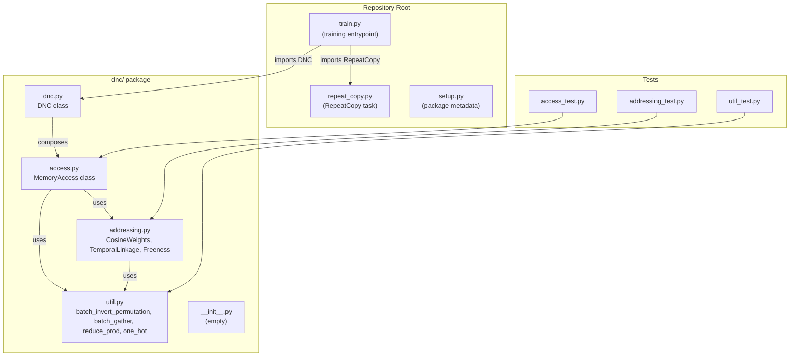
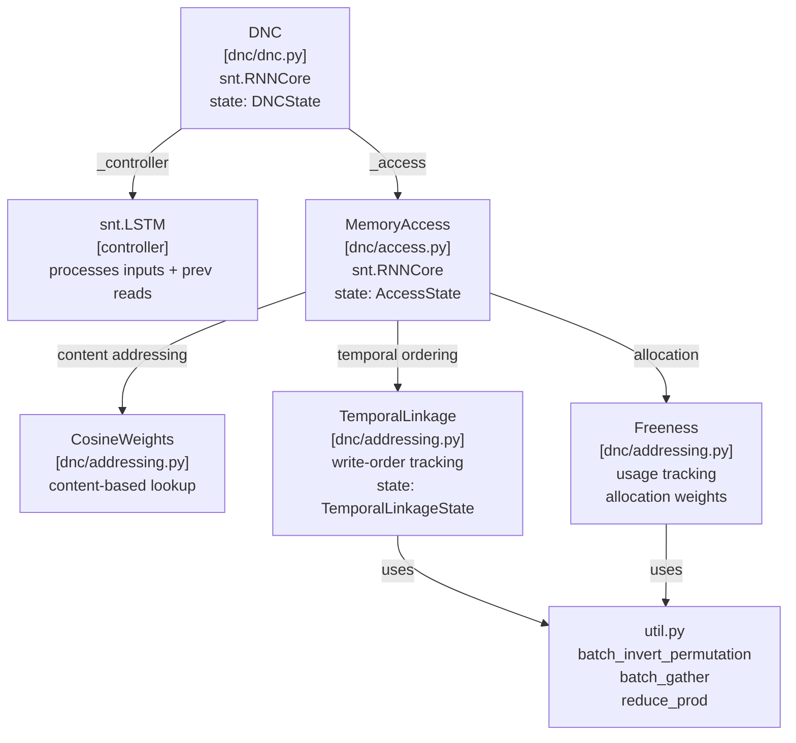
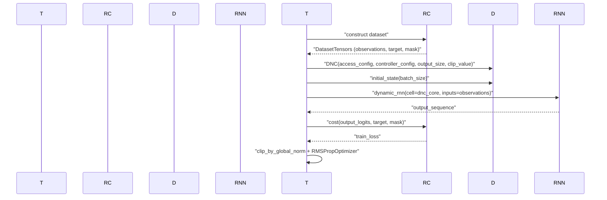

<!-- source: DeepWiki mcp.deepwiki.com · repo google-deepmind/dnc · page 1 Overview · fetched 2026-10-26 -->

# Overview

<details>
<summary>Relevant source files</summary>

The following files were used as context for generating this wiki page:

- [README.md](README.md)
- [dnc/__init__.py](dnc/__init__.py)
- [images/dnc_model.png](images/dnc_model.png)
- [setup.py](setup.py)
- [train.py](train.py)

</details>


This page introduces the Differentiable Neural Computer (DNC) repository, describes what the codebase implements, and provides a high-level map of how the major components relate. For a detailed walkthrough of the training pipeline, see [Training the DNC](#2). For the internal architecture of the DNC modules, see [Core Architecture](#3).

---

## What Is a Differentiable Neural Computer?

A Differentiable Neural Computer is a recurrent neural network augmented with an external memory matrix. At each timestep, the network reads from and writes to this memory using differentiable attention mechanisms, allowing it to be trained end-to-end with gradient descent.

This implementation is based on the paper *"Hybrid computing using a neural network with dynamic external memory"*, Nature 538, 471–476 (2016). It uses [TensorFlow](https://www.tensorflow.org) and [DeepMind Sonnet](https://github.com/deepmind/sonnet).

The three primary components of the architecture are:

| Component | Role |
|---|---|
| **Controller** (`snt.LSTM`) | Processes inputs concatenated with previous memory reads |
| **Access module** (`MemoryAccess`) | Reads from and writes to the external memory matrix |
| **DNC wrapper** (`DNC`) | Composes the controller and access module into a single `snt.RNNCore` |

---

## Repository Layout

**Module structure diagram:**



Sources: [train.py:1-27](), [setup.py:1-12](), [dnc/__init__.py:1-1]()

---

## Component Roles at a Glance

| File | Key Symbol | Purpose |
|---|---|---|
| `train.py` | `train()`, `run_model()` | Builds the TF graph, runs training loop, checkpoints |
| `repeat_copy.py` | `RepeatCopy` | Synthetic copy task for training and evaluation |
| `dnc/dnc.py` | `DNC`, `DNCState` | Top-level `snt.RNNCore`; wraps controller + memory access |
| `dnc/access.py` | `MemoryAccess`, `AccessState` | Memory read/write logic; controls addressing sub-modules |
| `dnc/addressing.py` | `CosineWeights`, `TemporalLinkage`, `Freeness` | Three differentiable memory addressing mechanisms |
| `dnc/util.py` | `batch_invert_permutation`, `batch_gather`, `reduce_prod`, `one_hot` | Batched tensor utility functions |
| `setup.py` | — | Package metadata; declares `dnc` as an installable package |

Sources: [train.py:69-91](), [setup.py:1-12]()

---

## Component Hierarchy

This diagram maps the class hierarchy and composition relationships to their source files.

**DNC component hierarchy diagram:**



Sources: [dnc/__init__.py:1-1](), [train.py:72-91](), [README.md:20-36]()

---

## Data Flow Summary

At each recurrent timestep, data flows through the DNC as follows:

1. **Input concatenation** — The raw input vector is concatenated with the read vectors from the previous timestep's memory access.
2. **Controller** — The concatenated input passes through an `snt.LSTM`, producing a controller output vector.
3. **Memory access** — `MemoryAccess` parses the controller output into control signals (read/write keys, gates, modes) and performs:
   - **Write**: combines content-based addressing (`CosineWeights`) with allocation weights (`Freeness`) to select write locations, then erases and writes to memory.
   - **Read**: interpolates between content-based (`CosineWeights`) and temporal (`TemporalLinkage` forward/backward) read weights to produce read vectors.
4. **Output projection** — The controller output is combined with the read vectors and passed through a linear layer to produce the final output.

**Training entrypoint flow:**



Sources: [train.py:69-91](), [train.py:94-158]()

---

## State Structures

The DNC maintains nested state across timesteps via two namedtuples:

**`DNCState`** (in `dnc/dnc.py`):

| Field | Type | Description |
|---|---|---|
| `access_output` | tensor | Read vectors from the previous timestep |
| `access_state` | `AccessState` | Full memory access state |
| `controller_state` | LSTM state | Hidden and cell state of the LSTM controller |

**`AccessState`** (in `dnc/access.py`):

| Field | Description |
|---|---|
| `memory` | The external memory matrix |
| `read_weights` | Read attention weights per head |
| `write_weights` | Write attention weights per head |
| `linkage` | `TemporalLinkageState` (link matrix + precedence weights) |
| `usage` | Per-location usage scalar (tracked by `Freeness`) |

Sources: [README.md:12-36]()

---

## Dependencies

The package requires TensorFlow and DeepMind Sonnet. It is installable as a Python package via `setup.py`:

```
name: dnc
version: 0.0.2
license: Apache Software License 2.0
packages: ['dnc']
```

Sources: [setup.py:1-12]()

---

