# Page: Overview

# Overview

<details>
<summary>Relevant source files</summary>

The following files were used as context for generating this wiki page:

- [README.md](README.md)
- [dnc/__init__.py](dnc/__init__.py)
- [images/dnc_model.png](images/dnc_model.png)
- [setup.py](setup.py)
- [train.py](train.py)

</details>


This page introduces the Differentiable Neural Computer (DNC) repository, describes what the codebase implements, and provides a high-level map of how the major components relate. For a detailed walkthrough of the training pipeline, see [Training the DNC](#2). For the internal architecture of the DNC modules, see [Core Architecture](#3).

---

## What Is a Differentiable Neural Computer?

A Differentiable Neural Computer is a recurrent neural network augmented with an external memory matrix. At each timestep, the network reads from and writes to this memory using differentiable attention mechanisms, allowing it to be trained end-to-end with gradient descent.

This implementation is based on the paper *"Hybrid computing using a neural network with dynamic external memory"*, Nature 538, 471–476 (2016). It uses [TensorFlow](https://www.tensorflow.org) and [DeepMind Sonnet](https://github.com/deepmind/sonnet).

The three primary components of the architecture are:

| Component | Role |
|---|---|
| **Controller** (`snt.LSTM`) | Processes inputs concatenated with previous memory reads |
| **Access module** (`MemoryAccess`) | Reads from and writes to the external memory matrix |
| **DNC wrapper** (`DNC`) | Composes the controller and access module into a single `snt.RNNCore` |

---

## Repository Layout

**Module structure diagram:**

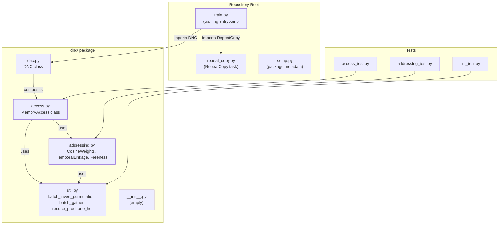

Sources: [train.py:1-27](), [setup.py:1-12](), [dnc/__init__.py:1-1]()

---

## Component Roles at a Glance

| File | Key Symbol | Purpose |
|---|---|---|
| `train.py` | `train()`, `run_model()` | Builds the TF graph, runs training loop, checkpoints |
| `repeat_copy.py` | `RepeatCopy` | Synthetic copy task for training and evaluation |
| `dnc/dnc.py` | `DNC`, `DNCState` | Top-level `snt.RNNCore`; wraps controller + memory access |
| `dnc/access.py` | `MemoryAccess`, `AccessState` | Memory read/write logic; controls addressing sub-modules |
| `dnc/addressing.py` | `CosineWeights`, `TemporalLinkage`, `Freeness` | Three differentiable memory addressing mechanisms |
| `dnc/util.py` | `batch_invert_permutation`, `batch_gather`, `reduce_prod`, `one_hot` | Batched tensor utility functions |
| `setup.py` | — | Package metadata; declares `dnc` as an installable package |

Sources: [train.py:69-91](), [setup.py:1-12]()

---

## Component Hierarchy

This diagram maps the class hierarchy and composition relationships to their source files.

**DNC component hierarchy diagram:**

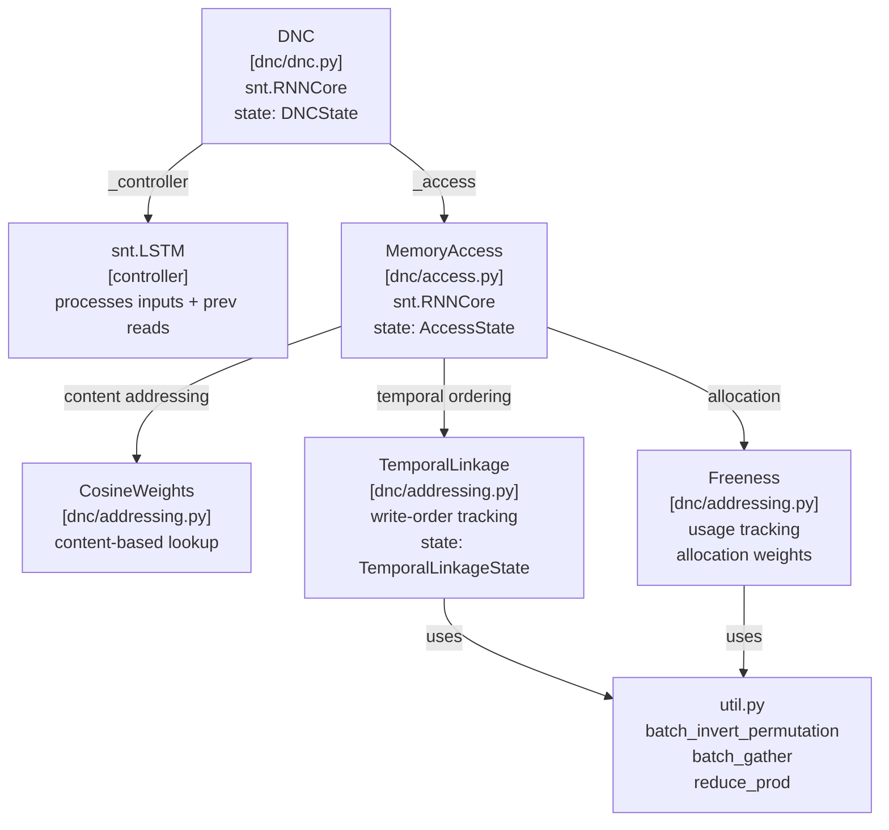

Sources: [dnc/__init__.py:1-1](), [train.py:72-91](), [README.md:20-36]()

---

## Data Flow Summary

At each recurrent timestep, data flows through the DNC as follows:

1. **Input concatenation** — The raw input vector is concatenated with the read vectors from the previous timestep's memory access.
2. **Controller** — The concatenated input passes through an `snt.LSTM`, producing a controller output vector.
3. **Memory access** — `MemoryAccess` parses the controller output into control signals (read/write keys, gates, modes) and performs:
   - **Write**: combines content-based addressing (`CosineWeights`) with allocation weights (`Freeness`) to select write locations, then erases and writes to memory.
   - **Read**: interpolates between content-based (`CosineWeights`) and temporal (`TemporalLinkage` forward/backward) read weights to produce read vectors.
4. **Output projection** — The controller output is combined with the read vectors and passed through a linear layer to produce the final output.

**Training entrypoint flow:**

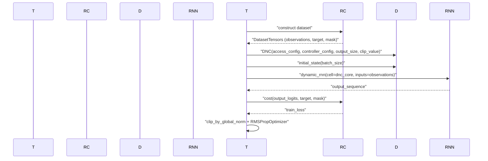

Sources: [train.py:69-91](), [train.py:94-158]()

---

## State Structures

The DNC maintains nested state across timesteps via two namedtuples:

**`DNCState`** (in `dnc/dnc.py`):

| Field | Type | Description |
|---|---|---|
| `access_output` | tensor | Read vectors from the previous timestep |
| `access_state` | `AccessState` | Full memory access state |
| `controller_state` | LSTM state | Hidden and cell state of the LSTM controller |

**`AccessState`** (in `dnc/access.py`):

| Field | Description |
|---|---|
| `memory` | The external memory matrix |
| `read_weights` | Read attention weights per head |
| `write_weights` | Write attention weights per head |
| `linkage` | `TemporalLinkageState` (link matrix + precedence weights) |
| `usage` | Per-location usage scalar (tracked by `Freeness`) |

Sources: [README.md:12-36]()

---

## Dependencies

The package requires TensorFlow and DeepMind Sonnet. It is installable as a Python package via `setup.py`:

```
name: dnc
version: 0.0.2
license: Apache Software License 2.0
packages: ['dnc']
```

Sources: [setup.py:1-12]()

---

# Page: Repository Structure

# Repository Structure

<details>
<summary>Relevant source files</summary>

The following files were used as context for generating this wiki page:

- [README.md](README.md)
- [dnc/__init__.py](dnc/__init__.py)
- [setup.py](setup.py)
- [train.py](train.py)

</details>


This page describes the physical layout of the repository and the role of each file. It is a navigation aid for readers who are new to the codebase. For deeper coverage of what each module *does*, see the pages linked in each section below.

---

## Top-Level Layout

The repository is divided into two logical areas: a small set of top-level files that form the training entrypoint and package metadata, and the `dnc/` directory that contains the core library implementation.

**Directory tree:**

```
dnc-repo/
├── train.py
├── repeat_copy.py
├── setup.py
├── README.md
└── dnc/
    ├── __init__.py
    ├── dnc.py
    ├── access.py
    ├── addressing.py
    ├── util.py
    ├── access_test.py
    ├── addressing_test.py
    └── util_test.py
```

Sources: [train.py:1-168](), [setup.py:1-12](), [dnc/__init__.py:1-1]()

---

## File Reference Table

| File | Location | Role |
|---|---|---|
| `train.py` | root | Training entrypoint; defines `run_model`, `train`, and `main` |
| `repeat_copy.py` | root | Defines the `RepeatCopy` task used for training and evaluation |
| `setup.py` | root | Package metadata for `pip` installation |
| `README.md` | root | Human-readable project introduction and usage instructions |
| `dnc/__init__.py` | `dnc/` | Empty file; marks `dnc` as an importable Python package |
| `dnc/dnc.py` | `dnc/` | Defines `DNC`, the top-level `snt.RNNCore` wrapping controller and memory |
| `dnc/access.py` | `dnc/` | Defines `MemoryAccess`, the `snt.RNNCore` that manages memory reads/writes |
| `dnc/addressing.py` | `dnc/` | Defines `CosineWeights`, `TemporalLinkage`, and `Freeness` addressing mechanisms |
| `dnc/util.py` | `dnc/` | Shared utility functions: `batch_invert_permutation`, `batch_gather`, `reduce_prod`, `one_hot` |
| `dnc/access_test.py` | `dnc/` | Tests for `MemoryAccess` |
| `dnc/addressing_test.py` | `dnc/` | Tests for all three addressing modules |
| `dnc/util_test.py` | `dnc/` | Tests for utility functions |

Sources: [train.py:1-30](), [setup.py:1-12](), [dnc/__init__.py:1-1]()

---

## Module Dependency Diagram

The following diagram maps each file to the modules it imports, showing which parts of the codebase depend on which others.

**Figure: File-level import dependencies**

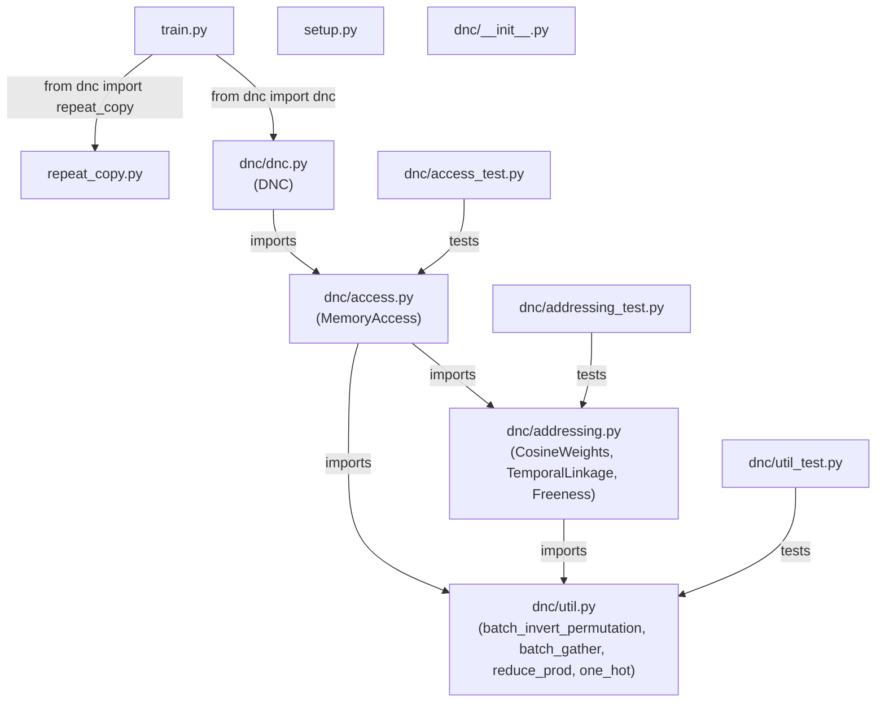

Sources: [train.py:24-25](), [dnc/__init__.py:1-1]()

---

## Top-Level Files

### `train.py`

The primary executable script. Running it starts the full training loop on the `RepeatCopy` task. It:

- Imports `dnc.DNC` and `repeat_copy.RepeatCopy`
- Defines all configuration flags via `tf.flags` (model size, optimizer settings, task parameters)
- Constructs the DNC model via `run_model` [train.py:69-91]()
- Runs the training loop via `train` [train.py:94-158]()
- Uses `tf.nn.dynamic_rnn` to unroll the model over the input sequence

For full documentation of the training pipeline, see [Training the DNC](#2). For flag reference, see [Training Configuration](#2.2).

Sources: [train.py:15-167]()

### `repeat_copy.py`

Defines `RepeatCopy`, the synthetic task used to exercise the DNC. It generates batches of binary sequences and targets, and provides a `cost` method and a `to_human_readable` visualization method. It is imported by `train.py` at [train.py:25]().

For full documentation of this task, see [The RepeatCopy Task](#2.1).

### `setup.py`

Standard `setuptools` configuration for the `dnc` package [setup.py:1-12](). Registers the package name as `dnc`, version `0.0.2`, under the Apache 2.0 license. Used to install the package via `pip install .`.

For setup and contribution instructions, see [Development Setup](#5).

---

## The `dnc/` Package

The `dnc/` directory is a Python package (made importable by the empty `dnc/__init__.py`). It contains the full DNC implementation split across four modules.

**Figure: Class-to-file mapping within the `dnc/` package**

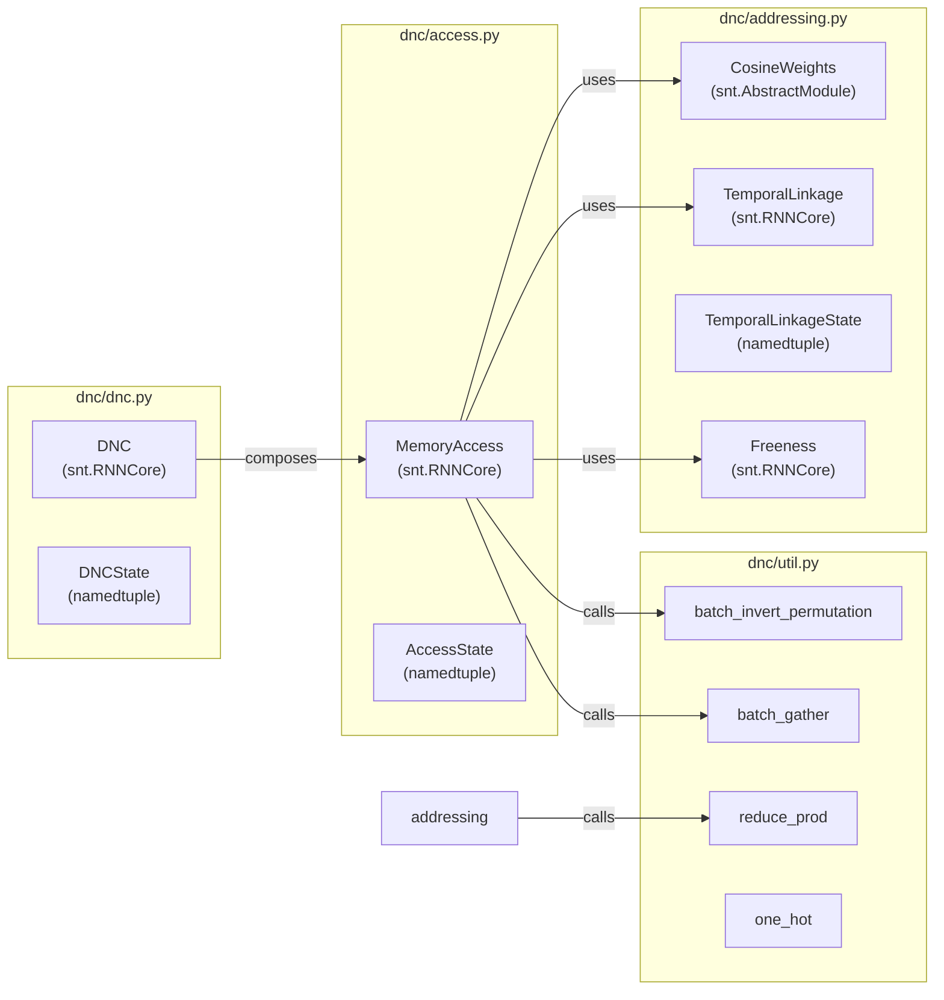

Sources: [train.py:69-91](), [dnc/__init__.py:1-1]()

### `dnc/dnc.py`

Defines the `DNC` class and `DNCState` namedtuple. `DNC` is the top-level `snt.RNNCore` that a caller interacts with directly. It wraps an LSTM controller (`snt.LSTM`) and a `MemoryAccess` module, producing a single recurrent unit. For full documentation, see [DNC Core](#3.1).

### `dnc/access.py`

Defines `MemoryAccess` and `AccessState`. `MemoryAccess` manages all read and write operations against the external memory matrix. It uses the three addressing mechanisms from `addressing.py` and helper functions from `util.py`. For full documentation, see [Memory Access Module](#3.2).

### `dnc/addressing.py`

Defines three `snt` modules responsible for computing attention weights over memory:

- `CosineWeights` — content-based lookup
- `TemporalLinkage` — write-order tracking (with `TemporalLinkageState`)
- `Freeness` — usage-based allocation

For full documentation, see [Memory Addressing](#3.3).

### `dnc/util.py`

Defines four utility functions used internally by `access.py` and `addressing.py`:

- `batch_invert_permutation` — batched permutation inversion
- `batch_gather` — batched indexed gather
- `reduce_prod` — cumprod-based product reduction
- `one_hot` — static NumPy one-hot vector construction

For full documentation, see [Utility Functions](#3.4).

---

## Test Files

All tests live inside the `dnc/` package directory alongside the source they test. There is no separate `tests/` directory.

| Test File | Targets | Key Techniques |
|---|---|---|
| `dnc/addressing_test.py` | `CosineWeights`, `TemporalLinkage`, `Freeness` | Shape assertions, numerical value bounds, gradient checks |
| `dnc/access_test.py` | `MemoryAccess` | `tf.nn.dynamic_rnn` integration, numerical gradient checks |
| `dnc/util_test.py` | `batch_invert_permutation`, `batch_gather` | Random permutation correctness, fixed known-answer arrays |

For full documentation of the test suite, see [Testing](#4).

---

# Page: Training the DNC

# Training the DNC

<details>
<summary>Relevant source files</summary>

The following files were used as context for generating this wiki page:

- [train.py](train.py)

</details>


This page covers the full training pipeline implemented in `train.py`: how the DNC model is constructed and run, how loss is computed and backpropagated, how gradients are clipped and applied, and how the training loop manages checkpointing and periodic reporting.

For details on the task used for training, see [The RepeatCopy Task](#2.1). For configuration flags, see [Training Configuration](#2.2). For the DNC model itself, see [Core Architecture](#3).

---

## Overview

`train.py` is the single entry point for training the DNC. It wires together the `RepeatCopy` dataset, the `DNC` model, and the TensorFlow training machinery into a complete supervised learning loop.

**Training Pipeline Diagram**

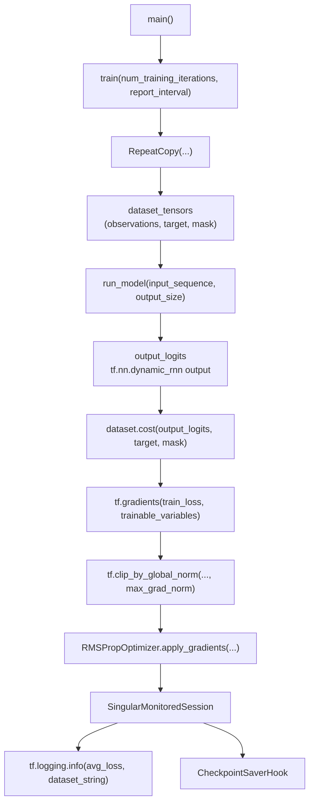

Sources: [train.py:94-168]()

---

## Model Construction: `run_model`

The `run_model` function [train.py:69-91]() builds the TensorFlow graph for a single forward pass over an entire input sequence. It does not execute computation itself — it defines the graph nodes.

**Steps:**

1. **Assemble `access_config`** — a dict containing `memory_size`, `word_size`, `num_reads`, and `num_writes`, drawn from FLAGS.
2. **Assemble `controller_config`** — a dict containing `hidden_size` for the LSTM controller.
3. **Instantiate `dnc.DNC`** with the above configs plus `output_size` and `clip_value`.
4. **Compute `initial_state`** via `dnc_core.initial_state(FLAGS.batch_size)`.
5. **Run `tf.nn.dynamic_rnn`** with `time_major=True`, which unrolls the DNC across the entire sequence dimension and returns `output_sequence`.

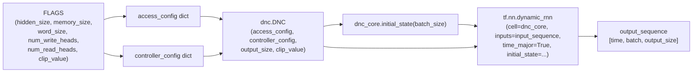

Sources: [train.py:69-91]()

The `output_size` passed to `DNC` is `dataset.target_size`, which is determined by the `RepeatCopy` task configuration.

---

## Loss Computation

After `run_model` returns `output_logits`, the `train` function [train.py:94-158]() computes a masked sigmoid cross-entropy loss:

```
train_loss = dataset.cost(output_logits, dataset_tensors.target, dataset_tensors.mask)
```

The `mask` tensor is also used separately to produce a rounded binary `output` for visualization:

```
output = tf.round(tf.expand_dims(dataset_tensors.mask, -1) * tf.sigmoid(output_logits))
```

This `output` is only evaluated during reporting intervals and is passed to `dataset.to_human_readable(...)` for display. It is not used in the loss or gradient computation.

Sources: [train.py:102-108]()

---

## Gradient Clipping and Optimizer

Gradients are computed and clipped in two steps [train.py:111-126]():

| Step | Code construct | Purpose |
|---|---|---|
| Compute raw gradients | `tf.gradients(train_loss, trainable_variables)` | Differentiate loss w.r.t. all trainable parameters |
| Clip by global norm | `tf.clip_by_global_norm(grads, max_grad_norm)` | Cap the global L2 norm of the gradient vector at `max_grad_norm` (default: 50) |
| Apply gradients | `optimizer.apply_gradients(zip(grads, trainable_variables), global_step=global_step)` | Update parameters using RMSProp |

The optimizer is `tf.train.RMSPropOptimizer` configured with `learning_rate` (default: `1e-4`) and `epsilon` (default: `1e-10`).

A `global_step` variable [train.py:115-121]() is registered in both `GLOBAL_VARIABLES` and `GLOBAL_STEP` collections. It is incremented automatically by `apply_gradients` and is used to resume training from a checkpoint.

Sources: [train.py:111-126]()

---

## Checkpointing

Checkpoint behavior is conditional on the `checkpoint_interval` flag [train.py:130-138]():

- If `checkpoint_interval > 0`: a `tf.train.CheckpointSaverHook` is attached to the session. It saves to `checkpoint_dir` every `checkpoint_interval` steps.
- If `checkpoint_interval <= 0` (default: `-1`): no periodic saving hook is attached.

Regardless of the hook, `SingularMonitoredSession` is always given `checkpoint_dir`. On startup, it will restore from the latest checkpoint in that directory if one exists, allowing training to resume automatically.

| Flag | Default | Effect |
|---|---|---|
| `checkpoint_dir` | `/tmp/tf/dnc` | Directory to write/read checkpoints |
| `checkpoint_interval` | `-1` | Steps between saves; `-1` disables periodic saving |

Sources: [train.py:63-66](), [train.py:128-142]()

---

## Training Loop

The training loop [train.py:141-158]() runs inside a `tf.train.SingularMonitoredSession` context:

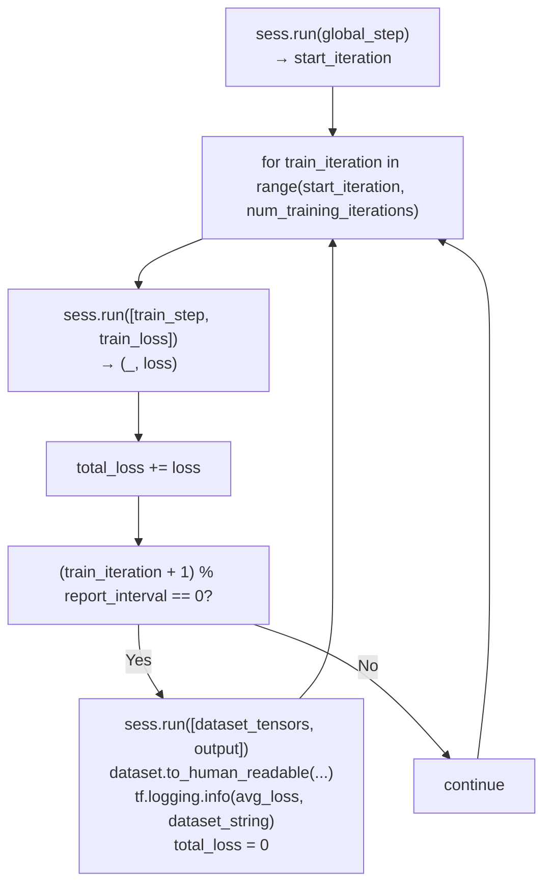

**Key behaviors:**

- `start_iteration` is read from `global_step` at session start, so a restored checkpoint resumes from where it left off.
- Each iteration executes `train_step` (weight update) and reads back `train_loss` in a single `sess.run` call for efficiency.
- Every `report_interval` iterations (default: 100), `total_loss / report_interval` is logged as the average loss and the accumulated total is reset to zero.
- The `to_human_readable` output is also logged at each report, showing the raw input/output pattern for visual inspection.

Sources: [train.py:141-158]()

---

## Entry Point

`main` [train.py:161-163]() sets log verbosity to `INFO` level and calls `train(FLAGS.num_training_iterations, FLAGS.report_interval)`. `tf.app.run()` [train.py:167]() handles flag parsing before calling `main`.

To start training with defaults:

```
python train.py
```

To override flags:

```
python train.py --hidden_size=128 --memory_size=32 --num_training_iterations=200000
```

Sources: [train.py:161-167]()

---

## Summary: Key Symbols

| Symbol | Type | File | Role |
|---|---|---|---|
| `run_model` | function | `train.py` | Builds DNC graph; calls `tf.nn.dynamic_rnn` |
| `train` | function | `train.py` | Full training loop: loss, gradients, optimizer, session |
| `main` | function | `train.py` | Entry point; sets log verbosity |
| `dnc.DNC` | class | `dnc/dnc.py` | The RNNCore passed to `dynamic_rnn` |
| `repeat_copy.RepeatCopy` | class | `repeat_copy.py` | Generates `dataset_tensors`; computes `cost` |
| `tf.nn.dynamic_rnn` | TF op | — | Unrolls `DNC` over the time dimension |
| `tf.clip_by_global_norm` | TF op | — | Gradient clipping |
| `tf.train.RMSPropOptimizer` | TF class | — | Parameter update rule |
| `SingularMonitoredSession` | TF class | — | Managed session with checkpoint restore |
| `CheckpointSaverHook` | TF class | — | Periodic checkpoint saves |

---

# Page: The RepeatCopy Task

# The RepeatCopy Task

<details>
<summary>Relevant source files</summary>

The following files were used as context for generating this wiki page:

- [dnc/repeat_copy.py](dnc/repeat_copy.py)
- [train.py](train.py)

</details>


This page documents the `RepeatCopy` synthetic task defined in `dnc/repeat_copy.py`. It covers the task definition, data format, cost function, and visualization utilities. For how the training loop consumes this task, see [Training the DNC](#2). For the flags that configure task parameters, see [Training Configuration](#2.2).

---

## Overview

The RepeatCopy task is a standard benchmark for sequence memory. Given a random binary pattern of length `L`, the model must reproduce that pattern `R` times in a row, where both `L` and `R` are drawn uniformly at random within configurable bounds.

The task is implemented as a `snt.AbstractModule` that, when called, returns a `DatasetTensors` namedtuple containing TensorFlow tensors for a full batch of episodes. Each episode is a complete sequence: an observation phase followed by an output phase.

---

## Sequence Structure

The diagram below maps the abstract sequence regions to their concrete tensor contents.

**Diagram: Sequence Layout for a Single Batch Element**

```mermaid
gantt
    title "Time axis: observation phase then target phase"
    dateFormat  X
    axisFormat  t=%s

    section "obs (T x num_bits+2)"
    "start-marker flag (1 at t=0)" : 0, 1
    "random binary pattern [L steps]" : 1, 4
    "num-repeats flag (normalised R)" : 4, 5
    "zero padding" : 5, 10

    section "targ (T x num_bits+1)"
    "zero padding" : 0, 5
    "pattern repeated R times" : 5, 9
    "end-marker flag" : 9, 10

    section "mask (T)"
    "0 (ignored)" : 0, 5
    "1 (penalised)" : 5, 10
```

*Sources: [dnc/repeat_copy.py:115-173]()*

---

## DatasetTensors

`DatasetTensors` is a `collections.namedtuple` with three fields, all time-major (first axis is time, second is batch index):

| Field | Shape | dtype | Description |
|---|---|---|---|
| `observations` | `[T, B, num_bits + 2]` | `float32` | Input sequence fed to the DNC at each time step |
| `target` | `[T, B, num_bits + 1]` | `float32` | Expected output at each time step |
| `mask` | `[T, B]` | `float32` | `1` during the output phase, `0` during the input phase |

`T` (total sequence length) is padded to the maximum across the batch. `B` is `batch_size`.

*Sources: [dnc/repeat_copy.py:25-26]()*

---

## Observation Channels

The trailing dimension of `observations` has `num_bits + 2` channels:

| Channel indices | Contents |
|---|---|
| `0 … num_bits-1` | Binary pattern bits (0.0 or 1.0) |
| `num_bits` (`start_end_flag_idx`) | Start-marker: `1.0` at `t=0`, `0.0` elsewhere |
| `num_bits + 1` (`num_repeats_channel_idx`) | Normalised repeat count: `num_reps / norm_max` at the step immediately after the pattern, `0.0` elsewhere |

The trailing dimension of `target` has `num_bits + 1` channels:

| Channel indices | Contents |
|---|---|
| `0 … num_bits-1` | Pattern bits to reproduce |
| `num_bits` | End-marker: `1.0` at the last step of the output phase |

*Sources: [dnc/repeat_copy.py:261-327]()*

---

## RepeatCopy Class

`RepeatCopy` extends `snt.AbstractModule`. Its constructor parameters control all stochastic aspects of the generated sequences.

**Diagram: RepeatCopy class relationships**

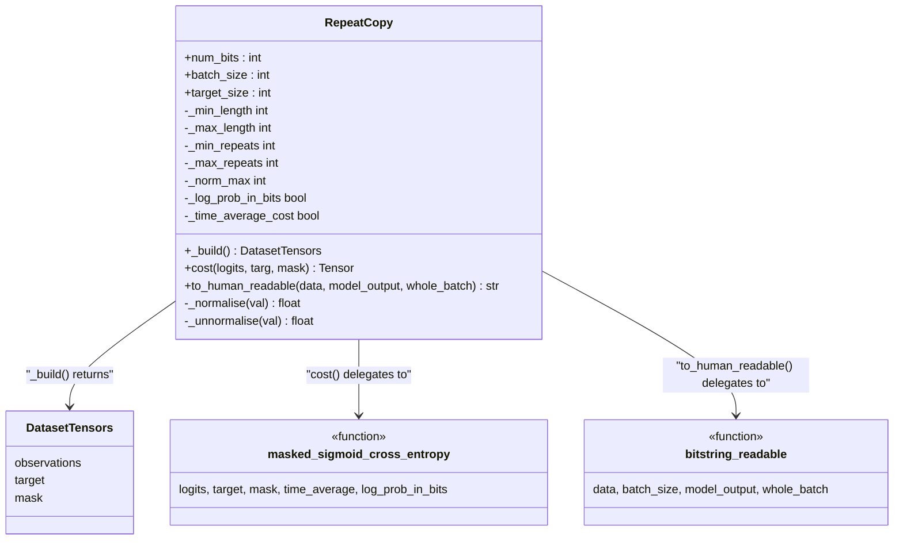

*Sources: [dnc/repeat_copy.py:115-392]()*

### Constructor Parameters

| Parameter | Default | Description |
|---|---|---|
| `num_bits` | `6` | Width of each binary vector in the pattern |
| `batch_size` | `1` | Number of independent episodes per batch |
| `min_length` | `1` | Minimum pattern length `L` |
| `max_length` | `1` | Maximum pattern length `L` |
| `min_repeats` | `1` | Minimum repeat count `R` |
| `max_repeats` | `2` | Maximum repeat count `R` |
| `norm_max` | `10` | Denominator for normalising the repeat-count channel |
| `log_prob_in_bits` | `False` | Report loss in bits (nats by default) |
| `time_average_cost` | `False` | Divide per-element cost by unmasked time steps before reduction |

*Sources: [dnc/repeat_copy.py:176-222]()*

### `target_size` Property

`target_size` returns `num_bits + 1`. This value is passed directly to `run_model` in `train.py` as the DNC's output dimensionality.

*Sources: [dnc/repeat_copy.py:244-246](), [train.py:102]()*

---

## Data Generation: `_build`

When the module is called (e.g., `dataset()`), `_build` is executed and adds ops to the TF graph.

**Diagram: `_build` data flow**

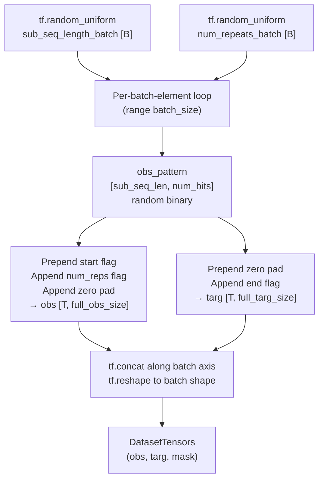

Key computed values:
- `total_length_batch[i] = sub_seq_len[i] * (num_reps[i] + 1) + 3`
- `max_length_batch = tf.reduce_max(total_length_batch)` — the padded sequence length `T`
- `residual_length_batch[i] = max_length_batch - total_length_batch[i]` — trailing zeros added for batch alignment

The mask is constructed per element as:
- `mask_off = tf.zeros([sub_seq_len + 2])` — covers the start flag, pattern, and num-repeats flag
- `mask_on = tf.ones([sub_seq_len * num_reps + 1])` — covers the repeated output plus the end flag

*Sources: [dnc/repeat_copy.py:252-377]()*

---

## Cost Function

### `RepeatCopy.cost`

`cost(logits, targ, mask)` delegates to `masked_sigmoid_cross_entropy` with the instance's `time_average_cost` and `log_prob_in_bits` settings.

*Sources: [dnc/repeat_copy.py:379-385]()*

### `masked_sigmoid_cross_entropy`

This is a standalone module-level function. It computes the mean per-batch-element binary cross-entropy over the masked (output-phase) time steps.

**Step-by-step reduction:**

```
xent            = sigmoid_cross_entropy_with_logits(labels=target, logits=logits)
                  shape: [T, B, num_bits+1]

loss_time_batch = reduce_sum(xent, axis=2)
                  shape: [T, B]   (sum over bit channels)

loss_batch      = reduce_sum(loss_time_batch * mask, axis=0)
                  shape: [B]      (sum over time, masked)

(if time_average)
  loss_batch   /= reduce_sum(mask, axis=0)   (normalise by unmasked length)

loss            = reduce_sum(loss_batch) / batch_size
                  scalar

(if log_prob_in_bits)
  loss         /= log(2.)
```

The mask zeros out all time steps in the observation phase, so the model is never penalised for its outputs while reading the input.

*Sources: [dnc/repeat_copy.py:29-66]()*

### Usage in `train.py`

```
train_loss = dataset.cost(output_logits, dataset_tensors.target, dataset_tensors.mask)
```

`output_logits` are the raw DNC outputs (pre-sigmoid), and `train_loss` is the scalar that flows into gradient computation.

*Sources: [train.py:107-108]()*

---

## Visualisation

### `to_human_readable`

`RepeatCopy.to_human_readable(data, model_output=None, whole_batch=False)` unnormalises the repeat-count channel before delegating to `bitstring_readable`.

```python
# Reversal of _normalise: multiply last obs channel by norm_max
unnormalised_num_reps_flag = self._unnormalise(obs[:,:,-1:]).round()
```

*Sources: [dnc/repeat_copy.py:387-392]()*

### `bitstring_readable`

`bitstring_readable(data, batch_size, model_output=None, whole_batch=False)` produces a human-readable string. Each channel (bit dimension) across time is printed as a row. Each cell is formatted as:

- `-` for value `0`
- The integer value (e.g., `1`, `3`) for nonzero values

The output groups up to three sections per batch element:

| Section | Always present? | Source |
|---|---|---|
| `Observations` | Yes | `data.observations[:, batch_index, :]` |
| `Targets` | Yes | `data.target[:, batch_index, :]` |
| `Model Output` | Only if `model_output` provided | `model_output[:, batch_index, :]` |

By default only the first batch element is shown (`whole_batch=False`).

In `train.py`, model output is constructed before calling `to_human_readable`:

```python
output = tf.round(
    tf.expand_dims(dataset_tensors.mask, -1) * tf.sigmoid(output_logits))
```

This applies sigmoid to produce probabilities, rounds to 0/1, and zeros out the observation phase via the mask — making the printed output directly comparable to `target`.

*Sources: [dnc/repeat_copy.py:69-112](), [train.py:103-157]()*

---

## Integration with the Training Loop

**Diagram: RepeatCopy in the training pipeline**

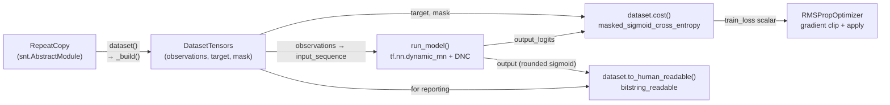

*Sources: [train.py:94-158]()*

---

# Page: Training Configuration

# Training Configuration

<details>
<summary>Relevant source files</summary>

The following files were used as context for generating this wiki page:

- [train.py](train.py)

</details>


This page is a reference for all `tf.flags` defined in [train.py](), which control every configurable aspect of a training run. Flags are grouped into four categories: model parameters, optimizer parameters, task parameters, and training options.

For a description of how these flags are used together during the training loop, see [Training the DNC](#2). For details on the RepeatCopy task that the task-parameter flags configure, see [The RepeatCopy Task](#2.1).

---

## How Flags Are Consumed

The diagram below shows which function or constructor each flag group feeds into.

**Flag-to-Component Wiring**

```mermaid
graph TD
    subgraph "Model Parameters"
        hidden_size["hidden_size"]
        memory_size["memory_size"]
        word_size["word_size"]
        num_write_heads["num_write_heads"]
        num_read_heads["num_read_heads"]
        clip_value["clip_value"]
    end

    subgraph "Optimizer Parameters"
        max_grad_norm["max_grad_norm"]
        learning_rate["learning_rate"]
        optimizer_epsilon["optimizer_epsilon"]
    end

    subgraph "Task Parameters"
        batch_size["batch_size"]
        num_bits["num_bits"]
        min_length["min_length"]
        max_length["max_length"]
        min_repeats["min_repeats"]
        max_repeats["max_repeats"]
    end

    subgraph "Training Options"
        num_training_iterations["num_training_iterations"]
        report_interval["report_interval"]
        checkpoint_dir["checkpoint_dir"]
        checkpoint_interval["checkpoint_interval"]
    end

    hidden_size --> run_model["run_model()\naccess_config / controller_config"]
    memory_size --> run_model
    word_size --> run_model
    num_write_heads --> run_model
    num_read_heads --> run_model
    clip_value --> run_model

    run_model --> DNC["dnc.DNC(access_config,\ncontroller_config,\noutput_size, clip_value)"]

    learning_rate --> RMSProp["tf.train.RMSPropOptimizer"]
    optimizer_epsilon --> RMSProp
    max_grad_norm --> clip_by_global_norm["tf.clip_by_global_norm"]

    batch_size --> RepeatCopy["repeat_copy.RepeatCopy(...)"]
    num_bits --> RepeatCopy
    min_length --> RepeatCopy
    max_length --> RepeatCopy
    min_repeats --> RepeatCopy
    max_repeats --> RepeatCopy

    num_training_iterations --> train_fn["train()"]
    report_interval --> train_fn
    checkpoint_dir --> SingularMonitoredSession["tf.train.SingularMonitoredSession"]
    checkpoint_interval --> CheckpointSaverHook["tf.train.CheckpointSaverHook"]
```

Sources: [train.py:29-66](), [train.py:69-91](), [train.py:94-158]()

---

## Model Parameters

These flags are assembled into `access_config` and `controller_config` dictionaries inside `run_model()`, which are then passed directly to the `dnc.DNC` constructor.

[train.py:29-36]()

| Flag | Type | Default | Description |
|---|---|---|---|
| `hidden_size` | `int` | `64` | Number of units in the LSTM controller's hidden layer. Maps to `controller_config["hidden_size"]`. |
| `memory_size` | `int` | `16` | Number of addressable memory slots. Maps to `access_config["memory_size"]`. |
| `word_size` | `int` | `16` | Width (in floats) of each memory slot. Maps to `access_config["word_size"]`. |
| `num_write_heads` | `int` | `1` | Number of write heads used by `MemoryAccess`. Maps to `access_config["num_writes"]`. |
| `num_read_heads` | `int` | `4` | Number of read heads used by `MemoryAccess`. Maps to `access_config["num_reads"]`. |
| `clip_value` | `int` | `20` | Absolute value ceiling applied to the controller output and DNC output via `tf.clip_by_value`. |

**How `run_model` assembles these flags:**

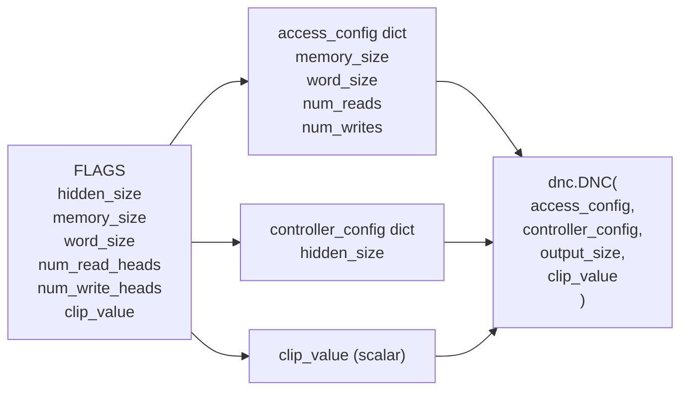

Sources: [train.py:72-83]()

---

## Optimizer Parameters

These flags control the RMSProp optimizer and gradient clipping applied in `train()`.

[train.py:38-42]()

| Flag | Type | Default | Description |
|---|---|---|---|
| `max_grad_norm` | `float` | `50.0` | Global norm limit passed to `tf.clip_by_global_norm`. Gradients are rescaled if the global norm exceeds this value. |
| `learning_rate` | `float` | `1e-4` | Step size passed to `tf.train.RMSPropOptimizer`. |
| `optimizer_epsilon` | `float` | `1e-10` | Numerical stability term (`epsilon`) passed to `tf.train.RMSPropOptimizer`. Prevents division by zero in the RMS denominator. |

The optimizer is constructed and applied at [train.py:111-126]():

```
grads, _ = tf.clip_by_global_norm(tf.gradients(train_loss, trainable_variables), FLAGS.max_grad_norm)
optimizer = tf.train.RMSPropOptimizer(FLAGS.learning_rate, epsilon=FLAGS.optimizer_epsilon)
train_step = optimizer.apply_gradients(zip(grads, trainable_variables), global_step=global_step)
```

---

## Task Parameters

These flags are passed as constructor arguments to `repeat_copy.RepeatCopy` inside `train()`. They define the difficulty and shape of the synthetic task.

[train.py:44-56]()

| Flag | Type | Default | Description |
|---|---|---|---|
| `batch_size` | `int` | `16` | Number of independent sequences processed per training step. |
| `num_bits` | `int` | `4` | Width of each binary observation vector (i.e., the number of bit channels per timestep). |
| `min_length` | `int` | `1` | Minimum number of vectors in the pattern to copy. |
| `max_length` | `int` | `2` | Maximum number of vectors in the pattern to copy. |
| `min_repeats` | `int` | `1` | Minimum number of times the pattern must be reproduced. |
| `max_repeats` | `int` | `2` | Maximum number of times the pattern must be reproduced. |

`RepeatCopy` samples `length` uniformly from `[min_length, max_length]` and `repeats` from `[min_repeats, max_repeats]` for each batch. The total sequence length therefore varies per batch. See [The RepeatCopy Task](#2.1) for a full description of the task structure.

---

## Training Options

These flags control the training loop lifecycle, console reporting, and checkpointing.

[train.py:58-66]()

| Flag | Type | Default | Description |
|---|---|---|---|
| `num_training_iterations` | `int` | `100000` | Total number of gradient steps to run. Passed directly to `train()` as `num_training_iterations`. |
| `report_interval` | `int` | `100` | How frequently (in steps) to log average loss and a human-readable task sample. Passed to `train()` as `report_interval`. |
| `checkpoint_dir` | `string` | `"/tmp/tf/dnc"` | Directory for saving and restoring checkpoints. Used by both `tf.train.SingularMonitoredSession` (for restore-on-start) and `tf.train.CheckpointSaverHook` (for periodic saves). |
| `checkpoint_interval` | `int` | `-1` | How frequently (in steps) to save a checkpoint. A value of `-1` disables periodic checkpointing; only the session-level checkpoint behaviour of `SingularMonitoredSession` applies. |

**Checkpoint behaviour logic:**

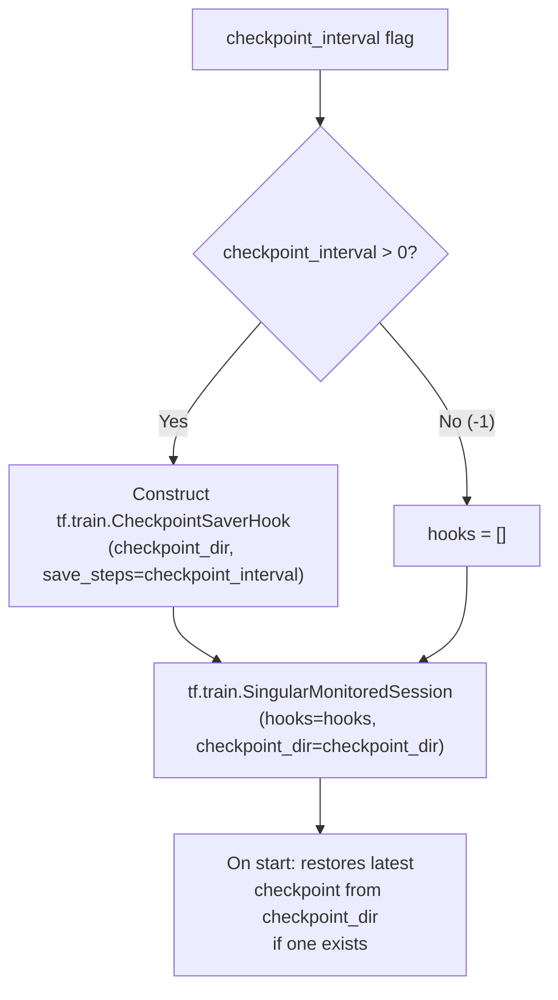

Sources: [train.py:129-142]()

When a prior checkpoint exists in `checkpoint_dir`, `SingularMonitoredSession` restores from it automatically, and the training loop reads `global_step` to resume from the correct iteration [train.py:144-147]().

---

## Quick Reference Summary

| Category | Flag | Default |
|---|---|---|
| **Model** | `hidden_size` | `64` |
| **Model** | `memory_size` | `16` |
| **Model** | `word_size` | `16` |
| **Model** | `num_write_heads` | `1` |
| **Model** | `num_read_heads` | `4` |
| **Model** | `clip_value` | `20` |
| **Optimizer** | `max_grad_norm` | `50.0` |
| **Optimizer** | `learning_rate` | `1e-4` |
| **Optimizer** | `optimizer_epsilon` | `1e-10` |
| **Task** | `batch_size` | `16` |
| **Task** | `num_bits` | `4` |
| **Task** | `min_length` | `1` |
| **Task** | `max_length` | `2` |
| **Task** | `min_repeats` | `1` |
| **Task** | `max_repeats` | `2` |
| **Training** | `num_training_iterations` | `100000` |
| **Training** | `report_interval` | `100` |
| **Training** | `checkpoint_dir` | `"/tmp/tf/dnc"` |
| **Training** | `checkpoint_interval` | `-1` |

Sources: [train.py:29-66]()

---

# Page: Core Architecture

# Core Architecture

<details>
<summary>Relevant source files</summary>

The following files were used as context for generating this wiki page:

- [README.md](README.md)
- [dnc/access.py](dnc/access.py)
- [dnc/addressing.py](dnc/addressing.py)
- [dnc/dnc.py](dnc/dnc.py)
- [dnc/util.py](dnc/util.py)

</details>


This page provides a mid-level architectural overview of the `dnc/` package. It describes how the four modules — `dnc.py`, `access.py`, `addressing.py`, and `util.py` — compose into a complete Differentiable Neural Computer, and serves as a navigational entry point for the detailed sub-pages covering each module.

For the training pipeline that drives the DNC, see [Training the DNC](#2). For the task used to benchmark it, see [The RepeatCopy Task](#2.1).

---

## Module Overview

The `dnc/` package is organized into four files with a clear layered dependency structure:

| File | Primary Export(s) | Role |
|------|-------------------|------|
| `dnc/dnc.py` | `DNC`, `DNCState` | Top-level `snt.RNNCore`; composes the LSTM controller and `MemoryAccess` |
| `dnc/access.py` | `MemoryAccess`, `AccessState` | Manages reading from and writing to the external memory matrix |
| `dnc/addressing.py` | `CosineWeights`, `TemporalLinkage`, `Freeness`, `TemporalLinkageState` | Three addressing sub-modules used by `MemoryAccess` |
| `dnc/util.py` | `batch_invert_permutation`, `batch_gather`, `reduce_prod`, `one_hot` | Tensor utility functions used by `access.py` and `addressing.py` |

Sources: [dnc/dnc.py:1-143](), [dnc/access.py:1-319](), [dnc/addressing.py:1-411](), [dnc/util.py:1-73]()

---

## Component Hierarchy

**Diagram: Class composition hierarchy of the DNC**

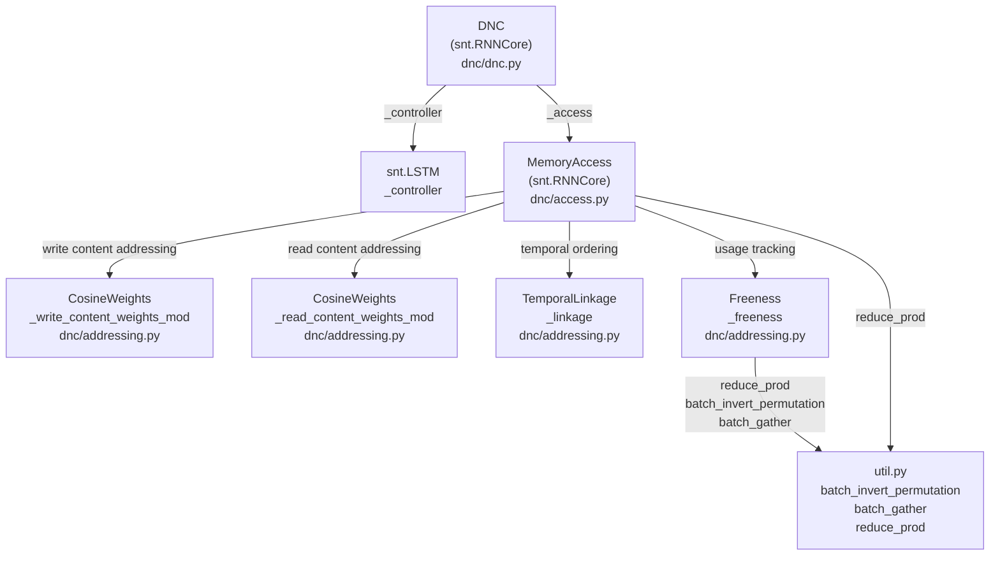

Sources: [dnc/dnc.py:63-76](), [dnc/access.py:105-111](), [dnc/addressing.py:376-405]()

---

## State Namedtuples

The DNC is a stateful RNN. Three nested namedtuples fully describe the system state at each timestep.

**Diagram: State namedtuple nesting**

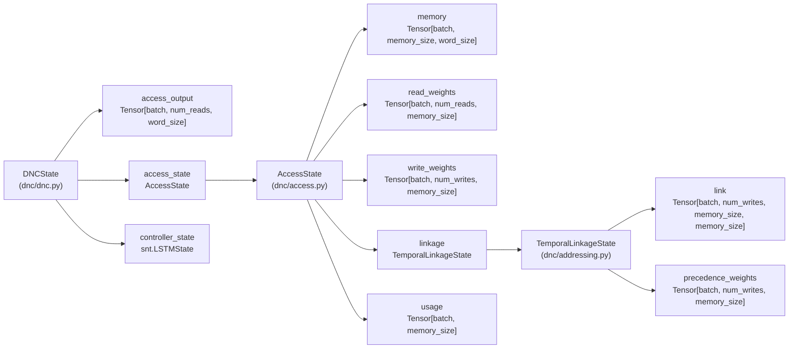

Sources: [dnc/dnc.py:32-33](), [dnc/access.py:28-29](), [dnc/addressing.py:30-31]()

---

## Forward Pass Data Flow

Each call to `DNC._build` processes one timestep. The following describes the sequence of operations:

**Diagram: Data flow through a single DNC timestep**

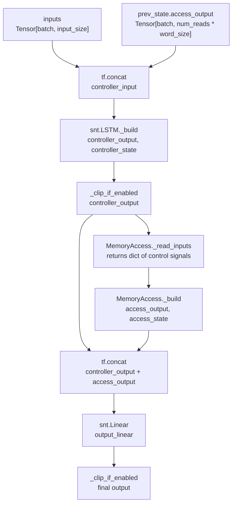

Sources: [dnc/dnc.py:84-127](), [dnc/access.py:113-158]()

---

## Memory Access: Write and Read Pathways

Within `MemoryAccess._build`, the write and read operations follow distinct pathways that interact through the shared memory matrix.

**Diagram: Write and read pathways in MemoryAccess._build**

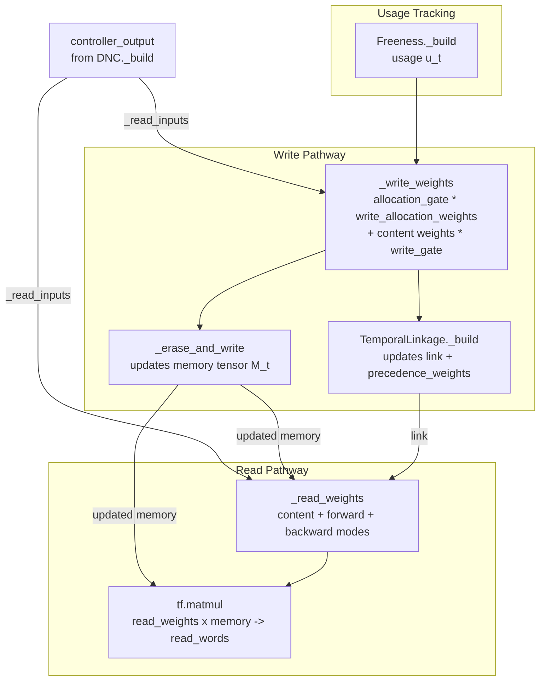

Sources: [dnc/access.py:126-158](), [dnc/access.py:220-303]()

---

## Addressing Sub-Modules

`MemoryAccess` delegates three distinct responsibilities to sub-modules in `dnc/addressing.py`:

| Class | Base Class | State | Responsibility |
|-------|-----------|-------|----------------|
| `CosineWeights` | `snt.AbstractModule` | Stateless | Content-based lookup via cosine similarity between a key vector and each memory row |
| `TemporalLinkage` | `snt.RNNCore` | `TemporalLinkageState` (`link`, `precedence_weights`) | Maintains a directed graph of write-order transitions; produces forward/backward read weights via `directional_read_weights` |
| `Freeness` | `snt.RNNCore` | `Tensor[batch, memory_size]` | Tracks slot usage (0–1); provides free slots for allocation writes via `write_allocation_weights` |

Two `CosineWeights` instances are created: one for write heads (`_write_content_weights_mod`) and one for read heads (`_read_content_weights_mod`), each with matching `num_heads` and `word_size`.

Sources: [dnc/access.py:105-111](), [dnc/addressing.py:58-106](), [dnc/addressing.py:108-249](), [dnc/addressing.py:252-410]()

---

## Control Signals Produced by `_read_inputs`

`MemoryAccess._read_inputs` applies a set of linear projections to the controller output to produce all control signals needed for a single memory step. The table below maps each signal to its shape and consumer:

| Signal key | Shape | Consumer |
|-----------|-------|----------|
| `write_vectors` | `[batch, num_writes, word_size]` | `_erase_and_write` |
| `erase_vectors` | `[batch, num_writes, word_size]` | `_erase_and_write` |
| `free_gate` | `[batch, num_reads]` | `Freeness._build` |
| `allocation_gate` | `[batch, num_writes]` | `_write_weights` |
| `write_gate` | `[batch, num_writes]` | `_write_weights` |
| `read_mode` | `[batch, num_reads, 1 + 2*num_writes]` | `_read_weights` |
| `write_content_keys` | `[batch, num_writes, word_size]` | `CosineWeights` (write) |
| `write_content_strengths` | `[batch, num_writes]` | `CosineWeights` (write) |
| `read_content_keys` | `[batch, num_reads, word_size]` | `CosineWeights` (read) |
| `read_content_strengths` | `[batch, num_reads]` | `CosineWeights` (read) |

Sources: [dnc/access.py:160-218]()

---

## Utility Layer

`dnc/util.py` provides low-level tensor operations used internally by `MemoryAccess` and `Freeness`:

| Function | Used by | Purpose |
|----------|---------|---------|
| `batch_invert_permutation` | `Freeness._allocation` | Inverts a sort permutation for each batch element to unsort the allocation weights |
| `batch_gather` | `Freeness._allocation` | Per-row indexed lookup on a 2-D batch tensor |
| `reduce_prod` | `Freeness._usage_after_write`, `_usage_after_read`, `_erase_and_write` | Efficient product-over-axis using `tf.cumprod` to avoid slow CPU gradient computation |
| `one_hot` | Tests | Constructs a static NumPy one-hot vector |

Sources: [dnc/util.py:25-73](), [dnc/addressing.py:354-405](), [dnc/access.py:52-63]()

---

## Sub-pages

Detailed documentation for each layer is covered in the following pages:

- **[DNC Core](#3.1)** — The `DNC` class, `DNCState`, the LSTM controller, output projection, and `clip_value` behavior.
- **[Memory Access Module](#3.2)** — The `MemoryAccess` class, `AccessState`, the write and read pathways in detail.
- **[Memory Addressing](#3.3)** — `CosineWeights`, `TemporalLinkage`, `Freeness`, and `TemporalLinkageState`.
- **[Utility Functions](#3.4)** — All functions in `dnc/util.py` and their precise behavior.

---

# Page: DNC Core

# DNC Core

<details>
<summary>Relevant source files</summary>

The following files were used as context for generating this wiki page:

- [dnc/dnc.py](dnc/dnc.py)
- [train.py](train.py)

</details>


This page documents the `DNC` class in [dnc/dnc.py](), which is the top-level recurrent module that composes the LSTM controller and the memory access system into a single differentiable unit. It covers the `DNCState` namedtuple, constructor parameters, the `_build` forward pass, output projection, value clipping, and state initialization.

For details on the memory access layer that `DNC` delegates to, see the [Memory Access Module](#3.2). For how `DNC` is instantiated and run during training, see [Training the DNC](#2).

---

## Role and Position in the Architecture

`DNC` sits at the top of the module hierarchy. It is the object passed to `tf.nn.dynamic_rnn` in `train.py` and is responsible for orchestrating every step of the recurrent computation.

**Component hierarchy diagram**

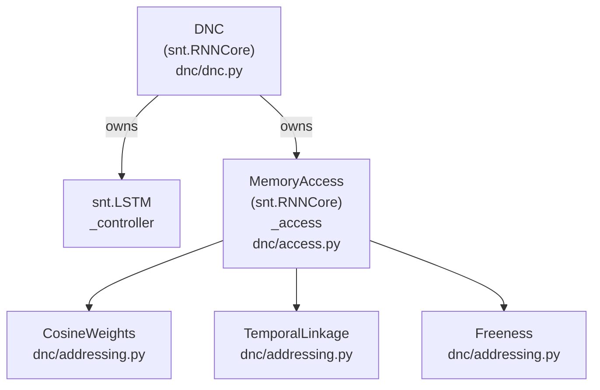

Sources: [dnc/dnc.py:36-143](), [train.py:69-91]()

---

## `DNCState` Namedtuple

[dnc/dnc.py:32-33]()

```
DNCState = collections.namedtuple('DNCState',
    ('access_output', 'access_state', 'controller_state'))
```

| Field | Type | Description |
|---|---|---|
| `access_output` | `Tensor [batch, num_reads * word_size]` | Flattened read vectors from the previous memory access step |
| `access_state` | `AccessState` namedtuple | Full internal state of the `MemoryAccess` module (memory, read/write weights, linkage, usage) |
| `controller_state` | LSTM state tuple | Hidden and cell state of the LSTM controller |

`DNCState` is both the type returned by `initial_state` and the `prev_state` argument received by `_build` on every step.

Sources: [dnc/dnc.py:32-33](), [dnc/dnc.py:72-76]()

---

## Constructor

[dnc/dnc.py:42-76]()

```python
DNC(access_config, controller_config, output_size, clip_value=None, name='dnc')
```

| Parameter | Type | Description |
|---|---|---|
| `access_config` | `dict` | Keyword arguments forwarded to `MemoryAccess` (`memory_size`, `word_size`, `num_reads`, `num_writes`) |
| `controller_config` | `dict` | Keyword arguments forwarded to `snt.LSTM` (typically `hidden_size`) |
| `output_size` | `int` | Dimensionality of the final output vector produced at each time step |
| `clip_value` | `float` or `None` | If set, clips outputs to `[-clip_value, clip_value]`; `None` disables clipping |
| `name` | `str` | Sonnet module name, defaults to `'dnc'` |

During construction, both sub-modules are instantiated inside `self._enter_variable_scope()` so their variables are scoped under the DNC:

- `self._controller = snt.LSTM(**controller_config)` [dnc/dnc.py:65]()
- `self._access = access.MemoryAccess(**access_config)` [dnc/dnc.py:66]()

`self._access_output_size` is computed as `np.prod(self._access.output_size.as_list())`, giving the flat size of the concatenated read vectors [dnc/dnc.py:68]().

In `train.py`, the DNC is constructed as:

```python
dnc_core = dnc.DNC(access_config, controller_config, output_size, clip_value)
```

where `access_config` carries `memory_size`, `word_size`, `num_reads`, `num_writes`, and `controller_config` carries `hidden_size` [train.py:72-83]().

Sources: [dnc/dnc.py:42-76](), [train.py:72-84]()

---

## `_build` — Forward Pass

[dnc/dnc.py:84-127]()

This is the method Sonnet calls on each time step (via `__call__`). It implements one full recurrent step of the DNC.

**Forward pass dataflow diagram**

```mermaid
flowchart TD
    inputs["inputs\n(external input at time t)"]
    prev_access_output["prev_state.access_output\n(prev read vectors, flattened)"]
    concat1["tf.concat\ncontroller_input\n[inputs || prev_access_output]"]
    lstm["snt.LSTM\n_controller\ncontroller_output, controller_state"]
    clip1["_clip_if_enabled\ncontroller_output"]
    clip2["_clip_if_enabled\ncontroller_state (map_structure)"]
    memory["MemoryAccess\n_access\naccess_output, access_state"]
    concat2["tf.concat\n[controller_output || access_output]"]
    linear["snt.Linear\noutput_linear\n(output_size)"]
    clip3["_clip_if_enabled\nfinal output"]
    DNCState_out["DNCState\n(access_output, access_state, controller_state)"]

    inputs --> concat1
    prev_access_output --> concat1
    concat1 --> lstm
    lstm --> clip1
    lstm --> clip2
    clip1 --> memory
    clip1 --> concat2
    memory --> concat2
    concat2 --> linear
    linear --> clip3
    clip3 --> DNCState_out
    memory --> DNCState_out
    clip2 --> DNCState_out
```

Sources: [dnc/dnc.py:84-127]()

### Step-by-step breakdown

**1. Unpack previous state**

```
prev_access_output    = prev_state.access_output
prev_access_state     = prev_state.access_state
prev_controller_state = prev_state.controller_state
```

[dnc/dnc.py:101-103]()

**2. Build controller input**

The current external `inputs` and the previous memory read vectors (`prev_access_output`) are flattened and concatenated along axis 1:

```
controller_input = tf.concat(
    [batch_flatten(inputs), batch_flatten(prev_access_output)], 1)
```

[dnc/dnc.py:105-107]()

This gives the LSTM visibility into both the current task input and what was last read from memory.

**3. Run the LSTM controller**

```
controller_output, controller_state = self._controller(
    controller_input, prev_controller_state)
```

[dnc/dnc.py:109-110]()

**4. Clip controller output and state (optional)**

`_clip_if_enabled` applies `tf.clip_by_value(x, -clip_value, clip_value)` if `clip_value > 0`. It is applied to `controller_output` directly, and to every tensor in `controller_state` via `tf.contrib.framework.nest.map_structure`:

[dnc/dnc.py:78-82](), [dnc/dnc.py:112-113]()

**5. Run memory access**

The (clipped) `controller_output` is passed to `MemoryAccess`, which produces read vectors and updates internal memory state:

```
access_output, access_state = self._access(
    controller_output, prev_access_state)
```

[dnc/dnc.py:115-116]()

**6. Produce final output**

The controller output and the new memory read vectors are concatenated, then passed through a learned linear projection to `output_size` dimensions, and finally clipped:

```
output = tf.concat([controller_output, batch_flatten(access_output)], 1)
output = snt.Linear(output_size=..., name='output_linear')(output)
output = self._clip_if_enabled(output)
```

[dnc/dnc.py:118-122]()

The `snt.Linear` layer named `output_linear` is the only learned projection in `dnc.py` itself; its variables are created on the first call.

**7. Return output and next state**

```
return output, DNCState(
    access_output=access_output,
    access_state=access_state,
    controller_state=controller_state)
```

[dnc/dnc.py:124-127]()

Note that `access_output` stored in the returned `DNCState` is the **unflattened** read tensor, while it is flattened when used as controller input on the next step.

---

## Value Clipping

`_clip_if_enabled` is a small guard method:

[dnc/dnc.py:78-82]()

```
def _clip_if_enabled(self, x):
    if self._clip_value > 0:
        return tf.clip_by_value(x, -self._clip_value, self._clip_value)
    else:
        return x
```

It is applied at **three** points in the forward pass:

| Application point | Target |
|---|---|
| After LSTM step | `controller_output` scalar tensor |
| After LSTM step | Every tensor inside `controller_state` (via `map_structure`) |
| After output projection | Final `output` tensor |

In the default training setup, `clip_value` is `20` [train.py:35-36]().

Sources: [dnc/dnc.py:78-82](), [dnc/dnc.py:112-122](), [train.py:35-36]()

---

## `initial_state`

[dnc/dnc.py:129-134]()

```python
def initial_state(self, batch_size, dtype=tf.float32):
    return DNCState(
        controller_state=self._controller.initial_state(batch_size, dtype),
        access_state=self._access.initial_state(batch_size, dtype),
        access_output=tf.zeros(
            [batch_size] + self._access.output_size.as_list(), dtype))
```

| Field initialized | Source |
|---|---|
| `controller_state` | `snt.LSTM.initial_state` (zeros for hidden and cell) |
| `access_state` | `MemoryAccess.initial_state` (zeros for memory, weights, linkage, usage) |
| `access_output` | `tf.zeros` shaped `[batch_size, num_reads, word_size]` |

In `train.py` this is called before `tf.nn.dynamic_rnn`:

```python
initial_state = dnc_core.initial_state(FLAGS.batch_size)
output_sequence, _ = tf.nn.dynamic_rnn(
    cell=dnc_core,
    inputs=input_sequence,
    time_major=True,
    initial_state=initial_state)
```

[train.py:84-89]()

---

## `state_size` and `output_size` Properties

[dnc/dnc.py:136-142]()

These properties are required by the `snt.RNNCore` interface and allow Sonnet / TensorFlow to reason about state and output shapes without running the graph.

| Property | Returns |
|---|---|
| `state_size` | `DNCState(access_output_size, access.state_size, controller.state_size)` |
| `output_size` | `tf.TensorShape([output_size])` |

Sources: [dnc/dnc.py:136-142](), [dnc/dnc.py:72-76]()

---

## Tensor Shape Summary

Assuming `batch_size=B`, `hidden_size=H`, `num_reads=R`, `word_size=W`, `output_size=O`:

| Tensor | Shape |
|---|---|
| `inputs` (external) | `[B, input_dim]` |
| `prev_access_output` (flattened) | `[B, R*W]` |
| `controller_input` | `[B, input_dim + R*W]` |
| `controller_output` | `[B, H]` |
| `access_output` | `[B, R, W]` |
| `concat([controller_output, flat(access_output)])` | `[B, H + R*W]` |
| final `output` (after `output_linear`) | `[B, O]` |

Sources: [dnc/dnc.py:84-127]()

---

# Page: Memory Access Module

# Memory Access Module

<details>
<summary>Relevant source files</summary>

The following files were used as context for generating this wiki page:

- [dnc/access.py](dnc/access.py)
- [dnc/access_test.py](dnc/access_test.py)

</details>


This page documents `MemoryAccess` in [dnc/access.py](), which is the external memory interface of the DNC. It sits between the LSTM controller (described in [DNC Core](#3.1)) and the low-level addressing primitives (described in [Memory Addressing](#3.3)). Its responsibilities are: parsing the controller's flat output vector into structured control signals, performing writes to memory, and performing reads from memory. It does not define cosine similarity, temporal link tracking, or usage tracking directly — those are delegated to sub-modules in `addressing.py`.

---

## Overview

`MemoryAccess` is a `snt.RNNCore`. At each time step it receives a flat input vector from the controller and a previous `AccessState`, then produces a tensor of read words and an updated `AccessState`.

**State diagram of `MemoryAccess`**

```mermaid
stateDiagram-v2
    direction LR
    state "AccessState (t-1)" as prev
    state "AccessState (t)" as next
    state "MemoryAccess._build" as build

    prev --> build : "prev_state"
    build --> next : "next_state"
    build --> ReadWords : "output: [batch, num_reads, word_size]"
```

Sources: [dnc/access.py:113-158]()

---

## AccessState

[dnc/access.py:28-29]()

`AccessState` is a `collections.namedtuple` with five fields. It is both the state carried between time steps and the initial state returned by `snt.RNNCore.initial_state`.

| Field | Shape | Description |
|---|---|---|
| `memory` | `[batch, memory_size, word_size]` | The memory matrix M |
| `read_weights` | `[batch, num_reads, memory_size]` | Previous read weight distributions |
| `write_weights` | `[batch, num_writes, memory_size]` | Previous write weight distributions |
| `linkage` | `TemporalLinkageState` | Link matrix + precedence weights (see [Memory Addressing](#3.3)) |
| `usage` | `[batch, memory_size]` | Per-location usage scalars (see [Memory Addressing](#3.3)) |

The `state_size` property returns an `AccessState` filled with `tf.TensorShape` objects, and `output_size` returns `tf.TensorShape([num_reads, word_size])`.

Sources: [dnc/access.py:28-29](), [dnc/access.py:305-318]()

---

## Constructor Parameters

`MemoryAccess.__init__` instantiates all sub-modules and stores the four hyper-parameters:

| Parameter | Default | Paper symbol | Meaning |
|---|---|---|---|
| `memory_size` | 128 | N | Number of memory slots |
| `word_size` | 20 | W | Width of each memory slot |
| `num_reads` | 1 | R | Number of read heads |
| `num_writes` | 1 | — | Number of write heads |

Two `CosineWeights` instances are created (one per read, one per write), plus one `TemporalLinkage` and one `Freeness` instance.

Sources: [dnc/access.py:84-111]()

---

## Forward Pass (`_build`)

The `_build` method executes each time step in four ordered stages:

**Forward Pass Flow**

```mermaid
flowchart TD
    I["inputs\n[batch, input_size]"] --> RI["_read_inputs(inputs)\nreturns dict of control signals"]
    RI --> UPD["_freeness(\n  write_weights=prev_state.write_weights,\n  free_gate=inputs['free_gate'],\n  read_weights=prev_state.read_weights,\n  prev_usage=prev_state.usage\n)\nreturns: usage"]
    UPD --> WW["_write_weights(inputs, prev_state.memory, usage)\nreturns: write_weights\n[batch, num_writes, memory_size]"]
    WW --> EW["_erase_and_write(\n  prev_state.memory,\n  address=write_weights,\n  reset_weights=inputs['erase_vectors'],\n  values=inputs['write_vectors']\n)\nreturns: memory"]
    EW --> LK["_linkage(write_weights, prev_state.linkage)\nreturns: linkage_state"]
    LK --> RW["_read_weights(inputs, memory,\n  prev_read_weights=prev_state.read_weights,\n  link=linkage_state.link\n)\nreturns: read_weights\n[batch, num_reads, memory_size]"]
    RW --> RD["tf.matmul(read_weights, memory)\nreturns: read_words\n[batch, num_reads, word_size]"]
    RD --> OUT["output: read_words\nnext_state: AccessState(memory, read_weights,\n  write_weights, linkage_state, usage)"]
```

Sources: [dnc/access.py:113-158]()

---

## Parsing Inputs (`_read_inputs`)

[dnc/access.py:160-218]()

The controller emits a single flat vector. `_read_inputs` applies separate learned linear projections to produce each named control signal. All projections operate on the same `inputs` tensor via closures over a local `_linear` helper that reshapes the flat output into `[batch, first_dim, second_dim]`.

**Control signals produced by `_read_inputs`**

| Key in result dict | Shape | Activation | Description |
|---|---|---|---|
| `write_vectors` | `[batch, num_writes, word_size]` | none | Values to write to memory (v_t^i) |
| `erase_vectors` | `[batch, num_writes, word_size]` | sigmoid | Erase gate per write head (e_t^i) |
| `free_gate` | `[batch, num_reads]` | sigmoid | Fraction of read memory to free (f_t^j) |
| `allocation_gate` | `[batch, num_writes]` | sigmoid | Interpolation toward allocation addressing (g_t^{a,i}) |
| `write_gate` | `[batch, num_writes]` | sigmoid | Overall write amount gating (g_t^{w,i}) |
| `read_mode` | `[batch, num_reads, 1+2*num_writes]` | softmax | Mode mixing weights (π_t^j) |
| `write_content_keys` | `[batch, num_writes, word_size]` | none | Keys for write content addressing |
| `write_content_strengths` | `[batch, num_writes]` | none | Strengths for write content addressing |
| `read_content_keys` | `[batch, num_reads, word_size]` | none | Keys for read content addressing |
| `read_content_strengths` | `[batch, num_reads]` | none | Strengths for read content addressing |

The `read_mode` vector has `1 + 2 * num_writes` entries per read head. The softmax ensures the three mode categories sum to 1 and are non-negative, constituting a valid probability distribution.

Sources: [dnc/access.py:160-218]()

---

## Write Pathway

### Write Weights (`_write_weights`)

[dnc/access.py:220-257]()

Write weights blend two sources — content-based addressing and allocation-based addressing — then gate the result:

```
w_t^{w,i} = g_t^{w,i} * ( g_t^{a,i} * a_t^i  +  (1 - g_t^{a,i}) * c_t^{w,i} )
```

- `c_t^{w,i}` — content weights from `CosineWeights` (`_write_content_weights_mod`)
- `a_t^i` — allocation weights from `Freeness.write_allocation_weights`
- `g_t^{a,i}` — `allocation_gate` interpolates between the two
- `g_t^{w,i}` — `write_gate` scales the final weight

When `allocation_gate == 1` the write head targets unused memory; when `allocation_gate == 0` it targets content-matched locations. The `write_gate` can suppress the write entirely.

**Write weight computation graph**

```mermaid
flowchart TD
    CW["CosineWeights(\n  memory,\n  write_content_keys,\n  write_content_strengths\n)"] --> WCONT["write_content_weights\nc_t^{w,i}"]
    FR["Freeness.write_allocation_weights(\n  usage,\n  allocation_gate * write_gate,\n  num_writes\n)"] --> WALLOC["write_allocation_weights\na_t^i"]
    WCONT --> INTERP["allocation_gate * a_t + (1 - allocation_gate) * c_t^w"]
    WALLOC --> INTERP
    INTERP --> GATE["write_gate * result"]
    GATE --> WW["write_weights\n[batch, num_writes, memory_size]"]
```

Sources: [dnc/access.py:220-257]()

### Erase and Write (`_erase_and_write`)

[dnc/access.py:32-63]()

Once write weights are computed, the memory update is a two-step operation:

**Erase step:**
```
M_t'(i) = M_{t-1}(i) * (1 - w_t(i) * e_t)
```
All write heads contribute a multiplicative erase, combined via `reduce_prod` across the `num_writes` axis. This ensures that multiple write heads each get to erase independently.

**Add step:**
```
M_t(i) = M_t'(i) + w_t(i) * a_t
```
The write vectors are added to the erased memory via `tf.matmul(address, values, adjoint_a=True)`, which accumulates contributions from all write heads at once.

| Argument | Shape |
|---|---|
| `memory` | `[batch, memory_size, word_size]` |
| `address` (write_weights) | `[batch, num_writes, memory_size]` |
| `reset_weights` (erase_vectors) | `[batch, num_writes, word_size]` |
| `values` (write_vectors) | `[batch, num_writes, word_size]` |

Sources: [dnc/access.py:32-63]()

---

## Read Pathway

### Read Weights (`_read_weights`)

[dnc/access.py:259-303]()

Each read head combines three addressing modes whose mixing proportions come from `inputs['read_mode']`:

| `read_mode` slice | Mode | Source |
|---|---|---|
| `[:, :, :num_writes]` | backward | `TemporalLinkage.directional_read_weights(forward=False)` |
| `[:, :, num_writes:2*num_writes]` | forward | `TemporalLinkage.directional_read_weights(forward=True)` |
| `[:, :, 2*num_writes]` | content | `CosineWeights` (`_read_content_weights_mod`) |

The final read weight for each head is:

```
w_t^{r,j} = π_content * c_t^{r,j}
           + Σ_i π_forward_i  * f_t^{i,j}
           + Σ_i π_backward_i * b_t^{i,j}
```

**Read weight computation graph**

```mermaid
flowchart TD
    CWR["CosineWeights(\n  memory,\n  read_content_keys,\n  read_content_strengths\n)"] --> CONT["content_weights\nc_t^{r,j}"]
    LINK_F["TemporalLinkage.directional_read_weights(\n  link, prev_read_weights,\n  forward=True\n)"] --> FWD["forward_weights\nf_t^{i,j}"]
    LINK_B["TemporalLinkage.directional_read_weights(\n  link, prev_read_weights,\n  forward=False\n)"] --> BWD["backward_weights\nb_t^{i,j}"]
    RM["inputs['read_mode']\n[batch, num_reads, 1+2*num_writes]"] --> CM["content_mode\n[:, :, 2*num_writes]"]
    RM --> FM["forward_mode\n[:, :, num_writes:2*num_writes]"]
    RM --> BM["backward_mode\n[:, :, :num_writes]"]
    CONT --> RW["read_weights\n[batch, num_reads, memory_size]"]
    FWD --> RW
    BWD --> RW
    CM --> RW
    FM --> RW
    BM --> RW
```

Sources: [dnc/access.py:259-303]()

---

## Sub-module Composition Summary

**Component ownership within `MemoryAccess`**

```mermaid
classDiagram
    class MemoryAccess {
        +memory_size: int
        +word_size: int
        +num_reads: int
        +num_writes: int
        +_build(inputs, prev_state)
        +_read_inputs(inputs) dict
        +_write_weights(inputs, memory, usage)
        +_read_weights(inputs, memory, prev_read_weights, link)
        +state_size AccessState
        +output_size TensorShape
    }
    class CosineWeights_write {
        name="write_content_weights"
        +__call__(memory, keys, strengths)
    }
    class CosineWeights_read {
        name="read_content_weights"
        +__call__(memory, keys, strengths)
    }
    class TemporalLinkage {
        +__call__(write_weights, prev_state)
        +directional_read_weights(link, prev_weights, forward)
        +state_size TemporalLinkageState
    }
    class Freeness {
        +__call__(write_weights, free_gate, read_weights, prev_usage)
        +write_allocation_weights(usage, write_gates, num_writes)
        +state_size TensorShape
    }
    class _erase_and_write {
        <<function>>
        +erase_memory scope
        +additive_write scope
    }

    MemoryAccess --> CosineWeights_write : "_write_content_weights_mod"
    MemoryAccess --> CosineWeights_read : "_read_content_weights_mod"
    MemoryAccess --> TemporalLinkage : "_linkage"
    MemoryAccess --> Freeness : "_freeness"
    MemoryAccess --> _erase_and_write : "calls in _build"
```

Sources: [dnc/access.py:84-111](), [dnc/access.py:113-158]()

---

## Data Flow Through a Single Time Step

```mermaid
sequenceDiagram
    participant ctrl as "Controller output\n(flat vector)"
    participant ri as "_read_inputs"
    participant fr as "_freeness"
    participant ww as "_write_weights"
    participant ew as "_erase_and_write"
    participant lk as "_linkage"
    participant rw as "_read_weights"
    participant out as "Output"

    ctrl->>ri: "inputs [batch, input_size]"
    ri-->>fr: "free_gate"
    ri-->>ww: "allocation_gate, write_gate,\nwrite_content_keys/strengths"
    ri-->>ew: "erase_vectors, write_vectors"
    ri-->>rw: "read_content_keys/strengths, read_mode"

    fr->>ww: "usage [batch, memory_size]"
    ww->>ew: "write_weights [batch, num_writes, memory_size]"
    ew-->>lk: "write_weights"
    ew-->>rw: "memory (updated)"
    lk-->>rw: "linkage_state.link"
    rw->>out: "read_weights -> read_words\n[batch, num_reads, word_size]"
```

Sources: [dnc/access.py:113-158]()

---

## Key Tensor Shapes Reference

| Tensor | Shape |
|---|---|
| `inputs` to `_build` | `[batch, input_size]` |
| `memory` | `[batch, memory_size, word_size]` |
| `write_weights` | `[batch, num_writes, memory_size]` |
| `read_weights` | `[batch, num_reads, memory_size]` |
| `usage` | `[batch, memory_size]` |
| `linkage.link` | `[batch, num_writes, memory_size, memory_size]` |
| `linkage.precedence_weights` | `[batch, num_writes, memory_size]` |
| `read_mode` | `[batch, num_reads, 1 + 2*num_writes]` |
| `read_words` (output) | `[batch, num_reads, word_size]` |

Sources: [dnc/access.py:305-318](), [dnc/access.py:259-303]()

---

## Testing

The test file [dnc/access_test.py]() exercises `MemoryAccess` with `BATCH_SIZE=2`, `MEMORY_SIZE=20`, `WORD_SIZE=6`, `NUM_READS=2`, `NUM_WRITES=3`, `TIME_STEPS=4`, `INPUT_SIZE=10`.

| Test | What it checks |
|---|---|
| `testBuildAndTrain` | Full `dynamic_rnn` forward + backward pass completes; gradient descent step runs without error |
| `testValidReadMode` | `read_mode` output sums to 1 per read head and is non-negative |
| `testWriteWeights` | With `allocation_gate=1` and a single free slot, write weights concentrate on that slot |
| `testReadWeights` | With content mode active and a matching key, read weights concentrate on the correct memory row |
| `testGradients` | Numerical gradient check over `inputs`, `memory`, `read_weights`, `linkage.precedence_weights`, `linkage.link`; error < 0.1 |

For a full breakdown of each test case see [Memory Access Tests](#4.2).

Sources: [dnc/access_test.py:37-159]()

---

# Page: Memory Addressing

# Memory Addressing

<details>
<summary>Relevant source files</summary>

The following files were used as context for generating this wiki page:

- [dnc/addressing.py](dnc/addressing.py)
- [dnc/addressing_test.py](dnc/addressing_test.py)

</details>


This page documents the three memory addressing mechanisms implemented in [dnc/addressing.py](), which are consumed by `MemoryAccess` (see [Memory Access Module](#3.2)) to compute read and write weights at each time step. The three mechanisms are:

- **`CosineWeights`** — content-based lookup
- **`TemporalLinkage`** — write-order tracking for sequential reads
- **`Freeness`** — usage tracking for allocation-based writes

A shared helper, `weighted_softmax`, supports content-based addressing. A module-level constant `_EPSILON = 1e-6` is used throughout to prevent numerical instability from zero-norm vectors or zero usage values.

---

## Module Overview

**Figure: addressing.py component map**

```mermaid
graph TD
    MA["MemoryAccess\n(access.py)"]
    CW["CosineWeights\nsnt.AbstractModule"]
    TL["TemporalLinkage\nsnt.RNNCore"]
    FR["Freeness\nsnt.RNNCore"]
    WS["weighted_softmax()\nhelper function"]
    TLS["TemporalLinkageState\nnamedtuple\n(link, precedence_weights)"]
    UTIL["util.py\nbatch_invert_permutation\nbatch_gather\nreduce_prod"]

    MA -->|"content addressing\n(read + write)"| CW
    MA -->|"temporal ordering"| TL
    MA -->|"usage / allocation"| FR
    CW -->|"calls"| WS
    TL -->|"state type"| TLS
    FR -->|"calls"| UTIL
```

Sources: [dnc/addressing.py:1-411]()

---

## `weighted_softmax`

[dnc/addressing.py:39-55]()

```
weighted_softmax(activations, strengths, strengths_op)
```

This is a free function (not a module) used by `CosineWeights` and indirectly by the content addressing path.

| Argument | Shape | Description |
|---|---|---|
| `activations` | `[batch, num_heads, memory_size]` | Raw similarity scores |
| `strengths` | `[batch, num_heads]` | Per-head sharpening strengths |
| `strengths_op` | callable | Applied to `strengths` before multiplication (default: `tf.nn.softplus`) |

**What it does:** Multiplies `activations` element-wise by `strengths_op(strengths)` (broadcast over memory dimension), then applies `tf.nn.softmax` over the last axis via `snt.BatchApply`. When `strengths` is all-ones and `strengths_op` is `tf.identity`, the result is identical to a plain softmax.

Sources: [dnc/addressing.py:39-55](), [dnc/addressing_test.py:34-58]()

---

## `CosineWeights`

[dnc/addressing.py:58-105]()

`CosineWeights` is a `snt.AbstractModule` that implements content-based addressing. Given a set of query keys and the current memory matrix, it returns a probability distribution over memory locations for each head.

### Constructor

```
CosineWeights(num_heads, word_size, strength_op=tf.nn.softplus, name='cosine_weights')
```

| Parameter | Description |
|---|---|
| `num_heads` | Number of read or write heads |
| `word_size` | Dimensionality of each memory word |
| `strength_op` | Transform applied to strengths (default `tf.nn.softplus`) |

### Forward pass: `_build`

[dnc/addressing.py:83-105]()

| Input | Shape | Description |
|---|---|---|
| `memory` | `[batch, memory_size, word_size]` | Current memory matrix |
| `keys` | `[batch, num_heads, word_size]` | Query vectors |
| `strengths` | `[batch, num_heads]` | Sharpening factors |

**Output:** `[batch, num_heads, memory_size]` — attention weights over memory.

**Figure: CosineWeights computation graph**

```mermaid
flowchart LR
    keys["keys\n[batch, heads, word_size]"]
    memory["memory\n[batch, memory_size, word_size]"]
    strengths["strengths\n[batch, heads]"]

    dot["tf.matmul(keys, memory^T)\ndot products\n[batch, heads, memory_size]"]
    key_norms["_vector_norms(keys)\n[batch, heads, 1]"]
    mem_norms["_vector_norms(memory)\n[batch, memory_size, 1]"]
    norm["tf.matmul(key_norms, mem_norms^T)\n[batch, heads, memory_size]"]
    sim["similarity = dot / (norm + eps)"]
    ws["weighted_softmax(sim, strengths, softplus)"]
    out["output weights\n[batch, heads, memory_size]"]

    keys --> dot
    memory --> dot
    keys --> key_norms
    memory --> mem_norms
    key_norms --> norm
    mem_norms --> norm
    dot --> sim
    norm --> sim
    sim --> ws
    strengths --> ws
    ws --> out
```

The helper `_vector_norms` [dnc/addressing.py:34-36]() computes `sqrt(sum(m^2, axis=2) + _EPSILON)` to avoid division by zero even when a memory slot or key vector is all zeros.

Sources: [dnc/addressing.py:34-105](), [dnc/addressing_test.py:61-150]()

---

## `TemporalLinkage`

[dnc/addressing.py:108-249]()

`TemporalLinkage` is a `snt.RNNCore` that maintains a directed graph over memory slots encoding the order in which they were written. This enables "forward" and "backward" reads that follow the write sequence.

### State: `TemporalLinkageState`

[dnc/addressing.py:30-31]()

```python
TemporalLinkageState = collections.namedtuple('TemporalLinkageState',
                                              ('link', 'precedence_weights'))
```

| Field | Shape | Description |
|---|---|---|
| `link` | `[batch, num_writes, memory_size, memory_size]` | Adjacency matrices — `link[b, w, i, j]` is the probability that slot `j` was written just before slot `i` by write head `w` |
| `precedence_weights` | `[batch, num_writes, memory_size]` | Smoothed write weights representing where each head last wrote |

### Constructor

```
TemporalLinkage(memory_size, num_writes, name='temporal_linkage')
```

### Forward pass: `_build`

[dnc/addressing.py:133-153]()

Takes `write_weights [batch, num_writes, memory_size]` and `prev_state: TemporalLinkageState`. Returns an updated `TemporalLinkageState`.

Internally calls two private methods:

#### `_precedence_weights`

[dnc/addressing.py:220-240]()

Updates the precedence weights — a running "where did I last write" signal:

```
new_p = (1 - sum(w)) * prev_p + w
```

- If `sum(w) ≈ 0` (no writing), precedence is unchanged.
- If `sum(w) ≈ 1` (full writing), precedence is replaced by `w`.

#### `_link`

[dnc/addressing.py:183-218]()

Updates the link matrix using the formula:

```
L_t[i, j] = (1 - w_i - w_j) * L_{t-1}[i, j]  +  w_i * p_{t-1}[j]
```

where `w` is the current write weight and `p` is the previous precedence weight. The diagonal is forced to zero by `tf.matrix_set_diag` to prevent self-loops.

**Figure: Temporal Linkage state update**

```mermaid
flowchart TD
    ww["write_weights\n[batch, num_writes, memory_size]"]
    pp["prev_state.precedence_weights"]
    pl["prev_state.link"]

    upd_p["_precedence_weights()\nnew_p = (1 - sum_w) * prev_p + w"]
    upd_l["_link()\nL_new = (1-w_i-w_j)*L_old + w_i*p_old\ndiagonal zeroed"]

    TLS["TemporalLinkageState\n(link=L_new, precedence_weights=new_p)"]

    ww --> upd_p
    pp --> upd_p
    ww --> upd_l
    pp --> upd_l
    pl --> upd_l
    upd_p --> TLS
    upd_l --> TLS
```

### `directional_read_weights`

[dnc/addressing.py:155-181]()

Computes forward or backward read addresses by multiplying previous read weights against the link matrix.

```
directional_read_weights(link, prev_read_weights, forward: bool)
```

| Argument | Shape |
|---|---|
| `link` | `[batch, num_writes, memory_size, memory_size]` |
| `prev_read_weights` | `[batch, num_reads, memory_size]` |

**Output:** `[batch, num_reads, num_writes, memory_size]`

- **Forward (`forward=True`):** `result = prev_read_weights @ link` — follows edges forward in write order.
- **Backward (`forward=False`):** `result = prev_read_weights @ link^T` — follows edges backward.

The implementation tiles `prev_read_weights` across write heads [dnc/addressing.py:177-178](), performs a batched matmul, then transposes to put reads before writes.

Sources: [dnc/addressing.py:108-249](), [dnc/addressing_test.py:153-277]()

---

## `Freeness`

[dnc/addressing.py:252-410]()

`Freeness` is a `snt.RNNCore` whose state is a single tensor of shape `[batch, memory_size]` with values in `[0, 1]` representing how "used" each memory slot is.

### Constructor

```
Freeness(memory_size, name='freeness')
```

### Forward pass: `_build`

[dnc/addressing.py:279-305]()

Updates usage given the previous time step's read and write weights.

| Input | Shape | Description |
|---|---|---|
| `write_weights` | `[batch, num_writes, memory_size]` | Previous write addresses |
| `free_gate` | `[batch, num_reads]` | Per-head gate — how much of a read location can be freed |
| `read_weights` | `[batch, num_reads, memory_size]` | Previous read addresses |
| `prev_usage` | `[batch, memory_size]` | Usage `u_{t-1}` |

**Output:** `[batch, memory_size]` — updated usage `u_t`.

Note: `write_weights` is wrapped in `tf.stop_gradient` [dnc/addressing.py:302]() so usage does not backpropagate through the write weights in this path.

**Figure: Freeness._build computation**

```mermaid
flowchart TD
    ww["write_weights\n(stop_gradient)"]
    pu["prev_usage"]
    rw["read_weights"]
    fg["free_gate"]

    uaw["_usage_after_write(prev_usage, write_weights)\nu = prev_u + (1-prev_u) * agg_write_w\nvia reduce_prod"]
    uar["_usage_after_read(usage, free_gate, read_weights)\nphi = reduce_prod(1 - gate*read_w)\nu = u * phi"]

    out["updated usage u_t\n[batch, memory_size]"]

    ww --> uaw
    pu --> uaw
    uaw --> uar
    rw --> uar
    fg --> uar
    uar --> out
```

#### `_usage_after_write`

[dnc/addressing.py:342-355]()

Aggregates multiple write heads using `util.reduce_prod`:

```
agg_write_w = 1 - prod_over_heads(1 - write_weights[head])
new_usage = prev_usage + (1 - prev_usage) * agg_write_w
```

Usage increases toward 1 at written locations.

#### `_usage_after_read`

[dnc/addressing.py:357-374]()

Decreases usage at read locations when `free_gate` is high:

```
phi = prod_over_reads(1 - free_gate[head] * read_weights[head])
new_usage = prev_usage * phi
```

### `write_allocation_weights`

[dnc/addressing.py:307-340]()

Finds free memory locations to write to. For multiple write heads, usage is updated iteratively so each head sees diminishing returns from an already-claimed slot.

```
write_allocation_weights(usage, write_gates, num_writes)
```

| Argument | Shape | Description |
|---|---|---|
| `usage` | `[batch, memory_size]` | Current memory usage |
| `write_gates` | `[batch, num_writes]` | How much each head commits to writing |
| `num_writes` | int | Number of write heads |

**Output:** `[batch, num_writes, memory_size]`

The loop [dnc/addressing.py:334-337]() updates `usage` after each head:

```
usage += (1 - usage) * write_gates[:, i, :] * allocation_weights[i]
```

This ensures write head `i+1` cannot claim the same slot that write head `i` just claimed.

### `_allocation`

[dnc/addressing.py:376-405]()

Computes the allocation weight for a single write head from current `usage`.

The allocation formula assigns weight inversely proportional to usage: the least-used slot receives the highest allocation weight. Mathematically it corresponds to `a_t[φ_t[j]]` from the DNC paper, where `φ_t` is a permutation that sorts usage in ascending order.

**Implementation steps:**

1. Clamp usage: `usage = _EPSILON + (1 - _EPSILON) * usage`
2. Sort `1 - usage` descending via `tf.nn.top_k` to get `sorted_nonusage` and sort `indices`
3. Compute `sorted_usage = 1 - sorted_nonusage`
4. `prod_sorted_usage = cumprod(sorted_usage, exclusive=True)` — product of all more-used slots
5. `sorted_allocation = sorted_nonusage * prod_sorted_usage`
6. Unsort via `util.batch_invert_permutation(indices)` and `util.batch_gather`

**Figure: _allocation data flow**

```mermaid
flowchart LR
    usage["usage\n[batch, memory_size]"]
    clamp["clamp to [eps, 1]"]
    topk["tf.nn.top_k(1-usage)\nsorted_nonusage, indices"]
    cumprod["tf.cumprod(sorted_usage)\nexclusive=True"]
    mult["sorted_allocation\n= sorted_nonusage * cumprod"]
    inv["util.batch_invert_permutation(indices)"]
    gather["util.batch_gather(sorted_allocation, inverse_indices)"]
    out["allocation weights\n[batch, memory_size]"]

    usage --> clamp
    clamp --> topk
    topk --> cumprod
    topk --> mult
    cumprod --> mult
    topk --> inv
    inv --> gather
    mult --> gather
    gather --> out
```

Sources: [dnc/addressing.py:252-410](), [dnc/addressing_test.py:280-421]()

---

## Tensor Shape Summary

| Tensor | Shape | Produced by |
|---|---|---|
| Content weights (read/write) | `[batch, num_heads, memory_size]` | `CosineWeights._build` |
| Directional read weights | `[batch, num_reads, num_writes, memory_size]` | `TemporalLinkage.directional_read_weights` |
| Linkage matrix `link` | `[batch, num_writes, memory_size, memory_size]` | `TemporalLinkage._build` |
| Precedence weights | `[batch, num_writes, memory_size]` | `TemporalLinkage._build` |
| Usage | `[batch, memory_size]` | `Freeness._build` |
| Allocation weights | `[batch, num_writes, memory_size]` | `Freeness.write_allocation_weights` |

---

## Numerical Stability

| Concern | Mitigation |
|---|---|
| Zero-norm key or memory vector in cosine similarity | `_vector_norms` adds `_EPSILON` under the square root; `_EPSILON` added to denominator in `CosineWeights._build` |
| Zero usage in `_allocation` cumprod | Usage clamped to `[_EPSILON, 1]` before cumprod |
| Gradient through write weights in `Freeness` | `tf.stop_gradient(write_weights)` in `Freeness._build` |

Sources: [dnc/addressing.py:27-28](), [dnc/addressing.py:34-36](), [dnc/addressing.py:103](), [dnc/addressing.py:302](), [dnc/addressing.py:393]()

---

# Page: Utility Functions

# Utility Functions

<details>
<summary>Relevant source files</summary>

The following files were used as context for generating this wiki page:

- [dnc/util.py](dnc/util.py)
- [dnc/util_test.py](dnc/util_test.py)

</details>


This page documents the four helper functions in [dnc/util.py](), which provide low-level tensor manipulation primitives used throughout the DNC memory system. These functions exist primarily to work around limitations of TensorFlow's built-in ops (e.g., lack of batched permutation inversion, poor CPU gradient performance for `tf.reduce_prod`). For details about how the modules that consume these utilities work, see [Memory Access Module](#3.2) and [Memory Addressing](#3.3).

---

## Overview

`dnc/util.py` exports four functions:

| Function | Type | Purpose |
|---|---|---|
| `batch_invert_permutation` | TF op | Invert a batch of permutation vectors |
| `batch_gather` | TF op | Gather per-row indexed values from a 2D tensor |
| `reduce_prod` | TF op | Compute a product along an axis with efficient gradients |
| `one_hot` | NumPy | Build a static one-hot vector |

**Call sites in the broader codebase:**

| Utility | Called from |
|---|---|
| `batch_invert_permutation` | `dnc/addressing.py` — `Freeness._allocation` |
| `batch_gather` | `dnc/addressing.py` — `Freeness._allocation` |
| `reduce_prod` | `dnc/addressing.py` — `Freeness._allocation` |
| `one_hot` | `dnc/access.py` — `MemoryAccess._read_inputs` |

Sources: [dnc/util.py:1-73](), [dnc/addressing.py](), [dnc/access.py]()

---

## Function Reference

### `batch_invert_permutation`

[dnc/util.py:25-39]()

**Signature:** `batch_invert_permutation(permutations) -> Tensor`

TensorFlow's `tf.invert_permutation` operates only on a 1D vector. `batch_invert_permutation` extends it to work over a 2D batch of shape `[batch_size, length]`.

**Strategy — global index offsetting:**

Rather than looping over the batch dimension, the function lifts all permutation rows into a single flat integer space by adding a row-dependent offset to each element. It then calls `tf.invert_permutation` once on the resulting flat vector, and subtracts the offsets back out.

**Step-by-step breakdown:**

| Step | Operation | Effect |
|---|---|---|
| 1 | Cast to `tf.float32` | Allows arithmetic |
| 2 | Compute `rg`: range `[0, N·L, L]` | One offset per row (multiples of `L`) |
| 3 | Tile `rg` to shape `[N, L]` | Match permutation shape |
| 4 | `perm = perm + rg` | Each row's indices are shifted into a unique integer range |
| 5 | Flatten to 1D | Produces a single global permutation of length `N·L` |
| 6 | `tf.invert_permutation` | Inverts the single flat permutation |
| 7 | Reshape to `[N, L]` | Restore batch dimension |
| 8 | Subtract `rg` | Remove the offsets to recover local per-row indices |

**Correctness property verified in tests:**
For every batch index `i` and position `j`:
```
permutations[i][inverse[i][j]] == j
```
Sources: [dnc/util.py:25-39](), [dnc/util_test.py:32-50]()

---

### `batch_gather`

[dnc/util.py:42-52]()

**Signature:** `batch_gather(values, indices) -> Tensor`

Applies a per-row index lookup over a 2D tensor, equivalent to `values[i][indices[i][j]]` for each `i, j`. TensorFlow's `tf.gather` does not natively handle per-row index vectors, so this function constructs the required coordinate pairs for `tf.gather_nd`.

**Strategy — coordinate-pair construction:**

Each lookup becomes a `(row, col)` pair, where the row coordinate is derived from `tf.range(batch_size)` and the column coordinate is taken directly from `indices`.

**Step-by-step breakdown:**

| Step | Operation | Effect |
|---|---|---|
| 1 | `idx = expand_dims(indices, -1)` | Shape `[N, L, 1]` — column coords |
| 2 | `rg = range(N)` tiled to `[N, L, 1]` | Row coords |
| 3 | `gidx = concat([rg, idx], -1)` | Shape `[N, L, 2]` — (row, col) pairs |
| 4 | `tf.gather_nd(values, gidx)` | Lookup each coordinate pair |

**Example (from tests):**

```
values  = [[3, 1, 4, 1],
           [5, 9, 2, 6],
           [5, 3, 5, 7]]
indices = [[1, 2, 0, 3],
           [3, 0, 1, 2],
           [0, 2, 1, 3]]
result  = [[1, 4, 3, 1],
           [6, 5, 9, 2],
           [5, 5, 3, 7]]
```

Sources: [dnc/util.py:42-52](), [dnc/util_test.py:53-62]()

---

### `reduce_prod`

[dnc/util.py:61-72]()

**Signature:** `reduce_prod(x, axis, name=None) -> Tensor`

Computes the product of elements along `axis`. The built-in `tf.reduce_prod` has poor gradient computation performance on CPU. This function uses `tf.cumprod` with `reverse=True` as a workaround, then extracts the first element of the cumulative product (which equals the total product).

**Why `tf.cumprod` is faster for gradients:**

`tf.cumprod`'s gradient is implemented efficiently via prefix products, whereas `tf.reduce_prod`'s gradient requires dividing out individual elements, which is numerically problematic and slow on CPU.

**Mechanism:**

1. `cp = tf.cumprod(x, axis, reverse=True)` — The first element along the reversed cumulative product axis equals the product of all elements.
2. Construct index pairs `[i, 0]` for each row `i` using `tf.range` and `tf.zeros`.
3. `tf.gather_nd(cp, indices)` extracts the first element from each row, which is the total product.

Sources: [dnc/util.py:61-72]()

---

### `one_hot`

[dnc/util.py:55-58]()

**Signature:** `one_hot(length, index) -> np.ndarray`

Returns a NumPy array of shape `[length]` filled with zeros, with a `1.0` at position `index`. This is a static (graph-construction-time) utility; it does not produce a TensorFlow op.

**Used in:** `dnc/access.py` — `MemoryAccess._read_inputs`, where it constructs fixed one-hot vectors that identify the three read modes (`content`, `forward`, `backward`) as part of the mode interpolation logic.

Sources: [dnc/util.py:55-58](), [dnc/access.py]()

---

## Dependency Map

The diagram below shows how the four utility functions flow from `dnc/util.py` into their call sites.

**Diagram: util.py functions and their consumers**

```mermaid
graph TD
    subgraph "dnc/util.py"
        BIP["batch_invert_permutation"]
        BG["batch_gather"]
        RP["reduce_prod"]
        OH["one_hot"]
    end

    subgraph "dnc/addressing.py"
        ALLOC["Freeness._allocation"]
    end

    subgraph "dnc/access.py"
        RI["MemoryAccess._read_inputs"]
    end

    BIP -->|"inverts sorted usage\nfor allocation indexing"| ALLOC
    BG -->|"reorders memory slots\nby usage rank"| ALLOC
    RP -->|"computes allocation\nweights via cumprod"| ALLOC
    OH -->|"builds read mode\none-hot vectors"| RI
```

Sources: [dnc/util.py:1-73](), [dnc/addressing.py](), [dnc/access.py]()

---

## Internal Operation Flow

The three TF utility functions (`batch_invert_permutation`, `batch_gather`, `reduce_prod`) are all used together inside `Freeness._allocation` to compute write allocation weights. The diagram below shows the data flow through each of these utilities in that context.

**Diagram: Data flow through util functions in `Freeness._allocation`**

```mermaid
flowchart LR
    U["usage tensor\n[batch, memory_size]"]

    U -->|"tf.nn.top_k\n(sorted indices)"| SI["sorted_indices\n[batch, memory_size]"]
    SI -->|"batch_invert_permutation"| IND["inverse_indices\n[batch, memory_size]"]

    U -->|"batch_gather\nwith sorted_indices"| SU["sorted_usage\n[batch, memory_size]"]
    SU -->|"1 - sorted_usage"| CF["free_list\n[batch, memory_size]"]
    CF -->|"reduce_prod\n(cumprod-based)"| CP["exclusive_cumprod\n[batch, memory_size]"]
    CP -->|"sorted_usage * exclusive_cumprod"| AW["sorted_alloc_weights\n[batch, memory_size]"]
    AW -->|"batch_gather\nwith inverse_indices"| OUT["allocation_weights\n(original order)\n[batch, memory_size]"]
```

Sources: [dnc/addressing.py](), [dnc/util.py:25-72]()

---

## Summary Table

| Function | Input shape | Output shape | TF or NumPy | Key op used |
|---|---|---|---|---|
| `batch_invert_permutation` | `[N, L]` int | `[N, L]` int | TensorFlow | `tf.invert_permutation` on flattened input |
| `batch_gather` | `values [N, L]`, `indices [N, L]` | `[N, L]` | TensorFlow | `tf.gather_nd` with constructed coordinate pairs |
| `reduce_prod` | `[N, L]` float | `[N]` float | TensorFlow | `tf.cumprod(reverse=True)` + `tf.gather_nd` |
| `one_hot` | `length` int, `index` int | `[length]` float | NumPy | `np.zeros` + index assignment |

Sources: [dnc/util.py:25-72]()

---

# Page: Testing

# Testing

<details>
<summary>Relevant source files</summary>

The following files were used as context for generating this wiki page:

- [dnc/access_test.py](dnc/access_test.py)
- [dnc/addressing_test.py](dnc/addressing_test.py)
- [dnc/util_test.py](dnc/util_test.py)

</details>


This page describes the structure and philosophy of the DNC test suite. It covers which modules are tested, what files contain those tests, and how to execute them. For implementation details about each tested module, see [Core Architecture](#3), [Memory Addressing](#3.3), and [Utility Functions](#3.4).

---

## Test Suite Overview

The test suite consists of three files, each targeting a distinct layer of the `dnc/` package:

| Test File | Tested Module | Test Class(es) |
|---|---|---|
| `dnc/addressing_test.py` | `dnc/addressing.py` | `WeightedSoftmaxTest`, `CosineWeightsTest`, `TemporalLinkageTest`, `FreenessTest` |
| `dnc/access_test.py` | `dnc/access.py` | `MemoryAccessTest` |
| `dnc/util_test.py` | `dnc/util.py` | `BatchInvertPermutation`, `BatchGather` |

All test classes extend `tf.test.TestCase` and are run via `tf.test.main()`.

**Testing philosophy.** The test suite uses three primary verification strategies:

- **Shape assertions** — confirm that output tensors have the expected rank and dimensions.
- **Value bound assertions** — confirm that outputs satisfy mathematical constraints (e.g., weights in `[0, 1]`, rows summing to at most 1).
- **Numerical gradient checks** — use `tf.test.compute_gradient_error` to verify that analytical gradients match finite-difference approximations to within a tolerance.

---

## Running the Tests

Each test file is self-contained and can be run directly:

```
python -m dnc.addressing_test
python -m dnc.access_test
python -m dnc.util_test
```

Alternatively, use any test runner compatible with `tf.test.TestCase` (e.g., `pytest` or `python -m unittest discover`).

---

## Test File Map

**Test file to module dependency diagram:**

```mermaid
graph TD
    addressing_test["dnc/addressing_test.py"]
    access_test["dnc/access_test.py"]
    util_test["dnc/util_test.py"]

    addressing["dnc/addressing.py\nWeightedSoftmax, CosineWeights,\nTemporalLinkage, Freeness"]
    access["dnc/access.py\nMemoryAccess"]
    util["dnc/util.py\nbatch_invert_permutation,\nbatch_gather, one_hot"]

    addressing_test -->|"tests"| addressing
    addressing_test -->|"uses one_hot"| util
    access_test -->|"tests"| access
    access_test -->|"uses one_hot"| util
    util_test -->|"tests"| util
```

Sources: [dnc/addressing_test.py:1-32](), [dnc/access_test.py:1-36](), [dnc/util_test.py:1-29]()

---

## `dnc/addressing_test.py`

Tests for all three addressing mechanisms defined in `dnc/addressing.py`.

### `WeightedSoftmaxTest`

[dnc/addressing_test.py:34-58]()

| Test | Method | What it checks |
|---|---|---|
| `testValues` | `weighted_softmax` | With all-ones weights and `tf.identity` as the strength function, output must equal a standard `tf.nn.softmax` applied across the memory dimension. |

### `CosineWeightsTest`

[dnc/addressing_test.py:61-150]()

| Test | Method | What it checks |
|---|---|---|
| `testShape` | `CosineWeights.__call__` | Output shape is `[batch_size, num_heads, memory_size]`. |
| `testValues` | `CosineWeights.__call__` | Manually computes cosine similarity for each (batch, head, memory) triple and checks result matches the module output within `atol=1e-4`. |
| `testDivideByZero` | `CosineWeights.__call__` + `tf.gradients` | Memory rows containing all zeros do not produce `NaN` in outputs or in gradients with respect to `mem`, `keys`, or `strengths`. |

### `TemporalLinkageTest`

[dnc/addressing_test.py:153-277]()

| Test | Method | What it checks |
|---|---|---|
| `testModule` | `TemporalLinkage.__call__`, `directional_read_weights` | Link matrix values in `[0, 1]`; zero diagonal; row/column sums ≤ 1. After a controlled write sequence (0→1 in head 0, 3→2 in head 1), verifies the exact transition is recorded. Then verifies `directional_read_weights` (forward/backward) returns the correct next/previous location. |
| `testPrecedenceWeights` | `TemporalLinkage._precedence_weights` | Precedence weights stay in `[0, 1]`. When a head does zero writing, precedence is unchanged. When a head does full writing (weights sum to 1), new precedence equals the write weights. |

**Diagram — Controlled write sequence used in `testModule`:**

```mermaid
sequenceDiagram
    participant T as "Step i"
    participant H0 as "write head 0 (batch 0)"
    participant H1 as "write head 1 (batch 0)"

    T->>H0: "write to position 0 (one_hot(4,0))"
    T->>H1: "write to position 3 (one_hot(4,3))"
    Note over H0,H1: "step i+1"
    T->>H0: "write to position 1 (one_hot(4,1))"
    T->>H1: "write to position 2 (one_hot(4,2))"
    Note over H0,H1: "Expected: link[0,0,:,0]=one_hot(4,1), link[0,1,:,3]=one_hot(4,2)"
```

Sources: [dnc/addressing_test.py:153-241]()

### `FreenessTest`

[dnc/addressing_test.py:280-421]()

| Test | Method | What it checks |
|---|---|---|
| `testModule` | `Freeness.__call__` | All usage values in `[0, 1]`. A full write at a location drives its usage to 1. A full free (free_gate=1 + full read weight) drives usage to 0. |
| `testWriteAllocationWeights` | `Freeness.write_allocation_weights` | All weights in `[0, 1]`; weights sum to ~1 per write head. When a write gate is 0, the usage does not change, so two adjacent gate-off heads get identical allocation. When usage has a near-zero entry, the corresponding head is allocated there. |
| `testWriteAllocationWeightsGradient` | `Freeness.write_allocation_weights` | `tf.test.compute_gradient_error` across `usage` and `write_gates` inputs; error < 0.01. |
| `testAllocation` | `Freeness._allocation` | `argmin(usage)` == `argmax(allocation)` and `argmax(usage)` == `argmin(allocation)`; allocation sums to ~1. |
| `testAllocationGradient` | `Freeness._allocation` | `tf.test.compute_gradient_error` on `usage`; error < 0.01. |

Sources: [dnc/addressing_test.py:280-421]()

---

## `dnc/access_test.py`

Tests the `MemoryAccess` RNNCore defined in `dnc/access.py`.

**Module-level constants used across all tests:**

```
BATCH_SIZE = 2
MEMORY_SIZE = 20
WORD_SIZE = 6
NUM_READS = 2
NUM_WRITES = 3
TIME_STEPS = 4
INPUT_SIZE = 10
```

[dnc/access_test.py:28-34]()

All tests share a `setUp` that constructs a `MemoryAccess` instance and calls `initial_state(BATCH_SIZE)`.

[dnc/access_test.py:39-42]()

### Test Cases

| Test | Key assertion |
|---|---|
| `testBuildAndTrain` | Runs `rnn.dynamic_rnn` over `TIME_STEPS`, computes MSE loss against random targets, runs one `GradientDescentOptimizer` step without error. |
| `testValidReadMode` | `_read_inputs` output's `read_mode` field sums to 1 per read head (valid probability distribution) and is non-negative. |
| `testWriteWeights` | With allocation gate = 1 and position 3 having zero usage, `_write_weights` output for head 0 in batch 0 approximates `one_hot(MEMORY_SIZE, 3)`. All write weights sum to the write gate values. |
| `testReadWeights` | With read key = `memory[0, 3]`, high strength (100.0), and content mode selected via `one_hot`, `_read_weights` output for batch 0, head 0 approximates `one_hot(MEMORY_SIZE, 3)`. |
| `testGradients` | `tf.test.compute_gradient_error` across `inputs`, `memory`, `read_weights`, `linkage.precedence_weights`, and `linkage.link`; error < 0.1. |

Sources: [dnc/access_test.py:44-159]()

**Diagram — `testGradients` inputs under numerical check:**

```mermaid
graph LR
    inputs["inputs\nshape: BATCH_SIZE x INPUT_SIZE"]
    memory["initial_state.memory\nshape: BATCH_SIZE x MEMORY_SIZE x WORD_SIZE"]
    rw["initial_state.read_weights\nshape: BATCH_SIZE x NUM_READS x MEMORY_SIZE"]
    pw["initial_state.linkage.precedence_weights\nshape: BATCH_SIZE x NUM_WRITES x MEMORY_SIZE"]
    link["initial_state.linkage.link\nshape: BATCH_SIZE x NUM_WRITES x MEMORY_SIZE x MEMORY_SIZE"]

    module["MemoryAccess.__call__"]
    output["output\nreduced to scalar loss"]

    inputs --> module
    memory --> module
    rw --> module
    pw --> module
    link --> module
    module --> output

    note["compute_gradient_error: err < 0.1"]
    output --> note
```

Sources: [dnc/access_test.py:145-159]()

---

## `dnc/util_test.py`

Tests the two batched tensor-manipulation functions in `dnc/util.py`.

| Test Class | Test Method | What it checks |
|---|---|---|
| `BatchInvertPermutation` | `test` | For a random batch of permutations `P`, verifies `P[i][inverse[i][j]] == j` for all `i`, `j`. Uses `batch_size=5`, `length=7`. |
| `BatchGather` | `test` | Given a fixed 3×4 `values` array and a 3×4 `indexs` array, verifies that `batch_gather` returns the expected `target` array (per-row indexed selection). |

Sources: [dnc/util_test.py:32-62]()

**Diagram — `BatchGather` test data:**

```mermaid
graph TD
    values["values\n[[3,1,4,1],[5,9,2,6],[5,3,5,7]]"]
    indexs["indexs\n[[1,2,0,3],[3,0,1,2],[0,2,1,3]]"]
    batch_gather["util.batch_gather"]
    target["target (expected)\n[[1,4,3,1],[6,5,9,2],[5,5,3,7]]"]

    values --> batch_gather
    indexs --> batch_gather
    batch_gather --> target
```

Sources: [dnc/util_test.py:53-62]()

---

## Summary of Gradient Checks

Numerical gradient verification appears in three test cases. The table below summarises the check parameters:

| Test | Function | Inputs checked | Tolerance |
|---|---|---|---|
| `FreenessTest.testWriteAllocationWeightsGradient` | `Freeness.write_allocation_weights` | `usage`, `write_gates` | < 0.01 |
| `FreenessTest.testAllocationGradient` | `Freeness._allocation` | `usage` | < 0.01 |
| `MemoryAccessTest.testGradients` | `MemoryAccess.__call__` | `inputs`, `memory`, `read_weights`, `linkage.precedence_weights`, `linkage.link` | < 0.1 |

All use `tf.test.compute_gradient_error` with `delta=1e-5`.

Sources: [dnc/addressing_test.py:373-421](), [dnc/access_test.py:145-159]()

---

# Page: Addressing Tests

# Addressing Tests

<details>
<summary>Relevant source files</summary>

The following files were used as context for generating this wiki page:

- [dnc/addressing.py](dnc/addressing.py)
- [dnc/addressing_test.py](dnc/addressing_test.py)

</details>


This page documents the test suite in [dnc/addressing_test.py]() covering the three memory addressing mechanisms and the `weighted_softmax` helper defined in `dnc/addressing.py`. The tests validate numerical correctness, shape contracts, value bounds, and gradient computability for all addressing components.

For documentation of the addressing implementations under test, see [Memory Addressing](#3.3). For tests covering the higher-level memory access module that uses these components, see [Memory Access Tests](#4.2).

---

## Overview

The test file contains four test classes, each targeting a distinct component:

| Test Class | Component Under Test | Key Concerns |
|---|---|---|
| `WeightedSoftmaxTest` | `weighted_softmax` | Equivalence to standard softmax |
| `CosineWeightsTest` | `CosineWeights` | Output shape, similarity correctness, divide-by-zero safety |
| `TemporalLinkageTest` | `TemporalLinkage` | Link matrix bounds, directional read weights, precedence weights |
| `FreenessTest` | `Freeness` | Usage bounds, write/read effects, allocation correctness, gradients |

**Structure diagram:**

```mermaid
graph TD
    AT["addressing_test.py"]
    WST["WeightedSoftmaxTest"]
    CWT["CosineWeightsTest"]
    TLT["TemporalLinkageTest"]
    FRT["FreenessTest"]

    AT --> WST
    AT --> CWT
    AT --> TLT
    AT --> FRT

    WST -->|"tests"| WS["weighted_softmax()"]
    CWT -->|"tests"| CW["CosineWeights"]
    TLT -->|"tests"| TL["TemporalLinkage"]
    FRT -->|"tests"| FR["Freeness"]
```

Sources: [dnc/addressing_test.py:34-422]()

---

## `WeightedSoftmaxTest`

**Class:** `WeightedSoftmaxTest` [dnc/addressing_test.py:34-58]()

### `testValues`

**Purpose:** Verifies that `weighted_softmax` with uniform strength weights (all ones) and the identity as the strength operation produces results equivalent to a standard `tf.nn.softmax`.

**Setup:**

| Parameter | Value |
|---|---|
| `batch_size` | 5 |
| `num_heads` | 3 |
| `memory_size` | 7 |

**Approach:** Feeds random activations and an all-ones weights tensor to `addressing.weighted_softmax(activations, weights, tf.identity)`. Compares the output against `snt.BatchApply(tf.nn.softmax)(activations)` using `assertAllClose`.

When strengths are all 1 and the strength op is `tf.identity`, the multiplication is a no-op, so the two paths must produce identical results. This confirms that `weighted_softmax` degrades correctly to plain softmax in the trivial case.

Sources: [dnc/addressing_test.py:36-58]()

---

## `CosineWeightsTest`

**Class:** `CosineWeightsTest` [dnc/addressing_test.py:61-150]()

### `testShape`

**Purpose:** Confirms that `CosineWeights._build` returns a tensor of shape `[batch_size, num_heads, memory_size]`.

**Setup:**

| Parameter | Value |
|---|---|
| `batch_size` | 5 |
| `num_heads` | 3 |
| `memory_size` | 7 |
| `word_size` | 2 |

Constructs `CosineWeights(num_heads, word_size)` and calls it with placeholder tensors. Checks `weights.get_shape().is_compatible_with([batch_size, num_heads, memory_size])`.

Sources: [dnc/addressing_test.py:63-75]()

### `testValues`

**Purpose:** Validates that the module computes the correct cosine similarity and applies `softplus`-weighted softmax.

**Setup:**

| Parameter | Value |
|---|---|
| `batch_size` | 5 |
| `num_heads` | 4 |
| `memory_size` | 10 |
| `word_size` | 2 |

Several memory rows and key vectors are set to known values:

| Slot | Memory vector | Head | Key vector |
|---|---|---|---|
| `mem[0, 0]` | `[1, 2]` | `keys[0, 0]` | `[5, 6]` |
| `mem[0, 1]` | `[3, 4]` | `keys[0, 1]` | `[1, 2]` |
| `mem[0, 2]` | `[5, 6]` | `keys[0, 2]` | `[5, 6]` |
| — | — | `keys[0, 3]` | `[3, 4]` |

The test then manually replicates the expected computation in NumPy for every `(batch, head, memory)` triple:

```
similarity[m] = dot(key, mem[m]) / (norm(key) * norm(mem[m]))
output = softmax(similarity * softplus(strength))
```

Results are compared with `assertAllClose(atol=1e-4, rtol=1e-4)`.

Sources: [dnc/addressing_test.py:77-123]()

### `testDivideByZero`

**Purpose:** Ensures numerical stability when memory rows are zero vectors (which would cause a divide-by-zero in raw cosine similarity).

**Construction:** Memory is a concat of a single all-ones row followed by `memory_size - 1` all-zero rows. Keys and strengths are random normals.

**Assertions:** Runs the module and computes gradients with respect to `mem`, `keys`, and `strengths`. Checks that neither the output nor any gradient contains `NaN` values using `np.isnan`.

This is the primary test that the `_EPSILON` guard in `_vector_norms` is effective [dnc/addressing.py:35-36]().

Sources: [dnc/addressing_test.py:125-150]()

---

## `TemporalLinkageTest`

**Class:** `TemporalLinkageTest` [dnc/addressing_test.py:153-277]()

### `testModule`

**Purpose:** End-to-end test that runs the `TemporalLinkage` module for multiple steps, then checks link matrix properties and directional read weights.

**Setup:**

| Parameter | Value |
|---|---|
| `batch_size` | 7 |
| `memory_size` | 4 |
| `num_reads` | 11 |
| `num_writes` | 5 |

**Simulation:** Runs 5 steps feeding random write weights. In the last two steps, specific one-hot write sequences are imposed to create known transitions:

| Step | Write head | Write position | Effect |
|---|---|---|---|
| `num_steps - 2` | Head 0 (batch 0) | Position 0 | Sets up `0 → 1` link |
| `num_steps - 2` | Head 1 (batch 0) | Position 3 | Sets up `3 → 2` link |
| `num_steps - 1` | Head 0 (batch 0) | Position 1 | Completes `0 → 1` transition |
| `num_steps - 1` | Head 1 (batch 0) | Position 2 | Completes `3 → 2` transition |

**Link matrix assertions:**

| Assertion | Check |
|---|---|
| Value bounds | `link.min() >= 0`, `link.max() <= 1` |
| Zero diagonal | `link[:, :, i, i] == 0` for all `i` |
| Row sums | `link.sum(axis=2).max() <= 1` |
| Column sums | `link.sum(axis=3).max() <= 1` |
| Known transition (head 0) | `link[0, 0, :, 0] == one_hot(memory_size, 1)` |
| Known transition (head 1) | `link[0, 1, :, 3] == one_hot(memory_size, 2)` |

**Directional read weight assertions:**

After the run, `directional_read_weights` is called with `prev_read_weights` containing two known one-hot reads:

| Read head | Start position | Direction | Expected result |
|---|---|---|---|
| Read 5 (write 0) | Position 0 | Forward | `one_hot(memory_size, 1)` |
| Read 6 (write 1) | Position 2 | Backward | `one_hot(memory_size, 3)` |

The forward direction follows `L[write, from, to]`; the backward direction follows `L^T`.

Sources: [dnc/addressing_test.py:155-241]()

### `testPrecedenceWeights`

**Purpose:** Tests `TemporalLinkage._precedence_weights` in isolation, verifying its update rule under two extreme conditions.

**Setup:**

| Parameter | Value |
|---|---|
| `batch_size` | 7 |
| `memory_size` | 3 |
| `num_writes` | 5 |

Write weights and precedence weights are normalized to sum to ≤ 1 per write head.

**Special cases tested:**

| Condition | Setup | Expected |
|---|---|---|
| No writing | `write_weights[0, 1, :] = 0` | Precedence unchanged: `new[0,1,:] ≈ prev[0,1,:]` |
| Full writing | `write_weights[1, 2, :] /= sum` (sums to 1) | Precedence fully replaced: `new[1,2,:] ≈ write_weights[1,2,:]` |

**Bounds assertion:** All returned precedence weights are in `[0, 1]`.

Sources: [dnc/addressing_test.py:243-277]()

**State flow for `TemporalLinkage`:**

```mermaid
graph LR
    WW["write_weights\n[batch, num_writes, memory_size]"]
    PS["prev_state\nTemporalLinkageState\n(link, precedence_weights)"]
    TL["TemporalLinkage._build()"]
    NL["new link\n[batch, num_writes, memory_size, memory_size]"]
    NP["new precedence_weights\n[batch, num_writes, memory_size]"]
    DRW["directional_read_weights()\n[batch, num_reads, num_writes, memory_size]"]

    WW --> TL
    PS --> TL
    TL --> NL
    TL --> NP
    NL --> DRW
```

Sources: [dnc/addressing_test.py:153-277](), [dnc/addressing.py:133-181]()

---

## `FreenessTest`

**Class:** `FreenessTest` [dnc/addressing_test.py:280-421]()

### `testModule`

**Purpose:** Validates that the `Freeness` module correctly increases usage on writes and decreases it on reads when a free gate is open.

**Setup:**

| Parameter | Value |
|---|---|
| `batch_size` | 5 |
| `memory_size` | 11 |
| `num_reads` | 3 |
| `num_writes` | 7 |

**Special sentinel values set before running:**

| Location | Value | Expected outcome |
|---|---|---|
| `prev_write_weights[1, 2, 3] = 1` | Full write at batch 1, head 2, position 3 | `usage[1][3] == 1` |
| `prev_read_weights[2, 0, 4] = 1` | Full read at batch 2, head 0, position 4 | — |
| `free_gate[2, 0] = 1` | Full free for batch 2, read head 0 | `usage[2][4] == 0` |
| `prev_read_weights[1, :, 3] = 0` | No read at batch 1, position 3 | (Used to isolate write effect) |

**Assertions:**

- All usage values are in `[0, 1]`.
- A full write at position 3 pushes `usage[1][3]` to exactly 1.
- A full read + full free gate at position 4 pushes `usage[2][4]` to exactly 0.

Sources: [dnc/addressing_test.py:282-319]()

### `testWriteAllocationWeights`

**Purpose:** Tests that `Freeness.write_allocation_weights` assigns allocation weights correctly relative to memory usage ranking, and that turning off a write gate does not advance the simulated usage counter.

**Setup:**

| Parameter | Value |
|---|---|
| `batch_size` | 7 |
| `memory_size` | 23 |
| `num_writes` | 5 |

**Gate configurations (batch 0):**

| Head | Gate | Effect |
|---|---|---|
| 0 | 1 | Full effect; advances simulated usage |
| 1 | 0 | No write; simulated usage unchanged |
| 2 | 1 | Full effect; advances simulated usage |
| 3 | 0 | No write; simulated usage unchanged |
| 4 | (random) | Uses same snapshot as head 3 |

Because heads 1 and 3 do not write, their allocation is computed from the same usage snapshot as the head before them (0 and 2 respectively). This means:
- `weights[0, 1, :] == weights[0, 2, :]`
- `weights[0, 3, :] == weights[0, 4, :]`
- `weights[0, 0, :]` and `weights[0, 1, :]` differ (head 0 wrote, so head 2 sees updated usage)

**Batch 1 precision check:**

| Setting | Value |
|---|---|
| `usage[1][4] = 0` | Most free location |
| `usage[1][3] = 1e-4` | Second most free location |
| `write_gates[1, 0] = 1`, `write_gates[1, 1] = 1` | Both heads fully on |

Asserts `weights[1][0] ≈ one_hot(memory_size, 4)` and `weights[1][1] ≈ one_hot(memory_size, 3)` within tolerance `atol=1e-3`.

**Bounds assertions:** All weights in `[0, 1]`; each row sums to approximately 1 (`atol=1e-3`).

Sources: [dnc/addressing_test.py:321-371]()

### `testWriteAllocationWeightsGradient`

**Purpose:** Confirms that `write_allocation_weights` is differentiable by running a numerical gradient check via `tf.test.compute_gradient_error`.

**Setup:**

| Parameter | Value |
|---|---|
| `batch_size` | 7 |
| `memory_size` | 5 |
| `num_writes` | 3 |
| `delta` | `1e-5` |
| `error threshold` | `0.01` |

Inputs are `usage` and `write_gates`. The numerical gradient error must be less than 1%.

Sources: [dnc/addressing_test.py:373-390]()

### `testAllocation`

**Purpose:** Tests `Freeness._allocation` directly, confirming that the allocation is inversely ranked relative to usage.

**Setup:**

| Parameter | Value |
|---|---|
| `batch_size` | 7 |
| `memory_size` | 13 |

**Assertions:**

| Assertion | Description |
|---|---|
| `argmin(usage) == argmax(allocation)` | Least-used location gets the highest allocation weight |
| `argmax(usage) == argmin(allocation)` | Most-used location gets the lowest allocation weight |
| `sum(allocation) ≈ 1` | Allocation weights sum to approximately 1 (tolerance 0.01) |

Sources: [dnc/addressing_test.py:392-406]()

### `testAllocationGradient`

**Purpose:** Confirms that `Freeness._allocation` is differentiable by running a numerical gradient check.

**Setup:**

| Parameter | Value |
|---|---|
| `batch_size` | 1 |
| `memory_size` | 5 |
| `delta` | `1e-5` |
| `error threshold` | `0.01` |

Sources: [dnc/addressing_test.py:408-421]()

---

## Test Coverage Summary

```mermaid
graph TD
    subgraph "weighted_softmax()"
        WS1["testValues\nidentity op => standard softmax"]
    end

    subgraph "CosineWeights"
        CW1["testShape\noutput shape contract"]
        CW2["testValues\ncosine similarity + softplus-weighted softmax"]
        CW3["testDivideByZero\nNaN-free output and gradients"]
    end

    subgraph "TemporalLinkage"
        TL1["testModule\nlink bounds, diagonal zero,\nrow/col sums, known transitions,\ndirectional_read_weights"]
        TL2["testPrecedenceWeights\n_precedence_weights update rule\n(no-write and full-write cases)"]
    end

    subgraph "Freeness"
        FR1["testModule\nusage bounds, write increases,\nread+free_gate decreases usage"]
        FR2["testWriteAllocationWeights\nranking, gate=0 shares snapshot,\none-hot allocation for known usage"]
        FR3["testWriteAllocationWeightsGradient\nnumerical gradient check"]
        FR4["testAllocation\ninverse rank, sum~=1"]
        FR5["testAllocationGradient\nnumerical gradient check"]
    end
```

Sources: [dnc/addressing_test.py:34-421]()

---

## Running the Tests

The test file uses `tf.test.TestCase` throughout and can be run directly:

```
python -m pytest dnc/addressing_test.py
```

or via the TensorFlow test runner:

```
python dnc/addressing_test.py
```

The entry point at the bottom of the file [dnc/addressing_test.py:424-425]() invokes `tf.test.main()`.

Sources: [dnc/addressing_test.py:424-425]()

---

# Page: Memory Access Tests

# Memory Access Tests

<details>
<summary>Relevant source files</summary>

The following files were used as context for generating this wiki page:

- [dnc/access.py](dnc/access.py)
- [dnc/access_test.py](dnc/access_test.py)

</details>


This page documents the test suite for the `MemoryAccess` module, located in [dnc/access_test.py:1-163](). The tests verify the integration, behavioral correctness, and gradient flow of the `MemoryAccess` class defined in `dnc/access.py`. For background on what `MemoryAccess` does and how its internals work, see the Memory Access Module page ([3.2](#3.2)). For tests covering the lower-level addressing primitives (`CosineWeights`, `TemporalLinkage`, `Freeness`), see the Addressing Tests page ([4.1](#4.1)).

---

## Test Configuration

All tests in the `MemoryAccessTest` class are parameterized by a fixed set of module constants defined at the top of the file.

| Constant | Value | Meaning |
|---|---|---|
| `BATCH_SIZE` | 2 | Number of parallel sequences |
| `MEMORY_SIZE` | 20 | Number of memory slots (N) |
| `WORD_SIZE` | 6 | Width of each memory slot (W) |
| `NUM_READS` | 2 | Number of read heads (R) |
| `NUM_WRITES` | 3 | Number of write heads |
| `TIME_STEPS` | 4 | Sequence length for RNN unroll |
| `INPUT_SIZE` | 10 | Dimension of controller input |

[dnc/access_test.py:28-34]()

The `setUp` method constructs a shared `MemoryAccess` instance and its zero initial state before each test:

- `self.module` = `access.MemoryAccess(MEMORY_SIZE, WORD_SIZE, NUM_READS, NUM_WRITES)`
- `self.initial_state` = `self.module.initial_state(BATCH_SIZE)` → an `AccessState` namedtuple

[dnc/access_test.py:39-42]()

Sources: [dnc/access_test.py:28-42]()

---

## Test Case Overview

**Test structure diagram — mapping test methods to the code paths they exercise:**

```mermaid
graph TD
    subgraph "MemoryAccessTest (access_test.py)"
        testBuildAndTrain["testBuildAndTrain"]
        testValidReadMode["testValidReadMode"]
        testWriteWeights["testWriteWeights"]
        testReadWeights["testReadWeights"]
        testGradients["testGradients"]
    end

    subgraph "MemoryAccess (access.py)"
        build["_build()"]
        read_inputs["_read_inputs()"]
        write_weights["_write_weights()"]
        read_weights_fn["_read_weights()"]
    end

    subgraph "addressing.py"
        freeness["Freeness.write_allocation_weights()"]
        cosine["CosineWeights.__call__()"]
        linkage["TemporalLinkage.directional_read_weights()"]
    end

    testBuildAndTrain -->|"rnn.dynamic_rnn + GradientDescent"| build
    build --> read_inputs
    build --> write_weights_fn
    build --> read_weights_fn

    testValidReadMode -->|"checks softmax"| read_inputs
    testWriteWeights -->|"checks allocation gate"| write_weights
    testWriteWeights --> freeness
    testWriteWeights --> cosine
    testReadWeights -->|"checks content mode"| read_weights_fn
    testReadWeights --> cosine
    testReadWeights --> linkage
    testGradients -->|"numerical gradient"| build

    write_weights_fn["_write_weights()"] --> freeness
    write_weights_fn --> cosine
```

Sources: [dnc/access_test.py:44-159]()

---

## `testBuildAndTrain`

**Purpose:** Verifies that `MemoryAccess` can be unrolled over time using `tf.nn.dynamic_rnn`, produce output of the correct shape, compute a loss, and take a gradient descent step without error.

**Procedure:**

1. Create a random input tensor of shape `[TIME_STEPS, BATCH_SIZE, INPUT_SIZE]`.
2. Run `rnn.dynamic_rnn` with `time_major=True`, using `self.module` as the RNN cell and `self.initial_state` as the initial state.
3. Compute a mean-squared-error loss against a random `targets` array of shape `[TIME_STEPS, BATCH_SIZE, NUM_READS, WORD_SIZE]`.
4. Create a `GradientDescentOptimizer(1).minimize(loss)` train op.
5. Run `init` and `train_op` inside a test session — the test passes if no exceptions are raised.

**What it checks:** End-to-end integration. The output tensor has shape `[TIME_STEPS, BATCH_SIZE, NUM_READS, WORD_SIZE]`, which is `[4, 2, 2, 6]` under these constants. A full gradient-descent step confirms that gradients propagate through the entire `MemoryAccess` forward pass.

[dnc/access_test.py:44-60]()

Sources: [dnc/access_test.py:44-60]()

---

## `testValidReadMode`

**Purpose:** Verifies that the `read_mode` control signal produced by `_read_inputs` is a valid probability distribution over the `1 + 2 * NUM_WRITES` read modes for each read head.

**Procedure:**

1. Call `self.module._read_inputs(tf.random_normal([BATCH_SIZE, INPUT_SIZE]))`.
2. Evaluate the result in a session.
3. Assert that `inputs['read_mode'].sum(2)` equals `np.ones([BATCH_SIZE, NUM_READS])` — i.e., each read head's mode vector sums to 1.0.
4. Assert that `inputs['read_mode'].min() >= 0` — all probabilities are non-negative.

**What it checks:** The `read_mode` values are produced by `snt.BatchApply(tf.nn.softmax)` applied over the last axis (dimension `1 + 2 * NUM_WRITES = 7` under these constants). This test confirms that the softmax normalization is applied correctly and outputs a valid discrete distribution.

[dnc/access_test.py:62-75]()

The shape of `read_mode`:

| Dimension | Size | Meaning |
|---|---|---|
| axis 0 | `BATCH_SIZE` (2) | Batch |
| axis 1 | `NUM_READS` (2) | Read head index |
| axis 2 | `1 + 2*NUM_WRITES` (7) | Mode: backward(×3), forward(×3), content(×1) |

Sources: [dnc/access_test.py:62-75](), [dnc/access.py:193-196]()

---

## `testWriteWeights`

**Purpose:** Verifies that `_write_weights` correctly gates between allocation-based and content-based write addressing.

**Procedure:**

1. Construct random `memory` (`[BATCH_SIZE, MEMORY_SIZE, WORD_SIZE]`) and `usage` (`[BATCH_SIZE, MEMORY_SIZE]`) numpy arrays.
2. Set `usage[:, 3] = 0` — slot 3 is entirely free for both batch items.
3. Set `allocation_gate[:, 0] = 1` and `write_gate[:, 0] = 1` — write head 0 is fully gated toward allocation, fully open.
4. Call `self.module._write_weights(inputs, memory, usage)` and evaluate.

**Assertions:**

| Assertion | Expression | Expected |
|---|---|---|
| Write weights sum to gate value | `np.sum(weights, axis=2)` | `write_gate` (within `atol=5e-2`) |
| Write head 0, batch 0, fully allocates to slot 3 | `weights[0, 0, :]` | `util.one_hot(MEMORY_SIZE, 3)` (within `atol=1e-3`) |

**What it checks:** When `allocation_gate=1` and `write_gate=1`, the formula in `_write_weights` reduces to:

```
w = 1 * (1 * write_allocation_weights + 0 * write_content_weights)
```

So the write weights must equal the allocation weights. Since slot 3 is the only fully free location, all allocation weight concentrates there.

[dnc/access_test.py:77-111]()

**Write weight composition diagram:**

```mermaid
graph LR
    alloc_gate["allocation_gate[:, 0] = 1"]
    write_gate_node["write_gate[:, 0] = 1"]
    usage_node["usage[:, 3] = 0\n(slot 3 is free)"]
    alloc_weights["write_allocation_weights\npeaked at slot 3"]
    content_weights["write_content_weights\n(ignored when gate=1)"]
    formula["write_gate * (alloc_gate * alloc_w + (1-alloc_gate) * content_w)"]
    result["weights[0, 0, :] ≈ one_hot(MEMORY_SIZE, 3)"]

    alloc_gate --> formula
    write_gate_node --> formula
    usage_node --> alloc_weights
    alloc_weights --> formula
    content_weights --> formula
    formula --> result
```

Sources: [dnc/access_test.py:77-111](), [dnc/access.py:220-257]()

---

## `testReadWeights`

**Purpose:** Verifies that `_read_weights` correctly selects memory locations based on content-based lookup when the read mode is set to pure content addressing.

**Procedure:**

1. Construct random `memory`, `prev_read_weights`, and `link` arrays.
2. Set `read_content_keys[0, 0] = memory[0, 3]` — batch 0, read head 0 queries the exact content of slot 3.
3. Set `read_content_strengths = 100.0` — a high sharpening strength forces a peaked softmax.
4. Set `read_mode[0, 0, :] = util.one_hot(1 + 2 * NUM_WRITES, 2 * NUM_WRITES)` — batch 0, read head 0 selects pure content mode (index `2 * NUM_WRITES` is the content slot).
5. Call `self.module._read_weights(inputs, memory, prev_read_weights, link)` and evaluate.

**Assertion:** `read_weights[0, 0, :]` should be approximately `util.one_hot(MEMORY_SIZE, 3)` (within `atol=1e-3`).

**What it checks:** When `read_mode` places all weight on content mode, the read weight is dominated by `CosineWeights`. With an exact key match and high strength, cosine similarity peaks at slot 3.

[dnc/access_test.py:113-143]()

**Read mode layout for `NUM_WRITES = 3`:**

| Index | Meaning |
|---|---|
| 0, 1, 2 | Backward mode (one per write head) |
| 3, 4, 5 | Forward mode (one per write head) |
| 6 | Content mode |

Index `2 * NUM_WRITES = 6` = content mode. `util.one_hot(7, 6)` puts all weight there.

Sources: [dnc/access_test.py:113-143](), [dnc/access.py:259-303](), [dnc/access.py:293-301]()

---

## `testGradients`

**Purpose:** Numerically validates that gradients flow correctly through a single `MemoryAccess` forward step with respect to all primary input tensors.

**Procedure:**

1. Create a constant `inputs` tensor of shape `[BATCH_SIZE, INPUT_SIZE]`.
2. Call `self.module(inputs, self.initial_state)` to get `output`.
3. Set `loss = tf.reduce_sum(output)`.
4. Call `tf.test.compute_gradient_error` comparing analytical and numerical Jacobians for each tensor in `tensors_to_check`.
5. Assert `err < 0.1`.

**Tensors checked:**

| Tensor | Shape | Description |
|---|---|---|
| `inputs` | `[BATCH_SIZE, INPUT_SIZE]` | Controller input |
| `self.initial_state.memory` | `[BATCH_SIZE, MEMORY_SIZE, WORD_SIZE]` | Initial memory contents |
| `self.initial_state.read_weights` | `[BATCH_SIZE, NUM_READS, MEMORY_SIZE]` | Prior read attention |
| `self.initial_state.linkage.precedence_weights` | `[BATCH_SIZE, NUM_WRITES, MEMORY_SIZE]` | Temporal precedence |
| `self.initial_state.linkage.link` | `[BATCH_SIZE, NUM_WRITES, MEMORY_SIZE, MEMORY_SIZE]` | Temporal link matrix |

[dnc/access_test.py:145-159]()

**What it checks:** `tf.test.compute_gradient_error` computes finite-difference numerical Jacobians and compares them to TensorFlow's automatic differentiation output. An error below 0.1 confirms that the gradient graph through all of `_read_inputs`, `_erase_and_write`, `_write_weights`, `_read_weights`, `TemporalLinkage`, and `Freeness` is numerically sound.

Note that `self.initial_state.usage` is not in the list because `Freeness` state is initialized to zeros and may have zero-gradient paths through `tf.cumprod` at the boundary.

Sources: [dnc/access_test.py:145-159]()

---

## Summary of Test Coverage

```mermaid
graph TD
    subgraph "access_test.py: MemoryAccessTest"
        t1["testBuildAndTrain\n─────────────\ndynamic_rnn unroll\nMSE loss + optimizer step\nShape: [TIME_STEPS, BATCH, NUM_READS, WORD_SIZE]"]
        t2["testValidReadMode\n─────────────\n_read_inputs output\nread_mode sums to 1.0\nread_mode >= 0"]
        t3["testWriteWeights\n─────────────\n_write_weights output\nalloc_gate=1 → allocation only\nweights sum == write_gate"]
        t4["testReadWeights\n─────────────\n_read_weights output\ncontent_mode=1 + exact key match\nweights[0,0] ≈ one_hot(N, 3)"]
        t5["testGradients\n─────────────\ntf.test.compute_gradient_error\n5 input tensors\nerr < 0.1"]
    end

    subgraph "Verification type"
        v1["Integration\n(no crash, correct shape)"]
        v2["Value bounds\n(softmax validity)"]
        v3["Behavioral\n(gating logic)"]
        v4["Behavioral\n(mode selection)"]
        v5["Numerical gradient\n(correctness of autodiff)"]
    end

    t1 --> v1
    t2 --> v2
    t3 --> v3
    t4 --> v4
    t5 --> v5
```

| Test | Method Under Test | Check Type | Key Assertion |
|---|---|---|---|
| `testBuildAndTrain` | `_build` via `dynamic_rnn` | Integration | No errors, gradient step completes |
| `testValidReadMode` | `_read_inputs` | Value bounds | `read_mode.sum(axis=2) == 1`, `read_mode >= 0` |
| `testWriteWeights` | `_write_weights` | Behavioral | `weights[0,0] ≈ one_hot(N, 3)` when `alloc_gate=1` |
| `testReadWeights` | `_read_weights` | Behavioral | `weights[0,0] ≈ one_hot(N, 3)` when `content_mode=1` |
| `testGradients` | `_build` (single step) | Numerical gradient | `compute_gradient_error < 0.1` |

Sources: [dnc/access_test.py:44-159]()

---

# Page: Utility Tests

# Utility Tests

<details>
<summary>Relevant source files</summary>

The following files were used as context for generating this wiki page:

- [dnc/util.py](dnc/util.py)
- [dnc/util_test.py](dnc/util_test.py)

</details>


This page documents the test suite in [dnc/util_test.py](), which verifies the correctness of the helper functions defined in `dnc/util.py`. The two test classes cover `batch_invert_permutation` and `batch_gather`. For a description of what these functions do and how they are used within the broader DNC system, see the Utility Functions page ([3.4](#3.4)). For tests of higher-level modules that rely on these utilities, see Memory Access Tests ([4.2](#4.2)) and Addressing Tests ([4.1](#4.1)).

---

## Test File Structure

The file defines two test classes, each containing a single `test` method:

| Test Class | Utility Under Test | Key Assertion |
|---|---|---|
| `BatchInvertPermutation` | `util.batch_invert_permutation` | `permutations[i][inverse[i][j]] == j` for all `i`, `j` |
| `BatchGather` | `util.batch_gather` | Per-row indexed lookup matches a known expected array |

Both classes extend `tf.test.TestCase` and run inside a `self.test_session()` context to evaluate TensorFlow ops.

**Diagram: Test Class Relationships**

```mermaid
graph TD
    util_test["dnc/util_test.py"]
    util_py["dnc/util.py"]

    BIP["BatchInvertPermutation\n(tf.test.TestCase)"]
    BG["BatchGather\n(tf.test.TestCase)"]

    bip_fn["batch_invert_permutation()"]
    bg_fn["batch_gather()"]

    util_test --> BIP
    util_test --> BG
    BIP -->|"tests"| bip_fn
    BG -->|"tests"| bg_fn
    bip_fn -->|"defined in"| util_py
    bg_fn -->|"defined in"| util_py
```

Sources: [dnc/util_test.py:32-66](), [dnc/util.py:25-52]()

---

## `BatchInvertPermutation`

**Class:** `BatchInvertPermutation` [dnc/util_test.py:32-50]()

### What is tested

`batch_invert_permutation` is a batched version of TensorFlow's `tf.invert_permutation`. It takes a 2D integer tensor of shape `[batch_size, length]`, where each row is a permutation of `[0, length)`, and returns a tensor of the same shape where each row is the inverse permutation of the corresponding input row.

### Test setup

[dnc/util_test.py:37-46]()

- `batch_size = 5`, `length = 7`
- A `[5, 7]` NumPy array `permutations` is filled with randomly generated permutations using `np.random.permutation(length)`, one per row.
- The array is passed as a `tf.constant` of dtype `tf.int32` to `util.batch_invert_permutation`.
- The result is evaluated inside `self.test_session()`.

### Assertion logic

[dnc/util_test.py:48-50]()

For every batch index `i` and every position `j` in the length dimension:

```
permutations[i][inverse[i][j]] == j
```

This is the defining property of an inverse permutation: applying the original permutation at the index given by the inverse yields the identity. The test iterates all `5 × 7 = 35` index pairs explicitly.

**Diagram: Inverse Permutation Property**

```mermaid
graph LR
    j["position j"]
    inv_ij["inverse[i][j]"]
    result["permutations[i][inverse[i][j]]"]
    expected["== j"]

    j -->|"lookup in inverse row i"| inv_ij
    inv_ij -->|"lookup in permutations row i"| result
    result --> expected
```

Sources: [dnc/util_test.py:34-50]()

---

## `BatchGather`

**Class:** `BatchGather` [dnc/util_test.py:53-62]()

### What is tested

`batch_gather` is a batched version of `tf.gather` that applies per-row index lookups. Given a `values` tensor and an `indices` tensor of the same shape `[batch, width]`, it returns a tensor where `result[i][k] = values[i][indices[i][k]]`.

### Test setup

[dnc/util_test.py:56-62]()

The test uses small fixed arrays to allow exact manual verification:

| Variable | Shape | Values |
|---|---|---|
| `values` | `[3, 4]` | `[[3,1,4,1],[5,9,2,6],[5,3,5,7]]` |
| `indexs` | `[3, 4]` | `[[1,2,0,3],[3,0,1,2],[0,2,1,3]]` |
| `target` | `[3, 4]` | `[[1,4,3,1],[6,5,9,2],[5,5,3,7]]` |

The `target` array encodes the expected result of applying each row of `indexs` as a gather index into the corresponding row of `values`.

### Assertion logic

[dnc/util_test.py:59-62]()

`util.batch_gather` is called with `tf.constant(values)` and `tf.constant(indexs)`. The result is evaluated and compared to `target` using `self.assertAllEqual`.

**Diagram: Per-Row Gather Operation**

```mermaid
graph TD
    subgraph "Row 0"
        v0["values[0] = [3,1,4,1]"]
        i0["indexs[0] = [1,2,0,3]"]
        r0["result[0] = [1,4,3,1]"]
        v0 -->|"gather at positions 1,2,0,3"| r0
        i0 --> r0
    end

    subgraph "Row 1"
        v1["values[1] = [5,9,2,6]"]
        i1["indexs[1] = [3,0,1,2]"]
        r1["result[1] = [6,5,9,2]"]
        v1 -->|"gather at positions 3,0,1,2"| r1
        i1 --> r1
    end

    subgraph "Row 2"
        v2["values[2] = [5,3,5,7]"]
        i2["indexs[2] = [0,2,1,3]"]
        r2["result[2] = [5,5,3,7]"]
        v2 -->|"gather at positions 0,2,1,3"| r2
        i2 --> r2
    end
```

Sources: [dnc/util_test.py:53-62]()

---

## Running the Tests

The test file can be run directly as a Python script:

```
python -m pytest dnc/util_test.py
```

or via the built-in runner:

```
python dnc/util_test.py
```

The `if __name__ == '__main__': tf.test.main()` guard at [dnc/util_test.py:65-66]() delegates to TensorFlow's test runner.

---

## Coverage Summary

| Utility Function | Tested | Test Strategy |
|---|---|---|
| `batch_invert_permutation` | ✅ | Random batch of permutations; exhaustive index verification |
| `batch_gather` | ✅ | Fixed known-answer array; `assertAllEqual` |
| `reduce_prod` | ❌ | Not tested in `util_test.py` |
| `one_hot` | ❌ | Not tested in `util_test.py` |

`reduce_prod` and `one_hot` do not have dedicated unit tests in `util_test.py`. `reduce_prod` is exercised indirectly through the `Freeness` module tests in [dnc/addressing_test.py]() (see [4.1](#4.1)).

Sources: [dnc/util_test.py:32-66](), [dnc/util.py:25-72]()

---

# Page: Development Setup

# Development Setup

<details>
<summary>Relevant source files</summary>

The following files were used as context for generating this wiki page:

- [.gitignore](.gitignore)
- [CONTRIBUTING.md](CONTRIBUTING.md)
- [LICENSE](LICENSE)
- [setup.py](setup.py)

</details>


This page covers everything needed to install the `dnc` package, understand its license terms, and contribute changes back to the project. For information about the training pipeline and model architecture, see the [Core Architecture](#3) and [Training the DNC](#2) pages.

---

## Installation

The package is distributed as a standard Python package. The entry point for installation is [setup.py:1-12]().

### Package Metadata

| Field | Value |
|---|---|
| Package name | `dnc` |
| Version | `0.0.2` |
| License | Apache Software License 2.0 |
| Author | DeepMind |
| Python packages included | `['dnc']` |
| Keywords | `tensorflow`, `differentiable neural computer`, `sonnet`, `dm-sonnet` |

The `packages=['dnc']` entry in [setup.py:8]() means only the `dnc/` subdirectory is installed as a library. The top-level files (`train.py`, `repeat_copy.py`) are not installed as part of the package — they are scripts intended to be run directly from the repository root.

### Install Steps

To install the package in the current Python environment:

```
python setup.py install
```

To install in editable/development mode (so local edits take effect immediately without reinstalling):

```
pip install -e .
```

### Runtime Dependencies

The `setup.py` does not declare explicit `install_requires` entries. You must install the following dependencies manually before using the package:

| Dependency | Used by |
|---|---|
| TensorFlow | All modules |
| DeepMind Sonnet (`dm-sonnet`) | `dnc.py`, `access.py`, `addressing.py` |
| NumPy | `util.py`, test files |

Sources: [setup.py:1-12]()

---

## Repository Layout and Ignored Artifacts

The `.gitignore` file [.gitignore:1-103]() reflects a standard Python project layout. The following artifact categories are excluded from version control:

**Diagram: Repository File Categories**

```mermaid
graph TD
    root["Repository Root"]

    subgraph tracked["Tracked (in git)"]
        src["dnc/ package\n(dnc.py, access.py,\naddressing.py, util.py)"]
        scripts["Top-level scripts\n(train.py, repeat_copy.py)"]
        tests["Test files\n(*_test.py)"]
        meta["Package metadata\n(setup.py, LICENSE,\nCONTRIBUTING.md)"]
    end

    subgraph ignored["Ignored (in .gitignore)"]
        build["build/ dist/ *.egg-info/\n(packaging artifacts)"]
        cache["__pycache__/ *.pyc\n(bytecode cache)"]
        venv["venv/ env/ .venv/\n(virtual environments)"]
        coverage[".coverage htmlcov/\n(test coverage reports)"]
        ide[".vscode/ .history/\n(editor state)"]
    end

    root --> tracked
    root --> ignored
```

Sources: [.gitignore:1-103]()

---

## License

The repository is released under the **Apache License, Version 2.0** [LICENSE:1-203]().

### Key Terms Summary

| Term | What it means in practice |
|---|---|
| Grant of Copyright | You may reproduce, modify, and distribute the work in Source or Object form. |
| Grant of Patent | Contributors grant a royalty-free patent license for their contributions. |
| Redistribution | Derivative works must carry the original license, notices, and a statement of changes. |
| No Trademark Grant | The license does not permit use of DeepMind's trade names or marks. |
| Warranty Disclaimer | The work is provided "AS IS" with no warranties of any kind. |
| Liability Limitation | Contributors are not liable for any damages arising from use. |
| Contributions | Any contribution submitted for inclusion is automatically under Apache 2.0 terms unless otherwise stated. |

The `license='Apache Software License 2.0'` field in [setup.py:7]() declares this license in the package metadata.

Sources: [LICENSE:1-203](), [setup.py:7]()

---

## Contributing

Contribution guidelines are described in [CONTRIBUTING.md:1-25]().

### Contributor License Agreement (CLA)

Before a pull request can be merged, the contributor (or their employer) must sign a **Google Contributor License Agreement**. This is a one-time requirement per Google open-source project. The CLA grants Google permission to use and redistribute your contribution while you retain copyright ownership.

- If you have already signed a CLA for another Google project, you do not need to sign again.
- CLA status can be checked and a new CLA can be signed at `https://cla.developers.google.com/`.

### Pull Request Workflow

All submissions — including those from project members — require a code review via GitHub pull request. The process is:

**Diagram: Contribution Workflow**

```mermaid
flowchart TD
    fork["Fork repository\non GitHub"]
    branch["Create a feature branch"]
    change["Make changes to source files\nin dnc/ or top-level scripts"]
    test["Run existing test suite\n(access_test.py, addressing_test.py,\nutil_test.py)"]
    pr["Open a Pull Request\nagainst the upstream repository"]
    cla{"CLA signed?"}
    review["Code review by maintainers"]
    merge["Pull request merged"]

    fork --> branch --> change --> test --> pr --> cla
    cla -- "No" --> sign["Sign CLA at\ncla.developers.google.com"]
    sign --> review
    cla -- "Yes" --> review
    review --> merge
```

Sources: [CONTRIBUTING.md:1-25]()

---

## Development Checklist

The following summarises the complete setup process for a new contributor:

| Step | Action | Reference |
|---|---|---|
| 1 | Clone the repository | — |
| 2 | Create and activate a Python virtual environment | [.gitignore:84-87]() |
| 3 | Install TensorFlow and `dm-sonnet` | Runtime dependencies |
| 4 | Run `pip install -e .` to install the `dnc` package | [setup.py:1-12]() |
| 5 | Run the test suite to verify the environment | See [Testing](#4) |
| 6 | Sign the Google CLA (one-time) | [CONTRIBUTING.md:7-15]() |
| 7 | Make changes and open a pull request | [CONTRIBUTING.md:18-24]() |

Sources: [setup.py:1-12](), [CONTRIBUTING.md:1-25](), [.gitignore:1-103]()