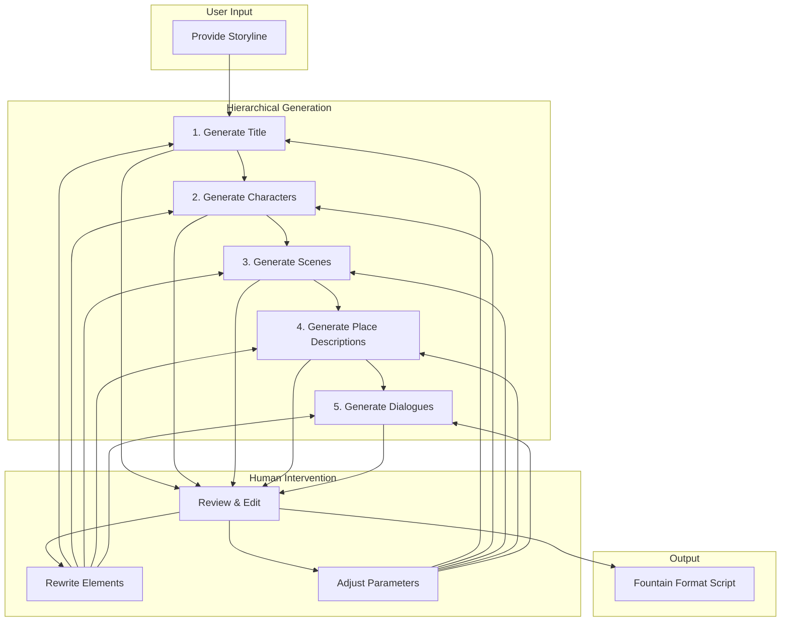
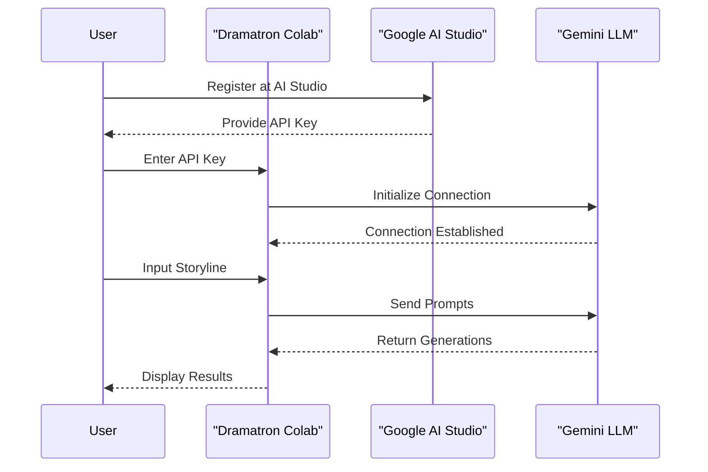
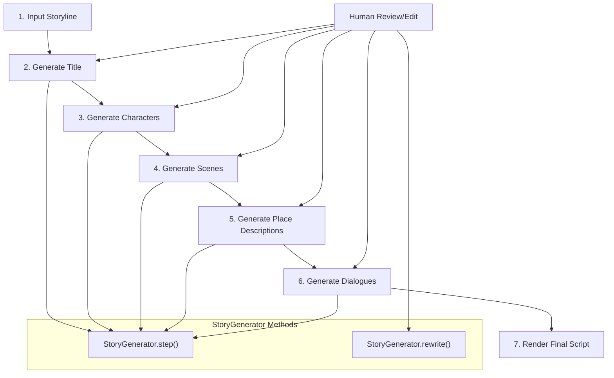
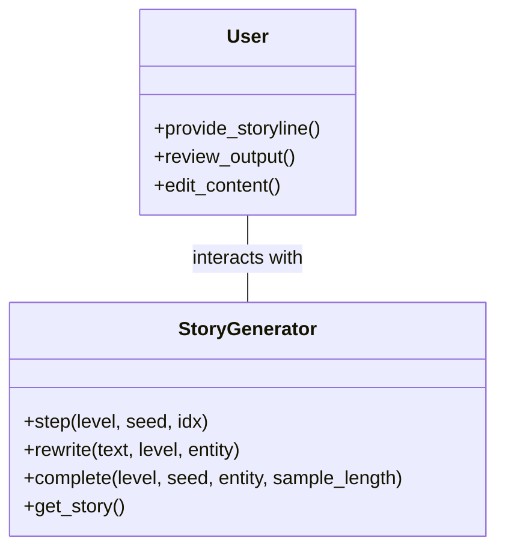
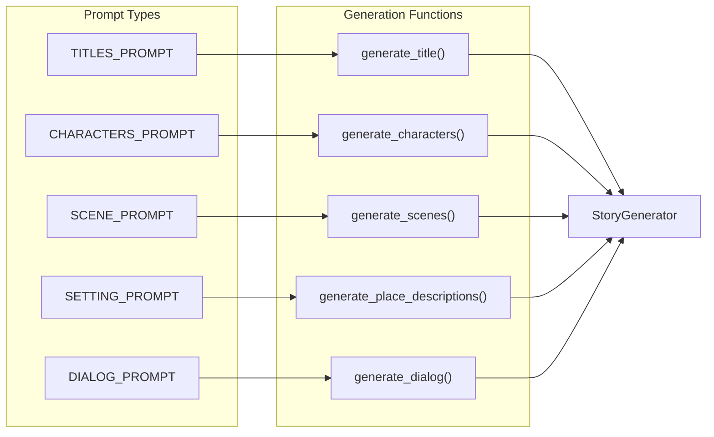
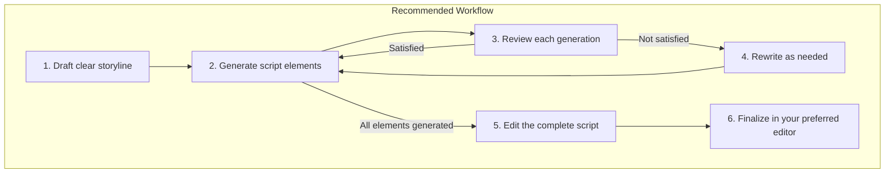

<!-- source: DeepWiki mcp.deepwiki.com · repo google-deepmind/dramatron · page 3 User Guide · fetched 2026-10-26 -->

# User Guide

<details>
<summary>Relevant source files</summary>

The following files were used as context for generating this wiki page:

- [README.md](README.md)
- [colab/dramatron.ipynb](colab/dramatron.ipynb)
- [docs/details.html](docs/details.html)
- [dramatron-animation.gif](dramatron-animation.gif)

</details>


This guide provides comprehensive instructions for using Dramatron, a co-writing system for theatre scripts and screenplays that leverages large language models (LLMs). The guide walks through the setup process, explains the intended workflow, and covers customization options for the generation process. For information about the system architecture and how Dramatron works internally, see [System Architecture](#2).

## 1. Introduction to Dramatron

Dramatron is designed as a co-writing tool that assists human writers in creating theatre scripts and screenplays. It uses a hierarchical generation approach, starting from a high-level storyline and progressively generating more detailed elements of the script, including title, characters, scenes, place descriptions, and dialogue.

The system is not intended to be used autonomously but rather as a collaborative tool that provides material for human authors to compile, edit, and rewrite.

### Dramatron Workflow Overview



Sources: [colab/dramatron.ipynb:42-59](), [README.md:10-23]()

## 2. Setting Up Dramatron

### 2.1 Running the Colab Notebook

Dramatron is implemented as a Google Colab notebook, which provides an interactive Python environment in your browser.

1. Open the Dramatron notebook by visiting the GitHub repository and clicking on the "Open in Colab" button, or directly access it at: https://colab.research.google.com/github/deepmind/dramatron/blob/main/colab/dramatron.ipynb

2. Once in Colab, click on the "Connect" button in the top-right corner to connect to a runtime.

3. Run the license and imports cells by clicking on their respective play buttons.

### 2.2 Configuring a Language Model API

Dramatron requires access to a large language model to function. The repository comes with support for Google Gemini, but you'll need to provide your own API key.

#### Google Gemini Setup



1. Run the "Google Gemini only: Install dependencies" cell to install the required libraries.

2. Visit [Google AI Studio](https://ai.google.dev) to create an account and obtain an API key.

3. In the "Google Gemini Language API" section of the notebook, enter your API key in the appropriate field.

4. Configure any additional parameters for the Gemini model as needed.

Sources: [colab/dramatron.ipynb:76-86](), [colab/dramatron.ipynb:1640-1698]()

## 3. Using Dramatron

### 3.1 Co-Writing Workflow

Dramatron uses a structured, hierarchical approach to script generation. The workflow consists of the following steps:



#### Step 1: Provide a Storyline

The storyline is a concise summary of your story concept, serving as the foundation for all subsequent generations.

1. In the "Generate script using Dramatron" section, enter your storyline in the provided text field.
2. A good storyline should be brief (one or two sentences) but contain the core dramatic elements of your story.

Example storyline:
```
A brilliant but reclusive mathematician discovers a formula that can predict the future, but struggles with the ethical implications of using it.
```

#### Step 2: Generate Script Elements

For each level of the script hierarchy (title, characters, scenes, places, dialogues), you will:

1. Click the "Step" button to generate that level.
2. Review the generated content.
3. If satisfied, proceed to the next level.
4. If not satisfied, use the "Rewrite" feature to regenerate that element.

#### Step 3: Edit and Refine

After generating all elements, you can:

1. Review the complete script.
2. Make manual adjustments to any part of the script.
3. Save the script in Fountain format using the provided buttons.

Sources: [colab/dramatron.ipynb:983-1039](), [colab/dramatron.ipynb:1825-1853]()

### 3.2 The StoryGenerator Interface

The `StoryGenerator` class is the main interface for interacting with Dramatron. Here are the key methods:

| Method | Description | Parameters |
|--------|-------------|------------|
| `step()` | Generate the next level of the script | `level`: script level to generate<br>`seed`: random seed (optional)<br>`idx`: index for specific generations (optional) |
| `rewrite()` | Regenerate a specific element | `text`: text to replace current generation<br>`level`: level to rewrite<br>`entity`: entity index (if applicable) |
| `complete()` | Generate content for a level | `level`: generation level<br>`seed`: random seed<br>`entity`: specific entity to generate<br>`sample_length`: max length of generation |
| `get_story()` | Return the complete story object | None |



Sources: [colab/dramatron.ipynb:983-1039](), [colab/dramatron.ipynb:1825-1906]()

## 4. Customizing the Generation Process

### 4.1 Adjusting Generation Parameters

Dramatron's behavior can be customized by modifying various parameters:

| Parameter | Description | Default Value |
|-----------|-------------|---------------|
| `DEFAULT_SEED` | Initial random seed | 1 |
| `SAMPLING_PROB` | Top-p probability for sampling | 0.95 |
| `SAMPLING_TEMP` | Temperature for generation | 1.0 |
| `SAMPLE_LENGTH_TITLE` | Max length for title generation | 64 |
| `SAMPLE_LENGTH_PLACE` | Max length for place descriptions | 128 |
| `SAMPLE_LENGTH` | Max length for other generations | 511 |
| `MAX_PARAGRAPH_LENGTH` | Max length during repeated sampling | 1024 |
| `MAX_NUM_REPETITIONS` | Max repetitions before resampling | 3 |

These parameters can be adjusted in the "Dramatron hyperparameters" section of the notebook.

Sources: [colab/dramatron.ipynb:138-163]()

### 4.2 Customizing Prompts

Dramatron uses a set of predefined prompts for each generation level. These prompts can be customized to guide the language model toward specific styles or structures:



To customize prompts:

1. Locate the "Prompt sets" section in the notebook.
2. Modify the prompt templates as needed, keeping the special markers (like `<character>`, `<dialog>`, etc.) intact.
3. Consider how your changes might affect the generation style and structure.

Sources: [colab/dramatron.ipynb:1700-1823]()

### 4.3 Using Content Moderation

Dramatron provides optional integration with the Perspective API for content moderation:

1. To enable content filtering, uncomment and configure the "Perspective API" section.
2. Obtain an API key from the [Perspective API website](https://perspectiveapi.com).
3. Configure the moderation thresholds as needed.

Content moderation helps filter out potentially inappropriate generations, though it's still important to review all outputs manually.

Sources: [colab/dramatron.ipynb:2124-2184]()

## 5. Output and Post-Processing

### 5.1 Understanding the Fountain Format

The final script is rendered in Fountain format, a plain text markup language designed for screenplays:

| Fountain Element | Meaning | Example |
|------------------|---------|---------|
| Scene Header | Location and time | `INT/EXT. MATHEMATICIAN'S OFFICE - DAY` |
| Character Name | Character speaking | `EMMA` |
| Dialogue | Character's speech | Dialogue text without markup |
| Parenthetical | Action or direction | `(nervously)` |
| Action | Scene description | Description text without markup |

The notebook provides a function `render_story()` that automatically formats the generated content according to Fountain syntax.

Sources: [colab/dramatron.ipynb:436-543]()

### 5.2 Saving and Exporting Scripts

Dramatron provides several options for saving your work:

1. **Save to Google Drive**: Use the "Save to Google Drive" button to save the script to your Google Drive account.

2. **Download as File**: Use the "Download script" button to download the script as a text file to your local computer.

3. **Copy to Clipboard**: Some of the notebook cells will display the full script, which you can copy and paste into your preferred text editor.

The script output includes metadata such as the title, author information, and a reference to Dramatron as a co-writer.

Sources: [colab/dramatron.ipynb:1979-2019]()

## 6. Troubleshooting and Best Practices

### 6.1 Handling Common Issues

| Issue | Potential Solution |
|-------|-------------------|
| Generation loops or repetitions | Increase the `MAX_NUM_REPETITIONS` parameter or use a different random seed |
| Insufficient variety in generations | Increase the `SAMPLING_TEMP` parameter for more creative outputs |
| Script too short or incomplete | Increase the appropriate `SAMPLE_LENGTH` parameters |
| API errors | Check your API key and connection, and retry with exponential backoff |
| Content filtered out | Review your input for potentially inappropriate content or adjust moderation settings |

### 6.2 Best Practices for Co-Writing

1. **Start with a clear storyline**: The quality of the initial storyline significantly impacts all subsequent generations.

2. **Iterative refinement**: Don't expect perfect outputs on the first try. Use the rewrite feature liberally.

3. **Human editing is essential**: Dramatron is meant to be a starting point, not a finished product. Always review and edit the generated content.

4. **Vary the seed for different options**: If you're not satisfied with a generation, try using a different random seed.

5. **Check for plagiarism**: As with any LLM-generated content, it's advisable to check for unintentional copying from existing works.

Sources: [README.md:18-23](), [docs/details.html:52-79]()



Sources: [README.md:10-23](), [docs/details.html:30-38]()

## 7. Additional Resources

- **GitHub Repository**: Visit the [Dramatron GitHub repository](https://github.com/google-deepmind/dramatron) for the latest updates and documentation.

- **Research Paper**: Read the paper ["Co-Writing Screenplays and Theatre Scripts with Language Models: An Evaluation by Industry Professionals"](https://arxiv.org/abs/2209.14958) for insights into how professional writers use Dramatron.

- **Contact**: For questions or feedback, contact the Dramatron team at dramatron@deepmind.com.

Sources: [README.md:25-27](), [docs/details.html:80-96]()

---

