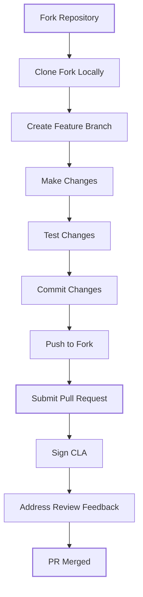
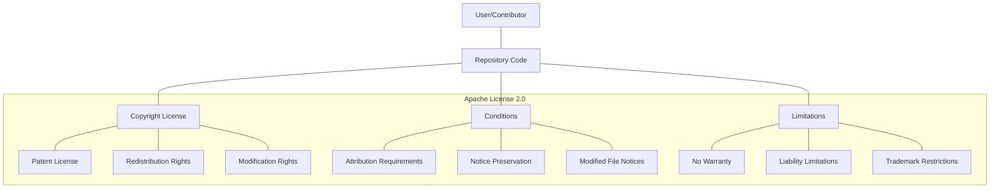
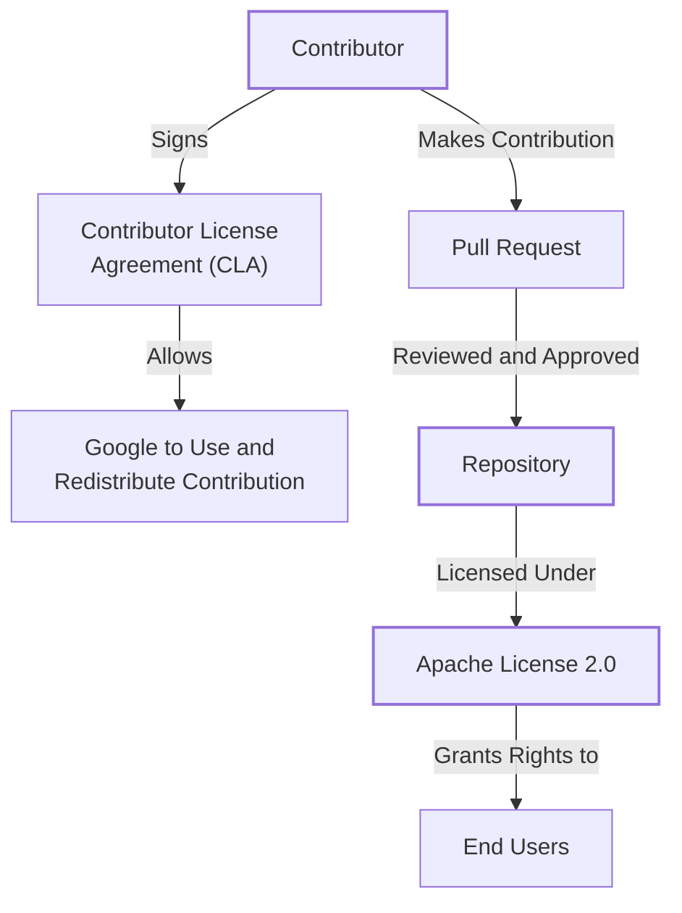

<!-- source: DeepWiki mcp.deepwiki.com · repo google-deepmind/educational · page 8 Contributing and License · fetched 2026-10-26 -->

# Contributing and License

Relevant source files

The following files were used as context for generating this wiki page:

- [CONTRIBUTING.md](CONTRIBUTING.md)
- [LICENSE](LICENSE)

This page provides detailed information about how to contribute to the Google DeepMind Educational repository and explains the license terms under which the repository is made available. For information about the overall repository structure and educational content, see [Overview](#1).

## 1. How to Contribute

The Google DeepMind Educational repository welcomes contributions from the community. This section outlines the process and requirements for submitting contributions.

### 1.1 Contributor License Agreement

All contributions to this project must be accompanied by a Contributor License Agreement (CLA). This agreement is necessary to give Google permission to use and redistribute your contributions as part of the project.

Key points about the CLA:
- You (or your employer) retain the copyright to your contribution
- The CLA gives Google permission to use and redistribute your contributions
- You can sign the CLA at: https://cla.developers.google.com/
- If you've already submitted a CLA for a different Google project, you generally don't need to do it again

### 1.2 Code Review Process

All submissions to the repository, including those from project members, require review:

- GitHub pull requests are used for the review process
- Submissions should follow the project's coding standards and guidelines
- Reviewers will provide feedback and may request changes before accepting contributions

### 1.3 Community Guidelines

The repository follows [Google's Open Source Community Guidelines](https://opensource.google/conduct), which establish standards for respectful and productive collaboration.

Sources: [CONTRIBUTING.md:1-28]()

## 2. Contribution Workflow

The following diagram illustrates the typical workflow for contributing to the repository:

### 2.1 Detailed Steps

1. **Fork the Repository**: Create your own fork of the repository on GitHub
2. **Clone Fork Locally**: Clone your fork to your local machine
3. **Create Feature Branch**: Create a branch for your specific contribution
4. **Make Changes**: Implement your contribution
5. **Test Changes**: Ensure your changes work correctly
6. **Commit Changes**: Commit your changes with clear, descriptive commit messages
7. **Push to Fork**: Push your changes to your fork on GitHub
8. **Submit Pull Request**: Create a pull request from your fork to the main repository
9. **Sign CLA**: Ensure you've signed the Contributor License Agreement
10. **Address Review Feedback**: Make any requested changes based on reviewer feedback
11. **PR Merged**: Once approved, your contribution will be merged into the repository

Sources: [CONTRIBUTING.md:18-23]()

## 3. License Overview

The Google DeepMind Educational repository is licensed under the Apache License, Version 2.0. This section explains the key aspects of this license.

### 3.1 Key License Terms

The Apache License 2.0 is a permissive open-source license that allows users to:

| Permission | Description |
|------------|-------------|
| Use | Use the code for any purpose |
| Modify | Modify the code |
| Distribute | Distribute original or modified versions |
| Sublicense | Grant new licenses to modified versions |
| Commercial Use | Use the code in commercial products |

### 3.2 License Conditions

Users must comply with the following conditions:

1. **Include License Copy**: When redistributing the code, include a copy of the license
2. **State Changes**: Any modified files must include prominent notices stating the changes made
3. **Preserve Notices**: Retain all copyright, patent, trademark, and attribution notices in the source code
4. **NOTICE File**: If the work includes a NOTICE text file, include readable copies of the notices in any derivative works

### 3.3 Limitations and Disclaimers

The license includes important limitations:

1. **No Warranty**: The code is provided "as is" without warranties of any kind
2. **No Liability**: Contributors are not liable for damages resulting from the use of the code
3. **Trademark Restrictions**: The license does not grant permission to use the trade names or trademarks of the licensor

Sources: [LICENSE:1-202]()

## 4. Contribution and License Relationship

The following diagram illustrates the relationship between contributions, the CLA, and the Apache License:

### 4.1 License Implications for Contributors

By submitting a contribution to the repository:

1. Your contribution will be licensed under the Apache License 2.0
2. You must have the legal right to grant the license for your contribution
3. The CLA confirms you're granting Google the right to use and redistribute your contribution

### 4.2 License Implications for Users

When using code from the repository:

1. You can freely use, modify, and distribute the code under the terms of the Apache License 2.0
2. You must comply with the conditions of the license (attribution, notices, etc.)
3. No warranty is provided, and contributors are not liable for damages

Sources: [LICENSE:131-138](), [CONTRIBUTING.md:6-16]()

## 5. Summary

The Google DeepMind Educational repository encourages contributions while maintaining legal protections through:

1. A structured contribution process requiring code review
2. The Contributor License Agreement to clarify legal rights
3. The Apache License 2.0 to define terms of use for the code

By understanding these processes and terms, you can effectively contribute to and use the repository while respecting legal requirements.

Sources: [CONTRIBUTING.md:1-28](), [LICENSE:1-202]()