# Page: Overview

# Overview

<details>
<summary>Relevant source files</summary>

The following files were used as context for generating this wiki page:

- [CONTRIBUTING.md](CONTRIBUTING.md)
- [LICENSE](LICENSE)
- [README.md](README.md)

</details>


## Purpose and Scope

The DeepMind Educational repository is a comprehensive collection of educational tutorials designed to teach machine learning concepts to audiences with varying levels of prior knowledge. This repository aims to democratize machine learning education by providing accessible, interactive resources that enable anyone—including those with no machine learning background—to engage with and learn fundamental concepts in artificial intelligence and machine learning.

The repository contains Jupyter notebooks covering a wide range of topics from basic machine learning principles to advanced techniques like Graph Neural Networks and Language Models. All tutorials are available as interactive notebooks that can be launched via Google Colab, allowing learners to experiment with code and concepts in a browser-based environment without requiring local installation.

For detailed information about specific tutorials, see the dedicated pages for [Graph Neural Networks](#2), [Language Models](#3), [Unsupervised Learning](#4), [Supervised Learning: Regression](#5), [Reinforcement Learning](#6), and [Additional Educational Examples](#7).

Sources: [README.md:1-13]()

## Repository Structure

The DeepMind Educational repository is organized into two main sections: Introductory Tutorials and Summer Schools Tutorials. Each section serves different educational purposes and targets different audience levels.

```mermaid
flowchart TD
    subgraph "DeepMind Educational Repository"
        README["README.md (Main Entry Point)"]
        
        subgraph "Introductory Tutorials"
            FA["Fluttering Avians"]
            FWL["Fun with Language"]
            GM["Generative Models"]
            PF["Protein Folding"]
            RL["Reinforcement Learning"]
            ST["Scientific Thinking"]
        end
        
        subgraph "Summer Schools Tutorials"
            PYTHN["Introduction to Python/NumPy"]
            REG["Introduction to Regression"]
            UL["Introduction to Unsupervised Learning"]
            RLS["Introduction to Reinforcement Learning"]
            GNN["Introduction to Graph Neural Nets"]
        end
        
        META["Contributing and License Information"]
    end
    
    README --> "Introductory Tutorials"
    README --> "Summer Schools Tutorials"
    README --> META
```

### Introductory Tutorials

These tutorials are designed to introduce machine learning concepts through engaging, application-focused examples:

| Tutorial | Focus | Key Concepts |
|----------|-------|--------------|
| Fluttering Avians | Game-based learning | Evolutionary algorithms, agents, optimization |
| Fun with Language | Natural language processing | Language models, text generation, message decoding |
| Generative Models | AI and creativity | GANs, image generation, style transfer |
| Protein Folding | Biological applications | Structure prediction, visualization |
| Reinforcement Learning | Agent-based learning | RL environments, DQN, policy optimization |
| Scientific Thinking | Methodological principles | Scientific method, experimentation, validation |

Sources: [README.md:15-50]()

### Summer Schools Tutorials

These tutorials provide more structured learning materials originally developed for various machine learning summer schools and educational events:

| Tutorial | Focus | Key Concepts |
|----------|-------|--------------|
| Introduction to Python/NumPy | Programming foundations | Python basics, NumPy operations, tensor transformations |
| Introduction to Regression | Supervised learning | Linear models, optimization, autodiff with JAX |
| Introduction to Unsupervised Learning | Unsupervised methods | Density estimation, clustering, dimensionality reduction |
| Introduction to Reinforcement Learning | Sequential decision making | Q-learning, DQN, environment design |
| Introduction to Graph Neural Nets | Graph-structured data | Graph theory, GCNs, GATs, jraph library |

Sources: [README.md:52-92]()

## Learning Pathways

The repository supports multiple learning pathways depending on the learner's background and goals. The following diagram illustrates recommended progression routes through the tutorials:

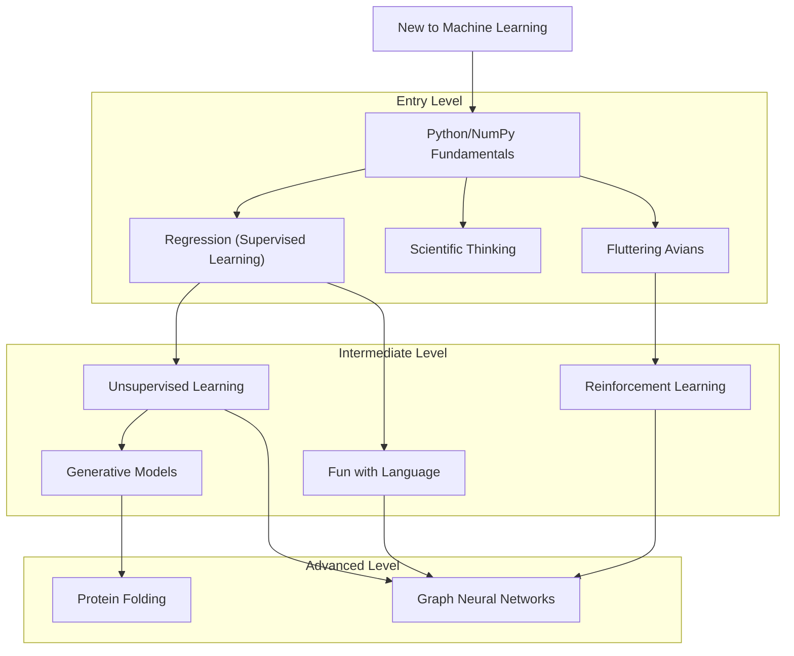

Sources: [README.md:63-92]()

## Machine Learning Concepts Coverage

The repository covers a comprehensive range of machine learning paradigms and techniques. The following diagram maps tutorials to fundamental machine learning concepts:

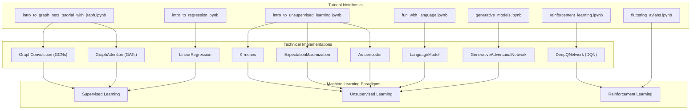

Sources: [README.md:15-92]()

## Key Technologies

The tutorials in the repository utilize several key technologies and libraries for implementing machine learning concepts:

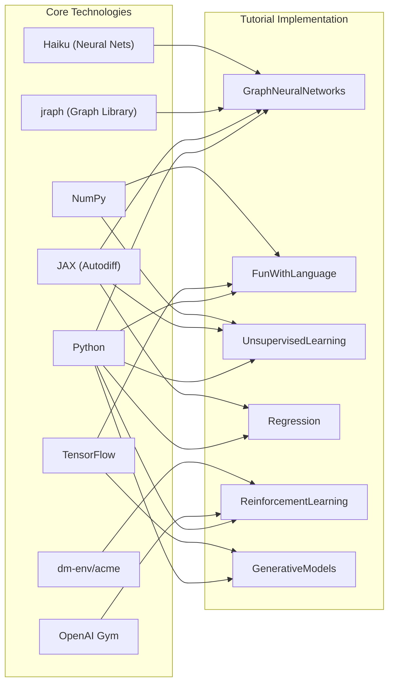

Sources: [README.md:62-92]()

## Using the Tutorials

All tutorials in the repository are provided as Jupyter notebooks that can be run via Google Colab. Each notebook contains:

1. **Theoretical explanations** of the machine learning concepts
2. **Code implementations** with step-by-step walk-throughs
3. **Interactive exercises** for hands-on learning
4. **Visualizations** to aid understanding of complex concepts

To use the tutorials:
1. Click on the "Open In Colab" badge for the tutorial you want to explore
2. The notebook will open in Google Colab in your browser
3. Run the cells sequentially to follow the tutorial
4. Experiment by modifying code to deepen your understanding

Sources: [README.md:12-13]()

## Contributors and License

The DeepMind Educational repository is maintained by volunteers and is released under the Apache 2.0 License. Contributions to the repository are welcome through pull requests, bug reports, and feature requests.

For information about contributing to the project, see [Contributing and License](#8).

Sources: [README.md:94-107](), [CONTRIBUTING.md:1-28](), [LICENSE:1-202]()

---

# Page: Graph Neural Networks

# Graph Neural Networks

<details>
<summary>Relevant source files</summary>

The following files were used as context for generating this wiki page:

- [colabs/summer_schools/intro_to_graph_nets_tutorial_with_jraph.ipynb](colabs/summer_schools/intro_to_graph_nets_tutorial_with_jraph.ipynb)

</details>


## Purpose and Scope

This document provides a comprehensive guide to Graph Neural Networks (GNNs) as implemented in the DeepMind Educational repository. It focuses on the implementation and application of GNNs using the `jraph` library with JAX. The material covers fundamental graph concepts, different graph prediction tasks, and implementations of Graph Convolutional Networks (GCN) and Graph Attention Networks (GAT) with practical applications.

For information about other neural network implementations in the repository, see [Reinforcement Learning](#6) and [Language Models](#3).

## Fundamental Graph Concepts

A graph consists of nodes (vertices) and edges that connect nodes. Formally, a graph is defined as G = (V, E) where V is the set of vertices and E is the set of edges.

Graphs can be either **directed** (edges have a direction) or **undirected** (edges have no direction). For example, a citation network would be represented as a directed graph, while a friendship network would typically be undirected.

Key graph terminology:
- **Degree**: Number of edges incident on a node
- **In-degree**: Sum of incoming edges to a node
- **Out-degree**: Sum of outgoing edges from a node

Graphs can be represented in several ways:
1. **List of edges**: Pairs (u,v) indicating an edge from node u to node v
2. **Adjacency matrix**: A binary square matrix A where A[u,v]=1 if there's a connection between nodes u and v
3. **Adjacency list**: An array of lists where the ith list contains all nodes directly connected to node i

Graph representation diagram:

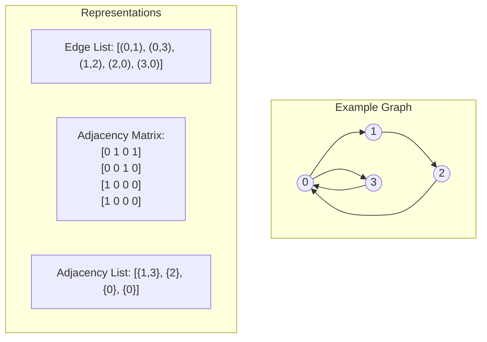

Sources: [colabs/summer_schools/intro_to_graph_nets_tutorial_with_jraph.ipynb:111-164]()

## Graph Prediction Tasks

GNNs can address three main types of prediction tasks:

1. **Node Classification**: Predicting properties of individual nodes (e.g., paper topics in a citation network)
2. **Link Prediction/Edge Classification**: Predicting whether an edge exists between nodes (e.g., friendships in a social network)
3. **Graph Classification**: Classifying entire graphs (e.g., properties of molecules)

Graph prediction tasks diagram:

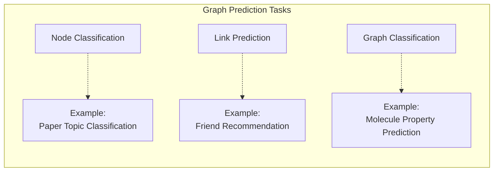

Sources: [colabs/summer_schools/intro_to_graph_nets_tutorial_with_jraph.ipynb:168-186]()

## Introduction to the jraph Library

`jraph` is a lightweight library for working with GNNs in JAX. The main data structure is `GraphsTuple`, which represents graphs and their features.

### GraphsTuple Structure

In `GraphsTuple`, edges are represented by two arrays of node indices: **senders** (source nodes) and **receivers** (destination nodes). Each index in these arrays corresponds to one edge, e.g., edge `i` goes from `senders[i]` to `receivers[i]`.

A `GraphsTuple` contains:
- `nodes`: Node features
- `edges`: Edge features
- `senders`: Indices of sender nodes for each edge
- `receivers`: Indices of receiver nodes for each edge
- `n_node`: Number of nodes per graph
- `n_edge`: Number of edges per graph
- `globals`: Global graph features

GraphsTuple structure diagram:

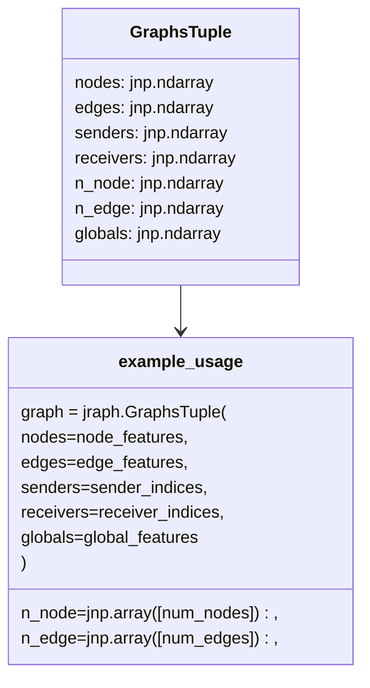

Sources: [colabs/summer_schools/intro_to_graph_nets_tutorial_with_jraph.ipynb:196-213](), [colabs/summer_schools/intro_to_graph_nets_tutorial_with_jraph.ipynb:257-266]()

### Creating and Visualizing Graphs

`jraph` provides utilities for creating and manipulating graphs. The example below shows how to create a simple directed graph with 4 nodes and 5 edges:

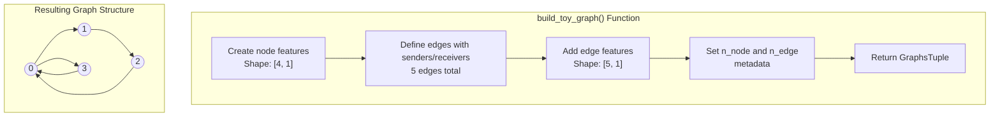

Sources: [colabs/summer_schools/intro_to_graph_nets_tutorial_with_jraph.ipynb:222-266](), [colabs/summer_schools/intro_to_graph_nets_tutorial_with_jraph.ipynb:395-419]()

## Graph Convolutional Network (GCN)

A Graph Convolutional Network applies convolution operations to neighborhoods in a graph structure. Unlike standard CNNs that operate on regular grids, GCNs work on irregular graph structures.

### How GCN Works

GCN consists of two main steps:

1. **Message Computation**: Each node computes a feature vector (using an MLP)
2. **Message Aggregation**: Each node aggregates messages from its neighborhood to update its features

The key difference from CNNs is that GCNs apply the same weights to all neighbors (order-invariant), while CNNs assign different weights to each spatial position.

GCN operation diagram:

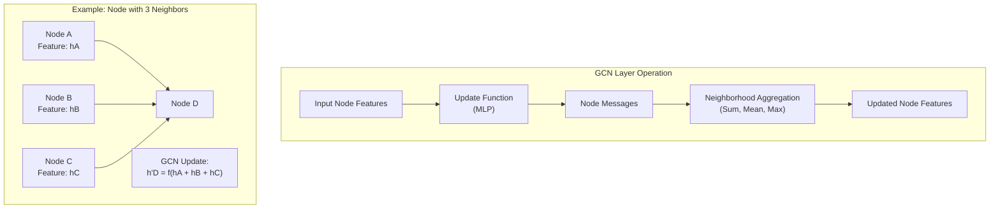

Sources: [colabs/summer_schools/intro_to_graph_nets_tutorial_with_jraph.ipynb:438-464]()

### GCN Implementation Components

A complete GCN implementation includes several key components:

1. **Node Update Function**: Transforms node features (typically an MLP)
2. **Self-Edges**: Optional edges connecting nodes to themselves
3. **Normalization**: Usually symmetric normalization based on node degrees to prevent numerical instabilities

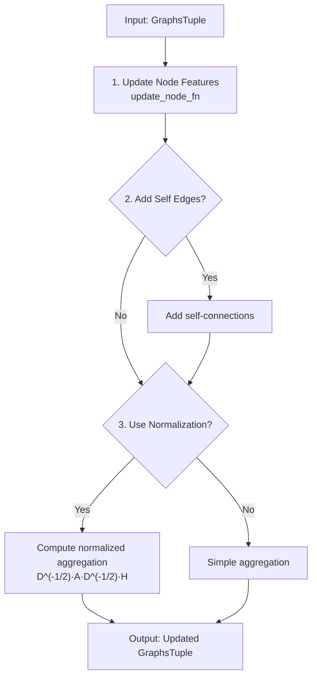

Sources: [colabs/summer_schools/intro_to_graph_nets_tutorial_with_jraph.ipynb:754-829]()

### Multi-Layer GCN Models

By stacking multiple GCN layers, nodes can incorporate information from larger neighborhoods (beyond 1-hop neighbors). This is similar to how stacking CNN layers expands the receptive field.

The `GraphConvolution` function in the repository provides a configurable GCN layer implementation with options for:
- Custom node update functions
- Different aggregation methods
- Adding self-edges
- Symmetric normalization

Sources: [colabs/summer_schools/intro_to_graph_nets_tutorial_with_jraph.ipynb:878-916]()

## Graph Attention Networks (GAT)

Graph Attention Networks extend GCNs by introducing an attention mechanism that learns to weigh the importance of different neighbor features during aggregation. This addresses a limitation in GCNs where all neighbors contribute equally.

### How GAT Works

In a GAT, each node's update is a weighted sum of its neighbors' features:

h'_i = ∑_(j ∈ N(i)) α_ij · W · h_j

Where:
- α_ij is the attention coefficient between nodes i and j
- W is a weight matrix
- h_j is the feature vector of node j

The attention mechanism computes coefficients through these steps:
1. Transform node features with a learnable weight matrix
2. Compute attention scores using a function of connected nodes' features
3. Normalize scores with softmax to get attention weights
4. Use weights for a weighted sum of neighbor features

GAT mechanism diagram:

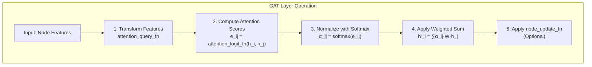

Sources: [colabs/summer_schools/intro_to_graph_nets_tutorial_with_jraph.ipynb:1281-1335]()

### GAT Implementation in jraph

The GAT implementation in jraph requires:
- `attention_query_fn`: Function to transform node features
- `attention_logit_fn`: Function to compute attention logits 
- `node_update_fn`: Function to update nodes after aggregation
- `add_self_edges`: Whether to add self-connections

The implementation calculates attention weights via softmax and applies them to create weighted node representations.

Sources: [colabs/summer_schools/intro_to_graph_nets_tutorial_with_jraph.ipynb:1346-1416](), [colabs/summer_schools/intro_to_graph_nets_tutorial_with_jraph.ipynb:1436-1449]()

## Practical Applications

The tutorial demonstrates three practical applications of GNNs, each corresponding to a different graph prediction task:

### Node Classification: Zachary's Karate Club

This example uses a small social graph where nodes represent karate club members and edges represent interactions. The task is to predict which instructor each member follows.

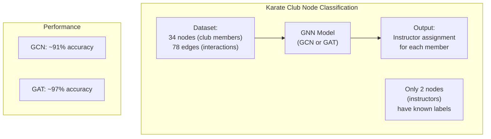

Sources: [colabs/summer_schools/intro_to_graph_nets_tutorial_with_jraph.ipynb:949-1271]()

### Graph Classification: MUTAG Molecules

This example classifies molecular graphs based on their mutagenic effects.

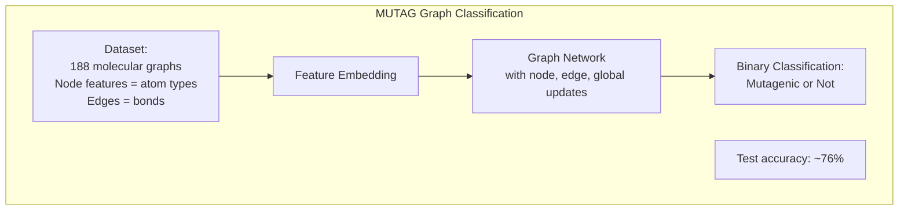

Sources: [colabs/summer_schools/intro_to_graph_nets_tutorial_with_jraph.ipynb:1603-2017]()

### Link Prediction: CORA Citation Network

This example predicts whether a citation exists between pairs of scientific papers.

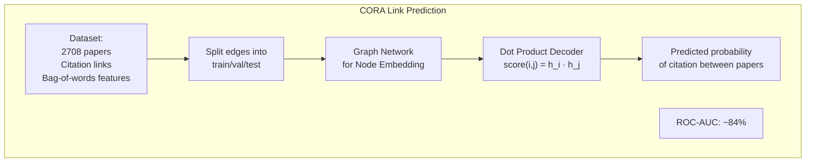

Sources: [colabs/summer_schools/intro_to_graph_nets_tutorial_with_jraph.ipynb:2022-2488]()

## Graph Adversarial Attacks

The tutorial briefly introduces graph adversarial attacks, where small, carefully crafted perturbations to the graph structure or node features can fool GNN models.

Special challenges for graph adversarial attacks include:
1. **Discrete nature of graphs**: Unlike continuous pixel values, graph structure is discrete
2. **Node interdependence**: Perturbing one node can affect predictions for others
3. **Defining "imperceptibility"**: It's harder to define what makes a graph perturbation imperceptible

Sources: [colabs/summer_schools/intro_to_graph_nets_tutorial_with_jraph.ipynb:2496-2571]()

## Implementation Architecture

The following diagram shows the key components and their relationships in the jraph implementation:

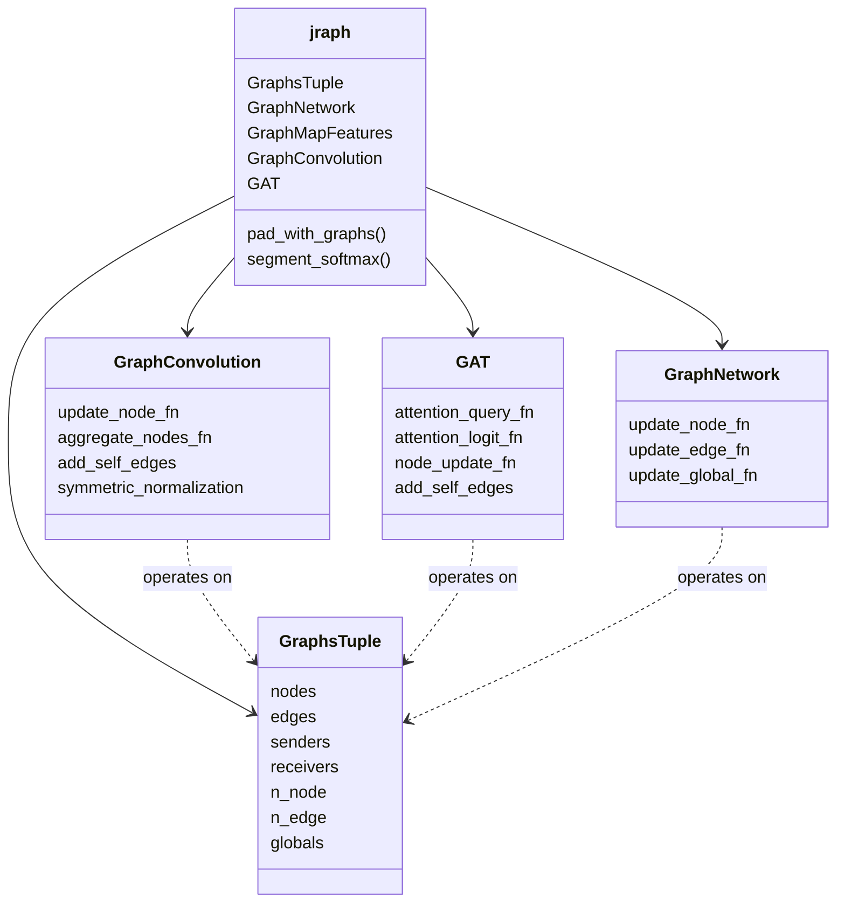

## Summary

This document covered Graph Neural Networks as implemented in the DeepMind Educational repository using the jraph library with JAX. Key topics included:

- Fundamental graph concepts and representations
- Different types of graph prediction tasks
- GNN architectures: Graph Convolutional Networks and Graph Attention Networks
- Practical applications across node classification, graph classification, and link prediction
- Implementation details using the jraph library

The tutorial demonstrates how to build and train models for various graph-based tasks using real-world datasets.

Sources: [colabs/summer_schools/intro_to_graph_nets_tutorial_with_jraph.ipynb:2578-2586]()

---

# Page: GraphsTuple and Basic Graph Operations

# GraphsTuple and Basic Graph Operations

<details>
<summary>Relevant source files</summary>

The following files were used as context for generating this wiki page:

- [colabs/summer_schools/intro_to_graph_nets_tutorial_with_jraph.ipynb](colabs/summer_schools/intro_to_graph_nets_tutorial_with_jraph.ipynb)

</details>


## Purpose and Scope
This document explains the `GraphsTuple` data structure from the jraph library and the basic operations that can be performed on graphs using this structure. The `GraphsTuple` is a fundamental component for representing and manipulating graphs in jraph, which is essential for implementing Graph Neural Networks (GNNs) with JAX.

For information about more advanced graph operations and neural network layers, see [Graph Convolutional Networks](#2.2) and [Graph Attention Networks](#2.3).

Sources: [colabs/summer_schools/intro_to_graph_nets_tutorial_with_jraph.ipynb:193-206]()

## GraphsTuple Data Structure

The `GraphsTuple` is the core data structure for representing graphs in jraph. It efficiently encapsulates all components needed to define one or more graphs within a single structure, making it ideal for batch processing in JAX.

### Components of a GraphsTuple

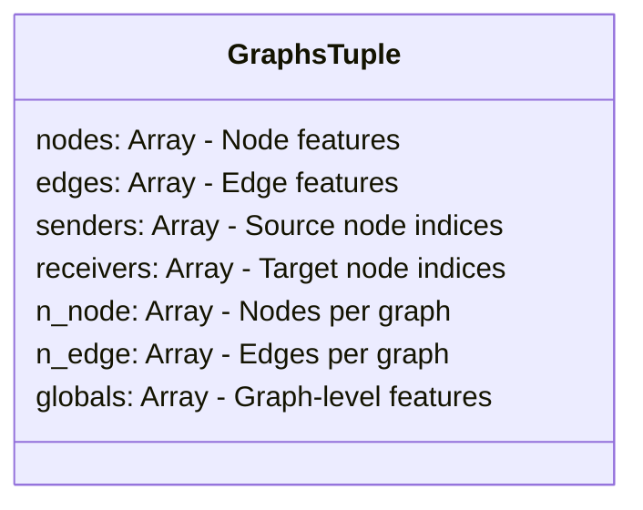

A `GraphsTuple` consists of:
- `nodes`: Features associated with each node
- `edges`: Features associated with each edge
- `senders`: Array of indices indicating source nodes of each edge
- `receivers`: Array of indices indicating destination nodes of each edge
- `n_node`: Array specifying the number of nodes in each graph 
- `n_edge`: Array specifying the number of edges in each graph
- `globals`: Global features/attributes for each graph

In jraph, edges are represented using two aligned arrays: `senders` (source nodes) and `receivers` (destination nodes). Each index corresponds to one edge - edge `i` goes from node `senders[i]` to node `receivers[i]`.

Sources: [colabs/summer_schools/intro_to_graph_nets_tutorial_with_jraph.ipynb:193-206](), [colabs/summer_schools/intro_to_graph_nets_tutorial_with_jraph.ipynb:199-211]()

### Relationship to Graph Theory Representations

In graph theory, there are several common ways to represent a graph:
1. Adjacency matrix
2. Adjacency list
3. Edge list

The `GraphsTuple` uses an approach similar to an edge list representation, where edges are stored as pairs of source and destination nodes. However, it extends this concept by adding features to nodes, edges, and the graph as a whole.

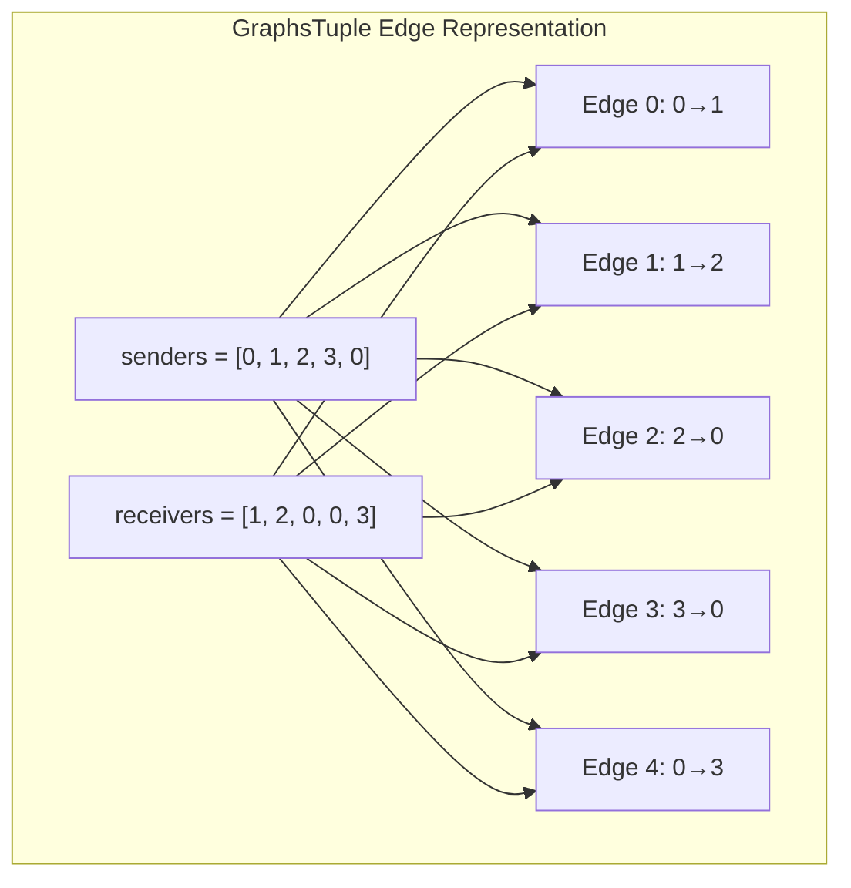

Sources: [colabs/summer_schools/intro_to_graph_nets_tutorial_with_jraph.ipynb:111-161]()

## Creating a Graph with GraphsTuple

Let's examine how to create a simple directed graph with 4 nodes and 5 edges using the `GraphsTuple` structure.

### Example: Four-Node Directed Graph

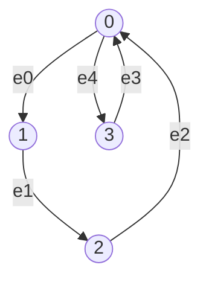

The code to create this graph is in the `build_toy_graph()` function:

1. First, node features are defined. In this example, node `i` has feature `[2*i]`
2. Edge connections are defined through the `senders` and `receivers` arrays
3. Edge features are optionally added
4. The number of nodes and edges are specified
5. Optional global features can be added
6. All components are combined into a `GraphsTuple`

In this example:
- Node features: `[[0.], [2.], [4.], [6.]]` (one feature per node)
- Edge definitions: senders `[0, 1, 2, 3, 0]` and receivers `[1, 2, 0, 0, 3]`
- Edge features: `[[5.], [6.], [7.], [8.], [8.]]`
- Number of nodes and edges: `n_node=[4]` and `n_edge=[5]`
- Global feature: `[[1]]`

Sources: [colabs/summer_schools/intro_to_graph_nets_tutorial_with_jraph.ipynb:222-266]()

## Basic Graph Operations

### Inspecting GraphsTuple Properties

Once a `GraphsTuple` is created, its properties can be inspected to understand the graph structure:

```python
# Number of nodes - returns an array where the length corresponds to 
# the number of graphs stored in the GraphsTuple
graph.n_node  # Returns [4] for our example

# Number of edges
graph.n_edge  # Returns [5] for our example

# Node features
graph.nodes  # Returns [[0.], [2.], [4.], [6.]] for our example

# Edge features
graph.edges  # Returns [[5.], [6.], [7.], [8.], [8.]] for our example

# Senders (source node indices)
graph.senders  # Returns [0, 1, 2, 3, 0] for our example

# Receivers (destination node indices)
graph.receivers  # Returns [1, 2, 0, 0, 3] for our example

# Graph-level features
graph.globals  # Returns [[1]] for our example
```

Sources: [colabs/summer_schools/intro_to_graph_nets_tutorial_with_jraph.ipynb:289-373]()

### Multiple Graphs in One GraphsTuple

A key feature of `GraphsTuple` is its ability to store multiple graphs in a single structure, which is particularly useful for batch processing in deep learning. The `n_node` and `n_edge` fields indicate how many nodes and edges belong to each graph.

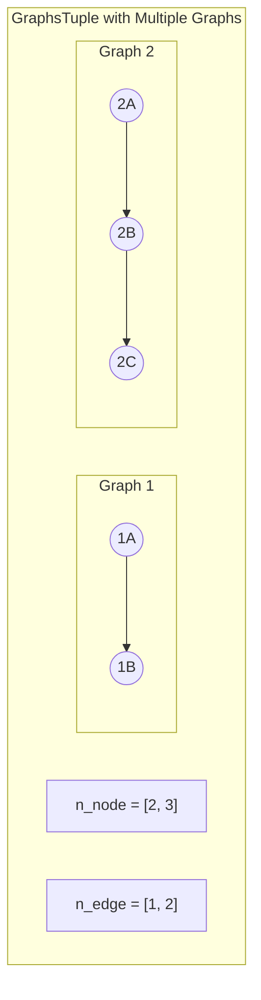

Sources: [colabs/summer_schools/intro_to_graph_nets_tutorial_with_jraph.ipynb:199-211]()

### Visualizing Graphs

To visualize a `GraphsTuple`, it needs to be converted to a NetworkX graph, which has built-in drawing capabilities.

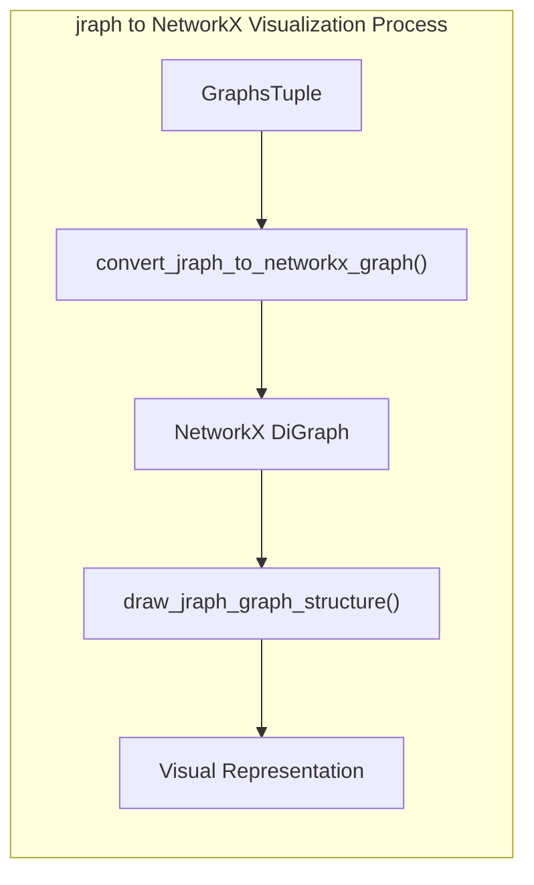

The conversion process involves:
1. Extracting nodes, edges, receivers, and senders from the GraphsTuple
2. Creating a NetworkX DiGraph
3. Adding nodes and edges with their features
4. Using NetworkX drawing functions to visualize the graph

Sources: [colabs/summer_schools/intro_to_graph_nets_tutorial_with_jraph.ipynb:378-430]()

## Graph Operations for Neural Networks

The `GraphsTuple` structure is designed to work efficiently with graph neural network operations. Common operations include:

### Adding Self-Edges

Self-edges connect nodes to themselves, which is useful in graph neural networks to ensure nodes include their own features in message passing.

```mermaid
graph TD
    subgraph "Before Self-Edges"
        A1(("A"))
        B1(("B"))
        A1 --> B1
    end
    
    subgraph "After Self-Edges"
        A2(("A"))
        B2(("B"))
        A2 --> B2
        A2 --> A2
        B2 --> B2
    end
```

The `add_self_edges_fn` function adds self-edges by concatenating the existing receivers and senders with arrays containing self-connections for all nodes:

```python
def add_self_edges_fn(receivers, senders, total_num_nodes):
    """Adds self edges. Assumes self edges are not in the graph yet."""
    receivers = jnp.concatenate((receivers, jnp.arange(total_num_nodes)), axis=0)
    senders = jnp.concatenate((senders, jnp.arange(total_num_nodes)), axis=0)
    return receivers, senders
```

Sources: [colabs/summer_schools/intro_to_graph_nets_tutorial_with_jraph.ipynb:693-698]()

### Graph Convolution and Aggregation

A fundamental operation in graph neural networks is aggregating information from neighboring nodes. In its simplest form, this involves:
1. Updating node features (typically with a neural network)
2. Aggregating features from neighboring nodes

```mermaid
graph TD
    subgraph "Simple Graph Convolution"
        n1(("Node 1")) 
        n2(("Node 2"))
        n3(("Node 3"))
        
        n2 --> n1
        n3 --> n1
        
        update["1. Update node features"]
        aggregate["2. Aggregate from neighbors"]
        
        n1 --> update
        n2 --> update
        n3 --> update
        
        update --> aggregate
        
        aggregate --> result["New node features"]
    end
```

The `apply_simplified_gcn` function demonstrates this process:
```python
def apply_simplified_gcn(graph: jraph.GraphsTuple) -> jraph.GraphsTuple:
  # Unpack GraphsTuple
  nodes, _, receivers, senders, _, _, _ = graph

  # 1. Update node features
  # For simplicity, we will first use an identify function here
  update_node_fn = lambda nodes: nodes
  nodes = update_node_fn(nodes)

  # 2. Aggregate node features over nodes in neighborhood
  # Equivalent to jnp.sum(n_node), but jittable
  total_num_nodes = tree.tree_leaves(nodes)[0].shape[0]
  aggregate_nodes_fn = jax.ops.segment_sum

  # Compute new node features by aggregating messages from neighboring nodes
  nodes = tree.tree_map(lambda x: aggregate_nodes_fn(x[senders], receivers,
                                    total_num_nodes), nodes)
  out_graph = graph._replace(nodes=nodes)
  return out_graph
```

Sources: [colabs/summer_schools/intro_to_graph_nets_tutorial_with_jraph.ipynb:483-502]()

### Normalizing Graph Operations

Normalization is important when working with graphs of varying structures. Symmetric normalization helps stabilize learning by accounting for varying node degrees.

```mermaid
graph TD
    subgraph "Symmetric Normalization Process"
        A["Adjacency Matrix A"] 
        D["Degree Matrix D"]
        norm["D^(-1/2) A D^(-1/2)"]
        
        A --> norm
        D --> norm
        norm --> stable["Stabilized Graph Operations"]
    end
```

This normalization process helps prevent issues like exploding or vanishing gradients during neural network training, especially when nodes have widely varying numbers of connections. It is implemented in the `GraphConvolution` function as part of the graph convolution operation.

The mathematical formulation is:
- Let A be the adjacency matrix defining the edges of the graph
- Define the degree matrix D as a diagonal matrix with D_ii = sum_j A_ij
- Normalize by D^(-1/2)AD^(-1/2)

Sources: [colabs/summer_schools/intro_to_graph_nets_tutorial_with_jraph.ipynb:704-726](), [colabs/summer_schools/intro_to_graph_nets_tutorial_with_jraph.ipynb:754-829]()

## Making GraphsTuple Work with Neural Networks

The `GraphsTuple` data structure can be used with neural networks by defining trainable functions that transform its components. Here's a simple example of applying an MLP (Multi-Layer Perceptron) to update node features:

```mermaid
flowchart LR
    subgraph "GraphsTuple with Neural Networks"
        nodes["Node Features"] --> MLP["MLP Block"]
        MLP --> updated["Updated Node Features"]
        updated --> aggregate["Aggregation Function"]
        aggregate --> final["Final Node Representations"]
    end
```

This approach allows for flexible, learnable transformations of graph components, which is the foundation of Graph Neural Networks.

Sources: [colabs/summer_schools/intro_to_graph_nets_tutorial_with_jraph.ipynb:595-620](), [colabs/summer_schools/intro_to_graph_nets_tutorial_with_jraph.ipynb:646-673]()

## Batching and Padding GraphsTuples

For efficient processing, especially with JAX's JIT compilation, it's often necessary to batch and pad graphs to a consistent size:

```mermaid
flowchart TD
    subgraph "Preparing GraphsTuple for Batch Processing"
        g1["Graph 1"]
        g2["Graph 2 (larger)"]
        
        g1 --> pad["Pad to largest size"]
        g2 --> pad
        
        pad --> batch["Batch into single GraphsTuple"]
        batch --> process["Process with JIT-compiled function"]
    end
```

Padding involves:
1. Determining the maximum number of nodes and edges
2. Adding dummy nodes and edges to smaller graphs
3. Updating the n_node and n_edge arrays accordingly

This enables efficient batch processing of multiple graphs through JAX's JIT compilation.

Sources: [colabs/summer_schools/intro_to_graph_nets_tutorial_with_jraph.ipynb:1758-1786]()

## Conclusion

The `GraphsTuple` data structure provides a flexible and efficient way to represent graphs for machine learning tasks. It encapsulates all the necessary components of a graph (nodes, edges, and their features) in a format that works well with JAX's functional programming model. Understanding this fundamental data structure is essential for working with Graph Neural Networks and implementing various graph-based algorithms in jraph.

---

# Page: Graph Convolutional Networks

# Graph Convolutional Networks

<details>
<summary>Relevant source files</summary>

The following files were used as context for generating this wiki page:

- [colabs/summer_schools/intro_to_graph_nets_tutorial_with_jraph.ipynb](colabs/summer_schools/intro_to_graph_nets_tutorial_with_jraph.ipynb)

</details>


This document provides a technical explanation of Graph Convolutional Networks (GCNs) as implemented in the DeepMind Educational repository. It covers the theory behind GCNs, their implementation using the jraph library, and how to build multi-layer GCN models. For information about Graph Attention Networks, which are an extension of GCNs with attention mechanisms, see [Graph Attention Networks](#2.3).

## Introduction to Graph Convolutional Networks

Graph Convolutional Networks (GCNs) are a type of graph neural network designed to process and learn from graph-structured data. Introduced by Kipf et al. (2017), GCNs extend the concept of convolution operations from grid-structured data (like images) to irregular graph structures.

The core functionality of GCNs is to learn representations of nodes in a graph by aggregating information from their neighborhoods. Unlike traditional convolutional filters in CNNs that have a fixed number of inputs, GCNs can handle varying neighborhood sizes and maintain permutation invariance.

Sources: [colabs/summer_schools/intro_to_graph_nets_tutorial_with_jraph.ipynb:437-463]()

## GCN Layer Operation

The basic GCN layer performs two key steps:

1. **Update node features**: Create a feature vector for each node (e.g., using an MLP).
2. **Message-passing/aggregation**: For each node, calculate a new feature vector based on the features from nodes in its neighborhood.

```mermaid
flowchart LR
    subgraph "GCN Layer Operation"
        direction TB
        A["Input Graph"] --> B["Update Node Features"]
        B --> C["Aggregate Neighborhood Features"]
        C --> D["Output Graph with Updated Features"]
    end
```

Sources: [colabs/summer_schools/intro_to_graph_nets_tutorial_with_jraph.ipynb:437-463]()

### Comparison with CNN Filters

GCNs differ from traditional CNNs in several important ways:

```mermaid
flowchart TB
    subgraph "Differences between CNN and GCN Filters"
        direction LR
        subgraph "CNN Filter"
            CNN1["Fixed Input Size"]
            CNN2["Ordered Inputs"]
            CNN3["Different Weight per Input"]
            CNN4["Not Order-Invariant"]
        end

        subgraph "GCN Filter"
            GCN1["Variable Neighborhood Size"]
            GCN2["Unordered Inputs"]
            GCN3["Same Weight for All Neighbors"]
            GCN4["Order-Invariant"]
        end
    end
```

In a CNN, each input to the filter has its own learned weight, making the operation sensitive to the order of inputs. In contrast, GCNs apply the same transformation to all neighbors and then aggregate, making the operation invariant to the order of neighbors.

Sources: [colabs/summer_schools/intro_to_graph_nets_tutorial_with_jraph.ipynb:437-463]()

## Implementation in jraph

The implementation of a GCN layer in the repository is based on the jraph library and follows the architecture described in the original GCN paper.

### Simple GCN Layer

A basic implementation of a GCN layer is first demonstrated:

```mermaid
flowchart TD
    subgraph "Simple GCN Layer Implementation"
        A["Input GraphsTuple"] --> B["Unpack GraphsTuple"]
        B --> C["Update Node Features<br>(Identity function)"]
        C --> D["Aggregate Node Features<br>(segment_sum)"]
        D --> E["Return Updated GraphsTuple"]
    end
```

This simplified implementation demonstrates the core operations without trainable parameters.

Sources: [colabs/summer_schools/intro_to_graph_nets_tutorial_with_jraph.ipynb:483-502]()

### Full GCN Layer

The complete GCN layer implementation includes additional components to make it configurable and effective:

```mermaid
flowchart TD
    subgraph "GraphConvolution Function Components"
        A["GraphConvolution Function<br>(Returns a Layer Function)"] --> B["_ApplyGCN Function<br>(The Actual Layer)"]
        
        subgraph "Parameters"
            P1["update_node_fn<br>(e.g., MLP)"]
            P2["aggregate_nodes_fn<br>(e.g., segment_sum)"]
            P3["add_self_edges<br>(boolean)"]
            P4["symmetric_normalization<br>(boolean)"]
        end
        
        subgraph "Internal Operations"
            O1["Extract Graph Components"]
            O2["Apply Node Update Function"]
            O3["Add Self-Edges (optional)"]
            O4["Apply Symmetric Normalization (optional)"]
            O5["Aggregate Node Features"]
        end
        
        P1 --> B
        P2 --> B
        P3 --> B
        P4 --> B
        
        B --> O1
        O1 --> O2
        O2 --> O3
        O3 --> O4
        O4 --> O5
    end
```

Sources: [colabs/summer_schools/intro_to_graph_nets_tutorial_with_jraph.ipynb:754-829]()

### Key Components

#### 1. Node Feature Update

This step transforms each node's features using a neural network, typically an MLP (Multi-Layer Perceptron):

```mermaid
flowchart LR
    subgraph "Node Feature Update"
        A["Node Feature h_i"] --> B["MLP"]
        B --> C["Updated Feature h'_i"]
    end
```

The node update function is customizable and passed as a parameter to the GCN layer.

Sources: [colabs/summer_schools/intro_to_graph_nets_tutorial_with_jraph.ipynb:603-619]()

#### 2. Self-Edges

Self-edges connect nodes to themselves, ensuring that a node's own features are included in the aggregation step:

```mermaid
flowchart TD
    subgraph "Adding Self-Edges"
        A["Original Edges<br>(senders, receivers)"] --> B["Add Self-Edges Function"]
        B --> C["Updated Edges<br>(with self-connections)"]
    end
```

Adding self-edges is implemented by concatenating the node indices to both the senders and receivers arrays.

Sources: [colabs/summer_schools/intro_to_graph_nets_tutorial_with_jraph.ipynb:693-698]()

#### 3. Symmetric Normalization

To address the issue of nodes having different numbers of neighbors, normalization is applied based on node degrees:

```mermaid
flowchart TD
    subgraph "Symmetric Normalization Process"
        A["Node Features"] --> B["Pre-normalize by sqrt(sender_degree)"]
        B --> C["Aggregate Features"]
        C --> D["Post-normalize by sqrt(receiver_degree)"]
        D --> E["Normalized Node Features"]
    end
```

Symmetric normalization helps stabilize training by preventing feature magnitudes from exploding or vanishing.

Sources: [colabs/summer_schools/intro_to_graph_nets_tutorial_with_jraph.ipynb:704-727](), [colabs/summer_schools/intro_to_graph_nets_tutorial_with_jraph.ipynb:799-821]()

#### 4. Aggregation

The aggregation step combines features from neighboring nodes:

```mermaid
flowchart LR
    subgraph "Feature Aggregation"
        A["Features from Node 1"] --> C["Aggregation Function<br>(e.g., sum, mean)"]
        B["Features from Node 2"] --> C
        D["Features from Node N"] --> C
        C --> E["Aggregated Feature"]
    end
```

Common aggregation functions include summation, mean, and max operations.

Sources: [colabs/summer_schools/intro_to_graph_nets_tutorial_with_jraph.ipynb:499-500](), [colabs/summer_schools/intro_to_graph_nets_tutorial_with_jraph.ipynb:814-816]()

## Building Multi-Layer GCN Models

To create more powerful models and capture higher-order neighborhood information, multiple GCN layers can be stacked:

```mermaid
flowchart TD
    subgraph "Multi-Layer GCN Architecture"
        A["Input Graph"] --> B["GCN Layer 1<br>(8 units, ReLU)"]
        B --> C["GCN Layer 2<br>(4 units, ReLU)"]
        C --> D["GCN Layer 3<br>(2 units)"]
        D --> E["Output Graph"]
    end
```

Each layer in the stack allows the model to incorporate information from nodes at increasing distances. For example, with 3 layers, a node's representation can include information from nodes up to 3 hops away.

Sources: [colabs/summer_schools/intro_to_graph_nets_tutorial_with_jraph.ipynb:877-915]()

## Code Implementation

The core implementation of the GCN layer is found in the `GraphConvolution` function:

```python
def GraphConvolution(update_node_fn: Callable,
                     aggregate_nodes_fn: Callable = jax.ops.segment_sum,
                     add_self_edges: bool = False,
                     symmetric_normalization: bool = True) -> Callable:
  """Returns a method that applies a Graph Convolution layer."""
  
  def _ApplyGCN(graph: jraph.GraphsTuple) -> jraph.GraphsTuple:
    """Applies a Graph Convolution layer."""
    nodes, _, receivers, senders, _, _, _ = graph
    
    # Update node features
    nodes = update_node_fn(nodes)
    
    # Add self-edges if requested
    if add_self_edges:
      conv_receivers, conv_senders = add_self_edges_fn(receivers, senders,
                                                     total_num_nodes)
    else:
      conv_senders = senders
      conv_receivers = receivers
    
    # Apply symmetric normalization if requested
    if symmetric_normalization:
      # Pre-normalize by sqrt of sender degree
      nodes = tree.tree_map(
          lambda x: x * jax.lax.rsqrt(jnp.maximum(sender_degree, 1.0))[:, None],
          nodes,
      )
      # Aggregate the pre-normalized nodes
      nodes = tree.tree_map(
          lambda x: aggregate_nodes_fn(x[conv_senders], conv_receivers,
                                       total_num_nodes), nodes)
      # Post-normalize by sqrt of receiver degree
      nodes = tree.tree_map(
          lambda x:
          (x * jax.lax.rsqrt(jnp.maximum(receiver_degree, 1.0))[:, None]),
          nodes,
      )
    else:
      # Just aggregate without normalization
      nodes = tree.tree_map(
          lambda x: aggregate_nodes_fn(x[conv_senders], conv_receivers,
                                       total_num_nodes), nodes)
    
    return graph._replace(nodes=nodes)
  
  return _ApplyGCN
```

This implementation follows the mathematical formulation from the original GCN paper, where the symmetric normalization is represented as:

$$D^{-\frac{1}{2}}AD^{-\frac{1}{2}}H$$

Where:
- $A$ is the adjacency matrix
- $D$ is the degree matrix
- $H$ is the node feature matrix

Sources: [colabs/summer_schools/intro_to_graph_nets_tutorial_with_jraph.ipynb:754-829]()

## Node Classification Example

A common application of GCNs is node classification. The repository includes an implementation for the Zachary's Karate Club dataset:

```mermaid
flowchart TD
    subgraph "Karate Club Node Classification with GCN"
        A["Karate Club Graph<br>(social network)"] --> B["GCN Model"]
        B --> C["Node Classifications<br>(instructor assignments)"]
        
        subgraph "GCN Model Definition"
            D["First GCN Layer<br>(8 units, ReLU)"]
            E["Second GCN Layer<br>(2 units, output)"]
        end
        
        subgraph "Training Process"
            F["Initialize Network"]
            G["Define Loss Function<br>(negative log-likelihood)"]
            H["Optimize with Adam"]
            I["Evaluate Accuracy"]
        end
    end
```

The model is trained to predict which instructor each student will join based on the social network structure, with only the two instructors' assignments known a priori.

Sources: [colabs/summer_schools/intro_to_graph_nets_tutorial_with_jraph.ipynb:1092-1109](), [colabs/summer_schools/intro_to_graph_nets_tutorial_with_jraph.ipynb:1129-1168]()

## Implementation vs Mathematical Formulation

This table maps the mathematical formulation of GCNs to the corresponding implementation in the code:

| Mathematical Concept | Code Implementation |
|----------------------|---------------------|
| Node feature matrix $H$ | `graph.nodes` |
| Adjacency matrix $A$ | Represented by `senders` and `receivers` |
| Degree matrix $D$ | Computed with `count_edges` function |
| Weight matrix $W$ | Implemented in `update_node_fn` |
| Normalized adjacency $D^{-\frac{1}{2}}AD^{-\frac{1}{2}}$ | Implemented with pre- and post-normalization steps |
| Non-linearity $\sigma$ | Implemented in `update_node_fn` (e.g., ReLU) |
| Layer update $H^{(l+1)} = \sigma(D^{-\frac{1}{2}}AD^{-\frac{1}{2}}H^{(l)}W^{(l)})$ | Full `_ApplyGCN` function |

Sources: [colabs/summer_schools/intro_to_graph_nets_tutorial_with_jraph.ipynb:754-829]()

## Practical Usage and Performance

When applying GCNs to real-world graph problems, several considerations can affect performance:

1. **Node feature initialization**: Meaningful initial features can significantly improve model performance
2. **Self-edges**: Including self-connections helps retain a node's own information
3. **Normalization**: Symmetric normalization helps stabilize training
4. **Depth**: Adding more layers incorporates information from more distant nodes but may lead to over-smoothing
5. **Model size**: The width of layers (number of units) affects model capacity

On the Karate Club dataset, a simple 2-layer GCN can achieve approximately 91% accuracy for node classification.

Sources: [colabs/summer_schools/intro_to_graph_nets_tutorial_with_jraph.ipynb:1177-1190]()

## Summary

Graph Convolutional Networks provide an effective way to process graph-structured data by generalizing convolution operations to irregular graph domains. The implementation in jraph allows for flexible configuration of GCN layers, with options for custom node update functions, aggregation methods, self-edges, and normalization approaches.

By stacking multiple GCN layers, models can capture increasingly complex graph patterns and incorporate information from larger neighborhoods, making them suitable for a wide range of graph learning tasks including node classification, link prediction, and graph classification.

---

# Page: Graph Attention Networks

# Graph Attention Networks

<details>
<summary>Relevant source files</summary>

The following files were used as context for generating this wiki page:

- [colabs/summer_schools/intro_to_graph_nets_tutorial_with_jraph.ipynb](colabs/summer_schools/intro_to_graph_nets_tutorial_with_jraph.ipynb)

</details>


## Purpose and Scope

This document explains Graph Attention Networks (GATs), a key architecture in graph neural networks that introduces attention mechanisms to weigh the importance of different neighbors during message passing. Unlike Graph Convolutional Networks (GCNs) (covered in [Graph Convolutional Networks](#2.2)), which treat all neighbors equally, GATs learn to assign different importance to different nodes in a neighborhood. This page covers the theory behind GATs, their implementation in the jraph library, and their advantages over GCNs.

Sources: [colabs/summer_schools/intro_to_graph_nets_tutorial_with_jraph.ipynb:1278-1417]()

## Limitations of GCNs

Graph Convolutional Networks have a fundamental limitation: they weigh messages from all neighboring nodes equally during aggregation. This equal weighting can cause loss of node-specific information, particularly when:

1. Multiple nodes share the same neighborhood but have different features
2. Some neighbors are more relevant than others for a specific prediction task
3. The number of edges connecting to a node is large

As noted in the codebase:

> In the GCN layer, the messages from all its neighbours and the node itself are equally weighted. This may lead to loss of node-specific information.

This limitation is particularly problematic as the number of GCN layers increases, as node representations become increasingly homogenized within local neighborhoods.

Sources: [colabs/summer_schools/intro_to_graph_nets_tutorial_with_jraph.ipynb:1279-1286]()

## The Attention Mechanism

GATs introduce an attention mechanism that allows the network to learn how to weigh different node features from the neighborhood when computing new node features. This mechanism is similar to the attention used in Transformers.

### Attention Mathematics

The output node features in a GAT layer are computed as:

$$\vec{h}'_i = \sum_{j \in \mathcal{N}(i)} \alpha_{ij} \mathbf{W} \vec{h}_j$$

Where:
- $\vec{h}_i$ is the feature vector of node $i$
- $\mathcal{N}(i)$ is the neighborhood of node $i$
- $\alpha_{ij}$ is the attention coefficient between nodes $i$ and $j$
- $\mathbf{W}$ is a weight matrix for the linear transformation

The attention coefficients $\alpha_{ij}$ are calculated using:

1. First, compute raw attention scores $e_{ij}$:
   $$e_{ij} = \mathrm{attention\_fn}(\mathbf{W}\vec{h}_i, \mathbf{W}\vec{h}_j)$$

2. Then, normalize using softmax to get attention weights:
   $$\alpha_{ij} = \frac{\exp(e_{ij})}{\sum_{k \in \mathcal{N}(i)}\exp(e_{ik})}$$

In the implementation, the attention function concatenates the transformed node features and applies a single-layer feedforward network:
$$\mathrm{attention\_fn}(\mathbf{W}\vec{h}_i, \mathbf{W}\vec{h}_j) = \text{LeakyReLU}(\vec{\mathbf{a}}^T[\mathbf{W}\vec{h}_i || \mathbf{W}\vec{h}_j])$$

Sources: [colabs/summer_schools/intro_to_graph_nets_tutorial_with_jraph.ipynb:1292-1337]()

## GAT Architecture

### Diagram: Graph Attention Mechanism

```mermaid
flowchart LR
    subgraph "Node i Neighborhood"
        direction LR
        Ni["Node i"] 
        N1["Neighbor 1"]
        N2["Neighbor 2"]
        N3["Neighbor 3"]
        
        Ni --- N1
        Ni --- N2
        Ni --- N3
    end
    
    subgraph "Feature Transformation"
        direction TB
        W["Linear Transformation (W)"]
        
        N1Features["h_1"] --> W --> Wh1["W·h_1"]
        N2Features["h_2"] --> W --> Wh2["W·h_2"]
        N3Features["h_3"] --> W --> Wh3["W·h_3"]
        NiFeatures["h_i"] --> W --> Whi["W·h_i"]
    end
    
    subgraph "Attention Calculation"
        direction TB
        AttnFn["attention_logit_fn"]
        Softmax["Segment Softmax"]
        
        Whi --> AttnFn
        Wh1 --> AttnFn
        AttnFn --> e1["e_i1"]
        
        Whi --> AttnFn2["attention_logit_fn"]
        Wh2 --> AttnFn2
        AttnFn2 --> e2["e_i2"]
        
        Whi --> AttnFn3["attention_logit_fn"]
        Wh3 --> AttnFn3
        AttnFn3 --> e3["e_i3"]
        
        e1 --> Softmax
        e2 --> Softmax 
        e3 --> Softmax
        
        Softmax --> a1["α_i1"]
        Softmax --> a2["α_i2"]
        Softmax --> a3["α_i3"]
    end
    
    subgraph "Weighted Aggregation"
        direction TB
        Wh1 --> Mul1["×"]
        a1 --> Mul1
        Mul1 --> Wa1["α_i1·W·h_1"]
        
        Wh2 --> Mul2["×"]
        a2 --> Mul2
        Mul2 --> Wa2["α_i2·W·h_2"]
        
        Wh3 --> Mul3["×"]
        a3 --> Mul3
        Mul3 --> Wa3["α_i3·W·h_3"]
        
        Wa1 --> Sum(("+"))
        Wa2 --> Sum
        Wa3 --> Sum
        
        Sum --> h_new["h'_i (New features)"]
    end
```

Sources: [colabs/summer_schools/intro_to_graph_nets_tutorial_with_jraph.ipynb:1292-1337]()

### Diagram: GAT Implementation in jraph

```mermaid
classDiagram
    class GAT {
        +attention_query_fn
        +attention_logit_fn
        +node_update_fn
        +add_self_edges
        -_ApplyGAT()
    }
    
    class _ApplyGAT {
        +GraphsTuple graph
        -update node features
        -add self edges (optional)
        -compute attention logits
        -normalize with softmax
        -apply attention weights
        -aggregate messages
        -update nodes
        +GraphsTuple with updated nodes
    }
    
    class attention_query_fn {
        +transform node features
        +e.g., Linear layer
    }
    
    class attention_logit_fn {
        +compute attention coefficients
        +concatenate sender/receiver features
        +apply Linear(1)
    }
    
    class node_update_fn {
        +process aggregated messages
        +default: LeakyReLU & reshape
    }
    
    GAT --> _ApplyGAT : returns
    _ApplyGAT --> attention_query_fn : uses
    _ApplyGAT --> attention_logit_fn : uses
    _ApplyGAT --> node_update_fn : uses
```

Sources: [colabs/summer_schools/intro_to_graph_nets_tutorial_with_jraph.ipynb:1345-1417]()

## Implementation in jraph

In the codebase, GAT is implemented as a function that returns a method that applies a Graph Attention Network layer. The main components are:

1. **`attention_query_fn`**: A function that transforms node features (typically a linear layer)
2. **`attention_logit_fn`**: A function that computes attention logits from sender and receiver node features
3. **`node_update_fn`**: A function that processes the aggregated messages (optional, default uses LeakyReLU)
4. **`add_self_edges`**: Boolean that determines whether to add self-edges for aggregation

### The GAT Function

The main GAT function is defined as:

```python
def GAT(attention_query_fn: Callable,
        attention_logit_fn: Callable,
        node_update_fn: Optional[Callable] = None,
        add_self_edges: bool = True) -> Callable:
  """Returns a method that applies a Graph Attention Network layer."""
  # ...
```

This function returns `_ApplyGAT`, which is a method that takes a GraphsTuple and returns an updated GraphsTuple with transformed node features.

### Attention Computation

The attention mechanism is implemented in the `_ApplyGAT` method. Key steps include:

1. Transform node features using `attention_query_fn`
2. Add self-edges if specified
3. Compute attention logits between sender and receiver nodes
4. Normalize using segment softmax
5. Apply attention weights to sent attributes
6. Aggregate messages to receiver nodes
7. Apply node update function to the aggregated messages

A simple `attention_logit_fn` that computes attention coefficients:

```python
def attention_logit_fn(sender_attr: jnp.ndarray, receiver_attr: jnp.ndarray,
                       edges: jnp.ndarray) -> jnp.ndarray:
  del edges
  x = jnp.concatenate((sender_attr, receiver_attr), axis=1)
  return hk.Linear(1)(x)
```

Sources: [colabs/summer_schools/intro_to_graph_nets_tutorial_with_jraph.ipynb:1345-1417](), [colabs/summer_schools/intro_to_graph_nets_tutorial_with_jraph.ipynb:1436-1442]()

## Using GAT in the Repository

### Creating a GAT Layer

To create a GAT layer, you need to define the functions for attention query, attention logits, and node updates:

```python
gat_layer = GAT(
    attention_query_fn=lambda n: hk.Linear(8)(n),  # Applies W to the node features
    attention_logit_fn=attention_logit_fn,
    node_update_fn=None,  # Use default
    add_self_edges=True,
)
```

### Building a GAT Network

For more complex tasks, you can define a network with multiple GAT layers:

```python
def gat_definition(graph: jraph.GraphsTuple) -> jraph.GraphsTuple:
  """Defines a GAT network for the karate club node classification task."""
  
  def _attention_logit_fn(sender_attr, receiver_attr, edges):
    del edges
    x = jnp.concatenate((sender_attr, receiver_attr), axis=1)
    return hk.Linear(1)(x)

  # First GAT layer
  gn = GAT(
      attention_query_fn=lambda n: hk.Linear(8)(n),
      attention_logit_fn=_attention_logit_fn,
      node_update_fn=None,
      add_self_edges=True)
  graph = gn(graph)

  # Second GAT layer
  gn = GAT(
      attention_query_fn=lambda n: hk.Linear(8)(n),
      attention_logit_fn=_attention_logit_fn,
      node_update_fn=hk.Linear(2),  # Output dim is 2 for binary classification
      add_self_edges=True)
  graph = gn(graph)
  return graph
```

Sources: [colabs/summer_schools/intro_to_graph_nets_tutorial_with_jraph.ipynb:1443-1467](), [colabs/summer_schools/intro_to_graph_nets_tutorial_with_jraph.ipynb:1484-1515]()

## Performance Comparison: GAT vs GCN

The repository includes a comparison of GAT and GCN on the Zachary's Karate Club dataset for node classification. The task is to predict which instructor each student belongs to, given only the assignments of the two instructors themselves.

### Accuracy Comparison

| Model | Accuracy |
|-------|----------|
| GCN   | ~91%     |
| GAT   | ~97%     |

GAT consistently outperforms GCN on this task due to its ability to learn which connections are more important for classification.

### Training Process

The training process for both models is similar:
1. Define the network architecture (GCN or GAT)
2. Initialize parameters and optimizer
3. Compute loss based on the log-likelihood of known node assignments
4. Update parameters using gradient descent
5. Evaluate accuracy by comparing predictions with ground truth

The main benefit of GAT is visible in the faster convergence and higher final accuracy.

Sources: [colabs/summer_schools/intro_to_graph_nets_tutorial_with_jraph.ipynb:1527-1542]()

## Conclusion and Advanced Applications

Graph Attention Networks represent a powerful extension to graph neural networks by incorporating attention mechanisms. Their ability to assign varying importance to different neighbors makes them particularly effective for:

1. **Node classification** - As demonstrated in the Karate Club example
2. **Graph classification** - Used in molecular property prediction (MUTAG dataset)
3. **Link prediction** - Used in citation networks (CORA dataset)

GATs can be further extended with multi-head attention, where multiple independent attention mechanisms are applied and their results concatenated or averaged.

The implementation in jraph provides a flexible framework for creating and experimenting with GAT architectures for various graph learning tasks.

Sources: [colabs/summer_schools/intro_to_graph_nets_tutorial_with_jraph.ipynb:1473-1596]()

---

# Page: Graph Learning Tasks

# Graph Learning Tasks

<details>
<summary>Relevant source files</summary>

The following files were used as context for generating this wiki page:

- [colabs/summer_schools/intro_to_graph_nets_tutorial_with_jraph.ipynb](colabs/summer_schools/intro_to_graph_nets_tutorial_with_jraph.ipynb)

</details>


This document provides an overview of the different graph learning tasks implemented in the Graph Neural Networks tutorial. It focuses on the three primary tasks in graph machine learning: node classification, graph classification, and link prediction. For information about the fundamental graph models used in these tasks, such as Graph Convolutional Networks (GCNs) and Graph Attention Networks (GATs), please see [Graph Convolutional Networks](#2.2) and [Graph Attention Networks](#2.3).

## Overview of Graph Prediction Tasks

Graph machine learning tasks fall into three main categories based on what we're trying to predict:

```mermaid
graph LR
    subgraph "Graph Learning Tasks"
        A["Node Classification"]
        B["Link Prediction"]
        C["Graph Classification"]
    end
    
    subgraph "Examples"
        D["Paper topic prediction"]
        E["Friend recommendation"]
        F["Molecule property prediction"]
    end
    
    A --> D
    B --> E
    C --> F
```

1. **Node Classification**: Predicting properties or labels of nodes in a graph (e.g., topic of a paper in a citation network)
2. **Link Prediction / Edge Classification**: Predicting whether an edge exists between two nodes (e.g., friendship recommendation in a social network)
3. **Graph Classification**: Predicting properties of entire graphs (e.g., toxicity of a molecule represented as a graph)

Sources: [colabs/summer_schools/intro_to_graph_nets_tutorial_with_jraph.ipynb:167-186]()

## Node Classification

Node classification involves assigning labels to nodes in a graph based on their features and the graph structure.

### Task Definition

In node classification:
- **Input**: A graph with node features (and potentially edge features)
- **Output**: Labels or properties for each node (or a subset of nodes)
- **Goal**: Learn to predict node labels using both node features and graph structure

```mermaid
graph LR
    subgraph "Node Classification Workflow"
        A["Input Graph with Features"] --> B["Graph Neural Network"]
        B --> C["Node Embeddings"]
        C --> D["Node Labels"]
    end
    
    subgraph "Example: Karate Club"
        E["Social Network"] --> F["Node = Person"]
        F --> G["Label = Community"]
    end
```

### Example: Zachary's Karate Club

The tutorial implements node classification using Zachary's karate club dataset, a social network representing interactions between members of a karate club.

- **Dataset**: 34 nodes (club members), with edges representing interactions outside of class
- **Task**: Predict which of two instructors each student would follow after a conflict
- **Training approach**: Only the labels of the two instructors are used during training

```mermaid
flowchart LR
    subgraph "Karate Club Node Classification"
        A["Graph Construction"] --> B["GNN Layer 1"]
        B --> C["GNN Layer 2"]
        C --> D["Node Labels"]
        
        E["Known labels\n(2 instructors)"] --"Loss computation"--> F["Model training"]
        F --> B
        F --> C
        
        G["Node features"] --> B
    end
```

This task is implemented twice in the tutorial - once using a Graph Convolutional Network (GCN) and once using a Graph Attention Network (GAT).

Sources: [colabs/summer_schools/intro_to_graph_nets_tutorial_with_jraph.ipynb:942-1271]()

### Model Architecture and Implementation

The GCN for node classification uses:
1. A first layer with ReLU activation and 8 output features
2. A second layer with 2 output features (since there are 2 classes)

```
def gcn_definition(graph: jraph.GraphsTuple) -> jraph.GraphsTuple:
  gn = GraphConvolution(
      update_node_fn=lambda n: jax.nn.relu(hk.Linear(8)(n)),
      add_self_edges=True)
  graph = gn(graph)

  gn = GraphConvolution(
      update_node_fn=hk.Linear(2))
  graph = gn(graph)
  return graph
```

The GAT model similarly has two layers but uses attention mechanisms to weight the importance of different neighbors.

Training involves:
- Using only the two known instructor labels to compute the loss function
- Optimizing the model to maximize log-likelihood of these assignments
- Evaluating by comparing predicted labels with ground truth for all nodes

Sources: [colabs/summer_schools/intro_to_graph_nets_tutorial_with_jraph.ipynb:1093-1109](), [colabs/summer_schools/intro_to_graph_nets_tutorial_with_jraph.ipynb:1129-1168]()

## Graph Classification

Graph classification involves predicting labels or properties for entire graphs rather than individual nodes.

### Task Definition

In graph classification:
- **Input**: A set of graphs, each with node and potentially edge features
- **Output**: A label or property for each entire graph
- **Goal**: Learn to classify graphs based on their structure and features

```mermaid
graph LR
    subgraph "Graph Classification Workflow"
        A["Multiple Input Graphs"] --> B["Graph Neural Network"]
        B --> C["Graph-Level Embeddings"]
        C --> D["Graph Classifications"]
    end
    
    subgraph "Example: Molecules"
        E["Molecule Graph"] --> F["Node = Atom\nEdge = Bond"]
        F --> G["Label = Toxicity"]
    end
```

### Example: MUTAG Dataset (Molecules)

The tutorial implements graph classification using the MUTAG dataset of molecular graphs.

- **Dataset**: 188 molecule graphs where nodes represent atoms and edges represent bonds
- **Task**: Binary classification of molecules based on their mutagenic effect
- **Approach**: Learn graph-level representations that capture the structural and feature information

Sources: [colabs/summer_schools/intro_to_graph_nets_tutorial_with_jraph.ipynb:1625-1644](), [colabs/summer_schools/intro_to_graph_nets_tutorial_with_jraph.ipynb:1717-1721]()

### Model Architecture and Implementation

The graph classification model uses a Graph Network architecture with:

1. Feature embedding layers for nodes, edges, and globals
2. Node update function with MLP layers (128 units with ReLU, then 128 units)
3. Edge update function with similar structure
4. Global update function that outputs 2 logits (for binary classification)

```mermaid
flowchart TD
    subgraph "Graph Classification Model"
        A["Input Graphs"] --> B["Feature Embedding\n(Nodes/Edges/Globals)"]
        B --> C["Graph Network"]
        C --> D["Global Features"]
        D --> E["Binary Classification"]
        
        subgraph "Graph Network"
            F["Node Update Function"] 
            G["Edge Update Function"]
            H["Global Update Function"]
        end
    end
```

Key implementation aspects:
- Graphs of different sizes are padded to the nearest power of two for batch processing
- Cross-entropy loss is used for binary classification
- ROC-AUC is used to evaluate model performance

Sources: [colabs/summer_schools/intro_to_graph_nets_tutorial_with_jraph.ipynb:1810-1845](), [colabs/summer_schools/intro_to_graph_nets_tutorial_with_jraph.ipynb:1866-1885](), [colabs/summer_schools/intro_to_graph_nets_tutorial_with_jraph.ipynb:1905-1948]()

## Link Prediction

Link prediction involves predicting whether an edge exists or should exist between two nodes in a graph.

### Task Definition

In link prediction:
- **Input**: A graph with some edges potentially missing
- **Output**: Probability scores for potential edges
- **Goal**: Predict which edges are likely to exist but are not yet observed

```mermaid
graph LR
    subgraph "Link Prediction Workflow"
        A["Input Graph with\nSome Edges Removed"] --> B["Graph Neural Network"]
        B --> C["Node Embeddings"]
        C --> D["Edge Existence Probabilities"]
    end
    
    subgraph "Example: Citation Network"
        E["Paper Network"] --> F["Node = Paper\nEdge = Citation"]
        F --> G["Predict Missing Citations"]
    end
```

### Example: CORA Citation Network

The tutorial implements link prediction using the CORA citation network dataset.

- **Dataset**: 2708 papers with 1433-dimensional feature vectors (bag-of-words)
- **Task**: Predict whether a citation (edge) exists between two papers
- **Approach**: Split existing edges into train/val/test sets and generate "negative edges" (non-existing edges)

Sources: [colabs/summer_schools/intro_to_graph_nets_tutorial_with_jraph.ipynb:2038-2052](), [colabs/summer_schools/intro_to_graph_nets_tutorial_with_jraph.ipynb:2069-2085]()

### Model Architecture and Implementation

The link prediction model:

1. Uses a Graph Network with node update functions (MLP with 128 and 64 units)
2. Generates node embeddings through message passing
3. Computes edge scores using dot products between node embeddings
4. Applies sigmoid function to get probabilities

```mermaid
flowchart TD
    subgraph "Link Prediction Model"
        A["Input Graph\n(Training Edges)"] --> B["Graph Network"]
        B --> C["Node Embeddings"]
        C --> D["Dot Product Decoder"]
        D --> E["Edge Probabilities"]
        
        F["Positive Edge Pairs"] --> G["Binary Cross-Entropy Loss"]
        H["Negative Edge Pairs"] --> G
        G --> I["Train Model"]
        
        J["Test Edge Pairs"] --> K["ROC-AUC Evaluation"]
    end
```

Key implementation aspects:
- Training involves positive edges (existing in training set) and randomly sampled negative edges
- Evaluation uses ROC-AUC to measure performance across different threshold values
- The decoder is a simple dot product between node embeddings, capturing node similarity

Sources: [colabs/summer_schools/intro_to_graph_nets_tutorial_with_jraph.ipynb:2233-2262](), [colabs/summer_schools/intro_to_graph_nets_tutorial_with_jraph.ipynb:2293-2331](), [colabs/summer_schools/intro_to_graph_nets_tutorial_with_jraph.ipynb:2400-2465]()

## Comparison of Tasks and Approaches

The following table summarizes the key differences between the three graph learning tasks implemented in the tutorial:

| Aspect | Node Classification | Graph Classification | Link Prediction |
|--------|---------------------|----------------------|-----------------|
| **Target** | Labels for nodes | Labels for entire graphs | Edge existence probabilities |
| **Example Dataset** | Zachary's Karate Club | MUTAG (Molecules) | CORA (Citation Network) |
| **Model Output** | Node-level embeddings | Graph-level embeddings | Node embeddings + edge scores |
| **Decoder** | Linear classifier on node embeddings | Linear classifier on graph embeddings | Dot product between node pairs |
| **Loss Function** | Cross-entropy on node labels | Cross-entropy on graph labels | Binary cross-entropy on edge existence |
| **Evaluation Metric** | Accuracy | Accuracy | ROC-AUC |

### Choosing the Right Task

When working with graph data, the choice of task depends on your prediction goal:

1. Choose **Node Classification** when:
   - You need to predict properties of individual entities (nodes)
   - The graph structure provides context for these predictions
   - Example: Topic classification of papers in a citation network

2. Choose **Graph Classification** when:
   - You need to make predictions about entire graphs
   - The overall structure and composition determine the label
   - Example: Predicting molecule properties from their atomic structure

3. Choose **Link Prediction** when:
   - You need to predict relationships between entities
   - You want to complete a partially observed graph
   - Example: Recommending new friends in a social network

Sources: [colabs/summer_schools/intro_to_graph_nets_tutorial_with_jraph.ipynb:167-186](), [colabs/summer_schools/intro_to_graph_nets_tutorial_with_jraph.ipynb:942-971](), [colabs/summer_schools/intro_to_graph_nets_tutorial_with_jraph.ipynb:1625-1637](), [colabs/summer_schools/intro_to_graph_nets_tutorial_with_jraph.ipynb:2032-2037]()

---

# Page: Language Models

# Language Models

<details>
<summary>Relevant source files</summary>

The following files were used as context for generating this wiki page:

- [colabs/introductory/fun_with_language.ipynb](colabs/introductory/fun_with_language.ipynb)

</details>


This document provides a technical overview of language model implementations in the DeepMind Educational repository, focusing on the character-based language models, text generation techniques, and message decoding applications found in the Fun with Language notebook. For information about Graph Neural Networks and how they process structured data, see [Graph Neural Networks](#2).

## Purpose and Scope

This documentation covers the implementation and technical details of language models in the educational repository, including:

1. Character-based language model implementations (n-gram and RNN approaches)
2. Text generation techniques with different sampling strategies
3. Applications of language models to cryptographic message decoding
4. Integration with pre-trained transformer models (GPT-2)

## Overview of Language Models

Language models are statistical models that learn to predict the probability distribution of the next token (character or word) given previous tokens. In the educational repository, language models are primarily implemented in the Fun with Language notebook.

```mermaid
flowchart TD
    subgraph "Language Model Types"
        CharNgram["Character N-gram Model"]
        CharRNN["Character RNN Model"]
        PretrainedLM["Pre-trained Models (GPT-2)"]
    end

    subgraph "Applications"
        TextGen["Text Generation"]
        MessageDecode["Message Decoding"]
    end

    CharNgram --> TextGen
    CharRNN --> TextGen
    CharRNN --> MessageDecode
    PretrainedLM --> TextGen
    
    subgraph "Key Components"
        Vocabulary["Vocabulary Management"]
        Encoding["Character Encoding"]
        Training["Model Training"]
        Sampling["Sampling Strategies"]
    end
    
    Vocabulary --> CharNgram
    Vocabulary --> CharRNN
    Encoding --> CharNgram
    Encoding --> CharRNN
    Training --> CharRNN
    Sampling --> TextGen
```

**Diagram: Language Model Types and Applications**

Sources: [colabs/introductory/fun_with_language.ipynb:566-573](), [colabs/introductory/fun_with_language.ipynb:1434-1436]()

## Character-based Language Models

The repository implements two main types of character-based language models:

1. **N-gram Model (Bigram)**: A simple statistical model that counts character transitions in the training text
2. **Recurrent Neural Network (RNN)**: A more complex neural model using LSTM (Long Short-Term Memory) architecture

### N-gram Language Model

The n-gram model calculates transition probabilities between characters. In the specific implementation, a bigram model is used which considers only the immediate preceding character when predicting the next one.

```mermaid
flowchart LR
    Text["Input Text"] --> Preprocessing["Text Preprocessing"]
    Preprocessing --> BigramCounts["Bigram Counts"] 
    BigramCounts --> TransitionMatrix["Transition Matrix"]
    TransitionMatrix --> Prediction["Next Character Prediction"]
    
    subgraph "Implementation Details"
        BigramCounts
        TransitionMatrix
    end
    
    subgraph "Helper Functions"
        ProcessKey["process_key Function"]
        StateTransition["state_transition Function"] 
        DirichletMAP["dirichlet_map Function"]
    end
    
    TransitionMatrix --> ProcessKey
    StateTransition --> MessageDecode["Message Decoding"]
    DirichletMAP --> TransitionMatrix
```

**Diagram: N-gram Language Model Implementation**

Sources: [colabs/introductory/fun_with_language.ipynb:830-874](), [colabs/introductory/fun_with_language.ipynb:314-361]()

The bigram model implementation includes:

1. Creation of a reduced alphabet of common characters
2. Counting character occurrences (unigrams) and transitions (bigrams)
3. Calculating transition probabilities using Dirichlet MAP estimation
4. Visualizing character transition probabilities

Key implementation details:
- The transition matrix has dimensions [alphabet_size, alphabet_size]
- Each row i represents probabilities of transitions from character i to all other characters
- The model uses a Dirichlet prior (alpha=5) for smoothing the probabilities

### RNN Language Model

The RNN model uses a sequential architecture to predict the next character based on a sequence of previous characters.

```mermaid
flowchart TD
    Input["Input Characters"] --> Embedding["Embedding Layer<br>input_dim=vocabulary_size<br>output_dim=WORD_ENCODING_SIZE"]
    Embedding --> LSTM["LSTM Layer<br>units=NUMBER_OF_UNITS<br>return_sequences=True"]
    LSTM --> Dense["Dense Layer<br>units=vocabulary_size"]
    Dense --> Output["Output Probabilities"]
    
    subgraph "Training Components"
        Loss["Loss Function:<br>sparse_categorical_crossentropy"]
        Optimizer["Adam Optimizer<br>learning_rate=LEARNING_RATE"]
        Dataset["TF.data.Dataset<br>SEQUENCE_LENGTH=100<br>BATCH_SIZE=32"]
    end
    
    Dataset --> Input
    Loss --> Training["Model Training"]
    Optimizer --> Training
    Dense --> Loss
```

**Diagram: RNN Language Model Architecture**

Sources: [colabs/introductory/fun_with_language.ipynb:984-1007](), [colabs/introductory/fun_with_language.ipynb:946-955]()

The RNN implementation consists of:

1. Data preprocessing and vocabulary creation
2. Model architecture definition with Embedding, LSTM, and Dense layers
3. Training configuration with Adam optimizer and categorical cross-entropy loss
4. Sequence batching and input-target splitting

Key implementation details:
- The model uses a configurable embedding dimension (default: 64)
- LSTM unit count is configurable (default: 256)
- Learning rate defaults to 0.001
- Sequences are split as input (all characters except last) and target (all characters except first)

## Text Generation Techniques

The repository implements text generation with both the n-gram and RNN models, as well as using pre-trained GPT-2 models.

```mermaid
flowchart TD
    Start["Starting Text"] --> ModelType{"Model Type"}
    
    ModelType -->|"Bigram Model"| BigramPredict["Get Next Character Based on<br>Transition Probabilities"]
    ModelType -->|"RNN Model"| RNNPredict["generate_text Function"]
    ModelType -->|"GPT-2"| GPT2Generate["Tokenize and<br>Use Transformer.generate()"]
    
    RNNPredict --> SamplingStrategy{"Sampling Strategy"}
    SamplingStrategy -->|"Random"| RandomSampling["Sample Based on<br>Predicted Probabilities"]
    SamplingStrategy -->|"Greedy"| GreedySampling["Select Most<br>Probable Character"]
    
    RandomSampling --> ConcatenateToText["Concatenate to<br>Generated Text"]
    GreedySampling --> ConcatenateToText
    BigramPredict --> ConcatenateToText
    GPT2Generate --> DecodedOutput["Decoded Output Text"]
    
    ConcatenateToText --> Continue{"Continue?"}
    Continue -->|"Yes (Length < MAX)"| ModelType
    Continue -->|"No (Length >= MAX)"| FinalText["Final Generated Text"]
```

**Diagram: Text Generation Workflow**

Sources: [colabs/introductory/fun_with_language.ipynb:228-249](), [colabs/introductory/fun_with_language.ipynb:1466-1476]()

Text generation methods include:

1. **Character-by-character generation** with the `generate_text()` function:
   - Takes a starting text, desired length, and sampling strategy
   - Iteratively predicts and appends new characters
   - Supports both random (sampling from distribution) and greedy (selecting highest probability) approaches

2. **GPT-2 text generation**:
   - Uses Hugging Face's transformers library
   - Supports various pre-trained model sizes (small, medium, large, XL)
   - Generates text in a single operation rather than character-by-character

Key code references:
- The `generate_text()` function is defined at [colabs/introductory/fun_with_language.ipynb:228-249]()
- GPT-2 generation code is at [colabs/introductory/fun_with_language.ipynb:1466-1476]()

## Message Decoding Application

One key application demonstrated is the decryption of encoded messages using language models to identify statistically plausible character mappings.

```mermaid
flowchart TD
    EncryptedMessage["Encrypted Message"] --> RandomMapping["Initial Mapping<br>(Random or Frequency-Based)"]
    RandomMapping --> DecodedMessage["Decode Message with Mapping"]
    DecodedMessage --> EvaluateLL["Calculate Log-Likelihood<br>with Language Model"]
    
    EvaluateLL --> MetropolisHastings["Metropolis-Hastings Algorithm"]
    MetropolisHastings --> ProposedMapping["Propose New Mapping<br>(state_transition Function)"]
    ProposedMapping --> ProposeDecoded["Decode with Proposed Mapping"]
    ProposeDecoded --> ProposeLL["Calculate Log-Likelihood<br>of Proposed Decoding"]
    
    ProposeLL --> AcceptanceCheck{"Accept New Mapping?<br>A = min(1, exp(proposal_ll - current_ll))"}
    AcceptanceCheck -->|"Yes"| UpdateMapping["Update Current Mapping"]
    AcceptanceCheck -->|"No"| KeepCurrent["Keep Current Mapping"]
    
    UpdateMapping --> IterationCheck{"Reached Max<br>Iterations?"}
    KeepCurrent --> IterationCheck
    
    IterationCheck -->|"No"| MetropolisHastings
    IterationCheck -->|"Yes"| FinalDecoded["Final Decoded Message"]
```

**Diagram: Message Decoding Workflow**

Sources: [colabs/introductory/fun_with_language.ipynb:1132-1140](), [colabs/introductory/fun_with_language.ipynb:1318-1334]()

The decoding algorithm works by:

1. Starting with an initial character mapping (random or frequency-based)
2. Iteratively proposing random swaps in the mapping
3. Evaluating the language "plausibility" of the resulting text using a language model
4. Using Metropolis-Hastings sampling to decide whether to accept the proposed mapping
5. Repeating for a configurable number of steps

Key implementation details:
- Language model log-likelihood is used as a measure of text plausibility
- The `state_transition()` function randomly swaps two character mappings
- Acceptance probability is calculated using the ratio of likelihoods (exp(proposal_ll - current_ll))
- Two language model options: simple n-gram (faster) or RNN (slower but potentially more accurate)

## Character Encoding and Vocabulary Management

Both language model implementations share common character processing components:

```mermaid
flowchart LR
    Text["Raw Text"] --> CharCounter["character_counter<br>(Collections.Counter)"]
    CharCounter --> VocabularyMap["character_to_id Mapping"]
    VocabularyMap --> ReverseMap["id_to_character Mapping"]
    
    subgraph "Data Processing"
        TextAsNumbers["Text to Numbers Conversion"]
        Sequences["Sequence Creation"]
        BatchProcess["Batching"]
    end
    
    VocabularyMap --> TextAsNumbers
    TextAsNumbers --> Sequences
    Sequences --> BatchProcess
    BatchProcess --> ModelInput["Model Input"]
```

**Diagram: Character Encoding Pipeline**

Sources: [colabs/introductory/fun_with_language.ipynb:673-682](), [colabs/introductory/fun_with_language.ipynb:766-774]()

The character encoding process includes:

1. Building a vocabulary by counting all unique characters in the text
2. Creating bidirectional mappings between characters and numeric IDs
3. Converting text to sequences of numbers for model input
4. Creating input-target pairs for training

Key implementation components:
- `character_counter`: A `Collections.Counter` that tracks character frequencies
- `character_to_id`: Dictionary mapping characters to unique numeric IDs
- `id_to_character`: Reverse mapping from IDs back to characters
- `split_input_target()`: Function to create input-target pairs from sequences

## Integration with Pre-trained Models

The repository demonstrates integration with Hugging Face's transformers library to use pre-trained GPT-2 models for text generation.

| Model Version | Description | Parameters |
|---------------|-------------|------------|
| gpt2          | Base model  | 124M       |
| gpt2-medium   | Medium size | 355M       |
| gpt2-large    | Large size  | 774M       |
| gpt2-xl       | XL size     | 1.5B       |

Key implementation details:
- Uses `transformers.GPT2Tokenizer` for text tokenization
- Uses `transformers.TFGPT2LMHeadModel` for the model inference
- Performs generation in a single step rather than character-by-character
- Allows controlling the maximum generation length

Sources: [colabs/introductory/fun_with_language.ipynb:1447-1452](), [colabs/introductory/fun_with_language.ipynb:1466-1476]()

## Helper Functions and Utilities

The implementation includes several helper functions to facilitate working with language models:

| Function Name | Purpose |
|---------------|---------|
| `generate_text()` | Generates text from a starting sequence using the RNN model |
| `print_generated_text()` | Formats and prints generated text |
| `get_probabilities()` | Gets probabilities of next character given previous ones |
| `nn_seq_log_likelihood()` | Calculates log-likelihood of a sequence using the RNN model |
| `seq_log_likelihood()` | Calculates log-likelihood using the n-gram model |
| `decode()` | Applies a character mapping to decode a sequence |
| `state_transition()` | Randomly swaps two mappings for the message decoding algorithm |
| `random_permutation()` | Creates a random mapping between two alphabets |

Sources: [colabs/introductory/fun_with_language.ipynb:222-398]()

## Conclusion

The language model implementations in the educational repository demonstrate both simple statistical approaches (n-gram models) and more sophisticated neural network-based methods (RNN with LSTM). The applications showcase practical uses of language models in text generation and cryptographic message decoding, providing educational examples that bridge theory and application.

For more detailed information on specific implementations, refer to the following subpages:
- [Character-based Language Models](#3.1)
- [Text Generation Techniques](#3.2)
- [Message Decoding Application](#3.3)

---

# Page: Character-based Language Models

# Character-based Language Models

<details>
<summary>Relevant source files</summary>

The following files were used as context for generating this wiki page:

- [colabs/introductory/fun_with_language.ipynb](colabs/introductory/fun_with_language.ipynb)

</details>


## Purpose and Scope

This document details the implementation and functionality of character-based language models as demonstrated in the "Fun with Language" notebook. Character-based language models predict the next character in a sequence based on preceding characters, serving as a foundation for text generation and language understanding. This page focuses on the core concepts, implementation details, and practical applications of these models within the educational framework. For applications like message decoding using language models, see [Message Decoding Application](#3.3).

## Introduction to Language Models

Character-based language models learn statistical patterns in text by analyzing which characters are likely to follow previous characters. Unlike word-based models, these models operate at the character level, making them simpler to implement while still capturing many linguistic patterns.

The fundamental task of these models is to assign probabilities to character sequences, enabling them to:
1. Predict the next character given a sequence of previous characters
2. Generate new text by repeatedly predicting and appending characters
3. Evaluate the likelihood of a given text sequence

Sources: [colabs/introductory/fun_with_language.ipynb:560-573]()

## Model Architecture Overview

### Character-based Language Model Pipeline

```mermaid
flowchart LR
    subgraph "Preprocessing"
        A["Raw Text Input"] --> B["Character Counting"]
        B --> C["Vocabulary Building"]
        C --> D["Character-to-ID Mapping"]
    end
    
    subgraph "Model Training"
        D --> E["Create Sequence Dataset"]
        E --> F["Train Language Model"]
    end
    
    subgraph "Text Generation"
        F --> G["Seed Text Input"]
        G --> H["Predict Next Character"]
        H --> I["Append to Sequence"]
        I -->|"Loop Back"| H
    end
```

Sources: [colabs/introductory/fun_with_language.ipynb:560-573](), [colabs/introductory/fun_with_language.ipynb:929-956](), [colabs/introductory/fun_with_language.ipynb:226-249]()

## Key Components

### Vocabulary Building

Character-based language models first analyze the input text to identify all unique characters, forming a vocabulary:

```mermaid
flowchart LR
    A["Raw Text"] --> B["Character Counter"]
    B --> C["Unique Characters Set"]
    C --> D["Vocabulary"]
    
    style A fill:white,stroke:black
    style B fill:white,stroke:black
    style C fill:white,stroke:black
    style D fill:white,stroke:black
```

The vocabulary consists of all unique characters in the text, including letters, numbers, punctuation, and whitespace. This step is implemented using a Counter object:

```python
character_counter = collections.Counter()
character_counter.update(text)
vocabulary_size = len(character_counter.keys())
```

Sources: [colabs/introductory/fun_with_language.ipynb:671-683]()

### Character-to-Number Mapping

Since neural networks operate on numerical data, each character must be mapped to a unique numerical identifier:

```mermaid
flowchart LR
    subgraph "character_to_id"
        A["'a' → 0"]
        B["'b' → 1"]
        C["'c' → 2"]
        D["..."]
        E["'z' → 25"]
        F["' ' → 26"]
        G["'!' → 27"]
    end
    
    subgraph "id_to_character"
        AA["0 → 'a'"]
        BB["1 → 'b'"]
        CC["2 → 'c'"]
        DD["..."]
        EE["25 → 'z'"]
        FF["26 → ' '"]
        GG["27 → '!'"]
    end
```

The implementation creates both a mapping from characters to IDs and the reverse:

```python
character_to_id = {c: i for i, c in enumerate(sorted(character_counter.keys()))}
id_to_character = {v: k for k, v in character_to_id.items()}
```

This bidirectional mapping allows for converting between text and numerical representations efficiently.

Sources: [colabs/introductory/fun_with_language.ipynb:766-774]()

## Model Implementations

### Simple Bigram Model

The simplest character-based language model is a bigram model that tracks transition probabilities between pairs of characters:

```mermaid
flowchart LR
    A["Count Character Occurrences"] --> B["Count Character Pairs"]
    B --> C["Calculate Transition Probabilities"]
    C --> D["Dirichlet MAP Estimation"]
    
    subgraph "Transition Matrix"
        E[["P(next | current)"]]
    end
    
    D --> E
    
    style A fill:white,stroke:black
    style B fill:white,stroke:black
    style C fill:white,stroke:black
    style D fill:white,stroke:black
    style E fill:white,stroke:black
```

The bigram model tracks:
- Initial character probabilities (`initial`)
- Transition probabilities between character pairs (`transition`)

This model uses Dirichlet MAP (Maximum A Posteriori) estimation to obtain probabilities:

```python
# Find maximum a posteriori probability (MAP)
initial = dirichlet_map(alphabet_size*[alpha], 
                        unigram_counts[np.newaxis, :]).flatten()

# Find maximum a posteriori probability (MAP) for transitions
transition = dirichlet_map(alphabet_size*[alpha], bigram_counts)
```

While simple, this model can only consider the immediately preceding character when making predictions.

Sources: [colabs/introductory/fun_with_language.ipynb:811-874]()

### Recurrent Neural Network Model

A more sophisticated approach uses Recurrent Neural Networks (RNNs), specifically LSTM (Long Short-Term Memory) networks, to model longer-range dependencies:

```mermaid
flowchart TB
    subgraph "RNN_Language_Model"
        A["Embedding Layer"] --> B["LSTM Layer"]
        B --> C["Dense Output Layer"]
    end
    
    D["Character Sequence"] --> A
    C --> E["Next Character Probabilities"]
    
    style A fill:white,stroke:black
    style B fill:white,stroke:black
    style C fill:white,stroke:black
    style D fill:white,stroke:black
    style E fill:white,stroke:black
```

The RNN model architecture consists of:
1. An embedding layer that converts character IDs to dense vectors
2. An LSTM layer that processes sequences and maintains memory of previous characters
3. A dense output layer that produces probabilities for each character in the vocabulary

This model is implemented as follows:

```python
model = keras.models.Sequential([
    keras.layers.Embedding(input_dim=vocabulary_size,
                           output_dim=WORD_ENCODING_SIZE),
    keras.layers.LSTM(NUMBER_OF_UNITS, return_sequences=True),
    keras.layers.Dense(vocabulary_size)
])
```

The RNN model's advantage is its ability to capture longer-range dependencies across characters, making it more effective at modeling natural language.

Sources: [colabs/introductory/fun_with_language.ipynb:966-1007]()

## Training Process

### Dataset Creation

Before training, sequences of characters must be converted into an appropriate dataset format:

```mermaid
flowchart LR
    A["Text as Numbers"] --> B["Create Sequences"]
    B --> C["Split into Input/Target Pairs"]
    C --> D["Batch and Shuffle"]
    
    style A fill:white,stroke:black
    style B fill:white,stroke:black
    style C fill:white,stroke:black
    style D fill:white,stroke:black
```

The dataset preparation involves:
1. Converting text to sequences of numerical IDs
2. Creating fixed-length sequences
3. Splitting each sequence into input (all but last character) and target (all but first character)
4. Batching and shuffling for efficient training

```python
text_as_numbers = [character_to_id[character] for character in text]
dataset = tf.data.Dataset.from_tensor_slices(np.array(text_as_numbers))
dataset = dataset.batch(SEQUENCE_LENGTH + 1, drop_remainder=True)
dataset = dataset.map(split_input_target)
dataset = dataset.shuffle(10000)
dataset = dataset.batch(BATCH_SIZE, drop_remainder=True)
```

The `split_input_target` helper function separates the input sequence from the target sequence:

```python
def split_input_target(data):
  """Splits the data into input and target."""
  return data[:-1], data[1:]
```

Sources: [colabs/introductory/fun_with_language.ipynb:929-956](), [colabs/introductory/fun_with_language.ipynb:222-225]()

### Model Training

Training the RNN model involves:
1. Configuring the optimizer and loss function
2. Iterating through the dataset for multiple epochs
3. Monitoring metrics like loss and accuracy

```python
optimizer = tf.keras.optimizers.Adam(learning_rate=LEARNING_RATE)

def get_loss(labels, logits):
  return keras.losses.sparse_categorical_crossentropy(labels, logits,
                                                    from_logits=True)

model.compile(loss=get_loss, optimizer=optimizer, metrics=['accuracy'])
history = model.fit(dataset, epochs=EPOCHS, callbacks=[print_callback], 
                   batch_size=BATCH_SIZE)
```

During training, a callback function generates sample text after each epoch to demonstrate the model's improving capabilities.

Sources: [colabs/introductory/fun_with_language.ipynb:1001-1007](), [colabs/introductory/fun_with_language.ipynb:1061-1070]()

## Text Generation

### Generation Process

After training, the model can generate text by repeatedly predicting the next character:

```mermaid
flowchart TD
    A["Initial Seed Text"] --> B["Convert to Character IDs"]
    B --> C["Feed to Model"]
    C --> D["Get Probability Distribution"]
    D --> E{"Sampling Strategy"}
    E -->|"Greedy"| F["Select Highest Probability Character"]
    E -->|"Random"| G["Sample Based on Probabilities"]
    F --> H["Append to Text"]
    G --> H
    H -->|"Repeat"| B
    
    style A fill:white,stroke:black
    style B fill:white,stroke:black
    style C fill:white,stroke:black
    style D fill:white,stroke:black
    style E fill:white,stroke:black
    style F fill:white,stroke:black
    style G fill:white,stroke:black
    style H fill:white,stroke:black
```

The `generate_text` function implements two sampling strategies:
1. **Greedy**: Always select the character with the highest probability
2. **Random**: Sample characters according to their predicted probabilities

```python
def generate_text(text, length=100, sampling='random'):
  """A function used to generate a text from starting text.
  Args:
    text: starting text
    length: the length of the generated text (default: 100)
    sampling: 'greedy' or 'random' (default: random)
  Returns:
    A string containing the generated text
  """
  assert sampling in ['greedy', 'random']
  for _ in range(length):
    data = tf.expand_dims([character_to_id[char] for char in text], 0)
    predicted = model(data)
    last_predicted = predicted[0, -1]
    if sampling == 'greedy':
      next_character = id_to_character[np.argmax(last_predicted)]
    elif sampling == 'random':
      rand_char = tf.random.categorical(np.expand_dims(last_predicted, axis=0),
                                      num_samples=1).numpy()[0, 0]
      next_character = id_to_character[rand_char]
    text = text + next_character
  return text
```

Sources: [colabs/introductory/fun_with_language.ipynb:226-249]()

### Sampling Strategies Comparison

| Strategy | Description | Characteristics |
|----------|-------------|-----------------|
| Greedy   | Selects the most probable character | Deterministic, can get stuck in repetitive patterns |
| Random   | Samples based on probability distribution | Non-deterministic, produces more diverse outputs |

Random sampling typically produces more interesting and varied text, while greedy sampling may produce more coherent but potentially repetitive text.

Sources: [colabs/introductory/fun_with_language.ipynb:1391-1411]()

## Limitations and Considerations

Character-based language models have several limitations:

1. **Limited Semantic Understanding**: They operate at the character level without deeper semantic comprehension
2. **Memory Constraints**: Even with RNNs, they struggle with very long-range dependencies
3. **Coherence Issues**: Generated text may be locally coherent but globally inconsistent
4. **Training Data Bias**: The models reflect patterns, biases, and limitations of their training data

Despite these limitations, character-based language models serve as an excellent educational introduction to language modeling and can produce surprisingly good results for their simplicity.

Sources: [colabs/introductory/fun_with_language.ipynb:566-572](), [colabs/introductory/fun_with_language.ipynb:917-923]()

## Implementation Details Reference

The following utility functions support the character-based language model implementation:

| Function | Purpose |
|----------|---------|
| `split_input_target` | Splits sequences into input/target pairs |
| `generate_text` | Generates text using the model |
| `get_probabilities` | Gets probabilities of next characters |
| `print_generated_text` | Formats and prints generated text |
| `dirichlet_map` | Calculates Dirichlet MAP estimates |

The complete implementation can be found in the "Fun with Language" notebook, which demonstrates both simple bigram models and more complex RNN-based language models.

Sources: [colabs/introductory/fun_with_language.ipynb:222-312]()

## Conclusion

Character-based language models provide an accessible entry point to language modeling and generation. They demonstrate how statistical patterns in text can be captured and reproduced, even without explicit linguistic rules or semantic understanding. While they have been largely superseded by more sophisticated word and subword-based models (like GPT-2, as demonstrated later in the notebook), they remain valuable for educational purposes and as building blocks for understanding more complex approaches.

---

# Page: Text Generation Techniques

# Text Generation Techniques

<details>
<summary>Relevant source files</summary>

The following files were used as context for generating this wiki page:

- [colabs/introductory/fun_with_language.ipynb](colabs/introductory/fun_with_language.ipynb)

</details>


## Purpose and Scope

This document provides a technical overview of the text generation techniques implemented in the Fun with Language notebook. It covers both simple character-based language models and more advanced pre-trained models, along with different sampling strategies for text generation. The document also explores practical applications including creative text generation and message decoding using the Metropolis Hastings algorithm. For information about message decoding applications specifically, see [Message Decoding Application](#3.3).

## Overview of Text Generation Techniques

Text generation is a natural language processing task where models learn to predict and generate sequences of characters or words. The techniques range from simple statistical models to advanced neural networks, enabling machines to produce human-like text based on patterns learned from training data.

```mermaid
flowchart TD
    subgraph "Text Generation Approaches"
        A["Character-based Models"] --> |"Predict next character"| C["Generated Text"]
        B["Word-based Models (GPT-2)"] --> |"Predict next word"| C
        
        C --> D["Sampling Techniques"]
        D --> E["Random Sampling"]
        D --> F["Greedy Sampling"]
        
        E --> G["Varied, creative output"]
        F --> H["Deterministic, consistent output"]
    end
```

Sources: [colabs/introductory/fun_with_language.ipynb:227-249](), [colabs/introductory/fun_with_language.ipynb:1464-1477]()

## Character-based Language Models

Character-based language models operate at the character level, learning the probability distribution of the next character given a sequence of previous characters. The notebook implements two types of character-based models:

### Simple Bigram Model

The simplest approach is a bigram model that only looks at the immediately preceding character to predict the next one. This model calculates transition probabilities between character pairs.

```mermaid
flowchart LR
    subgraph "Bigram Model"
        A["Input Character"] --> B["Transition Matrix"]
        B --> C["Probability Distribution"]
        C --> D["Next Character"]
    end
```

Sources: [colabs/introductory/fun_with_language.ipynb:828-874](), [colabs/introductory/fun_with_language.ipynb:889-910]()

### Recurrent Neural Network Model

A more sophisticated approach uses a Recurrent Neural Network (RNN) with Long Short-Term Memory (LSTM) units to capture longer-range dependencies in the text.

```mermaid
flowchart TD
    subgraph "RNN Text Generation"
        I["Character Sequence"] --> E["Character to ID Mapping"]
        E --> R["Embedding Layer"]
        R --> L["LSTM Layer"]
        L --> D["Dense Layer"]
        D --> P["Probability Distribution"]
        P --> S["Sampling Strategy"]
        S --> N["Next Character"]
        N --> |"Append and repeat"| G["Generated Text"]
    end
```

Sources: [colabs/introductory/fun_with_language.ipynb:990-1007](), [colabs/introductory/fun_with_language.ipynb:227-249]()

### Text Preprocessing and Vocabulary Creation

Before training, the text is preprocessed and a vocabulary of unique characters is created. Each character is mapped to a unique numerical ID for model input.

```
Vocabulary Creation Process:
1. Collect all unique characters from the text
2. Create a character to ID mapping (and reverse mapping)
3. Convert text to sequences of numerical IDs
4. Create training data pairs of input and target sequences
```

Sources: [colabs/introductory/fun_with_language.ipynb:659-682](), [colabs/introductory/fun_with_language.ipynb:766-774]()

## Text Sampling Strategies

After training a language model, text generation requires sampling strategies to select the next character or word based on the model's predictions.

### Random Sampling

Random sampling selects the next character according to the probability distribution predicted by the model. This approach produces more diverse and sometimes creative output.

```python
# Random sampling implementation
rand_char = tf.random.categorical(np.expand_dims(last_predicted, axis=0), 
                                 num_samples=1).numpy()[0, 0]
next_character = id_to_character[rand_char]
```

### Greedy Sampling

Greedy sampling always selects the character with the highest probability. This approach produces more deterministic and often more coherent but less creative output.

```python
# Greedy sampling implementation
next_character = id_to_character[np.argmax(last_predicted)]
```

The notebook implements both sampling strategies in the `generate_text` function:

Sources: [colabs/introductory/fun_with_language.ipynb:227-249](), [colabs/introductory/fun_with_language.ipynb:1402-1411]()

## Advanced Models: GPT-2

The notebook also demonstrates text generation using pre-trained GPT-2 models, which work at the word level rather than character level.

```mermaid
flowchart TD
    subgraph "GPT-2 Text Generation"
        I["Input Text"] --> T["GPT2Tokenizer.encode()"]
        T --> M["TFGPT2LMHeadModel.generate()"]
        M --> |"do_sample=True"| O["Output Token IDs"]
        O --> D["GPT2Tokenizer.decode()"]
        D --> G["Generated Text"]
    end
```

Sources: [colabs/introductory/fun_with_language.ipynb:1446-1452](), [colabs/introductory/fun_with_language.ipynb:1464-1477]()

### Model Variants

GPT-2 is available in multiple sizes, each with different capabilities:

| Model Variant | Parameters | Characteristics |
|---------------|------------|-----------------|
| gpt2          | 124M       | Base model, faster generation |
| gpt2-medium   | 355M       | Better text quality than base |
| gpt2-large    | 774M       | Higher quality but slower |
| gpt2-xl       | 1.5B       | Highest quality, slowest |

Sources: [colabs/introductory/fun_with_language.ipynb:1446-1452]()

## Applications of Text Generation

### Creative Text Generation

Text generation can be used for creative writing, with examples in the notebook showing how to generate text continuations from a given prompt.

```mermaid
flowchart LR
    subgraph "Creative Text Generation"
        A["User Prompt"] --> B["Language Model"]
        B --> C["Length Parameter"]
        B --> D["Sampling Strategy"]
        C --> E["Generate_text()"]
        D --> E
        E --> F["Generated Creative Text"]
    end
```

Sources: [colabs/introductory/fun_with_language.ipynb:1402-1411](), [colabs/introductory/fun_with_language.ipynb:1464-1477]()

### Message Decoding

A more practical application is using language models to decode encrypted messages by leveraging the model's understanding of language patterns.

```mermaid
flowchart TD
    subgraph "Message Decoding Process"
        A["Encrypted Message"] --> B["Initial Random Mapping"]
        B --> C["Decode with Mapping"]
        C --> D["Calculate Text Likelihood"]
        D --> E["Metropolis Hastings Algorithm"]
        E --> |"Better mapping"| F["Update Mapping"]
        F --> |"Repeat"| C
        E --> |"Converged"| G["Final Decoded Message"]
    end
```

The process uses the Metropolis Hastings algorithm to iteratively improve the decryption mapping by measuring how "English-like" the decoded text is using the language model.

Sources: [colabs/introductory/fun_with_language.ipynb:1271-1347](), [colabs/introductory/fun_with_language.ipynb:294-325]()

## Model Training Process

The character-based RNN model is trained on text data, typically books from Project Gutenberg.

```mermaid
flowchart TD
    subgraph "RNN Model Training Process"
        A["Text Data"] --> B["Preprocessing"]
        B --> C["Character to ID Mapping"]
        C --> D["Create Sequence Pairs"]
        D --> E["Shuffle and Batch"]
        E --> F["Model Training"]
        F --> G["Loss and Accuracy Evaluation"]
        G --> H["Generate Sample Text"]
        H --> |"Not satisfactory"| F
        H --> |"Satisfactory"| I["Final Trained Model"]
    end
```

Sources: [colabs/introductory/fun_with_language.ipynb:946-955](), [colabs/introductory/fun_with_language.ipynb:1068-1069]()

## Implementation Details

The key components for text generation are implemented in these functions:

1. `generate_text()`: Takes a starting text, desired length, and sampling strategy, then generates text by repeatedly predicting the next character.

2. `get_probabilities()`: Returns the probability distribution for the next character given a sequence of characters.

3. `print_generated_text()`: Helper function for displaying the generated text with formatting.

For GPT-2:
- Uses the `transformers` library to load pre-trained models
- Calls `gpt2_model.generate()` with the `do_sample` parameter to control randomness

Sources: [colabs/introductory/fun_with_language.ipynb:227-249](), [colabs/introductory/fun_with_language.ipynb:276-292](), [colabs/introductory/fun_with_language.ipynb:252-266](), [colabs/introductory/fun_with_language.ipynb:1464-1477]()

## Comparison of Character vs. Word-based Models

| Feature | Character-based Models | Word-based Models (GPT-2) |
|---------|------------------------|---------------------------|
| Granularity | Predict next character | Predict next word/token |
| Vocabulary size | Small (usually < 100) | Large (often > 50,000) |
| Model complexity | Simpler, fewer parameters | More complex, more parameters |
| Training speed | Faster | Slower |
| Quality of output | Can form coherent short phrases | More coherent longer passages |
| Novel word creation | Can create novel words | Limited to vocabulary |
| Example in code | RNN/LSTM implementation | Pre-trained GPT-2 |

Sources: [colabs/introductory/fun_with_language.ipynb:990-1007](), [colabs/introductory/fun_with_language.ipynb:1446-1452](), [colabs/introductory/fun_with_language.ipynb:1477-1492]()

---

# Page: Message Decoding Application

# Message Decoding Application

<details>
<summary>Relevant source files</summary>

The following files were used as context for generating this wiki page:

- [colabs/introductory/fun_with_language.ipynb](colabs/introductory/fun_with_language.ipynb)

</details>


## Purpose and Scope

This page documents the message decoding application in the Google DeepMind Educational repository, which demonstrates how language models can be applied to decrypt substitution ciphers. The application uses a Metropolis-Hastings algorithm combined with language model evaluation to automatically crack encrypted messages. This document explains the architecture, components, and algorithms used in the decoding process.

For information about character-based language models used in this application, see [Character-based Language Models](#3.1). For text generation techniques, see [Text Generation Techniques](#3.2).

Sources: [colabs/introductory/fun_with_language.ipynb:1121-1239]()

## Problem Description: Substitution Ciphers

The message decoding application addresses the problem of decrypting messages encrypted with a substitution cipher. In this encryption scheme, each character in the original message is systematically replaced with another character according to a fixed mapping. For example, every 'a' might be replaced with 's', every 'b' with 'x', and so on.

The challenge is to recover the original message without knowing the mapping. While there are 403,291,461,126,605,635,584,000,000 possible mappings for a standard alphabet, the application uses language models to efficiently search the solution space.

### Substitution Cipher Illustration

```mermaid
flowchart LR
    subgraph "Original Message"
        plaintext["pancake"]
    end

    subgraph "Character Mapping"
        a["a → s"] 
        p["p → ["]
        n["n → n"]
        c["c → c"]
        k["k → k"]
        e["e → e"]
    end

    subgraph "Encrypted Message"
        ciphertext["[sncske"]
    end

    plaintext --> Character Mapping
    Character Mapping --> ciphertext
```

Sources: [colabs/introductory/fun_with_language.ipynb:1133-1143]()

## Decryption Approach

The key insight of the decoding application is using language models to evaluate the "English-ness" of potential solutions. The application employs a probabilistic search approach with these main components:

1. **Language Models**: Used to evaluate how likely a given text is to be proper English
2. **State Transition Mechanism**: For exploring the space of possible mappings
3. **Metropolis-Hastings Algorithm**: For efficiently accepting or rejecting proposed mappings

### Decryption System Architecture

```mermaid
flowchart TD
    start["Encrypted Message"] --> initial["Initialize Mapping"]
    initial --> evaluate["Evaluate Current Mapping"]
    evaluate --> propose["Propose New Mapping"]
    propose --> calculate["Calculate Text Quality"]
    calculate --> decision{"Accept New Mapping?"}
    decision -->|"Yes"| update["Update Current Mapping"]
    decision -->|"No"| keep["Keep Current Mapping"]
    update --> check{"Reached Max Steps?"}
    keep --> check
    check -->|"No"| propose
    check -->|"Yes"| output["Output Decoded Message"]
```

Sources: [colabs/introductory/fun_with_language.ipynb:1262-1347]()

## Core Components

### 1. Language Model Evaluation

Two types of language models are used to evaluate the quality of decoded text:

- **Simple Bigram Model**: Uses character transition probabilities calculated from a training corpus
- **Neural Model**: Uses a more complex RNN-based model that can capture longer dependencies

The language model assigns a probability score to a decoded message, which serves as a measure of how likely the text is to be proper English.

```mermaid
flowchart LR
    subgraph "Language Model Evaluation"
        direction TB
        decode["decode()"] --> seq["Sequence"]
        seq --> model{"Model Type"}
        model -->|"Simple"| simple["seq_log_likelihood()"]
        model -->|"Neural"| neural["nn_seq_log_likelihood()"]
        simple --> score["Log Likelihood Score"]
        neural --> score
    end
```

Sources: [colabs/introductory/fun_with_language.ipynb:294-342]()

### 2. State Transition Mechanism

The `state_transition()` function generates new candidate mappings by randomly swapping two character mappings:

```mermaid
flowchart LR
    subgraph "State Transition"
        current["Current Mapping"] --> select["Select Random Pair"]
        select --> swap["Swap Values"]
        swap --> new["New Mapping"]
    end
```

Sources: [colabs/introductory/fun_with_language.ipynb:375-395]()

### 3. Metropolis-Hastings Algorithm

The Metropolis-Hastings algorithm is used to decide whether to accept a proposed mapping:

1. Evaluate the current mapping (log-likelihood of the decoded message)
2. Propose a new mapping by swapping two characters
3. Evaluate the new mapping
4. Calculate the acceptance probability: `A = min(1, exp(new_likelihood - current_likelihood))`
5. Accept the new mapping with probability A

This approach allows the algorithm to:
- Accept changes that improve the solution
- Sometimes accept changes that don't improve the solution, helping escape local optima
- Converge to a high-quality solution over time

Sources: [colabs/introductory/fun_with_language.ipynb:1320-1333]()

## Detailed Implementation Components

### Core Functions

| Function | Purpose | Code Location |
|----------|---------|---------------|
| `decode()` | Applies a mapping to decode a sequence | [colabs/introductory/fun_with_language.ipynb:362-372]() |
| `state_transition()` | Randomly swaps two mappings to generate a new candidate | [colabs/introductory/fun_with_language.ipynb:375-395]() |
| `seq_log_likelihood()` | Calculates log-likelihood of a sequence for the simple model | [colabs/introductory/fun_with_language.ipynb:314-342]() |
| `nn_seq_log_likelihood()` | Calculates log-likelihood for the neural model | [colabs/introductory/fun_with_language.ipynb:294-311]() |
| `random_permutation()` | Creates a random initial mapping | [colabs/introductory/fun_with_language.ipynb:398-419]() |

### Decoding Process Flow

```mermaid
sequenceDiagram
    participant User
    participant Decoder as "Message Decoder"
    participant LM as "Language Model"
    participant MH as "Metropolis-Hastings"
    
    User->>Decoder: Provide encrypted message
    Decoder->>Decoder: Initialize mapping
    
    loop Decryption Steps
        Decoder->>Decoder: Apply current mapping
        Decoder->>LM: Evaluate decoded text
        LM->>Decoder: Return log-likelihood
        Decoder->>MH: Propose new mapping
        MH->>LM: Evaluate new mapping
        LM->>MH: Return log-likelihood
        MH->>MH: Calculate acceptance probability
        MH->>Decoder: Accept/reject new mapping
    end
    
    Decoder->>User: Return decoded message
```

Sources: [colabs/introductory/fun_with_language.ipynb:1262-1347]()

## Initialization Strategies

The system supports two initialization strategies for the character mapping:

1. **Frequency-Based Initialization** (`init_type = 'max_freq'`):
   - Map the most frequent characters in the encrypted message to the most frequent characters in the language model's training data
   - Provides a better starting point than random initialization

2. **Random Initialization** (`init_type = 'random'`):
   - Create a completely random mapping between characters
   - Useful for testing the algorithm's robustness

```mermaid
flowchart LR
    start["Start"] --> init{"Initialization Strategy"}
    init -->|"max_freq"| freq["Map by Frequency"]
    init -->|"random"| rand["Random Mapping"]
    freq --> eval["Evaluate Initial Mapping"]
    rand --> eval
    eval --> decode["Begin Decoding Process"]
```

Sources: [colabs/introductory/fun_with_language.ipynb:1290-1316]()

## Configuration Parameters

The message decoding application can be configured with several parameters:

| Parameter | Description | Default |
|-----------|-------------|---------|
| `decryption_steps` | Number of iterations for the Metropolis-Hastings algorithm | 15000 |
| `use_which_model` | Which language model to use ('simple' or 'neural') | 'simple (quick)' |
| `init_type` | Initialization strategy for the mapping | 'max_freq' |
| `message_alphabet` | Character set used in the messages | Standard alphabet |

Sources: [colabs/introductory/fun_with_language.ipynb:1276-1277]()

## Performance Monitoring

The algorithm tracks text quality (log-likelihood) over iterations, allowing users to monitor convergence:

```mermaid
flowchart LR
    subgraph "Monitoring Components"
        steps["Iteration Count"] --> plot["Quality vs Steps Plot"]
        curr["Current Quality"] --> plot
        plot --> decision["Decide When to Stop"]
    end
```

The algorithm prints intermediate results every 1000 steps, allowing users to see the progress of the decoding process and decide if more iterations are needed.

Sources: [colabs/introductory/fun_with_language.ipynb:1322-1323](), [colabs/introductory/fun_with_language.ipynb:1336-1347]()

## Usage Example

Here's a typical workflow for using the message decoding application:

1. Select an encrypted message to decode
2. Choose a language model (simple or neural)
3. Set the number of decryption steps
4. Run the decoding algorithm
5. Monitor the quality progression graph
6. If needed, adjust parameters and re-run
7. Retrieve the final decoded message

The performance of the decoding improves with the number of steps, with significant initial gains that tend to plateau after a certain point.

Sources: [colabs/introductory/fun_with_language.ipynb:1250-1364]()

## Limitations and Considerations

- **Computational Complexity**: Neural models are more accurate but significantly slower
- **Message Length**: Longer messages provide more statistical information, making decoding easier
- **Character Set**: Limited to the defined alphabet; special characters may cause issues
- **Convergence**: May require adjusting the number of steps based on message complexity
- **Local Optima**: Despite Metropolis-Hastings, the algorithm can still get stuck in local optima with poor initial mappings

Sources: [colabs/introductory/fun_with_language.ipynb:1233-1239](), [colabs/introductory/fun_with_language.ipynb:1343-1347]()

---

# Page: Unsupervised Learning

# Unsupervised Learning

<details>
<summary>Relevant source files</summary>

The following files were used as context for generating this wiki page:

- [colabs/summer_schools/intro_to_unsupervised_learning.ipynb](colabs/summer_schools/intro_to_unsupervised_learning.ipynb)

</details>


## Purpose and Scope

This page provides a technical overview of the unsupervised learning implementations and concepts as presented in the Google DeepMind Educational repository. The material covers the fundamentals of unsupervised learning, including density estimation, clustering algorithms, and latent variable models. It also includes practical implementations of K-means clustering, Expectation-Maximization (EM) algorithm, autoencoders, and image compression techniques.

The primary focus is on the implementation found in the introductory notebook on unsupervised learning, which provides hands-on examples and visualizations to understand these concepts.

Sources: [colabs/summer_schools/intro_to_unsupervised_learning.ipynb:20-34]()

## Unsupervised Learning Overview

Unsupervised learning operates solely on input data without labeled outputs. In contrast to supervised learning (which works with input-output pairs) and reinforcement learning (which uses reward signals), unsupervised learning algorithms discover patterns in data and create compact representations without explicit guidance.

The key areas addressed in unsupervised learning are:

1. **Density estimation**: Models the probability distribution of data, p(x)
2. **Clustering**: Discovers and characterizes groups of similar examples in the data
3. **Dimensionality reduction/latent variable models**: Enables analysis, visualization, and compression by extracting informative features

These areas are interconnected. For example, clustering can be viewed as a method for density estimation, and it can facilitate data compression.

Sources: [colabs/summer_schools/intro_to_unsupervised_learning.ipynb:51-64]()

### System Architecture

The following diagram illustrates the main components of the unsupervised learning systems implemented in the educational repository:

```mermaid
flowchart TD
    subgraph "Unsupervised Learning Components"
        DataPrep["Data Preparation"]
        DensityEst["Density Estimation"]
        Clustering["Clustering Algorithms"]
        LatentVar["Latent Variable Models"]
        DimRed["Dimensionality Reduction"]
        ImgComp["Image Compression"]
    end

    subgraph "Key Implementations"
        GaussianFit["bell_curve()
        Maximum Likelihood Estimation"]
        KMeans["k_means()
        e_step(), m_step()"]
        EM["em_gaussian_mixture()
        e_step_gaussian_mixture()
        m_step_gaussian_mixture()"]
        AE["Autoencoder
        perceptron()
        sigmoid()
        backpropagation"]
        ImgSegment["Vector Quantization
        Image Segmentation"]
    end

    DataPrep --> DensityEst
    DataPrep --> Clustering
    DataPrep --> LatentVar
    
    DensityEst --> GaussianFit
    Clustering --> KMeans
    LatentVar --> EM
    DimRed --> AE
    Clustering --> ImgSegment
    ImgComp --> ImgSegment
    
    KMeans --> ImgSegment
```

Sources: [colabs/summer_schools/intro_to_unsupervised_learning.ipynb:51-64](), [colabs/summer_schools/intro_to_unsupervised_learning.ipynb:99-103]()

## Density Estimation

Density estimation models the probability distribution of data. The notebook demonstrates this concept through histograms and Gaussian distribution fitting.

### Empirical Data Distribution

The process starts with binning continuous data into a histogram, then normalizing to obtain probability mass and density estimates:

```mermaid
flowchart LR
    RawData["Raw Data
    x_a = get_data_a()"] --> Histogram["Histogram
    plt.hist(x_a, bins=20)"]
    Histogram --> Normalize["Normalize
    p_bins = counts / sum(counts)"]
    Normalize --> DensityEst["Density Estimation
    p_bins_density = p_bins / dx"]
```

Sources: [colabs/summer_schools/intro_to_unsupervised_learning.ipynb:193-207](), [colabs/summer_schools/intro_to_unsupervised_learning.ipynb:228-262]()

### Gaussian Distribution Fitting

The implementation includes a Gaussian probability density function:

```python
def bell_curve(x, mu, sigma_2):
  y = np.exp(- (x - mu)**2 / 2 / sigma_2)
  y /= np.sqrt(2 * np.pi * sigma_2)
  return y
```

Maximum Likelihood Estimation (MLE) is used to find optimal parameters for the Gaussian distribution by maximizing the likelihood of the data or equivalently minimizing the negative log-likelihood:

```python
def log_loss_gaussian(x_, mu, sigma_2):
  log_p = ((x_ - mu)**2 / sigma_2 + np.log(sigma_2) + np.log(2 * np.pi)) / 2
  return np.sum(log_p)
```

Sources: [colabs/summer_schools/intro_to_unsupervised_learning.ipynb:342-346](), [colabs/summer_schools/intro_to_unsupervised_learning.ipynb:514-518]()

## K-means Clustering

K-means is an iterative algorithm that partitions data into K clusters, where each cluster is represented by its centroid (mean).

### K-means Algorithm Implementation

The K-means algorithm consists of two alternating steps:

1. **E-step (Expectation)**: Assign each data point to the nearest cluster
2. **M-step (Maximization)**: Update cluster centroids based on the assignments

```mermaid
sequenceDiagram
    participant Data
    participant Clusters
    Note over Data,Clusters: Initialization
    Clusters->>Clusters: Initialize cluster means (mu_b)
    loop Until convergence
        Note over Data,Clusters: E-step
        Clusters->>Data: Compute responsibilities
        Data-->>Clusters: Assign each point to nearest centroid
        Note over Data,Clusters: M-step
        Data->>Clusters: Update centroids
        Clusters-->>Clusters: mu_b[k_c] = mean(x_b[r == k_c])
    end
```

The implementation includes these key functions:

```python
def e_step(x, mu):
  r = [np.nanargmin(np.abs(x_k - mu)) for k, x_k in enumerate(x)]
  return np.array(r)

def m_step(x, r, cluster_ids):
  mu_c = np.ones_like(cluster_ids) * np.nan
  for k_c in cluster_ids:
    x_c = x[r == k_c]
    if np.any(x_c):
      mu_c[k_c] = np.mean(x_c)
  return mu_c
```

The algorithm is wrapped in a function that tracks the evolution of cluster parameters:

```python
def k_means(x, n_clusters, n_steps=10):
  # Implementation details...
  for t in range(1, n_steps):
    r = e_step(x, mu_over_time[t - 1])
    # Update cluster regions
    mu_over_time[t] = m_step(x, r, range(n_clusters))
  return mu_over_time, rlim_over_time
```

Sources: [colabs/summer_schools/intro_to_unsupervised_learning.ipynb:616-632](), [colabs/summer_schools/intro_to_unsupervised_learning.ipynb:766-776](), [colabs/summer_schools/intro_to_unsupervised_learning.ipynb:809-822]()

## Expectation-Maximization (EM) Algorithm

The EM algorithm is a generalization of K-means that incorporates probabilistic assignments and can be used for mixture models.

### Mixture of Gaussians

A mixture of Gaussians models the data as being generated from multiple Gaussian distributions. Each data point has a probability of belonging to each cluster, rather than the hard assignment in K-means.

```mermaid
flowchart TD
    subgraph "Mixture of Gaussians Model"
        Data["Data Samples x_n"]
        LatentZ["Latent Variables z (cluster assignments)"]
        GaussParams["Gaussian Parameters
        μ_k (means)
        σ²_k (variances)
        π_k (mixing coefficients)"]
    end
    
    subgraph "EM Algorithm Steps"
        EStep["E-Step:
        Compute responsibilities r_nk
        P(z_n=k|x_n)"]
        MStep["M-Step:
        Update parameters
        μ_k, σ²_k, π_k"]
    end
    
    Data <--> LatentZ
    LatentZ <--> GaussParams
    GaussParams --> EStep
    EStep --> MStep
    MStep --> EStep
```

The EM algorithm implementation includes:

```python
def e_step_gaussian_mixture(x, mu, sigma_2, pi):
  # Compute posterior for each data sample
  r = np.array([pi_c * bell_curve(x, mu_c, sigma_2c) 
       for pi_c, mu_c, sigma_2c in zip(pi, mu, sigma_2)]).T
  # Normalize posterior
  r /= np.sum(r, -1, keepdims=True)
  return np.array(r)

def m_step_gaussian_mixture(x, r):
  # Maximum likelihood update
  n_k = np.sum(r, 0)
  mu = np.sum(r * x[:, None], 0) / n_k
  sigma_2 = np.sum(r * (x[:, None] - mu[None])**2, 0) / n_k
  pi = n_k / np.sum(n_k)
  return mu, sigma_2, pi
```

Sources: [colabs/summer_schools/intro_to_unsupervised_learning.ipynb:1092-1103](), [colabs/summer_schools/intro_to_unsupervised_learning.ipynb:1164-1183]()

## Autoencoders

Autoencoders are neural networks that learn efficient encodings of data by trying to reconstruct the input data after passing it through a bottleneck layer.

### Autoencoder Architecture

The implemented autoencoder is a simple multi-layer perceptron (MLP) with an encoder and decoder:

```mermaid
flowchart LR
    subgraph "Autoencoder Architecture"
        Input["Input Data (x)"] --> Encoder
        subgraph "Encoder"
            EncoderWeights["w_e, b_e
            z = sigmoid(w_e·x + b_e)"]
        end
        
        Encoder --> LatentCode["Latent Code (z)"]
        
        LatentCode --> Decoder
        subgraph "Decoder"
            DecoderWeights["w_d, b_d
            y = sigmoid(w_d·z + b_d)"]
        end
        
        Decoder --> Output["Reconstructed Output (y)"]
    end
    
    Output --> Loss["Square Loss
    (y - x)²/2"]
    
    Loss --> BackProp["Backpropagation
    Update weights"]
    
    BackProp --> Encoder
    BackProp --> Decoder
```

The implementation includes the perceptron function that applies weights and the sigmoid activation:

```python
def sigmoid(x):
  return 1 / (1 + np.exp(-x))

def perceptron(x, w, b):
  return sigmoid(np.dot(w, x) + b)
```

The network is trained using backpropagation with stochastic gradient descent:

```python
# Training loop
for epoch in range(n_epochs):
  for x_ in x_c:
    # Forward pass
    z = sigmoid(np.dot(w_e, x_) + b_e)
    y = sigmoid(np.dot(w_d, z) + b_d)
    
    # Backpropagation
    dL_dylin = (y - x_) * sigmoid_gradient(y)
    dL_dzlin = np.matmul(dL_dylin, w_d) * sigmoid_gradient(z)
    
    # Weight updates
    dL_dw_d = dL_dylin[:, None] * z[None]
    dL_dw_e = dL_dzlin[:, None] * x_[None]
    w_d -= learning_rate * dL_dw_d
    w_e -= learning_rate * dL_dw_e
```

Sources: [colabs/summer_schools/intro_to_unsupervised_learning.ipynb:1468-1484](), [colabs/summer_schools/intro_to_unsupervised_learning.ipynb:1569-1574](), [colabs/summer_schools/intro_to_unsupervised_learning.ipynb:1852-1876]()

## Image Compression with K-means

K-means clustering can be used for image compression through vector quantization, where similar pixel values are replaced with their cluster centroids.

### Vector Quantization Process

```mermaid
flowchart TD
    subgraph "Image Compression Process"
        InputImage["Input Image (rocket)"]
        Reshape["Reshape to Pixel Vectors"]
        KmeansCluster["Apply K-means Clustering
        e_step()
        m_step()"]
        ClusterAssign["Assign Each Pixel to Cluster"]
        Reconstruct["Reconstruct Image with Cluster Centers"]
    end
    
    InputImage --> Reshape
    Reshape --> KmeansCluster
    KmeansCluster --> ClusterAssign
    ClusterAssign --> Reconstruct
    
    subgraph "Memory Efficiency"
        OriginalMem["Original: 64 bits per pixel"]
        CompressedMem["Compressed: log₂(K) bits per pixel
        + K×64 bits for centroids"]
    end
```

The implementation adapts the K-means algorithm to work with vector data (RGB pixels):

```python
def e_step(x, mu):
  d = distance_matrix(x, mu)
  return np.nanargmin(d, 1)

def m_step(x, r, cluster_ids):
  mu_c = np.zeros((len(cluster_ids), x.shape[-1]))
  for k_c in cluster_ids:
    x_c = x[r == k_c]
    if np.any(x_c):
      mu_c[k_c] = np.mean(x_c, 0)
  return mu_c
```

The compression process involves:
1. Loading an image and reshaping it to a collection of pixel vectors
2. Applying K-means to cluster similar colors
3. Replacing each pixel with its cluster centroid
4. Reconstructing the compressed image

This approach achieves significant memory savings, especially when the number of clusters (K) is much smaller than the number of pixels in the image.

Sources: [colabs/summer_schools/intro_to_unsupervised_learning.ipynb:2032-2044](), [colabs/summer_schools/intro_to_unsupervised_learning.ipynb:2094-2107](), [colabs/summer_schools/intro_to_unsupervised_learning.ipynb:2117-2122]()

## Implementation Details

### Data Generation Functions

The notebook includes several data generation functions for creating synthetic datasets:

```python
def get_data_a(n=1000, k=0):
  return np.random.randn(n) * HIDDEN_SIGMA[k] + HIDDEN_MU[k]

def get_responsibilities(p, n=10000):
  n_per_cluster = np.random.multinomial(n, p)
  r = [[k] * n_k for k, n_k in enumerate(n_per_cluster)]
  r = np.concatenate(r)
  np.random.shuffle(r)
  return r

def get_data_b():
  y = np.random.randn(len(R))
  for t, k in enumerate(R):
    y[t] *= HIDDEN_SIGMA[k]
    y[t] += HIDDEN_MU[k]
  return y

def get_data_c(n_x=6):
  return np.eye(n_x * 3).reshape((-1, n_x, 3))
```

These functions generate data for different unsupervised learning tasks:
- `get_data_a()`: Generates Gaussian-distributed data (used for density estimation)
- `get_data_b()`: Creates a mixture of Gaussians (for clustering experiments)
- `get_data_c()`: Produces orthogonal samples (for autoencoder training)

Sources: [colabs/summer_schools/intro_to_unsupervised_learning.ipynb:142-169]()

### Visualization and Animation

The notebook includes extensive visualization functions to illustrate the algorithms' behavior:

```python
def animate_kmeans(x, mu_over_time, rlim_over_time):
  # Creates animation of K-means algorithm
  
def animate_em_gaussian_mixture(x, params_over_time):
  # Creates animation of EM algorithm
  
def visualise_predictions(data):
  # Visualizes autoencoder predictions
```

These functions help to visualize:
1. The evolution of cluster assignments in K-means
2. The progressive updates of Gaussian mixture components in EM
3. The original and reconstructed data in autoencoders

Sources: [colabs/summer_schools/intro_to_unsupervised_learning.ipynb:826-857](), [colabs/summer_schools/intro_to_unsupervised_learning.ipynb:1336-1367](), [colabs/summer_schools/intro_to_unsupervised_learning.ipynb:1600-1612]()

## Summary

The unsupervised learning notebook implements and explains several fundamental algorithms:

| Algorithm | Implementation | Application |
|-----------|---------------|-------------|
| Gaussian Fitting | `bell_curve()`, `log_loss_gaussian()` | Density estimation |
| K-means | `e_step()`, `m_step()`, `k_means()` | Clustering, Image compression |
| EM for Gaussian Mixtures | `e_step_gaussian_mixture()`, `m_step_gaussian_mixture()` | Probabilistic clustering |
| Autoencoder | `perceptron()`, Manual backpropagation | Dimensionality reduction |
| Vector Quantization | Adaptation of `e_step()`, `m_step()` | Image compression |

These implementations provide practical insights into unsupervised learning techniques with a focus on educational clarity rather than computational efficiency.

Sources: [colabs/summer_schools/intro_to_unsupervised_learning.ipynb:20-34](), [colabs/summer_schools/intro_to_unsupervised_learning.ipynb:99-103]()

---

# Page: K-means Clustering

# K-means Clustering

<details>
<summary>Relevant source files</summary>

The following files were used as context for generating this wiki page:

- [colabs/summer_schools/intro_to_unsupervised_learning.ipynb](colabs/summer_schools/intro_to_unsupervised_learning.ipynb)

</details>


## Purpose and Scope

This document provides a detailed explanation of the K-means clustering algorithm, its implementation, and its application to image compression. K-means is one of the most fundamental unsupervised learning techniques for partitioning data into distinct clusters based on similarity. The implementation discussed here is part of the unsupervised learning module in the DeepMind educational repository.

For information about more sophisticated clustering methods like Expectation-Maximization (EM) for Gaussian mixtures, see [Expectation-Maximization Algorithm](#4.2).

Sources: [colabs/summer_schools/intro_to_unsupervised_learning.ipynb:576-586]()

## Overview of K-means Clustering

K-means clustering is an algorithm that partitions data into K clusters by iteratively assigning data points to the nearest cluster center and updating these centers. Unlike more complex unsupervised learning approaches, K-means makes a hard assignment of each data point to exactly one cluster.

The algorithm is particularly useful for:
- Data segmentation and grouping
- Feature learning
- Data compression through vector quantization
- Preprocessing for other machine learning algorithms

```mermaid
flowchart TD
    subgraph "K-means Clustering Process"
        direction LR
        A["Initialize K cluster centers"] --> B
        B["Assign each point to nearest center (E-step)"] --> C
        C["Update centers as mean of assigned points (M-step)"] --> D
        D["Convergence check"] --> E{Converged?}
        E -->|No| B
        E -->|Yes| F["Final Clustering"]
    end
```

Sources: [colabs/summer_schools/intro_to_unsupervised_learning.ipynb:616-630]()

## Algorithm Details

### Initialization and Steps

The K-means algorithm consists of the following steps:

1. **Input**: Data (D ∈ ℝ^(d×N)) and number of clusters K
2. **Initialization**: Set initial cluster templates μₖ ∈ ℝᵈ
3. **Iterative Process**:
   - **E-step**: Assign each sample to the closest cluster using a distance metric
   - **M-step**: Update cluster centers by computing the mean of all samples assigned to each cluster
4. **Termination**: Repeat until convergence or maximum iterations reached

The algorithm uses two main steps which are called E and M steps because K-means can be viewed as a special case of the Expectation-Maximization algorithm:
- The E-step computes the expectation over the latent cluster assignment variable
- The M-step maximizes the likelihood by adjusting cluster parameters

```mermaid
flowchart LR
    subgraph "Data Flow in K-means"
        direction LR
        data["Input Data (N samples)"] --> e_step
        mu["Current Cluster Centers (K)"] --> e_step
        e_step["E-step:\nAssign points to clusters"] --> r["Cluster Assignments (N)"]
        r --> m_step["M-step:\nRecompute cluster centers"]
        data --> m_step
        m_step --> mu_new["Updated Cluster Centers (K)"]
        mu_new --> |"Next iteration"| mu
    end
```

Sources: [colabs/summer_schools/intro_to_unsupervised_learning.ipynb:616-645]()

### Mathematical Formulation

For one-dimensional data, assigning a sample to a cluster involves:
- Let xₙ be a data point
- Let μₖ be the center of cluster k
- Assign xₙ to cluster zₙ = argmin_k D(xₙ, μₖ) where D is a distance function
- For 1D data, D(xₙ, μₖ) = |xₙ-μₖ|, the absolute difference
- For multidimensional data, a Euclidean distance is commonly used

After assignments, cluster centers are updated:
- μₖ = ⟨xₙ⟩_zₙ=k (mean of all samples assigned to cluster k)

Sources: [colabs/summer_schools/intro_to_unsupervised_learning.ipynb:616-630]()

## Implementation Details

### Core Functions

The K-means algorithm is implemented with two primary functions:

1. **E-step function**: Assigns each data point to the nearest cluster

```python
def e_step(x, mu):
  r = [np.nanargmin(np.abs(x_k - mu))
      for k, x_k in enumerate(x)]      
  return np.array(r)
```

2. **M-step function**: Updates cluster centers based on assignments

```python
def m_step(x, r, cluster_ids):
  mu_c = np.ones_like(cluster_ids) * np.nan
  for k_c in cluster_ids:
    x_c = x[r == k_c]
    if np.any(x_c):
      mu_c[k_c] = np.mean(x_c) 
  return mu_c
```

Sources: [colabs/summer_schools/intro_to_unsupervised_learning.ipynb:766-778]()

### Complete Algorithm Implementation

The algorithm combines the E-step and M-step functions in an iterative process:

```python
n_steps = 10
for t in range(n_steps):
  r = e_step(x_b, mu_b)
  mu_b = m_step(x_b, r, range(n_c))
  # Visualization code omitted
```

This simple implementation handles the core functionality of the K-means algorithm. A more complete implementation includes visualization and may add handling for special cases like empty clusters.

Sources: [colabs/summer_schools/intro_to_unsupervised_learning.ipynb:780-788]()

### Visualization Techniques

The implementation includes visualization techniques to monitor convergence:

1. **Color-coded cluster assignments**: Shows which data points belong to which cluster
2. **Transparency for iteration progress**: Uses increasing opacity to show how cluster centers move over iterations
3. **Animated visualization**: Shows the E-step and M-step alternating through iterations

Sources: [colabs/summer_schools/intro_to_unsupervised_learning.ipynb:797-857]()

## Choosing the Number of Clusters

A key challenge with K-means clustering is determining the appropriate number of clusters (K). The repository explores this challenge by experimenting with different K values:

- Small K may fail to capture the true structure in the data
- Large K may result in unnecessary or empty clusters
- Clusters may become irrelevant during training when no points are assigned to them

```mermaid
flowchart TD
    subgraph "Selecting K Value"
        direction TB
        A["Choose initial K"] --> B["Run K-means with different K values"]
        B --> C["Evaluate clustering quality"]
        C --> D{"Is K appropriate?"}
        D -->|Yes| E["Use final clustering"]
        D -->|No| F["Adjust K"]
        F --> B
    end
```

Sources: [colabs/summer_schools/intro_to_unsupervised_learning.ipynb:873-895]()

## Image Compression with K-means

One practical application of K-means clustering is image compression through vector quantization.

### Principles of K-means for Image Compression

The process works as follows:
1. Treat each pixel as a sample (usually 3D for RGB colors)
2. Run K-means to find K color clusters
3. Replace each pixel with its cluster center
4. Store only:
   - The cluster assignments for each pixel (requires only log₂(K) bits)
   - The K cluster centers (3 values per center for RGB)

This drastically reduces memory requirements compared to storing full pixel values.

```mermaid
flowchart TB
    subgraph "Image Compression Process"
        direction TB
        img["Original Image\n(N pixels × 3 channels)"] --> reshape["Reshape to\nN samples × 3 dimensions"]
        reshape --> kmeans["Apply K-means with\nK color clusters"]
        kmeans --> encode["Encode:\n1. K cluster centers\n2. Cluster ID per pixel"]
        encode --> compressed["Compressed Image\nMemory: O(K×3 + N×log₂(K))"]
        compressed --> decode["Decode:\nMap each ID to its cluster center"]
        decode --> reconstructed["Reconstructed Image"]
    end
```

Sources: [colabs/summer_schools/intro_to_unsupervised_learning.ipynb:2029-2044]()

### Memory Efficiency Analysis

Using K-means for image compression provides significant memory savings:

- Original image: 64 bits per color channel × 3 channels × N pixels = 192N bits
- Compressed image: 
  - Cluster centers: 64 bits × 3 channels × K clusters = 192K bits
  - Pixel assignments: log₂(K) bits × N pixels

For a typical scenario with K=16 and large N, compression ratio approaches 192N/(192K + 4N), which can be substantial when N >> K.

Sources: [colabs/summer_schools/intro_to_unsupervised_learning.ipynb:2029-2044]()

### Implementation for Image Data

For image compression, the K-means implementation requires some modifications:

1. **Vector-based distance**: Uses Euclidean distance between color vectors
2. **Reshaping**: Treats the image as a collection of pixels (samples)
3. **Reconstructing**: Maps cluster IDs back to color values

```python
# For image data
def e_step(x, mu):
  d = distance_matrix(x, mu)
  return np.nanargmin(d, 1) 

def m_step(x, r, cluster_ids):
  mu_c = np.zeros((len(cluster_ids), x.shape[-1]))
  for k_c in cluster_ids:
    x_c = x[r == k_c]
    if np.any(x_c):
      mu_c[k_c] = np.mean(x_c, 0) 
  return mu_c
```

Sources: [colabs/summer_schools/intro_to_unsupervised_learning.ipynb:2093-2107]()

### Compression Workflow

The image compression process follows these steps:

1. Load and normalize the image
2. Reshape the image into a collection of pixel samples
3. Initialize K cluster centers randomly
4. Run the K-means algorithm to convergence
5. Create the compressed representation:
   - Store cluster centers (μₖ)
   - Store cluster assignments for each pixel (zₙ)
6. Reconstruct the image by mapping each pixel to its assigned cluster center

The quality of compression depends on:
- Number of clusters (K)
- Number of iterations
- Initialization of clusters

Sources: [colabs/summer_schools/intro_to_unsupervised_learning.ipynb:2108-2162]()

## Limitations and Extensions

While K-means is powerful and simple, it has some limitations:

1. **Sensitivity to initialization**: Different initial centers can lead to different final clusterings
2. **Fixed number of clusters**: Requires specifying K in advance
3. **Spherical clusters**: Assumes clusters have spherical shapes with similar variance
4. **Equal cluster sizes**: Tends to create clusters of similar sizes

For more sophisticated clustering approaches that address some of these limitations, see [Expectation-Maximization Algorithm](#4.2) which uses probabilistic assignments instead of hard assignments.

Sources: [colabs/summer_schools/intro_to_unsupervised_learning.ipynb:873-895](), [colabs/summer_schools/intro_to_unsupervised_learning.ipynb:944-948]()

## Conclusion

K-means clustering is a fundamental algorithm in unsupervised learning that provides an efficient way to partition data. Its simplicity and effectiveness make it a valuable tool for a variety of applications, particularly for image compression through vector quantization.

The implementation discussed in this document provides a foundation for understanding both the theoretical aspects of K-means and its practical applications. By exploring the provided code and examples, users can gain insights into how clustering algorithms work and how they can be applied to real-world problems.

Sources: [colabs/summer_schools/intro_to_unsupervised_learning.ipynb:576-586](), [colabs/summer_schools/intro_to_unsupervised_learning.ipynb:2029-2044]()

---

# Page: Expectation-Maximization Algorithm

# Expectation-Maximization Algorithm

<details>
<summary>Relevant source files</summary>

The following files were used as context for generating this wiki page:

- [colabs/summer_schools/intro_to_unsupervised_learning.ipynb](colabs/summer_schools/intro_to_unsupervised_learning.ipynb)

</details>


The Expectation-Maximization (EM) algorithm is a powerful method for finding maximum likelihood estimates of parameters in statistical models where the model depends on unobserved latent variables. This page provides a comprehensive explanation of the EM algorithm, its theoretical foundations, implementation details, and application in the context of Gaussian mixture models. The primary focus is on understanding how EM iteratively optimizes parameters when dealing with incomplete data or hidden variables.

For information about specific applications like clustering using K-means, see [K-means Clustering](#4.1). For dimensionality reduction techniques using autoencoders, refer to [Autoencoders](#4.3).

Sources: [colabs/summer_schools/intro_to_unsupervised_learning.ipynb:1120-1154]()

## Theoretical Foundation

The EM algorithm is used for finding maximum likelihood estimates in probabilistic models with latent (hidden) variables. In settings where direct optimization of the likelihood is difficult due to the presence of hidden variables, EM provides an iterative approach to parameter estimation.

The fundamental problem addressed by EM can be formalized as:
- We have observed data $\mathcal{D}$
- There exist unobserved latent variables $Z$
- We want to find parameters $\Theta$ that maximize the likelihood $P(\mathcal{D}|\Theta)$
- Direct optimization is challenging because the likelihood involves summing or integrating over all possible values of $Z$

Instead of directly maximizing the likelihood, EM alternates between estimating the distribution of latent variables and optimizing the parameters.

Sources: [colabs/summer_schools/intro_to_unsupervised_learning.ipynb:1120-1127](), [colabs/summer_schools/intro_to_unsupervised_learning.ipynb:1397-1400]()

## EM Algorithm Steps

The EM algorithm consists of two primary steps that are executed iteratively:

### Expectation Step (E-step)
In the E-step, we compute the posterior distribution of the latent variables given the current parameter estimates and the observed data. For a model with categorical latent variables (like cluster assignments), this means calculating the probability of each data point belonging to each cluster.

### Maximization Step (M-step)
In the M-step, we update the parameters to maximize the expected complete-data log-likelihood, where the expectation is taken with respect to the posterior distribution computed in the E-step.

These steps are repeated until convergence, which is typically determined by monitoring the change in log-likelihood or parameter values between iterations.

The diagram below illustrates the iterative nature of the EM algorithm:

```mermaid
flowchart LR
    subgraph "EM_Algorithm"
        direction LR
        A["Initialize_Parameters(Θ)"] --> B
        B["E-Step: Compute_Posterior(Z|D,Θ)"] --> C
        C["M-Step: Update_Parameters(Θ)"] --> D
        D["Check_Convergence()"] --> E{Converged?}
        E -- "No" --> B
        E -- "Yes" --> F["Return_Parameters(Θ)"]
    end
```

Sources: [colabs/summer_schools/intro_to_unsupervised_learning.ipynb:1130-1154]()

## EM for Gaussian Mixture Models

One of the most common applications of the EM algorithm is fitting Gaussian Mixture Models (GMMs), which model the data as a mixture of several Gaussian distributions.

### Model Specification

For a GMM, we assume the data was generated by the following process:
1. For each sample $n$, draw a cluster assignment $z_n$ from a categorical distribution: $P(z_n=k) = \pi_k$
2. Draw the sample from the Gaussian distribution associated with the selected cluster: $p(x_n|z_n=k) = \mathcal{N}(x_n|\mu_k, \sigma^2_k)$

The likelihood of observing a data point is given by:
$$p(x_n) = \sum_k \pi_k \frac{1}{\sqrt{2\pi\sigma^2_k}} e^{-\frac{(x_n-\mu_k)^2}{2\sigma^2_k}}$$

### E-step for GMMs

In the E-step, we compute the posterior probability (also called "responsibilities") of each data point belonging to each cluster:

$$r_{nk} \equiv P(z_n=k|x_n) = \frac{\pi_k p(x_n|z_n=k)}{\sum_j \pi_j p(x_n|z_n=j)}$$

This is implemented in the function `e_step_gaussian_mixture` in the codebase:

```python
def e_step_gaussian_mixture(x, mu, sigma_2, pi):
  # Posterior probability for each data sample belonging to each cluster
  r = np.array([pi_c * bell_curve(x, mu_c, sigma_2c) 
       for pi_c, mu_c, sigma_2c in zip(pi, mu, sigma_2)]).T
  # Normalizing posterior to one
  r /= np.sum(r, -1, keepdims=True)
  return np.array(r)
```

Sources: [colabs/summer_schools/intro_to_unsupervised_learning.ipynb:1091-1103](), [colabs/summer_schools/intro_to_unsupervised_learning.ipynb:1137-1138](), [colabs/summer_schools/intro_to_unsupervised_learning.ipynb:1161-1170]()

### M-step for GMMs

In the M-step, we update the parameters $\mu_k$, $\sigma^2_k$, and $\pi_k$ to maximize the expected complete-data log-likelihood:

$$\mu_k = \frac{1}{N_k} \sum_n r_{nk} x_n$$

$$\sigma^2_k = \frac{1}{N_k} \sum_n r_{nk} (x_n - \mu_k)^2$$

$$\pi_k = \frac{N_k}{N}$$

where $N_k = \sum_n r_{nk}$ is the sum of responsibilities for cluster $k$, and $N$ is the total number of samples.

This is implemented in the function `m_step_gaussian_mixture` in the codebase:

```python
def m_step_gaussian_mixture(x, r):
  # Maximum likelihood estimation
  n_k = np.sum(r, 0)
  mu = np.sum(r * x[:, None], 0) / n_k
  sigma_2 = np.sum(r * (x[:, None] - mu[None])**2, 0) / n_k
  pi = n_k / np.sum(n_k)
  return mu, sigma_2, pi
```

Sources: [colabs/summer_schools/intro_to_unsupervised_learning.ipynb:1143-1147](), [colabs/summer_schools/intro_to_unsupervised_learning.ipynb:1171-1183]()

## EM Algorithm Execution Flow

The following diagram shows the execution flow of the EM algorithm for Gaussian mixture models, highlighting the interaction between key components:

```mermaid
flowchart TD
    subgraph "EM_for_GMM"
        A["Initialize_Parameters
        μ, σ², π"] --> B
        B["e_step_gaussian_mixture
        Compute r_nk"] --> C
        C["m_step_gaussian_mixture
        Update μ, σ², π"] --> D
        D["loss_gaussian_mixture
        Compute log-likelihood"] --> E
        E{Converged?} -- No --> B
        E -- Yes --> F["Final_Parameters
        μ, σ², π"]
    end
    
    subgraph "Inputs/Outputs"
        X["Input_Data(x)"] --> A
        F --> G["Cluster_Assignments
        P(z|x)"]
        F --> H["Density_Estimation
        p(x)"]
        G --> I["Segmentation/Classification"]
        H --> J["Anomaly_Detection"]
    end
```

Sources: [colabs/summer_schools/intro_to_unsupervised_learning.ipynb:1183-1380]()

## Relationship to K-means

The K-means algorithm can be viewed as a special case of the EM algorithm for Gaussian mixture models, with specific constraints:

1. In K-means, cluster assignments are hard (a data point belongs to exactly one cluster) rather than soft probabilities
2. K-means assumes equal, isotropic covariances for all clusters
3. Cluster weights are assumed to be equal

The relationship between the two algorithms is explained in the following table:

| Algorithm | E-step | M-step | Cluster Assignment |
|-----------|--------|--------|-------------------|
| K-means | Assign each point to the nearest cluster center | Recompute cluster centers as the mean of all assigned points | Hard assignment (0 or 1) |
| EM for GMM | Calculate posterior probabilities (responsibilities) for each point belonging to each cluster | Update means, variances, and weights based on weighted averages | Soft assignment (probabilities) |

When using K-means, the E-step simplifies to:
```python
def e_step(x, mu):
  r = [np.nanargmin(np.abs(x_k - mu)) for k, x_k in enumerate(x)]
  return np.array(r)
```

And the M-step becomes:
```python
def m_step(x, r, cluster_ids):
  mu_c = np.ones_like(cluster_ids) * np.nan
  for k_c in cluster_ids:
    x_c = x[r == k_c]
    if np.any(x_c):
      mu_c[k_c] = np.mean(x_c)
  return mu_c
```

Sources: [colabs/summer_schools/intro_to_unsupervised_learning.ipynb:641-645](), [colabs/summer_schools/intro_to_unsupervised_learning.ipynb:739-790]()

## Variational Interpretation of EM

The EM algorithm can be understood from a variational perspective, which provides deeper insights into its behavior and convergence properties.

### Evidence Lower Bound (ELBO)

EM maximizes a variational lower bound on the log-likelihood, known as the Evidence Lower Bound (ELBO):

$$\text{ELBO} = \log(P(D|\Theta)) - \text{KL}[P(Z|D)||Q(Z)]$$

where $\text{KL}$ is the Kullback-Leibler divergence between the true posterior $P(Z|D)$ and an approximating distribution $Q(Z)$.

The EM steps can be interpreted as:
1. E-step: Maximize ELBO with respect to $Q(Z)$ by setting $Q(Z) = P(Z|D)$, minimizing the KL-divergence to zero
2. M-step: Maximize ELBO with respect to parameters $\Theta$, with fixed $Q(Z)$

This interpretation explains why EM is guaranteed to increase the log-likelihood at each iteration, as the ELBO is a lower bound on the log-likelihood, and each step of EM increases the ELBO.

Sources: [colabs/summer_schools/intro_to_unsupervised_learning.ipynb:1397-1440]()

## Convergence and Limitations

The EM algorithm converges to a stationary point of the log-likelihood function, but this may be a local maximum rather than the global maximum. The quality of the solution depends on the initialization of parameters.

Key properties and limitations include:
- Guaranteed to increase log-likelihood at each iteration
- Convergence to a local maximum, not necessarily global
- Sensitivity to initial parameter values
- Potential for convergence to singular solutions (e.g., components with zero variance)
- May require many iterations for convergence in complex models

```mermaid
graph TD
    subgraph "EM_Convergence_Properties"
        A["Log-Likelihood"] --> B["Starting_Point(Initialization)"]
        B --> C["Iteration_1"]
        C --> D["Iteration_2"]
        D --> E["..."]
        E --> F["Local_Maximum"]
        
        G["Alternative_Starting_Point"] --> H["Different_Path"]
        H --> I["Different_Local_Maximum"]
        
        J["Global_Maximum"]
    end
    
    style A fill:white
    style B fill:white
    style C fill:white
    style D fill:white
    style E fill:white
    style F fill:white
    style G fill:white
    style H fill:white
    style I fill:white
    style J fill:white
```

Sources: [colabs/summer_schools/intro_to_unsupervised_learning.ipynb:1153-1154](), [colabs/summer_schools/intro_to_unsupervised_learning.ipynb:1400-1402]()

## Implementation and Visualization

The implementation of the EM algorithm for Gaussian mixture models involves functions for the E-step, M-step, and monitoring the log-likelihood. The codebase includes functions for visualizing the progress of the algorithm during training.

```python
# Visualize EM training progress
def animate_em_gaussian_mixture(x, params_over_time):
  n_steps, _, n_clusters = np.shape(params_over_time)
  colors = sns.color_palette(n_colors=n_clusters)

  x_ = np.linspace(min(x), max(x), 1000)
  fig, ax = plt.subplots()
  # Initialize graphics
  pdfs = [plt.plot(x_, np.nan * x_, c=colors[k_c])[0]
          for k_c in range(n_clusters)]
  plt.hist(x, bins=200, density=True, histtype='stepfilled', 
           facecolor='.9', edgecolor='.3')
  lines = [plt.axvline(np.nan, c=colors[k_c])
          for k_c in range(n_clusters)]

  # Animation function
  def animate_(t): 
    mu_t, sigma_2t, pi_t = params_over_time[t]
    for k_c, mu_k in enumerate(mu_t):
      lines[k_c].set_data([mu_k, [0, 1]])
      y_ = bell_curve(x_, mu_k, sigma_2t[k_c]) * pi_t[k_c]
      pdfs[k_c].set_data(x_, y_)

    if t == 0:
      s_title = 'Initialize clusters' 
    else:
      s_title = '{}'.format(t)
    ax.set_title(s_title)
```

Visualizing the training process helps in understanding how the parameters evolve during iterations and can be useful for debugging and parameter tuning.

Sources: [colabs/summer_schools/intro_to_unsupervised_learning.ipynb:1322-1367](), [colabs/summer_schools/intro_to_unsupervised_learning.ipynb:1379-1380]()

## Applications

The EM algorithm for Gaussian mixture models has numerous applications:

1. **Density Estimation**: Estimating complex probability distributions as a mixture of simpler distributions
2. **Clustering**: Probabilistic assignment of data points to clusters
3. **Image Segmentation**: Segmenting images into regions based on color or other features
4. **Anomaly Detection**: Identifying outliers that have low probability under the estimated model
5. **Data Compression**: Representing data using a smaller set of cluster parameters

For image compression applications, see how clustering algorithms like K-means can be applied in the final section of the unsupervised learning notebook.

Sources: [colabs/summer_schools/intro_to_unsupervised_learning.ipynb:2032-2056](), [colabs/summer_schools/intro_to_unsupervised_learning.ipynb:2114-2119]()

## Summary

The Expectation-Maximization algorithm provides a principled approach for parameter estimation in models with latent variables. Its application to Gaussian mixture models results in a powerful method for density estimation and soft clustering.

Key points:
- EM alternates between estimating the posterior distribution of latent variables (E-step) and optimizing parameters (M-step)
- It is guaranteed to increase the likelihood at each iteration
- The algorithm has a variational interpretation in terms of maximizing an evidence lower bound
- For Gaussian mixture models, EM allows for flexible modeling of complex distributions
- K-means clustering can be viewed as a special case of EM with specific constraints

The implementation in the educational repository demonstrates these concepts and provides tools for visualizing the algorithm's behavior and understanding its properties.

Sources: [colabs/summer_schools/intro_to_unsupervised_learning.ipynb:1120-1154](), [colabs/summer_schools/intro_to_unsupervised_learning.ipynb:1397-1440]()

---

# Page: Autoencoders

# Autoencoders

<details>
<summary>Relevant source files</summary>

The following files were used as context for generating this wiki page:

- [colabs/summer_schools/intro_to_unsupervised_learning.ipynb](colabs/summer_schools/intro_to_unsupervised_learning.ipynb)

</details>


Autoencoders are a type of neural network architecture used for unsupervised learning of efficient encodings. This page documents the autoencoder implementation in the DeepMind Educational repository, explaining the theory, architecture, mathematical formulation, implementation details, and applications of autoencoders for dimensionality reduction and data compression.

Autoencoders serve as a bridge between neural networks and probabilistic modeling, providing a mechanism to learn latent representations of data without explicit labels. For information about related unsupervised techniques such as K-means clustering and Expectation-Maximization, see [Unsupervised Learning](#4).

## Autoencoder Fundamentals

An autoencoder consists of two main components:
- An **encoder** that maps input data to a compressed representation (latent code)
- A **decoder** that attempts to reconstruct the original input from this compressed representation

The goal is to minimize the difference between the input and its reconstruction, forcing the network to learn an efficient encoding of the data.

### Autoencoder Architecture

```mermaid
flowchart LR
    subgraph "Input Space"
        X["Input x ∈ ℝᵈ"]
    end
    
    subgraph "Encoder"
        W_e["Encoder Weights (w_e)"]
        b_e["Encoder Bias (b_e)"]
    end
    
    subgraph "Latent Space"
        Z["Latent Code z ∈ ℝᵏ"]
    end
    
    subgraph "Decoder"
        W_d["Decoder Weights (w_d)"]
        b_d["Decoder Bias (b_d)"]
    end
    
    subgraph "Output Space"
        X_hat["Reconstruction x̂ ∈ ℝᵈ"]
    end
    
    X --> W_e --> Z
    b_e --> Z
    Z --> W_d --> X_hat
    b_d --> X_hat
```

Sources: [colabs/summer_schools/intro_to_unsupervised_learning.ipynb:1446-1454]()

## Mathematical Formulation

An autoencoder maps input `x` to a latent code `z(x)` and then reconstructs an approximation `x̂(z)`. In the educational implementation, a multi-layer perceptron (MLP) with a single hidden layer is used.

### Notation and Dimensions

| Symbol | Description | Dimension |
|--------|-------------|-----------|
| **x** | Input vector | ℝᵈ |
| **z** | Latent code | ℝᵏ (k < d) |
| **x̂** | Reconstructed output | ℝᵈ |
| **w^e** | Encoder weights | ℝᵏˣᵈ |
| **b^e** | Encoder bias | ℝᵏ |
| **w^d** | Decoder weights | ℝᵈˣᵏ |
| **b^d** | Decoder bias | ℝᵈ |

Sources: [colabs/summer_schools/intro_to_unsupervised_learning.ipynb:1459-1499]()

### Forward Computation

The encoder and decoder operations are defined as:

1. **Encoder**: 
   ```
   z_k = σ(∑(w^e_kj * x_j) + b^e_k)
   ```

2. **Decoder**: 
   ```
   x̂_l = σ(∑(w^d_lk * z_k) + b^d_l)
   ```

Where σ is the sigmoid activation function: σ(x) = 1/(1 + e^(-x))

```mermaid
flowchart LR
    subgraph "Forward Pass"
        direction LR
        X["Input (x)"] --> W_e["Matrix Multiply (w_e)"]
        W_e --> Add_e["Add Bias (b_e)"]
        Add_e --> Sigmoid_e["Apply Sigmoid"]
        Sigmoid_e --> Z["Latent Code (z)"]
        Z --> W_d["Matrix Multiply (w_d)"]
        W_d --> Add_d["Add Bias (b_d)"]
        Add_d --> Sigmoid_d["Apply Sigmoid"]
        Sigmoid_d --> X_hat["Reconstruction (x̂)"]
    end
```

Sources: [colabs/summer_schools/intro_to_unsupervised_learning.ipynb:1550-1559](), [colabs/summer_schools/intro_to_unsupervised_learning.ipynb:1600-1642]()

### Loss Function

The autoencoder is trained to minimize the squared reconstruction error:

```
C(x, x̂) = (1/2) * ∑(x̂_i - x_i)²
```

This loss can be interpreted from a probabilistic perspective as the negative log-likelihood of the data under a Gaussian noise model.

Sources: [colabs/summer_schools/intro_to_unsupervised_learning.ipynb:1475-1485]()

## Implementation Details

### Activation Function

The sigmoid function is used for both the encoder and decoder:

```python
def sigmoid(x):
    return 1 / (1 + np.exp(-x))
```

Its derivative is:

```python
def sigmoid_gradient(x):
    return sigmoid(x) * sigmoid(-x)
```

Sources: [colabs/summer_schools/intro_to_unsupervised_learning.ipynb:1569-1573](), [colabs/summer_schools/intro_to_unsupervised_learning.ipynb:1767-1769]()

### Network Initialization

```python
n_hidden = 5  # Dimension of latent space
w_e = np.random.randn(n_hidden, n_x) / np.sqrt(n_x)
w_d = np.random.randn(n_x, n_hidden) / np.sqrt(n_hidden)
b_e = np.zeros(n_hidden)
b_d = np.zeros(n_x)
```

Weights are initialized randomly with scaling for stable gradient flow, while biases are initialized to zero.

Sources: [colabs/summer_schools/intro_to_unsupervised_learning.ipynb:1584-1589]()

### Training Process

The autoencoder is trained using stochastic gradient descent (SGD) with backpropagation:

1. Forward pass: Compute latent code `z` and reconstruction `y` (x̂)
2. Compute loss: Mean squared error between input and reconstruction
3. Backward pass: Calculate gradients via backpropagation
4. Update weights: Adjust weights in the opposite direction of gradients

```mermaid
flowchart TB
    subgraph "Backpropagation Algorithm"
        direction TB
        Forward["Forward Pass"] --> Loss["Compute Loss"]
        Loss --> Gradients["Calculate Gradients"]
        Gradients --> Update["Update Weights"]
        Update --> Next["Next Iteration"]
        Next -->|Loop| Forward
    end
```

Sources: [colabs/summer_schools/intro_to_unsupervised_learning.ipynb:1850-1877]()

### Backpropagation Details

During backpropagation, gradients are computed for each layer:

1. Output layer gradients:
   ```
   dL_dylin = (y - x) * sigmoid_gradient(y)
   ```

2. Hidden layer gradients:
   ```
   dL_dzlin = np.matmul(dL_dylin, w_d) * sigmoid_gradient(z)
   ```

3. Weight gradients:
   ```
   dL_dw_d = dL_dylin[:, None] * z[None]
   dL_dw_e = dL_dzlin[:, None] * x[None]
   ```

4. Weight updates:
   ```
   w_d -= learning_rate * dL_dw_d
   w_e -= learning_rate * dL_dw_e
   ```

Sources: [colabs/summer_schools/intro_to_unsupervised_learning.ipynb:1801-1827](), [colabs/summer_schools/intro_to_unsupervised_learning.ipynb:1850-1877]()

## Analysis of Learned Representations

### Visualizing Network Weights

After training, the weights of the encoder and decoder can be visualized to understand what features the network has learned. In the educational implementation, weights are visualized as heatmaps:

```python
_, axes = plt.subplots(1, 2)
for ax, w_, l_ in zip(axes, [w_e, w_d.T], ['Encoder', 'Decoder']):
    sns.heatmap(w_, ax=ax, center=0, cmap='RdBu_r')
    ax.set_title(l_ + ' weights')
```

The pattern of weights reveals how the network encodes and decodes different features of the input data.

Sources: [colabs/summer_schools/intro_to_unsupervised_learning.ipynb:1922-1927]()

### Visualizing the Latent Code

The latent code for each input sample can be visualized to understand the compression achieved:

```python
z = np.squeeze([perceptron(x_, w_e, b_e) for x_ in x_c])
```

Sources: [colabs/summer_schools/intro_to_unsupervised_learning.ipynb:2013-2013]()

## Applications: Data Compression

Autoencoders provide a means for data compression by encoding high-dimensional data into a lower-dimensional latent space. The compression achieved depends on:

1. The dimensionality reduction ratio (input dimension vs. latent dimension)
2. The complexity of patterns in the data
3. The capacity of the network

In the educational repository, a comparison is made between autoencoder-based compression and K-means clustering for image compression. While K-means creates a discrete set of cluster centroids (colors in the image case), autoencoders can create more complex encodings.

The memory savings from compression can be substantial:
- Original data: 64 bits per value × N samples × D dimensions
- Compressed data: (latent code bits × N) + (weights bits)

Sources: [colabs/summer_schools/intro_to_unsupervised_learning.ipynb:2030-2043]()

## Extensions and Related Models

While the implementation in the educational repository focuses on a simple autoencoder with a single hidden layer, several extensions exist:

1. **Deep Autoencoders**: Multiple layers in both encoder and decoder
2. **Denoising Autoencoders**: Training with corrupted inputs to learn robust features
3. **Variational Autoencoders (VAEs)**: Adding probabilistic constraints to the latent space
4. **Sparse Autoencoders**: Adding regularization to encourage sparse activations

For more on generative models like VAEs and GANs, see [Generative Models and GANs](#7.1).

Sources: [colabs/summer_schools/intro_to_unsupervised_learning.ipynb:82-91]()

## Conclusion

Autoencoders provide a powerful framework for unsupervised representation learning, combining neural network architecture with principles from information theory and probabilistic modeling. In the DeepMind Educational repository, the autoencoder implementation serves as an educational tool to understand:

1. The core principles of encoding and decoding in neural networks
2. How dimensionality reduction can be achieved through neural networks
3. The relationship between reconstruction error and information preservation
4. Practical applications in data compression and feature learning

The simplicity of the implementation makes it accessible for educational purposes while demonstrating the fundamental concepts that underpin more complex autoencoder architectures.

---

# Page: Supervised Learning: Regression

# Supervised Learning: Regression

<details>
<summary>Relevant source files</summary>

The following files were used as context for generating this wiki page:

- [colabs/summer_schools/intro_to_regression.ipynb](colabs/summer_schools/intro_to_regression.ipynb)

</details>


## Purpose and Scope

This document provides a comprehensive guide to regression techniques in supervised learning as implemented in the DeepMind Educational repository. Regression is a foundational technique in machine learning where a model learns to predict a continuous output value from input features. This page covers linear regression, loss functions, gradient descent optimization, automatic differentiation using JAX, nonlinear regression, and methods to prevent overfitting through regularization.

For classification techniques in supervised learning, see [Supervised Learning: Classification](#6).

Sources: [colabs/summer_schools/intro_to_regression.ipynb:38-60]()

## Overview of the Regression System

The regression module demonstrates key supervised learning concepts through practical implementation examples. It progressively builds from simple linear models to complex nonlinear models while introducing optimization techniques and model evaluation approaches.

### Core Regression Pipeline Diagram

```mermaid
flowchart TD
    subgraph "Data Pipeline"
        Input["Input Features (x)"] --> DataPrep["Data Preparation"]
        DataPrep --> ModelInput["Prepared Features (xs, ys)"]
    end

    subgraph "Model Components"
        ModelInput --> ModelSelection["Model Selection"]
        ModelSelection --> |"Linear"| LinearModel["Linear Model: w*x + b"]
        ModelSelection --> |"Polynomial"| PolyModel["Polynomial Model: w_n*x^n + ... + w_1*x + w_0"]
        
        LinearModel --> LossFunction["Loss Function (L1/MSE)"]
        PolyModel --> LossFunction
        
        LossFunction --> Optimization["Optimization"]
        Optimization --> |"Manual"| ManualTuning["manual_grad()"]
        Optimization --> |"Automatic"| AutoDiff["JAX auto_grad()"]
        
        ManualTuning --> Parameters["Model Parameters (w, b)"]
        AutoDiff --> Parameters
    end
    
    subgraph "Evaluation & Regularization"
        Parameters --> Prediction["Predicted Output (y_hat)"]
        Prediction --> ModelEvaluation["Model Evaluation"]
        ModelEvaluation --> |"Underfitting"| IncreaseComplexity["Increase Model Complexity"]
        ModelEvaluation --> |"Overfitting"| Regularization["Regularization"]
        
        Regularization --> EarlyStop["Early Stopping"]
        Regularization --> L2Reg["L2 Regularization"]
        
        EarlyStop --> FinalModel["Final Model"]
        L2Reg --> FinalModel
        IncreaseComplexity --> ModelSelection
    end

    FinalModel --> Output["Output Predictions"]
```

Sources: [colabs/summer_schools/intro_to_regression.ipynb:38-60](), [colabs/summer_schools/intro_to_regression.ipynb:151-199](), [colabs/summer_schools/intro_to_regression.ipynb:249-278]()

## Linear Regression Fundamentals

Linear regression models the relationship between input features and a continuous output variable using a linear function. In its simplest form with a single input feature, the model is represented as:

```
f(x) = w * x + b
```

Where:
- `w` is the weight (or slope)
- `b` is the bias (or intercept)
- `x` is the input feature
- `f(x)` is the predicted output

### Parameter Tuning Visual Process

```mermaid
flowchart LR
    subgraph "Parameter Space"
        direction TB
        InitialParams["Initial Parameters
        (b=0, w=0)"] --> ParamAdjustment["Parameter Adjustment"]
        ParamAdjustment --> FinalParams["Optimized Parameters"]
    end
    
    subgraph "Model Fitting Process"
        direction TB
        Data["Dataset (x_data_list, y_data_list)"] --> InitialFit["Initial Fit"]
        InitialFit --> EvaluateFit["Evaluate Fit Quality"]
        EvaluateFit --> |"Poor Fit"| AdjustParams["Adjust Parameters (b, w)"]
        AdjustParams --> EvaluateFit
        EvaluateFit --> |"Good Fit"| FinalFit["Final Model"]
    end
    
    InitialParams --> InitialFit
    ParamAdjustment --> AdjustParams
    FinalParams --> FinalFit
```

Sources: [colabs/summer_schools/intro_to_regression.ipynb:151-199]()

### Loss Functions

Loss functions quantify how well the model fits the data by measuring the discrepancy between predicted values and actual values. Two common loss functions used in regression:

1. **L1 Loss (Mean Absolute Error)**:
   ```
   loss(b, w) = (1/N) ∑|y_n - (w*x_n + b)|
   ```

2. **MSE Loss (Mean Squared Error)**:
   ```
   loss(b, w) = (1/N) ∑(y_n - (w*x_n + b))²
   ```

The implementation of L1 loss is demonstrated in the `l1_loss` function:

```python
def l1_loss(b, w):
  loss = 0 * b
  for x, y in zip(x_data_list, y_data_list):
    f = w * x + b
    loss += np.abs(f - y)
  return loss / len(x_data_list)
```

Sources: [colabs/summer_schools/intro_to_regression.ipynb:286-291](), [colabs/summer_schools/intro_to_regression.ipynb:349-387]()

## Gradient Descent and Automatic Differentiation

### Gradient Descent Optimization Process

Gradient descent is an iterative optimization algorithm that minimizes the loss function by updating parameters in the direction of steepest descent of the gradient.

```mermaid
flowchart TD
    Init["Initialize Parameters
    b, w"] --> ComputeLoss["Compute Loss: 
    loss = l1_loss(b, w)"]
    
    ComputeLoss --> ComputeGradients["Compute Gradients:
    grad_b, grad_w = manual_grad(b, w)
    or
    grad_b, grad_w = auto_grad(b, w)"]
    
    ComputeGradients --> UpdateParams["Update Parameters:
    b = b - learning_rate * grad_b
    w = w - learning_rate * grad_w"]
    
    UpdateParams --> CheckConvergence{"Converged?"}
    CheckConvergence --> |"No"| ComputeLoss
    CheckConvergence --> |"Yes"| FinalParams["Final Parameters"]
    
    subgraph "manual_grad Function"
        MGInput["Inputs: b, w"] --> MGCalc["Calculate gradients with for-loop"]
        MGCalc --> MGOutput["Return: grad_b, grad_w"]
    end
    
    subgraph "JAX auto_grad Function"
        AGInput["Inputs: b, w"] --> AGCalc["Calculate gradients using autodiff"]
        AGCalc --> AGOutput["Return: grad_b, grad_w"]
    end
```

Sources: [colabs/summer_schools/intro_to_regression.ipynb:426-443](), [colabs/summer_schools/intro_to_regression.ipynb:452-488]()

### Manual vs Automatic Differentiation

Manual gradient computation requires explicitly calculating the derivative of the loss function with respect to each parameter:

```python
def manual_grad(b, w):
  grad_b = 0
  grad_w = 0
  for x, y in zip(x_data_list, y_data_list):
    f = w * x + b
    grad_b += np.sign(f - y)
    grad_w += np.sign(f - y) * x
  grad_b /= len(x_data_list)
  grad_w /= len(x_data_list)
  return grad_b, grad_w
```

JAX's automatic differentiation simplifies this process by automatically computing gradients:

```python
def loss_function(b, w):
  f = w * x + b
  errors = jnp.abs(y - f)
  return jnp.mean(errors)

auto_grad = jax.grad(loss_function, argnums=(0, 1))
```

Sources: [colabs/summer_schools/intro_to_regression.ipynb:426-443](), [colabs/summer_schools/intro_to_regression.ipynb:518-538]()

### Gradient Descent Implementation

The implementation of gradient descent using automatic differentiation:

```python
b, w = -1.0, -2.0
learning_rate = 0.1

parameters_step_list = []

for _ in range(200):
  parameters_step_list.append([b, w])
  grad_b, grad_w = auto_grad(b, w)
  b = b - learning_rate * grad_b
  w = w - learning_rate * grad_w
```

Sources: [colabs/summer_schools/intro_to_regression.ipynb:574-585]()

## Nonlinear Regression

### Feature Transformation Approach

Linear regression can be extended to capture nonlinear relationships by transforming the input features while keeping the model linear in its parameters.

```mermaid
flowchart LR
    subgraph "Input Space"
        X["Input x"]
    end
    
    subgraph "Feature Space"
        X --> X1["x"]
        X --> X2["x²"]
        X --> X3["x³"]
        X --> X4["x⁴"]
        X --> X5["1 (bias)"]
    end
    
    subgraph "Feature Matrix (Φ)"
        X1 --> FM["[x⁴, x³, x², x, 1]"]
        X2 --> FM
        X3 --> FM
        X4 --> FM
        X5 --> FM
    end
    
    subgraph "Linear Combination"
        FM --> LC["w₄x⁴ + w₃x³ + w₂x² + w₁x + w₀"]
    end
    
    LC --> Y["Predicted Output y"]
```

The polynomial feature matrix is created with:

```python
def create_data_matrix(xs):
  return np.vstack([np.power(xs, 4),
                    np.power(xs, 3),
                    np.power(xs, 2),
                    xs,
                    np.ones(len(xs))]).T
```

Sources: [colabs/summer_schools/intro_to_regression.ipynb:737-753](), [colabs/summer_schools/intro_to_regression.ipynb:766-773]()

### Fitting Nonlinear Models

Nonlinear models can be fitted using the same gradient descent approach:

```python
w = gradient_descent(phi, ys, num_steps=5000)
y_hat = phi.dot(w)
```

Alternatively, for polynomial regression with mean squared error loss, an analytical solution exists:

```python
w = regression_analytical_solution(phi, ys)
y_hat = phi.dot(w)
```

Sources: [colabs/summer_schools/intro_to_regression.ipynb:793-800](), [colabs/summer_schools/intro_to_regression.ipynb:822-827]()

## Underfitting and Overfitting

### Model Complexity and Error Relationship

```mermaid
flowchart LR
    subgraph "Model Complexity"
        TooSimple["Too Simple Model"] --> JustRight["Right Complexity"] --> TooComplex["Too Complex Model"]
    end
    
    subgraph "Error Patterns"
        HighTrainError["High Training Error"] --> LowTrainError["Low Training Error"] --> VeryLowTrainError["Near-Zero Training Error"]
        HighValError["High Validation Error"] --> LowValError["Low Validation Error"] --> HighValError2["High Validation Error"]
    end
    
    subgraph "Diagnosis"
        Underfitting["Underfitting"] --> GoodFit["Good Fit"] --> Overfitting["Overfitting"]
    end
    
    TooSimple --> HighTrainError
    JustRight --> LowTrainError
    TooComplex --> VeryLowTrainError
    
    TooSimple --> HighValError
    JustRight --> LowValError
    TooComplex --> HighValError2
    
    HighTrainError --> Underfitting
    LowTrainError --> GoodFit
    VeryLowTrainError --> Overfitting
    
    HighValError --> Underfitting
    LowValError --> GoodFit
    HighValError2 --> Overfitting
```

Sources: [colabs/summer_schools/intro_to_regression.ipynb:929-943](), [colabs/summer_schools/intro_to_regression.ipynb:944-971]()

### Detecting Overfitting with Validation

The system splits the dataset into training and validation sets to monitor model performance:

```python
# Split data into training and validation sets
training_set = np.random.permutation(n) < 0.5 * n
x_train = x_all[training_set]
y_train = y_all[training_set]
phi_train = create_data_matrix(x_train)

x_val = x_all[~training_set]
y_val = y_all[~training_set]
phi_val = create_data_matrix(x_val)
```

Sources: [colabs/summer_schools/intro_to_regression.ipynb:1146-1153]()

## Regularization Techniques

### Early Stopping

Early stopping prevents overfitting by halting the training process when the validation error starts to increase, even if the training error continues to decrease.

```python
def gradient_descent_with_validation(phi_train, y_train, phi_val, y_val,
                                   learning_rate=1e-1, num_steps=1000):
  # ...training loop...
  for i in range(num_steps):
    (train_loss, y_hat), grad = loss_and_grad(w, phi_train, y_train)
    (val_loss, y_hat), _ = loss_and_grad(w, phi_val, y_val)
    
    train_losses.append(train_loss)
    val_losses.append(val_loss)
    
    w = w - learning_rate * grad
  # ...
```

Sources: [colabs/summer_schools/intro_to_regression.ipynb:1095-1128](), [colabs/summer_schools/intro_to_regression.ipynb:1186-1199]()

### L2 Regularization

L2 regularization (Ridge Regression) adds a penalty term to the loss function based on the squared magnitude of model parameters:

```
loss(w) = (1/N) * ||y - Φw||² + λ * ||w||²
```

The analytical solution with L2 regularization:

```python
def regularized_regression_analytical_solution(phi, y, regularization_coef):
  t = phi.shape[0]
  return (np.linalg.inv(phi.T.dot(phi) +
                      regularization_coef * np.identity(t)
                      ).dot(phi.T)).dot(y)
```

Sources: [colabs/summer_schools/intro_to_regression.ipynb:1262-1291](), [colabs/summer_schools/intro_to_regression.ipynb:1300-1304]()

### Hyperparameter Selection Process

```mermaid
flowchart TD
    input["Training & Validation Data"] --> SweepGrid["Define Hyperparameter Grid:
    regularization_coefs = [1e-4, 1e-3, ..., 1e2]"]
    
    SweepGrid --> TrainLoop["Train Model with Each λ Value"]
    TrainLoop --> EvalLoop["Evaluate Each Model on Validation Set"]
    
    EvalLoop --> SelectBest["Select λ with Lowest Validation Error"]
    SelectBest --> FinalModel["Final Regularized Model"]
    
    subgraph "Regularization Coefficient Effect"
        direction LR
        SmallLambda["Small λ
        (Underfitting)"] --> MediumLambda["Optimal λ
        (Good Fit)"] --> LargeLambda["Large λ
        (Overfitting)"]
    end
```

Sources: [colabs/summer_schools/intro_to_regression.ipynb:1308-1329](), [colabs/summer_schools/intro_to_regression.ipynb:1376-1387]()

## Practical Considerations

### Learning Rate Selection

The learning rate is a critical hyperparameter in gradient descent that controls the step size:
- Too large: can cause divergence and instability
- Too small: slow convergence and may require many iterations

```python
# Example of gradient descent with a specific learning rate
b = -1  
w = -2  
learning_rate = 0.1  # This value affects convergence speed and stability

for _ in range(200):
  grad_b, grad_w = manual_grad(b, w)
  b = b - learning_rate * grad_b
  w = w - learning_rate * grad_w
```

Sources: [colabs/summer_schools/intro_to_regression.ipynb:474-488](), [colabs/summer_schools/intro_to_regression.ipynb:1527-1549]()

### Model Evaluation Workflow

```mermaid
flowchart TD
    Data["Dataset"] --> Split["Split Data:
    Training & Validation"]
    
    Split --> TrainModels["Train Models with
    Different Complexities/Regularizers"]
    
    TrainModels --> Evaluate["Evaluate on Validation Set"]
    
    Evaluate --> |"Underfitting"| IncreaseComplexity["Increase Model Complexity"]
    Evaluate --> |"Overfitting"| AddRegularization["Add Regularization or
    Reduce Complexity"]
    
    IncreaseComplexity --> TrainModels
    AddRegularization --> TrainModels
    
    Evaluate --> |"Good Fit"| FinalModel["Select Final Model"]
```

Sources: [colabs/summer_schools/intro_to_regression.ipynb:1072-1085](), [colabs/summer_schools/intro_to_regression.ipynb:1191-1199]()

## Summary

The regression implementation in the DeepMind Educational repository demonstrates key supervised learning concepts through practical examples:

1. **Linear regression basics**: Implementing models as `f(x) = w * x + b`
2. **Loss functions**: L1 loss and MSE for measuring model performance
3. **Optimization techniques**: Manual and automatic gradient descent with JAX
4. **Nonlinear regression**: Extending linear models with polynomial features
5. **Regularization techniques**: Early stopping and L2 regularization to prevent overfitting
6. **Model evaluation**: Using validation sets to select the best model

These concepts provide a foundation for understanding more complex supervised learning techniques and deep learning models.

Sources: [colabs/summer_schools/intro_to_regression.ipynb:38-60]()

---

# Page: Linear Regression Fundamentals

# Linear Regression Fundamentals

<details>
<summary>Relevant source files</summary>

The following files were used as context for generating this wiki page:

- [colabs/summer_schools/intro_to_regression.ipynb](colabs/summer_schools/intro_to_regression.ipynb)

</details>


This document explains the core concepts of linear regression as implemented in Google DeepMind's educational repository. It covers model parameters, loss functions, optimization techniques, and automatic differentiation with JAX. For advanced topics like regularization and model selection, see [Regularization and Model Selection](#5.3), and for gradient descent optimization with JAX, see [Gradient Descent and Autodiff](#5.2).

## Model Overview

Linear regression is a supervised learning technique that models the relationship between an input variable $x$ and an output variable $y$ using a linear function:

$f(x) = wx + b$

Where:
- $w$ is the weight (or slope)
- $b$ is the bias (or intercept)

These parameters define a line that attempts to fit the observed data points.

```mermaid
graph LR
    subgraph "Linear Regression Model"
        X["Input x"] --> |"Weight (w)"| F["f(x) = wx + b"]
        B["Bias (b)"] --> F
        F --> Y["Predicted y"]
    end
    
    subgraph "Loss Computation"
        Y --> |"Compare with"| AT["Actual y"]
        AT --> |"Error"| L["Loss Function"]
        Y --> |"Error"| L
    end
    
    subgraph "Optimization"
        L --> G["Gradient Computation"]
        G --> |"Update Parameters"| P["Parameters (w, b)"]
        P --> |"Influence"| F
    end
```

Sources: [colabs/summer_schools/intro_to_regression.ipynb:152-162]()

## Data and Model Representation

The notebook uses a simple dataset with 5 data points to demonstrate linear regression concepts:

```
x_data_list = [1, 2, 3, 4, 5]
y_data_list = [3, 2, 3, 1, 0]
```

This data is visualized with a scatter plot, and the prediction function $f(x) = wx + b$ is visualized as a line that can be adjusted by changing the parameters $w$ and $b$.

```mermaid
flowchart LR
    subgraph "Data and Model Components"
        D["Data Points (x, y)"] --> S["Scatter Plot"]
        W["Weight w"] --> L["Linear Function"]
        B["Bias b"] --> L
        L --> P["Prediction Line"]
        S --> V["Visual Comparison"]
        P --> V
        V --> Q["Quality Assessment"]
    end
```

Sources: [colabs/summer_schools/intro_to_regression.ipynb:106-130]()

## Loss Functions

To quantify how well our model fits the data, we use loss functions that measure the discrepancy between predictions and actual values. The notebook explores two common loss functions:

1. **L1 Loss (Mean Absolute Error)**:
   $\text{loss}(b, w) = \frac{1}{N} \sum_{n=1}^N |y_n - (wx_n + b)|$

2. **L2 Loss (Mean Squared Error)**:
   $\text{loss}(b, w) = \frac{1}{N} \sum_{n=1}^N (y_n - (wx_n + b))^2$

The choice of loss function affects how the model responds to errors. L1 loss treats all errors linearly, while L2 loss penalizes larger errors more severely due to the squaring operation.

```mermaid
graph TD
    subgraph "Loss Function Comparison"
        M["Model Prediction: f(x) = wx + b"] --> L1["L1 Loss"]
        M --> L2["L2 Loss"]
        
        subgraph "L1 Loss Calculation"
            L1 --> ABS["Absolute Error: |y - f(x)|"]
            ABS --> AVG1["Average Across Data Points"]
        end
        
        subgraph "L2 Loss Calculation"
            L2 --> SQ["Squared Error: (y - f(x))²"]
            SQ --> AVG2["Average Across Data Points"]
        end
        
        AVG1 --> LV["Loss Value"]
        AVG2 --> LV
    end
```

Sources: [colabs/summer_schools/intro_to_regression.ipynb:285-340](), [colabs/summer_schools/intro_to_regression.ipynb:349-388]()

## Manual Parameter Tuning

The notebook first demonstrates manual parameter tuning, where users can adjust $w$ and $b$ using sliders to find a good fit for the data. This helps build intuition about how parameters influence the model's predictions.

### Parameter Space Visualization

The notebook visualizes parameter adjustments as points in a 2D parameter space, where each point represents a pair of values $(b, w)$. This allows us to see how parameter changes affect the loss function.

```mermaid
graph TD
    subgraph "Parameter Tuning Process"
        I["Initial Parameters (b, w)"] --> A["Adjust Parameters"]
        A --> V["Visualize Line Fit"]
        V --> E["Assess Error"]
        E --> |"Not Satisfied"| A
        E --> |"Satisfied"| F["Final Parameters"]
    end
    
    subgraph "Parameter Space"
        F --> P["Plot in (b, w) Space"]
        P --> L["Loss Landscape Visualization"]
        L --> O["Identify Optimal Region"]
    end
```

Sources: [colabs/summer_schools/intro_to_regression.ipynb:176-183](), [colabs/summer_schools/intro_to_regression.ipynb:212-243]()

## Gradient Descent Optimization

Rather than manually adjusting parameters, gradient descent automatically finds optimal parameters by iteratively following the gradient of the loss function.

The gradient descent update rule is:
- $b \leftarrow b - \eta \nabla_b \text{loss}(b, w)$
- $w \leftarrow w - \eta \nabla_w \text{loss}(b, w)$

Where $\eta$ is the learning rate that controls the step size.

```mermaid
flowchart TD
    subgraph "Gradient Descent Algorithm"
        I["Initialize Parameters (b, w)"] --> C["Compute Loss"]
        C --> G["Calculate Gradient of Loss"]
        G --> U["Update Parameters:
        b = b - η×∇bLoss
        w = w - η×∇wLoss"]
        U --> |"Repeat"| C
        U --> |"Convergence"| F["Final Parameters"]
    end
```

Sources: [colabs/summer_schools/intro_to_regression.ipynb:452-468](), [colabs/summer_schools/intro_to_regression.ipynb:474-489]()

## Manual Gradient Calculation

The notebook first demonstrates manual gradient calculation for the L1 loss:

```python
def manual_grad(b, w):
  grad_b = 0
  grad_w = 0
  for x, y in zip(x_data_list, y_data_list):
    f = w * x + b
    grad_b += np.sign(f - y)
    grad_w += np.sign(f - y) * x
  grad_b /= len(x_data_list)
  grad_w /= len(x_data_list)
  return grad_b, grad_w
```

This implementation:
1. Loops through each data point
2. Calculates the prediction $f = wx + b$
3. Computes the gradient components with respect to $b$ and $w$
4. Averages the gradients across all data points

Sources: [colabs/summer_schools/intro_to_regression.ipynb:429-443]()

## Automatic Differentiation with JAX

Instead of manually deriving and implementing gradients, the notebook introduces JAX for automatic differentiation:

```python
def loss_function(b, w):
  f = w * x + b
  errors = jnp.abs(y - f)
  return jnp.mean(errors)

# Automatic differentiation with one line of code
auto_grad = jax.grad(loss_function, argnums=(0, 1))
```

JAX allows:
1. Vectorized operations that process all data points simultaneously
2. Automatic computation of gradients for any differentiable function
3. Hardware acceleration on GPU/TPU

```mermaid
graph LR
    subgraph "JAX Autodiff Workflow"
        L["Loss Function Definition"] --> A["jax.grad()"]
        A --> G["Gradient Function"]
        G --> O["Optimization Step"]
        O --> U["Updated Parameters"]
        U --> |"Next Iteration"| L
    end
```

Sources: [colabs/summer_schools/intro_to_regression.ipynb:518-539](), [colabs/summer_schools/intro_to_regression.ipynb:575-585]()

## From Linear to Nonlinear Regression

While linear regression fits data with a straight line, many real-world relationships are nonlinear. The notebook shows how to extend linear regression to fit nonlinear patterns by using polynomial features.

For a 4th-degree polynomial model:
$f(x) = w_4x^4 + w_3x^3 + w_2x^2 + w_1x + w_0$

This is still a linear model in terms of parameters $(w_0, w_1, w_2, w_3, w_4)$, but nonlinear in the input $x$.

```mermaid
graph TD
    subgraph "Feature Transformation"
        X["Input x"] --> T1["x¹"]
        X --> T2["x²"]
        X --> T3["x³"]
        X --> T4["x⁴"]
        X --> T0["1 (Constant)"]
    end
    
    subgraph "Linear Combination"
        T0 --> |"w₀"| S["Sum"]
        T1 --> |"w₁"| S
        T2 --> |"w₂"| S
        T3 --> |"w₃"| S
        T4 --> |"w₄"| S
    end
    
    S --> P["Predicted y"]
```

Sources: [colabs/summer_schools/intro_to_regression.ipynb:741-757](), [colabs/summer_schools/intro_to_regression.ipynb:766-774]()

## Underfitting and Overfitting

The notebook demonstrates two common problems in regression models:

1. **Underfitting**: When the model is too simple to capture the underlying pattern in the data (e.g., fitting a linear model to wave-like data)

2. **Overfitting**: When the model is too complex and captures noise in the training data, failing to generalize to new data

```mermaid
flowchart LR
    subgraph "Model Complexity Trade-off"
        direction TB
        L["Low Complexity
        (Few Parameters)"] -->|"Increase Complexity"| M["Optimal Complexity"]
        M -->|"Increase Complexity"| H["High Complexity
        (Many Parameters)"]
        
        L --- U["Underfitting:
        - High training error
        - High validation error"]
        
        M --- B["Good Balance:
        - Reasonable training error
        - Reasonable validation error"]
        
        H --- O["Overfitting:
        - Low training error
        - High validation error"]
    end
```

Sources: [colabs/summer_schools/intro_to_regression.ipynb:932-943](), [colabs/summer_schools/intro_to_regression.ipynb:944-1017](), [colabs/summer_schools/intro_to_regression.ipynb:1049-1067]()

## Train-Validation Split and Early Stopping

To detect and prevent overfitting, the notebook introduces:

1. **Train-Validation Split**: Dividing data into training set (used to fit the model) and validation set (used to evaluate it)

2. **Early Stopping**: Monitoring validation loss during training and stopping when it starts to increase, even if training loss continues to decrease

```mermaid
graph TD
    subgraph "Early Stopping Process"
        D["Dataset"] --> |"Split"| TR["Training Set"]
        D --> |"Split"| V["Validation Set"]
        TR --> M["Model Training"]
        M --> |"Every N Steps"| E["Evaluate on Validation Set"]
        E --> |"Validation Loss Decreasing"| M
        E --> |"Validation Loss Increasing"| S["Stop Training"]
        S --> F["Final Model"]
    end
```

Sources: [colabs/summer_schools/intro_to_regression.ipynb:1087-1103](), [colabs/summer_schools/intro_to_regression.ipynb:1196-1198]()

## Summary

Linear regression fundamentals form the building blocks for more complex machine learning models. The key concepts covered include:

- Model parameters (weight and bias)
- Loss functions (L1 and L2)
- Gradient descent optimization
- Automatic differentiation with JAX
- Feature transformations for nonlinear relationships
- Underfitting, overfitting, and regularization techniques

These concepts are essential for understanding more advanced supervised learning techniques covered in subsequent sections.

| Component | Purpose |
|---|---|
| Parameters (w, b) | Define the linear function f(x) = wx + b |
| Loss Function | Measures discrepancy between predictions and actual values |
| Gradient Descent | Algorithm to optimize parameters |
| JAX | Library for automatic differentiation |
| Feature Transformation | Method to handle nonlinear relationships |
| Early Stopping | Technique to prevent overfitting |

Sources: [colabs/summer_schools/intro_to_regression.ipynb:38-61]()

---

# Page: Gradient Descent and Autodiff

# Gradient Descent and Autodiff

<details>
<summary>Relevant source files</summary>

The following files were used as context for generating this wiki page:

- [colabs/summer_schools/intro_to_regression.ipynb](colabs/summer_schools/intro_to_regression.ipynb)

</details>


## Purpose and Scope

This page details gradient descent optimization and automatic differentiation as implemented in the DeepMind Educational repository, with a particular focus on JAX's autodiff functionality. Gradient descent is a fundamental optimization algorithm used to minimize loss functions in machine learning models, while automatic differentiation allows for efficient and accurate computation of gradients without manual derivation. This document covers the implementation and practical application of these techniques in the regression context. For information about regularization techniques that build on these concepts, see [Regularization and Model Selection](#5.3).

## Gradient Descent

Gradient descent is an iterative optimization algorithm used to find the minimum of a loss function by taking steps proportional to the negative of the gradient (slope) of the function at the current point.

### Basic Concept

In supervised learning, we define a loss function that measures how well our model fits the data. The goal is to find parameters that minimize this loss function. Gradient descent accomplishes this by iteratively adjusting the parameters in the direction of steepest descent.

```mermaid
flowchart TD
    A["Initialize Parameters (w, b)"] --> B["Compute Loss"]
    B --> C["Compute Gradients"]
    C --> D["Update Parameters: 
    w = w - learning_rate * grad_w
    b = b - learning_rate * grad_b"]
    D --> E{"Converged?"}
    E -->|"No"| B
    E -->|"Yes"| F["Final Parameters"]
```

**Diagram: Gradient Descent Optimization Process**

Sources: [colabs/summer_schools/intro_to_regression.ipynb:470-488]()

### Mathematical Formulation

For a simple linear model `f(x) = w * x + b` with parameters `w` and `b`, and a loss function like the mean absolute error (L1 loss), the update rules are:

```
b = b - learning_rate * grad_b
w = w - learning_rate * grad_w
```

Where `grad_b` and `grad_w` are the partial derivatives of the loss function with respect to `b` and `w`.

For L1 loss, these gradients are:

```
grad_b = 1/N * sum(sign(f(x) - y))
grad_w = 1/N * sum(sign(f(x) - y) * x)
```

Where `sign()` returns 1 if the input is positive and -1 if it's negative.

Sources: [colabs/summer_schools/intro_to_regression.ipynb:430-439]()

### Implementation of Manual Gradient Calculation

The repository implements manual gradient calculation as:

```mermaid
flowchart LR
    Data["Input Data (x, y)"] --> Calc["Manual Gradient Calculation"]
    Params["Parameters (b, w)"] --> Calc
    Calc --> GradB["Gradient for b"]
    Calc --> GradW["Gradient for w"]
    
    subgraph "manual_grad Function"
        Init["Initialize grad_b=0, grad_w=0"]
        Loop["For each (x,y) pair:"]
        Pred["f = w*x + b"]
        CalcB["grad_b += sign(f-y)"]
        CalcW["grad_w += sign(f-y)*x"]
        Avg["Average gradients"]
    end
```

**Diagram: Manual Gradient Calculation Flow**

Sources: [colabs/summer_schools/intro_to_regression.ipynb:430-439]()

### Learning Rate and Optimization Challenges

The learning rate (`learning_rate`) is a hyperparameter that controls the step size during parameter updates. It significantly impacts the convergence behavior:

1. **Too large**: Parameters may overshoot the minimum, potentially leading to divergence
2. **Too small**: Convergence will be slow, requiring many iterations

```mermaid
graph TD
    subgraph "Learning Rate Effects"
        LR1["Too Small Learning Rate"] --> Slow["Slow Convergence"]
        LR2["Appropriate Learning Rate"] --> Good["Efficient Convergence"]
        LR3["Too Large Learning Rate"] --> Over["Overshooting/Divergence"]
    end
```

**Diagram: Impact of Learning Rate Selection**

Sources: [colabs/summer_schools/intro_to_regression.ipynb:460-488]()

## Automatic Differentiation with JAX

Automatic differentiation (autodiff) eliminates the need to manually derive and implement gradients, making the implementation of gradient-based optimization more efficient and less error-prone.

### What is Autodiff?

Autodiff is a technique that automatically computes the exact gradients of functions by tracking the computational operations and applying the chain rule of calculus. Unlike numerical differentiation (which approximates gradients) or symbolic differentiation (which generates explicit formulas), autodiff offers both accuracy and computational efficiency.

```mermaid
flowchart LR
    Function["Loss Function
    Definition"] --> Track["Track Computational
    Operations"]
    Track --> Chain["Apply Chain Rule"]
    Chain --> Grad["Exact Gradient"]
    
    subgraph "Auto vs Manual"
        direction TB
        Manual["Manual: Derive formulas,
        implement carefully"]
        Auto["Autodiff: Define function,
        call jax.grad()"]
    end
```

**Diagram: Automatic Differentiation Concept**

Sources: [colabs/summer_schools/intro_to_regression.ipynb:499-539]()

### JAX Implementation

JAX provides a simple interface for automatic differentiation through the `jax.grad()` function. The implementation in the repository demonstrates:

1. Defining a loss function using JAX's NumPy-like interface (`jnp`)
2. Using `jax.grad()` to create a function that computes gradients
3. Calling this function to obtain gradients for parameter updates

```mermaid
flowchart TD
    Loss["Define loss_function(b, w)"] --> JaxGrad["auto_grad = jax.grad(loss_function, argnums=(0, 1))"]
    JaxGrad --> Call["grad_b, grad_w = auto_grad(b, w)"]
    Call --> Update["Update parameters:
    b = b - learning_rate * grad_b
    w = w - learning_rate * grad_w"]
    Update --> Loss
    
    subgraph "JAX Gradient Function"
        Func["loss_function Definition"]
        Vec["Vectorized Operations with jnp"]
        Mean["jnp.mean for Averaging"]
    end
```

**Diagram: JAX Autodiff Implementation Flow**

Sources: [colabs/summer_schools/intro_to_regression.ipynb:518-539](), [colabs/summer_schools/intro_to_regression.ipynb:579-585]()

### Comparison with Manual Gradients

The repository directly compares manual gradient calculation with JAX's automatic differentiation:

| Aspect | Manual Calculation | JAX Autodiff |
|--------|-------------------|--------------|
| Implementation | Requires explicit formula derivation | Automatic from function definition |
| Code complexity | Requires careful implementation of gradient formulas | Simple one-line function call |
| Flexibility | Must re-derive for different loss functions | Works for any differentiable function |
| Efficiency | For-loops over data points | Vectorized operations |
| Scaling to complex models | Difficult and error-prone | Straightforward |

Sources: [colabs/summer_schools/intro_to_regression.ipynb:534-538]()

### Vectorization and Efficiency

The JAX implementation avoids for-loops by using vectorized operations:

```python
def loss_function(b, w):
  f = w * x + b
  errors = jnp.abs(y - f)  # Vector operation
  return jnp.mean(errors)  # Mean over all data points
```

This approach is both more concise and computationally efficient compared to manual loop-based implementations.

Sources: [colabs/summer_schools/intro_to_regression.ipynb:518-526]()

## Practical Applications

### Gradient Descent for Polynomial Regression

The repository demonstrates applying gradient descent with autodiff to fit more complex models, such as polynomial regression:

```mermaid
flowchart LR
    Data["Input Data (xs, ys)"] --> Features["Feature Matrix Φ
    (Powers of x)"]
    Features --> Loss["MSE Loss Function"]
    Loss --> AutoGrad["JAX Automatic
    Gradients"]
    AutoGrad --> GD["Gradient Descent
    Optimization"]
    GD --> Params["Optimal Parameters"]
    Params --> Pred["Predictions"]
```

**Diagram: Polynomial Regression with Gradient Descent and Autodiff**

Sources: [colabs/summer_schools/intro_to_regression.ipynb:785-800]()

### Integration with Advanced Techniques

The gradient descent and autodiff concepts are building blocks for more advanced techniques:

1. **Early Stopping**: Monitoring validation loss to stop training before overfitting
2. **Regularization**: Adding penalty terms to the loss function 
3. **Advanced Optimizers**: Building on basic gradient descent with adaptive learning rates

Sources: [colabs/summer_schools/intro_to_regression.ipynb:1096-1128](), [colabs/summer_schools/intro_to_regression.ipynb:1196-1198]()

## Implementation Details

### Core Functions

The key functions implemented in the repository include:

1. `manual_grad(b, w)`: Manually computes gradients of L1 loss
2. `auto_grad = jax.grad(loss_function, argnums=(0, 1))`: Creates automatic gradient function
3. `gradient_descent(X, y, learning_rate, num_steps)`: Implements basic gradient descent
4. `gradient_descent_with_validation(...)`: Adds validation-based monitoring

Sources: [colabs/summer_schools/intro_to_regression.ipynb:430-439](), [colabs/summer_schools/intro_to_regression.ipynb:518-529](), [colabs/summer_schools/intro_to_regression.ipynb:669-690](), [colabs/summer_schools/intro_to_regression.ipynb:1095-1128]()

### JAX Components

The repository utilizes several JAX components:

1. `jax.numpy (jnp)`: NumPy-like interface for efficient array operations
2. `jax.grad()`: Function to compute gradients automatically
3. `jax.value_and_grad()`: Function to compute both values and gradients

```mermaid
graph TD
    subgraph "JAX Components in Repository"
        JNP["jax.numpy (jnp)"] --> Vec["Vectorized Operations"]
        Grad["jax.grad()"] --> AD["Automatic Differentiation"]
        VG["jax.value_and_grad()"] --> Both["Value and Gradient Computation"]
    end
    
    subgraph "Usage Examples"
        Loss["loss_function()"] --> JNP
        Auto["auto_grad()"] --> Grad
        GD["gradient_descent()"] --> VG
    end
```

**Diagram: JAX Component Usage in Repository**

Sources: [colabs/summer_schools/intro_to_regression.ipynb:82-84](), [colabs/summer_schools/intro_to_regression.ipynb:518-529](), [colabs/summer_schools/intro_to_regression.ipynb:673-677]()

## Common Pitfalls and Solutions

The repository highlights several common issues that can arise when using gradient descent:

1. **Divergence**: If the learning rate is too high, gradient descent can diverge
2. **Slow Convergence**: If the learning rate is too low, convergence can be very slow
3. **Parameter Scale**: Features with different scales can cause optimization difficulties

Solutions mentioned include:

1. Careful learning rate selection
2. Normalization of input features
3. Advanced optimization techniques beyond basic gradient descent

Sources: [colabs/summer_schools/intro_to_regression.ipynb:1479-1548](), [colabs/summer_schools/intro_to_regression.ipynb:1558-1593]()

---

# Page: Regularization and Model Selection

# Regularization and Model Selection

<details>
<summary>Relevant source files</summary>

The following files were used as context for generating this wiki page:

- [colabs/summer_schools/intro_to_regression.ipynb](colabs/summer_schools/intro_to_regression.ipynb)

</details>


## Purpose and Scope

This document explains techniques for preventing overfitting in machine learning models and methods for selecting optimal models. It covers regularization approaches, validation strategies, and hyperparameter tuning specifically in the context of regression problems. These concepts are fundamental across machine learning applications, as they address the critical challenge of creating models that generalize well to unseen data rather than simply memorizing training examples.

For the fundamentals of linear regression and gradient descent, see [Linear Regression Fundamentals](#5.1) and [Gradient Descent and Autodiff](#5.2).

## Underfitting and Overfitting

Underfitting and overfitting represent the two extremes of model performance that emerge from the bias-variance tradeoff. Understanding these concepts is crucial for building effective machine learning models.

### Underfitting

Underfitting occurs when a model is too simple to capture the underlying pattern in the data. An underfit model:
- Has high error on both training and test data
- Fails to capture important relationships
- Often results from models with insufficient complexity

```mermaid
flowchart LR
    subgraph "Underfitting Example"
        direction TB
        D["Training Data"] --> M1["Linear Model"]
        M1 --> P1["Poor Predictions"]
        P1 --> E1["High Training Error"]
    end
```

Sources: [colabs/summer_schools/intro_to_regression.ipynb:931-936]()

### Overfitting

Overfitting occurs when a model learns the training data too well, including its noise and peculiarities, at the expense of generalization. An overfit model:
- Has very low error on training data
- Has high error on new/test data
- Often results from models with excessive complexity

The notebook demonstrates overfitting with a small dataset (5 points) fit with a 4th degree polynomial:

```mermaid
flowchart LR
    subgraph "Overfitting Example"
        direction TB
        D["Small Dataset\n(5 points)"] --> M2["4th Degree\nPolynomial"]
        M2 --> P2["Perfect on Training\nPoor on New Data"]
        P2 --> E2["Training Loss ≈ 0\nValidation Loss >> 0"]
    end
```

Sources: [colabs/summer_schools/intro_to_regression.ipynb:942-1059]()

### The Generalization Problem

The relationship between model complexity, training error, and validation error is typically U-shaped for validation error:

```mermaid
graph TD
    subgraph "Bias-Variance Tradeoff"
        direction LR
        C["Model Complexity"] -->|Increases| V["Variance"]
        C -->|Decreases| B["Bias"]
        V --> OV["Risk of Overfitting"]
        B --> UV["Risk of Underfitting"]
        OV & UV --> E["Total Error"]
    end
```

Sources: [colabs/summer_schools/intro_to_regression.ipynb:1050-1067]()

## Model Selection Using Validation Data

Model selection refers to the process of choosing the best model from a set of candidate models. This process typically involves splitting data into training and validation sets.

### Train/Validation Split

The notebook demonstrates a basic validation approach:

```mermaid
flowchart TD
    subgraph "Train/Validation Split"
        D["Original Dataset"] --> |"Split"| TR["Training Set"]
        D --> |"Split"| VAL["Validation Set"]
        TR --> M["Train Model"]
        M --> VM["Validate Model"]
        VAL --> VM
        VM --> |"Assess Performance"| S["Select Best Model"]
    end
```

Sources: [colabs/summer_schools/intro_to_regression.ipynb:1069-1087]()

### Monitoring Training and Validation Loss

A crucial technique for model selection is monitoring how performance metrics change during training:

```mermaid
flowchart TD
    subgraph "Loss Curves and Model Selection"
        TS["Training Steps"] --> TL["Training Loss"]
        TS --> VL["Validation Loss"]
        TL --> |"Continues decreasing"| OF["Potential Overfitting"]
        VL --> |"Starts increasing"| ES["Early Stopping Point"]
    end
```

Sources: [colabs/summer_schools/intro_to_regression.ipynb:1087-1095]()

## Regularization Techniques

Regularization techniques modify the learning algorithm to reduce overfitting and improve generalization. They typically involve adding a penalty term to the loss function that discourages complex models.

### L2 Regularization (Ridge Regression)

L2 regularization adds the squared magnitude of the parameter vector scaled by a coefficient λ to the loss function:

```
Loss = (1/N)(y - Xw)ᵀ(y - Xw) + λ‖w‖₂²
```

Where λ is the regularization coefficient and ‖w‖₂² is the sum of squared weights.

The analytical solution becomes:
```
w* = (XᵀX + λI)⁻¹ Xᵀy
```

This has the effect of shrinking parameter values toward zero without necessarily reaching zero.

```mermaid
flowchart LR
    subgraph "L2 Regularization"
        L["Original Loss"] --> RL["Regularized Loss"]
        RL --> |"Minimizing"| SM["Smaller Model Weights"]
        SM --> BG["Better Generalization"]
    end
```

Sources: [colabs/summer_schools/intro_to_regression.ipynb:1253-1317]()

### [Optional] L1 Regularization (Lasso)

The notebook briefly mentions Lasso regression, which uses the L1 norm of the parameter vector instead of the L2 norm. This tends to produce sparse models by setting some parameters exactly to zero, which can be useful for feature selection.

Sources: [colabs/summer_schools/intro_to_regression.ipynb:1407-1416]()

## Early Stopping

Early stopping is a regularization technique that involves monitoring validation performance during training and stopping when validation performance begins to degrade:

```mermaid
flowchart TD
    subgraph "Early Stopping Process"
        T["Training Process"] --> |"Monitor"| VE["Validation Error"]
        VE --> |"Starts to Increase"| ES["Stop Training"]
        ES --> |"Return"| BP["Best Model Parameters"]
    end
```

The notebook demonstrates that early stopping results in models with smaller parameter magnitudes compared to fully trained models, leading to better generalization.

Sources: [colabs/summer_schools/intro_to_regression.ipynb:1190-1242]()

## Hyperparameter Tuning

Regularization introduces hyperparameters (like λ in L2 regularization) that need to be tuned for optimal model performance.

### Hyperparameter Sweep

The notebook demonstrates a basic hyperparameter sweep for the regularization coefficient:

```mermaid
flowchart TD
    subgraph "Hyperparameter Sweep Process"
        HP["Hyperparameter Values"] --> |"For each value"| TM["Train Model"]
        TM --> EV["Evaluate on Validation Set"]
        EV --> |"Select"| BM["Best Performing Model"]
    end
```

This process helps find the optimal regularization strength that balances between underfitting (too much regularization) and overfitting (too little regularization).

```mermaid
flowchart LR
    subgraph "Effect of Regularization Strength"
        dir TB
        lambda["Regularization Coefficient λ"] --- effects["Effects"]
        effects --> |"Too Small"| over["Overfitting"]
        effects --> |"Too Large"| under["Underfitting"]
        effects --> |"Optimal"| best["Best Generalization"]
    end
```

Sources: [colabs/summer_schools/intro_to_regression.ipynb:1299-1342]()

### Training vs. Validation Error Analysis

The notebook shows how training and validation errors respond differently to changes in regularization strength:

```
Training Error: Increases as regularization strength increases
Validation Error: Initially decreases, then increases (U-shaped curve)
```

This relationship demonstrates the bias-variance tradeoff and allows us to find the optimal regularization parameter.

Sources: [colabs/summer_schools/intro_to_regression.ipynb:1365-1387]()

## Implementation in the Codebase

The implementation of regularization and model selection techniques can be found in:

1. L2 regularization implementation:
```python
def regularized_regression_analytical_solution(phi, y, regularization_coef):
  t = phi.shape[0]
  return (np.linalg.inv(phi.T.dot(phi) +
                        regularization_coef * np.identity(t)
                        ).dot(phi.T)).dot(y)
```

2. Hyperparameter sweep implementation:
```mermaid
flowchart TD
    subgraph "Hyperparameter Sweep Implementation"
        HP["Define hyperparameter range"] --> TR["Train model for each value"]
        TR --> EV["Calculate validation error"]
        EV --> FS["Find value with lowest error"]
    end
```

Sources: [colabs/summer_schools/intro_to_regression.ipynb:1299-1330]()

3. Early stopping implementation:
```mermaid
flowchart LR
    subgraph "Early Stopping Implementation"
        M["Model Training"] --> VL["Monitor Validation Loss"]
        VL --> |"If increasing"| S["Stop Training"]
        S --> |"Return"| P["Best Parameters"]
    end
```

Sources: [colabs/summer_schools/intro_to_regression.ipynb:1095-1128]()

## Conclusion

Regularization and model selection are critical components of building machine learning models that generalize well to unseen data. The techniques covered in this document—L2 regularization, early stopping, and hyperparameter tuning—provide effective ways to combat overfitting and improve model performance on new data.

The repository demonstrates these concepts in the context of polynomial regression, but the principles apply broadly across different model types and problem domains.

---

# Page: Reinforcement Learning

# Reinforcement Learning

<details>
<summary>Relevant source files</summary>

The following files were used as context for generating this wiki page:

- [colabs/introductory/fluttering_avians.ipynb](colabs/introductory/fluttering_avians.ipynb)
- [colabs/introductory/reinforcement_learning.ipynb](colabs/introductory/reinforcement_learning.ipynb)
- [colabs/summer_schools/intro_to_reinforcement_learning.ipynb](colabs/summer_schools/intro_to_reinforcement_learning.ipynb)

</details>


This page provides an overview of reinforcement learning (RL) concepts and implementations in the Google DeepMind Educational repository. It covers the fundamentals of RL, key algorithms, and specific examples that demonstrate RL principles through interactive environments. For more advanced implementations, see the [Graph Neural Networks](#2) page which incorporates some reinforcement learning techniques.

## Reinforcement Learning Basics

Reinforcement learning is a machine learning paradigm where an agent learns to make decisions by interacting with an environment and receiving feedback in the form of rewards. Unlike supervised learning (which uses labeled examples) or unsupervised learning (which finds patterns in unlabeled data), RL involves learning from direct interaction with an environment.

```mermaid
graph LR
    A["Agent"] -->|"Action (a)"|E["Environment"]
    E -->|"State (s)"|A
    E -->|"Reward (r)"|A
```

**Diagram: Basic Reinforcement Learning Loop**

Sources: [colabs/introductory/reinforcement_learning.ipynb:57-69](). [colabs/summer_schools/intro_to_reinforcement_learning.ipynb:29-37]()

### Key Components

1. **Agent**: The decision-maker that selects actions based on observations
2. **Environment**: The world in which the agent operates
3. **State (s)**: Current situation or configuration of the environment 
4. **Action (a)**: Decisions made by the agent that affect the environment
5. **Reward (r)**: Numerical feedback signal indicating action desirability
6. **Policy (π)**: Strategy that maps states to actions
7. **Value Function**: Function estimating the expected future reward

### Learning Process

The agent aims to maximize its cumulative reward (return) over time by:
1. Observing the current state
2. Selecting an action based on policy
3. Receiving a reward and new state from the environment
4. Updating its policy/value estimates based on this experience
5. Repeating the process

Sources: [colabs/introductory/reinforcement_learning.ipynb:55-71](). [colabs/summer_schools/intro_to_reinforcement_learning.ipynb:478-498]()

## Repository Implementations

The repository includes several reinforcement learning implementations that demonstrate different techniques and environments.

```mermaid
graph TD
    RL["Repository RL Implementations"] --> Cart["CartPole Environment"]
    RL --> Catch["Catch Environment"]
    RL --> Flutter["Fluttering Avians"]
    
    Cart --> DQN_Cart["DQN Agent Implementation"]
    Cart --> Random_Cart["Random Agent"]
    Cart --> Custom_Cart["Custom Agent"]
    
    Catch --> Random_Catch["RandomAgent Class"]
    Catch --> QL_Catch["QlearningAgent Class"]
    Catch --> Epsilon_Catch["EGQlearningAgent Class"]
    Catch --> DQN_Catch["DQNAgent Class"]
    
    Flutter --> EA["Evolutionary Algorithm"]
    EA --> Agent_Class["Agent Class"]
    EA --> Selection["selection() Function"]
    EA --> Eval["eval_agent() Function"]
```

**Diagram: Repository RL Implementations**

Sources: [colabs/introductory/reinforcement_learning.ipynb:232-269](). [colabs/summer_schools/intro_to_reinforcement_learning.ipynb:103-209](). [colabs/introductory/fluttering_avians.ipynb:97-112]()

### CartPole Environment

In the CartPole environment, a pole is balanced on a cart that moves along a track. The agent needs to move the cart left or right to prevent the pole from falling.

- **Observation space**: Cart position, cart velocity, pole angle, pole angular velocity
- **Action space**: Move cart left (0) or right (1) 
- **Reward**: +1 for each timestep the pole remains upright
- **Episode termination**: Pole angle exceeds threshold or cart moves out of bounds

```python
def custom_action_for_cartpole(state):
  # state components
  cart_position = state[0]
  cart_velocity = state[1]
  pole_angle = state[2]
  pole_velocity_at_tip = state[3]
  
  # Decision logic goes here
  action = 0
  return action
```

Sources: [colabs/introductory/reinforcement_learning.ipynb:232-269](). [colabs/introductory/reinforcement_learning.ipynb:347-368]()

### Catch Environment

The Catch environment is a simple game where a ball drops from the top of the screen, and the agent controls a paddle to catch it.

- **Observation space**: 2D grid (default 10×5) showing ball and paddle positions
- **Action space**: Move paddle left (-1), stay (0), or move right (1)
- **Reward**: +1 for catching the ball, -1 for missing
- **Episode termination**: Ball reaches bottom of screen

```mermaid
graph TD
    subgraph "Catch Environment"
        Catch_Class["Catch Class"] --> Reset["reset()"]
        Catch_Class --> Step["step(action)"]
        Catch_Class --> Obs["_observation()"]
        Catch_Class --> ObsSpec["observation_spec()"]
        Catch_Class --> ActionSpec["action_spec()"]
    end
    
    subgraph "Q-learning Implementation"
        QLearning["QlearningAgent Class"] --> StateIndex["_obs_to_index()"]
        QLearning --> ActorStep["actor_step()"]
        QLearning --> LearnerStep["learner_step()"]
    end
    
    subgraph "DQN Implementation"
        DQN["DQNAgent Class"] --> InitParams["initial_params()"]
        DQN --> ActorStepDQN["actor_step()"]
        DQN --> LearnerStepDQN["learner_step()"]
        DQN --> LossFn["_loss()"]
    end
```

**Diagram: Catch Environment and Agent Implementations**

Sources: [colabs/summer_schools/intro_to_reinforcement_learning.ipynb:103-209](). [colabs/summer_schools/intro_to_reinforcement_learning.ipynb:327-373](). [colabs/summer_schools/intro_to_reinforcement_learning.ipynb:1284-1383]()

### Fluttering Avians

Fluttering Avians is a game similar to Flappy Bird where an agent must navigate a bird character through obstacles by controlling its upward movement.

- **Observation space**: Bird position, angle, velocity, and obstacle locations
- **Action space**: Flutter (1) or not (0)
- **Reward**: +1 per timestep survived, -1 for collision
- **Episode termination**: Bird hits obstacle or goes out of bounds

```mermaid
graph TD
    subgraph "Fluttering Avians Implementation"
        FA_Class["FlutteringAvians Class"] --> FA_Reset["reset()"]
        FA_Class --> FA_Step["step(action)"]
        FA_Class --> FA_Obs["_get_observation()"]
        FA_Class --> FA_Frame["_get_frame()"]
        FA_Class --> FA_Collide["_collides_with_pipe()"]
    end
    
    subgraph "Evolutionary Algorithm"
        Agent_Class["Agent Class"] --> Step["step(observation)"]
        Agent_Class --> Mutate["mutate(sigma)"]
        Agent_Class --> CopyFrom["copy_from(agent)"]
        
        Training["Training Functions"] --> InitPop["init_population()"]
        Training --> EvalAgent["eval_agent()"]
        Training --> EvalPop["eval_population()"]
        Training --> Selection["selection()"]
    end
```

**Diagram: Fluttering Avians Environment and Evolutionary Algorithm**

Sources: [colabs/introductory/fluttering_avians.ipynb:195-371](). [colabs/introductory/fluttering_avians.ipynb:929-1043]()

## RL Algorithms

The repository implements several key reinforcement learning algorithms across the different environments.

### Random Agents

The most basic approach is a random agent that ignores observations and selects actions randomly.

```python
class RandomAgent(object):
  def __init__(self, action_spec: specs.DiscreteArray):
    self._num_actions = action_spec.num_values

  def actor_step(self, timestep: dm_env.TimeStep):
    del timestep  # Ignores observations
    return np.random.randint(self._num_actions)
```

Sources: [colabs/summer_schools/intro_to_reinforcement_learning.ipynb:333-344](). [colabs/introductory/reinforcement_learning.ipynb:290-302]()

### Value-Based Methods

#### Q-Learning

Q-learning is a model-free algorithm that learns a Q-function mapping state-action pairs to expected rewards. The Q-function is typically initialized to zeros and updated using the temporal difference (TD) error.

**Q-value update rule**:
```
Q(s,a) ← Q(s,a) + α * [r + γ * max_a'(Q(s',a')) - Q(s,a)]
```
Where:
- α is the learning rate
- γ is the discount factor
- r is the reward
- max_a'(Q(s',a')) is the maximum Q-value for the next state

The repository implements both tabular Q-learning and Q-learning with function approximation.

```python
# Simplified Q-learning update
td_error = r_t + discount_t * self._q[obs_t, a_t] - self._q[obs_tm1, a_tm1]
self._q[obs_tm1, a_tm1] += self._step_size * td_error
```

Sources: [colabs/summer_schools/intro_to_reinforcement_learning.ipynb:533-572](). [colabs/summer_schools/intro_to_reinforcement_learning.ipynb:1042-1055]()

#### Deep Q-Networks (DQN)

DQN extends Q-learning by using neural networks to approximate the Q-function. Key innovations include:

1. **Experience Replay**: Store transitions in a buffer and sample randomly to break correlations
2. **Target Network**: Use a separate network for generating target values to stabilize training

```mermaid
graph TD
    subgraph "DQN Architecture"
        Obs["Observation"] --> NN["Neural Network"]
        NN --> QVals["Q-Values"]
        QVals --> Action["Action Selection"]
        
        ReplayBuffer["ReplayBuffer Class"] --> Push["push(env_output, action)"]
        ReplayBuffer --> Sample["sample(batch_size)"]
        
        LearnerStep["learner_step()"] --> Loss["_loss()"]
        Loss --> TDError["TD Error Calculation"]
        TDError --> UpdateWeights["Parameter Update"]
        
        TargetNetwork["Target Network"] --> TargetUpdate["Periodic Update"]
    end
```

**Diagram: Deep Q-Network Implementation**

Sources: [colabs/summer_schools/intro_to_reinforcement_learning.ipynb:1227-1254](). [colabs/summer_schools/intro_to_reinforcement_learning.ipynb:1284-1383](). [colabs/introductory/reinforcement_learning.ipynb:405-435]()

### Policy-Based Methods

#### Evolutionary Algorithms

The Fluttering Avians game demonstrates evolutionary algorithms for reinforcement learning:

1. Create a population of agents (neural networks)
2. Evaluate each agent's performance
3. Select the best-performing agents
4. Create new agents through mutation of the selected agents
5. Repeat for multiple generations

```python
def selection(population, new_pop, env, sigma=0.1, mu=0.4):
  # Find best-performing agents
  fitness = eval_population(population, env)
  best = population[np.argmax(fitness)]
  
  # Selection and reproduction
  order = sorted(enumerate(fitness), key=lambda x: x[1])
  pseudo_f = np.zeros((len(population),))
  for i, pair in enumerate(order):
    pseudo_f[pair[0]] = i
  choices = np.random.choice(len(population), size=len(population),
                           replace=True, p=pseudo_f/sum(pseudo_f))
  
  # Copy and mutate
  for i in range(len(population)):
    new_pop[i].copy_from(population[choices[i]])
    if np.random.random_sample() < mu:
      new_pop[i].mutate(sigma)
  
  return fitness, best
```

Sources: [colabs/introductory/fluttering_avians.ipynb:1008-1026](). [colabs/introductory/fluttering_avians.ipynb:1184-1255]()

## Implementation Details

### Agent-Environment Interaction

The repository implements a standard agent-environment interaction loop:

```python
# Basic interaction loop
timestep = environment.reset()
while not timestep.last():
  action = agent.select_action(timestep.observation)
  timestep = environment.step(action)
  agent.observe(action=action, next_timestep=timestep)
  
  # Learning (if applicable)
  agent.update()
```

Sources: [colabs/introductory/reinforcement_learning.ipynb:490-515](). [colabs/summer_schools/intro_to_reinforcement_learning.ipynb:600-646]()

### Exploration vs. Exploitation

A key challenge in RL is balancing exploration (trying new actions) vs. exploitation (using known good actions). The repository demonstrates:

1. **ε-greedy policy**: Take the best action with probability 1-ε, random action with probability ε
2. **Random exploration**: Try completely random actions

```python
# ε-greedy action selection
if np.random.random() > self._epsilon:
  action = np.argmax(qvalue)  # Exploit
else:
  action = np.random.choice(self._num_actions)  # Explore
```

Sources: [colabs/summer_schools/intro_to_reinforcement_learning.ipynb:770-778](). [colabs/summer_schools/intro_to_reinforcement_learning.ipynb:954-963]()

### Neural Network Implementation

For deep RL implementations, the repository uses neural networks (MLP architecture) to approximate value functions:

```python
def network(obs):
  flatten = lambda x: jnp.reshape(x, (-1,))
  mlp = hk.Sequential(
      [flatten,
       hk.nets.MLP(num_hiddens + [self._num_actions])])
  return mlp(obs)
```

Sources: [colabs/summer_schools/intro_to_reinforcement_learning.ipynb:999-1007](). [colabs/introductory/reinforcement_learning.ipynb:417-422]()

## Training and Evaluation

The repository includes code for training and evaluating RL agents:

```mermaid
graph TD
    subgraph "Training and Evaluation"
        Training["train()"] --> Loop["Training Loop"]
        Loop --> Select["Action Selection"]
        Loop --> Interact["Environment Interaction"] 
        Loop --> Store["Store Experience"]
        Loop --> Learn["Agent Learning"]
        
        Eval["Evaluation"] --> RunEpisodes["Run Multiple Episodes"]
        RunEpisodes --> CalcReturns["Calculate Returns"]
        RunEpisodes --> VisAgent["Visualize Agent"]
    end
```

**Diagram: Training and Evaluation Process**

Sources: [colabs/introductory/reinforcement_learning.ipynb:476-522](). [colabs/summer_schools/intro_to_reinforcement_learning.ipynb:584-691]()

### Training Process

Training typically involves:
1. Running the agent in the environment for multiple episodes
2. Collecting transitions (state, action, reward, next state)
3. Performing learning updates to improve policy/value estimates
4. Periodically evaluating performance

### Evaluation Metrics

The main evaluation metric is the **episode return** - the sum of rewards obtained during an episode:

```
return = sum(rewards)
```

For discounted returns:
```
return = sum(γ^t * reward_t)
```
where γ is the discount factor.

Sources: [colabs/introductory/reinforcement_learning.ipynb:446-454](). [colabs/summer_schools/intro_to_reinforcement_learning.ipynb:357-365]()

## Getting Started with RL

To experiment with RL using this repository:

1. Begin with the introductory notebook `reinforcement_learning.ipynb` for a gentle introduction
2. Try implementing a custom policy for the CartPole environment
3. Explore tabular Q-learning and DQN with the Catch environment in `intro_to_reinforcement_learning.ipynb`
4. Experiment with evolutionary algorithms in the Fluttering Avians game

### Hyperparameters to Consider

When working with RL algorithms, key hyperparameters include:

| Hyperparameter | Description | Typical Values |
|----------------|-------------|----------------|
| Learning rate | Controls update step size | 0.001-0.1 |
| Discount factor | Weights future vs. immediate rewards | 0.9-0.99 |
| Exploration rate (ε) | Controls exploration-exploitation trade-off | 0.01-0.1 |
| Batch size | Number of transitions per update | 32-128 |
| Hidden layer size | Neural network capacity | 50-256 neurons |
| Target update frequency | How often to update target network (DQN) | 10-1000 steps |

Sources: [colabs/introductory/reinforcement_learning.ipynb:544-556](). [colabs/summer_schools/intro_to_reinforcement_learning.ipynb:1404-1410]()

## Conclusion

The repository provides a comprehensive introduction to reinforcement learning, from basic concepts to practical implementations. The interactive notebooks allow experimentation with different algorithms and environments, demonstrating how agents can learn to solve sequential decision problems through trial and error.

---

# Page: DQN and Gym Environments

# DQN and Gym Environments

<details>
<summary>Relevant source files</summary>

The following files were used as context for generating this wiki page:

- [colabs/introductory/reinforcement_learning.ipynb](colabs/introductory/reinforcement_learning.ipynb)

</details>


This document provides a detailed explanation of Deep Q-Networks (DQN) and their implementation with OpenAI Gym environments in the DeepMind Educational repository. It covers the fundamental concepts of reinforcement learning, the architecture of DQN agents, and how they interact with standardized environments to learn optimal behaviors.

Sources: [colabs/introductory/reinforcement_learning.ipynb:33-46]()

## 1. Reinforcement Learning Overview

Reinforcement Learning (RL) is a machine learning paradigm where an agent learns to make decisions by interacting with an environment. The primary goal is to maximize the total reward received over time. The interaction follows a cycle where:

1. The agent observes the current state of the environment
2. Based on this observation, the agent selects an action
3. The environment transitions to a new state based on the action
4. The agent receives a reward signal based on the action and resulting state
5. The process repeats until termination

This agent-environment interaction loop forms the foundation of all reinforcement learning algorithms, including DQN.

```mermaid
flowchart LR
    subgraph "Reinforcement Learning Loop"
        Agent["Agent"] --> |"action"|Environment["Environment"]
        Environment --> |"next_state, reward"|Agent
    end
```

Sources: [colabs/introductory/reinforcement_learning.ipynb:56-71]()

## 2. OpenAI Gym Environments

OpenAI Gym provides standardized environments for developing and comparing reinforcement learning algorithms. These environments have a consistent interface that makes it easy to implement and test different learning approaches.

### 2.1 Key Components of Gym Environments

Gym environments implement a standard API with the following core methods:

- `reset()`: Initializes the environment and returns the initial observation
- `step(action)`: Takes an action, transitions the environment, and returns:
  - Next observation (state)
  - Reward
  - Done flag (indicating if the episode is complete)
  - Additional information

In the repository, environments are wrapped with additional functionality using the `gym_wrapper.GymWrapper` class, which adapts the Gym interface to the dm_env interface used by Acme.

```mermaid
flowchart TD
    subgraph "Gym Environment Structure"
        reset["reset()"] --> |"returns"|initial_state["Initial State"]
        step["step(action)"] --> |"returns"|next_state["Next State"]
        step --> |"returns"|reward["Reward"]
        step --> |"returns"|done["Done Flag"]
    end
```

### 2.2 Environment Examples

The repository includes several example environments with varying complexity:

1. **CartPole**: A simple environment where a cart must balance a pole. The state consists of:
   - Cart position
   - Cart velocity
   - Pole angle
   - Pole velocity at tip
   
   Actions are discrete (0: push left, 1: push right)

2. **MountainCar**: An environment where an underpowered car must gain enough momentum to reach the top of a hill

3. **Atari**: Complex environments based on Atari games like Pong, which use pixel-based observations

```mermaid
flowchart LR
    subgraph "Environment Loading"
        selector["environment_name"] --> |"CartPole"|cartpole_env["gym_wrapper.GymWrapper(gym.make('CartPole-v0'))"]
        selector --> |"MountainCar"|mountaincar_env["gym_wrapper.GymWrapper(gym.make('MountainCar-v0'))"]
        selector --> |"Atari"|atari_env["gym_wrapper.GymAtariAdapter(gym.make('Pong-v0'))"]
    end
```

Sources: [colabs/introductory/reinforcement_learning.ipynb:229-269]()

## 3. Deep Q-Networks (DQN)

Deep Q-Networks (DQN) is a reinforcement learning algorithm that combines Q-learning with deep neural networks to approximate the action-value function (Q-function). DQN was a breakthrough algorithm introduced by DeepMind in 2014 that enabled RL to work effectively with high-dimensional observation spaces.

### 3.1 Q-Learning Basics

Q-learning is a value-based RL method that learns an action-value function Q(s, a), which estimates the expected return from taking action 'a' in state 's' and following the optimal policy thereafter. The optimal Q-function satisfies the Bellman equation:

Q*(s, a) = E[r + γ · max_a' Q*(s', a')]

Where:
- r is the immediate reward
- γ is the discount factor
- s' is the next state
- max_a' Q*(s', a') is the maximum Q-value for the next state

### 3.2 DQN Architecture

DQN extends traditional Q-learning by using a neural network to approximate the Q-function. Key components of the DQN implementation in the repository include:

1. **Q-Network**: A neural network that maps states to action values
2. **Replay Buffer**: Stores experiences (state, action, reward, next_state) for training
3. **Target Network**: A copy of the Q-network used for more stable learning
4. **Optimizer**: Updates the Q-network based on the loss function

```mermaid
flowchart TB
    subgraph "DQN Architecture"
        state["Environment State"] --> qnetwork["Q-Network"]
        qnetwork --> |"Q-values"|actionSelection["Action Selection"]
        actionSelection --> |"Selected Action"|environment["Environment"]
        environment --> |"Next State, Reward"|experienceReplay["Experience Replay Buffer"]
        experienceReplay --> |"Batch Samples"|trainingProcess["Training Process"]
        trainingProcess --> qnetwork
    end
```

### 3.3 DQN Implementation

In the repository, the DQN agent is implemented using the Acme framework. The key components are:

1. **Network Definition**:
   - A sequential neural network with MLP layers
   - Input: Environment state
   - Output: Q-values for each possible action

2. **DQN Agent Configuration**:
   - Learning rate: Controls how quickly the agent adapts to new information
   - Batch size: Number of experiences used for each learning update
   - Replay buffer size: Maximum number of experiences stored

```mermaid
flowchart TD
    subgraph "DQN Implementation Components"
        envSpec["environment_spec"] --> dqnAgent["dqn.DQN Agent"]
        network["Sequential Neural Network"] --> dqnAgent
        learningRate["learning_rate"] --> dqnAgent
        batchSize["batch_size"] --> dqnAgent
        replaySize["max_replay_size"] --> dqnAgent
    end
```

Sources: [colabs/introductory/reinforcement_learning.ipynb:380-436]()

## 4. Agent-Environment Interaction

The interaction between the DQN agent and the Gym environment follows a specific training loop:

### 4.1 Training Process

1. **Initialization**:
   - Reset the environment to get initial state
   - The agent observes this initial state

2. **Interaction Loop**:
   - Agent selects an action based on current observation
   - Environment steps forward using the action
   - Agent observes the next state and reward
   - Experience is stored in the replay buffer

3. **Learning**:
   - After collecting enough initial experiences, the agent begins learning
   - Batches of experiences are sampled from the replay buffer
   - The Q-network is updated to minimize the difference between predicted and target Q-values

4. **Evaluation**:
   - Performance is measured by the total reward accumulated per episode
   - Training curves show how performance improves over time

```mermaid
flowchart LR
    subgraph "Training Loop"
        reset["environment.reset()"] --> |"initial timestep"|observe["agent.observe_first()"]
        observe --> selectAction["agent.select_action()"]
        selectAction --> |"action"|step["environment.step()"]
        step --> |"next_timestep"|observeTransition["agent.observe()"]
        observeTransition --> update["agent.update()"]
        update --> selectAction
    end
```

### 4.2 Hyperparameters

The DQN implementation includes several configurable hyperparameters that affect learning:

| Hyperparameter | Description | Default Value |
|----------------|-------------|---------------|
| learning_rate | Controls how quickly the network weights are updated | 3e-4 |
| batch_size | Number of experiences used in each update | 64 |
| max_replay_size | Maximum capacity of the replay buffer | 100000 |
| num_training_episodes | Total number of training episodes | 200 |

Sources: [colabs/introductory/reinforcement_learning.ipynb:463-523]()

## 5. Performance Evaluation

The repository provides tools to evaluate agent performance both quantitatively and qualitatively:

### 5.1 Quantitative Evaluation

Training curves plot the total reward per episode over the course of training, showing how the agent's performance improves with experience. Key metrics include:

- Episode return: Total reward accumulated in an episode
- Learning efficiency: How quickly the agent reaches near-optimal performance
- Stability: Consistency of performance across episodes

### 5.2 Qualitative Evaluation

The repository includes functionality to visualize agent behavior by rendering and recording the environment. This provides an intuitive understanding of what the agent has learned and how it interacts with the environment.

The `step_agent_in_environment` and `show_video` functions facilitate this visualization process.

```mermaid
flowchart TD
    subgraph "Agent Evaluation Pipeline"
        agent["Trained DQN Agent"] --> stepInEnv["step_agent_in_environment()"]
        env["Gym Environment"] --> stepInEnv
        stepInEnv --> |"frames"|showVideo["show_video()"]
        showVideo --> |"render"|visualization["Interactive Visualization"]
    end
```

Sources: [colabs/introductory/reinforcement_learning.ipynb:581-631]()

## 6. Integration with Acme

The repository leverages DeepMind's Acme framework, which provides modular components for reinforcement learning. The key integrations include:

1. **Environment Wrappers**:
   - `gym_wrapper.GymWrapper`: Adapts OpenAI Gym to the dm_env interface
   - `wrappers.SinglePrecisionWrapper`: Ensures consistent numeric precision

2. **DQN Components**:
   - `acme.agents.tf.dqn`: Implementation of the DQN algorithm
   - `acme.tf.networks`: Neural network definitions
   - `acme.adders.reverb`: Experience storage mechanisms
   - `acme.datasets.reverb`: Experience sampling for learning

3. **Training Infrastructure**:
   - `environment_loop`: Manages the agent-environment interaction
   - `loggers`: Tracks and reports training progress

```mermaid
flowchart TD
    subgraph "Acme Framework Integration"
        gymEnv["gym.make()"] --> gymWrapper["gym_wrapper.GymWrapper"]
        gymWrapper --> precisionWrapper["wrappers.SinglePrecisionWrapper"]
        precisionWrapper --> |"compatible environment"|dqnAgent["dqn.DQN"]
        networkModule["networks module"] --> dqnAgent
        reverbAdders["adders.reverb"] --> dqnAgent
        reverbDatasets["datasets.reverb"] --> dqnAgent
    end
```

Sources: [colabs/introductory/reinforcement_learning.ipynb:124-156]()

## 7. Common Usage Patterns

### 7.1 Setting Up a DQN Agent

The typical pattern for setting up a DQN agent involves:

1. Creating a specification of the environment
2. Defining a neural network architecture
3. Initializing the DQN agent with appropriate hyperparameters

```python
# Create environment specification
environment_spec = specs.make_environment_spec(environment)

# Define neural network
network = snt.Sequential([
    lambda x: tf.cast(x, tf.float32),
    snt.Flatten(),
    snt.nets.MLP([100, environment_spec.actions.num_values])
])

# Initialize DQN agent
agent = dqn.DQN(
    environment_spec=environment_spec,
    learning_rate=learning_rate,
    batch_size=batch_size,
    max_replay_size=max_replay_size,
    network=network
)
```

### 7.2 Training Loop Implementation

The standard training loop follows this pattern:

1. Reset environment to get initial state
2. Agent observes initial state
3. Loop until episode ends:
   - Select action based on current observation
   - Execute action in environment
   - Observe result and store transition
   - Update agent (learning)
4. Repeat for multiple episodes

Sources: [colabs/introductory/reinforcement_learning.ipynb:407-436](), [colabs/introductory/reinforcement_learning.ipynb:476-523]()

## 8. Summary

The DQN and Gym Environments implementation in the repository provides:

1. A practical introduction to reinforcement learning concepts
2. A modular and extensible DQN implementation using the Acme framework
3. Integration with standard OpenAI Gym environments
4. Tools for training, evaluating, and visualizing agent performance

This implementation serves as an educational resource for understanding how deep reinforcement learning algorithms work in practice, particularly for discrete action spaces like those found in the CartPole, MountainCar, and Atari environments.

Sources: [colabs/introductory/reinforcement_learning.ipynb:33-46](), [colabs/introductory/reinforcement_learning.ipynb:380-436]()

---

# Page: Catch Environment and Agents

# Catch Environment and Agents

<details>
<summary>Relevant source files</summary>

The following files were used as context for generating this wiki page:

- [colabs/summer_schools/intro_to_reinforcement_learning.ipynb](colabs/summer_schools/intro_to_reinforcement_learning.ipynb)

</details>


## Purpose and Scope

This page documents the Catch environment and the various agents implemented to interact with it in the educational repository. The Catch environment is a simple game designed as a test bed for reinforcement learning (RL) algorithms. This document covers the environment structure, available actions, reward mechanism, and the implementation of multiple agents with varying complexity, from a random agent to a Deep Q-Network (DQN) agent. For information about other reinforcement learning concepts and environments, see [Reinforcement Learning](#6) and [DQN and Gym Environments](#6.1).

Sources: [colabs/summer_schools/intro_to_reinforcement_learning.ipynb:102-106]()

## Catch Environment Overview

The Catch environment is a simple grid-based game where a ball drops from the top of the screen and the agent controls a paddle at the bottom. The agent's objective is to move the paddle to catch the falling ball. The environment provides a clean, discrete action and state space that makes it ideal for learning reinforcement learning concepts.

### Game Mechanics

- **Ball**: Starts at a random column at the top of the grid and moves down one row per step
- **Paddle**: Located at the bottom row and can move left, stay in place, or move right
- **Objective**: Move the paddle to catch the ball when it reaches the bottom row

### Environment Parameters

| Parameter | Default Value | Description |
| --------- | ------------- | ----------- |
| rows | 10 | Number of rows in the grid |
| columns | 5 | Number of columns in the grid |
| discount | 1.0 | Discount factor for calculating reward |

### Reward Structure

- **+1**: Successfully catching the ball with the paddle
- **-1**: Missing the ball
- **0**: All intermediate steps

Sources: [colabs/summer_schools/intro_to_reinforcement_learning.ipynb:102-106](), [colabs/summer_schools/intro_to_reinforcement_learning.ipynb:137-148]()

## Catch Environment Implementation

The Catch environment is implemented as a class that inherits from `dm_env.Environment`, providing standard reinforcement learning environment interface methods.

### Environment Class Structure

```mermaid
classDiagram
    class "dm_env.Environment" {
        +reset()
        +step(action)
        +observation_spec()
        +action_spec()
    }
    class "Catch" {
        -_rows: int
        -_columns: int
        -_discount: float
        -_board: numpy.ndarray
        -_ball_x: int
        -_ball_y: int
        -_paddle_x: int
        -_reset_next_step: bool
        +reset()
        +step(action)
        +observation_spec()
        +action_spec()
        -_observation()
    }
    "dm_env.Environment" <|-- "Catch"
```

### Environment Methods

The environment implements several critical methods:

1. **reset()**: Initializes a new episode by placing the ball at a random column at the top and the paddle at the center
2. **step(action)**: Processes the agent's action and updates the environment state
3. **observation_spec()**: Provides the specification of observations
4. **action_spec()**: Provides the specification of actions
5. **_observation()**: Internal method that returns the current board state

### State Representation

The state is represented as a 2D matrix of shape (rows, columns) containing binary values:
- **0**: Empty space
- **1**: Paddle
- **2**: Ball

### Action Space

The agent can take one of three discrete actions:

| Action Index | Action Value | Effect |
| ------------ | ------------ | ------ |
| 0 | -1 | Move paddle left |
| 1 | 0 | Keep paddle in current position |
| 2 | 1 | Move paddle right |

Sources: [colabs/summer_schools/intro_to_reinforcement_learning.ipynb:118-209]()

## Agent-Environment Interaction Flow

The following diagram illustrates the interaction between agents and the Catch environment.

```mermaid
sequenceDiagram
    participant "Agent" as A
    participant "Catch Environment" as E
    participant "Data Accumulator" as D
    
    Note over A, E: Environment Initialization
    E->>E: Initialize board
    A->>E: reset()
    E->>A: initial timestep
    
    Note over A, E: Episode Loop
    loop Until episode terminates
        A->>A: actor_step(timestep)
        A->>E: step(action)
        E->>E: Update ball and paddle positions
        E->>A: new timestep (observation, reward, etc.)
        A->>D: Push transition
        D->>A: Sample batch for learning
        A->>A: learner_step(batch)
    end
    
    Note over A, E: Episode Termination
    E->>A: Final timestep with terminal reward
```

Sources: [colabs/summer_schools/intro_to_reinforcement_learning.ipynb:366-402](), [colabs/summer_schools/intro_to_reinforcement_learning.ipynb:620-691]()

## Implemented Agents

The repository implements several agents of increasing complexity to interact with the Catch environment. Each agent follows a similar interface but employs different algorithms for action selection and learning.

### Agent Class Hierarchy

```mermaid
graph TD
    subgraph "Agent Interface"
        AI["Agent Interface"]
        AI --> |"actor_step()"| AS["Select Action"]
        AI --> |"learner_step()"| LS["Update Policy"]
    end
    
    subgraph "Agent Implementations"
        RA["RandomAgent"]
        QA["QlearningAgent"]
        EQA["EGQlearningAgent"]
        NQA["Neural Q-Agent"]
        DQN["DQNAgent"]
    end
    
    RA --> AI
    QA --> AI
    EQA --> AI
    NQA --> AI
    DQN --> AI
    
    subgraph "Learning Methods"
        RL["Random"]
        TQL["Tabular Q-Learning"]
        EG["Epsilon-Greedy"]
        FN["Function Approximation"]
        TN["Target Network"]
        RB["Replay Buffer"]
    end
    
    RA --> RL
    QA --> TQL
    EQA --> TQL
    EQA --> EG
    NQA --> FN
    NQA --> EG
    DQN --> FN
    DQN --> TN
    DQN --> RB
    DQN --> EG
```

### 1. Random Agent

The simplest agent that selects actions randomly without learning from the environment.

```python
class RandomAgent(object):
    # Takes a random action regardless of observation
    def actor_step(self, timestep):
        del timestep  # Not used
        return np.random.randint(self._num_actions)
```

Sources: [colabs/summer_schools/intro_to_reinforcement_learning.ipynb:333-344]()

### 2. Tabular Q-learning Agent

This agent uses a table to store Q-values for each state-action pair and updates them using temporal difference learning.

#### Key Components:
- **Q Table**: A matrix of size `(number of states, number of actions)`
- **State Indexing**: Converts the 2D observation to a 1D index
- **TD Learning**: Updates Q-values based on the Bellman equation

Sources: [colabs/summer_schools/intro_to_reinforcement_learning.ipynb:532-571]()

### 3. Epsilon-Greedy Q-learning Agent

Extends the Q-learning agent by implementing an epsilon-greedy policy to balance exploration and exploitation.

#### Key Features:
- **Epsilon Parameter**: Controls the probability of taking a random action
- **Separate Training/Evaluation Modes**: Uses greedy policy during evaluation

```python
def actor_step(self, timestep, evaluation):
    qvalue = self._q[self._obs_to_index(timestep.observation)]
    # Epsilon-greedy policy for training
    if np.random.random() > self._epsilon:
        train_a = np.argmax(qvalue)
    else:
        train_a = np.random.choice(self._num_actions)
    # Greedy policy for evaluation
    if evaluation:
        return np.argmax(qvalue)
    else:
        return train_a
```

Sources: [colabs/summer_schools/intro_to_reinforcement_learning.ipynb:740-785]()

### 4. Neural Network-based Q-learning Agent

Replaces the tabular Q-value representation with a neural network function approximator.

#### Key Features:
- **Neural Network**: MLP that maps observations to Q-values
- **Gradient-based Updates**: Uses JAX for automatic differentiation
- **Optimizers**: Adam optimizer for parameter updates
- **Loss Function**: Mean squared TD error

Sources: [colabs/summer_schools/intro_to_reinforcement_learning.ipynb:916-1055]()

### 5. DQN Agent

Implements Deep Q-Networks (DQN) with two key improvements:
- **Replay Buffer**: Stores transitions to break correlations in the data
- **Target Network**: Periodically updated copy of the Q-network for stable learning

#### Implementation Details:
- **Online Network**: Used for action selection
- **Target Network**: Used for computing target Q-values
- **Update Period**: Target network parameters updated every `target_period` steps
- **Batched Learning**: Performs updates on batches sampled from the replay buffer

Sources: [colabs/summer_schools/intro_to_reinforcement_learning.ipynb:1284-1382]()

## Support Components

### TransitionAccumulator

A simple data structure that stores current and previous timesteps to enable learning from transitions.

```python
class TransitionAccumulator:
    def __init__(self):
        self._prev = None
        self._action = None
        self._latest = None
    
    def push(self, env_output, action):
        # Store current state as previous, update latest
    
    def sample(self, batch_size):
        # Return transition tuple for learning
```

Sources: [colabs/summer_schools/intro_to_reinforcement_learning.ipynb:593-619]()

### ReplayBuffer

Enhanced version of the transition accumulator that stores multiple transitions in a fixed-size buffer for experience replay.

```python
class ReplayBuffer(object):
    def __init__(self, capacity, discount_factor=0.99):
        self.buffer = collections.deque(maxlen=capacity)
    
    def push(self, env_output, action):
        # Add transition to buffer
    
    def sample(self, batch_size):
        # Randomly sample batch_size transitions
```

Sources: [colabs/summer_schools/intro_to_reinforcement_learning.ipynb:1227-1254]()

## Training and Evaluation Loop

The training process follows a standard reinforcement learning loop:

1. Reset the environment to start a new episode
2. Get the initial observation
3. For each step in the episode:
   - Select an action based on the current observation
   - Execute the action in the environment
   - Observe the new state and reward
   - Store the transition
   - Update the agent's policy/value function
4. Periodically evaluate the agent's performance

### Evaluation Metrics

The primary evaluation metric is the **average episode return** - the sum of rewards received in an episode, averaged over multiple evaluation episodes.

### Training Parameters

| Parameter | Description |
| --------- | ----------- |
| `batch_size` | Number of transitions used for a single update |
| `train_episodes` | Total number of episodes for training |
| `evaluate_every` | Frequency of evaluation (in episodes) |
| `eval_episodes` | Number of episodes used for evaluation |
| `replay_buffer_capacity` | Size of the replay buffer (for DQN) |
| `discount_factor` | Discount factor for future rewards |
| `epsilon` | Probability of taking a random action |
| `learning_rate` | Step size for optimizer updates |
| `target_period` | Update frequency for target network (for DQN) |

Sources: [colabs/summer_schools/intro_to_reinforcement_learning.ipynb:642-690](), [colabs/summer_schools/intro_to_reinforcement_learning.ipynb:1404-1462]()

## Performance Considerations

- **Tabular methods** are limited by memory requirements when the state space grows
- **Neural network-based methods** scale better to large state spaces but may require more computational resources
- **DQN with replay buffer** requires additional memory for storing transitions but significantly improves learning stability

The DQN agent with a suitably sized replay buffer and appropriate hyperparameters typically achieves the best performance in the Catch environment, consistently reaching positive average returns after sufficient training.

---

# Page: Evolutionary Algorithms: Fluttering Avians

# Evolutionary Algorithms: Fluttering Avians

<details>
<summary>Relevant source files</summary>

The following files were used as context for generating this wiki page:

- [colabs/introductory/fluttering_avians.ipynb](colabs/introductory/fluttering_avians.ipynb)

</details>


## Purpose and Scope

This document provides a technical overview of the Fluttering Avians environment and the evolutionary algorithm approach used to train agents to play this game. Fluttering Avians is an educational implementation similar to the popular mobile game Flappy Bird, designed to demonstrate how evolutionary algorithms can be applied to game-playing agents. For information about other reinforcement learning approaches, see [Reinforcement Learning](#6) and [DQN and Gym Environments](#6.1).

Sources: [colabs/introductory/fluttering_avians.ipynb:31-47]()

## System Overview

Fluttering Avians demonstrates an evolutionary approach to training game-playing agents. The system consists of three main components: the game environment, the agent architecture, and the evolutionary training algorithm.

```mermaid
flowchart TD
    subgraph "Fluttering Avians System"
        ENV["FlutteringAvians Environment"]
        AGENT["Agent Architecture"]
        EVOLUTION["Evolutionary Algorithm"]
        
        ENV -->|"provides observations"| AGENT
        AGENT -->|"takes actions"| ENV
        EVOLUTION -->|"optimizes"| AGENT
        ENV -->|"provides fitness scores"| EVOLUTION
    end
```

Sources: [colabs/introductory/fluttering_avians.ipynb:77-87](), [colabs/introductory/fluttering_avians.ipynb:195-365]()

## Game Environment

The `FlutteringAvians` class implements a game environment similar to Flappy Bird. The player controls a bird-like character ("flutter") that must navigate through pipes with openings. The environment follows the `dm_env.Environment` interface.

### Key Components

- **Game State**: Includes the flutter's position, angle, and pipe positions
- **Actions**: Binary action space (0: do nothing, 1: flutter/flap)
- **Observations**: Provides both visual observations (frames) and feature vectors
- **Reward Structure**: Agents receive a reward of -1 upon collision, otherwise accumulating score over time

```mermaid
classDiagram
    class "FlutteringAvians" {
        +reset()
        +step(action)
        +_get_observation()
        +_collides_with_pipe()
        +_add_pipe()
        +_get_frame()
    }
    class "dm_env.Environment" {
        +reset()
        +step()
        +observation_spec()
        +action_spec()
    }
    "FlutteringAvians" --|> "dm_env.Environment"
```

Sources: [colabs/introductory/fluttering_avians.ipynb:195-383]()

### Observation Space

The environment provides two types of observations:

1. **Visual Observations**: A rendered frame of the game (`Pixels`)
2. **Feature Vectors**: A structured representation of the game state (`Features`)
   - `angle`: The angle of the character (0-180 degrees)
   - `x`: The x-coordinate of the character
   - `y`: The y-coordinate of the character
   - `pipes`: Positions of upcoming obstacles

Agents can use either the pixel representation or the feature vector, with the evolutionary algorithm in this implementation using the feature vector.

Sources: [colabs/introductory/fluttering_avians.ipynb:292-300](), [colabs/introductory/fluttering_avians.ipynb:372-382]()

## Agent Architecture

The `Agent` class implements a simple neural network that processes the environment observations and outputs action probabilities.

### Neural Network Structure

```mermaid
flowchart LR
    subgraph "Agent Neural Network"
        IN["Input Layer\n(4 features)"]
        HID["Hidden Layer\n(configurable neurons)"]
        OUT["Output Layer\n(1 neuron)"]
        
        IN -->|"weights_hidden"| HID
        HID -->|"ReLU"| HID
        HID -->|"weights_output"| OUT
        OUT -->|"Logistic"| ACTION["Action Probability"]
    end
```

The neural network has:
- Input layer: 4 nodes (processed game features)
- Hidden layer: Configurable number of neurons with ReLU activation
- Output layer: Single neuron with logistic activation (probability of fluttering)

Sources: [colabs/introductory/fluttering_avians.ipynb:929-972]()

### State Preprocessing

The agent extracts four key features from the environment observation:
1. Distance to the next pipe
2. Y-coordinate of the character
3. Angle of the character
4. Height of the next pipe's opening

These features are normalized and fed into the neural network.

Sources: [colabs/introductory/fluttering_avians.ipynb:944-957]()

## Evolutionary Algorithm

Instead of traditional gradient-based learning, the system uses an evolutionary algorithm to optimize the agent's parameters.

```mermaid
flowchart TD
    subgraph "Evolutionary Algorithm"
        INIT["Initialize Population"]
        EVAL["Evaluate Fitness"]
        SELECT["Selection"]
        REPRO["Reproduction"]
        MUT["Mutation"]
        
        INIT --> EVAL
        EVAL --> SELECT
        SELECT --> REPRO
        REPRO --> MUT
        MUT -->|"Next Generation"| EVAL
    end
```

Sources: [colabs/introductory/fluttering_avians.ipynb:1109-1147]()

### Algorithm Components

1. **Population Initialization**: A population of agents is created with random parameter values.
2. **Fitness Evaluation**: Each agent plays the game multiple times, with its average score as fitness.
3. **Selection**: Agents with higher fitness are more likely to be selected for reproduction.
4. **Reproduction**: Selected agents create offspring by copying their parameters.
5. **Mutation**: Offspring parameters are randomly perturbed to explore new solutions.

Sources: [colabs/introductory/fluttering_avians.ipynb:983-1026]()

### Key Implementation Details

| Component | Implementation |
|-----------|----------------|
| Population | Set of `Agent` instances with different parameters |
| Fitness Function | Average score across multiple game episodes |
| Selection Method | Rank-based selection (higher ranks have higher probability) |
| Mutation | Gaussian noise added to parameters with configurable intensity |
| Termination | Fixed number of generations or desired fitness achieved |

Sources: [colabs/introductory/fluttering_avians.ipynb:983-1026](), [colabs/introductory/fluttering_avians.ipynb:1161-1256]()

## Hyperparameters and Configuration

The evolutionary algorithm can be configured with several hyperparameters:

| Parameter | Description | Default |
|-----------|-------------|---------|
| `population_size` | Number of agents in the population | 50 |
| `number_of_hidden_neurons` | Neurons in the hidden layer | 3 |
| `generations` | Number of generations to run | 30 |
| `mutation_rate` | Probability of mutation for offspring | 0.6 |
| `mutation_intensity` | Standard deviation of Gaussian noise for mutation | 0.08 |

These parameters control the exploration-exploitation trade-off and learning speed of the evolutionary algorithm.

Sources: [colabs/introductory/fluttering_avians.ipynb:1161-1173](), [colabs/introductory/fluttering_avians.ipynb:1200-1218]()

## Agent Generation and Selection Process

The following diagram illustrates how agents evolve through the selection and reproduction process:

```mermaid
flowchart TD
    subgraph "Generation Process"
        P1["Population\nGeneration N"]
        E1["Evaluation"]
        S1["Selection"]
        R1["Reproduction\nwith Mutation"]
        P2["Population\nGeneration N+1"]
        
        P1 --> E1
        E1 -->|"Fitness Scores"| S1
        S1 -->|"Selected Parents"| R1
        R1 --> P2
        P2 -->|"Repeat Process"| E1
    end
```

The function `selection()` implements this process, taking the current population, evaluating it, selecting parents based on fitness rank, and creating a new population with mutations.

Sources: [colabs/introductory/fluttering_avians.ipynb:1008-1026](), [colabs/introductory/fluttering_avians.ipynb:1245-1255]()

## Code Implementation Details

### Environment Implementation

The `FlutteringAvians` class implements the game environment, handling game physics, collision detection, and rendering:

- `reset()`: Resets the environment to initial state
- `step(action)`: Updates the game state based on action
- `_collides_with_pipe()`: Detects collisions with obstacles
- `_get_observation()`: Returns current observation (features and/or pixels)

Sources: [colabs/introductory/fluttering_avians.ipynb:195-382]()

### Agent Implementation

The `Agent` class defines the neural network architecture and implements:

- `step(observation)`: Processes observation to produce action probability
- `mutate(sigma)`: Adds random noise to parameters
- `copy_from(agent)`: Copies parameters from another agent

Sources: [colabs/introductory/fluttering_avians.ipynb:929-978]()

### Evolutionary Algorithm Functions

The evolutionary algorithm is implemented with several key functions:

- `init_population()`: Creates a new population of agents
- `eval_agent()` and `eval_population()`: Evaluate fitness of agents
- `selection()`: Performs selection, reproduction, and mutation

Sources: [colabs/introductory/fluttering_avians.ipynb:983-1026]()

## Usage Example

The Fluttering Avians system demonstrates evolutionary algorithms in an interactive and visual way. Users can:

1. Configure the evolutionary algorithm parameters
2. Train a population of agents over multiple generations
3. Visualize the learning progress through fitness plots
4. Run the best agent to see its performance

This provides an intuitive introduction to evolutionary algorithms and their application to game-playing agents.

Sources: [colabs/introductory/fluttering_avians.ipynb:1161-1282]()

## Integration with Other Systems

Fluttering Avians is part of the reinforcement learning examples in the DeepMind Educational repository. While traditional reinforcement learning approaches like those in [DQN and Gym Environments](#6.1) use gradient-based learning, Fluttering Avians demonstrates an alternative approach using evolutionary methods.

The environment follows the same interface as other environments in the repository, making it compatible with different learning algorithms for comparison.

Sources: [colabs/introductory/fluttering_avians.ipynb:33-45]()

---

# Page: Additional Educational Examples

# Additional Educational Examples

<details>
<summary>Relevant source files</summary>

The following files were used as context for generating this wiki page:

- [colabs/introductory/generative_models.ipynb](colabs/introductory/generative_models.ipynb)
- [colabs/introductory/protein_folding.ipynb](colabs/introductory/protein_folding.ipynb)
- [colabs/introductory/scientific_thinking.ipynb](colabs/introductory/scientific_thinking.ipynb)
- [colabs/summer_schools/intro_to_python_numpy_for_deep_learning.ipynb](colabs/summer_schools/intro_to_python_numpy_for_deep_learning.ipynb)

</details>


This page provides an overview of the supplementary educational materials in the repository that extend beyond the core machine learning tutorials. These additional examples offer complementary perspectives on machine learning and educational foundations that support understanding of the main concepts. This page covers the educational examples that don't have their own dedicated sections, including generative models, protein folding, scientific thinking, and Python/NumPy fundamentals.

## Contents and Purpose

The additional educational examples serve several specific purposes:

1. **Introduce specialized application areas** of machine learning (generative models, protein folding)
2. **Develop foundational thinking skills** needed for machine learning research (scientific thinking)
3. **Build technical foundations** required for working with the other tutorials (Python/NumPy)

These examples supplement the core tutorials on [Graph Neural Networks](#2), [Language Models](#3), [Unsupervised Learning](#4), [Regression](#5), and [Reinforcement Learning](#6).

```mermaid
graph TB
    subgraph "Additional Educational Examples"
        GenModels["Generative Models"]
        ProteinFolding["Protein Folding"]
        SciThinking["Scientific Thinking"]
        PythonNumPy["Python/NumPy Fundamentals"]
    end

    subgraph "Core Machine Learning Paradigms"
        SL["Supervised Learning"]
        UL["Unsupervised Learning"]
        RL["Reinforcement Learning"]
        DL["Deep Learning"]
    end

    GenModels --> UL
    GenModels --> DL
    ProteinFolding --> SL
    ProteinFolding --> DL
    SciThinking --> RL
    PythonNumPy --> SL
    PythonNumPy --> UL
    PythonNumPy --> RL
    PythonNumPy --> DL
```

Sources: Files overview from repository structure

## Generative Models and GANs

The Generative Models notebook introduces users, particularly those interested in STEM and Artificial Intelligence, to the world of generative models - algorithms that can generate realistic novel creations like images, text, and music.

### Overview and Educational Approach

The notebook takes an interactive approach through a "Real or Fake" quiz that challenges users to distinguish between AI-generated and real images. This hands-on experience immediately demonstrates the power of modern generative models and engages students before diving into the technical concepts.

```mermaid
flowchart TD
    subgraph "Generative Adversarial Network"
        RandomNoise["Random Noise"] --> Generator["Generator (Artist)"]
        Generator --> FakeImage["Generated Image"]
        RealImage["Real Image"] --> Discriminator["Discriminator (Detective)"]
        FakeImage --> Discriminator
        Discriminator --> Classification["Classification: Real or Fake?"]
        Classification --> FeedbackLoop["Feedback Loop"]
        FeedbackLoop --> Generator
    end
```

Sources: [colabs/introductory/generative_models.ipynb:319-373]()

### Key Components and Implementation

The generative model featured in the notebook is a GAN (Generative Adversarial Network), consisting of two competing neural networks:

1. **The Artist (Generator)** - Creates images that look realistic
2. **The Detective (Discriminator)** - Tries to determine if images are real or fake

The notebook explains this adversarial process using accessible language and visual metaphors, describing how both networks improve through competition - the generator creating increasingly realistic images and the discriminator becoming better at detection.

| Component | Role | Implemented In |
|-----------|------|----------------|
| Generator | Creates images from random noise | BigGAN model loaded from TensorFlow Hub |
| Discriminator | Classifies images as real or fake | Not directly implemented in the notebook |
| Quiz Interface | Tests human ability to distinguish real/fake | Custom quiz UI using JavaScript callbacks |
| Image Combination | Shows creative combinations of categories | Interpolation between category embeddings |

Sources: [colabs/introductory/generative_models.ipynb:349-382](), [colabs/introductory/generative_models.ipynb:411-425]()

### Creative Imagination Demonstration

A key feature of the notebook is demonstrating how generative models can exhibit "imagination" by:
- Creating objects that don't exist in the real world
- Combining features of different object categories
- Interpolating between different object concepts

Users can select different object categories and observe how the model combines them, providing an intuitive understanding of the latent space concept in generative models.

Sources: [colabs/introductory/generative_models.ipynb:411-442]()

## Protein Folding

The Protein Folding notebook introduces students to fundamental concepts in machine learning through the lens of a simplified protein folding problem. This notebook is separate from and unrelated to DeepMind's AlphaFold algorithm, serving purely as an educational introduction to the concepts.

### Problem Context and Significance

The notebook introduces proteins as essential building blocks of life that start as one-dimensional chains of amino acids and fold into 3D structures. It explains how understanding this folding process is one of the most challenging problems in biology, with significant implications for medicine and biotechnology.

```mermaid
flowchart TD
    subgraph "Protein Folding Educational Flow"
        Sequence["1D Amino Acid Sequence"] --> Folding["Folding Process"]
        Folding --> Structure["3D Protein Structure"]
        Structure --> Function["Protein Function"]
        
        subgraph "Educational Components"
            Visual["Protein Visualization"]
            Interactive["Interactive Exercises"]
            ML["Machine Learning Concepts"]
        end
        
        Folding --- Visual
        Structure --- Interactive
        Function --- ML
    end
```

Sources: [colabs/introductory/protein_folding.ipynb:21-35]()

### Interactive Learning Approach

The notebook takes a hands-on approach, with three progressive problems that teach core concepts:

1. **Problem #1**: Fix a misfolded protein with a known bond number and rotation angle
2. **Problem #2**: Fix a misfolded protein with an unknown bond number but known angle range
3. **Problem #3**: Fix a misfolded protein with both unknown bond number and angle

Each problem increases in difficulty and introduces different aspects of scientific problem-solving and machine learning concepts.

| Problem | Bond Number | Rotation | Learning Goal |
|---------|-------------|----------|--------------|
| #1 | 165 (known) | 30° (known) | Basic rotation mechanics |
| #2 | 100-120 (unknown) | 42° (known) | Parameter search |
| #3 | Unknown | Unknown | Complete problem-solving |

Sources: [colabs/introductory/protein_folding.ipynb:362-426](), [colabs/introductory/protein_folding.ipynb:454-516](), [colabs/introductory/protein_folding.ipynb:550-606]()

### Machine Learning Integration

The notebook transitions from manual problem-solving to introducing machine learning concepts:

1. **Iterations and Variables**: Basic programming concepts to automate tasks
2. **Machine Learning Fundamentals**: Trial-and-error approach to improvement
3. **Gradient-Based Optimization**: Implicitly taught through the improvement process

The notebook culminates in coding a simple machine learning system that learns to fold proteins with multiple breakages, demonstrating the power of automated approaches over manual solutions.

Sources: [colabs/introductory/protein_folding.ipynb:802-841](), [colabs/introductory/protein_folding.ipynb:859-929]()

## Scientific Thinking

The Scientific Thinking notebook aims to develop scientific intuition and critical thinking skills fundamental to machine learning research and development. It focuses on teaching the scientific method and common pitfalls in hypothesis testing.

### The Scientific Method

The notebook breaks down the scientific method into three fundamental steps:

1. **Observation and Hypothesis Formation**: Making observations and forming testable and falsifiable hypotheses
2. **Experimentation and Analysis**: Designing experiments to test hypotheses and analyzing results
3. **Validation and Refinement**: Validating hypotheses based on results and refining as needed

```mermaid
flowchart TD
    Observation["Observation"] --> Hypothesis["Testable Hypothesis"]
    Hypothesis --> Experiment["Design Experiment"]
    Experiment --> Analysis["Analyze Results"]
    Analysis --> Validation{"Validate Hypothesis"}
    Validation -->|"Support"| WorkingHypothesis["Working Hypothesis"]
    Validation -->|"Refute"| RefinedHypothesis["Refined Hypothesis"]
    Validation -->|"Inconclusive"| MoreData["Collect More Data"]
    RefinedHypothesis --> Experiment
    MoreData --> Experiment
```

Sources: [colabs/introductory/scientific_thinking.ipynb:599-708]()

### Cognitive Biases and Scientific Principles

The notebook addresses critical concepts in scientific thinking:

1. **Confirmation Bias**: The tendency to search for and favor information that confirms existing beliefs, demonstrated through an interactive number sequence game
2. **Occam's Razor**: The principle that simpler explanations are more likely to be correct, explained through everyday examples and mathematical probability

| Concept | Interactive Demonstration | Learning Goal |
|---------|---------------------------|--------------|
| Confirmation Bias | Number sequence puzzle | Recognizing tendency to confirm rather than test hypotheses |
| Occam's Razor | Probability calculations | Understanding why simpler explanations are often correct |
| Clever Hans Effect | Story of a "mathematical" horse | Learning to avoid over-attributing causality |

Sources: [colabs/introductory/scientific_thinking.ipynb:726-796](), [colabs/introductory/scientific_thinking.ipynb:799-961]()

### Integration with Reinforcement Learning

A unique aspect of this notebook is connecting scientific thinking to reinforcement learning, showing how agents face similar challenges to scientists:

1. Making observations about the environment
2. Forming hypotheses about what actions lead to rewards
3. Testing these hypotheses through exploration
4. Refining behavior based on results

The notebook uses interactive grid-world games where users must determine reward rules through experimentation, directly applying scientific thinking principles.

Sources: [colabs/introductory/scientific_thinking.ipynb:977-1011](), [colabs/introductory/scientific_thinking.ipynb:1060-1097]()

## Python and NumPy Fundamentals

The Python and NumPy Fundamentals notebook provides essential programming foundations needed to work with the other machine learning tutorials in the repository. It serves as a reference resource rather than a comprehensive Python or NumPy course.

### Python Language Fundamentals

The notebook introduces Python as an interpreted, high-level, and dynamically-typed programming language, explaining these characteristics through clear examples:

```mermaid
flowchart TD
    subgraph "Python Language Characteristics"
        Interpreted["Interpreted Language\nNo compilation step"]
        HighLevel["High Level\nReadable, similar to pseudocode"]
        DynamicTyping["Dynamically Typed\nVariable types checked at runtime"]
    end
    
    subgraph "Core Programming Concepts"
        DataTypes["Data Types\nNumbers, Strings, Booleans"]
        Containers["Container Types\nLists, Tuples, Dictionaries"]
        Control["Control Flow\nConditionals, Loops"]
        IO["Input/Output\nPrinting, Formatting"]
    end
    
    Interpreted --> PythonInterpreter["Python Interpreter"]
    HighLevel --> Readability["Code Readability"]
    DynamicTyping --> Flexibility["Programming Flexibility"]
    
    DataTypes --> MachineLearning["Machine Learning Applications"]
    Containers --> MachineLearning
    Control --> MachineLearning
    IO --> MachineLearning
```

Sources: [colabs/summer_schools/intro_to_python_numpy_for_deep_learning.ipynb:107-206]()

### Core Python Types and Operations

The notebook covers essential Python data types and their manipulation:

| Type | Description | Machine Learning Relevance |
|------|-------------|---------------------------|
| Numbers | Integers, floats, operations | Mathematical computations |
| Strings | Text manipulation, formatting | Data processing, output formatting |
| Booleans | Logical values and operations | Conditional logic in algorithms |
| Lists | Ordered, mutable collections | Storing datasets, feature vectors |
| Tuples | Ordered, immutable collections | Fixed-structure data representation |
| Dictionaries | Key-value mappings | Feature mapping, vocabulary indexing |

The material includes practical examples of each type with operations that are commonly used in machine learning contexts.

Sources: [colabs/summer_schools/intro_to_python_numpy_for_deep_learning.ipynb:372-451](), [colabs/summer_schools/intro_to_python_numpy_for_deep_learning.ipynb:648-766](), [colabs/summer_schools/intro_to_python_numpy_for_deep_learning.ipynb:867-967]()

### NumPy for Scientific Computing

The notebook covers NumPy, the fundamental package for scientific computing in Python, which is essential for almost all machine learning applications:

1. **Array creation and manipulation**
2. **Matrix operations**
3. **Mathematical functions**
4. **Broadcasting**
5. **Indexing and slicing**

While the complete NumPy content is not visible in the provided file excerpt, the notebook explains how these operations form the foundation for deep learning implementations.

Sources: [colabs/summer_schools/intro_to_python_numpy_for_deep_learning.ipynb:1013-1018]()

## Relationships and Learning Pathway

The additional educational examples serve distinct but complementary roles in the learning pathway for machine learning:

```mermaid
flowchart TD
    subgraph "Foundation"
        PythonNumPy["Python/NumPy\nFundamentals"]
    end
    
    subgraph "Thinking Skills"
        SciThinking["Scientific\nThinking"]
    end
    
    subgraph "Applications"
        GenModels["Generative\nModels"]
        ProteinFolding["Protein\nFolding"]
    end
    
    subgraph "Core ML Tutorials"
        GraphNets["Graph Neural\nNetworks"]
        LangModels["Language\nModels"]
        RL["Reinforcement\nLearning"]
        Unsupervised["Unsupervised\nLearning"]
        Regression["Regression"]
    end
    
    PythonNumPy --> GenModels
    PythonNumPy --> ProteinFolding
    PythonNumPy --> GraphNets
    PythonNumPy --> LangModels
    PythonNumPy --> RL
    PythonNumPy --> Unsupervised
    PythonNumPy --> Regression
    
    SciThinking --> ProteinFolding
    SciThinking --> RL
    
    GenModels -.-> LangModels
    ProteinFolding -.-> GraphNets
```

Sources: Repository structure and file analysis

### Suggested Learning Sequence

For beginners in machine learning, following this learning sequence maximizes understanding:

1. Start with **Python/NumPy Fundamentals** to build technical programming foundations
2. Progress to **Scientific Thinking** to develop critical reasoning skills
3. Explore **Protein Folding** as a simple introduction to machine learning concepts
4. Try **Generative Models** to understand creative applications of machine learning
5. Then proceed to the core tutorials based on specific interests

This pathway ensures students have both the technical skills and conceptual understanding required for more advanced machine learning concepts.

Sources: Integration of file contents and repository structure

## Conclusion

The additional educational examples in this repository provide valuable supplementary material that enhances the core machine learning tutorials. They offer different entry points into machine learning concepts, from technical foundations (Python/NumPy) to scientific reasoning (Scientific Thinking) to specific applications (Generative Models and Protein Folding).

Together, these examples create a more complete educational package that addresses not just the "how" of machine learning algorithms, but also the "why" and "what for" - the reasoning, applications, and foundational skills that make machine learning accessible and meaningful to students from various backgrounds.

---

# Page: Generative Models and GANs

# Generative Models and GANs

<details>
<summary>Relevant source files</summary>

The following files were used as context for generating this wiki page:

- [colabs/introductory/generative_models.ipynb](colabs/introductory/generative_models.ipynb)

</details>


## Purpose and Scope

This document explains the Generative Models tutorial in the DeepMind Educational repository, which introduces learners to generative artificial intelligence, with a specific focus on Generative Adversarial Networks (GANs) and style transfer applications. The tutorial provides both conceptual understanding and hands-on experience with generative models through interactive Jupyter notebook examples.

Sources: [colabs/introductory/generative_models.ipynb:21-33]()

## Conceptual Overview of Generative Models

Generative models are a class of artificial intelligence systems that can create new content by learning patterns from existing data. Unlike discriminative models that classify or predict outputs based on inputs, generative models can produce entirely new outputs that resemble their training data. In the context of this tutorial, the focus is primarily on image generation.

The tutorial introduces generative models through an interactive "Real or Fake" quiz that demonstrates how advanced these models have become at creating realistic-looking images that can be difficult to distinguish from real photographs.

### GAN Architecture: The Artist and Detective

The primary generative model explored in this tutorial is the Generative Adversarial Network (GAN), which consists of two competing neural networks:

1. **Generator (Artist)**: Creates images from random noise, attempting to produce outputs that look realistic
2. **Discriminator (Detective)**: Tries to distinguish between real images and those created by the Generator

Through adversarial training, these networks compete and improve together - the Generator gets better at creating realistic images, while the Discriminator becomes more skilled at detecting fakes.

**GAN Architecture Diagram**

```mermaid
graph TD
    subgraph "GAN Framework"
        RN["Random Noise"] --> G["Generator (Artist)"]
        G --> FI["Fake Images"]
        FI --> D["Discriminator (Detective)"]
        RI["Real Images"] --> D
        D --> P["Prediction: Real or Fake"]
        P -- "Feedback" --> G
    end
```

Sources: [colabs/introductory/generative_models.ipynb:338-372]()

## Key Capabilities of Generative Models

The tutorial demonstrates several key capabilities of generative models:

### 1. Creating Realistic Images

GANs can generate images that appear realistic and resemble real-world objects or scenes. The tutorial showcases this through the "Real or Fake" quiz using a pre-trained BigGAN model to generate images that can fool human observers.

### 2. Imagination and Category Merging

Generative models can display creativity by combining concepts. The tutorial demonstrates how GANs can merge different object categories (e.g., combining a fish and a dog) to create novel, imaginative images that don't exist in the real world.

**Category Merging Diagram**

```mermaid
graph LR
    subgraph "Category Merging Process"
        CA["Category A"] --> I["Interpolate Representations"]
        CB["Category B"] --> I
        I --> G["Generator"]
        G --> M["Merged Category Images"]
    end
```

Sources: [colabs/introductory/generative_models.ipynb:411-423]()

### 3. Style Transfer

Another generative technique demonstrated is neural style transfer, which applies the artistic style of one image to the content of another. This showcases how generative models can separate and recombine different aspects of images.

**Style Transfer Process**

```mermaid
graph LR
    subgraph "Neural Style Transfer"
        CI["Content Image"] --> STM["Style Transfer Model"]
        SI["Style Image"] --> STM
        STM --> SO["Stylized Output"]
    end
```

Sources: [colabs/introductory/generative_models.ipynb:482-484]()

## Code Implementation

The tutorial's codebase includes several key components for implementing and demonstrating generative models:

### BigGAN Implementation

The first part of the tutorial uses a pre-trained BigGAN model from TensorFlow Hub to demonstrate image generation capabilities. The implementation includes helper functions for generating and displaying images.

**BigGAN Components**

```mermaid
graph TD
    subgraph "BigGAN Implementation"
        ZS["truncated_z_sample()"] --> S["sample()"]
        OH["one_hot()"] --> OHIF["one_hot_if_needed()"]
        OHIF --> S
        S --> I["imgrid()"]
        INT["interpolate()"] --> IS["interpolate_and_shape()"]
        IS --> S
    end
```

Key components:
- `truncated_z_sample()`: Generates noise samples from a truncated Gaussian distribution
- `one_hot_if_needed()`: Creates one-hot vectors to encode labels
- `sample()`: Generates images using the BigGAN model
- `interpolate()`: Linearly interpolates between vectors for category merging
- `imgrid()`: Arranges images in a grid for display

Sources: [colabs/introductory/generative_models.ipynb:123-204]()

### Style Transfer Implementation

The style transfer section uses a pre-trained style transfer model from TensorFlow Hub. Key functions include image loading, preprocessing, and visualization.

```mermaid
graph TD
    subgraph "Style Transfer Pipeline"
        LI["load_image()"] --> CC["crop_center()"]
        LI --> PI["plot_input_images()"]
        HM["hub_module"] --> ST["Style Transfer"]
        ST --> SI["Stylized Image"]
    end
```

Key components:
- `load_image()`: Loads and preprocesses images for style transfer
- `crop_center()`: Creates square images by cropping
- `plot_images()`: Visualizes the content, style, and output images

Sources: [colabs/introductory/generative_models.ipynb:516-571]()

### Custom GAN Implementation

The tutorial includes a simplified GAN implementation for hands-on learning. This implementation allows users to train a GAN on their own drawings.

```mermaid
graph TD
    subgraph "Custom GAN Implementation"
        GM["GeneratorModel"] --> GAN["GAN Class"]
        DM["DiscriminatorModel"] --> GAN
        GAN --> TS["train_step()"]
        TS --> UN["update_net()"]
        GAN --> S["sample()"]
    end
```

| Component | Role | Implementation |
|-----------|------|----------------|
| `GeneratorModel` | Creates fake images from random noise | Neural network with dense layers and sigmoid activation |
| `DiscriminatorModel` | Distinguishes real from fake images | Neural network with dense layers and logit output |
| `GAN` | Manages adversarial training | Coordinates training and provides sampling functionality |
| `train_step()` | Performs one training iteration | Updates both generator and discriminator |
| `sample()` | Generates new images | Uses the generator to create outputs from random noise |

Sources: [colabs/introductory/generative_models.ipynb:1186-1265]()

## Training Process Visualization

The tutorial demonstrates how the generator improves over time through training. It visualizes samples from different stages of training to show the progression from random noise to coherent images.

**Training Evolution**

```mermaid
flowchart LR
    subgraph "Training Progress"
        ET["Early Training"] --> IT["Intermediate Training"]
        IT --> LT["Late Training"]
    end
    subgraph "Image Quality"
        N["Noise"] --> B["Basic Shapes"]
        B --> R["Recognizable Images"]
        R --> P["Photorealistic Images"]
    end
    ET --> N
    ET --> B
    IT --> B
    IT --> R
    LT --> R
    LT --> P
```

The training visualization is implemented through:
1. Storing samples at different training steps
2. Displaying them in a grid or animation
3. Showing the increasing sophistication of the generated images

Sources: [colabs/introductory/generative_models.ipynb:729-732](), [colabs/introductory/generative_models.ipynb:771-818]()

## Hands-On Experience

The tutorial provides an interactive experience where users can:

1. Draw their own images using a canvas interface
2. Train a simple GAN to reproduce similar images
3. Observe the training process in real-time
4. See how the generator's outputs evolve from random noise to resembling the input drawing

This section uses a simplified GAN architecture for faster training and immediate visual feedback:

```mermaid
graph TD
    subgraph "Hands-On Training Process"
        DI["User Drawing Input"] --> PR["Preprocess (resize to 28x28)"]
        PR --> TR["GAN Training"]
        RN["Random Noise"] --> GE["Generator"]
        GE --> GI["Generated Images"]
        DI --> DI2["Discriminator Input"]
        GI --> DI2
        DI2 --> DIS["Discriminator"]
        DIS -- "Feedback" --> GE
    end
```

The interactive elements are implemented using:
- HTML canvas for drawing input
- Image processing functions to prepare the drawing for training
- Real-time visualization of generator outputs during training
- A grid display showing the progression of generated images

Sources: [colabs/introductory/generative_models.ipynb:977-987](), [colabs/introductory/generative_models.ipynb:1268-1276]()

## Educational Value

This tutorial demonstrates the importance of generative models in artificial intelligence by showing how they enable:

1. Creative problem-solving through imagination
2. Generation of novel content that combines existing concepts
3. Understanding of the underlying patterns in data
4. Development of AI systems that can assist in creative fields

The tutorial frames generative models as a critical step toward AI systems that can help solve future challenges through creative approaches rather than just classification or prediction.

Sources: [colabs/introductory/generative_models.ipynb:381-403]()

## Summary

The Generative Models and GANs tutorial provides an accessible introduction to an important class of deep learning models. Through interactive demonstrations and hands-on exercises, it illustrates how GANs work, their capabilities, and their potential applications. The tutorial combines conceptual explanations with practical code implementations to give learners both theoretical understanding and practical experience with generative models.

---

# Page: Protein Folding

# Protein Folding

<details>
<summary>Relevant source files</summary>

The following files were used as context for generating this wiki page:

- [colabs/introductory/protein_folding.ipynb](colabs/introductory/protein_folding.ipynb)

</details>


## Purpose and Scope

This document provides a technical overview of the Protein Folding educational module found in the Google DeepMind Educational repository. The module introduces the protein folding problem through a simplified interactive approach and demonstrates basic machine learning concepts by allowing users to solve toy protein folding problems.

The module is designed as an introductory-level educational tool, focusing on providing intuition about protein structure and optimization techniques rather than implementing state-of-the-art protein folding algorithms. This is explicitly not related to DeepMind's AlphaFold algorithm as stated in the notebook's disclaimer.

Sources: [colabs/introductory/protein_folding.ipynb:20-35]()

## Core Concepts

### Protein Folding Problem

Proteins are fundamental biological macromolecules that begin as one-dimensional chains of amino acids and fold into complex three-dimensional structures. The protein folding problem involves predicting the 3D structure of a protein from its amino acid sequence. This is a critical scientific challenge as a protein's function is determined by its shape.

The module simplifies this complex problem into an interactive demonstration where users correct misfolded proteins by manipulating specific rotation angles at particular bond positions.

Sources: [colabs/introductory/protein_folding.ipynb:21-29]()

### Educational Approach

The notebook implements a progression of challenges:
1. Basic protein manipulation with known rotation parameters
2. Finding correct parameters with partial information
3. Optimizing protein structure using simple machine learning techniques

This gradual increase in complexity helps users develop intuition about both protein structures and machine learning optimization approaches.

Sources: [colabs/introductory/protein_folding.ipynb:327-334]()

## System Architecture

### Component Overview

```mermaid
flowchart TD
    subgraph "External Libraries"
        PY3DMOL["py3Dmol"]
        PRODY["ProDy"]
        NUMPY["NumPy"]
        SCIPY["SciPy"]
        MATPLOTLIB["Matplotlib"]
    end

    subgraph "Protein Handling Components"
        VIS["_visualize_protein()"]
        ROT["_rotate()"]
        RMSD["get_rmsd_metric()"]
        LOAD["load_target_protein()"]
    end

    subgraph "Interactive Problems"
        PROB1["Problem #1"]
        PROB2["Problem #2"]
        PROB3["Problem #3"]
    end

    subgraph "ML Components"
        INIT["get_initial_candidate()"]
        IMPROVE["get_improvement()"]
        EVAL["_eval_candidate()"]
    end

    TARGET["Target Protein\n(T0953s2-D1.pdb)"]
    ERROR_VIS["Error Visualization"]

    PRODY --> LOAD
    PRODY --> RMSD
    PY3DMOL --> VIS
    NUMPY --> ROT
    SCIPY --> ROT
    
    LOAD --> TARGET
    
    TARGET --> PROB1
    TARGET --> PROB2
    TARGET --> PROB3
    TARGET --> EVAL
    
    ROT --> PROB1
    ROT --> PROB2
    ROT --> PROB3
    ROT --> EVAL
    
    RMSD --> PROB1
    RMSD --> PROB2
    RMSD --> PROB3
    RMSD --> EVAL
    
    VIS --> PROB1
    VIS --> PROB2
    VIS --> PROB3
    
    MATPLOTLIB --> ERROR_VIS
    ERROR_VIS --> PROB1
    ERROR_VIS --> PROB2
    ERROR_VIS --> PROB3
    
    INIT --> IMPROVE
    IMPROVE --> EVAL
```

Sources: [colabs/introductory/protein_folding.ipynb:177-277](), [colabs/introductory/protein_folding.ipynb:866-929]()

### Data Flow

```mermaid
sequenceDiagram
    participant User
    participant ProteinManipulation as "Protein Manipulation Functions"
    participant Visualization as "Visualization System"
    participant ErrorMetric as "RMSD Error Calculation"
    
    User->>ProteinManipulation: Adjust rotation angle
    ProteinManipulation->>ProteinManipulation: Apply rotation to protein structure
    ProteinManipulation->>ErrorMetric: Calculate RMSD error
    ErrorMetric->>Visualization: Update error curve
    ProteinManipulation->>Visualization: Update protein visualization
    Visualization->>User: Display updated protein and error
    
    note over User,ErrorMetric: For ML problems
    User->>ProteinManipulation: Initialize candidate solution
    loop Optimization
        ProteinManipulation->>ProteinManipulation: Generate improvement
        ProteinManipulation->>ErrorMetric: Evaluate candidate
        ErrorMetric->>ProteinManipulation: Accept/reject change
        ProteinManipulation->>Visualization: Update visualization
    end
```

Sources: [colabs/introductory/protein_folding.ipynb:385-425](), [colabs/introductory/protein_folding.ipynb:866-929]()

## Implementation Details

### Core Functions

#### Protein Structure Manipulation

The system uses the following key functions to handle protein structures:

1. `_rotate()`: Splits a protein into two parts at a specified position and rotates the second part using Euler rotation angles.
   - Takes parameters: protein object, position (bond number), and angle triplet (x, y, z)
   - Uses SciPy's rotation transformations
   - Returns a new protein object with the applied rotation

2. `get_rmsd_metric()`: Calculates the Root-Mean-Square Deviation between two protein structures.
   - Used to measure the error between the current protein configuration and the target
   - Lower RMSD values indicate better solutions

Sources: [colabs/introductory/protein_folding.ipynb:240-253](), [colabs/introductory/protein_folding.ipynb:279-289]()

#### Visualization System

The module leverages py3Dmol for protein visualization:

1. `_visualize_protein()`: A wrapper around py3Dmol's functionality to display protein structures.
   - Renders proteins with cartoon representation for the backbone
   - Uses spectrum coloring to differentiate parts of the protein
   - Includes stick representation for hetero atoms and sphere representation for non-bonded atoms

2. `_view_results()`: Updates error plots dynamically using Matplotlib.
   - Displays the progression of RMSD values over optimization steps

Sources: [colabs/introductory/protein_folding.ipynb:214-238](), [colabs/introductory/protein_folding.ipynb:293-301]()

### Interactive Problems

The notebook implements three protein folding problems of increasing difficulty:

| Problem | Task | Challenge |
|---------|------|-----------|
| #1 | Fix a protein misfolded at bond 165 by 30 degrees | Known rotation angle and bond position |
| #2 | Fix a protein misfolded by 42 degrees at a bond between 100-120 | Known rotation angle, unknown bond position |
| #3 | Fix a protein misfolded with unknown parameters | Unknown rotation angle and bond position |

Each problem follows the same structure:
1. User adjusts parameters (bond position and angle)
2. System rotates the protein using these parameters
3. RMSD error is calculated and visualized
4. Protein visualizations are updated
5. User continues adjusting until the error is minimized

Sources: [colabs/introductory/protein_folding.ipynb:364-426](), [colabs/introductory/protein_folding.ipynb:454-516](), [colabs/introductory/protein_folding.ipynb:544-606]()

## Machine Learning Components

### Optimization Strategy

The machine learning section introduces a basic simulated annealing approach to protein structure optimization:

```mermaid
flowchart TD
    subgraph "Machine Learning Implementation"
        INIT["get_initial_candidate()\nRandom initial solution"]
        IMPROVE["get_improvement()\nGenerate perturbation"]
        EVAL["_eval_candidate()\nEvaluate RMSD"]
        ACCEPT["Accept/Reject based on\nRMSD or temperature"]
        
        INIT --> INIT_SOL["Initial Candidate Solution"]
        INIT_SOL --> IMPROVE
        IMPROVE --> PERTURB["Perturbed Solution"]
        PERTURB --> EVAL
        EVAL --> ACCEPT
        ACCEPT -->|"Better solution\nor random acceptance"| UPDATE["Update Current Solution"]
        ACCEPT -->|"Worse solution\nand not accepted"| IMPROVE
        UPDATE --> IMPROVE
        UPDATE --> TEMP["Decrease Temperature"]
        TEMP --> IMPROVE
    end
```

Sources: [colabs/introductory/protein_folding.ipynb:866-900]()

### Implementation Details

1. `get_initial_candidate()`: 
   - Initializes a random candidate solution with rotation angles between -180 and 180 degrees
   - Resets temperature parameter for simulated annealing

2. `get_improvement()`: 
   - Generates small perturbations (-5 to 5 degrees) to the current solution
   - Evaluates the perturbed solution using RMSD
   - Accepts improvements immediately
   - May accept worse solutions based on temperature (simulated annealing)
   - Gradually decreases temperature to reduce acceptance of worse solutions over time

3. `_eval_candidate()`:
   - Applies multiple rotations to the protein based on candidate solution
   - Calculates RMSD between the rotated protein and target structure

Sources: [colabs/introductory/protein_folding.ipynb:865-899]()

## Educational Progression

The notebook's structure guides users through progressively more complex concepts:

1. **Introduction to protein structure**
   - Visualization of complex proteins (ATP synthase)
   - Explanation of biological importance

2. **Basic structure manipulation**
   - Manual correction of misfolded proteins
   - Visual feedback on solution quality

3. **Programming concepts**
   - Variables
   - Iteration
   - Functions

4. **Machine learning principles**
   - Random initialization
   - Iterative improvement
   - Error measurement
   - Basic optimization algorithms

This progression is designed to build intuition about both protein structure and fundamental machine learning concepts.

Sources: [colabs/introductory/protein_folding.ipynb:132-148](), [colabs/introductory/protein_folding.ipynb:674-799]()

## Usage Notes

### Implementation Considerations

1. The notebook uses a simplified representation of protein folding, focusing on rotations around single bonds.

2. The actual protein data is downloaded from CASP13 (Critical Assessment of protein Structure Prediction), providing real protein structures for the exercises.

3. The notebook explicitly disclaims any relationship to DeepMind's AlphaFold algorithm, as it's meant to be purely educational.

4. The implementation prioritizes readability over computational efficiency, making it more accessible to non-technical audiences.

Sources: [colabs/introductory/protein_folding.ipynb:29-32](), [colabs/introductory/protein_folding.ipynb:261-268]()

### Technical Dependencies

The notebook requires several specialized libraries:
- BioPython: For general bioinformatics functionality
- ProDy: For protein structure manipulation and analysis
- py3Dmol: For interactive protein visualization
- NumPy/SciPy: For numerical operations and transformations
- Matplotlib: For visualization of error curves

Sources: [colabs/introductory/protein_folding.ipynb:187-191]()

---

# Page: Scientific Thinking

# Scientific Thinking

<details>
<summary>Relevant source files</summary>

The following files were used as context for generating this wiki page:

- [colabs/introductory/scientific_thinking.ipynb](colabs/introductory/scientific_thinking.ipynb)

</details>


## Purpose and Scope

This document provides a technical overview of the Scientific Thinking interactive notebook in the Google DeepMind Educational repository. The notebook teaches fundamental concepts of scientific thinking through explanatory content and interactive game-based examples implemented with PyColab. Users learn about the scientific method, confirmation bias, Occam's Razor, and how these concepts relate to reinforcement learning through hands-on experimentation.

Sources: [colabs/introductory/scientific_thinking.ipynb:30-41]()

## System Overview

The Scientific Thinking notebook integrates educational content with interactive games, allowing users to apply scientific thinking principles in a controlled environment. The system consists of several components that work together to provide an engaging learning experience.

```mermaid
flowchart TD
    subgraph "Educational Content"
        SM["Scientific Method"]
        CB["Confirmation Bias"]
        OR["Occam's Razor"]
        CH["Clever Hans Example"]
        RL["Connection to RL"]
    end

    subgraph "Interactive Components"
        GM["GameKeeper"]
        PS["PlayerSprite"]
        GD["GemDrape"]
        FGD["FakeGemDrape"]
        HDLR["Key Event Handler"]
    end

    subgraph "Game Environments"
        G1["Level 1: Basic Rewards"]
        G2["Level 2: Negative Rewards"]
        G3["Level 3: Position-Based Rewards"]
    end

    EC["Educational Content"] --> SM
    EC --> CB
    EC --> OR
    EC --> CH
    EC --> RL

    IC["Interactive Components"] --> GM
    GM --> PS
    GM --> GD
    GM --> FGD
    GM --> HDLR

    GM --> G1
    GM --> G2
    GM --> G3

    SM --> IC
    CB --> IC
    OR --> IC
```

Sources: [colabs/introductory/scientific_thinking.ipynb:584-613](), [colabs/introductory/scientific_thinking.ipynb:614-726]()

## Scientific Method Implementation

The notebook first introduces the scientific method and its three main steps through explanatory content. This provides the theoretical foundation for the interactive components that follow.

```mermaid
flowchart LR
    subgraph "Scientific Method Steps"
        direction TB
        S1["Step 1: Observation & Hypothesis"]
        S2["Step 2: Experiment & Analysis"]
        S3["Step 3: Validation"]
    end

    subgraph "Game Implementation"
        direction TB
        O["Observe Game Behavior"]
        H["Form Hypothesis about Rewards"]
        E["Test by Playing Game"]
        A["Analyze Results"]
        V["Validate Hypothesis"]
    end

    S1 --> O
    S1 --> H
    S2 --> E
    S2 --> A
    S3 --> V

    O --> H
    H --> E
    E --> A
    A --> V
    V --> H
```

Sources: [colabs/introductory/scientific_thinking.ipynb:614-708]()

## Game Architecture

The interactive games are built using PyColab, with several key classes handling different aspects of the game mechanics, rendering, and user interaction.

```mermaid
classDiagram
    class GameKeeper {
        -game_type
        -level
        -per_timestep_reward
        -game
        -obs
        -return
        +move(key)
        -_start_game()
    }
    
    class PlayerSprite {
        -_per_timestep_reward
        +update(actions, board, layers, backdrop, things, the_plot)
        +_north()
        +_south()
        +_east()
        +_west()
    }
    
    class BoxThing {
        -_rewarded
        -x
        -y
        -curtain
        -reward_val
        +where_player_over_me(the_plot)
    }
    
    class GemDrape {
        +update(actions, board, layers, backdrop, things, the_plot)
    }
    
    class FakeGemDrape {
        +update(actions, board, layers, backdrop, things, the_plot)
    }
    
    class Img {
        -_brighten
        -_brighten_factor
        -_img_width
        -_mask_locations
        +update_obs(obs)
        +reset_mask()
        -_add_to_mask(obs, player_x, player_y)
        -_apply_mask(obs)
        -_update_board_with_mask(obs)
        -_to_jpeg(img)
    }

    GameKeeper --> PlayerSprite: creates
    GameKeeper --> GemDrape: creates
    GameKeeper --> FakeGemDrape: creates
    GameKeeper --> Img: updates
    BoxThing <|-- GemDrape: extends
    BoxThing <|-- FakeGemDrape: extends
```

Sources: [colabs/introductory/scientific_thinking.ipynb:246-313](), [colabs/introductory/scientific_thinking.ipynb:449-543]()

## Game Mechanics and Reward Functions

The notebook features three distinct game environments, each with unique reward structures that users must discover through experimentation:

### Level 1: Basic Gem Rewards

In this level, players navigate a grid world where blue gems provide rewards when collected.

```mermaid
flowchart LR
    subgraph "Game Environment L1"
        P["Player 'P'"] --> M["Movement"]
        M --> C["Collect Gem 'B'"]
        C --> R["Reward = 3.0"]
    end

    subgraph "Code Implementation"
        GP["GameKeeper(game_type, 'L1')"]
        RD["REWARD_DICT['L1'] = {'B': 3}"]
        GL["GemDrape.update()"]
    end

    GP --> RD
    R --> GL
```

Sources: [colabs/introductory/scientific_thinking.ipynb:334-347](), [colabs/introductory/scientific_thinking.ipynb:307-313]()

### Level 2: Negative Rewards

Level 2 introduces a time penalty where each step costs the player -1.0 reward, encouraging efficient pathfinding.

```mermaid
flowchart LR
    subgraph "Game Environment L2"
        P["Player 'P'"] --> M["Movement"]
        M --> T["Time Penalty"]
        T --> R["Reward = -1.0 per step"]
        M --> C["Collect Gems 'R'/'B'"]
        C --> NR["No Reward (0)"]
    end

    subgraph "Code Implementation"
        GP["GameKeeper(game_type, 'L2', per_timestep_reward=-1.0)"]
        RD["REWARD_DICT['L2'] = {'R': 0, 'B': 0}"]
        PS["PlayerSprite.update() adds per_timestep_reward"]
    end

    GP --> RD
    R --> PS
```

Sources: [colabs/introductory/scientific_thinking.ipynb:379-395](), [colabs/introductory/scientific_thinking.ipynb:262-264]()

### Level 3: Position-Based Rewards

Level 3 introduces a more complex reward mechanism where rewards depend on the player's position rather than just collecting objects.

```mermaid
flowchart LR
    subgraph "Game Environment L3"
        P["Player 'P'"] --> M["Movement"]
        M --> POS["Player in 2nd Column"]
        POS --> R["Reward = 10.0"]
        M --> C["Collect 'F' (Fake Gem)"]
        C --> NR["No Direct Reward"]
    end

    subgraph "Code Implementation"
        GP["GameKeeper(game_type, 'L3')"]
        RD["REWARD_DICT['L3'] = {'F': 10}"]
        FGD["FakeGemDrape.update() checks position"]
    end

    GP --> RD
    R --> FGD
```

Sources: [colabs/introductory/scientific_thinking.ipynb:398-442](), [colabs/introductory/scientific_thinking.ipynb:314-326]()

## User Interaction Components

The notebook implements a custom interactive interface that allows users to control the agent using keyboard inputs and view the game state visually.

```mermaid
flowchart TB
    subgraph "User Interface Components"
        KB["Keyboard Input"] --> JS["JavaScript Event Handler"]
        JS --> CB["Callback 'notebook.UpdateImg'"]
        CB --> GK["GameKeeper.move()"]
        GK --> GM["game.play(action)"]
        GM --> U["Update Game State"]
        U --> I["Img.update_obs()"]
        I --> R["Render Updated Board"]
    end

    subgraph "Board Rendering"
        OB["Observation Board"] --> UM["_update_board_with_mask()"]
        UM --> TI["to_img()"]
        TI --> JP["_to_jpeg()"]
        JP --> DS["Display Image"]
    end
```

Sources: [colabs/introductory/scientific_thinking.ipynb:449-508](), [colabs/introductory/scientific_thinking.ipynb:544-575]()

## Integration with Scientific Concepts

The notebook creates a direct parallel between scientific thinking processes and reinforcement learning, with the interactive games serving as practical examples of hypothesis formation and testing.

```mermaid
flowchart LR
    subgraph "Scientific Thinking Concepts"
        OB["Observation"]
        HYP["Hypothesis Formation"]
        EXP["Experimentation"]
        ANL["Analysis"]
        VAL["Validation"]
    end

    subgraph "Game Implementation"
        PLAY["Gameplay"]
        REW["Reward Function Discovery"]
        TEST["Testing Movements"]
        RES["Results Observation"]
        CON["Conclusion"]
    end

    OB --> PLAY
    HYP --> REW
    EXP --> TEST
    ANL --> RES
    VAL --> CON

    PLAY --> REW
    REW --> TEST
    TEST --> RES
    RES --> CON
    CON --> REW
```

Sources: [colabs/introductory/scientific_thinking.ipynb:970-977](), [colabs/introductory/scientific_thinking.ipynb:998-1051]()

## Confirmation Bias Challenge

The notebook includes an interactive example demonstrating confirmation bias, where users must discover a rule based on numeric triplets.

```mermaid
flowchart LR
    subgraph "Confirmation Bias Demo"
        IN["User Inputs 3 Numbers"]
        CHECK["check(Number1, Number2, Number3)"]
        RES["Result: True/False"]
    end

    subgraph "Implementation"
        FUNC["def check(x, y, z):
            return z == x + y"]
        FORM["Form Hypothesis"]
        TEST["Test with Examples"]
        REFINE["Refine Hypothesis"]
    end

    IN --> CHECK
    CHECK --> RES
    RES --> FORM
    FORM --> TEST
    TEST --> REFINE
    REFINE --> TEST
```

Sources: [colabs/introductory/scientific_thinking.ipynb:728-763](), [colabs/introductory/scientific_thinking.ipynb:772-786]()

## Game Maps and Level Design

The game environments are defined using ASCII art representations, which are converted to interactive game elements.

### Map Definitions

The game maps are defined as ASCII art strings in the `EXPERIMENT_GAMES` and `EVAL_GAMES` dictionaries:

| Level | Game Type | Map Structure | Key Elements |
|-------|-----------|---------------|-------------|
| L1 | Experiment | 13x13 grid | 'B' (Blue gems), 'P' (Player) |
| L1 | Eval | 13x13 grid | 'B' (Blue gems), '-' (Path), 'P' (Player) |
| L2 | Experiment | 13x13 grid | 'B' (Blue gems), 'R' (Red gem), 'P' (Player) |
| L2 | Eval | 13x13 grid | 'B' (Blue gems), 'R' (Red gem), '-' (Path), 'P' (Player) |
| L3 | Experiment | 13x13 grid | 'F' (Fake gems), '@' (Fake walls), 'P' (Player) |
| L3 | Eval | 13x13 grid | 'F' (Fake gems), '-' (Path), '@' (Fake walls), 'P' (Player) |

Sources: [colabs/introductory/scientific_thinking.ipynb:328-442]()

## Reward Structures

The rewards for each level are defined in the `REWARD_DICT` dictionary:

| Level | Reward Structure | Implementation |
|-------|------------------|----------------|
| L1 | {'B': 3} | Blue gems provide 3.0 reward when collected |
| L2 | {'R': 0, 'B': 0} | No reward from gems, -1.0 per step from per_timestep_reward |
| L3 | {'F': 10} | Fake gems provide 10.0 reward only when player is in second column |

Sources: [colabs/introductory/scientific_thinking.ipynb:347](), [colabs/introductory/scientific_thinking.ipynb:394](), [colabs/introductory/scientific_thinking.ipynb:440]()

## Key Implementation Details

### PlayerSprite Movement

The `PlayerSprite` class is responsible for handling player movement and interactions:

```python
def update(self, actions, board, layers, backdrop, things, the_plot):
    """Update the player sprite position based on the action."""
    del layers, backdrop   # Unused.
    the_plot.add_reward(self._per_timestep_reward)

    # Apply motion commands.
    if actions == 0:    # walk upward?
      self._north(board, the_plot)
    elif actions == 1:  # walk downward?
      self._south(board, the_plot)
    elif actions == 2:  # walk leftward?
      self._west(board, the_plot)
    elif actions == 3:  # walk rightward?
      self._east(board, the_plot)
    elif actions == 4:
      the_plot.terminate_episode()
```

Sources: [colabs/introductory/scientific_thinking.ipynb:260-275]()

### Gem Drape Update Logic

The `GemDrape` and `FakeGemDrape` classes handle reward logic when interacting with gems:

- `GemDrape` provides a reward when the player overlaps with it:
```python
def update(self, actions, board, layers, backdrop, things, the_plot):
    """Sets a reward when the player sprite overlaps with the gem."""
    if self.where_player_over_me(the_plot) and not self._rewarded:
      the_plot.add_reward(self.reward_val)
      self._rewarded = True
```

- `FakeGemDrape` provides a reward based on player's position:
```python
def update(self, actions, board, layers, backdrop, things, the_plot):
    """Sets a reward whenever the player is in the second column."""
    for row in board:
      # 80 is the player.
      if 80 in row:
        pos = np.where(row == 80)[0][0]
    if pos == 2 and not self._rewarded:
      the_plot.add_reward(self.reward_val)
      self._rewarded = True
```

Sources: [colabs/introductory/scientific_thinking.ipynb:306-326]()

## Conclusion

The Scientific Thinking notebook effectively integrates educational content about scientific methodology with interactive game experiences. Through three progressively complex game environments, users can actively practice forming and testing hypotheses about reward functions, mirroring the scientific process. The implementation leverages PyColab for game mechanics and custom HTML/JavaScript components for user interaction, creating an engaging learning experience about scientific thinking concepts.

---

# Page: Python and NumPy Fundamentals

# Python and NumPy Fundamentals

<details>
<summary>Relevant source files</summary>

The following files were used as context for generating this wiki page:

- [colabs/summer_schools/intro_to_python_numpy_for_deep_learning.ipynb](colabs/summer_schools/intro_to_python_numpy_for_deep_learning.ipynb)

</details>


## Purpose and Scope

This document provides a technical overview of Python and NumPy fundamentals as taught in the Google DeepMind Educational Repository. These materials serve as the foundation for scientific computing and machine learning implementation, covering essential programming concepts and numerical computation tools. This material is designed as an entry point for those starting with machine learning and serves as a prerequisite for more advanced tutorials including [Supervised Learning: Regression](#5), [Unsupervised Learning](#4), and [Reinforcement Learning](#6).

## Python for Scientific Computing

Python has become the predominant language for machine learning implementation due to its readability, extensive library ecosystem, and flexibility for both prototyping and production. The fundamental Python concepts covered in this tutorial include data structures, functions, control flow, and object-oriented programming.

### Python Data Structures for Machine Learning

Python's built-in data structures provide the foundation for representing, manipulating, and processing data in machine learning applications.

#### Core Data Structure Hierarchy

```mermaid
flowchart TD
    subgraph "Python Data Structures"
        A["Primitive Types"] --> A1["int"]
        A --> A2["float"]
        A --> A3["bool"]
        A --> A4["str"]
        
        B["Sequence Types"] --> B1["list (mutable)"]
        B --> B2["tuple (immutable)"]
        
        C["Mapping Types"] --> C1["dict"]
        
        D["Set Types"] --> D1["set (mutable)"]
        D --> D2["frozenset (immutable)"]
    end

    subgraph "ML Applications"
        A1 --> ML1["Feature indices"]
        A2 --> ML2["Feature values/weights"]
        A3 --> ML3["Conditions/masks"]
        A4 --> ML4["Text features/labels"]
        
        B1 --> ML5["Batch samples"]
        B2 --> ML6["Fixed-size feature vectors"]
        
        C1 --> ML7["Parameter mappings"]
        C1 --> ML8["Feature dictionaries"]
        
        D1 --> ML9["Unique category sets"]
    end
```

Sources: Common Python data structures used in machine learning applications

### Key Python Operations for Data Processing

```mermaid
flowchart LR
    subgraph "Data Processing Workflow"
        direction TB
        A["Data Loading"] --> B["Data Cleaning"]
        B --> C["Feature Engineering"]
        C --> D["Training/Testing Split"]
        D --> E["Model Training"]
    end

    subgraph "Python Operations"
        direction TB
        OP1["File I/O (open, read)"] --> A
        OP2["List comprehensions"] --> B
        OP2 --> C
        OP3["Dictionary operations"] --> B
        OP4["String methods"] --> B
        OP5["Function mapping"] --> C
        OP6["Random sampling"] --> D
        OP7["Iteration (for loops)"] --> E
    end
```

Sources: Standard Python operations used in data processing pipelines

## NumPy Fundamentals

NumPy (Numerical Python) is the cornerstone library for scientific computing in Python, providing efficient array operations essential for machine learning implementations.

### NumPy Array Architecture

The `ndarray` (N-dimensional array) is NumPy's primary data structure, offering significant advantages over Python's built-in lists for numerical computation.

```mermaid
flowchart TD
    subgraph "NumPy Array Components"
        A["ndarray Object"] --> B["Shape (dimensions)"]
        A --> C["Data Type (dtype)"]
        A --> D["Data Buffer (contiguous memory)"]
        A --> E["Strides (bytes between elements)"]
        A --> F["Flags (memory layout info)"]
    end

    subgraph "Array Creation Methods"
        CM1["np.array()"] --> A
        CM2["np.zeros()/np.ones()"] --> A
        CM3["np.arange()/np.linspace()"] --> A
        CM4["np.random.rand()"] --> A
        CM5["np.eye()"] --> A
    end
```

Sources: NumPy array core components and creation methods

### NumPy vs Python Lists

| Feature | NumPy Arrays | Python Lists |
|---------|--------------|--------------|
| Memory layout | Contiguous, homogeneous | Scattered, heterogeneous |
| Size overhead | Lower (fixed type) | Higher (per-element type info) |
| Speed of operations | Fast (vectorized C implementations) | Slow (interpreted Python loops) |
| Mathematical operations | Built-in efficient operations | Require explicit iteration |
| Shape manipulation | Support for n-dimensional reshaping | Only 1-dimensional |
| Broadcasting | Automatic operations on different shapes | Not available |
| Memory efficiency | High (homogeneous types) | Low (pointers to objects) |

Sources: Comparative analysis of NumPy arrays vs Python lists

### Core NumPy Operations for Machine Learning

```mermaid
flowchart TD
    subgraph "Array Manipulation"
        A1["Creation"] --> A11["np.array()"]
        A1 --> A12["np.zeros()"]
        A1 --> A13["np.ones()"]
        A1 --> A14["np.arange()"]
        A1 --> A15["np.random.randn()"]
        
        A2["Reshaping"] --> A21["reshape()"]
        A2 --> A22["transpose()"]
        A2 --> A23["flatten()"]
        
        A3["Indexing"] --> A31["Basic indexing"]
        A3 --> A32["Boolean masking"]
        A3 --> A33["Fancy indexing"]
    end
    
    subgraph "Mathematical Operations"
        B1["Element-wise"] --> B11["add, subtract"]
        B1 --> B12["multiply, divide"]
        B1 --> B13["sqrt, exp, log"]
        
        B2["Aggregation"] --> B21["sum(), mean()"]
        B2 --> B22["min(), max()"]
        B2 --> B23["std(), var()"]
        
        B3["Linear Algebra"] --> B31["dot(), matmul()"]
        B3 --> B32["inv(), solve()"]
        B3 --> B33["eig(), svd()"]
    end
    
    subgraph "ML Applications"
        C1["Data Preprocessing"]
        C2["Feature Engineering"]
        C3["Model Implementation"] 
        C4["Evaluation Metrics"]
    end
    
    A1 --> C1
    A2 --> C2
    A3 --> C1
    A3 --> C2
    
    B1 --> C2
    B1 --> C3
    B2 --> C4
    B3 --> C3
```

Sources: Core NumPy operations used in machine learning implementations

## Broadcasting and Vectorization

Broadcasting and vectorization are key concepts in NumPy that enable efficient operations on arrays without explicit loops.

### Broadcasting Rules

```mermaid
flowchart LR
    subgraph "Broadcasting Process"
        direction TB
        A["Compare array shapes"] --> B{"Dimensions compatible?"}
        B -->|"Yes"| C["Perform operation"]
        B -->|"No"| D["Raise error"]
        
        E["Rules:\n1. Add leading dims of 1\n2. Expand dims of size 1\n3. Shapes must match"]
    end
    
    subgraph "Example: Matrix + Vector"
        F["Matrix (3,3)"] --> G["Operation"]
        H["Vector (3,)"] --> I["Implicitly (3,1)"] --> G
        G --> J["Result (3,3)"]
    end
```

Sources: NumPy broadcasting concept and rules

### Vectorization Performance

Vectorized operations eliminate explicit loops by operating on entire arrays at once, resulting in significantly faster execution.

```mermaid
flowchart TB
    subgraph "Loop-based Approach"
        A1["Define arrays"] --> A2["Iterate through elements"] --> A3["Apply operation to each"] --> A4["Store results"]
    end
    
    subgraph "Vectorized Approach"
        B1["Define arrays"] --> B2["Apply operation to entire arrays"] --> B3["Result computed in optimized C code"]
    end
    
    C["Vectorized Code:\nz = x + y\n\nLoop Code:\nz = []\nfor i in range(len(x)):\n    z.append(x[i] + y[i])"]
```

Sources: Comparative analysis of vectorized vs loop-based operations

## NumPy for Machine Learning Applications

NumPy provides the foundation for machine learning implementations through efficient numerical operations and data manipulation capabilities.

### Feature Engineering with NumPy

```mermaid
flowchart TD
    subgraph "Feature Engineering Pipeline"
        A["Raw Data"] --> B["Feature Extraction"]
        B --> C["Feature Scaling"]
        C --> D["Feature Transformation"]
        D --> E["Feature Selection"]
        E --> F["Model-Ready Data"]
    end
    
    subgraph "NumPy Operations"
        OP1["np.loadtxt()/genfromtxt()"] --> A
        OP2["Indexing/Slicing"] --> B
        OP3["np.mean()/std()"] --> C
        OP4["Mathematical operations"] --> D
        OP5["Boolean masking"] --> E
        OP6["np.stack()/concatenate()"] --> F
    end
```

Sources: NumPy operations in feature engineering pipelines

### NumPy in Machine Learning Algorithms

```mermaid
flowchart LR
    subgraph "Linear Regression"
        LR1["Matrix of features X"] --> LR2["X.T @ X"]
        LR2 --> LR3["np.linalg.inv()"]
        LR3 --> LR4["@ X.T @ y"]
        LR4 --> LR5["Weight vector w"]
    end
    
    subgraph "Neural Network Forward Pass"
        NN1["Input matrix X"] --> NN2["np.dot(X, W1)"]
        NN2 --> NN3["+ b1"]
        NN3 --> NN4["Activation function"]
        NN4 --> NN5["np.dot(..., W2)"]
        NN5 --> NN6["Output"]
    end
    
    subgraph "K-means Clustering"
        KM1["Data points X"] --> KM2["Distance calculation"]
        KM2 --> KM3["np.argmin()"]
        KM3 --> KM4["np.mean() by cluster"]
        KM4 --> KM5["Update centroids"]
        KM5 -->|"Iterate"| KM2
    end
```

Sources: NumPy implementation of common machine learning algorithms

## Integration with Scientific Python Ecosystem

NumPy serves as the foundation for many scientific Python libraries that build upon its efficient array operations.

```mermaid
flowchart TD
    subgraph "Scientific Python Ecosystem"
        NP["NumPy\n(Base Array Operations)"] 
        
        NP --> PD["pandas\n(DataFrames, Series)"]
        NP --> MPL["matplotlib\n(Visualization)"]
        NP --> SC["SciPy\n(Scientific Computing)"]
        
        PD --> SKL["scikit-learn\n(ML Algorithms)"]
        SC --> SKL
        
        NP --> JAX["JAX\n(Automatic Differentiation)"]
        NP --> TF["TensorFlow\n(Deep Learning)"]
        NP --> PT["PyTorch\n(Deep Learning)"]
        
        SKL --> Pipeline["ML Pipeline"]
        JAX --> Pipeline
        TF --> Pipeline
        PT --> Pipeline
        MPL --> Pipeline
    end
```

Sources: Integration of NumPy with the scientific Python ecosystem

## Python and NumPy in the Educational Repository

This tutorial serves as the foundation for other tutorials in the repository, providing the essential programming concepts needed to implement more advanced machine learning algorithms.

```mermaid
flowchart TD
    subgraph "Learning Pathway"
        PY["Python & NumPy\nFundamentals"]
        
        PY --> REG["Regression\n(Supervised Learning)"]
        PY --> UL["Unsupervised\nLearning"]
        PY --> RL["Reinforcement\nLearning"]
        
        REG --> GNN["Graph Neural\nNetworks"]
        UL --> GNN
        UL --> GM["Generative\nModels"]
        RL --> GNN
    end
    
    subgraph "Core Skills Developed"
        CS1["Array Operations"] --> PY
        CS2["Vectorization"] --> PY
        CS3["Mathematical Functions"] --> PY
        CS4["Data Preprocessing"] --> PY
    end
```

Sources: Educational pathway in the repository

## Conclusion

Python and NumPy form the essential foundation for machine learning implementation, providing efficient data structures and numerical operations that are leveraged throughout the educational repository. These fundamentals enable the implementation of complex algorithms in an efficient and readable manner, serving as prerequisites for the more advanced tutorials in supervised learning, unsupervised learning, and reinforcement learning.

The NumPy paradigm of vectorized operations on n-dimensional arrays extends naturally to specialized frameworks like JAX, TensorFlow, and PyTorch, which build upon these concepts with additional capabilities for automatic differentiation and accelerated computation on GPUs.

Sources: Summary of Python and NumPy's role in the educational repository

---

# Page: Contributing and License

# Contributing and License

<details>
<summary>Relevant source files</summary>

The following files were used as context for generating this wiki page:

- [CONTRIBUTING.md](CONTRIBUTING.md)
- [LICENSE](LICENSE)

</details>


This page provides detailed information about how to contribute to the Google DeepMind Educational repository and explains the license terms under which the repository is made available. For information about the overall repository structure and educational content, see [Overview](#1).

## 1. How to Contribute

The Google DeepMind Educational repository welcomes contributions from the community. This section outlines the process and requirements for submitting contributions.

### 1.1 Contributor License Agreement

All contributions to this project must be accompanied by a Contributor License Agreement (CLA). This agreement is necessary to give Google permission to use and redistribute your contributions as part of the project.

Key points about the CLA:
- You (or your employer) retain the copyright to your contribution
- The CLA gives Google permission to use and redistribute your contributions
- You can sign the CLA at: https://cla.developers.google.com/
- If you've already submitted a CLA for a different Google project, you generally don't need to do it again

### 1.2 Code Review Process

All submissions to the repository, including those from project members, require review:

- GitHub pull requests are used for the review process
- Submissions should follow the project's coding standards and guidelines
- Reviewers will provide feedback and may request changes before accepting contributions

### 1.3 Community Guidelines

The repository follows [Google's Open Source Community Guidelines](https://opensource.google/conduct), which establish standards for respectful and productive collaboration.

Sources: [CONTRIBUTING.md:1-28]()

## 2. Contribution Workflow

The following diagram illustrates the typical workflow for contributing to the repository:

```mermaid
flowchart TD
    A["Fork Repository"] --> B["Clone Fork Locally"]
    B --> C["Create Feature Branch"]
    C --> D["Make Changes"]
    D --> E["Test Changes"]
    E --> F["Commit Changes"]
    F --> G["Push to Fork"]
    G --> H["Submit Pull Request"]
    H --> I["Sign CLA"]
    I --> J["Address Review Feedback"]
    J --> K["PR Merged"]
    
    style A stroke-width:2
    style H stroke-width:2
    style K stroke-width:2
```

### 2.1 Detailed Steps

1. **Fork the Repository**: Create your own fork of the repository on GitHub
2. **Clone Fork Locally**: Clone your fork to your local machine
3. **Create Feature Branch**: Create a branch for your specific contribution
4. **Make Changes**: Implement your contribution
5. **Test Changes**: Ensure your changes work correctly
6. **Commit Changes**: Commit your changes with clear, descriptive commit messages
7. **Push to Fork**: Push your changes to your fork on GitHub
8. **Submit Pull Request**: Create a pull request from your fork to the main repository
9. **Sign CLA**: Ensure you've signed the Contributor License Agreement
10. **Address Review Feedback**: Make any requested changes based on reviewer feedback
11. **PR Merged**: Once approved, your contribution will be merged into the repository

Sources: [CONTRIBUTING.md:18-23]()

## 3. License Overview

The Google DeepMind Educational repository is licensed under the Apache License, Version 2.0. This section explains the key aspects of this license.

```mermaid
graph TD
    subgraph "Apache License 2.0"
        A["Copyright License"] --- B["Patent License"]
        A --- C["Redistribution Rights"]
        A --- D["Modification Rights"]
        E["Conditions"] --- F["Attribution Requirements"]
        E --- G["Notice Preservation"]
        E --- H["Modified File Notices"]
        I["Limitations"] --- J["No Warranty"]
        I --- K["Liability Limitations"]
        I --- L["Trademark Restrictions"]
    end
    
    M["Repository Code"] --- A
    M --- E
    M --- I
    
    N["User/Contributor"] --- M
```

### 3.1 Key License Terms

The Apache License 2.0 is a permissive open-source license that allows users to:

| Permission | Description |
|------------|-------------|
| Use | Use the code for any purpose |
| Modify | Modify the code |
| Distribute | Distribute original or modified versions |
| Sublicense | Grant new licenses to modified versions |
| Commercial Use | Use the code in commercial products |

### 3.2 License Conditions

Users must comply with the following conditions:

1. **Include License Copy**: When redistributing the code, include a copy of the license
2. **State Changes**: Any modified files must include prominent notices stating the changes made
3. **Preserve Notices**: Retain all copyright, patent, trademark, and attribution notices in the source code
4. **NOTICE File**: If the work includes a NOTICE text file, include readable copies of the notices in any derivative works

### 3.3 Limitations and Disclaimers

The license includes important limitations:

1. **No Warranty**: The code is provided "as is" without warranties of any kind
2. **No Liability**: Contributors are not liable for damages resulting from the use of the code
3. **Trademark Restrictions**: The license does not grant permission to use the trade names or trademarks of the licensor

Sources: [LICENSE:1-202]()

## 4. Contribution and License Relationship

The following diagram illustrates the relationship between contributions, the CLA, and the Apache License:

```mermaid
flowchart TD
    A["Contributor"] -->|"Makes Contribution"| B["Pull Request"]
    A -->|"Signs"| C["Contributor License\nAgreement (CLA)"]
    C -->|"Allows"| D["Google to Use and\nRedistribute Contribution"]
    B -->|"Reviewed and Approved"| E["Repository"]
    E -->|"Licensed Under"| F["Apache License 2.0"]
    F -->|"Grants Rights to"| G["End Users"]
    
    style A stroke-width:2
    style E stroke-width:2
    style F stroke-width:2
```

### 4.1 License Implications for Contributors

By submitting a contribution to the repository:

1. Your contribution will be licensed under the Apache License 2.0
2. You must have the legal right to grant the license for your contribution
3. The CLA confirms you're granting Google the right to use and redistribute your contribution

### 4.2 License Implications for Users

When using code from the repository:

1. You can freely use, modify, and distribute the code under the terms of the Apache License 2.0
2. You must comply with the conditions of the license (attribution, notices, etc.)
3. No warranty is provided, and contributors are not liable for damages

Sources: [LICENSE:131-138](), [CONTRIBUTING.md:6-16]()

## 5. Summary

The Google DeepMind Educational repository encourages contributions while maintaining legal protections through:

1. A structured contribution process requiring code review
2. The Contributor License Agreement to clarify legal rights
3. The Apache License 2.0 to define terms of use for the code

By understanding these processes and terms, you can effectively contribute to and use the repository while respecting legal requirements.

Sources: [CONTRIBUTING.md:1-28](), [LICENSE:1-202]()