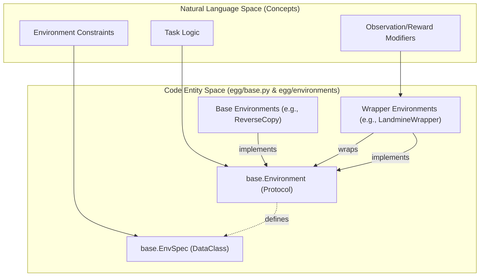
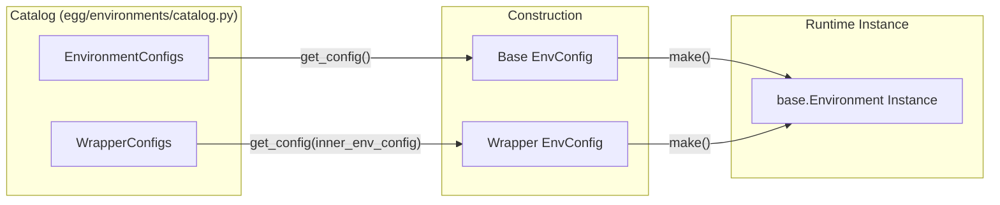

<!-- source: DeepWiki mcp.deepwiki.com · repo google-deepmind/egg · page 2 Environments · fetched 2026-10-26 -->

# Environments

Relevant source files

The following files were used as context for generating this wiki page:

- [egg/environments/__init__.py](egg/environments/__init__.py)
- [egg/environments/catalog.py](egg/environments/catalog.py)

The environment subsystem in `egg` defines the tasks and observation spaces that models must navigate. Unlike traditional RL environments that often follow the OpenAI Gym `step()` interface, `egg` environments are designed for batch-oriented, autoregressive sequence generation tasks common in Large Language Model (LLM) research.

The architecture is split into two primary layers: **Base Task Environments**, which define the core logic of a task (e.g., reversing a string), and **Wrapper Environments**, which modify or augment the behavior of an underlying environment (e.g., adding noise to rewards or limiting the prompt pool).

### The Environment Interface

All environments implement the `Environment` protocol defined in `egg/base.py`. This interface is centered around three primary responsibilities:
1.  **Providing Metadata**: Exposing an `EnvSpec` that defines vocabulary sizes and sequence lengths.
2.  **Generating Prompts**: Producing batches of input sequences for the model.
3.  **Evaluating Responses**: Calculating rewards based on the model's generated completions.

The `egg.environments.catalog` module provides a centralized registry for these components, allowing them to be instantiated via `MakeableConfig` patterns.

| Component | Role | Code Reference |
| :--- | :--- | :--- |
| `Environment` | Base protocol for all task logic. | [egg/base.py:108-132]() |
| `EnvSpec` | Data class defining `vocab_size`, `prompt_length`, and `completion_length`. | [egg/base.py:99-105]() |
| `EnvironmentConfigs` | Enum catalog of available base tasks. | [egg/environments/catalog.py:35-42]() |
| `WrapperConfigs` | Enum catalog of available environment wrappers. | [egg/environments/catalog.py:53-60]() |

**Sources:**
- [egg/base.py:99-132]()
- [egg/environments/catalog.py:16-73]()

### Architecture Overview

The following diagram illustrates how the `Environment` interface bridges the high-level task definition with the concrete code entities used during training.

**Environment System Structure**

**Sources:**
- [egg/base.py:99-132]()
- [egg/environments/catalog.py:35-60]()

---

### Base Task Environments

Base environments are the source of truth for the reinforcement learning tasks. Each environment is responsible for implementing `get_prompt`, which generates a JAX array of input tokens, and `get_reward`, which evaluates the model's output against the ground truth for that specific task.

Commonly used base environments include:
*   **ReverseCopy**: The model must output the input sequence in reverse order.
*   **SubsequenceMatch**: The model must identify if a specific pattern exists within a larger sequence.
*   **BitParity**: A logic-based task requiring the calculation of parity bits.

For a detailed breakdown of all five built-in tasks, including their specific reward shaping logic, see **[Base Task Environments](#2.1)**.

**Sources:**
- [egg/environments/catalog.py:35-42]()

---

### Environment Wrappers

`egg` uses a decorator-like pattern for environment wrappers. A wrapper takes an existing `Environment` (either a base task or another wrapper) and modifies its inputs or outputs. This allows for complex experimental setups, such as simulating "landmines" (sequences that trigger large negative rewards) or adding Gaussian noise to the reward signal to test algorithm robustness.

Wrappers are composed by nesting `MakeableConfig` objects. For example, a `LandmineWrapper` can be placed around a `ReverseCopy` environment to penalize specific forbidden sequences.

For details on available wrappers and how to stack them, see **[Environment Wrappers](#2.2)**.

**Sources:**
- [egg/environments/catalog.py:53-73]()

---

### Environment Composition Flow

The following diagram shows how the `EnvironmentConfigs` and `WrapperConfigs` from the catalog are used to construct the final environment stack used by an `Actor`.

**Environment Factory and Composition**

**Sources:**
- [egg/environments/catalog.py:44-51]()
- [egg/environments/catalog.py:62-72]()

---

