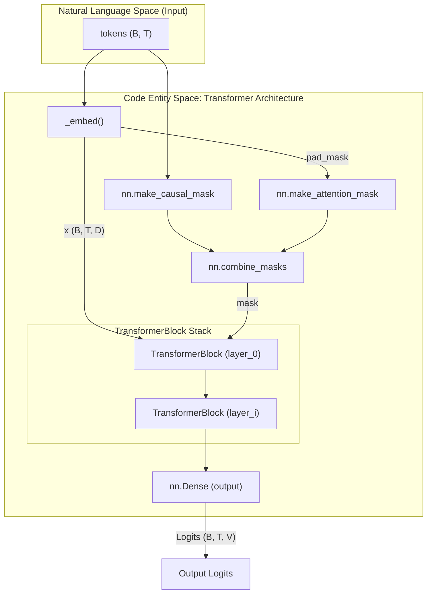
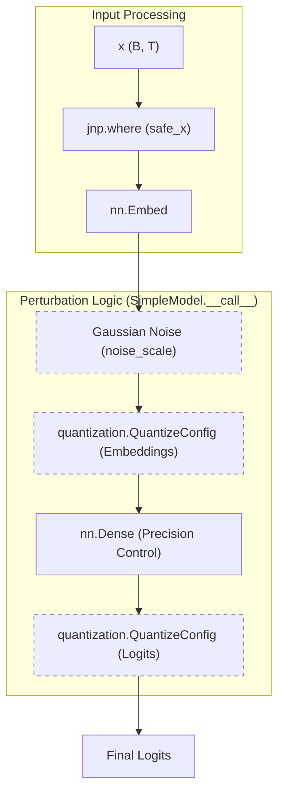

<!-- source: DeepWiki mcp.deepwiki.com · repo google-deepmind/egg · page 4.1 Transformer Architecture · fetched 2026-10-26 -->

# Transformer Architecture

Relevant source files

The following files were used as context for generating this wiki page:

- [egg/networks/linear.py](egg/networks/linear.py)
- [egg/networks/logit_wrapper.py](egg/networks/logit_wrapper.py)
- [egg/networks/transformers.py](egg/networks/transformers.py)

The `egg` framework provides a set of neural network backbones designed for reinforcement learning experiments. The primary architecture is a decoder-only Transformer, but the codebase also includes a linear baseline and a flexible logit wrapper for biasing model outputs. These networks are implemented using [Flax Linen](https://flax.readthedocs.io).

## Decoder-only Transformer

The core model used in most `egg` experiments is a standard decoder-only Transformer [egg/networks/transformers.py:48-50](). It is designed to process sequences of integer tokens and produce logits over the vocabulary for autoregressive generation.

### Configuration

The architecture is parameterized via `NetworkConfig`, which follows the `MakeableConfig` pattern used throughout the library [egg/networks/transformers.py:33-46]().

| Parameter | Type | Default | Description |
| :--- | :--- | :--- | :--- |
| `vocab_size` | `int` | 2 | Size of the token vocabulary. |
| `sequence_length`| `int` | 32 | Maximum context length (T). |
| `embed_dim` | `int` | 64 | Dimension of token and position embeddings (D). |
| `num_heads` | `int` | 4 | Number of attention heads. |
| `num_layers` | `int` | 3 | Number of stacked `TransformerBlock` instances. |
| `ff_dim` | `int` | 128 | Hidden dimension of the feed-forward network. |
| `bias` | `bool` | False | Whether to use bias terms in Dense and LayerNorm layers. |

**Sources:** [egg/networks/transformers.py:32-46]()

### Data Flow and Embedding

The Transformer handles input tokens through a specialized `_embed` utility that ensures safety against `PAD_TOKEN` indices and applies learned positional embeddings [egg/networks/transformers.py:101-113]().

1.  **PAD-Safe Lookup**: Input tokens are checked against `base.PAD_TOKEN`. Indices matching PAD are temporarily replaced with `0` to avoid out-of-bounds errors during embedding lookup [egg/networks/transformers.py:117-120]().
2.  **Embedding Summation**: Token embeddings and learned positional embeddings are summed [egg/networks/transformers.py:121-127]().
3.  **Masking**: The resulting vectors are multiplied by a `pad_mask` to ensure that `PAD_TOKEN` positions have zeroed-out embeddings [egg/networks/transformers.py:128-129]().

### Attention Masking

The model employs two types of masks combined into a single attention mask [egg/networks/transformers.py:59-61]():
*   **Causal Mask**: Generated via `nn.make_causal_mask`, ensuring tokens can only attend to preceding tokens [egg/networks/transformers.py:59]().
*   **Padding Mask**: Generated via `nn.make_attention_mask`, preventing attention to `PAD_TOKEN` positions [egg/networks/transformers.py:60]().

### Transformer Block

Each `TransformerBlock` consists of a pre-norm architecture [egg/networks/transformers.py:73-75]():
1.  **Self-Attention**: `LayerNorm` followed by `MultiHeadDotProductAttention` and a residual connection [egg/networks/transformers.py:81-87]().
2.  **Feed-Forward**: `LayerNorm` followed by a two-layer MLP (`Dense` -> `relu` -> `Dense`) and a residual connection [egg/networks/transformers.py:90-96]().

**Sources:** [egg/networks/transformers.py:48-98](), [egg/networks/transformers.py:101-130]()

## Linear Network

The `SimpleModel` is a linear baseline used primarily to study the effects of noise and precision on training dynamics [egg/networks/linear.py:16-29]().

### Implementation Details
Unlike the Transformer, the linear model performs a direct mapping from embeddings to logits via a single `nn.Dense` layer [egg/networks/linear.py:108-110](). It supports several perturbation features:
*   **Embedding Noise**: Additive Gaussian noise scaled by `noise_scale` [egg/networks/linear.py:92-95]().
*   **Quantization**: Both embeddings and logits can be quantized using a `QuantizeConfig` [egg/networks/linear.py:98-113]().
*   **Precision Control**: The dense layer computation can switch between `jax.lax.Precision.DEFAULT` and `HIGHEST` [egg/networks/linear.py:102-106]().

**Sources:** [egg/networks/linear.py:42-116]()

## Logit Wrapper

The `LogitWrapperNetwork` is a decorator-style `nn.Module` that adds a constant bias to the output of an underlying network [egg/networks/logit_wrapper.py:42-44](). This is frequently used in experiments to shift the initial policy or inject prior knowledge into the action space [egg/networks/logit_wrapper.py:16-19]().

**Sources:** [egg/networks/logit_wrapper.py:27-58]()

## Architectural Diagrams

### Transformer Data Flow: Tokens to Logits

The following diagram illustrates how the `Transformer` class processes input tokens, incorporating the `_embed` logic and `TransformerBlock` stack.

**Sources:** [egg/networks/transformers.py:48-70](), [egg/networks/transformers.py:101-129]()

### Linear Network Perturbation Pipeline

This diagram maps the `SimpleModel` implementation to its various numerical perturbation stages.

**Sources:** [egg/networks/linear.py:72-116]()

## Summary of Network Components

| Class | File | Purpose |
| :--- | :--- | :--- |
| `Transformer` | [egg/networks/transformers.py:48]() | Standard decoder-only backbone for RL tasks. |
| `TransformerBlock` | [egg/networks/transformers.py:73]() | Single attention + MLP layer with residual connections. |
| `SimpleModel` | [egg/networks/linear.py:57]() | Linear network for noise and precision ablation studies. |
| `LogitWrapperNetwork` | [egg/networks/logit_wrapper.py:42]() | Wraps a network to apply a fixed `logit_bias`. |

**Sources:** [egg/networks/transformers.py](), [egg/networks/linear.py](), [egg/networks/logit_wrapper.py]()

---

