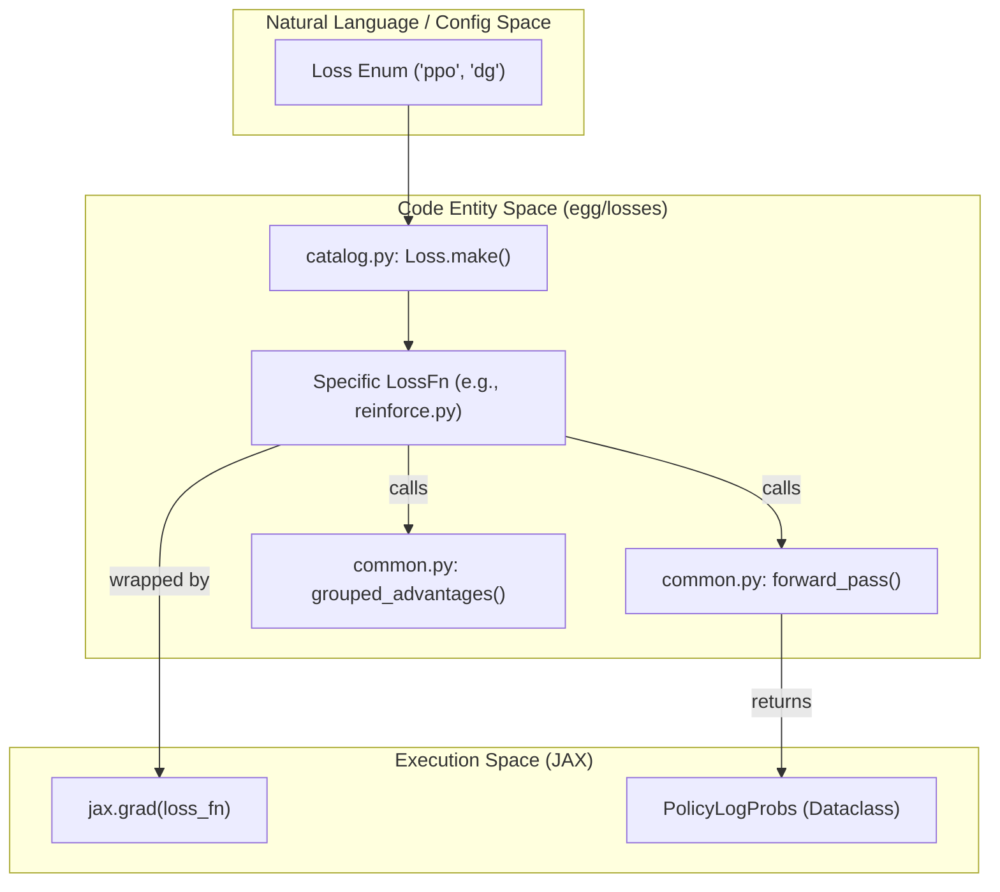

<!-- source: DeepWiki mcp.deepwiki.com · repo google-deepmind/egg · page 5 Loss Functions · fetched 2026-10-26 -->

# Loss Functions

Relevant source files

The following files were used as context for generating this wiki page:

- [egg/losses/__init__.py](egg/losses/__init__.py)
- [egg/losses/catalog.py](egg/losses/catalog.py)
- [egg/losses/common.py](egg/losses/common.py)

The loss subsystem in `egg` provides a unified interface for defining and computing training objectives. It is designed to decouple the specific Reinforcement Learning (RL) or Supervised Learning logic from the model architecture and the training loop.

## The LossFn Interface

All loss functions in `egg` implement the `LossFn` protocol defined in `egg/base.py`. This protocol ensures that every loss function accepts a standard set of inputs—model parameters, learner state, a data batch, and a PRNG key—and returns a scalar loss along with a dictionary of metrics.

To facilitate configuration and serialization, loss functions are typically instantiated via the `MakeableConfig` pattern.

### Loss Catalog and Registry

The framework maintains a central registry of all available loss functions. This allows users to specify a loss by a simple string name (e.g., `"ppo"`, `"dg"`) in configuration files or command-line flags.

| Loss Enum | String ID | Description |
| :--- | :--- | :--- |
| `Loss.REINFORCE` | `"reinforce"` | Standard Policy Gradient with optional grouped baseline. |
| `Loss.PPO` | `"ppo"` | Proximal Policy Optimization with clipped surrogate objective. |
| `Loss.DG` | `"dg"` | Delightful Gradient: Gated RL using "delight" (advantage × surprisal). |
| `Loss.KONDO` | `"kondo"` | Kondo Gate: Top-k token selection for compute-efficient training. |
| `Loss.PMPO` | `"pmpo"` | On-policy preference-based optimization. |
| `Loss.XENT` | `"xent"` | Standard Cross-Entropy (Teacher Forcing). |
| `Loss.ONLINE_STAR` | `"online_star"` | Online version of STaR (Self-Taught Reasoner). |

**Sources:**
- [egg/losses/catalog.py:32-40]() (Loss Registry)
- [egg/losses/catalog.py:43-52]() (Loss Enum definitions)
- [egg/losses/catalog.py:54-60]() (Config and Make methods)

---

## Forward Pass Utilities

To avoid code duplication, `egg` provides `egg/losses/common.py`, which contains standardized functions for processing batches and computing log-probabilities.

### The `forward_pass` Function
The `forward_pass` utility handles the alignment of prompts and answers. It concatenates them, runs the model, and slices the resulting logits to specifically target the "answer" portion of the sequence.

### `PolicyLogProbs` Data Structure
The result of a forward pass is encapsulated in a `PolicyLogProbs` dataclass:
- `lp_all`: Full log-softmax distribution over the vocabulary for all answer tokens.
- `lp_answer`: The specific log-probability of the tokens actually sampled/present in the batch.
- `token_mask`: A mask identifying valid (non-padding) tokens within the answer.
- `row_mask`: A mask identifying valid sequences within the batch.

### Grouped Advantages
For RL losses, `grouped_advantages` implements a baseline-subtraction mechanism. If `group_ids` are provided (e.g., multiple samples per prompt), it calculates a mean reward per group to reduce variance without introducing bias.

**Sources:**
- [egg/losses/common.py:27-35]() (`PolicyLogProbs` definition)
- [egg/losses/common.py:37-67]() (`forward_pass` implementation)
- [egg/losses/common.py:77-94]() (`grouped_advantages` implementation)

---

## System Architecture: From Config to Gradient

The following diagram illustrates how the Loss subsystem bridges the high-level configuration space to the low-level JAX operations.

**Loss Subsystem Integration**

**Sources:**
- [egg/losses/catalog.py:58-60]()
- [egg/losses/common.py:37-42]()
- [egg/losses/common.py:77-83]()

---

## Detailed Loss Categories

The loss functions in `egg` are broadly categorized into standard policy gradients and the novel "Delightful" family of gated losses.

### Standard RL Losses
These losses implement well-known algorithms adapted for sequence generation. They support token-level formulations and importance weighting to handle off-policy data generated by the actors.
- **REINFORCE**: The simplest policy gradient, using the `grouped_advantages` utility for variance reduction.
- **PPO**: Implements the clipped surrogate objective and includes a KL-divergence anchor to prevent the policy from collapsing or drifting too far from a reference model.
- **XENT**: A standard supervised cross-entropy loss used for initialization or distillation.

For implementation details and mathematical formulations, see **[Standard RL Losses: REINFORCE, PPO, PMPO, XENT, OnlineStar](#5.1)**.

### Delightful Gradient (DG) and Kondo
The `egg` framework introduces specialized losses designed for "Delightful Policy Gradients."
- **DG Loss**: Uses a sigmoid gate weighted by "delight"—defined as the product of advantage (how much better the result was than expected) and surprisal (how unlikely the sequence was).
- **Kondo Loss**: A variant of DG that uses a binary top-k selection (gate) to prioritize learning on high-signal samples, effectively saving compute by masking gradients for "boring" or low-utility samples.

For details on gating logic and the `pct_learn` parameter, see **[Delightful Gradient (DG) and Kondo Gate Losses](#5.2)**.

**Sources:**
- [egg/losses/catalog.py:32-39]() (Catalog of loss types)
- [egg/losses/dg.py]() (Delightful Gradient logic)
- [egg/losses/kondo.py]() (Kondo gating logic)

---

