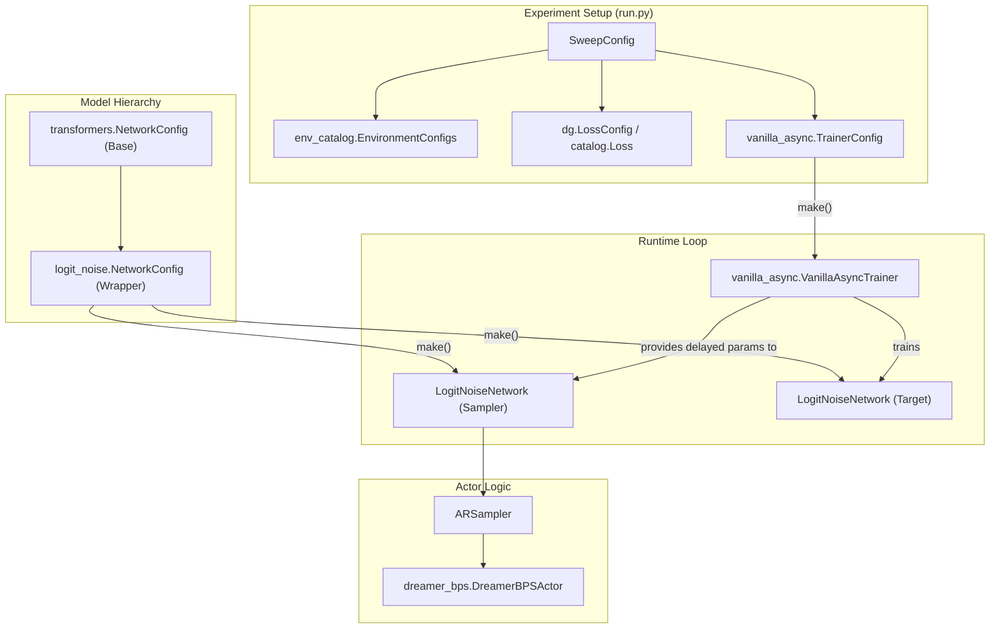
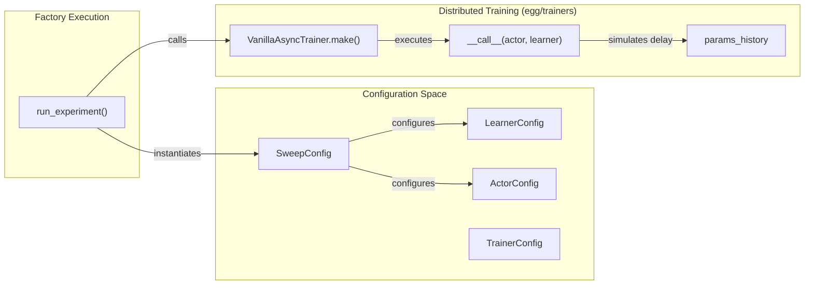

<!-- source: DeepWiki mcp.deepwiki.com · repo google-deepmind/egg · page 7.3 Distributed Experiment · fetched 2026-10-26 -->

# Distributed Experiment

Relevant source files

The following files were used as context for generating this wiki page:

- [experiments/distributed/README.md](experiments/distributed/README.md)
- [experiments/distributed/run.py](experiments/distributed/run.py)
- [experiments/distributed/run_test.py](experiments/distributed/run_test.py)

The **Distributed Experiment** ([experiments/distributed/run.py]()) is a specialized experiment suite designed to study Reinforcement Learning (RL) performance under conditions of **parameter staleness** and **asynchronous updates**. It serves as the official implementation for the paper *"Delightful Distributed Policy Gradient"* ([experiments/distributed/README.md:1-15]()).

Unlike the baseline experiments that assume perfectly synchronized weights between the Actor and Learner, this experiment utilizes the `VanillaAsyncTrainer` to simulate the communication delays inherent in large-scale distributed training systems.

## Experiment Architecture

The experiment follows the standard `egg` pattern of composing a `MakeableConfig` for each subsystem, but it introduces specific configurations to handle distributed dynamics:

1.  **Environment Catalog**: Dynamically selects tasks (e.g., `reverse_copy`, `bit_parity`) from a centralized registry [experiments/distributed/run.py:69-71]().
2.  **Logit Noise Network**: Wraps the base Transformer to allow for logit-level perturbations [experiments/distributed/run.py:84-88]().
3.  **DreamerBPS Actor**: Uses an actor that can inject synthetic data (e.g., landmines) and recompute log-probabilities for off-policy data [experiments/distributed/run.py:91-99]().
4.  **VanillaAsyncTrainer**: Orchestrates the loop while managing a history of model parameters to simulate sampler delay [experiments/distributed/run.py:142-145]().

### Data Flow and Component Interaction

The following diagram illustrates how the `run_experiment` function [experiments/distributed/run.py:65]() instantiates and connects the distributed components.

**Distributed System Entity Map**

**Sources:** [experiments/distributed/run.py:65-153](), [egg/trainers/vanilla_async.py](), [egg/networks/logit_noise.py]()

## Distributed Components

### 1. VanillaAsyncTrainer
The core of the distributed experiment is the `VanillaAsyncTrainer`. While the `run.py` script initializes it with standard steps and seeds [experiments/distributed/run.py:142-145](), the trainer itself is responsible for:
*   **Parameter History**: Maintaining a FIFO buffer of previous model weights.
*   **Staleness Simulation**: Sampling parameters from this history to provide to the `Actor`, mimicking the "lag" found in distributed actors that only pull new weights periodically.
*   **Async Evaluation**: Decoupling the training step from the evaluation of the current "learner" model.

### 2. Logit Noise Actor Network
The experiment uses `logit_noise.NetworkConfig` [experiments/distributed/run.py:84-88](). This wrapper around the `Transformer` allows the actor to have a different noise profile than the learner. In this distributed setup:
*   The **Learner** typically uses `sigma=0` (clean updates) [experiments/distributed/run.py:87]().
*   The **Actor** can utilize the logit noise to explore the environment more effectively or to simulate hardware-level variance in distributed workers.

### 3. Environment Catalog Usage
The experiment supports a subset of validated environments defined in `VALID_ENVS` [experiments/distributed/run.py:35](). It retrieves these via the `env_catalog`:

| Environment | Key in `VALID_ENVS` | Description |
| :--- | :--- | :--- |
| Bit Parity | `bit_parity` | Computing parity of a bitstring. |
| Key Value | `key_value` | Retrieving values associated with keys in a prompt. |
| Reverse Copy | `reverse_copy` | Reversing a sequence of tokens. |
| Subsequence Match | `subsequence_match` | Finding a pattern within a larger sequence. |

**Sources:** [experiments/distributed/run.py:35-43](), [experiments/distributed/run.py:69-72]()

## Loss Function Configurations

The experiment supports multiple loss functions to compare their robustness against distributed lag. The configuration is branched based on the `sweep_config.loss` parameter [experiments/distributed/run.py:102-132]().

| Loss Type | Implementation Class | Key Parameters |
| :--- | :--- | :--- |
| **DG** | `dg.LossConfig` | `eta_learn`, `lambda_learn` |
| **PPO** | `catalog.Loss.PPO` | `clip_epsilon`, `beta_kl` |
| **REINFORCE** | `catalog.Loss.PPO` (Modified) | `clip_epsilon=1e9`, `beta_kl=0.0` |
| **PMPO** | `catalog.Loss.PMPO` | `alpha`, `beta` |

All configurations in this experiment default to `use_grouped_baseline=True`, using the `prompts_per_batch` as the number of groups to reduce variance [experiments/distributed/run.py:106, 113, 121, 128]().

## Code Entity Space to Logic Mapping

The following diagram maps the specific classes and functions in `experiments/distributed/run.py` to their roles in the distributed training lifecycle.

**Distributed Logic Entity Map**

**Sources:** [experiments/distributed/run.py:65-153](), [egg/trainers/vanilla_async.py]()

## Running the Experiment

The experiment is executed via the `main` entrypoint [experiments/distributed/run.py:156-160](). It uses `fancyflags` to allow command-line overrides of the `SweepConfig`.

### Smoke Testing
A parameterized smoke test is provided in `run_test.py` [experiments/distributed/run_test.py:1-55](). It verifies that the distributed loop can complete at least 3 steps across different environments and loss functions (`dg` and `reinforce`) without crashing [experiments/distributed/run_test.py:31-38]().

**Sources:** [experiments/distributed/run.py:156-164](), [experiments/distributed/run_test.py:25-51]()

---

