# Page: Overview

# Overview

<details>
<summary>Relevant source files</summary>

The following files were used as context for generating this wiki page:

- [Makefile](Makefile)
- [README.md](README.md)
- [egg/__init__.py](egg/__init__.py)

</details>


`egg` is a minimal, CPU-friendly simulation framework designed for exploring Reinforcement Learning (RL) on Language Models (LMs). Its primary goal is to provide a transparent, "algorithm-first" incubator where new RL techniques—such as the **Delightful Policy Gradient (DPG)**—can be prototyped and understood before being deployed to full-scale distributed training systems [README.md:1-15]().

The codebase is structured to mirror paper pseudocode, prioritizing readability and rapid iteration over complex abstractions [README.md:12-15]().

## System Philosophy

The design of `egg` revolves around a few core pillars:
*   **Tiny + Transparent**: Minimal dependencies and no hidden framework "magic" [README.md:12-12]().
*   **Algorithm-first**: The code is structured to make the mathematical logic of the RL algorithms explicit [README.md:13-13]().
*   **Insightful**: While the environments are small (e.g., bit parity, reverse copy), the insights gained regarding gradient variance, exploration, and parameter lag are intended to transfer to large-scale LLM training [README.md:15-15]().

## High-Level Architecture

The framework operates on a cyclic interaction between three main functional entities: the **Actor**, the **Learner**, and the **Trainer**.

### Component Interaction Flow

The following diagram illustrates how these entities interact to form the training loop.

**Logic Flow: Data and Parameter Exchange**
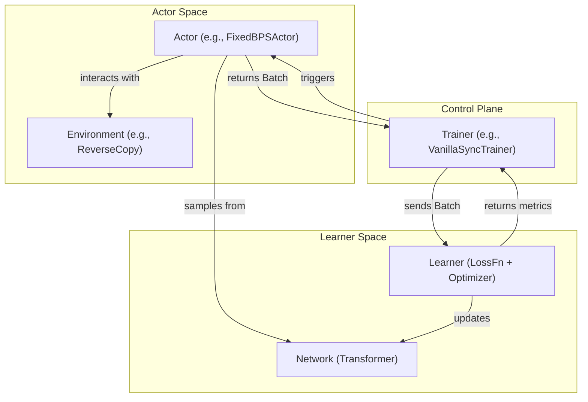
Sources: [README.md:1-15](), [Makefile:36-37]()

### Bridging Natural Language to Code Entities

In `egg`, concepts from the RL literature are mapped directly to specific Python classes and protocols.

**Entity Mapping: RL Concepts to Code**
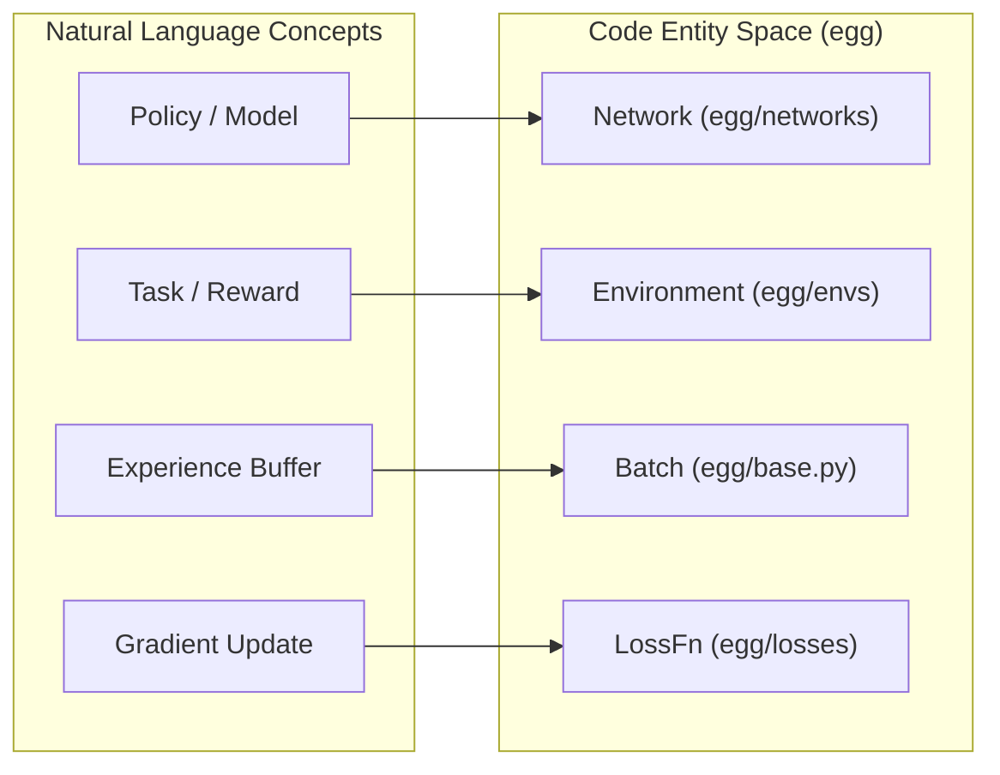
Sources: [README.md:12-15](), [Makefile:31-33]()

## Subsystem Summaries

### 1. Getting Started
The project uses a standard Python ecosystem (`pip`, `venv`, `pytest`). It includes a `Makefile` to streamline installation and running baseline experiments [README.md:17-33](), [Makefile:1-42]().
*   For details, see [Getting Started](#1.1).

### 2. Environments
`egg` includes a variety of synthetic tasks designed to test specific capabilities of RL agents, such as `ReverseCopy` or `SubsequenceMatch`. These are often wrapped in noise or prompt-modifying wrappers to simulate different training conditions.
*   For details, see [Environments](#2).

### 3. Actors
Actors are responsible for the "rollout" phase. They use a `Network` to sample actions from an `Environment` and package the results into a `Batch` object for the learner.
*   For details, see [Actors](#3).

### 4. Networks
The default backbone is a decoder-only `Transformer`. The framework also supports specialized modules for logit noise and quantization to study the robustness of RL algorithms.
*   For details, see [Networks](#4).

### 5. Loss Functions
This is the heart of the "algorithm-first" philosophy. `egg` implements standard RL losses (REINFORCE, PPO) alongside novel ones like **Delightful Gradient (DG)**, which uses "delight" (advantage × surprisal) to gate updates.
*   For details, see [Loss Functions](#5).

### 6. Trainers
Trainers orchestrate the loop between Actors and Learners. `egg` provides both a `VanillaSyncTrainer` for standard runs and a `VanillaAsyncTrainer` to simulate parameter lag in distributed settings.
*   For details, see [Trainers](#6).

### 7. Experiments
The `experiments/` directory contains concrete implementations of research papers. For example, `experiments/baseline/run.py` provides a simple entry point to verify the installation and core logic [README.md:37-41](), [Makefile:36-37]().
*   For details, see [Experiments](#7).

### 8. Utility Libraries
Common logic for autoregressive sampling (`ARSampler`), logging, and statistical calculations are centralized in `egg/lib/` to keep the core algorithms clean.
*   For details, see [Utility Libraries](#8).

---
Sources: [README.md:1-97](), [Makefile:1-42](), [egg/__init__.py:1-17]()

---

# Page: Getting Started

# Getting Started

<details>
<summary>Relevant source files</summary>

The following files were used as context for generating this wiki page:

- [Makefile](Makefile)
- [experiments/baseline/__init__.py](experiments/baseline/__init__.py)
- [experiments/baseline/run.py](experiments/baseline/run.py)
- [pyproject.toml](pyproject.toml)
- [requirements.txt](requirements.txt)

</details>


This page provides a technical guide for setting up the `egg` codebase, understanding its project structure, and executing the baseline reinforcement learning experiment. `egg` is designed as a minimal incubator for RL on language models, optimized for CPU-friendly experimentation using JAX and Flax.

## Installation and Environment Setup

The project uses a standard Python ecosystem centered around `pyproject.toml` and a `Makefile` to automate environment provisioning.

### Dependencies
The core dependencies are managed in `pyproject.toml` [6:30]() and `requirements.txt` [1:7](). Key libraries include:
*   **JAX & Flax**: The numerical and neural network foundations [pyproject.toml:23-24]().
*   **Optax**: Gradient processing and optimization [pyproject.toml:25]().
*   **Fancyflags**: For structured, type-safe command-line configuration [pyproject.toml:29]().
*   **Pandas**: Used for logging and metrics aggregation [pyproject.toml:26]().

### Setup via Makefile
The `Makefile` provides a streamlined interface for developers:

| Target | Action |
| :--- | :--- |
| `make install` | Creates a virtual environment (`.venv`), upgrades `pip`, and installs the package in editable mode with test dependencies [Makefile:24-27](). |
| `make test` | Discovers and runs all `*_test.py` files within the `experiments` directory using `pytest` [Makefile:29-34](). |
| `make run` | Executes a short (10-step) version of the baseline experiment to verify the installation [Makefile:36-37](). |
| `make clean` | Removes the `.venv`, build artifacts, and `__pycache__` directories [Makefile:39-42](). |

Sources: [Makefile:1-42](), [pyproject.toml:1-44](), [requirements.txt:1-8]()

## Project Layout

The codebase is organized into two primary top-level packages: `egg` (the framework) and `experiments` (concrete implementations and research suites).

### Framework: `egg/`
This directory contains the core abstractions and modular components:
*   `egg/base.py`: Defines the foundational protocols and the `MakeableConfig` factory pattern.
*   `egg/actors/`: Logic for generating experience batches (e.g., `fixed_bps.py`).
*   `egg/environments/`: Task definitions and reward functions.
*   `egg/networks/`: Neural architectures, including Transformers.
*   `egg/losses/`: Implementations of RL loss functions (REINFORCE, PPO, etc.).
*   `egg/trainers/`: Orchestration loops for syncing actors and learners.

### Research: `experiments/`
Contains self-contained scripts for specific research questions. Each experiment typically includes:
*   `run.py`: The entrypoint for the experiment.
*   `*_test.py`: Smoke tests or unit tests for that specific configuration.

Sources: [pyproject.toml:36-37](), [experiments/baseline/run.py:22-28]()

## Running the First Experiment

The baseline experiment is located in `experiments/baseline/run.py`. It demonstrates a standard RL setup using the `REINFORCE` algorithm on a `SubsequenceMatch` task.

### Configuration with Fancyflags
The experiment uses `SweepConfig` [experiments/baseline/run.py:34-43]() to define hyperparameters. These are exposed as command-line flags via `fancyflags`:
*   `--sweep.prompt_length`: Length of the input sequence.
*   `--sweep.answer_length`: Length of the generated sequence.
*   `--sweep.use_baseline`: Enables grouped baseline for variance reduction in REINFORCE.

### Data Flow: Config to Execution
The `run_experiment` function [experiments/baseline/run.py:50-89]() follows a specific factory pattern to instantiate the system:

1.  **Config Aggregation**: Individual component configs (`EnvConfig`, `NetworkConfig`, `LossConfig`, etc.) are created using values from `SweepConfig`.
2.  **Object Creation**: The `.make()` method is called on these configs to return the functional instances [experiments/baseline/run.py:84-86]().
3.  **Execution**: The `trainer` (a `VanillaSyncTrainer`) is called with the `actor` and `learner` [experiments/baseline/run.py:88]().

### Code Entity Space Mapping
The following diagram illustrates how the configuration entities in `run.py` map to the functional components they instantiate.

**Entity Association: Config to Component**
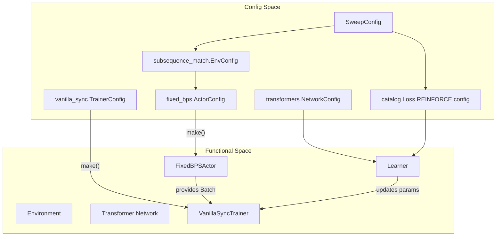
Sources: [experiments/baseline/run.py:33-89]()

## The Baseline Entrypoint

The `main` function [experiments/baseline/run.py:92-96]() serves as the primary execution hook. It parses flags and triggers the experiment loop.

### Experiment Execution Flow
The `VanillaSyncTrainer` manages the iterative loop between the Actor and the Learner.

**System Data Flow: Baseline run.py**
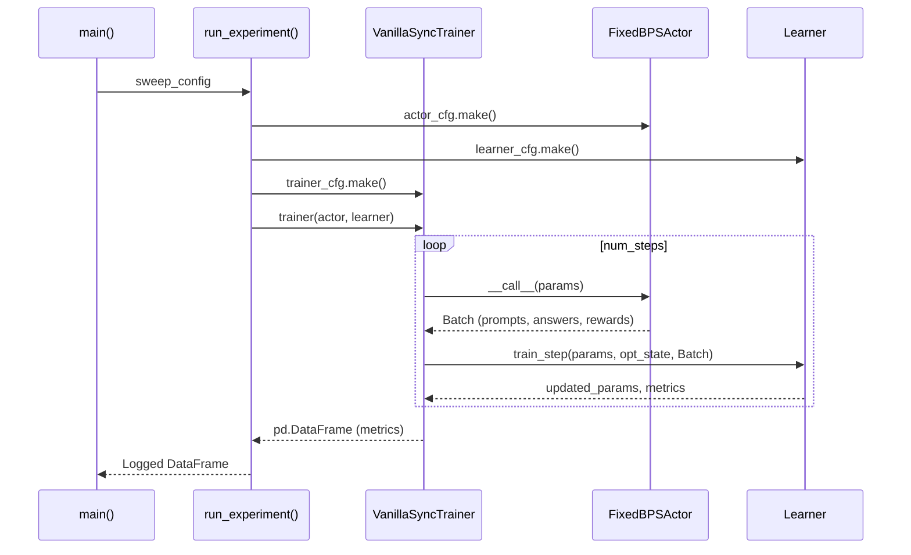

### Execution Command
To run the baseline with default parameters:
```bash
python3 -m experiments.baseline.run
```
To override specific parameters:
```bash
python3 -m experiments.baseline.run --sweep.learning_rate=0.0005 --sweep.num_steps=5000
```

Sources: [experiments/baseline/run.py:16-100](), [Makefile:36-37]()

---

# Page: Core Architecture and Design Principles

# Core Architecture and Design Principles

<details>
<summary>Relevant source files</summary>

The following files were used as context for generating this wiki page:

- [egg/base.py](egg/base.py)
- [egg/learners.py](egg/learners.py)

</details>


This page details the structural design of the `egg` framework. The library is built around a functional, "algorithm-first" philosophy using JAX and Flax, prioritizing stateless abstractions that can be easily JIT-compiled and scaled.

## The Actor → Learner → Trainer Loop

The primary execution flow in `egg` is a cyclic relationship between three main abstractions defined in `egg/base.py`. This separation of concerns ensures that data generation (Actor) is decoupled from gradient optimization (Learner), both of which are orchestrated by a high-level execution manager (Trainer).

### Major Abstractions

| Component | Interface | Role |
| :--- | :--- | :--- |
| **Actor** | `Actor` [egg/base.py:95-106]() | Consumes the current model state to sample sequences from an environment and produce a `Batch`. |
| **Learner** | `Learner` [egg/base.py:126-141]() | Takes a `Batch`, calculates gradients via a `LossFn`, and updates the model parameters. |
| **Trainer** | `Trainer` [egg/base.py:143-151]() | Manages the loop, handles PRNG state, and logs metrics to a `pandas.DataFrame`. |
| **Environment**| `Environment` [egg/base.py:57-78]() | A stateless oracle that provides prompts and evaluates answers with rewards. |

### Data Flow Diagram
The following diagram illustrates how these entities interact within a single training step.

**System Entity Flow: Actor-Learner Loop**
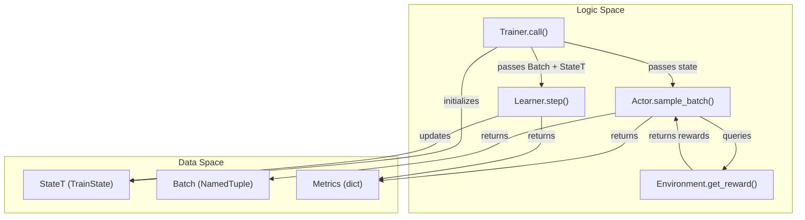
**Sources:** [egg/base.py:95-151](), [egg/learners.py:72-89]()

---

## MakeableConfig Factory Pattern

To ensure experiments are fully serializable and reproducible, `egg` uses the `MakeableConfig` pattern. Instead of passing instantiated objects (which may contain un-serializable JAX arrays or compiled functions) into constructors, the framework passes lightweight configuration dataclasses.

*   **`MakeableConfig`**: An abstract base class [egg/base.py:37-43]() with a single `make()` method.
*   **Composition**: Configurations can nest other configurations. For example, a `LearnerConfig` [egg/learners.py:30-45]() contains a `model_config` and a `loss_config`.
*   **Serialization**: Because these are standard Python dataclasses, they can be easily converted to dictionaries or JSON for logging experiment hyperparameters alongside results.

**Code Entity Space: Configuration Composition**
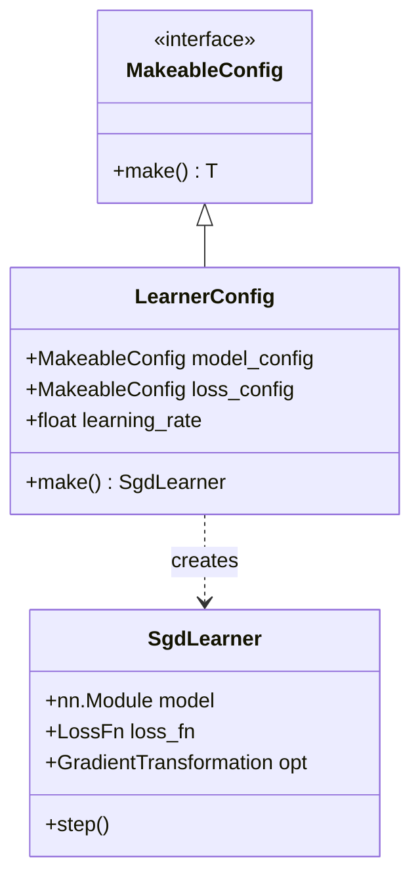
**Sources:** [egg/base.py:37-43](), [egg/learners.py:30-45]()

---

## The Batch Data Structure

The `Batch` [egg/base.py:82-90]() is the fundamental unit of data transfer between the Actor and the Learner. It is a `tp.NamedTuple` containing JAX arrays, ensuring it is a valid JAX pytree that can be passed into `jit` or `vmap` functions.

### Batch Attributes
| Attribute | Shape | Description |
| :--- | :--- | :--- |
| `prompts` | `(B, prompt_len)` | Input tokens provided by the environment. |
| `answers` | `(B, answer_len)` | Tokens generated by the model (or injected by the actor). |
| `rewards` | `(B,)` | Scalar rewards returned by `Environment.get_reward`. |
| `sample_log_probs` | `(B, total_len)` | The log-probability of each token under the policy that sampled it. |
| `aux` | `dict` | Arbitrary metadata (e.g., environment-specific info). |

**Sources:** [egg/base.py:82-90]()

---

## Algorithm-First Philosophy

The framework is designed to prioritize the mathematical definition of the RL algorithm (the "Loss") over the infrastructure.

### The Learner Implementation
The `SgdLearner` [egg/learners.py:48-90]() provides a reference implementation of the `Learner` protocol. Its `step` function is a pure JAX transformation:

1.  It uses `jax.value_and_grad` on the `loss_fn` [egg/learners.py:79-83]().
2.  The `loss_fn` [egg/base.py:108-124]() is a protocol that defines the RL objective (e.g., REINFORCE, PPO).
3.  The gradients are applied to the `TrainState` using `optax` [egg/learners.py:84]().

### Stateless Environments
Unlike OpenAI Gym, the `Environment` [egg/base.py:57-78]() interface in `egg` is stateless. It does not have a `reset()` or `step()` method that modifies internal variables. Instead:
*   `get_prompt(key)` [egg/base.py:67-69]() generates a prompt given a PRNG key.
*   `get_reward(prompt, answer, key)` [egg/base.py:72-76]() evaluates a completed sequence.

This statelessness allows the Actor to sample thousands of sequences in parallel across accelerators using JAX's vectorization primitives.

**Sources:** [egg/base.py:57-78](), [egg/learners.py:48-90]()

---

# Page: Environments

# Environments

<details>
<summary>Relevant source files</summary>

The following files were used as context for generating this wiki page:

- [egg/environments/__init__.py](egg/environments/__init__.py)
- [egg/environments/catalog.py](egg/environments/catalog.py)

</details>


The environment subsystem in `egg` defines the tasks and observation spaces that models must navigate. Unlike traditional RL environments that often follow the OpenAI Gym `step()` interface, `egg` environments are designed for batch-oriented, autoregressive sequence generation tasks common in Large Language Model (LLM) research.

The architecture is split into two primary layers: **Base Task Environments**, which define the core logic of a task (e.g., reversing a string), and **Wrapper Environments**, which modify or augment the behavior of an underlying environment (e.g., adding noise to rewards or limiting the prompt pool).

### The Environment Interface

All environments implement the `Environment` protocol defined in `egg/base.py`. This interface is centered around three primary responsibilities:
1.  **Providing Metadata**: Exposing an `EnvSpec` that defines vocabulary sizes and sequence lengths.
2.  **Generating Prompts**: Producing batches of input sequences for the model.
3.  **Evaluating Responses**: Calculating rewards based on the model's generated completions.

The `egg.environments.catalog` module provides a centralized registry for these components, allowing them to be instantiated via `MakeableConfig` patterns.

| Component | Role | Code Reference |
| :--- | :--- | :--- |
| `Environment` | Base protocol for all task logic. | [egg/base.py:108-132]() |
| `EnvSpec` | Data class defining `vocab_size`, `prompt_length`, and `completion_length`. | [egg/base.py:99-105]() |
| `EnvironmentConfigs` | Enum catalog of available base tasks. | [egg/environments/catalog.py:35-42]() |
| `WrapperConfigs` | Enum catalog of available environment wrappers. | [egg/environments/catalog.py:53-60]() |

**Sources:**
- [egg/base.py:99-132]()
- [egg/environments/catalog.py:16-73]()

### Architecture Overview

The following diagram illustrates how the `Environment` interface bridges the high-level task definition with the concrete code entities used during training.

**Environment System Structure**
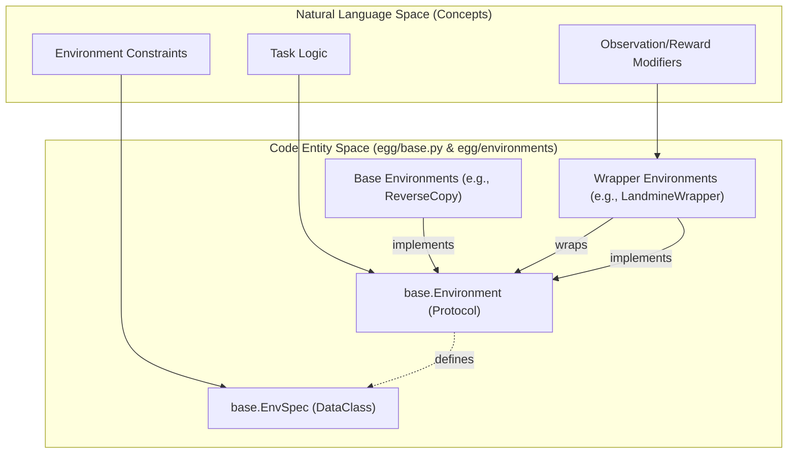
**Sources:**
- [egg/base.py:99-132]()
- [egg/environments/catalog.py:35-60]()

---

### Base Task Environments

Base environments are the source of truth for the reinforcement learning tasks. Each environment is responsible for implementing `get_prompt`, which generates a JAX array of input tokens, and `get_reward`, which evaluates the model's output against the ground truth for that specific task.

Commonly used base environments include:
*   **ReverseCopy**: The model must output the input sequence in reverse order.
*   **SubsequenceMatch**: The model must identify if a specific pattern exists within a larger sequence.
*   **BitParity**: A logic-based task requiring the calculation of parity bits.

For a detailed breakdown of all five built-in tasks, including their specific reward shaping logic, see **[Base Task Environments](#2.1)**.

**Sources:**
- [egg/environments/catalog.py:35-42]()

---

### Environment Wrappers

`egg` uses a decorator-like pattern for environment wrappers. A wrapper takes an existing `Environment` (either a base task or another wrapper) and modifies its inputs or outputs. This allows for complex experimental setups, such as simulating "landmines" (sequences that trigger large negative rewards) or adding Gaussian noise to the reward signal to test algorithm robustness.

Wrappers are composed by nesting `MakeableConfig` objects. For example, a `LandmineWrapper` can be placed around a `ReverseCopy` environment to penalize specific forbidden sequences.

For details on available wrappers and how to stack them, see **[Environment Wrappers](#2.2)**.

**Sources:**
- [egg/environments/catalog.py:53-73]()

---

### Environment Composition Flow

The following diagram shows how the `EnvironmentConfigs` and `WrapperConfigs` from the catalog are used to construct the final environment stack used by an `Actor`.

**Environment Factory and Composition**
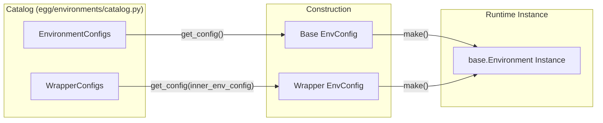
**Sources:**
- [egg/environments/catalog.py:44-51]()
- [egg/environments/catalog.py:62-72]()

---

# Page: Base Task Environments

# Base Task Environments

<details>
<summary>Relevant source files</summary>

The following files were used as context for generating this wiki page:

- [egg/environments/bit_parity.py](egg/environments/bit_parity.py)
- [egg/environments/key_value.py](egg/environments/key_value.py)
- [egg/environments/noisy_reward.py](egg/environments/noisy_reward.py)
- [egg/environments/reverse_copy.py](egg/environments/reverse_copy.py)
- [egg/environments/subsequence_match.py](egg/environments/subsequence_match.py)

</details>


This page provides a detailed technical overview of the five built-in task environments in the `egg` framework. These environments serve as standardized benchmarks for Reinforcement Learning (RL) research, testing specific model capabilities such as associative recall, positional reasoning, and information aggregation.

## Environment Abstraction

All base environments implement the `base.Environment` interface and are defined via a corresponding `EnvConfig` which inherits from `base.MakeableConfig`. The core interaction between the actor and the environment is governed by the `base.EnvSpec`, which defines the structural constraints of the task.

### Key Data Structures

*   **`EnvSpec`**: A dataclass containing `vocab_size`, `prompt_length`, and `answer_length`. It informs the model's embedding layer and the ARSampler's generation loop.
*   **`get_prompt(key)`**: Generates a task-specific input sequence.
*   **`get_reward(prompt, answer, key)`**: Evaluates the model's generated response against the prompt and returns a scalar reward.

### Code-to-System Mapping: Environment Interface

The following diagram illustrates how the abstract environment definitions in `base.py` are realized by concrete task implementations.

Title: Environment Implementation Flow
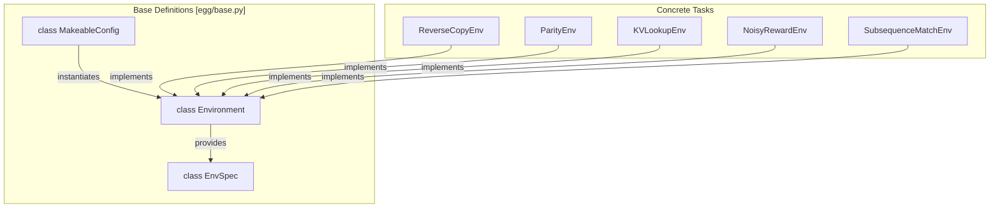
Sources: [egg/environments/reverse_copy.py:48-60](), [egg/environments/bit_parity.py:38-50](), [egg/environments/key_value.py:52-68](), [egg/environments/noisy_reward.py:43-59](), [egg/environments/subsequence_match.py:47-69]()

---

## 1. ReverseCopy
**File**: `egg/environments/reverse_copy.py`

The `ReverseCopyEnv` requires the agent to produce the input tokens in reverse order. This task is a primary probe for positional reasoning in Transformer architectures.

### Reward Shaping and Kappa
The environment implements a sophisticated reward function `reversal_reward` that supports partial credit and "traps":
*   **`kappa`**: A shaping parameter. If $\kappa = 1$, the reward is purely the fraction of correct tokens. If $\kappa < 1$, a completion bonus is added for perfect matches [egg/environments/reverse_copy.py:151-158]().
*   **`reward_to_first_error`**: If enabled, the environment only counts correct tokens from the start of the sequence until the first mistake [egg/environments/reverse_copy.py:139-141]().

### Configuration Parameters
| Parameter | Type | Description |
| :--- | :--- | :--- |
| `target_reverse` | `bool` | If False, the task becomes a forward copy [egg/environments/reverse_copy.py:127-129](). |
| `target_increment` | `bool` | If True, target tokens are $(x + 1) \pmod{\text{vocab\_size}}$ [egg/environments/reverse_copy.py:134-136](). |

Sources: [egg/environments/reverse_copy.py:32-41](), [egg/environments/reverse_copy.py:89-159]()

---

## 2. BitParity
**File**: `egg/environments/bit_parity.py`

The `ParityEnv` assesses the model's ability to aggregate information across all positions in a sequence.

*   **Task**: The agent sees a sequence of binary tokens (0 or 1).
*   **Logic**: It must output **1** if the sum of bits is even, and **0** if odd [egg/environments/bit_parity.py:18-20]().
*   **Reward**: Returns `+1.0` for a correct parity bit and `-1.0` otherwise [egg/environments/bit_parity.py:70-71]().

Sources: [egg/environments/bit_parity.py:38-71]()

---

## 3. KeyValue (Associative Recall)
**File**: `egg/environments/key_value.py`

The `KVLookupEnv` tests content-addressable memory. The prompt consists of $N$ key-value pairs followed by a query key.

### Data Flow
1.  **Prompt Generation**: `[k1, v1, k2, v2, ..., kn, vn, query]` [egg/environments/key_value.py:18-19]().
2.  **Retrieval**: The `kv_lookup_reward` function extracts keys and values from the prompt using slicing [egg/environments/key_value.py:116-117]().
3.  **Conflict Resolution**: If the same key appears multiple times, the environment targets the value associated with the *last* occurrence [egg/environments/key_value.py:128-129]().

Title: KVLookup Data Extraction
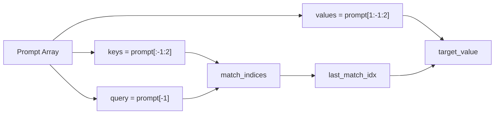
Sources: [egg/environments/key_value.py:70-100](), [egg/environments/key_value.py:109-131]()

---

## 4. NoisyReward
**File**: `egg/environments/noisy_reward.py`

This environment is designed for exploring exploration-exploitation trade-offs and the impact of reward variance on RL stability.

*   **Action 0**: Always returns a fixed reward of `1.0` [egg/environments/noisy_reward.py:83]().
*   **Action 1**: Returns a reward sampled from a Gaussian distribution $\mathcal{N}(\mu, \sigma^2)$ [egg/environments/noisy_reward.py:86-88]().
*   **Usage**: Used to test if an algorithm can correctly identify the higher-mean action despite high variance in samples.

Sources: [egg/environments/noisy_reward.py:27-41](), [egg/environments/noisy_reward.py:65-93]()

---

## 5. SubsequenceMatch
**File**: `egg/environments/subsequence_match.py`

The `SubsequenceMatchEnv` tests the agent's ability to "hide" or "include" a specific prompt sequence within a much longer generated response.

### Implementation Details
*   **Subsequence Logic**: Unlike a substring match, gaps are allowed. For example, "ad" is a valid subsequence of "abcd" [egg/environments/subsequence_match.py:23-27]().
*   **JAX-Friendly Search**: The environment uses `jax.lax.scan` to iterate through the response and track the number of matched tokens from the prompt without using Python loops [egg/environments/subsequence_match.py:101-106]().
*   **Reward**: `+1.0` if the entire prompt is found as a subsequence, `-1.0` otherwise [egg/environments/subsequence_match.py:112-114]().

Sources: [egg/environments/subsequence_match.py:37-45](), [egg/environments/subsequence_match.py:90-115]()

---

# Page: Environment Wrappers

# Environment Wrappers

<details>
<summary>Relevant source files</summary>

The following files were used as context for generating this wiki page:

- [egg/environments/bernoulli_noise_wrapper.py](egg/environments/bernoulli_noise_wrapper.py)
- [egg/environments/finite_prompt_wrapper.py](egg/environments/finite_prompt_wrapper.py)
- [egg/environments/gaussian_noise_wrapper.py](egg/environments/gaussian_noise_wrapper.py)
- [egg/environments/landmine_wrapper.py](egg/environments/landmine_wrapper.py)
- [egg/environments/poison_token_wrapper.py](egg/environments/poison_token_wrapper.py)
- [egg/environments/zeros_prompt_wrapper.py](egg/environments/zeros_prompt_wrapper.py)

</details>


The `egg` framework utilizes a composable wrapper pattern to modify or augment the behavior of base task environments. These wrappers follow the decorator pattern, implementing the `base.Environment` interface while holding an instance of an `inner_env`. This allows for stacking multiple layers of logic—such as adding reward noise, penalizing specific sequences, or restricting prompt distributions—without modifying the underlying task logic.

### Wrapper Composition Pattern

Wrappers are constructed using the `MakeableConfig` factory pattern [egg/environments/bernoulli_noise_wrapper.py:27-41](). Each wrapper has a corresponding `EnvConfig` that contains an `inner_env_config`. When `make()` is called, it recursively instantiates the inner environments, creating a nested stack.

**Wrapper Data Flow**

The following diagram illustrates how a wrapped environment processes calls to `get_prompt` and `get_reward`.

Title: Environment Wrapper Execution Flow
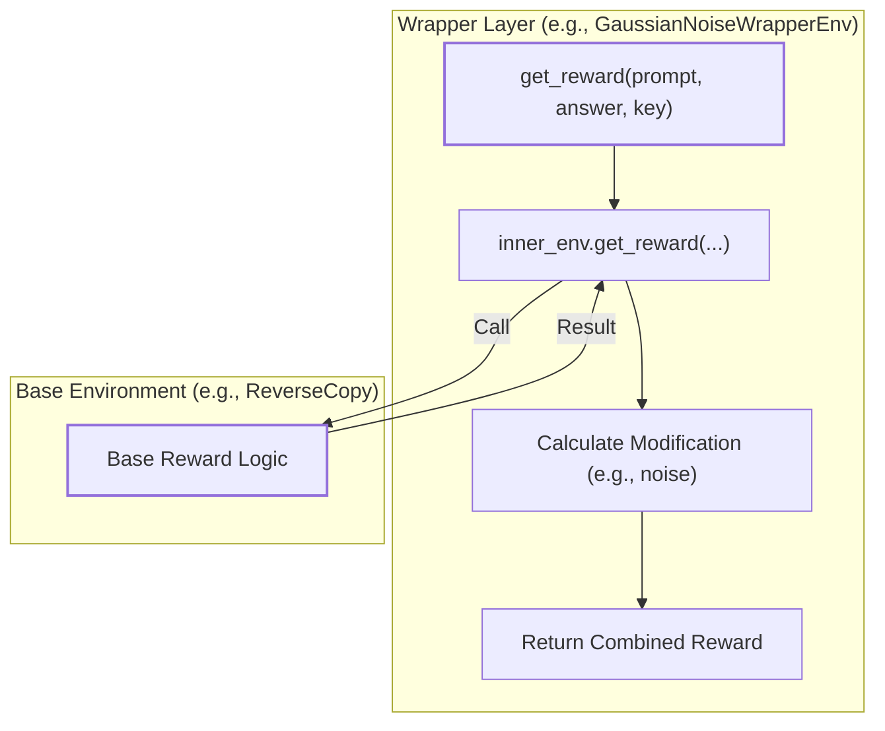
Sources: [egg/environments/gaussian_noise_wrapper.py:42-77](), [egg/environments/landmine_wrapper.py:50-111]()

---

### Reward Modification Wrappers

These wrappers intercept the `get_reward` call to inject noise or apply penalties based on the agent's generated `answer`.

#### BernoulliNoiseWrapper
Overrides the base reward with a binary choice (`min_val` or `max_val`) based on a probability `p_noise` [egg/environments/bernoulli_noise_wrapper.py:44-51]().
*   **Implementation**: Uses `jax.random.bernoulli` to decide whether to override and another Bernoulli draw (50/50) to select between `min_val` and `max_val` [egg/environments/bernoulli_noise_wrapper.py:75-82]().

#### GaussianNoiseWrapper
Adds zero-mean IID Gaussian noise to the base reward [egg/environments/gaussian_noise_wrapper.py:42-48]().
*   **Implementation**: Samples noise from `jax.random.normal` scaled by `noise_std` and adds it to the `base_reward` [egg/environments/gaussian_noise_wrapper.py:70-75]().

#### PoisonTokenWrapper
Applies a static penalty if a specific "poison" token appears anywhere in the agent's answer [egg/environments/poison_token_wrapper.py:43-50]().
*   **Implementation**: Uses `jnp.any(answer == self.config.poison_token)` to detect the token and adds `poison_reward` (typically a large negative value) to the base reward [egg/environments/poison_token_wrapper.py:71-78]().

#### LandmineWrapper
A more complex version of the poison wrapper that detects a specific multi-token subsequence [egg/environments/landmine_wrapper.py:50-57]().
*   **Subsequence Detection**: Implements `_is_subsequence` using `jax.lax.scan` to efficiently check for the landmine pattern in a JIT-compatible manner [egg/environments/landmine_wrapper.py:72-90]().
*   **Stochastic Penalty**: If hit, it adds a penalty sampled from a Normal distribution defined by `landmine_reward` and `landmine_std` [egg/environments/landmine_wrapper.py:102-110]().

Sources: [egg/environments/bernoulli_noise_wrapper.py:1-90](), [egg/environments/gaussian_noise_wrapper.py:1-78](), [egg/environments/poison_token_wrapper.py:1-81](), [egg/environments/landmine_wrapper.py:1-112]()

---

### Prompt Manipulation Wrappers

These wrappers modify the `get_prompt` behavior, often to simulate specific data distributions or "easy" tasks.

#### FinitePromptWrapper
Restricts the environment to a fixed, pre-generated set of prompts [egg/environments/finite_prompt_wrapper.py:47-52]().
*   **Initialization**: During `make()`, it generates `num_prompts` using the inner environment and stores them in a JAX array [egg/environments/finite_prompt_wrapper.py:36-43]().
*   **Selection**: In `get_prompt`, it uses `jax.random.randint` to index into the stored `prompts` array [egg/environments/finite_prompt_wrapper.py:61-64]().

#### ZerosPromptWrapper
Simulates "easy" prompts by zeroing out the entire prompt sequence with probability `prob_zero` [egg/environments/zeros_prompt_wrapper.py:52-56]().
*   **Reward Noise**: If both the prompt and the answer are all zeros, it can optionally add Gaussian noise (`zero_noise_std`) to the reward, acting as a metaphor for noisy signals on trivial tasks [egg/environments/zeros_prompt_wrapper.py:83-93]().

Sources: [egg/environments/finite_prompt_wrapper.py:1-71](), [egg/environments/zeros_prompt_wrapper.py:1-94]()

---

### Technical Implementation Details

#### Wrapper Classes and Logic
The following table maps the wrapper classes to their primary modification logic.

| Class Name | Primary Method Overridden | Logic Description |
| :--- | :--- | :--- |
| `BernoulliNoiseWrapperEnv` | `get_reward` | Randomly replaces reward with `min_val` or `max_val`. |
| `GaussianNoiseWrapperEnv` | `get_reward` | Adds `N(0, std)` noise to reward. |
| `PoisonTokenWrapperEnv` | `get_reward` | Penalizes presence of a specific token ID. |
| `LandmineWrapperEnv` | `get_reward` | Detects multi-token subsequence via `jax.lax.scan`. |
| `FinitePromptsWrapperEnv` | `get_prompt` | Samples from a pre-cached array of prompt tensors. |
| `ZerosPromptWrapperEnv` | `get_prompt` & `get_reward` | Forces prompts to zero and adds specific "zero-task" noise. |

**Code Entity Association**

Title: Environment Wrapper Class Hierarchy and Associations
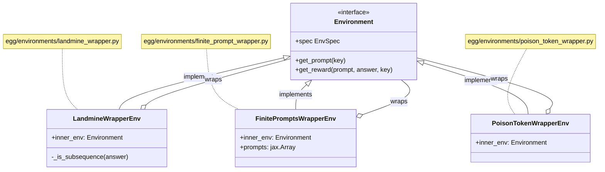
Sources: [egg/environments/landmine_wrapper.py:50-61](), [egg/environments/finite_prompt_wrapper.py:47-53](), [egg/environments/poison_token_wrapper.py:43-54]()

---

# Page: Actors

# Actors

<details>
<summary>Relevant source files</summary>

The following files were used as context for generating this wiki page:

- [egg/actors/__init__.py](egg/actors/__init__.py)

</details>


In the **egg** framework, an **Actor** serves as the bridge between the environment and the learner. Its primary responsibility is to interact with an `Environment` using a set of network parameters to generate a `Batch` object [egg/base.py:223-241](). This `Batch` contains the sampled sequences, log-probabilities, rewards, and metadata required by the `Learner` to compute gradients and update the model.

Actors encapsulate the logic of **Autoregressive (AR) sampling**, exploration strategies (like epsilon-greedy), and data augmentation techniques.

### Actor Role in the Training Loop

The Actor is invoked during each training iteration by a `Trainer` [egg/base.py:276-291](). It uses the current model parameters to generate fresh experience from the environment.

#### System Interaction Diagram
This diagram illustrates how the `Actor` orchestrates data flow between the `Environment` and the `ARSampler` to produce a `Batch`.

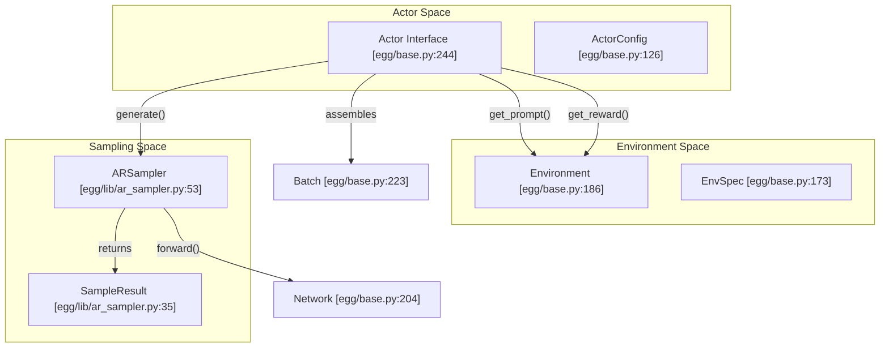
**Sources:** [egg/base.py:126-291](), [egg/lib/ar_sampler.py:35-70]()

---

### Core Responsibilities

The Actor subsystem is designed to handle three main tasks:

1.  **Prompt Management**: Interfacing with the `Environment` to retrieve task-specific prompts via `get_prompt` [egg/base.py:188-189]().
2.  **Sequence Generation**: Utilizing the `ARSampler` to produce model outputs. This includes managing `epsilon` for exploration and `temperature` for sampling [egg/base.py:128-132]().
3.  **Batch Construction**: Mapping the raw samples and environment rewards into the structured `Batch` format. This includes calculating `group_ids` for advantage estimation and tracking metrics like `fraction_correct` [egg/base.py:223-241]().

### Data Flow: From Environment to Batch
The following diagram maps the transition from Environment-specific entities to the standardized `Batch` object used by the `Learner`.

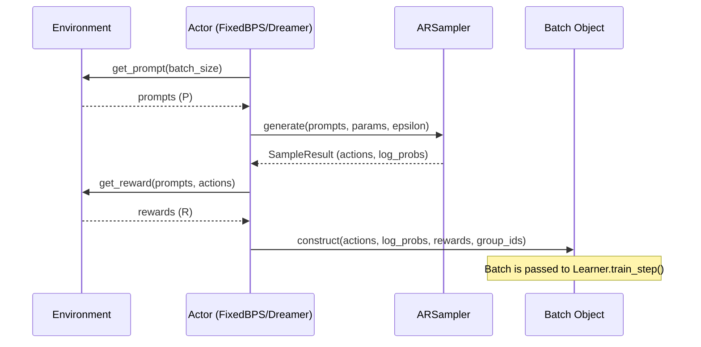
**Sources:** [egg/base.py:186-241](), [egg/lib/ar_sampler.py:53-120]()

---

### Implementation Variants

The framework provides different Actor implementations based on how they sample data and whether they inject synthetic "perfect" experience into the training stream.

#### [FixedBPS and FixedBPC Actors](#3.1)
These are the standard IID sampling actors used for most RL tasks. 
*   **FixedBPSActor** (Batch Per Step): Generates a fixed number of samples ($S$) for every prompt ($P$), resulting in a total batch size of $B = P \times S$.
*   **FixedBPCActor** (Batch Per Correct): Continues sampling until a fixed number of *correct* sequences are found for each prompt. This is useful for sparse reward environments where random exploration rarely finds a signal.

For details, see [FixedBPS and FixedBPC Actors](#3.1).

#### [DreamerBPS Actor and Data Injection](#3.2)
The **DreamerActor** is a specialized implementation used in research experiments (like DPG and Kondo). It supports **Data Injection**, where the actor mixes model-generated samples with "injected" sequences:
*   **Correct Injection**: Forcing the inclusion of ground-truth correct answers to stabilize early training.
*   **Landmine/Bug Injection**: Injecting specific failure cases to train the model to avoid certain regions of the action space.
*   **Log-prob Recomputation**: Since injected data was not sampled from the current policy, the actor uses the `ARSampler` in "teacher-forcing" mode to compute the log-probabilities of these sequences under the current parameters.

For details, see [DreamerBPS Actor and Data Injection](#3.2).

---
**Sources:** [egg/actors/__init__.py:1-17](), [egg/base.py:126-150](), [egg/lib/ar_sampler.py:35-120]()

---

# Page: FixedBPS and FixedBPC Actors

# FixedBPS and FixedBPC Actors

<details>
<summary>Relevant source files</summary>

The following files were used as context for generating this wiki page:

- [egg/actors/fixed_bpc.py](egg/actors/fixed_bpc.py)
- [egg/actors/fixed_bps.py](egg/actors/fixed_bps.py)
- [egg/lib/ar_sample.py](egg/lib/ar_sample.py)

</details>


The Actor subsystem in `egg` bridges the environment and the learner by generating `Batch` objects through interaction with the environment and the model. The `FixedBPSActor` and `FixedBPCActor` are the two primary IID (Independent and Identically Distributed) sampling implementations. They utilize the `ARSampler` to generate sequences and structure them into batches with specific grouping properties, which are often required by loss functions for advantage estimation.

## FixedBPSActor

The `FixedBPSActor` (Fixed Batch Per Sample) generates a batch of a deterministic size $B = P \times S$, where $P$ is the number of unique prompts and $S$ is the number of samples generated for each prompt.

### Implementation and Data Flow
The actor follows a linear execution path to construct a batch:
1.  **Prompt Generation**: It samples $P$ prompts from the environment using `env.get_prompt` [egg/actors/fixed_bps.py:77-78]().
2.  **Expansion**: These prompts are flattened by repeating each prompt $S$ times to create a base for the batch [egg/actors/fixed_bps.py:78]().
3.  **Autoregressive Sampling**: The `ARSampler` is called once on the flattened prompts to generate completion tokens (answers) and their corresponding log probabilities [egg/actors/fixed_bps.py:87-89]().
4.  **Reward Evaluation**: The environment evaluates the generated answers using `env.get_reward` [egg/actors/fixed_bps.py:93-95]().
5.  **Group Identification**: A `group_ids` array is created, mapping each sample back to its original prompt index [egg/actors/fixed_bps.py:97](). This is critical for algorithms like REINFORCE with a grouped baseline.

### Logic Diagram: FixedBPS Batch Construction
The following diagram illustrates the transformation from Environment/Model space to the `Batch` entity.

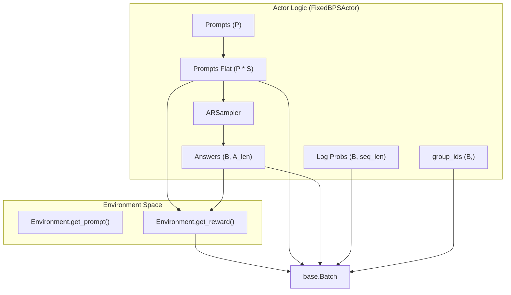
Sources: [egg/actors/fixed_bps.py:69-106](), [egg/lib/ar_sample.py:34-53]()

## FixedBPCActor

The `FixedBPCActor` (Fixed Batch Per Correct) iterates until a specific number of *correct* samples are collected for every prompt in the batch. This is useful for tasks where positive rewards are sparse, ensuring the learner always sees successful examples.

### Implementation Details
Unlike the BPS actor, the BPC actor uses a loop (up to `max_samples_per_prompt`) to fill a buffer of correct answers:
*   **Active Masking**: In each iteration, it identifies which prompts have not yet reached the `correct_per_prompt` (C) threshold [egg/actors/fixed_bpc.py:105-107]().
*   **Selective Sampling**: It only samples for "active" prompts to save compute [egg/actors/fixed_bpc.py:116-126]().
*   **Thresholding**: A sample is considered "correct" if its reward is $\ge$ `reward_threshold` [egg/actors/fixed_bpc.py:136]().
*   **Padding**: If a prompt fails to produce $C$ correct samples within the maximum attempts, the remaining slots are filled with dummy padding tokens and the `mask` in `aux` is set to `False` [egg/actors/fixed_bpc.py:158-181]().

### Actor-Sampler Integration
The actors interface with `ARSampler` to perform the token-by-token generation.

| Feature | FixedBPSActor | FixedBPCActor |
| :--- | :--- | :--- |
| **Batch Size** | $P \times S$ | $P \times C$ |
| **Termination** | Single Pass | `jnp.all(correct_counts >= c)` or Max Attempts |
| **Primary Metric** | N/A | `padding_fraction`, `attempts_needed` |
| **Epsilon-Greedy** | Supported via `ActorConfig.epsilon` | Not explicitly in config, uses sampler default |

Sources: [egg/actors/fixed_bpc.py:35-55](), [egg/actors/fixed_bpc.py:100-147](), [egg/actors/fixed_bps.py:33-57]()

## ARSampler Integration

Both actors rely on `egg.lib.ar_sample.ARSampler` for sequence generation. The sampler uses `jax.lax.fori_loop` to iteratively predict the next token [egg/lib/ar_sample.py:132-137]().

### Mixed Policy Sampling
If `epsilon > 0`, the sampler implements epsilon-greedy exploration. The log probability recorded in the `Batch` is the log probability under the *mixed* policy:
$$P(a) = (1 - \epsilon) P(a | \text{model}) + \epsilon P(a | \text{uniform})$$
This ensures that the `sample_log_probs` in the `Batch` are mathematically consistent for importance sampling or policy gradient updates [egg/lib/ar_sample.py:109-126]().

### System Entity Mapping
The following diagram maps the logical sampling process to the specific classes and functions in the codebase.

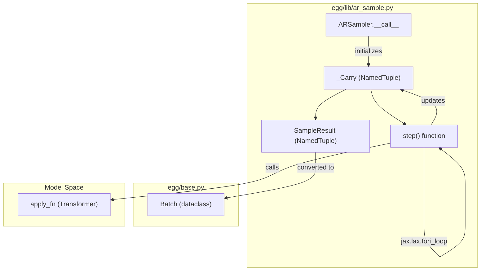
Sources: [egg/lib/ar_sample.py:47-143](), [egg/base.py:136-146]()

## Batch Construction and Aux Data
The `Batch` object returned by these actors includes an `aux` dictionary. This dictionary is vital for the Learner:
*   **`group_ids`**: An array of shape `(B,)` where `group_ids[i]` is the integer ID of the prompt used for sample `i`. This is used by loss functions (e.g., `REINFORCE`) to calculate baselines per prompt [egg/actors/fixed_bps.py:104](), [egg/actors/fixed_bpc.py:181]().
*   **`mask`**: (FixedBPC only) A boolean array indicating if the sample is a valid correct answer or just padding [egg/actors/fixed_bpc.py:181]().

Sources: [egg/actors/fixed_bps.py:99-105](), [egg/actors/fixed_bpc.py:176-182]()

---

# Page: DreamerBPS Actor and Data Injection

# DreamerBPS Actor and Data Injection

<details>
<summary>Relevant source files</summary>

The following files were used as context for generating this wiki page:

- [egg/actors/dreamer_bps.py](egg/actors/dreamer_bps.py)
- [egg/lib/ar_sample.py](egg/lib/ar_sample.py)

</details>


The `DreamerActor` is a specialized actor implementation that extends the standard `FixedBPSActor` logic by mixing model-generated sequences with synthetically injected data. It is designed to facilitate training in scenarios where specific behaviors (like correct prompt reversals or specific "buggy" failure modes) need to be over-represented in the training distribution to guide the learner [egg/actors/dreamer_bps.py:16-25]().

## Overview and Injection Logic

The `DreamerActor` operates by first generating a batch of candidate sequences using an autoregressive sampler and then conditionally overwriting rows in that batch based on configurable probability gates [egg/actors/dreamer_bps.py:115-117](). The injection logic follows a strict priority hierarchy for each row in the batch:

1.  **Correct Injection**: With probability `correct_prob`, the actor injects a perfect prompt-reversal sequence [egg/actors/dreamer_bps.py:18-18]().
2.  **Random Injection**: If not correct, with probability `random_prob`, it injects a sequence of random tokens [egg/actors/dreamer_bps.py:19-19]().
3.  **Bug/Landmine Injection**: If neither of the above, with probability `bug_prob`, it injects a fixed "landmine" sequence defined in the configuration [egg/actors/dreamer_bps.py:20-21]().
4.  **Model Sampling**: If no injection is triggered, the sequence generated by the `ARSampler` is retained [egg/actors/dreamer_bps.py:22-22]().

### Actor Configuration
The `ActorConfig` class defines the parameters for this behavior:

| Parameter | Type | Description |
| :--- | :--- | :--- |
| `landmine_sequence` | `jax.Array` | The specific token sequence representing a "bug" or "landmine" [egg/actors/dreamer_bps.py:46-46](). |
| `bug_prob` | `float` | Probability of injecting the landmine answer [egg/actors/dreamer_bps.py:47-47](). |
| `correct_prob` | `float` | Probability of injecting a correct answer [egg/actors/dreamer_bps.py:48-48](). |
| `random_prob` | `float` | Probability of injecting a random answer [egg/actors/dreamer_bps.py:49-49](). |
| `override_token_prob` | `float` | Optional fixed log-probability to assign to injected tokens [egg/actors/dreamer_bps.py:50-50](). |

**Sources:** [egg/actors/dreamer_bps.py:38-83](), [egg/actors/dreamer_bps.py:151-162]()

## Data Flow and Implementation

The sampling process in `DreamerActor.sample_batch` follows a structured pipeline from prompt generation to reward calculation and log-probability recomputation.

### Sequence Generation and Recomputation
Because injected sequences were not produced by the model's current policy, their log-probabilities must be recomputed (teacher-forcing) to ensure the `Batch` object contains valid `sample_log_probs` for the learner [egg/actors/dreamer_bps.py:24-25]().

1.  **Prompting**: Prompts are sampled from the environment and repeated to match the `samples_per_prompt` setting [egg/actors/dreamer_bps.py:107-108]().
2.  **Sampling**: The `ARSampler` generates initial sequences and their log-probabilities [egg/actors/dreamer_bps.py:115-117]().
3.  **Injection**: `jax.random.uniform` gates determine which rows are replaced by correct, random, or landmine answers [egg/actors/dreamer_bps.py:154-161]().
4.  **Log-Prob Recomputation**: If `override_token_prob` is not set, the actor uses `get_full_logprobs_b_l` to calculate the model's actual log-probability for the injected sequences [egg/lib/ar_sample.py:146-152]().

### Data Injection Pipeline
The following diagram illustrates the flow from the environment spec to the final batch construction, highlighting the injection gates.

**DreamerActor Sampling Flow**
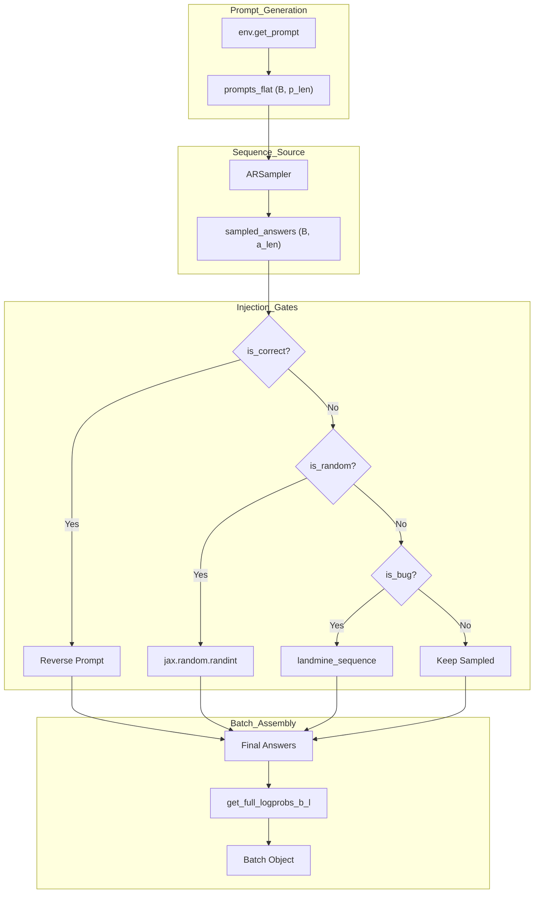
**Sources:** [egg/actors/dreamer_bps.py:96-210](), [egg/lib/ar_sample.py:146-185]()

## Log-Probability Recomputation

The `get_full_logprobs_b_l` function in `egg/lib/ar_sample.py` is critical for maintaining the integrity of the `Batch` data when injections occur. It performs a teacher-forcing pass:

*   It maps `PAD_TOKEN` to 0 for the model forward pass [egg/lib/ar_sample.py:158-158]().
*   It calculates `jax.nn.log_softmax` over the vocabulary for all sequence positions [egg/lib/ar_sample.py:170-170]().
*   It uses `jnp.take_along_axis` to extract the log-probabilities of the tokens that were actually present in the injected sequence [egg/lib/ar_sample.py:174-176]().
*   It masks out positions where the target was a `PAD_TOKEN` to ensure rewards and gradients are not influenced by padding [egg/lib/ar_sample.py:179-180]().

**Sources:** [egg/lib/ar_sample.py:146-185](), [egg/actors/dreamer_bps.py:202-210]()

## Metrics and Monitoring

The `DreamerActor` returns a `Metrics` dictionary that tracks the distribution of sequence types within each batch. This is essential for debugging injection rates and understanding the data mixture the learner is consuming.

| Metric Key | Description |
| :--- | :--- |
| `bug_fraction` | Percentage of the batch consisting of landmine sequences [egg/actors/dreamer_bps.py:142-142](). |
| `correct_fraction` | Percentage of the batch consisting of injected correct answers [egg/actors/dreamer_bps.py:143-143](). |
| `random_fraction` | Percentage of the batch consisting of random token sequences [egg/actors/dreamer_bps.py:144-144](). |
| `sample_fraction` | Percentage of the batch generated purely by the model [egg/actors/dreamer_bps.py:145-145](). |

### System Entity Mapping
The following diagram maps the logical injection components to their implementation entities in the codebase.

**Injection Entity Mapping**
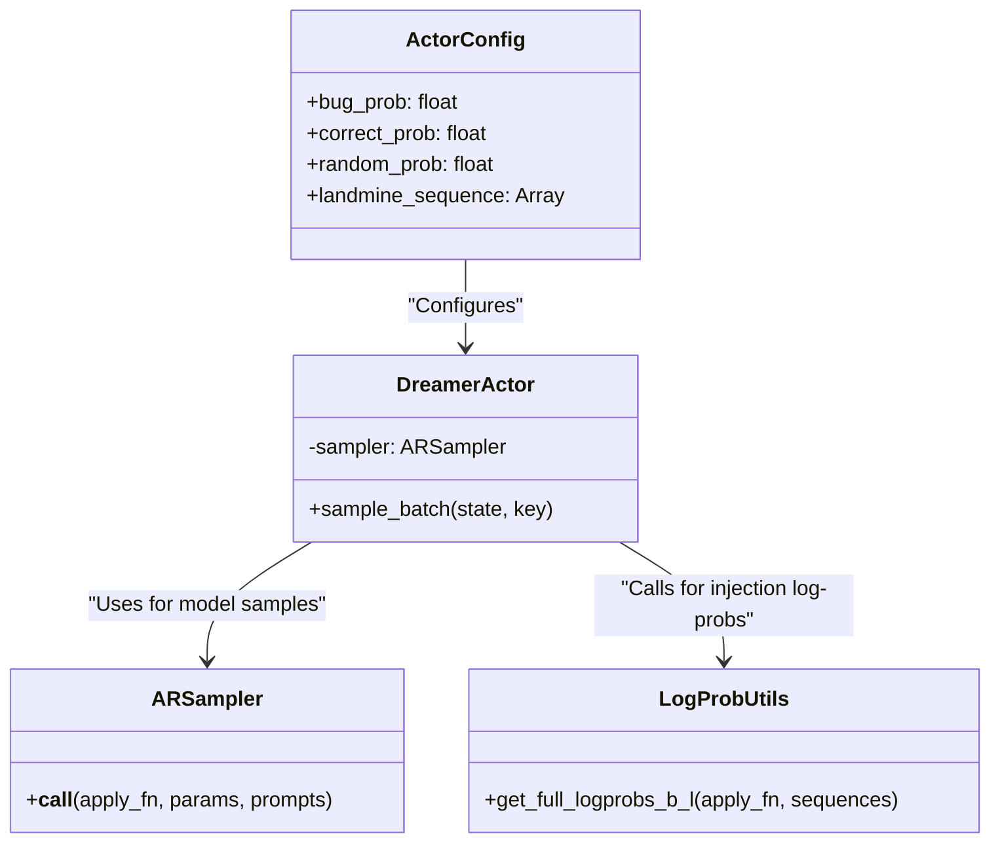
**Sources:** [egg/actors/dreamer_bps.py:38-94](), [egg/lib/ar_sample.py:34-53](), [egg/lib/ar_sample.py:146-151]()

---

# Page: Networks

# Networks

<details>
<summary>Relevant source files</summary>

The following files were used as context for generating this wiki page:

- [egg/networks/__init__.py](egg/networks/__init__.py)

</details>


The `egg.networks` package provides the neural architectures used by actors for sampling and by learners for optimization. The design follows a modular approach where a core backbone (typically a Transformer) can be wrapped in functional layers to handle logit transformations, noise injection, or quantization.

The primary entry point for configuring these networks is the `NetworkConfig` [egg/networks/transformer.py:22-44](), which defines hyperparameters such as embedding dimensions, head counts, and layer depths.

### Network Architecture Overview

The system bridges high-level RL requirements with low-level JAX implementations through a layered hierarchy:

1.  **Backbone**: Standard architectures like the `Transformer` [egg/networks/transformer.py:127-147]() or `LinearNetwork` [egg/networks/transformer.py:165-177]().
2.  **Wrappers**: Functional decorators like `LogitNoiseNetwork` [egg/networks/noise.py:47-64]() that modify the output of the backbone.
3.  **Head**: The `LogitWrapper` [egg/networks/transformer.py:150-162]() which maps hidden states to the vocabulary size defined by the `EnvSpec`.

#### System Mapping: Natural Language to Code Entities

The following diagram maps the logical network components to their corresponding classes in the `egg` codebase.

| Logical Component | Code Entity | File Path |
| :--- | :--- | :--- |
| **Configuration** | `NetworkConfig` | [egg/networks/transformer.py:22-44]() |
| **Backbone (Attention)** | `Transformer` | [egg/networks/transformer.py:127-147]() |
| **Backbone (MLP)** | `LinearNetwork` | [egg/networks/transformer.py:165-177]() |
| **Output Head** | `LogitWrapper` | [egg/networks/transformer.py:150-162]() |
| **Noise Layer** | `LogitNoiseNetwork` | [egg/networks/noise.py:47-64]() |
| **Quantization** | `QuantizedTransformer` | [egg/networks/noise.py:87-105]() |

**Sources:** [egg/networks/transformer.py:22-177](), [egg/networks/noise.py:47-105]()

### Core Components

The network layer is divided into two primary modules: the transformer architecture and the noise/quantization utilities.

#### Transformer Backbone
The default architecture is a decoder-only `Transformer` [egg/networks/transformer.py:127-147](). It utilizes `TransformerBlock` [egg/networks/transformer.py:84-111]() units with causal masking to ensure that token predictions only depend on previous context. A specialized `PadSafeEmbed` [egg/networks/transformer.py:53-70]() layer is used to ensure that padding tokens (index 0) result in zero vectors, preventing them from influencing the gradients or hidden states.

For details on the implementation of causal masking and embedding logic, see **[Transformer Architecture (#4.1)](#)**.

#### Noise and Quantization
To support research into robustness and distributed training, `egg` provides wrappers that simulate hardware or environmental constraints:
*   **Logit Noise**: The `LogitNoiseNetwork` [egg/networks/noise.py:47-64]() injects Gaussian noise into the logits, either with a fixed standard deviation or a dynamic schedule.
*   **Quantization**: The `QuantizedTransformer` [egg/networks/noise.py:87-105]() applies uniform rounding (deterministic or stochastic) to the network parameters, simulating low-precision inference in distributed settings.

For details on perturbation methods and rounding algorithms, see **[Noise and Quantization Modules (#4.2)](#)**.

### Network Composition Flow

The diagram below illustrates how a `NetworkConfig` is transformed into a functional model and how data flows from input tokens to final logits.

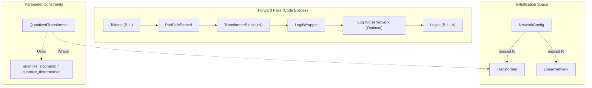

**Sources:** [egg/networks/transformer.py:22-162](), [egg/networks/noise.py:18-105]()

### Sub-pages
*   **[4.1 Transformer Architecture](#)**: Detailed coverage of the decoder-only Transformer, `NetworkConfig`, `TransformerBlock`, causal masking, and `PadSafeEmbed`.
*   **[4.2 Noise and Quantization Modules](#)**: Covers `LogitNoiseNetwork` (fixed vs. dynamic Gaussian perturbation), `EmbeddingNoise`, `QuantizedTransformer`, and the rounding library.

---

# Page: Transformer Architecture

# Transformer Architecture

<details>
<summary>Relevant source files</summary>

The following files were used as context for generating this wiki page:

- [egg/networks/linear.py](egg/networks/linear.py)
- [egg/networks/logit_wrapper.py](egg/networks/logit_wrapper.py)
- [egg/networks/transformers.py](egg/networks/transformers.py)

</details>


The `egg` framework provides a set of neural network backbones designed for reinforcement learning experiments. The primary architecture is a decoder-only Transformer, but the codebase also includes a linear baseline and a flexible logit wrapper for biasing model outputs. These networks are implemented using [Flax Linen](https://flax.readthedocs.io).

## Decoder-only Transformer

The core model used in most `egg` experiments is a standard decoder-only Transformer [egg/networks/transformers.py:48-50](). It is designed to process sequences of integer tokens and produce logits over the vocabulary for autoregressive generation.

### Configuration

The architecture is parameterized via `NetworkConfig`, which follows the `MakeableConfig` pattern used throughout the library [egg/networks/transformers.py:33-46]().

| Parameter | Type | Default | Description |
| :--- | :--- | :--- | :--- |
| `vocab_size` | `int` | 2 | Size of the token vocabulary. |
| `sequence_length`| `int` | 32 | Maximum context length (T). |
| `embed_dim` | `int` | 64 | Dimension of token and position embeddings (D). |
| `num_heads` | `int` | 4 | Number of attention heads. |
| `num_layers` | `int` | 3 | Number of stacked `TransformerBlock` instances. |
| `ff_dim` | `int` | 128 | Hidden dimension of the feed-forward network. |
| `bias` | `bool` | False | Whether to use bias terms in Dense and LayerNorm layers. |

**Sources:** [egg/networks/transformers.py:32-46]()

### Data Flow and Embedding

The Transformer handles input tokens through a specialized `_embed` utility that ensures safety against `PAD_TOKEN` indices and applies learned positional embeddings [egg/networks/transformers.py:101-113]().

1.  **PAD-Safe Lookup**: Input tokens are checked against `base.PAD_TOKEN`. Indices matching PAD are temporarily replaced with `0` to avoid out-of-bounds errors during embedding lookup [egg/networks/transformers.py:117-120]().
2.  **Embedding Summation**: Token embeddings and learned positional embeddings are summed [egg/networks/transformers.py:121-127]().
3.  **Masking**: The resulting vectors are multiplied by a `pad_mask` to ensure that `PAD_TOKEN` positions have zeroed-out embeddings [egg/networks/transformers.py:128-129]().

### Attention Masking

The model employs two types of masks combined into a single attention mask [egg/networks/transformers.py:59-61]():
*   **Causal Mask**: Generated via `nn.make_causal_mask`, ensuring tokens can only attend to preceding tokens [egg/networks/transformers.py:59]().
*   **Padding Mask**: Generated via `nn.make_attention_mask`, preventing attention to `PAD_TOKEN` positions [egg/networks/transformers.py:60]().

### Transformer Block

Each `TransformerBlock` consists of a pre-norm architecture [egg/networks/transformers.py:73-75]():
1.  **Self-Attention**: `LayerNorm` followed by `MultiHeadDotProductAttention` and a residual connection [egg/networks/transformers.py:81-87]().
2.  **Feed-Forward**: `LayerNorm` followed by a two-layer MLP (`Dense` -> `relu` -> `Dense`) and a residual connection [egg/networks/transformers.py:90-96]().

**Sources:** [egg/networks/transformers.py:48-98](), [egg/networks/transformers.py:101-130]()

## Linear Network

The `SimpleModel` is a linear baseline used primarily to study the effects of noise and precision on training dynamics [egg/networks/linear.py:16-29]().

### Implementation Details
Unlike the Transformer, the linear model performs a direct mapping from embeddings to logits via a single `nn.Dense` layer [egg/networks/linear.py:108-110](). It supports several perturbation features:
*   **Embedding Noise**: Additive Gaussian noise scaled by `noise_scale` [egg/networks/linear.py:92-95]().
*   **Quantization**: Both embeddings and logits can be quantized using a `QuantizeConfig` [egg/networks/linear.py:98-113]().
*   **Precision Control**: The dense layer computation can switch between `jax.lax.Precision.DEFAULT` and `HIGHEST` [egg/networks/linear.py:102-106]().

**Sources:** [egg/networks/linear.py:42-116]()

## Logit Wrapper

The `LogitWrapperNetwork` is a decorator-style `nn.Module` that adds a constant bias to the output of an underlying network [egg/networks/logit_wrapper.py:42-44](). This is frequently used in experiments to shift the initial policy or inject prior knowledge into the action space [egg/networks/logit_wrapper.py:16-19]().

**Sources:** [egg/networks/logit_wrapper.py:27-58]()

## Architectural Diagrams

### Transformer Data Flow: Tokens to Logits

The following diagram illustrates how the `Transformer` class processes input tokens, incorporating the `_embed` logic and `TransformerBlock` stack.

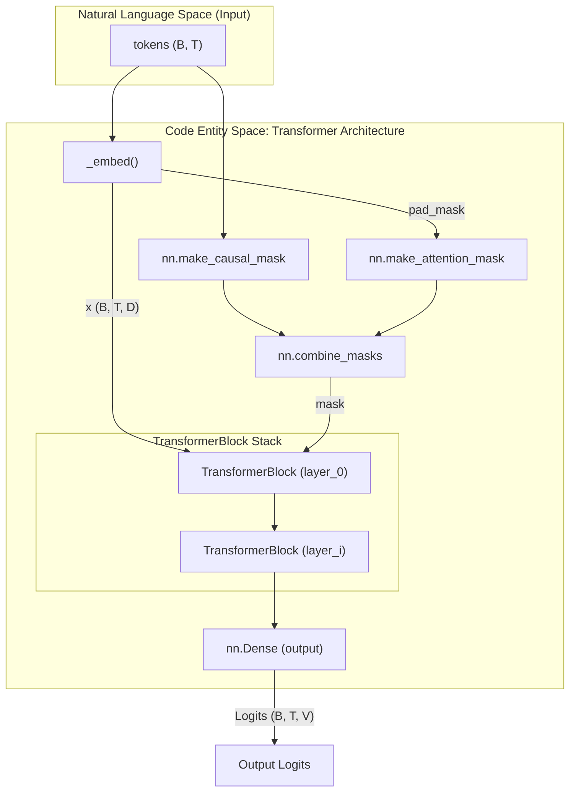
**Sources:** [egg/networks/transformers.py:48-70](), [egg/networks/transformers.py:101-129]()

### Linear Network Perturbation Pipeline

This diagram maps the `SimpleModel` implementation to its various numerical perturbation stages.

```mermaid
graph TD
    subgraph "Input Processing"
        X["x (B, T)"]
        SafeX["jnp.where (safe_x)"]
        Embed["nn.Embed"]
    end

    subgraph "Perturbation Logic (SimpleModel.__call__)"
        Noise["Gaussian Noise (noise_scale)"]
        QuantEmbed["quantization.QuantizeConfig (Embeddings)"]
        Dense["nn.Dense (Precision Control)"]
        QuantLogits["quantization.QuantizeConfig (Logits)"]
    end

    X --> SafeX
    SafeX --> Embed
    Embed --> Noise
    Noise --> QuantEmbed
    QuantEmbed --> Dense
    Dense --> QuantLogits
    QuantLogits --> Out["Final Logits"]

    style Noise stroke-dasharray: 5 5
    style QuantEmbed stroke-dasharray: 5 5
    style QuantLogits stroke-dasharray: 5 5
```
**Sources:** [egg/networks/linear.py:72-116]()

## Summary of Network Components

| Class | File | Purpose |
| :--- | :--- | :--- |
| `Transformer` | [egg/networks/transformers.py:48]() | Standard decoder-only backbone for RL tasks. |
| `TransformerBlock` | [egg/networks/transformers.py:73]() | Single attention + MLP layer with residual connections. |
| `SimpleModel` | [egg/networks/linear.py:57]() | Linear network for noise and precision ablation studies. |
| `LogitWrapperNetwork` | [egg/networks/logit_wrapper.py:42]() | Wraps a network to apply a fixed `logit_bias`. |

**Sources:** [egg/networks/transformers.py](), [egg/networks/linear.py](), [egg/networks/logit_wrapper.py]()

---

# Page: Noise and Quantization Modules

# Noise and Quantization Modules

<details>
<summary>Relevant source files</summary>

The following files were used as context for generating this wiki page:

- [egg/lib/quantization.py](egg/lib/quantization.py)
- [egg/networks/embedding_noise.py](egg/networks/embedding_noise.py)
- [egg/networks/logit_noise.py](egg/networks/logit_noise.py)
- [egg/networks/quantized_transformers.py](egg/networks/quantized_transformers.py)

</details>


This section covers the specialized network layers and utilities in `egg` designed to simulate hardware constraints and introduce stochasticity into the model's forward pass. These modules are primarily used to study the robustness of RL algorithms under conditions of numerical precision loss (quantization) or logit-level corruption.

## Quantization Library

The `egg/lib/quantization.py` module provides a functional interface for simulating low-precision arithmetic using JAX. It defines a `Quantizer` protocol and a configuration factory for both deterministic and stochastic rounding.

### Implementation Details
The library supports two primary modes of quantization:
1.  **Deterministic Uniform Rounding**: Scales values based on the maximum absolute value in the array to fit within a specified bit range, then rounds to the nearest integer [egg/lib/quantization.py:52-60]().
2.  **Stochastic Rounding**: Instead of rounding to the nearest integer, it rounds up or down with a probability proportional to the fractional distance from the target value. This requires a `jax.random.PRNGKey` [egg/lib/quantization.py:74-93]().

### Data Flow: Quantization Configuration
The following diagram illustrates how `QuantizeConfig` produces a `Quantizer` function used by networks.

**Quantizer Factory Pattern**
```mermaid
graph TD
    subgraph "Code Entity Space"
        Config["QuantizeConfig (egg/lib/quantization.py:41)"]
        D_Func["_make_deterministic_quantizer (egg/lib/quantization.py:62)"]
        S_Func["_make_stochastic_quantizer (egg/lib/quantization.py:95)"]
        Quantizer["Quantizer Protocol (egg/lib/quantization.py:28)"]
    end

    Config -- "make() if deterministic=True" --> D_Func
    Config -- "make() if deterministic=False" --> S_Func
    D_Func --> Quantizer
    S_Func --> Quantizer
    Quantizer -- "Applied to" --> PyTree["PyTree of Arrays"]
```
Sources: [egg/lib/quantization.py:28-106]()

---

## Logit Noise Network

The `LogitNoiseNetwork` is a `flax.linen` wrapper that perturbs the output logits of an underlying model with Gaussian noise. This is often used to simulate "mismatched" or noisy actors in distributed RL settings.

### Fixed vs. Dynamic Noise
*   **Fixed Noise**: If `fixed=True`, a noise vector is sampled once during parameter initialization and stored as a `flax` parameter named `unit_fixed_logit_noise` [egg/networks/logit_noise.py:55-62](). This noise remains constant across different inputs but is scaled by `sigma` [egg/networks/logit_noise.py:72-74]().
*   **Dynamic Noise**: If `fixed=False`, the network samples new Gaussian noise on every forward pass using the `noise` RNG stream [egg/networks/logit_noise.py:75-80]().

### Implementation
The network wraps an `inner_network` and adds the noise to the resulting `base_logits` before returning them [egg/networks/logit_noise.py:67-82]().

Sources: [egg/networks/logit_noise.py:27-83]()

---

## Embedding Noise Transformer

The `Transformer` in `egg/networks/embedding_noise.py` is a decoder-only architecture that injects noise directly into the embedding space rather than the logits.

### Noise Injection Mechanism
After computing token and positional embeddings, the model checks for a `noise` RNG stream and a non-zero `mismatch_scale` [egg/networks/embedding_noise.py:94-95]().
*   If `fixed_noise` is enabled, it uses a constant `PRNGKey(0)` to ensure the noise is the same for every forward pass [egg/networks/embedding_noise.py:96-97]().
*   Otherwise, it uses `self.make_rng("noise")` for per-pass stochasticity [egg/networks/embedding_noise.py:99-100]().
*   Crucially, the noise is zeroed out for `PAD_TOKEN` positions to prevent the model from attending to padding [egg/networks/embedding_noise.py:103]().

Sources: [egg/networks/embedding_noise.py:48-123]()

---

## Quantized Transformer

The `QuantizedTransformer` (defined in `egg/networks/quantized_transformers.py`) applies the `Quantizer` utility at multiple stages of the Transformer block to simulate hardware with limited numerical precision.

### Quantization Points
The network applies quantization at the following junctions:
1.  **Embedding**: After adding token and positional embeddings [egg/networks/quantized_transformers.py:145-156]().
2.  **Attention Sub-layer**: Before the `MultiHeadDotProductAttention` (post-LayerNorm) and immediately after the attention output [egg/networks/quantized_transformers.py:104-110]().
3.  **Feed-Forward Sub-layer**: After the first `Dense` (up-projection), after the second `Dense` (down-projection), and after the final residual addition [egg/networks/quantized_transformers.py:116-125]().
4.  **Output**: On the final logit projections [egg/networks/quantized_transformers.py:83]().

### Data Flow and RNG Management
Because stochastic quantization requires fresh randomness at every step, the `Transformer` splits a base `noise` RNG into a sequence of keys for every layer and sub-operation.

**Quantized Forward Pass Flow**
```mermaid
graph TD
    subgraph "egg/networks/quantized_transformers.py"
        Call["Transformer.__call__"]
        Split["jax.random.split (line 67)"]
        Embed["_embed (line 128)"]
        Block["TransformerBlock (line 86)"]
        Dense["nn.Dense (line 79)"]
        FinalQ["quantizer (line 83)"]
    end

    Call --> Split
    Split -- "rngs[0]" --> Embed
    Split -- "rngs[1...N]" --> Block
    Block -- "Internal split (line 100)" --> SubQ["quantizer calls"]
    Embed --> Block
    Block --> Dense
    Dense --> FinalQ
```

### Quantization Logic Table

| Layer Component | Quantization Applied To | RNG Key Usage |
| :--- | :--- | :--- |
| `_embed` | Token Emb, Pos Emb, Combined Emb | 3-way split of `rngs[0]` [egg/networks/quantized_transformers.py:135]() |
| `TransformerBlock` | Post-LN (Attn), Attn Output, Post-LN (FF), FF-Up, FF-Down, Residual | 6-way split of `rng` [egg/networks/quantized_transformers.py:100]() |
| `Transformer` | Final Logits | `rngs[-1]` [egg/networks/quantized_transformers.py:83]() |

Sources: [egg/networks/quantized_transformers.py:33-157]()

---

# Page: Loss Functions

# Loss Functions

<details>
<summary>Relevant source files</summary>

The following files were used as context for generating this wiki page:

- [egg/losses/__init__.py](egg/losses/__init__.py)
- [egg/losses/catalog.py](egg/losses/catalog.py)
- [egg/losses/common.py](egg/losses/common.py)

</details>


The loss subsystem in `egg` provides a unified interface for defining and computing training objectives. It is designed to decouple the specific Reinforcement Learning (RL) or Supervised Learning logic from the model architecture and the training loop.

## The LossFn Interface

All loss functions in `egg` implement the `LossFn` protocol defined in `egg/base.py`. This protocol ensures that every loss function accepts a standard set of inputs—model parameters, learner state, a data batch, and a PRNG key—and returns a scalar loss along with a dictionary of metrics.

To facilitate configuration and serialization, loss functions are typically instantiated via the `MakeableConfig` pattern.

### Loss Catalog and Registry

The framework maintains a central registry of all available loss functions. This allows users to specify a loss by a simple string name (e.g., `"ppo"`, `"dg"`) in configuration files or command-line flags.

| Loss Enum | String ID | Description |
| :--- | :--- | :--- |
| `Loss.REINFORCE` | `"reinforce"` | Standard Policy Gradient with optional grouped baseline. |
| `Loss.PPO` | `"ppo"` | Proximal Policy Optimization with clipped surrogate objective. |
| `Loss.DG` | `"dg"` | Delightful Gradient: Gated RL using "delight" (advantage × surprisal). |
| `Loss.KONDO` | `"kondo"` | Kondo Gate: Top-k token selection for compute-efficient training. |
| `Loss.PMPO` | `"pmpo"` | On-policy preference-based optimization. |
| `Loss.XENT` | `"xent"` | Standard Cross-Entropy (Teacher Forcing). |
| `Loss.ONLINE_STAR` | `"online_star"` | Online version of STaR (Self-Taught Reasoner). |

**Sources:**
- [egg/losses/catalog.py:32-40]() (Loss Registry)
- [egg/losses/catalog.py:43-52]() (Loss Enum definitions)
- [egg/losses/catalog.py:54-60]() (Config and Make methods)

---

## Forward Pass Utilities

To avoid code duplication, `egg` provides `egg/losses/common.py`, which contains standardized functions for processing batches and computing log-probabilities.

### The `forward_pass` Function
The `forward_pass` utility handles the alignment of prompts and answers. It concatenates them, runs the model, and slices the resulting logits to specifically target the "answer" portion of the sequence.

### `PolicyLogProbs` Data Structure
The result of a forward pass is encapsulated in a `PolicyLogProbs` dataclass:
- `lp_all`: Full log-softmax distribution over the vocabulary for all answer tokens.
- `lp_answer`: The specific log-probability of the tokens actually sampled/present in the batch.
- `token_mask`: A mask identifying valid (non-padding) tokens within the answer.
- `row_mask`: A mask identifying valid sequences within the batch.

### Grouped Advantages
For RL losses, `grouped_advantages` implements a baseline-subtraction mechanism. If `group_ids` are provided (e.g., multiple samples per prompt), it calculates a mean reward per group to reduce variance without introducing bias.

**Sources:**
- [egg/losses/common.py:27-35]() (`PolicyLogProbs` definition)
- [egg/losses/common.py:37-67]() (`forward_pass` implementation)
- [egg/losses/common.py:77-94]() (`grouped_advantages` implementation)

---

## System Architecture: From Config to Gradient

The following diagram illustrates how the Loss subsystem bridges the high-level configuration space to the low-level JAX operations.

**Loss Subsystem Integration**
```mermaid
graph TD
    subgraph "Natural Language / Config Space"
        A["Loss Enum ('ppo', 'dg')"]
    end

    subgraph "Code Entity Space (egg/losses)"
        B["catalog.py: Loss.make()"]
        C["common.py: forward_pass()"]
        D["common.py: grouped_advantages()"]
        E["Specific LossFn (e.g., reinforce.py)"]
    end

    subgraph "Execution Space (JAX)"
        F["jax.grad(loss_fn)"]
        G["PolicyLogProbs (Dataclass)"]
    end

    A --> B
    B --> E
    E -- "calls" --> C
    C -- "returns" --> G
    E -- "calls" --> D
    E -- "wrapped by" --> F
```

**Sources:**
- [egg/losses/catalog.py:58-60]()
- [egg/losses/common.py:37-42]()
- [egg/losses/common.py:77-83]()

---

## Detailed Loss Categories

The loss functions in `egg` are broadly categorized into standard policy gradients and the novel "Delightful" family of gated losses.

### Standard RL Losses
These losses implement well-known algorithms adapted for sequence generation. They support token-level formulations and importance weighting to handle off-policy data generated by the actors.
- **REINFORCE**: The simplest policy gradient, using the `grouped_advantages` utility for variance reduction.
- **PPO**: Implements the clipped surrogate objective and includes a KL-divergence anchor to prevent the policy from collapsing or drifting too far from a reference model.
- **XENT**: A standard supervised cross-entropy loss used for initialization or distillation.

For implementation details and mathematical formulations, see **[Standard RL Losses: REINFORCE, PPO, PMPO, XENT, OnlineStar](#5.1)**.

### Delightful Gradient (DG) and Kondo
The `egg` framework introduces specialized losses designed for "Delightful Policy Gradients."
- **DG Loss**: Uses a sigmoid gate weighted by "delight"—defined as the product of advantage (how much better the result was than expected) and surprisal (how unlikely the sequence was).
- **Kondo Loss**: A variant of DG that uses a binary top-k selection (gate) to prioritize learning on high-signal samples, effectively saving compute by masking gradients for "boring" or low-utility samples.

For details on gating logic and the `pct_learn` parameter, see **[Delightful Gradient (DG) and Kondo Gate Losses](#5.2)**.

**Sources:**
- [egg/losses/catalog.py:32-39]() (Catalog of loss types)
- [egg/losses/dg.py]() (Delightful Gradient logic)
- [egg/losses/kondo.py]() (Kondo gating logic)

---

# Page: Standard RL Losses: REINFORCE, PPO, PMPO, XENT, OnlineStar

# Standard RL Losses: REINFORCE, PPO, PMPO, XENT, OnlineStar

<details>
<summary>Relevant source files</summary>

The following files were used as context for generating this wiki page:

- [egg/losses/online_star.py](egg/losses/online_star.py)
- [egg/losses/pmpo.py](egg/losses/pmpo.py)
- [egg/losses/ppo.py](egg/losses/ppo.py)
- [egg/losses/reinforce.py](egg/losses/reinforce.py)
- [egg/losses/xent.py](egg/losses/xent.py)

</details>


This page details the implementation of classical Reinforcement Learning (RL) and supervised loss functions within the `egg` framework. These losses are implemented as `base.LossFn` protocols, typically utilizing a common forward pass utility to compute log-probabilities over `base.Batch` objects.

## Overview of Standard Losses

The `egg` framework provides several standard policy gradient and preference optimization losses. These implementations share a common data flow:
1.  **Forward Pass**: Using `common.forward_pass` to get log-probabilities for the learner's current parameters [egg/losses/common.py:44-58]().
2.  **Sampler Log-probs**: Retrieving the log-probabilities generated by the actor during sampling via `common.sampler_answer_logprobs` [egg/losses/common.py:61-71]().
3.  **Advantage Estimation**: Optionally centering rewards using a grouped baseline to reduce variance [egg/losses/common.py:74-106]().

### Loss Entity Map
The following diagram maps the logical RL components to their specific class implementations in the `egg.losses` module.

**RL Loss Architecture**
```mermaid
graph TD
    subgraph "egg.losses"
        LossFn["base.LossFn (Protocol)"]
        
        subgraph "Policy Gradient"
            REINFORCE["Reinforce / ReinforceGroupedBaseline"]
            PPO["PpoLoss"]
        end
        
        subgraph "Preference / Supervised"
            PMPO["PMPOToken"]
            XENT["CrossEntropyLoss"]
            OnlineStar["OnlineSTaR"]
        end
        
        Common["common.forward_pass"]
    end

    Batch["base.Batch"] --> Common
    Common --> REINFORCE
    Common --> PPO
    Common --> PMPO
    Common --> XENT
    Common --> OnlineStar

    Adv["common.grouped_advantages"] -.-> REINFORCE
    Adv -.-> PPO
    Adv -.-> OnlineStar
```
Sources: [egg/losses/reinforce.py:58-125](), [egg/losses/ppo.py:52-139](), [egg/losses/pmpo.py:57-141](), [egg/losses/xent.py:37-66](), [egg/losses/online_star.py:52-109]().

---

## REINFORCE

The REINFORCE implementation in `egg` supports optional Importance Weighting (IW) and a Grouped Baseline.

*   **Importance Weighting**: If `use_iw` is enabled, the loss calculates a sequence-level weight $w = \exp(\log \pi_\theta - \log \pi_{sampler})$ [egg/losses/reinforce.py:85-90](). This weight is clipped by `importance_weight_cap` [egg/losses/reinforce.py:89]().
*   **Grouped Baseline**: Variance reduction is achieved by subtracting the mean reward of a group (samples sharing the same prompt) from the individual reward [egg/losses/reinforce.py:150-156]().

**Data Flow for ReinforceGroupedBaseline**
```mermaid
sequenceDiagram
    participant B as base.Batch
    participant G as common.grouped_advantages
    participant R as Reinforce
    
    B->>G: rewards, group_ids, row_mask
    G->>G: Compute mean per group_id
    G-->>R: batch._replace(rewards=advantages)
    R->>R: __call__(params, state, adj_batch)
    Note over R: loss = -sum(log_p * advantage)
```
Sources: [egg/losses/reinforce.py:29-54](), [egg/losses/reinforce.py:125-174]().

---

## PPO (Proximal Policy Optimization)

`PpoLoss` implements a token-level clipped surrogate objective. Unlike sequence-level REINFORCE, PPO in `egg` calculates ratios and clips them at each token position [egg/losses/ppo.py:86-95]().

### Key Components:
*   **Clipped Surrogate**: Clips the ratio $r_t(\theta)$ between $1-\epsilon$ and $1+\epsilon$ [egg/losses/ppo.py:90-92]().
*   **KL Anchor**: An optional penalty term $\beta_{kl} \cdot \text{KL}(\pi_{act} || \pi_\theta)$ can be added to keep the learner near the sampling policy [egg/losses/ppo.py:102-104]().
*   **Advantage Broadcasting**: Sequence-level advantages (optionally grouped) are broadcast across all answer tokens [egg/losses/ppo.py:83]().

Sources: [egg/losses/ppo.py:30-48](), [egg/losses/ppo.py:67-104]().

---

## PMPO (Preference Optimization)

`PMPOToken` is a token-level variant of "Preference Optimization as Probabilistic Inference". It classifies sequences into "preferred" or "dis-preferred" based on whether their advantage is positive [egg/losses/pmpo.py:75-85]().

| Component | Implementation |
| :--- | :--- |
| **Preferred Term** | Minimizes negative log-probability of preferred tokens [egg/losses/pmpo.py:96-99](). |
| **Dis-preferred Term** | Uses `logaddexp` with a `gamma` floor to penalize dis-preferred tokens [egg/losses/pmpo.py:101-107](). |
| **KL Regularization** | Standard KL term to prevent policy collapse [egg/losses/pmpo.py:110-113](). |

Sources: [egg/losses/pmpo.py:36-53](), [egg/losses/pmpo.py:74-120]().

---

## OnlineStar and Cross-Entropy

### OnlineStar
Online STaR (Self-Taught Reasoner) is a supervised fine-tuning loss that only learns from "positive" examples.
*   **Filtering**: It creates a `supervise_mask` where `rewards > reward_threshold` [egg/losses/online_star.py:84-86]().
*   **Supervision**: Standard cross-entropy is applied only to sequences passing the threshold [egg/losses/online_star.py:89-91]().

### Cross-Entropy (XENT)
`CrossEntropyLoss` is the simplest implementation, treating the sampled `batch.answers` as ground truth labels. It computes the negative log-probability of the answer tokens [egg/losses/xent.py:51-53]().

Sources: [egg/losses/online_star.py:30-48](), [egg/losses/online_star.py:72-91](), [egg/losses/xent.py:37-53]().

---

## Grouped Advantage Estimation

Most RL losses in `egg` utilize `common.grouped_advantages`. This utility is critical for reducing variance in environments where reward scales vary significantly across different prompts.

```python
# Conceptual implementation from egg/losses/common.py
def grouped_advantages(rewards, group_ids, num_groups, row_mask):
    # 1. Sum rewards per group_id
    # 2. Count samples per group_id
    # 3. advantage = rewards - (group_sum / group_count)
```

If `num_groups` is not provided but `use_grouped_baseline` is True, the system often defaults to a global baseline (mean of the entire batch) or raises an error depending on the specific loss configuration [egg/losses/ppo.py:40-42](), [egg/losses/reinforce.py:46-49]().

Sources: [egg/losses/common.py:74-106](), [egg/losses/reinforce.py:149-156]().

---

# Page: Delightful Gradient (DG) and Kondo Gate Losses

# Delightful Gradient (DG) and Kondo Gate Losses

<details>
<summary>Relevant source files</summary>

The following files were used as context for generating this wiki page:

- [egg/losses/dg.py](egg/losses/dg.py)
- [egg/losses/kondo.py](egg/losses/kondo.py)

</details>


This page details the implementation of novel token-level gating mechanisms within the `egg` framework. These losses, specifically **Delightful Gradient (DG)** and **Kondo**, are designed to optimize learning by filtering token updates based on "delight" (a product of advantage and surprisal) or other priority signals.

## Overview of Delight and Gating

Both DG and Kondo losses rely on the concept of **Delight** ($\chi_t$), defined as the product of the sequence-level advantage and the token-level surprisal:
$$\chi_t = A \times (-\log \pi_\theta(a_t | s_t))$$

The intuition is that updates should be prioritized for tokens that were both "surprising" to the model and led to a "delightful" (better than expected) outcome.

### Core Components and Data Flow

The following diagram illustrates how the loss functions process a `Batch` to produce gated gradients.

**Figure 1: Gated Loss Data Flow**
```mermaid
graph TD
    subgraph "Input Space"
        Batch["egg.base.Batch"]
        Params["egg.base.Params"]
    end

    subgraph "Forward Pass"
        Apply["state.apply_fn"]
        LogProbs["Log-Probability Calculation"]
    end

    subgraph "Gating Logic"
        Adv["Advantage (A)"]
        Surp["Surprisal (-log pi)"]
        Delight["Delight Calculation"]
        Gate["Gate Computation (Sigmoid or Top-K)"]
    end

    subgraph "Optimization"
        WeightedLoss["Weighted REINFORCE Loss"]
        KL["KL Anchor Term"]
        FinalLoss["Total Loss"]
    end

    Batch --> Apply
    Params --> Apply
    Apply --> LogProbs
    LogProbs --> Surp
    Batch --> Adv
    Adv --> Delight
    Surp --> Delight
    Delight --> Gate
    Gate --> WeightedLoss
    Surp --> WeightedLoss
    Adv --> WeightedLoss
    LogProbs --> KL
    WeightedLoss --> FinalLoss
    KL --> FinalLoss
```
**Sources:** [egg/losses/dg.py:91-132](), [egg/losses/kondo.py:113-150]()

---

## Delightful Gradient (DG) Loss

The `DelightSigmoidLoss` implements a probabilistic gating mechanism where each token's update weight $w_t$ is determined by a sigmoid function.

### Implementation Details
The gate probability $p_t$ is calculated as:
$$p_t = \sigma\left(\frac{\chi_t - \lambda}{\eta}\right)$$
Where:
*   $\chi_t$: Delight (or a UCB-style combination of advantage and surprisal).
*   $\lambda$ (`lambda_learn`): The joy threshold.
*   $\eta$ (`eta_learn`): Temperature. If $\eta = 0$, the gate becomes a hard indicator function $I(\chi_t > \lambda)$.

### Stochastic vs. Deterministic Gating
The `stochastic_gate` parameter determines if $w_t$ is the probability $p_t$ (mean) or a Bernoulli sample $Bernoulli(p_t)$.

| Parameter | Type | Description |
| :--- | :--- | :--- |
| `eta_learn` | `float` | Temperature for sigmoid. [egg/losses/dg.py:33]() |
| `lambda_learn` | `float` | Shift/Threshold for the gate. [egg/losses/dg.py:34]() |
| `stochastic_gate`| `bool` | Whether to sample the gate. [egg/losses/dg.py:35]() |
| `override_ucb` | `float` | If set, uses $(1-u)A + u \cdot surprisal$ instead of product. [egg/losses/dg.py:41]() |

**Sources:** [egg/losses/dg.py:29-67](), [egg/losses/dg.py:181-205]()

---

## Kondo Gate Loss

The `KondoLoss` implements a "binary keep/skip" gating mechanism. It is designed for compute savings by skipping the backward pass on uninformative tokens.

### Priority Types
Kondo allows selecting survivors based on several priority signals defined in `PriorityType`:
*   `DELIGHT`: $A \times surprisal$
*   `ADVANTAGE`: $A$
*   `ABS_ADVANTAGE`: $|A|$
*   `SURPRISAL`: $-\log \pi$
*   `ADDITIVE`: $\alpha A + (1-\alpha) surprisal$

### Top-K Selection
Unlike the sigmoid gate, Kondo uses a global threshold based on the `pct_learn` parameter. It identifies the top-k tokens across the entire batch according to the priority score and assigns them a weight of 1.0, while others receive 0.0.

**Figure 2: Kondo Priority Selection**
```mermaid
graph LR
    subgraph "egg.losses.kondo.py"
        P_Comp["_compute_priority"]
        Sort["jnp.sort (Flat)"]
        Thresh["Compute Threshold"]
        Gate["Binary Gate (0 or 1)"]
    end

    P_Comp --> Sort
    Sort --> Thresh
    Thresh --> Gate
```
**Sources:** [egg/losses/kondo.py:36-43](), [egg/losses/kondo.py:178-191]()

---

## Common Features

Both loss functions share several architectural components to ensure stability and compatibility with the `egg` framework.

### Baseline Computation
Both losses support grouped baselines to reduce variance. If `use_grouped_baseline` is enabled, the advantage is calculated relative to the mean reward of samples sharing the same `group_id` within the batch.

**Key Logic:**
1.  Check for `group_ids` in `batch.aux`. [egg/losses/dg.py:136]()
2.  If missing, fall back to global baseline. [egg/losses/dg.py:142]()
3.  Compute `baseline = sum_r / cnt_r` per group. [egg/losses/dg.py:151]()

### KL Anchor
To prevent the policy from drifting too far from the behavior policy that generated the data (the "actor" policy), a KL divergence term is included:
$$Loss = Loss_{PG} + \beta_{kl} \cdot KL(\pi_{act} || \pi_\theta)$$
The `lp_act_answer` is retrieved from `batch.sample_log_probs`.

**Sources:** [egg/losses/dg.py:130-132](), [egg/losses/dg.py:214-216](), [egg/losses/kondo.py:201-203]()

### Statistics and Logging
Both classes return a `base.Metrics` dictionary containing detailed breakdown of the training process, including:
*   `adv_std`: Standard deviation of the advantage.
*   `surprisal_mean`: Average token surprisal.
*   `gate_active_pct`: Percentage of tokens that passed the gate.
*   `delight_mean`: Average delight value.

**Sources:** [egg/losses/dg.py:221-235](), [egg/losses/kondo.py:205-220]()

## Configuration Summary

| Feature | DG (`DelightSigmoidLoss`) | Kondo (`KondoLoss`) |
| :--- | :--- | :--- |
| **Gating Type** | Probabilistic (Sigmoid) | Binary (Top-K) |
| **Selection Criteria** | Per-token Delight | Global priority ranking |
| **Key Parameter** | `eta_learn`, `lambda_learn` | `pct_learn` (fraction to keep) |
| **Weighting** | Soft (0.0 to 1.0) | Hard (0.0 or 1.0) |

**Sources:** [egg/losses/dg.py:30-43](), [egg/losses/kondo.py:46-56]()

---

# Page: Trainers

# Trainers

<details>
<summary>Relevant source files</summary>

The following files were used as context for generating this wiki page:

- [egg/trainers/__init__.py](egg/trainers/__init__.py)

</details>


The `Trainer` is the top-level orchestrator in `egg` that manages the interaction between the **Actor**, the **Learner**, and the **Environment**. It encapsulates the training loop, handling PRNG state management, parameter updates, logging schedules, and the transition between data collection and gradient application.

All trainers in `egg` follow a consistent protocol, taking a `TrainerConfig` and returning a `pandas.DataFrame` containing the training history.

### The Trainer Protocol

The `Trainer` is defined as a `Protocol` (or structural interface) that expects a `train` method. This method serves as the entry point for executing an entire experiment.

| Component | Responsibility |
| :--- | :--- |
| **Actor** | Uses current parameters to sample `Batch` data from the `Environment`. |
| **Learner** | Computes gradients and updates parameters using the `LossFn`. |
| **Trainer** | Manages the loop, handles JIT compilation of the `train_step`, and logs metrics. |

### System Architecture: Trainer Orchestration

The following diagram illustrates how the `Trainer` bridges the "Natural Language Space" of experiment configuration to the "Code Entity Space" of execution.

**Trainer Loop Flow**
```mermaid
graph TD
    subgraph "Code Entity Space: egg/base.py"
        TrainerConfig["TrainerConfig (dataclass)"]
        Trainer["Trainer (Protocol)"]
    end

    subgraph "Execution Flow"
        Config["Experiment Config"] --> TrainerConfig
        TrainerConfig --> Sync["VanillaSyncTrainer"]
        TrainerConfig --> Async["VanillaAsyncTrainer"]
        
        Sync -- "calls" --> Actor_call["Actor.__call__"]
        Sync -- "calls" --> Learner_update["Learner.update"]
        
        Actor_call -- "produces" --> Batch["Batch (egg/base.py)"]
        Learner_update -- "updates" --> Params["TrainState.params"]
    end

    subgraph "Logging & Output"
        Sync -- "uses" --> RML["RunningMeanLogger (egg/lib/logging.py)"]
        RML -- "returns" --> DF["pandas.DataFrame"]
    end
```
**Sources:** [egg/base.py:228-251](), [egg/trainers/vanilla_sync.py:34-45](), [egg/trainers/vanilla_async.py:46-70]()

---

### Concrete Implementations

`egg` provides two primary trainer implementations depending on whether the research focus is on standard synchronous RL or the effects of distributed system dynamics (like parameter lag).

#### 1. VanillaSyncTrainer
The `VanillaSyncTrainer` implements a standard synchronous training loop. In every iteration, the Actor generates a batch of data using the *most recent* parameters, and the Learner immediately updates those parameters. This implementation is optimized for local execution and serves as the framework's baseline.

Key features include:
*   **JIT Compilation**: The `train_step` is typically JIT-compiled using `jax.jit` for high performance [egg/trainers/vanilla_sync.py:75-80]().
*   **Logarithmic Logging**: Uses a specialized schedule to log frequently at the start of training and less frequently as it progresses [egg/trainers/vanilla_sync.py:120-125]().
*   **State Management**: Manages the `PRNGKey` transitions across thousands of steps [egg/trainers/vanilla_sync.py:105-110]().

For details, see [VanillaSyncTrainer](#6.1).

**Sources:** [egg/trainers/vanilla_sync.py:34-150]()

#### 2. VanillaAsyncTrainer and Parameter Lag Simulation
The `VanillaAsyncTrainer` is designed to simulate the complexities of distributed RL environments without requiring a multi-node cluster. It introduces the concept of **Parameter Lag**, where the Actor samples data using stale parameters while the Learner continues to update the "master" weights.

Key features include:
*   **FIFO Parameter Buffer**: Maintains a `params_history` to simulate network delays [egg/trainers/vanilla_async.py:105-115]().
*   **Delay Distributions**: Supports both fixed and uniform random delays to model different network conditions [egg/trainers/vanilla_async.py:55-65]().
*   **Quantization Simulation**: Can simulate the effect of sending low-precision weights to remote actors [egg/trainers/vanilla_async.py:68-70]().

For details, see [VanillaAsyncTrainer and Parameter Lag Simulation](#6.2).

**Sources:** [egg/trainers/vanilla_async.py:46-180]()

---

### Comparison of Trainer Logic

The trainers differ primarily in how they handle the relationship between the `params` used for sampling and the `params` being optimized.

| Feature | VanillaSyncTrainer | VanillaAsyncTrainer |
| :--- | :--- | :--- |
| **Parameter Source** | Always `params_t` | `params_{t-delay}` |
| **Delay Modeling** | None (Synchronous) | Fixed or Uniform Random |
| **Primary Use Case** | Algorithm R&D, Baselines | Distributed RL Research, Lag Robustness |
| **Complexity** | Low | High (requires history buffer) |

**Sources:** [egg/trainers/vanilla_sync.py:112-118](), [egg/trainers/vanilla_async.py:128-145]()

---

# Page: VanillaSyncTrainer

# VanillaSyncTrainer

<details>
<summary>Relevant source files</summary>

The following files were used as context for generating this wiki page:

- [egg/lib/logging.py](egg/lib/logging.py)
- [egg/trainers/vanilla_sync.py](egg/trainers/vanilla_sync.py)

</details>


The `VanillaSyncTrainer` is the standard synchronous training implementation in `egg`. It manages the core RL loop by coordinating between an `Actor` (data generation) and a `Learner` (parameter updates) in a single-threaded, JIT-compiled execution flow [egg/trainers/vanilla_sync.py:16-17]().

### Overview and Purpose

The trainer encapsulates the boilerplate of PRNG management, state initialization, metric aggregation, and logging schedules. Unlike the asynchronous variant, the `VanillaSyncTrainer` ensures that the `Learner` always updates parameters based on the most recent batch generated by the `Actor`, with no parameter lag [egg/trainers/vanilla_sync.py:46-49]().

### Configuration: TrainerConfig

The trainer is configured via `TrainerConfig`, which follows the `MakeableConfig` factory pattern [egg/trainers/vanilla_sync.py:32-33]().

| Parameter | Type | Default | Description |
| :--- | :--- | :--- | :--- |
| `steps` | `int` | `1000` | Total number of training iterations to perform [egg/trainers/vanilla_sync.py:36](). |
| `seed` | `int` | `0` | Global random seed for JAX PRNG initialization [egg/trainers/vanilla_sync.py:37](). |
| `log_freq` | `int \| None` | `None` | Fixed step interval for logging. If `None`, uses logarithmic logging [egg/trainers/vanilla_sync.py:38](). |
| `log_details` | `bool` | `False` | If True, includes detailed metrics from both actor and learner in logs [egg/trainers/vanilla_sync.py:39](). |

**Sources:** [egg/trainers/vanilla_sync.py:32-43]()

### The Training Loop

The `VanillaSyncTrainer` implements the `__call__` method to execute the training process. It initializes the `Learner` state and then enters a loop for the specified number of `steps` [egg/trainers/vanilla_sync.py:57-65]().

#### JIT-Compiled `train_step`
To optimize performance, the core interaction between the actor and learner is wrapped in a `@jax.jit` decorated function. This function performs three primary actions in a single compiled step:
1.  **Sampling**: Calls `actor.sample_batch` to generate training data [egg/trainers/vanilla_sync.py:71-73]().
2.  **Learning**: Calls `learner.step` to compute gradients and update the model state [egg/trainers/vanilla_sync.py:75-77]().
3.  **Metric Collection**: Computes basic rewards and optionally aggregates internal actor/learner metrics [egg/trainers/vanilla_sync.py:79-88]().

#### System Data Flow
The following diagram illustrates how the `VanillaSyncTrainer` bridges the abstract components into a concrete execution pipeline.

**Diagram: VanillaSyncTrainer Execution Flow**
```mermaid
graph TD
    subgraph "VanillaSyncTrainer Loop"
        [PRNGKey] --> [train_step]
        [StateT] --> [train_step]
        
        subgraph "JIT Compiled: train_step"
            [train_step] --> A["Actor::sample_batch()"]
            A --> B["Batch Object"]
            B --> L["Learner::step()"]
            L --> S2["New StateT"]
            L --> M["Metrics"]
        end
        
        M --> RML["RunningMeanLogger::record()"]
        S2 --> [Next Iteration]
    end
    
    RML --> Log["logarithmic_logging() Check"]
    Log -->|True| DF["pandas.DataFrame"]
```
**Sources:** [egg/trainers/vanilla_sync.py:67-98](), [egg/lib/logging.py:78-85]()

### Logging and Metrics

The trainer uses two primary utilities for managing output: `RunningMeanLogger` and a logarithmic scheduling function.

#### RunningMeanLogger
Located in `egg/lib/logging.py`, this class implements **Welford's online algorithm** to compute numerically stable running means of scalar metrics [egg/lib/logging.py:78-95]().
*   **`record(metrics)`**: Accumulates values for the current logging window [egg/lib/logging.py:85-96]().
*   **`write()`**: Returns the computed means and resets the internal accumulators for the next window [egg/lib/logging.py:97-103]().

#### Logarithmic Scheduling
If `log_freq` is not specified, the trainer uses `logarithmic_logging(t)`. This function returns `True` only when the step `t` matches specific ratios (1.0, 1.2, 1.4, 1.7, 2.0, 2.5, 3.0, 4.0, 5.0, 6.0, 7.0, 8.0, 9.0) multiplied by powers of 10 [egg/lib/logging.py:68-75](). This allows for high-resolution logging at the start of training when metrics change rapidly, while reducing overhead as training stabilizes.

**Sources:** [egg/lib/logging.py:68-103](), [egg/trainers/vanilla_sync.py:51-55]()

### Return Value: Pandas DataFrame
Upon completion, the trainer returns a `pd.DataFrame` containing the logged records [egg/trainers/vanilla_sync.py:124](). Each row in the DataFrame represents a logging event and typically includes:
*   `step`: The current iteration count [egg/trainers/vanilla_sync.py:107]().
*   `time`: Elapsed time in seconds [egg/trainers/vanilla_sync.py:108]().
*   `reward`: Mean reward over the logging window [egg/trainers/vanilla_sync.py:80]().
*   `cum_reward`: Total reward accumulated since step 0 [egg/trainers/vanilla_sync.py:109]().
*   `cum_positive`: Total count of positive rewards observed [egg/trainers/vanilla_sync.py:110]().

### Code Entity Mapping
The following diagram maps the logical RL concepts to the specific classes and methods implemented in the trainer.

**Diagram: RL Concepts to Code Entities**
```mermaid
classDiagram
    class VanillaSyncTrainer {
        +__call__(actor, learner)
        -_should_log(step)
    }
    class TrainerConfig {
        +steps: int
        +seed: int
        +make() VanillaSyncTrainer
    }
    class RunningMeanLogger {
        +record(metrics)
        +write() dict
    }
    class JIT_train_step {
        <<Function>>
        +sample_batch()
        +step()
    }

    VanillaSyncTrainer *-- TrainerConfig : config
    VanillaSyncTrainer ..> RunningMeanLogger : uses for stats
    VanillaSyncTrainer ..> JIT_train_step : invokes every step
    JIT_train_step ..> Actor : calls sample_batch
    JIT_train_step ..> Learner : calls step
```
**Sources:** [egg/trainers/vanilla_sync.py:32-49](), [egg/trainers/vanilla_sync.py:67-89](), [egg/lib/logging.py:78-83]()

---

# Page: VanillaAsyncTrainer and Parameter Lag Simulation

# VanillaAsyncTrainer and Parameter Lag Simulation

<details>
<summary>Relevant source files</summary>

The following files were used as context for generating this wiki page:

- [egg/lib/logging.py](egg/lib/logging.py)
- [egg/lib/quantization.py](egg/lib/quantization.py)
- [egg/trainers/vanilla_async.py](egg/trainers/vanilla_async.py)

</details>


The `VanillaAsyncTrainer` is a specialized trainer implementation designed to simulate the effects of distributed training environments. Specifically, it models **parameter staleness** (lag between the actor and learner) and **numerical quantization** of model weights during transmission from the learner to the actor [egg/trainers/vanilla_async.py:16-19]().

Unlike the synchronous trainer, this implementation maintains a history of model parameters and forces the `Actor` to sample data using older, potentially lower-precision versions of the network weights [egg/trainers/vanilla_async.py:54-58]().

## Core Architecture and Data Flow

The trainer operates by maintaining a First-In-First-Out (FIFO) buffer of parameter states called `params_history`. At each training step, the learner updates the most recent parameters, while the actor samples data using a snapshot retrieved from this history [egg/trainers/vanilla_async.py:82-83]().

### Async Training Loop Logic

1.  **Initialization**: A history buffer of size `sampler_delay + 1` is initialized with the starting parameters [egg/trainers/vanilla_async.py:82-83]().
2.  **Parameter Selection**: Depending on `uniform_delay`, the trainer selects either the oldest snapshot (fixed delay) or a random snapshot from the buffer (simulated network jitter) [egg/trainers/vanilla_async.py:131-139]().
3.  **Quantization**: The selected parameters are passed through a `Quantizer` to simulate reduced bit-depth (e.g., 4-bit or 8-bit weights) [egg/trainers/vanilla_async.py:142-142]().
4.  **Execution**: The `train_step` (JIT-compiled) executes the actor sampling and learner update in sequence [egg/trainers/vanilla_async.py:85-109]().
5.  **Buffer Update**: The oldest parameters are dropped, and the newly optimized parameters from the learner are appended to the end of the history [egg/trainers/vanilla_async.py:148-148]().

### Entity Mapping: Actor-Learner Staleness

The following diagram illustrates how the `VanillaAsyncTrainer` manages the separation between the `Learner` state and the `Actor` parameters.

"VanillaAsyncTrainer Entity Relationship"
```mermaid
graph TD
    subgraph "Trainer_State [egg/trainers/vanilla_async.py]"
        PH["params_history: tuple[params, ...]"]
        QC["QuantizeConfig"]
    end

    subgraph "Execution_Loop [__call__]"
        SEL["Select Snapshot (idx)"]
        QUAN["quantizer(chosen_params)"]
        TS["train_step (JIT)"]
    end

    subgraph "Core_Abstractions [egg/base.py]"
        ACT["Actor.sample_batch"]
        LRN["Learner.step"]
    end

    PH --> SEL
    SEL --> QUAN
    QUAN -->|"actor_params"| TS
    TS --> ACT
    TS --> LRN
    LRN -->|"new_state.params"| PH
```
Sources: [egg/trainers/vanilla_async.py:54-150](), [egg/base.py:144-180]()

## Parameter Lag Simulation

The trainer provides two modes for simulating delay via the `TrainerConfig` [egg/trainers/vanilla_async.py:35-47]():

| Configuration | Behavior | Implementation Logic |
| :--- | :--- | :--- |
| `sampler_delay` | Sets the maximum staleness (N steps). | Buffer size = `N + 1`. [egg/trainers/vanilla_async.py:82]() |
| `uniform_delay = False` | Fixed worst-case delay. | Always selects `params_history[0]`. [egg/trainers/vanilla_async.py:139]() |
| `uniform_delay = True` | Stochastic delay (jitter). | Random `idx` in `[0, sampler_delay]`. [egg/trainers/vanilla_async.py:134-137]() |

### Parameter History Management

"FIFO Buffer Data Flow"
```mermaid
sequenceDiagram
    participant B as params_history[0] (Oldest)
    participant M as params_history[1...N-1]
    participant F as params_history[N] (Newest)
    participant L as Learner.step

    Note over B, F: Step T
    B -->> Actor: Sample with Delay N
    L ->> F: Produces Params_T
    
    Note over B, F: Step T+1 (Shift)
    rect rgb(240, 240, 240)
        B --x void: Pop Oldest
        M ->> B: Shift Left
        F ->> M: Shift Left
        L ->> F: Append Params_T+1
    end
```
Sources: [egg/trainers/vanilla_async.py:131-148]()

## Quantization Simulation

The trainer integrates with `egg.lib.quantization` to simulate hardware constraints or communication compression [egg/trainers/vanilla_async.py:70-73]().

*   **Deterministic Quantization**: Uses uniform rounding to the specified `num_bits`. [egg/lib/quantization.py:52-60]()
*   **Stochastic Quantization**: Rounds to the nearest upper or lower quantization level with probability proportional to the distance (unbiased rounding). [egg/lib/quantization.py:74-93]()
*   **Implementation**: The `QuantizeConfig` produces a `Quantizer` function that uses `jax.tree_util.tree_map` to apply the transformation across all model weights in the PyTree [egg/lib/quantization.py:45-50](), [egg/lib/quantization.py:67-69]().

## Performance Evaluation and Metrics

The `VanillaAsyncTrainer` distinguishes between two types of performance metrics to help diagnose issues caused by staleness [egg/trainers/vanilla_async.py:101-108]():

1.  **Actor Reward**: The reward obtained by the (stale/quantized) actor during training. This is what the learner actually optimizes against.
2.  **Learner Reward**: If `log_learner_performance` is enabled, the trainer performs an additional forward pass using the *current* (non-stale, full-precision) learner parameters [egg/trainers/vanilla_async.py:112-118]().

### Metric Aggregation
Metrics are aggregated using the `RunningMeanLogger`, which employs Welford's online algorithm for numerical stability [egg/lib/logging.py:78-95](). Logging frequency is controlled by `logarithmic_logging`, which provides high-resolution data at the start of training and reduces frequency as the step count increases [egg/lib/logging.py:68-75]().

Sources: [egg/trainers/vanilla_async.py:151-165](), [egg/lib/logging.py:78-102]()

---

# Page: Experiments

# Experiments

<details>
<summary>Relevant source files</summary>

The following files were used as context for generating this wiki page:

- [experiments/__init__.py](experiments/__init__.py)
- [experiments/baseline/__init__.py](experiments/baseline/__init__.py)

</details>


The `experiments/` directory contains complete implementations of Reinforcement Learning (RL) training runs. These experiments serve as both functional research tools and integration examples, demonstrating how to compose `egg` components—such as Actors, Trainers, and Loss functions—into executable pipelines.

The experiments are structured to validate specific research hypotheses, ranging from standard policy gradient baselines to novel gating mechanisms and distributed training simulations.

### Experiment Architecture

Each experiment typically follows a standard pattern defined in its respective `run.py`:
1.  **Configuration**: Defining a `SweepConfig` or `RunConfig` to parameterize the environment, model, and optimizer.
2.  **Environment Setup**: Initializing tasks from the `egg.envs` catalog.
3.  **Actor Selection**: Choosing an `Actor` (e.g., `FixedBPSActor` or `DreamerActor`) to manage data collection.
4.  **Loss Definition**: Selecting a `LossFn` (e.g., `REINFORCE`, `DG`, or `Kondo`) to compute gradients.
5.  **Trainer Execution**: Passing these components to a `Trainer` (e.g., `VanillaSyncTrainer` or `VanillaAsyncTrainer`) to run the loop.

### Experiment Suites

The framework provides four primary experiment suites:

| Experiment | Purpose | Key Components |
| :--- | :--- | :--- |
| **Baseline** | Standard RL validation | `REINFORCE`, `SubsequenceMatch`, `FixedBPSActor` |
| **DPG** | Delightful Policy Gradient research | `DG` Loss, `ReverseCopy`, `DreamerActor` |
| **Kondo** | Costly-compute gating research | `Kondo` Loss, Gated Token Selection |
| **Distributed** | Parameter lag and staleness simulation | `VanillaAsyncTrainer`, `LogitNoiseNetwork` |

### System Mapping

The following diagram illustrates how experiment entry points bridge high-level research configurations with the low-level code entities in the `egg` core.

**Experiment Composition Flow**
```mermaid
graph TD
    subgraph "Experiment Entry Points"
        E1["experiments/baseline/run.py"]
        E2["experiments/dpg/run.py"]
        E3["experiments/distributed/run.py"]
    end

    subgraph "Core Entity Space"
        T1["VanillaSyncTrainer (egg/trainers/sync.py)"]
        T2["VanillaAsyncTrainer (egg/trainers/async.py)"]
        A1["FixedBPSActor (egg/actors/fixed_bps.py)"]
        A2["DreamerActor (egg/actors/dreamer.py)"]
        L1["REINFORCE (egg/losses/reinforce.py)"]
        L2["DG (egg/losses/delightful.py)"]
    end

    E1 --> T1
    E1 --> A1
    E1 --> L1

    E2 --> T1
    E2 --> A2
    E2 --> L2

    E3 --> T2
    E3 --> A1
```
**Sources:** [experiments/__init__.py:1-17](), [experiments/baseline/run.py:1-50](), [experiments/dpg/run.py:1-50]()

---

### [Baseline Experiment](#7.1)
The Baseline experiment provides a reference implementation for standard RL using the `REINFORCE` algorithm. It is primarily used to verify the core training loop and the `SubsequenceMatch` environment. It utilizes the `FixedBPSActor`, which generates a fixed number of samples per prompt, and the `VanillaSyncTrainer` for synchronous updates.

For details, see [Baseline Experiment](#7.1).

**Sources:** [experiments/baseline/__init__.py:1-17](), [experiments/baseline/run.py:1-50]()

### [DPG and Kondo Experiments](#7.2)
These experiments focus on advanced policy gradient techniques. 
- **DPG (Delightful Policy Gradient)**: Implements a loss function that weights updates by "delight" (a product of advantage and surprisal). It uses the `DreamerActor` to inject synthetic data (e.g., correct answers or "landmines") into the training batch to improve exploration.
- **Kondo**: Introduces a costly-compute gate, where the model must decide which tokens are "important" enough to receive full gradient updates, simulating compute-constrained training.

For details, see [DPG and Kondo Experiments](#7.2).

**Sources:** [experiments/dpg/run.py:1-50](), [experiments/kondo/run.py:1-50]()

### [Distributed Experiment](#7.3)
The Distributed experiment utilizes the `VanillaAsyncTrainer` to simulate the effects of parameter staleness in large-scale distributed training. It introduces a `sampler_delay` to the `params_history` buffer, forcing the Actor to generate data using older versions of the network weights. This experiment is used to study the robustness of algorithms like "Delightful Distributed Policy Gradient" under asynchronous conditions.

For details, see [Distributed Experiment](#7.3).

**Sources:** [experiments/distributed/run.py:1-50]()

---

# Page: Baseline Experiment

# Baseline Experiment

<details>
<summary>Relevant source files</summary>

The following files were used as context for generating this wiki page:

- [experiments/baseline/run.py](experiments/baseline/run.py)
- [experiments/baseline/run_test.py](experiments/baseline/run_test.py)

</details>


The baseline experiment serves as the primary entry point for demonstrating the core Reinforcement Learning (RL) loop within the `egg` framework. It utilizes a synchronous training pipeline to solve a sequence matching task using standard policy gradient methods.

## Overview and Purpose

The baseline experiment is implemented in `experiments/baseline/run.py`. Its purpose is to provide a clean, minimal implementation of the `Actor` → `Learner` → `Trainer` lifecycle using the following components:
*   **Environment**: `SubsequenceMatch` (finding a target pattern within a generated sequence).
*   **Actor**: `FixedBPSActor` (sampling a fixed number of sequences per prompt).
*   **Loss**: `REINFORCE` (standard policy gradient with optional baseline).
*   **Trainer**: `VanillaSyncTrainer` (synchronous, single-device execution loop).

Sources: [experiments/baseline/run.py:16-30](), [experiments/baseline/run.py:50-89]()

## Configuration and Flags

The experiment uses `fancyflags` to expose `SweepConfig` parameters as command-line arguments. This configuration drives the instantiation of all sub-component configurations.

| Parameter | Type | Default | Description |
| :--- | :--- | :--- | :--- |
| `prompt_length` | `int` | 4 | Length of the input prompt sequence. |
| `answer_length` | `int` | 12 | Length of the generated answer sequence. |
| `vocab_size` | `int` | 5 | Size of the token vocabulary. |
| `use_baseline` | `bool` | `False` | Whether to use a grouped baseline in REINFORCE. |
| `learning_rate` | `float` | 1e-4 | Step size for the optimizer. |
| `seed` | `int` | 42 | PRNG seed for reproducibility. |
| `num_steps` | `int` | 1000 | Total number of trainer iterations. |

Sources: [experiments/baseline/run.py:33-47]()

## Implementation Detail

The `run_experiment` function acts as the factory for the entire pipeline. It maps the `SweepConfig` to specific component configurations and invokes their `.make()` methods to instantiate the operational objects.

### Component Mapping and Data Flow

The following diagram illustrates how the `run_experiment` function assembles the system from the `egg` library components.

**Baseline System Composition**
```mermaid
graph TD
    subgraph "Configuration Space"
        SC["SweepConfig (run.py)"]
        EC["EnvConfig (subsequence_match.py)"]
        NC["NetworkConfig (transformers.py)"]
        LC["LossConfig (catalog.py)"]
        AC["ActorConfig (fixed_bps.py)"]
        TC["TrainerConfig (vanilla_sync.py)"]
    end

    subgraph "Entity Space"
        ENV["SubsequenceMatch Env"]
        NET["Transformer Network"]
        LEARNER["Learner"]
        ACTOR["FixedBPSActor"]
        TRAINER["VanillaSyncTrainer"]
    end

    SC -->|maps to| EC
    SC -->|maps to| LC
    SC -->|maps to| TC
    
    EC -->|defines| NC
    NC -->|init| NET
    
    EC --> AC
    AC -->|make()| ACTOR
    
    NC & LC --> LEARNER_CFG["LearnerConfig"]
    LEARNER_CFG -->|make()| LEARNER
    
    TC -->|make()| TRAINER
    
    TRAINER -->|calls| ACTOR
    TRAINER -->|calls| LEARNER
```
Sources: [experiments/baseline/run.py:50-89](), [egg/trainers/vanilla_sync.py:79-86]()

### Data Flow within the Training Loop

The `VanillaSyncTrainer` executes the core loop. In each step, data flows from the `FixedBPSActor` to the `Learner`.

1.  **Actor Execution**: The `FixedBPSActor` uses an internal `ARSampler` to generate a `Batch` of trajectories. For every prompt (8 per batch), it generates a fixed number of samples (8 per prompt).
2.  **Learner Update**: The `Learner` receives the `Batch`. It computes the `REINFORCE` loss using the rewards provided by the `SubsequenceMatch` environment.
3.  **Logging**: Results are aggregated into a `pandas.DataFrame` by the trainer and augmented with the `SweepConfig` via `logging.add_config_to_df`.

Sources: [experiments/baseline/run.py:72-89](), [egg/lib/logging.py:85-89]()

## The SubsequenceMatch Environment

The experiment defaults to the `SubsequenceMatch` environment. In this task:
1.  The model is provided a `prompt` (sequence of tokens).
2.  The model generates an `answer`.
3.  The reward is calculated based on whether the model successfully produced a specific subsequence derived from the prompt or environment rules.

Sources: [experiments/baseline/run.py:52-56](), [egg/environments/subsequence_match.py:1-50]()

## Smoke Testing

The `experiments/baseline/run_test.py` file provides a suite of smoke tests using `absltest`. These tests ensure that the baseline experiment can execute for a small number of steps across different configurations without crashing.

**Key Test Cases:**
*   **Default**: Validates the standard configuration for 3 steps.
*   **Minimal**: Validates a reduced vocabulary and sequence length for 5 steps to ensure edge-case stability.

The tests verify that:
1.  `run_experiment` completes without raising exceptions.
2.  The returned `DataFrame` is not empty.
3.  The `DataFrame` contains at least one row of logged data.

Sources: [experiments/baseline/run_test.py:23-68]()

## Execution Flow Diagram

This diagram bridges the code entry points to the internal logic of the `egg` framework.

**Execution Trace**
```mermaid
sequenceDiagram
    participant Main as experiments/baseline/run.py
    participant Trainer as egg/trainers/vanilla_sync.py
    participant Actor as egg/actors/fixed_bps.py
    participant Learner as egg/learners.py
    participant Env as egg/environments/subsequence_match.py

    Main->>Trainer: __call__(actor, learner)
    loop num_steps
        Trainer->>Actor: __call__(params, key)
        Actor->>Env: get_prompt(key)
        Actor->>Actor: generate samples (ARSampler)
        Actor->>Env: get_reward(prompt, answer)
        Actor-->>Trainer: return Batch
        Trainer->>Learner: train_step(params, opt_state, batch)
        Learner->>Learner: compute REINFORCE loss
        Learner-->>Trainer: return updated params, metrics
        Trainer->>Trainer: log metrics (RunningMeanLogger)
    end
    Trainer-->>Main: return pd.DataFrame
```
Sources: [experiments/baseline/run.py:88-89](), [egg/trainers/vanilla_sync.py:79-86](), [egg/actors/fixed_bps.py:23-77]()

---

# Page: DPG and Kondo Experiments

# DPG and Kondo Experiments

<details>
<summary>Relevant source files</summary>

The following files were used as context for generating this wiki page:

- [experiments/dpg/README.md](experiments/dpg/README.md)
- [experiments/dpg/run.py](experiments/dpg/run.py)
- [experiments/dpg/run_test.py](experiments/dpg/run_test.py)
- [experiments/kondo/README.md](experiments/kondo/README.md)
- [experiments/kondo/run.py](experiments/kondo/run.py)
- [experiments/kondo/run_test.py](experiments/kondo/run_test.py)

</details>


This page covers the implementation and configuration of the Delightful Policy Gradient (DPG) and Kondo (costly-compute gate) experiments. These experiments are designed to investigate selective learning updates where gradients are only computed for "delightful" transitions—those that provide significant learning signals—thereby improving sample efficiency and reducing computational costs.

## Overview

The DPG and Kondo experiments are based on the research paper *"Does This Gradient Spark Joy?"* (Osband et al., 2026) [[experiments/dpg/README.md:1-15](), [experiments/kondo/README.md:1-15]()]. 

*   **DPG (Delightful Policy Gradient):** Uses a sigmoid gate to weight gradients based on "delight" (a combination of advantage and surprisal). It focuses on learning from high-value samples but does not inherently reduce backward-pass compute [[experiments/dpg/run.py:184-190](), [experiments/kondo/run.py:22-24]()].
*   **Kondo Experiment:** Implements the **Kondo Gate**, a binary top-k selection mechanism. It selects a fixed percentage (`pct_learn`) of tokens for gradient updates, allowing the system to skip the backward pass for non-selected tokens to achieve compute speedups [[experiments/kondo/run.py:16-27](), [experiments/kondo/run.py:163-171]()].

### Experiment Data Flow

The following diagram illustrates how the experiment configurations bridge the environment, the actor (with data injection), and the specialized loss functions.

**Experiment Configuration to Code Entity Mapping**

```mermaid
graph TD
  subgraph "Configuration Space"
    SC["SweepConfig"]
    LC["LossConfig (DG/Kondo)"]
    AC["ActorConfig (DreamerBPS)"]
  end

  subgraph "Execution Space (Code Entities)"
    ENV["reverse_copy.EnvConfig"]
    WRAP["landmine_wrapper.EnvConfig"]
    DREAMER["dreamer_bps.Actor"]
    LEARNER["learners.Learner"]
    DGLOSS["dg.LossFn"]
    KOLOSS["kondo.LossFn"]
  end

  SC -->|defines| LC
  SC -->|defines| AC
  SC -->|initializes| ENV
  ENV -->|wrapped by| WRAP
  AC -->|instantiates| DREAMER
  LC -->|configured in| LEARNER
  LEARNER -->|uses| DGLOSS
  LEARNER -->|uses| KOLOSS
  
  DREAMER -->|generates Batch| LEARNER
```
Sources: [experiments/dpg/run.py:101-211](), [experiments/kondo/run.py:99-211]()

---

## Environment: ReverseCopy with Wrappers

Both experiments primarily use the `ReverseCopy` environment, where the model must output a sequence in reverse order (or incremented) relative to the prompt [[experiments/dpg/run.py:105-112](), [experiments/kondo/run.py:102-108]()].

### Configuration and Noise
The environment is typically wrapped to increase task difficulty and test robustness:
1.  **LandmineWrapper:** Injects a "landmine" sequence (usually all zeros) which, if generated, results in a specific `landmine_reward` (penalty) [[experiments/dpg/run.py:135-141](), [experiments/kondo/run.py:117-121]()].
2.  **ZerosPromptWrapper:** Occasionally replaces the prompt with zeros to test the model's behavior under uninformative inputs [[experiments/dpg/run.py:128-133](), [experiments/kondo/run.py:110-115]()].
3.  **Gaussian/Bernoulli Noise:** (DPG specific) Adds noise to the reward signal to simulate stochastic environments [[experiments/dpg/run.py:115-126]()].

Sources: [experiments/dpg/run.py:41-58](), [experiments/kondo/run.py:60-71]()

---

## Actor: DreamerBPS and Data Injection

The experiments use the `DreamerBPS` actor. Unlike standard actors that only sample from the current policy, `DreamerBPS` can inject specific sequences into the training batch to simulate "imagination" or high-quality demonstrations [[experiments/dpg/run.py:170-181](), [experiments/kondo/run.py:145-152]()].

### Injection Types
The actor configuration supports three types of injection probabilities:
*   **`bug_prob`**: Probability of injecting the landmine (failure) sequence.
*   **`correct_prob`**: Probability of injecting the ground-truth correct sequence.
*   **`random_prob`**: Probability of injecting a completely random sequence.

### Biased Actor Network
In DPG, the actor's network can be configured with `actor_sigma` to add logit noise, creating a discrepancy between the sampling policy and the learner's policy to test off-policy correction [[experiments/dpg/run.py:162-167]()].

**Actor-Learner Interaction with Injection**

```mermaid
graph LR
  subgraph "DreamerBPS Actor"
    SAMP["sampler_network"]
    INJ["Injection Logic"]
    ENV_SIM["Environment"]
  end

  subgraph "Batch Construction"
    B["Batch Object"]
  end

  SAMP -->|Policy Samples| INJ
  ENV_SIM -->|Rewards| INJ
  INJ -->|Inject Correct/Bug| B
  B -->|Forward Pass| L["Learner (LossFn)"]
```
Sources: [experiments/dpg/run.py:170-181](), [egg/actors/dreamer_bps.py]()

---

## Loss Configurations

The core of these experiments lies in the specialized loss functions that implement selective gating.

### Delightful Policy Gradient (DG)
The DG loss uses a sigmoid gate defined by a delight threshold $\lambda$. 
*   **Gate:** $\sigma(\eta \cdot (\text{Advantage} \times \text{Surprisal} - \lambda))$ [[experiments/dpg/run.py:184-190]()].
*   **Parameters:** `eta_learn` (slope), `lambda_learn` (threshold), and `stochastic_gate` (boolean) [[experiments/dpg/run.py:79-86]()].

### Kondo Gate (DG-K)
The Kondo loss implements a binary selection mechanism for compute efficiency.
*   **Priority Types:** Tokens are ranked by `delight`, `advantage`, `abs_advantage`, `surprisal`, `uniform`, or `additive` [[experiments/kondo/run.py:82-83]()].
*   **Mechanism:** Only the top `pct_learn` fraction of tokens (based on priority) are selected for the backward pass [[experiments/kondo/run.py:163-171]()].
*   **Grouped Baseline:** Both losses typically use `use_grouped_baseline=True` with `num_groups` set to the number of prompts per batch to reduce variance [[experiments/dpg/run.py:189-191](), [experiments/kondo/run.py:169-170]()].

| Feature | DPG (`dg`) | Kondo (`kondo`) |
| :--- | :--- | :--- |
| **Gating Type** | Sigmoid (Soft) | Binary Top-K (Hard) |
| **Primary Param** | `eta_learn` (slope) | `pct_learn` (fraction) |
| **Compute Saving** | No (Full backward pass) | Yes (Partial backward pass) |
| **Priority** | Advantage $\times$ Surprisal | Configurable (`priority`) |

Sources: [experiments/dpg/run.py:75-90](), [experiments/kondo/run.py:75-85](), [experiments/kondo/run.py:154-171]()

---

## Running the Experiments

Both experiments utilize the `VanillaAsyncTrainer` to manage the training loop, allowing for potential delays in parameter updates between the learner and the actor [[experiments/dpg/run.py:204-208](), [experiments/kondo/run.py:203-207]()].

### Execution Entrypoints
*   **DPG:** `python -m egg.experiments.dpg.run --sweep.loss=dg`
*   **Kondo:** `python -m egg.experiments.kondo.run --sweep.loss=kondo --sweep.loss_param_one=0.1` (to learn from 10% of tokens).

### Smoke Tests
The experiments include smoke tests to verify the integration of different loss types with the environment and actor setup [[experiments/dpg/run_test.py:23-31](), [experiments/kondo/run_test.py:25-32]()].

Sources: [experiments/dpg/run.py:217-225](), [experiments/kondo/run.py:217-225]()

---

# Page: Distributed Experiment

# Distributed Experiment

<details>
<summary>Relevant source files</summary>

The following files were used as context for generating this wiki page:

- [experiments/distributed/README.md](experiments/distributed/README.md)
- [experiments/distributed/run.py](experiments/distributed/run.py)
- [experiments/distributed/run_test.py](experiments/distributed/run_test.py)

</details>


The **Distributed Experiment** ([experiments/distributed/run.py]()) is a specialized experiment suite designed to study Reinforcement Learning (RL) performance under conditions of **parameter staleness** and **asynchronous updates**. It serves as the official implementation for the paper *"Delightful Distributed Policy Gradient"* ([experiments/distributed/README.md:1-15]()).

Unlike the baseline experiments that assume perfectly synchronized weights between the Actor and Learner, this experiment utilizes the `VanillaAsyncTrainer` to simulate the communication delays inherent in large-scale distributed training systems.

## Experiment Architecture

The experiment follows the standard `egg` pattern of composing a `MakeableConfig` for each subsystem, but it introduces specific configurations to handle distributed dynamics:

1.  **Environment Catalog**: Dynamically selects tasks (e.g., `reverse_copy`, `bit_parity`) from a centralized registry [experiments/distributed/run.py:69-71]().
2.  **Logit Noise Network**: Wraps the base Transformer to allow for logit-level perturbations [experiments/distributed/run.py:84-88]().
3.  **DreamerBPS Actor**: Uses an actor that can inject synthetic data (e.g., landmines) and recompute log-probabilities for off-policy data [experiments/distributed/run.py:91-99]().
4.  **VanillaAsyncTrainer**: Orchestrates the loop while managing a history of model parameters to simulate sampler delay [experiments/distributed/run.py:142-145]().

### Data Flow and Component Interaction

The following diagram illustrates how the `run_experiment` function [experiments/distributed/run.py:65]() instantiates and connects the distributed components.

**Distributed System Entity Map**

```mermaid
graph TD
    subgraph "Experiment Setup (run.py)"
        SC["SweepConfig"] --> EC["env_catalog.EnvironmentConfigs"]
        SC --> LC["dg.LossConfig / catalog.Loss"]
        SC --> TC["vanilla_async.TrainerConfig"]
    end

    subgraph "Model Hierarchy"
        BN["transformers.NetworkConfig (Base)"] --> LN["logit_noise.NetworkConfig (Wrapper)"]
    end

    subgraph "Runtime Loop"
        TC -- "make()" --> VAT["vanilla_async.VanillaAsyncTrainer"]
        LN -- "make()" --> ActorNet["LogitNoiseNetwork (Sampler)"]
        LN -- "make()" --> LearnerNet["LogitNoiseNetwork (Target)"]
        VAT -- "trains" --> LearnerNet
        VAT -- "provides delayed params to" --> ActorNet
    end

    subgraph "Actor Logic"
        ActorNet --> ARS["ARSampler"]
        ARS --> DBPS["dreamer_bps.DreamerBPSActor"]
    end
```

**Sources:** [experiments/distributed/run.py:65-153](), [egg/trainers/vanilla_async.py](), [egg/networks/logit_noise.py]()

## Distributed Components

### 1. VanillaAsyncTrainer
The core of the distributed experiment is the `VanillaAsyncTrainer`. While the `run.py` script initializes it with standard steps and seeds [experiments/distributed/run.py:142-145](), the trainer itself is responsible for:
*   **Parameter History**: Maintaining a FIFO buffer of previous model weights.
*   **Staleness Simulation**: Sampling parameters from this history to provide to the `Actor`, mimicking the "lag" found in distributed actors that only pull new weights periodically.
*   **Async Evaluation**: Decoupling the training step from the evaluation of the current "learner" model.

### 2. Logit Noise Actor Network
The experiment uses `logit_noise.NetworkConfig` [experiments/distributed/run.py:84-88](). This wrapper around the `Transformer` allows the actor to have a different noise profile than the learner. In this distributed setup:
*   The **Learner** typically uses `sigma=0` (clean updates) [experiments/distributed/run.py:87]().
*   The **Actor** can utilize the logit noise to explore the environment more effectively or to simulate hardware-level variance in distributed workers.

### 3. Environment Catalog Usage
The experiment supports a subset of validated environments defined in `VALID_ENVS` [experiments/distributed/run.py:35](). It retrieves these via the `env_catalog`:

| Environment | Key in `VALID_ENVS` | Description |
| :--- | :--- | :--- |
| Bit Parity | `bit_parity` | Computing parity of a bitstring. |
| Key Value | `key_value` | Retrieving values associated with keys in a prompt. |
| Reverse Copy | `reverse_copy` | Reversing a sequence of tokens. |
| Subsequence Match | `subsequence_match` | Finding a pattern within a larger sequence. |

**Sources:** [experiments/distributed/run.py:35-43](), [experiments/distributed/run.py:69-72]()

## Loss Function Configurations

The experiment supports multiple loss functions to compare their robustness against distributed lag. The configuration is branched based on the `sweep_config.loss` parameter [experiments/distributed/run.py:102-132]().

| Loss Type | Implementation Class | Key Parameters |
| :--- | :--- | :--- |
| **DG** | `dg.LossConfig` | `eta_learn`, `lambda_learn` |
| **PPO** | `catalog.Loss.PPO` | `clip_epsilon`, `beta_kl` |
| **REINFORCE** | `catalog.Loss.PPO` (Modified) | `clip_epsilon=1e9`, `beta_kl=0.0` |
| **PMPO** | `catalog.Loss.PMPO` | `alpha`, `beta` |

All configurations in this experiment default to `use_grouped_baseline=True`, using the `prompts_per_batch` as the number of groups to reduce variance [experiments/distributed/run.py:106, 113, 121, 128]().

## Code Entity Space to Logic Mapping

The following diagram maps the specific classes and functions in `experiments/distributed/run.py` to their roles in the distributed training lifecycle.

**Distributed Logic Entity Map**

```mermaid
graph LR
    subgraph "Configuration Space"
        S_CFG["SweepConfig"]
        L_CFG["LearnerConfig"]
        A_CFG["ActorConfig"]
        T_CFG["TrainerConfig"]
    end

    subgraph "Factory Execution"
        RUN["run_experiment()"]
        RUN -- "instantiates" --> S_CFG
        S_CFG -- "configures" --> L_CFG
        S_CFG -- "configures" --> A_CFG
    end

    subgraph "Distributed Training (egg/trainers)"
        VAT["VanillaAsyncTrainer.make()"]
        VAT -- "executes" --> TRAIN_LOOP["__call__(actor, learner)"]
        TRAIN_LOOP -- "simulates delay" --> LAG["params_history"]
    end

    RUN -- "calls" --> VAT
```

**Sources:** [experiments/distributed/run.py:65-153](), [egg/trainers/vanilla_async.py]()

## Running the Experiment

The experiment is executed via the `main` entrypoint [experiments/distributed/run.py:156-160](). It uses `fancyflags` to allow command-line overrides of the `SweepConfig`.

### Smoke Testing
A parameterized smoke test is provided in `run_test.py` [experiments/distributed/run_test.py:1-55](). It verifies that the distributed loop can complete at least 3 steps across different environments and loss functions (`dg` and `reinforce`) without crashing [experiments/distributed/run_test.py:31-38]().

**Sources:** [experiments/distributed/run.py:156-164](), [experiments/distributed/run_test.py:25-51]()

---

# Page: Utility Libraries

# Utility Libraries

<details>
<summary>Relevant source files</summary>

The following files were used as context for generating this wiki page:

- [egg/lib/__init__.py](egg/lib/__init__.py)

</details>


The `egg/lib` directory contains the foundational utilities that support the framework's training loops, data generation, and metric tracking. These libraries are designed to be framework-agnostic where possible, providing standardized implementations of statistical methods and sampling logic used by both [Trainers](#6) and [Actors](#3).

The utility layer is divided into two primary functional areas:
1.  **Logging and Statistics**: Tools for online metric aggregation and JAX-compatible statistical computations.
2.  **Autoregressive Sampling**: The core logic for generating sequences from language models using `jax.lax.fori_loop`.

### System Overview

The following diagram illustrates how the utility libraries bridge the gap between raw model outputs and the structured data required by the rest of the system.

**Utility Integration Flow**
```mermaid
graph TD
    subgraph "egg/lib/sampling.py"
        A["ARSampler.sample"] --> B["fori_loop"]
        B --> C["SampleResult"]
        D["get_full_logprobs_b_l"]
    end

    subgraph "egg/lib/logging.py"
        E["RunningMeanLogger"]
        F["logarithmic_logging"]
    end

    subgraph "egg/lib/stats.py"
        G["entropy_from_logp"]
        H["l2_global_norm"]
    end

    C -->|"Used by"| Actor["Actor (egg/base.py)"]
    D -->|"Used by"| Loss["LossFn (egg/base.py)"]
    E -->|"Metrics"| Trainer["Trainer (egg/base.py)"]
    G -->|"Analysis"| Trainer
```
**Sources:** [egg/lib/sampling.py:1-20](), [egg/lib/logging.py:1-15](), [egg/lib/stats.py:1-15]()

---

### Logging and Statistics

The logging utilities in `egg` are optimized for high-throughput RL training where standard logging might become a bottleneck or consume excessive memory. 

Key components include:
*   **`RunningMeanLogger`**: Implements Welford's online algorithm to maintain running means and counts of metrics without storing the entire history in memory. This is critical for the `VanillaSyncTrainer` to track performance across millions of steps.
*   **`logarithmic_logging`**: A scheduling utility that reduces logging frequency as training progresses (e.g., logging more frequently at the start of an experiment and less frequently as the model converges).
*   **`stats` module**: Provides JAX-native functions for calculating sequence-level statistics such as `entropy_from_logp`, `logp_stats`, and `l2_global_norm` for gradient monitoring.

For detailed implementation details on metric aggregation and config hashing, see **[Logging and Statistics](#8.1)**.

**Sources:** [egg/lib/logging.py:20-80](), [egg/lib/stats.py:25-100]()

---

### Autoregressive Sampling (ARSampler)

The `ARSampler` is the central engine for sequence generation within `egg`. It abstracts the complexity of step-by-step token generation, handling both exploration and log-probability tracking.

| Component | Description |
| :--- | :--- |
| **`ARSampler`** | The main class using `jax.lax.fori_loop` to generate sequences of length $L$. |
| **`SampleResult`** | A data structure containing generated tokens, log-probabilities, and masks. |
| **`epsilon-greedy`** | Integrated exploration mechanism controlled via `SamplerConfig`. |
| **`get_full_logprobs_b_l`** | A teacher-forcing utility used by learners to re-evaluate sequences. |

The sampler is designed to work with any `Network` that follows the `egg` interface, ensuring that sampling logic remains consistent whether using a standard `Transformer` or a `QuantizedTransformer`.

For details on the sampling loop and mixed-policy computations, see **[Autoregressive Sampling (ARSampler)](#8.2)**.

**Sources:** [egg/lib/sampling.py:30-150]()

---

### Code Entity Mapping

The following diagram maps the logical utility concepts to their specific implementations within the `egg/lib` directory.

**Utility Code Map**
```mermaid
graph LR
    subgraph "egg/lib"
        direction TB
        L["logging.py"]
        S["sampling.py"]
        ST["stats.py"]
    end

    L -->|"Class"| RML["RunningMeanLogger"]
    L -->|"Function"| LL["logarithmic_logging"]
    
    S -->|"Class"| ARS["ARSampler"]
    S -->|"Struct"| SR["SampleResult"]
    
    ST -->|"Function"| L2["l2_global_norm"]
    ST -->|"Function"| EFL["entropy_from_logp"]

    RML -.->|"Aggregates"| SR
```
**Sources:** [egg/lib/logging.py:1-100](), [egg/lib/sampling.py:1-200](), [egg/lib/stats.py:1-120]()

---

# Page: Logging and Statistics

# Logging and Statistics

<details>
<summary>Relevant source files</summary>

The following files were used as context for generating this wiki page:

- [egg/lib/logging.py](egg/lib/logging.py)
- [egg/lib/statistics.py](egg/lib/statistics.py)

</details>


The `egg` framework provides a robust set of utilities for tracking experiment progress, computing numerically stable online statistics, and performing deep analysis of model distributions. These utilities are designed to be JIT-safe (using pure JAX) and efficient for large-scale RL training loops.

## RunningMeanLogger

The `RunningMeanLogger` is a utility class used to aggregate scalar metrics over multiple training steps. It employs **Welford's online algorithm** to compute means in a numerically stable way without storing the entire history of values [[egg/lib/logging.py:78-79]]().

### Implementation Details
- **Welford's Algorithm**: Instead of summing all values and dividing by the total (which can lead to precision loss for large sums), it updates the mean incrementally using the formula: `new_mean = old_mean + (value - old_mean) / count` [[egg/lib/logging.py:92-95]]().
- **State Management**: It maintains internal `defaultdict` structures for `_means` and `_counts` [[egg/lib/logging.py:82-83]]().
- **Lifecycle**:
    1. `record(metrics)`: Updates the running mean for each key in the provided dictionary [[egg/lib/logging.py:85-96]]().
    2. `write()`: Returns the current means and resets the internal accumulators for the next window [[egg/lib/logging.py:97-102]]().

### Data Flow: Actor-Learner Logging
The following diagram illustrates how metrics flow from the training loop into the logger and finally into a persistent format.

**Figure 1: Logging Data Flow**
```mermaid
graph TD
    subgraph "Training Loop (VanillaSyncTrainer)"
        A["Actor Batch Metrics"] --> L["RunningMeanLogger.record()"]
        B["Learner Loss Metrics"] --> L
        C["Stats Module Metrics"] --> L
    end

    subgraph "Aggregation & Persistence"
        L -- "write() every N steps" --> D["Step Metrics Dict"]
        D --> E["logarithmic_logging(t) Check"]
        E -- "If True" --> F["Append to List"]
        F --> G["pd.DataFrame"]
        G --> H["add_config_to_df()"]
        H --> I["Final Result CSV/Pickle"]
    end
```
Sources: [[egg/lib/logging.py:78-102]](), [[egg/lib/logging.py:68-75]](), [[egg/lib/logging.py:32-49]]().

## Logarithmic Logging Schedule

To manage storage and visualization overhead in long-running experiments, `egg` uses a logarithmic schedule via the `logarithmic_logging(t)` function. This ensures that logging frequency is high at the start of training (where dynamics change rapidly) and decreases as the model converges [[egg/lib/logging.py:68-75]]().

The function returns `True` only when the step `t` matches specific ratios of $10^{exponent}$. The allowed ratios are:
`1.0, 1.2, 1.4, 1.7, 2.0, 2.5, 3.0, 4.0, 5.0, 6.0, 7.0, 8.0, 9.0, 10.0` [[egg/lib/logging.py:70]]().

For example, in the range $[100, 1000]$, it will trigger at steps 100, 120, 140, 170, 200, 250, 300, 400, 500, 600, 700, 800, 900, and 1000 [[egg/lib/logging.py:73-75]]().

Sources: [[egg/lib/logging.py:68-75]]().

## Config Management and Hashing

The `add_config_to_df` utility facilitates reproducible research by embedding experiment hyperparameters directly into the results DataFrame [[egg/lib/logging.py:32-49]]().

- **Serialization**: It converts complex dataclass fields (lists, dicts, types) into JSON strings or standard strings to ensure compatibility with pandas and CSV exports [[egg/lib/logging.py:38-48]]().
- **Hashing**: It generates a unique 8-character SHA-1 hash of the configuration dictionary using `_hash_dict_config` [[egg/lib/logging.py:60-65]](). This allows for easy grouping and filtering of experiments during analysis.

Sources: [[egg/lib/logging.py:32-65]]().

## Statistics Module

The `egg/lib/statistics.py` module provides JIT-safe helpers for analyzing distributions and model parameters. All functions return 0-D `jnp.ndarray` objects [[egg/lib/statistics.py:18-19]]().

### Key Functions

| Function | Description | Implementation Detail |
| :--- | :--- | :--- |
| `scalar_stats` | Computes min, max, mean, and std. | Returns a dict with prefixed keys [[egg/lib/statistics.py:29-36]](). |
| `correlation` | Computes Pearson correlation coefficient. | Returns 0.0 if the denominator is 0 (constant input) [[egg/lib/statistics.py:39-44]](). |
| `entropy_from_logp` | Calculates Shannon entropy. | Computed as $-\sum p \cdot \log p$ across the last axis [[egg/lib/statistics.py:47-50]](). |
| `logp_stats` | Comprehensive comparison of two log-prob distributions. | Computes stats for learner vs. sampler in both log-space and probability-space [[egg/lib/statistics.py:53-74]](). |
| `l2_global_norm` | L2 distance between two PyTrees. | Uses `optax.tree.norm` on the difference tree [[egg/lib/statistics.py:77-80]](). |

### Distribution Analysis Mapping
This diagram bridges the mathematical concepts of policy comparison to the code entities that implement them.

**Figure 2: Distribution Analysis Code Entities**
```mermaid
graph LR
    subgraph "Natural Language / Math"
        M1["Model Drift"]
        M2["Policy Similarity"]
        M3["Exploration Depth"]
        M4["Parameter Divergence"]
    end

    subgraph "Code Entity Space (egg/lib/statistics.py)"
        M1 --> S1["logp_stats()"]
        M2 --> S2["correlation()"]
        M3 --> S3["entropy_from_logp()"]
        M4 --> S4["l2_global_norm()"]
    end

    S1 -- "uses" --> S5["scalar_stats()"]
    S1 -- "uses" --> S2
```
Sources: [[egg/lib/statistics.py:29-81]]().

### logp_stats Output
The `logp_stats` function is particularly important for diagnosing training stability. It returns a dictionary containing:
1. **Log-space metrics**: `logp_learner`, `logp_sampler`, and their difference/correlation [[egg/lib/statistics.py:60-63]]().
2. **Probability-space metrics**: `prob_learner`, `prob_sampler`, and their difference/correlation [[egg/lib/statistics.py:69-72]]().

This allows developers to monitor if the Learner's policy is diverging significantly from the Sampler's policy (the policy that generated the data), which is critical for Off-Policy Correction and Importance Sampling.

Sources: [[egg/lib/statistics.py:53-74]]().

---

# Page: Autoregressive Sampling (ARSampler)

# Autoregressive Sampling (ARSampler)

<details>
<summary>Relevant source files</summary>

The following files were used as context for generating this wiki page:

- [egg/lib/ar_sample.py](egg/lib/ar_sample.py)

</details>


The `ARSampler` is a core utility in the `egg` framework designed to perform efficient, JIT-compatible autoregressive generation of token sequences. It bridges the gap between a neural network's forward pass (which typically produces logits for all positions in parallel during training) and the sequential nature of inference or RL environment interaction.

## Overview and Purpose

In RL settings, an actor must generate sequences one token at a time, where each token depends on the previously generated context. `ARSampler` encapsulates this logic using `jax.lax.fori_loop` to ensure the generation loop can be compiled into a single XLA executable. It supports epsilon-greedy exploration, mixed-policy log-probability tracking, and flexible PRNG key management for stochastic networks.

### Key Capabilities
*   **Parallel Batch Sampling**: Generates sequences for an entire batch of prompts simultaneously [egg/lib/ar_sample.py:35-35]().
*   **Epsilon-Greedy Exploration**: Supports mixing the model's policy with a uniform random distribution for exploration [egg/lib/ar_sample.py:40-40]().
*   **Log-Probability Computation**: Correctly computes the log-probability of the chosen tokens under the mixed policy (model + exploration) [egg/lib/ar_sample.py:119-124]().
*   **Fixed Model Key**: Option to keep the model's internal stochasticity (e.g., logit noise) fixed across all steps of a single sequence generation [egg/lib/ar_sample.py:39-39]().

Sources: [egg/lib/ar_sample.py:34-45](), [egg/lib/ar_sample.py:119-124]()

---

## Data Structures

The sampler uses two primary data structures to manage inputs, outputs, and the internal loop state.

### SampleResult
A `NamedTuple` returned by the sampler containing the generated tokens and their corresponding log probabilities.
| Field | Type | Description |
| :--- | :--- | :--- |
| `tokens` | `jax.Array` | The full sequence including the prompt, shape `(B, seq_length)`. |
| `log_probs` | `jax.Array` | Log probabilities of each generated token, shape `(B, seq_length)`. |

Sources: [egg/lib/ar_sample.py:28-31]()

### _Carry
An internal `NamedTuple` used to pass state between iterations of the `fori_loop`.
| Field | Type | Description |
| :--- | :--- | :--- |
| `seq` | `jax.Array` | The current sequence being built. |
| `logp` | `jax.Array` | The log probabilities accumulated so far. |
| `key` | `jax.Array` | The PRNG key for the next iteration's sampling. |

Sources: [egg/lib/ar_sample.py:188-192]()

---

## Implementation Details

### The Sampling Loop
The sampler initializes a sequence buffer with the provided prompts and fills the remaining slots using a JAX-native loop [egg/lib/ar_sample.py:60-63]().

**ARSampler Flow**
```mermaid
graph TD
    subgraph "Initialization"
        A["Input: prompts (B, T_p)"] --> B["Create seq buffer (B, L)"]
        B --> C["Fill seq[:T_p] with prompts"]
        C --> D["Init _Carry(seq, logp, key)"]
    end

    subgraph "jax.lax.fori_loop (t = T_p to L)"
        E["step(t, carry)"] --> F["apply_fn(seq) -> logits"]
        F --> G["Get logits_t = logits[:, t-1]"]
        G --> H["Sample model_tok from categorical(logits_t)"]
        H --> I{{"epsilon > 0?"}}
        I -- "Yes" --> J["Sample explore_tok (Uniform)"]
        J --> K["tok = where(rand < eps, explore_tok, model_tok)"]
        I -- "No" --> L["tok = model_tok"]
        K --> M["Compute Mixed Log-Prob"]
        L --> M
        M --> N["Update seq.at[:, t] and logp.at[:, t]"]
    end

    N --> O["Return SampleResult"]
```
Sources: [egg/lib/ar_sample.py:47-143]()

### Mixed Policy Log-Probabilities
When `epsilon > 0`, the sampler implements an epsilon-greedy policy. The probability of selecting a token $a$ is defined as:
$$P(a) = (1 - \epsilon) P(a | \text{model}) + \epsilon P(a | \text{random})$$

The implementation ensures that the `log_probs` returned in `SampleResult` reflect this mixture, which is critical for unbiased policy gradient estimates [egg/lib/ar_sample.py:115-124]().
*   `prob_tok_model`: Probability of the chosen token under the model's softmax [egg/lib/ar_sample.py:111-111]().
*   `prob_tok_random`: $1 / \text{vocab\_size}$ [egg/lib/ar_sample.py:113-113]().
*   `mixed_prob_tok`: The weighted sum [egg/lib/ar_sample.py:119-121]().

### Model Key Management
The `fixed_model_key` flag controls how PRNG keys are passed to the network's `noise` RNG collection:
1.  **If `True`**: A single key is split before the loop and reused for every token generation step in the sequence [egg/lib/ar_sample.py:66-67](). This is useful for models where noise represents a latent property that should be consistent across a trajectory.
2.  **If `False`**: A new key is split from the global state at every timestep `t` [egg/lib/ar_sample.py:80-80]().

Sources: [egg/lib/ar_sample.py:66-82]()

---

## Teacher-Forcing Utility: `get_full_logprobs_b_l`

While `ARSampler` is used for generation, `get_full_logprobs_b_l` is a utility for evaluation and training (teacher-forcing). It computes the log-probability of an existing sequence under the model's current parameters in a single forward pass [egg/lib/ar_sample.py:146-152]().

### Logic Flow
1.  **Input Handling**: Maps any `PAD_TOKEN` (usually -1) to 0 to prevent embedding index errors, though these positions are masked later [egg/lib/ar_sample.py:158-158]().
2.  **Shifted Comparison**: The model predicts the token at $t$ given tokens $0 \dots t-1$. Therefore, the logits at index $t$ are compared against the input sequence at index $t+1$ [egg/lib/ar_sample.py:170-173]().
3.  **Masking**: Zeroes out log-probabilities for any position where the target was originally a `PAD_TOKEN` [egg/lib/ar_sample.py:179-180]().
4.  **Alignment**: Pads the output with a leading zero so the resulting array of log-probs has the same length $L$ as the input sequence [egg/lib/ar_sample.py:183-185]().

**Log-Probability Alignment**
| Time (t) | 0 | 1 | 2 | ... | L-1 |
| :--- | :--- | :--- | :--- | :--- | :--- |
| **Input Seq** | $S_0$ | $S_1$ | $S_2$ | ... | $S_{L-1}$ |
| **Model Logits** | $P(\cdot\|S_0)$ | $P(\cdot\|S_0, S_1)$ | $P(\cdot\|S_0, S_1, S_2)$ | ... | (N/A) |
| **Output Log-Prob** | 0 | $\log P(S_1\|S_0)$ | $\log P(S_2\|S_0, S_1)$ | ... | $\log P(S_{L-1}\|\dots)$ |

Sources: [egg/lib/ar_sample.py:146-186]()

---

## Code Entity Map

The following diagram maps the logical components of autoregressive sampling to their specific implementations in `egg/lib/ar_sample.py`.

**System-to-Code Association**
```mermaid
classDiagram
    class ARSampler {
        +sequence_length: int
        +epsilon: float
        +fixed_model_key: bool
        +__call__(apply_fn, params, prompts, key) SampleResult
    }

    class SampleResult {
        +tokens: jax.Array
        +log_probs: jax.Array
    }

    class _Carry {
        +seq: jax.Array
        +logp: jax.Array
        +key: jax.Array
    }

    class TeacherForcing {
        <<Utility>>
        +get_full_logprobs_b_l(apply_fn, params, sequences)
    }

    ARSampler ..> _Carry : uses for loop state
    ARSampler ..> SampleResult : produces
    ARSampler ..> jax_lax_fori_loop : implementation
    TeacherForcing ..> jax_nn_log_softmax : implementation
```

Sources: [egg/lib/ar_sample.py:28-31](), [egg/lib/ar_sample.py:34-40](), [egg/lib/ar_sample.py:146-152](), [egg/lib/ar_sample.py:188-192]()

---

# Page: Contributing and Project Governance

# Contributing and Project Governance

<details>
<summary>Relevant source files</summary>

The following files were used as context for generating this wiki page:

- [.gitignore](.gitignore)
- [CONTRIBUTING.md](CONTRIBUTING.md)
- [LICENSE](LICENSE)

</details>


This page outlines the protocols for contributing to the `egg` codebase, the project's licensing terms, and the technical conventions maintained in the repository. As a Google DeepMind project, it follows specific open-source standards regarding legal agreements and community conduct.

## Contribution Workflow

The `egg` project utilizes a standard GitHub-centric workflow for all code changes. Every modification, whether from external contributors or internal project members, must undergo a formal review process.

### Contributor License Agreement (CLA)
Before any contribution can be accepted and merged, the contributor must have a signed Contributor License Agreement on file. This agreement clarifies the intellectual property rights associated with the contribution while allowing the project to redistribute the work under its open-source license.

*   **Requirement:** A CLA is generally required once per individual/employer across Google projects [CONTRIBUTING.md:3-13]().
*   **Verification:** Status can be checked or new agreements signed at [https://cla.developers.google.com/](https://cla.developers.google.com).

### Pull Requests and Code Review
The project enforces a strict review policy to maintain code quality and architectural consistency across the RL training loops and neural network modules.

*   **Mechanism:** All submissions must be made via GitHub Pull Requests [CONTRIBUTING.md:17-20]().
*   **Reviewers:** At least one project member must review and approve the PR before it is merged.
*   **Community Standards:** Contributors are expected to adhere to [Google's Open Source Community Guidelines](https://opensource.google/conduct) [CONTRIBUTING.md:24-25]().

### Development Cycle Diagram
The following diagram illustrates the flow from a local code change to the inclusion in the main `egg` repository.

**Code Contribution Flow**
```mermaid
graph TD
    subgraph "Contributor Space"
        "Local_Edit"["Edit Code/Docs"] --> "Sign_CLA"["Sign Google CLA"]
        "Sign_CLA" --> "Submit_PR"["GitHub Pull Request"]
    end

    subgraph "Review Space"
        "Submit_PR" --> "Automated_Tests"["CI / Smoke Tests"]
        "Automated_Tests" --> "Code_Review"["Maintainer Review"]
        "Code_Review" -- "Request Changes" --> "Local_Edit"
    end

    subgraph "Repository Space"
        "Code_Review" -- "Approve" --> "Merge"["Merge to main"]
        "Merge" --> "Apache_2_0"["Licensed under Apache 2.0"]
    end
```
Sources: [CONTRIBUTING.md:1-26](), [LICENSE:1-130]()

## Licensing

The `egg` codebase is distributed under the **Apache License, Version 2.0**. This is a permissive license that allows for free use, modification, and distribution of the software.

### Key Terms
*   **Grant of Copyright License:** Contributors grant a perpetual, worldwide, non-exclusive, no-charge, royalty-free copyright license [LICENSE:67-72]().
*   **Grant of Patent License:** Contributors grant a patent license for claims necessarily infringed by their contribution [LICENSE:74-82]().
*   **Redistribution:** You may redistribute the work in source or object form, provided you include a copy of the license and provide notice of modified files [LICENSE:90-99]().

Sources: [LICENSE:2-130]()

## Repository Conventions and .gitignore

To maintain a clean development environment, especially when dealing with JAX-compiled artifacts and Python distribution files, the project maintains a comprehensive `.gitignore` configuration.

### Ignored Artifacts
The repository ignores several categories of files to prevent accidental commits of local environment state or build artifacts:

| Category | Patterns Ignored |
| :--- | :--- |
| **Python Internals** | `__pycache__/`, `*.py[cod]`, `*$py.class` |
| **Build & Dist** | `build/`, `dist/`, `sdist/`, `wheels/`, `*.egg-info/` |
| **Virtual Envs** | `.Python`, `lib/`, `lib64/`, `bin/` |
| **Packaging** | `develop-eggs/`, `eggs/`, `.eggs/`, `MANIFEST` |

### Code Structure Mapping
The following diagram bridges the high-level project concepts to the physical file structure and the governance files that manage them.

**Governance and Repository Structure**
```mermaid
graph LR
    subgraph "Governance_Files"
        "LICENSE"["LICENSE (Apache 2.0)"]
        "CONTRIBUTING"["CONTRIBUTING.md (CLA/PR Policy)"]
        "GITIGNORE"[" .gitignore (Exclusions)"]
    end

    subgraph "Code_Entities"
        "EGG_LIB"["egg/lib/ (Core Utilities)"]
        "EGG_BASE"["egg/base.py (Protocols)"]
        "EXPERIMENTS"["experiments/ (Run Scripts)"]
    end

    "CONTRIBUTING" -. "Governs" .-> "EGG_BASE"
    "LICENSE" -. "Covers" .-> "EGG_LIB"
    "GITIGNORE" -. "Filters" .-> "EXPERIMENTS"
```
Sources: [.gitignore:1-25](), [CONTRIBUTING.md:1-26](), [LICENSE:1-130]()

---

# Page: Glossary

# Glossary

<details>
<summary>Relevant source files</summary>

The following files were used as context for generating this wiki page:

- [README.md](README.md)
- [egg/actors/dreamer_bps.py](egg/actors/dreamer_bps.py)
- [egg/actors/fixed_bpc.py](egg/actors/fixed_bpc.py)
- [egg/actors/fixed_bps.py](egg/actors/fixed_bps.py)
- [egg/base.py](egg/base.py)
- [egg/environments/catalog.py](egg/environments/catalog.py)
- [egg/lib/ar_sample.py](egg/lib/ar_sample.py)
- [egg/lib/statistics.py](egg/lib/statistics.py)
- [egg/losses/dg.py](egg/losses/dg.py)
- [egg/losses/kondo.py](egg/losses/kondo.py)
- [egg/networks/logit_noise.py](egg/networks/logit_noise.py)
- [egg/networks/transformers.py](egg/networks/transformers.py)
- [egg/trainers/vanilla_async.py](egg/trainers/vanilla_async.py)

</details>


This page provides definitions for codebase-specific terms, abbreviations, and domain concepts used throughout the `egg` framework. It serves as a technical reference for onboarding engineers to understand the mapping between research concepts and their implementation in code.

## Core Abstractions

The `egg` framework is built around a central loop involving four primary components defined in `egg/base.py`.

| Term | Definition | Code Pointer |
| :--- | :--- | :--- |
| **Actor** | A component that reads the shared model state and interacts with an `Environment` to generate a `Batch` of experience. | [egg/base.py:95-105]() |
| **Learner** | Responsible for updating the policy parameters given a `Batch`. It manages the optimizer state and performs the `step`. | [egg/base.py:126-140]() |
| **Trainer** | The high-level orchestrator that executes the Actor → Learner loop. | [egg/base.py:143-152]() |
| **Environment** | A stateless oracle that provides prompts and evaluates rewards for generated answers. | [egg/base.py:57-78]() |

### Code Entity Space: Core Loop Data Flow

This diagram illustrates how data structures defined in `egg/base.py` move between the major system components.

```mermaid
graph LR
    subgraph "Actor System"
        Actor["Actor.sample_batch()"]
    end

    subgraph "Data Space"
        Batch["Batch (NamedTuple)"]
        State["StateT (TrainState)"]
    end

    subgraph "Learner System"
        Learner["Learner.step()"]
        LossFn["LossFn.__call__()"]
    end

    State -- "params/apply_fn" --> Actor
    Actor -- "emits" --> Batch
    Batch -- "input" --> Learner
    Learner -- "calls" --> LossFn
    LossFn -- "grad" --> Learner
    Learner -- "updates" --> State
    State -- "sync/async" --> Actor
```
Sources: [egg/base.py:1-152]()

---

## Domain Concepts & Abbreviations

### BPS vs. BPC (Sampling Strategies)
These terms describe how the `Actor` collects data for a training batch.

*   **BPS (Batch Per Sample)**: A fixed number of samples are generated for every prompt, regardless of whether they are "correct" or "successful." Implemented in `FixedBPSActor` [egg/actors/fixed_bps.py:61-106]().
*   **BPC (Batch Per Correct)**: The actor continues sampling until a fixed number of *correct* (high-reward) samples are found for every prompt, or a maximum attempt limit is reached. Implemented in `FixedBPCActor` [egg/actors/fixed_bpc.py:59-190]().

### Delight ($\chi$)
A central concept in the "Delightful Gradient" family of losses. It is defined as the product of **Advantage** ($A$) and **Surprisal** ($S$).
*   **Formula**: $\chi_t = A \times (-\log \pi_\theta(a_t | s_t))$
*   **Implementation**: In `DelightSigmoidLoss`, `delight_tok` is calculated as `advantage[:, None] * surprisal_tok` [egg/losses/dg.py:165-165]().

### Kondo Gating
Inspired by the "KonMari" method (sparking joy), this refers to a compute-saving technique where only "delightful" tokens are used for the backward pass.
*   **Mechanism**: A `pct_learn` parameter determines the top-k tokens (by delight or advantage) to keep. All other tokens have their gradients zeroed.
*   **Implementation**: `KondoLoss` uses `jnp.sort` and a `threshold` to create a binary `gate` [egg/losses/kondo.py:186-191]().

### Logit Noise
A technique used to simulate model diversity or staleness by adding Gaussian noise to the output logits of a network.
*   **Fixed Noise**: A single noise vector is sampled at initialization and added to every forward pass.
*   **Dynamic Noise**: New noise is sampled on every call using a JAX PRNG key.
*   **Implementation**: `LogitNoiseNetwork` [egg/networks/logit_noise.py:46-83]().

---

## Technical Terms

| Term | Description | Code Pointer |
| :--- | :--- | :--- |
| **ARSampler** | Autoregressive Sampler. Uses a `jax.lax.fori_loop` to generate tokens one-by-one. Supports epsilon-greedy exploration. | [egg/lib/ar_sample.py:34-143]() |
| **EnvSpec** | A metadata container defining `vocab_size`, `prompt_length`, and `answer_length`. | [egg/base.py:49-55]() |
| **Grouped Baseline** | An RL baseline calculated per-prompt (group) rather than globally across the batch, reducing variance. | [egg/losses/dg.py:135-156]() |
| **Landmine** | A specific "buggy" sequence injected into training data to test model robustness or "unlearning" capabilities. | [egg/actors/dreamer_bps.py:192-205]() |
| **MakeableConfig** | A factory pattern interface. Objects ending in `Config` implement `make()` to instantiate their functional counterparts. | [egg/base.py:37-43]() |
| **PAD_TOKEN** | Represented as `-1` in the codebase. Networks map this to index `0` internally for safe embedding but mask the loss. | [egg/base.py:30-30](), [egg/networks/transformers.py:114-128]() |

---

## Natural Language to Code Mapping

This diagram maps common research terminology used in the documentation/papers to the specific classes and functions in the `egg` source code.

```mermaid
graph TD
    subgraph "Research / Natural Language Space"
        PG["Policy Gradient / REINFORCE"]
        Sample["Autoregressive Generation"]
        Stale["Parameter Staleness"]
        Inject["Data Injection"]
    end

    subgraph "Code Entity Space"
        Loss["DelightSigmoidLoss / KondoLoss"]
        AR["ARSampler.__call__"]
        Async["VanillaAsyncTrainer"]
        Dreamer["DreamerActor"]
    end

    PG -.-> Loss
    Sample -.-> AR
    Stale -.-> Async
    Inject -.-> Dreamer

    style AR font-family:monospace
    style Loss font-family:monospace
    style Async font-family:monospace
    style Dreamer font-family:monospace
```
Sources: [egg/lib/ar_sample.py:47-53](), [egg/losses/dg.py:71-80](), [egg/trainers/vanilla_async.py:1-50](), [egg/actors/dreamer_bps.py:87-94]()

### Implementation Details: ARSampler
The `ARSampler` is a critical utility. It handles the transition from logits to tokens while maintaining log-probabilities for the "mixed policy" (model + epsilon-greedy).

1.  **Looping**: It uses `jax.lax.fori_loop` to ensure the sampling is compatible with JIT compilation [egg/lib/ar_sample.py:132-137]().
2.  **Log-Prob Calculation**: When `epsilon > 0`, it calculates the log-probability of the chosen token under the mixture distribution: $P(a) = (1-\epsilon)P_{model}(a) + \epsilon P_{uniform}(a)$ [egg/lib/ar_sample.py:119-124]().
3.  **Teacher Forcing**: The utility `get_full_logprobs_b_l` is used by learners to re-evaluate sequences under the current parameters [egg/lib/ar_sample.py:146-185]().

Sources: [egg/lib/ar_sample.py:1-192]()