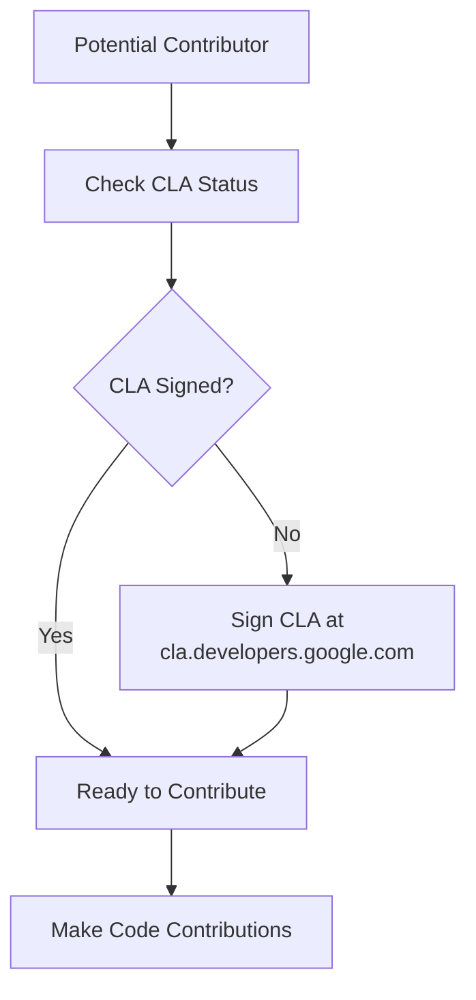
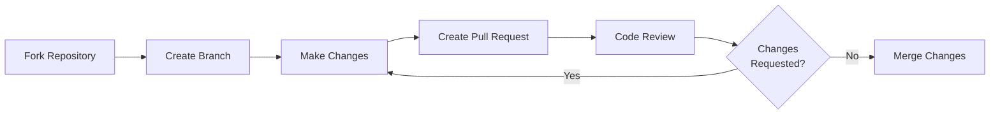
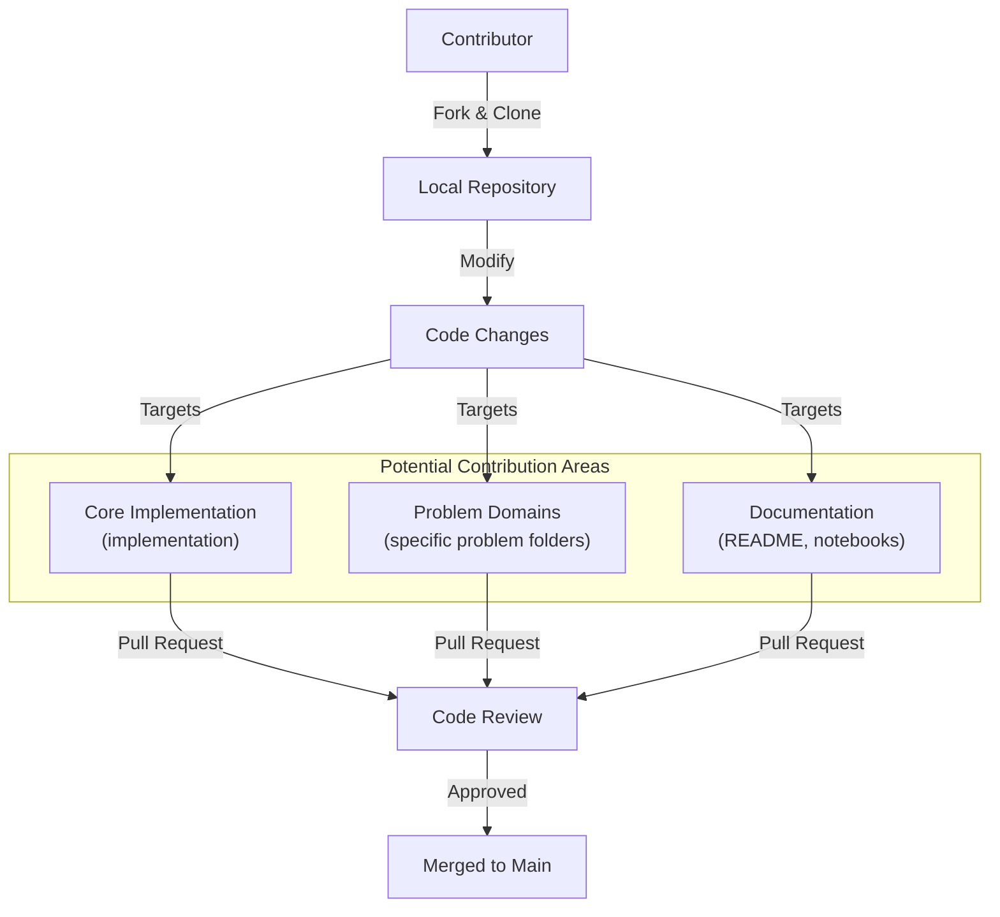
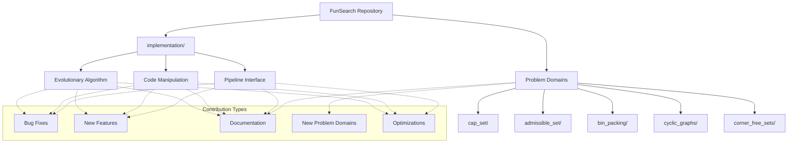
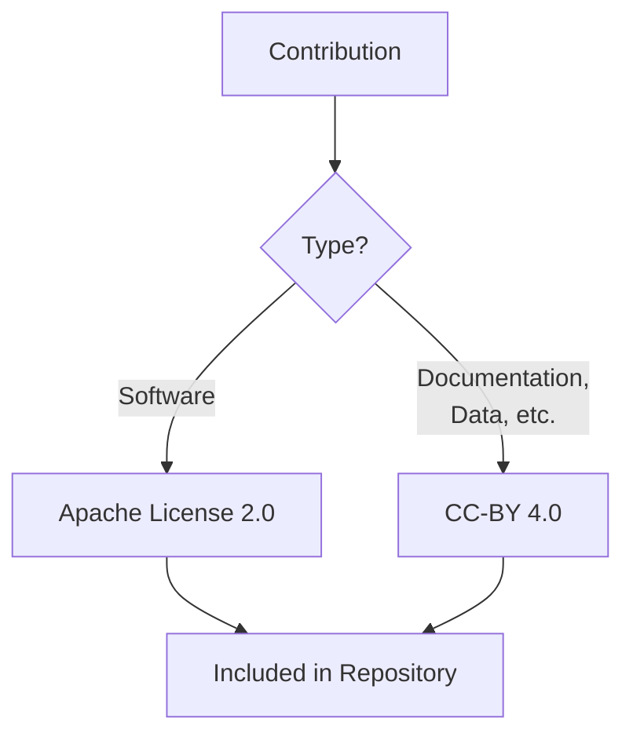

<!-- source: DeepWiki mcp.deepwiki.com · repo google-deepmind/funsearch · page 4 Contributing · fetched 2026-10-26 -->

# Contributing

Relevant source files

The following files were used as context for generating this wiki page:

- [.gitignore](.gitignore)
- [CONTRIBUTING.md](CONTRIBUTING.md)
- [README.md](README.md)

This page outlines the process and guidelines for contributing to the FunSearch repository. It provides information about the Contributor License Agreement (CLA), code review process, and community guidelines that contributors must follow when submitting changes to the project.

For information about the overall repository structure and components, see [Overview](#1). For details about implementing your own problem domains or extending the core implementation, see [Core Implementation](#2) and [Problem Domains](#3).

## Contributor License Agreement

All contributions to the FunSearch project must be accompanied by a Contributor License Agreement (CLA). The CLA allows DeepMind to use and redistribute your contributions as part of the project while you (or your employer) retain the copyright to your contribution.

To sign or check your CLA status:

1. Visit https://cla.developers.google.com/
2. Sign in with your GitHub account
3. Complete the CLA form if you haven't already submitted one

You generally only need to submit a CLA once. If you've already submitted a CLA for another Google project, you likely don't need to submit another one.

Sources: [CONTRIBUTING.md:3-13]()

## Code Review Process

All submissions to the FunSearch repository, including those from project members, require code review before being merged. The project uses GitHub pull requests for this process.

To submit code for review:

1. Fork the repository
2. Create a new branch for your changes
3. Make your changes and commit them
4. Create a pull request targeting the main branch
5. Wait for review feedback from project maintainers
6. Address any requested changes
7. Once approved, your changes will be merged

Sources: [CONTRIBUTING.md:15-20]()

## Contribution Workflow

The following diagram illustrates how contributions integrate with the FunSearch codebase and its various components:

Sources: [README.md:7-34](), [CONTRIBUTING.md:15-20]()

## Component Contribution Guide

The FunSearch repository contains several components that accept different types of contributions:

Sources: [README.md:7-34]()

## Community Guidelines

The FunSearch project follows [Google's Open Source Community Guidelines](https://opensource.google/conduct). These guidelines promote a respectful and inclusive environment for collaboration. Contributors are expected to adhere to these guidelines when interacting with the project and its community members.

Key principles include:
- Being respectful and constructive in communications
- Focusing on the technical merits of contributions
- Welcoming diverse perspectives and experiences
- Following ethical practices in software development

Sources: [CONTRIBUTING.md:22-25]()

## License Information

When contributing to FunSearch, be aware of the licensing requirements:

- All software contributions are licensed under the Apache License, Version 2.0
- Other materials (documentation, data, etc.) are licensed under the Creative Commons Attribution 4.0 International License (CC-BY)

Ensure your contributions comply with these licensing terms before submitting.

Sources: [README.md:70-87]()

## Getting Started with Contributions

1. **Understand the codebase**: Review the notebooks in each problem domain and the implementation directory to familiarize yourself with the code structure.

2. **Identify areas for contribution**: Look for potential improvements in:
   - The core evolutionary algorithm
   - Code manipulation routines
   - Documentation and examples
   - New problem domains that FunSearch could tackle

3. **Set up your development environment**: No special installation is required. All notebooks can be run in Google Colab.

4. **Follow the contribution process**: Follow the CLA signing and pull request procedures outlined above.

5. **Ask questions**: If you have questions about contributing, you can open an issue on GitHub to discuss potential contributions before making changes.

Sources: [README.md:36-39]()