# Page: Overview

# Overview

<details>
<summary>Relevant source files</summary>

The following files were used as context for generating this wiki page:

- [README.md](README.md)

</details>


## Purpose and Scope

This documentation covers the FunSearch repository, which accompanies the scientific publication "Mathematical discoveries from program search with large language models" (Nature, 2023). FunSearch demonstrates how evolutionary program search guided by large language models can solve complex mathematical problems and discover new mathematical insights. This overview provides a high-level introduction to the repository structure, its core components, and the mathematical problems it addresses. For detailed information about the implementation, see [Core Implementation](#2).

## Repository Structure

FunSearch is organized into six independent directories, each serving a distinct purpose:

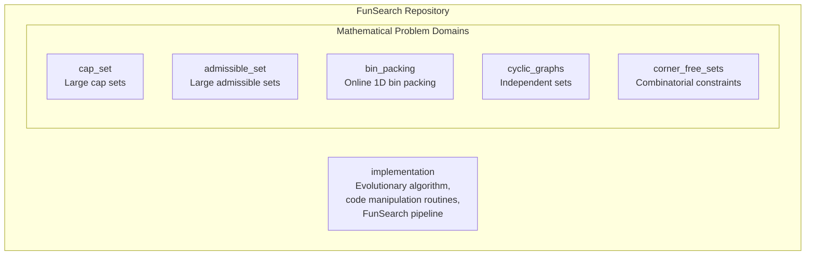

Sources: [README.md:7-33]()

The repository contains:

1. **Five mathematical problem domains**: Each directory contains functions discovered by FunSearch, along with numerical datasets representing the discovered mathematical objects or solutions.

2. **Implementation directory**: Contains the evolutionary algorithm, code manipulation routines, and a single-threaded implementation of the FunSearch pipeline. It does not include language models, code execution sandbox, or distributed system infrastructure.

## Core Components

The FunSearch system operates through several interconnected components:

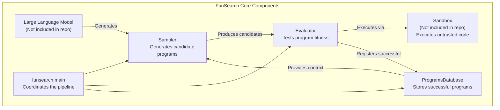

Sources: [README.md:28-34]()

Key aspects of the implementation:

- The system leverages language models to generate candidate programs, though the models themselves are not included in the repository
- An evolutionary algorithm selects successful programs based on fitness evaluation
- The system is designed to be adaptable for use with various language models, sandboxes, and distributed systems
- A single-threaded implementation is provided as a reference

## Mathematical Problem Domains

FunSearch addresses five distinct mathematical problem domains, each representing a significant challenge in mathematics:

| Problem Domain | Description | Key Results |
|---------------|-------------|-------------|
| Cap Sets | Sets in n-dimensional space where no three points form a line | Large cap sets discovered |
| Admissible Sets | Sets related to bounds on cap set capacity | Large admissible sets constructed |
| Bin Packing | Online 1D bin packing optimization | New effective heuristics discovered |
| Cyclic Graphs | Independent sets in strong products of cyclic graphs | Large independent sets constructed |
| Corner-Free Sets | Sets satisfying combinatorial degeneration constraints | New sets of indices discovered |

Sources: [README.md:9-26]()

## FunSearch Methodology

FunSearch follows a common pattern across problem domains, evolving functions that construct mathematical objects or optimize solutions:

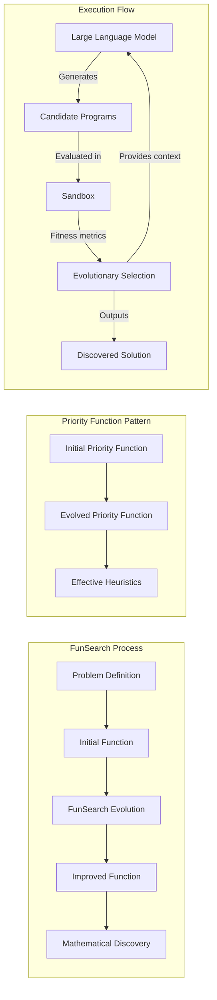

Sources: [README.md:28-34]()

Rather than directly evolving solutions, FunSearch often evolves "priority functions" that guide greedy algorithms in constructing mathematical objects. This approach has led to state-of-the-art results in several domains.

## Usage

All notebooks in the repository can be opened and run in Google Colab without any installation requirements:

| Problem Domain | Notebook | Colab Link |
|---------------|----------|------------|
| Cap Set | cap_set.ipynb | Available in repository |
| Admissible Set | admissible_set.ipynb | Available in repository |
| Bin Packing | bin_packing.ipynb | Available in repository |
| Cyclic Graphs | cyclic_graphs.ipynb | Available in repository |

Sources: [README.md:36-54]()

The notebooks provide a convenient way to explore the discovered functions and results. For more detailed usage information, see [Usage](#2.3).

## Implementation Boundaries

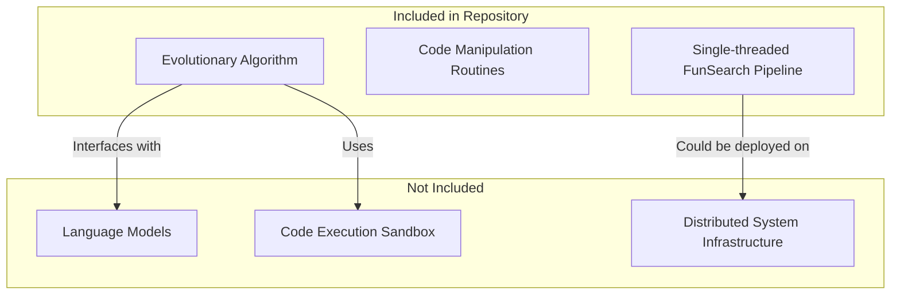

Sources: [README.md:28-34]()

The repository deliberately excludes certain components to provide flexibility:

- Language models for generating programs are not included
- Code execution sandbox systems are not provided
- Distributed system infrastructure is not included

This design allows users to integrate their own choices for these components while maintaining the core algorithmic approach.

---

# Page: Core Implementation

# Core Implementation

<details>
<summary>Relevant source files</summary>

The following files were used as context for generating this wiki page:

- [README.md](README.md)
- [implementation/evaluator.py](implementation/evaluator.py)
- [implementation/funsearch.py](implementation/funsearch.py)

</details>


This document describes the core implementation of the FunSearch algorithm, which is the evolutionary system that uses large language models to guide program search for solving mathematical problems. It details the architecture, components, and workflow of the algorithm without focusing on specific problem domains. For information about how FunSearch is applied to specific mathematical problems, see [Problem Domains](#3).

The core implementation consists of an evolutionary algorithm, code manipulation routines, and a single-threaded implementation of the FunSearch pipeline. It deliberately excludes the language models for generating new programs, the sandbox for executing untrusted code, and the infrastructure for distributed execution, allowing users to integrate their own technologies for these components.

## Architecture Overview

FunSearch follows an evolutionary algorithm approach where functions are evolved through repeated cycles of generation, evaluation, and selection.

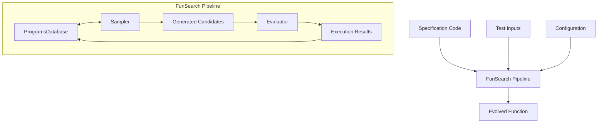

The core implementation is designed to be modular, with each component having specific responsibilities:

1. **FunSearch Pipeline**: Coordinates the evolutionary process between databases, samplers, and evaluators
2. **Programs Database**: Stores successful programs and provides context for generation
3. **Sampler**: Generates candidate programs using a language model
4. **Evaluator**: Executes and evaluates candidate programs in a sandbox environment

Sources: [implementation/funsearch.py:1-69]()`

## Core Components

The FunSearch implementation consists of four primary components that work together to evolve functions:

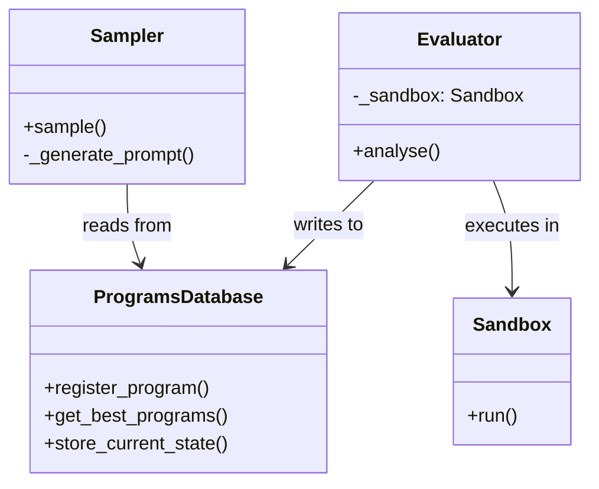

### ProgramsDatabase

The `ProgramsDatabase` component maintains the history of successful programs discovered during the evolutionary process. It:
- Stores evolved functions along with their performance metrics
- Ranks programs based on their scores
- Provides context (successful examples) for the sampler to generate new candidates
- Ensures persistence across runs by saving state to disk

### Evaluator

The `Evaluator` class analyzes functions generated by language models to determine their effectiveness. It:
- Compiles candidate functions into executable programs
- Executes programs safely in a sandbox environment
- Scores programs based on their performance on test inputs
- Registers successful programs in the database

The evaluator is responsible for maintaining the integrity of the evolutionary process by ensuring that registered programs:
1. Execute successfully without errors
2. Return appropriate numeric scores
3. Don't call ancestor functions (to prevent trivial extensions)

Sources: [implementation/evaluator.py:115-156]()

### Sampler

The `Sampler` component handles the generation of candidate functions. It:
- Creates prompts based on the best-performing programs from the database
- Interacts with language models to generate candidate code snippets
- Submits generated candidates to evaluators for analysis
- Maintains "islands" of evolution to ensure diversity in the search space

The sampler acts as the creative force in the evolutionary algorithm, leveraging language models to explore the solution space intelligently.

### Sandbox

The `Sandbox` component provides a secure environment for executing untrusted code. While the repository doesn't include a concrete implementation (allowing users to supply their own), it defines the interface:

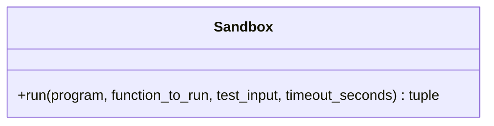

The sandbox is critical for safety when executing machine-generated code, which might otherwise pose security risks or cause infinite loops.

Sources: [implementation/evaluator.py:88-100]()

## Workflow and Execution

The FunSearch algorithm follows a specific workflow designed to evolve increasingly better functions:

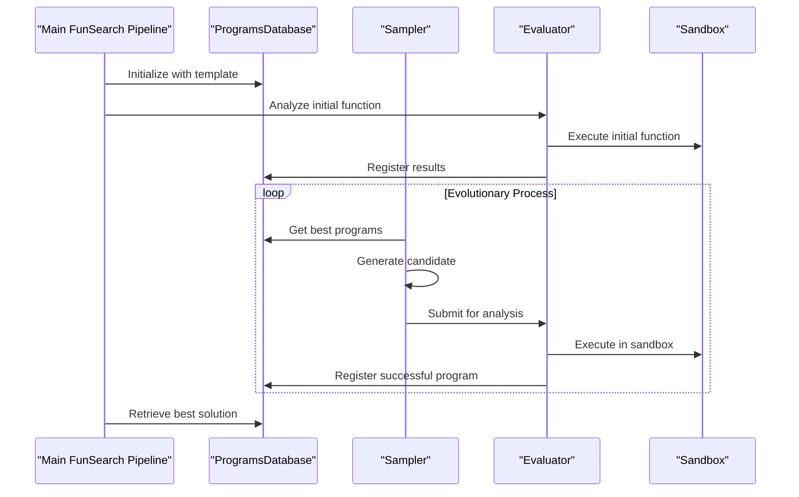

### Initialization

1. The system parses the specification code to identify:
   - The function to evolve (marked with `@funsearch.evolve`)
   - The function to run for evaluation (marked with `@funsearch.run`)

2. A `ProgramsDatabase` is initialized with the template program.

3. Evaluators and samplers are created based on the configuration.

4. The initial implementation is analyzed and registered if successful.

Sources: [implementation/funsearch.py:40-59]()

### Evolution Process

Once initialized, the evolution process continues in an infinite loop:

1. **Sampling**: The sampler selects high-performing programs from the database and generates new candidate functions.

2. **Evaluation**: Candidates are analyzed by the evaluator:
   - The function body is extracted and properly formatted
   - The function is integrated into the template program
   - The program is executed on test inputs in the sandbox
   - Results are scored according to the evaluation function

3. **Selection**: Successful programs are registered in the database, where they're ranked by performance and can be selected for future generations.

4. **Iteration**: The process repeats, creating a continuous evolution toward better solutions.

Sources: [implementation/funsearch.py:61-68](), [implementation/evaluator.py:135-155]()

## Code Manipulation

An essential aspect of the core implementation is the ability to manipulate code programmatically. The system includes utilities for:

- Parsing and modifying Python code
- Extracting function bodies
- Renaming function calls to manage versions
- Detecting calls to ancestor functions

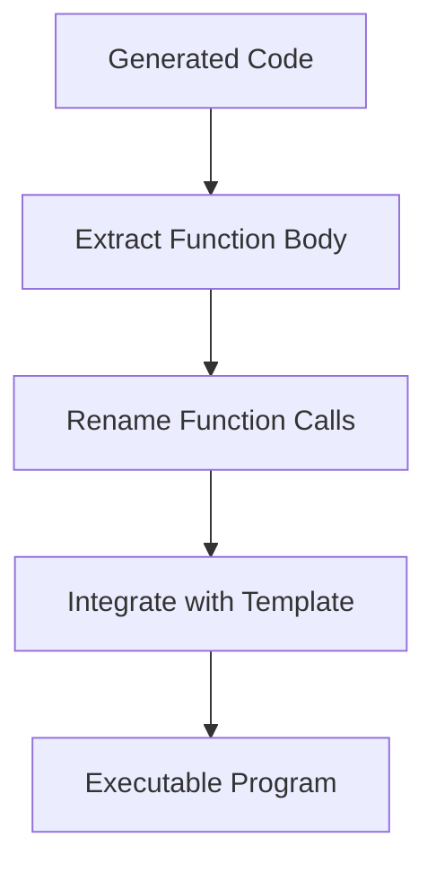

The code manipulation routines ensure that generated code can be properly integrated into the template program and executed safely.

Sources: [implementation/evaluator.py:26-65](), [implementation/evaluator.py:103-112]()

## Configuration

The FunSearch pipeline can be configured with various parameters:

- `num_evaluators`: Number of evaluator instances
- `num_samplers`: Number of sampler instances
- `samples_per_prompt`: Number of samples to generate from each prompt
- `programs_database`: Configuration for the programs database

These parameters allow users to control the balance between exploration and exploitation in the evolutionary process.

Sources: [implementation/funsearch.py:40-68]()

## Summary

The core implementation of FunSearch provides a flexible framework for evolving functions using large language models. By separating the evolutionary algorithm from the language model, sandbox, and distributed infrastructure, the implementation offers a modular design that can be adapted to different problem domains and technical environments.

The continuous cycle of generation, evaluation, and selection enables FunSearch to discover novel solutions to complex mathematical problems, as demonstrated in the various problem domains included in the repository.

---

# Page: Architecture

# Architecture

<details>
<summary>Relevant source files</summary>

The following files were used as context for generating this wiki page:

- [README.md](README.md)
- [implementation/evaluator.py](implementation/evaluator.py)
- [implementation/funsearch.py](implementation/funsearch.py)

</details>


This document describes the overall architecture of the FunSearch system, including its major components and how they interact within the evolutionary algorithm. For implementation details of specific components, see [Components](#2.2).

## High-Level Architecture Overview

FunSearch employs an evolutionary approach to program search guided by large language models. The system evolves functions through a pipeline of generation, evaluation, and selection to discover effective solutions to mathematical problems.

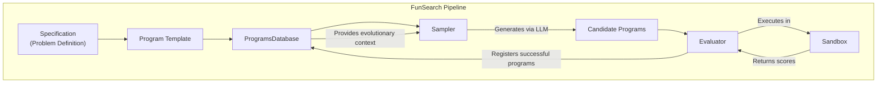

Sources: [implementation/funsearch.py:27-68](), [implementation/evaluator.py:115-155]()

## Core Components and Their Relationships

The FunSearch architecture contains four primary components that work together in the evolutionary search process:

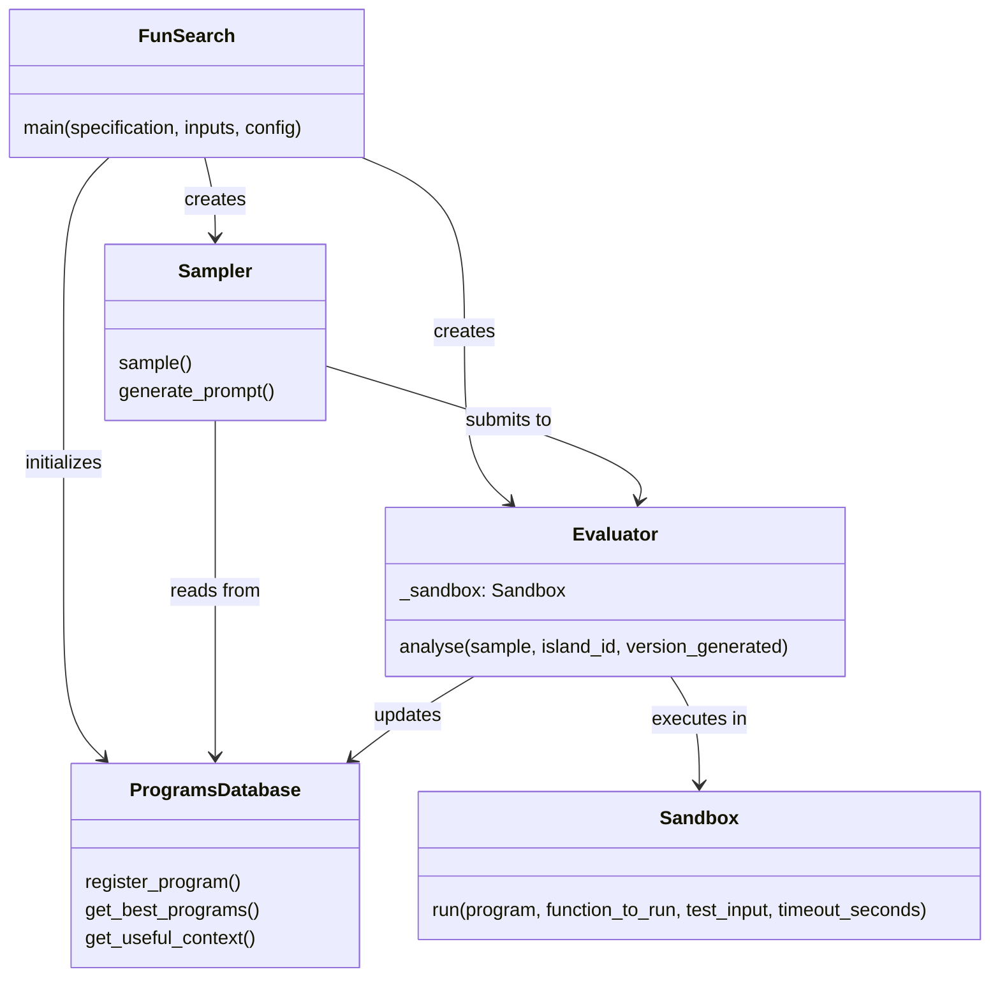

Sources: [implementation/funsearch.py:40-68](), [implementation/evaluator.py:115-155]()

## Initialization Flow

The FunSearch system begins with a problem specification and test inputs, then initializes its core components:

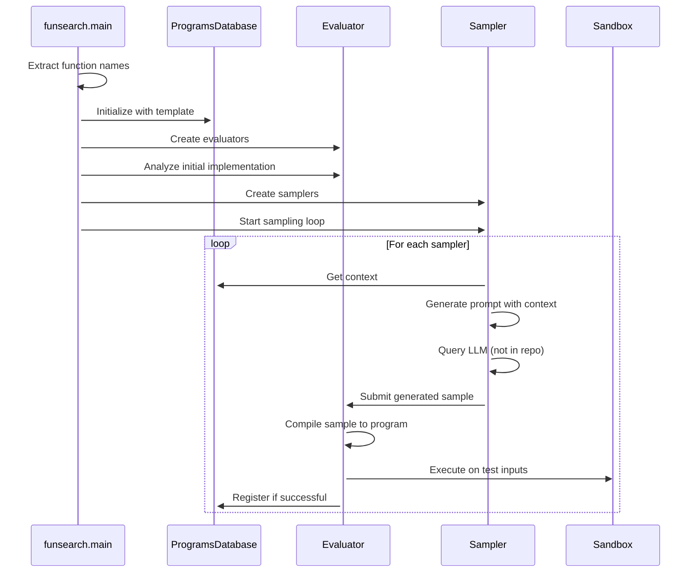

Sources: [implementation/funsearch.py:40-68]()

## Components in Detail

### Program Template and Function Extraction

The system starts with a specification that includes the problem definition and initial function implementations. The specification must define:

1. A function decorated with `@funsearch.evolve` - the target for evolution
2. A function decorated with `@funsearch.run` - used to evaluate candidates

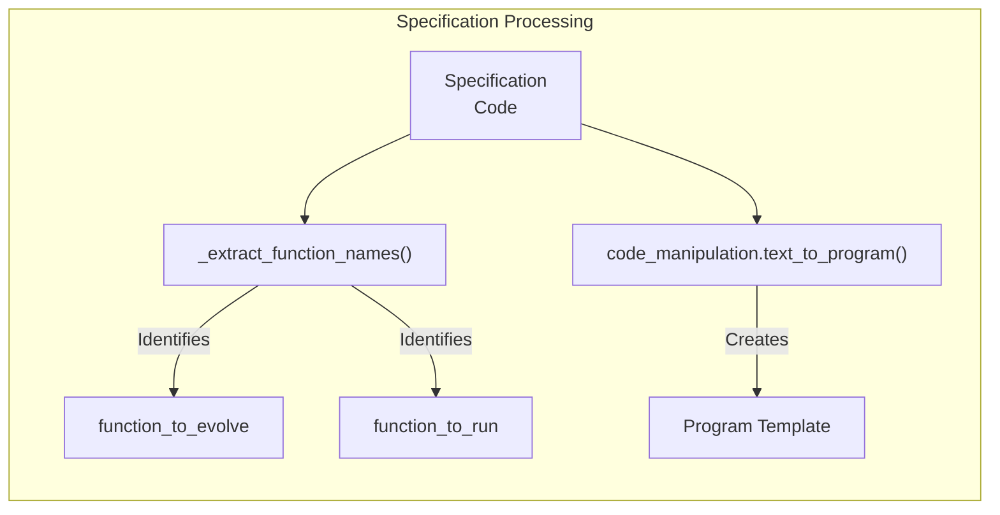

Sources: [implementation/funsearch.py:27-37]()

### ProgramsDatabase

The `ProgramsDatabase` serves as the evolutionary memory of the system. It stores successful programs, tracks their performance, and supplies context to the Sampler for generating new candidates.

### Evaluator

The `Evaluator` compiles and analyzes functions generated by the language model:

1. It compiles the sample code into a runnable program
2. Executes it on test inputs using a `Sandbox`
3. Verifies that the execution succeeds and doesn't call ancestor functions
4. Registers successful programs with the database, including their scores

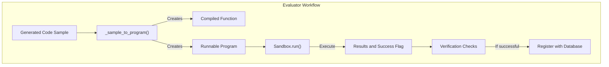

Sources: [implementation/evaluator.py:115-155](), [implementation/evaluator.py:67-85]()

### Sampler

The `Sampler` generates new program candidates by:
1. Retrieving context from the database
2. Creating prompts with this context
3. Using an LLM (not included in the repo) to generate samples
4. Submitting samples to the evaluator

### Sandbox

The `Sandbox` is an interface for safely executing potentially untrusted code:

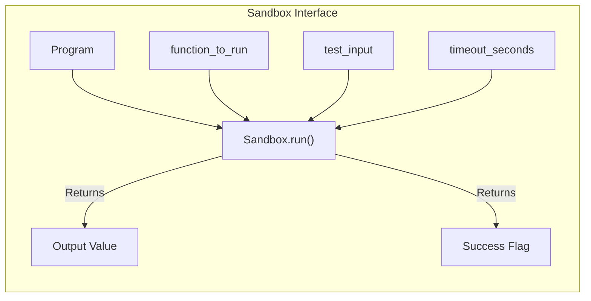

**Note**: The actual sandbox implementation is not included in the repository and must be provided by users.

Sources: [implementation/evaluator.py:88-100]()

## Execution Flow

The full execution flow of FunSearch involves:

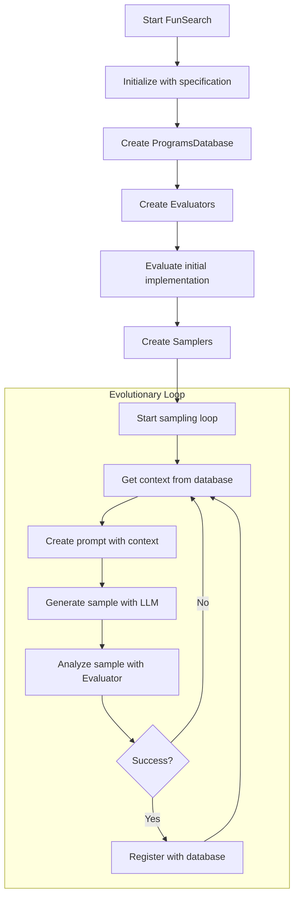

Sources: [implementation/funsearch.py:40-68]()

## Integration Points

The repository deliberately excludes three key components to allow users to integrate their own choices:

1. **Language Models**: For generating new programs based on prompts
2. **Sandbox**: For safely executing untrusted code
3. **Distributed System Infrastructure**: For scaling the search process

To implement a complete FunSearch system, users must provide these components and integrate them with the provided pipeline.

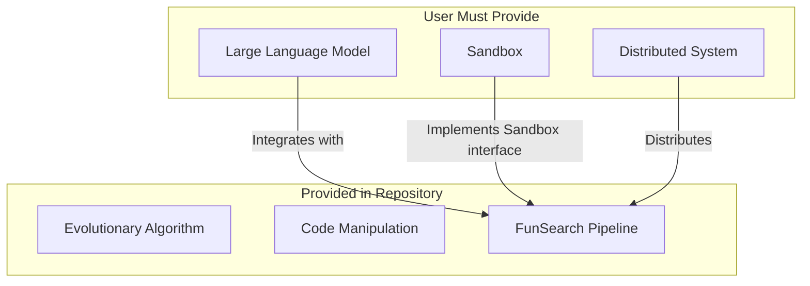

Sources: [README.md:28-34]()

## Design Considerations

The architecture follows several key design principles:

1. **Modularity**: Clear separation between components to allow different implementations
2. **Safety**: Sandboxed execution of generated code
3. **Evolution**: A database that maintains the evolutionary history and context
4. **Adaptability**: Designed to work with various language models and problem domains

The implementation provided in the repository serves as a reference that can be adapted to different environments, language models, and distributed systems.

---

# Page: Components

# Components

<details>
<summary>Relevant source files</summary>

The following files were used as context for generating this wiki page:

- [implementation/evaluator.py](implementation/evaluator.py)
- [implementation/funsearch.py](implementation/funsearch.py)

</details>


This page details the key components of the FunSearch implementation. It explains the core modules that make up the system and how they interact to facilitate the evolutionary program search. For information about the overall architecture, see [Architecture](#2.1), and for usage instructions, see [Usage](#2.3).

## Component Overview

FunSearch's implementation consists of four primary components that work together to evolve and discover improved functions:

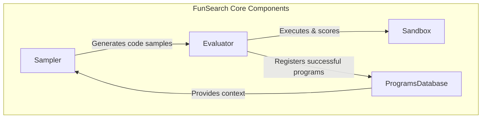

Sources: [implementation/funsearch.py:40-68]()

## Evaluator

The Evaluator component analyzes functions generated by the language model to determine their effectiveness at solving the specified problem.

### Functionality

- Compiles generated code samples into runnable programs
- Executes these programs on test inputs within a sandbox
- Verifies that programs execute successfully and return valid scores
- Registers successful programs in the database

### Class Structure

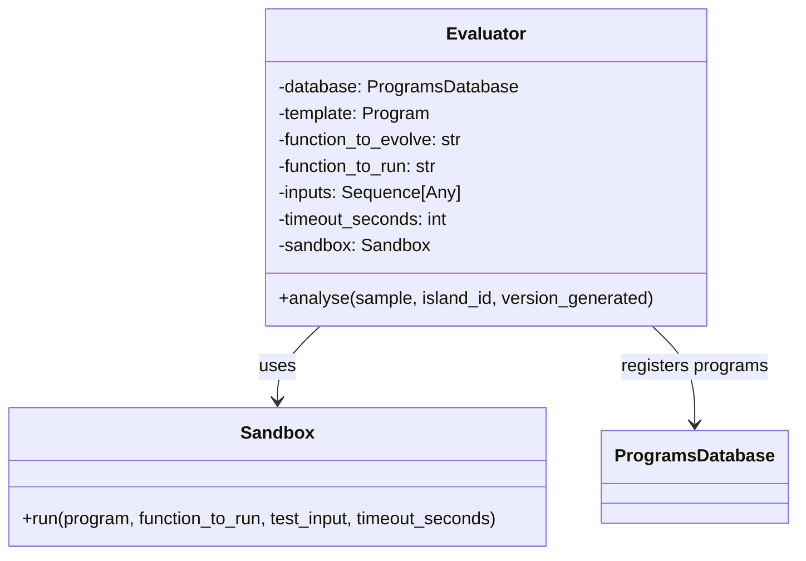

Sources: [implementation/evaluator.py:115-155](), [implementation/funsearch.py:48-59]()

### Key Methods

The `analyse()` method is the main entry point of the Evaluator:
1. It first converts the raw code sample into a complete program
2. Runs the program on each test input using the sandbox
3. Checks if execution is successful and doesn't call ancestor functions
4. Registers successful programs in the database with their scores

The Evaluator uses several helper functions:
- `_sample_to_program()`: Converts code samples to executable programs
- `_trim_function_body()`: Extracts just the body of generated functions
- `_calls_ancestor()`: Verifies the function doesn't call previous versions

Sources: [implementation/evaluator.py:135-155](), [implementation/evaluator.py:46-85](), [implementation/evaluator.py:103-112]()

## Sandbox

The Sandbox provides a secure environment for executing potentially unsafe generated code.

### Interface

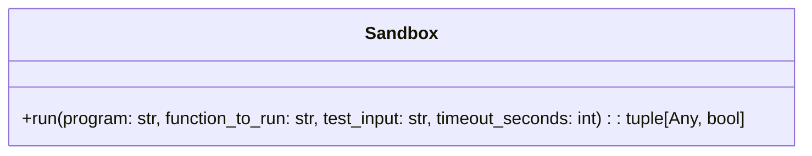

Sources: [implementation/evaluator.py:88-100]()

### Functionality

- Executes untrusted code safely
- Applies a timeout to prevent infinite loops
- Returns both the execution result and whether execution was successful
- Must be implemented by users of the FunSearch framework (not included in the repo)

The Sandbox interface is intentionally abstract, allowing different implementations based on security and performance requirements. The `run()` method takes a program string, the function name to run, test input, and a timeout, returning both the execution result and a success flag.

Sources: [implementation/evaluator.py:91-100]()

## ProgramsDatabase

The ProgramsDatabase maintains a record of successful programs discovered during the search process.

### Functionality

- Stores and manages successful program implementations
- Tracks program performance across different test inputs
- Provides context for the Sampler to generate improved versions
- Maintains a version history of evolved functions

```mermaid
flowchart TD
    subgraph "ProgramsDatabase"
        direction LR
        DB[("Program\nStorage")] --> Selection["Program Selection"]
        DB --> History["Version History"]
        DB --> Scoring["Score Tracking"]
    end
    
    Evaluator -->|"register_program()"| DB
    Selection -->|"Provides examples"| Sampler
```

Sources: [implementation/funsearch.py:45-46]()

## Sampler

The Sampler component generates new code samples by leveraging a language model.

### Functionality

- Retrieves successful programs from the database
- Formats prompts with examples of good programs
- Queries the language model to generate improved versions
- Sends samples to the Evaluator for analysis

```mermaid
sequenceDiagram
    participant S as "Sampler"
    participant DB as "ProgramsDatabase"
    participant LLM as "Language Model"
    participant E as "Evaluator"
    
    S->>DB: Get successful programs
    DB-->>S: Return program examples
    S->>S: Format prompt
    S->>LLM: Generate new samples
    LLM-->>S: Return generated code
    S->>E: Send samples for analysis
    E->>DB: Register successful programs
```

Sources: [implementation/funsearch.py:61-68]()

## Component Interaction in FunSearch Pipeline

The following diagram illustrates how these components interact in the complete FunSearch pipeline:

```mermaid
flowchart TD
    subgraph "FunSearch Pipeline"
        Init["Initialize\n1. Parse specification\n2. Create template\n3. Setup database"] --> 
        FirstEval["Initial Evaluation\nAnalyze starting function"] -->
        Loop["Evolution Loop"]
        
        subgraph Loop
            direction TB
            Sample["Sampler\nGather examples & generate samples"] -->
            Evaluate["Evaluator\nCompile & test samples"] -->
            Execute["Sandbox\nExecute safely"] -->
            Register["ProgramsDatabase\nStore successful programs"] -->
            Sample
        end
    end
```

Sources: [implementation/funsearch.py:40-68]()

## Implementation Details

### Core Data Flow

```mermaid
graph TD
    subgraph "Data Flow Between Components"
        Spec["Problem Specification"] -->|"parsed by"| Main["funsearch.main()"]
        Main -->|"initializes"| DB["ProgramsDatabase"]
        Main -->|"creates"| E["Evaluators"]
        Main -->|"creates"| S["Samplers"]
        
        S -->|"generates"| CodeSamples["Code Samples"]
        CodeSamples -->|"analyzed by"| E
        E -->|"executes in"| SB["Sandbox"]
        E -->|"registers successful"| DB
        DB -->|"provides context"| S
    end
```

Sources: [implementation/funsearch.py:40-68]()

### Key Class Relationships

The relationship between the main classes shows how the components are instantiated and connected in the FunSearch system:

```mermaid
classDiagram
    class Main {
        +main(specification, inputs, config)
    }
    
    class ProgramsDatabase {
        +register_program(function, island_id, scores_per_test)
    }
    
    class Evaluator {
        +analyse(sample, island_id, version_generated)
    }
    
    class Sampler {
        +sample()
    }
    
    class Sandbox {
        +run(program, function_to_run, test_input, timeout_seconds)
    }
    
    Main --> ProgramsDatabase : creates
    Main --> Evaluator : creates
    Main --> Sampler : creates
    Evaluator --> Sandbox : uses
    Evaluator --> ProgramsDatabase : updates
    Sampler --> Evaluator : sends samples to
    Sampler --> ProgramsDatabase : reads from
```

Sources: [implementation/funsearch.py:40-68](), [implementation/evaluator.py:115-155]()

## Summary

The FunSearch implementation consists of four key components that work together to evolve and discover improved functions:

| Component | Primary Responsibility | Key Methods |
|-----------|------------------------|-------------|
| **Evaluator** | Analyzes and tests generated functions | `analyse(sample, island_id, version_generated)` |
| **ProgramsDatabase** | Stores successful programs | `register_program(function, island_id, scores_per_test)` |
| **Sampler** | Generates new code samples | `sample()` |
| **Sandbox** | Executes untrusted code safely | `run(program, function_to_run, test_input, timeout_seconds)` |

These components form a closed loop where the Sampler generates candidates, the Evaluator tests them, successful programs are stored in the ProgramsDatabase, and the cycle continues with the Sampler using the database contents to generate improved versions.

Sources: [implementation/funsearch.py:40-68](), [implementation/evaluator.py:115-155]()

---

# Page: Usage

# Usage

<details>
<summary>Relevant source files</summary>

The following files were used as context for generating this wiki page:

- [README.md](README.md)
- [implementation/evaluator.py](implementation/evaluator.py)
- [implementation/funsearch.py](implementation/funsearch.py)

</details>


This page provides detailed instructions on how to use the FunSearch implementation from the `implementation` directory. It explains how to adapt this implementation to work with different language models, sandboxes, and distributed systems. For information about the overall architecture of FunSearch, see [Architecture](#2.1), and for details about specific components, see [Components](#2.2).

## Overview of Implementation Usage

The FunSearch implementation provided in this repository does not include language models for generating new programs, the sandbox for executing untrusted code, nor the infrastructure for running FunSearch on a distributed system. Instead, it provides a framework that can be adapted to work with any available language models, sandboxes, and distributed systems.

```mermaid
flowchart TD
    subgraph "User Must Provide"
        LM["Language Model"]
        SB["Sandbox Implementation"]
        DS["Distributed System<br>Infrastructure"]
    end
    
    subgraph "FunSearch Implementation"
        EV["Evaluator"]
        SA["Sampler"]
        DB["ProgramsDatabase"]
        PI["FunSearch Pipeline"]
    end
    
    LM -->|Generates Code| SA
    SA -->|Submits Code| EV
    EV -->|Uses| SB
    EV -->|Updates| DB
    DB -->|Provides Context| SA
    PI -->|Initializes & Coordinates| EV
    PI -->|Initializes & Coordinates| SA
    PI -->|Initializes & Coordinates| DB
    DS -.->|Optional Integration| PI
```

Sources: [implementation/funsearch.py:16-69](), [README.md:28-34]()

## Setting Up Your Specification

To use FunSearch, you need to create a specification that includes two specially decorated functions:

1. A function decorated with `@funsearch.evolve` - This is the function that FunSearch will attempt to improve.
2. A function decorated with `@funsearch.run` - This function evaluates the performance of the evolved function.

```mermaid
flowchart TD
    subgraph "Specification File"
        SPEC["Python Code"]
        EVOLVE["@funsearch.evolve<br>function to_evolve(...): ..."]
        RUN["@funsearch.run<br>function evaluate(...): ..."]
    end
    
    SPEC -->|Contains| EVOLVE
    SPEC -->|Contains| RUN
    
    EVOLVE -->|Will be improved by| FS["FunSearch"]
    RUN -->|Tests quality of| EVOLVE
    FS -->|Returns improved| RESULT["Evolved Function"]
```

Sources: [implementation/funsearch.py:27-37]()

### Example Specification Structure

Your specification file should contain at least these two functions:

1. The function to evolve (which will be improved by FunSearch):
```
@funsearch.evolve
def priority_function(element, container):
    # Initial implementation 
    # This will be evolved by FunSearch
    return some_score
```

2. The function to run (which evaluates how good the priority function is):
```
@funsearch.run
def evaluate_priority(test_case):
    # Use priority_function to solve the problem
    # Return a numeric score indicating performance
    return score
```

Sources: [implementation/funsearch.py:27-37]()

## Implementing Required Components

### Sandbox Implementation

You must implement a `Sandbox` class for securely executing generated code. The repository includes a base class in `evaluator.py`, but its `run` method is not implemented:

```mermaid
classDiagram
    class Sandbox {
        +run(program: str, function_to_run: str, test_input: str, timeout_seconds: int) tuple[Any, bool]
    }
    
    class YourSandboxImplementation {
        +run(program: str, function_to_run: str, test_input: str, timeout_seconds: int) tuple[Any, bool]
    }
    
    Sandbox <|-- YourSandboxImplementation
```

Your implementation must:
1. Execute the specified function from the provided program code
2. Pass the test input to the function
3. Apply the timeout constraint
4. Return the function's output and a boolean indicating whether execution succeeded

Sources: [implementation/evaluator.py:88-100]()

### Language Model Integration

The FunSearch implementation does not include a language model. You need to integrate your own language model that can generate Python code. The language model should:

1. Generate modifications to the function being evolved
2. Receive feedback about successful programs
3. Create new variations that build upon successful programs

Sources: [README.md:28-34]()

## Running FunSearch

The main entry point for running FunSearch is the `main` function in `funsearch.py`:

```mermaid
flowchart TD
    MAIN["main(specification, inputs, config)"]
    EXTRACT["Extract function names"]
    TEMPLATE["Create code template"]
    DB["Initialize ProgramsDatabase"]
    EVAL["Create evaluators"]
    INITIAL["Analyze initial implementation"]
    SAMPLER["Create samplers"]
    LOOP["Start sampling loop"]
    
    MAIN -->|1| EXTRACT
    EXTRACT -->|2| TEMPLATE
    TEMPLATE -->|3| DB
    DB -->|4| EVAL
    EVAL -->|5| INITIAL
    INITIAL -->|6| SAMPLER
    SAMPLER -->|7| LOOP
```

Sources: [implementation/funsearch.py:40-68]()

### Required Parameters

1. `specification`: A string containing your code specification with `@funsearch.evolve` and `@funsearch.run` decorated functions
2. `inputs`: A sequence of test inputs to evaluate the evolved function
3. `config`: A `Config` object that specifies:
   - `programs_database`: Configuration for the programs database
   - `num_evaluators`: Number of evaluator instances to create
   - `num_samplers`: Number of sampler instances to create
   - `samples_per_prompt`: Number of samples to generate per prompt

Sources: [implementation/funsearch.py:40-68]()

## Distributed Execution

While the provided implementation is single-threaded, it's designed to be adaptable for distributed execution:

```mermaid
flowchart LR
    subgraph "Distributed System"
        SM1["Sampler Machine 1"]
        SM2["Sampler Machine 2"]
        SM3["Sampler Machine N"]
        EM1["Evaluator Machine 1"]
        EM2["Evaluator Machine 2"]
        EM3["Evaluator Machine M"]
        DB["Shared Database"]
    end
    
    SM1 -->|Generate Samples| EM1
    SM2 -->|Generate Samples| EM2
    SM3 -->|Generate Samples| EM3
    EM1 -->|Update Results| DB
    EM2 -->|Update Results| DB
    EM3 -->|Update Results| DB
    DB -->|Context| SM1
    DB -->|Context| SM2
    DB -->|Context| SM3
```

The implementation is designed so that:

1. Multiple samplers can run in parallel on different machines
2. Multiple evaluators can process samples in parallel
3. They can all communicate through a shared programs database

To implement distributed execution, you'll need to:
1. Create a distributed version of the `ProgramsDatabase`
2. Run samplers and evaluators on separate machines
3. Ensure communication between the components

Sources: [implementation/funsearch.py:63-68](), [README.md:28-34]()

## Example Usage Workflow

Here's a step-by-step process to use FunSearch with your own components:

1. **Define your problem specification**:
   - Create a file with functions decorated with `@funsearch.evolve` and `@funsearch.run`
   - Define test inputs that will evaluate the performance of evolved functions

2. **Implement required components**:
   - Create a `Sandbox` implementation that can safely execute generated code
   - Set up integration with your language model of choice

3. **Configure FunSearch**:
   - Create a `Config` object with appropriate parameters
   - Set up any additional configuration for distributed execution if needed

4. **Run the FunSearch pipeline**:
   - Call the `main` function with your specification, inputs, and configuration
   - For distributed execution, deploy samplers and evaluators across machines

5. **Analyze results**:
   - Examine the programs database for the best evolved functions
   - Evaluate these functions on additional test cases if needed

Sources: [implementation/funsearch.py:40-68](), [README.md:28-34]()

## Integration Considerations

### Security Considerations

When implementing the sandbox component, ensure that:

1. Generated code cannot access sensitive system resources
2. Execution is properly sandboxed to prevent harmful side effects
3. Timeouts are enforced to prevent infinite loops
4. Memory usage is limited to prevent resource exhaustion

### Performance Optimization

For efficient execution:

1. Consider parallelizing evaluators to process multiple samples simultaneously
2. Implement caching mechanisms in the sandbox to avoid re-executing identical code
3. Use efficient communication methods between distributed components
4. Tune the number of samplers and evaluators based on available resources

### Monitoring and Debugging

To effectively monitor the FunSearch process:

1. Add logging throughout the process to track evolution progress
2. Implement metrics to measure the quality of evolved functions over time
3. Create visualization tools to understand how functions are evolving
4. Store intermediate results to allow resuming interrupted runs

Sources: [implementation/evaluator.py:133-155](), [implementation/funsearch.py:40-68]()

## Summary

The FunSearch implementation provided in this repository offers a flexible framework that can be adapted to work with various language models, sandboxes, and distributed systems. By implementing the required components and following the usage workflow described above, you can apply FunSearch to your own mathematical or algorithmic problems.

For specific examples of how FunSearch has been applied to different problem domains, refer to the problem-specific directories in the repository, such as Cap Sets [Cap Sets](#3.2), Admissible Sets [Admissible Sets](#3.1), Bin Packing [Bin Packing](#3.3), and others.

---

# Page: Problem Domains

# Problem Domains

<details>
<summary>Relevant source files</summary>

The following files were used as context for generating this wiki page:

- [README.md](README.md)

</details>


## Purpose and Scope

This document provides an overview of the mathematical problem domains addressed by FunSearch. Each domain represents a distinct mathematical challenge for which FunSearch was used to discover novel solutions through program search with large language models. For information about the core algorithm and implementation details, see [Core Implementation](#2).

## Overview of Problem Domains

The FunSearch repository contains five mathematical problem domains, each implemented as a standalone directory with its own notebook and discovered solutions:

```mermaid
flowchart TD
    root["FunSearch Repository"] --> cap["cap_set/"]
    root --> adm["admissible_set/"]
    root --> bin["bin_packing/"]
    root --> cyc["cyclic_graphs/"]
    root --> cor["corner_free_sets/"]
    
    cap --> cap_nb["cap_set.ipynb"]
    adm --> adm_nb["admissible_set.ipynb"]
    bin --> bin_nb["bin_packing.ipynb"]
    cyc --> cyc_nb["cyclic_graphs.ipynb"]
    
    cap_nb --> cap_res["Cap sets in F₃ⁿ"]
    adm_nb --> adm_res["Bounds on cap set capacity"]
    bin_nb --> bin_res["Bin packing heuristics"]
    cyc_nb --> cyc_res["Independent sets"]
    cor --> cor_res["Sets satisfying constraints"]
```

Sources: [README.md:7-26]()

## Common Search Pattern

All problem domains utilize a similar approach to mathematical discovery through program search:

```mermaid
flowchart LR
    subgraph "FunSearch Pattern"
        direction TB
        spec["Problem Specification"] --> init["Initial Function"]
        init --> evolve["Function Evolution"]
        evolve --> improved["Improved Function"]
        improved --> discovery["Mathematical Discovery"]
    end
    
    subgraph "Priority Function Pattern"
        direction TB
        basic["Initial Priority Function"] --> evo["FunSearch Evolution"]
        evo --> optimized["Optimized Priority Function"]
    end
    
    evolve -.-> basic
    optimized -.-> improved
```

Sources: [README.md:7-26]()

Rather than directly evolving the solution, FunSearch typically evolves a "priority function" that guides a greedy algorithm to construct the solution step by step. This approach has proven effective across different mathematical domains.

## Problem Domain Descriptions

### Cap Sets

Cap sets are subsets of the three-dimensional space over the field with three elements (F₃ⁿ) that contain no three points in an arithmetic progression (no lines).

```mermaid
flowchart TD
    subgraph "Cap Set Problem Domain"
        problem["Find large subsets of F₃ⁿ with no lines"] --> greedy["Greedy Construction Algorithm"]
        greedy --> priority["priority() Function"]
        priority --> construct["construct_cap_set() Function"]
        construct --> result["Large Cap Sets"]
    end
    
    subgraph "Code Implementation"
        cap_notebook["cap_set.ipynb"]
        priority_func["priority(element, existing_set)"]
        cap_sets["Numerical Cap Set Representations"]
    end
    
    priority --> priority_func
    result --> cap_sets
    problem --> cap_notebook
```

Sources: [README.md:9-10]()

The `cap_set` directory contains functions discovered by FunSearch that construct large cap sets, as well as numerical representations of those sets.

### Admissible Sets

Admissible sets provide a way to establish lower bounds on the maximum size of cap sets in F₃ⁿ.

```mermaid
flowchart TD
    subgraph "Admissible Set Problem Domain"
        problem["Establish lower bounds on cap set size"] --> functions["evaluate(n,w) and solve(n,w)"]
        functions --> priority["priority(element, n, w)"]
        priority --> construct["Construct Admissible Sets"]
        construct --> bounds["Compute Capacity Bounds"]
    end
    
    subgraph "Code Implementation"
        adm_notebook["admissible_set.ipynb"]
        priority_func["priority(element, n, w)"]
        adm_sets["Numerical Admissible Set Representations"]
    end
    
    priority --> priority_func
    construct --> adm_sets
    problem --> adm_notebook
```

Sources: [README.md:12-14]()

The `admissible_set` directory contains functions discovered by FunSearch that construct large admissible sets, along with numerical representations of these sets.

### Bin Packing

The bin packing problem involves packing items of different sizes into a fixed number of bins to minimize wasted space. FunSearch focuses on the online version where items must be placed immediately upon arrival.

```mermaid
flowchart TD
    subgraph "Bin Packing Problem Domain"
        problem["Online 1D Bin Packing"] --> heuristic["Packing Heuristic"]
        heuristic --> next_bin["next_bin() Function"]
        next_bin --> evaluation["Performance Evaluation"]
    end
    
    subgraph "Code Implementation"
        bin_notebook["bin_packing.ipynb"]
        next_bin_func["next_bin(item, bins)"]
        eval_suite["Evaluation Suite"]
    end
    
    next_bin --> next_bin_func
    evaluation --> eval_suite
    problem --> bin_notebook
```

Sources: [README.md:16-18]()

The `bin_packing` directory contains heuristics discovered by FunSearch for online 1D bin packing problems and an evaluation suite to reproduce the results reported in the paper.

### Cyclic Graphs

This problem involves finding large independent sets in strong products of cyclic graphs - sets of vertices where no two vertices are adjacent.

```mermaid
flowchart TD
    subgraph "Cyclic Graphs Problem Domain"
        problem["Independent Sets in Cyclic Graphs"] --> construct["Construction Algorithm"]
        construct --> priority["priority() Function"]
        priority --> independent["Generate Independent Sets"]
    end
    
    subgraph "Code Implementation"
        cyc_notebook["cyclic_graphs.ipynb"]
        priority_func["priority(vertex, existing_set)"]
        ind_sets["Numerical Independent Set Representations"]
    end
    
    priority --> priority_func
    independent --> ind_sets
    problem --> cyc_notebook
```

Sources: [README.md:20-22]()

The `cyclic_graphs` directory contains functions discovered by FunSearch that construct large independent sets in strong products of cyclic graphs, as well as numerical representations of those sets.

### Corner-Free Sets

Corner-free sets are sets of indices satisfying specific combinatorial degeneration constraints.

```mermaid
flowchart TD
    subgraph "Corner-Free Sets Problem Domain"
        problem["Sets satisfying combinatorial constraints"] --> constraints["Degeneration Constraints"]
        constraints --> sets["Discovered Sets of Indices"]
    end
    
    subgraph "Code Implementation"
        corner_dir["corner_free_sets/"]
        numerical["Numerical Representations"]
    end
    
    sets --> numerical
    problem --> corner_dir
```

Sources: [README.md:24-26]()

The `corner_free_sets` directory contains the discovered sets of indices in numerical format, satisfying the combinatorial degeneration constraints described for the corners-free problem.

## Problem Domains in the FunSearch Pipeline

The following diagram illustrates how each problem domain integrates with the FunSearch evolutionary algorithm:

```mermaid
flowchart LR
    subgraph "FunSearch Pipeline"
        direction TB
        llm["LLM Code Generator"] --> programs["Candidate Programs"]
        programs --> evaluator["Evaluator"]
        evaluator --> selection["Program Selection"]
        selection --> llm
    end
    
    subgraph "Problem Domains"
        cap["Cap Set Domain:<br>priority() functions"]
        adm["Admissible Set Domain:<br>priority() functions"]
        bin["Bin Packing Domain:<br>next_bin() functions"]
        cyc["Cyclic Graphs Domain:<br>priority() functions"]
        cor["Corner-Free Sets Domain:<br>constraint functions"]
    end
    
    evaluator --- domains["Problem-Specific<br>Evaluation Functions"]
    domains --> cap
    domains --> adm
    domains --> bin
    domains --> cyc
    domains --> cor
```

Sources: [README.md:7-26](), [README.md:28-34]()

## Technical Implementation Table

| Problem Domain | Directory | Main Notebook | Evolved Functions | Output |
|----------------|-----------|---------------|-------------------|--------|
| Cap Sets | `cap_set/` | `cap_set.ipynb` | `priority()` | Large cap sets in F₃ⁿ |
| Admissible Sets | `admissible_set/` | `admissible_set.ipynb` | `priority()`, `evaluate()`, `solve()` | Lower bounds on cap set capacity |
| Bin Packing | `bin_packing/` | `bin_packing.ipynb` | `next_bin()` | Online packing heuristics |
| Cyclic Graphs | `cyclic_graphs/` | `cyclic_graphs.ipynb` | `priority()` | Independent sets in cyclic graphs |
| Corner-Free Sets | `corner_free_sets/` | N/A | Constraint functions | Sets satisfying constraints |

Sources: [README.md:7-34]()

## Usage and Exploration

All notebooks can be run in Google Colab without installation requirements:

- Cap Set: `cap_set.ipynb` ([README.md:43-44]())
- Admissible Set: `admissible_set.ipynb` ([README.md:46-48]())
- Bin Packing: `bin_packing.ipynb` ([README.md:50-51]())
- Cyclic Graphs: `cyclic_graphs.ipynb` ([README.md:53-54]())

These notebooks allow users to explore the discovered functions and verify the mathematical results reported in the FunSearch paper.

---

# Page: Admissible Sets

# Admissible Sets

<details>
<summary>Relevant source files</summary>

The following files were used as context for generating this wiki page:

- [README.md](README.md)
- [admissible_set/admissible_set.ipynb](admissible_set/admissible_set.ipynb)
- [admissible_set/admissible_set_n12_w7_size792.txt](admissible_set/admissible_set_n12_w7_size792.txt)
- [admissible_set/admissible_set_n15_w10_size3003.txt](admissible_set/admissible_set_n15_w10_size3003.txt)
- [admissible_set/admissible_set_n21_w15_size43596.txt](admissible_set/admissible_set_n21_w15_size43596.txt)
- [admissible_set/admissible_set_n24_w17_size237984.txt](admissible_set/admissible_set_n24_w17_size237984.txt)

</details>


This page documents the FunSearch implementation for generating large admissible sets and their use in establishing lower bounds on cap set capacity. Admissible sets are mathematical structures that, when applied properly, can be used to construct large cap sets, which in turn lead to improved bounds on the cap set problem in additive combinatorics.

## What are Admissible Sets?

Admissible sets are collections of vectors in Z₃ⁿ (vectors with entries 0, 1, or 2) with specific combinatorial properties that make them useful for constructing cap sets. A cap set is a set of points in Z₃ⁿ where no three points form a line.

In the context of the FunSearch repository, admissible sets are specifically used to prove lower bounds on the cap set capacity, which is a key quantity in the cap set problem. The cap set capacity represents the maximum asymptotic size of cap sets as the dimension grows.

```mermaid
graph TD
    subgraph "Combinatorial Objects"
        AS["Admissible Set"]
        CS["Cap Set"]
        CB["Cap Set Capacity Bound"]
    end
    
    subgraph "Construction Process"
        PF["Priority Function"]
        GA["Greedy Algorithm"]
    end
    
    PF --> GA
    GA --> AS
    AS --> CS
    CS --> CB
    
    style AS stroke-width:2px
    style CS stroke-width:1px
    style CB stroke-width:1px
    style PF stroke-width:2px
    style GA stroke-width:2px
```

Sources: [admissible_set/admissible_set.ipynb:24-35](), [admissible_set/admissible_set.ipynb:204-256]()

## Admissible Set Construction

FunSearch uses a greedy algorithm to construct admissible sets. The key insight of the FunSearch approach is to evolve an effective priority function that guides the greedy selection process. The basic algorithm works as follows:

1. Start with an empty admissible set
2. Assign scores (priorities) to all potential elements that could be added
3. Select the element with the highest score
4. Block all elements that would violate the admissibility constraints if added
5. Repeat steps 3-4 until no more elements can be added

```mermaid
flowchart TD
    Start["Initialize empty\nadmissible set"] --> Score["Score all candidate\nelements using priority()"]
    Score --> Select["Select highest-scoring\nelement"]
    Select --> Block["Block incompatible\nelements with block_children()"]
    Block --> Check{"Any valid\ncandidates left?"}
    Check -->|"Yes"| Score
    Check -->|"No"| End["Return completed\nadmissible set"]
```

Sources: [admissible_set/admissible_set.ipynb:86-106]()

## Core Implementation

The implementation consists of several key functions:

1. `evaluate(n, w)`: The main entry point that returns the size of the constructed admissible set
2. `solve(n, w)`: Constructs an admissible set I(n, w) of constant weight w in dimension n
3. `block_children(scores, admissible_set, new_element)`: Modifies the scores array to mark elements that would violate admissibility constraints
4. `priority(el, n, w)`: The evolved function that assigns priorities to candidate elements

```mermaid
graph TD
    E["evaluate(n, w)"]
    S["solve(n, w)"]
    BC["block_children(scores, admissible_set, new_element)"]
    P["priority(el, n, w)"]
    
    E --> S
    S --> P
    S --> BC
    
    subgraph "FunSearch Evolution Target"
        P
    end
    
    subgraph "Fixed Algorithm"
        E
        S
        BC
    end
```

Sources: [admissible_set/admissible_set.ipynb:44-117]()

### Block Children Function

The `block_children` function is critical for maintaining the admissibility property. It modifies the scores array by setting scores to `-inf` for elements that would violate the admissibility constraints if added to the set. This function handles two types of blocking:

1. Elements with the same support as the newly added element
2. Elements disallowed by a pair consisting of an extant point and the new element

```python
def block_children(scores: np.ndarray,
                   admissible_set: np.ndarray,
                   new_element: np.ndarray) -> None:
  """Modifies `scores` to -inf for elements blocked by `new_element`."""
  # Implementation details...
```

Sources: [admissible_set/admissible_set.ipynb:50-83]()

### Priority Function

The priority function is the target of FunSearch evolution. It assigns a score to each candidate element, which determines the order in which elements are added to the admissible set. The initial implementation simply returns 0.0, but FunSearch evolves more sophisticated functions.

```python
def priority(el: tuple[int, ...], n: int, w: int) -> float:
  """Returns the priority with which we want to add `el` to the set."""
  return 0.0
```

Sources: [admissible_set/admissible_set.ipynb:114-117]()

## Discovered Solutions

FunSearch discovered several priority functions that lead to optimal or near-optimal admissible sets. Here are some notable examples:

### Full-Size I(12, 7) Admissible Set

FunSearch discovered a priority function that constructs a full-sized admissible set I(12, 7), i.e., of size ${12 \choose 7} = 792$. The function patterns examine relationships between coordinates at 4-index intervals:

```python
def priority(el: tuple[int, ...], n: int, w: int) -> float:
  score = 0.0
  for i in range(n):
    if el[i] == 1:
      score -= 0.9 ** (i % 4)
    if el[i] == 2:
      score -= 0.98 ** (30 - (i % 4))
    if el[i] == 1 and el[i - 4] == 1:
      score -= 0.98 ** (30 - (i % 4))
    # Additional patterns...
  return score
```

This priority function leads to a lower bound on the cap set capacity of 2.2184431522494577, improving on the previous state-of-the-art of 2.218021.

Sources: [admissible_set/admissible_set.ipynb:170-196](), [admissible_set/admissible_set.ipynb:204-256]()

### Symmetric Admissible Sets

The I(12, 7) solution revealed a symmetry property that could be exploited. FunSearch discovered that the constructed admissible set is preserved under independent cyclic permutations of coordinates within specific triples. This observation led to a more specialized implementation for symmetric admissible sets:

```mermaid
graph LR
    subgraph "General Admissible Sets"
        GA[General admissible set construction]
    end
    
    subgraph "Symmetric Admissible Sets"
        SA[Symmetric admissible set construction]
        TRIPLES[TRIPLES constant]
        EAS[expand_admissible_set function]
        GSC[get_surviving_children function]
    end
    
    GA -->|"Observed symmetry"| SA
    TRIPLES --> SA
    SA --> EAS
    SA --> GSC
```

The symmetric approach allowed scaling to much larger dimensions, resulting in:
- A full-size I(15, 10) admissible set of size 3003
- An admissible set A(21, 15) of size 43,596
- An admissible set A(24, 17) of size 237,984 (state-of-the-art)

Sources: [admissible_set/admissible_set.ipynb:264-290](), [admissible_set/admissible_set.ipynb:328-405]()

## Computational Results and Implications

The admissible sets discovered by FunSearch lead to progressively better lower bounds on the cap set capacity:

| Admissible Set | Size | Lower Bound on Cap Set Capacity |
|----------------|------|--------------------------------|
| I(12, 7)       | 792  | 2.2184431522494577             |
| I(15, 10)      | 3003 | 2.2194858716370582             |
| A(21, 15)      | 43,596 | 2.220040576961921            |
| A(24, 17)      | 237,984 | 2.2202336538665377          |

The final result represents a new state-of-the-art lower bound on the cap set capacity.

The computation of the capacity bound uses a formula that combines the admissible set with a recursively admissible set:

```python
def compute_capacity_bound(n: int, w: int, size: int, m: int) -> float:
  """Returns the lower bound on the cap set capacity."""
  a0, a1, _ = (12, 112, 112)
  b0 = m * a0 * (a1 ** (m - 1))
  b1 = a1 ** m
  log_cap_set_size = np.log(size) + (n - w) * np.log(b0) + w * np.log(b1)
  log_capacity = log_cap_set_size / (6 * m * n)
  return np.exp(log_capacity)
```

Sources: [admissible_set/admissible_set.ipynb:229-255](), [admissible_set/admissible_set.ipynb:488-528](), [admissible_set/admissible_set.ipynb:584-596](), [admissible_set/admissible_set.ipynb:652-670]()

## Implementation Variants

The repository contains two main implementation variants:

1. **Standard Admissible Set Construction**: The initial implementation that works with general admissible sets.
2. **Symmetric Admissible Set Construction**: An optimized implementation that leverages observed symmetry properties.

```mermaid
graph TD
    subgraph "Standard Implementation"
        solve1["solve(n, w)"]
        block_children["block_children()"]
        priority1["priority()"]
    end
    
    subgraph "Symmetric Implementation"
        TRIPLES["TRIPLES constant"]
        solve2["solve(n, w)"]
        get_surviving_children["get_surviving_children()"]
        expand_admissible_set["expand_admissible_set()"]
        priority2["priority()"]
    end
    
    solve1 --> block_children
    solve1 --> priority1
    
    TRIPLES --> solve2
    solve2 --> get_surviving_children
    solve2 --> expand_admissible_set
    solve2 --> priority2
```

The symmetric implementation works by:
1. Defining a set of representative triples (TRIPLES)
2. Working with a reduced representation called a "pre-admissible set"
3. Expanding the pre-admissible set into a full admissible set using the `expand_admissible_set` function
4. Using `get_surviving_children` to enforce admissibility constraints

This approach significantly reduces the search space, enabling the discovery of larger admissible sets.

Sources: [admissible_set/admissible_set.ipynb:44-117](), [admissible_set/admissible_set.ipynb:328-430]()

## Summary

The admissible set component of FunSearch demonstrates how the system can discover sophisticated priority functions that guide greedy algorithms to construct optimal or near-optimal combinatorial objects. The resulting admissible sets lead to improved lower bounds on the cap set capacity, advancing the state of knowledge in additive combinatorics.

The implementation shows a progression from general admissible sets to specialized symmetric ones, with each step allowing for the construction of larger sets and better bounds. This case study illustrates FunSearch's ability to make mathematical discoveries through program search with large language models.

Sources: [admissible_set/admissible_set.ipynb:24-35](), [admissible_set/admissible_set.ipynb:308-311]()

---

# Page: Cap Sets

# Cap Sets

<details>
<summary>Relevant source files</summary>

The following files were used as context for generating this wiki page:

- [README.md](README.md)
- [cap_set/cap_set.ipynb](cap_set/cap_set.ipynb)

</details>


This document describes the Cap Sets problem domain, the approach used by FunSearch to solve it, and the mathematical discoveries made during the process. Cap Sets is one of the problem domains explored in the FunSearch project, which demonstrates how program search guided by large language models can solve complex mathematical problems.

For information about the overall FunSearch architecture, see [Architecture](#2.1). For other problem domains, see [Problem Domains](#3).

## What is a Cap Set?

In mathematics, a cap set is a subset of vectors in Z₃ⁿ (the n-dimensional space over the field with three elements) where no three distinct vectors form an arithmetic progression. In other words, for any two distinct vectors a and b in the set, the vector 2a - b (mod 3) cannot be in the set.

The cap set problem asks for the maximum size of a cap set in Z₃ⁿ for different values of n. Finding large cap sets is challenging, with implications for combinatorics, number theory, and theoretical computer science.

```mermaid
graph TD
    subgraph "Cap Set Definition"
        A["Vector a in Z₃ⁿ"] --- B["Vector b in Z₃ⁿ"]
        A --- C["Vector c in Z₃ⁿ"]
        B --- C
        D["Not allowed: c = 2a - b (mod 3)"]
    end
```

Sources: [cap_set/cap_set.ipynb:44-85]()

## FunSearch Approach to Cap Sets

The FunSearch approach to finding large cap sets uses an evolutionary algorithm to discover effective priority functions for constructing cap sets. The approach consists of the following components:

1. **Problem Skeleton**: A template for constructing cap sets using a greedy algorithm
2. **Priority Function**: The component that FunSearch evolves
3. **Evaluation Function**: Measures the size of constructed cap sets
4. **Verification**: Ensures discovered cap sets satisfy the mathematical constraints

```mermaid
flowchart TD
    subgraph "Cap Set Discovery Process"
        direction TB
        S["Skeleton Code"] --> P["Priority Function Evolution"]
        P --> G["Greedy Construction"]
        G --> E["Evaluation (Size)"]
        E --> V["Verification"]
        V --> D["Discovered Cap Set"]
    end

    subgraph "Key Components"
        direction TB
        PF["priority(el, n)"] --> SE["solve(n)"]
        SE --> EV["evaluate(n)"]
        VC["is_cap_set(vectors)"]
    end

    "Cap Set Discovery Process" -.-> "Key Components"
```

Sources: [cap_set/cap_set.ipynb:44-85](), [cap_set/cap_set.ipynb:216-248]()

### Problem Skeleton

The cap set problem is approached using a greedy algorithm that constructs a cap set by adding vectors one by one according to a priority function. The skeleton consists of three main functions:

1. `evaluate(n)`: The entry point that returns the size of an n-dimensional cap set
2. `solve(n)`: Constructs a cap set in n dimensions using the priority function
3. `priority(el, n)`: The function evolved by FunSearch to determine the order of vector selection

```mermaid
graph TD
    subgraph "Skeleton Structure"
        EV["evaluate(n)"] --> SV["solve(n)"]
        SV --> PR["priority(el, n)"]
        SV --> Vec["all_vectors: all elements of Z₃ⁿ"]
        SV --> CS["capset: greedy construction"]
    end
```

Sources: [cap_set/cap_set.ipynb:44-85]()

### Greedy Construction Process

The `solve(n)` function implements a greedy algorithm for constructing cap sets:

1. Generate all possible vectors in Z₃ⁿ
2. Compute priorities for all vectors using the `priority` function
3. Iteratively select the vector with the highest priority to add to the cap set
4. Update priorities by setting to -infinity for vectors that would violate the cap set property if added
5. Continue until no more vectors can be added

```mermaid
flowchart TD
    subgraph "solve(n) Function"
        direction TB
        A["Generate all vectors in Z₃ⁿ"] --> B["Compute priorities"]
        B --> C["Select vector with max priority"]
        C --> D["Add to cap set"]
        D --> E["Update priorities"]
        E --> F{"Any valid\nvectors left?"}
        F -->|"Yes"| C
        F -->|"No"| G["Return cap set"]
    end
```

Sources: [cap_set/cap_set.ipynb:56-77]()

## Discovered Solutions

FunSearch discovered two significant cap set constructions:

1. A 512-cap in 8 dimensions, improving upon the previously known best construction of size 496
2. A 1082-cap in 9 dimensions, matching the previously known best construction

### 512-cap in 8 Dimensions

The discovered function for building a 512-cap in 8 dimensions uses a complex priority scheme that considers:

- The number of zero entries in the vector
- Position-based scoring
- Symmetry patterns (reflections)

```mermaid
graph TD
    subgraph "512-cap in n=8 Structure"
        A["128 weight-8 vectors\nwith ≥2 reflections"] --> CS["512-cap\nin 8 dimensions"]
        B["128 weight-4 vectors\nwith specific supports"] --> CS
        C["128 weight-4 vectors\nwith specific supports\nand 1 reflection"] --> CS
        D["128 weight-5 vectors\nwith ≤1 reflections\nand additional constraints"] --> CS
    end
```

Sources: [cap_set/cap_set.ipynb:153-188](), [cap_set/cap_set.ipynb:326-370]()

### 1082-cap in 9 Dimensions

The discovered function for building a 1082-cap in 9 dimensions uses mathematical properties that effectively implement a specialized product construction:

- Divides the 9-dimensional space into thirds
- Computes modular weights of different sections
- Uses cross-correlations between sections

```mermaid
flowchart LR
    subgraph "1082-cap in n=9 Priority Function"
        direction TB
        A["Compute weight (mod 3)\nof full vector"] --> P["Priority\nCalculation"]
        B["Compute weight (mod 3)\nof first two thirds"] --> P
        C["Compute double norm\nof first third"] --> P
        D["Compute cross correlation\nbetween sections"] --> P
    end
```

Sources: [cap_set/cap_set.ipynb:392-407]()

## Explicit Construction from Discovered Patterns

By analyzing the regularities in the discovered 512-cap in 8 dimensions, researchers were able to derive an explicit mathematical construction that produces the same cap set. This demonstrates how FunSearch can lead to human-understandable mathematical insights.

The explicit construction divides the vectors into four groups:
1. 128 weight-8 vectors with at least 2 reflections
2. 128 weight-4 vectors with specific support patterns
3. 128 weight-4 vectors with specific support patterns and exactly 1 reflection
4. 128 weight-5 vectors with at most 1 reflection and additional constraints

```mermaid
flowchart TD
    subgraph "Explicit Construction Process"
        direction TB
        A["Identify regularities\nin discovered cap set"] --> B["Group vectors by\nweight and properties"]
        B --> C["Define explicit\nconstruction rules"]
        C --> D["Verify equivalence to\ndiscovered solution"]
    end
```

Sources: [cap_set/cap_set.ipynb:326-370]()

## Verification Methods

To ensure that the discovered sets are valid cap sets, the implementation includes a verification function `is_cap_set(vectors)` that checks whether a set of vectors satisfies the cap set property. This function implements an optimized O(c²n) check instead of the naive O(c³n) approach (where c is the size of the cap set and n is the dimension).

```mermaid
flowchart TD
    subgraph "Verification Process"
        direction TB
        A["Input: set of vectors"] --> B["Convert to raveled indices"]
        B --> C["Check cap set property\nusing blocked vector tracking"]
        C --> D["Return validity result"]
    end
```

Sources: [cap_set/cap_set.ipynb:216-248]()

## Integration with FunSearch Pipeline

The Cap Sets problem domain integrates with the FunSearch pipeline as one of the mathematical discovery applications. The pipeline evolves the `priority` function to optimize cap set construction.

```mermaid
graph TD
    subgraph "FunSearch Pipeline for Cap Sets"
        LLM["Large Language Model"] -->|"Generates candidate\npriority functions"| EA["Evolutionary\nAlgorithm"]
        EA -->|"Evaluates on\ncap set construction"| Best["Best priority\nfunctions"]
        Best -->|"Used to construct"| Cap["Large cap sets"]
        Best -->|"Provide context for"| LLM
    end

    subgraph "Cap Set Components"
        Eval["evaluate(n)"] --> Size["Cap set size"]
        Solve["solve(n)"] --> CSet["Cap set construction"]
        Priority["priority(el, n)"] -->|"Guides"| Solve
        Verify["is_cap_set(vectors)"] -->|"Validates"| CSet
    end

    "FunSearch Pipeline for Cap Sets" -.-> "Cap Set Components"
```

Sources: [README.md:1-35](), [cap_set/cap_set.ipynb:44-85]()

## Results and Significance

The discoveries made in the Cap Sets problem domain demonstrate the potential of FunSearch for mathematical discovery:

| Dimension | Previously Known Best | FunSearch Discovery | Improvement |
|:---------:|:---------------------:|:-------------------:|:-----------:|
| 8         | 496                   | 512                 | +16         |
| 9         | 1082                  | 1082                | Matched     |

The 512-cap in 8 dimensions represents a meaningful improvement over the previous best known construction, showing that FunSearch can discover genuinely novel mathematical structures.

The explicit construction derived from the discovered patterns also demonstrates how machine-discovered solutions can lead to human-understandable mathematical insights.

Sources: [cap_set/cap_set.ipynb:140-143](), [cap_set/cap_set.ipynb:381-382]()

---

# Page: Bin Packing

# Bin Packing

<details>
<summary>Relevant source files</summary>

The following files were used as context for generating this wiki page:

- [README.md](README.md)
- [bin_packing/bin_packing.ipynb](bin_packing/bin_packing.ipynb)

</details>


This page documents the bin packing problem domain implementation in the FunSearch repository. It covers the problem formulation, heuristic discovery process, and the evaluation suite for analyzing the discovered algorithms for online 1D bin packing problems.

## 1. Problem Definition

The bin packing problem is a classical optimization challenge in computer science. In its 1D online variant, the task is to pack items of different sizes into fixed-capacity bins while minimizing the total number of bins used. The "online" aspect means items arrive sequentially, and decisions about placement must be made before seeing future items.

The FunSearch bin packing implementation focuses on discovering effective packing heuristics through program search and evolution.

```mermaid
flowchart LR
    subgraph "Online Bin Packing Problem"
        direction TB
        Items["Items with sizes\n(arrive one by one)"] --> |"Place immediately"| Bins["Fixed-capacity bins"]
        Bins --> |"Goal: Minimize"| TotalBins["Total number of bins used"]
    end
```

Sources: README.md

## 2. Implementation Architecture

The bin packing implementation consists of two main components: a framework for evaluating packing heuristics and the FunSearch system that discovers improved heuristics through evolutionary program search.

```mermaid
graph TD
    subgraph "Bin Packing Implementation"
        Framework["Evaluation Framework"] --> |"Tests"| Heuristics["Packing Heuristics"]
        FunSearch["FunSearch Algorithm"] --> |"Discovers"| Heuristics
        Framework --> |"Provides fitness scores"| FunSearch
        FunSearch --> |"Guides evolution of"| Priority["Priority Functions"]
        Priority --> |"Determines behavior of"| Heuristics
    end
    
    subgraph "Input/Output"
        TestCases["Test Item Sequences"] --> Framework
        Framework --> Results["Performance Metrics"]
    end
```

Sources: README.md

## 3. Heuristic Discovery Process

FunSearch discovers bin packing heuristics by evolving "priority functions" - specialized functions that guide the packing algorithm by determining which bin should receive each incoming item.

The process follows the general FunSearch methodology:

1. Start with an initial priority function (possibly random or based on known heuristics)
2. Generate variations of this function using a large language model
3. Evaluate each variant on test item sequences
4. Select the best-performing functions to guide further evolution
5. Output the discovered heuristics with the best performance

The priority function assigns scores to potential bin placements, allowing the packing algorithm to make intelligent decisions about where to place each item.

```mermaid
sequenceDiagram
    participant IS as "Item Stream"
    participant PA as "Packing Algorithm"
    participant PF as "Priority Function"
    participant BS as "Bin Storage"
    
    IS->>PA: New item arrives
    PA->>BS: Get current bin state
    PA->>PF: Query priority for all valid bins
    PF-->>PA: Return priority scores
    PA->>BS: Place item in highest priority bin
    Note over PF: This function is<br>evolved by FunSearch
```

Sources: README.md

## 4. Priority Function Evolution

The core of the bin packing implementation is the evolution of priority functions. FunSearch evolves these functions to discover effective heuristics that outperform classical approaches.

```mermaid
graph TD
    subgraph "Priority Function Evolution"
        Initial["Initial Priority Function<br>Basic or Known Heuristic"] --> |"LLM-based Mutations"| Candidates["Candidate Functions"]
        Candidates --> |"Evaluation"| Selection["Selection Based on Performance"]
        Selection --> |"Feedback Loop"| Candidates
        Selection --> |"Result"| Discovered["Discovered Priority Function"]
    end
    
    subgraph "Evaluation Process"
        Discovered --> |"Used by"| Packer["Packing Algorithm"]
        TestItems["Test Item Sequences"] --> Packer
        Packer --> |"Produces"| BinCount["Bin Count Metrics"]
        BinCount --> |"Compared to"| Baseline["Baseline Heuristics"]
    end
```

Sources: README.md

## 5. Evaluation Suite

The evaluation suite provides a comprehensive framework for testing and comparing packing heuristics. It likely includes:

1. Various item sequence generators (uniform, normal, etc.)
2. Performance metrics (total bins used, utilization rate, etc.)
3. Comparison with baseline heuristics (First Fit, Best Fit, etc.)
4. Statistical analysis tools

The evaluation suite allows for consistent comparison between different heuristics and ensures that the discovered functions are robust across various problem instances.

```mermaid
graph TD
    subgraph "Evaluation Suite"
        Generator["Item Sequence Generator"] --> |"Produces"| Sequences["Test Sequences"]
        Sequences --> |"Input to"| TestHarness["Test Harness"]
        Heuristics["Packing Heuristics"] --> |"Evaluated by"| TestHarness
        TestHarness --> |"Produces"| Metrics["Performance Metrics"]
        Metrics --> |"Analyzed by"| Analysis["Statistical Analysis"]
    end
    
    subgraph "Comparison"
        Analysis --> Comparison["Heuristic Comparison"]
        BaselineH["Baseline Heuristics<br>(First Fit, Best Fit, etc)"] --> Comparison
        DiscoveredH["Discovered Heuristics"] --> Comparison
    end
```

Sources: README.md

## 6. Types of Discovered Heuristics

The FunSearch approach can discover a variety of heuristic types:

| Heuristic Type | Description | Example Approach |
|----------------|-------------|------------------|
| Simple Priority | Basic scoring based on bin fill level | Place in least/most filled bin |
| Look-ahead | Considers potential future impacts | Reserve space for expected large items |
| Pattern-based | Identifies optimal packing patterns | Group complementary item sizes |
| Hybrid | Combines multiple strategies | Adjust strategy based on item size distribution |

Sources: README.md

## 7. Using the Bin Packing Implementation

The bin packing implementation can be accessed and used through the provided notebook:

```
bin_packing/bin_packing.ipynb
```

This notebook can be run in Google Colab and likely contains:
- Code to load and execute discovered heuristics
- Visualizations of packing results
- Comparative analysis with baseline methods
- Documentation of the discovered algorithms

The notebook allows users to reproduce the results reported in the FunSearch paper and experiment with the discovered heuristics on custom problem instances.

Sources: README.md

## 8. Integration with FunSearch Core

The bin packing implementation integrates with the core FunSearch framework, following the general pattern used across all problem domains in the repository.

```mermaid
flowchart TB
    subgraph "FunSearch Framework"
        direction LR
        Core["FunSearch Core"] --> |"Evolves"| Functions["Priority Functions"]
        Functions --> |"Guide"| Algorithm["Packing Algorithm"]
        Algorithm --> |"Evaluated on"| TestCases["Test Cases"]
        TestCases --> |"Fitness Feedback"| Core
    end
    
    subgraph "Specific to Bin Packing"
        PriorityImpl["Priority Function Implementation"] --> BinSelection["Bin Selection Logic"]
        ItemFeatures["Item Features Extraction"] --> PriorityImpl
        BinFeatures["Bin State Features"] --> PriorityImpl
    end
    
    Functions --> PriorityImpl
```

Sources: README.md

## Summary

The bin packing problem domain in FunSearch demonstrates how evolutionary program search can discover effective heuristics for a classical optimization problem. By evolving priority functions that guide bin selection, FunSearch finds algorithms that can outperform traditional approaches to online bin packing.

The implementation provides both the discovered heuristics and an evaluation suite to validate their performance, allowing for reproducibility of the results presented in the FunSearch paper and exploration of the discovered algorithms.

Sources: README.md

---

# Page: Corner-Free Sets

# Corner-Free Sets

<details>
<summary>Relevant source files</summary>

The following files were used as context for generating this wiki page:

- [README.md](README.md)
- [corner_free_set/f2_n4_size137.txt](corner_free_set/f2_n4_size137.txt)
- [corner_free_set/f3_n2_size53.txt](corner_free_set/f3_n2_size53.txt)
- [corner_free_set/f3_n3_size370.txt](corner_free_set/f3_n3_size370.txt)

</details>


## Purpose and Scope

This document describes the Corner-Free Sets problem domain within the FunSearch repository. It covers the mathematical definition of corner-free sets, how FunSearch was applied to discover large corner-free sets, and the structure and significance of the discovered sets contained in the repository. This page focuses specifically on the technical aspects of the corner-free sets discoveries and how they are represented in the codebase.

For information about other mathematical problem domains addressed by FunSearch, see [Problem Domains](#3).

Sources: [README.md:24-26]()

## Mathematical Definition

Corner-free sets are collections of points in multi-dimensional space that satisfy specific combinatorial constraints. In particular, a corner-free set is a subset of points in F^n (where F is a finite field and n is the dimension) that contains no "corners" - specific geometric patterns formed by points.

A corner in F^n consists of n+1 points of the form:
- v, v + e₁, v + e₂, ..., v + eₙ

where v is a vector in F^n and eᵢ are standard basis vectors (with a 1 in position i and 0 elsewhere).

The corner-free sets problem involves finding large sets of points that do not contain any such corners, which has connections to other combinatorial problems in mathematics.

Sources: [README.md:24-26]()

## Repository Structure

The corner-free sets discovered by FunSearch are stored as plain text files in the repository, with each file containing a list of points represented as coordinate vectors.

```mermaid
graph TD
    id1["corner_free_sets/"]
    id2["f2_n4_size137.txt"]
    id3["f3_n2_size53.txt"]
    id4["f3_n3_size370.txt"]
    
    id1 --> id2
    id1 --> id3
    id1 --> id4
    
    style id1 stroke-width:2px
```

File Naming Convention:
- `f<q>_n<d>_size<s>.txt`: Represents a corner-free set in F_q^d (field of size q, dimension d) containing s points

Sources: [corner_free_set/f2_n4_size137.txt:1-137](), [corner_free_set/f3_n2_size53.txt:1-53](), [corner_free_set/f3_n3_size370.txt:1-370]()

## Discovered Sets

The repository contains three significant corner-free sets discovered by FunSearch:

| File | Field | Dimension | Set Size | Description |
|------|-------|-----------|----------|-------------|
| f2_n4_size137.txt | F₂ | 4 | 137 | Corner-free set in 4D binary space |
| f3_n2_size53.txt | F₃ | 2 | 53 | Corner-free set in 2D ternary space |
| f3_n3_size370.txt | F₃ | 3 | 370 | Corner-free set in 3D ternary space |

Each file contains the coordinates of points in the corner-free set, with each point represented as a vector of integers.

Example from f3_n2_size53.txt:
```
[8, 4]
[4, 8]
[4, 4]
...
```

These discovered sets represent significant mathematical results, providing examples of large corner-free sets that approach theoretical bounds.

Sources: [corner_free_set/f2_n4_size137.txt:1-137](), [corner_free_set/f3_n2_size53.txt:1-53](), [corner_free_set/f3_n3_size370.txt:1-370]()

## Integration with FunSearch

The corner-free sets problem exemplifies how FunSearch can be used to make mathematical discoveries through program search guided by large language models.

```mermaid
flowchart TD
    id1["Problem Definition: 
    Corner-Free Sets in F_q^n"]
    id2["Search Space: 
    Algorithms for generating 
    corner-free sets"]
    id3["FunSearch Algorithm"]
    id4["LLM Generator
    *not in repo*"]
    id5["Fitness Evaluation:
    Set size and corner-free property verification"]
    id6["Discovered Results:
    Large corner-free sets"]
    
    id1 --> id2
    id2 --> id3
    id3 <--> id4
    id3 --> id5
    id5 --> id3
    id3 --> id6
    
    style id3 stroke-width:2px
```

The diagram above illustrates how the corner-free sets problem was approached in FunSearch:

1. The problem is defined as finding large corner-free sets in specific finite fields and dimensions
2. FunSearch explores a space of algorithms that can generate such sets
3. The language model proposes modifications to algorithms
4. Proposed algorithms are evaluated based on the size of the sets they generate and verification that they contain no corners
5. The most successful algorithms lead to the discovery of large corner-free sets

Sources: [README.md:24-26]()

## Set Representation and Verification

The corner-free sets are represented as lists of coordinate vectors. To verify that a set is corner-free, one must check that no subset of n+1 points forms a corner.

```mermaid
graph TD
    id1["Input: Set of points in F_q^n"]
    id2["For each subset of n+1 points"]
    id3["Check if they form a corner"]
    id4["If corner found, 
    set is not corner-free"]
    id5["If no corners found, 
    set is corner-free"]
    
    id1 --> id2
    id2 --> id3
    id3 --> id4
    id3 --> id5
    
    style id1 stroke-width:2px
```

The discovered sets in the repository have been verified to be corner-free and represent some of the largest known corner-free sets for their respective parameters.

Sources: [corner_free_set/f2_n4_size137.txt:1-137](), [corner_free_set/f3_n2_size53.txt:1-53](), [corner_free_set/f3_n3_size370.txt:1-370]()

## Mathematical Significance

The discovery of large corner-free sets contributes to understanding theoretical bounds in combinatorial geometry and has connections to other areas of mathematics including number theory and additive combinatorics.

In particular, corner-free sets in finite fields are related to cap sets (see [Cap Sets](#3.2)), which are sets with no three points in an arithmetic progression. The size of the largest possible corner-free set in a given space is a fundamental question in combinatorial geometry.

The sets discovered by FunSearch and included in this repository represent significant contributions to this mathematical area, providing concrete examples that approach theoretical bounds.

Sources: [README.md:24-26]()

---

# Page: Cyclic Graphs

# Cyclic Graphs

<details>
<summary>Relevant source files</summary>

The following files were used as context for generating this wiki page:

- [README.md](README.md)

</details>


## Purpose and Scope

This document explains the cyclic graphs problem domain in the FunSearch repository, detailing how FunSearch discovers functions to construct large independent sets in strong products of cyclic graphs. It covers the problem definition, the approach used, implementation details, and the independent sets discovered. For general information about the FunSearch algorithm and implementation, see [Core Implementation](#2).

## Problem Definition

The cyclic graphs problem concerns finding large independent sets in strong products of cyclic graphs. This is a combinatorial optimization problem with applications in graph theory and communications.

### Strong Products of Cyclic Graphs

A cyclic graph C_n is a graph with n vertices arranged in a cycle. The strong product of two graphs G and H, denoted G ⊠ H, is a graph whose vertex set is the Cartesian product of the vertex sets of G and H, with an edge between vertices (g, h) and (g', h') if and only if:
- g = g' and (h, h') is an edge in H, or
- h = h' and (g, g') is an edge in G, or
- (g, g') is an edge in G and (h, h') is an edge in H

For cyclic graphs, we're particularly interested in C_n ⊠ C_m (the strong product of two cyclic graphs).

```mermaid
graph TB
    subgraph "Strong Product Construction"
        direction TB
        
        subgraph "Cyclic Graph C_3"
            C3_0["0"] --- C3_1["1"]
            C3_1 --- C3_2["2"]
            C3_2 --- C3_0
        end
        
        subgraph "Cyclic Graph C_4"
            C4_0["0"] --- C4_1["1"]
            C4_1 --- C4_2["2"]
            C4_2 --- C4_3["3"]
            C4_3 --- C4_0
        end
        
        subgraph "Strong Product C_3 ⊠ C_4"
            direction TB
            SP_00["(0,0)"] --- SP_01["(0,1)"]
            SP_01 --- SP_02["(0,2)"]
            SP_02 --- SP_03["(0,3)"]
            SP_03 --- SP_00
            
            SP_10["(1,0)"] --- SP_11["(1,1)"]
            SP_11 --- SP_12["(1,2)"]
            SP_12 --- SP_13["(1,3)"]
            SP_13 --- SP_10
            
            SP_20["(2,0)"] --- SP_21["(2,1)"]
            SP_21 --- SP_22["(2,2)"]
            SP_22 --- SP_23["(2,3)"]
            SP_23 --- SP_20
            
            SP_00 --- SP_10
            SP_10 --- SP_20
            SP_20 --- SP_00
            
            SP_01 --- SP_11
            SP_11 --- SP_21
            SP_21 --- SP_01
            
            SP_02 --- SP_12
            SP_12 --- SP_22
            SP_22 --- SP_02
            
            SP_03 --- SP_13
            SP_13 --- SP_23
            SP_23 --- SP_03
            
            SP_00 --- SP_11
            SP_11 --- SP_22
            SP_22 --- SP_13
            SP_13 --- SP_00
            
            %% Note: Not all diagonal connections shown for clarity
        end
    end
```

Sources: README.md

### Independent Sets

An independent set in a graph is a set of vertices where no two vertices are adjacent (connected by an edge). The problem is to find the largest possible independent set in C_n ⊠ C_m for different values of n and m.

This problem has connections to Shannon capacity of graphs and is considered mathematically challenging.

## Approach

FunSearch tackles this problem by evolving functions that construct large independent sets in strong products of cyclic graphs.

```mermaid
flowchart TD
    subgraph "Cyclic Graphs Problem Approach"
        direction LR
        A["Problem Definition: Find independent sets in C_n ⊠ C_m"] --> B["Initial Function: Basic greedy independent set construction"]
        B --> C["Function Evolution with FunSearch"]
        C --> D["Improved Function: Advanced heuristics for vertex selection"]
        D --> E["Result: Large independent sets"]
    end
```

Sources: README.md

### Solution Structure

The solution typically consists of two main components:

1. A function that identifies candidate vertices to include in the independent set
2. A construction algorithm that builds the independent set using the candidate selection function

FunSearch evolves the selection function to discover effective heuristics for choosing vertices, leading to larger independent sets than previously known methods.

```mermaid
graph TD
    subgraph "Independent Set Construction Process"
        direction TB
        
        Init["Initialize empty independent set"] --> Select["Select candidate vertex based on evolved priority function"]
        Select --> ValidCheck["Check if vertex can be added (not adjacent to any vertex in set)"]
        ValidCheck --> |"Valid"| Add["Add vertex to independent set"]
        ValidCheck --> |"Invalid"| NextCandidate["Try next candidate"]
        Add --> More["More vertices to consider?"]
        NextCandidate --> More
        More --> |"Yes"| Select
        More --> |"No"| Done["Return constructed independent set"]
    end
```

Sources: README.md

## Implementation

The cyclic graphs problem domain is implemented in the `/cyclic_graphs` directory and demonstrated in the `cyclic_graphs.ipynb` notebook.

```mermaid
graph TD
    subgraph "Cyclic Graphs Implementation"
        direction TB
        
        Notebook["cyclic_graphs.ipynb"] --> Functions["Discovered Functions"]
        Notebook --> NumData["Numerical Independent Sets"]
        
        Functions --> Specification["Problem Specification"]
        Functions --> Priority["Priority Function"]
        Functions --> Construction["Construction Algorithm"]
        
        Specification --- FunSearch["FunSearch Algorithm"]
        Priority --- FunSearch
        FunSearch --> Evaluation["Evaluation: Independent Set Size"]
        Evaluation --> Results["Discovered Independent Sets"]
    end
```

Sources: README.md

### Key Components

The implementation likely includes:

1. Functions to generate cyclic graphs and their strong products
2. Algorithms to verify independent sets (ensuring no two vertices are adjacent)
3. The evolved priority function for selecting vertices to include in the independent set
4. Code to evaluate the quality of discovered independent sets (primarily by their size)

## Results

FunSearch discovered functions that construct larger independent sets in strong products of cyclic graphs than previously known methods. These results have implications for understanding the Shannon capacity of graphs and other theoretical questions in graph theory.

The repository provides:
- The discovered functions for constructing independent sets
- The independent sets themselves in numerical format for convenience

### Table of Results

While I don't have access to the specific numerical results, a typical results table might look like:

| Graph Product | Independent Set Size | Previous Best Known | Improvement |
|---------------|---------------------|---------------------|-------------|
| C_5 ⊠ C_5     | n                   | p                   | n-p         |
| C_7 ⊠ C_7     | n                   | p                   | n-p         |
| C_n ⊠ C_m     | n                   | p                   | n-p         |

### Significance

These independent sets provide lower bounds on the Shannon capacity of cyclic graphs and contribute to our understanding of graph-theoretic problems. The methods developed through FunSearch could potentially be applied to other graph problems as well.

## Usage

The notebook `cyclic_graphs.ipynb` can be opened in Google Colab to explore the problem, the discovered functions, and the results. This provides an interactive way to understand the approach and examine the independent sets.

Sources: README.md

## Conclusion

The cyclic graphs problem domain demonstrates how FunSearch can discover novel solutions to challenging mathematical problems. By evolving functions to construct independent sets in strong products of cyclic graphs, FunSearch has contributed to the field of graph theory with larger independent sets than previously known methods.

---

# Page: Contributing

# Contributing

<details>
<summary>Relevant source files</summary>

The following files were used as context for generating this wiki page:

- [.gitignore](.gitignore)
- [CONTRIBUTING.md](CONTRIBUTING.md)
- [README.md](README.md)

</details>


This page outlines the process and guidelines for contributing to the FunSearch repository. It provides information about the Contributor License Agreement (CLA), code review process, and community guidelines that contributors must follow when submitting changes to the project.

For information about the overall repository structure and components, see [Overview](#1). For details about implementing your own problem domains or extending the core implementation, see [Core Implementation](#2) and [Problem Domains](#3).

## Contributor License Agreement

All contributions to the FunSearch project must be accompanied by a Contributor License Agreement (CLA). The CLA allows DeepMind to use and redistribute your contributions as part of the project while you (or your employer) retain the copyright to your contribution.

To sign or check your CLA status:

1. Visit https://cla.developers.google.com/
2. Sign in with your GitHub account
3. Complete the CLA form if you haven't already submitted one

You generally only need to submit a CLA once. If you've already submitted a CLA for another Google project, you likely don't need to submit another one.

```mermaid
flowchart TD
    A["Potential Contributor"] --> B["Check CLA Status"]
    B --> C{"CLA Signed?"}
    C -->|"No"| D["Sign CLA at\ncla.developers.google.com"]
    C -->|"Yes"| E["Ready to Contribute"]
    D --> E
    E --> F["Make Code Contributions"]
```

Sources: [CONTRIBUTING.md:3-13]()

## Code Review Process

All submissions to the FunSearch repository, including those from project members, require code review before being merged. The project uses GitHub pull requests for this process.

To submit code for review:

1. Fork the repository
2. Create a new branch for your changes
3. Make your changes and commit them
4. Create a pull request targeting the main branch
5. Wait for review feedback from project maintainers
6. Address any requested changes
7. Once approved, your changes will be merged

```mermaid
flowchart LR
    A["Fork Repository"] --> B["Create Branch"]
    B --> C["Make Changes"]
    C --> D["Create Pull Request"]
    D --> E["Code Review"]
    E --> F{"Changes\nRequested?"}
    F -->|"Yes"| C
    F -->|"No"| G["Merge Changes"]
```

Sources: [CONTRIBUTING.md:15-20]()

## Contribution Workflow

The following diagram illustrates how contributions integrate with the FunSearch codebase and its various components:

```mermaid
flowchart TD
    A["Contributor"] --> |"Fork & Clone"| B["Local Repository"]
    B --> |"Modify"| C["Code Changes"]
    
    subgraph "Potential Contribution Areas"
        D["Core Implementation\n(implementation)"]
        E["Problem Domains\n(specific problem folders)"]
        F["Documentation\n(README, notebooks)"]
    end
    
    C --> |"Targets"| D
    C --> |"Targets"| E
    C --> |"Targets"| F
    
    D --> |"Pull Request"| G["Code Review"]
    E --> |"Pull Request"| G
    F --> |"Pull Request"| G
    
    G --> |"Approved"| H["Merged to Main"]
```

Sources: [README.md:7-34](), [CONTRIBUTING.md:15-20]()

## Component Contribution Guide

The FunSearch repository contains several components that accept different types of contributions:

```mermaid
graph TD
    FS["FunSearch Repository"] --> Impl["implementation/"]
    FS --> PD["Problem Domains"]
    
    Impl --> EA["Evolutionary Algorithm"]
    Impl --> CM["Code Manipulation"]
    Impl --> PI["Pipeline Interface"]
    
    PD --> CS["cap_set/"]
    PD --> AS["admissible_set/"]
    PD --> BP["bin_packing/"]
    PD --> CG["cyclic_graphs/"]
    PD --> CF["corner_free_sets/"]
    
    subgraph "Contribution Types"
        BF["Bug Fixes"]
        NF["New Features"]
        DO["Documentation"]
        NP["New Problem Domains"]
        OP["Optimizations"]
    end
    
    EA -.-> BF & NF & OP & DO
    CM -.-> BF & NF & OP & DO
    PI -.-> BF & NF & OP & DO
    PD -.-> NP & DO
```

Sources: [README.md:7-34]()

## Community Guidelines

The FunSearch project follows [Google's Open Source Community Guidelines](https://opensource.google/conduct). These guidelines promote a respectful and inclusive environment for collaboration. Contributors are expected to adhere to these guidelines when interacting with the project and its community members.

Key principles include:
- Being respectful and constructive in communications
- Focusing on the technical merits of contributions
- Welcoming diverse perspectives and experiences
- Following ethical practices in software development

Sources: [CONTRIBUTING.md:22-25]()

## License Information

When contributing to FunSearch, be aware of the licensing requirements:

- All software contributions are licensed under the Apache License, Version 2.0
- Other materials (documentation, data, etc.) are licensed under the Creative Commons Attribution 4.0 International License (CC-BY)

Ensure your contributions comply with these licensing terms before submitting.

```mermaid
graph TD
    A["Contribution"] --> B{"Type?"}
    B -->|"Software"| C["Apache License 2.0"]
    B -->|"Documentation,\nData, etc."| D["CC-BY 4.0"]
    C & D --> E["Included in Repository"]
```

Sources: [README.md:70-87]()

## Getting Started with Contributions

1. **Understand the codebase**: Review the notebooks in each problem domain and the implementation directory to familiarize yourself with the code structure.

2. **Identify areas for contribution**: Look for potential improvements in:
   - The core evolutionary algorithm
   - Code manipulation routines
   - Documentation and examples
   - New problem domains that FunSearch could tackle

3. **Set up your development environment**: No special installation is required. All notebooks can be run in Google Colab.

4. **Follow the contribution process**: Follow the CLA signing and pull request procedures outlined above.

5. **Ask questions**: If you have questions about contributing, you can open an issue on GitHub to discuss potential contributions before making changes.

Sources: [README.md:36-39]()