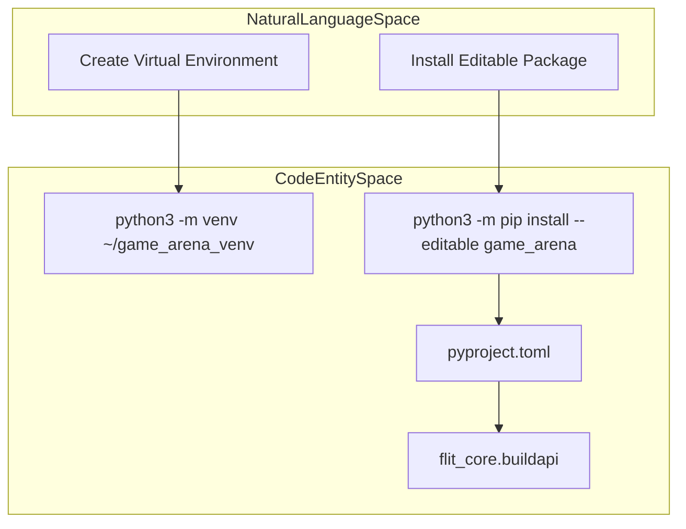
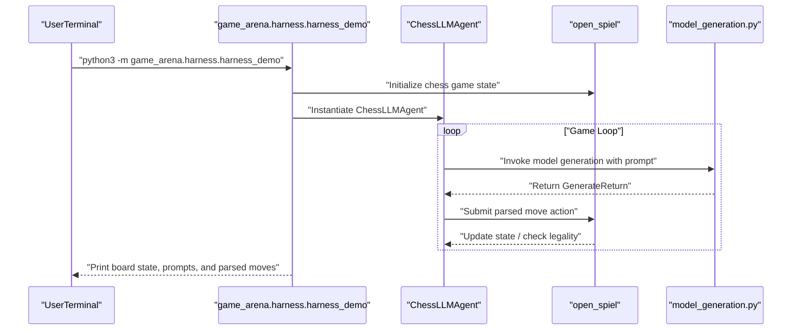

<!-- source: DeepWiki mcp.deepwiki.com · repo google-deepmind/game_arena · page 1.1 Getting Started · fetched 2026-10-26 -->

# Getting Started

<details>
<summary>Relevant source files</summary>

The following files were used as context for generating this wiki page:

- [CONTRIBUTING.md](CONTRIBUTING.md)
- [README.md](README.md)
- [pyproject.toml](pyproject.toml)

</details>


## Purpose and Scope

This document details the setup, installation, and execution procedures for the `game_arena` codebase [README.md:1-12](). It covers environment provisioning, package installation via `flit` [pyproject.toml:62-66](), API key configuration [README.md:50-52](), running the chess demonstration script (`harness/harness_demo.py`) [README.md:41-56](), and adhering to the project contribution guidelines [CONTRIBUTING.md:1-29]().

Sources: [README.md:1-12](), [CONTRIBUTING.md:1-29](), [pyproject.toml:62-66]()

---

## Environment Setup and Installation

Game Arena requires Python 3.11 or higher [pyproject.toml:7](). The package uses `flit` as its build backend [pyproject.toml:62-66]() and lists its core runtime dependencies in `pyproject.toml` [pyproject.toml:18-32]().



**Environment Setup and Package Installation Workflow**

### Prerequisites Installation Steps

1. Create and activate a dedicated virtual environment [README.md:16-20]():
   ```bash
   python3 -m venv ~/game_arena_venv
   source ~/game_arena_venv/bin/activate
   ```
2. Install the package in editable mode from the repository root [README.md:28-30]():
   ```bash
   python3 -m pip install --editable game_arena
   ```
   Alternatively, install from PyPI [README.md:36]():
   ```bash
   python3 -m pip install game_arena
   ```

Sources: [README.md:13-37](), [pyproject.toml:1-67]()

---

## API Key Configuration

The harness communicates with various LLM providers using official SDKs (`harness/model_generation_sdk.py`) and HTTP POST APIs (`harness/model_generation_http.py`) [README.md:143-145](). Authentication requires setting appropriate environment variables [README.md:50-52]() or configuring the `api_key` parameter in the `Model` constructor [README.md:147-148]().

Export the required API keys in your shell environment [README.md:50-52]():
```bash
export GEMINI_API_KEY=your_gemini_api_key_here
export OPENAI_API_KEY=your_openai_api_key_here
```

Sources: [README.md:50-56](), [README.md:141-151]()

---

## Running the Demo Scripts

Game Arena includes demonstration scripts to validate harness components and model interactions [README.md:39-60](). The primary demonstration is the chess harness demo located at `game_arena.harness.harness_demo` [README.md:41-56]().



**Harness Demo Execution Flow**

### Executing the Chess Demo

1. Install the `termcolor` package for colored terminal output [README.md:47-48]():
   ```bash
   python3 -m pip install termcolor
   ```
2. Ensure your API keys are exported [README.md:50-52]().
3. Execute the demo module [README.md:55]():
   ```bash
   python3 -m game_arena.harness.harness_demo
   ```

Sources: [README.md:39-60]()

---

## Contribution Guidelines

Contributions to Game Arena must follow established style standards, testing protocols, and licensing requirements [CONTRIBUTING.md:1-29](), [pyproject.toml:55-61]().

### Contributor License Agreement (CLA)
All patches and contributions require a signed Contributor License Agreement (CLA) before integration [CONTRIBUTING.md:6-17](). Developers must register and verify their agreement at [https://cla.developers.google.com/](https://cla.developers.google.com) [CONTRIBUTING.md:12-13]().

### Code Review and Style Standards
* **Pull Requests:** All changes must be submitted via GitHub pull requests and undergo code review [CONTRIBUTING.md:19-24]().
* **Python Style:** Code must adhere to Google's Python style guidelines [CONTRIBUTING.md:28-29](), enforced using `pylint` and `pyink` formatting rules configured in `pyproject.toml` [pyproject.toml:51-61]().
* **Community Standards:** Contributors are expected to abide by Google's Open Source Community Guidelines [CONTRIBUTING.md:26-29]().

Sources: [CONTRIBUTING.md:1-29](), [pyproject.toml:43-61]()

---

