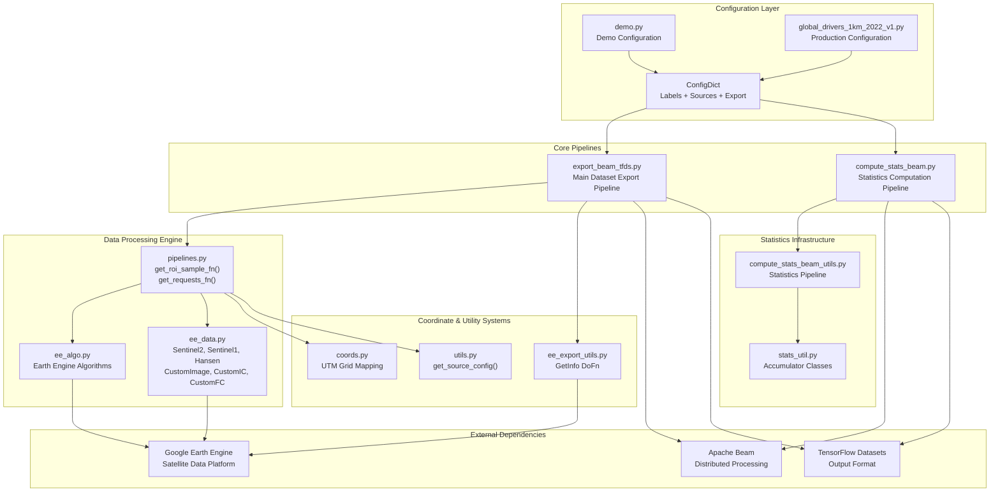
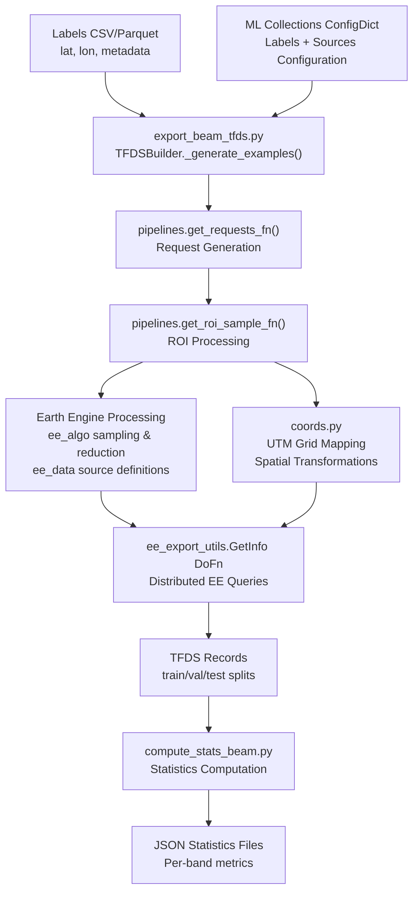

<!-- source: DeepWiki mcp.deepwiki.com · repo google-deepmind/geeflow · page 1 Overview · fetched 2026-10-26 -->

# Overview

Relevant source files

The following files were used as context for generating this wiki page:

- [README.md](README.md)
- [geeflow/__init__.py](geeflow/__init__.py)

This document provides a high-level introduction to GeoFlow, explaining its purpose as a library for generating large-scale geospatial datasets using Google Earth Engine, and summarizing its key capabilities and architecture. For detailed information about running the pipelines, see [Getting Started](#2). For configuration details, see [Configuration System](#6). For specific pipeline documentation, see [Main Pipelines](#4).

## Purpose and Scope

GeoFlow is a Python library designed for generating large-scale geospatial datasets using [Google Earth Engine](https://earthengine.google.com) (GEE). The library focuses on supporting geospatial AI research by providing utilities, configurations, and pipeline launch scripts to extract and process satellite data into machine learning-ready formats.

**Core Capabilities:**
- Creating small- and large-scale datasets (supervised and unsupervised) ready for geospatial AI model training
- Generating inference maps up to global scale at arbitrary resolutions  
- Supporting any geospatial satellite and remote sensing data available in Google Earth Engine
- Providing arbitrary spatial and temporal resolution sampling of data sources
- Producing datasets in TensorFlow Datasets (TFDS) format with precomputed statistics

**Out of Scope:**
- Model training and inference (use frameworks like JAX/Flax with [Jeo](https://github.com/google-deepmind/jeo) or PyTorch with [TorchGeo](https://github.com/microsoft/torchgeo))
- Interactive Earth Engine data visualization (use tools like [geemap](https://geemap.org))
- Dataset hosting and distribution (use platforms like Hugging Face or TFDS Catalog)

Sources: [README.md:7-41]()

## System Architecture

### High-Level Component Overview

**System Architecture Overview**

Sources: [README.md:150-177](), [geeflow/export_beam_tfds.py](), [geeflow/stats/compute_stats_beam.py](), [geeflow/pipelines.py](), [geeflow/ee_data.py](), [geeflow/ee_algo.py]()

### Data Processing Workflow

**Data Processing Workflow**

Sources: [README.md:161-177](), [geeflow/export_beam_tfds.py](), [geeflow/pipelines.py](), [geeflow/ee_export_utils.py](), [geeflow/stats/compute_stats_beam.py]()

## Core Concepts

### Configuration-Driven Design

GeoFlow uses [ML Collections ConfigDict](https://github.com/google/ml_collections) for flexible dataset configuration. The configuration is split into three main sections:

| Configuration Section | Purpose | Key Components |
|----------------------|---------|----------------|
| **Labels Configuration** | Defines sample locations and metadata | `path`, `img_width_m`, `max_cell_size_m`, `meta_keys` |
| **Sources Configuration** | Specifies Earth Engine data sources | Source classes, `scale`, `select`, `date_ranges`, `sampling_kw` |
| **Export Configuration** | Controls processing and output | Filters, transforms, CCDC generation options |

Sources: [README.md:56-147]()

### Earth Engine Integration

GeoFlow provides abstractions for common Earth Engine data sources through the `ee_data.py` module:

- **Predefined Sources**: `Sentinel2`, `Sentinel1`, `Hansen`, `NasaDem`, `MODIS` classes
- **Custom Sources**: `CustomImage`, `CustomIC`, `CustomFC` for arbitrary Earth Engine assets
- **Processing Algorithms**: Temporal aggregation, cloud masking, and spatial sampling in `ee_algo.py`

Sources: [README.md:105-109](), [README.md:152-158](), [geeflow/ee_data.py](), [geeflow/ee_algo.py]()

### Coordinate System Conventions

GeoFlow follows consistent coordinate system conventions:

- **Default CRS**: WGS 84 (World Geodetic System) for latitude/longitude
- **Projected Coordinates**: Local UTM (Universal Transverse Mercator) coordinates
- **Grid Mapping**: UTM-based spatial gridding implemented in `coords.py`
- **Reference Variables**: `lat`/`lon` for geographic coordinates throughout the codebase

Sources: [README.md:178-187](), [geeflow/coords.py]()

## Main Processing Pipelines

### Dataset Export Pipeline

The primary pipeline is implemented in `export_beam_tfds.py` and orchestrates the complete dataset generation process:

1. **Input Processing**: Reads label CSV/Parquet files and processes configuration
2. **Request Generation**: Uses `pipelines.get_requests_fn()` to create processing requests
3. **Data Extraction**: Applies `pipelines.get_roi_sample_fn()` per location to extract Earth Engine data
4. **Coordinate Transformation**: Maps geographic coordinates to UTM grid system
5. **TFDS Generation**: Converts processed data to TensorFlow Datasets format with train/val/test splits

Sources: [README.md:161-174](), [geeflow/export_beam_tfds.py]()

### Statistics Computation Pipeline  

The statistics pipeline in `compute_stats_beam.py` generates comprehensive dataset statistics:

1. **Band-level Analysis**: Computes statistics for each band in each data source
2. **Statistical Metrics**: Mean, variance, quantiles, histograms, and robust statistics
3. **Parallel Processing**: Uses Apache Beam for distributed computation
4. **Output Format**: JSON files with detailed per-band statistics

Sources: [README.md:174-177](), [README.md:285-322](), [geeflow/stats/compute_stats_beam.py]()

## Versioning and Reproducibility

GeoFlow implements semantic versioning for datasets using the pattern `{LABELS_VERSION}.{SOURCES_VERSION}.{OTHERS}`:

- **MAJOR**: Incremented for new or modified label sets
- **MINOR**: Incremented for changes to Earth Engine data sources  
- **PATCH**: Used for processing changes, split modifications, or other updates

The system automatically saves launch commands and configuration arguments for full reproducibility.

Sources: [README.md:189-204]()

## Integration Ecosystem

GeoFlow integrates with several external systems and follows established patterns:

- **Apache Beam**: Distributed processing for scalable dataset generation
- **TensorFlow Datasets**: Standard output format for ML pipelines  
- **Google Earth Engine**: Primary data source for satellite and geospatial data
- **JAX/Flax Integration**: Compatible with [Jeo](https://github.com/google-deepmind/jeo) for model training
- **Cloud Platform**: Designed for Google Cloud Platform deployment

Sources: [README.md:13-14](), [README.md:29-33](), [README.md:162-163](), [README.md:265-268]()

---

