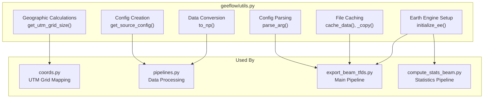
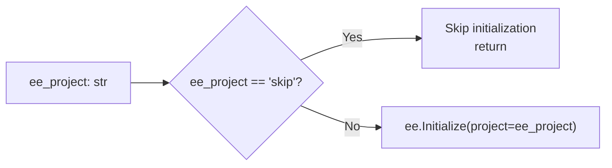
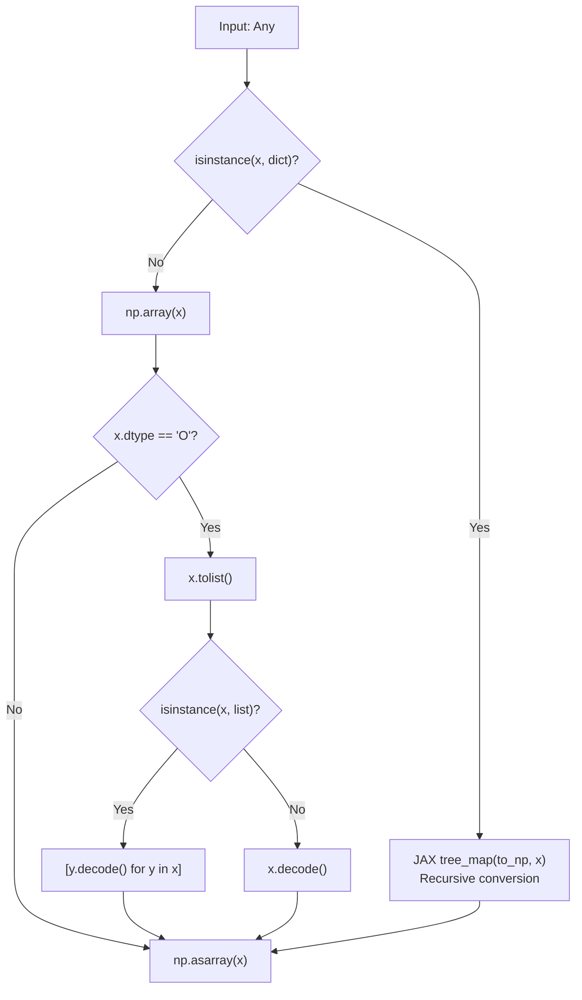
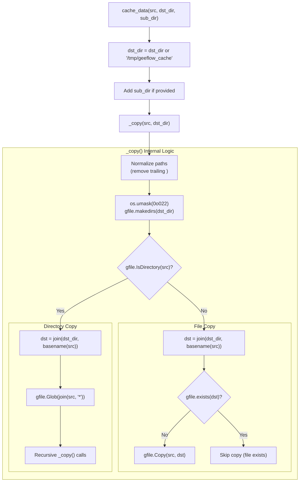
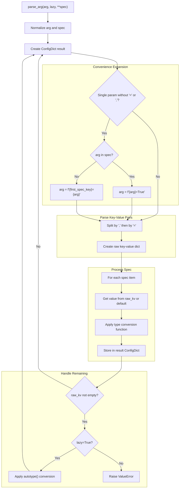

<!-- source: DeepWiki mcp.deepwiki.com · repo google-deepmind/geeflow · page 8.2 General Utilities · fetched 2026-10-26 -->

# General Utilities

<details>
<summary>Relevant source files</summary>

The following files were used as context for generating this wiki page:

- [geeflow/utils.py](geeflow/utils.py)
- [geeflow/utils_test.py](geeflow/utils_test.py)

</details>


## Purpose and Scope

This document covers the general utility functions provided by the `utils.py` module that support GeoFlow's core functionality. These utilities handle geographic calculations, Earth Engine initialization, data conversion, file caching, and configuration argument parsing. For time and date handling utilities, see [Time and Date Utilities](#8.1).

The utilities are designed to be reusable components that are called throughout the GeoFlow codebase to perform common operations without duplicating code.

## Utility Function Categories

The `utils.py` module provides several categories of utility functions that serve different aspects of the GeoFlow system:



Sources: [geeflow/utils.py:1-228]()

## Geographic Calculations

The module provides constants and functions for geographic coordinate calculations, particularly for determining UTM grid dimensions:

| Function | Purpose | Key Parameters |
|----------|---------|----------------|
| `get_utm_grid_size()` | Calculate grid dimensions for UTM zones | `start_lat`, `start_lon`, `end_lat`, `end_lon`, `img_width_m` |

The function uses predefined constants for latitude and longitude to meter conversions:
- `LAT_TO_METERS = 111694` - Standard latitude to meters conversion
- `LON_TO_METERS = 112000` - Approximate longitude to meters conversion

The `get_utm_grid_size()` function includes a `cell_expansion_offset_meters` parameter (default 5000m) to handle misalignment between UTM and Lat/Lon grids.

Sources: [geeflow/utils.py:31-53]()

## Earth Engine Initialization

The `initialize_ee()` function provides a standardized way to initialize Google Earth Engine with project authentication:



This function allows for conditional Earth Engine initialization, supporting a "skip" option for environments where Earth Engine is not needed or available.

Sources: [geeflow/utils.py:56-60]()

## Data Conversion

The `to_np()` function provides robust conversion of various data types to NumPy arrays, with special handling for nested dictionaries and byte strings:



The function handles:
- Nested dictionaries using JAX tree operations
- Object dtype arrays by converting to lists
- Byte string decoding for both individual strings and lists

Sources: [geeflow/utils.py:63-74]()

## File Caching System

The caching system provides local file caching capabilities with automatic directory creation and duplicate handling:



The system supports both individual files and directory structures, with intelligent duplicate detection to avoid unnecessary copies.

Sources: [geeflow/utils.py:77-105]()

## Configuration Argument Parsing

The `parse_arg()` function provides sophisticated parsing of command-line style arguments into ML Collections ConfigDict objects:



### Argument Format Examples

The function supports multiple argument formats:

| Format | Example | Result |
|--------|---------|--------|
| Named boolean | `"runlocal"` | `runlocal=True` |
| Explicit boolean | `"runlocal=False"` | `runlocal=False` |
| Named value | `"res=128"` | `res=128` |
| Unnamed first param | `"128"` | First spec key = 128 |
| Multiple params | `"runlocal,schedule=long,res=128"` | Multiple assignments |

### Type Conversion

The `get_type_with_default()` function handles type conversion with special boolean parsing:

- **Booleans**: Strict conversion of "true"/"false"/"" strings
- **Tuples**: Support for `(default, type_function)` specifications  
- **Auto-detection**: Type derived from default value

The `autotype()` function provides automatic type detection for lazy parsing:
1. Boolean: "true"/"false" (case-insensitive)
2. Integer: Numeric strings without decimal
3. Float: Numeric strings with decimal
4. String: Everything else

Sources: [geeflow/utils.py:108-213]()

## Configuration Creation

The `get_source_config()` function creates standardized ConfigDict objects for Google Earth Engine data sources:

```python
# Example output structure
{
    'module': 'source_module_name',
    'out': 'output_field_name', 
    'kw': {},              # Module keyword arguments
    'out_kw': {},          # Output keyword arguments  
    'select': None,        # Band selection
    'select_final': None,  # Final band selection
    'sampling_kw': {},     # Sampling parameters
    'scale': None          # Spatial resolution
}
```

This provides a consistent interface for defining Earth Engine data source configurations across the GeoFlow system.

Sources: [geeflow/utils.py:216-227]()

---

