# Page: Overview

# Overview

<details>
<summary>Relevant source files</summary>

The following files were used as context for generating this wiki page:

- [README.md](README.md)
- [pyproject.toml](pyproject.toml)
- [safari_sdk/__init__.py](safari_sdk/__init__.py)

</details>


The Safari SDK is a comprehensive robotics model lifecycle management system that provides tooling for working with Google DeepMind Gemini Robotics models. This document covers the high-level architecture, core components, and primary workflows of the SDK.

The Safari SDK enables users to upload robotics data, train models, deploy them for serving, and evaluate policies on both real robots and in simulation. The system is designed around a modular architecture with three main components: data logging (`safari_sdk.logging`), model interfaces (`safari_sdk.model`), and platform operations (`safari_sdk.flywheel`).

For specific CLI operations, see [Command Line Interface](#3). For Aloha robot integration details, see [Aloha Robot System](#4). For data handling workflows, see [Data Management](#5).

## System Architecture

The Safari SDK consists of several interconnected systems that work together to provide end-to-end robotics model management capabilities.

### High-Level Component Architecture

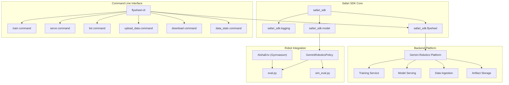

**Sources:** [README.md:1-85](), [safari_sdk/__init__.py:15-20](), [pyproject.toml:1-89]()

## Core Components

The Safari SDK is organized into three primary modules, each handling specific aspects of the robotics pipeline:

| Component | Purpose | Key Classes/Functions |
|-----------|---------|----------------------|
| `safari_sdk.logging` | Data collection and MCAP file handling | Data conversion utilities, logging infrastructure |
| `safari_sdk.model` | Model inference and robotics policy interfaces | `GeminiRoboticsPolicy`, GenAI Robotics API client |
| `safari_sdk.flywheel` | Platform operations and lifecycle management | CLI commands, training/serving orchestration |

### Entry Points and Interfaces

The system provides multiple entry points for different use cases:

- **CLI Interface**: The `flywheel-cli` command provides access to all major platform operations
- **Python API**: Direct access to SDK components through `safari_sdk` imports  
- **Robot Integration**: `AlohaEnv` Gymnasium environment for robot evaluation
- **Policy Interface**: `GeminiRoboticsPolicy` for model inference

**Sources:** [pyproject.toml:53-54](), [README.md:44-55](), [README.md:69-82]()

## Data Flow and Lifecycle

The Safari SDK manages a complete data pipeline from robot data collection through model training and deployment.

### Data Processing Pipeline

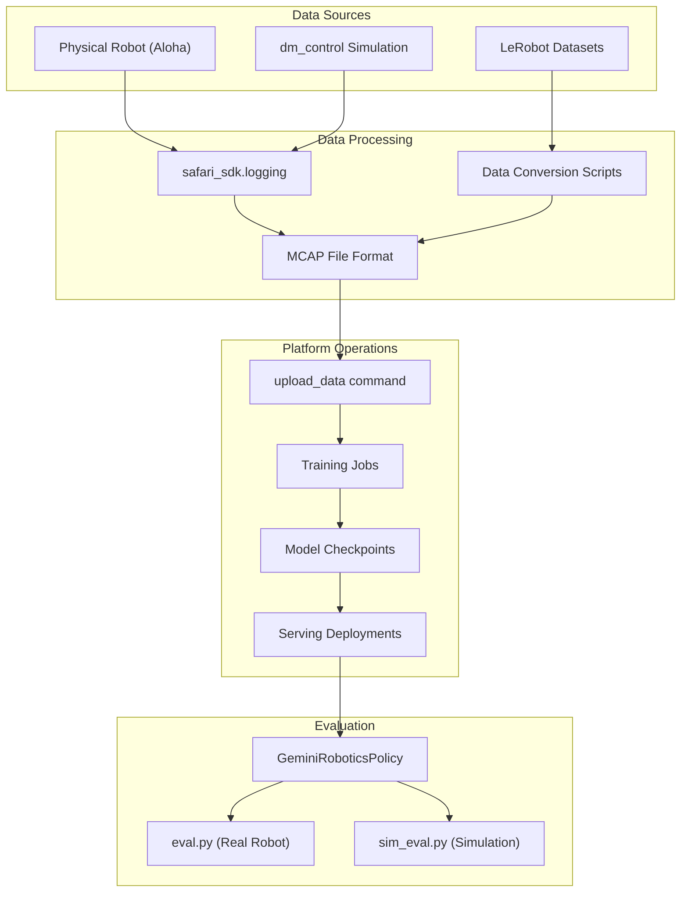

**Sources:** [README.md:44-55](), [README.md:69-82]()

## Key Workflows

### Model Training and Serving Workflow

1. **Data Upload**: Use `flywheel-cli upload_data` to ingest MCAP files
2. **Training**: Execute `flywheel-cli train` with task parameters
3. **Serving**: Deploy models using `flywheel-cli serve`
4. **Evaluation**: Run policies through `GeminiRoboticsPolicy` interface

### Robot Evaluation Workflow

1. **Environment Setup**: Configure `AlohaEnv` Gymnasium environment
2. **Policy Loading**: Initialize `GeminiRoboticsPolicy` with serve ID
3. **Real Robot**: Execute `eval.py` for physical robot evaluation
4. **Simulation**: Use `sim_eval.py` for MuJoCo-based testing

**Sources:** [README.md:69-82]()

## Dependencies and Requirements

The Safari SDK requires Python 3.10-3.12 and integrates with several key robotics and machine learning frameworks:

- **Machine Learning**: TensorFlow (tf-nightly), Google GenAI
- **Robotics**: MuJoCo, dm-env, OpenCV
- **Data Formats**: Protocol Buffers, MCAP
- **Communication**: gRPC, Google API clients

The system is distributed as a pip-installable package with the command-line interface automatically available after installation.

**Sources:** [pyproject.toml:5](), [pyproject.toml:21-48](), [README.md:14-23]()

---

# Page: Getting Started

# Getting Started

<details>
<summary>Relevant source files</summary>

The following files were used as context for generating this wiki page:

- [README.md](README.md)
- [pyproject.toml](pyproject.toml)
- [scripts/build_wheel.sh](scripts/build_wheel.sh)

</details>


This document covers initial installation, setup, and first steps with the Safari SDK. It provides the essential information needed to begin using the SDK for robotics model lifecycle management, including installation, authentication setup, and basic workflow orientation.

For detailed CLI operations, see [Command Line Interface](#3). For Aloha robot-specific setup, see [Aloha Robot System](#4). For advanced build and development setup, see [Build System](#8).

## Installation

The Safari SDK is distributed as a Python package and can be installed via PyPI. The installation includes the core SDK libraries and the `flywheel-cli` command-line tool.

### Prerequisites

- Python 3.10, 3.11, or 3.12 (Python 3.13 not supported due to TensorFlow compatibility)
- Virtual environment (recommended to avoid dependency conflicts)

### Installing from PyPI

```bash
pip install safari_sdk
```

This installs:
- The `safari_sdk` Python package with all core modules
- The `flywheel-cli` command-line tool 
- All required dependencies including TensorFlow, MuJoCo, and robotics libraries

### Installation Architecture

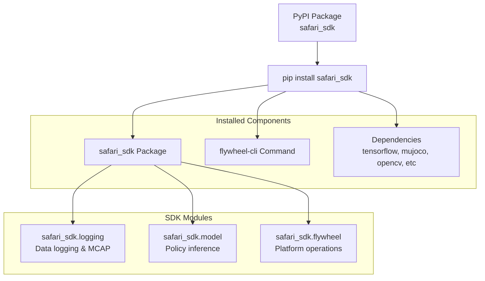

Sources: [README.md:16-21](), [pyproject.toml:53-54](), [pyproject.toml:21-48]()

## Verifying Installation

After installation, verify that the SDK is working correctly:

```bash
# Test CLI availability
flywheel-cli help

# Test core module imports
python -c "from safari_sdk.logging.python import stream_logger"
python -c "from safari_sdk.model import saved_model_policy"
python -c "from safari_sdk.logging.python import mcap_episodic_logger"
```

These commands should run without errors if the installation was successful.

Sources: [scripts/build_wheel.sh:29-33]()

## Basic Setup and Authentication

The Safari SDK requires authentication to access the Gemini Robotics platform. Most functionality requires participation in the Gemini Robotics Trusted Tester Program.

### Access Requirements

- Enrollment in the Gemini Robotics Trusted Tester Program
- Valid API credentials for backend services
- Network access to Google DeepMind services

### Model Access

Trusted Testers can access the Gemini Robotics On Device model starting from SDK version 2.4.1. The SDK aims to support all models in the Gemini Robotics model series.

Sources: [README.md:10-12](), [README.md:39-42]()

## First Steps Workflow

The typical getting started workflow involves data management, model training, and deployment operations through the CLI.

### CLI Command Overview

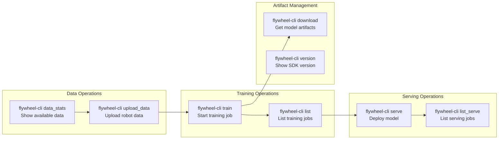

Sources: [README.md:69-81]()

## SDK Module Structure

The Safari SDK is organized into three main modules, each serving specific aspects of the robotics pipeline.

### Core Modules

| Module | Purpose | Key Components |
|--------|---------|----------------|
| `safari_sdk.logging` | Data logging and MCAP file handling | `stream_logger`, `mcap_episodic_logger` |
| `safari_sdk.model` | Model inference and policy execution | `saved_model_policy`, policy interfaces |
| `safari_sdk.flywheel` | Platform operations and CLI | `flywheel_cli`, training/serving APIs |

### Module Integration Architecture

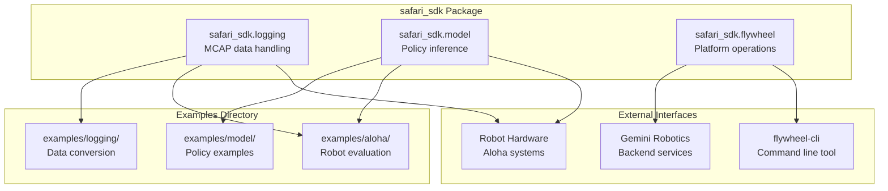

Sources: [README.md:45-54](), [pyproject.toml:53-54]()

## Building from Source (Optional)

For development or customization, you can build the SDK from source code.

### Development Build Process

```bash
# Clone the repository
git clone https://github.com/google-deepmind/gemini-robotics-sdk
cd gemini-robotics-sdk

# Build wheel using the provided script
scripts/build_wheel.sh
```

### Build System Overview

The build script performs these operations:
1. Creates a CMake build directory at `${SAFARI_DIR}/build`
2. Runs CMake configuration and build
3. Executes `make pip_wheel pip_install` targets
4. Sets up a virtual environment at `build/safari_venv`
5. Runs smoke tests to verify the installation
6. Creates the wheel in the `dist/` directory

The final wheel path is symlinked to `/tmp/safari_sdk-lastbuild-py3-none-any.whl` for convenience.

Sources: [README.md:25-35](), [scripts/build_wheel.sh:19-41]()

## Next Steps

After completing the installation and setup:

1. **Explore CLI Commands**: Use `flywheel-cli help` to see all available commands and their usage. See [Command Line Interface](#3) for detailed documentation.

2. **Data Management**: Learn about uploading robot data and working with MCAP files. See [Data Management](#5) for comprehensive coverage.

3. **Aloha Integration**: If working with Aloha robots, set up the AlohaEnv and evaluation scripts. See [Aloha Robot System](#4).

4. **Model Integration**: Understand policy inference and the Gemini Robotics API. See [Model Integration](#6).

The SDK supports the complete robotics model lifecycle from data collection through training to deployment and evaluation.

Sources: [README.md:83-84]()

---

# Page: Command Line Interface

# Command Line Interface

<details>
<summary>Relevant source files</summary>

The following files were used as context for generating this wiki page:

- [safari_sdk/flywheel/flywheel_cli.py](safari_sdk/flywheel/flywheel_cli.py)
- [safari_sdk/flywheel/flywheel_cli_test.py](safari_sdk/flywheel/flywheel_cli_test.py)

</details>


The Safari SDK provides a comprehensive command line interface through the `flywheel-cli` tool for managing the complete robotics model lifecycle. This interface handles training job management, model serving deployment, data ingestion operations, and artifact downloads through a unified command-line experience.

For information about the underlying model integration and policies, see [Model Integration](#6). For data conversion and upload workflows, see [Data Management](#5).

## CLI Architecture Overview

The `flywheel-cli` tool is built around the `FlywheelCli` class which orchestrates all command operations through the backend orchestrator API.

### Command Flow Architecture

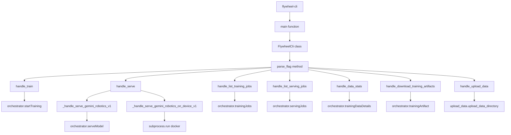

Sources: [safari_sdk/flywheel/flywheel_cli.py:183-740]()

### Core CLI Components

```mermaid
graph TB
    subgraph "CLI Entry Points"
        Main[main function]
        CLIMain[cli_main function]
    end
    
    subgraph "Core Classes"
        FlywheelCli[FlywheelCli class]
        AuthService[auth.get_service]
    end
    
    subgraph "Flag Definitions"
        TrainingJobID[_TRAINING_JOB_ID]
        ModelCheckpoint[_MODEL_CHECKPOINT_NUMBER]
        TaskID[_TASK_ID]
        StartDate[_START_DATE]
        EndDate[_END_DATE]
        TrainingRecipe[_TRAINING_RECIPE]
        JSONOutput[_JSON_OUTPUT]
    end
    
    subgraph "Command Handlers"
        HandleTrain[handle_train]
        HandleServe[handle_serve]
        HandleList[handle_list_training_jobs]
        HandleDataStats[handle_data_stats]
        HandleDownload[handle_download_training_artifacts]
        HandleUpload[handle_upload_data]
    end
    
    subgraph "Backend Integration"
        OrchestratorService[orchestrator service]
        UploadDataModule[upload_data module]
    end
    
    Main --> FlywheelCli
    FlywheelCli --> AuthService
    FlywheelCli --> HandleTrain
    FlywheelCli --> HandleServe
    FlywheelCli --> HandleList
    FlywheelCli --> HandleDataStats
    FlywheelCli --> HandleDownload
    FlywheelCli --> HandleUpload
    
    HandleTrain --> OrchestratorService
    HandleServe --> OrchestratorService
    HandleList --> OrchestratorService
    HandleDataStats --> OrchestratorService
    HandleDownload --> OrchestratorService
    HandleUpload --> UploadDataModule
    
    TrainingJobID --> FlywheelCli
    ModelCheckpoint --> FlywheelCli
    TaskID --> FlywheelCli
    StartDate --> FlywheelCli
    EndDate --> FlywheelCli
    TrainingRecipe --> FlywheelCli
    JSONOutput --> FlywheelCli
```

Sources: [safari_sdk/flywheel/flywheel_cli.py:58-137](), [safari_sdk/flywheel/flywheel_cli.py:183-189]()

## Core Commands

### Training Operations

The `train` command initiates model training jobs through the `handle_train` method. Training requires specifying data filters and a training recipe.

**Required Parameters:**
- `--task_id`: Task identifier for training data
- `--start_date`: Start date in YYYYMMDD format  
- `--end_date`: End date in YYYYMMDD format
- `--training_recipe`: One of `narrow`, `gemini_robotics_v1`, `gemini_robotics_on_device_v1`

**Example Usage:**
```bash
flywheel-cli train --task_id=my_task --start_date=20240101 --end_date=20240131 --training_recipe=gemini_robotics_v1
```

The training recipes map to specific training types via `_RECIPE_TO_TYPE_MAP`:

| Recipe | Training Type |
|--------|---------------|
| `narrow` | `TRAINING_TYPE_NARROW` |
| `gemini_robotics_v1` | `TRAINING_TYPE_GEMINI_ROBOTICS_V1` |
| `gemini_robotics_on_device_v1` | `TRAINING_TYPE_GEMINI_ROBOTICS_ON_DEVICE_V1` |

Sources: [safari_sdk/flywheel/flywheel_cli.py:190-210](), [safari_sdk/flywheel/flywheel_cli.py:49-56](), [safari_sdk/flywheel/flywheel_cli.py:537-561]()

### Model Serving Operations

Model serving is handled through the `handle_serve` method with different implementations for each training recipe:

#### Gemini Robotics V1 Serving

For `gemini_robotics_v1` models, serving is managed through the `_handle_serve_gemini_robotics_v1` method:

**Required Parameters:**
- `--training_job_id`: ID of completed training job
- `--model_checkpoint_number`: Checkpoint number to serve

The method calls `orchestrator().serveModel()` to deploy the model to the cloud serving infrastructure.

#### On-Device Serving

For `gemini_robotics_on_device_v1` models, the `_handle_serve_gemini_robotics_on_device_v1` method:

1. Downloads model checkpoints if not provided locally
2. Launches a Docker container for local serving
3. Maps the checkpoint file into the container filesystem

**Optional Parameters:**
- `--model_checkpoint_path`: Local checkpoint file path
- `--serve_port`: Local serving port (default: 60061)
- `--gpu_mem_fraction`: GPU memory allocation (default: 0.8)

The Docker command executed follows this pattern:
```bash
docker run -it --gpus 0 -p {port}:60061 -v {checkpoint_dir}:/checkpoint \
  -e XLA_PYTHON_CLIENT_MEM_FRACTION={fraction} \
  google-deepmind/gemini_robotics_on_device /checkpoint/{checkpoint_file}
```

Sources: [safari_sdk/flywheel/flywheel_cli.py:342-352](), [safari_sdk/flywheel/flywheel_cli.py:353-396](), [safari_sdk/flywheel/flywheel_cli.py:397-407]()

### Job Listing and Status

#### Training Job Listing

The `handle_list_training_jobs` method retrieves and displays training job information through `orchestrator().trainingJobs()`. The output includes:

- Training job ID
- Job status/stage
- Training type
- Associated task and robot IDs
- Date range filters

#### Serving Job Listing  

The `handle_list_serving_jobs` method displays serving job information including:

- Serving job ID
- Associated training job ID
- Model checkpoint number
- Job status
- Training data filters

Both listing commands support responsive table formatting through `_print_responsive_table` that adapts to terminal width.

Sources: [safari_sdk/flywheel/flywheel_cli.py:252-296](), [safari_sdk/flywheel/flywheel_cli.py:297-341](), [safari_sdk/flywheel/flywheel_cli.py:614-669]()

### Data Management Operations

#### Data Statistics

The `handle_data_stats` method provides visibility into available training data through `orchestrator().trainingDataDetails()`. The output shows:

- Robot ID and Task ID combinations
- Available dates with data
- Daily episode counts
- Success episode counts

#### Data Upload

The `handle_upload_data` method delegates to the `upload_data.upload_data_directory` function for ingesting data files:

**Required Parameters:**
- `--upload_data_robot_id`: Robot identifier (alphanumeric, <60 chars)
- `--upload_data_directory`: Directory containing data files

Sources: [safari_sdk/flywheel/flywheel_cli.py:211-251](), [safari_sdk/flywheel/flywheel_cli.py:408-415]()

### Artifact Downloads

The download system provides two modes through the `download` command:

#### Training Job Artifacts

Using `--training_job_id`, the `handle_download_training_artifacts` method:

1. Retrieves available artifacts via `orchestrator().trainingArtifact()`
2. Presents an interactive selection menu
3. Downloads selected artifacts with progress reporting
4. Saves to user-specified locations

#### Direct Artifact Downloads

Using `--artifact_id`, the `handle_download_artifact_id` method:

1. Loads artifact metadata via `orchestrator().loadArtifact()`
2. Downloads the artifact file
3. Automatically loads Docker images if detected

The download process uses `_download_url_to_file` with `_reporthook` for progress visualization.

Sources: [safari_sdk/flywheel/flywheel_cli.py:416-491](), [safari_sdk/flywheel/flywheel_cli.py:492-530](), [safari_sdk/flywheel/flywheel_cli.py:685-694]()

## Configuration and Authentication

### Flag System

The CLI uses the `absl.flags` system for configuration management. Key flags include:

| Flag | Type | Purpose |
|------|------|---------|
| `_TRAINING_JOB_ID` | string | Training job identifier |
| `_MODEL_CHECKPOINT_NUMBER` | integer | Model checkpoint number |
| `_TASK_ID` | list | Task identifiers |
| `_START_DATE` / `_END_DATE` | string | Date range (YYYYMMDD) |
| `_TRAINING_RECIPE` | enum | Training recipe selection |
| `_JSON_OUTPUT` | boolean | JSON vs text output format |

### Authentication

Authentication is handled through the `auth.get_service()` function which:

1. Retrieves API keys from `--api_key` flag or `api_key.json` files
2. Builds the Google API client for the orchestrator service
3. Provides authenticated service instances

The `parse_flag` method validates API key presence before executing any commands.

Sources: [safari_sdk/flywheel/flywheel_cli.py:58-137](), [safari_sdk/flywheel/flywheel_cli.py:186-189](), [safari_sdk/flywheel/flywheel_cli.py:531-535]()

## Output Formats and Error Handling

### Output Formatting

The CLI supports two output modes controlled by `_JSON_OUTPUT`:

1. **JSON Mode**: Structured output for programmatic consumption
2. **Text Mode**: Human-readable tables and formatted text

Text mode includes:
- Responsive table formatting via `_print_responsive_table`
- Progress bars for downloads via `_reporthook`
- Interactive prompts for selections

### Input Validation

The `parse_flag` method performs comprehensive validation:

- **Date Format**: Validates YYYYMMDD format using `_is_valid_date`
- **Date Range**: Ensures start ≤ end via `_is_valid_start_end_date_pair`
- **Required Fields**: Checks for mandatory parameters per command
- **Recipe Support**: Validates recipe compatibility with commands

### Error Handling

Error handling includes:
- API authentication failures
- Invalid parameter combinations
- Network/download errors with informative messages
- Docker execution failures with troubleshooting hints

Sources: [safari_sdk/flywheel/flywheel_cli.py:531-612](), [safari_sdk/flywheel/flywheel_cli.py:696-712](), [safari_sdk/flywheel/flywheel_cli.py:671-694]()

---

# Page: Training Operations

# Training Operations

<details>
<summary>Relevant source files</summary>

The following files were used as context for generating this wiki page:

- [safari_sdk/flywheel/flywheel_cli.py](safari_sdk/flywheel/flywheel_cli.py)
- [safari_sdk/flywheel/flywheel_cli_test.py](safari_sdk/flywheel/flywheel_cli_test.py)

</details>


This document covers the training operations functionality of the Safari SDK CLI tool, specifically how to start training jobs, manage training workflows, and handle training artifacts. This includes the `train`, `list`, and `download` commands of the `flywheel-cli` tool.

For information about data management operations like uploading training data, see [Data Management](#3.2). For information about serving trained models, see [Model Serving](#3.3).

## Training Job Lifecycle

The training operations in Safari SDK follow a structured lifecycle managed through the `flywheel-cli` tool. Training jobs are created with specific data filters and training recipes, then executed on the backend platform.

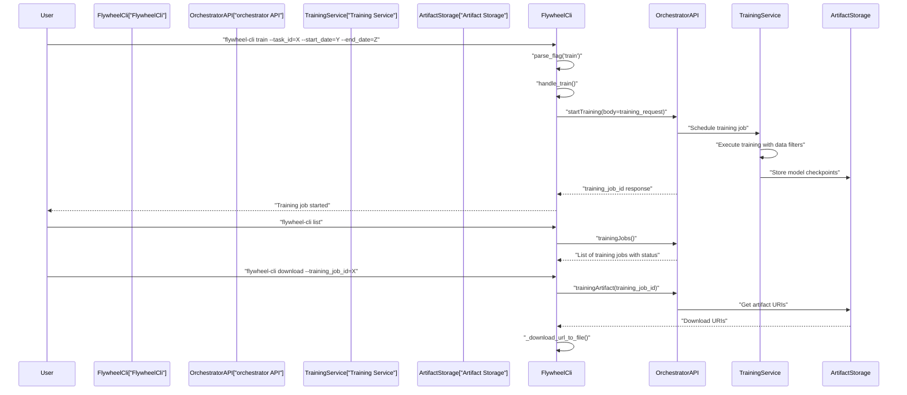

Sources: [safari_sdk/flywheel/flywheel_cli.py:190-210](), [safari_sdk/flywheel/flywheel_cli.py:252-295](), [safari_sdk/flywheel/flywheel_cli.py:416-490]()

## Training Command Implementation

The `train` command is implemented through the `FlywheelCli` class and requires specific training data filters and recipe configuration.

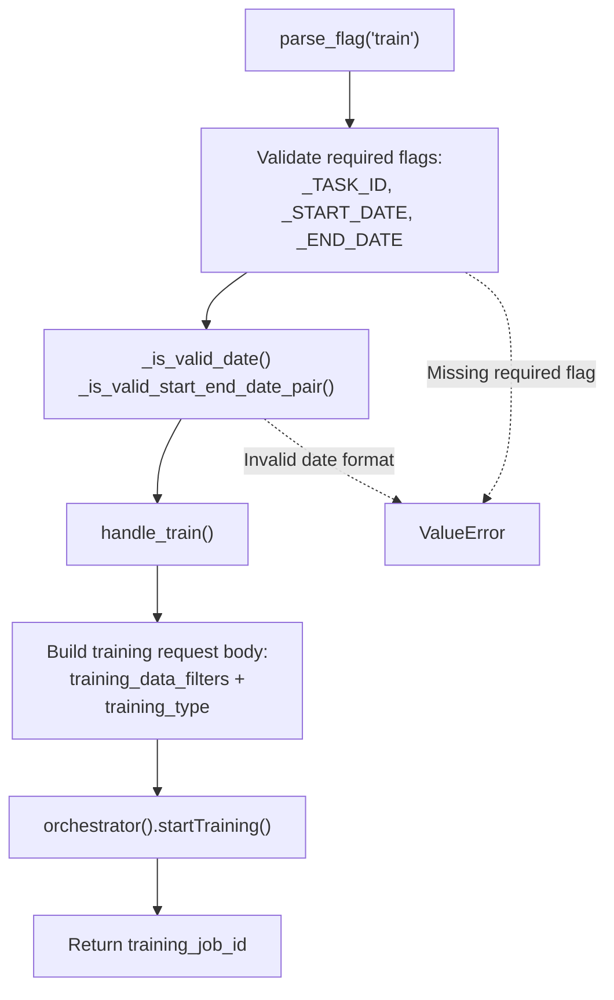

### Training Request Structure

The training request body contains training data filters and training type specification:

| Field | Description | Source |
|-------|-------------|---------|
| `training_data_filters` | Filters for training data selection | [safari_sdk/flywheel/flywheel_cli.py:200-204]() |
| `task_id` | List of task identifiers | [safari_sdk/flywheel/flywheel_cli.py:93-95]() |
| `start_date` | Training data start date (YYYYMMDD) | [safari_sdk/flywheel/flywheel_cli.py:97-101]() |
| `end_date` | Training data end date (YYYYMMDD) | [safari_sdk/flywheel/flywheel_cli.py:103-105]() |
| `training_type` | Type mapped from recipe | [safari_sdk/flywheel/flywheel_cli.py:49-56]() |

Sources: [safari_sdk/flywheel/flywheel_cli.py:198-209]()

## Training Recipes and Types

The CLI supports multiple training recipes that map to specific training types on the backend platform.

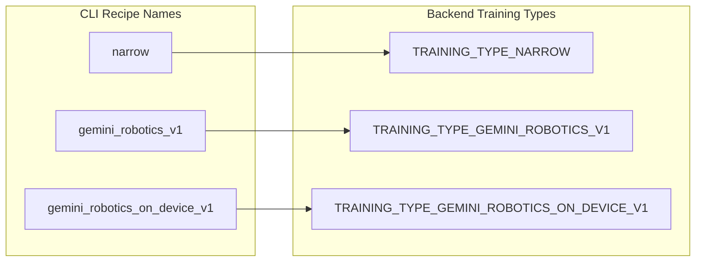

The mapping is defined in `_RECIPE_TO_TYPE_MAP`:

| Recipe | Training Type | Purpose |
|--------|---------------|---------|
| `narrow` | `TRAINING_TYPE_NARROW` | Narrow domain training |
| `gemini_robotics_v1` | `TRAINING_TYPE_GEMINI_ROBOTICS_V1` | Gemini Robotics V1 training |
| `gemini_robotics_on_device_v1` | `TRAINING_TYPE_GEMINI_ROBOTICS_ON_DEVICE_V1` | On-device optimized training |

Sources: [safari_sdk/flywheel/flywheel_cli.py:49-56]()

## Training Job Management

### Listing Training Jobs

The `list` command shows all available training jobs with their status and configuration through the `handle_list_training_jobs()` method.

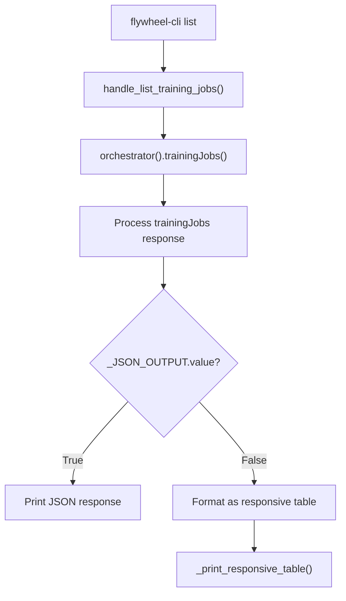

The table output includes the following columns:
- Training job ID
- Status (stage)
- Training type
- Task ID (from filters)
- Robot ID (from filters)
- Start date (from filters)  
- End date (from filters)

Sources: [safari_sdk/flywheel/flywheel_cli.py:252-295]()

### Training Job Response Structure

Training jobs returned from the API contain the following structure:

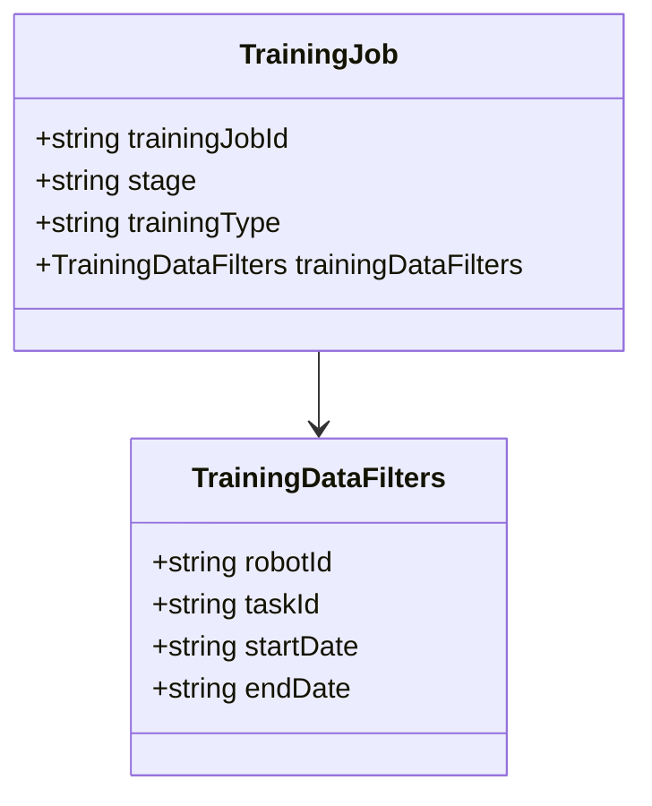

Sources: [safari_sdk/flywheel/flywheel_cli_test.py:41-55]()

## Training Artifact Management

### Downloading Training Artifacts

The `download` command provides interactive artifact selection and download through the `handle_download_training_artifacts()` method.

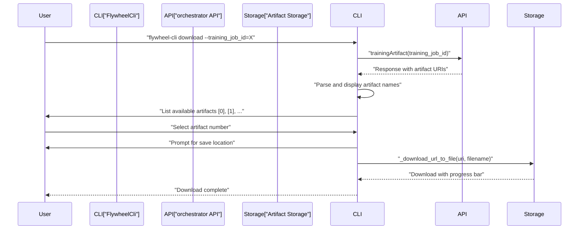

### Artifact Selection Process

The artifact selection process includes name extraction and user interaction:

1. **URI Processing**: Extract descriptive names from artifact URIs using regex pattern `(checkpoint_[\w.-]+)`
2. **Interactive Selection**: Present numbered list of artifacts to user
3. **File Path Selection**: Allow custom save location with default in `/tmp/grod/`
4. **Download Progress**: Show progress bar using `_reporthook()` callback

Sources: [safari_sdk/flywheel/flywheel_cli.py:416-490](), [safari_sdk/flywheel/flywheel_cli.py:671-683]()

### Artifact Download Implementation

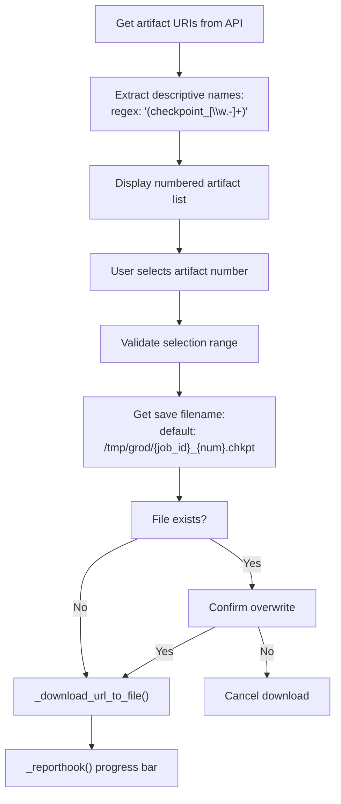

Sources: [safari_sdk/flywheel/flywheel_cli.py:440-490](), [safari_sdk/flywheel/flywheel_cli.py:685-694]()

## Command Validation and Error Handling

The CLI implements comprehensive validation for training operations through the `parse_flag()` method.

### Training Command Validation

| Validation | Error Message | Implementation |
|------------|---------------|----------------|
| API Key Required | "API key is required." | [safari_sdk/flywheel/flywheel_cli.py:533-534]() |
| Task ID Required | "Task is is required." | [safari_sdk/flywheel/flywheel_cli.py:538-539]() |
| Start Date Required | "Start date is required." | [safari_sdk/flywheel/flywheel_cli.py:540-541]() |
| Start Date Format | "Start date is not in the correct format YYYYMMDD" | [safari_sdk/flywheel/flywheel_cli.py:542-546]() |
| End Date Required | "End date is required." | [safari_sdk/flywheel/flywheel_cli.py:547-548]() |
| End Date Format | "End date is not in the correct format YYYYMMDD" | [safari_sdk/flywheel/flywheel_cli.py:549-553]() |
| Date Order | "Start date must be before or equal to end date" | [safari_sdk/flywheel/flywheel_cli.py:554-560]() |

### Date Validation Functions

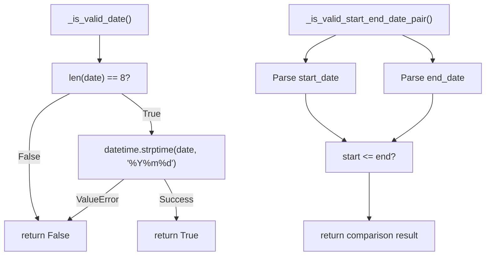

Sources: [safari_sdk/flywheel/flywheel_cli.py:696-711]()

---

# Page: Data Management

# Data Management

<details>
<summary>Relevant source files</summary>

The following files were used as context for generating this wiki page:

- [safari_sdk/flywheel/flywheel_cli.py](safari_sdk/flywheel/flywheel_cli.py)
- [safari_sdk/flywheel/flywheel_cli_test.py](safari_sdk/flywheel/flywheel_cli_test.py)
- [safari_sdk/flywheel/upload_data.py](safari_sdk/flywheel/upload_data.py)
- [safari_sdk/flywheel/upload_data_test.py](safari_sdk/flywheel/upload_data_test.py)

</details>


This page covers the command line interface (CLI) commands for data management operations in the Safari SDK. These commands handle data upload, data statistics querying, and data ingestion workflows through the `flywheel-cli` tool.

For information about the broader data management architecture, data conversion, and logging systems, see [Data Management](#5). For details on uploading data files using scripts, see [Data Upload](#5.3).

## Available Commands

The Safari SDK provides two primary CLI commands for data management:

| Command | Purpose | Required Flags |
|---------|---------|----------------|
| `data_stats` | Display available training data statistics | `--api_key` |
| `upload_data` | Upload MCAP data files to ingestion service | `--api_key`, `--upload_data_robot_id`, `--upload_data_directory` |

## Data Statistics Command

The `data_stats` command queries the platform to show available training data organized by robot ID, task ID, and date ranges. This helps users understand what data is available before starting training jobs.

### Data Statistics Workflow

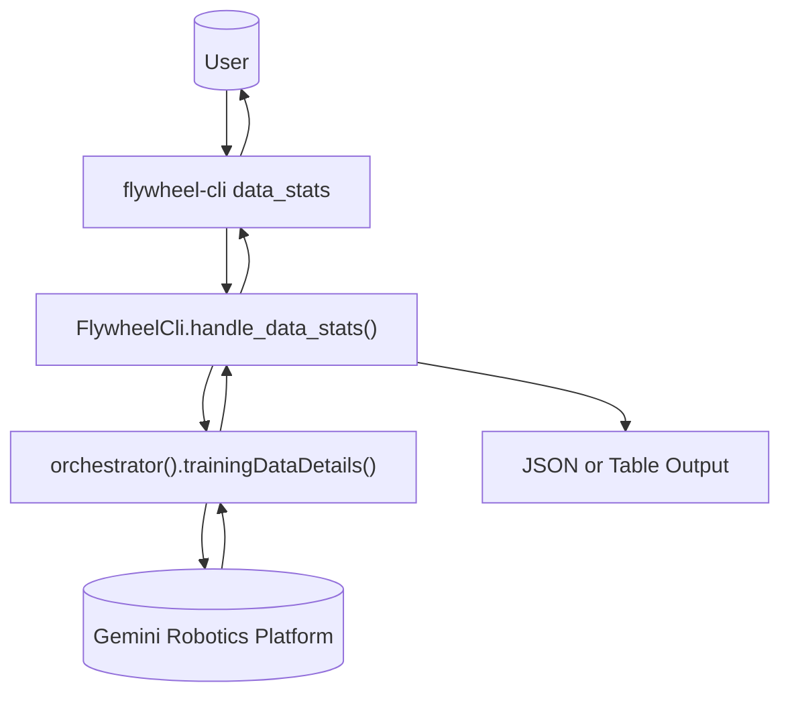

Sources: [safari_sdk/flywheel/flywheel_cli.py:211-250](), [safari_sdk/flywheel/flywheel_cli_test.py:150-170]()

The `handle_data_stats()` method makes a request to the orchestrator service and formats the response as either JSON (when `--json_output` flag is used) or as a formatted table showing robot ID, task ID, date, count, and success count.

### Data Statistics Output Format

The response includes `taskDates` containing:
- `robotId`: Identifier of the robot or data collector
- `taskId`: Task identifier for the collected data  
- `dates`: Array of collection dates
- `dailyCounts`: Number of data points per date
- `successCounts`: Number of successful executions per date

Sources: [safari_sdk/flywheel/flywheel_cli_test.py:30-40]()

## Data Upload Command

The `upload_data` command uploads MCAP data files from a local directory to the platform's data ingestion service. This is the primary method for getting robot data into the training pipeline.

### Data Upload Workflow

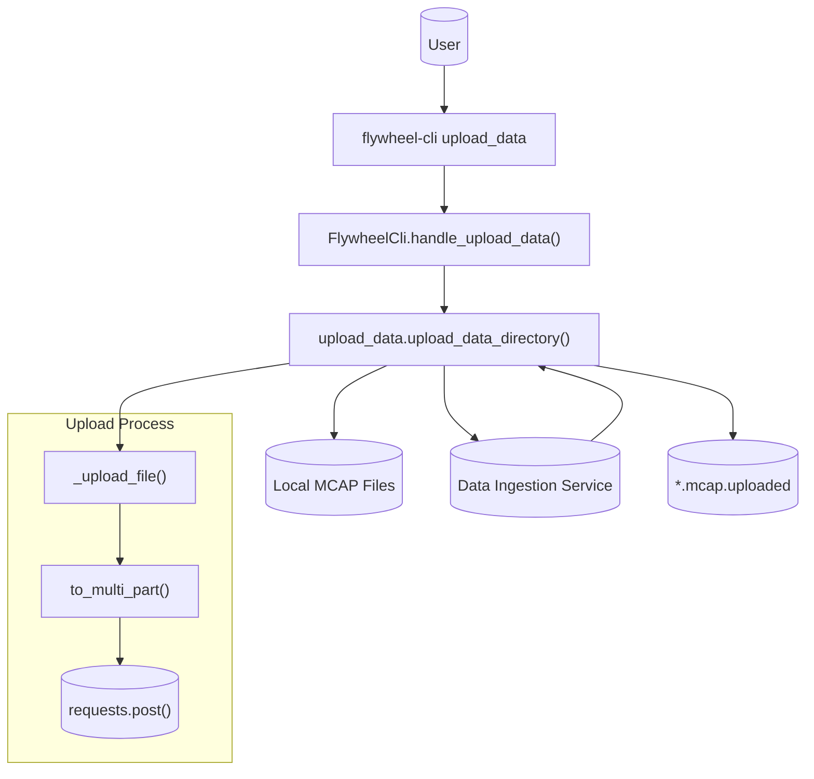

Sources: [safari_sdk/flywheel/flywheel_cli.py:408-414](), [safari_sdk/flywheel/upload_data.py:86-130]()

### Upload Parameters

The upload command requires three key parameters:

| Parameter | Flag | Description |
|-----------|------|-------------|
| API Endpoint | `--upload_data_api_endpoint` | Data ingestion service URL (default: roboticsdeveloper.googleapis.com) |
| Robot ID | `--upload_data_robot_id` | Alphanumeric robot identifier (< 60 characters) |
| Directory | `--upload_data_directory` | Local directory containing MCAP files |

Sources: [safari_sdk/flywheel/flywheel_cli.py:113-130]()

### File Processing

The `upload_data_directory()` function:
1. Walks through the specified directory recursively
2. Identifies files with `.mcap` extension
3. Uploads each file using multipart HTTP requests
4. Renames successfully uploaded files with `.uploaded` suffix
5. Reports upload speed and status for each file

Sources: [safari_sdk/flywheel/upload_data.py:97-129]()

## Data Ingestion API Integration

### Upload Request Structure

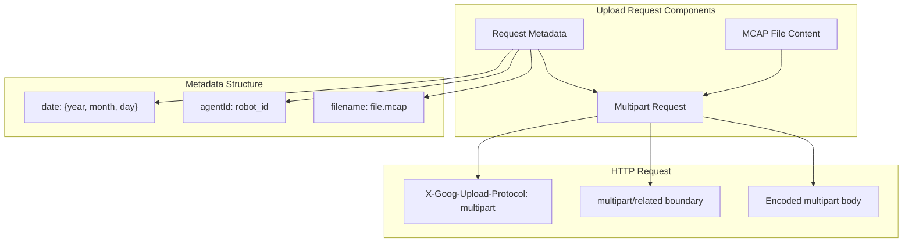

Sources: [safari_sdk/flywheel/upload_data.py:39-67](), [safari_sdk/flywheel/upload_data.py:69-83]()

The `_upload_file()` function constructs a multipart request with metadata (date, agent ID, filename) and the binary MCAP file content. The request uses Google's upload protocol with proper content-type headers.

## Command Examples

### View Available Data
```bash
# Show data statistics in table format
flywheel-cli data_stats --api_key=your_key

# Show data statistics in JSON format
flywheel-cli data_stats --api_key=your_key --json_output
```

### Upload Data Files
```bash
# Upload all MCAP files from a directory
flywheel-cli upload_data \
  --api_key=your_key \
  --upload_data_robot_id=aloha_robot_01 \
  --upload_data_directory=/path/to/mcap/files
```

### Custom Endpoint
```bash
# Upload to custom endpoint
flywheel-cli upload_data \
  --api_key=your_key \
  --upload_data_robot_id=test_robot \
  --upload_data_directory=./data \
  --upload_data_api_endpoint=https://custom.endpoint.com/upload
```

Sources: [safari_sdk/flywheel/flywheel_cli.py:138-180]()

---

# Page: Model Serving

# Model Serving

<details>
<summary>Relevant source files</summary>

The following files were used as context for generating this wiki page:

- [safari_sdk/flywheel/flywheel_cli.py](safari_sdk/flywheel/flywheel_cli.py)
- [safari_sdk/flywheel/flywheel_cli_test.py](safari_sdk/flywheel/flywheel_cli_test.py)

</details>


This document covers the model serving capabilities of the Safari SDK's command-line interface. Model serving enables deployment of trained robotics models for inference, supporting both cloud-based deployment and local on-device execution.

For information about training models, see [Training Operations](#3.1). For managing serving jobs after deployment, see [Data Management](#3.2).

## Overview

The Safari SDK provides model serving through the `flywheel-cli serve` command, which supports two distinct serving approaches:

| Serving Type | Recipe | Deployment Target | Requirements |
|--------------|--------|-------------------|--------------|
| Cloud Serving | `gemini_robotics_v1` | Gemini Robotics Platform | Training job ID, checkpoint number |
| On-Device Serving | `gemini_robotics_on_device_v1` | Local Docker container | Docker runtime, optional model checkpoint |

The serving functionality is implemented in the `FlywheelCli` class through the `handle_serve` method, which dispatches to recipe-specific handlers based on the `--training_recipe` flag.

Sources: [safari_sdk/flywheel/flywheel_cli.py:397-407]()

## Cloud Serving Architecture

**Cloud Serving Flow**

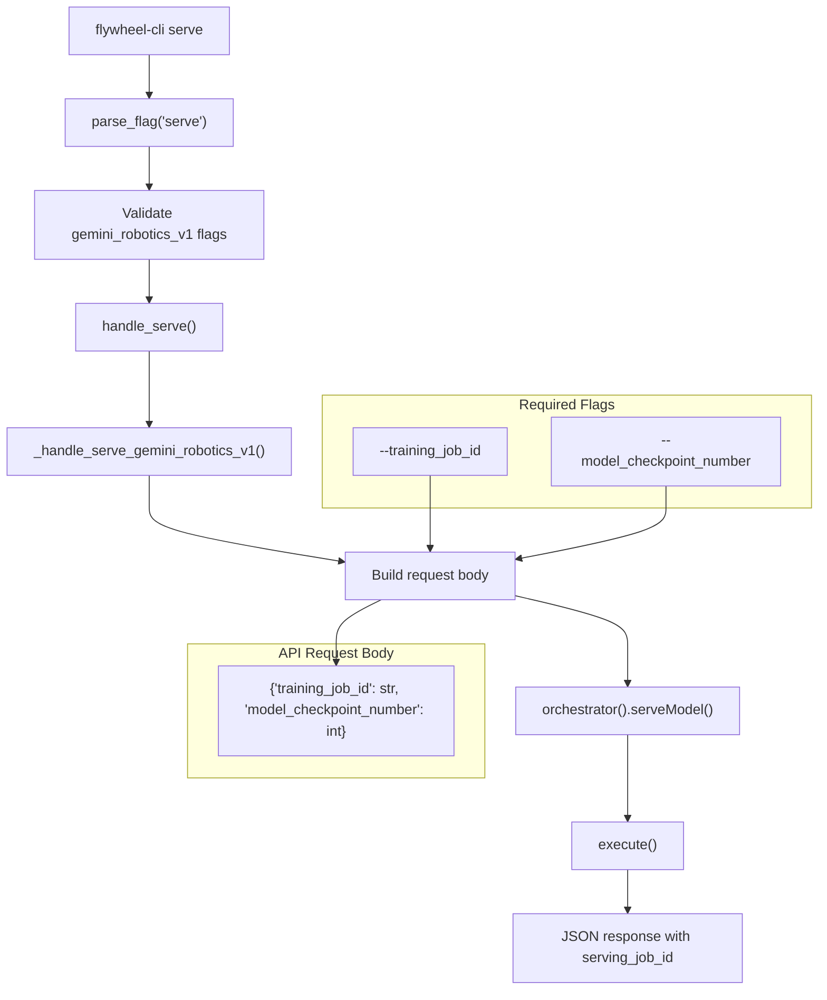

Cloud serving deploys models to the Gemini Robotics Platform through the orchestrator API. The process requires a completed training job and specific checkpoint number.

**Required Parameters:**
- `--training_job_id`: Identifier of the completed training job
- `--model_checkpoint_number`: Specific checkpoint to serve (must be > 0)
- `--training_recipe=gemini_robotics_v1`: Specifies cloud serving mode

The implementation validates all required parameters and calls the `serveModel` API endpoint, returning a serving job identifier for monitoring deployment status.

Sources: [safari_sdk/flywheel/flywheel_cli.py:342-351](), [safari_sdk/flywheel/flywheel_cli.py:572-581]()

## On-Device Serving Architecture

**On-Device Serving Flow**

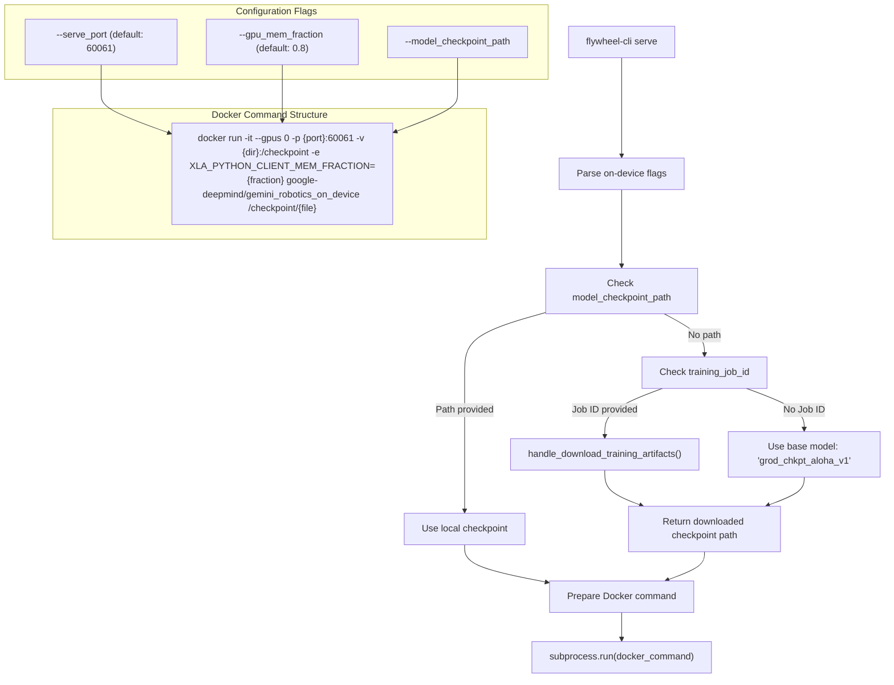

On-device serving runs models locally using Docker containers. The system automatically handles model downloading and Docker container configuration.

**Configuration Options:**

| Flag | Default | Purpose |
|------|---------|---------|
| `--serve_port` | 60061 | Host port for model serving |
| `--gpu_mem_fraction` | 0.8 | GPU memory allocation fraction |
| `--model_checkpoint_path` | None | Local checkpoint path (optional) |
| `--training_job_id` | None | Training job for model download (optional) |

The implementation constructs a Docker command with GPU access, port mapping, and volume mounting for the checkpoint file. If no training job or checkpoint path is specified, it defaults to the base model checkpoint.

Sources: [safari_sdk/flywheel/flywheel_cli.py:353-396](), [safari_sdk/flywheel/flywheel_cli.py:582-587]()

## Serving Job Management

**Serving Job Lifecycle**

```mermaid
stateDiagram-v2
    [*] --> Requested: "flywheel-cli serve"
    Requested --> Running: "Platform processes request"
    Running --> Completed: "Model deployed successfully"
    Running --> Failed: "Deployment error"
    Completed --> [*]: "Model available for inference"
    Failed --> [*]: "Review logs and retry"
    
    note right of Completed
        serving_job_id available
        for monitoring
    end note
```

Serving jobs can be monitored using the `list_serve` command, which queries the orchestrator API for serving job status. Each serving job tracks the source training job, checkpoint number, and deployment status.

**Serving Job Information:**

The `handle_list_serving_jobs` method displays serving jobs in a formatted table with the following columns:
- Serving job ID
- Training job ID  
- Model checkpoint number
- Status
- Training data filters (task ID, robot ID, date range)

**List Serving Jobs Command:**
```bash
flywheel-cli list_serve --api_key=<key> [--json_output]
```

The command supports both human-readable table output and JSON format for programmatic processing.

Sources: [safari_sdk/flywheel/flywheel_cli.py:297-341](), [safari_sdk/flywheel/flywheel_cli_test.py:217-228]()

## Error Handling and Validation

The serving system includes comprehensive validation for all serving modes:

**Validation Rules:**

| Validation | Error Condition | Error Message |
|------------|----------------|---------------|
| Recipe Support | `training_recipe` not in supported list | "Serving is only supported for training recipe: [supported_recipes]" |
| Training Job ID | Missing for `gemini_robotics_v1` | "Training job id is required." |
| Checkpoint Number | Missing or ≤ 0 for `gemini_robotics_v1` | "Model checkpoint number is required/must be positive" |
| Checkpoint Number | Provided for `gemini_robotics_on_device_v1` | "Model checkpoint number is not supported for training recipe" |

**Docker Error Handling:**

For on-device serving, the system catches `subprocess.CalledProcessError` and provides helpful error messages:
- Suggests loading the Docker image if the container fails to start
- Provides the specific artifact ID for the model server Docker image: `grod_model_server_docker`

Sources: [safari_sdk/flywheel/flywheel_cli.py:563-587](), [safari_sdk/flywheel/flywheel_cli.py:388-395]()

## Integration with Model Inference

Once deployed, served models can be accessed through the Safari SDK's model integration components:

- **Cloud-served models**: Access through `GeminiRoboticsPolicy` with the serving job ID
- **On-device models**: Direct HTTP requests to the local serving endpoint

For details on using served models with robotics policies, see [Gemini Robotics Policies](#6.1).

Sources: [safari_sdk/flywheel/flywheel_cli.py:1-740](), [safari_sdk/flywheel/flywheel_cli_test.py:1-709]()

---

# Page: Aloha Robot System

# Aloha Robot System

<details>
<summary>Relevant source files</summary>

The following files were used as context for generating this wiki page:

- [examples/aloha/env.py](examples/aloha/env.py)
- [examples/aloha/requirements.txt](examples/aloha/requirements.txt)

</details>


This document provides a comprehensive guide to the Aloha Robot System, a dual-arm robotic platform integrated with the Gemini Robotics SDK. The Aloha system provides a standardized environment for developing, testing, and evaluating robot policies in both real hardware and simulation contexts.

For information about policy evaluation specifically, see [Policy Evaluation](#4.2). For simulation evaluation, see [Simulation Evaluation](#4.3).

## Overview

The Aloha Robot System consists of two Interbotix robotic arms with multiple cameras for perception. It is implemented as a Gymnasium environment that provides a standardized interface for controlling the robot and receiving observations.

```mermaid
graph TB
    subgraph "Aloha Robot System"
        AlohaEnv["AlohaEnv (Gymnasium Environment)"]
        ImageController["ImageController"]
        RobotArms["InterbotixManipulatorXS (follower_left & follower_right)"]
    end
    
    subgraph "ROS Infrastructure"
        ROSNode["Global ROS Node (aloha_env0)"]
        ImageTopics["Camera Topics"]
        JointCommands["Joint Command Publishers"]
    end
    
    subgraph "Observation Space"
        Cameras["4 Cameras:
        - overhead_cam
        - worms_eye_cam
        - wrist_cam_left
        - wrist_cam_right"]
        Proprioception["Joint States (14 DoF)"]
    end
    
    subgraph "Action Space"
        JointPositions["Joint Positions (12 DoF)"]
        GripperPositions["Gripper Positions (2 DoF)"]
    end
    
    AlohaEnv --> ImageController
    AlohaEnv --> RobotArms
    
    ImageController --> Cameras
    ImageController --> ROSNode
    
    RobotArms --> Proprioception
    RobotArms --> ROSNode
    
    ROSNode --> ImageTopics
    ROSNode --> JointCommands
    
    Cameras --> AlohaEnv
    Proprioception --> AlohaEnv
    
    AlohaEnv --> JointPositions
    AlohaEnv --> GripperPositions
```

Sources: [examples/aloha/env.py:129-294]()

## Key Components

### AlohaEnv

The `AlohaEnv` class is a Gymnasium environment that provides a standardized interface for interacting with the Aloha robot system. It handles:

1. Robot initialization and configuration
2. Camera image acquisition
3. Joint state monitoring
4. Action execution
5. Environment reset and shutdown

The environment follows the standard Gymnasium interface with `reset()`, `step()`, and `close()` methods.

Sources: [examples/aloha/env.py:129-311]()

### ImageController

The `ImageController` class manages camera subscriptions and image processing. It:

1. Subscribes to multiple ROS camera topics
2. Processes compressed images into numpy arrays
3. Provides synchronized access to the latest images
4. Handles waiting for all cameras to be available

```mermaid
sequenceDiagram
    participant AlohaEnv as "AlohaEnv"
    participant ImageController as "ImageController"
    participant ROSNode as "ROS Node"
    participant Cameras as "Camera Topics"
    
    AlohaEnv->>ImageController: "initialize(node)"
    ImageController->>ROSNode: "create_subscription(topics)"
    
    loop For each camera
        Cameras->>ROSNode: "publish(CompressedImage)"
        ROSNode->>ImageController: "_callback(CompressedImage)"
        ImageController->>ImageController: "decode and store image"
    end
    
    AlohaEnv->>ImageController: "wait_for_images()"
    ImageController-->>AlohaEnv: "all images available"
    
    loop During operation
        AlohaEnv->>ImageController: "get_images()"
        ImageController-->>AlohaEnv: "return image dictionary"
    end
```

Sources: [examples/aloha/env.py:54-126]()

### Robot Control

The Aloha system uses two Interbotix robotic arms, identified as `follower_left` and `follower_right`. Each arm has:

- 6 degrees of freedom for joint positions
- 1 degree of freedom for the gripper

The environment handles:
- Setting joint positions
- Controlling grippers
- Reading joint states
- Moving to home/sleep positions

```mermaid
graph TB
    subgraph "Robot Control Flow"
        Action["Action (14 DoF)"]
        Split["Split into left/right actions"]
        LeftArm["Left Arm Control (7 DoF)"]
        RightArm["Right Arm Control (7 DoF)"]
        JointPublishers["ROS Joint Publishers"]
        GripperPublishers["ROS Gripper Publishers"]
    end
    
    Action --> Split
    Split --> LeftArm
    Split --> RightArm
    
    LeftArm --> JointPublishers
    RightArm --> JointPublishers
    LeftArm --> GripperPublishers
    RightArm --> GripperPublishers
    
    JointPublishers --> ROSHardware["ROS Hardware Interface"]
    GripperPublishers --> ROSHardware
    
    ROSHardware --> PhysicalRobot["Physical Robot Hardware"]
```

Sources: [examples/aloha/env.py:217-230]()

## Environment Interface

### Observation Space

The observation space consists of:

1. Joint positions (`joints_pos`): A 1×14 array containing the positions of all joints
2. Camera images:
   - `overhead_cam`: Top-down view of the workspace
   - `worms_eye_cam`: Bottom-up view of the workspace
   - `wrist_cam_left`: View from the left arm's wrist
   - `wrist_cam_right`: View from the right arm's wrist

Sources: [examples/aloha/env.py:204-215]()

### Action Space

The action space is a 14-dimensional vector representing:

- Positions for 6 joints on the left arm
- Position for the left gripper
- Positions for 6 joints on the right arm
- Position for the right gripper

The action space is defined as a `gym.spaces.Box` with appropriate joint limits.

Sources: [examples/aloha/env.py:184-193]()

### Environment Lifecycle

```mermaid
stateDiagram-v2
    [*] --> Initialize: "AlohaEnv(robot_config_name, config_base_path)"
    Initialize --> Reset: "reset()"
    Reset --> Step: "step(action)"
    Step --> Step: "step(action)"
    Step --> Reset: "reset()"
    Step --> Close: "close()"
    Reset --> Close: "close()"
    Close --> [*]
    
    state Initialize {
        [*] --> InitROS: "Create ROS node"
        InitROS --> InitCameras: "Initialize ImageController"
        InitCameras --> InitRobots: "Initialize InterbotixManipulatorXS robots"
        InitRobots --> SetModes: "Set operating modes"
        SetModes --> WaitForImages: "Wait for initial images"
        WaitForImages --> [*]
    }
    
    state Reset {
        [*] --> MoveHome: "Move arms to home position"
        MoveHome --> OpenGrippers: "Open grippers"
        OpenGrippers --> GetObservation: "Get initial observation"
        GetObservation --> [*]
    }
    
    state Step {
        [*] --> ExecuteAction: "Set joint positions"
        ExecuteAction --> Wait: "Wait for dt"
        Wait --> GetObservation: "Get new observation"
        GetObservation --> [*]
    }
    
    state Close {
        [*] --> MoveToSleep: "Move to sleep position (if hard_shutdown=True)"
        MoveToSleep --> ShutdownROS: "Shutdown ROS node"
        ShutdownROS --> [*]
    }
```

Sources: [examples/aloha/env.py:232-293](), [examples/aloha/env.py:295-310]()

## Usage Example

Here's a basic example of how to use the Aloha environment:

```python
from examples.aloha.env import AlohaEnv

# Initialize the environment
env = AlohaEnv(
    robot_config_name="aloha_config",
    config_base_path="/path/to/configs",
    instruction="pick up the red block"
)

# Reset the environment
obs, info = env.reset()

# Run a simple control loop
for _ in range(100):
    # Generate action (this would typically come from a policy)
    action = [0.0] * 14  # No-op action
    
    # Step the environment
    obs, reward, terminated, truncated, info = env.step(action)
    
    if terminated or truncated:
        break

# Close the environment
env.close()
```

Sources: [examples/aloha/env.py:129-311]()

## Dependencies

The Aloha Robot System requires several dependencies:

| Dependency | Purpose |
|------------|---------|
| gymnasium | Provides the environment interface |
| modern_robotics | Used for robot kinematics |
| pyyaml | Handles configuration files |
| transforms3d | Handles 3D transformations |
| dm_control | Used for simulation (optional) |
| ROS | Robot Operating System for hardware control |
| Interbotix packages | Specific drivers for the robot hardware |

Sources: [examples/aloha/requirements.txt:1-6]()

## Camera Configuration

The Aloha system uses four cameras positioned to provide comprehensive views of the workspace:

| Camera Name | ROS Topic | Description |
|-------------|-----------|-------------|
| overhead_cam | `/camera_high/camera/color/image_rect_raw/compressed` | Top-down view of the workspace |
| worms_eye_cam | `/camera_low/camera/color/image_rect_raw/compressed` | Bottom-up view of the workspace |
| wrist_cam_left | `/camera_wrist_left/camera/color/image_rect_raw/compressed` | View from the left arm's wrist |
| wrist_cam_right | `/camera_wrist_right/camera/color/image_rect_raw/compressed` | View from the right arm's wrist |

Sources: [examples/aloha/env.py:31-39]()

## Robot Configuration

The Aloha system uses predefined constants for robot control:

| Constant | Value | Description |
|----------|-------|-------------|
| FPS | 50 | Control frequency (Hz) |
| GRIPPER_OPEN | 1.5155 | Gripper position when fully open |
| GRIPPER_CLOSED | -0.06135 | Gripper position when fully closed |
| MOTOR_REGISTER_VALUE | 300 | Motor current limit |
| HOME_POSITION | `[[0.0, -0.96, 1.16, 0.0, -0.3, 0.0]]` | Default home position for the arms |

Sources: [examples/aloha/env.py:40-51]()

## Integration with Gemini Robotics SDK

The Aloha Robot System is designed to work seamlessly with the Gemini Robotics SDK, particularly for policy evaluation. The environment provides the standardized interface that policies expect, including the observation format and action space.

```mermaid
graph TB
    subgraph "Policy Evaluation"
        GeminiPolicy["GeminiRoboticsPolicy"]
        EvalScript["eval.py"]
        AlohaEnv["AlohaEnv"]
    end
    
    subgraph "Observation Processing"
        Images["Camera Images"]
        JointStates["Joint States"]
        ProcessedObs["Processed Observations"]
    end
    
    subgraph "Action Execution"
        PolicyAction["Policy Action (14 DoF)"]
        RobotExecution["Robot Execution"]
    end
    
    EvalScript --> AlohaEnv
    EvalScript --> GeminiPolicy
    
    AlohaEnv --> Images
    AlohaEnv --> JointStates
    
    Images --> ProcessedObs
    JointStates --> ProcessedObs
    
    ProcessedObs --> GeminiPolicy
    GeminiPolicy --> PolicyAction
    PolicyAction --> AlohaEnv
    AlohaEnv --> RobotExecution
```

Sources: [examples/aloha/env.py:129-311]()

## Conclusion

The Aloha Robot System provides a standardized environment for developing and evaluating robot policies. By implementing the Gymnasium interface, it enables seamless integration with the Gemini Robotics SDK and other reinforcement learning frameworks. The system's comprehensive observation space and flexible action space make it suitable for a wide range of robotic manipulation tasks.

---

# Page: Environment Setup

# Environment Setup

<details>
<summary>Relevant source files</summary>

The following files were used as context for generating this wiki page:

- [examples/aloha/env.py](examples/aloha/env.py)
- [examples/aloha/requirements.txt](examples/aloha/requirements.txt)

</details>


This document covers the setup and configuration of the AlohaEnv Gymnasium environment for the Aloha robot system. It explains how to prepare the environment, understand its components, and configure it for policy evaluation.

For information about running policy evaluation on real Aloha robots, see [Policy Evaluation](#4.2). For simulation evaluation, see [Simulation Evaluation](#4.3).

## Overview

The Aloha environment provides a standardized Gymnasium interface for interacting with the Aloha dual-arm robot system. It handles camera observations, robot control, and environment reset functionality needed for policy evaluation.

```mermaid
graph TB
    subgraph "AlohaEnv Components"
        AlohaEnv["AlohaEnv (Gymnasium Environment)"]
        ImageController["ImageController"]
        RobotControl["Robot Control"]
    end

    subgraph "Hardware Components"
        Cameras["Cameras (4)"]
        RobotArms["Robot Arms (2)"]
    end

    subgraph "ROS Infrastructure"
        ROSNode["ROS Node (aloha_env0)"]
        ImageTopics["Camera Topics"]
        JointControl["Joint Control"]
    end

    AlohaEnv --> ImageController
    AlohaEnv --> RobotControl
    ImageController --> Cameras
    RobotControl --> RobotArms
    
    ImageController --> ImageTopics
    RobotControl --> JointControl
    
    ImageTopics --> ROSNode
    JointControl --> ROSNode
```

Sources: [examples/aloha/env.py:129-195]()

## Prerequisites

Before setting up the Aloha environment, ensure you have the following dependencies installed:

```
gymnasium
modern_robotics
pyyaml
transforms3d
dm_control
```

You can install these dependencies using the requirements file:

```bash
pip install -r examples/aloha/requirements.txt
```

Sources: [examples/aloha/requirements.txt:1-6]()

## Environment Components

The Aloha environment consists of several key components:

```mermaid
classDiagram
    class AlohaEnv {
        +__init__(robot_config_name, config_base_path, instruction)
        +reset(seed, options)
        +step(action)
        +close(hard_shutdown)
        -_get_obs()
        -_get_proprio()
        -_set_follower(robot_instance, arm_positions)
    }
    
    class ImageController {
        +__init__(node)
        +get_images()
        +wait_for_images(timeout)
        -_callback_factory(key)
    }
    
    AlohaEnv --> ImageController : uses
    AlohaEnv --> "InterbotixManipulatorXS" : controls
    ImageController --> "ROS Subscriptions" : manages
```

Sources: [examples/aloha/env.py:54-126](), [examples/aloha/env.py:129-195]()

### 1. AlohaEnv Class

The `AlohaEnv` class is the main Gymnasium environment that provides the standard interface for interacting with the Aloha robot system.

Key methods:
- `__init__`: Initializes the environment, ROS node, robot arms, and camera subscriptions
- `reset`: Resets the environment to a home position
- `step`: Executes an action on the robot and returns the new observation
- `close`: Safely shuts down the robot and environment

Sources: [examples/aloha/env.py:129-311]()

### 2. ImageController Class

The `ImageController` class manages camera subscriptions and image processing:

- Subscribes to four camera topics:
  - Overhead camera
  - Worm's eye camera
  - Left wrist camera
  - Right wrist camera
- Provides methods to access the latest images from all cameras
- Handles image conversion from ROS compressed image format to OpenCV format

Sources: [examples/aloha/env.py:54-126]()

## Camera Configuration

The environment uses four cameras positioned at different viewpoints:

| Camera Name | ROS Topic | Description |
|-------------|-----------|-------------|
| Overhead Camera | `/camera_high/camera/color/image_rect_raw/compressed` | Top-down view of the workspace |
| Worm's Eye Camera | `/camera_low/camera/color/image_rect_raw/compressed` | Bottom-up view of the workspace |
| Left Wrist Camera | `/camera_wrist_left/camera/color/image_rect_raw/compressed` | Camera mounted on the left robot wrist |
| Right Wrist Camera | `/camera_wrist_right/camera/color/image_rect_raw/compressed` | Camera mounted on the right robot wrist |

Sources: [examples/aloha/env.py:31-39]()

## Robot Configuration

The environment controls two Interbotix robot arms:

- `follower_left`: Left robot arm
- `follower_right`: Right robot arm

Each arm has 6 joints plus a gripper, for a total of 7 degrees of freedom per arm.

```mermaid
graph LR
    subgraph "Robot Control Flow"
        Action["Action (14-dim vector)"]
        Split["Split into left/right actions"]
        LeftArm["Left Arm Control (7-dim)"]
        RightArm["Right Arm Control (7-dim)"]
        JointPublishers["Joint Position Publishers"]
        GripperPublishers["Gripper Command Publishers"]
    end

    Action --> Split
    Split --> LeftArm
    Split --> RightArm
    LeftArm --> JointPublishers
    LeftArm --> GripperPublishers
    RightArm --> JointPublishers
    RightArm --> GripperPublishers
```

Sources: [examples/aloha/env.py:217-231]()

## Setting Up the Environment

To create and initialize the Aloha environment:

1. Import the necessary modules:
   ```python
   from examples.aloha.env import AlohaEnv
   ```

2. Create the environment instance:
   ```python
   env = AlohaEnv(
       robot_config_name="your_robot_config",
       config_base_path="path_to_config_directory",
       instruction="pick up the object"
   )
   ```

3. Reset the environment to get the initial observation:
   ```python
   observation, info = env.reset()
   ```

Sources: [examples/aloha/env.py:129-266]()

## Action and Observation Spaces

### Action Space

The action space is a 14-dimensional continuous space representing:
- 6 joint positions + 1 gripper position for the left arm
- 6 joint positions + 1 gripper position for the right arm

Joint limits are approximately -π to π radians, with gripper limits from `GRIPPER_CLOSED` (-0.06135) to `GRIPPER_OPEN` (1.5155).

Sources: [examples/aloha/env.py:184-193](), [examples/aloha/env.py:43-44]()

### Observation Space

The observation dictionary contains:

| Key | Type | Description |
|-----|------|-------------|
| `joints_pos` | numpy.ndarray (1, 14) | Current joint positions for both arms |
| `overhead_cam` | numpy.ndarray | RGB image from overhead camera |
| `worms_eye_cam` | numpy.ndarray | RGB image from worm's eye camera |
| `wrist_cam_left` | numpy.ndarray | RGB image from left wrist camera |
| `wrist_cam_right` | numpy.ndarray | RGB image from right wrist camera |

Sources: [examples/aloha/env.py:204-215]()

## Environment Lifecycle

```mermaid
sequenceDiagram
    participant User
    participant AlohaEnv
    participant RobotArms
    participant Cameras

    User->>AlohaEnv: Create environment
    AlohaEnv->>RobotArms: Initialize robot connections
    AlohaEnv->>Cameras: Subscribe to camera topics
    AlohaEnv-->>User: Environment ready

    User->>AlohaEnv: reset()
    AlohaEnv->>RobotArms: Move to home position
    AlohaEnv->>RobotArms: Open grippers
    AlohaEnv->>Cameras: Get initial observations
    AlohaEnv-->>User: Return initial observation

    loop Policy Execution
        User->>AlohaEnv: step(action)
        AlohaEnv->>RobotArms: Set joint positions
        AlohaEnv->>RobotArms: Set gripper positions
        AlohaEnv->>Cameras: Get new observations
        AlohaEnv-->>User: Return observation
    end

    User->>AlohaEnv: close()
    AlohaEnv->>RobotArms: Move to sleep position
    AlohaEnv->>RobotArms: Shutdown
    AlohaEnv-->>User: Environment closed
```

Sources: [examples/aloha/env.py:232-293](), [examples/aloha/env.py:295-311]()

## Example Usage

Here's a complete example of using the AlohaEnv with a policy:

```python
from examples.aloha.env import AlohaEnv
from your_policy_module import YourPolicy

# Create environment
env = AlohaEnv(
    robot_config_name="aloha_config",
    config_base_path="/path/to/configs",
    instruction="pick up the red block"
)

# Create policy
policy = YourPolicy()

# Reset environment
observation, info = env.reset()

# Run for 100 steps
for _ in range(100):
    # Get action from policy
    action = policy.predict(observation)
    
    # Step environment
    observation, reward, terminated, truncated, info = env.step(action)
    
    if terminated or truncated:
        break

# Close environment
env.close()
```

Sources: [examples/aloha/env.py:129-311]()

## Troubleshooting

### Camera Issues

If you encounter issues with camera connections:

1. Check that all cameras are properly connected and powered
2. Verify that the ROS camera topics are publishing data:
   ```bash
   ros2 topic echo /camera_high/camera/color/image_rect_raw/compressed
   ```
3. Increase the timeout in `wait_for_images()` if cameras are slow to initialize

Sources: [examples/aloha/env.py:110-126]()

### Robot Control Issues

If you encounter issues with robot control:

1. Ensure the robot is properly powered and connected
2. Check that the robot configuration file is correct
3. Verify that the ROS node can communicate with the robot
4. Use the `hard_shutdown=False` parameter in `close()` if the robot is in an unstable state

Sources: [examples/aloha/env.py:295-311]()

## Next Steps

After setting up the environment, you can:

1. Proceed to [Policy Evaluation](#4.2) to learn how to evaluate policies on the real robot
2. Explore [Simulation Evaluation](#4.3) for testing in a simulated environment
3. Learn about [Data Management](#5) for collecting and processing robot data

---

# Page: Policy Evaluation

# Policy Evaluation

<details>
<summary>Relevant source files</summary>

The following files were used as context for generating this wiki page:

- [examples/aloha/eval.py](examples/aloha/eval.py)

</details>


This document covers running policy evaluation on real Aloha robots using the `eval.py` script. Policy evaluation allows you to test trained robotics policies on physical hardware by providing task instructions and observing robot behavior in real-time episodes.

For simulation-based evaluation, see [Simulation Evaluation](#4.3). For information about the AlohaEnv environment setup, see [Environment Setup](#4.1).

## Overview

The policy evaluation system provides a command-line interface for running trained Gemini Robotics policies on real Aloha robot hardware. The system integrates the `AlohaEnv` Gymnasium environment with `GeminiRoboticsPolicy` to execute episodes based on natural language task instructions.

```mermaid
graph TB
    subgraph "Policy Evaluation System"
        EvalScript["eval.py<br/>Main Evaluation Script"]
        AlohaEnv["AlohaEnv<br/>Robot Environment"]
        Policy["GeminiRoboticsPolicy<br/>Policy Implementation"]
    end
    
    subgraph "Configuration"
        CameraConfig["_ALOHA_CAMERAS<br/>Camera Settings"]
        JointConfig["_ALOHA_JOINTS<br/>Joint Configuration"]
        ServeConfig["_SERVE_ID<br/>gemini_robotics_on_device"]
    end
    
    subgraph "Hardware Interface"
        ROSNode["ROS Node<br/>aloha_env0"]
        RobotArms["Robot Arms<br/>follower_left & follower_right"]
        Cameras["Camera Systems<br/>overhead, worms_eye, wrist"]
    end
    
    EvalScript --> AlohaEnv
    EvalScript --> Policy
    Policy --> CameraConfig
    Policy --> JointConfig
    Policy --> ServeConfig
    AlohaEnv --> ROSNode
    ROSNode --> RobotArms
    ROSNode --> Cameras
```

**Sources:** [examples/aloha/eval.py:1-159]()

## Configuration Constants

The evaluation system uses predefined configuration constants to specify camera and joint parameters for the Aloha robot system.

| Configuration | Value | Description |
|---------------|-------|-------------|
| `_SERVE_ID` | `gemini_robotics_on_device` | Service identifier for local policy serving |
| `_IMAGE_SIZE` | `(480, 848)` | Standard image resolution for all cameras |
| `ROBOT_CONFIG_NAME` | `aloha_stationary` | Robot configuration profile |
| `CONFIG_BASE_PATH` | `/home/juggler/interbotix_ws/src/aloha/config/` | Base path for robot configuration files |

### Camera Configuration

The `_ALOHA_CAMERAS` dictionary defines the camera setup:

```python
_ALOHA_CAMERAS = {
    'overhead_cam': _IMAGE_SIZE,
    'worms_eye_cam': _IMAGE_SIZE,
    'wrist_cam_left': _IMAGE_SIZE,
    'wrist_cam_right': _IMAGE_SIZE,
}
```

### Joint Configuration

The `_ALOHA_JOINTS` dictionary specifies joint position parameters:

```python
_ALOHA_JOINTS = {'joints_pos': 14}
```

**Sources:** [examples/aloha/eval.py:27-40]()

## Episode Execution

The `run_single_episode` function orchestrates the execution of a single evaluation episode. It handles environment reset, policy initialization, and the main action-observation loop.

```mermaid
flowchart TD
    StartEpisode["run_single_episode()"]
    ResetEnv["aloha_env.reset()<br/>with instruction"]
    InitPolicy["GeminiRoboticsPolicy<br/>initialization"]
    PolicySetup["policy.setup()"]
    ActionLoop["Action Loop<br/>(default: 5000 steps)"]
    GetAction["policy.step(obs)"]
    StepEnv["aloha_env.step(action)"]
    UpdateObs["Update observation"]
    
    StartEpisode --> ResetEnv
    ResetEnv --> InitPolicy
    InitPolicy --> PolicySetup
    PolicySetup --> ActionLoop
    ActionLoop --> GetAction
    GetAction --> StepEnv
    StepEnv --> UpdateObs
    UpdateObs --> ActionLoop
```

### Policy Initialization

The policy is initialized with specific configuration parameters:

```python
policy = gemini_robotics_policy.GeminiRoboticsPolicy(
    serve_id=_SERVE_ID,
    task_instruction=instruction,
    inference_mode=gemini_robotics_policy.InferenceMode.SYNCHRONOUS,
    cameras=_ALOHA_CAMERAS,
    joints=_ALOHA_JOINTS,
    robotics_api_connection=genai_robotics.RoboticsApiConnectionType.LOCAL,
)
```

**Sources:** [examples/aloha/eval.py:43-78]()

## Command Line Interface

The evaluation script provides a command-line interface with the following options:

| Argument | Type | Default | Description |
|----------|------|---------|-------------|
| `--instruction` | `str` | `None` | Specific task instruction for all episodes |
| `--steps` | `int` | `5000` | Number of steps per episode |

### Usage Examples

```bash
# Interactive mode - specify instructions during runtime
python3 eval.py

# Fixed instruction mode - use same instruction for all episodes
python3 eval.py --instruction "pick up the red block"

# Custom episode length
python3 eval.py --instruction "stack the blocks" --steps 3000
```

**Sources:** [examples/aloha/eval.py:91-104]()

## Evaluation Workflow

The main evaluation loop handles multiple episodes and user interaction. The workflow supports both interactive and fixed instruction modes.

```mermaid
stateDiagram-v2
    [*] --> Initialize
    Initialize --> AlohaEnvSetup: "Create AlohaEnv"
    AlohaEnvSetup --> ROSSignalSetup: "Uninstall ROS signal handlers"
    ROSSignalSetup --> InitialReset: "Reset to home position"
    InitialReset --> WaitForInput
    
    WaitForInput --> CheckQuit: "User input"
    CheckQuit --> [*]: "quit command"
    CheckQuit --> RunEpisode: "task instruction"
    
    RunEpisode --> EpisodeComplete: "Episode finished"
    RunEpisode --> KeyboardInterrupt: "Ctrl-C during episode"
    
    EpisodeComplete --> WaitForInput
    KeyboardInterrupt --> WaitForInput: "Continue to next episode"
    KeyboardInterrupt --> [*]: "Quit between episodes"
```

### Signal Handling

The script uses `rclpy.signals.uninstall_signal_handlers()` to override default ROS signal handling, allowing for graceful keyboard interrupts during episodes without automatic ROS shutdown.

### Environment Lifecycle

1. **Initialization**: Create `AlohaEnv` with robot configuration
2. **Initial Reset**: Bring robot to home position
3. **Episode Loop**: Run episodes with user-provided instructions
4. **Cleanup**: Close environment on exit

**Sources:** [examples/aloha/eval.py:112-156]()

## Integration Points

The policy evaluation system integrates with several key SDK components:

| Component | Purpose | Integration Point |
|-----------|---------|-------------------|
| `AlohaEnv` | Robot environment interface | Direct instantiation and step/reset calls |
| `GeminiRoboticsPolicy` | Policy implementation | Created per episode with task instruction |
| `genai_robotics` | Robotics API connection | Provides `RoboticsApiConnectionType.LOCAL` |
| `rclpy` | ROS 2 Python interface | Signal handler management |

The evaluation script serves as the primary interface for testing deployed policies on real hardware, bridging the gap between trained models and physical robot execution.

**Sources:** [examples/aloha/eval.py:19-24]()

---

# Page: Simulation Evaluation

# Simulation Evaluation

<details>
<summary>Relevant source files</summary>

The following files were used as context for generating this wiki page:

- [examples/aloha/sim_eval.py](examples/aloha/sim_eval.py)

</details>


This document covers the interactive simulation evaluation system for Gemini Robotics policies using MuJoCo physics simulation and dm_control. The system provides real-time visualization and interactive control for testing robotic policies in simulated Aloha environments.

For real robot evaluation with physical hardware, see [Policy Evaluation](#4.2). For general environment setup, see [Environment Setup](#4.1).

## Purpose and Architecture

The simulation evaluation system provides an interactive testing environment where users can evaluate Gemini Robotics policies in real-time using keyboard and mouse controls. The system combines MuJoCo physics simulation, dm_control task environments, and the Safari SDK's policy integration to create a comprehensive evaluation platform.

```mermaid
graph TB
    subgraph "Simulation Core"
        SimEval["sim_eval.py<br/>Main Script"]
        TaskSuite["task_suite<br/>Predefined Tasks"]
        Composer["dm_control.composer<br/>Environment"]
        Physics["MuJoCo Physics<br/>Simulation Engine"]
    end
    
    subgraph "Policy Integration"
        GeminiPolicy["GeminiRoboticsPolicy"]
        GenAIRobotics["genai_robotics<br/>RoboticsApiConnectionType.LOCAL"]
        ServeID["serve_id: gemini_robotics_on_device"]
    end
    
    subgraph "Interactive Controls"
        MuJoCoViewer["mujoco.viewer<br/>launch_passive"]
        KeyCallback["_key_callback<br/>Keyboard Controls"]
        GlobalState["_GLOBAL_STATE<br/>Runtime State"]
    end
    
    subgraph "Configuration"
        AlohaCameras["_ALOHA_CAMERAS<br/>Camera Specifications"]
        AlohaJoints["_ALOHA_JOINTS<br/>Joint Configuration"]
        TaskConfig["Task Parameters<br/>_DT, _IMAGE_SIZE"]
    end
    
    SimEval --> TaskSuite
    SimEval --> Composer
    SimEval --> GeminiPolicy
    SimEval --> MuJoCoViewer
    
    TaskSuite --> Composer
    Composer --> Physics
    
    GeminiPolicy --> GenAIRobotics
    GeminiPolicy --> ServeID
    
    MuJoCoViewer --> KeyCallback
    KeyCallback --> GlobalState
    
    SimEval --> AlohaCameras
    SimEval --> AlohaJoints
    SimEval --> TaskConfig
    
    style SimEval fill:#f9f9f9
    style GeminiPolicy fill:#f9f9f9
    style MuJoCoViewer fill:#f9f9f9
```

Sources: [examples/aloha/sim_eval.py:1-279]()

## Task Selection and Configuration

The system supports multiple predefined tasks from the task suite, with configurable parameters for camera resolution, control timestep, and joint configurations.

| Configuration | Value | Purpose |
|---------------|-------|---------|
| `_IMAGE_SIZE` | `(480, 848)` | Resolution for all camera feeds |
| `_DT` | `0.02` | Control timestep (50Hz) |
| `_LOG_STEPS` | `100` | Performance logging interval |
| `_SERVE_ID` | `'gemini_robotics_on_device'` | Policy deployment identifier |

### Camera Configuration

The system defines four camera perspectives matching the Aloha robot setup:

```mermaid
graph LR
    subgraph "Camera Configuration"
        Overhead["overhead_cam<br/>(480, 848)"]
        WormsEye["worms_eye_cam<br/>(480, 848)"]
        WristLeft["wrist_cam_left<br/>(480, 848)"]
        WristRight["wrist_cam_right<br/>(480, 848)"]
    end
    
    subgraph "Joint Configuration"
        JointsPos["joints_pos<br/>14 DOF"]
    end
    
    AlohaCameras["_ALOHA_CAMERAS<br/>Dictionary"] --> Overhead
    AlohaCameras --> WormsEye
    AlohaCameras --> WristLeft
    AlohaCameras --> WristRight
    
    AlohaJoints["_ALOHA_JOINTS<br/>Dictionary"] --> JointsPos
```

Sources: [examples/aloha/sim_eval.py:82-90]()

## Interactive Control System

The simulation provides comprehensive keyboard and mouse controls for real-time interaction with the environment and policy execution.

### Keyboard Controls

| Key | Function | Global State Variable |
|-----|----------|---------------------|
| Space Bar | Play/Pause simulation | `_IS_RUNNING` |
| Backspace | Reset environment | `_SHOULD_RESET` |
| Right Arrow | Single step execution | `_SINGLE_STEP` |
| I | Enter new instruction | `_ASKING_INSTRUCTION` |

### Mouse Controls

The system provides different mouse interaction modes depending on simulation state:

```mermaid
flowchart TD
    MouseInput["Mouse Input"]
    
    subgraph "Camera Controls"
        RightClick["Right Click<br/>Move Camera"]
        LeftClick["Left Click<br/>Rotate Camera"]
        DoubleClick["Double Click<br/>Select Object"]
    end
    
    subgraph "Simulation Paused"
        CtrlLeft["Ctrl + Left<br/>Rotate Selected Object"]
        CtrlRight["Ctrl + Right<br/>Move Selected Object"]
    end
    
    subgraph "Simulation Running"
        CtrlLeftRun["Ctrl + Left<br/>Apply Torque"]
        CtrlRightRun["Ctrl + Right<br/>Apply Force"]
    end
    
    MouseInput --> RightClick
    MouseInput --> LeftClick
    MouseInput --> DoubleClick
    
    SimulationState{"Simulation Running?"}
    MouseInput --> SimulationState
    
    SimulationState -->|No| CtrlLeft
    SimulationState -->|No| CtrlRight
    SimulationState -->|Yes| CtrlLeftRun
    SimulationState -->|Yes| CtrlRightRun
```

Sources: [examples/aloha/sim_eval.py:15-33](), [examples/aloha/sim_eval.py:247-264]()

## Policy Integration and Execution

The system integrates with `GeminiRoboticsPolicy` for real-time policy evaluation, providing synchronous inference and local API connectivity.

### Policy Initialization

The policy setup involves several key components:

```mermaid
graph TB
    subgraph "Policy Configuration"
        PolicyInit["GeminiRoboticsPolicy<br/>Initialization"]
        ServeID["serve_id: gemini_robotics_on_device"]
        TaskInstruction["task_instruction<br/>From Environment"]
        InferenceMode["InferenceMode.SYNCHRONOUS"]
        Cameras["cameras: _ALOHA_CAMERAS"]
        Joints["joints: _ALOHA_JOINTS"]
        ApiConnection["RoboticsApiConnectionType.LOCAL"]
    end
    
    subgraph "Setup Process"
        PolicySetup["policy.setup()<br/>Initialize Policy"]
        ErrorHandling["Exception Handling<br/>ValueError & Generic"]
    end
    
    PolicyInit --> ServeID
    PolicyInit --> TaskInstruction
    PolicyInit --> InferenceMode
    PolicyInit --> Cameras
    PolicyInit --> Joints
    PolicyInit --> ApiConnection
    
    PolicyInit --> PolicySetup
    PolicySetup --> ErrorHandling
```

Sources: [examples/aloha/sim_eval.py:144-162]()

### Execution Loop

The main execution loop handles policy stepping, environment updates, and viewer synchronization:

```mermaid
flowchart TD
    EnvironmentReset["env.reset()<br/>Initialize Episode"]
    
    MainLoop{"Main Loop<br/>while not timestep.last()"}
    
    CheckRunning{"_IS_RUNNING or<br/>_SINGLE_STEP?"}
    
    PolicyStep["policy.step()<br/>Get Action"]
    EnvironmentStep["env.step(action)<br/>Execute Action"]
    ViewerSync["viewer_handle.sync()<br/>Update Display"]
    
    PerformanceLog["Performance Logging<br/>Every _LOG_STEPS"]
    
    CheckReset{"_SHOULD_RESET?"}
    ForceLastStep["Force Last Step<br/>dm_env.StepType.LAST"]
    
    PerturbationCheck["Check Perturbations<br/>Mouse Interactions"]
    
    EnvironmentReset --> MainLoop
    MainLoop --> CheckRunning
    CheckRunning -->|Yes| PolicyStep
    PolicyStep --> EnvironmentStep
    EnvironmentStep --> ViewerSync
    ViewerSync --> PerformanceLog
    PerformanceLog --> CheckReset
    CheckReset -->|Yes| ForceLastStep
    CheckReset -->|No| PerturbationCheck
    ForceLastStep --> PerturbationCheck
    PerturbationCheck --> MainLoop
    CheckRunning -->|No| MainLoop
```

Sources: [examples/aloha/sim_eval.py:186-246]()

## Performance Monitoring

The system provides detailed performance metrics for policy evaluation, tracking inference time, simulation stepping time, and viewer synchronization overhead.

### Timing Metrics

| Metric | Description | Tracked Variable |
|--------|-------------|------------------|
| Inference Time | Policy decision making | `time_inference` |
| Stepping Time | Environment simulation | `time_stepping` |
| Sync Time | Viewer updates | `sync_time` |

The performance logging occurs every `_LOG_STEPS` iterations and reports both per-step averages and cumulative totals:

Sources: [examples/aloha/sim_eval.py:210-229]()

## Usage Workflow

To run simulation evaluation:

1. **Task Selection**: Use the `--task_name` flag to select from available tasks in `task_suite.TASK_FACTORIES`
2. **Instruction Override**: Optionally use `--instruction` to provide custom task instructions
3. **Interactive Control**: Use keyboard controls to pause, reset, and step through simulation
4. **Policy Evaluation**: Monitor real-time policy performance and timing metrics
5. **Environment Interaction**: Use mouse controls to apply perturbations and manipulate objects

### Command Line Usage

```bash
python examples/aloha/sim_eval.py --task_name=HandOverBanana --instruction="Pick up the banana"
```

### Global State Management

The system uses a global state dictionary to coordinate viewer interactions:

| State Variable | Purpose |
|----------------|---------|
| `_IS_RUNNING` | Controls simulation execution |
| `_SHOULD_RESET` | Triggers environment reset |
| `_SINGLE_STEP` | Enables single-step debugging |
| `_ASKING_INSTRUCTION` | Handles instruction input |

Sources: [examples/aloha/sim_eval.py:73-80](), [examples/aloha/sim_eval.py:93-110]()

---

# Page: Data Management

# Data Management

<details>
<summary>Relevant source files</summary>

The following files were used as context for generating this wiki page:

- [examples/logging/lerobot_data_conversion_script.py](examples/logging/lerobot_data_conversion_script.py)
- [examples/logging/sample_data_upload_script.py](examples/logging/sample_data_upload_script.py)

</details>


This page provides an overview of the data management capabilities in the Gemini Robotics SDK, including data conversion, logging, and file format handling. The SDK provides tools for converting robotics data from various formats into MCAP files, which can then be uploaded to the platform for model training.

For information about CLI commands for data management, see [Data Management CLI](#3.2).
For details on data conversion tools, see [Data Conversion](#5.1).
For information about the logging system architecture, see [Logging System](#5.2).

## Overview of Data Flow

The Gemini Robotics SDK provides a comprehensive data management pipeline that handles robotics data from collection to training. The following diagram illustrates the high-level data flow:

```mermaid
flowchart LR
    subgraph "Data Sources"
        Robot["Physical Robot"]
        LeRobot["LeRobot Datasets"]
        Simulation["Simulation"]
    end
    
    subgraph "Data Processing"
        Conversion["Data Conversion"]
        MCAP["MCAP Files"]
    end
    
    subgraph "Platform Operations"
        Upload["Data Upload"]
        Training["Model Training"]
    end
    
    Robot --> Conversion
    LeRobot --> Conversion
    Simulation --> Conversion
    
    Conversion --> MCAP
    MCAP --> Upload
    Upload --> Training
```

Sources: [examples/logging/lerobot_data_conversion_script.py:15-16](), [examples/logging/sample_data_upload_script.py:15-19]()

## Data Formats

### MCAP Format

The SDK uses the MCAP (Message Channel Access Protocol) file format as the standard for storing robotics data. MCAP is a container file format designed for robotics data that provides:

- Efficient storage of time-series data
- Support for multiple message channels
- Compression capabilities
- Metadata storage

MCAP files are the primary format used for data upload to the Gemini Robotics platform and are required for model training.

### LeRobot Dataset Format

The SDK provides tools to convert data from LeRobot datasets to the MCAP format. LeRobot datasets contain robotics demonstration data that can be used for training models.

## Data Conversion

The SDK includes utilities for converting data from various formats to MCAP files. The primary conversion tool is for LeRobot datasets, which can be converted using the `lerobot_data_conversion_script.py` example.

```mermaid
flowchart TD
    subgraph "LeRobot Conversion Process"
        LeRobotDataset["LeRobotDataset"]
        ConversionFunction["convert_lerobot_data_to_mcap()"]
        MCAPFiles["MCAP Files"]
    end
    
    LeRobotDataset --> ConversionFunction
    ConversionFunction --> MCAPFiles
```

Sources: [examples/logging/lerobot_data_conversion_script.py:77-86]()

### LeRobot to MCAP Conversion

The conversion process from LeRobot datasets to MCAP files is handled by the `convert_lerobot_data_to_mcap` function from the `mcap_lerobot_logger` module. This function:

1. Loads a LeRobot dataset
2. Processes the episodes and observations
3. Converts the data to MCAP format
4. Saves the resulting MCAP files to the specified output directory

Example usage:

```python
# Load a LeRobot dataset
dataset = LeRobotDataset('lerobot/aloha_static_cups_open')

# Convert to MCAP format
mcap_lerobot_logger.convert_lerobot_data_to_mcap(
    dataset=dataset,
    task_id='my_task',
    output_directory='/path/to/output',
    proprio_key='state',
    episodes_limit=0,  # 0 means all episodes
    max_workers=200,
)
```

Sources: [examples/logging/lerobot_data_conversion_script.py:63-88]()

## Data Upload

After converting data to MCAP format, you can upload it to the Gemini Robotics platform for model training. The SDK provides a sample script for uploading MCAP files to the data ingestion service.

```mermaid
flowchart LR
    subgraph "Data Upload Process"
        MCAPFiles["MCAP Files"]
        UploadFunction["upload()"]
        DataIngestionService["Data Ingestion Service"]
    end
    
    MCAPFiles --> UploadFunction
    UploadFunction --> DataIngestionService
```

Sources: [examples/logging/sample_data_upload_script.py:59-114]()

### Upload Process

The upload process involves:

1. Walking through a directory to find MCAP files
2. Reading each file's content
3. Creating a multipart request with metadata and file content
4. Sending the request to the data ingestion service
5. Renaming successfully uploaded files with a `.uploaded` extension

Example usage:

```python
# Upload MCAP files from a directory
status_code, reason = upload(
    api_endpoint='https://roboticsdeveloper.googleapis.com/upload/v1/dataIngestion:uploadData',
    agent_id='my_robot_id',
    filename='episode_001.mcap',
    file_content_bytes=file_content,
    api_key='YOUR_API_KEY',
    now=datetime.datetime.now(pytz.timezone('America/Los_Angeles')),
)
```

Sources: [examples/logging/sample_data_upload_script.py:119-154]()

## Data Management Workflow

The complete data management workflow in the Gemini Robotics SDK typically follows these steps:

1. **Data Collection**: Collect robotics data from physical robots, simulations, or existing datasets
2. **Data Conversion**: Convert the collected data to MCAP format using the SDK's conversion tools
3. **Data Upload**: Upload the MCAP files to the Gemini Robotics platform
4. **Data Verification**: Verify the uploaded data using the platform's data statistics tools
5. **Model Training**: Use the uploaded data for model training

```mermaid
flowchart TD
    subgraph "Data Management Workflow"
        Collection["1. Data Collection"]
        Conversion["2. Data Conversion"]
        Upload["3. Data Upload"]
        Verification["4. Data Verification"]
        Training["5. Model Training"]
    end
    
    Collection --> Conversion
    Conversion --> Upload
    Upload --> Verification
    Verification --> Training
```

## Command Line Tools

The Gemini Robotics SDK provides command-line tools for data management through the `flywheel-cli` utility. These tools include:

| Command | Description |
|---------|-------------|
| `flywheel-cli upload_data` | Upload MCAP files to the platform |
| `flywheel-cli data_stats` | View statistics about available data |

For more detailed information about these commands, see [Data Management CLI](#3.2).

## Best Practices

When managing data with the Gemini Robotics SDK, consider the following best practices:

1. **Organize data by task**: Use meaningful task IDs to organize your data
2. **Validate data before upload**: Ensure your data is properly formatted and contains all necessary information
3. **Monitor upload status**: Check the status of your uploads to ensure they complete successfully
4. **Use parallel processing**: Leverage the `max_workers` parameter for faster data conversion
5. **Maintain data provenance**: Keep track of the source and processing steps for your data

## Troubleshooting

Common issues with data management in the Gemini Robotics SDK include:

1. **Upload failures**: Check your API key and network connection
2. **Conversion errors**: Ensure your source data is in the expected format
3. **Missing data**: Verify that all required fields are present in your data
4. **Performance issues**: Adjust the `max_workers` parameter for better performance

If you encounter issues with data management, check the logs for error messages and ensure you're following the recommended workflow.

---

# Page: Data Conversion

# Data Conversion

<details>
<summary>Relevant source files</summary>

The following files were used as context for generating this wiki page:

- [examples/logging/lerobot_data_conversion_script.py](examples/logging/lerobot_data_conversion_script.py)

</details>


This document explains how to convert LeRobot datasets to MCAP format for use with the Gemini Robotics SDK. The conversion process is essential for preparing existing robot data for training and evaluation with the platform.

For information about the broader data management system, see [Data Management](#5). For details on the logging system and MCAP file handling, see [Logging System](#5.2).

## Overview

The Gemini Robotics SDK uses MCAP (Message Channel Access Protocol) as its standard data format for robot telemetry and training data. However, many existing datasets may be in LeRobot format, which requires conversion before they can be used with the platform.

```mermaid
flowchart LR
    subgraph "Data Conversion Process"
        LeRobotDataset["LeRobotDataset"] --> ConversionScript["lerobot_data_conversion_script.py"]
        ConversionScript --> MCAPFiles["MCAP Files"]
        MCAPFiles --> Upload["Upload to Platform"]
    end
```

Sources: [examples/logging/lerobot_data_conversion_script.py:15-15]()

## Conversion Script

The SDK provides a dedicated script for converting LeRobot datasets to MCAP format. This script is located at `examples/logging/lerobot_data_conversion_script.py`.

### Command-Line Arguments

The conversion script accepts several command-line arguments to customize the conversion process:

| Argument | Default | Description |
|----------|---------|-------------|
| `--lerobot_dataset_name` | `lerobot/aloha_static_cups_open` | Name of the LeRobot dataset to load |
| `--task_id` | `lerobot_test_task` | Task ID for the logger, used to identify data for later finetuning |
| `--output_directory` | `/tmp/converted_lerobot_log` | Directory to save MCAP files |
| `--num_episodes` | `0` (all episodes) | Number of episodes to process |
| `--proprio_key` | `state` | The key of the proprioception data in the observation |
| `--max_workers` | `200` | Maximum number of threads for parallel processing and logging |

Sources: [examples/logging/lerobot_data_conversion_script.py:28-61]()

### Conversion Process

The conversion process follows these steps:

1. Load the specified LeRobot dataset
2. Create an output directory for the MCAP files
3. Convert each episode in the dataset to MCAP format
4. Save the MCAP files to the output directory

```mermaid
sequenceDiagram
    participant User
    participant Script as "lerobot_data_conversion_script.py"
    participant LeRobot as "LeRobotDataset"
    participant Converter as "mcap_lerobot_logger"
    participant Filesystem

    User->>Script: Run with arguments
    Script->>Filesystem: Create output directory
    Script->>LeRobot: Load dataset
    LeRobot-->>Script: Return dataset
    Script->>Converter: convert_lerobot_data_to_mcap()
    Converter->>LeRobot: Process episodes
    Converter->>Filesystem: Write MCAP files
    Script-->>User: Conversion complete
```

Sources: [examples/logging/lerobot_data_conversion_script.py:63-88]()

## Implementation Details

The conversion script uses the `mcap_lerobot_logger.convert_lerobot_data_to_mcap()` function from the SDK to perform the actual conversion. This function handles:

1. Reading episodes from the LeRobot dataset
2. Extracting observations, actions, and proprioception data
3. Converting the data to the appropriate MCAP format
4. Writing the MCAP files to disk

The conversion process is parallelized using multiple worker threads to improve performance when processing large datasets.

```mermaid
flowchart TD
    subgraph "Conversion Implementation"
        LoadDataset["Load LeRobotDataset"] --> ExtractEpisodes["Extract Episodes"]
        ExtractEpisodes --> ParallelProcessing["Parallel Processing"]
        ParallelProcessing --> ProcessEpisode["Process Each Episode"]
        ProcessEpisode --> ExtractData["Extract Observations/Actions"]
        ExtractData --> ConvertFormat["Convert to MCAP Format"]
        ConvertFormat --> WriteMCAP["Write MCAP Files"]
    end
```

Sources: [examples/logging/lerobot_data_conversion_script.py:76-86]()

## Usage Example

To convert a LeRobot dataset to MCAP format, run the conversion script with the appropriate arguments:

```bash
python examples/logging/lerobot_data_conversion_script.py \
  --lerobot_dataset_name=lerobot/my_robot_dataset \
  --task_id=my_task \
  --output_directory=/path/to/output \
  --num_episodes=10
```

This command will:
1. Load the dataset named `lerobot/my_robot_dataset`
2. Convert the first 10 episodes to MCAP format
3. Save the MCAP files to `/path/to/output/my_robot_dataset/`
4. Use `my_task` as the task ID for later identification

Sources: [examples/logging/lerobot_data_conversion_script.py:91-92]()

## Next Steps

After converting your LeRobot datasets to MCAP format, you can:

1. Upload the data to the platform using the `flywheel-cli upload_data` command (see [Data Upload](#5.3))
2. Use the data for training models with the `flywheel-cli train` command (see [Training Operations](#3.1))
3. Analyze the data using MCAP tools and the SDK's logging system (see [Logging System](#5.2))

```mermaid
flowchart LR
    subgraph "Data Workflow"
        Convert["Convert LeRobot to MCAP"] --> Upload["Upload Data"]
        Upload --> Train["Train Models"]
        Train --> Serve["Serve Models"]
        Serve --> Evaluate["Evaluate Performance"]
    end
```

Sources: [examples/logging/lerobot_data_conversion_script.py:15-15]()

---

# Page: Logging System

# Logging System

<details>
<summary>Relevant source files</summary>

The following files were used as context for generating this wiki page:

- [safari_sdk/logging/python/base_logger.py](safari_sdk/logging/python/base_logger.py)
- [safari_sdk/logging/python/constants.py](safari_sdk/logging/python/constants.py)
- [safari_sdk/logging/python/file_handler.py](safari_sdk/logging/python/file_handler.py)
- [safari_sdk/logging/python/mcap_episodic_logger.py](safari_sdk/logging/python/mcap_episodic_logger.py)

</details>


The Safari SDK Logging System provides a robust framework for recording robot data in MCAP (Message Channel Access Protocol) format. This system enables structured logging of robot sessions, episodes, and individual messages, which can later be uploaded to the platform for model training.

For information about data conversion from other formats to MCAP, see [Data Conversion](#5.1).

## Overview

The Logging System is designed to capture robot data in a standardized format that can be efficiently processed by the Gemini Robotics platform. It supports both session-based logging (for capturing complete robot interactions) and episodic logging (for reinforcement learning scenarios).

```mermaid
flowchart TD
    subgraph "Logging System Components"
        BaseLogger["BaseLogger"]
        FileHandler["FileHandler"]
        McapEpisodicLogger["McapEpisodicLogger"]
        Message["Message"]
    end

    subgraph "Data Flow"
        RobotData["Robot Data\n(Observations, Actions)"]
        ProtoMessages["Protocol Buffer Messages"]
        MessageQueue["Message Queue"]
        MCAPFiles["MCAP Files\n(Year/Month/Day Structure)"]
        Platform["Gemini Robotics Platform"]
    end

    RobotData --> ProtoMessages
    ProtoMessages --> BaseLogger
    BaseLogger --> MessageQueue
    MessageQueue --> FileHandler
    FileHandler --> MCAPFiles
    MCAPFiles --> Platform
    
    McapEpisodicLogger --> BaseLogger
```

Sources: [safari_sdk/logging/python/base_logger.py:37-404](), [safari_sdk/logging/python/file_handler.py:42-200](), [safari_sdk/logging/python/mcap_episodic_logger.py:69-542]()

## Core Components

### BaseLogger

The `BaseLogger` class is the foundation of the logging system. It handles the core functionality of writing protocol buffer messages to MCAP files with proper metadata.

Key features:
- Session-based logging with start/stop functionality
- Non-session logging for continuous data capture
- Non-blocking message queue for efficient writing
- Automatic file rotation when size limits are reached

```mermaid
classDiagram
    class "BaseLogger" {
        -agent_id: str
        -output_directory: str
        -required_topics: set[str]
        -all_topics: set[str]
        -file_handler: FileHandler
        -message_queue: Queue
        -log_writer_thread: Thread
        +is_session_started(): bool
        +is_recording(): bool
        +start_session(start_nsec, task_id, output_file_prefix): bool
        +stop_session(stop_nsec): None
        +write_proto_message(topic, message, publish_time_nsec, log_time_nsec): None
        +add_session_label(label): None
        +start_outside_session_logging(start_nsec, output_file_prefix): None
        +stop_outside_session_logging_and_finalize_file(stop_nsec): None
    }
```

Sources: [safari_sdk/logging/python/base_logger.py:37-404]()

### FileHandler

The `FileHandler` manages the actual writing of data to MCAP files, including:
- File creation and rotation
- Topic registration
- Metadata management
- File finalization and permissions setting

```mermaid
classDiagram
    class "FileHandler" {
        -agent_id: str
        -topics: set[str]
        -output_directory: str
        -file_shard_size_limit_bytes: int
        -output_file_prefix: str
        -shard: int
        -file_handle: File
        -mcap_writer: Writer
        -file_shard_bytes: int
        -start_nsec: int
        -stop_nsec: int
        +reset_for_new_file(output_file_prefix, start_nsec): None
        +write_message(message): None
        +finalize_and_close_file(stop_nsec): None
    }
```

Sources: [safari_sdk/logging/python/file_handler.py:42-200]()

### McapEpisodicLogger

The `McapEpisodicLogger` provides a higher-level interface specifically designed for episodic data collection in reinforcement learning scenarios:

- Records complete episodes with timesteps, actions, and policy extras
- Validates data against provided specs
- Converts complex data structures to protocol buffer format
- Handles special data types like images (converting to JPEG)

```mermaid
classDiagram
    class "McapEpisodicLogger" {
        -base_logger: BaseLogger
        -episode_raw_timesteps: list[TimeStep]
        -episode_raw_actions: list[ActionType]
        -episode_raw_policy_extra: list[Mapping]
        -timestep_publish_time_ns: list[int]
        -task_id: str
        -camera_names: list[str]
        -proprio_key: str
        -timestep_spec: TimeStepSpec
        -action_spec: ActionSpec
        -policy_extra_spec: ExtraOutputSpec
        +reset(timestep, episode_uuid): None
        +record_action_and_next_timestep(action, next_timestep, policy_extra): None
        +write(): None
    }
```

Sources: [safari_sdk/logging/python/mcap_episodic_logger.py:69-542]()

## Logging Workflow

### Session-Based Logging

Session-based logging is designed for capturing complete robot interactions with defined start and end points.

```mermaid
sequenceDiagram
    participant Client
    participant BaseLogger
    participant FileHandler
    participant MCAPFile

    Client->>BaseLogger: start_session(start_nsec, task_id, output_file_prefix)
    BaseLogger->>FileHandler: reset_for_new_file(output_file_prefix, start_nsec)
    FileHandler->>MCAPFile: Create new MCAP file
    
    loop For each message
        Client->>BaseLogger: write_proto_message(topic, message, publish_time_nsec)
        BaseLogger->>BaseLogger: Add to message_queue
        BaseLogger->>FileHandler: write_message(message)
        FileHandler->>MCAPFile: Write message to file
    end
    
    Client->>BaseLogger: add_session_label(label)
    Client->>BaseLogger: stop_session(stop_nsec)
    BaseLogger->>FileHandler: finalize_and_close_file(stop_nsec)
    FileHandler->>MCAPFile: Write file metadata
    FileHandler->>MCAPFile: Close file and set permissions
```

Sources: [safari_sdk/logging/python/base_logger.py:123-244](), [safari_sdk/logging/python/file_handler.py:140-200]()

### Episodic Logging

Episodic logging is tailored for reinforcement learning scenarios, where data is organized into discrete episodes with timesteps and actions.

```mermaid
sequenceDiagram
    participant Client
    participant McapEpisodicLogger
    participant BaseLogger
    participant FileHandler

    Client->>McapEpisodicLogger: reset(timestep, episode_uuid)
    McapEpisodicLogger->>BaseLogger: start_session(start_nsec, task_id, output_file_prefix)
    
    loop For each step in episode
        Client->>McapEpisodicLogger: record_action_and_next_timestep(action, next_timestep, policy_extra)
        McapEpisodicLogger->>McapEpisodicLogger: Store in memory
    end
    
    Client->>McapEpisodicLogger: write()
    McapEpisodicLogger->>McapEpisodicLogger: Validate data against specs
    McapEpisodicLogger->>BaseLogger: add_session_label(camera_names)
    McapEpisodicLogger->>BaseLogger: add_session_label(proprio_key)
    
    loop For each stored step
        McapEpisodicLogger->>BaseLogger: write_proto_message(ACTION_TOPIC_NAME, action_example)
        McapEpisodicLogger->>BaseLogger: write_proto_message(TIMESTEP_TOPIC_NAME, timestep_example)
        McapEpisodicLogger->>BaseLogger: write_proto_message(POLICY_EXTRA_TOPIC_NAME, policy_extra_example)
    end
    
    McapEpisodicLogger->>BaseLogger: stop_session(stop_nsec)
```

Sources: [safari_sdk/logging/python/mcap_episodic_logger.py:136-277]()

## File Structure and Format

### MCAP File Format

The logging system uses the MCAP (Message Channel Access Protocol) format, which is designed for efficient storage and retrieval of timestamped messages. Each MCAP file contains:

1. Channel schemas (Protocol Buffer message definitions)
2. Timestamped messages organized by topic
3. File and session metadata

### Directory Structure

MCAP files are organized in a year/month/day directory structure for easy management:

```
output_directory/
├── tmp/                           # Temporary storage during writing
└── YYYY/                          # Year
    └── MM/                        # Month
        └── DD/                    # Day
            ├── prefix-shard0.mcap # First file shard
            └── prefix-shard1.mcap # Additional file shard if size limit reached
```

Sources: [safari_sdk/logging/python/file_handler.py:184-200]()

## Reserved Topics

The logging system reserves several topic names for special purposes:

| Topic Name | Purpose |
|------------|---------|
| `/file_metadata` | Contains metadata about the file itself |
| `/session` | Contains session information and labels |
| `/sync` | Used for synchronization messages |
| `/timestep` | Contains environment timestep data |
| `/action` | Contains agent action data |
| `/policy_extra` | Contains additional policy output data |

Sources: [safari_sdk/logging/python/constants.py:18-25](), [safari_sdk/logging/python/file_handler.py:33-39]()

## Advanced Features

### Non-Blocking Message Queue

The logging system uses a non-blocking message queue to prevent logging operations from slowing down the main application:

```mermaid
flowchart LR
    subgraph "Main Thread"
        App["Application Code"]
        WriteMsg["write_proto_message()"]
    end
    
    subgraph "Logger Components"
        Queue["Message Queue"]
        Worker["Log Writer Thread"]
        FileIO["File I/O Operations"]
    end
    
    App --> WriteMsg
    WriteMsg --> Queue
    Queue --> Worker
    Worker --> FileIO
```

Sources: [safari_sdk/logging/python/base_logger.py:74-86](), [safari_sdk/logging/python/base_logger.py:340-404]()

### File Rotation

To prevent individual files from becoming too large, the system automatically rotates files when they reach a configurable size limit:

```mermaid
flowchart TD
    Start["Write Message"] --> CheckSize{"File Size > Limit?"}
    CheckSize -->|Yes| FinalizeCurrent["Finalize Current File"]
    FinalizeCurrent --> CreateNew["Create New Shard"]
    CreateNew --> WriteToNew["Write to New File"]
    CheckSize -->|No| WriteToExisting["Write to Existing File"]
    WriteToExisting --> UpdateSize["Update File Size Counter"]
    WriteToNew --> UpdateSize
```

Sources: [safari_sdk/logging/python/file_handler.py:108-138]()

### Session Labels

The logging system allows attaching arbitrary labels to sessions, which can be used for filtering and organization:

```mermaid
flowchart TD
    Session["Session Object"] --> Labels["Session Labels"]
    Labels --> CameraNames["camera_names: List of camera names"]
    Labels --> ProprioKey["proprio_key: Proprioception data key"]
    Labels --> CustomLabels["Custom labels added via add_session_label()"]
```

Sources: [safari_sdk/logging/python/base_logger.py:282-286](), [safari_sdk/logging/python/mcap_episodic_logger.py:219-236]()

## Usage Examples

### Basic Session Logging

```python
# Create a logger
logger = BaseLogger(
    agent_id="robot1",
    output_directory="/path/to/logs",
    required_topics=["/robot/joint_states", "/robot/camera"],
)

# Start a session
logger.start_session(
    start_nsec=time.time_ns(),
    task_id="pick_and_place",
    output_file_prefix="robot1_session",
)

# Log messages
logger.write_proto_message(
    topic="/robot/joint_states",
    message=joint_state_proto,
    publish_time_nsec=time.time_ns(),
)

# Add session labels
logger.add_session_label(
    label_pb2.LabelMessage(
        key="task_success",
        label_value=struct_pb2.Value(bool_value=True),
    )
)

# Stop the session
logger.stop_session(stop_nsec=time.time_ns())
```

### Episodic Logging for Reinforcement Learning

```python
# Create an episodic logger
logger = McapEpisodicLogger(
    agent_id="rl_agent",
    task_id="manipulation",
    output_directory="/path/to/logs",
    camera_names=["overhead", "wrist"],
    proprio_key="joint_positions",
    timestep_spec=timestep_spec,
    action_spec=action_spec,
    policy_extra_spec=policy_extra_spec,
)

# Start a new episode
logger.reset(initial_timestep)

# Record steps
for _ in range(max_steps):
    action = policy.act(timestep)
    next_timestep, policy_extra = env.step(action)
    logger.record_action_and_next_timestep(
        action=action,
        next_timestep=next_timestep,
        policy_extra=policy_extra,
    )
    
    if next_timestep.last():
        break

# Write the episode to disk
logger.write()
```

## Integration with Platform

The MCAP files generated by the logging system can be uploaded to the Gemini Robotics platform using the `flywheel-cli upload_data` command. For more information on data upload, see [Data Upload](#5.3).

---

# Page: Data Upload

# Data Upload

<details>
<summary>Relevant source files</summary>

The following files were used as context for generating this wiki page:

- [examples/logging/sample_data_upload_script.py](examples/logging/sample_data_upload_script.py)
- [safari_sdk/flywheel/upload_data.py](safari_sdk/flywheel/upload_data.py)

</details>


This document explains how to upload robot data to the Gemini Robotics platform using the Safari SDK. The data upload process is a critical step in the robotics model lifecycle, allowing collected MCAP files to be ingested into the platform for training and evaluation purposes.

For information about data conversion from other formats to MCAP, see [Data Conversion](#5.1). For details on the logging system that generates MCAP files, see [Logging System](#5.2).

## Overview

The Safari SDK provides two primary methods for uploading robot data to the platform:

1. Using the `flywheel-cli upload_data` command-line interface
2. Using the programmatic API through the `safari_sdk.flywheel.upload_data` module

Both methods upload MCAP files to the Gemini Robotics data ingestion service, which processes and stores the data for use in model training.

```mermaid
flowchart TD
    subgraph "Local Environment"
        MCAP["MCAP Files"]
        CLI["flywheel-cli upload_data"]
        SDK["safari_sdk.flywheel.upload_data"]
    end
    
    subgraph "Gemini Robotics Platform"
        DIS["Data Ingestion Service"]
        Storage["Data Storage"]
        Training["Training Service"]
    end
    
    MCAP --> CLI
    MCAP --> SDK
    CLI --> DIS
    SDK --> DIS
    DIS --> Storage
    Storage --> Training
```

Sources: [safari_sdk/flywheel/upload_data.py:15-37](), [examples/logging/sample_data_upload_script.py:15-19]()

## Prerequisites

Before uploading data, you need:

1. **API Key**: Authentication credentials for the Gemini Robotics platform
2. **MCAP Files**: Robot data in MCAP format
3. **Robot ID**: A unique identifier for the robot that generated the data

The API key should be configured using the authentication system described in [Authentication](#7.1).

Sources: [safari_sdk/flywheel/upload_data.py:93-95](), [examples/logging/sample_data_upload_script.py:44-50]()

## Using the Command-Line Interface

The `flywheel-cli` tool provides a simple command for uploading data:

```
flywheel-cli upload_data --robot_id=<ROBOT_ID> --directory=<PATH_TO_MCAP_FILES>
```

This command will:
1. Scan the specified directory for `.mcap` files
2. Upload each file to the data ingestion service
3. Rename successfully uploaded files with a `.uploaded` extension
4. Display upload progress and statistics

Sources: [safari_sdk/flywheel/upload_data.py:86-129]()

## Using the Programmatic API

For more control over the upload process, you can use the programmatic API:

```python
from safari_sdk.flywheel import upload_data

upload_data.upload_data_directory(
    api_endpoint="https://roboticsdeveloper.googleapis.com/upload/v1/dataIngestion:uploadData",
    data_directory="/path/to/mcap/files",
    robot_id="my-robot-id"
)
```

The `upload_data_directory` function handles authentication, file scanning, and upload operations.

Sources: [safari_sdk/flywheel/upload_data.py:86-129]()

## Data Upload Process

The upload process follows these steps for each MCAP file:

```mermaid
sequenceDiagram
    participant Client as "Upload Client"
    participant API as "Data Ingestion API"
    participant Storage as "Data Storage"
    
    Client->>Client: Scan directory for .mcap files
    loop For each MCAP file
        Client->>Client: Read file content
        Client->>Client: Prepare multipart request
        Client->>API: POST request with metadata and file content
        API->>Storage: Store file with metadata
        API-->>Client: Response (success/failure)
        alt Success (200 OK)
            Client->>Client: Rename file to .mcap.uploaded
            Client->>Client: Log success with statistics
        else Failure
            Client->>Client: Log error with reason
        end
    end
```

Sources: [safari_sdk/flywheel/upload_data.py:28-83](), [examples/logging/sample_data_upload_script.py:59-114]()

## Request Format

The upload request uses a multipart format with two main components:

1. **Metadata**: JSON object containing:
   - `date`: Current date (year, month, day)
   - `agentId`: Robot identifier
   - `filename`: Name of the MCAP file

2. **File Content**: Binary content of the MCAP file

The request is sent to the data ingestion service endpoint with the API key as a query parameter.

```
POST https://roboticsdeveloper.googleapis.com/upload/v1/dataIngestion:uploadData?key=<API_KEY>
```

Sources: [safari_sdk/flywheel/upload_data.py:39-83](), [examples/logging/sample_data_upload_script.py:70-114]()

## Sample Upload Script

The SDK includes a sample upload script that demonstrates the upload process:

[examples/logging/sample_data_upload_script.py:15-158]()

This script:
1. Takes command-line arguments for API endpoint, agent ID, API key, and data directory
2. Walks through the directory to find MCAP files
3. Uploads each file and tracks progress
4. Renames successfully uploaded files

To use this script:

```
python sample_data_upload_script.py \
  --api_endpoint=https://roboticsdeveloper.googleapis.com/upload/v1/dataIngestion:uploadData \
  --agent_id=my-robot-id \
  --api_key=YOUR_API_KEY \
  --data_dir=/path/to/mcap/files
```

Sources: [examples/logging/sample_data_upload_script.py:15-158]()

## Implementation Details

### Upload Function

The core upload functionality is implemented in the `_upload_file` function:

[safari_sdk/flywheel/upload_data.py:28-83]()

This function:
1. Constructs a multipart request with metadata and file content
2. Sends the request to the data ingestion service
3. Returns the status code and reason from the response

### Directory Upload

The `upload_data_directory` function handles the process of scanning a directory and uploading all MCAP files:

[safari_sdk/flywheel/upload_data.py:86-129]()

This function:
1. Retrieves the API key from the authentication system
2. Walks through the specified directory to find MCAP files
3. Uploads each file using the `_upload_file` function
4. Renames successfully uploaded files and logs progress

Sources: [safari_sdk/flywheel/upload_data.py:28-129]()

## Best Practices

When uploading data to the platform:

1. **Organize files**: Keep MCAP files in a structured directory for easier management
2. **Monitor uploads**: Check the output for any failed uploads and retry if necessary
3. **Preserve originals**: The upload process renames files after successful upload, but consider keeping backups
4. **Batch uploads**: For large datasets, consider uploading in batches to manage network usage

## Troubleshooting

Common issues and solutions:

| Issue | Possible Cause | Solution |
|-------|---------------|----------|
| Authentication error | Invalid or missing API key | Check API key configuration |
| Upload failure | Network issues or service unavailability | Retry upload or check service status |
| File not found | Incorrect directory path | Verify the directory path contains MCAP files |
| Permission denied | Insufficient file permissions | Check file permissions |

If uploads consistently fail, check the response reason for more specific error information.

## Related Documentation

- [Data Conversion](#5.1): Converting data from other formats to MCAP
- [Logging System](#5.2): Understanding the Safari logging architecture
- [Authentication](#7.1): API key management and service authentication
- [Training Operations](#3.1): Using uploaded data for model training

---

# Page: Model Integration

# Model Integration

<details>
<summary>Relevant source files</summary>

The following files were used as context for generating this wiki page:

- [examples/model/gemini_robotics_policy_example.py](examples/model/gemini_robotics_policy_example.py)
- [examples/model/genai_robotics_example.py](examples/model/genai_robotics_example.py)

</details>


This page covers how to integrate and use Gemini Robotics models with your robotics applications. It explains the two primary interfaces for model integration: the high-level `GeminiRoboticsPolicy` class and the lower-level `genai_robotics` client.

For information about training and serving models, see [Command Line Interface](#3).

## Overview

The Gemini Robotics SDK provides two main approaches for integrating with Gemini Robotics models:

1. **GeminiRoboticsPolicy**: A high-level policy interface that follows a standard robotics observation-action loop pattern
2. **genai_robotics Client**: A lower-level client for direct access to model inference capabilities

```mermaid
flowchart TD
    subgraph "Model Integration Options"
        GRP["GeminiRoboticsPolicy"]
        GRC["genai_robotics.Client"]
    end
    
    subgraph "Backend Services"
        MS["Model Serving"]
    end
    
    subgraph "Applications"
        RE["Robot Evaluation"]
        SE["Simulation Evaluation"]
        CA["Custom Applications"]
    end
    
    GRP --> MS
    GRC --> MS
    
    RE --> GRP
    SE --> GRP
    CA --> GRP
    CA --> GRC
```

Sources: [examples/model/gemini_robotics_policy_example.py:15-126](), [examples/model/genai_robotics_example.py:15-98]()

## GeminiRoboticsPolicy

The `GeminiRoboticsPolicy` class provides a standardized interface for interacting with Gemini Robotics models. It follows a typical robotics policy pattern where observations are provided to the model, which then returns actions to control the robot.

### Key Features

- Standardized observation-action interface
- Automatic handling of observation formatting
- Support for different robot configurations
- Integration with evaluation frameworks

### Usage

```mermaid
sequenceDiagram
    participant App as "Your Application"
    participant Policy as "GeminiRoboticsPolicy"
    participant Backend as "Gemini Robotics Backend"
    
    App->>Policy: Initialize(serve_id, task_instruction, cameras, joints)
    Policy->>Policy: setup()
    App->>Policy: step(observation)
    Policy->>Backend: Format and send observation
    Backend->>Policy: Return action
    Policy->>App: Return formatted action
```

### Initialization

To use `GeminiRoboticsPolicy`, you need to initialize it with:

1. A `serve_id` for the model you want to use
2. A `task_instruction` describing what the robot should do
3. Camera configuration specifying available cameras and their resolutions
4. Joint configuration specifying available joints and their dimensions

```python
policy = gemini_robotics_policy.GeminiRoboticsPolicy(
    serve_id="your_serve_id",
    task_instruction="Pick up the red block.",
    cameras={"camera1": (480, 640), "camera2": (480, 640)},
    joints={"joint_positions": 6}
)
policy.setup()  # Initialize the policy
```

Sources: [examples/model/gemini_robotics_policy_example.py:80-88]()

### Robot Configurations

The SDK includes predefined configurations for supported robot platforms:

#### Aloha Robot Configuration

```python
_ALOHA_IMAGE_SIZE = (480, 848)
_ALOHA_CAMERAS = {
    "overhead_cam": _ALOHA_IMAGE_SIZE,
    "worms_eye_cam": _ALOHA_IMAGE_SIZE,
    "wrist_cam_left": _ALOHA_IMAGE_SIZE,
    "wrist_cam_right": _ALOHA_IMAGE_SIZE,
}
_ALOHA_JOINTS = {"joints_pos": 14}
```

#### Atari Robot Configuration

```python
_ATARI_STEREOLAB_HEADCAM_IMAGE_SIZE = (1200, 1920)
_ATARI_WRISTCAM_IMAGE_SIZE = (480, 640)
_ATARI_CAMERAS = {
    "stereolab_headcam0": _ATARI_STEREOLAB_HEADCAM_IMAGE_SIZE,
    "left_wrist_cam": _ATARI_WRISTCAM_IMAGE_SIZE,
    "right_wrist_cam": _ATARI_WRISTCAM_IMAGE_SIZE,
}
_ATARI_JOINTS = {
    "left_arm_joint_pos": 7,
    "right_arm_joint_pos": 7,
    "left_hand_command": 6,
    "right_hand_command": 6,
    "neck_joint_pos": 3,
    "torso_joint_pos": 3,
}
```

Sources: [examples/model/gemini_robotics_policy_example.py:44-72]()

### Observation and Action Format

The policy expects observations in a specific format and returns actions in a corresponding format:

```mermaid
classDiagram
    class Observation {
        images/camera_name: np.ndarray
        joints_pos: np.ndarray
        task_instruction: str
    }
    
    class Action {
        joints_pos: np.ndarray
    }
    
    Observation --> Action: policy.step()
```

Example of creating an observation and getting an action:

```python
# Create observation
observation = {
    "images/overhead_cam": np.zeros((480, 848, 3), dtype=np.uint8),
    "images/worms_eye_cam": np.zeros((480, 848, 3), dtype=np.uint8),
    "images/wrist_cam_left": np.zeros((480, 848, 3), dtype=np.uint8),
    "images/wrist_cam_right": np.zeros((480, 848, 3), dtype=np.uint8),
    "joints_pos": np.zeros(14, dtype=np.float32),
    "task_instruction": "Pick up the red block."
}

# Get action
action = policy.step(observation)
# action will contain joint positions for the robot
```

Sources: [examples/model/gemini_robotics_policy_example.py:97-118]()

### Complete Example

Here's a complete example of using `GeminiRoboticsPolicy`:

```python
from safari_sdk.model import gemini_robotics_policy
import numpy as np

# Initialize policy
policy = gemini_robotics_policy.GeminiRoboticsPolicy(
    serve_id="your_serve_id",
    task_instruction="Pick up the red block.",
    cameras={
        "overhead_cam": (480, 848),
        "worms_eye_cam": (480, 848),
        "wrist_cam_left": (480, 848),
        "wrist_cam_right": (480, 848)
    },
    joints={"joints_pos": 14}
)
policy.setup()

# Create dummy observation
dummy_observation = {}
for key, spec in policy.observation_spec.items():
    if key == "task_instruction":
        dummy_observation[key] = "Pick up the red block."
    else:
        dummy_observation[key] = np.zeros(spec.shape, dtype=spec.dtype.as_numpy_dtype)

# Run policy step
action = policy.step(dummy_observation)
print(action)
```

Sources: [examples/model/gemini_robotics_policy_example.py:75-126]()

## genai_robotics Client

The `genai_robotics.Client` provides a lower-level interface for direct interaction with Gemini Robotics models. This is useful for more advanced use cases or when you need more control over the model interaction.

### Key Features

- Direct access to model inference
- Support for raw image and observation data
- Flexible content formatting
- Performance measurement capabilities

### Usage

```mermaid
sequenceDiagram
    participant App as "Your Application"
    participant Client as "genai_robotics.Client"
    participant Backend as "Gemini Robotics Backend"
    
    App->>Client: Initialize(use_robotics_api=True)
    App->>App: Prepare images and observations
    App->>Client: models.generate_content(model, contents)
    Client->>Backend: Send request
    Backend->>Client: Return response
    Client->>App: Return formatted response
```

### Initialization

To use the `genai_robotics.Client`, initialize it with:

```python
from safari_sdk.model import genai_robotics

client = genai_robotics.Client(use_robotics_api=True)
```

Sources: [examples/model/genai_robotics_example.py:45]()

### Preparing Input Data

The client accepts two main types of input:

1. **Images**: Can be provided as NumPy arrays, TensorFlow tensors, or raw bytes
2. **Observations**: Provided as a JSON string containing task instructions, joint positions, and image references

```python
# Sample image
sample_image = np.zeros((64, 64, 3), dtype=np.uint8)  # Example: 64x64 RGB image

# Sample observations
observations = {
    "images/overhead_cam": 0,  # Index 0 refers to sample_image
    "task_instruction": "Pick up the red block.",
    "joints_pos": [0.1, -0.2, 0.3, -0.4, 0.5, -0.6],
}
observations_json = json.dumps(observations)
```

Sources: [examples/model/genai_robotics_example.py:47-58]()

### Generating Content

To generate content from the model:

```python
response = client.models.generate_content(
    model="your_serve_id",
    contents=[
        sample_image,  # Can be np.array, tf.Tensor, bytes, or types.Part
        observations_json,
    ],
)

# Access the response
print(response.text)
```

Sources: [examples/model/genai_robotics_example.py:62-73]()

### Performance Measurement

The client can be used to measure model performance:

```python
times = []
for _ in range(10):
    start = time.time()
    response = client.models.generate_content(
        model="your_serve_id",
        contents=[sample_image, observations_json],
    )
    end = time.time()
    times.append(end - start)
print("Average time:", np.mean(times))
```

Sources: [examples/model/genai_robotics_example.py:78-94]()

### Complete Example

Here's a complete example of using the `genai_robotics.Client`:

```python
from safari_sdk.model import genai_robotics
import numpy as np
import json

# Initialize client
client = genai_robotics.Client(use_robotics_api=True)

# Prepare sample data
sample_image = np.zeros((64, 64, 3), dtype=np.uint8)
observations = {
    "images/overhead_cam": 0,
    "task_instruction": "Pick up the red block.",
    "joints_pos": [0.1, -0.2, 0.3, -0.4, 0.5, -0.6],
}
observations_json = json.dumps(observations)

# Generate content
response = client.models.generate_content(
    model="your_serve_id",
    contents=[sample_image, observations_json],
)

# Print response
print(response.text)
```

Sources: [examples/model/genai_robotics_example.py:37-98]()

## Choosing Between Interfaces

```mermaid
flowchart TD
    Start["Choose Interface"]
    GRP["GeminiRoboticsPolicy"]
    GRC["genai_robotics.Client"]
    
    Start --> Q1{"Need standard\nobservation-action loop?"}
    Q1 -->|Yes| GRP
    Q1 -->|No| Q2{"Need low-level\ncontrol?"}
    Q2 -->|Yes| GRC
    Q2 -->|No| GRP
    
    GRP --> Use1["Use for:\n- Standard robotics applications\n- Integration with evaluation frameworks\n- Simplified interface"]
    GRC --> Use2["Use for:\n- Custom applications\n- Direct model access\n- Performance measurement"]
```

| Feature | GeminiRoboticsPolicy | genai_robotics.Client |
|---------|----------------------|------------------------|
| Interface | High-level policy | Low-level client |
| Use Case | Standard robotics applications | Custom applications |
| Observation Format | Structured dict | Flexible JSON |
| Action Format | Structured dict | Raw response |
| Integration | Works with evaluation frameworks | Direct model access |
| Complexity | Simpler | More flexible |

Sources: [examples/model/gemini_robotics_policy_example.py:15-126](), [examples/model/genai_robotics_example.py:15-98]()

## Best Practices

1. **Use GeminiRoboticsPolicy** for standard robotics applications that follow an observation-action loop pattern
2. **Use genai_robotics.Client** for more advanced use cases or when you need direct control over model interaction
3. **Validate your serve_id** before using it in production applications
4. **Handle exceptions** appropriately as API calls can fail for various reasons
5. **Test with dummy data** before deploying to real robots to ensure correct integration

Sources: [examples/model/gemini_robotics_policy_example.py:89-94](), [examples/model/genai_robotics_example.py:75-76]()

---

# Page: Gemini Robotics Policies

# Gemini Robotics Policies

<details>
<summary>Relevant source files</summary>

The following files were used as context for generating this wiki page:

- [examples/model/gemini_robotics_aloha_eval_example.py](examples/model/gemini_robotics_aloha_eval_example.py)
- [examples/model/gemini_robotics_policy_example.py](examples/model/gemini_robotics_policy_example.py)

</details>


This document covers the `GeminiRoboticsPolicy` class, which provides a standardized interface for deploying and using Gemini-powered robot control policies. The policy handles observation processing, model inference, and action generation for robotic systems.

For information about the broader GenAI Robotics API, see [GenAI Robotics API](#6.2).

## Overview

The `GeminiRoboticsPolicy` class serves as a bridge between robot observations (camera images, joint states) and robot actions (joint commands). It encapsulates the complexity of interacting with Gemini models and provides a simple interface for robot control.

```mermaid
flowchart LR
    subgraph "Robot System"
        Cameras["Camera Images"]
        Joints["Joint States"]
        Actions["Joint Commands"]
    end

    subgraph "GeminiRoboticsPolicy"
        ObsProcessing["Observation Processing"]
        ModelInference["Model Inference"]
        ActionGeneration["Action Generation"]
    end

    subgraph "Gemini Platform"
        ServingEndpoint["Serving Endpoint"]
    end

    Cameras --> ObsProcessing
    Joints --> ObsProcessing
    ObsProcessing --> ModelInference
    ModelInference --> ServingEndpoint
    ServingEndpoint --> ModelInference
    ModelInference --> ActionGeneration
    ActionGeneration --> Actions
```

Sources: [examples/model/gemini_robotics_policy_example.py:81-86](), [examples/model/gemini_robotics_aloha_eval_example.py:81-86]()

## Key Components

The `GeminiRoboticsPolicy` has several key components:

1. **Configuration**: Specifies the model serving endpoint, task instruction, and observation space
2. **Observation Handling**: Processes camera images and joint states
3. **Action Generation**: Converts model outputs to robot joint commands
4. **State Management**: Maintains policy state between steps

```mermaid
classDiagram
    class GeminiRoboticsPolicy {
        +serve_id: str
        +task_instruction: str
        +cameras: dict
        +joints: dict
        +observation_spec: dict
        +setup()
        +reset()
        +step(observation)
    }

    GeminiRoboticsPolicy --> "ModelClient" : uses
    GeminiRoboticsPolicy --> "ObservationSpec" : defines
    GeminiRoboticsPolicy --> "ActionSpec" : defines
```

Sources: [examples/model/gemini_robotics_policy_example.py:81-86]()

## Initialization and Setup

To use the `GeminiRoboticsPolicy`, you need to:

1. Initialize the policy with a serve ID, task instruction, and observation space
2. Call `setup()` to initialize the policy
3. Call `step()` with observations to get actions

```python
policy = gemini_robotics_policy.GeminiRoboticsPolicy(
    serve_id="your_serve_id",
    task_instruction="Pick up the red block.",
    cameras={"camera1": (480, 640)},
    joints={"joint_positions": 7},
)
policy.setup()  # Initialize the policy
```

Sources: [examples/model/gemini_robotics_policy_example.py:81-87]()

## Observation Space Configuration

The policy requires a specification of the observation space, which includes:

1. **Cameras**: A dictionary mapping camera names to image dimensions
2. **Joints**: A dictionary mapping joint state names to dimensions

### Camera Configuration

The camera configuration specifies the names and dimensions of camera images that will be provided to the policy:

```python
# Example for Aloha robot
cameras = {
    "overhead_cam": (480, 848),
    "worms_eye_cam": (480, 848),
    "wrist_cam_left": (480, 848),
    "wrist_cam_right": (480, 848),
}
```

Sources: [examples/model/gemini_robotics_policy_example.py:45-51](), [examples/model/gemini_robotics_aloha_eval_example.py:50-55]()

### Joint Configuration

The joint configuration specifies the names and dimensions of joint states that will be provided to the policy:

```python
# Example for Aloha robot
joints = {"joints_pos": 14}

# Example for Atari robot
joints = {
    "left_arm_joint_pos": 7,
    "right_arm_joint_pos": 7,
    "left_hand_command": 6,
    "right_hand_command": 6,
    "neck_joint_pos": 3,
    "torso_joint_pos": 3,
}
```

Sources: [examples/model/gemini_robotics_policy_example.py:52-69](), [examples/model/gemini_robotics_aloha_eval_example.py:56]()

## Robot-Specific Configurations

The SDK includes pre-defined configurations for common robot platforms:

### Aloha Robot Configuration

```mermaid
flowchart TD
    subgraph "Aloha Robot Configuration"
        AlohaConfig["GeminiRoboticsPolicy Configuration"]
        AlohaConfig --> AlohaCameras["Cameras:
        - overhead_cam (480x848)
        - worms_eye_cam (480x848)
        - wrist_cam_left (480x848)
        - wrist_cam_right (480x848)"]
        AlohaConfig --> AlohaJoints["Joints:
        - joints_pos (14 dimensions)"]
    end
```

Sources: [examples/model/gemini_robotics_policy_example.py:45-52](), [examples/model/gemini_robotics_aloha_eval_example.py:50-56]()

### Atari Robot Configuration

```mermaid
flowchart TD
    subgraph "Atari Robot Configuration"
        AtariConfig["GeminiRoboticsPolicy Configuration"]
        AtariConfig --> AtariCameras["Cameras:
        - stereolab_headcam0 (1200x1920)
        - left_wrist_cam (480x640)
        - right_wrist_cam (480x640)"]
        AtariConfig --> AtariJoints["Joints:
        - left_arm_joint_pos (7 dimensions)
        - right_arm_joint_pos (7 dimensions)
        - left_hand_command (6 dimensions)
        - right_hand_command (6 dimensions)
        - neck_joint_pos (3 dimensions)
        - torso_joint_pos (3 dimensions)"]
    end
```

Sources: [examples/model/gemini_robotics_policy_example.py:55-69]()

## Policy Execution Flow

The policy execution flow involves:

1. **Initialization**: Set up the policy with a serve ID, task instruction, and observation space
2. **Reset**: Reset the policy state at the beginning of an episode
3. **Step**: Process observations and generate actions
4. **Termination**: Clean up resources when done

```mermaid
sequenceDiagram
    participant Robot as "Robot System"
    participant Policy as "GeminiRoboticsPolicy"
    participant Gemini as "Gemini Platform"
    
    Robot->>Policy: Initialize(serve_id, task_instruction, cameras, joints)
    Policy->>Policy: setup()
    Robot->>Policy: reset()
    
    loop Each timestep
        Robot->>Robot: Capture observations
        Robot->>Policy: step(observations)
        Policy->>Policy: Process observations
        Policy->>Gemini: Request inference
        Gemini->>Policy: Return model outputs
        Policy->>Policy: Generate actions
        Policy->>Robot: Return actions
        Robot->>Robot: Execute actions
    end
```

Sources: [examples/model/gemini_robotics_policy_example.py:113-118](), [examples/model/gemini_robotics_aloha_eval_example.py:88-126]()

## Observation and Action Format

### Observation Format

The policy expects observations in a specific format:

```python
observation = {
    # Camera images as JPEG bytes
    "camera_name1": bytes(...),  # JPEG image bytes
    "camera_name2": bytes(...),  # JPEG image bytes
    
    # Joint states as numpy arrays
    "joint_name1": numpy.array([...]),  # Joint positions
    "joint_name2": numpy.array([...]),  # Joint positions
}
```

Sources: [examples/model/gemini_robotics_aloha_eval_example.py:104-109]()

### Action Format

The policy returns actions as numpy arrays, which can be used to control the robot:

```python
# For Aloha robot
actions = numpy.array([...])  # 14-dimensional array
# First 6 elements: left arm joint targets
# 7th element: left gripper joint target
# Elements 8-13: right arm joint targets
# 14th element: right gripper joint target
```

Sources: [examples/model/gemini_robotics_aloha_eval_example.py:112-116]()

## Example Usage

### Basic Example

```python
# Initialize the policy
policy = gemini_robotics_policy.GeminiRoboticsPolicy(
    serve_id="your_serve_id",
    task_instruction="Pick up the red block.",
    cameras={"camera1": (480, 640)},
    joints={"joint_positions": 7},
)
policy.setup()

# Reset the policy at the beginning of an episode
policy.reset()

# Run the policy
for _ in range(100):
    # Get observations from the robot
    observation = get_robot_observations()
    
    # Get actions from the policy
    action = policy.step(observation)
    
    # Execute actions on the robot
    execute_robot_actions(action)
```

Sources: [examples/model/gemini_robotics_policy_example.py:80-118]()

### Aloha Robot Example

The following example shows how to use the `GeminiRoboticsPolicy` with an Aloha robot:

```python
# Initialize the policy
model_client = gemini_robotics_policy.GeminiRoboticsPolicy(
    serve_id="your_serve_id",
    task_instruction="pick up banana and hand over",
    cameras=_ALOHA_CAMERAS,
    joints=_ALOHA_JOINTS,
)

# Reset the policy
model_client.reset()

# Run the policy
while True:
    # Get observations from the robot
    obs = {
        camera_name: bytes(robot_client.get_image_jpeg(camera_name))
        for camera_name, _ in _ALOHA_CAMERAS.items()
    } | {
        joint_name: robot_client.get_follower_joints_pos()
        for joint_name, _ in _ALOHA_JOINTS.items()
    }
    
    # Get actions from the policy
    gemini_actions = model_client.step(obs)
    
    # Execute actions on the robot
    cmd = aloha_ros_robot_client.robot_client.RobotCommand(
        left_arm_joint_target=gemini_actions[:6],
        right_arm_joint_target=gemini_actions[7:13],
        left_gripper_joint_target=gemini_actions[6:7],
        right_gripper_joint_target=gemini_actions[13:],
    )
    robot_client.step(cmd)
```

Sources: [examples/model/gemini_robotics_aloha_eval_example.py:81-126]()

## Task Instructions

The `GeminiRoboticsPolicy` uses natural language task instructions to guide the robot's behavior. The task instruction is provided during initialization and can be updated during execution:

```python
# Initialize with a task instruction
policy = gemini_robotics_policy.GeminiRoboticsPolicy(
    serve_id="your_serve_id",
    task_instruction="Pick up the red block.",
    cameras=cameras,
    joints=joints,
)

# Update the task instruction
policy._task_instruction = "Place the red block on the blue block."
```

Sources: [examples/model/gemini_robotics_aloha_eval_example.py:36-40](), [examples/model/gemini_robotics_aloha_eval_example.py:98]()

## Error Handling

The `GeminiRoboticsPolicy` can encounter various errors during initialization and execution. It's important to handle these errors appropriately:

```python
try:
    policy = gemini_robotics_policy.GeminiRoboticsPolicy(
        serve_id=serve_id,
        task_instruction=task_instruction,
        cameras=cameras,
        joints=joints,
    )
    policy.setup()
except ValueError as e:
    print(f"Error initializing policy: {e}")
except Exception as e:
    print(f"An unexpected error occurred: {e}")
```

Sources: [examples/model/gemini_robotics_policy_example.py:80-94]()

## Best Practices

1. **Reset at Episode Start**: Always call `reset()` at the beginning of each episode to ensure the policy state is properly initialized.
2. **Error Handling**: Wrap policy initialization and execution in try-except blocks to handle errors gracefully.
3. **Observation Format**: Ensure camera images are provided as JPEG bytes and joint states as numpy arrays.
4. **Task Instructions**: Use clear, concise task instructions that describe the desired behavior.
5. **Timing**: Maintain a consistent control frequency (e.g., 50Hz) for stable robot control.

Sources: [examples/model/gemini_robotics_aloha_eval_example.py:88-126](), [examples/model/gemini_robotics_policy_example.py:80-123]()

---

# Page: GenAI Robotics API

# GenAI Robotics API

<details>
<summary>Relevant source files</summary>

The following files were used as context for generating this wiki page:

- [examples/model/genai_robotics_aloha_example.py](examples/model/genai_robotics_aloha_example.py)
- [examples/model/genai_robotics_example.py](examples/model/genai_robotics_example.py)

</details>


This document covers the GenAI Robotics API client, which provides an interface for interacting with Gemini Robotics models for inference and content generation. The API allows users to send multimodal inputs (images, text, and structured data) to robotics models and receive responses for robot control.

For information about using the higher-level `GeminiRoboticsPolicy` class for robot control, see [Gemini Robotics Policies](#6.1).

## Overview

The GenAI Robotics API provides a client interface for sending multimodal inputs to Gemini Robotics models and receiving responses. It supports both local and cloud-based inference, allowing developers to interact with robotics models through a consistent interface.

```mermaid
graph TD
    subgraph "GenAI Robotics API"
        Client["Client"]
        Models["Models"]
        GenerateContent["generate_content()"]
    end

    subgraph "Input Types"
        Images["Images (numpy arrays)"]
        Text["Text (strings)"]
        JSON["Structured Data (JSON)"]
    end

    subgraph "Connection Types"
        Local["Local Inference"]
        Cloud["Cloud Inference"]
    end

    Client --> Models
    Models --> GenerateContent
    Images --> GenerateContent
    Text --> GenerateContent
    JSON --> GenerateContent
    Client --> Local
    Client --> Cloud
    GenerateContent --> Response["Model Response"]
```

Sources: [safari_sdk/model/genai_robotics.py](), [examples/model/genai_robotics_example.py:15-46](), [examples/model/genai_robotics_aloha_example.py:15-58]()

## Client Initialization

The `Client` class is the main entry point for interacting with the GenAI Robotics API. It can be configured to use either local or cloud-based inference.

```mermaid
classDiagram
    class Client {
        +__init__(use_robotics_api, robotics_api_connection)
        +models
    }
    
    class RoboticsApiConnectionType {
        <<enum>>
        CLOUD
        LOCAL
    }
    
    class Models {
        +generate_content(model, contents)
    }
    
    Client --> Models : has
    Client --> RoboticsApiConnectionType : uses
```

### Initialization Parameters

| Parameter | Type | Description | Default |
|-----------|------|-------------|---------|
| `use_robotics_api` | boolean | Whether to use the specific Robotics API endpoint | `True` |
| `robotics_api_connection` | RoboticsApiConnectionType | The connection type to use ("local" or "cloud") | "local" |

### Example

```python
from safari_sdk.model import genai_robotics

# Initialize client for local inference
client = genai_robotics.Client(
    use_robotics_api=True,
    robotics_api_connection=genai_robotics.RoboticsApiConnectionType.LOCAL
)

# Initialize client for cloud inference
client = genai_robotics.Client(
    use_robotics_api=True,
    robotics_api_connection=genai_robotics.RoboticsApiConnectionType.CLOUD
)
```

Sources: [examples/model/genai_robotics_example.py:41-45](), [examples/model/genai_robotics_aloha_example.py:49-58]()

## Generating Content

The `generate_content` method is used to send inputs to the model and receive responses. It supports multimodal inputs including images, text, and structured data.

### Method Signature

```
generate_content(model, contents)
```

| Parameter | Type | Description |
|-----------|------|-------------|
| `model` | string | The ID of the model to use (serve_id) |
| `contents` | list | List of content items (images, text, JSON) |

### Input Types

The `contents` parameter accepts a list of different input types:

1. **Images**: Can be provided as:
   - NumPy arrays (`np.ndarray`)
   - TensorFlow tensors (`tf.Tensor`)
   - Raw bytes
   - `types.Part` objects

2. **Text**: Plain strings

3. **Structured Data**: JSON-formatted strings containing observations and other data

### Example Usage

```python
import json
import numpy as np
from safari_sdk.model import genai_robotics

# Initialize client
client = genai_robotics.Client(use_robotics_api=True)

# Prepare sample inputs
sample_image = np.zeros((64, 64, 3), dtype=np.uint8)  # Example image
observations = {
    "images/overhead_cam": 0,  # Index 0 refers to sample_image
    "task_instruction": "Pick up the red block.",
    "joints_pos": [0.1, -0.2, 0.3, -0.4, 0.5, -0.6],
}
observations_json = json.dumps(observations)

# Call the model
response = client.models.generate_content(
    model="your_serve_id",
    contents=[
        sample_image,
        observations_json,
    ],
)

# Process the response
print("Model Response:", response.text)
```

Sources: [examples/model/genai_robotics_example.py:48-76]()

## Aloha Robot Integration

The GenAI Robotics API can be used with the Aloha robot system by providing the appropriate observation format.

```mermaid
graph TD
    subgraph "Aloha Observation Format"
        Images["Camera Images"]
        JointPos["Joint Positions"]
        TaskInstr["Task Instructions"]
    end

    subgraph "GenAI Robotics Client"
        Client["Client"]
        GenerateContent["generate_content()"]
    end

    subgraph "Model Response"
        ActionPrediction["Action Prediction"]
    end

    Images --> |"images/overhead_cam, etc."| GenerateContent
    JointPos --> |"joints_pos array"| GenerateContent
    TaskInstr --> |"task_instruction string"| GenerateContent
    Client --> GenerateContent
    GenerateContent --> ActionPrediction
```

### Aloha Observation Format

For Aloha robots, the observation format typically includes:

1. **Camera Images**: Multiple camera views (overhead, wrist cameras, worm's eye)
2. **Joint Positions**: Current joint angles as a float array
3. **Task Instructions**: Natural language description of the task

Example observation structure:

```json
{
  "images/overhead_cam": 0,
  "images/wrist_cam_left": 1,
  "images/wrist_cam_right": 2,
  "images/worms_eye_cam": 3,
  "task_instruction": "make a fox shaped origami",
  "joints_pos": [0.1, 0.2, 0.3, ...]
}
```

Sources: [examples/model/genai_robotics_aloha_example.py:60-72]()

## Performance Considerations

When using the GenAI Robotics API, consider the following performance aspects:

1. **Inference Time**: The time required for model inference can vary based on:
   - Model complexity
   - Input size (especially image dimensions)
   - Connection type (local vs. cloud)
   - Hardware capabilities

2. **Image Dimensions**: Different models may expect specific image dimensions:
   - Gemini Robotics: 480×848 pixels
   - Gemini Robotics Nano: 224×224 pixels

3. **Warm-up Calls**: The first few calls to the model may be slower due to initialization overhead. Consider making a few warm-up calls before timing-critical operations.

Example of measuring inference time:

```python
import time
import numpy as np
from safari_sdk.model import genai_robotics

client = genai_robotics.Client(use_robotics_api=True)

# Prepare inputs
# ...

# Measure inference time over multiple calls
times = []
for _ in range(10):
    start = time.time()
    response = client.models.generate_content(
        model="your_serve_id",
        contents=[...],
    )
    end = time.time()
    times.append(end - start)

# Calculate average (skipping first few calls)
print("Average inference time:", np.mean(times[3:]))
```

Sources: [examples/model/genai_robotics_example.py:78-94](), [examples/model/genai_robotics_aloha_example.py:75-96]()

## Error Handling

When using the GenAI Robotics API, it's important to implement proper error handling to manage potential issues:

```python
try:
    response = client.models.generate_content(
        model="your_serve_id",
        contents=[...],
    )
    print("Model Response:", response.text)
except Exception as e:
    print(f"An error occurred: {e}")
```

Common errors include:
- Invalid model ID
- Incorrect input format
- Network connectivity issues (for cloud inference)
- Authentication failures

Sources: [examples/model/genai_robotics_example.py:63-76]()

## Integration with Robotics Workflows

The GenAI Robotics API is designed to integrate with broader robotics workflows, particularly within the Safari SDK ecosystem.

```mermaid
graph TD
    subgraph "Data Collection"
        RobotData["Robot Data Collection"]
        MCAP["MCAP Files"]
    end

    subgraph "Model Training"
        Training["Model Training"]
        ModelArtifacts["Model Artifacts"]
    end

    subgraph "Model Deployment"
        Serving["Model Serving"]
        ServeID["serve_id"]
    end

    subgraph "Robot Control"
        GenAIClient["GenAI Robotics Client"]
        RobotController["Robot Controller"]
    end

    RobotData --> MCAP
    MCAP --> Training
    Training --> ModelArtifacts
    ModelArtifacts --> Serving
    Serving --> ServeID
    ServeID --> GenAIClient
    GenAIClient --> RobotController
```

The GenAI Robotics API typically fits into the workflow as follows:

1. **Data Collection**: Robot data is collected and stored in MCAP format
2. **Model Training**: Data is used to train robotics models
3. **Model Deployment**: Trained models are deployed and assigned a `serve_id`
4. **Robot Control**: The GenAI Robotics client uses the `serve_id` to interact with the deployed model

Sources: [examples/model/genai_robotics_example.py](), [examples/model/genai_robotics_aloha_example.py]()

## Summary

The GenAI Robotics API provides a flexible interface for interacting with Gemini Robotics models. Key features include:

- Support for multimodal inputs (images, text, structured data)
- Local and cloud-based inference options
- Integration with the Aloha robot system
- Performance measurement capabilities

By using this API, developers can leverage Gemini Robotics models for a wide range of robotics applications, from simple control tasks to complex manipulation scenarios.

---

# Page: SDK Core

# SDK Core

<details>
<summary>Relevant source files</summary>

The following files were used as context for generating this wiki page:

- [safari_sdk/__init__.py](safari_sdk/__init__.py)
- [safari_sdk/auth.py](safari_sdk/auth.py)
- [safari_sdk/logging/python/__init__.py](safari_sdk/logging/python/__init__.py)

</details>


This page provides an overview of the core components and architecture of the Gemini Robotics SDK. It covers the fundamental structure, authentication mechanisms, and key modules that form the foundation of the SDK.

For information about the Command Line Interface that interacts with these core components, see [Command Line Interface](#3).

## Overview

The Gemini Robotics SDK core provides the foundational infrastructure for interacting with Google DeepMind's robotics models and services. It consists of several key modules that handle authentication, service discovery, and API interactions.

```mermaid
graph TB
    subgraph "Gemini Robotics SDK Core"
        SDK["safari_sdk"]
        Auth["auth.py<br>API Authentication"]
        Version["__version__<br>SDK Version Tracking"]
        
        SDK --> Auth
        SDK --> Version
        
        subgraph "Core Modules"
            Logging["logging/"]
            Model["model/"]
            Flywheel["flywheel/"]
        end
        
        SDK --> Logging
        SDK --> Model
        SDK --> Flywheel
    end
    
    subgraph "External Services"
        Discovery["Google Discovery Service"]
        RoboticsAPI["Robotics Developer API<br>roboticsdeveloper.googleapis.com"]
    end
    
    Auth --> Discovery
    Discovery --> RoboticsAPI
```

Sources: [safari_sdk/__init__.py:1-20](), [safari_sdk/auth.py:15-37]()

## SDK Version Management

The SDK maintains version information in the `__init__.py` file. The current version is stored as a plain string in the `__version__` variable. This version information is used by the build system and is accessible to client applications.

```
__version__ = "2.5.0"
```

The version string follows semantic versioning principles (MAJOR.MINOR.PATCH) and is read by the CMake build system during package generation.

Sources: [safari_sdk/__init__.py:15-19]()

## Authentication System

The authentication system is a critical component of the SDK core, providing secure access to Google's robotics services.

### Authentication Flow

```mermaid
flowchart TD
    Start["Authentication Request"] --> CheckFlag["Check --api_key flag"]
    CheckFlag -->|"Flag present"| BuildService["Build service with flag value"]
    CheckFlag -->|"Flag not present"| CheckHomeConfig["Check ~/.config/safari_sdk/API_KEY"]
    
    CheckHomeConfig -->|"File exists"| ReadHomeConfig["Read API key from file"]
    CheckHomeConfig -->|"File not found"| CheckOptConfig["Check /opt/safari_sdk/API_KEY"]
    
    CheckOptConfig -->|"File exists"| ReadOptConfig["Read API key from file"]
    CheckOptConfig -->|"File not found"| Error["Raise ValueError:<br>No API key provided"]
    
    ReadHomeConfig --> ValidateHomeKey["Validate key is not empty"]
    ValidateHomeKey -->|"Valid"| BuildService
    ValidateHomeKey -->|"Invalid"| Error
    
    ReadOptConfig --> ValidateOptKey["Validate key is not empty"]
    ValidateOptKey -->|"Valid"| BuildService
    ValidateOptKey -->|"Invalid"| Error
    
    BuildService --> ReturnService["Return discovery.Resource"]
```

The SDK provides two main authentication functions:

1. `get_service()`: Returns a fully configured Google API discovery service
2. `get_api_key()`: Returns just the API key for custom usage

### API Key Resolution

The SDK follows a specific order of precedence when resolving which API key to use:

1. Command-line flag: `--api_key="your_api_key"`
2. User configuration file: `$HOME/.config/safari_sdk/API_KEY`
3. System-wide configuration file: `/opt/safari_sdk/API_KEY`

### Service Configuration

When building the service, the SDK uses the following default configuration:

- Service Name: `roboticsdeveloper`
- API Version: `v1`
- Discovery URL: `https://roboticsdeveloper.googleapis.com/$discovery/rest?version=v1`
- HTTP Timeout: 900 seconds (15 minutes)

Sources: [safari_sdk/auth.py:15-132]()

## Core Module Structure

The SDK is organized into several key modules, each handling specific aspects of the robotics workflow:

| Module | Purpose |
|--------|---------|
| `logging` | Handles data collection, recording, and MCAP file management |
| `model` | Provides interfaces for working with Gemini Robotics policies |
| `flywheel` | Manages the lifecycle of training jobs, data upload, and model serving |

### Module Relationships

```mermaid
graph LR
    subgraph "SDK Core"
        Auth["auth.py<br>Authentication"]
    end
    
    subgraph "Modules"
        Logging["logging/<br>Data Collection"]
        Model["model/<br>Policy Interface"]
        Flywheel["flywheel/<br>Job Management"]
    end
    
    subgraph "External"
        CLI["flywheel-cli<br>Command Line Interface"]
        API["Robotics Developer API"]
    end
    
    Auth --> API
    Flywheel --> Auth
    CLI --> Flywheel
    Model --> Auth
    Logging --> Flywheel
```

Sources: [safari_sdk/__init__.py:15-19](), [safari_sdk/auth.py:15-37]()

## Authentication Implementation Details

The authentication module provides a clean interface for obtaining an authenticated service client while handling the complexity of API key resolution.

### Key Functions

- `get_service()`: Main entry point that returns a configured discovery service
- `get_api_key()`: Helper function that returns just the API key
- `_build_service()`: Internal function that constructs the service with the provided key
- `_extract_api_key_from_file()`: Internal function that reads an API key from a file

### Error Handling

The authentication system provides clear error messages when API keys cannot be found or are invalid:

- `"Auth: No API key provided by flag or file."` - When no API key source is available
- `"Auth: No API key provided in file: {file_path}"` - When a file exists but contains no valid key

Sources: [safari_sdk/auth.py:38-132]()

## Integration with Google Services

The SDK core integrates with Google's Discovery API system to provide access to the Robotics Developer API. This integration allows for:

1. Dynamic discovery of available API methods
2. Automatic handling of API versioning
3. Proper authentication with API keys
4. Configurable HTTP timeouts for long-running operations

```mermaid
sequenceDiagram
    participant Client as "SDK Client"
    participant Auth as "auth.py"
    participant Discovery as "Google Discovery Service"
    participant API as "Robotics Developer API"
    
    Client->>Auth: get_service()
    Auth->>Auth: Resolve API key
    Auth->>Discovery: Build service
    Discovery->>API: Discover API methods
    Discovery-->>Auth: Return configured service
    Auth-->>Client: Return discovery.Resource
    Client->>API: Make API calls
```

Sources: [safari_sdk/auth.py:81-90]()

## Summary

The Gemini Robotics SDK Core provides the essential foundation for interacting with Google's robotics services. Through its authentication system and modular architecture, it enables secure and efficient access to training, serving, and data management capabilities.

The core components are designed to be used both directly by developers and through higher-level interfaces like the Command Line Interface. Understanding these core components is essential for effective use of the SDK and for extending its functionality.

Sources: [safari_sdk/__init__.py:1-20](), [safari_sdk/auth.py:15-132]()

---

# Page: Authentication

# Authentication

<details>
<summary>Relevant source files</summary>

The following files were used as context for generating this wiki page:

- [safari_sdk/auth.py](safari_sdk/auth.py)

</details>


This document explains the authentication system used in the Gemini Robotics SDK to connect to backend services. It covers API key management, service connection, and the resolution order for authentication credentials.

For information about using the SDK core components, see [SDK Core](#7).

## Overview

The Gemini Robotics SDK requires authentication to connect to backend services for operations like training models, serving models, and managing data. Authentication is handled through API keys that must be provided when making requests to the robotics developer service.

```mermaid
flowchart TD
    subgraph "Authentication Flow"
        Start["SDK Component<br/>Needs Service Access"]
        GetService["auth.get_service()"]
        ApiKeyCheck["Check for API Key"]
        FlagCheck["Check --api_key flag"]
        HomeFileCheck["Check ~/.config/safari_sdk/API_KEY"]
        OptFileCheck["Check /opt/safari_sdk/API_KEY"]
        BuildService["Build Discovery Service"]
        Error["Raise ValueError:<br/>No API Key Provided"]
        Service["Return discovery.Resource"]
    end

    Start --> GetService
    GetService --> ApiKeyCheck
    ApiKeyCheck --> FlagCheck
    FlagCheck -->|"Key Found"| BuildService
    FlagCheck -->|"No Key"| HomeFileCheck
    HomeFileCheck -->|"Key Found"| BuildService
    HomeFileCheck -->|"No Key"| OptFileCheck
    OptFileCheck -->|"Key Found"| BuildService
    OptFileCheck -->|"No Key"| Error
    BuildService --> Service
```

Sources: [safari_sdk/auth.py:93-117]()

## API Key Management

The SDK supports three methods for providing an API key, with a specific resolution order:

1. Command-line flag: `--api_key="your_api_key"`
2. User-specific configuration file: `$HOME/.config/safari_sdk/API_KEY`
3. System-wide configuration file: `/opt/safari_sdk/API_KEY`

When multiple methods are available, the SDK follows this precedence order, using the first valid API key it finds.

```mermaid
flowchart LR
    subgraph "API Key Resolution Order"
        direction LR
        Flag["--api_key Flag"]
        UserFile["~/.config/safari_sdk/API_KEY"]
        SystemFile["/opt/safari_sdk/API_KEY"]
    end
    
    Flag -->|"Highest Priority"| UserFile
    UserFile -->|"Medium Priority"| SystemFile
    SystemFile -->|"Lowest Priority"| NoKey["No Key Found<br/>(Error)"]
```

Sources: [safari_sdk/auth.py:47-57](), [safari_sdk/auth.py:93-117]()

### API Key File Format

The API key files should contain only the API key string, with no additional formatting or content. The SDK will strip any leading or trailing whitespace when reading the file.

Example API key file content:
```
YOUR_API_KEY_HERE
```

Sources: [safari_sdk/auth.py:75-78]()

## Service Connection

The authentication module provides functions to establish connections to the Robotics Developer API service using the Google API Client Library.

### Default Service Configuration

The SDK connects to the following service by default:

| Parameter | Value |
|-----------|-------|
| Service Name | `roboticsdeveloper` |
| Version | `v1` |
| Discovery URL | `https://roboticsdeveloper.googleapis.com/$discovery/rest?version=v1` |
| HTTP Timeout | 900 seconds (15 minutes) |

Sources: [safari_sdk/auth.py:60-64](), [safari_sdk/auth.py:81-90]()

### Connection Diagram

```mermaid
sequenceDiagram
    participant Client as "SDK Client"
    participant Auth as "safari_sdk.auth"
    participant Discovery as "googleapiclient.discovery"
    participant API as "Robotics Developer API"
    
    Client->>Auth: get_service()
    Auth->>Auth: Resolve API key
    Auth->>Discovery: build(serviceName, version, discoveryServiceUrl, developerKey)
    Discovery->>API: Connect with API key
    API-->>Discovery: Return service definition
    Discovery-->>Auth: Return discovery.Resource
    Auth-->>Client: Return service object
```

Sources: [safari_sdk/auth.py:81-90](), [safari_sdk/auth.py:93-117]()

## Using Authentication in the SDK

### Getting a Service Connection

To establish an authenticated connection to the Robotics Developer API:

```python
from safari_sdk import auth

# This returns a discovery.Resource object
service = auth.get_service()

# Now you can use the service to make API calls
response = service.projects().locations().jobs().list(parent="projects/my-project/locations/us-central1").execute()
```

If no valid API key is found, a `ValueError` will be raised with an appropriate error message.

Sources: [safari_sdk/auth.py:93-117]()

### Retrieving the API Key Directly

If you need to access just the API key without building a service:

```python
from safari_sdk import auth

# Get the API key (returns None if no key is found)
api_key = auth.get_api_key()

if api_key:
    # Use the API key for custom authentication needs
    pass
else:
    # Handle the case where no API key is available
    pass
```

Sources: [safari_sdk/auth.py:120-132]()

## Error Handling

The authentication module provides clear error messages when API keys cannot be found:

| Scenario | Error Message |
|----------|---------------|
| No API key provided | `Auth: No API key provided by flag or file.` |
| Empty API key file | `Auth: No API key provided in file: {file_path}` |

Sources: [safari_sdk/auth.py:67-72](), [safari_sdk/auth.py:114-117]()

## Integration with Other SDK Components

The authentication module is used by various components of the SDK, particularly the Flywheel CLI, to authenticate requests to the backend services.

```mermaid
flowchart TD
    subgraph "SDK Authentication Integration"
        Auth["safari_sdk.auth"]
        CLI["flywheel-cli"]
        Train["train command"]
        Serve["serve command"]
        List["list command"]
        Upload["upload_data command"]
        Download["download command"]
        
        Flywheel["safari_sdk.flywheel"]
        Model["safari_sdk.model"]
    end
    
    CLI --> Train
    CLI --> Serve
    CLI --> List
    CLI --> Upload
    CLI --> Download
    
    Train --> Flywheel
    Serve --> Flywheel
    List --> Flywheel
    Upload --> Flywheel
    Download --> Flywheel
    
    Flywheel --> Auth
    Model --> Auth
    
    Auth --> Service["Robotics Developer API"]
```

Sources: [safari_sdk/auth.py:15-37]()

## Best Practices

1. **Store API keys securely**: Place your API key in the recommended file locations rather than hardcoding it in your scripts.
2. **Use command-line flags for temporary usage**: For one-off operations or testing, use the `--api_key` flag.
3. **Set up user-specific configuration**: For development environments, use the `~/.config/safari_sdk/API_KEY` file.
4. **Use system-wide configuration for production**: In production environments, consider using the `/opt/safari_sdk/API_KEY` file.

Sources: [safari_sdk/auth.py:15-37]()

---

# Page: Build System

# Build System

<details>
<summary>Relevant source files</summary>

The following files were used as context for generating this wiki page:

- [CMakeLists.txt](CMakeLists.txt)
- [scripts/build_wheel.sh](scripts/build_wheel.sh)

</details>


This page documents the build system for the Gemini Robotics SDK, covering the CMake configuration, Python packaging, and development workflow. The build system handles protobuf generation, Python package creation, and provides targets for installation and wheel building.

For information about the SDK core components, see [SDK Core](#7).

## Overview

The Gemini Robotics SDK uses CMake as its primary build system. The build system is responsible for:

1. Generating Python code from Protocol Buffer definitions
2. Creating Python packages (both for development and distribution)
3. Building wheels for distribution
4. Setting up virtual environments for testing and development

```mermaid
flowchart TD
    subgraph "Build System Components"
        CMake["CMakeLists.txt<br>Main build configuration"]
        ProtobufGen["cmake/protobuf-generate.cmake<br>Protocol Buffer generation"]
        PythonPkg["cmake/python-packaging.cmake<br>Python package creation"]
        SafariTargets["cmake/safari-targets.cmake<br>Build targets"]
        BuildScript["scripts/build_wheel.sh<br>Wheel building script"]
    end

    subgraph "Build Artifacts"
        ProtoFiles["Generated Python Protobuf Files<br>*.py from *.proto"]
        Wheel["Python Wheel<br>safari_sdk-*-py3-none-any.whl"]
        VirtualEnv["Virtual Environment<br>safari_venv"]
    end

    subgraph "Source Files"
        ProtoDefinitions["Protocol Buffer Definitions<br>safari_sdk/protos/*.proto"]
        PythonSource["Python Source Code<br>safari_sdk/"]
    end

    CMake --> ProtobufGen
    CMake --> PythonPkg
    CMake --> SafariTargets
    
    ProtobufGen --> ProtoFiles
    ProtoDefinitions --> ProtoFiles
    
    PythonPkg --> Wheel
    PythonSource --> Wheel
    ProtoFiles --> Wheel
    
    SafariTargets --> VirtualEnv
    Wheel --> VirtualEnv
    
    BuildScript --> CMake
    BuildScript --> VirtualEnv

    style CMake fill:#f9f9f9
    style ProtobufGen fill:#f9f9f9
    style PythonPkg fill:#f9f9f9
    style SafariTargets fill:#f9f9f9
    style BuildScript fill:#f9f9f9
```

Sources: [CMakeLists.txt:15-37](), [scripts/build_wheel.sh:16-24]()

## CMake Configuration

The main CMake configuration is defined in `CMakeLists.txt` at the root of the repository. It includes three key modules:

1. `protobuf-generate.cmake` - Handles Protocol Buffer code generation
2. `python-packaging.cmake` - Provides functions for Python package management
3. `safari-targets.cmake` - Defines build targets for the SDK

The minimum required CMake version is 3.16, which is compatible with Ubuntu 22.04 and ROS Noetic.

```mermaid
graph TD
    subgraph "CMake Configuration"
        MainConfig["CMakeLists.txt"]
        ProtobufGen["protobuf-generate.cmake"]
        PythonPkg["python-packaging.cmake"]
        SafariTargets["safari-targets.cmake"]
    end

    MainConfig --> ProtobufGen
    MainConfig --> PythonPkg
    MainConfig --> SafariTargets

    subgraph "Build Targets"
        PyProto["py_proto<br>Generate Python from .proto files"]
        PipInstall["pip_install<br>Install package in virtual env"]
        PipInstallE["pip_install_e<br>Install package in editable mode"]
        PipWheel["pip_wheel<br>Build distributable wheel"]
    end

    SafariTargets --> PyProto
    SafariTargets --> PipInstall
    SafariTargets --> PipInstallE
    SafariTargets --> PipWheel

    style MainConfig fill:#f9f9f9
    style ProtobufGen fill:#f9f9f9
    style PythonPkg fill:#f9f9f9
    style SafariTargets fill:#f9f9f9
```

Sources: [CMakeLists.txt:32-37]()

### Protocol Buffer Generation

The build system automatically generates Python code from Protocol Buffer definitions found in the `safari_sdk/protos` directory. The generated files are placed alongside their corresponding `.proto` files in the source tree.

```
add_custom_target(py_proto ALL
  DEPENDS ${_PB_GENERATED_FILES}
)
```

This creates a build target called `py_proto` that depends on all the generated protobuf files. The target is included in the default `all` target, ensuring that protocol buffers are generated during a standard build.

Sources: [CMakeLists.txt:39-51]()

### Python Package Configuration

The SDK defines a Python package named `safari_sdk` with the following configuration:

```
add_pip_source_package_info(
  TARGET_NAME safari_sdk_source_package
  PACKAGE_NAME safari_sdk
  IMPORT_ROOT_DIR safari_sdk
  DEPENDS ${_PB_GENERATED_FILES}
  EDITABLE_INSTALL_OUTPUT safari_sdk.pth
  PY_FILE_GLOB
)
```

This configuration specifies:
- The package name (`safari_sdk`)
- The import root directory
- Dependencies on generated Protocol Buffer files
- Support for editable installation

Sources: [CMakeLists.txt:53-61]()

## Build Targets

The build system provides several targets for different use cases:

| Target | Description | Command |
|--------|-------------|---------|
| `py_proto` | Generate Python code from Protocol Buffer definitions | `make py_proto` |
| `pip_install` | Install the package in a virtual environment | `make pip_install` |
| `pip_install_e` | Install the package in editable mode | `make pip_install_e` |
| `pip_wheel` | Build a distributable wheel | `make pip_wheel` |
| `all` | Build all targets | `make all` |

The virtual environment is created at `build/safari_venv` and can be activated with:

```bash
source build/safari_venv/bin/activate
```

Sources: [CMakeLists.txt:65-81](), [scripts/build_wheel.sh:26-30]()

## Build Workflow

The typical build workflow involves:

1. Creating a build directory
2. Running CMake to configure the build
3. Building the desired targets

```mermaid
sequenceDiagram
    participant Dev as Developer
    participant CMake as CMake
    participant Make as Make
    participant Protoc as Protobuf Compiler
    participant Pip as Pip

    Dev->>CMake: mkdir build && cd build && cmake ..
    CMake->>CMake: Configure build
    Dev->>Make: make all
    Make->>Protoc: Generate Python from .proto
    Protoc-->>Make: Generated Python files
    Make->>Pip: Build wheel
    Pip-->>Make: safari_sdk-*-py3-none-any.whl
    Make->>Pip: Install in virtual environment
    Pip-->>Make: Installed package
```

For a simplified workflow, the repository includes a `build_wheel.sh` script that automates the build process and performs a smoke test to verify the installation.

Sources: [CMakeLists.txt:28-30](), [scripts/build_wheel.sh:16-38]()

## Wheel Building and Testing

The `scripts/build_wheel.sh` script provides a convenient way to build and test the SDK:

1. Creates a build directory if it doesn't exist
2. Configures the build with CMake
3. Builds the wheel and installs it in a virtual environment
4. Performs a smoke test to verify the installation
5. Creates a symlink to the latest build at `/tmp/safari_sdk-lastbuild-py3-none-any.whl`

The smoke test verifies:
- The `flywheel-cli` command is available
- Key Python modules can be imported

```
python3 -c "from safari_sdk.logging.python import stream_logger"
python3 -c "from safari_sdk.model import saved_model_policy"
python3 -c "from safari_sdk.logging.python import mcap_episodic_logger"
```

Sources: [scripts/build_wheel.sh:16-41]()

## Development Setup

For development, it's recommended to use the editable installation mode:

```bash
mkdir -p build && cd build
cmake ..
make pip_install_e
source safari_venv/bin/activate
```

This allows you to modify the source code without having to reinstall the package. Changes to Python files will be immediately available, but changes to Protocol Buffer definitions will require rebuilding the `py_proto` target.

Sources: [CMakeLists.txt:65-74]()

## Related Pages

- For information about development setup and contributing, see [Development Setup](#8.2)
- For information about the SDK core components, see [SDK Core](#7)

---

# Page: CMake Configuration

# CMake Configuration

<details>
<summary>Relevant source files</summary>

The following files were used as context for generating this wiki page:

- [CMakeLists.txt](CMakeLists.txt)
- [cmake/protobuf-generate.cmake](cmake/protobuf-generate.cmake)
- [cmake/python-packaging.cmake](cmake/python-packaging.cmake)
- [cmake/safari-targets.cmake](cmake/safari-targets.cmake)

</details>


This page documents the CMake build system configuration for the Gemini Robotics SDK. It explains how the build system is structured, how Protocol Buffers are generated, and how Python packaging is handled.

For information about setting up a development environment and running tests, see [Development Setup](#8.2).

## Overview

The Gemini Robotics SDK uses CMake as its build system to handle:

1. Protocol Buffer generation from `.proto` files to Python
2. Python package management (installation, editable installation, and wheel building)
3. Virtual environment creation and management

The build system is designed to work on Ubuntu systems (particularly 22.04, which is required by ROS Noetic) and provides a consistent way to build and package the SDK.

Sources: [CMakeLists.txt:15-37]()

## Build System Architecture

The CMake configuration is organized into several modules that handle different aspects of the build process:

```mermaid
flowchart TD
    subgraph "Main CMake Configuration"
        CMakeLists["CMakeLists.txt"]
    end

    subgraph "CMake Modules"
        ProtobufGenerate["protobuf-generate.cmake"]
        PythonPackaging["python-packaging.cmake"]
        SafariTargets["safari-targets.cmake"]
    end

    subgraph "Build Targets"
        PyProto["py_proto"]
        PipInstall["pip_install"]
        PipInstallE["pip_install_e"]
        PipWheel["pip_wheel"]
    end

    subgraph "Generated Artifacts"
        ProtobufPy["Python Protobuf Files"]
        VirtualEnv["safari_venv"]
        WheelFile["safari_sdk-*.whl"]
    end

    CMakeLists --> ProtobufGenerate
    CMakeLists --> PythonPackaging
    CMakeLists --> SafariTargets
    
    ProtobufGenerate --> PyProto
    PyProto --> ProtobufPy
    
    PythonPackaging --> PipInstall
    PythonPackaging --> PipInstallE
    PythonPackaging --> PipWheel
    
    SafariTargets --> VirtualEnv
    
    PipInstall --> VirtualEnv
    PipInstallE --> VirtualEnv
    PipWheel --> WheelFile
```

Sources: [CMakeLists.txt:35-37](), [cmake/protobuf-generate.cmake:15-28](), [cmake/python-packaging.cmake:15-27](), [cmake/safari-targets.cmake:15-30]()

## Main CMakeLists.txt

The main `CMakeLists.txt` file defines the project and includes the necessary CMake modules:

1. Sets minimum CMake version to 3.16 (compatible with Ubuntu 22.04)
2. Defines the project name as `safari_sdk`
3. Includes the three CMake modules:
   - `protobuf-generate.cmake`: For generating Python code from Protocol Buffer definitions
   - `python-packaging.cmake`: For Python package management
   - `safari-targets.cmake`: For defining reusable targets

The file then defines several targets:
- `py_proto`: Generates Python code from Protocol Buffer definitions
- `safari_sdk_source_package`: Defines the properties of the Python package
- `pip_install`: Installs the package in a virtual environment
- `pip_install_e`: Installs the package in editable mode
- `pip_wheel`: Builds a wheel file for distribution

Sources: [CMakeLists.txt:32-81]()

## Protocol Buffer Generation

The SDK uses Protocol Buffers for data serialization. The CMake configuration automatically generates Python code from `.proto` files:

```mermaid
flowchart LR
    subgraph "Source Files"
        ProtoFiles[".proto files in\nsafari_sdk/protos/"]
    end

    subgraph "Build Process"
        ProtocDownload["Download protoc\ncompiler"]
        ProtobufGenerate["protobuf_generate\nfunction"]
        PyProtoTarget["py_proto target"]
    end

    subgraph "Generated Files"
        PythonProtoFiles["Python *_pb2.py files\nnext to .proto files"]
    end

    ProtoFiles --> ProtobufGenerate
    ProtocDownload --> ProtobufGenerate
    ProtobufGenerate --> PyProtoTarget
    PyProtoTarget --> PythonProtoFiles
```

Key aspects of the Protocol Buffer generation:

1. The system automatically downloads and extracts the Protocol Buffer compiler (protoc v25.4)
2. All `.proto` files in the `safari_sdk/protos/` directory are discovered using `GLOB_RECURSE`
3. The `protobuf_generate` function generates Python code from these files
4. Generated files are placed in the source tree alongside their corresponding `.proto` files
5. The `py_proto` target depends on all generated files, making them part of the default build

Sources: [CMakeLists.txt:39-51](), [cmake/protobuf-generate.cmake:34-219]()

## Python Packaging

The SDK uses CMake to manage Python packaging, including:

1. Creating a virtual environment
2. Installing the package in regular or editable mode
3. Building wheel files for distribution

```mermaid
flowchart TD
    subgraph "Package Definition"
        SourcePackageInfo["add_pip_source_package_info\nsafari_sdk_source_package"]
    end

    subgraph "Virtual Environment"
        VenvCreate["add_python_venv\nsafari_venv"]
    end

    subgraph "Installation Targets"
        RegularInstall["add_pip_install\npip_install"]
        EditableInstall["add_pip_editable_install\npip_install_e"]
        WheelBuild["add_pip_wheel\npip_wheel"]
    end

    subgraph "Outputs"
        InstalledPackage["Installed safari_sdk\nin virtual environment"]
        WheelFile["safari_sdk-*.whl\nwheel file"]
    end

    SourcePackageInfo --> RegularInstall
    SourcePackageInfo --> EditableInstall
    SourcePackageInfo --> WheelBuild
    
    VenvCreate --> RegularInstall
    VenvCreate --> EditableInstall
    VenvCreate --> WheelBuild
    
    RegularInstall --> InstalledPackage
    EditableInstall --> InstalledPackage
    WheelBuild --> WheelFile
```

The Python packaging system provides several functions:

1. `add_pip_source_package_info`: Defines a Python package from source code
2. `add_python_venv`: Creates a Python virtual environment
3. `add_pip_install`: Installs a package in a virtual environment
4. `add_pip_editable_install`: Installs a package in editable mode
5. `add_pip_wheel`: Builds a wheel file for distribution

Sources: [CMakeLists.txt:53-81](), [cmake/python-packaging.cmake:28-721]()

## Package Definition

The SDK defines the `safari_sdk` package with the following properties:

```
add_pip_source_package_info(
  TARGET_NAME safari_sdk_source_package
  PACKAGE_NAME safari_sdk
  IMPORT_ROOT_DIR safari_sdk
  DEPENDS ${_PB_GENERATED_FILES}
  EDITABLE_INSTALL_OUTPUT safari_sdk.pth
  PY_FILE_GLOB
)
```

This definition:
1. Creates a target named `safari_sdk_source_package`
2. Sets the package name to `safari_sdk`
3. Specifies the import root directory as `safari_sdk`
4. Adds dependencies on the generated Protocol Buffer files
5. Specifies the output file for editable installation
6. Automatically includes all Python files in the package via `PY_FILE_GLOB`

Sources: [CMakeLists.txt:54-61]()

## Virtual Environment

The SDK creates a Python virtual environment named `safari_venv` for development and testing:

```
add_python_venv(
  VENV_NAME safari_venv
  OUT_DIR "${SAFARI_VENV_DIR}"
)
```

This virtual environment:
1. Is created in the directory specified by `SAFARI_VENV_DIR` (or defaults to `${CMAKE_BINARY_DIR}/safari_venv`)
2. Contains the Python interpreter and standard library
3. Is used for installing the SDK and its dependencies
4. Provides isolation from the system Python installation

Sources: [cmake/safari-targets.cmake:27-30]()

## Installation Targets

The SDK provides three main installation targets:

1. `pip_install`: Installs the package in regular mode
   ```
   add_pip_install(
     TARGET_NAME pip_install
     VENV_NAME safari_venv
     PACKAGE safari_sdk_source_package
   )
   ```

2. `pip_install_e`: Installs the package in editable mode
   ```
   add_pip_editable_install(
     TARGET_NAME pip_install_e
     VENV_NAME safari_venv
     PACKAGE safari_sdk_source_package
   )
   ```

3. `pip_wheel`: Builds a wheel file for distribution
   ```
   add_pip_wheel(
     TARGET_NAME pip_wheel
     VENV_NAME safari_venv
     PACKAGE safari_sdk_source_package
   )
   ```

Sources: [CMakeLists.txt:65-81]()

## Build Process

The complete build process follows these steps:

```mermaid
flowchart TD
    subgraph "Setup"
        CMake["cmake .."]
    end

    subgraph "Build Steps"
        Make["make all"]
        ProtocDownload["Download protoc"]
        GenerateProto["Generate Python from .proto"]
        CreateVenv["Create safari_venv"]
    end

    subgraph "Installation Options"
        RegularInstall["make pip_install"]
        EditableInstall["make pip_install_e"]
        BuildWheel["make pip_wheel"]
    end

    CMake --> Make
    Make --> ProtocDownload
    ProtocDownload --> GenerateProto
    GenerateProto --> CreateVenv
    
    CreateVenv --> RegularInstall
    CreateVenv --> EditableInstall
    CreateVenv --> BuildWheel
```

To build the SDK:

1. Create a build directory: `mkdir build && cd build`
2. Configure CMake: `cmake ..`
3. Build all targets: `make all`
4. Optionally install the package:
   - Regular installation: `make pip_install`
   - Editable installation: `make pip_install_e`
   - Build wheel: `make pip_wheel`

Sources: [CMakeLists.txt:28-31]()

## CMake Module Details

### protobuf-generate.cmake

This module provides functions for generating Protocol Buffer code:

1. Downloads and extracts the Protocol Buffer compiler (protoc v25.4)
2. Provides the `protobuf_generate` function for generating code from `.proto` files
3. Handles include paths, dependencies, and output file generation

The module is necessary because the version of CMake that comes with Ubuntu 22.04 (required by ROS Noetic) is not compatible with the built-in Protocol Buffer support in newer CMake versions.

Sources: [cmake/protobuf-generate.cmake:15-219]()

### python-packaging.cmake

This module provides functions for Python package management:

1. `add_pip_package_info`: Defines a pip package
2. `add_pip_source_package_info`: Defines a pip package from source code
3. `add_python_venv`: Creates a Python virtual environment
4. `add_pip_install`: Installs a package in a virtual environment
5. `add_pip_editable_install`: Installs a package in editable mode
6. `add_pip_wheel`: Builds a wheel file for distribution

The module also provides helper functions for running commands in virtual environments, extracting package versions, and formatting arguments.

Sources: [cmake/python-packaging.cmake:15-721]()

### safari-targets.cmake

This module defines reusable targets for the SDK:

1. Creates the `safari_venv` virtual environment
2. Provides documentation on accessing Google Cloud repositories

Sources: [cmake/safari-targets.cmake:15-30]()

## Summary

The CMake configuration for the Gemini Robotics SDK provides a comprehensive build system that handles:

1. Protocol Buffer generation from `.proto` files to Python
2. Python package management (installation, editable installation, and wheel building)
3. Virtual environment creation and management

The system is designed to work on Ubuntu systems (particularly 22.04, which is required by ROS Noetic) and provides a consistent way to build and package the SDK.

| Target | Description | Output |
|--------|-------------|--------|
| `all` | Builds all targets | Generated Protocol Buffer files |
| `py_proto` | Generates Python code from Protocol Buffer definitions | Python files next to `.proto` files |
| `pip_install` | Installs the package in regular mode | Installed package in virtual environment |
| `pip_install_e` | Installs the package in editable mode | Editable installation in virtual environment |
| `pip_wheel` | Builds a wheel file for distribution | Wheel file in `dist/` directory |

Sources: [CMakeLists.txt:15-81](), [cmake/protobuf-generate.cmake:15-219](), [cmake/python-packaging.cmake:15-721](), [cmake/safari-targets.cmake:15-30]()

---

# Page: Development Setup

# Development Setup

<details>
<summary>Relevant source files</summary>

The following files were used as context for generating this wiki page:

- [cmake/python-packaging.cmake](cmake/python-packaging.cmake)
- [scripts/build_wheel.sh](scripts/build_wheel.sh)

</details>


This document provides instructions for setting up a development environment for the Gemini Robotics SDK, building the package from source, and running tests. For information about the overall build system architecture, see [CMake Configuration](#8.1).

## Overview

The Gemini Robotics SDK uses a CMake-based build system that handles Python packaging, protobuf generation, and dependency management. This document covers:

1. Setting up the development environment
2. Building the SDK from source
3. Creating and using virtual environments
4. Running tests and smoke tests

Sources: [scripts/build_wheel.sh:16-41]()

## Environment Setup

### Prerequisites

To develop the Gemini Robotics SDK, you need:

- Python 3.10 or higher
- CMake 3.10 or higher
- Bash shell environment
- Git

### Setting Up the Development Environment

1. Clone the repository:
   ```bash
   git clone https://github.com/google-deepmind/gemini-robotics-sdk.git
   cd gemini-robotics-sdk
   ```

2. Set the `SAFARI_DIR` environment variable to point to the repository root:
   ```bash
   export SAFARI_DIR=$(pwd)
   ```

Sources: [scripts/build_wheel.sh:19-21]()

## Building the SDK

The SDK can be built using the provided build script or manually with CMake commands.

### Using the Build Script

The repository includes a build script that automates the build process:

```bash
./scripts/build_wheel.sh
```

This script:
1. Creates a build directory
2. Runs CMake configuration
3. Builds the Python wheel
4. Installs the package in a virtual environment
5. Runs smoke tests to verify the installation

Sources: [scripts/build_wheel.sh:16-41]()

### Manual Build Process

If you prefer to build manually, follow these steps:

1. Create and navigate to the build directory:
   ```bash
   mkdir -p build
   cd build
   ```

2. Configure the build with CMake:
   ```bash
   cmake ..
   ```

3. Build the Python wheel:
   ```bash
   make pip_wheel
   ```

4. Install the package in a virtual environment:
   ```bash
   make pip_install
   ```

The built wheel file will be available in the `dist/` directory.

Sources: [scripts/build_wheel.sh:19-23]()

## Build System Architecture

The build system uses CMake with custom functions for Python packaging and virtual environment management.

```mermaid
flowchart TD
    subgraph "Build Process"
        CMake["CMake Configuration"]
        PipWheel["pip_wheel Target"]
        PipInstall["pip_install Target"]
        VenvCreation["Virtual Environment Creation"]
        WheelBuild["Wheel Building"]
        SmokeTest["Smoke Tests"]
    end

    subgraph "Build Artifacts"
        Wheel["Python Wheel\nsafari_sdk-*.whl"]
        Venv["safari_venv\nVirtual Environment"]
    end

    subgraph "Source Files"
        PythonSrc["Python Source Files"]
        ProtoFiles["Protobuf Definitions"]
        CMakeFiles["CMake Configuration Files"]
    end

    CMake --> PipWheel
    CMake --> PipInstall
    PipWheel --> WheelBuild
    PipInstall --> VenvCreation
    VenvCreation --> Venv
    WheelBuild --> Wheel
    PipInstall --> SmokeTest
    
    PythonSrc --> WheelBuild
    ProtoFiles --> WheelBuild
    CMakeFiles --> CMake
```

Sources: [cmake/python-packaging.cmake:15-36](), [scripts/build_wheel.sh:22-23]()

## Virtual Environments

The build system creates and manages Python virtual environments for development and testing.

### Default Virtual Environment

When you build the SDK using the provided targets, a virtual environment named `safari_venv` is automatically created in the build directory. This environment contains the installed SDK and its dependencies.

To activate this environment:

```bash
source build/safari_venv/bin/activate
```

Sources: [cmake/python-packaging.cmake:324-357](), [scripts/build_wheel.sh:27]()

### Creating Custom Virtual Environments

The CMake build system provides functions to create and manage custom virtual environments:

```mermaid
flowchart LR
    subgraph "CMake Functions"
        AddPythonVenv["add_python_venv"]
        AddPipInstall["add_pip_install"]
        AddPipEditableInstall["add_pip_editable_install"]
    end

    subgraph "Virtual Environment"
        VenvDir["VENV_DIR"]
        ActivatePath["ACTIVATE_PATH"]
        SitePackagesDir["SITE_PACKAGES_DIR"]
    end

    AddPythonVenv --> VenvDir
    AddPythonVenv --> ActivatePath
    AddPythonVenv --> SitePackagesDir
    AddPipInstall --> SitePackagesDir
    AddPipEditableInstall --> SitePackagesDir
```

The main CMake functions for virtual environment management are:

- `add_python_venv`: Creates a Python virtual environment
- `add_pip_install`: Installs a package into a virtual environment
- `add_pip_editable_install`: Installs a package in editable mode

Sources: [cmake/python-packaging.cmake:324-357](), [cmake/python-packaging.cmake:506-562](), [cmake/python-packaging.cmake:576-608]()

## Testing

### Smoke Tests

The build script includes basic smoke tests to verify that the SDK is correctly installed and importable:

```bash
python3 -c "from safari_sdk.logging.python import stream_logger"
python3 -c "from safari_sdk.model import saved_model_policy"
python3 -c "from safari_sdk.logging.python import mcap_episodic_logger"
flywheel-cli help
```

These tests check that key modules can be imported and that the command-line interface works.

Sources: [scripts/build_wheel.sh:26-35]()

### Running Tests Manually

To run tests manually, activate the virtual environment and run the test commands:

```bash
source build/safari_venv/bin/activate
python -c "from safari_sdk.logging.python import stream_logger"
flywheel-cli help
deactivate
```

## Development Workflow

A typical development workflow involves:

1. Making changes to the source code
2. Building the package with `make pip_wheel`
3. Installing the package with `make pip_install` or in editable mode
4. Testing the changes
5. Repeating as necessary

### Editable Installs

For faster development iterations, you can install the package in editable mode, which allows changes to the source code to be immediately reflected without reinstalling:

```bash
cd build
make pip_editable_install  # If this target is available
```

Alternatively, you can use pip directly:

```bash
pip install -e .
```

Sources: [cmake/python-packaging.cmake:576-608]()

## Package Structure

The built wheel package follows this structure:

```
safari_sdk-*.whl
├── safari_sdk/
│   ├── __init__.py
│   ├── logging/
│   │   ├── __init__.py
│   │   └── python/
│   │       ├── stream_logger.py
│   │       └── mcap_episodic_logger.py
│   ├── model/
│   │   ├── __init__.py
│   │   └── saved_model_policy.py
│   └── flywheel/
│       └── __init__.py
└── flywheel-cli
```

Sources: [scripts/build_wheel.sh:29-33]()

## Troubleshooting

### Common Issues

1. **CMake not finding Python**:
   - Ensure Python 3.10+ is installed and in your PATH
   - Set `CMAKE_PYTHON_VERSION` to specify a different Python version

2. **Build failures**:
   - Check that all dependencies are installed
   - Ensure the `SAFARI_DIR` environment variable is set correctly

3. **Import errors after installation**:
   - Verify that the virtual environment is activated
   - Check that the package was installed correctly with `pip list`

Sources: [cmake/python-packaging.cmake:32-47]()

## Conclusion

This document covered the development setup for the Gemini Robotics SDK, including building from source, managing virtual environments, and testing. For more information about the CMake build system configuration, see [CMake Configuration](#8.1).

---

# Page: Contributing

# Contributing

<details>
<summary>Relevant source files</summary>

The following files were used as context for generating this wiki page:

- [CONTRIBUTING.md](CONTRIBUTING.md)
- [LICENSE](LICENSE)

</details>


This document outlines the process for contributing to the Gemini Robotics SDK. It covers the necessary legal agreements, code review process, and community guidelines that contributors must follow.

For information about setting up a development environment, see [Development Setup](#8.2).

## Contributor License Agreement

All contributions to the Gemini Robotics SDK must be accompanied by a Contributor License Agreement (CLA). This agreement ensures that Google has the necessary permissions to use and redistribute your contributions as part of the project.

Key points about the CLA:

- You (or your employer) retain the copyright to your contribution
- The CLA gives Google permission to use and redistribute your contributions
- You can sign the CLA at https://cla.developers.google.com/
- If you've already submitted a CLA for another Google project, you likely don't need to submit a new one

```mermaid
flowchart TD
    A["Contributor"] -->|"Makes code changes"| B["Fork Repository"]
    B --> C["Create Pull Request"]
    C --> D{"CLA Signed?"}
    D -->|"No"| E["Sign CLA at cla.developers.google.com"]
    E --> F["CLA Bot Verifies Signature"]
    D -->|"Yes"| F
    F --> G["Code Review Process"]
    G -->|"Approved"| H["Merge to Main Branch"]
```

Sources: [CONTRIBUTING.md:3-13]()

## Code Review Process

All submissions to the Gemini Robotics SDK, including those from project members, require code review before they can be merged.

The project welcomes pull requests from external contributors. The review process helps ensure code quality, consistency, and adherence to project standards.

```mermaid
flowchart LR
    A["Create Pull Request"] --> B["Automated Tests Run"]
    B --> C["Code Review by Maintainers"]
    C -->|"Changes Requested"| D["Address Feedback"]
    D --> C
    C -->|"Approved"| E["Merge Pull Request"]
```

Sources: [CONTRIBUTING.md:15-18]()

## Community Guidelines

The Gemini Robotics SDK follows [Google's Open Source Community Guidelines](https://opensource.google/conduct). These guidelines establish expectations for behavior within the project community, promoting a respectful and inclusive environment for all contributors.

Key principles include:

- Be respectful and inclusive
- Be collaborative
- Be pragmatic
- Support others in the community

Sources: [CONTRIBUTING.md:20-23]()

## License Information

The Gemini Robotics SDK is licensed under the Apache License, Version 2.0. This is an open-source license that allows for free use, modification, and distribution of the software, subject to certain conditions.

### Key License Terms

| Permissions | Limitations | Conditions |
|-------------|-------------|------------|
| Commercial use | Trademark use | License and copyright notice |
| Modification | Liability | State changes |
| Distribution | Warranty | |
| Patent use | | |
| Private use | | |

### Contribution Licensing

Unless explicitly stated otherwise, any contribution intentionally submitted for inclusion in the Gemini Robotics SDK will be under the terms of the Apache License 2.0, without any additional terms or conditions.

```mermaid
graph TD
    A["Original Work"] -->|"Licensed under"| B["Apache License 2.0"]
    C["Contributor"] -->|"Makes"| D["Contribution"]
    D -->|"Automatically licensed under"| B
    B -->|"Grants to users"| E["Usage Rights"]
    E --> F["Reproduce"]
    E --> G["Modify"]
    E --> H["Distribute"]
    E --> I["Patent Rights"]
```

Sources: [LICENSE:1-202](), [CONTRIBUTING.md:3-13]()

## Contribution Workflow

The following diagram illustrates the typical workflow for contributing to the Gemini Robotics SDK:

```mermaid
flowchart TD
    A["Fork Repository"] --> B["Clone Locally"]
    B --> C["Create Feature Branch"]
    C --> D["Make Changes"]
    D --> E["Run Tests"]
    E -->|"Tests Pass"| F["Commit Changes"]
    F --> G["Push to Fork"]
    G --> H["Create Pull Request"]
    H --> I["Code Review"]
    I -->|"Changes Requested"| J["Address Feedback"]
    J --> E
    I -->|"Approved"| K["Merge to Main"]
```

Sources: [CONTRIBUTING.md:15-18]()

## Best Practices for Contributors

When contributing to the Gemini Robotics SDK, consider the following best practices:

1. **Follow the existing code style**: Maintain consistency with the project's coding conventions
2. **Write clear commit messages**: Describe what changes were made and why
3. **Include tests**: Add appropriate tests for new features or bug fixes
4. **Update documentation**: Ensure documentation reflects your changes
5. **Keep pull requests focused**: Address a single concern per pull request
6. **Be responsive**: Respond to feedback and questions in a timely manner

Sources: [CONTRIBUTING.md:15-18]()

## Reporting Issues

If you encounter bugs or have feature requests, please report them through the GitHub issue tracker. When reporting issues:

1. Check if the issue already exists
2. Use a clear and descriptive title
3. Provide detailed steps to reproduce the issue
4. Include relevant information about your environment
5. Attach screenshots or logs if applicable

Sources: [CONTRIBUTING.md:20-23]()

---

# Page: Assets

# Assets

<details>
<summary>Relevant source files</summary>

The following files were used as context for generating this wiki page:

- [assets/safari_logging.png](assets/safari_logging.png)

</details>


This page documents the assets and resources used within the Gemini Robotics SDK. It provides an overview of the visual resources, configuration files, and other static assets that support the SDK's functionality.

## Purpose and Scope

The Assets section covers the various non-code resources that are essential for the Gemini Robotics SDK's operation, including:

- Example configuration files
- Camera and joint configuration constants
- Visual resources for documentation
- Test fixtures and sample data

For information about data management and MCAP files, see [Data Management](#5).

## Asset Organization

The Gemini Robotics SDK organizes its assets across several directories based on their purpose and usage. The following diagram illustrates the high-level organization of assets within the codebase:

```mermaid
graph TD
    subgraph "Asset Organization"
        Root["Gemini Robotics SDK Root"]
        Examples["examples/"]
        AlohaExamples["examples/aloha/"]
        ModelExamples["examples/model/"]
        LoggingExamples["examples/logging/"]
        TestFixtures["test_fixtures/"]
        
        Root --> Examples
        Root --> TestFixtures
        Examples --> AlohaExamples
        Examples --> ModelExamples
        Examples --> LoggingExamples
        
        AlohaExamples --> AlohaConfigs["Configuration Files<br/>- camera_configs<br/>- joint_configs"]
        ModelExamples --> ModelConfigs["Model Configuration<br/>- serve_configs"]
        LoggingExamples --> LoggingAssets["Logging Assets<br/>- sample data<br/>- conversion scripts"]
        TestFixtures --> TestData["Test Data<br/>- sample MCAP files<br/>- mock responses"]
    end
```

## Configuration Constants

The SDK provides predefined configuration constants for camera and joint configurations, particularly for the Aloha robot system. These constants are essential for properly initializing and using the SDK with specific robot hardware.

### Camera Configurations

Camera configurations define the camera setup for the Aloha robot system, including camera names and their respective topics.

```mermaid
graph TD
    subgraph "Camera Configuration Constants"
        ALOHA_CAMERAS["_ALOHA_CAMERAS"]
        ALOHA_CAMERAS --> Overhead["overhead<br/>'/overhead/color/image_raw'"]
        ALOHA_CAMERAS --> WormsEye["worms_eye<br/>'/worms_eye/color/image_raw'"]
        ALOHA_CAMERAS --> Left["left<br/>'/left/color/image_raw'"]
        ALOHA_CAMERAS --> Right["right<br/>'/right/color/image_raw'"]
    end
```

Sources: examples/aloha/eval.py

### Joint Configurations

Joint configurations define the robot joints that can be controlled, organized by arm (left and right).

```mermaid
graph TD
    subgraph "Joint Configuration Constants"
        ALOHA_JOINTS["_ALOHA_JOINTS"]
        ALOHA_JOINTS --> LeftArm["left_arm<br/>waist, shoulder, elbow, forearm_roll, wrist_angle, wrist_rotate, gripper"]
        ALOHA_JOINTS --> RightArm["right_arm<br/>waist, shoulder, elbow, forearm_roll, wrist_angle, wrist_rotate, gripper"]
    end
```

Sources: examples/aloha/eval.py

## Example Assets

The SDK includes various example assets to help users get started with the platform. These examples demonstrate how to use different components of the SDK.

### Aloha Example Assets

The Aloha examples directory contains assets related to the Aloha robot system, including:

| Asset Type | Description | Location |
|------------|-------------|----------|
| Environment Configuration | Configuration for the AlohaEnv Gymnasium environment | examples/aloha/ |
| Evaluation Scripts | Scripts for evaluating policies on the Aloha robot | examples/aloha/eval.py |
| Simulation Assets | Assets for simulation evaluation | examples/aloha/sim_eval.py |
| Task Suite | Predefined tasks for evaluation | examples/aloha/task_suite/ |

Sources: examples/aloha/

### Model Example Assets

The model examples directory contains assets related to model configuration and usage:

| Asset Type | Description | Location |
|------------|-------------|----------|
| Serve Configurations | Configuration for serving models | examples/model/ |
| Policy Examples | Examples of using GeminiRoboticsPolicy | examples/model/ |

Sources: examples/model/

### Logging Example Assets

The logging examples directory contains assets related to data logging and conversion:

| Asset Type | Description | Location |
|------------|-------------|----------|
| Conversion Scripts | Scripts for converting between data formats | examples/logging/ |
| Sample Data | Sample data for testing conversion | examples/logging/ |

Sources: examples/logging/

## Test Fixtures

The SDK includes test fixtures that are used for testing and validation. These fixtures include sample data files and mock responses that simulate the behavior of the platform.

```mermaid
graph TD
    subgraph "Test Fixtures"
        TestFixtures["test_fixtures/"]
        TestFixtures --> MCAPFiles["MCAP Files<br/>Sample recording data"]
        TestFixtures --> MockResponses["Mock Responses<br/>Simulated API responses"]
        TestFixtures --> ConfigSamples["Configuration Samples<br/>Example configurations"]
    end
```

## Asset Usage in Code

The following diagram illustrates how assets are used within the codebase, showing the relationship between code entities and the assets they utilize:

```mermaid
graph TD
    subgraph "Code Entities"
        GeminiPolicy["GeminiRoboticsPolicy"]
        AlohaEnv["AlohaEnv"]
        EvalScript["eval.py"]
        SimEvalScript["sim_eval.py"]
        LoggingSystem["safari_sdk.logging"]
    end
    
    subgraph "Assets"
        CameraConfig["Camera Configurations<br/>_ALOHA_CAMERAS"]
        JointConfig["Joint Configurations<br/>_ALOHA_JOINTS"]
        TaskSuite["Task Suite<br/>Predefined Tasks"]
        TestData["Test Data<br/>MCAP Files"]
    end
    
    GeminiPolicy --> CameraConfig
    GeminiPolicy --> JointConfig
    AlohaEnv --> CameraConfig
    AlohaEnv --> JointConfig
    EvalScript --> GeminiPolicy
    EvalScript --> AlohaEnv
    SimEvalScript --> GeminiPolicy
    SimEvalScript --> TaskSuite
    LoggingSystem --> TestData
```

Sources: examples/aloha/eval.py, examples/model/

## Asset Configuration Format

Configuration assets in the SDK typically follow a structured format. For example, camera configurations are defined as dictionaries mapping camera names to their respective topics:

```python
_ALOHA_CAMERAS = {
    'overhead': '/overhead/color/image_raw',
    'worms_eye': '/worms_eye/color/image_raw',
    'left': '/left/color/image_raw',
    'right': '/right/color/image_raw',
}
```

Joint configurations follow a similar pattern, organizing joints by arm:

```python
_ALOHA_JOINTS = {
    'left_arm': ['waist', 'shoulder', 'elbow', 'forearm_roll', 'wrist_angle', 'wrist_rotate', 'gripper'],
    'right_arm': ['waist', 'shoulder', 'elbow', 'forearm_roll', 'wrist_angle', 'wrist_rotate', 'gripper'],
}
```

Sources: examples/aloha/eval.py

## Summary

The assets in the Gemini Robotics SDK provide essential resources for configuring, testing, and using the platform. They include configuration constants, example files, and test fixtures that support the SDK's functionality. Understanding these assets is crucial for effectively working with the SDK and integrating it with robot systems.