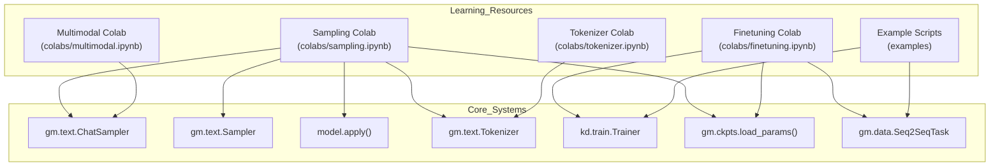
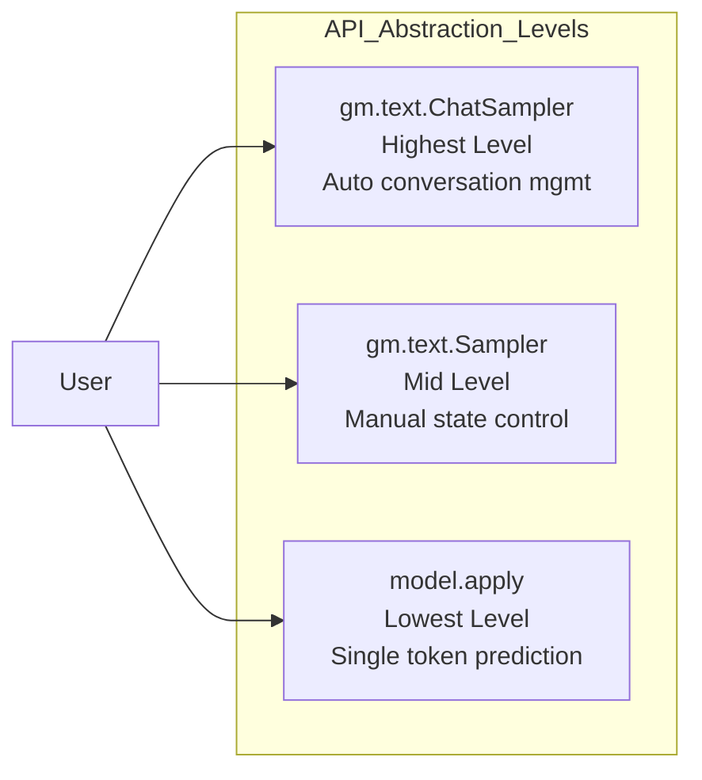
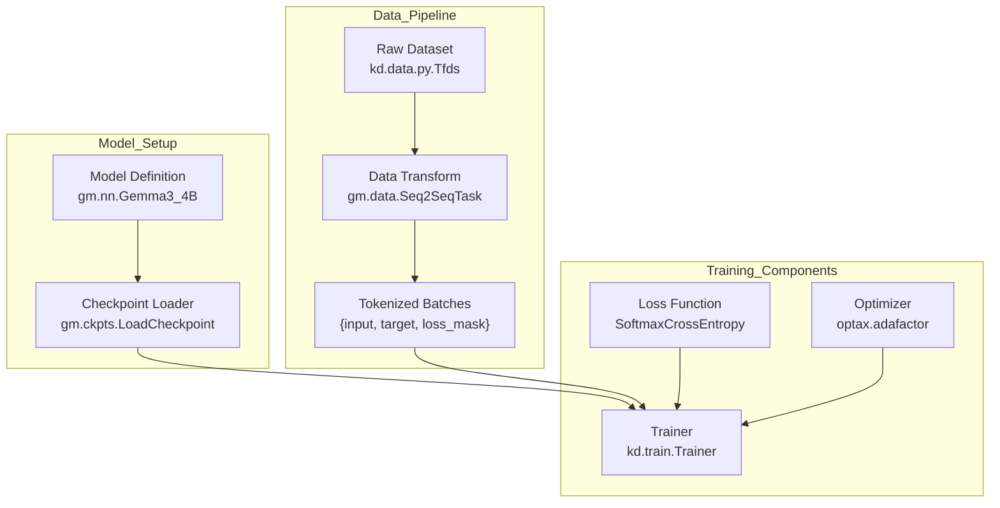

<!-- source: DeepWiki mcp.deepwiki.com · repo google-deepmind/gemma · page 7 Examples and Tutorials · fetched 2026-10-26 -->

# Examples and Tutorials

<details>
<summary>Relevant source files</summary>

The following files were used as context for generating this wiki page:

- [colabs/multimodal.ipynb](colabs/multimodal.ipynb)
- [colabs/quantization_aware_training.ipynb](colabs/quantization_aware_training.ipynb)
- [colabs/quantization_sampling.ipynb](colabs/quantization_sampling.ipynb)
- [colabs/sharding.ipynb](colabs/sharding.ipynb)
- [colabs/tokenizer.ipynb](colabs/tokenizer.ipynb)
- [colabs/tool_use.ipynb](colabs/tool_use.ipynb)
- [examples/lora.py](examples/lora.py)
- [examples/multimodal.py](examples/multimodal.py)
- [examples/seq2seq.py](examples/seq2seq.py)
- [examples/sharding.py](examples/sharding.py)
- [gemma/gm/evals/_sample.py](gemma/gm/evals/_sample.py)

</details>


This section provides practical examples and tutorials demonstrating key use cases of the Gemma library. The examples range from simple text generation to advanced fine-tuning scenarios, helping users understand how to apply Gemma's components in real-world applications.

For detailed documentation of specific components used in these examples, see [Text Generation](#4) for inference patterns, [Training and Fine-tuning](#6) for customization workflows, and [Tokenization](#5) for text preprocessing.

## Overview

The Gemma repository provides three types of learning resources:

| Resource Type | Purpose | Complexity | Location |
|---------------|---------|------------|----------|
| Quick Start Examples | Minimal code snippets for immediate use | Basic | [colabs/sampling.ipynb:15-19]() |
| Interactive Colabs | Step-by-step tutorials with explanations | Beginner to Intermediate | [colabs/]() |
| Production Scripts | Complete training configurations | Advanced | [examples/]() |

Sources: [colabs/sampling.ipynb:1-19](), [colabs/finetuning.ipynb:1-16]()

## Resource Topology

The following diagram shows how different example resources map to the core Gemma systems:



Sources: [colabs/sampling.ipynb:1-19](), [colabs/finetuning.ipynb:1-16](), [colabs/tokenizer.ipynb:9-15]()

## Quick Start Examples

The simplest way to interact with Gemma is through `gm.text.ChatSampler` with automatic multi-turn conversation management:

```python
from gemma import gm

model = gm.nn.Gemma3_4B()
params = gm.ckpts.load_params(gm.ckpts.CheckpointPath.GEMMA3_4B_IT)

sampler = gm.text.ChatSampler(
    model=model,
    params=params,
    multi_turn=True,
    print_stream=True,
)

turn0 = sampler.chat('Share one metaphor linking "shadow" and "laughter".')
```

This example demonstrates:
- Loading a pre-trained model with `gm.nn.Gemma3_4B()` [colabs/sampling.ipynb:95-95]()
- Loading checkpoint parameters with `gm.ckpts.load_params()` [colabs/sampling.ipynb:97-97]()
- Creating a conversational sampler with `gm.text.ChatSampler` [colabs/sampling.ipynb:134-139]()
- Multi-turn conversation state management [colabs/sampling.ipynb:108-114]()

Sources: [colabs/sampling.ipynb:86-141]()

## Interactive Colab Notebooks

The repository includes Jupyter notebooks hosted on Google Colab that provide interactive, browser-based tutorials.

### Available Notebooks

| Notebook | Focus Area | Key Components | Link |
|----------|-----------|----------------|------|
| **Sampling** | Text generation and inference | `ChatSampler`, `Sampler`, `model.apply` | [colabs/sampling.ipynb]() |
| **Finetuning** | Training and customization | `kd.train.Trainer`, `Seq2SeqTask` | [colabs/finetuning.ipynb]() |
| **Tokenizer** | Text preprocessing | `Gemma3Tokenizer`, special tokens | [colabs/tokenizer.ipynb]() |
| **Multimodal** | Image and text processing | `Gemma3_4B`, `images` parameter | [colabs/multimodal.ipynb]() |
| **LoRA Fine-tuning** | Parameter efficient training | `gm.nn.LoRA`, `SkipLoRA` | [colabs/lora_finetuning.ipynb]() |
| **LoRA Sampling** | Inference with LoRA weights | `peft.split_params`, `peft.merge_params` | [colabs/lora_sampling.ipynb]() |
| **Quantization Aware Training** | Low-bit training simulation | `QuantizationAwareWrapper` | [colabs/quantization_aware_training.ipynb]() |
| **Quantization Sampling** | Low-bit inference | `IntWrapper`, `peft.quantize` | [colabs/quantization_sampling.ipynb]() |
| **Sharding** | Multi-device scaling | `FSDPSharding`, `jax.device_count` | [colabs/sharding.ipynb]() |

Sources: [colabs/sampling.ipynb:1-20](), [colabs/finetuning.ipynb:1-16](), [colabs/lora_finetuning.ipynb:1-15](), [colabs/lora_sampling.ipynb:9-13](), [colabs/quantization_aware_training.ipynb:9-13](), [colabs/quantization_sampling.ipynb:9-13](), [colabs/sharding.ipynb:9-13]()

### Basic Inference (#7.1)

The sampling notebook demonstrates three levels of API abstraction:



Key sections in the notebook:
- **Multi-turn conversations**: Using `ChatSampler` with `multi_turn=True` [colabs/sampling.ipynb:108-141]().
- **Sampler**: Lower level API providing more control over the chat state [colabs/sampling.ipynb:18-18]().
- **Direct model access**: Calling `model.apply()` for single token prediction [colabs/sampling.ipynb:19-19]().

For details, see [Basic Inference](#7.1).

Sources: [colabs/sampling.ipynb:15-20]()

### Multimodal Generation (#7.2)

Multimodal examples demonstrate how to process non-text inputs alongside prompts, including fixed-grid layouts and variable-aspect-ratio image pipelines [colabs/multimodal.ipynb:1-14](), [examples/multimodal.py:1-45]().

For details, see [Multimodal Generation](#7.2).

Sources: [colabs/multimodal.ipynb:1-14](), [examples/multimodal.py:1-45]()

### Fine-tuning Examples (#7.3)

The finetuning notebooks and script directory demonstrate complete training pipelines using Kauldron:



Key examples:
- **Seq2Seq**: Standard prompt-response training using `gm.data.Seq2SeqTask` [examples/seq2seq.py:130-146]().
- **LoRA**: Parameter-efficient fine-tuning by wrapping models in `gm.nn.LoRA` and using `gm.ckpts.SkipLoRA` to preserve pre-trained weights [examples/lora.py:62-78]().
- **Quantization Aware Training (QAT)**: Using `gm.nn.QuantizationAwareWrapper` to replace linear layers with simulation layers for INT8 or INT4 [colabs/quantization_aware_training.ipynb:143-147]().

For details, see [Fine-tuning Examples](#7.3).

Sources: [examples/seq2seq.py:1-147](), [examples/lora.py:1-116](), [colabs/quantization_aware_training.ipynb:103-148]()

## Specialized Examples

### Quantization
Demonstrates inference with `gm.nn.IntWrapper` and `peft.quantize` to reduce memory footprint using `INT8` weights [colabs/quantization_sampling.ipynb:74-86]().
Sources: [colabs/quantization_sampling.ipynb:128-141]()

### Sharding
Shows how to run large models (e.g., 27B) on multiple devices using `kd.sharding.FSDPSharding` during parameter loading with `gm.ckpts.load_params` [colabs/sharding.ipynb:131-157]().
Sources: [colabs/sharding.ipynb:131-157]()

## Installation Requirements

All examples require:
1. JAX installation configured for your hardware.
2. Gemma package: `pip install gemma` [colabs/sampling.ipynb:28-28]().
3. GPU memory optimization: `os.environ["XLA_PYTHON_CLIENT_MEM_FRACTION"]="1.00"` [colabs/sampling.ipynb:75-75]().

Sources: [colabs/sampling.ipynb:28-75](), [colabs/finetuning.ipynb:24-72]()

---

