# Page: Overview

# Overview

<details>
<summary>Relevant source files</summary>

The following files were used as context for generating this wiki page:

- [CHANGELOG.md](CHANGELOG.md)
- [README.md](README.md)
- [docs/checkpoints.md](docs/checkpoints.md)
- [docs/images/favicon.png](docs/images/favicon.png)
- [docs/overview.md](docs/overview.md)
- [gemma/__init__.py](gemma/__init__.py)
- [pyproject.toml](pyproject.toml)

</details>


## Purpose and Scope

The Gemma repository provides a JAX-based library for the Gemma family of open-weights Large Language Models (LLMs) developed by Google DeepMind, based on Gemini research and technology [README.md:7-13](). The library supports text generation, multi-modal conversations (including image and audio inputs), parameter-efficient fine-tuning (LoRA, DPO/NPO), evaluation workflows, and diffusion-based text generation [README.md:31-68](), [CHANGELOG.md:26-28]().

The library is built on [JAX](https://github.com/jax-ml/jax) and [Flax](https://github.com/google/flax) for model definitions and integrates with the [Kauldron](https://github.com/google-research/kauldron) framework for training [pyproject.toml:42-46](). Core functionality is exposed through the `gemma.gm` namespace, which aggregates submodules for checkpoints, data, neural networks, and text processing [gemma/__init__.py:22-27]().

This overview covers repository architecture, installation, and basic usage patterns. For detailed subsystem documentation, see:
- [Package Structure](#1.1) — Organization of the `gemma.gm` package and its submodules.
- [Installation and Setup](#1.2) — Hardware configuration, JAX setup, and checkpoint downloading.

Sources: [README.md:7-13](), [README.md:31-68](), [pyproject.toml:42-46](), [gemma/__init__.py:22-27](), [CHANGELOG.md:26-28]()

## Repository Architecture

The Gemma repository implements a layered architecture where high-level samplers orchestrate lower-level neural network components, tokenizers, and checkpoint loaders.

### System Architecture Overview

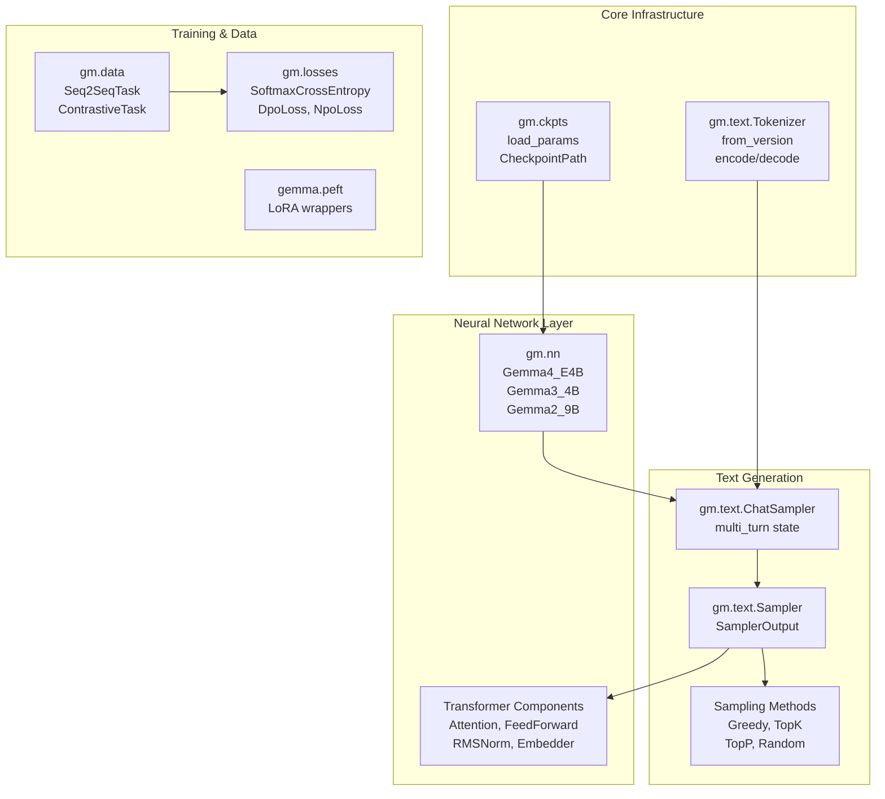

Sources: [README.md:35-58](), [pyproject.toml:34-58]()

## Inference Pipeline: User Input to Generated Text

The library provides multiple levels of abstraction for text generation, supporting the transition from natural language and multimodal inputs to JAX code execution.

### Inference Flow: Natural Language to Code Entities


**Abstraction Levels:**

| Level | API | Use Case |
|-------|-----|----------|
| **High** | `ChatSampler` | Conversational interfaces with automatic multi-turn state management and multimodal dispatch [README.md:43-47](). |
| **Mid** | `Sampler` | Mid-level API for manual state control, batch handling, and custom sampling configuration. |
| **Low** | `model.apply()` | Direct access to model parameters and KV cache for research or custom loops. |

Sources: [README.md:35-58](), [README.md:43-47]()

## Installation and Setup

### System Requirements
Gemma can run on CPU, GPU, and TPU. For GPU, 8GB+ RAM is recommended for 2B models, and 24GB+ for 7B+ models [README.md:90-94]().

### Quick Start
1.  **Install JAX**: Follow platform-specific instructions for CPU/GPU/TPU [README.md:22-23]().
2.  **Install Gemma**:
    ```sh
    pip install gemma
    ```
3.  **Download Weights**: Models are available via KaggleHub [docs/checkpoints.md:3-10]().
    ```python
    import kagglehub
    # Login required for some models
    kagglehub.login()
    # Download specific version
    weights_dir = kagglehub.model_download('google/gemma-3/flax/gemma3-4b-it')
    ```

For a detailed guide, see [Installation and Setup](#1.2).

Sources: [README.md:20-29](), [README.md:90-94](), [docs/checkpoints.md:3-33]()

## Basic Usage Patterns

### Multi-turn, Multi-modal Conversation
The `ChatSampler` provides a high-level API for interacting with Gemma models, supporting images and conversation history [README.md:35-58]().

```python
from gemma import gm

# Initialize Model and Parameters
model = gm.nn.Gemma4_E4B()
params = gm.ckpts.load_params(gm.ckpts.CheckpointPath.GEMMA4_E4B_IT)

# Setup Stateful Sampler
sampler = gm.text.ChatSampler(
    model=model,
    params=params,
    multi_turn=True,
)

# Multimodal interaction
prompt = "Which of the 2 images do you prefer? Image 1: <|image|> Image 2: <|image|>"
out = sampler.chat(prompt, images=[image1, image2])
```

Sources: [README.md:35-58]()

## Development and Testing

The repository uses `pytest` for unit testing and `pyink` for formatting to follow the Google style guide [pyproject.toml:72-78]().

- **Unittests**: Automated via GitHub Actions using `pytest-xdist` for parallel execution [README.md:3-4](), [pyproject.toml:72-78]().
- **Versioning**: A new PyPI release is triggered whenever `__version__` in `gemma/__init__.py` is increased [gemma/__init__.py:17-19]().
- **Import Convention**: The library enforces `from gemma import gm` and will raise an `AttributeError` if `import gemma as gm` is attempted to ensure correct namespace usage [gemma/__init__.py:22-27]().

For detailed contributor information, see [Development](#8).

Sources: [README.md:3-4](), [gemma/__init__.py:17-27](), [pyproject.toml:72-78]()

---

# Page: Package Structure

# Package Structure

<details>
<summary>Relevant source files</summary>

The following files were used as context for generating this wiki page:

- [CHANGELOG.md](CHANGELOG.md)
- [gemma/__init__.py](gemma/__init__.py)
- [gemma/gm/__init__.py](gemma/gm/__init__.py)
- [gemma/gm/ckpts/__init__.py](gemma/gm/ckpts/__init__.py)
- [gemma/gm/math/__init__.py](gemma/gm/math/__init__.py)
- [gemma/gm/math/_misc_test.py](gemma/gm/math/_misc_test.py)

</details>


This document details the organization of the Gemma library's package structure, focusing on the `gemma.gm` Kauldron API, its submodules (`ckpts`, `nn`, `text`, `data`, etc.), the import conventions enforced by `__init__.py`, the `gm` namespace structure, and the top-level `gemma.diffusion`, `gemma.peft`, and `gemma.research` packages.

## Overview and Top-Level Package Organization

The Gemma library is organized around a strictly controlled root namespace that guides users toward correct import patterns and exposes specialized top-level packages alongside the main Kauldron-based API.

**Natural Language Space to Code Entity Space: Import Control and Top-Level Packages**
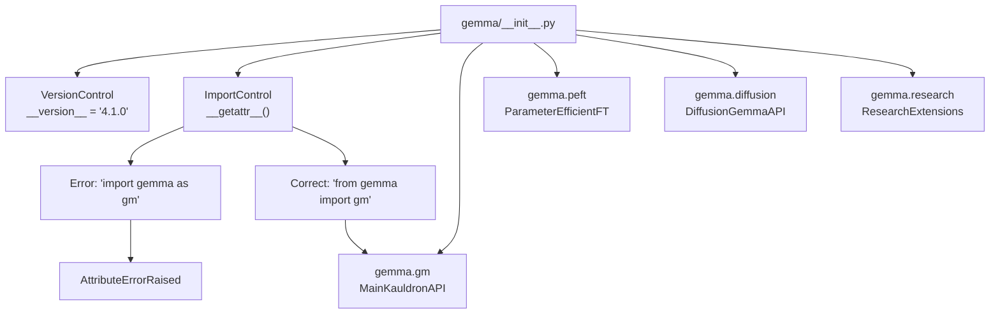

The root package `gemma` implements a guarded `__getattr__` method in `gemma/__init__.py` to intercept incorrect top-level imports:
- **Incorrect**: `import gemma as gm` → Triggers `__getattr__` and raises an `AttributeError` pointing to the correct pattern [gemma/__init__.py:22-27]().
- **Correct**: `from gemma import gm` → Exposes the Kauldron-compatible submodule ecosystem [gemma/gm/__init__.py:21-34]().

The top-level package exports the package version (`__version__ = '4.1.0'`) which is synchronized with automated PyPI releases and `CHANGELOG.md` entries [gemma/__init__.py:17-19](), [CHANGELOG.md:26-29]().

Sources: [gemma/__init__.py:1-27](), [CHANGELOG.md:24-46]()

## Kauldron API Structure (`gemma.gm`)

The `gemma.gm` package provides the core JAX/Kauldron framework interface for building, loading, and training Gemma models. It relies on lazy loading via `etils.epy.lazy_api_imports` to avoid premature instantiation of heavy submodules [gemma/gm/__init__.py:17-34]().

**Natural Language Space to Code Entity Space: Kauldron API & Submodules**
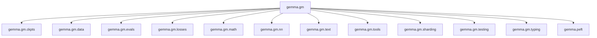

The lazy import mechanism defers submodule evaluation until accessed, ensuring fast startup times and minimal memory consumption.

Sources: [gemma/gm/__init__.py:15-34]()

## Submodule Organization

The `gemma.gm` namespace and auxiliary top-level packages are organized into core, specialized, and research modules.

### Core Modules

| Module | Purpose | Key Components |
|--------|---------|----------------|
| `nn` | Neural network building blocks | Transformer architectures, attention mechanisms, embeddings [gemma/gm/__init__.py:28-28]() |
| `text` | Text processing and generation | `Tokenizer`, `Sampler`, `ChatSampler` [gemma/gm/__init__.py:29-29]() |
| `ckpts` | Model checkpoint management | `load_params`, `save_params`, `LoadCheckpoint`, `SkipLoRA` [gemma/gm/ckpts/__init__.py:19-24]() |
| `data` | Data pipeline utilities | `Seq2SeqTask`, `ContrastiveTask`, Parquet loaders [gemma/gm/__init__.py:24-24]() |

Sources: [gemma/gm/__init__.py:23-30](), [gemma/gm/ckpts/__init__.py:15-24]()

### Specialized and Auxiliary Modules

| Module | Purpose | Key Components |
|--------|---------|----------------|
| `evals` | Model evaluation | `SamplerEvaluator` [gemma/gm/__init__.py:25-25]() |
| `losses` | Training loss functions | Cross-entropy, DPO, and NPO losses [gemma/gm/__init__.py:26-26]() |
| `tools` | External tool integration | `ToolSampler`, `McpToolHandler` [gemma/gm/__init__.py:30-30]() |
| `sharding` | Model parallelism | FSDP and mesh sharding utilities [gemma/gm/__init__.py:31-31]() |
| `math` | Mathematical operations | `apply_rope`, `count_consecutive` [gemma/gm/math/__init__.py:15-21]() |
| `testing` | Development utilities | Test fixtures and mock routines [gemma/gm/__init__.py:32-32]() |
| `typing` | Type definitions | Shared type annotations [gemma/gm/__init__.py:33-33]() |

Sources: [gemma/gm/__init__.py:25-33](), [gemma/gm/math/__init__.py:15-21]()

### Top-Level Extension Packages

Beyond `gemma.gm`, the codebase exposes specialized top-level packages:
- `gemma.diffusion`: Implements diffusion-based (non-autoregressive) text generation models, sampling processes, and the Hackable Diffusion fine-tuning adapter.
- `gemma.peft`: Provides parameter-efficient fine-tuning primitives (such as LoRA and quantization-aware wrappers) exposed both at the top-level and via `gm.peft` [gemma/gm/__init__.py:34-34]().
- `gemma.research`: Houses experimental architectures and research extensions like T5Gemma (an encoder-decoder model based on Gemma 2).

Sources: [gemma/gm/__init__.py:34-34](), [CHANGELOG.md:28-28]()

---

# Page: Installation and Setup

# Installation and Setup

<details>
<summary>Relevant source files</summary>

The following files were used as context for generating this wiki page:

- [README.md](README.md)
- [docs/checkpoints.md](docs/checkpoints.md)
- [docs/images/favicon.png](docs/images/favicon.png)
- [examples/classification.py](examples/classification.py)
- [gemma/gm/ckpts/_paths.py](gemma/gm/ckpts/_paths.py)
- [pyproject.toml](pyproject.toml)

</details>


This document provides comprehensive technical instructions for installing the Gemma library and configuring your environment for inference and training. It covers Python and JAX installation, hardware configuration, package installation, checkpoint downloading from KaggleHub, and cache directory setup.

For information about loading checkpoints after installation, see [Checkpoint Management](). For quick start examples, see [Overview]().

---

## Installation Overview

The Gemma installation process consists of three main components that must be configured in sequence:

### Installation Flow

```mermaid
graph LR
    "Start"["Start"] --> "Python"["Python 3.12+<br/>Installation"]
    "Python" --> "JAX"["JAX Backend<br/>Configuration"]
    "JAX" --> "Gemma"["gemma Package<br/>pip install"]
    "Gemma" --> "Checkpoints"["Model Checkpoints<br/>KaggleHub Download"]
    "Checkpoints" --> "Cache"["Cache Setup<br/>~/.gemma"]
    "Cache" --> "Ready"["Ready to Use"]
    
    "JAX" -.CPU.-> "JAXCPU"["jax[cpu]"]
    "JAX" -.GPU.-> "JAXGPU"["jax[cuda12]"]
    "JAX" -.TPU.-> "JAXTPU"["jax[tpu]"]
```
Sources: [README.md:20-28](), [pyproject.toml:7-51]()

---

## Prerequisites

### Python Version

Gemma requires **Python 3.12 or higher**.

Sources: [pyproject.toml:7]()

### System Requirements

Gemma can run on CPU, GPU, and TPU. Hardware recommendations are based on model size and parameter counts:

| Model Size | Recommended GPU RAM |
|------------|---------------------|
| 2B (Gemma 2) | 8GB+ |
| 7B/9B | 24GB+ |
| 27B+ | 80GB+ (A100/H100 recommended) |

Sources: [README.md:90-94]()

---

## Step 1: Install JAX

JAX must be installed **before** the `gemma` package, configured for your target hardware backend.

### For CPU

```bash
pip install jax
```

### For GPU (CUDA 12)

```bash
pip install jax[cuda12]
```

### For TPU

```bash
pip install jax[tpu]
```

### Verification

```python
import jax
print(jax.devices())  # Should show your configured devices
```

For detailed instructions and other hardware configurations, see the [official JAX installation guide](https://jax.readthedocs.io/en/latest/installation.html).

Sources: [README.md:22-23](), [pyproject.toml:40]()

---

## Step 2: Install Gemma Package

After JAX is configured, install the `gemma` package from PyPI:

```bash
pip install gemma
```

### Core Dependencies

The `gemma` package automatically installs the following core dependencies as specified in the project metadata:

| Dependency | Purpose |
|------------|---------|
| `jax` | Core numerical computation framework |
| `flax` | Neural network library built on JAX |
| `sentencepiece` | Tokenization backend |
| `orbax-checkpoint` | Checkpoint loading and saving |
| `kauldron` | Training framework integration |
| `einops` | Tensor shape manipulation |
| `etils` | Utility libraries (epath, etree, etc.) |
| `jaxtyping` | Type annotations for JAX arrays |
| `grain` | Data loading (non-Windows platforms) |
| `fastmcp` / `mcp` | Model Context Protocol for Tool Use |

Sources: [pyproject.toml:34-51]()

### Optional Development Dependencies

For contributors and developers, additional tools for testing and linting are available:

```bash
pip install -e .[dev]
```

This installs `pytest`, `pytest-xdist`, `pylint`, and `pyink` (Google-style formatter).

Sources: [pyproject.toml:62-70](), [pyproject.toml:72-78]()

---

## Step 3: Download Model Checkpoints

Gemma model checkpoints are hosted on **KaggleHub** and must be downloaded before use.

### Checkpoint Download Flow

```mermaid
graph TB
    "User"["User Application"] --> "LoadParams"["gm.ckpts.load_params"]
    "LoadParams" --> "CheckCache"["Check Local Cache<br/>~/.gemma/ckpts/"]
    "CheckCache" -->|Cache Hit| "LocalCkpt"["Load from<br/>Local Cache"]
    "CheckCache" -->|Cache Miss| "KaggleAPI"["kagglehub.model_download"]
    "KaggleAPI" --> "KaggleHub"[("KaggleHub<br/>Cloud Storage")]
    "KaggleHub" --> "Download"["Download Checkpoint"]
    "Download" --> "SaveCache"["Save to Cache"]
    "SaveCache" --> "LocalCkpt"
    "LocalCkpt" --> "Params"["Model Parameters<br/>(PyTree)"]
    
    "Tokenizer"["gm.text.Tokenizer"] --> "TokenCache"["Check Token Cache<br/>~/.gemma/tokenizer/"]
    "TokenCache" -->|Cache Hit| "LocalToken"["Load from<br/>Local Cache"]
    "TokenCache" -->|Cache Miss| "GCS"["gs://gemma-data/<br/>tokenizers/"]
    "GCS" --> "DownloadToken"["Download Tokenizer"]
    "DownloadToken" --> "SaveTokenCache"["Save to Cache"]
    "SaveTokenCache" --> "LocalToken"
```
Sources: [docs/checkpoints.md:3-33](), [README.md:85-88]()

### Method 1: Automatic Download via `load_params`

The library provides a `CheckpointPath` enum (`gemma/gm/ckpts/_paths.py`) with hardcoded paths for all Gemma versions (2, 3, 3n, 4).

```python
from gemma import gm

# Automatically downloads from KaggleHub on first use
params = gm.ckpts.load_params(gm.ckpts.CheckpointPath.GEMMA4_E4B_IT)
```
Sources: [gemma/gm/ckpts/_paths.py:20-76](), [README.md:36-40]()

### Method 2: Manual KaggleHub Download

For more control, use the `kagglehub` library directly. Ensure you select the **Flax** model variations.

```python
import kagglehub

# Authenticate (interactive on first use)
kagglehub.login()

# Download specific model variant
weights_dir = kagglehub.model_download('google/gemma-3/flax/gemma3-4b-it')
```

### Available Model Variants (KaggleHub)

| Family | Size | Variant | KaggleHub Path |
|--------|------|---------|----------------|
| Gemma 4 | E2B/E4B/31B | IT/PT | `google/gemma-4/flax/gemma4-*` |
| Gemma 3 | 1B - 27B | PT | `google/gemma-3/flax/gemma3-{size}` |
| Gemma 3 | 1B - 27B | IT | `google/gemma-3/flax/gemma3-{size}-it` |
| Gemma 3 | 1B - 27B | Quantized | `google/gemma-3/flax/gemma3-{size}-it-int4` |
| Gemma 2 | 2.6B - 27B | IT/PT | `google/gemma-2/flax/gemma2-{size}*` |

Sources: [docs/checkpoints.md:3-85](), [README.md:38-40]()

---

## Step 4: Configure Cache Directory

Gemma caches downloaded files to avoid repeated network requests.

### Default Cache Location

By default, Gemma caches files in: `~/.gemma/`.

### Checkpoint Directory Structure

Downloaded checkpoints from KaggleHub follow this structure:

```
<download_dir>/
├── 2b/                 # Directory containing model weights
│   └── <weight_files>  # Weight shards
└── tokenizer.model     # SentencePiece tokenizer model
```
Sources: [docs/checkpoints.md:18-23]()

---

## Step 5: Verify Installation

Verify the setup with a minimal Gemma 4 example using `ChatSampler` and `load_params`.

```python
from gemma import gm
import jax

# 1. Check JAX devices
print(f"JAX devices: {jax.devices()}")

# 2. Initialize Model and parameters
model = gm.nn.Gemma4_E4B()
params = gm.ckpts.load_params(gm.ckpts.CheckpointPath.GEMMA4_E4B_IT)

# 3. Example of multi-turn conversation
sampler = gm.text.ChatSampler(
    model=model,
    params=params,
    multi_turn=True,
)

out = sampler.chat("What's the capital of France?")
print(f"Response: {out}")
```
Sources: [README.md:32-58](), [gemma/gm/ckpts/_paths.py:20-76]()

---

## Component Installation Details

### Package Components and Their Sources

```mermaid
graph TB
    subgraph "PyPI Installation"
        "PipInstall"["pip install gemma"]
        "GemmaPkg"["gemma Package"]
        "PipInstall" --> "GemmaPkg"
    end
    
    subgraph "Gemma Package Contents"
        "GemmaPkg" --> "CoreCode"["Core Code<br/>gm.nn, gm.text, gm.ckpts"]
        "GemmaPkg" --> "Dependencies"["Auto-installed<br/>Dependencies (pyproject.toml)"]
    end
    
    subgraph "External Downloads"
        "Tokenizers"["Tokenizer Models<br/>gs://gemma-data/tokenizers/"]
        "Checkpoints"["Model Weights<br/>KaggleHub / gs://gemma-data/"]
    end
    
    subgraph "Local Filesystem"
        "Cache"["~/.gemma/<br/>Cache Directory"]
        "Tokenizers" -.cached to.-> "Cache"
        "Checkpoints" -.cached to.-> "Cache"
    end
    
    "CoreCode" -.loads from.-> "Cache"
    
    subgraph "JAX Backend"
        "JAXInstall"["pip install jax[backend]"]
        "Backend"["CPU / GPU / TPU Acceleration"]
        "JAXInstall" --> "Backend"
    end
    
    "GemmaPkg" -.depends on.-> "Backend"
```
Sources: [pyproject.toml:34-51](), [README.md:20-28]()

### Troubleshooting

| Issue | Solution |
|-------|----------|
| `ImportError: No module named 'jax'` | Install JAX before Gemma: `pip install jax[cpu]` |
| `ModuleNotFoundError: No module named 'gemma'` | Run `pip install gemma` |
| JAX not using GPU | Reinstall JAX with CUDA support: `pip install jax[cuda12]` |
| KaggleHub 403 Forbidden | Ensure you have accepted the Gemma license on Kaggle and called `kagglehub.login()` |
| Out of memory (OOM) | Gemma models are memory intensive. Ensure you meet the [System Requirements](#system-requirements). |

Sources: [README.md:90-94](), [docs/checkpoints.md:30-33]()

---

# Page: Checkpoint Management

# Checkpoint Management

<details>
<summary>Relevant source files</summary>

The following files were used as context for generating this wiki page:

- [gemma/gm/ckpts/__init__.py](gemma/gm/ckpts/__init__.py)
- [gemma/gm/ckpts/_checkpoint.py](gemma/gm/ckpts/_checkpoint.py)
- [gemma/gm/ckpts/_lora.py](gemma/gm/ckpts/_lora.py)

</details>


## Purpose and Scope

The checkpoint management system provides the bridge between stored model weights and the running Gemma models. It handles loading pre-trained weights from multiple sources, saving fine-tuned models, and converting between different checkpoint formats. This system serves as a foundational infrastructure component in the Gemma repository.

As a parent page, this section offers a high-level overview of the checkpoint ecosystem. Detailed documentation for specific sub-topics is delegated to the following child pages:
- **Loading Parameters**: Documenting `load_params` function, checkpoint paths, format conversion (`NESTED`, `FLAT`, `STACKED`, `KAULDRON`), and multimodal parameter handling [Loading Parameters](#2.1).
- **Saving Parameters**: Documenting `save_params` function and Orbax integration for checkpoint serialization, including `wait_until_finished` and `release_memory` [Saving Parameters](#2.2).
- **Special Loaders**: Documenting `LoadCheckpoint`, `SkipLoRA`, and `AnchoredPolicyLoader` for specialized restoration scenarios [Special Loaders](#2.3).

Sources: [gemma/gm/ckpts/_checkpoint.py:1-309](), [gemma/gm/ckpts/_paths.py:1-76]()

## System Architecture

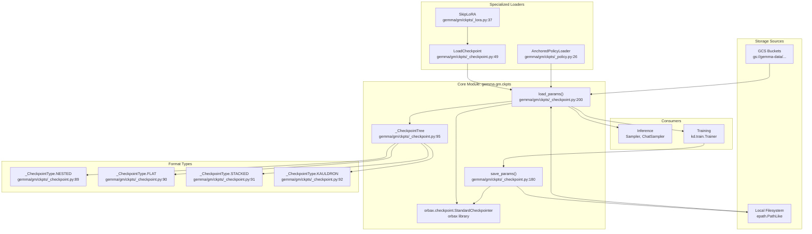

**Diagram: Checkpoint Management System Architecture**

The architecture diagram maps natural language operations to their corresponding code entities in `gemma.gm.ckpts`. Storage backends feed into `load_params()` and `save_params()`, while format detection and conversion are mediated by `_CheckpointTree`.

Sources: [gemma/gm/ckpts/_checkpoint.py:48-170](), [gemma/gm/ckpts/_paths.py:20-76](), [gemma/gm/ckpts/_lora.py:37-53](), [gemma/gm/ckpts/_policy.py:26-37]()

## Checkpoint Formats

The checkpoint system supports four distinct layout structures managed through the `_CheckpointType` enumeration [gemma/gm/ckpts/_checkpoint.py:72-92](). Automatic format detection inspects key naming conventions to translate internal or legacy formats into the standard Flax `NESTED` structure required by model initialization.

| Format | Description | Structure / Key Pattern | Use Case |
|--------|-------------|-------------------------|----------|
| **NESTED** | Standard Flax structure | `{'layer_0': {'attn': ...}}` | Model initialization and inference [gemma/gm/ckpts/_checkpoint.py:76-77]() |
| **FLAT** | Legacy flat dictionary | `{'transformer/layer_0/attn/...': ...}` | Official Gemma release checkpoints [gemma/gm/ckpts/_checkpoint.py:78-81]() |
| **STACKED** | Attention-pattern stacking | `{'transformer/stacked_layers/...': ...}` | Internal optimization [gemma/gm/ckpts/_checkpoint.py:82-84]() |
| **KAULDRON** | Full training state | `{'params': ..., 'opt_state': ..., 'step': ...}` | Training checkpoints [gemma/gm/ckpts/_checkpoint.py:85-87]() |

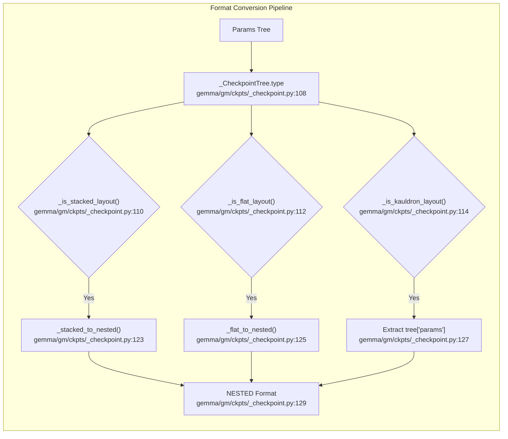

**Diagram: Checkpoint Format Detection and Conversion Flow**

The conversion pipeline identifies layout types using `_CheckpointTree` properties and applies the appropriate transformation function to yield a standard `NESTED` structure.

Sources: [gemma/gm/ckpts/_checkpoint.py:72-131](), [gemma/gm/ckpts/_checkpoint.py:315-331](), [gemma/gm/ckpts/_checkpoint.py:407-423]()

For comprehensive details on format conversion rules and path resolution, see [Loading Parameters](#2.1).

## Core Operations Overview

Checkpoint management revolves around two primary operations: loading parameters via `load_params()` [gemma/gm/ckpts/_checkpoint.py:200-208]() and saving them via `save_params()` [gemma/gm/ckpts/_checkpoint.py:180-185](). 

- **Loading**: `load_params()` handles path resolution, tree structuring, format conversion, memory donation (`donate=True`), optional quantization mapping (`quantize=True`), and multimodal filtering (`text_only=True`).
- **Saving**: `save_params()` serializes parameter trees to disk using Orbax's `StandardCheckpointer`, supporting asynchronous completion flags (`wait_until_finished`).

For technical specifics on loading pipelines, see [Loading Parameters](#2.1). For serialization behavior and memory management (`release_memory`), see [Saving Parameters](#2.2).

Sources: [gemma/gm/ckpts/_checkpoint.py:180-208]()

## Specialized Loaders and Integrations

To support advanced workflows such as training with Kauldron or fine-tuning with PEFT/LoRA, the system provides specialized loader classes that implement `kd.ckpts.InitTransform`:

- **LoadCheckpoint**: Integrates Gemma parameter loading into Kauldron training states (`TrainState`) [gemma/gm/ckpts/_checkpoint.py:48-70]().
- **SkipLoRA**: Preserves active LoRA adapter weights while restoring base model parameters from a checkpoint [gemma/gm/ckpts/_lora.py:37-53]().
- **AnchoredPolicyLoader**: Manages decoupled restoration of policy and anchor weights for preference optimization tasks [gemma/gm/ckpts/_policy.py:26-71]().

For detailed implementations and configuration examples, see [Special Loaders](#2.3).

Sources: [gemma/gm/ckpts/_checkpoint.py:48-70](), [gemma/gm/ckpts/_lora.py:37-53](), [gemma/gm/ckpts/_policy.py:26-71]()

## Public API Summary

The public checkpoint API is exposed through `gemma.gm.ckpts` [gemma/gm/ckpts/__init__.py:19-24]():

| Symbol | Type | Code Reference | Purpose |
|--------|------|----------------|---------|
| `load_params` | Function | [gemma/gm/ckpts/_checkpoint.py:200]() | Primary entry point for loading model weights |
| `save_params` | Function | [gemma/gm/ckpts/_checkpoint.py:180]() | Primary entry point for saving model weights |
| `LoadCheckpoint` | Class | [gemma/gm/ckpts/_checkpoint.py:49]() | Kauldron-integrated checkpoint loader transform |
| `SkipLoRA` | Class | [gemma/gm/ckpts/_lora.py:37]() | LoRA-aware parameter restoration wrapper |
| `AnchoredPolicyLoader` | Class | [gemma/gm/ckpts/_policy.py:26]() | Specialized loader for DPO/NPO policy models |
| `CheckpointPath` | Enum | [gemma/gm/ckpts/_paths.py:20]() | Predefined paths for official Gemma checkpoints |

Sources: [gemma/gm/ckpts/__init__.py:19-24](), [gemma/gm/ckpts/_paths.py:20-76]()

---

# Page: Loading Parameters

# Loading Parameters

<details>
<summary>Relevant source files</summary>

The following files were used as context for generating this wiki page:

- [examples/classification.py](examples/classification.py)
- [gemma/gm/ckpts/_checkpoint.py](gemma/gm/ckpts/_checkpoint.py)
- [gemma/gm/ckpts/_compat.py](gemma/gm/ckpts/_compat.py)
- [gemma/gm/ckpts/_lora.py](gemma/gm/ckpts/_lora.py)
- [gemma/gm/ckpts/_paths.py](gemma/gm/ckpts/_paths.py)
- [gemma/gm/ckpts/_quantization.py](gemma/gm/ckpts/_quantization.py)
- [gemma/gm/typing/__init__.py](gemma/gm/typing/__init__.py)
- [gemma/gm/typing/_common.py](gemma/gm/typing/_common.py)

</details>


This document covers parameter loading in Gemma, focusing on the `load_params` function, checkpoint format handling, and multimodal parameter support. For parameter saving, see section 2.2. For specialized loaders like `LoadCheckpoint` and `SkipLoRA`, see section 2.3.

## Overview

The `load_params` function is the primary entry point for loading model parameters from checkpoints. It is exposed through the public API at [gemma/gm/ckpts/__init__.py:19]() and implemented in [gemma/gm/ckpts/_checkpoint.py:200-309]().

The function handles:
- Multiple checkpoint format types (NESTED, FLAT, STACKED, KAULDRON)
- Automatic format detection and conversion
- Multimodal parameter filtering with `text_only` option
- Distributed loading with sharding specifications
- Memory management with the `donate` parameter
- Quantization-aware training format conversion

**Sources:** [gemma/gm/ckpts/__init__.py:19](), [gemma/gm/ckpts/_checkpoint.py:200-309]()

## Function Signature and Parameters

The `load_params` function provides extensive configuration for parameter restoration:

| Parameter | Type | Default | Description |
|-----------|------|---------|-------------|
| `path` | `epath.PathLike` | Required | Path to the Orbax checkpoint directory |
| `params` | `Params \| None` | `None` | Target parameter structure defining output sharding and shape |
| `donate` | `bool` | `True` | If True, releases memory from input `params` via `jax.Array.delete()` |
| `text_only` | `bool` | `False` | If True, skips loading multimodal parameters (vision_encoder, etc.) |
| `sharding` | `kd.sharding.ShardingTree \| None` | `None` | Explicit sharding specification (mutually exclusive with `params`) |
| `quantize` | `bool` | `False` | If True, converts params to quantization-aware training format |

The function returns a `Params` dictionary matching the NESTED format (Flax `model.init()` structure).

**Sources:** [gemma/gm/ckpts/_checkpoint.py:200-226]()

## Checkpoint Storage Locations

Checkpoints can be loaded from three primary sources:

**Natural Language to Code Entity Space: Checkpoint Sources**

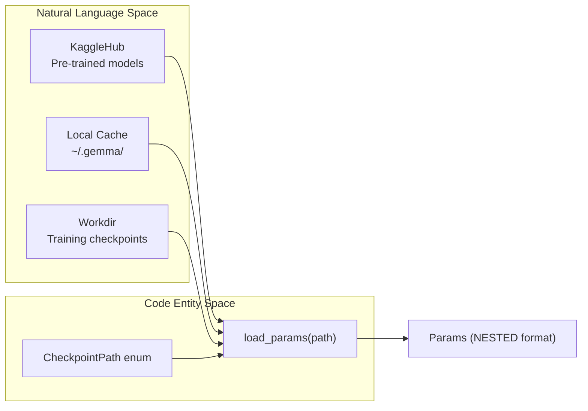

Gemma also provides a `CheckpointPath` enum containing hardcoded Google Cloud Storage paths for standard models across Gemma 2, 3, 3n, and 4.

**Sources:** [gemma/gm/ckpts/_checkpoint.py:200-226](), [gemma/gm/ckpts/_paths.py:20-76]()

## Checkpoint Format Types

The system supports four distinct checkpoint formats through the `_CheckpointType` enum defined in [gemma/gm/ckpts/_checkpoint.py:72-92]():

### Format Type Descriptions

| Format | Structure | Example Keys | Use Case |
|--------|-----------|--------------|----------|
| `NESTED` | Nested dictionary matching Flax `model.init()` | `{'layer_0': {'attn': {...}}}` | Final output format, user-facing |
| `FLAT` | Flat dictionary with path-like keys | `{'transformer/layer_0/attn/_key_norm': ...}` | Legacy official Gemma checkpoints |
| `STACKED` | Flat dictionary with stacked layer parameters | `{'transformer/stacked_layers/...': ...}` | Intermediate format for layer patterns |
| `KAULDRON` | Training state with params, optimizer, step | `{'params': ..., 'opt_state': ..., 'step': ...}` | Kauldron training checkpoints |

**Sources:** [gemma/gm/ckpts/_checkpoint.py:72-92]()

### Format Detection and Conversion Flow

The `_CheckpointTree` class handles format detection and conversion:

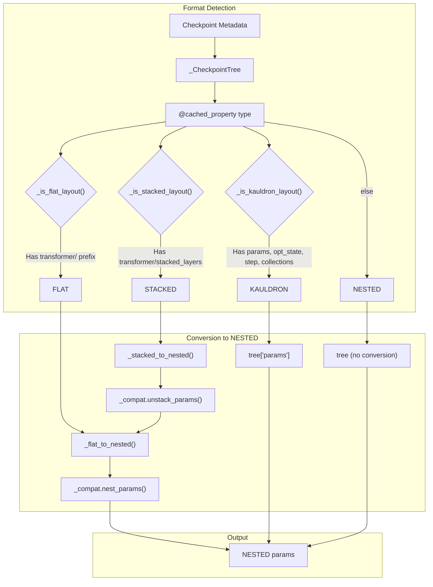

**Sources:** [gemma/gm/ckpts/_checkpoint.py:107-131](), [gemma/gm/ckpts/_checkpoint.py:315-374](), [gemma/gm/ckpts/_compat.py:54-63](), [gemma/gm/ckpts/_compat.py:112-157]()

## Loading Pipeline

The `load_params` function executes a multi-stage pipeline:

**Natural Language to Code Entity Space: Restoration Pipeline**

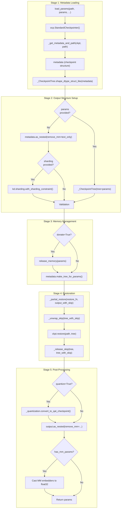

**Sources:** [gemma/gm/ckpts/_checkpoint.py:200-309]()

### Pipeline Stage Details

The pipeline stages correspond to specific code sections:

| Stage | Lines | Key Operations |
|-------|-------|----------------|
| Metadata Loading | [gemma/gm/ckpts/_checkpoint.py:230-234]() | Checkpoint metadata extraction, format detection |
| Output Structure Setup | [gemma/gm/ckpts/_checkpoint.py:241-262]() | Create target structure, validate format, apply sharding |
| Memory Management | [gemma/gm/ckpts/_checkpoint.py:236-238]() | Optional memory release with `donate` parameter |
| Restoration | [gemma/gm/ckpts/_checkpoint.py:270-275]() | Orbax restore with format conversion |
| Post-Processing | [gemma/gm/ckpts/_checkpoint.py:277-309]() | Quantization conversion, MM parameter casting |

**Sources:** [gemma/gm/ckpts/_checkpoint.py:200-309]()

## Format Conversion Implementation

The format conversion system uses the `_CheckpointTree` class and helper functions:

### NESTED Format (Target Output)

All checkpoints are converted to NESTED format, which matches the Flax `model.init()` structure:

```python
{
  'embedder': {...},
  'layer_0': {
    'attn': {...},
    'mlp': {...}
  },
  'layer_1': {...},
  'final_norm': {...}
}
```

### Conversion Functions

| Source Format | Conversion Function | Implementation |
|---------------|---------------------|----------------|
| FLAT → NESTED | `_flat_to_nested()` | [gemma/gm/ckpts/_checkpoint.py:322-340]() |
| STACKED → NESTED | `_stacked_to_nested()` | [gemma/gm/ckpts/_checkpoint.py:315-319]() |
| NESTED → FLAT | `_nested_to_flat()` | [gemma/gm/ckpts/_checkpoint.py:350-361]() |
| NESTED → STACKED | `_nested_to_stacked()` | [gemma/gm/ckpts/_checkpoint.py:343-347]() |

The conversion process uses compatibility utilities in `_compat` module:
- `_compat.nest_params()`: Convert flat dict to nested structure [gemma/gm/ckpts/_compat.py:54-63]().
- `_compat.flatten_and_remap_params()`: Convert nested to flat with key remapping [gemma/gm/ckpts/_compat.py:66-98]().
- `_compat.unstack_params()`: Unstack layer parameters [gemma/gm/ckpts/_compat.py:112-157]().
- `_compat.stack_params()`: Stack layer parameters [gemma/gm/ckpts/_compat.py:160-216]().

**Sources:** [gemma/gm/ckpts/_checkpoint.py:315-374](), [gemma/gm/ckpts/_compat.py:15-216]()

## Multimodal Parameter Handling

The checkpoint system provides specialized handling for multimodal models, particularly for Gemma 4 variants that include vision and audio encoders.

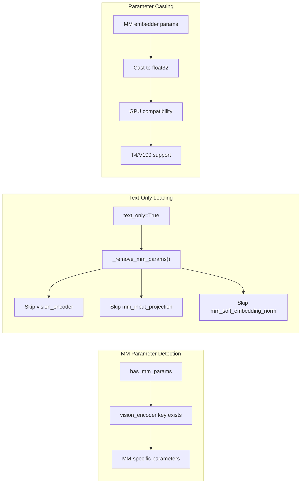

The system automatically handles:
- Detection of multimodal parameters through the `vision_encoder` key [gemma/gm/ckpts/_checkpoint.py:171-173]().
- Selective loading with `text_only` parameter [gemma/gm/ckpts/_checkpoint.py:205](). This is also reflected in model classes like `_Gemma4Base` which can exclude media encoders [gemma/gm/nn/gemma4/_gemma4.py:44-59]().
- Automatic casting of multimodal embedder parameters to float32 for GPU compatibility [gemma/gm/ckpts/_checkpoint.py:299-307]().
- Detection of audio input embeddings in the embedder module [gemma/gm/ckpts/_checkpoint.py:175-177]().

**Sources:** [gemma/gm/ckpts/_checkpoint.py:171-177](), [gemma/gm/ckpts/_checkpoint.py:205-307](), [gemma/gm/nn/gemma4/_gemma4.py:44-59]()

## Quantization Support

If the `quantize` flag is set to `True` in `load_params`, the parameters are passed through `_quantization.convert_to_qat_checkpoint`. This function maps regular parameters to a format compatible with Quantization-Aware Training (QAT).

- It identifies leaf nodes using `is_leaf` [gemma/gm/ckpts/_quantization.py:30-37]().
- It wraps kernel weights (typically under key 'w') into `_SimulateQuantizedEinsum` structures [gemma/gm/ckpts/_quantization.py:39-47]().
- It specifically handles `FeedForward` layers that use `gating_einsum` and `linear` names [gemma/gm/ckpts/_quantization.py:58-61]().

**Sources:** [gemma/gm/ckpts/_checkpoint.py:277-280](), [gemma/gm/ckpts/_quantization.py:25-64]()

---

# Page: Saving Parameters

# Saving Parameters

<details>
<summary>Relevant source files</summary>

The following files were used as context for generating this wiki page:

- [gemma/gm/ckpts/_checkpoint.py](gemma/gm/ckpts/_checkpoint.py)
- [gemma/gm/ckpts/_lora.py](gemma/gm/ckpts/_lora.py)

</details>


## Purpose and Scope

This page documents the parameter saving functionality in the Gemma checkpoint management system. It covers the `save_params` function, which serializes model parameters to disk using the Orbax checkpoint backend. This function is the complement to parameter loading (see [Loading Parameters](2.1)) and is primarily used during training to persist fine-tuned weights or to export model checkpoints for later inference.

For specialized checkpoint loading strategies that work with saved checkpoints, see [Special Loaders](2.3).

Sources: [gemma/gm/ckpts/_checkpoint.py:180-198]()

---

## The save_params Function

The `save_params` function provides a simple interface for saving model parameters to disk. It accepts three arguments:

| Parameter | Type | Required | Description |
|-----------|------|----------|-------------|
| `params` | `Params` | Yes | The parameter dictionary to save, matching the NESTED structure from `model.init()['params']` |
| `path` | `epath.PathLike` | Yes | Directory path where the checkpoint will be written |
| `wait_until_finished` | `bool` | No (default: `False`) | Whether to block until the save operation completes |

The function signature is defined at [gemma/gm/ckpts/_checkpoint.py:180-185]():

```python
def save_params(
    params: Params,
    path: epath.PathLike,
    *,
    wait_until_finished: bool = False,
) -> None:
```

### Basic Usage

```python
from gemma import gm

# Assume 'params' contains your model parameters
output_path = '/path/to/checkpoint'

# Save asynchronously (non-blocking)
gm.ckpts.save_params(params, output_path)

# Or wait for completion
gm.ckpts.save_params(params, output_path, wait_until_finished=True)
```

Sources: [gemma/gm/ckpts/_checkpoint.py:180-198](), [gemma/gm/ckpts/__init__.py:19-21]()

---

## Orbax Integration

The `save_params` function is implemented as a thin wrapper around Orbax's `StandardCheckpointer` class, which handles the low-level checkpoint serialization.

### Implementation Flow

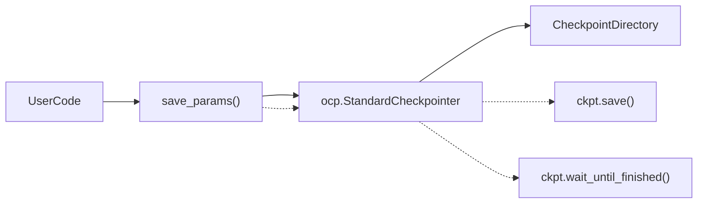

**Diagram: Orbax Integration Architecture**

The implementation at [gemma/gm/ckpts/_checkpoint.py:194-197]() shows this integration:

1. Creates an `ocp.StandardCheckpointer` instance [gemma/gm/ckpts/_checkpoint.py:194]().
2. Calls `ckpt.save(path, params)` to initiate the save [gemma/gm/ckpts/_checkpoint.py:195]().
3. Optionally calls `ckpt.wait_until_finished()` if synchronous behavior is requested [gemma/gm/ckpts/_checkpoint.py:196-197]().

This design delegates all serialization logic to Orbax, ensuring compatibility with the standard Orbax checkpoint format used throughout the JAX ecosystem.

Sources: [gemma/gm/ckpts/_checkpoint.py:194-197]()

---

## Parameter Structure Requirements

The `params` argument must follow the **NESTED** checkpoint structure, which is the standard format returned by Flax's `model.init()['params']` call. This structure organizes parameters as a nested dictionary hierarchy matching the model's layer structure.

### Code Entity Space: NESTED Structure

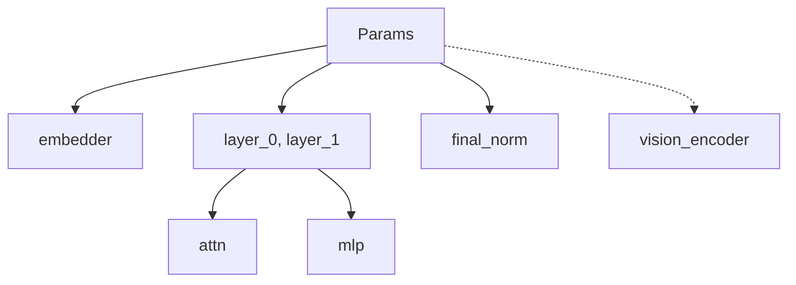

**Diagram: Parameter Hierarchy Association**

### Checkpoint Format Types

While `save_params` always saves in the NESTED format, the Gemma checkpoint system recognizes four different checkpoint formats defined by the `_CheckpointType` enum at [gemma/gm/ckpts/_checkpoint.py:72-92]():

| Format | Description | Use Case |
|--------|-------------|----------|
| `NESTED` | Hierarchical dict matching Flax `model.init()` structure | Standard format for saving |
| `FLAT` | Flattened dict with keys like `'transformer/layer_0/attn/_key_norm'` | Legacy Gemma releases |
| `STACKED` | Params with same attention pattern stacked together | Internal optimization format |
| `KAULDRON` | Full training state including `params`, `opt_state`, `step` | Training checkpoints |

When loading checkpoints, the `_CheckpointTree` class (defined at [gemma/gm/ckpts/_checkpoint.py:96-100]()) automatically detects and converts between these formats using properties like `type` [gemma/gm/ckpts/_checkpoint.py:107-117]() and `nested_tree` [gemma/gm/ckpts/_checkpoint.py:119-131](). However, `save_params` is strictly for the `NESTED` format.

Sources: [gemma/gm/ckpts/_checkpoint.py:72-92](), [gemma/gm/ckpts/_checkpoint.py:180-198](), [gemma/gm/ckpts/_checkpoint.py:96-131]()

---

## Asynchronous Saving and Memory Management

By default, `save_params` performs **asynchronous checkpoint saving**, meaning it returns immediately without blocking program execution. This is crucial for training workflows where checkpoint saving should not pause the training loop.

### Asynchronous vs Synchronous Flow

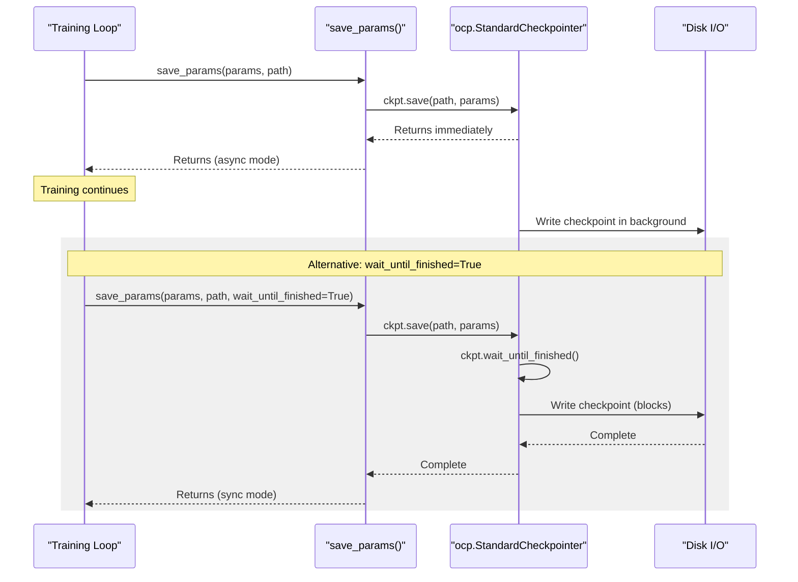

**Diagram: Asynchronous vs Synchronous Saving**

### Memory Management

The library provides memory management utilities to help manage memory when handling large parameter sets. This is particularly useful in complex loading scenarios, such as in `AnchoredPolicyLoader`, where one set of parameters might be discarded in favor of another [gemma/gm/ckpts/_policy.py:53](). 

For the loading counterpart, the `load_params` function supports a `donate` parameter [gemma/gm/ckpts/_checkpoint.py:204]() to allow JAX to reuse memory buffers during the restoration process, though `save_params` focuses on the serialization of existing buffers.

### When to Use Synchronous Saving

Set `wait_until_finished=True` at [gemma/gm/ckpts/_checkpoint.py:191-192]() in the following scenarios:

- **End of training:** Ensure the final checkpoint is fully written before program termination.
- **Critical checkpoints:** When checkpoint corruption would be catastrophic.
- **Testing/debugging:** To simplify reasoning about checkpoint state.

Sources: [gemma/gm/ckpts/_checkpoint.py:194-197](), [gemma/gm/ckpts/_checkpoint.py:200-208](), [gemma/gm/ckpts/_policy.py:53]()

---

## Relationship to Kauldron Checkpoints

The library distinguishes between pure parameter checkpoints and Kauldron `kd.train.Trainer` checkpoints. 

- `save_params` saves only the model parameters (`Params`).
- Kauldron checkpoints (detected via `_CheckpointType.KAULDRON` at [gemma/gm/ckpts/_checkpoint.py:92]()) contain the optimizer state, step, and other training metadata.

When loading, the `LoadCheckpoint` class [gemma/gm/ckpts/_checkpoint.py:48-63]() specifically handles weights from a Gemma checkpoint but notes that it does not contain optimizer state [gemma/gm/ckpts/_checkpoint.py:52-54]().

### Checkpoint Structure Association

| Code Entity | Checkpoint Type | Contents |
|-------------|-----------------|----------|
| `save_params` | `NESTED` | `Params` (Weights only) |
| `kd.train.Trainer` | `KAULDRON` | `params`, `opt_state`, `step` |

Sources: [gemma/gm/ckpts/_checkpoint.py:48-63](), [gemma/gm/ckpts/_checkpoint.py:72-92]()

---

## Summary

The `save_params` function provides a straightforward interface for persisting Gemma model parameters to disk:

| Feature | Description |
|---------|-------------|
| **Backend** | Orbax `StandardCheckpointer` [gemma/gm/ckpts/_checkpoint.py:194]() |
| **Output Format** | `NESTED` (Flax-style hierarchy) |
| **Default Behavior** | Asynchronous (non-blocking) |
| **Primary Use Cases** | Training checkpoints, fine-tuned model export |
| **Integration** | Compatible with `load_params` and `LoadCheckpoint` |

Sources: [gemma/gm/ckpts/_checkpoint.py:180-198](), [gemma/gm/ckpts/__init__.py:19-21]()

---

# Page: Special Loaders

# Special Loaders

<details>
<summary>Relevant source files</summary>

The following files were used as context for generating this wiki page:

- [gemma/gm/ckpts/_checkpoint.py](gemma/gm/ckpts/_checkpoint.py)
- [gemma/gm/ckpts/_lora.py](gemma/gm/ckpts/_lora.py)
- [gemma/gm/ckpts/_policy.py](gemma/gm/ckpts/_policy.py)
- [gemma/gm/nn/_policy.py](gemma/gm/nn/_policy.py)

</details>


## Purpose and Scope

This page documents the specialized checkpoint loaders that integrate with the Kauldron training framework. These loaders extend `kd.ckpts.InitTransform` to provide flexible checkpoint initialization strategies for different training scenarios, such as fine-tuning with LoRA or preference optimization (DPO/NPO).

For information about the basic checkpoint loading function (`load_params`) and checkpoint formats, see [Loading Parameters](). For saving checkpoints, see [Saving Parameters]().

Sources: `[gemma/gm/ckpts/__init__.py:15-24]()`, `[gemma/gm/ckpts/_checkpoint.py:48-70]()`, `[gemma/gm/ckpts/_lora.py:36-53]`, `[gemma/gm/ckpts/_policy.py:25-34]()`

---

## Overview

Special loaders are dataclasses that implement the `kd.ckpts.InitTransform` interface, allowing them to be used in Kauldron training configurations to control how model parameters are initialized from checkpoints. Unlike the standalone `load_params` function, these loaders operate on entire `TrainState` objects and can selectively load or skip specific parameter subsets.

### System Mapping: Natural Language to Code Entities

The following diagram maps high-level loading concepts to the specific classes and methods implemented in the Gemma codebase.

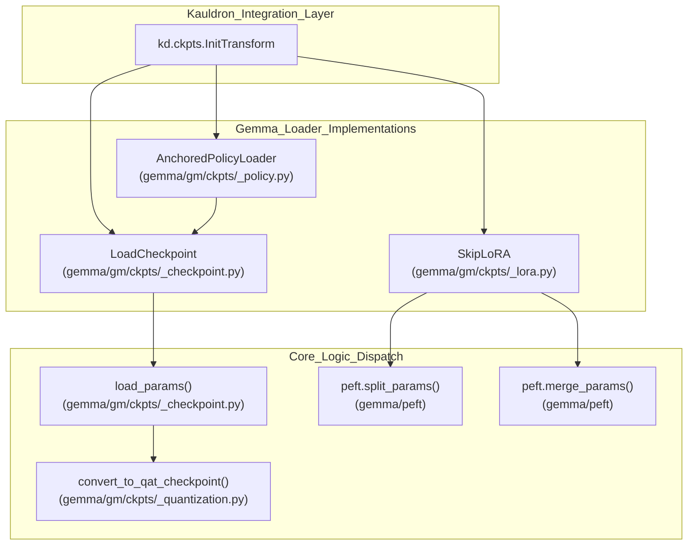

Sources: `[gemma/gm/ckpts/_checkpoint.py:48-70]()`, `[gemma/gm/ckpts/_lora.py:36-53]()`, `[gemma/gm/ckpts/_policy.py:25-71]()`, `[gemma/gm/ckpts/_quantization.py:25-64]()`

---

## LoadCheckpoint

The `LoadCheckpoint` loader is the primary mechanism for initializing model parameters from a Gemma checkpoint during training. It specifically loads the transformer weights and does not restore optimizer state or step counters, which distinguishes it from `kd.ckpts.PartialKauldronLoader`.

### Class Definition

```python
@dataclasses.dataclass(frozen=True)
class LoadCheckpoint(kd.ckpts.InitTransform):
  path: epath.PathLike
  quantize: bool = False
```

Location: `[gemma/gm/ckpts/_checkpoint.py:48-64]()`

### Attributes

| Attribute | Type | Default | Description |
|-----------|------|---------|-------------|
| `path` | `epath.PathLike` | Required | Path to the Orbax checkpoint directory. |
| `quantize` | `bool` | `False` | If `True`, converts parameters to enable quantization aware training (QAT). |

### Behavior

The `transform` method performs the following operations:

1. Calls `load_params(self.path, params=state.params, quantize=self.quantize)` `[gemma/gm/ckpts/_checkpoint.py:66-68]()` to restore parameters into the current state's layout.
2. Returns a new `TrainState` using `dataclasses.replace(state, params=new_params)` `[gemma/gm/ckpts/_checkpoint.py:69]()`, preserving existing optimizer state and step counter from the input `state`.

Sources: `[gemma/gm/ckpts/_checkpoint.py:48-70]()`

---

## SkipLoRA

The `SkipLoRA` loader is a wrapper that prevents LoRA (Low-Rank Adaptation) weights from being overwritten during checkpoint loading. This is essential for workflows where you load base model weights while preserving initialized LoRA parameters in the training state.

### Class Definition

```python
@dataclasses.dataclass(frozen=True)
class SkipLoRA(kd.ckpts.InitTransform):
  wrapped: kd.ckpts.InitTransform
```

Location: `[gemma/gm/ckpts/_lora.py:36-40]()`

### Behavior

The `transform` method implements the following data flow:

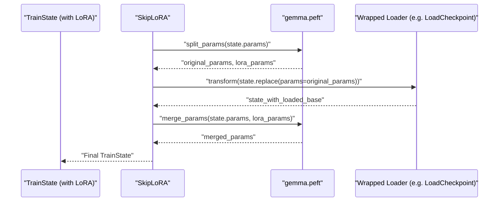

1. **Split**: Separates LoRA weights from base model weights using `peft.split_params` `[gemma/gm/ckpts/_lora.py:44]()`.
2. **Load**: Applies the `wrapped` loader to load checkpoint weights into the base parameters while the LoRA weights are held aside `[gemma/gm/ckpts/_lora.py:48]()`.
3. **Merge**: Restores the original LoRA weights into the new state using `peft.merge_params` `[gemma/gm/ckpts/_lora.py:51]()`.

Sources: `[gemma/gm/ckpts/_lora.py:36-53]()`

---

## AnchoredPolicyLoader

The `AnchoredPolicyLoader` is designed for Direct Preference Optimization (DPO) and other policy-based training methods using the `gm.nn.AnchoredPolicy` wrapper.

### Class Definition

```python
@dataclasses.dataclass(frozen=True, kw_only=True)
class AnchoredPolicyLoader(kd.ckpts.InitTransform):
  policy: kd.ckpts.InitTransform
  anchor: kd.ckpts.InitTransform | None = None
```

Location: `[gemma/gm/ckpts/_policy.py:25-37]()`

### Purpose and Logic

It manages the dual-parameter structure of an `AnchoredPolicy` model, which contains `policy` (the model being trained) and `anchor` (the frozen reference model) keys.

1. **Policy Loading**: Extracts `state.params['policy']`, applies the `policy` sub-transform, and updates that branch of the parameter tree `[gemma/gm/ckpts/_policy.py:47-48]()`.
2. **Anchor Loading**:
    - **Explicit Anchor**: If an `anchor` loader is provided, it applies it to `state.params['anchor']` `[gemma/gm/ckpts/_policy.py:60-61]()`.
    - **Implicit Anchor**: If no `anchor` loader is provided, it creates a copy of the loaded `policy` parameters. It calls `_checkpoint.release_memory` on the existing anchor parameters to save memory before performing a `jax.tree.map(jnp.copy, ...)` of the policy parameters `[gemma/gm/ckpts/_policy.py:52-58]()`.
3. **Merge**: Recombines the two parameter sets into the final `TrainState` `[gemma/gm/ckpts/_policy.py:64-71]()`.

Sources: `[gemma/gm/ckpts/_policy.py:25-71]()`

---

## Internal Reformatting Utilities

The loaders rely on several internal utilities to handle various checkpoint layouts (FLAT, STACKED) vs the NESTED structure expected by Flax models.

### Checkpoint Structure Detection

The `_CheckpointTree` class `[gemma/gm/ckpts/_checkpoint.py:96]()` determines the format of a loaded checkpoint via the `type` property:

| Type | Description | Detection Logic |
|------|-------------|-----------------|
| `STACKED` | Params with same attention pattern are stored as stacked arrays. | `_is_stacked_layout` `[gemma/gm/ckpts/_checkpoint.py:110-111]()` |
| `FLAT` | Params stored as a flat dict with `/` path separators. | `_is_flat_layout` `[gemma/gm/ckpts/_checkpoint.py:112-113]()` |
| `KAULDRON` | Full `kd.train.Trainer` checkpoint containing optimizer state and step. | `_is_kauldron_layout` `[gemma/gm/ckpts/_checkpoint.py:114-115]()` |
| `NESTED` | Final structure matching Flax `model.init()` nested dictionaries. | Default fallback `[gemma/gm/ckpts/_checkpoint.py:116-117]()` |

### Conversion Logic

- **NESTED Target**: The `nested_tree` property converts any of the above formats into the standard Flax nested dictionary structure `[gemma/gm/ckpts/_checkpoint.py:120-131]()`.
- **QAT Conversion**: When `quantize=True` is passed to `LoadCheckpoint`, it utilizes `convert_to_qat_checkpoint` `[gemma/gm/ckpts/_quantization.py:25-64]()` to map standard parameters to the simulated quantization structure required by modules like `SimulateQuantizedDense`. This involves remapping kernel keys (e.g., `w` to `_SimulateQuantizedEinsum_0`) `[gemma/gm/ckpts/_quantization.py:44-46]()`.

Sources: `[gemma/gm/ckpts/_checkpoint.py:72-132]()`, `[gemma/gm/ckpts/_quantization.py:25-64]()`

---

# Page: Model Architecture

# Model Architecture

<details>
<summary>Relevant source files</summary>

The following files were used as context for generating this wiki page:

- [gemma/gm/nn/__init__.py](gemma/gm/nn/__init__.py)
- [gemma/gm/nn/_gemma.py](gemma/gm/nn/_gemma.py)
- [gemma/gm/nn/_modules.py](gemma/gm/nn/_modules.py)
- [gemma/gm/nn/_modules_test.py](gemma/gm/nn/_modules_test.py)
- [gemma/gm/nn/_transformer.py](gemma/gm/nn/_transformer.py)
- [gemma/gm/nn/config.py](gemma/gm/nn/config.py)

</details>


This document provides an overview of the Transformer architecture and neural network components across all Gemma generations within the JAX-based framework. The architecture centers around the `Transformer` base class [gemma/gm/nn/_transformer.py:87-94]() and conforms to the `TransformerLike` protocol [gemma/gm/nn/_transformer_like.py]() (see child page [TransformerLike Protocol](#3.1)). All Gemma models use stacked transformer blocks built from reusable sub-modules like `Embedder`, `Attention`, `FeedForward`, and `RMSNorm` [gemma/gm/nn/_modules.py]() (see child page [Building Blocks](#3.3)).

For in-depth technical specifications, see the child pages:
- [TransformerLike Protocol](#3.1) — Standardized model interface and metadata containers.
- [Model Variants](#3.2) — Configurations and differences across Gemma2, Gemma3, Gemma3n, and Gemma4.
- [Building Blocks](#3.3) — Core neural components (Embedder, Attention, FeedForward, Block, RMSNorm, KV cache).
- [Configuration System](#3.4) — `TransformerConfig` options and dtype utilities.
- [Gemma3n Advanced Features](#3.5) — AltUp, Laurel, and advanced efficiency features.
- [Gemma4 Architecture](#3.6) — Mixture-of-Experts, audio encoders, and multimodal extensions.
- [Vision Encoder](#3.7) — SigLiP-based vision integration and patch processing.

---

## Architecture Overview

The Gemma model architecture bridges natural language and multimodal inputs to predicted logits via a structured execution pipeline. The following diagram maps natural language space concepts and system layers to their exact code entities within `gemma.gm.nn`.

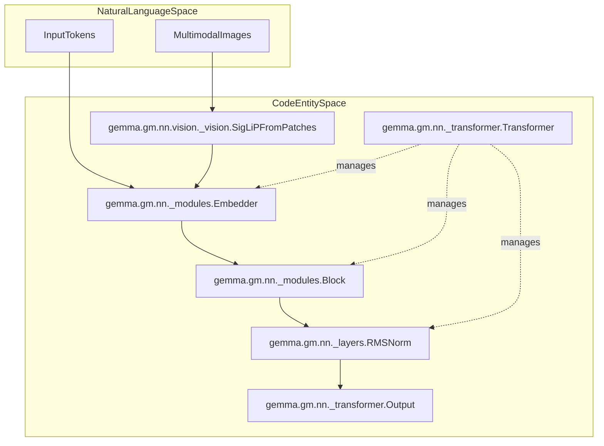

**Sources:** [gemma/gm/nn/_transformer.py:87-155](), [gemma/gm/nn/_modules.py:60-120]()

### Component Hierarchy

The following class hierarchy diagram illustrates how the base `Transformer` class and the various generation models relate through inheritance and protocol implementation.

```mermaid
graph TD
    Protocol["TransformerLike Protocol<br/>(gemma.gm.nn._transformer_like.TransformerLike)"]
    BaseTransformer["Transformer<br/>(gemma.gm.nn._transformer.Transformer)"]
    
    Gemma2_2B["Gemma2_2B<br/>(gemma.gm.nn._gemma.Gemma2_2B)"]
    Gemma2_9B["Gemma2_9B<br/>(gemma.gm.nn._gemma.Gemma2_9B)"]
    Gemma2_27B["Gemma2_27B<br/>(gemma.gm.nn._gemma.Gemma2_27B)"]
    
    Gemma3_270M["Gemma3_270M<br/>(gemma.gm.nn._gemma.Gemma3_270M)"]
    Gemma3_1B["Gemma3_1B<br/>(gemma.gm.nn._gemma.Gemma3_1B)"]
    Gemma3Base["_Gemma3Base<br/>(gemma.gm.nn._gemma._Gemma3Base)"]
    Gemma3_4B["Gemma3_4B<br/>(gemma.gm.nn._gemma.Gemma3_4B)"]
    Gemma3_12B["Gemma3_12B<br/>(gemma.gm.nn._gemma.Gemma3_12B)"]
    Gemma3_27B["Gemma3_27B<br/>(gemma.gm.nn._gemma.Gemma3_27B)"]
    
    Gemma3n_E2B["Gemma3n_E2B<br/>(gemma.gm.nn.gemma3n._gemma3n.Gemma3n_E2B)"]
    Gemma3n_E4B["Gemma3n_E4B<br/>(gemma.gm.nn.gemma3n._gemma3n.Gemma3n_E4B)"]

    Gemma4_E2B["Gemma4_E2B<br/>(gemma.gm.nn.gemma4._gemma4.Gemma4_E2B)"]
    Gemma4_E4B["Gemma4_E4B<br/>(gemma.gm.nn.gemma4._gemma4.Gemma4_E4B)"]
    Gemma4_31B["Gemma4_31B<br/>(gemma.gm.nn.gemma4._gemma4.Gemma4_31B)"]
    Gemma4_26B_A4B["Gemma4_26B_A4B<br/>(gemma.gm.nn.gemma4._gemma4.Gemma4_26B_A4B)"]
    
    Protocol -.defines.-> BaseTransformer
    BaseTransformer --> Gemma2_2B
    BaseTransformer --> Gemma2_9B
    BaseTransformer --> Gemma2_27B
    
    BaseTransformer --> Gemma3_270M
    BaseTransformer --> Gemma3_1B
    BaseTransformer --> Gemma3Base
    Gemma3Base --> Gemma3_4B
    Gemma3Base --> Gemma3_12B
    Gemma3Base --> Gemma3_27B
    
    BaseTransformer --> Gemma3n_E2B
    BaseTransformer --> Gemma3n_E4B

    BaseTransformer --> Gemma4_E2B
    BaseTransformer --> Gemma4_E4B
    BaseTransformer --> Gemma4_31B
    BaseTransformer --> Gemma4_26B_A4B
```

**Sources:** [gemma/gm/nn/_transformer.py:87-111](), [gemma/gm/nn/_gemma.py:49-315](), [gemma/gm/nn/__init__.py:27-56]()

---

## Sub-Topics and Child Pages

### 3.1. TransformerLike Protocol
The `TransformerLike` protocol establishes a standardized interface for parameter initialization, forward execution via `__call__`, variable application via `apply`, and KV cache setup via `init_cache`. It governs classes like `Transformer` and wraps metadata using `ModelInfo` and `Output` dataclasses [gemma/gm/nn/_transformer.py:43-68,87-111].
For details, see [TransformerLike Protocol](#3.1).

**Sources:** [gemma/gm/nn/_transformer.py:43-111]()

### 3.2. Model Variants
Gemma provides diverse model configurations spanning Gemma2, Gemma3, Gemma3n, and Gemma4 generations. These variants differ in parameter counts, layer depths, attention patterns (e.g., alternating local sliding and global attention), and multimodal encoder integrations [gemma/gm/nn/_gemma.py:39-135].
For details, see [Model Variants](#3.2).

**Sources:** [gemma/gm/nn/_gemma.py:39-135]()

### 3.3. Building Blocks
The neural network primitives include `Embedder`, `Attention`, `FeedForward`, `Block`, and `RMSNorm`. These components implement Grouped Query Attention (GQA), Rotary Positional Embeddings (RoPE), sliding window attention masks, and key-value cache management structures [gemma/gm/nn/_modules.py:38-206].
For details, see [Building Blocks](#3.3).

**Sources:** [gemma/gm/nn/_modules.py:38-206]()

### 3.4. Configuration System
Model configurations are managed via `TransformerConfig`, which defines hyperparameters such as embedding dimensions, head counts, sliding window sizes, query pre-attention normalisation strategies, and KV cache sharing patterns [gemma/gm/nn/config.py:15-28].
For details, see [Configuration System](#3.4).

**Sources:** [gemma/gm/nn/config.py:15-27]()

### 3.5. Gemma3n Advanced Features
Gemma3n models introduce specialized on-device efficiency mechanisms including `AltUp`, `Laurel`, per-layer input routing, and optimized KV cache sharing configurations [gemma/gm/nn/__init__.py:37-38].
For details, see [Gemma3n Advanced Features](#3.5).

**Sources:** [gemma/gm/nn/__init__.py:37-38]()

### 3.6. Gemma4 Architecture
Gemma4 extends the architecture with Mixture-of-Experts (MoE) layers, an audio encoder (Conformer), enhanced vision encoders, flexible KV cache sharing, and the `text_only` execution flag [gemma/gm/nn/_gemma.py:201-218], [gemma/gm/nn/__init__.py:43-46].
For details, see [Gemma4 Architecture](#3.6).

**Sources:** [gemma/gm/nn/_gemma.py:201-218](), [gemma/gm/nn/__init__.py:43-46]()

### 3.7. Vision Encoder
Vision capabilities are powered by SigLiP-based image encoders that handle preprocessing, patchification, soft token projections, and embedding merging into the main text sequence (including variable-aspect-ratio support in Gemma4) [gemma/gm/nn/_modules.py:60-119], [gemma/gm/nn/_transformer.py:115-155].
For details, see [Vision Encoder](#3.7).

**Sources:** [gemma/gm/nn/_transformer.py:115-155](), [gemma/gm/nn/_modules.py:60-119]()

---

# Page: TransformerLike Protocol

# TransformerLike Protocol

<details>
<summary>Relevant source files</summary>

The following files were used as context for generating this wiki page:

- [gemma/gm/nn/_transformer_like.py](gemma/gm/nn/_transformer_like.py)
- [gemma/gm/nn/_transformer_like_test.py](gemma/gm/nn/_transformer_like_test.py)
- [gemma/gm/text/_sampler_loop.py](gemma/gm/text/_sampler_loop.py)
- [gemma/gm/text/_turn_utils.py](gemma/gm/text/_turn_utils.py)

</details>


## Purpose and Scope

The `TransformerLike` protocol defines the standardized interface that all Gemma models must implement to be compatible with the text generation system, particularly the `Sampler` and `ChatSampler` classes. This protocol ensures that all model variants—including `Gemma2`, `Gemma3`, `Gemma3n`, `Gemma4`, and custom user implementations—expose a consistent API for initialization, forward passes, and cache management.

Sources: `[gemma/gm/nn/_transformer_like.py:15-16]()`, `[gemma/gm/nn/_transformer_like.py:79-83]()`

---

## Protocol Overview

The `TransformerLike` protocol is defined as a Python `Protocol` class in `gemma/gm/nn/_transformer_like.py`, enabling structural subtyping. Any class that implements the required attributes and methods can be used as a transformer model, regardless of inheritance relationships.

### System to Code Entity Mapping

The following diagram bridges the abstract concept of a Gemma model with the concrete entities defined in the codebase.

**Gemma Model Interface Map**
```mermaid
graph TB
    subgraph "Natural Language Space"
        Model["Gemma Model"]
        Meta["Metadata"]
        Cfg["Model Configuration"]
        Out["Inference Result"]
    end

    subgraph "Code Entity Space (gm.nn)"
        TL["TransformerLike (Protocol)"]
        MI["ModelInfo (Protocol)"]
        TC["TransformerConfig (Protocol)"]
        OD["Output (Dataclass)"]
    end

    Model --- TL
    Meta --- MI
    Cfg --- TC
    Out --- OD

    TL -- "has INFO" --> MI
    TL -- "has config" --> TC
    TL -- "returns" --> OD
```

Sources: `[gemma/gm/nn/_transformer_like.py:31-86]()`, `[gemma/gm/nn/_transformer.py:44-70]()`

---

## Required Attributes

### config: TransformerConfig

Every model must expose a `config` attribute conforming to the `TransformerConfig` protocol. This configuration object provides:

- `input_config`: Configuration for processing model inputs `[gemma/gm/nn/_transformer_like.py:39]()`
- `num_embed`: Vocabulary size `[gemma/gm/nn/_transformer_like.py:40]()`
- `init_cache()`: Method to initialize KV cache `[gemma/gm/nn/_transformer_like.py:42-50]()`

The `TransformerConfig` protocol is defined in `[gemma/gm/nn/_transformer_like.py:31-51]()` and implemented by the concrete `_config.TransformerConfig` class.

### INFO: ClassVar[ModelInfo]

A class-level `ModelInfo` object that specifies:

- `tokenizer_version`: Version identifier for the tokenizer (e.g., `2` for Gemma2, `3` for Gemma3) `[gemma/gm/nn/_transformer_like.py:75]()`
- `default_ckpt`: Optional path to default checkpoint on KaggleHub `[gemma/gm/nn/_transformer_like.py:76]()`

This information enables automatic loading of the correct tokenizer and checkpoint for each model variant.

Sources: `[gemma/gm/nn/_transformer_like.py:31-77]()`, `[gemma/gm/nn/_transformer.py:43-51]()`

---

## Required Methods

### init()

```python
def init(
    self,
    rngs: PRNGKey | RNGSequences,
    *args,
    method: Callable[..., Any] | str | None = None,
    mutable: CollectionFilter = DenyList('intermediates'),
    capture_intermediates: bool | Callable[[flax.linen.Module, str], bool] = False,
    **kwargs,
) -> FrozenVariableDict | dict[str, Any]
```

Initializes model parameters. This follows the standard Flax `linen.Module.init()` signature, accepting a PRNG key and returning a dictionary of initialized variables (parameters).

Sources: `[gemma/gm/nn/_transformer_like.py:88-115]()`

---

### __call__()

```python
def __call__(
    self,
    tokens: Int['*B L'],
    *,
    images: UInt8['*B N H W C'] | UInt8['*B H W C'] | None = None,
    positions: Int['*B L_with_mm'] | None = None,
    cache: _config.Cache | None = None,
    attention_mask: Bool['*B L_with_mm cache_length'] | None = None,
    return_last_only: bool | None = None,
    return_hidden_states: bool | None = None,
) -> Output
```

Performs the forward pass through the model. This is the core computation method.

#### Parameters

| Parameter | Type | Description |
|-----------|------|-------------|
| `tokens` | `Int['*B L']` | Input token IDs with arbitrary batch shape |
| `images` | `UInt8['*B N H W C']` (optional) | Images for multimodal models |
| `positions` | `Int['*B L_with_mm']` (optional) | Absolute position indices, including multimodal tokens |
| `cache` | `Cache` (optional) | KV cache from previous generation steps |
| `attention_mask` | `Bool['*B L_with_mm cache_length']` (optional) | Attention mask |
| `return_last_only` | `bool` (optional) | If `True`, return logits only for the last token |
| `return_hidden_states` | `bool` (optional) | If `True`, include hidden states in output |

#### Returns

An `Output` dataclass containing:
- `logits`: Predicted logits (`*B L V` or `*B V` if `return_last_only=True`)
- `cache`: Updated cache (or `None` if no cache was provided)
- `hidden_states`: Model hidden states (or `None` if not requested)

Sources: `[gemma/gm/nn/_transformer_like.py:117-130]()`, `[gemma/gm/nn/_transformer.py:184-201]()`

---

### apply()

```python
def apply(
    self,
    variables: VariableDict,
    tokens: Int['*B L'],
    *,
    images: UInt8['*B N H W C'] | UInt8['*B H W C'] | None = None,
    cache: _config.Cache | None = None,
    positions: Int['*B L_with_mm'] | None = None,
    attention_mask: Bool['*B L_with_mm cache_length'] | None = None,
) -> Any | tuple[Any, FrozenVariableDict | dict[str, Any]]
```

Applies the model to a set of variables (parameters) without modifying the module state. This is the standard Flax pattern for stateless computation. The `Sampler` uses this method to perform inference with loaded checkpoints.

Sources: `[gemma/gm/nn/_transformer_like.py:133-145]()`

---

### init_cache()

```python
def init_cache(
    self,
    *,
    batch_size: int,
    dtype: jnp.dtype[Any],
    cache_length: int,
    sharding: kd.sharding.ShardingTree | None = None,
) -> _config.Cache
```

Initializes an empty KV cache for autoregressive generation. The cache is a nested structure that stores key and value tensors for each transformer layer.

#### Parameters

| Parameter | Type | Description |
|-----------|------|-------------|
| `batch_size` | `int` | Number of sequences to generate in parallel |
| `dtype` | `jnp.dtype` | Data type for cache tensors (typically `jnp.bfloat16`) |
| `cache_length` | `int` | Maximum sequence length to cache |
| `sharding` | `ShardingTree` (optional) | Sharding specification for distributed inference |

#### Returns

A `Cache` object containing layer-specific KV states.

Sources: `[gemma/gm/nn/_transformer_like.py:148-158]()`, `[gemma/gm/nn/_transformer_like_test.py:52-64]()`

---

## Protocol Components

**Structural Implementation of TransformerLike**
```mermaid
graph LR
    subgraph "TransformerLike Protocol"
        TL["TransformerLike"]
    end
    
    subgraph "Nested Protocols"
        TC["TransformerConfigProtocol"]
        Out["OutputDataclass"]
        MI["ModelInfoProtocol"]
    end
    
    subgraph "Concrete Implementations"
        TCImpl["_config.TransformerConfig"]
        OutImpl["_transformer.Output"]
        MIImpl["_transformer.ModelInfo"]
    end
    
    TL -->|"requires"| TC
    TL -->|"returns"| Out
    TL -->|"provides"| MI
    
    TC -.implemented by.-> TCImpl
    Out -.implemented by.-> OutImpl
    MI -.implemented by.-> MIImpl
    
    TCImpl -->|"contains"| InputConfig["input_config"]
    TCImpl -->|"contains"| NumEmbed["num_embed"]
    TCImpl -->|"provides"| InitCacheMethod["init_cache"]
    
    OutImpl -->|"contains"| Logits["logits"]
    OutImpl -->|"contains"| Cache["cache"]
    OutImpl -->|"contains"| HiddenStates["hidden_states"]
    
    MIImpl -->|"contains"| TokVer["tokenizer_version"]
    MIImpl -->|"contains"| DefCkpt["default_ckpt"]
```

### TransformerConfig Protocol

Defined in `[gemma/gm/nn/_transformer_like.py:31-51]()`, this protocol specifies the configuration interface. The concrete implementation is `_config.TransformerConfig`, which includes architecture parameters and methods for initializing the KV cache.

### Output Protocol

Defined in `[gemma/gm/nn/_transformer_like.py:53-67]`, this protocol specifies the return type of `__call__()` and `apply()`. The concrete implementation is a Flax `struct.dataclass` at `[gemma/gm/nn/_transformer.py:54-68]()`.

### ModelInfo Protocol

Defined in `[gemma/gm/nn/_transformer_like.py:69-77]()`, this protocol provides metadata for model loading. The concrete implementation is at `[gemma/gm/nn/_transformer.py:43-51]()`.

Sources: `[gemma/gm/nn/_transformer_like.py:31-77]()`, `[gemma/gm/nn/_transformer.py:43-68]()`

---

## Implementation Example

The base `Transformer` class in `[gemma/gm/nn/_transformer.py]()` implements the `TransformerLike` protocol.

### Custom Model Implementation

Users can implement the protocol without inheriting from `Transformer`. Example from test suite `[gemma/gm/nn/_transformer_like_test.py:26-65]()`:

```python
class MockTransformer(nn.Module):
    config: gm.nn.config.TransformerConfig
    INFO: ClassVar[_transformer.ModelInfo] = _transformer.ModelInfo(
        tokenizer_version=4,
    )
    
    def setup(self):
        self.dense = nn.Dense(10)

    def __call__(self, tokens, *, images=None, positions=None, cache=None, 
                 attention_mask=None, return_last_only=None, 
                 return_hidden_states=None) -> gm.nn.Output:
        logits = self.dense(tokens)
        return gm.nn.Output(logits=logits, cache=None, hidden_states=None)
    
    def init_cache(self, *, batch_size, dtype, cache_length) -> gm.nn.Cache:
        return self.config.init_cache(
            batch_size=batch_size,
            dtype=dtype,
            cache_length=cache_length,
        )
```

As long as the class satisfies the protocol interface, it can be used with all Gemma infrastructure (samplers, evaluators, etc.).

Sources: `[gemma/gm/nn/_transformer.py:87-155]()`, `[gemma/gm/nn/_transformer_like_test.py:26-65]()`

---

## Usage with Samplers

The primary purpose of the `TransformerLike` protocol is to enable interchangeable use of different models with the text generation system. The `Sampler` class and the internal `SamplerLoop` accept any `TransformerLike` instance.

The sampler relies on these protocol methods:

| Sampler Operation | Protocol Method Used |
|------------------|---------------------|
| Load tokenizer | `model.INFO.tokenizer_version` |
| Initialize cache | `model.init_cache()` |
| Prefill prompt | `model.apply(..., return_last_only=False)` |
| Generate tokens | `model.apply(..., cache=..., return_last_only=True)` |
| Configuration | `model.config` |

For complete details on how samplers use this interface, see `[Sampler](#4.3)` and `[Autoregressive Loop](#4.5)`.

Sources: `[gemma/gm/nn/_transformer_like.py:15-16]()`, `[gemma/gm/text/_sampler_loop.py:114-118]()`

---

## Type Safety and Protocol Checking

The protocol uses `@typechecked` decorators from Kauldron to enforce type annotations at runtime during development. This catches interface mismatches early:

```python
@typechecked
@abc.abstractmethod
def __call__(
    self,
    tokens: Int['*B L'],  # Type checked: must be integer array
    *,
    images: UInt8['*B N H W C'] | UInt8['*B H W C'] | None = None,
    ...
) -> Output:
    ...
```

The array shape annotations (e.g., `Int['*B L']`) document expected dimensions and are validated when `typechecked` is active. The `*B` notation indicates arbitrary batch dimensions that are preserved through processing via the `_jax_utils.flatten_unflatten_batch_dim()` decorator used in the base `Transformer` class.

Sources: `[gemma/gm/nn/_transformer_like.py:117-130]()`, `[gemma/gm/nn/_transformer.py:183-185]()`

---

## Summary

The `TransformerLike` protocol provides:

1. **Interoperability**: Any model implementing the protocol works with samplers, evaluators, and other tools.
2. **Type Safety**: Runtime type checking prevents interface mismatches.
3. **Metadata**: `INFO` and `config` attributes enable automatic tokenizer and checkpoint loading.
4. **Flexibility**: Users can implement custom models without inheriting from base classes.
5. **Consistency**: All Gemma model variants expose the same interface.

Sources: `[gemma/gm/nn/_transformer_like.py:1-158]()`, `[gemma/gm/nn/_transformer.py:49-221]()`

---

# Page: Model Variants

# Model Variants

<details>
<summary>Relevant source files</summary>

The following files were used as context for generating this wiki page:

- [gemma/gm/nn/__init__.py](gemma/gm/nn/__init__.py)
- [gemma/gm/nn/_gemma.py](gemma/gm/nn/_gemma.py)
- [gemma/gm/nn/_transformer.py](gemma/gm/nn/_transformer.py)
- [gemma/gm/nn/config.py](gemma/gm/nn/config.py)
- [gemma/gm/nn/gemma3n/_gemma3n.py](gemma/gm/nn/gemma3n/_gemma3n.py)
- [gemma/gm/nn/gemma3n/_transformer_test.py](gemma/gm/nn/gemma3n/_transformer_test.py)
- [gemma/gm/nn/vision/_image.py](gemma/gm/nn/vision/_image.py)

</details>


This document describes the different Gemma model variants available in the codebase, including their architectural configurations, parameter counts, and specific characteristics. It covers the official Gemma2, Gemma3, Gemma3n, and Gemma4 model families.

For information about the base transformer architecture, see [TransformerLike Protocol](#3.1). For configuration details, see [Configuration System](#3.4).

Sources: [gemma/gm/nn/_gemma.py:49-135](), [gemma/gm/nn/gemma3n/_gemma3n.py:61-134](), [gemma/gm/nn/gemma4/_gemma4.py:122-261]()

## Model Families

The Gemma repository implements four main model generations, each with distinct architectural characteristics across standard dense configurations, efficiency-optimized variants, and multimodal/MoE configurations.

Title: Model Family Inheritance Hierarchy
```mermaid
graph TB
    subgraph "gemma/gm/nn/_gemma.py"
        G2_2B["Gemma2_2B"]
        G2_9B["Gemma2_9B"]
        G2_27B["Gemma2_27B"]
        G3_270M["Gemma3_270M"]
        G3_1B["Gemma3_1B"]
        G3_BASE["_Gemma3Base"]
    end
    
    subgraph "gemma/gm/nn/gemma3n/_gemma3n.py"
        G3N_BASE["_Gemma3nBase"]
        G3N_E2B["Gemma3n_E2B"]
        G3N_E4B["Gemma3n_E4B"]
    end

    subgraph "gemma/gm/nn/gemma4/_gemma4.py"
        G4_BASE["_Gemma4Base"]
        G4_E2B["Gemma4_E2B"]
        G4_E4B["Gemma4_E4B"]
        G4_26B["Gemma4_26B_A4B"]
        G4_31B["Gemma4_31B"]
    end
    
    subgraph "gemma/gm/nn/_transformer.py"
        BASE["Transformer"]
    end

    BASE --> G2_2B
    BASE --> G2_9B
    BASE --> G2_27B
    BASE --> G3_270M
    BASE --> G3_1B
    BASE --> G3_BASE
    G3_BASE --> G3_4B["Gemma3_4B"]
    
    G3N_BASE --> G3N_E2B
    G3N_BASE --> G3N_E4B
    
    G4_BASE --> G4_E2B
    G4_BASE --> G4_E4B
    G4_BASE --> G4_26B
    G4_BASE --> G4_31B
```

Sources: [gemma/gm/nn/_gemma.py:27-36](), [gemma/gm/nn/gemma3n/_gemma3n.py:26-30](), [gemma/gm/nn/gemma4/_gemma4.py:28-31]()

## Gemma2 Models

The Gemma2 family implements the second generation of Gemma models with alternating attention patterns and specific architectural optimizations like logit soft-capping and post-attention/FFW normalization.

### Gemma2 Configurations

| Feature | Gemma2_2B | Gemma2_9B | Gemma2_27B |
| :--- | :--- | :--- | :--- |
| **Layers** | 26 | 42 | 46 |
| **Embed Dim** | 2,304 | 3,584 | 4,608 |
| **Hidden Dim** | 9,216 | 14,336 | 36,864 |
| **Heads (Q/KV)** | 8 / 4 | 16 / 8 | 32 / 16 |
| **Head Dim** | 256 | 256 | 128 |
| **Sliding Window** | 4,096 | 4,096 | 4,096 |
| **Logit Softcap** | 30.0 | 30.0 | 30.0 |

All Gemma2 models use an alternating attention pattern of `LOCAL_SLIDING` and `GLOBAL` attention types [gemma/gm/nn/_gemma.py:60-64]().

Sources: [gemma/gm/nn/_gemma.py:49-135]()

## Gemma3 Models

Gemma3 introduces multimodal capabilities and a repeating 6-layer attention pattern consisting of 5 local sliding layers and 1 global layer [gemma/gm/nn/_gemma.py:39-46]().

### Gemma3 Configurations

| Feature | 270M | 1B | 4B | 12B | 27B |
| :--- | :--- | :--- | :--- | :--- | :--- |
| **Layers** | 18 | 26 | 34 | 48 | 62 |
| **Embed Dim** | 640 | 1,152 | 2,560 | 3,840 | 5,376 |
| **KV Heads** | 1 | 1 | 4 | 8 | 16 |
| **Sliding Window**| 512 | 512 | 1,024 | 1,024 | 1,024 |
| **Vision Encoder**| None | None | SigLiP | SigLiP | SigLiP |

Gemma3 models (4B+) support a `text_only` flag in `_Gemma3Base` to skip vision encoder initialization to save memory [gemma/gm/nn/_gemma.py:201-219]().

Sources: [gemma/gm/nn/_gemma.py:138-283]()

## Gemma3n (Efficiency) Models

Gemma3n is optimized for on-device efficiency, featuring **AltUp** (Alternative Up-sampling), **Laurel** (Low-rank Linear layers), and **KV Cache Sharing** [gemma/gm/nn/gemma3n/_gemma3n.py:94-105]().

### Gemma3n Architectural Differences
- **AltUp**: Uses `altup_projection` and `altup_unembed_projection` in the `setup` phase to manage high-dimensional states [gemma/gm/nn/gemma3n/_transformer.py:181-193]().
- **KV Cache Sharing**: Implements sharing patterns across layers (configured via `KVCacheSharingConfig`) to reduce memory footprint [gemma/gm/nn/gemma3n/_transformer.py:128-132]().
- **Per-Layer Inputs**: The `_Inputs` dataclass accepts auxiliary `per_layer_inputs` for enhanced context processing [gemma/gm/nn/gemma3n/_transformer.py:88]().

Sources: [gemma/gm/nn/gemma3n/_gemma3n.py:61-134](), [gemma/gm/nn/gemma3n/_transformer.py:117-178]()

## Gemma4 Models

Gemma4 introduces advanced multimodal integration (Vision and Audio) and Mixture-of-Experts (MoE) in specific variants. It uses `Conformer` for audio encoding [gemma/gm/nn/gemma4/_gemma4.py:150]().

### Gemma4 Configurations

| Feature | Gemma4_E2B | Gemma4_E4B | Gemma4_26B_A4B | Gemma4_31B |
| :--- | :--- | :--- | :--- | :--- |
| **Layers** | 35 | 42 | 30 | 60 |
| **Embed Dim** | 1,536 | 2,560 | 4,096 | 5,376 |
| **Audio Encoder** | Conformer | Conformer | None | None |
| **KV Sharing** | Yes (20/35) | Yes (18/42) | No | No |
| **MoE** | No | No | Yes (128 experts) | No |

Gemma4 models default to `text_only=True` to exclude media encoders unless explicitly requested [gemma/gm/nn/gemma4/_gemma4.py:44-60](). The `Gemma4_26B_A4B` variant is a Mixture-of-Experts (MoE) model with 128 experts, activating `top_k_experts=8` per token [gemma/gm/nn/gemma4/_gemma4.py:225-241]().

Sources: [gemma/gm/nn/gemma4/_gemma4.py:122-261]()

## Code Entity Mapping

The following diagrams bridge the natural language model names to the specific `flax.linen` classes and configuration objects used in the codebase.

Title: Model Variant to Code Entity Mapping
```mermaid
graph TD
    subgraph "Natural Language Names"
        NL_G2["Gemma2 9B"]
        NL_G3["Gemma3 4B"]
        NL_G3N["Gemma3n E4B"]
        NL_G4["Gemma4 E2B"]
        NL_G4_MOE["Gemma4 26B MoE"]
    end

    subgraph "Code Entity Space: gemma/gm/nn/"
        G2["class Gemma2_9B<br/>_gemma.py"]
        G3["class Gemma3_4B<br/>_gemma.py"]
        G3N["class Gemma3n_E4B<br/>gemma3n/_gemma3n.py"]
        G4["class Gemma4_E2B<br/>gemma4/_gemma4.py"]
        G4_MOE["class Gemma4_26B_A4B<br/>gemma4/_gemma4.py"]
    end

    subgraph "Configuration Entities"
        T_CFG["_config.TransformerConfig"]
        G3N_CFG["gemma3n._config.TransformerConfig"]
        G4_CFG["gemma4._config.TransformerConfig"]
    end

    NL_G2 --> G2
    NL_G3 --> G3
    NL_G3N --> G3N
    NL_G4 --> G4
    NL_G4_MOE --> G4_MOE

    G2 --> T_CFG
    G3 --> T_CFG
    G3N --> G3N_CFG
    G4 --> G4_CFG
    G4_MOE --> G4_CFG
```

Sources: [gemma/gm/nn/_gemma.py:78-81](), [gemma/gm/nn/gemma3n/_gemma3n.py:111-114](), [gemma/gm/nn/gemma4/_gemma4.py:122-124](), [gemma/gm/nn/gemma4/_gemma4.py:225-227]()

Title: Checkpoint Metadata Mapping
```mermaid
classDiagram
    class ModelInfo {
        +tokenizer_version: int | str
        +default_ckpt: str
    }
    class Gemma2_2B {
        +INFO: ModelInfo(tokenizer_version=2)
    }
    class Gemma3_4B {
        +INFO: ModelInfo(tokenizer_version=3)
    }
    class Gemma3n_E2B {
        +INFO: ModelInfo(tokenizer_version='3n')
    }
    class Gemma4_E2B {
        +INFO: ModelInfo(tokenizer_version=4)
    }

    ModelInfo <|-- Gemma2_2B
    ModelInfo <|-- Gemma3_4B
    ModelInfo <|-- Gemma3n_E2B
    ModelInfo <|-- Gemma4_E2B
```

Sources: [gemma/gm/nn/_transformer.py:44-52](), [gemma/gm/nn/_gemma.py:72-75](), [gemma/gm/nn/gemma3n/_gemma3n.py:132-134](), [gemma/gm/nn/gemma4/_gemma4.py:153-155]()

## Custom Model Creation

For research, users can define custom variants by inheriting from `gm.nn.Transformer` and providing a custom `TransformerConfig` [gemma/gm/nn/config.py:22-27]().

```python
from gemma import gm

class MyTinyTransformer(gm.nn.Transformer):
  config: gm.nn.config.TransformerConfig = gm.nn.config.TransformerConfig(
      num_layers=12,
      num_embed=262144,
      embed_dim=896,
      hidden_dim=3584,
      num_heads=8,
      head_dim=128,
      num_kv_heads=1,
      final_logit_softcap=30.0,
      attention_types=(gm.nn.config.AttentionType.GLOBAL,) * 12,
      use_post_attn_norm=True,
      use_post_ffw_norm=True,
  )
  INFO = gm.nn.config.ModelInfo(tokenizer_version=3)
```

Sources: [gemma/gm/nn/_transformer.py:87-112](), [gemma/gm/nn/config.py:22-27]()

---

# Page: Building Blocks

# Building Blocks

<details>
<summary>Relevant source files</summary>

The following files were used as context for generating this wiki page:

- [gemma/gm/math/_positional_embeddings.py](gemma/gm/math/_positional_embeddings.py)
- [gemma/gm/math/_positional_embeddings_test.py](gemma/gm/math/_positional_embeddings_test.py)
- [gemma/gm/nn/_layers.py](gemma/gm/nn/_layers.py)
- [gemma/gm/nn/_layers_test.py](gemma/gm/nn/_layers_test.py)
- [gemma/gm/nn/_modules.py](gemma/gm/nn/_modules.py)
- [gemma/gm/nn/_modules_test.py](gemma/gm/nn/_modules_test.py)
- [gemma/gm/utils/_cache_helper.py](gemma/gm/utils/_cache_helper.py)
- [gemma/gm/utils/_cache_helper_test.py](gemma/gm/utils/_cache_helper_test.py)

</details>


## Purpose and Scope

This page documents the core neural network modules that compose Gemma transformer models. These reusable building blocks are defined in `[gemma/gm/nn/_modules.py]()` and `[gemma/gm/nn/_layers.py]()`, implementing fundamental operations of the transformer architecture including attention mechanisms, feed-forward networks, embeddings, normalization layers, and KV cache infrastructure.

For information about how these blocks are configured and assembled into complete models, see [Configuration System](). For generation-specific cache handling, see [Prefill and KV Cache]().

Sources: `[gemma/gm/nn/_modules.py:1-493]()`, `[gemma/gm/nn/_layers.py:1-58]()`

## Component Overview

The transformer architecture is composed of five primary building blocks:

| Component | Purpose | Key Classes |
|-----------|---------|-------------|
| **Embedder** | Token encoding/decoding and vision projection | `gm.nn.Embedder` `[gemma/gm/nn/_modules.py:60]()` |
| **Attention** | Multi-head attention (MHA/GQA) with RoPE | `gm.nn.Attention` `[gemma/gm/nn/_modules.py:121]()` |
| **FeedForward** | Position-wise gated feed-forward network | `gm.nn.FeedForward` `[gemma/gm/nn/_modules.py:336]()` |
| **Block** | Complete transformer layer with residuals | `gm.nn.Block` `[gemma/gm/nn/_modules.py:390]()` |
| **RMSNorm** | Root Mean Square normalization | `gm.nn.RMSNorm` `[gemma/gm/nn/_layers.py:41]()` |

Sources: `[gemma/gm/nn/_modules.py:60-489]()`, `[gemma/gm/nn/_layers.py:41-58]()`

## Component Hierarchy

The following diagram bridges the natural language concepts of a transformer layer to specific code entities within the Gemma codebase, linking high-level architectural components to their implementing classes and methods.

**Diagram: Building Block Composition**

```mermaid
graph TB
    Block["Block [gemma/gm/nn/_modules.py]"]
    PreAttnNorm["pre_attention_norm [RMSNorm]"]
    Attn["attn [Attention]"]
    PostAttnNorm["post_attention_norm [RMSNorm, optional]"]
    PreFFWNorm["pre_ffw_norm [RMSNorm]"]
    MLP["mlp [FeedForward]"]
    PostFFWNorm["post_ffw_norm [RMSNorm, optional]"]
    
    AttnComponents["Attention Internals"]
    QKVEinsum["qkv_einsum or q_einsum/kv_einsum [Einsum]"]
    AttnVecEinsum["attn_vec_einsum [Einsum]"]
    QueryNorm["_query_norm [RMSNorm, optional]"]
    KeyNorm["_key_norm [RMSNorm, optional]"]
    
    FFWComponents["FeedForward Internals"]
    GatingEinsum["gating_einsum [Einsum]"]
    LinearEinsum["linear [Einsum]"]
    
    Block --> PreAttnNorm
    Block --> Attn
    Block --> PostAttnNorm
    Block --> PreFFWNorm
    Block --> MLP
    Block --> PostFFWNorm
    
    Attn --> AttnComponents
    AttnComponents --> QKVEinsum
    AttnComponents --> AttnVecEinsum
    AttnComponents --> QueryNorm
    AttnComponents --> KeyNorm
    
    MLP --> FFWComponents
    FFWComponents --> GatingEinsum
    FFWComponents --> LinearEinsum
```

Sources: `[gemma/gm/nn/_modules.py:390-489]()`, `[gemma/gm/nn/_layers.py:22-58]()`

## Embedder

The `Embedder` module handles conversion between discrete token IDs and continuous embeddings, as well as projecting multimodal features.

### Core Functionality

- **Token Encoding** `[gemma/gm/nn/_modules.py:87-100]()`:
  - Input: Token IDs of shape `[seq_len]` or `[batch_size, seq_len]`.
  - Logic: Indexes `input_embedding_table` and scales by `sqrt(embed_dim)` `[gemma/gm/nn/_modules.py:98-99]()`.
  - Output: Embeddings of shape `[..., embed_dim]`.

- **Token Decoding** `[gemma/gm/nn/_modules.py:102-112]()`:
  - Input: Hidden states of shape `[..., embed_dim]`.
  - Logic: Computes a dot product with the transpose of the `input_embedding_table` `[gemma/gm/nn/_modules.py:112]()` (weight tying).

### Multimodal Support

For multimodal models where `vision_proj_dim` is specified:
- `mm_soft_embedding_norm`: An `RMSNorm` layer for incoming vision features `[gemma/gm/nn/_modules.py:82]()`.
- `mm_input_projection`: An `Einsum` layer projecting vision encoder outputs (e.g., SigLIP) into the text embedding space `[gemma/gm/nn/_modules.py:83-85]()`.
- `encode_vision()`: A method that applies both the norm and projection to input vision arrays `[gemma/gm/nn/_modules.py:114-118]()`.

Sources: `[gemma/gm/nn/_modules.py:60-119]()`

## Attention

The `Attention` module implements multi-head attention with support for Grouped Query Attention (GQA) and Rotary Positional Embeddings (RoPE).

### Architecture Variants

The variant is determined by the relationship between `num_heads` and `num_kv_heads`:
- **Multi-Head Attention (MHA)**: `num_kv_heads == num_heads`. Uses a combined `qkv_einsum` `[gemma/gm/nn/_modules.py:149-152]()`.
- **Grouped Query Attention (GQA)**: `num_kv_heads < num_heads` and `num_kv_heads > 1`. Uses separate `q_einsum` and `kv_einsum` `[gemma/gm/nn/_modules.py:154-159]()`.
- **Multi-Query Attention (MQA)**: `num_kv_heads == 1`.

### Forward Pass Logic

**Diagram: Attention Data Flow and Code Entities**

```mermaid
graph TB
    X["Input x [B, T, D]"]
    Pos["segment_pos [B, T]"]
    
    QKV["Q/K/V Projection [qkv_einsum]"]
    QKNorm["QK Normalization [_query_norm / _key_norm]"]
    RoPE["apply_rope [gemma/gm/math/_positional_embeddings.py]"]
    Scale["Query Scaling [query_pre_attn_scalar]"]
    
    CacheUpdate["KV Cache Update [LayerCache]"]
    
    Logits["Attention Logits [Einsum]"]
    SoftCap["Soft Capping [tanh, optional]"]
    Mask["Attention Mask + create_sliding_mask"]
    Softmax["Softmax"]
    
    Context["Context Vector [attn_vec_einsum]"]
    OutProj["Output Projection"]
    
    X --> QKV
    QKV --> QKNorm
    QKNorm --> RoPE
    Pos --> RoPE
    RoPE --> Scale
    
    Scale --> Logits
    Logits --> SoftCap
    SoftCap --> Mask
    Mask --> Softmax
    Softmax --> Context
    
    QKV --> CacheUpdate
    Context --> OutProj
```

Sources: `[gemma/gm/nn/_modules.py:166-311]()`, `[gemma/gm/math/_positional_embeddings.py:23-75]()`

### Key Features

- **Rotary Position Embeddings (RoPE)** `[gemma/gm/nn/_modules.py:196-209]()`:
  - Applied to both Query and Key projections via `apply_rope` `[gemma/gm/math/_positional_embeddings.py:23]()`.
  - Configurable via `rope_base_frequency` and `rope_scale_factor` `[gemma/gm/nn/_modules.py:130-131]()`.

- **Local Sliding Window Attention** `[gemma/gm/nn/_modules.py:258-269]()`:
  - Enabled when `attn_type` is `LOCAL_SLIDING`.
  - Uses `create_sliding_mask` to restrict attention to a window of size `sliding_window_size` `[gemma/gm/nn/_modules.py:38-52]()`.

- **Attention Logit Soft Capping** `[gemma/gm/nn/_modules.py:254-256]()`:
  - If `attn_logits_soft_cap` is set, logits are capped using `tanh` to prevent instability `[gemma/gm/nn/_modules.py:256]()`.

Sources: `[gemma/gm/nn/_modules.py:121-333]()`, `[gemma/gm/math/_positional_embeddings.py:23-75]()`

## FeedForward

The `FeedForward` module implements a gated linear unit (GLU) variant, specifically SwiGLU.

### Implementation Details

- **Gating**: Uses `gating_einsum` to project input into two parallel branches `[gemma/gm/nn/_modules.py:355-366]()`.
- **Activation**: The first branch is activated via GELU `[gemma/gm/nn/_modules.py:374]()`.
- **Multiplication**: The activated branch is element-wise multiplied by the second (gating) branch `[gemma/gm/nn/_modules.py:375]()`.
- **Projection**: The result is projected back to the embedding dimension via `linear` `[gemma/gm/nn/_modules.py:387]()`.

The module supports `transpose_gating_einsum` to handle different checkpoint weight layouts `[gemma/gm/nn/_modules.py:353]()`.

Sources: `[gemma/gm/nn/_modules.py:336-388]()`

## Block

The `Block` module encapsulates one full transformer layer, managing the residual stream and normalization order.

### Normalization and Residuals

Gemma supports flexible normalization placement:
- **Pre-Normalization**: `pre_attention_norm` and `pre_ffw_norm` are always applied before their respective sub-modules `[gemma/gm/nn/_modules.py:455, 473]()`.
- **Post-Normalization**: Optional `post_attention_norm` and `post_ffw_norm` can be enabled via config `[gemma/gm/nn/_modules.py:426, 438]()`.

### Forward Pass Logic

1. Apply `pre_attention_norm` `[gemma/gm/nn/_modules.py:455]()`.
2. Compute `attn` and update KV cache `[gemma/gm/nn/_modules.py:456-461]()`.
3. Apply `post_attention_norm` (if enabled) and add residual `[gemma/gm/nn/_modules.py:465-471]()`.
4. Apply `pre_ffw_norm` `[gemma/gm/nn/_modules.py:473]()`.
5. Compute `mlp` `[gemma/gm/nn/_modules.py:474-479]()`.
6. Apply `post_ffw_norm` (if enabled) and add residual `[gemma/gm/nn/_modules.py:483-488]()`.

Sources: `[gemma/gm/nn/_modules.py:390-489]()`

## KV Cache Infrastructure

The KV cache is represented as a `LayerCache` dictionary per layer `[gemma/gm/nn/_modules.py:35]()`.

### Cache Structure

| Key | Shape | Description |
|-----|-------|-------------|
| `'k'` | `[B, cache_size, heads, dim]` | Key states |
| `'v'` | `[B, cache_size, heads, dim]` | Value states |
| `'positions'` | `[B, cache_size]` | Absolute positions of cached tokens |
| `'end_index'` | `[B]` | Current insertion index for the circular buffer |

### Cache Management Utilities

The `Cache` wrapper in `[gemma/gm/utils/_cache_helper.py]()` provides high-level management for the raw `LayerCache` dictionary.

**Diagram: KV Cache Interaction and Code Flow**

```mermaid
graph LR
    SamplerLoop["SamplerLoop [gemma/gm/text/_sampling.py]"]
    CacheHelper["Cache [gemma/gm/utils/_cache_helper.py]"]
    AttentionModule["Attention [gemma/gm/nn/_modules.py]"]
    LayerCacheDict["LayerCache [dict]"]
    
    SamplerLoop -- "slices for prefill" --> CacheHelper
    CacheHelper -- "provides LayerCache" --> AttentionModule
    AttentionModule -- "updates in-place" --> LayerCacheDict
    CacheHelper -- "set_kv / set_end_index" --> LayerCacheDict
```

- **Initialization**: `Attention.init_cache` creates zero-initialized arrays for a specific layer `[gemma/gm/nn/_modules.py:313]()`.
- **Slicing**: The `Cache` helper allows slicing the cache across all layers simultaneously via `__getitem__`, which is essential during the prefill phase to match prompt length `[gemma/gm/utils/_cache_helper.py:49-64]()`.
- **Updating**: `Cache.at[].set_kv()` provides a functional interface for updating cache contents using JAX's `.at[].set()` semantics `[gemma/gm/utils/_cache_helper.py:113-119]()`.
- **Index Tracking**: The `end_index` tracks the current position in the cache, enabling it to function as a circular buffer `[gemma/gm/nn/_modules.py:214-216]()`.

Sources: `[gemma/gm/nn/_modules.py:30-35, 313-333]()`, `[gemma/gm/utils/_cache_helper.py:32-162]()`

## RMSNorm

The `RMSNorm` layer implements Root Mean Square Layer Normalization `[gemma/gm/nn/_layers.py:41]()`.

- **Calculation**: Computes the mean of squared inputs across the last axis `[gemma/gm/nn/_layers.py:47]()`.
- **Normalization**: Multiplies the input by the reciprocal square root of the variance plus an epsilon (1e-6) using `jax.lax.rsqrt` `[gemma/gm/nn/_layers.py:51]()`.
- **Scaling**: Applies a learnable `scale` parameter initialized to zero. The final multiplier is `(1 + scale)` to ensure the layer defaults to an identity transformation `[gemma/gm/nn/_layers.py:57-58]()`.

Sources: `[gemma/gm/nn/_layers.py:41-58]()`

---

# Page: Configuration System

# Configuration System

<details>
<summary>Relevant source files</summary>

The following files were used as context for generating this wiki page:

- [gemma/gm/nn/_config.py](gemma/gm/nn/_config.py)
- [gemma/gm/nn/gemma4/audio/_model_test.py](gemma/gm/nn/gemma4/audio/_model_test.py)
- [gemma/gm/nn/gemma4/vision/_transformer.py](gemma/gm/nn/gemma4/vision/_transformer.py)
- [gemma/gm/tests/sampler_e2e_test.py](gemma/gm/tests/sampler_e2e_test.py)
- [gemma/gm/utils/_attention_mask.py](gemma/gm/utils/_attention_mask.py)
- [gemma/gm/utils/_dtype_params.py](gemma/gm/utils/_dtype_params.py)
- [gemma/gm/utils/_jax_utils.py](gemma/gm/utils/_jax_utils.py)
- [gemma/gm/utils/_types.py](gemma/gm/utils/_types.py)

</details>


This document covers the configuration system used to define transformer architecture parameters, attention mechanisms, and data type management utilities. The configuration system provides the foundational data structures that control model behavior, layer composition, and hardware-specific optimizations.

The system centers around `TransformerConfig` [gemma/gm/nn/_config.py:59]() for architecture specification and includes specialized utilities like `initialize_param_with_dtype` [gemma/gm/utils/_dtype_params.py:39]() for precise control over parameter initialization dtypes.

## Core Configuration Classes

### TransformerConfig Class Structure

The configuration system is built around `TransformerConfig` [gemma/gm/nn/_config.py:59]() as the primary architecture specification class. It defines the structural hyperparameters and architectural features for all Gemma model variants, including support for vision encoders in multimodal models.

Title: TransformerConfig and Normalization Enum
```mermaid
classDiagram
    class TransformerConfig {
        +int num_embed
        +int embed_dim
        +int hidden_dim
        +int num_heads
        +int head_dim
        +int num_kv_heads
        +float? final_logit_softcap
        +bool use_post_attn_norm
        +bool use_post_ffw_norm
        +Sequence attention_types
        +QueryPreAttentionNormalisation query_pre_attn_norm
        +float? attn_logits_soft_cap
        +int? sliding_window_size
        +bool transpose_gating_einsum
        +bool use_qk_norm
        +int local_base_frequency
        +int global_base_frequency
        +float local_scale_factor
        +float global_scale_factor
        +SigLiPFromPatches? vision_encoder
        +num_layers() int
        +query_pre_attn_scalar() float
        +input_config() InputConfig
        +init_cache() Cache
    }

    class QueryPreAttentionNormalisation {
        <<enumeration>>
        BY_ONE_OVER_SQRT_HEAD_DIM
        BY_EMBED_DIM_DIV_NUM_HEADS
        BY_ONE_OVER_SQRT_EMBED_DIM_DIV_NUM_HEADS
    }

    TransformerConfig --> QueryPreAttentionNormalisation : "uses"
```
Sources: [gemma/gm/nn/_config.py:59-142](), [gemma/gm/nn/_config.py:45-56]()

### Configuration Usage in Model Classes

All Gemma model variants define their architecture by assigning a `TransformerConfig` instance to the configuration interface. The transformer modules use this config during initialization to construct embedding, block, and normalization layers.

Title: Architecture Instantiation Flow bridging natural language configurations to code entities
```mermaid
graph TD
    subgraph "Natural Language Space: Model Config"
        A["ModelArchitectureSpecification"] -- "defines" --> B["TransformerConfig"]
    end
    
    subgraph "Code Entity Space"
        B -- "passed to" --> C["Transformer.__init__"]
        C -- "iterates" --> D["TransformerConfig.attention_types"]
        D -- "instantiates" --> E["_modules.Block"]
        E -- "configures" --> F["_modules.Attention"]
        C -- "configures" --> G["_modules.Embedder"]
    end
```
Sources: [gemma/gm/nn/_config.py:59-88]()

### TransformerConfig Parameters

| Parameter | Type | Purpose | Example Values |
|-----------|------|---------|----------------|
| `num_embed` | `int` | Vocabulary size | 256128, 262144 [gemma/gm/nn/_config.py:62]() |
| `embed_dim` | `int` | Model embedding dimension | 2304, 3584, 4608 [gemma/gm/nn/_config.py:63]() |
| `num_kv_heads` | `int` | Number of key-value heads for GQA | 4, 8, 16 [gemma/gm/nn/_config.py:67]() |
| `attention_types` | `Sequence` | Per-layer attention type specification | `AttentionType.GLOBAL` or `LOCAL_SLIDING` [gemma/gm/nn/_config.py:72]() |
| `use_qk_norm` | `bool` | Whether to normalize queries and keys | `True`, `False` [gemma/gm/nn/_config.py:79]() |
| `transpose_gating_einsum` | `bool` | Optimization for gating computation | `True`, `False` [gemma/gm/nn/_config.py:78]() |
| `vision_encoder` | `SigLiPFromPatches` | Optional vision encoder module | `None`, `SigLiPFromPatches` [gemma/gm/nn/_config.py:84]() |

Sources: [gemma/gm/nn/_config.py:59-84]()

## Attention Configuration

### Attention Layer Type Patterns

The `make_attention_layers_types()` function generates the full sequence of attention types for a model based on a repeating pattern [gemma/gm/nn/_config.py:31-42](). This is used across models where patterns of local sliding window and global attention layers alternate.

Title: Attention Pattern Generation
```mermaid
graph LR
    A["pattern: tuple(AttentionType, ...)"] --> B["make_attention_layers_types"]
    C["num_layers: int"] --> B
    B --> D["Sequence[AttentionType]"]
```
Sources: [gemma/gm/nn/_config.py:31-42]()

### Query Pre-Attention Normalization

The `QueryPreAttentionNormalisation` enum determines how the query vector is scaled prior to dot-product attention [gemma/gm/nn/_config.py:45-56](). The `TransformerConfig.query_pre_attn_scalar()` method computes the scaling factor based on `embed_dim`, `num_heads`, and `head_dim` [gemma/gm/nn/_config.py:90-98]().

| Strategy | Formula | Usage |
|----------|---------|-------|
| `BY_ONE_OVER_SQRT_HEAD_DIM` | $1 / \sqrt{head\_dim}$ [gemma/gm/nn/_config.py:49]() | Default / Gemma 2/3 [gemma/gm/nn/_config.py:73-75]() |
| `BY_EMBED_DIM_DIV_NUM_HEADS` | $embed\_dim // num\_heads$ [gemma/gm/nn/_config.py:51]() | Custom / Research |
| `BY_ONE_OVER_SQRT_EMBED_DIM_DIV_NUM_HEADS` | $(embed\_dim // num\_heads)^{-0.5}$ [gemma/gm/nn/_config.py:54]() | Gemma 2 27B |

Sources: [gemma/gm/nn/_config.py:45-56](), [gemma/gm/nn/_config.py:90-98]()

## KV Cache Configuration

The KV cache system is initialized via `TransformerConfig.init_cache()` [gemma/gm/nn/_config.py:120-142](). It returns a dictionary mapping layer identifiers (e.g., `layer_0`) to `LayerCache` instances containing key and value tensors allocated using `num_kv_heads` and `head_dim` [gemma/gm/nn/_config.py:128-142]().

Title: KV Cache Initialization Mapping bridging natural language sequence requests to code structures
```mermaid
graph TD
    subgraph "Natural Language Space: KV Cache Allocation"
        A["BatchOfSequences"] -- "requires" --> B["PerLayerKeyAndValueTensors"]
    end

    subgraph "Code Entity Space"
        C["TransformerConfig.init_cache"] -- "invokes" --> D["_modules.Attention.init_cache"]
        D -- "allocates" --> E["LayerCache(k, v)"]
        E -- "populated into" --> F["Cache (dict[str, LayerCache])"]
    end

    B -.-> F
```
Sources: [gemma/gm/nn/_config.py:120-142](), [gemma/gm/nn/_config.py:28]()

## DType Management Utility

Gemma provides a specialized context manager `initialize_param_with_dtype` to manage parameter `dtype` during model initialization [gemma/gm/utils/_dtype_params.py:39-63]().

### initialize_param_with_dtype

This utility intercepts parameter creation calls to override data types:

*   **Mechanism**: Uses an internal `ContextStack` (`_dtypes_stack`) to track target `_DTypeState` configurations including explicit module exclusions [gemma/gm/utils/_dtype_params.py:31-36]().
*   **DType Replacement Logic**: `_should_replace_dtype` evaluates whether the module is actively initializing and whether its scope path matches any exclusion rules [gemma/gm/utils/_dtype_params.py:89-111]().
*   **Implementation**: Overrides `nn.Module.param` via `_mock_flax_module_param` to substitute the requested `dtype` [gemma/gm/utils/_dtype_params.py:65-87]().

Title: Parameter DType Injection Logic
```mermaid
graph TD
    A["initialize_param_with_dtype"] --> B["_dtypes_stack.append(state)"]
    B --> C["nn.Module.param"]
    C --> D{"_should_replace_dtype"}
    D -- "Yes" --> E["Substitute state.dtype"]
    D -- "No" --> F["Retain original dtype"]
```
Sources: [gemma/gm/utils/_dtype_params.py:30-114]()

---

# Page: Gemma3n Advanced Features

# Gemma3n Advanced Features

<details>
<summary>Relevant source files</summary>

The following files were used as context for generating this wiki page:

- [gemma/gm/nn/gemma3n/README.md](gemma/gm/nn/gemma3n/README.md)
- [gemma/gm/nn/gemma3n/_config.py](gemma/gm/nn/gemma3n/_config.py)
- [gemma/gm/nn/gemma3n/_gemma3n.py](gemma/gm/nn/gemma3n/_gemma3n.py)
- [gemma/gm/nn/gemma3n/_layers.py](gemma/gm/nn/gemma3n/_layers.py)
- [gemma/gm/nn/gemma3n/_layers_test.py](gemma/gm/nn/gemma3n/_layers_test.py)
- [gemma/gm/nn/gemma3n/_modules.py](gemma/gm/nn/gemma3n/_modules.py)
- [gemma/gm/nn/gemma3n/_modules_test.py](gemma/gm/nn/gemma3n/_modules_test.py)
- [gemma/gm/nn/gemma3n/_transformer_test.py](gemma/gm/nn/gemma3n/_transformer_test.py)
- [gemma/gm/nn/vision/_image.py](gemma/gm/nn/vision/_image.py)
- [gemma/gm/nn/vision/_vision_utils.py](gemma/gm/nn/vision/_vision_utils.py)

</details>


This document provides full technical detail on the Gemma3n-specific advanced architectural features implemented in the JAX library (E2B and E4B variants). These features include AltUp multi-stream processing, Laurel low-rank adapters, per-layer inputs, KV cache sharing patterns, activation sparsity, and specialized transformer sub-modules. For general model architecture concepts, see [Model Variants](#3.2). For the configuration system controlling these mechanisms, see [Configuration System](#3.4).

Sources: [gemma/gm/nn/gemma3n/_modules.py:15-840](), [gemma/gm/nn/gemma3n/_config.py:31-141](), [gemma/gm/nn/gemma3n/_gemma3n.py:41-134]()

## Overview

Gemma3n models introduce several novel architectural components designed to improve efficiency, parameter capacity, and representation depth:

| Feature | Purpose | Configuration / Implementation |
|---------|---------|-------------------------------|
| **AltUp** | Multi-stream state propagation with predict-correct mechanism | `use_altup`, `num_altup_inputs`, `altup_coef_clip` [gemma/gm/nn/gemma3n/_config.py:131-133]() |
| **Laurel** | Low-rank bottleneck for additional expressivity | `use_laurel`, `laurel_rank` [gemma/gm/nn/gemma3n/_config.py:136-137]() |
| **Per-layer Inputs** | Layer-specific conditioning signals derived from token tables | `per_layer_input_dim` [gemma/gm/nn/gemma3n/_config.py:135]() |
| **KV Cache Sharing** | Share cached key-value pairs vertically across layers | `kv_cache_sharing_config` [gemma/gm/nn/gemma3n/_config.py:138]() |
| **Activation Sparsity** | Gaussian top-k pruning in feedforward layers | `activation_sparsity_pattern` [gemma/gm/nn/gemma3n/_config.py:134]() |

These features are configured via `TransformerConfig` [gemma/gm/nn/gemma3n/_config.py:103-141]() and implemented in `_modules.py` [gemma/gm/nn/gemma3n/_modules.py:15-840]().

Sources: [gemma/gm/nn/gemma3n/_modules.py:15-840](), [gemma/gm/nn/gemma3n/_config.py:31-141](), [gemma/gm/nn/gemma3n/_gemma3n.py:61-108]()

## Block Architecture Integration

The following diagram bridges the natural language concept of the Gemma3n block forward pass to the exact code entities defined in `gemma/gm/nn/gemma3n/_modules.py`.

```mermaid
graph TB
    Input[""x: Input Embeddings [B, L, embed_dim]""]
    PLI[""per_layer_input [B, L, per_layer_input_dim]""]
    
    AltUpPredict[""AltUp.predict() gemma/gm/nn/gemma3n/_modules.AltUp""]
    PreAttnNorm[""pre_attention_norm gemma/gm/nn/gemma3n/_layers.RMSNorm""]
    Laurel[""Laurel Module gemma/gm/nn/gemma3n/_modules.Laurel""]
    LaurelNorm[""post_laurel_norm gemma/gm/nn/gemma3n/_layers.RMSNorm""]
    Attn[""Attention gemma/gm/nn/gemma3n/_modules.Attention""]
    PostAttnNorm[""post_attention_norm gemma/gm/nn/gemma3n/_layers.RMSNorm""]
    PreFFWNorm[""pre_ffw_norm gemma/gm/nn/gemma3n/_layers.RMSNorm""]
    FFW[""FeedForward gemma/gm/nn/gemma3n/_modules.FeedForward""]
    PostFFWNorm[""post_ffw_norm gemma/gm/nn/gemma3n/_layers.RMSNorm""]
    AltUpCorrect[""AltUp.correct() gemma/gm/nn/gemma3n/_modules.AltUp""]
    PerLayerMap[""PerLayerMapping gemma/gm/nn/gemma3n/_modules.PerLayerMapping""]
    Output[""Updated Hidden States""]
    
    Input --> AltUpPredict
    AltUpPredict --> PreAttnNorm
    PreAttnNorm --> Attn
    PreAttnNorm --> Laurel
    Laurel --> LaurelNorm
    LaurelNorm -.->|"add"| Attn
    Attn --> PostAttnNorm
    PostAttnNorm --> PreFFWNorm
    PreFFWNorm --> FFW
    FFW --> PostFFWNorm
    PostFFWNorm --> AltUpCorrect
    AltUpCorrect --> PerLayerMap
    PLI --> PerLayerMap
    PerLayerMap --> Output
```
**Diagram: Gemma3n Block Forward Pass Code Integration**

Sources: [gemma/gm/nn/gemma3n/_modules.py:754-840]()

## AltUp Multi-Stream Processing

AltUp (Alternative Update) maintains multiple parallel streams of hidden states and propagates them through the network using a predict-correct mechanism.

### Architecture & Parameters

The `AltUp` module [gemma/gm/nn/gemma3n/_modules.py:540-623]() defines parameters:
- `correction_coefs`: `[num_modalities, num_altup_inputs]` [gemma/gm/nn/gemma3n/_modules.py:557-561]().
- `prediction_coefs`: `[num_modalities, num_altup_inputs, num_altup_inputs]` [gemma/gm/nn/gemma3n/_modules.py:562-566]().
- `correct_output_scale`: `[d_model]` [gemma/gm/nn/gemma3n/_modules.py:567-571]().
- `modality_router`: `Einsum` layer `[d_model, num_modalities]` [gemma/gm/nn/gemma3n/_modules.py:572]().

### Predict-Correct Cycle

```mermaid
graph LR
    Inputs[""Inputs: List[Array]""]
    Router[""compute_router_modalities()""]
    Predict[""AltUp.predict() gemma/gm/nn/gemma3n/_modules.AltUp.predict""]
    Transform[""Attention + FFW""]
    Correct[""AltUp.correct() gemma/gm/nn/gemma3n/_modules.AltUp.correct""]
    Scale[""scale_corrected_output()""]
    Outputs[""Outputs: List[Array]""]
    
    Inputs --> Router
    Inputs --> Predict
    Router --> Predict
    Predict --> Transform
    Transform --> Correct
    Router --> Correct
    Predict --> Correct
    Correct --> Scale
    Scale --> Outputs
```
**Diagram: AltUp Predict-Correct Mechanism**

Sources: [gemma/gm/nn/gemma3n/_modules.py:540-623](), [gemma/gm/nn/gemma3n/_modules.py:780-823]()

## Laurel Low-Rank Adapter

Laurel is a low-rank bottleneck layer running in parallel with attention.

```mermaid
graph LR
    Input[""x: [B, L, d_model]""]
    Left[""linear_left gemma/gm/nn/gemma3n/_layers.Einsum""]
    Right[""linear_right gemma/gm/nn/gemma3n/_layers.Einsum""]
    Norm[""post_laurel_norm gemma/gm/nn/gemma3n/_layers.RMSNorm""]
    Add["""+ pre_attention_norm(x)"""]
    Merge[""Merge * sqrt(0.5)""]
    
    Input --> Left
    Left --> Right
    Right --> Norm
    Norm --> Add
    Add --> Merge
```
**Diagram: Laurel Bottleneck Architecture**

Sources: [gemma/gm/nn/gemma3n/_modules.py:625-647](), [gemma/gm/nn/gemma3n/_modules.py:799-811]()

## Per-Layer Inputs

Per-layer inputs provide layer-specific conditioning signals derived from token embeddings and projected hidden states.

The `Embedder` module [gemma/gm/nn/gemma3n/_modules.py:72-179]() manages:
- `per_layer_input_embedding_table`: `[vocab_size, num_layers, per_layer_input_dim]` [gemma/gm/nn/gemma3n/_modules.py:109-113]().
- `per_layer_input_projection`: `[embed_dim, num_layers, per_layer_input_dim]` [gemma/gm/nn/gemma3n/_modules.py:114-117]().

The `PerLayerMapping` module [gemma/gm/nn/gemma3n/_modules.py:500-538]() merges these signals back via gating and normalization.

Sources: [gemma/gm/nn/gemma3n/_modules.py:72-179](), [gemma/gm/nn/gemma3n/_modules.py:500-538]()

## KV Cache Sharing

KV cache sharing allows multiple layers to reuse the same key-value cache, reducing memory usage.

- `KVCacheSharingConfig`: Defines `frac_shared_layers`, `share_global`, and `share_local` [gemma/gm/nn/gemma3n/_config.py:32-38]().
- `create_kv_cache_sharing_patterns`: Maps layer indices to shared cache indices [gemma/gm/nn/gemma3n/_config.py:54-84]().

Sources: [gemma/gm/nn/gemma3n/_config.py:32-84](), [gemma/gm/nn/gemma3n/_modules.py:266-291]()

## Activation Sparsity

Gemma3n implements activation sparsity in feedforward layers via `_gaussian_topk` [gemma/gm/nn/gemma3n/_modules.py:51-64](), which calculates a threshold from mean and standard deviation using `jax.scipy.stats.norm.ppf` and applies `jax.nn.relu` [gemma/gm/nn/gemma3n/_modules.py:57-64]().

Sources: [gemma/gm/nn/gemma3n/_modules.py:51-65](), [gemma/gm/nn/gemma3n/_config.py:134]()

## Transformer-Level Integration

The top-level execution coordinates embedding encoding, AltUp preprocessing, layer execution with cache sharing, and final decoding.

Sources: [gemma/gm/nn/gemma3n/_gemma3n.py:41-134]()

## Model Variants

- **Gemma3n_E4B**: 35 layers, hidden dimension $2048 \times 8$ [gemma/gm/nn/gemma3n/_gemma3n.py:26-27,111-122]().
- **Gemma3n_E2B**: 30 layers, hidden dimension $2048 \times 4$ [gemma/gm/nn/gemma3n/_gemma3n.py:29-30,124-134]().
- `text_only`: Flag to skip the vision encoder [gemma/gm/nn/gemma3n/_gemma3n.py:48-58]().

Sources: [gemma/gm/nn/gemma3n/_gemma3n.py:41-134](), [gemma/gm/nn/gemma3n/_transformer_test.py:39-84]()

---

# Page: Gemma4 Architecture

# Gemma4 Architecture

<details>
<summary>Relevant source files</summary>

The following files were used as context for generating this wiki page:

- [gemma/gm/nn/gemma3n/_transformer.py](gemma/gm/nn/gemma3n/_transformer.py)
- [gemma/gm/nn/gemma4/README.md](gemma/gm/nn/gemma4/README.md)
- [gemma/gm/nn/gemma4/_config.py](gemma/gm/nn/gemma4/_config.py)
- [gemma/gm/nn/gemma4/_gemma4.py](gemma/gm/nn/gemma4/_gemma4.py)
- [gemma/gm/nn/gemma4/_layers.py](gemma/gm/nn/gemma4/_layers.py)
- [gemma/gm/nn/gemma4/_modules.py](gemma/gm/nn/gemma4/_modules.py)
- [gemma/gm/nn/gemma4/_moe.py](gemma/gm/nn/gemma4/_moe.py)
- [gemma/gm/nn/gemma4/_transformer.py](gemma/gm/nn/gemma4/_transformer.py)
- [gemma/gm/nn/gemma4/_transformer_test.py](gemma/gm/nn/gemma4/_transformer_test.py)
- [gemma/gm/nn/gemma4/audio/_model.py](gemma/gm/nn/gemma4/audio/_model.py)
- [gemma/gm/nn/gemma4/audio/_modules.py](gemma/gm/nn/gemma4/audio/_modules.py)
- [gemma/gm/nn/gemma4/vision/_layers.py](gemma/gm/nn/gemma4/vision/_layers.py)
- [gemma/peft/_lora.py](gemma/peft/_lora.py)

</details>


## Purpose and Scope
This document details the architecture of Gemma4 models within the `gemma/gm/nn/gemma4/` package. It covers model configurations and variants, the `text_only` flag, the sparse Mixture-of-Experts (MoE) implementation, multimodal encoders (Conformer-based audio encoder and SigLiP-based vision encoder), and KV cache sharing mechanisms.

**Sources:** `[gemma/gm/nn/gemma4/_transformer.py:1-150]()`, `[gemma/gm/nn/gemma4/_gemma4.py:15-120]()`

---

## Model Variants and the `text_only` Flag

Gemma4 introduces native multimodal capabilities and sparse Mixture-of-Experts (MoE) options across multiple scale variants. All models inherit from `_Gemma4Base` and share a tokenizer version 4 with a vocabulary size of 262,144 `[gemma/gm/nn/gemma4/_gemma4.py:36-48]`, `[gemma/gm/nn/gemma4/_gemma4.py:91]`.

| Variant | Parameters | Layers | Embed Dim | Attention Pattern | Features |
| :--- | :--- | :--- | :--- | :--- | :--- |
| **Gemma4_E2B** | ~2B | 35 | 1536 | 4 Local / 1 Global `[gemma/gm/nn/gemma4/_gemma4.py:125-131]` | KV Sharing, Multimodal `[gemma/gm/nn/gemma4/_gemma4.py:136-151]` |
| **Gemma4_E4B** | ~4B | 42 | 2560 | 5 Local / 1 Global `[gemma/gm/nn/gemma4/_gemma4.py:161-168]` | KV Sharing, Multimodal `[gemma/gm/nn/gemma4/_gemma4.py:173-188]` |
| **Gemma4_31B** | ~31B | 60 | 5376 | 5 Local / 1 Global `[gemma/gm/nn/gemma4/_gemma4.py:198-205]` | No KV Sharing, Multimodal `[gemma/gm/nn/gemma4/_gemma4.py:209-215]` |

### The `text_only` Flag
The base class `_Gemma4Base` defines the `text_only` boolean attribute (defaulting to `True`) `[gemma/gm/nn/gemma4/_gemma4.py:36-44]`. During initialization in `__post_init__`, if `text_only` is true and a vision or audio encoder is configured, `vision_encoder` and `audio_encoder` are set to `None` to reduce memory consumption and compute overhead `[gemma/gm/nn/gemma4/_gemma4.py:50-60]`.

**Sources:** `[gemma/gm/nn/gemma4/_gemma4.py:28-258]`, `[gemma/gm/nn/gemma4/_config.py:91]`

---

## Mixture-of-Experts (MoE) Implementation

The MoE architecture provides sparse conditional computation via top-k routing. It is implemented in the `MoE` module `[gemma/gm/nn/gemma4/_moe.py:89]`.

### Routing and Dispatch Logic
1.  **Router**: `MoE._router` computes routing logits over tokens and applies `jax.nn.softmax` `[gemma/gm/nn/gemma4/_moe.py:152-156]`.
2.  **Top-k Selection**: `jax.lax.approx_max_k` selects the top-scoring experts per token `[gemma/gm/nn/gemma4/_moe.py:157-160]`.
3.  **Renormalization**: Routing weights are normalized using `_renormalization_factor` to maintain stable scaling `[gemma/gm/nn/gemma4/_moe.py:23-35]`, `[gemma/gm/nn/gemma4/_moe.py:161]`.
4.  **Expert Dispatch**: `_expert_dispatch` sorts and batches tokens to their target experts `[gemma/gm/nn/gemma4/_moe.py:38-74]`.
5.  **Expert Processing & Collection**: Selected experts process assigned tokens through gated linear activations, after which `_expert_collect` restores original token ordering `[gemma/gm/nn/gemma4/_moe.py:77-86]`, `[gemma/gm/nn/gemma4/_moe.py:183-186]`.

When `enable_moe` is active in `TransformerConfig`, the standard feed-forward block is substituted by the `MoE` module inside `Transformer.setup` `[gemma/gm/nn/gemma4/_transformer.py:189-193]`, `[gemma/gm/nn/gemma4/_config.py:121]`.

**Sources:** `[gemma/gm/nn/gemma4/_moe.py:15-204]`, `[gemma/gm/nn/gemma4/_config.py:121-125]`, `[gemma/gm/nn/gemma4/_transformer.py:189-193]`

---

## Multimodal Encoders

Gemma4 integrates external audio and vision encoders by projecting their intermediate representations directly into the text embedding space via `Embedder` `[gemma/gm/nn/gemma4/_modules.py:60]`.

### Audio Encoder (Conformer)
The audio pathway uses `AudioTokenizer` built on a `ConformerConfig` `[gemma/gm/nn/gemma4/audio/_model.py:27]`, `[gemma/gm/nn/gemma4/audio/_modules.py:33-48]`.
1.  **Mel Filterbank Conversion**: Waveforms are processed by `GemaxMelFilterbank` `[gemma/gm/nn/gemma4/audio/_model.py:119]`.
2.  **Subsampling**: `SubSamplingBlock` applies convolutional downsampling and sequence masking `[gemma/gm/nn/gemma4/audio/_model.py:123-125]`.
3.  **Conformer Stack**: A series of `ConformerLayer` blocks execute depthwise convolutions and self-attention `[gemma/gm/nn/gemma4/audio/_model.py:128-133]`.
4.  **Projection**: `Embedder.encode_audio` maps audio features to the text `embed_dim` `[gemma/gm/nn/gemma4/_modules.py:163-167]`.

### Vision Encoder
The vision pathway processes raw patches and positions via `VisionEntry` and spatial pooling via `VisionExit` `[gemma/gm/nn/gemma4/vision/_layers.py:30]`, `[gemma/gm/nn/gemma4/vision/_layers.py:90]`. `Embedder.encode_vision` normalizes and projects vision patch embeddings into the text embedding space `[gemma/gm/nn/gemma4/_modules.py:157-161]`.

**Sources:** `[gemma/gm/nn/gemma4/audio/_model.py:27-148]`, `[gemma/gm/nn/gemma4/vision/_layers.py:30-205]`, `[gemma/gm/nn/gemma4/_modules.py:157-167]`

---

## KV Cache Sharing

To optimize inference memory usage, Gemma4 supports KV cache sharing across layers, governed by `KVCacheSharingConfig` `[gemma/gm/nn/gemma4/_config.py:33]`.

### Configuration and Mapping
*   `frac_shared_layers`: Fraction of total layers configured to share key-value states `[gemma/gm/nn/gemma4/_config.py:36]`.
*   `share_global`: Enables cache sharing for global attention layers `[gemma/gm/nn/gemma4/_config.py:37]`.
*   `share_local`: Enables cache sharing for local sliding window attention layers `[gemma/gm/nn/gemma4/_config.py:38]`.

`create_kv_cache_sharing_patterns` builds a list mapping physical cache indices to logical layers, pointing shared layers back to earlier unshared reference layer slots `[gemma/gm/nn/gemma4/_config.py:55-84]`, `[gemma/gm/nn/gemma4/_transformer.py:151-155]`.

**Sources:** `[gemma/gm/nn/gemma4/_config.py:33-84]`, `[gemma/gm/nn/gemma4/_transformer.py:151-155]`

---

## Architectural Diagrams

### Data Flow: Multimodal Inputs to Transformer Backbone
This diagram illustrates the code path from raw inputs through encoders to the `Embedder` and `Transformer` blocks.

```mermaid
graph TD
    subgraph "InputSpace"
        T["TextTokens[B,L]"]
        A["AudioWaveform[B,S]"]
        V["ImagePatches[B,P,D]"]
    end

    subgraph "CodeEntities"
        ET["Embedder.encode[_modules.py:112]"]
        EA["Embedder.encode_audio[_modules.py:163]"]
        EV["Embedder.encode_vision[_modules.py:157]"]
        AT["AudioTokenizer[_model.py:27]"]
        VE["VisionEntry[_layers.py:30]"]
        TR["Transformer.setup[_transformer.py:137]"]
    end

    T --> ET
    A --> AT --> EA
    V --> VE --> EV

    ET --> MERGE["Embedding Merge"]
    EA --> MERGE
    EV --> MERGE

    MERGE --> TR
```
**Sources:** `[gemma/gm/nn/gemma4/_modules.py:60-167]`, `[gemma/gm/nn/gemma4/audio/_model.py:27]`, `[gemma/gm/nn/gemma4/_transformer.py:137]`

### Sparse MoE Routing and Dispatch Flow
This diagram details the tensor operations inside the `MoE` module.

```mermaid
graph LR
    subgraph "MoEModule[_moe.py:89]"
        X["InputTensor"] --> RT["MoE._router[_moe.py:152]"]
        RT --> MX["jax.lax.approx_max_k[_moe.py:157]"]
        MX --> DISP["_expert_dispatch[_moe.py:38]"]
        X --> DISP
        
        subgraph "Experts"
            GE["gating_einsum[_moe.py:137]"]
            LIN["linear[_moe.py:134]"]
        end
        
        DISP --> GE --> LIN
        LIN --> COLL["_expert_collect[_moe.py:77]"]
        COLL --> OUT["CombinedOutput"]
    end
```
**Sources:** `[gemma/gm/nn/gemma4/_moe.py:38-185]`

---

# Page: Vision Encoder

# Vision Encoder

<details>
<summary>Relevant source files</summary>

The following files were used as context for generating this wiki page:

- [gemma/gm/losses/_npo.py](gemma/gm/losses/_npo.py)
- [gemma/gm/math/_misc.py](gemma/gm/math/_misc.py)
- [gemma/gm/nn/gemma4/vision/_encoder.py](gemma/gm/nn/gemma4/vision/_encoder.py)
- [gemma/gm/nn/gemma4/vision/_images.py](gemma/gm/nn/gemma4/vision/_images.py)
- [gemma/gm/nn/gemma4/vision/_preprocessing.py](gemma/gm/nn/gemma4/vision/_preprocessing.py)
- [gemma/gm/nn/gemma4/vision/_utils.py](gemma/gm/nn/gemma4/vision/_utils.py)
- [gemma/gm/nn/vision/_vision.py](gemma/gm/nn/vision/_vision.py)
- [gemma/gm/text/_gemma4_sampler.py](gemma/gm/text/_gemma4_sampler.py)
- [gemma/gm/vision/_preprocess.py](gemma/gm/vision/_preprocess.py)
- [gemma/gm/vision/_token_utils.py](gemma/gm/vision/_token_utils.py)

</details>


The vision encoder in Gemma models (starting from Gemma 3) is based on the **SigLiP** (Sigmoid Loss for Language-Image Pre-training) architecture. It processes visual information by converting images into a sequence of "soft tokens" (embeddings) that are interleaved with text tokens in the transformer's input sequence.

## Overview and Data Flow

The vision pipeline follows a multi-stage process: preprocessing (resizing and normalization), patchification (breaking the image into small squares), encoding through a ViT-based transformer, and projection/pooling to match the LLM's embedding space.

### Code-to-System Mapping: Vision Pipeline

The following diagram maps high-level concepts to the specific classes and functions in the codebase.

```mermaid
graph TD
    subgraph "Preprocessing & Patchification"
        A["RawImage"] --> B["_preprocessing.preprocess_image"]
        B --> C["_images.patchify"]
        C --> D["_encoder.patchify_and_pad"]
    end

    subgraph "Vision Encoder Model (Code Entity Space)"
        D --> E["VisionEncoder"]
        E --> F["_layers.VisionEntry"]
        F --> G["_transformer.VisionTransformer"]
        G --> H["_layers.VisionExit"]
    end

    subgraph "Integration"
        H --> I["Transformer"]
        I --> J["Embedder"]
        J --> K["FinalInterleavedEmbeddings"]
    end
```
Sources: [gemma/gm/nn/gemma4/vision/_encoder.py:36-69](), [gemma/gm/nn/gemma4/vision/_preprocessing.py:125-157](), [gemma/gm/nn/gemma4/vision/_images.py:83-101]()

---

## Image Preprocessing and Patchification

Gemma supports both fixed-grid images (Gemma 3) and variable-aspect-ratio images (Gemma 4).

### Preprocessing Logic
1. **Normalization**: Pixels are normalized to zero mean and unit variance or scaled to the `[0, 1]` range depending on the specific model variant [gemma/gm/vision/_preprocess.py:100-116](), [gemma/gm/nn/gemma4/vision/_preprocessing.py:146-157]().
2. **Resizing**: Images are resized using bicubic or bilinear interpolation. For Gemma 4, dimensions are calculated by `get_target_dimensions` to be multiples of `pooling_kernel_size * patch_size` while preserving aspect ratio and staying within `max_patches` limits [gemma/gm/nn/gemma4/vision/_preprocessing.py:29-68](), [gemma/gm/nn/gemma4/vision/_preprocessing.py:104-108]().
3. **Patchification**: The image is divided into patches of size $P \times P$ using functions such as `patchify_images` or `_images.patchify` [gemma/gm/vision/_preprocess.py:60-96](), [gemma/gm/nn/gemma4/vision/_images.py:83-101]().

### Variable Aspect Ratio (Gemma 4)
Gemma 4 introduces `patchify_and_pad`, which handles batches of images with different shapes. It calculates the number of real patches per image and pads the sequence to a `max_patches` length using `POSITIONS_PAD_VALUE` (-1) to allow batch processing [gemma/gm/nn/gemma4/vision/_encoder.py:128-188](). Factorized position embeddings are computed via `factorized_posemb` using `positions_xy` coordinates [gemma/gm/nn/gemma4/vision/_images.py:60-80]().

Sources: [gemma/gm/vision/_preprocess.py:27-96](), [gemma/gm/nn/gemma4/vision/_preprocessing.py:29-158](), [gemma/gm/nn/gemma4/vision/_images.py:60-101](), [gemma/gm/nn/gemma4/vision/_encoder.py:128-188]()

---

## Model Architecture

The `VisionEncoder` consists of three primary stages: `VisionEntry`, `VisionTransformer`, and `VisionExit`.

### 1. VisionEntry
This layer performs the initial linear projection of flattened patches and adds position embeddings. It supports factorized 2D position embeddings based on $(x, y)$ coordinates to handle variable aspect ratios [gemma/gm/nn/gemma4/vision/_encoder.py:51-55]().

### 2. VisionTransformer
A standard ViT (Vision Transformer) composed of encoder blocks. It handles attention computation across the patch sequence, utilizing input masks derived from `positions_xy` [gemma/gm/nn/gemma4/vision/_encoder.py:100-110]().

### 3. VisionExit
The exit layer prepares the vision embeddings for the text transformer. It includes spatial pooling (e.g., `avg_pool_by_positions`) to reduce the sequence length to a fixed or variable `output_length` [gemma/gm/nn/gemma4/vision/_utils.py:23-57](). In Gemma 4, `extract_soft_tokens` strips padding tokens from the encoder output using the provided mask [gemma/gm/nn/gemma4/vision/_encoder.py:190-213]().

| Attribute | Description | Source |
| :--- | :--- | :--- |
| `d_model` | Embedding dimension of the vision encoder. | [gemma/gm/nn/gemma4/vision/_encoder.py:39-39]() |
| `patch_size` | Pixel size of image patches. | [gemma/gm/nn/gemma4/vision/_encoder.py:43-43]() |
| `output_length` | Number of soft tokens produced per image after pooling. | [gemma/gm/nn/gemma4/vision/_encoder.py:44-44]() |

Sources: [gemma/gm/nn/gemma4/vision/_encoder.py:36-69](), [gemma/gm/nn/gemma4/vision/_utils.py:23-57]()

---

## Integration with Text Sequence

The integration of vision data into the LLM happens by replacing placeholder tokens with vision embeddings.

### Token Placeholder Expansion
The text prompt uses special placeholders such as `SOFT_TOKEN_PLACEHOLDER` (-2) to mark where images should be inserted [gemma/gm/vision/_token_utils.py:31-31](). The function `add_extra_tokens_for_images` (or `initialize_vision_tokens`) expands these markers into a buffer [gemma/gm/vision/_token_utils.py:47-98](), [gemma/gm/nn/vision/_vision.py:120-199]().

### Code Entity Space Integration: Multimodal Dispatch
The interaction between the sampler, vision encoder, and transformer is orchestrated as shown below.

```mermaid
sequenceDiagram
    participant Sampler as Gemma4Sampler
    participant Encoder as VisionEncoder
    participant Transformer as TransformerLike
    
    Sampler->>Encoder: __call__(patches, positions_xy)
    Encoder-->>Sampler: encoder_outputs
    Sampler->>Transformer: apply(params, tokens_with_soft_tokens)
    Note over Sampler,Transformer: Soft token placeholders replaced by projected vision embeddings
    Transformer-->>Sampler: model_logits
```
Sources: [gemma/gm/text/_gemma4_sampler.py:98-182](), [gemma/gm/nn/gemma4/vision/_encoder.py:95-125]()

---

## Configuration

The vision encoder is configured via parameters such as `d_model`, `num_layers`, `patch_size`, and `output_length` [gemma/gm/nn/gemma4/vision/_encoder.py:36-49](). It supports optional features like `standardize_embeddings` and `use_clipped_linears` for specific architectural variants [gemma/gm/nn/gemma4/vision/_encoder.py:47-48]().

Sources: [gemma/gm/nn/gemma4/vision/_encoder.py:36-49]()

---

# Page: Text Generation

# Text Generation

<details>
<summary>Relevant source files</summary>

The following files were used as context for generating this wiki page:

- [gemma/gm/text/__init__.py](gemma/gm/text/__init__.py)
- [gemma/gm/text/_chat_sampler.py](gemma/gm/text/_chat_sampler.py)
- [gemma/gm/text/_sampler.py](gemma/gm/text/_sampler.py)
- [gemma/gm/text/_sampling.py](gemma/gm/text/_sampling.py)
- [gemma/gm/text/_sampling_test.py](gemma/gm/text/_sampling_test.py)

</details>


## Purpose and Scope

This document covers the text generation system in Gemma, which provides APIs for autoregressive text sampling from trained transformer models. The system offers a three-tier abstraction model: `ChatSampler` for conversational interfaces, `Sampler` for low-level control, and direct `model.apply()` for maximum flexibility. It handles the full generation lifecycle including input normalization, tokenization, prefill, autoregressive sampling loops, and decoding.

For information about the underlying transformer models, see [Model Architecture](#3). For tokenization details, see [Tokenization](#5). For training-related text generation evaluation, see [Evaluation](#6.5).

Sources: [gemma/gm/text/__init__.py:15-45]()

## Architecture Overview

The text generation system is organized into distinct layers with clear separation of concerns, linking the Natural Language Space (prompts/text) to the Code Entity Space (JAX arrays/Model logic).

### System Component Diagram
This diagram maps high-level generation concepts to specific code entities and files.

```mermaid
graph TB
    subgraph "Natural Language Space (UI/API)"
        Prompt["User Prompt (str)"]
        Conversation["dialog.Conversation"]
    end
    
    subgraph "Code Entity Space (Abstraction Layers)"
        ChatSampler["gm.text.ChatSampler<br/>(_chat_sampler.py)"]
        Sampler["gm.text.Sampler<br/>(_sampler.py)"]
        Gemma4Sampler["gm.text.Gemma4Sampler<br/>(_gemma4_sampler.py)"]
    end
    
    subgraph "Internal Mechanics (The Pipeline)"
        Tokenizer["gm.text.Tokenizer<br/>(_tokenizer.py)"]
        Prefill["gm.text._prefill.prefill()<br/>(_prefill.py)"]
        SamplerLoop["gm.text._sampler_loop.SamplerLoop<br/>(_sampler_loop.py)"]
        SamplingMethods["gm.text._sampling.SamplingMethod<br/>(_sampling.py)"]
    end
    
    subgraph "Hardware/Model Layer"
        Transformer["TransformerLike.apply()"]
        KVCache["_config.Cache"]
    end
    
    Prompt --> ChatSampler
    Conversation --> ChatSampler
    ChatSampler --> Sampler
    ChatSampler -- "if Gemma4" --> Gemma4Sampler
    
    Sampler --> Tokenizer
    Sampler --> Prefill
    Sampler --> SamplerLoop
    
    Prefill --> KVCache
    Prefill --> Transformer
    SamplerLoop --> Transformer
    SamplerLoop --> SamplingMethods
    SamplerLoop --> KVCache
```

**Abstraction Levels:**

| Level | Class | Use Case | State Management | Prompt Formatting |
|-------|-------|----------|------------------|-------------------|
| High | `ChatSampler` | Multi-turn conversations | Automatic | Automatic |
| Mid | `Sampler` | Custom sampling workflows | Manual | Manual |
| Low | `model.apply()` | Research/debugging | Manual | Manual |

Sources: [gemma/gm/text/_sampler.py:86-125](), [gemma/gm/text/_chat_sampler.py:42-111](), [gemma/gm/text/__init__.py:23-45]()

## ChatSampler: High-Level Conversational API

`ChatSampler` is the primary entry point for conversational applications. It automatically detects the model version (2, 3, 3n, 4) via the `_is_gemma4` property and `_inner_sampler` factory to select the correct underlying sampler and prompt template. For details, see [ChatSampler](#4.2).

### Key Features
- **Automatic State Management**: Maintains `last_state` (of type `SamplingState`) across turns [gemma/gm/text/_chat_sampler.py:141-143]().
- **Template Integration**: Automatically formats the prompt with turn tags and adds the BOS (beginning of sequence) token [gemma/gm/text/_chat_sampler.py:78-80]().
- **Multimodal Support**: For Gemma 4, it dispatches to `Gemma4Sampler` to handle variable-aspect-ratio images and audio via `images` and `audio` arguments [gemma/gm/text/_chat_sampler.py:167-184]().

Sources: [gemma/gm/text/_chat_sampler.py:42-111](), [gemma/gm/text/_chat_sampler.py:159-184]()

## Sampler: Mid-Level API

The `Sampler` class provides a stateless interface for text generation. It requires the user to manually handle prompt formatting and state propagation. For details, see [Sampler](#4.3).

### Sampler Lifecycle
The `sample()` method coordinates the transition from text to JAX arrays.

```mermaid
graph LR
    Input["Prompt (str)"] --> Norm["_normalize_prompt()"]
    Norm --> Enc["tokenizer.encode()"]
    Enc --> Prefill["_prefill.prefill()"]
    Prefill --> Loop["SamplerLoop.sample()"]
    Loop --> Out["SamplerOutput"]
```

**Key Attributes:**
- `cache_length`: Maximum tokens for the conversation [gemma/gm/text/_sampler.py:137]().
- `pad_length`: Buckets (e.g., `(256, 512, 1024)`) used to minimize JIT recompilation [gemma/gm/text/_sampler.py:139]().
- `SamplerOutput`: Contains the sampled `text` and the final `state` (including predicted tokens and cache) [gemma/gm/text/_sampler.py:58-67]().

Sources: [gemma/gm/text/_sampler.py:86-140](), [gemma/gm/text/_sampler.py:58-84]()

## Sampling Methods

Sampling methods define how the next token ID is selected from the model's output logits. All strategies inherit from the `SamplingMethod` base class [gemma/gm/text/_sampling.py:26-41](). For details, see [Sampling Methods](#4.4).

| Method | Code Class | Logic |
|--------|------------|-------|
| Greedy | `Greedy` | `jnp.argmax(logits)` [gemma/gm/text/_sampling.py:44-50]() |
| Random | `RandomSampling` | `jax.random.categorical` with `temperature` [gemma/gm/text/_sampling.py:54-61]() |
| Top-K | `TopkSampling` | Samples from the `k` highest logits [gemma/gm/text/_sampling.py:65-82]() |
| Top-P | `TopPSampling` | Nucleus sampling (cumulative probability mass `p`) [gemma/gm/text/_sampling.py:86-117]() |

Sources: [gemma/gm/text/_sampling.py:26-117]()

## Autoregressive Loop (SamplerLoop)

The `SamplerLoop` manages the token-by-token generation process using `jax.lax.while_loop` for efficiency on accelerators. For details, see [Autoregressive Loop](#4.5).

- **SamplingState**: A `flax.struct.dataclass` containing the current step, cache, and predicted tokens.
- **Termination**: The loop continues until all sequences in a batch hit an end token or `max_new_tokens` is reached.

Sources: [gemma/gm/text/_sampler.py:138]()

## Prefill and KV Cache

The prefill phase processes the initial prompt in parallel to populate the Key-Value (KV) cache before the sequential sampling loop begins. For details, see [Prefill and KV Cache](#4.6).

- **KV Cache**: Managed activations stored per layer to avoid redundant computation.
- **Gemma 4 Handling**: `Gemma4Sampler` performs complex pre-processing for multimodal inputs, including variable-aspect-ratio image expansion and audio soft-token injection.

Sources: [gemma/gm/text/__init__.py:34]()

## Tool Use

Gemma supports agentic workflows where the model can interact with external tools. The `ToolSampler` manages the loop between model generation and tool execution. For details, see [Tool Use](#4.7).

- **ToolSampler**: Extends standard sampling to detect tool calls and inject tool responses back into the conversation.
- **MCP Integration**: Supports the Model Context Protocol for standardized tool definitions via `McpToolHandler`.

Sources: [gemma/gm/text/__init__.py:35](), [gemma/gm/text/_chat_sampler.py:186-187]()

---

# Page: Generation Overview

# Generation Overview

<details>
<summary>Relevant source files</summary>

The following files were used as context for generating this wiki page:

- [docs/dialog.md](docs/dialog.md)
- [gemma/gm/text/_chat_sampler.py](gemma/gm/text/_chat_sampler.py)
- [gemma/gm/text/_sampler.py](gemma/gm/text/_sampler.py)
- [gemma/gm/text/_template.py](gemma/gm/text/_template.py)

</details>


## Purpose and Scope

This document explains the text generation system in Gemma, which provides three levels of abstraction for producing text from language models. The generation system handles the complete pipeline from user prompts to generated text, including tokenization, cache management, autoregressive sampling, and output decoding.

For detailed information on specific components:
- Multi-turn conversational interface: see [ChatSampler](#4.2)
- Manual state control and batching: see [Sampler](#4.3)
- Token selection strategies: see [Sampling Methods](#4.4)
- Autoregressive generation mechanics: see [Autoregressive Loop](#4.5)
- Prompt processing and caching: see [Prefill and KV Cache](#4.6)
- Text encoding/decoding: see [Tokenization](#5)

## Three-Tier Abstraction Model

The Gemma library provides three levels of API for text generation, each offering different trade-offs between ease of use and control:

| Abstraction Level | Class/Method | State Management | Formatting | Use Case |
|------------------|--------------|------------------|------------|----------|
| **High-Level** | `ChatSampler` | Automatic | Automatic | Multi-turn conversations, chat applications |
| **Mid-Level** | `Sampler` | Manual | Manual | Batch inference, custom workflows |
| **Low-Level** | `model.apply()` | Manual | Manual | Token-level control, research, debugging |

### Entity Mapping: Natural Language to Code Space

The following diagram maps high-level generation concepts to specific code entities within the `gemma.gm.text` and `gemma.gm.nn` modules.

```mermaid
graph TB
    subgraph "High-Level API [Natural Language Space]"
        ChatSampler["ChatSampler<br/>(gemma.gm.text._chat_sampler.ChatSampler)<br/>• Auto state tracking<br/>• Auto prompt formatting<br/>• Multi-turn by default"]
    end
    
    subgraph "Mid-Level API [Structured Prompt Space]"
        Sampler["Sampler<br/>(gemma.gm.text._sampler.Sampler)<br/>• Manual state control<br/>• Manual formatting<br/>• Batch support"]
    end
    
    subgraph "Low-Level API [Tensor Space]"
        ModelApply["model.apply()<br/>(gemma.gm.nn._transformer_like.TransformerLike.apply)<br/>• Direct model access<br/>• Single token prediction<br/>• Full control"]
    end
    
    subgraph "Core Implementation [Code Entity Space]"
        Tokenizer["Tokenizer<br/>(gemma.gm.text._tokenizer.Tokenizer)"]
        Prefill["Prefill<br/>(gemma.gm.text._prefill.prefill)"]
        SamplerLoop["SamplerLoop<br/>(gemma.gm.text._sampler_loop.SamplerLoop)"]
        SamplingMethod["SamplingMethod<br/>(gemma.gm.text._sampling.SamplingMethod)"]
        Model["Transformer<br/>(gemma.gm.nn._transformer_like.TransformerLike)"]
    end
    
    ChatSampler -->|"uses"| Sampler
    Sampler -->|"uses"| Tokenizer
    Sampler -->|"uses"| Prefill
    Sampler -->|"uses"| SamplerLoop
    SamplerLoop -->|"uses"| Model
    SamplerLoop -->|"uses"| SamplingMethod
    ModelApply -->|"calls"| Model
```

**Sources:** [gemma/gm/text/_sampler.py:86-125](), [gemma/gm/text/_chat_sampler.py:42-111](), [gemma/gm/nn/_transformer_like.py:27-31]()

### High-Level: ChatSampler
The `ChatSampler` class [gemma/gm/text/_chat_sampler.py:42-111]() provides the simplest interface for conversational AI applications. It automatically manages conversation state, formats prompts with required control tokens (e.g., `<start_of_turn>`, `<end_of_turn>`), and handles multi-turn context. It acts as a unified dispatcher, selecting the correct underlying sampler (e.g., `Gemma4Sampler` or standard `Sampler`) based on the model's metadata [gemma/gm/text/_chat_sampler.py:167-187]().

**Key characteristics:**
- **Stateful**: Automatically maintains conversation history in `self.turns` [gemma/gm/text/_chat_sampler.py:144-144]() and KV cache in `self.last_state` [gemma/gm/text/_chat_sampler.py:141-143]().
- **Automatic formatting**: Adds BOS token and turn markers via internal templates [gemma/gm/text/_chat_sampler.py:78-80]().
- **Multi-turn support**: Built-in context preservation across exchanges when `multi_turn=True` [gemma/gm/text/_chat_sampler.py:117-117]().
- **Multimodal Support**: For Gemma 4 models, handles per-turn images and audio via `Gemma4Sampler` integration [gemma/gm/text/_chat_sampler.py:81-83](), [gemma/gm/text/_chat_sampler.py:169-187]().

**Sources:** [gemma/gm/text/_chat_sampler.py:42-111](), [gemma/gm/text/_chat_sampler.py:141-153]()

### Mid-Level: Sampler
The `Sampler` class [gemma/gm/text/_sampler.py:86-125]() provides more control while still handling complex operations like KV caching and efficient prefilling. Users must manually manage state between turns and format prompts correctly.

**Key characteristics:**
- **Stateless**: State has to be manually forwarded between calls [gemma/gm/text/_sampler.py:104-104]().
- **Manual formatting**: User responsible for formatting using `<start_of_turn>`, etc.; BOS is automatically added [gemma/gm/text/_sampler.py:105-107]().
- **Batch support**: Overloaded `sample` method handles sequences of strings or conversations [gemma/gm/text/_sampler.py:185-199]().
- **Flexible caching**: Configurable `cache_length` and `pad_length` to avoid JIT recompilation [gemma/gm/text/_sampler.py:117-125]().

**Sources:** [gemma/gm/text/_sampler.py:86-140]()

### Low-Level: model.apply()
Direct model invocation provides maximum control. Users handle tokenization, position encoding, and cache management manually. The model predicts logits for a single forward pass via the `TransformerLike` protocol [gemma/gm/nn/_transformer_like.py:27-27]().

**Sources:** [gemma/gm/nn/_transformer_like.py:27-31]()

## Complete Generation Pipeline

The generation lifecycle follows a structured path from natural language to tensor operations and back.

```mermaid
graph TD
    Input["Natural Language Input<br/>(str or dialog.Conversation)"]
    
    subgraph "Preprocessing [CPU/Host]"
        Norm["_sampler.Sampler._normalize_prompt()"]
        Tokenize["_tokenizer.Tokenizer.encode()"]
        Pad["_sampler.Sampler._pad_prompt()"]
    end
    
    subgraph "Prefill Phase [Accelerator]"
        InitCache["_transformer_like.TransformerLike.init_cache()"]
        PrefillApply["_prefill.prefill() -> model.apply()"]
        CacheState["KV Cache Filled"]
    end
    
    subgraph "Sampling Loop [JIT/XLA]"
        Loop["_sampler_loop.SamplerLoop"]
        Predict["model.apply(tokens, cache)"]
        Select["_sampling.SamplingMethod(logits)"]
        Update["Update SamplingState"]
    end
    
    subgraph "Postprocessing [CPU/Host]"
        Detokenize["_tokenizer.Tokenizer.decode()"]
        Output["SamplerOutput / str"]
    end
    
    Input --> Norm
    Norm --> Tokenize
    Tokenize --> Pad
    Pad --> InitCache
    InitCache --> PrefillApply
    PrefillApply --> CacheState
    CacheState --> Loop
    Loop --> Predict
    Predict --> Select
    Select --> Update
    Update -- "while not done" --> Loop
    Update -- "done" --> Detokenize
    Detokenize --> Output
```

**Sources:** [gemma/gm/text/_sampler.py:228-458](), [gemma/gm/text/_prefill.py:28-28](), [gemma/gm/text/_sampler_loop.py:29-29]()

## Key Generation Components

### Input Normalization and Tokenization
The sampler first normalizes prompts into a standard format. The `Tokenizer` converts text to token IDs [gemma/gm/text/_tokenizer.py:46-46](). For multi-turn chats, `ChatSampler` uses templates to inject markers like `<start_of_turn>` [gemma/gm/text/_chat_sampler.py:78-80](). Whitespace management is critical as leading spaces change token IDs.

### Prefill Phase
Before generating new tokens, the model processes the existing prompt tokens to populate the KV cache. The `prefill` function [gemma/gm/text/_prefill.py:50-50]() handles this by calling `model.apply` on the prompt sequence. This is optimized to handle varying prompt lengths without triggering recompilation via `pad_length` buckets [gemma/gm/text/_sampler.py:139-139]().

### Autoregressive Loop
The `SamplerLoop` [gemma/gm/text/_sampler_loop.py:57-57]() manages the `jax.lax.while_loop` that generates tokens one-by-one. It maintains a `SamplingState` [gemma/gm/text/_sampler_loop.py:33-33]() which tracks:
- `predicted_tokens`: The growing sequence of generated IDs.
- `cache`: The mutable KV cache.
- `done`: A boolean mask indicating which sequences in a batch have hit a stop condition.

### Sampling and Decoding
At each step, the `SamplingMethod` (e.g., `Greedy`, `TopkSampling`) selects the next token from the logits [gemma/gm/text/_sampling.py:35-35](). Finally, the `SamplerOutput` [gemma/gm/text/_sampler.py:58-68]() holds the results, which are decoded back into text using `tokenizer.decode()` [gemma/gm/text/_sampler.py:424-424]().

## State Management Patterns

### Automatic (ChatSampler)
The `ChatSampler` maintains an internal `last_state` [gemma/gm/text/_chat_sampler.py:141-143](). Every call to `chat()` updates this state, allowing for seamless multi-turn interaction.

### Manual (Sampler)
The `Sampler.sample()` method accepts a `last_state` argument [gemma/gm/text/_sampler.py:179-179](). To continue a conversation, the user must capture the `state` from `SamplerOutput` and provide it to the next call.

**Sources:** [gemma/gm/text/_chat_sampler.py:141-153](), [gemma/gm/text/_sampler.py:58-68](), [gemma/gm/text/_sampler.py:168-206]()

## Configuration Parameters

| Parameter | Type | Description |
| :--- | :--- | :--- |
| `cache_length` | `int` | Max total tokens in the KV cache [gemma/gm/text/_sampler.py:137-137](). |
| `max_out_length` | `int` | Max tokens generated in a single call [gemma/gm/text/_sampler.py:138-138](). |
| `pad_length` | `int \| tuple` | Buckets for prompt padding to minimize JIT [gemma/gm/text/_sampler.py:139-139](). |
| `sampling` | `SamplingMethod` | Strategy for token selection (default: `Greedy`) [gemma/gm/text/_sampler.py:131-133](). |
| `stop_tokens` | `Sequence` | Tokens that trigger generation termination [gemma/gm/text/_sampler.py:135-135](). |

**Sources:** [gemma/gm/text/_sampler.py:128-140](), [gemma/gm/text/_chat_sampler.py:115-136]()

---

# Page: ChatSampler

# ChatSampler

<details>
<summary>Relevant source files</summary>

The following files were used as context for generating this wiki page:

- [gemma/gm/nn/gemma4/vision/_encoder.py](gemma/gm/nn/gemma4/vision/_encoder.py)
- [gemma/gm/nn/gemma4/vision/_images.py](gemma/gm/nn/gemma4/vision/_images.py)
- [gemma/gm/nn/gemma4/vision/_utils.py](gemma/gm/nn/gemma4/vision/_utils.py)
- [gemma/gm/text/_chat_sampler.py](gemma/gm/text/_chat_sampler.py)
- [gemma/gm/text/_gemma4_sampler.py](gemma/gm/text/_gemma4_sampler.py)
- [gemma/gm/text/_sampler.py](gemma/gm/text/_sampler.py)

</details>


## Purpose and Scope

`ChatSampler` is the highest-level interface for text generation within the Gemma library, providing automatic conversation state management and prompt formatting. It is designed for interactive chat applications where the model maintains context across multiple conversation turns. It serves as a unified entry point for all Gemma generations (2, 3, 3n, 4) and handles multimodal dispatch (images and audio) for supported models like Gemma 4.

Sources: [gemma/gm/text/_chat_sampler.py:15-77](), [gemma/gm/text/_chat_sampler.py:42-59]()

## Overview

`ChatSampler` abstracts away the complexities of prompt templates, tokenization, and KV-cache management. It automatically selects the correct underlying sampler implementation—either `Gemma4Sampler` for multimodal Gemma 4 models or the standard `Sampler` for others—based on the model's `INFO.tokenizer_version` metadata.

Key features include:
- **Automatic Multi-turn Logic**: KV cache is preserved and reused across conversation turns when `multi_turn=True` [gemma/gm/text/_chat_sampler.py:50-59]().
- **Template Management**: Automatically injects turn tags (e.g., `<start_of_turn>user`) and filters end-of-turn markers from output [gemma/gm/text/_chat_sampler.py:78-80]().
- **Multimodal Dispatch**: Supports per-turn images (with variable aspect ratio) and audio for Gemma 4 via specialized preprocessing [gemma/gm/text/_chat_sampler.py:81-83]().
- **Streaming**: Supports real-time token printing via `print_stream` [gemma/gm/text/_chat_sampler.py:88]().

### System-to-Code Mapping

The following diagram maps high-level conversational concepts to the specific code entities used in the implementation, bridging natural language interactions to the underlying JAX/Flax code structures.

Title: Conversational Mapping to Code Entities
```mermaid
graph TB
    subgraph "Natural Language Space"
        UserMsg["UserMessage"]
        ModelResp["ModelResponse"]
        History["ConversationHistory"]
    end

    subgraph "Code Entity Space"
        ChatSampler["ChatSampler<br/>(gemma.gm.text._chat_sampler.ChatSampler)"]
        InnerSampler["_inner_sampler<br/>(Sampler or Gemma4Sampler)"]
        Turn["Turn<br/>(gemma.gm.text._template.Turn)"]
        State["SamplingState<br/>(gemma.gm.text._sampler_loop.SamplingState)"]
        Template["PROMPT Template<br/>(gemma.gm.text._template)"]
    end

    UserMsg -->|"chat(prompt)"| ChatSampler
    ChatSampler -->|"Appends"| Turn
    ChatSampler -->|"Formats"| Template
    ChatSampler -->|"Delegates"| InnerSampler
    InnerSampler -->|"Returns"| State
    State -->|"Updates"| ChatSampler
    ModelResp -->|"Extracted from"| State
    History -->|"Stored in"| ChatSampler
```

Sources: [gemma/gm/text/_chat_sampler.py:42-111](), [gemma/gm/text/_chat_sampler.py:167-187]()

## Architecture and Data Flow

`ChatSampler` acts as a stateful wrapper around stateless sampler implementations. It maintains the `last_state` (containing the KV cache) and a list of `turns`.

### Component Interaction

Title: ChatSampler Generation Lifecycle
```mermaid
sequenceDiagram
    participant App as "Application"
    participant CS as "ChatSampler"
    participant IS as "InnerSampler"
    participant Model as "TransformerModel"

    App->>CS: "chat('Hello', images=[img])"
    Note over CS: "Format prompt with turn tags"
    CS->>IS: "sample(prompt, last_state=self.last_state, images=images)"
    IS->>Model: "model.apply(params, cache, ...)"
    Model-->>IS: "Logits / Updated Cache"
    IS-->>CS: "SamplerOutput (text + state)"
    Note over CS: "Update self.last_state & self.turns"
    CS-->>App: "Cleaned response text"
```

Sources: [gemma/gm/text/_chat_sampler.py:167-187](), [gemma/gm/text/_chat_sampler.py:202-220](), [gemma/gm/text/_sampler.py:86-125]()

### Key Functions and Properties

| Entity | Location | Description |
| :--- | :--- | :--- |
| `_inner_sampler` | [gemma/gm/text/_chat_sampler.py:167-187]() | A cached property that instantiates `Gemma4Sampler` if `INFO.tokenizer_version == 4`, otherwise `Sampler`. |
| `chat()` | [gemma/gm/text/_chat_sampler.py:130-220]() | The main entry point. Formats the prompt, manages state resets if `multi_turn=False`, and updates history. |
| `last_state` | [gemma/gm/text/_chat_sampler.py:141-143]() | Stores the `SamplingState` (KV cache, token positions) from the previous turn. |
| `turns` | [gemma/gm/text/_chat_sampler.py:144]() | A list of `Turn` objects representing the conversation history. |

Sources: [gemma/gm/text/_chat_sampler.py:130-220]()

## Multi-turn State Management

When `multi_turn=True`, the `ChatSampler` preserves the KV cache within `last_state`. This allows subsequent calls to `chat()` to perform incremental prefill (processing only new tokens) rather than re-processing the entire conversation history from scratch.

### Logic Flow for Turn Updates

1.  **Prompt Normalization**: The input string is wrapped in model-specific turn tags using `_template.PROMPT.format(prompt)` [gemma/gm/text/_chat_sampler.py:187]().
2.  **State Reset**: If `multi_turn=False` or if the user explicitly requests a reset via `reset=True`, `last_state` and `turns` are cleared before sampling [gemma/gm/text/_chat_sampler.py:189-194]().
3.  **Sampling**: The `_inner_sampler.sample()` method is called with `return_state=True` and the `last_state` [gemma/gm/text/_chat_sampler.py:196-205]().
4.  **History Tracking**: The raw prompt and cleaned model response are appended to `self.turns` [gemma/gm/text/_chat_sampler.py:217-218]().
5.  **Cache Preservation**: The new `out.state` is saved back to `self.last_state` for the next turn [gemma/gm/text/_chat_sampler.py:220]().

Sources: [gemma/gm/text/_chat_sampler.py:178-220]()

## Configuration and Parameters

| Parameter | Type | Default | Description |
| :--- | :--- | :--- | :--- |
| `model` | `TransformerLike` | Required | The Gemma transformer instance [gemma/gm/text/_chat_sampler.py:115](). |
| `params` | `Params` | Required | JAX parameters for the model [gemma/gm/text/_chat_sampler.py:116](). |
| `multi_turn` | `bool` | `False` | Whether to maintain context across calls [gemma/gm/text/_chat_sampler.py:117](). |
| `sampling` | `SamplingMethod` | `Greedy()` | The strategy for selecting tokens [gemma/gm/text/_chat_sampler.py:120-122](). |
| `cache_length` | `int` | `4096` | Maximum tokens allowed in the session [gemma/gm/text/_chat_sampler.py:127](). |
| `max_out_length`| `int` | `2048` | Maximum tokens generated in a single response [gemma/gm/text/_chat_sampler.py:128](). |
| `print_stream` | `bool` | `False` | If true, prints tokens to stdout as they are generated [gemma/gm/text/_chat_sampler.py:118](). |

Sources: [gemma/gm/text/_chat_sampler.py:115-136]()

## Sampling Methods

The `ChatSampler` (via its inner sampler) supports various `SamplingMethod` implementations defined in `_sampling.py`. These methods determine how the next token is selected from the model's output logits.

- **Greedy**: Selects the token with the highest logit [gemma/gm/text/_sampling.py:44-51]().
- **RandomSampling**: Categorical sampling with temperature scaling [gemma/gm/text/_sampling.py:54-61]().
- **TopkSampling**: Samples from the top `k` most likely tokens [gemma/gm/text/_sampling.py:65-82]().
- **TopPSampling (Nucleus)**: Samples from the smallest set of tokens whose cumulative probability exceeds `p`. It performs temperature scaling and then masks out tokens below the threshold [gemma/gm/text/_sampling.py:86-117]().

Sources: [gemma/gm/text/_sampling.py:26-117]()

---

# Page: Sampler

# Sampler

<details>
<summary>Relevant source files</summary>

The following files were used as context for generating this wiki page:

- [gemma/gm/text/_chat_sampler.py](gemma/gm/text/_chat_sampler.py)
- [gemma/gm/text/_prefill_test.py](gemma/gm/text/_prefill_test.py)
- [gemma/gm/text/_sampler.py](gemma/gm/text/_sampler.py)
- [gemma/gm/text/_sampler_test.py](gemma/gm/text/_sampler_test.py)

</details>


The `Sampler` class provides a mid-level API for text generation with manual state control, batch handling, and custom sampling configuration. It sits between the high-level `ChatSampler` (page 4.2), which handles state and multimodal dispatch automatically, and direct `model.apply` calls which require token-level control.

The Sampler is appropriate when you need:
- Explicit control over multi-turn conversation state.
- Batch processing of multiple prompts.
- Custom sampling configurations per request.
- Access to generation metadata (tokens, state).
- Multi-host synchronization for distributed sampling.

For automatic state management and prompt formatting, use `ChatSampler` [gemma/gm/text/_chat_sampler.py:42-111](). For internal loop mechanics, see `SamplerLoop` (page 4.5). For prefill and cache initialization, see page 4.6.

Sources: [gemma/gm/text/_sampler.py:86-125](), [gemma/gm/text/_chat_sampler.py:42-111]()

## Position in Generation Hierarchy

The Gemma library provides three levels of abstraction for text generation:

**Generation API Architecture Mapping**

```mermaid
graph TD
    User["User Application"]
    
    subgraph HighLevel["High-Level API Space"]
        ChatSampler["ChatSampler <br/> gemma/gm/text/_chat_sampler.py:ChatSampler"]
        AutoState["Automatic state management"]
        AutoFormat["Automatic prompt formatting"]
    end
    
    subgraph MidLevel["Mid-Level API Space"]
        Sampler["Sampler <br/> gemma/gm/text/_sampler.py:Sampler"]
        ManualState["Manual state control"]
        ManualFormat["Manual prompt formatting"]
        BatchSupport["Batch handling"]
    end
    
    subgraph LowLevel["Low-Level API Space"]
        ModelApply["model.apply() <br/> gemma/gm/nn/_transformer_like.py"]
        SingleToken["Single token prediction"]
        DirectCache["Direct cache manipulation"]
    end
    
    User --> ChatSampler
    User --> Sampler
    User --> ModelApply
    
    ChatSampler --> Sampler
    Sampler --> PrefillModule["prefill() <br/> gemma/gm/text/_prefill.py:prefill"]
    Sampler --> SamplerLoop["SamplerLoop <br/> gemma/gm/text/_sampler_loop.py"]
    SamplerLoop --> ModelApply
```

Sources: [gemma/gm/text/_sampler.py:86-125](), [gemma/gm/text/_chat_sampler.py:42-111]()

### When to Use Sampler

| Use Case | Recommended API |
|----------|----------------|
| Multi-turn chat with automatic state | `ChatSampler` (page 4.2) |
| Batch generation with manual state | `Sampler` (this page) |
| Custom sampling per request | `Sampler` (this page) |
| State inspection and debugging | `Sampler` with `return_state=True` |
| Single token prediction | `model.apply()` |

Sources: [gemma/gm/text/_sampler.py:88-107]()

## Sampler Class

The `Sampler` class is initialized with a model, parameters, and optional configuration for sampling behavior. It is stateless by design; conversation history must be manually forwarded via the `SamplingState` [gemma/gm/text/_sampler.py:104]().

**Sampler Component Architecture**

```mermaid
graph LR
    Init["Sampler() <br/> gemma/gm/text/_sampler.py:Sampler"]
    
    subgraph Required["Required Arguments"]
        Model["model: TransformerLike"]
        Params["params: Params"]
    end
    
    subgraph Optional["Optional Configuration"]
        Tokenizer["tokenizer: Tokenizer"]
        Sampling["sampling: SamplingMethod"]
        ForbiddenTokens["forbidden_tokens"]
        StopTokens["stop_tokens"]
        CacheLength["cache_length: int"]
        MaxOutLength["max_out_length: int"]
        PadLength["pad_length: int | tuple"]
    end
    
    Init --> Required
    Init --> Optional
    
    Required --> SamplerInstance["Sampler instance"]
    Optional --> SamplerInstance
```

Sources: [gemma/gm/text/_sampler.py:86-140]()

### Initialization Parameters

| Parameter | Type | Default | Description |
|-----------|------|---------|-------------|
| `model` | `TransformerLike` | Required | Gemma transformer model (Gemma2, Gemma3, etc.) [gemma/gm/text/_sampler.py:128]() |
| `params` | `Params` | Required | Model parameters [gemma/gm/text/_sampler.py:129]() |
| `tokenizer` | `Tokenizer` | Auto-detected | Tokenizer instance; auto-selected based on model version if not provided [gemma/gm/text/_sampler.py:130-154]() |
| `sampling` | `SamplingMethod` | `Greedy()` | Default sampling strategy (see page 4.4) [gemma/gm/text/_sampler.py:131-133]() |
| `forbidden_tokens` | `Sequence[str \| int]` | `None` | Tokens that cannot be generated [gemma/gm/text/_sampler.py:134]() |
| `stop_tokens` | `Sequence[str \| int]` | `None` | Tokens that terminate generation early [gemma/gm/text/_sampler.py:135]() |
| `cache_length` | `int` | `4096` | Maximum conversation length (all turns combined) [gemma/gm/text/_sampler.py:137]() |
| `max_out_length` | `int` | `2048` | Maximum tokens per single generation call [gemma/gm/text/_sampler.py:138]() |
| `pad_length` | `int \| tuple[int, ...]` | `(256, 512, 1024)` | Padding buckets to avoid recompilation [gemma/gm/text/_sampler.py:139]() |

Sources: [gemma/gm/text/_sampler.py:128-154]()

## Sample Method

The `sample()` method is the primary interface for text generation, with multiple signatures for different use cases.

**Method Signatures**

```mermaid
graph TD
    SampleMethod["sample() <br/> gemma/gm/text/_sampler.py:Sampler.sample"]
    
    subgraph UnbatchedMode["Unbatched Mode"]
        UnbatchedInput["prompt: str"]
        UnbatchedOutput["-> str"]
    end
    
    subgraph BatchedMode["Batched Mode"]
        BatchedInput["prompt: list[str]"]
        BatchedOutput["-> list[str]"]
    end
    
    subgraph StateMode["State Return Mode"]
        StateInput["prompt: str | list[str]<br/>return_state=True"]
        StateOutput["-> SamplerOutput"]
    end
    
    SampleMethod --> UnbatchedMode
    SampleMethod --> BatchedMode
    SampleMethod --> StateMode
```

Sources: [gemma/gm/text/_sampler.py:168-227]()

### Common Parameters

| Parameter | Type | Default | Description |
|-----------|------|---------|-------------|
| `prompt` | `str \| Sequence[str]` | Required | Input text(s); must include `<start_of_turn>` tokens for instruction-tuned models [gemma/gm/text/_sampler.py:105](). |
| `images` | `UInt8[...]` | `None` | Images for multimodal models [gemma/gm/text/_sampler.py:173](). |
| `max_new_tokens` | `int` | `max_out_length` | Maximum tokens to generate (≤ `max_out_length`) [gemma/gm/text/_sampler.py:174](). |
| `stream` | `bool` | `False` | If `True`, yields tokens incrementally [gemma/gm/text/_sampler.py:175](). |
| `sampling` | `SamplingMethod` | From init | Override default sampling method for this call [gemma/gm/text/_sampler.py:176](). |
| `rng` | `PRNGKeyLike` | Random | Random seed for sampling [gemma/gm/text/_sampler.py:177](). |
| `return_state` | `bool` | `False` | If `True`, returns `SamplerOutput` with state [gemma/gm/text/_sampler.py:178](). |
| `last_state` | `SamplingState` | `None` | Previous state for multi-turn continuation [gemma/gm/text/_sampler.py:179](). |
| `sharding` | `ShardingTree` | `None` | Device sharding specification [gemma/gm/text/_sampler.py:180](). |

Sources: [gemma/gm/text/_sampler.py:168-227]()

### Prompt Formatting Requirements

The Sampler requires manual prompt formatting with control tokens for instruction-tuned models [gemma/gm/text/_sampler.py:105](). The BOS (beginning of sequence) token is automatically added for the first turn [gemma/gm/text/_sampler.py:106](). For subsequent turns with `last_state`, BOS is not added to prevent redundant tokens.

Sources: [gemma/gm/text/_sampler.py:105-107]()

## Batch Handling

The Sampler automatically handles both single and batched inputs. Internally, single prompts are wrapped into a batch of size 1 and then unwrapped before returning [gemma/gm/text/_sampler.py:79-82]().

**Batch Processing Flow**

```mermaid
graph LR
    Input["Input Prompt"]
    
    subgraph BatchLogic["Batch Logic"]
        Wrap["_wrap_batch()"]
        Tokenize["tokenizer.encode()"]
        Pad["_prefill.pad_prompts()"]
    end
    
    subgraph Execution["Execution"]
        Prefill["_prefill.prefill() <br/> gemma/gm/text/_prefill.py"]
        Loop["_sampler_loop.SamplerLoop <br/> gemma/gm/text/_sampler_loop.py"]
    end
    
    Input --> Wrap
    Wrap --> Tokenize
    Tokenize --> Pad
    Pad --> Prefill
    Prefill --> Loop
    Loop --> Unwrap["_unwrap_batch()"]
    Unwrap --> Output["Result (str or list)"]
```

Sources: [gemma/gm/text/_sampler.py:373-516](), [gemma/gm/text/_prefill.py]()

## Multi-Host Synchronization

In multi-host environments (e.g., TPU pods), the Sampler ensures all hosts stay synchronized during the autoregressive loop using collective operations.

When one host finishes generation (e.g., hits a stop token), other hosts might still be generating. To prevent desynchronization, the sampler uses collective operations to synchronize the "done" state across hosts. This is managed by the internal `_sampler_loop` logic which ensures that if any host is still active, the loop continues globally across the entire accelerator mesh.

Sources: [gemma/gm/text/_sampler_loop.py:146-258]()

## Manual State Control

When `return_state=True`, the Sampler returns a `SamplerOutput` object containing both the generated text and internal `SamplingState`.

**SamplerOutput structure**

| Attribute | Type | Description |
|-----------|------|-------------|
| `text` | `str \| list[str]` | The decoded sampled text [gemma/gm/text/_sampler.py:66](). |
| `state` | `SamplingState` | The full state of the generator, including KV cache [gemma/gm/text/_sampler.py:67](). |
| `tokens` | `Property` | Returns the predicted token IDs from the state [gemma/gm/text/_sampler.py:69-72](). |

Sources: [gemma/gm/text/_sampler.py:58-73]()

### Multi-Turn Conversations

Manual state management enables multi-turn conversations by passing the `state` from one call as `last_state` to the next [gemma/gm/text/_sampler.py:179](). This allows the model to continue from the existing KV cache without re-processing the entire conversation history.

Sources: [gemma/gm/text/_sampler.py:179]()

## Performance Considerations

- **Static Shapes**: `pad_length` buckets (e.g., `(256, 512, 1024)`) ensure that prompt shapes are rounded up to fixed sizes, significantly reducing JIT recompilation overhead when prompts vary in length [gemma/gm/text/_sampler.py:139]().
- **KV Cache**: The `cache_length` parameter pre-allocates the KV cache. This is a static value used to avoid re-compilation between turns [gemma/gm/text/_sampler.py:117-119]().
- **Loop JIT**: The sampling loop uses `jax.lax.while_loop` internally, allowing the entire autoregressive process to be compiled into a single XLA executable.

Sources: [gemma/gm/text/_sampler.py:117-139]()

---

# Page: Sampling Methods

# Sampling Methods

<details>
<summary>Relevant source files</summary>

The following files were used as context for generating this wiki page:

- [gemma/gm/text/__init__.py](gemma/gm/text/__init__.py)
- [gemma/gm/text/_sampling.py](gemma/gm/text/_sampling.py)
- [gemma/gm/text/_sampling_test.py](gemma/gm/text/_sampling_test.py)

</details>


This page documents the sampling methods available in the Gemma repository for text generation. Sampling methods determine how the next token is selected during the text generation process based on the probability distribution (logits) provided by the model.

## Overview

Sampling methods control the decision-making process when a language model generates text. At each step of the generation process, the model outputs a probability distribution over the entire vocabulary, and a sampling method must determine which token to select next.

The choice of sampling method significantly affects the quality and characteristics of generated text:

- **Deterministic methods** (like greedy sampling) always produce the same output for a given input.
- **Stochastic methods** produce varied outputs by incorporating randomness.
- **Nucleus/Top-k methods** limit selection to a subset of possible tokens to prevent low-probability "hallucinations."

### Data Flow: From Logits to Tokens

The following diagram bridges the natural language space with the code entities responsible for transforming model outputs into concrete token selections.

```mermaid
graph TD
    subgraph "Natural Language Space"
        UserPrompt["User Prompt: 'The capital of France is'"]
    end

    subgraph "Code Entity Space"
        Tokenizer["gm.text.Tokenizer.encode()"]
        Model["gm.nn.TransformerLike.apply()"]
        Sampler["gm.text._sampling.SamplingMethod"]
        
        UserPrompt --> Tokenizer
        Tokenizer -->|"tokens"| Model
        Model -->|"logits: Float['*B V']"| Sampler
        Sampler -->|"next_tokens: Int['*B']"| Tokenizer
    end

    subgraph "Sampling Logic Implementations"
        Sampler -.-> Greedy["gm.text.Greedy"]
        Sampler -.-> TopK["gm.text.TopkSampling"]
        Sampler -.-> TopP["gm.text.TopPSampling"]
        Sampler -.-> Random["gm.text.RandomSampling"]
    end
```

Sources: [gemma/gm/text/_sampling.py:15-25](), [gemma/gm/text/__init__.py:39-43](), [gemma/gm/text/_sampling.py:30-40]()

## Available Sampling Methods

All sampling methods in Gemma inherit from the abstract base class `SamplingMethod` [gemma/gm/text/_sampling.py:26-41](), which defines the core interface through the `get_next_tokens` method.

### SamplingMethod Interface

The `SamplingMethod` interface ensures that different strategies can be swapped interchangeably within the generation loop.

```mermaid
classDiagram
    class SamplingMethod {
        <<abstract>>
        +get_next_tokens(logits: Float, rng: PRNGKey) Int
    }
    
    class Greedy {
        +get_next_tokens(logits, rng) Int
    }
    
    class RandomSampling {
        +temperature: float
        +get_next_tokens(logits, rng) Int
    }
    
    class TopkSampling {
        +temperature: float
        +k: int
        +get_next_tokens(logits, rng) Int
    }
    
    class TopPSampling {
        +p: float
        +temperature: float
        +get_next_tokens(logits, rng) Int
    }
    
    SamplingMethod <|-- Greedy
    SamplingMethod <|-- RandomSampling
    SamplingMethod <|-- TopkSampling
    SamplingMethod <|-- TopPSampling
```

The `get_next_tokens` method takes logits (pre-softmax model outputs) with shape `[*B, V]` where `*B` represents batch dimensions and `V` is vocabulary size, plus a JAX random key, and returns selected token indices with shape `[*B]` [gemma/gm/text/_sampling.py:30-40]().

Sources: [gemma/gm/text/_sampling.py:26-117](), [gemma/gm/text/__init__.py:39-43]()

### Greedy Sampling

Greedy sampling selects the token with the highest logit value at each step. This is deterministic and produces the most likely sequence according to the model.

- **Implementation**: Uses `jnp.argmax(logits, axis=-1)` to find highest-scoring tokens [gemma/gm/text/_sampling.py:50-50]().
- **Randomness**: Ignores the random key since selection is deterministic [gemma/gm/text/_sampling.py:49-49]().

Sources: [gemma/gm/text/_sampling.py:43-51](), [gemma/gm/text/_sampling_test.py:20-28]()

### Random Sampling with Temperature

Random sampling selects tokens based on their probability distribution, modified by a temperature parameter that controls randomness.

- **Temperature Scaling**: Logits are divided by `temperature` before the categorical draw [gemma/gm/text/_sampling.py:61-61]().
- **Behaviors**:
    - `temperature = 1.0`: Use original logit distribution.
    - `temperature > 1.0`: Smoother distribution (higher randomness).
    - `temperature < 1.0`: Sharper distribution (lower randomness).
- **Implementation**: Uses `jax.random.categorical` for probabilistic token selection [gemma/gm/text/_sampling.py:61-61]().

Sources: [gemma/gm/text/_sampling.py:53-61](), [gemma/gm/text/_sampling_test.py:30-38]()

### Top-k Sampling

Top-k sampling restricts token selection to the `k` most probable tokens, then samples from this reduced set.

- **Algorithm**:
    1. Uses `jax.lax.top_k(logits, self.k)` to extract the top values and indices [gemma/gm/text/_sampling.py:76-76]().
    2. Applies `jax.random.categorical` to the top-k values scaled by temperature [gemma/gm/text/_sampling.py:77-79]().
    3. Maps the sampled top-k index back to the original vocabulary index [gemma/gm/text/_sampling.py:81-81]().
- **Utility**: Prevents the model from choosing extremely low-probability tokens that might appear in the long tail of the distribution.

Sources: [gemma/gm/text/_sampling.py:64-83](), [gemma/gm/text/_sampling_test.py:40-48]()

### Top-p (Nucleus) Sampling

Top-p sampling dynamically selects from the smallest set of tokens whose cumulative probability exceeds threshold `p`. This adapts the vocabulary size based on the model's prediction confidence.

- **Algorithm Implementation**:
    1. Scale logits by temperature [gemma/gm/text/_sampling.py:95-95]().
    2. Sort logits in descending order and compute cumulative softmax probabilities [gemma/gm/text/_sampling.py:98-102]().
    3. Find the `cutoff_index` where the cumulative probability reaches `p` [gemma/gm/text/_sampling.py:105-105]().
    4. Set logits for all tokens with values less than the `cutoff_logit` to the minimum possible value (`-inf`) [gemma/gm/text/_sampling.py:108-115]().
    5. Sample from the masked distribution using `jax.random.categorical` [gemma/gm/text/_sampling.py:117-117]().

Sources: [gemma/gm/text/_sampling.py:85-117](), [gemma/gm/text/_sampling_test.py:50-70]()

## Integration with Generation APIs

Sampling methods are integrated into the high-level and mid-level generation APIs.

### Sampler Configuration

In the `Sampler` and `Gemma4Sampler` classes, the sampling method is a configurable attribute, defaulting to `Greedy` [gemma/gm/text/_gemma4_sampler.py:71-73]().

| API Class | Default Sampling Method | Configuration Parameter |
| :--- | :--- | :--- |
| `ChatSampler` | `Greedy` | `sampling` |
| `Sampler` | `Greedy` | `sampling` |
| `Gemma4Sampler` | `Greedy` | `sampling` |

### Generation Loop Interaction

The following sequence diagram illustrates how the `SamplerLoop` utilizes the `SamplingMethod` during autoregressive generation.

```mermaid
sequenceDiagram
    participant Loop as gm.text._sampler_loop.SamplerLoop
    participant Model as gm.nn.TransformerLike.apply
    participant Method as gm.text._sampling.SamplingMethod

    Loop->>Model: Run forward pass with current KV cache
    Model-->>Loop: Return logits Float['*B V']
    Loop->>Method: get_next_tokens(logits, rng)
    Note over Method: Implementation-specific logic<br/>(e.g. Top-P cutoff)
    Method-->>Loop: Return next_tokens Int['*B']
    Loop->>Loop: Update SamplingState with new tokens
```

Sources: [gemma/gm/text/_gemma4_sampler.py:106-111](), [gemma/gm/text/_sampling.py:26-41](), [gemma/gm/text/_sampler_loop.py:29-30]()

## Usage Examples

### Configuring Stochastic Sampling

To use Nucleus sampling in a conversational context:

```python
from gemma import gm

# Configure a ChatSampler with Top-P sampling
sampler = gm.text.ChatSampler(
    model=model,
    params=params,
    sampling=gm.text.TopPSampling(p=0.9, temperature=0.7)
)

# Every turn in the chat will now use the specified TopPSampling parameters
response = sampler.chat("Explain the concept of entropy.")
```

Sources: [gemma/gm/text/__init__.py:39-43](), [gemma/gm/text/_sampling.py:86-90]()

### Explicit Greedy Override

While `Greedy` is often the default, it can be passed explicitly to any `sample` call:

```python
# Overriding the default sampler behavior for a specific call
output = sampler.sample(
    "The capital of Japan is",
    sampling=gm.text.Greedy()
)
```

Sources: [gemma/gm/text/_sampling.py:43-51](), [gemma/gm/text/_gemma4_sampler.py:106-106]()

---

# Page: Autoregressive Loop

# Autoregressive Loop

<details>
<summary>Relevant source files</summary>

The following files were used as context for generating this wiki page:

- [gemma/gm/nn/_transformer_like.py](gemma/gm/nn/_transformer_like.py)
- [gemma/gm/text/_sampler_loop.py](gemma/gm/text/_sampler_loop.py)
- [gemma/gm/text/_turn_utils.py](gemma/gm/text/_turn_utils.py)
- [gemma/gm/utils/_attention_mask.py](gemma/gm/utils/_attention_mask.py)
- [gemma/gm/utils/_jax_utils.py](gemma/gm/utils/_jax_utils.py)
- [gemma/gm/utils/_types.py](gemma/gm/utils/_types.py)

</details>


## Purpose and Scope

This document describes the autoregressive loop implementation used for token-by-token text generation in Gemma. The autoregressive loop takes an initialized state (from the prefill phase) and iteratively generates tokens by repeatedly calling the transformer model, sampling the next token, and updating the state until stopping conditions are met.

The loop is designed to handle single-turn generation, multi-turn conversational history via KV cache reuse, and streaming outputs. It leverages `jax.lax.while_loop` for performance in standard mode and standard Python loops for streaming.

---

## Overview

The autoregressive loop is implemented in the `SamplerLoop` class [gemma/gm/text/_sampler_loop.py:107-120](), which manages the iterative generation process. The loop maintains a `SamplingState` object [gemma/gm/text/_sampler_loop.py:37-76]() that tracks all necessary information across steps, including the KV cache, predicted tokens, and current position.

### High-Level Flow and Code Entities

```mermaid
graph TB
    Prefill["Prefill Phase<br/>(see #4.6)<br/>Creates SamplingState"]
    Init["Initialize SamplerLoop<br/>gemma.gm.text._sampler_loop.SamplerLoop"]
    Loop["Autoregressive Loop<br/>_sample_loop() or _stream_sample_loop()"]
    Step["Single Step<br/>_sample_step()"]
    Model["model.apply()<br/>Forward pass with cache"]
    Sample["Sampling Method<br/>(see #4.4)<br/>Select next token"]
    Update["Update State<br/>SamplingState"]
    Check{"Check Conditions<br/>• step < max_new_tokens<br/>• not all done<br/>• cache not full"}
    Post["Post-processing<br/>Mask tokens after EOS"]
    Done["Return Final State"]
    
    Prefill --> Init
    Init --> Loop
    Loop --> Step
    Step --> Model
    Model --> Sample
    Sample --> Update
    Update --> Check
    Check -->|Continue| Step
    Check -->|Stop| Post
    Post --> Done
```

Sources: [gemma/gm/text/_sampler_loop.py:141-194](), [gemma/gm/text/_prefill_test.py:53-63]()

---

## SamplingState

The `SamplingState` class is a `flax.struct.dataclass` that holds all information needed during autoregressive generation [gemma/gm/text/_sampler_loop.py:37-76](). It is passed between sampling steps and updated after each token is generated.

### State Structure

| Field | Type | Description |
|-------|------|-------------|
| `step` | `Int['']` | Current step number (0 to `max_new_tokens`) [gemma/gm/text/_sampler_loop.py:57-57]() |
| `done` | `Bool['B']` | Per-batch flag indicating if sequence has hit an end token [gemma/gm/text/_sampler_loop.py:58-58]() |
| `last_token` | `Int['B']` | Token IDs to feed into the model for the next step [gemma/gm/text/_sampler_loop.py:59-59]() |
| `last_token_pos` | `Int['B']` | RoPE position of the last token (accounts for MM tokens) [gemma/gm/text/_sampler_loop.py:60-60]() |
| `predicted_tokens` | `Int['B max_out_length']` | Fixed-size buffer accumulating output tokens [gemma/gm/text/_sampler_loop.py:61-61]() |
| `cache` | `Cache` | Attention KV cache (updated after each step) [gemma/gm/text/_sampler_loop.py:67-67]() |
| `rng` | `PRNGKey` | Random number generator state for sampling [gemma/gm/text/_sampler_loop.py:68-68]() |
| `init_cache_length` | `Int['']` | Cache length after prefill (static array to avoid re-compilation) [gemma/gm/text/_sampler_loop.py:74-74]() |
| `full_attention_mask` | `Bool['B cache_length']` | Pre-computed attention mask for the full sequence [gemma/gm/text/_sampler_loop.py:75-75]() |

### Derived Properties

The state provides computed properties for mask generation:

- **`used_cache_length`**: Current cache usage calculated as `init_cache_length + step` [gemma/gm/text/_sampler_loop.py:78-81]().
- **`attention_mask_for_step`**: Attention mask for the current step, computed by masking the `full_attention_mask` up to `used_cache_length + 1` [gemma/gm/text/_sampler_loop.py:83-96]().

```mermaid
graph LR
    subgraph "SamplingState Structure"
        Step["step: Int"]
        Done["done: Bool[B]"]
        LastToken["last_token: Int[B]"]
        LastPos["last_token_pos: Int[B]"]
        PredTokens["predicted_tokens: Int[B, max_out_length]"]
        Cache["cache: Cache"]
        RNG["rng: PRNGKey"]
        InitLen["init_cache_length: Int"]
        Mask["full_attention_mask: Bool[B, cache_length]"]
    end
    
    subgraph "Computed Properties"
        UsedLen["used_cache_length<br/>= init_cache_length + step"]
        StepMask["attention_mask_for_step<br/>masks to used_cache_length + 1"]
    end
    
    Step --> UsedLen
    InitLen --> UsedLen
    Mask --> StepMask
    UsedLen --> StepMask
```

Sources: [gemma/gm/text/_sampler_loop.py:37-101]()

---

## SamplerLoop

The `SamplerLoop` class encapsulates the loop logic and configuration. It is a frozen dataclass with only static, hashable attributes so it can be passed to `jax.jit` [gemma/gm/text/_sampler_loop.py:107-112]().

### Configuration Attributes

| Attribute | Type | Description |
|-----------|------|-------------|
| `model` | `TransformerLike` | The transformer model to call [gemma/gm/text/_sampler_loop.py:114-114]() |
| `end_tokens` | `tuple[int, ...]` | Token IDs that stop generation (EOS, END_OF_TURN) [gemma/gm/text/_sampler_loop.py:115-115]() |
| `forbidden_tokens` | `tuple[int, ...] \| None` | Token IDs that cannot be generated [gemma/gm/text/_sampler_loop.py:116-116]() |
| `sampling` | `SamplingMethod` | Token selection strategy [gemma/gm/text/_sampler_loop.py:117-117]() |
| `cache_length` | `int` | Maximum cache length [gemma/gm/text/_sampler_loop.py:118-118]() |
| `special_tokens` | `type[SpecialTokens]` | Special token definitions [gemma/gm/text/_sampler_loop.py:119-119]() |

Sources: [gemma/gm/text/_sampler_loop.py:107-120]()

---

## Loop Execution Modes

The `SamplerLoop.sample()` method supports two execution modes: standard (non-streaming) and streaming [gemma/gm/text/_sampler_loop.py:137-144]().

### Standard Mode: `_sample_loop()`

In standard mode, the entire generation completes before returning. This uses `jax.lax.while_loop` for efficient JIT compilation [gemma/gm/text/_sampler_loop.py:173-173]().

```mermaid
graph TB
    Start["_sample_loop()"]
    Define["Define cond_fn and step_fn"]
    While["jax.lax.while_loop(cond_fn, step_fn, state)"]
    CondCheck{"cond_fn checks:<br/>step < max_new_tokens<br/>not all done<br/>cache not full"}
    StepFn["step_fn = _sample_step()"]
    PostMask["Mask tokens after end tokens"]
    MaskAttn["Mask attention for next turn"]
    Return["Return final SamplingState"]
    
    Start --> Define
    Define --> While
    While --> CondCheck
    CondCheck -->|True| StepFn
    StepFn --> CondCheck
    CondCheck -->|False| PostMask
    PostMask --> MaskAttn
    MaskAttn --> Return
```

The condition function checks three criteria [gemma/gm/text/_sampler_loop.py:160-171]():
1. Current step is less than `max_new_tokens`.
2. Not all sequences in the batch have yielded an end token.
3. The KV cache is not full (checked via `state.cache_info.is_full`).

Sources: [gemma/gm/text/_sampler_loop.py:147-198]()

### Streaming Mode: `_stream_sample_loop()`

In streaming mode, the function yields the state after each token is generated. This allows the caller to process tokens as they are produced [gemma/gm/text/_sampler_loop.py:200-215]().

```python
def _stream_sample_loop(self, *, params, state, max_new_tokens):
    for _ in range(max_new_tokens):
        if jnp.all(state.done) or state.cache_info.is_full:
            break
        state = self._sample_step(params=params, state=state)
        yield state
```

Sources: [gemma/gm/text/_sampler_loop.py:200-215]()

---

## Single Sampling Step

The `_sample_step()` method implements one iteration of token generation [gemma/gm/text/_sampler_loop.py:217-266]().

### Step-by-Step Process

```mermaid
graph TB
    Input["Input: SamplingState"]
    ModelCall["model.apply()<br/>tokens=last_token[..., None]<br/>cache=state.cache<br/>positions=last_token_pos[..., None]<br/>attention_mask=attention_mask_for_step"]
    Logits["Extract logits: B V<br/>Collapse L dimension (L=1)"]
    Forbidden["Mask forbidden tokens<br/>logits[:, forbidden_tokens] = -inf"]
    Split["Split RNG: next_rng, curr_rng"]
    Sample["sampling.get_next_tokens(logits, rng)<br/>Returns next_token: Int[B]"]
    UpdateBuffer["Update predicted_tokens<br/>at [:, state.step]"]
    CheckDone["Check if next_token in end_tokens<br/>Update done flag"]
    NewState["Create new SamplingState<br/>step+1, updated cache, etc."]
    Output["Output: New SamplingState"]
    
    Input --> ModelCall
    ModelCall --> Logits
    Logits --> Forbidden
    Forbidden --> Split
    Split --> Sample
    Sample --> UpdateBuffer
    UpdateBuffer --> CheckDone
    CheckDone --> NewState
    NewState --> Output
```

### Forbidden Tokens
If `forbidden_tokens` are provided, their logits are set to `-inf` before sampling to prevent the model from generating them [gemma/gm/text/_sampler_loop.py:241-244]().

### State Update
A new `SamplingState` is created with updated values [gemma/gm/text/_sampler_loop.py:255-265]():
- `step`: Incremented by 1.
- `done`: Updated using `jnp.isin` against `self.end_tokens`.
- `last_token`: Set to the newly sampled `next_token`.
- `last_token_pos`: Incremented for sequences that are not yet done.
- `predicted_tokens`: Updated using `jax.lax.dynamic_update_slice`.

Sources: [gemma/gm/text/_sampler_loop.py:217-266]()

---

## Post-Processing

After the loop completes, two post-processing steps are applied in standard mode:

### 1. Mask Tokens After End Tokens
The `_mask_tokens_after_end_tokens()` function ensures that any tokens generated after an end token (due to batching synchronization) are zeroed out [gemma/gm/text/_sampler_loop.py:269-277]().

### 2. Mask Attention for Next Turn
The `_mask_full_attention_mask_prefix_for_next_turn()` function updates the attention mask to cover only the prompt and valid predicted tokens [gemma/gm/text/_sampler_loop.py:280-294](). This is critical for multi-turn conversations where this mask is reused in the next prefill phase [gemma/gm/text/_turn_utils.py:92-98]().

Sources: [gemma/gm/text/_sampler_loop.py:179-197](), [gemma/gm/text/_sampler_test.py:24-38]()

---

## Multi-Turn Support

Multi-turn conversations rely on the `PrevTurns` helper class [gemma/gm/text/_turn_utils.py:26-100]() to manage the transition between sampling steps.

```mermaid
graph LR
    subgraph "Natural Language Space"
        User["User Prompt"]
        ModelResp["Model Response"]
    end

    subgraph "Code Entity Space"
        ST["gemma.gm.text._sampler_loop.SamplingState<br/>(from turn N)"]
        PT["gemma.gm.text._turn_utils.PrevTurns<br/>(wrapper)"]
        PF["gemma.gm.text._prefill.prefill()<br/>(Turn N+1)"]
        SL["gemma.gm.text._sampler_loop.SamplerLoop<br/>(Turn N+1)"]
    end

    User --> PF
    ST --> PT
    PT --> PF
    PF --> SL
    SL --> ModelResp
```

`PrevTurns` extracts the previous turn's cache [gemma/gm/text/_turn_utils.py:32-34]() and computes the `last_token_pos` offset [gemma/gm/text/_turn_utils.py:37-43](). It also facilitates the construction of the prefill attention mask by concatenating the previous turn's mask with the current turn's prompt mask [gemma/gm/text/_turn_utils.py:52-89]().

Sources: [gemma/gm/text/_turn_utils.py:26-100](), [gemma/gm/text/_prefill_test.py:108-160]()

---

# Page: Prefill and KV Cache

# Prefill and KV Cache

<details>
<summary>Relevant source files</summary>

The following files were used as context for generating this wiki page:

- [gemma/gm/text/_prefill.py](gemma/gm/text/_prefill.py)
- [gemma/gm/text/_prefill_test.py](gemma/gm/text/_prefill_test.py)
- [gemma/gm/text/_sampler_test.py](gemma/gm/text/_sampler_test.py)
- [gemma/gm/text/_tokenizer.py](gemma/gm/text/_tokenizer.py)
- [gemma/gm/utils/_cache_helper.py](gemma/gm/utils/_cache_helper.py)
- [gemma/gm/utils/_cache_helper_test.py](gemma/gm/utils/_cache_helper_test.py)

</details>


The prefill phase and KV cache are critical components of efficient transformer inference. During prefill, the entire prompt is processed in parallel to populate the KV (key-value) cache, which stores attention states. This cache is then reused during autoregressive token generation, avoiding redundant computation of attention for previously seen tokens.

This document covers the prefill mechanism, bucket padding, the `Cache` helper, the `LayerCache` structure, and the transition from prefill to sampling. For the sampling loop that uses the prefilled state, see page 4.5. For the high-level sampler API, see pages 4.2 and 4.3.

Sources: [gemma/gm/text/_prefill.py:50-89](), [gemma/gm/utils/_cache_helper.py:31-91]()

## Overview

The text generation pipeline separates into two distinct phases managed by `_prefill.prefill` and the sampling loop:

1.  **Prefill Phase**: Process the entire prompt in a single forward pass via `model.apply`, computing attention for all tokens simultaneously and populating the KV cache.
2.  **Decode Phase**: Generate tokens one at a time autoregressively, reusing cached attention states from the prefill and previous decode steps.

### Generation Lifecycle and Code Entities
```mermaid
graph LR
    A["Prompt Input\n(_types.Input)"] --> B["Prefill Execution\n(_prefill.prefill)"]
    B --> C["Parallel Forward Pass\n(_transformer_like.TransformerLike.apply)"]
    C --> D["KV Cache Container\n(_cache_helper.Cache)"]
    D --> E["Sampling State\n(_sampler_loop.SamplingState)"]
    E --> F["Autoregressive Loop\n(_sampler_loop.SamplerLoop)"]
    F --> G["Token-by-Token Generation"]
    G --> H["Cache Updated In-Place"]
```
Sources: [gemma/gm/text/_prefill.py:50-146](), [gemma/gm/utils/_cache_helper.py:31-91]()

**Performance Benefits:**
- Prefill processes prompt tokens in parallel, much faster than sequential processing.
- KV cache eliminates redundant attention computation during generation.
- Multi-turn conversations reuse cache from previous turns via `_turn_utils.PrevTurns`.

Sources: [gemma/gm/text/_prefill.py:50-89](), [gemma/gm/text/_turn_utils.py:26-30]()

## Prefill Phase and Bucket Padding

The `_prefill.prefill()` function processes prompt tokens in parallel and initializes the sampling state with a populated KV cache. It manages bucket padding to ensure optimal compilation shapes across batches.

### Prefill Function Signature

```python
def prefill(
    *,
    model: _transformer_like.TransformerLike,
    params: _common.Params,
    input: _types.Input,
    last_state: _sampler_loop.SamplingState | None,
    cache_length: int,
    max_out_length: int,
    pad_length: None | int | tuple[int, ...] = None,
    rng: PRNGKey,
    sharding: kd.sharding.ShardingTree | None,
    vision_input=None,
    audio=None,
    audio_lengths=None,
    audio_soft_token_counts=None,
) -> _sampler_loop.SamplingState:
```
Sources: [gemma/gm/text/_prefill.py:50-66]()

### Prefill Execution Flow
```mermaid
graph TB
    subpair["Prefill Pipeline Namespace: gemma.gm.text._prefill"]
    A["_prefill.prefill()"] --> B["_turn_utils.PrevTurns(last_state)"]
    B --> C["_get_or_init_cache()"]
    C --> D["_make_prefill_input()"]
    D --> E["Apply Bucket Padding (pad_length)"]
    E --> F["_transformer_like.TransformerLike.apply()"]
    F --> G["Forward Pass Populates Cache"]
    G --> H["_merge_cache()"]
    H --> I["cache.set_end_index()"]
    I --> J["_make_init_state()"]
    J --> K["Return _sampler_loop.SamplingState"]
```
Sources: [gemma/gm/text/_prefill.py:50-223](), [gemma/gm/text/_turn_utils.py:26-30]()

### PrefillInput Structure

The `PrefillInput` dataclass packages all inputs needed for the model forward pass during the prefill stage:

| Field | Type | Description |
|-------|------|-------------|
| `tokens` | `Int['B L']` | Tokenized and padded prompt tokens [gemma/gm/text/_prefill.py:43](). |
| `images` | `UInt8['B N H W C']` | Optional multimodal image data [gemma/gm/text/_prefill.py:44](). |
| `positions` | `Int['B L']` | Token positions used for RoPE embeddings [gemma/gm/text/_prefill.py:45](). |
| `attention_mask` | `Bool['B L cache_length']` | Causal attention mask for prefill tokens [gemma/gm/text/_prefill.py:46](). |
| `cache` | `_cache_helper.Cache` | The KV cache slice used for the prefill pass [gemma/gm/text/_prefill.py:47](). |

Sources: [gemma/gm/text/_prefill.py:39-48]()

## KV Cache Structure and Cache Helper

The KV cache stores key and value tensors from attention layers. In Gemma, individual layer states are maintained as a `LayerCache` dictionary, wrapped by the `Cache` helper class in `_cache_helper.py`.

### Cache Architecture Mapping
```mermaid
graph TD
    subcache["Cache Helper Space: gemma.gm.utils._cache_helper"]
    A["_cache_helper.Cache"] --> B["cache: dict[str, LayerCache]"]
    B --> C["Layer Data: 'layer_0', 'layer_1', ..."]
    C --> D["'k': Key Tensor [B, cache_len, heads, dim]"]
    C --> E["'v': Value Tensor [B, cache_len, heads, dim]"]
    C --> F["'positions': Position Indices [B, cache_len]"]
    C --> G["'end_index': Usage Tracker [B]"]
    
    A --> H["__getitem__: cache[batch_slice, seq_slice]"]
    A --> I["at[].set_kv(new_cache)"]
    A --> J["set_end_index(value)"]
    A --> K["is_full (property)"]
```
Sources: [gemma/gm/utils/_cache_helper.py:31-91]()

### Cache Helper Operations

| Operation | Description |
|-----------|-------------|
| `cache[batch, :length]` | Slices the cache. Used in prefill where cache size must match prompt length [gemma/gm/utils/_cache_helper.py:49-64](). |
| `cache.at[].set_kv()` | Updates KV values in a specific slice using JAX's `.at[].set()` logic [gemma/gm/utils/_cache_helper.py:113-119](). |
| `set_end_index()` | Updates the `end_index` for all layers to reflect newly added tokens [gemma/gm/utils/_cache_helper.py:79-83](). |
| `is_full` | Boolean property indicating if the cache has reached its maximum capacity [gemma/gm/utils/_cache_helper.py:86-89](). |

Sources: [gemma/gm/utils/_cache_helper.py:32-162]()

## Transition from Prefill to Sampling

After `prefill()` completes execution, it returns a `SamplingState` containing the populated cache and the `last_token` to initialize the autoregressive loop (`SamplerLoop`).

- **Step Tracking**: `new_used_cache_length` tracks total tokens processed, enabling the sampling loop to begin at the correct index [gemma/gm/text/_prefill.py:220-223]().
- **Restart Point**: The sampling loop restarts from the last prompt token. Consequently, `new_used_cache_length` accounts for prompt re-entry during the first decode step [gemma/gm/text/_prefill.py:69-70]().
- **Attention Mask for Step**: The `attention_mask_for_step` is extracted to format attention constraints for the initial autoregressive token generation step [gemma/gm/text/_prefill.py:227-230]().

Sources: [gemma/gm/text/_prefill.py:220-254](), [gemma/gm/text/_sampler_loop.py:36-63]()

---

# Page: Tool Use

# Tool Use

<details>
<summary>Relevant source files</summary>

The following files were used as context for generating this wiki page:

- [gemma/gm/text/_tool_sampler.py](gemma/gm/text/_tool_sampler.py)
- [gemma/gm/tools/__init__.py](gemma/gm/tools/__init__.py)
- [gemma/gm/tools/_file_explorer.py](gemma/gm/tools/_file_explorer.py)
- [gemma/gm/tools/_manager.py](gemma/gm/tools/_manager.py)
- [gemma/gm/tools/_mcp_manager.py](gemma/gm/tools/_mcp_manager.py)

</details>


The Gemma library provides a specialized interface for agentic workflows through the `ToolSampler` and a set of tool management classes. This system allows Gemma models to interact with external environments by emitting tool calls, executing them via a handler, and feeding the results back into the conversation loop.

## Overview of Tool Execution

Tool use in Gemma is orchestrated by the `ToolSampler` class, which extends the standard `ChatSampler` to include a recursive execution loop [gemma/gm/text/_tool_sampler.py:33-33](). When a model generates a turn that ends with a tool call tag, the sampler intercepts the output, executes the requested tool, and automatically triggers a subsequent model turn with the tool's response.

### System Prompt Injection
Before the first turn of a conversation, the `ToolHandlerBase` automatically injects a system prompt that describes the available tools to the model [gemma/gm/tools/_manager.py:46-56](). This ensures the model is aware of the schemas and capabilities of the tools it can invoke.

### The Execution Loop
The `ToolSampler.chat` method implements the following logic:
1. **Tool Activation**: Enters the context of the `tool_handler` [gemma/gm/text/_tool_sampler.py:104-104]().
2. **System Prompt**: If it is the first turn (no existing conversation or `multi_turn` is false), it adds tool descriptions to the system prompt via `tool_handler.add_system_prompt` [gemma/gm/text/_tool_sampler.py:107-109]().
3. **Generation**: Calls the parent `ChatSampler.chat` to get the model's response [gemma/gm/text/_tool_sampler.py:111-120]().
4. **Tool Detection**: Uses `tool_handler.maybe_execute_tool` to check if the model output contains a tool call [gemma/gm/text/_tool_sampler.py:123-123]().
5. **Recursion**: If a tool was executed (`tool_answer` is not empty), it wraps the result in a `dialog.Model` turn and calls itself recursively to continue the conversation with the tool data [gemma/gm/text/_tool_sampler.py:127-153]().

Sources:
- [gemma/gm/text/_tool_sampler.py:33-155]()
- [gemma/gm/tools/_manager.py:46-56]()

## Architecture and Code Entities

The following diagram bridges the natural language concepts of tool execution to the specific classes and methods implemented in the codebase.

### Entity Mapping: Tool Execution Flow
Title: "Tool Execution Flow Mapping"
```mermaid
graph TD
    subgraph "Natural Language Space"
        UserPrompt["User asks to read a file"]
        ToolDescription["Tool Definitions"]
        Execution["Executing Code"]
    end

    subgraph "Code Entity Space"
        TS["ToolSampler (gemma/gm/text/_tool_sampler.py)"]
        THB["ToolHandlerBase (gemma/gm/tools/_manager.py)"]
        CS["ChatSampler (gemma/gm/text/_chat_sampler.py)"]
        MET["maybe_execute_tool()"]
        ASP["add_system_prompt()"]
    end

    UserPrompt --> TS
    TS -- "1. Injects Tools" --> ASP
    ASP -- "Uses" --> THB
    TS -- "2. Generates Text" --> CS
    CS -- "Returns output" --> TS
    TS -- "3. Parses Call" --> MET
    MET -- "If found" --> Execution
```
Sources:
- [gemma/gm/text/_tool_sampler.py:33-155]()
- [gemma/gm/tools/_manager.py:36-84]()

## Tool Handlers and MCP Integration

The library uses the **Model Context Protocol (MCP)** as the primary standard for tool definitions and communication [gemma/gm/tools/_mcp_manager.py:15-15]().

### ToolHandlerBase
This is the abstract base class for all tool orchestrators [gemma/gm/tools/_manager.py:36-37](). It manages:
- **Parsing**: Detecting `<|tool_call|>` tags and extracting JSON arguments [gemma/gm/tools/_manager.py:58-84](). It specifically handles the closing of `TOOL_CALL` tags or the opening of `TOOL_RESPONSE` tags to trigger execution [gemma/gm/tools/_manager.py:63-69]().
- **Context Management**: Activating and deactivating tool environments via `_activate()` [gemma/gm/tools/_manager.py:106-123]().
- **Normalization**: Converting various tool return types into a standard `mcp.types.CallToolResult` via `_normalize_response` [gemma/gm/tools/_manager.py:125-142]().

### McpToolHandler
The `McpToolHandler` implements the protocol using the `fastmcp` client [gemma/gm/tools/_mcp_manager.py:38-41](). It allows Gemma to connect to any MCP-compliant server (e.g., local scripts or remote services).

| Feature | Description | Implementation |
| :--- | :--- | :--- |
| **Tool Discovery** | Lists available tools from the MCP server | `_tools()` [gemma/gm/tools/_mcp_manager.py:43-45]() |
| **Async Bridge** | Runs asynchronous MCP calls within the synchronous sampler loop | `_run()` using `asyncio` [gemma/gm/tools/_mcp_manager.py:75-81]() |
| **Client Management** | Lazy-initializes and manages the lifecycle of the `fastmcp.Client` | `client` property [gemma/gm/tools/_mcp_manager.py:54-60]() |

### FileExplorer Tool
A built-in utility tool for filesystem operations. It supports `cat` (read text), `ls` (list directory), and `exists` (check existence) methods [gemma/gm/tools/_file_explorer.py:26-54](). It utilizes `etils.epath` to support remote filesystems like Google Cloud Storage (`gs://`) [gemma/gm/tools/_file_explorer.py:32-42]().

Sources:
- [gemma/gm/tools/_manager.py:36-142]()
- [gemma/gm/tools/_mcp_manager.py:38-81]()
- [gemma/gm/tools/_file_explorer.py:26-54]()

## Data Flow: Model to Tool

The following diagram illustrates the data transformation from a model's textual output to a structured tool execution.

### Entity Mapping: Tool Call Parsing
Title: "Tool Call Parsing and Execution"
```mermaid
graph LR
    subgraph "Natural Language Space"
        RawText["Model output with tags"]
        ParsedJSON["Structured Arguments"]
        Result["File Content"]
    end

    subgraph "Code Entity Space"
        MO["model_output (str)"]
        TC["dialog.ToolCall (chunk)"]
        CT["call_tool() (method)"]
        FE["file_explorer (function)"]
        TR["dialog.ToolResponse (object)"]
    end

    MO -- "Regex/Tag Match" --> TC
    TC -- "Extracts .data.full_json" --> CT
    CT -- "Dispatches to" --> FE
    FE -- "Returns str" --> TR
    TR -- "Back to" --> MO
```
Sources:
- [gemma/gm/tools/_manager.py:58-84]()
- [gemma/gm/tools/_file_explorer.py:42-54]()

## Implementation Details

### Handling Legacy Tool Answers
Gemma Nano models (2B and 4B) occasionally emit a standard `<eos>` token instead of the specific `<|tool_response|>` tag after a tool call [gemma/gm/text/_tool_sampler.py:128-135](). The `ToolSampler` includes logic to detect this "legacy" behavior and manually correct the conversation state by removing the trailing `<eos>` and ensuring the correct tags are provided to the next turn via the `is_legacy_tool_answer` flag [gemma/gm/text/_tool_sampler.py:132-153]().

### Tool Normalization
The `_normalize_response` function ensures that tool outputs are consistently structured. If a tool returns raw text, it is wrapped into a JSON object with a `result` or `error` key (if `isError` is true) before being returned to the model [gemma/gm/tools/_manager.py:125-142]().

Sources:
- [gemma/gm/text/_tool_sampler.py:122-153]()
- [gemma/gm/tools/_manager.py:125-142]()

---

# Page: Tokenization

# Tokenization

<details>
<summary>Relevant source files</summary>

The following files were used as context for generating this wiki page:

- [gemma/gm/text/_prefill.py](gemma/gm/text/_prefill.py)
- [gemma/gm/text/_tokenizer.py](gemma/gm/text/_tokenizer.py)

</details>


## Purpose and Scope

This document describes the tokenization system in Gemma, which converts text strings into numerical token IDs that the model can process, and vice versa. The tokenizer is a critical component that bridges raw text and model inputs, handling both standard natural language and specialized multimodal markers for vision and audio across Gemma2, Gemma3, Gemma3n, and Gemma4 [gemma/gm/text/_tokenizer.py:161-214]().

As a parent page, this document provides a high-level overview. For deep technical details, refer to the child pages:
- For API specifics, see [Tokenizer API](#5.1).
- For multimodal handling, see [Multimodal Token Expansion](#5.2).

**Sources:** [gemma/gm/text/_tokenizer.py:1-426]()

## System Architecture

The tokenization system is built on `sentencepiece` [gemma/gm/text/_tokenizer.py:36-37]() and provides a unified interface across different Gemma model versions. Each tokenizer variant loads a specific vocabulary file and defines version-specific special tokens via `SpecialTokens` enums [gemma/gm/text/_tokenizer.py:57-158]().

### Diagram: Tokenizer Architecture & Code Entities

```mermaid
graph TB
    subgraph "Tokenizer_Class_Hierarchy [gemma/gm/text/_tokenizer.py]"
        BaseTokenizer["Tokenizer"]
        Gemma2Tok["Gemma2Tokenizer"]
        Gemma3Tok["Gemma3Tokenizer"]
        Gemma3nTok["Gemma3nTokenizer"]
        Gemma4Tok["Gemma4Tokenizer"]
        
        BaseTokenizer --> Gemma2Tok
        BaseTokenizer --> Gemma3Tok
        BaseTokenizer --> Gemma3nTok
        BaseTokenizer --> Gemma4Tok
    end
    
    subgraph "Special_Tokens_Enums [gemma/gm/text/_tokenizer.py]"
        BaseSpec["SpecialTokens"]
        Gemma2Spec["_Gemma2SpecialTokens"]
        Gemma3Spec["_Gemma3SpecialTokens"]
        Gemma4Spec["_Gemma4SpecialTokens"]
        
        BaseSpec -.-> Gemma2Spec
        BaseSpec -.-> Gemma3Spec
        BaseSpec -.-> Gemma4Spec
    end
    
    subgraph "Backend_Components [gemma/gm/text/_tokenizer.py]"
        SPM["SentencePieceProcessor"]
        Proto["sentencepiece_model_pb2"]
        FileCache["_file_cache"]
    end
    
    Gemma2Tok --> Gemma2Spec
    Gemma3Tok --> Gemma3Spec
    Gemma4Tok --> Gemma4Spec
    
    BaseTokenizer --> SPM
    SPM -.-> Proto
    BaseTokenizer -.-> FileCache
```

**Sources:** [gemma/gm/text/_tokenizer.py:57-158](), [gemma/gm/text/_tokenizer.py:161-214]()

## Tokenizer Variants

The Gemma library provides four primary tokenizer variants through `Tokenizer.from_version()` [gemma/gm/text/_tokenizer.py:203-214](). While they share a base vocabulary size of 256,000, they differ in special token mappings and multimodal support.

| Tokenizer Class | Model Family | Special Token Enum | Version |
|----------------|--------------|-------------------|---------|
| `Gemma2Tokenizer` | Gemma 2 | `_Gemma2SpecialTokens` | `2` |
| `Gemma3Tokenizer` | Gemma 3 | `_Gemma3SpecialTokens` | `3` |
| `Gemma3nTokenizer` | Gemma 3n | `_Gemma3SpecialTokens` | `'3n'` |
| `Gemma4Tokenizer` | Gemma 4 | `_Gemma4SpecialTokens` | `4` |

**Sources:** [gemma/gm/text/_tokenizer.py:203-214]()

## Core Operations

The `Tokenizer` base class [gemma/gm/text/_tokenizer.py:161-198]() provides standard methods for encoding text into IDs and decoding IDs back into strings. For details on initialization, custom token injection via SentencePiece protobuf, and probability plotting utilities, see [Tokenizer API](#5.1).

**Sources:** [gemma/gm/text/_tokenizer.py:161-214]()

## Special Tokens System

Special tokens are defined in `SpecialTokens` [gemma/gm/text/_tokenizer.py:57-82]() and its versioned subclasses. They are used for structural control and multimodal data demarcation.

### Diagram: Natural Language Space to Code Entity Space

```mermaid
graph LR
    subgraph "Natural_Language_Space"
        Text["Raw_Text_Input"]
    end
    
    subgraph "Code_Entity_Space [gemma/gm/text/_tokenizer.py]"
        Enc["Tokenizer.encode"]
        Spec["SpecialTokens"]
        Dec["Tokenizer.decode"]
        
        Text --> Enc
        Enc --> Spec
        Spec --> Dec
    end
```

**Sources:** [gemma/gm/text/_tokenizer.py:57-158]()

## Multimodal Token Expansion

Multimodal models require expanding placeholder tokens into sequences of soft tokens representing visual or auditory features. 

### Diagram: Multimodal Text to Latent Space

```mermaid
graph LR
    subgraph "Natural_Language_Space"
        Prompt["Placeholder_Token_ID"]
    end
    subgraph "Code_Entity_Space [gemma/gm/text/_prefill.py]"
        PrefillFunc["prefill"]
        ModelApply["model.apply"]
        Prompt --> PrefillFunc --> ModelApply
    end
```

For details on `IMAGE_PLACEHOLDER` expansion, `SOFT_TOKEN_PLACEHOLDER` injection, and embedding merging, see [Multimodal Token Expansion](#5.2).

**Sources:** [gemma/gm/text/_prefill.py:50-146]()

## Child Pages

- [Tokenizer API](#5.1) — Document the Tokenizer base class, from_version factory, encode/decode, special tokens, custom token injection via SentencePiece protobuf, and plot_logits.
- [Multimodal Token Expansion](#5.2) — Document vision and audio token expansion: IMAGE_PLACEHOLDER expansion, SOFT_TOKEN_PLACEHOLDER injection, add_extra_tokens_for_images/audio, and merge_embeddings.

---

# Page: Tokenizer API

# Tokenizer API

<details>
<summary>Relevant source files</summary>

The following files were used as context for generating this wiki page:

- [gemma/gm/testing/__init__.py](gemma/gm/testing/__init__.py)
- [gemma/gm/tests/examples_test.py](gemma/gm/tests/examples_test.py)
- [gemma/gm/text/_prefill.py](gemma/gm/text/_prefill.py)
- [gemma/gm/text/_tokenizer.py](gemma/gm/text/_tokenizer.py)
- [gemma/gm/text/_tokenizer_test.py](gemma/gm/text/_tokenizer_test.py)
- [gemma/gm/utils/_file_cache.py](gemma/gm/utils/_file_cache.py)
- [gemma/gm/utils/_file_cache_test.py](gemma/gm/utils/_file_cache_test.py)

</details>


The Tokenizer API provides a standardized interface for converting natural language text into token sequences compatible with Gemma models. It encapsulates SentencePiece processing, handles special control tokens (like turn markers and multimodal placeholders), and provides utilities for visualization and custom token injection.

## Tokenizer Architecture

The `Tokenizer` base class [gemma/gm/text/_tokenizer.py:161-198]() defines the standard interface for all Gemma versions. It utilizes SentencePiece for the underlying byte-pair encoding (BPE) and extends it with Gemma-specific logic for dialogue and multimodal data.

### Class Hierarchy and Factory

The API uses a factory method `from_version` [gemma/gm/text/_tokenizer.py:203-214]() to instantiate the correct version-specific tokenizer based on the model generation.

| Version | Class Name | Special Features |
| :--- | :--- | :--- |
| 2 | `Gemma2Tokenizer` | Standard text tokens, `<start_of_turn>`/`<end_of_turn>` [gemma/gm/text/_tokenizer.py:84-102]() |
| 3 | `Gemma3Tokenizer` | Multimodal support (Image placeholders), Tool response tokens [gemma/gm/text/_tokenizer.py:107-135]() |
| 3n | `Gemma3nTokenizer` | Optimized for on-device/efficiency variants [gemma/gm/text/_tokenizer.py:209-210]() |
| 4 | `Gemma4Tokenizer` | Expanded multimodal (Audio/Image) and tool support [gemma/gm/text/_tokenizer.py:136-158]() |

Sources: [gemma/gm/text/_tokenizer.py:161-214](), [gemma/gm/text/_tokenizer.py:84-158]()

### Tokenizer Data Flow

The following diagram illustrates how the `Tokenizer` bridges the gap between raw text and the integer IDs required by the model's `Embedder`.

**Text to Embedding Space Mapping**
```mermaid
graph TD
    subgraph "Natural Language Space"
        A["Raw Text String"]
    end

    subgraph "Tokenizer API (gemma/gm/text/_tokenizer.py)"
        B["Tokenizer.encode()"]
        C["spm.SentencePieceProcessor"]
        D["SpecialTokens Mapping"]
    end

    subgraph "Code Entity Space"
        E["list[int] (Token IDs)"]
        F["gm.nn.Embedder"]
        G["jnp.ndarray (Embeddings)"]
    end

    A --> B
    B --> C
    B --> D
    C --> E
    D --> E
    E --> F
    F --> G
```
Sources: [gemma/gm/text/_tokenizer.py:216-241](), [gemma/gm/text/_tokenizer.py:57-82](), [gemma/gm/text/_tokenizer.py:372-386]()

## Key Methods

### Encoding and Decoding
*   **`encode(text, add_bos=False, add_eos=False)`**: Converts a string or list of strings into token IDs [gemma/gm/text/_tokenizer.py:216-241]().
*   **`decode(ids, skip_special_tokens=False)`**: Converts token IDs back into a human-readable string [gemma/gm/text/_tokenizer.py:265-279]().
*   **`split(text)`**: Returns the text split into individual token strings, useful for debugging how whitespace (represented by `_WHITESPACE_CHAR` `▁`) is handled [gemma/gm/text/_tokenizer.py:243-263](), [gemma/gm/text/_tokenizer.py:44]().

### Special Tokens
Gemma models use specific integer IDs for control flow. These are managed via the `SpecialTokens` enum [gemma/gm/text/_tokenizer.py:57-82]().

*   **`BOS` / `EOS` / `PAD`**: Standard Begin-Of-Sequence (2), End-Of-Sequence (1), and Padding (0) tokens [gemma/gm/text/_tokenizer.py:110-112]().
*   **`START_OF_TURN` / `END_OF_TURN`**: Used in instruction-tuned models to demarcate user and model turns. In Gemma 3, these are 105 and 106 respectively [gemma/gm/text/_tokenizer.py:124-125](). In Gemma 4, these map to `<|turn>` and `<turn|>` [gemma/gm/text/_tokenizer.py:144-145]().
*   **`IMAGE_PLACEHOLDER`**: Identifies where visual data should be injected into the sequence [gemma/gm/text/_tokenizer.py:128]().
*   **`AUDIO_PLACEHOLDER`**: In Gemma 4, identifies audio injection points (ID 258881) [gemma/gm/text/_tokenizer.py:152]().

Sources: [gemma/gm/text/_tokenizer.py:216-279](), [gemma/gm/text/_tokenizer.py:57-158]()

## Custom Token Injection

The Gemma tokenizer allows users to repurpose "unused" tokens in the SentencePiece vocabulary without retraining the model. This is achieved by modifying the SentencePiece protobuf during the lazy-loading of the processor.

**Implementation Details:**
The `Tokenizer` class provides a `custom_tokens` attribute [gemma/gm/text/_tokenizer.py:191](). The `_model_proto` property [gemma/gm/text/_tokenizer.py:348-362]() reads the SentencePiece model file and replaces `<unusedXX>` placeholders with user-defined strings based on the `SpecialTokens.CUSTOM` offset [gemma/gm/text/_tokenizer.py:68]().

```python
# Example: Injecting a custom token into unused slot 7
tokenizer = gm.text.Gemma2Tokenizer(custom_tokens={7: '<start_of_audio>'})
```

**Token Injection Pipeline**
```mermaid
graph LR
    subgraph "Input"
        CT["custom_tokens: dict[int, str]"]
        PB["sentencepiece_model_pb2.ModelProto"]
    end

    subgraph "gemma/gm/text/_tokenizer.py"
        INIT["Tokenizer.__post_init__"]
        MP["Tokenizer._model_proto"]
        LOOP["Update proto.pieces[id].piece"]
    end

    subgraph "Output"
        SPM["spm.SentencePieceProcessor"]
    end

    CT --> INIT
    PB --> MP
    INIT --> MP
    MP --> LOOP
    LOOP --> SPM
```
Sources: [gemma/gm/text/_tokenizer.py:191-201](), [gemma/gm/text/_tokenizer.py:348-362](), [gemma/gm/text/_tokenizer.py:372-386]()

## Multimodal Token Expansion

For multimodal models (Gemma 3 and 4), the tokenizer works in tandem with expansion utilities in `gemma/gm/vision/_token_utils.py`.

When an `IMAGE_PLACEHOLDER` is detected, `add_extra_tokens_for_images` [gemma/gm/vision/_token_utils.py:47-78]() expands it into a sequence containing:
1.  Double newlines `\n\n` (ID 108 in Gemma 3) [gemma/gm/vision/_token_utils.py:25]().
2.  `START_OF_IMAGE` token.
3.  A series of `SOFT_TOKEN_PLACEHOLDER` (-2) values [gemma/gm/vision/_token_utils.py:31]().
4.  `END_OF_IMAGE` token.
5.  Another `\n\n`.

The `SOFT_TOKEN_PLACEHOLDER` values are internal indicators that are later replaced by actual embeddings from the vision encoder during the forward pass [gemma/gm/vision/_token_utils.py:145](). Gemma 4 introduces similar logic for audio using `AUDIO_SOFT_TOKEN_PLACEHOLDER` (-4) [gemma/gm/vision/_token_utils.py:32]().

Sources: [gemma/gm/vision/_token_utils.py:24-97](), [gemma/gm/text/_tokenizer.py:128-130](), [gemma/gm/text/_tokenizer.py:147-154]()

## Visualization Utilities

The `plot_logits` utility [gemma/gm/text/_tokenizer.py:392-441]() provides a visual way to inspect model predictions. It takes a distribution of logits and maps them back to the tokenizer's vocabulary to create an interactive Plotly bar chart.

**Key features:**
*   **`top_k` filtering**: Only shows the most likely tokens to keep the visualization readable [gemma/gm/text/_tokenizer.py:408]().
*   **Whitespace Rendering**: Replaces the special SentencePiece whitespace character with a visible block `▁` [gemma/gm/text/_tokenizer.py:44]().
*   **Interactive Tooltips**: Displays both the token string and its raw integer ID when hovering over bars [gemma/gm/text/_tokenizer.py:427-432]().

Sources: [gemma/gm/text/_tokenizer.py:392-441](), [gemma/gm/text/_tokenizer.py:44]()

---

# Page: Multimodal Token Expansion

# Multimodal Token Expansion

<details>
<summary>Relevant source files</summary>

The following files were used as context for generating this wiki page:

- [gemma/gm/nn/gemma4/_config.py](gemma/gm/nn/gemma4/_config.py)
- [gemma/gm/nn/gemma4/audio/_model.py](gemma/gm/nn/gemma4/audio/_model.py)
- [gemma/gm/nn/gemma4/audio/_modules.py](gemma/gm/nn/gemma4/audio/_modules.py)
- [gemma/gm/nn/gemma4/vision/_layers.py](gemma/gm/nn/gemma4/vision/_layers.py)
- [gemma/gm/vision/_preprocess.py](gemma/gm/vision/_preprocess.py)
- [gemma/gm/vision/_token_utils.py](gemma/gm/vision/_token_utils.py)

</details>


Multimodal token expansion is the process of transforming a sequence of discrete text tokens into a combined embedding space that includes continuous representations for images and audio. This pipeline expands user-provided placeholder tokens into structured sequences containing special boundary tokens and "soft token" slots, which are later replaced by high-dimensional vectors from vision and audio encoders.

## Expansion Pipeline Overview

The expansion pipeline operates between initial tokenization and the first layer of the Transformer. It ensures that sequence lengths are correctly adjusted to accommodate fixed or variable numbers of tokens generated by multimodal encoders.

### Data Flow: Text to Multimodal Embeddings

The following diagram illustrates the transition from a natural language prompt containing placeholders to the final embedding sequence processed by the model, mapping system names to code entities.

**Token Expansion and Embedding Merge Flow**
```mermaid
graph TD
    subgraph "NaturalLanguageSpace"
        A["UserPrompt('Look at IMAGE_PLACEHOLDER')"] --> B["_tokenizer.Gemma3Tokenizer.encode"]
    end

    subgraph "TokenSpace"
        B --> C["Int['B L'] (Tokens)"]
        C --> D["add_extra_tokens_for_images"]
        
        subgraph "ExpansionLogic"
            D --> D1["insert_sequence"]
            D1 --> D2["SOFT_TOKEN_PLACEHOLDER (-2)"]
        end
    end

    subgraph "EmbeddingSpace"
        D2 --> F["Embedder.__call__"]
        F --> G["merge_embeddings"]
        H["VisionEntry / AudioTokenizer"] --> G
        G --> I["FinalMultimodalEmbeddings"]
    end
```
Sources: [gemma/gm/vision/_token_utils.py:47-97](), [gemma/gm/text/_tokenizer.py:57-82](), [gemma/gm/nn/gemma4/vision/_layers.py:30-88](), [gemma/gm/nn/gemma4/audio/_model.py:27-148]()

## Image Token Expansion

The expansion logic differs between model generations. Gemma 3 uses a fixed-grid expansion, while Gemma 4 supports variable-aspect-ratio images and flexible patch processing via `VisionEntry` [gemma/gm/nn/gemma4/vision/_layers.py:30-88]().

### Fixed Expansion (Gemma 3)
In Gemma 3, the `add_extra_tokens_for_images` function identifies `IMAGE_PLACEHOLDER` tokens and replaces them with a fixed sequence [gemma/gm/vision/_token_utils.py:47-97]():
1. `\n\n` (`_DOUBLE_NEW_LINE_TOKEN = 108`) [gemma/gm/vision/_token_utils.py:25-25]()
2. `START_OF_IMAGE` [gemma/gm/vision/_token_utils.py:86-86]()
3. $N$ `SOFT_TOKEN_PLACEHOLDER` tokens (`SOFT_TOKEN_PLACEHOLDER = -2`) [gemma/gm/vision/_token_utils.py:31-31](), [gemma/gm/vision/_token_utils.py:87-87]()
4. `END_OF_IMAGE` [gemma/gm/vision/_token_utils.py:88-88]()
5. `\n\n` [gemma/gm/vision/_token_utils.py:89-89]()

Low-level sequence insertion is handled by `insert_sequence`, `_get_new_text_tokens`, and `_get_new_text_tokens_positions` [gemma/gm/vision/_token_utils.py:100-210](). Images are preprocessed and patchified using `patchify_images` in `gemma/gm/vision/_preprocess.py` [gemma/gm/vision/_preprocess.py:60-96]().

Sources: [gemma/gm/vision/_token_utils.py:25-210](), [gemma/gm/vision/_preprocess.py:60-96](), [gemma/gm/nn/gemma4/vision/_layers.py:30-88]()

## Audio Token Expansion

Similar to images, audio placeholders are expanded into a sequence that includes `START_OF_AUDIO`, `END_OF_AUDIO`, and a calculated number of `AUDIO_SOFT_TOKEN_PLACEHOLDER` slots (`AUDIO_SOFT_TOKEN_PLACEHOLDER = -4`) [gemma/gm/vision/_token_utils.py:32-32]().

Audio inputs are processed by `AudioTokenizer` in `gemma/gm/nn/gemma4/audio/_model.py`, which integrates `GemaxMelFilterbank`, `SubSamplingBlock`, and `ConformerLayer` blocks configured via `ConformerConfig` [gemma/gm/nn/gemma4/audio/_model.py:27-148](), [gemma/gm/nn/gemma4/audio/_modules.py:33-48]().

Sources: [gemma/gm/vision/_token_utils.py:32-32](), [gemma/gm/nn/gemma4/audio/_model.py:27-148](), [gemma/gm/nn/gemma4/audio/_modules.py:33-48]()

## Embedding Merging

Once the token sequence is expanded and passed through the text `Embedder`, the resulting dense vectors at the placeholder positions are replaced by encoder outputs.

### merge_embeddings Mechanics
The merging procedure utilizes boolean masks to identify `SOFT_TOKEN_PLACEHOLDER` (`-2`) and `AUDIO_SOFT_TOKEN_PLACEHOLDER` (`-4`) entries, scattering high-dimensional continuous representations generated by `VisionEntry` or `AudioTokenizer` into the text embedding tensor.

**Merge Logic Flow**
```mermaid
graph LR
    subgraph "EmbeddingMergeSpace"
        direction TB
        T["TextEmbeddings(B,L,D)"]
        V["VisionAudioEmbeddings(B,N,P,D)"]
        M["PlaceholderMask(B,L)"]
        
        M -- "LocateIndices" --> IDX["PlaceholderPositions"]
        V -- "Flatten" --> VF["FlatEmbeddings(B,N*P,D)"]
        
        T -- "Scatter" --> OUT["FinalMultimodalEmbeddings"]
        VF -- "InsertValues" --> OUT
        IDX -- "TargetPositions" --> OUT
    end
```
Sources: [gemma/gm/vision/_token_utils.py:31-145](), [gemma/gm/nn/gemma4/vision/_layers.py:63-88](), [gemma/gm/nn/gemma4/audio/_model.py:100-148]()

## Key Functions and Classes

| Entity | File Path | Role |
| :--- | :--- | :--- |
| `SOFT_TOKEN_PLACEHOLDER` | `gemma/gm/vision/_token_utils.py` | Integer constant (`-2`) marking image soft token slots [gemma/gm/vision/_token_utils.py:31-31]() |
| `AUDIO_SOFT_TOKEN_PLACEHOLDER` | `gemma/gm/vision/_token_utils.py` | Integer constant (`-4`) marking audio soft token slots [gemma/gm/vision/_token_utils.py:32-32]() |
| `add_extra_tokens_for_images` | `gemma/gm/vision/_token_utils.py` | Expands `IMAGE_PLACEHOLDER` tokens into boundary and soft token sequences [gemma/gm/vision/_token_utils.py:47-97]() |
| `insert_sequence` | `gemma/gm/vision/_token_utils.py` | Low-level utility shifting token buffers and inserting sequences [gemma/gm/vision/_token_utils.py:100-145]() |
| `VisionEntry` | `gemma/gm/nn/gemma4/vision/_layers.py` | Projects patches and adds factorized positional embeddings [gemma/gm/nn/gemma4/vision/_layers.py:30-88]() |
| `AudioTokenizer` | `gemma/gm/nn/gemma4/audio/_model.py` | Conformer-based audio encoder processing waveforms into embeddings [gemma/gm/nn/gemma4/audio/_model.py:27-148]() |

Sources: [gemma/gm/vision/_token_utils.py:31-145](), [gemma/gm/nn/gemma4/vision/_layers.py:30-88](), [gemma/gm/nn/gemma4/audio/_model.py:27-148]()

---

# Page: Training and Fine-tuning

# Training and Fine-tuning

<details>
<summary>Relevant source files</summary>

The following files were used as context for generating this wiki page:

- [colabs/finetuning.ipynb](colabs/finetuning.ipynb)
- [colabs/lora_finetuning.ipynb](colabs/lora_finetuning.ipynb)
- [colabs/lora_sampling.ipynb](colabs/lora_sampling.ipynb)
- [colabs/sampling.ipynb](colabs/sampling.ipynb)
- [examples/dpo.py](examples/dpo.py)
- [gemma/gm/data/_tasks.py](gemma/gm/data/_tasks.py)

</details>


The Gemma training system provides a flexible, JAX-based framework for both training models from scratch and adapting pre-trained checkpoints to downstream tasks. Built on top of the [Kauldron](https://kauldron.readthedocs.io) training framework (`kd.train.Trainer`) [examples/dpo.py:51-86](), it supports standard supervised fine-tuning, parameter-efficient adaptation strategies like LoRA [colabs/lora_finetuning.ipynb:90-104](), preference optimization techniques such as DPO and NPO [examples/dpo.py:56-74](), and quantization-aware training.

As a parent overview, this page introduces the core subsystems of the training pipeline. For comprehensive technical guides, see the designated child pages:
- [Data Processing](#6.1)
- [Training with Kauldron](#6.2)
- [LoRA Fine-tuning](#6.3)
- [Preference Optimization](#6.4)
- [Evaluation](#6.5)
- [Quantization](#6.6)

## Training System Architecture

The training pipeline orchestrates data loading, model forward passes, loss calculation, and optimization through declarative Kauldron configurations [examples/dpo.py:51-86](). 

**Training Pipeline Architecture**
```mermaid
graph TB
    subgraph "Data Layer"
        DS1["kd.data.py.Tfds"]
        DS2["kd.data.py.HuggingFace"]
        DS1 --> RawData["Raw Dataset"]
        DS2 --> RawData
    end
    
    subgraph "Transform Layer"
        RawData --> Task1["gm.data.Seq2SeqTask<br/>in_prompt/in_response<br/>→ input/target/target_mask"]
        RawData --> Task2["gm.data.ContrastiveTask<br/>in_chosen/in_rejected<br/>→ tokens/targets/mask"]
        Task1 --> Tokenizer["gm.text.Tokenizer<br/>.encode()"]
        Task2 --> Tokenizer
        Tokenizer --> Batch["Batch Dict<br/>batch.input<br/>batch.target<br/>batch.loss_mask"]
    end
    
    subgraph "Model Layer"
        Model1["gm.nn.Gemma3_4B<br/>tokens=batch.input"]
        Model2["gm.nn.LoRA<br/>wrapped model"]
        Model3["gm.nn.AnchoredPolicy<br/>policy + anchor"]
        Model1 --> Preds["preds.logits"]
        Model2 --> Preds
        Model3 --> Preds["preds.policy.logits<br/>preds.anchor.logits"]
    end
    
    subgraph "Training Framework"
        Trainer["kd.train.Trainer<br/>.train()"]
        Loss1["kd.losses.SoftmaxCrossEntropyWithIntLabels<br/>logits=preds.logits<br/>labels=batch.target"]
        Loss2["gm.losses.DpoLoss<br/>policy_logits<br/>anchor_logits"]
        Optimizer["optax.adafactor<br/>learning_rate=1e-4"]
        InitXform["gm.ckpts.LoadCheckpoint<br/>path=CheckpointPath.GEMMA3_4B_IT"]
        
        Trainer --> Loss1
        Trainer --> Loss2
        Trainer --> Optimizer
        Trainer --> InitXform
    end
    
    Batch --> Model1
    Batch --> Model2
    Batch --> Model3
    Preds --> Loss1
    Preds --> Loss2
    Loss1 --> Optimizer
    Loss2 --> Optimizer
```

Sources: [gemma/gm/data/_tasks.py:62-210](), [examples/dpo.py:51-86](), [examples/lora.py:49-116]()

## 6.1 Data Processing

Data pipelines ingest raw records from text files, TFDS, or HuggingFace datasets and prepare them for tokenization and model ingestion. The core pipeline elements are implemented using PyGrain and Kauldron data transforms [examples/dpo.py:96-122]().

- **`Seq2SeqTask`**: Formats prompt and response fields using tokenizer-aware dialog tags (`<start_of_turn>` / `<end_of_turn>` or Gemma4 equivalent tags) [gemma/gm/data/_tasks.py:37-59](), tokenizes them, and constructs shifted sequence inputs and loss masks [gemma/gm/data/_tasks.py:62-184]().
- **`ContrastiveTask`**: Prepares triplet examples (`prompt`, `chosen`, `rejected`) required for preference optimization losses like DPO [gemma/gm/data/_tasks.py:188-210]().
- **Parquet & Functional Loaders**: Supports custom dataset ingestion through standard format parsers and sequence padding utilities [gemma/gm/data/_tasks.py:169-173]().

For detailed configuration parameters, custom transforms, and functional utilities, see [Data Processing](#6.1).

Sources: [gemma/gm/data/_tasks.py:37-210](), [examples/dpo.py:96-122]()

## 6.2 Training with Kauldron

Training workflows are centralized around `kd.train.Trainer` [examples/dpo.py:51-86](). Kauldron manages checkpoint restoration, step execution, and distributed sharding strategies.

- **Trainer Integration**: Declaratively links datasets, models, loss functions, optimizers (such as `optax.adafactor`), and checkpoints [examples/dpo.py:51-86]().
- **Sharding**: Leverages `kd.sharding.FSDPSharding` to split large models across multiple TPU/GPU devices efficiently.
- **Example Patterns**: Reference configurations in `examples/seq2seq.py` and `examples/sharding.py` demonstrate multi-device synchronization and full supervised fine-tuning pipelines.

For complete code examples and sharding patterns, see [Training with Kauldron](#6.2).

Sources: [examples/dpo.py:51-86](), [colabs/finetuning.ipynb:181-198]()

## 6.3 LoRA Fine-tuning

Parameter-efficient fine-tuning is supported through the `gm.nn.LoRA` wrapper and the internal `gemma/peft/` module surgery library [colabs/lora_finetuning.ipynb:90-114]().

- **`gm.nn.LoRA`**: Automatically replaces linear layers with low-rank adaptation equivalents [colabs/lora_finetuning.ipynb:101-104]().
- **`SkipLoRA` Checkpoint Loading**: Ensures pretrained base weights are restored while newly introduced LoRA parameters remain randomly initialized [colabs/lora_finetuning.ipynb:137-142]().
- **Partial Parameter Updates**: Uses `kd.optim.partial_updates` combined with `kd.optim.select("lora")` to freeze the backbone model and update exclusively adapter weights [colabs/lora_finetuning.ipynb:172-177]().

For detailed surgery mechanisms and inference merging, see [LoRA Fine-tuning](#6.3).

Sources: [colabs/lora_finetuning.ipynb:90-177](), [colabs/lora_sampling.ipynb:160-168]()

## 6.4 Preference Optimization

Preference alignment techniques align model outputs with human feedback using contrastive objectives [examples/dpo.py:17-19]().

- **Direct Preference Optimization (DPO)**: Uses `gm.losses.DpoLoss` in conjunction with `gm.data.ContrastiveTask` to increase the log-likelihood of preferred responses over rejected ones [examples/dpo.py:68-74]().
- **Anchored Policies**: Employs `gm.nn.AnchoredPolicy` to wrap the trainable policy alongside a frozen reference model, managed via `gm.ckpts.AnchoredPolicyLoader` [examples/dpo.py:56-64]().
- **Negative Preference Optimization (NPO)**: Supported via `NpoLoss` configurations as demonstrated in `examples/npo.py`.

For configuration specifics and loss math, see [Preference Optimization](#6.4).

Sources: [examples/dpo.py:49-86](), [gemma/gm/losses/_dpo.py:29-90]()

## 6.5 Evaluation

During training, qualitative and quantitative assessment can be scheduled at regular intervals.

- **`SamplerEvaluator`**: Runs text generation inference on validation data splits during training loops using the internal `Sampler` abstraction.
- **Kauldron Integration**: Integrates directly with Kauldron's evaluation framework to record metrics and generated outputs to disk or monitoring dashboards.

For setup guides and evaluator hooks, see [Evaluation](#6.5).

Sources: [gemma/gm/evals/_sample.py:35-183]()

## 6.6 Quantization

To mitigate memory pressure during training and deployment, Gemma provides built-in quantization tools.

- **Quantization-Aware Training (QAT)**: Utilizes `SimulateQuantizedDense` and `SimulateQuantizedEinsum` layers to simulate low-precision arithmetic during forward and backward passes.
- **Checkpoint Quantization**: Applies `peft.quantize_checkpoint` for INT4 compression methods.
- **Inference Integration**: Enables execution of quantized weights without full dequantization overhead.

For quantization scripts and layer configurations, see [Quantization](#6.6).

Sources: [colabs/finetuning.ipynb:1-15]()

---

# Page: Data Processing

# Data Processing

<details>
<summary>Relevant source files</summary>

The following files were used as context for generating this wiki page:

- [examples/dpo.py](examples/dpo.py)
- [gemma/gm/data/__init__.py](gemma/gm/data/__init__.py)
- [gemma/gm/data/_functional.py](gemma/gm/data/_functional.py)
- [gemma/gm/data/_functional_test.py](gemma/gm/data/_functional_test.py)
- [gemma/gm/data/_parquet.py](gemma/gm/data/_parquet.py)
- [gemma/gm/data/_tasks.py](gemma/gm/data/_tasks.py)
- [gemma/gm/data/_transforms.py](gemma/gm/data/_transforms.py)
- [gemma/gm/data/_transforms_test.py](gemma/gm/data/_transforms_test.py)
- [gemma/gm/losses/_dpo.py](gemma/gm/losses/_dpo.py)
- [gemma/gm/testing/_fixtures.py](gemma/gm/testing/_fixtures.py)

</details>


This document covers the data processing utilities in the Gemma library, focusing on transforming raw text datasets into the structured, tokenized format required for model training. The system provides specialized tasks for sequence-to-sequence fine-tuning and contrastive preference learning, alongside functional utilities and a Parquet data loader.

## Overview

The data processing system transforms raw text conversations into training-ready tensor formats. It handles dialog template formatting, tokenization, sequence creation, loss masking, and padding/truncation operations. The core functionality is built around `grain` transforms that can be chained together in data processing pipelines [gemma/gm/data/_tasks.py:15-15]().

## Core Data Tasks

### Seq2SeqTask

The `Seq2SeqTask` class handles standard sequence-to-sequence fine-tuning by converting prompt-response pairs into training sequences. It automates the formatting of inputs using the Gemma dialog template defined in `_tasks.py` [gemma/gm/data/_tasks.py:37-126]().

**Natural Language to Code Entity Mapping: Seq2Seq Processing**

```mermaid
graph TD
    A["'prompt': 'Hello!'"] --> B["Seq2SeqTask.map()"]
    A1["'response': 'Hi!'"] --> B
    
    subgraph "gemma/gm/data/_tasks.py"
        B --> C["_get_turn_tags()"]
        B --> D["_format_prompt()"]
        B --> D2["_format_answer()"]
        
        D --> E["tokenizer.encode(add_bos=True)"]
        D2 --> F["tokenizer.encode()"]
        
        E --> G["_functional.make_seq2seq_fields()"]
        F --> G
        
        G --> H["_functional.pad()"]
    end
    
    H --> I["Output Example Dict"]
    I --> J["'input': Array[max_length]"]
    I --> K["'target': Array[max_length, 1]"]
    I --> L["'target_mask': Array[max_length, 1]"]
```

**Data Flow Example:**

| Stage | Prompt | Response |
|-------|--------|----------|
| Raw Input | `"Hello!"` | `"Hi there!"` |
| Template Format | `"<start_of_turn>user\nHello!<end_of_turn>\n"` | `"<start_of_turn>model\nHi there!<end_of_turn>\n"` |
| Tokenized | `[2, 10, 11]` | `[20, 21, 1]` |
| Model Input | `[2, 10, 11, 20, 21]` | - |
| Target | `[10, 11, 20, 21, 1]` | - |
| Loss Mask | `[0, 0, 0, 1, 1]` | - |

The input and target are the same sequence shifted by one token, with the loss mask set to 0 for prompt tokens and 1 for response tokens [gemma/gm/data/_functional.py:125-128](). If the `sampling` attribute is set to `True`, the task yields original text for use in evaluators like `gm.evals.SamplerEvaluator` [gemma/gm/data/_tasks.py:124-127]().

**Sources:** [gemma/gm/data/_tasks.py:33-156](), [gemma/gm/data/_functional.py:103-151]()

### ContrastiveTask

The `ContrastiveTask` class prepares data for DPO-style (Direct Preference Optimization) learning by processing a prompt alongside "chosen" and "rejected" response pairs [gemma/gm/data/_tasks.py:187-195]().

```mermaid
graph TD
    A["Raw DPO Input Dict"] --> B["ContrastiveTask.map()"]
    
    subgraph "gemma/gm/data/_tasks.py"
        B --> C["Format & Tokenize Chosen"]
        B --> D["Format & Tokenize Rejected"]
        C --> E["make_seq2seq_fields()"]
        D --> F["make_seq2seq_fields()"]
    end
    
    E --> G["einops.rearrange & stack"]
    F --> G
    
    G --> H["Output Example Dict"]
    H --> I["'tokens': i32[2, max_length]"]
    H --> J["'targets': i32[2, max_length, 1]"]
    H --> K["'mask': bool[2, max_length, 1]"]
```

The output stacks chosen and rejected responses in the first dimension, enabling efficient batch processing for `DpoLoss` [gemma/gm/losses/_dpo.py:29-59](). The task handles `bytes` decoding automatically for datasets [gemma/gm/data/_tasks.py:143-146]().

**Sources:** [gemma/gm/data/_tasks.py:187-305](), [examples/dpo.py:108-122]()

## Functional Utilities

The `_functional.py` module provides low-level, stateless utilities used by the task classes [gemma/gm/data/_functional.py:15-15](). These utilities use `etils.enp` to support both NumPy and JAX arrays [gemma/gm/data/_functional.py:71-72]().

| Function | Purpose | Input | Output |
|----------|---------|-------|--------|
| `pad()` | Multi-array padding/truncation | `PyTree[Array]` | `PyTree[Array]` |
| `make_seq2seq_fields()` | Shifted sequence generation | prompt, response tokens | `Seq2SeqFields` |
| `_pad()` | Inner implementation using `enp` | sequence, max_length | padded array |

### Seq2SeqFields Structure

The output of `make_seq2seq_fields` is a `flax.struct.dataclass` containing the necessary tensors for next-token prediction training [gemma/gm/data/_functional.py:91-98]().

```python
@flax.struct.dataclass
class Seq2SeqFields:
  input: Int["*b l"]        # Model input tokens (truncated last)
  target: Int["*b l"]       # Target tokens (input shifted by 1)
  target_mask: Bool["*b l"] # Loss mask (0=prompt, 1=response)
```

**Sources:** [gemma/gm/data/_functional.py:25-151](), [gemma/gm/data/_functional_test.py:20-65]()

## Transform Library

The system includes several atomic `kd.data.ElementWiseTransform` classes for modular data pipelines, located in `_transforms.py` [gemma/gm/data/_transforms.py:15-15]():

| Transform | Purpose | Key Attributes |
|-----------|---------|----------------|
| `DecodeBytes` | Converts `bytes` (e.g. from TFDS) to `str`. | `encoding` [gemma/gm/data/_transforms.py:30-37]() |
| `FormatText` | Applies a template string with `{text}` placeholder. | `template` [gemma/gm/data/_transforms.py:40-60]() |
| `Tokenize` | Encodes text using a `Tokenizer`. | `tokenizer`, `add_bos`, `add_eos` [gemma/gm/data/_transforms.py:63-83]() |
| `Pad` | Wraps `_functional.pad` for single elements. | `max_length`, `truncate` [gemma/gm/data/_transforms.py:86-106]() |
| `AddSeq2SeqFields` | Wraps `make_seq2seq_fields` for dict inputs. | `in_prompt`, `in_response` [gemma/gm/data/_transforms.py:122-184]() |
| `MapInts` | Replace integer labels with new values. | `old_to_new` [gemma/gm/data/_transforms.py:109-119]() |

**Sources:** [gemma/gm/data/_transforms.py:29-184]()

## Parquet Data Loader

For custom datasets stored in Parquet format, Gemma provides a `Parquet` data source that integrates with the `Kauldron` training framework [gemma/gm/data/_parquet.py:64-71]().

```mermaid
graph LR
    A["Parquet File(s)"] --> B["ParquetDataSource"]
    B --> C["pyarrow.parquet.read_table"]
    C --> D["grain.RandomAccessDataSource"]
    D --> E["kd.data.py.DataSourceBase"]
```

The `ParquetDataSource` class uses `pyarrow` to read the tables [gemma/gm/data/_parquet.py:30-31](). It caches the table property for performance and supports random access via `__getitem__`, returning records as Python dictionaries [gemma/gm/data/_parquet.py:43-61]().

**Sources:** [gemma/gm/data/_parquet.py:37-71]()

## Integration Example: DPO Training

The following diagram illustrates how `ContrastiveTask` bridges the gap between raw text in a training script and the `DpoLoss` computation in the training loop.

```mermaid
graph TD
    subgraph "Code Entity Space"
        A["examples/dpo.py"]
        B["gm.data.ContrastiveTask"]
        C["gm.losses.DpoLoss"]
        D["gm.nn.AnchoredPolicy"]
    end

    subgraph "Data Flow"
        E["'instruction'"] --> B
        F["'chosen_response'"] --> B
        G["'rejected_response'"] --> B
        
        B --> H["'tokens'"]
        B --> I["'targets'"]
        B --> J["'mask'"]
        
        H --> D
        D --> K["'preds.policy.logits'"]
        D --> L["'preds.anchor.logits'"]
        
        I --> C
        J --> C
        K --> C
        L --> C
    end
```

In this pipeline, `ContrastiveTask` prepares the `batch` dictionary which is then consumed by the model (`AnchoredPolicy`) and the loss function (`DpoLoss`) during the training step [examples/dpo.py:51-122]().

**Sources:** [examples/dpo.py:51-122](), [gemma/gm/losses/_dpo.py:29-89]()

---

# Page: Training with Kauldron

# Training with Kauldron

<details>
<summary>Relevant source files</summary>

The following files were used as context for generating this wiki page:

- [colabs/finetuning.ipynb](colabs/finetuning.ipynb)
- [colabs/lora_finetuning.ipynb](colabs/lora_finetuning.ipynb)
- [colabs/lora_sampling.ipynb](colabs/lora_sampling.ipynb)
- [colabs/sampling.ipynb](colabs/sampling.ipynb)
- [examples/lora.py](examples/lora.py)
- [examples/multimodal.py](examples/multimodal.py)
- [examples/seq2seq.py](examples/seq2seq.py)
- [examples/sharding.py](examples/sharding.py)
- [gemma/gm/evals/_sample.py](gemma/gm/evals/_sample.py)

</details>


This page documents the integration between Gemma and the Kauldron training framework, covering trainer orchestration, loss functions, optimizer configurations, sharding strategies, and concrete configuration patterns from `examples/seq2seq.py` and `examples/sharding.py`.

---

## 1. Kauldron Trainer Integration

Kauldron provides a declarative JAX-based training framework that abstracts away training loops, checkpoint management, metric logging, evaluation scheduling, and sharding [colabs/finetuning.ipynb:15](). The core orchestration is handled by the `kd.train.Trainer` class, which binds datasets, models, optimization schemes, and sharding policies into an execution graph [examples/seq2seq.py:61-109]().

### The Key-Based Context System
Kauldron relies on string-keyed dictionaries for component wiring. Data flows through a shared context where components reference attributes via dot-notation:
* `batch`: Data produced by the dataset pipeline (e.g., `batch.input`, `batch.target`, `batch.loss_mask`) [examples/seq2seq.py:80-85]().
* `preds`: Outputs produced by the model forward pass (e.g., `preds.logits`) [examples/seq2seq.py:80-83]().
* `params`: Model weight tensors maintained by the training state.

Title: Trainer Orchestration and Component Wiring (`TrainerIntegration`)
```mermaid
graph TB
    subgraph "NaturalLanguageSpace"
        DatasetIngestion[""DatasetIngestion""]
        ModelExecution[""ModelForwardPass""]
        LossEval[""LossComputation""]
        ParameterUpdate[""ParameterOptimization""]
    end

    subgraph "CodeEntitySpace"
        TfdsPipeline["kd.data.py.Tfds"]
        Seq2SeqTransform["gm.data.Seq2SeqTask"]
        GemmaModel["gm.nn.Gemma3_4B"]
        CrossEntropyLoss["kd.losses.SoftmaxCrossEntropyWithIntLabels"]
        AdafactorOptimizer["optax.adafactor"]
        TrainerClass["kd.train.Trainer"]
    end

    DatasetIngestion --> TfdsPipeline
    TfdsPipeline --> Seq2SeqTransform
    ModelExecution --> GemmaModel
    LossEval --> CrossEntropyLoss
    ParameterUpdate --> AdafactorOptimizer
    Seq2SeqTransform -.-> TrainerClass
    GemmaModel -.-> TrainerClass
    CrossEntropyLoss -.-> TrainerClass
    AdafactorOptimizer -.-> TrainerClass
```
Sources: [colabs/finetuning.ipynb:15-16](), [examples/seq2seq.py:61-109]()

---

## 2. Loss Functions

Gemma training pipelines primarily utilize standard token-level cross-entropy over discrete token IDs. 

### `SoftmaxCrossEntropyWithIntLabels`
Configured via `kd.losses.SoftmaxCrossEntropyWithIntLabels`, this loss function maps model predictions to target labels while masking padded or unprompted positions:
* `logits`: References `"preds.logits"` [examples/seq2seq.py:83]().
* `labels`: References `"batch.target"` [examples/seq2seq.py:84]().
* `mask`: References `"batch.loss_mask"` [examples/seq2seq.py:85]().

Sources: [examples/seq2seq.py:79-86]()

---

## 3. Optimizer Configuration

Parameter optimization is delegated to Optax via Kauldron. 

### Standard Fine-Tuning
For full fine-tuning or instruction tuning, memory-efficient optimizers like `optax.adafactor` are used directly within the trainer definition [examples/seq2seq.py:86]() with a configured learning rate (e.g., `1e-3`).

### Parameter-Efficient Updates (LoRA)
When applying LoRA wrappers (`gm.nn.LoRA`), the optimizer must be wrapped with `kd.optim.partial_updates` using a selection mask to freeze base weights and update only adapter parameters [examples/lora.py:89-93]():
```python
optimizer=kd.optim.partial_updates(
    optax.adafactor(learning_rate=0.005),
    mask=kd.optim.select("lora"),
)
```

Sources: [examples/seq2seq.py:86](), [examples/lora.py:89-93]()

---

## 4. Sharding Strategies (`FSDPSharding`)

For large models (e.g., Gemma 3 27B), single-device memory limits require distributed sharding. Kauldron integrates Fully Sharded Data Parallel (FSDP) via `kd.sharding.ShardingStrategy` [examples/sharding.py:56-58]().

Title: Distributed Training Sharding Flow (`ShardedTrainingFlow`)
```mermaid
graph TB
    subgraph "NaturalLanguageSpace"
        DeviceMesh[""GlobalDeviceMesh""]
        ParameterSharding[""FullyShardedDataParallel""]
        BatchSharding[""FirstDimensionBatchSharding""]
    end

    subgraph "CodeEntitySpace"
        TrainerSharding["kd.sharding.ShardingStrategy"]
        FSDPImpl["kd.sharding.FSDPSharding"]
        TrainerInstance["kd.train.Trainer"]
        EvaluatorSharding["gm.evals.SamplerEvaluator"]
    end

    DeviceMesh --> TrainerSharding
    ParameterSharding --> FSDPImpl
    BatchSharding --> EvaluatorSharding
    FSDPImpl -.-> TrainerSharding
    TrainerSharding -.-> TrainerInstance
```
Sources: [examples/sharding.py:56-58](), [gemma/gm/evals/_sample.py:91-99]()

---

## 5. Reference Configuration Patterns

The Gemma codebase provides explicit end-to-end training configurations in the `examples/` directory.

### Seq2Seq Pattern (`examples/seq2seq.py`)
The `seq2seq.py` script configures a standard sequence-to-sequence prompt-response task [examples/seq2seq.py:15-35](). It leverages `gm.data.Seq2SeqTask` to inject `<start_of_turn>` and `<end_of_turn>` tokens and construct alignment masks [examples/seq2seq.py:130-145]().

```python
return kd.train.Trainer(
    seed=42,
    train_ds=_make_dataset(training=True, batch_size=32, max_length=512),
    model=gm.nn.Gemma3_4B(tokens="batch.input"),
    init_transform=gm.ckpts.LoadCheckpoint(path=gm.ckpts.CheckpointPath.GEMMA3_4B_IT),
    num_train_steps=10_000,
    train_losses={
        "xentropy": kd.losses.SoftmaxCrossEntropyWithIntLabels(
            logits="preds.logits", labels="batch.target", mask="batch.loss_mask"
        ),
    },
    optimizer=optax.adafactor(learning_rate=1e-3),
    checkpointer=kd.ckpts.Checkpointer(save_interval_steps=500),
    evals={
        "test": kd.evals.Evaluator(run=kd.evals.EveryNSteps(1000), ...),
        "sampling": gm.evals.SamplerEvaluator(run=kd.evals.EveryNSteps(1000), ...),
    },
)
```
Sources: [examples/seq2seq.py:57-109](), [examples/seq2seq.py:112-147]()

### Sharding Pattern (`examples/sharding.py`)
The `sharding.py` configuration forks the `seq2seq.py` pipeline, introducing FSDP sharding for distributed multi-device execution [examples/sharding.py:15-18]() via `kd.sharding.ShardingStrategy` [examples/sharding.py:56-58]().

```python
model=gm.nn.Gemma3_4B(tokens="batch.input"),
sharding=kd.sharding.ShardingStrategy(
    params=kd.sharding.FSDPSharding(),
),
init_transform=gm.ckpts.LoadCheckpoint(path=gm.ckpts.CheckpointPath.GEMMA3_4B_IT),
```
Sources: [examples/sharding.py:52-62]()

---

# Page: LoRA Fine-tuning

# LoRA Fine-tuning

<details>
<summary>Relevant source files</summary>

The following files were used as context for generating this wiki page:

- [docs/lora_finetuning.md](docs/lora_finetuning.md)
- [docs/lora_sampling.md](docs/lora_sampling.md)
- [gemma/gm/nn/_lora.py](gemma/gm/nn/_lora.py)
- [gemma/gm/nn/_lora_test.py](gemma/gm/nn/_lora_test.py)
- [gemma/gm/nn/_quantization.py](gemma/gm/nn/_quantization.py)
- [gemma/gm/nn/gemma3n/_transformer.py](gemma/gm/nn/gemma3n/_transformer.py)
- [gemma/gm/nn/gemma4/_modules.py](gemma/gm/nn/gemma4/_modules.py)
- [gemma/gm/nn/gemma4/_transformer.py](gemma/gm/nn/gemma4/_transformer.py)
- [gemma/peft/README.md](gemma/peft/README.md)
- [gemma/peft/__init__.py](gemma/peft/__init__.py)
- [gemma/peft/_lora.py](gemma/peft/_lora.py)
- [gemma/peft/_lora_test.py](gemma/peft/_lora_test.py)

</details>


This page documents Low-Rank Adaptation (LoRA) fine-tuning in the Gemma library, covering `gm.nn.LoRA`, `SkipLoRA` checkpoint loading, partial parameter updates, and the PEFT library (`gemma/peft/`) for module surgery.

---

## 1. Overview and Architecture

LoRA fine-tuning freezes pretrained model weights and injects trainable rank decomposition matrices into linear and einsum layers. Instead of updating a full weight matrix $W \in \mathbb{R}^{d \times k}$, the update is parameterized by low-rank matrices $A \in \mathbb{R}^{r \times k}$ and $B \in \mathbb{R}^{d \times r}$ where rank $r \ll \min(d, k)$, yielding an effective weight of $W + BA$.

The `gm.nn.LoRA` module wraps any Gemma Transformer-like model, automatically replacing compatible linear components with LoRA-enabled variants during model initialization via interception [gemma/gm/nn/_lora.py:46-86]().

Title: LoRA Model Surgery Data Flow
```mermaid
graph TD
    Model["gm.nn.LoRA"] --> Interceptor["peft.ModuleInterceptor"]
    Interceptor --> ReplaceFn["_replace_by_lora"]
    ReplaceFn -->|nn.Dense| LoRADense["peft.LoRADense"]
    ReplaceFn -->|nn.Einsum| LoRAEinsum["peft.LoRAEinsum"]
    ReplaceFn -->|nn.DenseGeneral| LoRADenseGeneral["peft.LoRADenseGeneral"]
    ReplaceFn -->|_layers.Einsum| LoRAEinsumWrapper["_LoRAEinsum"]
    
    Submodules["_SUPPORTED_MODULES"] --> ReplaceFn
```

Sources: [gemma/gm/nn/_lora.py:32-143](), [gemma/peft/__init__.py:20-30]()

---

## 2. Module Surgery and Supported Layers

The module surgery mechanism uses `peft.ModuleInterceptor` to intercept instantiation of linen modules and substitute them with LoRA wrappers. The supported layers are defined in `_SUPPORTED_MODULES` [gemma/gm/nn/_lora.py:32-43]():

* `nn.Dense` $\rightarrow$ `peft.LoRADense` [gemma/peft/_lora.py:55]()
* `nn.Einsum` $\rightarrow$ `peft.LoRAEinsum` [gemma/peft/_lora.py:138]()
* `nn.DenseGeneral` $\rightarrow$ `peft.LoRADenseGeneral` [gemma/peft/_lora.py:200]()
* Custom einsum modules (`_layers.Einsum` from `gemma4`, `gemma3n`, etc.) $\rightarrow$ `_LoRAEinsum` [gemma/gm/nn/_lora.py:145]()

### The `gm.nn.LoRA` Wrapper Class

`gm.nn.LoRA` shares scopes with the underlying model so that the parameter tree structure remains transparent [gemma/gm/nn/_lora.py:67-74]():

```python
class LoRA(nn.Module):
  rank: int
  model: nn.Module
  dtype: jnp.dtype = jnp.bfloat16
  verbose: bool = False
  
  def __post_init__(self):
    super().__post_init__()
    if self.scope is not None:
      nn.share_scope(self, self.model)
```

Sources: [gemma/gm/nn/_lora.py:46-102](), [gemma/peft/_lora.py:55-175]()

---

## 3. Checkpoint Management and SkipLoRA

When loading pretrained checkpoints into a LoRA-wrapped model, the checkpoint lacks the newly initialized LoRA weights (`a` and `b` matrices). The `gm.ckpts.SkipLoRA` utility handles this discrepancy by reconciling parameter trees and ignoring missing subtrees or shape mismatches caused by LoRA wrapping.

Title: Parameter Tree Reconciliation Pipeline
```mermaid
graph LR
    CP["Pretrained Checkpoint<br/>gm.ckpts.load_params"] --> Rec["_reconcile_tree"]
    ModelParams["LoRA Model Tree<br/>params with {} stubs"] --> Rec
    Rec --> FinalParams["Reconciled Parameters<br/>Ready for Training"]
    
    Skip["SkipLoRA Wrapper<br/>gm.ckpts.SkipLoRA"] --> CP
```

### Tree Reconciliation Logic

The checkpoint module detects missing LoRA stubs or empty dictionaries (`{}`) in the parameter tree via `_needs_reconciliation` [gemma/gm/nn/_lora_test.py:112-154]() and strips them or wraps leaves to match the checkpoint expectation using `_reconcile_tree` [gemma/gm/nn/_lora_test.py:157-185]().

Sources: [gemma/gm/nn/_lora_test.py:112-185](), [gemma/peft/_tree_utils.py:1-40]()

---

## 4. Partial Parameter Updates

Training only requires updating the LoRA adapter parameters while keeping the backbone weights frozen. This is achieved using Kauldron's optimizer masking utilities [examples/lora.py:89-93]():

```python
optimizer = kd.optim.partial_updates(
    optax.adafactor(learning_rate=0.005),
    mask=kd.optim.select("lora"),
)
```

The `kd.optim.select("lora")` filter ensures gradients are only routed to parameters whose path contains the string `"lora"`.

Sources: [examples/lora.py:62-93]()

---

## 5. Core PEFT Library Utilities (`gemma/peft/`)

The low-level parameter-efficient fine-tuning library (`gemma/peft/`) provides modular adapters and parameter manipulation tools:

* **`peft.split_params`**: Splits a parameter tree into base model weights and LoRA adapter weights [gemma/peft/_tree_utils.py:1-32]().
* **`peft.merge_params`**: Recombines split parameter trees [gemma/peft/_tree_utils.py:1-32]().
* **`peft.fuse_params`**: Fuses LoRA weights directly into the base weights ($W \leftarrow W + BA$) for zero-overhead deployment [gemma/peft/_tree_utils.py:1-50]().
* **`peft.unfuse_params`**: Re-extracts LoRA weights from fused parameters [gemma/peft/_tree_utils.py:1-50]().

Sources: [gemma/peft/__init__.py:15-43](), [gemma/peft/_tree_utils.py:1-50]()

---

# Page: Preference Optimization

# Preference Optimization

<details>
<summary>Relevant source files</summary>

The following files were used as context for generating this wiki page:

- [examples/npo.py](examples/npo.py)
- [gemma/gm/ckpts/_policy.py](gemma/gm/ckpts/_policy.py)
- [gemma/gm/data/_functional.py](gemma/gm/data/_functional.py)
- [gemma/gm/data/_transforms.py](gemma/gm/data/_transforms.py)
- [gemma/gm/losses/__init__.py](gemma/gm/losses/__init__.py)
- [gemma/gm/losses/_dpo.py](gemma/gm/losses/_dpo.py)
- [gemma/gm/losses/_npo.py](gemma/gm/losses/_npo.py)
- [gemma/gm/math/_misc.py](gemma/gm/math/_misc.py)
- [gemma/gm/nn/_policy.py](gemma/gm/nn/_policy.py)
- [gemma/gm/nn/vision/_vision.py](gemma/gm/nn/vision/_vision.py)

</details>


## Purpose and Scope

This document describes the preference optimization systems in the Gemma codebase, focusing on Direct Preference Optimization (DPO) and Negative Preference Optimization (NPO). These techniques are used to align language models with human preferences or to perform targeted unlearning.

The system relies on specialized data transformations, model wrappers for dual-model evaluation, and specific loss functions:
1.  **Data Processing**: `ContrastiveTask` for paired preference data and `Seq2SeqTask` for single-sequence unlearning.
2.  **Model Architecture**: `AnchoredPolicy` wrapper for running policy and reference models in parallel [gemma/gm/nn/_policy.py:33-64]().
3.  **Loss Functions**: `DpoLoss` for preference-based gradients [gemma/gm/losses/_dpo.py:28-90]() and `NpoLoss` for unlearning [gemma/gm/losses/_npo.py:27-82]().

For standard supervised fine-tuning, see [LoRA Fine-tuning](6.3). For general training concepts, see [Training with Kauldron](6.2).

---

## Overview

Preference optimization typically optimizes a model relative to a frozen reference (anchor) model. This eliminates the need for a separate reward model (as in PPO) by directly optimizing the log-likelihood ratio.

### Preference Optimization Flow

```mermaid
graph TB
    Dataset["Dataset<br/>(DPO: Pairs / NPO: Single)"]
    
    DataTask["Data Task<br/>ContrastiveTask or Seq2SeqTask"]
    
    Tokenized["Tokenized Data<br/>tokens / targets / mask"]
    
    Policy["Policy Model<br/>(Trainable)"]
    Anchor["Anchor Model<br/>(Frozen Reference)"]
    
    AnchoredPolicy["gm.nn.AnchoredPolicy"]
    
    PolicyLogits["policy_logits<br/>Float[*B, L, V]"]
    AnchorLogits["anchor_logits<br/>Float[*B, L, V]"]
    
    LossFn["Loss Function<br/>DpoLoss or NpoLoss"]
    
    LossValue["Loss Value<br/>Float[*B, 1]"]
    
    Dataset --> DataTask
    DataTask --> Tokenized
    
    Tokenized --> AnchoredPolicy
    
    AnchoredPolicy --> Policy
    AnchoredPolicy --> Anchor
    
    Policy --> PolicyLogits
    Anchor --> AnchorLogits
    
    PolicyLogits --> LossFn
    AnchorLogits --> LossFn
    Tokenized --> LossFn
    
    LossFn --> LossValue
    
    LossValue -.gradients only.-> Policy
```

**Sources**: [examples/dpo.py:15-36](), [examples/npo.py:15-32](), [gemma/gm/losses/_dpo.py:28-60](), [gemma/gm/losses/_npo.py:27-58]()

---

## Direct Preference Optimization (DPO)

DPO works by running two answers (one preferred and one rejected) into both the reference model and the model to fine-tune. The loss increases the likelihood of the preferred answer relative to the reference [examples/dpo.py:17-20]().

### DpoLoss Implementation

The `DpoLoss` computes the preference-based gradient using the log-likelihood ratio between the policy and anchor models [gemma/gm/losses/_dpo.py:28-60]().

-   **Log Probability**: Extracted via `_get_logprobs_for_target` using `jnp.take_along_axis` on logits and targets [gemma/gm/losses/_dpo.py:94-108]().
-   **Tau**: Temperature parameter (default 0.1) [gemma/gm/losses/_dpo.py:41]().
-   **Label Smoothing**: Optional parameter to soften the preference labels [gemma/gm/losses/_dpo.py:42]().
-   **Calculation**: Computes the difference in log probabilities for chosen vs rejected sequences, then applies `jax.nn.log_sigmoid` [gemma/gm/losses/_dpo.py:77-88]().

**Sources**: [gemma/gm/losses/_dpo.py:28-108]()

---

## Negative Preference Optimization (NPO)

NPO is an unlearning algorithm modification of DPO. It focuses on reducing the likelihood of a specific response (e.g., sensitive or "forgotten" data) relative to the reference model [examples/npo.py:17-21]().

### Data Processing for NPO

Unlike DPO, NPO typically uses standard `Seq2SeqTask` formatting because it operates on a single target response rather than a pair [examples/npo.py:118-130]().

-   **Input**: Question/Instruction.
-   **Response**: The answer to be "unlearned".
-   **Output**: Standard `input`, `target`, and `mask` fields [gemma/gm/data/_functional.py:92-150]().

### NpoLoss Implementation

The `NpoLoss` computes: `loss = -log_sigmoid(-po_delta)`, where `po_delta` is the difference in log probabilities between policy and anchor multiplied by `tau` [gemma/gm/losses/_npo.py:75-80]().

-   **Target**: Single sequence unlearning.
-   **Logic**: Penalizes the policy if it assigns higher probability to the target than the reference model does [gemma/gm/losses/_npo.py:50-82]().

**Sources**: [gemma/gm/losses/_npo.py:27-82](), [examples/npo.py:67-73]()

---

## Architecture: AnchoredPolicy

Both DPO and NPO require an `AnchoredPolicy` model wrapper [gemma/gm/nn/_policy.py:33-64](). This wrapper encapsulates the trainable `policy` and a frozen `anchor` (reference) [examples/dpo.py:23-26]().

### AnchoredPolicy Configuration

The model is configured within the `kd.train.Trainer` [examples/dpo.py:51-58]() using `gm.nn.AnchoredPolicy` [gemma/gm/nn/_policy.py:33-64]().

### Checkpoint Loading

Standard loaders cannot handle the nested structure of `AnchoredPolicy`. The `AnchoredPolicyLoader` is required to correctly map checkpoint weights to the internal `policy` and `anchor` sub-modules [gemma/gm/ckpts/_policy.py:26-71]().

**Sources**: [gemma/gm/nn/_policy.py:33-64](), [gemma/gm/ckpts/_policy.py:26-71](), [examples/dpo.py:56-64](), [examples/npo.py:56-64]()

---

## Comparison of Optimization Patterns

The following table maps the "Natural Language Space" of training objectives to the "Code Entity Space" of the Gemma library.

| Objective | Data Task | Model Wrapper | Loss Class | Example Script |
|-----------|-----------|---------------|------------|----------------|
| **Preference Alignment** | `ContrastiveTask` | `AnchoredPolicy` [gemma/gm/nn/_policy.py:33-64]() | `DpoLoss` [gemma/gm/losses/_dpo.py:28-90]() | `examples/dpo.py` |
| **Unlearning** | `Seq2SeqTask` [gemma/gm/data/_functional.py:92-150]() | `AnchoredPolicy` [gemma/gm/nn/_policy.py:33-64]() | `NpoLoss` [gemma/gm/losses/_npo.py:27-82]() | `examples/npo.py` |
| **Supervised FT** | `Seq2SeqTask` [gemma/gm/data/_functional.py:92-150]() | Direct Model | `SoftmaxCrossEntropy` | `examples/seq2seq.py` |

### Code Entity Association Map

```mermaid
graph LR
    subgraph "Data Space"
        CT["ContrastiveTask"]
        ST["Seq2SeqTask"]
    end
    
    subgraph "Model Space"
        AP["gm.nn.AnchoredPolicy"]
        APL["gm.ckpts.AnchoredPolicyLoader"]
    end
    
    subgraph "Loss Space"
        DL["gm.losses.DpoLoss"]
        NL["gm.losses.NpoLoss"]
    end
    
    CT -- "feeds" --> AP
    ST -- "feeds" --> AP
    
    APL -- "initializes" --> AP
    
    AP -- "logits to" --> DL
    AP -- "logits to" --> NL
```

**Sources**: [examples/dpo.py:49-86](), [examples/npo.py:45-88](), [gemma/gm/nn/_policy.py:33-64](), [gemma/gm/ckpts/_policy.py:26-71](), [gemma/gm/losses/_dpo.py:28-90](), [gemma/gm/losses/_npo.py:27-82]()

---

## Implementation Details

### Log Probability Stability
In both `DpoLoss` and `NpoLoss`, the function `_get_logprobs_for_target` performs `jax.nn.log_softmax` in **float32** to improve numerical stability, even if the model weights are in bfloat16 [gemma/gm/losses/_dpo.py:93-108](), [gemma/gm/losses/_npo.py:85-100]().

### Sequence Processing
Both tasks utilize internal processing logic for sequence construction:
-   **Masking**: Losses use a `sequence_mask` (provided via the data task) to ensure only response tokens contribute to the loss [gemma/gm/losses/_dpo.py:93-108](), [gemma/gm/losses/_npo.py:85-100]().

**Sources**: [gemma/gm/losses/_dpo.py:93-108](), [gemma/gm/losses/_npo.py:85-100]()

---

# Page: Evaluation

# Evaluation

<details>
<summary>Relevant source files</summary>

The following files were used as context for generating this wiki page:

- [examples/lora.py](examples/lora.py)
- [examples/multimodal.py](examples/multimodal.py)
- [examples/seq2seq.py](examples/seq2seq.py)
- [examples/sharding.py](examples/sharding.py)
- [gemma/gm/evals/_sample.py](gemma/gm/evals/_sample.py)

</details>


The evaluation system provides automated model assessment during training through qualitative and quantitative text generation-based evaluation. The core component is the `SamplerEvaluator` class, which integrates with the Kauldron training framework to periodically generate text samples and compute metrics on evaluation datasets.

For information about the underlying text generation mechanisms, see [Generation Overview](4.1). For training configuration and setup, see [Training with Kauldron](6.2).

Sources: [gemma/gm/evals/_sample.py:15-58]()

## SamplerEvaluator Architecture

The `SamplerEvaluator` extends Kauldron's `kd.evals.EvaluatorBase` [gemma/gm/evals/_sample.py:35]() to provide text generation-based evaluation capabilities. It creates a `Sampler` instance using the current training state and generates text samples on evaluation data.

### Natural Language to Code Entity Mapping: Core Components

The following diagram bridges the high-level evaluation concepts to the specific code entities used in the Gemma library.

```mermaid
graph TD
    subgraph "Natural Language Space"
    Eval["Evaluation Process"]
    Model["Gemma Model"]
    Data["Evaluation Data"]
    end

    subgraph "Code Entity Space"
    SE["gemma.gm.evals._sample.SamplerEvaluator"]
    S["gemma.gm.text._sampler.Sampler"]
    T["gemma.gm.data._tasks.Seq2SeqTask"]
    K["kauldron.train.TrainState"]
    end

    SE -- "implements" --> Eval
    SE -- "uses" --> S
    S -- "wraps" --> Model
    SE -- "extracts config from" --> T
    T -- "describes" --> Data
    SE -- "gets weights from" --> K
```

Sources: [gemma/gm/evals/_sample.py:35-117](), [gemma/gm/text/_sampler.py:44]()

### Natural Language to Code Entity Mapping: Dataset Processing

This second mapping diagram connects abstract prompt/response generation concepts to the underlying data transforms and execution loops.

```mermaid
graph TD
    subgraph "Natural Language Space"
    PromptSpec["Prompt Specification"]
    TextGen["Text Generation & Sampling"]
    MetricEval["Metric & Loss Computation"]
    end

    subgraph "Code Entity Space"
    Task["gemma.gm.data._tasks.Seq2SeqTask"]
    Sampler["gemma.gm.text._sampler.Sampler.sample"]
    Aux["kauldron.train.Auxiliaries"]
    Writer["kauldron.writer.write_step_metrics"]
    end

    PromptSpec -- "configured by" --> Task
    TextGen -- "executed via" --> Sampler
    MetricEval -- "accumulated via" --> Aux
    Aux -- "logged via" --> Writer
```

Sources: [gemma/gm/evals/_sample.py:101-161](), [gemma/gm/data/_tasks.py:1-50]()

### Execution Flow

```mermaid
graph TD
    A["kd.evals.EvaluatorBase"] --> B["SamplerEvaluator"]
    B -- "creates" --> C["gemma.gm.text._sampler.Sampler"]
    B -- "extracts" --> D["gemma.gm.data._tasks.Seq2SeqTask"]
    
    subgraph "Execution Flow"
    B -- "1. evaluate()" --> E["_get_sampler()"]
    E -- "2. sample()" --> F["Sampler.sample()"]
    F -- "3. Context" --> G["kd.train.Context"]
    G -- "4. Auxiliaries" --> H["kd.train.AuxiliariesState"]
    H -- "5. Writer" --> I["kd.writer.write_step_metrics()"]
    end

    J["kd.train.TrainState"] -.-> E
    K["kd.data.Pipeline"] -.-> D
```

Sources: [gemma/gm/evals/_sample.py:85-151](), [gemma/gm/evals/_sample.py:175-183]()

## Configuration Parameters

The `SamplerEvaluator` accepts several key configuration parameters that control both the sampling behavior and evaluation scope:

| Parameter | Type | Default | Purpose |
|-----------|------|---------|---------|
| `cache_length` | `int` | `4096` | Maximum conversation length (avoids recompilation between turns). [gemma/gm/evals/_sample.py:61]() |
| `max_new_tokens` | `int` | Required | Maximum tokens to generate per sample. [gemma/gm/evals/_sample.py:62]() |
| `pad_length` | `int \| None` | `None` | Input padding length for consistent compilation. [gemma/gm/evals/_sample.py:63]() |
| `num_batches` | `int \| None` | `None` | Number of batches to evaluate (None = full dataset). [gemma/gm/evals/_sample.py:66]() |
| `cache` | `bool` | `False` | Whether to cache the dataset iterator. [gemma/gm/evals/_sample.py:67]() |

The evaluator also accepts standard Kauldron evaluation components:
- `losses`: Mapping of loss functions to compute. [gemma/gm/evals/_sample.py:73]()
- `metrics`: Mapping of metrics to compute. [gemma/gm/evals/_sample.py:74-76]()
- `summaries`: Optional summaries to write. [gemma/gm/evals/_sample.py:77-79]()
- `ds`: Dataset pipeline (defaults to `ROOT_CFG_REF.eval_ds`). [gemma/gm/evals/_sample.py:68]()
- `model`: Model reference (defaults to `ROOT_CFG_REF.model`). [gemma/gm/evals/_sample.py:70]()

Sources: [gemma/gm/evals/_sample.py:60-79]()

## Training Pipeline Integration

The evaluator integrates with Kauldron's training loop through the standard evaluator interface. It is typically configured in the `evals` section of the `kd.train.Trainer` configuration.

```mermaid
graph LR
    subgraph "Kauldron Framework"
    A["kd.train.Trainer"] --> B["evals"]
    B --> C["SamplerEvaluator"]
    end

    subgraph "Gemma Implementation"
    C --> D["gemma.gm.evals._sample.SamplerEvaluator"]
    D --> E["gemma.gm.text._sampler.Sampler"]
    D --> F["gemma.gm.data._tasks.Seq2SeqTask"]
    end
    
    D -- "instantiates" --> E
    D -- "inspects" --> F
```

Sources: [gemma/gm/evals/_sample.py:85-87](), [examples/lora.py:109-115](), [examples/sharding.py:88-94]()

## Evaluation Workflow

The evaluation process follows a structured workflow that transforms dataset examples into generated text and computed metrics:

```mermaid
flowchart TD
    A["ds_iter"] --> B["_get_prompt_and_image_from_batch()"]
    B --> C["sampler.sample()"]
    C --> D["kd.train.Context"]
    D --> E["aux.update_context()"]
    E --> F["ctx.get_aux_state()"]
    F --> G["writer.write_step_metrics()"]
    
    H["_task.out_input"] --> B
    I["model.images"] --> B
    
    J["losses"] --> E
    K["metrics"] --> E
    L["summaries"] --> E
    
    M["prompts"] --> C
    N["images"] --> C
    O["max_new_tokens"] --> C
    P["sharding"] --> C
```

Sources: [gemma/gm/evals/_sample.py:127-161]()

### Dataset Processing

The evaluator requires datasets with `Seq2SeqTask` transforms. The `_get_prompt_and_image_from_batch()` method extracts prompts and images based on the task configuration:

- Text prompts are extracted from the field defined by `_task.out_input` [gemma/gm/evals/_sample.py:102]().
- Images are extracted from the field defined by `model.images` (if multimodal) [gemma/gm/evals/_sample.py:128]().

Sources: [gemma/gm/evals/_sample.py:127-136]()

### Text Generation

The sampling process uses the configured `Sampler` [gemma/gm/text/_sampler.py:44]() with the current training state parameters. The generation respects sharding configuration and supports both text-only and multimodal inputs:

```python
out_text = sampler.sample(
    prompts,
    images=images,
    max_new_tokens=self.max_new_tokens,
    sharding=sharding,
)
```

Sources: [gemma/gm/evals/_sample.py:131-136]()

### Metric Computation

Generated text is packaged into a `kd.train.Context` [gemma/gm/evals/_sample.py:140]() with the prediction accessible as `preds.text` [gemma/gm/evals/_sample.py:143](). The auxiliaries system processes losses, metrics, and summaries. Losses and metrics can access the prediction text through the key `preds.text`.

Sources: [gemma/gm/evals/_sample.py:53-56](), [gemma/gm/evals/_sample.py:140-151]()

## Default Summaries and Output

The evaluator automatically creates text summaries for qualitative inspection:

| Summary Key | Source | Purpose |
|-------------|--------|---------|
| `prompt` | `batch.{self._task.out_input}` | The input text prompt provided to the model. [gemma/gm/evals/_sample.py:102]() |
| `answer` | `preds.text` | The model's generated response. [gemma/gm/evals/_sample.py:103]() |
| `gt` | `batch.{self._task.out_target}` | Ground truth target (only if `out_target` is defined in the task). [gemma/gm/evals/_sample.py:105-108]() |

These summaries are displayed in TensorBoard and other Kauldron visualization tools.

Sources: [gemma/gm/evals/_sample.py:101-109]()

## Sharding Strategy

The evaluator automatically selects a sharding strategy based on the dataset batch configuration to ensure proper distribution across devices:

- `kd.sharding.REPLICATED`: Selected when `ds.batch_size is None`. [gemma/gm/evals/_sample.py:96]()
- `kd.sharding.FIRST_DIM`: Selected when the dataset has explicit batching. [gemma/gm/evals/_sample.py:98]()

Sources: [gemma/gm/evals/_sample.py:95-98]()

## Usage Examples

### LoRA Fine-tuning Evaluation

In LoRA scenarios, the `SamplerEvaluator` is used to track the quality of generated text throughout the fine-tuning process:

```python
"sampling": gm.evals.SamplerEvaluator(
    run=kd.evals.EveryNSteps(1000),
    max_new_tokens=150,
    num_batches=1,
    ds=_make_dataset(training=False, sampling=True),
),
```

Sources: [examples/lora.py:109-114]()

### Sharded Evaluation

When using FSDP or other sharding strategies, the evaluator handles the distributed sampling:

```python
"sampling": gm.evals.SamplerEvaluator(
    run=kd.evals.EveryNSteps(1000),
    max_new_tokens=50,
    num_batches=1,
    ds=_make_dataset(training=False, sampling=True),
),
```

Sources: [examples/sharding.py:88-93]()

## Implementation Details

### Dataset Requirements

The evaluator validates the dataset via `ds_iter` and interacts with pipeline iterator transforms to process evaluation examples.

Sources: [gemma/gm/evals/_sample.py:163-173]()

### Sampler Creation

The `_get_sampler()` method initializes the mid-level `Sampler` API with:
- `model`: The model defined in the trainer config. [gemma/gm/evals/_sample.py:178]()
- `params`: Current weights from `TrainState`. [gemma/gm/evals/_sample.py:179]()
- `tokenizer`: Extracted from the `Seq2SeqTask`. [gemma/gm/evals/_sample.py:180]()
- `cache_length` and `pad_length`: As configured in the evaluator attributes. [gemma/gm/evals/_sample.py:181-182]()

Sources: [gemma/gm/evals/_sample.py:175-183]()

### Transfer Guard Management

Evaluators are typically run within a `jax.transfer_guard('disallow')` context during the training loop. `SamplerEvaluator` explicitly re-enables transfers using `with jax.transfer_guard('allow'):` [gemma/gm/evals/_sample.py:125]() to permit data movement between the host and devices during sampling.

Sources: [gemma/gm/evals/_sample.py:123-125]()

---

# Page: Quantization

# Quantization

<details>
<summary>Relevant source files</summary>

The following files were used as context for generating this wiki page:

- [gemma/gm/ckpts/_compat.py](gemma/gm/ckpts/_compat.py)
- [gemma/gm/ckpts/_quantization.py](gemma/gm/ckpts/_quantization.py)
- [gemma/gm/nn/_lora.py](gemma/gm/nn/_lora.py)
- [gemma/gm/nn/_lora_test.py](gemma/gm/nn/_lora_test.py)
- [gemma/gm/nn/_quantization.py](gemma/gm/nn/_quantization.py)
- [gemma/gm/typing/__init__.py](gemma/gm/typing/__init__.py)
- [gemma/gm/typing/_common.py](gemma/gm/typing/_common.py)
- [gemma/peft/_quantization.py](gemma/peft/_quantization.py)
- [gemma/peft/_quantization_test.py](gemma/peft/_quantization_test.py)
- [gemma/peft/_quantization_utils.py](gemma/peft/_quantization_utils.py)

</details>


Quantization in the Gemma repository enables efficient model deployment by reducing the precision of model weights and activations. This system provides both post-training quantization for inference and quantization-aware training (QAT) for improved accuracy during fine-tuning. For LoRA-based model adaptation techniques, see [LoRA Fine-tuning]().

## Quantization Methods

The Gemma quantization system supports multiple quantization schemes through the `peft.QuantizationMethod` enum [gemma/peft/_quantization_utils.py:29-46]():

| Method | Precision | Description | Use Case |
|--------|-----------|-------------|----------|
| `INT8` | 8-bit integer | Per-channel weight quantization | General inference optimization |
| `INT4` | 4 bits per weight | Per-channel weight quantization | Maximum compression |
| `SFP8` | 8-bit switched floating point | Efficient with gemma.cpp | High-performance inference |
| `Q4_0` | ~4.5 bits per weight | Per-block integer quantization | Memory-constrained deployment |
| `Q4_0_TRANSPOSE` | ~4.5 bits per weight | Per-block integer quantization (transposed) | Transposed MLP layers |

Sources: [gemma/peft/_quantization.py:60-92](), [gemma/peft/_quantization_utils.py:29-46]()

## Inference with Quantized Models

### Post-Training Quantization Workflow

The inference pipeline involves loading standard parameters, applying a quantization transformation via `peft.quantize`, and wrapping the model in an integer-compatible container (`gm.nn.IntWrapper`).

Title: Quantized Inference Data Flow
```mermaid
graph TD
    A["load_params()"] --> B["peft.quantize()"]
    B --> C["gm.nn.IntWrapper"]
    C --> D["Model Inference"]
    
    E["CheckpointPath.GEMMA3_4B_IT"] --> A
    F["method='INT4'"] --> B
    G["checkpoint_kernel_key='w'"] --> B
    H["Gemma Model"] --> C
    I["dtype=jnp.int4"] --> C
```

The `gm.nn.IntWrapper` class provides quantized inference capabilities by wrapping the base transformer model [gemma/gm/nn/_quantization.py:81-95](). It leverages `peft.IntDense` and `peft.IntEinsum` internally to handle low-precision arithmetic by intercepting standard Flax modules during the `__call__` method [gemma/gm/nn/_quantization.py:106-110](), [gemma/peft/_quantization_test.py:40-46]().

Parameters are quantized using the `peft.quantize` function, which transforms floating-point weights into integer representations with associated scale factors [gemma/peft/_quantization_utils.py:65-87]().

Sources: [gemma/gm/nn/_quantization.py:81-110](), [gemma/peft/_quantization_utils.py:65-87](), [gemma/peft/_quantization_test.py:40-46]()

### Memory Optimization

Quantized models provide significant memory reduction during inference. The `IntWrapper` automatically handles the dequantization or quantized matrix multiplication during forward passes. For instance, `peft.IntDense` stores the `kernel` as `jnp.int4` alongside a floating-point `scale` [gemma/peft/_quantization_test.py:119-123]().

Sources: [gemma/peft/_quantization_test.py:119-123]()

## Quantization-Aware Training (QAT)

### QAT Architecture

Quantization-aware training uses simulation layers that mimic quantization noise during the forward pass while allowing high-precision gradients to flow during the backward pass using Straight-Through Estimation (STE).

Title: QAT Model Surgery and Simulation
```mermaid
graph TD
    A["gm.nn.QuantizationAwareWrapper"] --> B["peft.ModuleInterceptor"]
    B --> C["SimulateQuantizedDense / SimulateQuantizedEinsum"]
    C --> D["peft.simulate_quantize()"]
    D --> E["Forward Pass with STE"]
    
    F["peft.QuantizationMethod.INT4"] --> A
    G["Gemma Model"] --> A
```

The `gm.nn.QuantizationAwareWrapper` performs model surgery to replace linear layers with quantization-aware equivalents using a `peft.ModuleInterceptor` [gemma/gm/nn/_quantization.py:31-63](). These layers, such as `SimulateQuantizedDense`, use `simulate_quantize()` to clamp and round weights during the forward pass [gemma/peft/_quantization.py:37-124]().

Sources: [gemma/gm/nn/_quantization.py:31-63](), [gemma/peft/_quantization.py:37-124]()

### Training to Inference Pipeline

QAT training produces parameters optimized for quantization. The conversion from training to inference involves transitioning from simulation modules to actual integer arithmetic modules.

#### QAT Training Phase
Title: QAT Training Components
```mermaid
graph LR
    A["QuantizationAwareWrapper"] --> B["SimulateQuantizedDense"]
    A --> C["_SimulateQuantizedEinsum"]
    B --> E["simulate_quantize()"]
    C --> E
    E --> F["Forward Pass with Simulated Quantization"]
```

#### Inference Phase
Title: Quantized Inference Components
```mermaid
graph LR
    A["IntWrapper"] --> B["peft.IntDense"]
    A --> C["peft.IntEinsum"]  
    B --> E["Actual Quantized Computation"]
    C --> E
    E --> F["Efficient Quantized Inference"]
```

Sources: [gemma/gm/nn/_quantization.py:128-170](), [gemma/peft/_quantization.py:95-134](), [gemma/peft/_quantization_test.py:27-37]()

## Implementation Details

### Parameter Quantization Process

The quantization system operates on model parameters through the `peft` module. The `peft.quantize` utility processes the parameter tree, identifying kernels to quantize based on provided keys (e.g., `checkpoint_kernel_key='w'`) and generating the necessary `scale` tensors for the quantized layers [gemma/peft/_quantization_utils.py:120-140]().

### Integration with Checkpoint System

Quantization integrates with the checkpoint loading system through `gm.ckpts.load_params` and specialized loaders. For models using LoRA and quantization simultaneously, checkpoint restoration preserves base compatibility while wrapping or adapting weights.

The `gm.ckpts.convert_to_qat_checkpoint` function is specifically designed to map regular checkpoints to QAT-compatible structures by nesting kernels under simulation-specific keys like `_SimulateQuantizedEinsum_0` [gemma/gm/ckpts/_quantization.py:25-47]().

Sources: [gemma/gm/ckpts/_quantization.py:25-64](), [gemma/peft/_quantization_utils.py:65-87]()

### Compatibility with Training Framework

QAT integrates with the Kauldron training framework:
- Standard trainer configurations use `QuantizationAwareWrapper` to wrap the model [gemma/gm/nn/_quantization.py:31-63]().
- Utilities like `peft.split_params` allow granular control over parameter updates and quantization states [gemma/gm/_lora_test.py:66-66]().
- `peft.ModuleInterceptor` ensures transparent substitution of linear and einsum modules during runtime execution [gemma/gm/nn/_quantization.py:62-63]().

Sources: [gemma/gm/_lora_test.py:66-66](), [gemma/gm/nn/_quantization.py:31-63]()

## Model Surgery Architecture

Title: Model Surgery via Interceptor
```mermaid
graph LR
    A["Original Model"] --> B["QuantizationAwareWrapper"]
    B --> C["peft.ModuleInterceptor"]
    C --> D["_replace_by_simulated_quantization"]
    D --> E["Replacement with Simulated Layers"]
    
    F["peft module"] --> B
    G["QuantizationMethod"] --> B
```

The quantization system uses the `peft` library to perform model surgery. The `peft.ModuleInterceptor` context manager intercepts the creation of Flax modules and replaces compatible layers (`nn.Dense`, `nn.Einsum`) with their quantization-aware counterparts defined in `gemma/peft/_quantization.py` [gemma/gm/nn/_quantization.py:57-63]().

Sources: [gemma/gm/nn/_quantization.py:57-63](), [gemma/peft/_quantization.py:37-146]()

---

# Page: Examples and Tutorials

# Examples and Tutorials

<details>
<summary>Relevant source files</summary>

The following files were used as context for generating this wiki page:

- [colabs/multimodal.ipynb](colabs/multimodal.ipynb)
- [colabs/quantization_aware_training.ipynb](colabs/quantization_aware_training.ipynb)
- [colabs/quantization_sampling.ipynb](colabs/quantization_sampling.ipynb)
- [colabs/sharding.ipynb](colabs/sharding.ipynb)
- [colabs/tokenizer.ipynb](colabs/tokenizer.ipynb)
- [colabs/tool_use.ipynb](colabs/tool_use.ipynb)
- [examples/lora.py](examples/lora.py)
- [examples/multimodal.py](examples/multimodal.py)
- [examples/seq2seq.py](examples/seq2seq.py)
- [examples/sharding.py](examples/sharding.py)
- [gemma/gm/evals/_sample.py](gemma/gm/evals/_sample.py)

</details>


This section provides practical examples and tutorials demonstrating key use cases of the Gemma library. The examples range from simple text generation to advanced fine-tuning scenarios, helping users understand how to apply Gemma's components in real-world applications.

For detailed documentation of specific components used in these examples, see [Text Generation](#4) for inference patterns, [Training and Fine-tuning](#6) for customization workflows, and [Tokenization](#5) for text preprocessing.

## Overview

The Gemma repository provides three types of learning resources:

| Resource Type | Purpose | Complexity | Location |
|---------------|---------|------------|----------|
| Quick Start Examples | Minimal code snippets for immediate use | Basic | [colabs/sampling.ipynb:15-19]() |
| Interactive Colabs | Step-by-step tutorials with explanations | Beginner to Intermediate | [colabs/]() |
| Production Scripts | Complete training configurations | Advanced | [examples/]() |

Sources: [colabs/sampling.ipynb:1-19](), [colabs/finetuning.ipynb:1-16]()

## Resource Topology

The following diagram shows how different example resources map to the core Gemma systems:

```mermaid
graph TB
    subgraph "Learning_Resources"
        SamplingColab["Sampling Colab<br/>(colabs/sampling.ipynb)"]
        FinetuningColab["Finetuning Colab<br/>(colabs/finetuning.ipynb)"]
        TokenizerColab["Tokenizer Colab<br/>(colabs/tokenizer.ipynb)"]
        MultimodalColab["Multimodal Colab<br/>(colabs/multimodal.ipynb)"]
        ExampleScripts["Example Scripts<br/>(examples)"]
    end
    
    subgraph "Core_Systems"
        ChatSampler["gm.text.ChatSampler"]
        Sampler["gm.text.Sampler"]
        ModelApply["model.apply()"]
        Tokenizer["gm.text.Tokenizer"]
        Trainer["kd.train.Trainer"]
        LoadParams["gm.ckpts.load_params()"]
        DataTasks["gm.data.Seq2SeqTask"]
    end
    
    SamplingColab --> ChatSampler
    SamplingColab --> Sampler
    SamplingColab --> ModelApply
    SamplingColab --> Tokenizer
    SamplingColab --> LoadParams
    
    TokenizerColab --> Tokenizer
    
    FinetuningColab --> Trainer
    FinetuningColab --> DataTasks
    FinetuningColab --> LoadParams
    
    MultimodalColab --> ChatSampler
    
    ExampleScripts --> Trainer
    ExampleScripts --> DataTasks
```

Sources: [colabs/sampling.ipynb:1-19](), [colabs/finetuning.ipynb:1-16](), [colabs/tokenizer.ipynb:9-15]()

## Quick Start Examples

The simplest way to interact with Gemma is through `gm.text.ChatSampler` with automatic multi-turn conversation management:

```python
from gemma import gm

model = gm.nn.Gemma3_4B()
params = gm.ckpts.load_params(gm.ckpts.CheckpointPath.GEMMA3_4B_IT)

sampler = gm.text.ChatSampler(
    model=model,
    params=params,
    multi_turn=True,
    print_stream=True,
)

turn0 = sampler.chat('Share one metaphor linking "shadow" and "laughter".')
```

This example demonstrates:
- Loading a pre-trained model with `gm.nn.Gemma3_4B()` [colabs/sampling.ipynb:95-95]()
- Loading checkpoint parameters with `gm.ckpts.load_params()` [colabs/sampling.ipynb:97-97]()
- Creating a conversational sampler with `gm.text.ChatSampler` [colabs/sampling.ipynb:134-139]()
- Multi-turn conversation state management [colabs/sampling.ipynb:108-114]()

Sources: [colabs/sampling.ipynb:86-141]()

## Interactive Colab Notebooks

The repository includes Jupyter notebooks hosted on Google Colab that provide interactive, browser-based tutorials.

### Available Notebooks

| Notebook | Focus Area | Key Components | Link |
|----------|-----------|----------------|------|
| **Sampling** | Text generation and inference | `ChatSampler`, `Sampler`, `model.apply` | [colabs/sampling.ipynb]() |
| **Finetuning** | Training and customization | `kd.train.Trainer`, `Seq2SeqTask` | [colabs/finetuning.ipynb]() |
| **Tokenizer** | Text preprocessing | `Gemma3Tokenizer`, special tokens | [colabs/tokenizer.ipynb]() |
| **Multimodal** | Image and text processing | `Gemma3_4B`, `images` parameter | [colabs/multimodal.ipynb]() |
| **LoRA Fine-tuning** | Parameter efficient training | `gm.nn.LoRA`, `SkipLoRA` | [colabs/lora_finetuning.ipynb]() |
| **LoRA Sampling** | Inference with LoRA weights | `peft.split_params`, `peft.merge_params` | [colabs/lora_sampling.ipynb]() |
| **Quantization Aware Training** | Low-bit training simulation | `QuantizationAwareWrapper` | [colabs/quantization_aware_training.ipynb]() |
| **Quantization Sampling** | Low-bit inference | `IntWrapper`, `peft.quantize` | [colabs/quantization_sampling.ipynb]() |
| **Sharding** | Multi-device scaling | `FSDPSharding`, `jax.device_count` | [colabs/sharding.ipynb]() |

Sources: [colabs/sampling.ipynb:1-20](), [colabs/finetuning.ipynb:1-16](), [colabs/lora_finetuning.ipynb:1-15](), [colabs/lora_sampling.ipynb:9-13](), [colabs/quantization_aware_training.ipynb:9-13](), [colabs/quantization_sampling.ipynb:9-13](), [colabs/sharding.ipynb:9-13]()

### Basic Inference (#7.1)

The sampling notebook demonstrates three levels of API abstraction:

```mermaid
graph LR
    User["User"]
    
    subgraph "API_Abstraction_Levels"
        Level1["gm.text.ChatSampler<br/>Highest Level<br/>Auto conversation mgmt"]
        Level2["gm.text.Sampler<br/>Mid Level<br/>Manual state control"]
        Level3["model.apply<br/>Lowest Level<br/>Single token prediction"]
    end
    
    User --> Level1
    User --> Level2
    User --> Level3
```

Key sections in the notebook:
- **Multi-turn conversations**: Using `ChatSampler` with `multi_turn=True` [colabs/sampling.ipynb:108-141]().
- **Sampler**: Lower level API providing more control over the chat state [colabs/sampling.ipynb:18-18]().
- **Direct model access**: Calling `model.apply()` for single token prediction [colabs/sampling.ipynb:19-19]().

For details, see [Basic Inference](#7.1).

Sources: [colabs/sampling.ipynb:15-20]()

### Multimodal Generation (#7.2)

Multimodal examples demonstrate how to process non-text inputs alongside prompts, including fixed-grid layouts and variable-aspect-ratio image pipelines [colabs/multimodal.ipynb:1-14](), [examples/multimodal.py:1-45]().

For details, see [Multimodal Generation](#7.2).

Sources: [colabs/multimodal.ipynb:1-14](), [examples/multimodal.py:1-45]()

### Fine-tuning Examples (#7.3)

The finetuning notebooks and script directory demonstrate complete training pipelines using Kauldron:

```mermaid
graph TB
    subgraph "Data_Pipeline"
        RawData["Raw Dataset<br/>kd.data.py.Tfds"]
        Transform["Data Transform<br/>gm.data.Seq2SeqTask"]
        Tokenized["Tokenized Batches<br/>{input, target, loss_mask}"]
    end
    
    subgraph "Model_Setup"
        ModelDef["Model Definition<br/>gm.nn.Gemma3_4B"]
        CkptLoader["Checkpoint Loader<br/>gm.ckpts.LoadCheckpoint"]
    end
    
    subgraph "Training_Components"
        Trainer["Trainer<br/>kd.train.Trainer"]
        Loss["Loss Function<br/>SoftmaxCrossEntropy"]
        Optimizer["Optimizer<br/>optax.adafactor"]
    end
    
    RawData --> Transform
    Transform --> Tokenized
    ModelDef --> CkptLoader
    CkptLoader --> Trainer
    Tokenized --> Trainer
    Loss --> Trainer
    Optimizer --> Trainer
```

Key examples:
- **Seq2Seq**: Standard prompt-response training using `gm.data.Seq2SeqTask` [examples/seq2seq.py:130-146]().
- **LoRA**: Parameter-efficient fine-tuning by wrapping models in `gm.nn.LoRA` and using `gm.ckpts.SkipLoRA` to preserve pre-trained weights [examples/lora.py:62-78]().
- **Quantization Aware Training (QAT)**: Using `gm.nn.QuantizationAwareWrapper` to replace linear layers with simulation layers for INT8 or INT4 [colabs/quantization_aware_training.ipynb:143-147]().

For details, see [Fine-tuning Examples](#7.3).

Sources: [examples/seq2seq.py:1-147](), [examples/lora.py:1-116](), [colabs/quantization_aware_training.ipynb:103-148]()

## Specialized Examples

### Quantization
Demonstrates inference with `gm.nn.IntWrapper` and `peft.quantize` to reduce memory footprint using `INT8` weights [colabs/quantization_sampling.ipynb:74-86]().
Sources: [colabs/quantization_sampling.ipynb:128-141]()

### Sharding
Shows how to run large models (e.g., 27B) on multiple devices using `kd.sharding.FSDPSharding` during parameter loading with `gm.ckpts.load_params` [colabs/sharding.ipynb:131-157]().
Sources: [colabs/sharding.ipynb:131-157]()

## Installation Requirements

All examples require:
1. JAX installation configured for your hardware.
2. Gemma package: `pip install gemma` [colabs/sampling.ipynb:28-28]().
3. GPU memory optimization: `os.environ["XLA_PYTHON_CLIENT_MEM_FRACTION"]="1.00"` [colabs/sampling.ipynb:75-75]().

Sources: [colabs/sampling.ipynb:28-75](), [colabs/finetuning.ipynb:24-72]()

---

# Page: Basic Inference

# Basic Inference

<details>
<summary>Relevant source files</summary>

The following files were used as context for generating this wiki page:

- [colabs/finetuning.ipynb](colabs/finetuning.ipynb)
- [colabs/lora_finetuning.ipynb](colabs/lora_finetuning.ipynb)
- [colabs/lora_sampling.ipynb](colabs/lora_sampling.ipynb)
- [colabs/multimodal.ipynb](colabs/multimodal.ipynb)
- [colabs/quantization_aware_training.ipynb](colabs/quantization_aware_training.ipynb)
- [colabs/quantization_sampling.ipynb](colabs/quantization_sampling.ipynb)
- [colabs/sampling.ipynb](colabs/sampling.ipynb)
- [colabs/sharding.ipynb](colabs/sharding.ipynb)
- [colabs/tokenizer.ipynb](colabs/tokenizer.ipynb)
- [colabs/tool_use.ipynb](colabs/tool_use.ipynb)
- [docs/finetuning.md](docs/finetuning.md)
- [docs/images/icon.svg](docs/images/icon.svg)
- [docs/sampling.md](docs/sampling.md)
- [docs/tokenizer.md](docs/tokenizer.md)

</details>


This page demonstrates how to perform text generation with Gemma models. It covers the three abstraction levels for inference: `ChatSampler` (highest-level, conversational), `Sampler` (mid-level, manual control), and direct `model.apply` (lowest-level, token-by-token). For multimodal inference with images and audio, see [7.2](). For fine-tuning models, see [7.3]().

Sources: [colabs/sampling.ipynb:1-20]()

## Three-Tier Inference Architecture

Gemma provides three levels of abstraction for running inference, each offering different trade-offs between ease of use and control. These tiers bridge the gap between natural language prompts and the underlying JAX-based transformer execution.

**Natural Language Space to Code Entity Space Mapping**
```mermaid
graph TB
    subgraph "High-Level API (Conversational)"
        ChatSampler["gm.text.ChatSampler<br/>[gemma/gm/text/_chat_sampler.py]"]
    end
    
    subgraph "Mid-Level API (Structured Sampling)"
        Sampler["gm.text.Sampler<br/>[gemma/gm/text/_sampler.py]"]
    end
    
    subgraph "Low-Level API (Model Direct)"
        ModelApply["model.apply<br/>[gemma/gm/nn/_transformer_like.py]"]
    end
    
    subgraph "Core Components"
        Tokenizer["gm.text.Tokenizer<br/>[gemma/gm/text/_tokenizer.py]"]
        Model["gm.nn.Gemma3_4B<br/>[gemma/gm/nn/_gemma3.py]"]
        SamplingMethods["SamplingMethod<br/>[gemma/gm/text/_sampling.py]"]
    end
    
    ChatSampler --> Sampler
    Sampler --> ModelApply
    Sampler --> Tokenizer
    ModelApply --> Model
    Sampler --> SamplingMethods
```

**Abstraction Level Comparison**

| Level | Class | Use Case | State Management | Prompt Formatting |
|-------|-------|----------|------------------|-------------------|
| **High** | `gm.text.ChatSampler` | Multi-turn conversations, chatbots | Automatic (Stateful) | Automatic (Turn tags) |
| **Mid** | `gm.text.Sampler` | Batch processing, custom pipelines | Manual (Stateless) | Manual (User-defined) |
| **Low** | `model.apply` | Research, single-token analysis | None | N/A (Token IDs) |

Sources: [colabs/sampling.ipynb:15-19](), [gemma/gm/text/_chat_sampler.py:42-111](), [gemma/gm/text/_sampler.py:86-125]()

## Common Setup

All inference approaches require loading a model architecture and its associated parameters. The following setup is standard for most applications:

```python
import jax
import jax.numpy as jnp
from gemma import gm

# Load model architecture (e.g., Gemma 3 4B)
model = gm.nn.Gemma3_4B()

# Load pretrained weights using the CheckpointPath enum
params = gm.ckpts.load_params(gm.ckpts.CheckpointPath.GEMMA3_4B_IT)
```

**Optional: JAX GPU Memory Configuration**

By default, JAX does not pre-allocate the full GPU memory. To ensure the model has enough memory on hardware with limited resources, you can configure the memory fraction:

```python
import os
os.environ["XLA_PYTHON_CLIENT_MEM_FRACTION"] = "1.00"
```

Sources: [colabs/sampling.ipynb:75-75](), [colabs/sampling.ipynb:95-97]()

## Using ChatSampler

`gm.text.ChatSampler` [gemma/gm/text/_chat_sampler.py:42-111]() is the recommended interface for building conversational agents. It handles the boilerplate of maintaining conversation history and inserting required control tokens like `<start_of_turn>` and `<end_of_turn>`.

### Basic Chat Example

```python
sampler = gm.text.ChatSampler(
    model=model,
    params=params,
    multi_turn=True,  # Enable persistent conversation memory
    print_stream=True,  # Stream output to stdout during generation
)

# First turn: The sampler formats the prompt automatically
response1 = sampler.chat('Share one metaphor linking "shadow" and "laughter".')

# Second turn: The sampler prepends the previous turn to the prompt
response2 = sampler.chat('Expand it in a haiku.')
```

**Inference Data Flow with ChatSampler**

```mermaid
graph LR
    UserInput["User Text"] --> ChatSampler["ChatSampler.chat()<br/>[gemma/gm/text/_chat_sampler.py]"]
    
    ChatSampler --> InternalSampler["_inner_sampler<br/>[gemma/gm/text/_sampler.py]"]
    InternalSampler --> Tokenize["Tokenizer.encode()<br/>[gemma/gm/text/_tokenizer.py]"]
    
    Tokenize --> Prefill["_prefill.prefill()<br/>[gemma/gm/text/_prefill.py]"]
    Prefill --> SamplerLoop["_sampler_loop.SamplerLoop<br/>[gemma/gm/text/_sampler_loop.py]"]
    
    SamplerLoop --> Response["Response Text"]
    SamplerLoop -.Update State.-> ChatSampler
```

Sources: [colabs/sampling.ipynb:134-141](), [gemma/gm/text/_chat_sampler.py:167-186](), [gemma/gm/text/_chat_sampler.py:117-118]()

### Multi-Turn Conversation Control

`ChatSampler` is stateful by design. It tracks the conversation in the `turns` attribute [gemma/gm/text/_chat_sampler.py:144-144]() and caches the KV-cache in `last_state` [gemma/gm/text/_chat_sampler.py:141-143]().

*   **Persistent State:** When `multi_turn=True`, the sampler reuses the KV-cache from previous turns to speed up processing of long conversations [gemma/gm/text/_chat_sampler.py:87-87]().
*   **Resetting State:** To start a fresh conversation without recreating the sampler, you can pass `multi_turn=False` to a specific `chat()` call [colabs/sampling.ipynb:114-114]().

Sources: [gemma/gm/text/_chat_sampler.py:87-110](), [colabs/sampling.ipynb:114-114]()

## Using Sampler

`gm.text.Sampler` [gemma/gm/text/_sampler.py:86-125]() provides a mid-level, stateless API. It is ideal for batch processing or scenarios where the developer wants full control over the prompt structure and the KV-cache lifecycle.

### Manual Prompt Formatting

Unlike `ChatSampler`, `Sampler` requires the user to manually include model-specific control tokens if using an Instruction-Tuned (IT) model.

```python
sampler = gm.text.Sampler(
    model=model,
    params=params,
)

# Manual formatting for instruction-tuned models
prompt = """<start_of_turn>user
Give me a list of inspirational quotes.<end_of_turn>
<start_of_turn>model
"""

output = sampler.sample(prompt, max_new_tokens=100)
```

Sources: [colabs/sampling.ipynb:252-264](), [gemma/gm/text/_sampler.py:102-107]()

### Sampling Strategies

The generation behavior is controlled by the `SamplingMethod` interface [gemma/gm/text/_sampling.py:31-31]().

| Method | Class | Logic |
|--------|-------|-------|
| **Greedy** | `gm.text.Greedy()` | Always selects the token with the highest logit [gemma/gm/text/_sampling.py:46-46](). |
| **Random** | `gm.text.RandomSampling()` | Samples from the distribution using a `temperature` parameter [gemma/gm/text/_sampling.py:59-59](). |
| **Top-K** | `gm.text.TopkSampling()` | Limits sampling to the `k` most likely tokens [gemma/gm/text/_sampling.py:82-82](). |
| **Top-P** | `gm.text.TopPSampling()` | Nucleus sampling: limits sampling to the smallest set of tokens whose cumulative probability exceeds `p` [gemma/gm/text/_sampling.py:109-109](). |

Sources: [gemma/gm/text/_sampler.py:131-133](), [gemma/gm/text/_sampling.py:46-109]()

## Using model.apply Directly

Directly calling `model.apply` is the lowest level of interaction. This bypasses the autoregressive loop and returns raw model outputs for a given sequence of tokens.

### Single Token Prediction Example

This approach is used for logit analysis or custom decoding loops. The `apply` method returns a `gm.nn.Output` dataclass containing `logits` and the updated `cache` [gemma/gm/nn/_transformer_like.py:46-51]().

```python
tokenizer = gm.text.Gemma3Tokenizer()
# Encode text into token IDs
prompt_ids = tokenizer.encode('The capital of France is', add_bos=True)
prompt_tensor = jnp.asarray([prompt_ids]) # Add batch dimension

# Call the model directly
out = model.apply(
    {'params': params},
    tokens=prompt_tensor,
    return_last_only=True, # Optimization to only return the last token's logits
)

# Extract logits and decode the most likely next token
next_token_id = jnp.argmax(out.logits, axis=-1)
print(tokenizer.decode(next_token_id[0]))
```

**Critical Requirement:** When manually tokenizing for Gemma models, ensure `add_bos=True` is set. The models are trained with a Beginning-Of-Sequence (BOS) token at the start of every sequence [colabs/sampling.ipynb:374-377](), [colabs/tokenizer.ipynb:278-285]().

Sources: [colabs/sampling.ipynb:356-424](), [gemma/gm/nn/_transformer_like.py:46-51](), [colabs/tokenizer.ipynb:120-120]()

### Logit Visualization

The `Tokenizer` class includes a `plot_logits` utility [colabs/sampling.ipynb:472-473]() to visualize the probability distribution of the next predicted token, which is useful for debugging model behavior and understanding token selection.

Sources: [colabs/sampling.ipynb:472-473]()

---

# Page: Multimodal Generation

# Multimodal Generation

<details>
<summary>Relevant source files</summary>

The following files were used as context for generating this wiki page:

- [colabs/multimodal.ipynb](colabs/multimodal.ipynb)
- [colabs/quantization_aware_training.ipynb](colabs/quantization_aware_training.ipynb)
- [colabs/quantization_sampling.ipynb](colabs/quantization_sampling.ipynb)
- [colabs/sharding.ipynb](colabs/sharding.ipynb)
- [colabs/tokenizer.ipynb](colabs/tokenizer.ipynb)
- [colabs/tool_use.ipynb](colabs/tool_use.ipynb)
- [examples/lora.py](examples/lora.py)
- [examples/multimodal.py](examples/multimodal.py)
- [examples/seq2seq.py](examples/seq2seq.py)
- [examples/sharding.py](examples/sharding.py)
- [gemma/gm/evals/_sample.py](gemma/gm/evals/_sample.py)
- [gemma/gm/nn/gemma4/vision/_preprocessing.py](gemma/gm/nn/gemma4/vision/_preprocessing.py)

</details>


This document describes how to perform multimodal inference with Gemma models, specifically using images and audio alongside text inputs. Multimodal capabilities allow the model to process and generate text based on textual prompts, visual information, and acoustic signals.

For general text-only inference examples, see [Basic Inference](#7.1). For information on the tokenization system including special tokens, see [Tokenization](#5).

## Overview

Multimodal generation in Gemma enables the model to accept images and audio as part of the input context. This capability evolves across model generations:

*   **Gemma3**: Supports fixed-grid image processing.
*   **Gemma4**: Introduces support for variable-aspect-ratio images and audio inputs via a Conformer-based encoder.

**Key characteristics:**
*   Images and audio are represented using special placeholder tokens (`<|image|>`, `<|audio|>`) that expand into soft embeddings.
*   High-level APIs like `ChatSampler` handle the complexity of token expansion and embedding merging.
*   Checkpoints for multimodal models include vision and audio encoder parameters [examples/multimodal.py:70-73]().

Sources: [examples/multimodal.py:15-44](), [colabs/multimodal.ipynb:9-14]()

## Multimodal Architecture

### Model Support Matrix

```mermaid
graph TB
    subgraph "Gemma Model Families"
        Gemma2["Gemma2 Models<br/><b>Text-only</b>"]
        Gemma3["Gemma3 Models<br/><b>Text + Fixed-Grid Image</b>"]
        Gemma4["Gemma4 Models<br/><b>Text + Variable-Aspect Image + Audio</b>"]
    end
    
    subgraph "Capabilities"
        TextOnly["Text Generation"]
        ImageMM["Vision Support"]
        AudioMM["Audio Support"]
    end
    
    Gemma2 --> TextOnly
    Gemma3 --> TextOnly
    Gemma3 --> ImageMM
    Gemma4 --> TextOnly
    Gemma4 --> ImageMM
    Gemma4 --> AudioMM
```

**Diagram: Multimodal Support across Generations**

Sources: [examples/multimodal.py:70-73](), [colabs/multimodal.ipynb:40-42]()

### Token Expansion Mechanism

Multimodal inputs use a placeholder-expansion strategy. A single text token in the prompt is expanded into a sequence of "soft tokens" that represent the high-dimensional features from encoders.

| Input Type | Placeholder Token | Expansion Logic |
| :--- | :--- | :--- |
| **Gemma3 Image** | `IMAGE_TOKEN` | Expanded to a fixed grid of soft tokens. |
| **Gemma4 Image** | `<|image|>` | Expanded based on actual image dimensions (variable-aspect-ratio). |
| **Gemma4 Audio** | `<|audio|>` | Expanded based on audio duration and sample rate. |

Sources: [examples/multimodal.py:142-146](), [colabs/multimodal.ipynb:231-233]()

## Multimodal Inference with Gemma3

In Gemma3, images are typically processed at a fixed resolution. The `Gemma3Tokenizer` [examples/multimodal.py:128]() and high-level samplers manage the insertion of image tokens.

### Image Sampling Example

The following logic is used in multimodal notebooks to prepare image data for inference:

```python
# Example from colabs/multimodal.ipynb
# Common imports
import jax.numpy as jnp
from gemma import gm

# Use ChatSampler for high-level interaction
sampler = gm.text.ChatSampler(model=model, params=params)
output = sampler.sample(
    prompt="Describe this image: <|image|>",
    images=[image_data], # image_data as jnp.ndarray
)
```

**Internal Data Flow:**

```mermaid
sequenceDiagram
    participant User
    participant CS["ChatSampler"]
    participant Tok["Gemma3Tokenizer"]
    participant Mod["Gemma3_4B Model"]

    User->>CS: sample(prompt="...<|image|>", images=img)
    CS->>Tok: encode(prompt)
    Tok-->>CS: token_ids (with IMAGE_PLACEHOLDER)
    CS->>Mod: __call__(tokens=token_ids, images=img)
    Note over Mod: SigLiPFromPatches processes image
    Note over Mod: Embeddings merged via merge_embeddings
    Mod-->>CS: Logits
    CS-->>User: Generated Text
```

**Diagram: Multimodal Data Flow in ChatSampler**

1.  **Tokenization**: The string `<|image|>` is identified by the tokenizer [examples/multimodal.py:128-142]().
2.  **Expansion**: The placeholder is replaced by a sequence of soft token placeholders.
3.  **Encoding**: The vision encoder processes the raw pixels into embeddings [examples/multimodal.py:159-162]().
4.  **Merging**: The vision embeddings are merged into the text embedding sequence at the placeholder locations.

Sources: [colabs/multimodal.ipynb:35-42](), [examples/multimodal.py:144-163]()

## Multimodal Inference with Gemma4

Gemma4 models introduce more advanced multimodal capabilities, including variable-aspect-ratio image handling and audio input.

### Variable-Aspect-Ratio Images

Gemma4's vision encoder can handle images of varying aspect ratios. The `preprocess_image` function [gemma/gm/nn/gemma4/vision/_preprocessing.py:125-157]() resizes images while preserving their aspect ratio, ensuring dimensions are multiples of `pooling_kernel_size * patch_size` and the total number of patches does not exceed `max_patches`. This is achieved by `get_target_dimensions` [gemma/gm/nn/gemma4/vision/_preprocessing.py:29-68]() and `aspect_ratio_preserving_resize` [gemma/gm/nn/gemma4/vision/_preprocessing.py:71-108]().

The `predict_soft_token_count` function [gemma/gm/nn/gemma4/vision/_preprocessing.py:170-203]() can be used to estimate the number of soft tokens an image will generate after preprocessing.

```python
# Example of image preprocessing for Gemma4
import jax.numpy as jnp
from gemma.gm.nn.gemma4.vision import _preprocessing as vision_preprocessing
from PIL import Image
import numpy as np

# Load an example image (replace with your image loading)
image_pil = Image.new('RGB', (1200, 800), color = 'red')
image_np = np.array(image_pil)

# Preprocess the image
preprocessed_image = vision_preprocessing.preprocess_image(image_np)
print(f"Preprocessed image shape: {preprocessed_image.shape}")

# Predict soft token count
soft_tokens = vision_preprocessing.predict_soft_token_count(
    height=image_np.shape[0],
    width=image_np.shape[1]
)
print(f"Predicted soft token count: {soft_tokens}")
```

Sources: [gemma/gm/nn/gemma4/vision/_preprocessing.py:15-20]()

### Audio Inputs

Gemma4 also supports audio inputs. Similar to images, audio is represented by a placeholder token (`<|audio|>`) which is expanded into soft tokens by an audio encoder (Conformer). The `ChatSampler` handles the integration of audio data.

```python
# Example from colabs/multimodal.ipynb
# Assuming 'audio_data' is a jnp.ndarray representing audio samples
sampler = gm.text.ChatSampler(model=model, params=params)
output = sampler.sample(
    prompt="Describe this audio: <|audio|>",
    audio=[audio_data], # audio_data as jnp.ndarray
)
```

Sources: [colabs/multimodal.ipynb:40-42]()

### Multimodal Data Flow for Gemma4

```mermaid
graph TD
    A[User Input] --> B{ChatSampler.sample()}
    B --> C[Tokenizer.encode()]
    C --> D{Token IDs with Placeholders}
    D -- Image Placeholder --> E[Vision Encoder]
    D -- Audio Placeholder --> F[Audio Encoder (Conformer)]
    E --> G[Image Embeddings]
    F --> H[Audio Embeddings]
    D -- Text Tokens --> I[Text Embeddings]
    G & H & I --> J[Embedding Merger]
    J --> K[Gemma4 Transformer Model]
    K --> L[Generated Text]
    L --> B
    B --> A
```

**Diagram: Gemma4 Multimodal Data Flow**

This diagram illustrates the unified processing of text, image, and audio inputs within the Gemma4 framework. The `ChatSampler` orchestrates the tokenization, encoding, embedding merging, and model inference.

Sources: [colabs/multimodal.ipynb:40-42]()

## Training and Fine-tuning

Multimodal models can be fine-tuned for tasks like image captioning using the `Seq2SeqTask` with multimodal configurations.

### Multimodal Dataset Pipeline

For training, images must be resized and rearranged to include a "number of images" dimension (usually 1 for single-image tasks). The `gm.data.Seq2SeqTask` [examples/multimodal.py:144]() is used to prepare the data, handling tokenization and input/target mapping.

```python
# Example from examples/multimodal.py
transforms=[
    # Only keep the fields we need.See fields at:
    # https://www.tensorflow.org/datasets/catalog/ai2dcaption
    kd.data.Elements(keep=["image", "caption"]),
    # Create a new constant field
    kd.data.AddConstants({"prompt": "<|image|>"}),
    # Create the model inputs/targets/loss_mask.
    gm.data.Seq2SeqTask(
        # Select which field from the dataset to use.
        in_prompt="prompt",
        in_response="caption",
        # Output batch is {"input": ..., "target": ..., "loss_mask": ...}
        out_input="input",
        out_target="target",
        out_target_mask="loss_mask",
        tokenizer=tokenizer,
        # Padding parameters
        max_length=None if sampling else max_length,
        # In this dataset, ~1% of examples are longer than 512 tokens.
        truncate=True,
        sampling=sampling,
    ),
    kd.data.py.Resize(key="image", size=(800, 800)),
    # TODO(epot): Make the `num_images` dimension optional
    kd.data.Rearrange(key="image", pattern="... h w c -> ... 1 h w c"),
    kd.data.Cast(key="image", dtype=jnp.uint8),
]
```

The `SamplerEvaluator` [gemma/gm/evals/_sample.py:35]() can be used during training to evaluate the model's generation capabilities on multimodal inputs. It takes `images` as an argument to its `sample` method [gemma/gm/evals/_sample.py:133-136]().

Sources: [examples/multimodal.py:121-164](), [gemma/gm/evals/_sample.py:35-79]()

---

# Page: Fine-tuning Examples

# Fine-tuning Examples

<details>
<summary>Relevant source files</summary>

The following files were used as context for generating this wiki page:

- [colabs/finetuning.ipynb](colabs/finetuning.ipynb)
- [colabs/lora_finetuning.ipynb](colabs/lora_finetuning.ipynb)
- [colabs/lora_sampling.ipynb](colabs/lora_sampling.ipynb)
- [colabs/sampling.ipynb](colabs/sampling.ipynb)
- [examples/classification.py](examples/classification.py)
- [examples/lora.py](examples/lora.py)
- [examples/multimodal.py](examples/multimodal.py)
- [examples/npo.py](examples/npo.py)
- [examples/seq2seq.py](examples/seq2seq.py)
- [examples/sharding.py](examples/sharding.py)
- [gemma/gm/ckpts/_paths.py](gemma/gm/ckpts/_paths.py)
- [gemma/gm/evals/_sample.py](gemma/gm/evals/_sample.py)
- [gemma/gm/losses/__init__.py](gemma/gm/losses/__init__.py)

</details>


This page provides practical, technical documentation for the fine-tuning pipelines available in the Gemma repository (`examples/`). These examples demonstrate how to implement Supervised Fine-tuning (Seq2Seq), Parameter-Efficient Fine-tuning (LoRA), distributed sharding, preference optimization (DPO/NPO), classification, and multimodal training using the **Kauldron** training framework.

---

## Fine-tuning Pipeline Overview

The Gemma library leverages Kauldron (`kd`) to define reproducible training configurations. Every fine-tuning example follows a structured data flow from raw dataset transforms to optimized model parameters and evaluation summaries.

### Natural Language to Code Entity Mapping

```mermaid
graph TD
    subgraph "Natural Language Space"
        Prompt["Prompt: 'Hello! I would love to visit France.'"]
        Response["Response: 'Bonjour ! J'adorerais visiter la France.'"]
        Preference["Chosen vs Rejected Pairs"]
    end

    subgraph "Code Entity Space (Data Pipeline)"
        SeqTask["gm.data.Seq2SeqTask"]
        ContrastTask["gm.data.ContrastiveTask"]
        Tokenizer["gm.text.Gemma3Tokenizer"]
    end

    subgraph "Code Entity Space (Training & Evaluation)"
        Model["gm.nn.Gemma3_4B"]
        LoRAModel["gm.nn.LoRA"]
        LossFn["kd.losses.SoftmaxCrossEntropyWithIntLabels"]
        NpoLossFn["gm.losses.NpoLoss"]
        Evaluator["gm.evals.SamplerEvaluator"]
    end

    Prompt & Response --> SeqTask
    Preference --> ContrastTask
    SeqTask & ContrastTask --> Tokenizer
    Tokenizer --> Model
    Model --> LoRAModel
    LoRAModel --> LossFn & NpoLossFn
    Evaluator --> Model
```

**Sources:** [examples/seq2seq.py:57-109](), [examples/lora.py:49-116](), [examples/npo.py:45-88](), [gemma/gm/evals/_sample.py:35-184]()

---

## Supervised Fine-tuning (Seq2Seq)

The standard sequence-to-sequence fine-tuning pattern trains the model to predict a target response given a prompt. This is implemented via `gm.data.Seq2SeqTask` in `examples/seq2seq.py`.

### Implementation Detail: `Seq2SeqTask`
The sequence-to-sequence task transform performs the following steps:
1.  **Chat Formatting**: Formats text into chat turns utilizing special tokens such as `<start_of_turn>` and `<end_of_turn>` [examples/seq2seq.py:33-35]().
2.  **Tokenization**: Encodes raw strings into integer arrays using `gm.text.Gemma3Tokenizer` [examples/seq2seq.py:119-145]().
3.  **Target Masking**: Generates the training batch containing `input`, `target`, and `loss_mask` fields [examples/seq2seq.py:135-139]().

### Configuration Example (`examples/seq2seq.py`)
```python
model = gm.nn.Gemma3_4B(tokens="batch.input")
init_transform = gm.ckpts.LoadCheckpoint(path=gm.ckpts.CheckpointPath.GEMMA3_4B_IT)
```
The trainer binds cross-entropy loss directly to the model logits and target masks [examples/seq2seq.py:79-86]().

**Sources:** [examples/seq2seq.py:57-110](), [examples/seq2seq.py:112-147]()

---

## Parameter-Efficient Fine-tuning (LoRA)

LoRA reduces training memory overhead by freezing base model weights and introducing low-rank adapter matrices into linear layers [colabs/lora_finetuning.ipynb:88-105]().

### LoRA Workflow Architecture

```mermaid
graph TB
    subgraph "Checkpoint Restoration"
        CP["CheckpointPath.GEMMA3_4B_IT"]
        Load["gm.ckpts.LoadCheckpoint"]
        Skip["gm.ckpts.SkipLoRA"]
    end

    subgraph "Model Surgery"
        Base["gm.nn.Gemma3_4B"]
        LoRA["gm.nn.LoRA"]
    end

    subgraph "Partial Optimization"
        Select["kd.optim.select('lora')"]
        PartUp["kd.optim.partial_updates"]
        Opt["optax.adafactor"]
    end

    CP --> Load --> Skip
    Skip --> LoRA
    Base --> LoRA
    LoRA --> PartUp
    Select --> PartUp
    Opt --> PartUp
```

### Key Components for LoRA
1.  **`gm.nn.LoRA`**: Performs model surgery to wrap compatible layers with adapters given a specified rank [examples/lora.py:62-70]().
2.  **`gm.ckpts.SkipLoRA`**: Restores base weights from a pretrained checkpoint while leaving adapter weights uninitialized or randomly initialized to prevent shape mismatches [examples/lora.py:74-78]().
3.  **`kd.optim.partial_updates`**: Restricts gradient updates exclusively to parameters matching the `"lora"` selector [examples/lora.py:89-93]().

**Sources:** [colabs/lora_finetuning.ipynb:88-178](), [examples/lora.py:49-116]()

---

## Distributed Sharding

For large-scale models that exceed single-accelerator memory limits, the codebase provides configurations for Fully Sharded Data Parallel (FSDP) training.

### Sharded Training Configuration (`examples/sharding.py`)
`examples/sharding.py` forks the `seq2seq.py` pipeline by introducing a explicit `sharding` configuration block into the `kd.train.Trainer` [examples/sharding.py:15-19]():

```python
sharding = kd.sharding.ShardingStrategy(
    params=kd.sharding.FSDPSharding(),
)
```

This distributes parameter tensors, optimizer states, and activations across available devices while maintaining identical data pipeline and loss semantics.

**Sources:** [examples/sharding.py:16-59]()

---

## Preference Optimization (DPO & NPO)

Preference optimization aligns models using contrastive pairs or unlearning objectives.

### Negative Preference Optimization (`examples/npo.py`)
NPO modifies standard alignment by decreasing the likelihood of specific undesirable outputs relative to an anchor policy [examples/npo.py:15-23]():
*   **Model Wrapper**: Uses `gm.nn.AnchoredPolicy` wrapping a base model like `gm.nn.Gemma3_12B` [examples/npo.py:56-58]().
*   **Checkpoint Loader**: Uses `gm.ckpts.AnchoredPolicyLoader` to initialize policy and anchor weights [examples/npo.py:60-64]().
*   **Loss Function**: Computes unlearning penalties via `gm.losses.NpoLoss` [examples/npo.py:68-73]().

**Sources:** [gemma/gm/losses/__init__.py:15-18](), [examples/npo.py:45-88]()

---

## Classification Fine-tuning

The `examples/classification.py` script illustrates how Gemma can be adapted for discriminative classification tasks by mapping target classes to specific token outputs.

| Feature | Implementation Detail |
| :--- | :--- |
| **Input Template** | Formats prompt sequences requesting binary or categorical token answers [examples/classification.py:98-102](). |
| **Prediction Focus** | Uses `return_last_only=True` during application to isolate classification logits [examples/classification.py:51](). |
| **Token Mapping** | Maps class identifiers to semantic token IDs (e.g., `"No"` $\to$ token `1294`, `"Yes"` $\to$ token `3553`) [examples/classification.py:113-124](). |
| **Loss Function** | Standard cross-entropy over discrete token logits `kd.losses.SoftmaxCrossEntropyWithIntLabels` [examples/classification.py:60-64](). |

**Sources:** [examples/classification.py:42-130]()

---

## Multimodal Fine-tuning

`examples/multimodal.py` provides an end-to-end configuration for image-captioning tasks using Gemma 3 [examples/multimodal.py:15-16]().

### Multimodal Training Data Pipeline

```mermaid
graph LR
    subgraph "Raw Inputs"
        Image["Raw Image Data"]
        Caption["Caption Text String"]
    end

    subgraph "Pipeline Transforms"
        Resize["kd.data.py.Resize"]
        Rearrange["kd.data.Rearrange"]
        S2STask["gm.data.Seq2SeqTask"]
    end

    subgraph "Model Inputs"
        BatchImg["batch.image"]
        BatchInput["batch.input"]
    end

    Image --> Resize --> Rearrange --> BatchImg
    Caption --> S2STask --> BatchInput
    BatchImg & BatchInput --> Model["gm.nn.Gemma3_4B"]
```

*   **Prompt Formatting**: Prompts incorporate the `` placeholder token to indicate visual token integration points [examples/multimodal.py:33-34]().
*   **Image Processing**: Images are resized, reshaped with explicit tensor dimensions, and cast to `uint8` arrays [examples/multimodal.py:159-162]().
*   **Model Configuration**: `gm.nn.Gemma3_4B` is instantiated with both `tokens="batch.input"` and `images="batch.image"` [examples/multimodal.py:70-73]().
*   **Qualitative Evaluation**: `gm.evals.SamplerEvaluator` renders side-by-side image and caption summaries at specified training intervals [examples/multimodal.py:106-116]().

**Sources:** [examples/multimodal.py:57-118](), [examples/multimodal.py:121-164](), [gemma/gm/evals/_sample.py:35-152]()

---

# Page: Development

# Development

<details>
<summary>Relevant source files</summary>

The following files were used as context for generating this wiki page:

- [.github/workflows/pytest_and_autopublish.yml](.github/workflows/pytest_and_autopublish.yml)
- [.gitignore](.gitignore)
- [.pylintrc](.pylintrc)
- [.vscode/extensions.json](.vscode/extensions.json)
- [.vscode/settings.json](.vscode/settings.json)

</details>


This page provides information for contributors and developers working on the Gemma codebase [.github/workflows/pytest_and_autopublish.yml:1-68](). As a parent overview, it introduces the core development domains and links to child pages for testing, CI/CD, documentation, and research extensions.

Sources: [.github/workflows/pytest_and_autopublish.yml:1-68]()

## 8.1 Testing

The testing framework utilizes `pytest` [.github/workflows/pytest_and_autopublish.yml:42]() alongside mock fixtures and test utilities located in `gemma/gm/testing/` to validate core components like prefill logic [gemma/gm/text/_prefill_test.py:53-74]() and sampling states without requiring full model parameter downloads. End-to-end tests validate complete generation workflows against real model checkpoints [gemma/gm/tests/sampler_e2e_test.py:21-37]().

For details, see [Testing](#8.1).

```mermaid
graph TB
    subgraph "Testing Architecture"
        A["pytest Framework"] --> B["Unit Tests"]
        A --> C["End-to-End Tests"]
        B --> D["gemma/gm/testing/"]
        C --> E["Full Checkpoint Validation"]
    end
```
Sources: [.github/workflows/pytest_and_autopublish.yml:41-46](), [gemma/gm/text/_prefill_test.py:53-74](), [gemma/gm/tests/sampler_e2e_test.py:21-37]()

## 8.2 CI/CD Pipeline

Continuous integration and automated publishing are managed via GitHub Actions workflows [.github/workflows/pytest_and_autopublish.yml:1-68](). The pipeline executes parallel unit test suites [.github/workflows/pytest_and_autopublish.yml:41-46]() and automatically publishes releases to PyPI when the package version `__version__` is incremented on the `main` branch [.github/workflows/pytest_and_autopublish.yml:53-64]().

For details, see [CI/CD Pipeline](#8.2).

```mermaid
graph LR
    A["Push / Dispatch"] --> B["GitHub Actions"]
    B --> C["pytest-job"]
    C --> D{"Tests Pass?"}
    D -->|Yes| E["publish-job"]
    E --> F["PyPI Auto-Publish"]
```
Sources: [.github/workflows/pytest_and_autopublish.yml:1-68]()

## 8.3 Documentation System

The documentation system is built using Sphinx and the `apitree` extension to generate structured API references from source code [docs/conf.py:43-59](). ReadTheDocs manages deployments from the `docs/` directory structure, integrating interactive Jupyter notebooks from `colabs/` [docs/conf.py:29-40]().

For details, see [Documentation System](#8.3).

```mermaid
graph LR
    A["Source Code & Colabs"] --> B["Sphinx and apitree"]
    B --> C["ReadTheDocs"]
    C --> D["HTML API & Guides"]
```
Sources: [docs/conf.py:43-59](), [docs/index.md:1-33]()

## 8.4 Research Extensions

Research extensions under `gemma/research/` house experimental features and alternative model architectures. This includes projects like T5Gemma, which adapts the Gemma 2 transformer backbone into an encoder-decoder framework with specialized modules, configurations, and sampling interfaces.

For details, see [Research Extensions](#8.4).

```mermaid
graph TB
    A["gemma/research/"] --> B["T5Gemma Extension"]
    B --> C["Encoder-Decoder Backbone"]
    B --> D["Custom Configurations"]
```
Sources: [docs/conf.py:43-59]()

---

# Page: Testing

# Testing

<details>
<summary>Relevant source files</summary>

The following files were used as context for generating this wiki page:

- [docs/research.md](docs/research.md)
- [gemma/gm/nn/_experimental.py](gemma/gm/nn/_experimental.py)
- [gemma/gm/nn/_transformer_test.py](gemma/gm/nn/_transformer_test.py)
- [gemma/gm/nn/gemma4/audio/_model_test.py](gemma/gm/nn/gemma4/audio/_model_test.py)
- [gemma/gm/nn/gemma4/vision/_transformer.py](gemma/gm/nn/gemma4/vision/_transformer.py)
- [gemma/gm/testing/__init__.py](gemma/gm/testing/__init__.py)
- [gemma/gm/testing/_dummy_model.py](gemma/gm/testing/_dummy_model.py)
- [gemma/gm/testing/_dummy_tokenizer.py](gemma/gm/testing/_dummy_tokenizer.py)
- [gemma/gm/tests/examples_test.py](gemma/gm/tests/examples_test.py)
- [gemma/gm/tests/sampler_e2e_test.py](gemma/gm/tests/sampler_e2e_test.py)
- [gemma/gm/text/_tokenizer_test.py](gemma/gm/text/_tokenizer_test.py)
- [gemma/gm/utils/_dtype_params.py](gemma/gm/utils/_dtype_params.py)
- [gemma/gm/utils/_py.py](gemma/gm/utils/_py.py)

</details>


The Gemma testing framework provides comprehensive unit testing, end-to-end testing, and continuous integration capabilities. It includes hermetic testing utilities, dummy model fixtures, and specialized test utilities in `gemma/gm/testing/` to ensure reliable development without external dependencies or hardware constraints.

## Test Organization and Infrastructure

The testing framework is organized into core unit tests, end-to-end (E2E) tests, and testing utilities. The `gemma/gm/testing/` module provides standardized fixtures for the entire library.

### Test Structure

```mermaid
graph TD
    subgraph "Test Categories"
        A["Core Unit Tests"] --> B["gemma/gm/text/_tokenizer_test.py"]
        A --> C["gemma/gm/text/_prefill_test.py"]
        A --> D["gemma/gm/text/_sampler_test.py"]
        
        E["End-to-End Tests"] --> F["gemma/gm/tests/sampler_e2e_test.py"]
        E --> G["gemma/gm/tests/examples_test.py"]
        
        H["Testing Utilities"] --> I["gemma/gm/testing/"]
        I --> J["_fixtures.py"]
        I --> K["_dummy_tokenizer.py"]
        I --> L["_dummy_model.py"]
    end
    
    subgraph "Test Execution"
        M["pytest -vv -n auto"] --> A
        N["Manual Execution"] --> E
    end
```
Sources: [gemma/gm/testing/__init__.py:24-28](), [gemma/gm/tests/sampler_e2e_test.py:15-18]()

---

## Testing Utilities (`gemma/gm/testing/`)

To facilitate fast, hermetic testing, the library provides dummy implementations of core components that do not require GPU/TPU hardware or external network access.

### Dummy Model and Tokenizer

The `DummyGemma` class provides a minimal `Transformer` architecture with reduced dimensions (e.g., `embed_dim=32`, `num_heads=2`) to allow for instant initialization and CPU-based testing. It uses a vocab size of 13 to match the `DummyTokenizer` [gemma/gm/testing/_dummy_model.py:21-36]().

| Component | Class | Purpose |
| :--- | :--- | :--- |
| **Model** | `DummyGemma` | Minimal Transformer with 13-token vocab size. [gemma/gm/testing/_dummy_model.py:21-36]() |
| **Tokenizer** | `DummyTokenizer` | Mock tokenizer with hardcoded mapping for words like "hello", "world", and "Morgane". [gemma/gm/testing/_dummy_tokenizer.py:80-90]() |
| **Processor** | `_DummySentencePieceProcessor` | Simulates `sentencepiece` behavior for `DummyTokenizer`. [gemma/gm/testing/_dummy_tokenizer.py:35-79]() |

### Hermetic Test Fixtures

The `use_hermetic_tokenizer` fixture is a critical utility that prevents tests from making calls to TFHub or Kaggle. It mocks the `Gemma3Tokenizer.__init__` method to redirect the model path to a local resource within the repository: `gemma/testdata/tokenizer_gemma3.model` [gemma/gm/testing/_fixtures.py:25-43]().

Sources: [gemma/gm/testing/_fixtures.py:25-43](), [gemma/gm/testing/_dummy_model.py:21-36](), [gemma/gm/testing/_dummy_tokenizer.py:35-90]()

---

## End-to-End Testing

End-to-end tests validate the integration between the model, parameters, and sampling logic using real (or mocked) model checkpoints.

### Sampler E2E Tests
The `sampler_e2e_test.py` validates that `ChatSampler` can perform multi-turn conversations and correctly handle stop tokens using `Gemma3_4B` configurations.

*   **Multi-turn Logic:** `test_sampler` checks if the model maintains context across turns [gemma/gm/tests/sampler_e2e_test.py:21-37]().
*   **Stop Tokens:** `test_sampler_stop_token` ensures the generation terminates exactly when a specific string (e.g., "laughter") is produced by configuring `stop_tokens` in the `ChatSampler` [gemma/gm/tests/sampler_e2e_test.py:58-74]().

### Examples Testing
The `examples_test.py` ensures that training configurations (like `seq2seq.py`) can be resolved and initialized. It uses `konfig.mock_modules()` to inject `DummyGemma` and `tfds.testing.mock_data` to simulate a training environment without actual datasets [gemma/gm/tests/examples_test.py:24-37]().

Sources: [gemma/gm/tests/sampler_e2e_test.py:21-74](), [gemma/gm/tests/examples_test.py:24-37]()

---

## Unit Test Implementation Details

### Prefill and Attention Mask Testing
Tests in `_prefill_test.py` verify the complex logic of KV cache management and attention masking during the prefill phase, specifically handling the transition between turns.

```mermaid
graph LR
    subgraph "Natural Language Space"
        P["Prompt: 'hello world'"]
    end

    subgraph "Code Entity Space"
        T["DummyTokenizer"] -- "encode()" --> TI["text (jnp.array)"]
        TI --> IC["_types.InputConfig"]
        IC --> I["_types.Input"]
        M["DummyGemma"] -- "init()" --> PR["params"]
        I & PR & M --> PF["_prefill.prefill()"]
        PF --> SS["_sampler_loop.SamplingState"]
    end

    P -.-> T
```
Sources: [gemma/gm/text/_prefill_test.py:27-74](), [gemma/gm/text/_prefill_test.py:76-160]()

The `test_full_attention_mask` function validates:
1.  `_make_full_attention_mask`: Creates initial masks for prompt tokens [gemma/gm/text/_prefill_test.py:93-97]().
2.  `_mask_full_attention_mask_prefix_for_next_turn`: Post-processes the mask after a turn to zero out tokens following an EOS/stop token [gemma/gm/text/_prefill_test.py:128-132]().

Sources: [gemma/gm/text/_prefill_test.py:27-74](), [gemma/gm/text/_prefill_test.py:76-160]()

### Sampler and Dispatch Testing
The `_sampler_test.py` verifies sampling mechanics and dispatch logic.

*   **Token Masking:** `test_end_tokens_mask` verifies `_mask_tokens_after_end_tokens` which zeros out indices in a sequence following specified `end_tokens` [gemma/gm/text/_sampler_test.py:24-38]().
*   **Gemma4 Dispatch:** `test_chat_sampler_gemma4_dispatch` uses `unittest.mock` to verify that `ChatSampler` correctly routes requests to `gemma4_sampler` when the model is identified as a Gemma4 variant [gemma/gm/text/_sampler_test.py:60-104]().

```mermaid
graph TD
    subgraph "ChatSampler Dispatch Logic"
        CS["ChatSampler.chat()"] --> IS4{"_is_gemma4?"}
        IS4 -- "True" --> G4S["gemma4_sampler.sample()"]
        IS4 -- "False" --> S["sampler.sample()"]
    end
    
    subgraph "Code Entities"
        G4S --- M1["_sampler.Sampler.sample"]
        S --- M2["_sampler.Sampler.sample"]
    end
```
Sources: [gemma/gm/text/_sampler_test.py:24-38](), [gemma/gm/text/_sampler_test.py:60-147]()

---

## Summary of Test Utilities

| File | Primary Code Entities | Role |
| :--- | :--- | :--- |
| `gemma/gm/testing/_dummy_model.py` | `DummyGemma` | Provides a tiny `Transformer` config for unit tests [gemma/gm/testing/_dummy_model.py:21-36](). |
| `gemma/gm/testing/_dummy_tokenizer.py` | `DummyTokenizer` | Provides a deterministic tokenizer for string-to-ID testing [gemma/gm/testing/_dummy_tokenizer.py:80-90](). |
| `gemma/gm/testing/_fixtures.py` | `use_hermetic_tokenizer` | Pytest fixture to force local model loading [gemma/gm/testing/_fixtures.py:25-43](). |
| `gemma/gm/text/_prefill_test.py` | `test_prefill`, `test_full_attention_mask` | Validates KV cache and attention mask transitions [gemma/gm/text/_prefill_test.py:27-160](). |
| `gemma/gm/tests/sampler_e2e_test.py` | `test_sampler`, `test_sampler_stop_token` | Validates high-level `ChatSampler` behavior [gemma/gm/tests/sampler_e2e_test.py:21-74](). |

Sources: [gemma/gm/testing/__init__.py:24-28](), [gemma/gm/text/_prefill_test.py:17-21](), [gemma/gm/text/_sampler_test.py:15-18]()

---

# Page: CI/CD Pipeline

# CI/CD Pipeline

<details>
<summary>Relevant source files</summary>

The following files were used as context for generating this wiki page:

- [.github/workflows/pytest_and_autopublish.yml](.github/workflows/pytest_and_autopublish.yml)
- [CHANGELOG.md](CHANGELOG.md)
- [gemma/__init__.py](gemma/__init__.py)

</details>


## Purpose and Scope

This document describes the automated continuous integration and continuous deployment (CI/CD) infrastructure for the Gemma repository. The pipeline is implemented using GitHub Actions and handles two primary responsibilities: running automated tests on every code change and automatically publishing new versions to PyPI when the package version is incremented.

The pipeline ensures that code quality is maintained through parallelized testing and that releases are streamlined via automated publishing workflows.

## Workflow Overview

The CI/CD pipeline is defined in a single GitHub Actions workflow file that orchestrates both testing and publishing operations.

### High-Level Workflow Logic

Title: CI/CD Execution Flow
```mermaid
graph TB
    Trigger["Workflow Triggers<br/>• push<br/>• workflow_dispatch"]
    
    Pytest["pytest-job<br/>Ubuntu Latest<br/>30min timeout"]
    
    Publish["publish-job<br/>Ubuntu Latest<br/>30min timeout"]
    
    CheckConditions{"Conditions<br/>• main branch?<br/>• official repo?"}
    
    Success["Tests Pass"]
    Fail["Tests Fail"]
    
    PublishPyPI["etils-actions/pypi-auto-publish<br/>• Compare versions<br/>• Build package<br/>• Upload to PyPI"]
    
    CreateRelease["Create GitHub Release<br/>• Parse CHANGELOG.md<br/>• Tag version"]
    
    Skip["Skip Publishing"]
    
    Trigger --> Pytest
    Pytest --> Success
    Pytest --> Fail
    Success --> CheckConditions
    Fail --> Skip
    CheckConditions -->|Yes| Publish
    CheckConditions -->|No| Skip
    Publish --> PublishPyPI
    PublishPyPI --> CreateRelease
```

**Sources:** [.github/workflows/pytest_and_autopublish.yml:1-68]()

### Workflow Triggers

The workflow activates on two event types defined at [.github/workflows/pytest_and_autopublish.yml:4]():

| Trigger | Purpose |
|---------|---------|
| `push` | Automatically runs on every push to any branch |
| `workflow_dispatch` | Allows manual triggering from GitHub UI (useful when dependencies change) |

### Concurrency Control

The workflow implements concurrency management to prevent resource waste:

Title: Concurrency Management
```mermaid
graph LR
    Push1["Push to branch-A"]
    Push2["Push to branch-A<br/>(while running)"]
    
    Run1["Workflow Run #1"]
    Cancel["Cancel Run #1"]
    Run2["Workflow Run #2"]
    
    Push1 --> Run1
    Push2 --> Cancel
    Cancel --> Run2
```

The concurrency group is defined per workflow and git ref at [.github/workflows/pytest_and_autopublish.yml:11-13](), ensuring that new pushes to the same branch cancel in-progress runs.

**Sources:** [.github/workflows/pytest_and_autopublish.yml:11-13]()

## Testing Job (pytest-job)

The `pytest-job` is the first stage of the pipeline and must succeed before any publishing can occur.

Title: Pytest Job Execution Detail
```mermaid
graph TB
    Start["pytest-job starts"]
    
    Checkout["actions/checkout@v4<br/>Clone repository"]
    
    SetupPython["actions/setup-python@v5<br/>Python 3.12"]
    
    InstallDeps["pip install -e .[dev]<br/>Install with dev dependencies"]
    
    Freeze["pip freeze<br/>Log all installed versions"]
    
    RunTests["pytest -vv -n auto<br/>Parallel test execution"]
    
    Exclusions["Test Exclusions<br/>• gemma/gm/tests/<br/>• _interceptors_test.py<br/>• sampler_test.py<br/>• transformer_test.py"]
    
    Results{"All Tests<br/>Pass?"}
    
    Success["Job succeeds"]
    Failure["Job fails"]
    
    Start --> Checkout
    Checkout --> SetupPython
    SetupPython --> InstallDeps
    InstallDeps --> Freeze
    Freeze --> RunTests
    RunTests --> Exclusions
    Exclusions --> Results
    Results -->|Yes| Success
    Results -->|No| Failure
```

**Sources:** [.github/workflows/pytest_and_autopublish.yml:7-47]()

### Environment Configuration

The testing environment is configured with the following specifications:

| Configuration | Value | Line Reference |
|---------------|-------|----------------|
| Operating System | `ubuntu-latest` | [.github/workflows/pytest_and_autopublish.yml:8]() |
| Python Version | `3.12` | [.github/workflows/pytest_and_autopublish.yml:21]() |
| Timeout | 30 minutes | [.github/workflows/pytest_and_autopublish.yml:9]() |
| Installation Mode | Editable (`-e`) | [.github/workflows/pytest_and_autopublish.yml:33]() |

### Test Execution Strategy

The test execution uses `pytest` with specific flags and exclusions at [.github/workflows/pytest_and_autopublish.yml:42-46]():

```bash
pytest -vv -n auto \
  --ignore=gemma/gm/tests/ \
  --ignore=gemma/peft/_interceptors_test.py \
  --ignore=gemma/sampler_test.py \
  --ignore=gemma/transformer_test.py
```

| Flag/Option | Purpose |
|-------------|---------|
| `-vv` | Very verbose output for detailed test results |
| `-n auto` | Parallel execution using all available CPU cores via `pytest-xdist` |
| `--ignore=gemma/gm/tests/` | Excludes end-to-end tests (too resource-intensive for CI) |
| `--ignore=gemma/peft/_interceptors_test.py` | Temporarily disabled (see TODO at [.github/workflows/pytest_and_autopublish.yml:39]()) |
| `--ignore=gemma/sampler_test.py` | Legacy API tests excluded |
| `--ignore=gemma/transformer_test.py` | Legacy API tests excluded |

**Sources:** [.github/workflows/pytest_and_autopublish.yml:36-47]()

### Dependency Management

The workflow installs the package with development dependencies. Notably, it also installs unreleased versions of internal dependencies to ensure compatibility with the latest features:

1.  **Bleeding Edge Deps**: Installs `etils`, `kauldron`, and `dialog` directly from GitHub at [.github/workflows/pytest_and_autopublish.yml:28-32]().
2.  **Editable Install**: Runs `pip install -e .[dev]` at [.github/workflows/pytest_and_autopublish.yml:33]().

The workflow includes a commented-out pip caching option at [.github/workflows/pytest_and_autopublish.yml:22-24]() that can be enabled if test execution becomes slow.

**Sources:** [.github/workflows/pytest_and_autopublish.yml:28-34]()

## Publishing Job (publish-job)

The `publish-job` automates package releases to PyPI and GitHub when the version number in the codebase is incremented.

Title: Automated Publishing Logic
```mermaid
graph TB
    TestsPass["pytest-job succeeds"]
    
    CheckRepo{"Repository ==<br/>'google-deepmind/gemma'?"}
    
    CheckBranch{"Branch ==<br/>'refs/heads/main'?"}
    
    StartJob["publish-job starts"]
    
    PyPIAction["etils-actions/pypi-auto-publish@v1"]
    
    CompareVersions{"Local __version__<br/>> PyPI version?"}
    
    BuildPackage["Build distribution<br/>• wheel<br/>• source dist"]
    
    UploadPyPI["Upload to PyPI<br/>using PYPI_API_TOKEN"]
    
    CreateRelease["Create GitHub Release<br/>using GITHUB_TOKEN<br/>• Tag version<br/>• Add changelog notes"]
    
    SkipPublish["Skip - No version change"]
    SkipConditions["Skip - Conditions not met"]
    
    TestsPass --> CheckRepo
    CheckRepo -->|No| SkipConditions
    CheckRepo -->|Yes| CheckBranch
    CheckBranch -->|No| SkipConditions
    CheckBranch -->|Yes| StartJob
    StartJob --> PyPIAction
    PyPIAction --> CompareVersions
    CompareVersions -->|No| SkipPublish
    CompareVersions -->|Yes| BuildPackage
    BuildPackage --> UploadPyPI
    UploadPyPI --> CreateRelease
```

**Sources:** [.github/workflows/pytest_and_autopublish.yml:49-68]()

### Publishing Conditions

The publishing job only executes when all conditions are met, as defined at [.github/workflows/pytest_and_autopublish.yml:53-56]():

| Condition | Requirement | Purpose |
|-----------|-------------|---------|
| Repository | Must be `'google-deepmind/gemma'` | Prevents forks from attempting to publish |
| Branch | Must be `'refs/heads/main'` | Ensures only main branch releases are published |
| Dependencies | `needs: pytest-job` | Guarantees tests pass before publishing |

### Auto-Publish Mechanism

The publishing is handled by the `etils-actions/pypi-auto-publish@v1` action configured at [.github/workflows/pytest_and_autopublish.yml:64-68]():

```yaml
- uses: etils-actions/pypi-auto-publish@v1
  with:
    pypi-token: ${{ secrets.PYPI_API_TOKEN }}
    gh-token: ${{ secrets.GITHUB_TOKEN }}
    parse-changelog: true
```

The action performs version comparison automatically:
1.  Reads `__version__` from the local package (`gemma/__init__.py:19`()).
2.  Queries PyPI for the currently published version.
3.  If the local version is greater, it builds and uploads the package.
4.  If `parse-changelog` is true, it extracts release notes from the project's changelog (`CHANGELOG.md:1-47]`) to populate the GitHub release.

**Sources:** [gemma/__init__.py:19](), [.github/workflows/pytest_and_autopublish.yml:63-68](), [CHANGELOG.md:1-46]()

### Version Increment & CHANGELOG Convention

Releases are coupled with updates to `gemma/__init__.py` where `__version__` is defined [gemma/__init__.py:17-19]():

```python
# A new PyPI release will be pushed every time `__version__` is increased.
# When changing this, also update the CHANGELOG.md.
__version__ = '4.1.0'
```

Conventions for releasing new versions are governed by the Keep a Changelog standard (`CHANGELOG.md:1-47]`):
1. Create a new `# [X.Y.Z] - YYYY-MM-DD` header in `CHANGELOG.md` and populate the release notes from the `[Unreleased]` section.
2. Update the comparison links at the bottom of `CHANGELOG.md` to map version tags correctly (e.g., `[4.1.0]: https://github.com/google-deepmind/gemma/compare/v4.0.1...v4.1.0`).

**Sources:** [gemma/__init__.py:17-19](), [CHANGELOG.md:1-46]()

### Permissions

The `publish-job` requires specific GitHub permissions defined at [.github/workflows/pytest_and_autopublish.yml:58-59]():

```yaml
permissions:
  contents: write
```

This `contents: write` permission allows the action to create Git tags and GitHub release objects.

**Sources:** [.github/workflows/pytest_and_autopublish.yml:58-59]()

## Workflow Job Orchestration

The relationship between jobs ensures safe, ordered execution. The `needs: pytest-job` dependency at [.github/workflows/pytest_and_autopublish.yml:56]() creates a directed acyclic graph where `pytest-job` must complete successfully before `publish-job` starts.

Title: Job Dependency Graph
```mermaid
graph LR
    Pytest["pytest-job<br/>Always runs"]
    
    Publish["publish-job<br/>needs: pytest-job"]
    
    PytestSuccess["Tests succeed"]
    PytestFail["Tests fail"]
    
    Conditions{"Conditions met?<br/>• main branch<br/>• official repo"}
    
    Execute["Execute publish"]
    Skip1["Skip publish"]
    Skip2["Skip publish"]
    
    Pytest --> PytestSuccess
    Pytest --> PytestFail
    
    PytestSuccess --> Conditions
    PytestFail --> Skip1
    
    Conditions -->|Yes| Execute
    Conditions -->|No| Skip2
```

**Sources:** [.github/workflows/pytest_and_autopublish.yml:50-56]()

---

# Page: Documentation System

# Documentation System

<details>
<summary>Relevant source files</summary>

The following files were used as context for generating this wiki page:

- [.readthedocs.yaml](.readthedocs.yaml)
- [docs/conf.py](docs/conf.py)
- [docs/finetuning.md](docs/finetuning.md)
- [docs/images/icon.svg](docs/images/icon.svg)
- [docs/index.md](docs/index.md)
- [docs/overview.md](docs/overview.md)
- [docs/requirements.txt](docs/requirements.txt)
- [docs/sampling.md](docs/sampling.md)
- [docs/tokenizer.md](docs/tokenizer.md)

</details>


## Purpose and Scope

The documentation system provides automated API reference generation, interactive tutorial integration, and comprehensive user guides for the Gemma library. This system combines Sphinx documentation generation with the `sphinx-apitree` extension to create a unified documentation experience that spans from low-level API references to hands-on Colab tutorials.

Sources: [docs/conf.py:15-24](), [docs/index.md:1-36]()

## Architecture Overview

The documentation system is built on Sphinx with custom tooling for automated content generation and Colab notebook integration. It leverages `apitree` to bridge the gap between Python source code and static documentation.

### Documentation Generation Pipeline

The following diagram bridges natural language documentation spaces with code entities like `apitree.make_project()` and module mappings in `docs/conf.py`.

Title: "Documentation Generation Pipeline"
```mermaid
graph TB
    subgraph "SourceContent"
        A["gemma.gm<br/>gemma/gm/"]
        B["gemma.peft<br/>gemma/peft/"] 
        C["colabs/*.ipynb<br/>Interactive notebooks"]
        D["docs/*.md<br/>Manual guides"]
        E["README.md<br/>Main documentation"]
    end
    
    subgraph "ProcessingTools"
        F["apitree.make_project()<br/>docs/conf.py"]
        G["Sphinx<br/>docs/_build"]
    end
    
    subgraph "GeneratedContent"
        H["api/gm/index<br/>Auto-generated API docs"]
        I["api/peft/index<br/>Auto-generated API docs"]
        J["colab_*.html<br/>Converted notebooks"]
        K["*.html<br/>Guide pages"]
    end
    
    subgraph "Publication"
        L["docs/_build/<br/>Final HTML site"]
        M["ReadTheDocs<br/>.readthedocs.yaml"]
    end
    
    A --> F
    B --> F
    C --> F
    D --> G
    E --> G
    
    F --> H
    F --> I
    F --> J
    G --> K
    
    H --> L
    I --> L
    J --> L
    K --> L
    L --> M
```

Sources: [docs/conf.py:43-59](), [docs/index.md:1-36]()

### Content Organization Structure

The `docs/index.md` file defines the navigation structure via `toctree` directives, organizing content into Guides, Links, and API References [docs/index.md:3-33]().

Title: "Content Organization Structure"
```mermaid
graph TD
    subgraph "DocumentationRoot"
        A["docs/index.md<br/>docs/index.md"]
    end
    
    subgraph "InteractiveGuides"
        B["colab_sampling<br/>colab_sampling"]
        C["colab_multimodal<br/>colab_multimodal"]
        D["colab_finetuning<br/>colab_finetuning"]
        E["colab_tool_use<br/>colab_tool_use"]
        F["colab_sharding<br/>colab_sharding"]
        G["colab_tokenizer<br/>colab_tokenizer"]
        H["colab_lora_sampling<br/>colab_lora_sampling"]
        I["colab_lora_finetuning<br/>colab_lora_finetuning"]
    end
    
    subgraph "ReferenceGuides"
        J["peft.md<br/>gemma/peft/README.md"]
        K["checkpoints.md<br/>checkpoints"]
        L["research.md<br/>research"]
        S["sampling.md<br/>sampling"]
        FT["finetuning.md<br/>finetuning"]
        TK["tokenizer.md<br/>tokenizer"]
    end
    
    subgraph "APIReference"
        M["api/gm/index<br/>gemma.gm API"]
        N["api/peft/index<br/>gemma.peft API"]
    end
    
    subgraph "ExternalLinks"
        O["GitHubRepository<br/>GitHub"]
        P["IssueTracker<br/>Issues"]
        Q["GemmaEcosystem<br/>Ecosystem"]
    end
    
    A --> B
    A --> C
    A --> D
    A --> E
    A --> F
    A --> G
    A --> H
    A --> I
    A --> J
    A --> K
    A --> L
    A --> S
    A --> FT
    A --> TK
    A --> M
    A --> N
    A --> O
    A --> P
    A --> Q
```

Sources: [docs/index.md:3-33](), [docs/sampling.md:1](), [docs/finetuning.md:1](), [docs/tokenizer.md:1]()

Sources: [docs/index.md:1-36]()

## Sphinx Configuration

The documentation generation is orchestrated through the `docs/conf.py` file, which uses the `apitree` library to automatically generate comprehensive API documentation.

### Core Configuration Elements

| Component | Purpose | Implementation |
|-----------|---------|----------------|
| `apitree.make_project()` | Main documentation generator | [docs/conf.py:43-59]() |
| `modules` mapping | Defines documented Python modules | [docs/conf.py:44-47]() |
| `includes_paths` | Maps source files to documentation | [docs/conf.py:50-55]() |
| `redirects` | Creates URL redirects for notebooks | [docs/conf.py:57]() |

The system documents two primary modules:
- `gm`: Mapped to `gemma.gm` [docs/conf.py:45]()
- `peft`: Mapped to `gemma.peft` [docs/conf.py:46]()

Sources: [docs/conf.py:43-59]()

## API Documentation Generation

The API documentation is automatically generated from Python docstrings using the `apitree` library, which creates comprehensive reference materials without manual maintenance.

### Module Documentation Mapping

Title: "Module Documentation Mapping"
```mermaid
graph LR
    subgraph "PythonModules"
        A["gemma.gm<br/>gemma.gm"]
        B["gemma.peft<br/>gemma.peft"]
    end
    
    subgraph "DocumentationTargets"
        C["api/gm/index<br/>api/gm/index"]
        D["api/peft/index<br/>api/peft/index"]
    end
    
    subgraph "ContentSources"
        E["ClassDocstrings<br/>Class docstrings"]
        F["FunctionDocstrings<br/>Function docstrings"]
        G["MethodSignatures<br/>Method signatures"]
        H["TypeAnnotations<br/>Type annotations"]
    end
    
    A --> C
    B --> D
    
    E --> C
    F --> C
    G --> C
    H --> C
    
    E --> D
    F --> D
    G --> D
    H --> D
```

Sources: [docs/conf.py:44-47]()

## Colab Integration System

The documentation system seamlessly integrates Jupyter notebooks from the `colabs/` directory, converting them into web-accessible tutorials while maintaining their interactive nature.

### Notebook Processing Pipeline

Ten Colab notebooks defined in `_COLABS_NAMES` [docs/conf.py:29-40]() are automatically processed and integrated into the documentation:

| Notebook | Documentation Page | Purpose |
|----------|-------------------|---------|
| `tool_use.ipynb` | `colab_tool_use.html` | External function integration |
| `finetuning.ipynb` | `colab_finetuning.html` | Standard model training |
| `lora_sampling.ipynb` | `colab_lora_sampling.html` | Efficient inference methods |
| `lora_finetuning.ipynb` | `colab_lora_finetuning.html` | Parameter-efficient training |
| `multimodal.ipynb` | `colab_multimodal.html` | Vision-language model usage |
| `quantization_aware_training.ipynb` | `colab_quantization_aware_training.html` | Quantized model training |
| `quantization_sampling.ipynb` | `colab_quantization_sampling.html` | Quantized model inference |
| `sampling.ipynb` | `colab_sampling.html` | Basic text generation |
| `sharding.ipynb` | `colab_sharding.html` | Multi-device model distribution |
| `tokenizer.ipynb` | `colab_tokenizer.html` | Text preprocessing utilities |

### Redirect System

The system implements automatic redirects from simple names to prefixed notebook pages, allowing clean URLs while maintaining the `colab_` prefix convention for generated content. This is configured via the `redirects` argument in `apitree.make_project` [docs/conf.py:57]().

Sources: [docs/conf.py:29-40](), [docs/conf.py:50-57]()

## ReadTheDocs Configuration

The project uses ReadTheDocs for hosting. The configuration is managed via `.readthedocs.yaml` [.readthedocs.yaml:1-21]().

### Build Environment
- **OS**: Ubuntu 22.04 [.readthedocs.yaml:7]()
- **Python**: 3.13 [.readthedocs.yaml:9]()
- **Sphinx Config**: `docs/conf.py` [.readthedocs.yaml:13]()

### Dependency Management
Due to issues with `pip install .[docs]` in certain environments [.readthedocs.yaml:17](), dependencies are installed via a dedicated requirements file:
- `docs/requirements.txt`: Includes `sphinx-apitree[ext]` and `pytest` (required for fixtures in documentation) [docs/requirements.txt:1-2]().

Sources: [.readthedocs.yaml:1-21](), [docs/requirements.txt:1-2]()

## Build Process

The documentation build process transforms source content into publishable HTML documentation through a standardized workflow.

### Build Commands

To build locally, the following commands are used from the root directory:
```bash
pip install -e .[docs]
sphinx-build -b html docs/ docs/_build
```
Sources: [docs/conf.py:19-22]()

### File Processing Flow

Title: "File Processing Flow"
```mermaid
graph TD
    subgraph "SourceFiles"
        A["colabs/*.ipynb<br/>Interactive notebooks"]
        B["docs/*.md<br/>Markdown guides"]
        C["PythonModules<br/>gemma.gm and gemma.peft"]
    end
    
    subgraph "ProcessingPhase"
        D["apitree.make_project()<br/>docs/conf.py"]
        E["SphinxProcessing<br/>Sphinx builder"]
    end
    
    subgraph "OutputStructure"
        F["docs/_build/colab_*.html<br/>Converted notebooks"]
        G["docs/_build/*.html<br/>Guide pages"]
        H["docs/_build/api/<br/>API documentation"]
    end
    
    A --> D
    B --> E
    C --> D
    
    D --> F
    E --> G
    D --> H
```

The build system automatically handles:
- Notebook conversion to HTML format via `includes_paths` [docs/conf.py:50-53]().
- API documentation extraction from docstrings.
- Mapping `gemma/peft/README.md` to `peft.md` [docs/conf.py:54]().
- Static asset processing (e.g., `docs/images/icon.svg`).

Sources: [docs/conf.py:17-24](), [docs/conf.py:43-59](), [docs/images/icon.svg:1-15]()

---

# Page: Research Extensions

# Research Extensions

<details>
<summary>Relevant source files</summary>

The following files were used as context for generating this wiki page:

- [docs/research.md](docs/research.md)
- [gemma/gm/nn/_experimental.py](gemma/gm/nn/_experimental.py)
- [gemma/gm/testing/_dummy_model.py](gemma/gm/testing/_dummy_model.py)
- [gemma/gm/testing/_dummy_tokenizer.py](gemma/gm/testing/_dummy_tokenizer.py)
- [gemma/research/t5gemma/README.md](gemma/research/t5gemma/README.md)
- [gemma/research/t5gemma/__init__.py](gemma/research/t5gemma/__init__.py)
- [gemma/research/t5gemma/config.py](gemma/research/t5gemma/config.py)
- [gemma/research/t5gemma/modules.py](gemma/research/t5gemma/modules.py)
- [gemma/research/t5gemma/sampling.py](gemma/research/t5gemma/sampling.py)
- [gemma/research/t5gemma/t5gemma.py](gemma/research/t5gemma/t5gemma.py)

</details>


The `gemma/research/` directory contains non-official research projects and experimental architectures built on top of the Gemma framework. These extensions allow for exploring alternative model designs, such as encoder-decoder configurations, or creating custom transformer variants for specific research use cases [docs/research.md:41-47]().

## T5Gemma (Encoder-Decoder Gemma)

T5Gemma (aka encoder-decoder Gemma) is a family of large language models developed by adapting pretrained decoder-only models into an encoder-decoder framework [gemma/research/t5gemma/README.md:3-9](). The architecture is based on the T5 design but incorporates Gemma 2 advancements, including Grouped Query Attention (GQA), Rotary Positional Embeddings (RoPE), GeGLU activation, RMSNorm, and interleaved local/global attention [gemma/research/t5gemma/README.md:7-9]().

### Architecture Overview

The T5Gemma architecture consists of two distinct transformer stacks managed by `T5GemmaConfig` [gemma/research/t5gemma/t5gemma.py:45-50]():
1.  **Encoder**: A Gemma-based stack configured for bidirectional attention (`bidirectional=True`) [gemma/research/t5gemma/config.py:201-204]().
2.  **Decoder**: A Gemma-based stack configured for causal self-attention and cross-attention (`enable_cross_attention=True`) to attend to the encoder's final activations [gemma/research/t5gemma/config.py:205-208]().

For imbalanced configurations, such as the `GEMMA2_9B_2B` variant (9B encoder, 2B decoder), the decoder's `kv_embed_dim` is explicitly set to match the encoder's `embed_dim` to enable cross-attention [gemma/research/t5gemma/config.py:214-220]().

Sources: [gemma/research/t5gemma/README.md:3-9](), [gemma/research/t5gemma/t5gemma.py:45-50](), [gemma/research/t5gemma/config.py:201-220]()

### Data Flow and Model Logic

The `T5Gemma` class (an `nn.Module`) coordinates the interaction between the encoder and decoder during the forward pass [gemma/research/t5gemma/t5gemma.py:74-85]().

#### T5Gemma Call Sequence
The following diagram illustrates the token flow through the encoder and decoder components within the `T5Gemma.__call__` method.

**Sequence Diagram: T5Gemma Execution Flow**
```mermaid
sequenceDiagram
    participant B as "Batch (input_tokens, target_tokens)"
    participant T as "T5Gemma.__call__"
    participant E as "T5Gemma.compute_encoder_activations"
    participant D as "T5Gemma.compute_decoder_activations"
    participant OUT as "T5GemmaOutput"

    B->>T: "Invoke with input_tokens and target_tokens"
    T->>E: "Pass input_tokens" [gemma/research/t5gemma/t5gemma.py:142-145]
    E->>E: "make_bidirectional_attn_mask" [gemma/research/t5gemma/t5gemma.py:100]
    E-->>T: "Return encoder_activations"
    T->>D: "Pass target_tokens and encoder_activations.activations[-1]" [gemma/research/t5gemma/t5gemma.py:148-152]
    D->>D: "make_causal_attn_mask & make_cross_attn_mask" [gemma/research/t5gemma/t5gemma.py:118-122]
    D-->>T: "Return decoder_activations"
    T->>OUT: "Construct with logits and activations" [gemma/research/t5gemma/t5gemma.py:154-159]
```
Sources: [gemma/research/t5gemma/t5gemma.py:133-160](), [gemma/research/t5gemma/t5gemma.py:95-107](), [gemma/research/t5gemma/t5gemma.py:110-130]()

### Key Classes and Modules

| Class / Function | File Path | Description |
| :--- | :--- | :--- |
| `T5Gemma` | [gemma/research/t5gemma/t5gemma.py:74]() | Main Flax module composing the encoder and decoder. |
| `T5GemmaConfig` | [gemma/research/t5gemma/t5gemma.py:45]() | Configuration container for encoder and decoder `TransformerConfig`. |
| `Attention` | [gemma/research/t5gemma/modules.py:75]() | Specialized attention module supporting both self-attention and cross-attention. |
| `T5GemmaPreset` | [gemma/research/t5gemma/config.py:181]() | Enum defining standard model sizes and preset configurations. |
| `Sampler` | [gemma/research/t5gemma/sampling.py:104]() | Specialized sampler for T5Gemma's encoder-decoder inference loop. |

Sources: [gemma/research/t5gemma/t5gemma.py:45-85](), [gemma/research/t5gemma/modules.py:75-132](), [gemma/research/t5gemma/config.py:181-221]()

## Research Sampling Interface

The T5Gemma research extension includes a standalone `Sampler` class [gemma/research/t5gemma/sampling.py:104](). This sampler is designed for the encoder-decoder workflow: the encoder processes the input prompt once, and the decoder generates tokens autoregressively using cross-attention and a `decode_one_step` method [gemma/research/t5gemma/t5gemma.py:162-184]().

**Component Interaction: T5Gemma Sampling**
```mermaid
graph TD
    subgraph "Natural Language Space"
        P["User Prompt (str)"]
        O["Generated Text (str)"]
    end

    subgraph "Code Entity Space"
        S["Sampler.sample [gemma/research/t5gemma/sampling.py:149]"]
        TOK["Gemma2Tokenizer [gemma/research/t5gemma/config.py:225]"]
        MDL["T5Gemma [gemma/research/t5gemma/t5gemma.py:74]"]
        LOOP["Sampler._sample_loop [gemma/research/t5gemma/sampling.py:257]"]
        STATE["SamplingState [gemma/research/t5gemma/sampling.py:51]"]
    end

    P --> S
    S --> TOK
    TOK -->|"input_tokens"| MDL
    MDL -->|"encoder_activations"| LOOP
    LOOP -->|"decode_one_step"| MDL
    LOOP -->|"predicted_tokens"| STATE
    STATE --> TOK
    TOK --> O
```
Sources: [gemma/research/t5gemma/sampling.py:149-219](), [gemma/research/t5gemma/sampling.py:257-270](), [gemma/research/t5gemma/t5gemma.py:162-184]()

## Custom Transformer Development

Researchers can define custom transformer architectures by inheriting from `gm.nn.Transformer` and providing a tailored `TransformerConfig` [docs/research.md:3-11]().

### Experimental Models
The codebase includes pre-defined experimental models such as `Gemma3_500m`:
*   **Architecture**: Uses 22 layers with 896 embedding dimensions [gemma/gm/nn/_experimental.py:22-38]().
*   **Normalization**: Implements `use_post_attn_norm`, `use_post_ffw_norm`, and `use_qk_norm` [gemma/gm/nn/_experimental.py:33-35]().
*   **Attention**: Utilizes interleaved global and sliding window attention via the `GEMMA3_ATTENTION_PATTERN` [gemma/gm/nn/_experimental.py:36-39]().

**Entity Mapping: Custom Transformer Definition**
```mermaid
graph LR
    subgraph "Research Requirement"
        REQ["Custom 12-layer Text Model"]
    end

    subgraph "Implementation Entities"
        BASE["gm.nn.Transformer [docs/research.md:11]"]
        CFG["gm.nn.config.TransformerConfig [docs/research.md:12]"]
        INF["gm.nn.config.ModelInfo [docs/research.md:36]"]
    end

    REQ --> CFG
    CFG --> BASE
    INF --> BASE
```
Sources: [docs/research.md:3-39](), [gemma/gm/nn/_experimental.py:22-51]()

---

# Page: Diffusion Gemma

# Diffusion Gemma

<details>
<summary>Relevant source files</summary>

The following files were used as context for generating this wiki page:

- [gemma/diffusion/__init__.py](gemma/diffusion/__init__.py)
- [gemma/diffusion/_chat_sampler_test.py](gemma/diffusion/_chat_sampler_test.py)
- [gemma/diffusion/_models.py](gemma/diffusion/_models.py)
- [gemma/diffusion/_paths.py](gemma/diffusion/_paths.py)

</details>


The `gemma/diffusion` package provides support for diffusion-based (non-autoregressive) text generation within the Gemma ecosystem. Unlike standard autoregressive sampling, Diffusion Gemma utilizes iterative denoising processes over a fixed-length text canvas, managed via specialized classes like `DiffusionGemma_26B_A4B` [gemma/diffusion/_models.py:21-23]() and exposed through a clean public API in `gemma/diffusion/__init__.py` [gemma/diffusion/__init__.py:15-52]().

This page serves as a high-level parent overview of the diffusion package, linking to detailed child pages for sampling internals, early stopping strategies, and fine-tuning adapters.

---

## 9.1. Public API and Model Definitions

The public-facing entry points for the diffusion package are centralized in `gemma/diffusion/__init__.py` [gemma/diffusion/__init__.py:22-52](). Users interact with Diffusion Gemma primarily through the model class `DiffusionGemma_26B_A4B` [gemma/diffusion/_models.py:21-23](), checkpoint enum registries `CheckpointPath` [gemma/diffusion/_paths.py:20-25](), and generation wrappers like `ChatSampler` [gemma/diffusion/__init__.py:30-31]().

```mermaid
graph TD
    A["User Space Chat Interaction"] --> B["ChatSampler gemma/diffusion/_chat_sampler.py"]
    B --> C["DiffusionGemma_26B_A4B gemma/diffusion/_models.py"]
    C --> D["DiffusionMixin gemma/diffusion/_transformer.py"]
    C --> E["SelfConditioning gemma/diffusion/_transformer.py"]
    B --> F["CheckpointPath gemma/diffusion/_paths.py"]

    style A fill:none,stroke:#000,stroke-width:1px
    style B fill:none,stroke:#000,stroke-width:1px
    style C fill:none,stroke:#000,stroke-width:1px
    style D fill:none,stroke:#000,stroke-width:1px
    style E fill:none,stroke:#000,stroke-width:1px
    style F fill:none,stroke:#000,stroke-width:1px
```

The model architecture extends `Gemma4_26B_A4B` via `DiffusionMixin` [gemma/diffusion/_models.py:21-23]() and integrates a self-conditioning conditioner module during setup [gemma/diffusion/_models.py:33-42]().

Sources: [gemma/diffusion/__init__.py:1-52](), [gemma/diffusion/_models.py:15-42](), [gemma/diffusion/_paths.py:15-25]()

---

## 9.2. Diffusion Sampling

Diffusion sampling handles the non-autoregressive generation loop, transforming noise or partial tokens into coherent text sequences over a predefined canvas length.

```mermaid
graph TD
    A["DiffusionProcess gemma/diffusion/_sampler.py"] --> B["LinearSchedule gemma/diffusion/_sampler.py"]
    C["SampleFromPredictions gemma/diffusion/_sampler.py"] --> D["AnnealingTemperatureShaper gemma/diffusion/_sampler.py"]
    E["Sampler gemma/diffusion/_chat_sampler.py"] --> A
    E --> C

    style A fill:none,stroke:#000,stroke-width:1px
    style B fill:none,stroke:#000,stroke-width:1px
    style C fill:none,stroke:#000,stroke-width:1px
    style D fill:none,stroke:#000,stroke-width:1px
    style E fill:none,stroke:#000,stroke-width:1px
```

Key components involved in diffusion sampling include:
- **`DiffusionProcess` and `LinearSchedule`**: Manage the noise schedules and forward/reverse diffusion steps [gemma/diffusion/__init__.py:34-35]().
- **`SampleFromPredictions`**: Performs confidence-based token selection and filtering using entropy bounds [gemma/diffusion/_chat_sampler_test.py:76-80]().
- **`AnnealingTemperatureShaper`**: Dynamically adjusts logits temperatures across denoising steps [gemma/diffusion/__init__.py:39-40]().
- **`DiffusionMixin` and `SelfConditioning`**: Transformer modifications that support iterative refinement given previous network predictions [gemma/diffusion/__init__.py:43-45]().

For deep technical details, implementation specifics, and execution flows, see [Diffusion Sampling](#9.1).

Sources: [gemma/diffusion/__init__.py:33-46](), [gemma/diffusion/_chat_sampler_test.py:45-97]()

---

## 9.3. Early Stopping Strategies

To optimize denoising compute and avoid unnecessary steps once token stability has been reached, the diffusion framework implements configurable early stopping criteria. 

The strategy interface is defined by `EarlyStopFn` [gemma/diffusion/__init__.py:48](), with concrete implementations including:
- **`NoEarlyStop`**: Runs all configured denoising steps without truncation [gemma/diffusion/__init__.py:49]().
- **`TokenStabilityEarlyStop`**: Halts iteration when generated token assignments remain stable across successive steps [gemma/diffusion/__init__.py:50]().
- **`EntropyEarlyStop`**: Terminates denoising when the predictive entropy drops below a specific threshold [gemma/diffusion/__init__.py:51]().
- **`ChainedEarlyStop`**: Combines multiple stopping conditions sequentially (e.g., stability combined with entropy boundaries) [gemma/diffusion/__init__.py:52](), [gemma/diffusion/_chat_sampler_test.py:82-96]().

For detailed configuration parameters and custom early stop definitions, see [Early Stopping Strategies](#9.2).

Sources: [gemma/diffusion/__init__.py:47-52](), [gemma/diffusion/_chat_sampler_test.py:82-96]()

---

## 9.4. Hackable Diffusion Adapter

The `gemma/diffusion/hackable_diffusion_adapter` directory contains specialized wrappers, dataset handlers, and configuration pipelines designed for fine-tuning Diffusion Gemma models on downstream tasks (such as PubMedQA and Sudoku generation). 

The module covers:
- The Hackable Diffusion (HD) network wrapper and SFT model configurations.
- Autoregressive (AR) state handlers for hybrid training scenarios.
- Kauldron-based training and evaluation configs, along with data preparation scripts and text evaluation metric frameworks.

For exhaustive documentation on datasets, task evaluators, and fine-tuning execution commands, see [Hackable Diffusion Adapter](#9.3).

Sources: [gemma/diffusion/__init__.py:1-52]()

---

# Page: Diffusion Sampling

# Diffusion Sampling

<details>
<summary>Relevant source files</summary>

The following files were used as context for generating this wiki page:

- [gemma/diffusion/_chat_sampler.py](gemma/diffusion/_chat_sampler.py)
- [gemma/diffusion/_early_stopping.py](gemma/diffusion/_early_stopping.py)
- [gemma/diffusion/_sampler.py](gemma/diffusion/_sampler.py)
- [gemma/diffusion/_sampler_test.py](gemma/diffusion/_sampler_test.py)
- [gemma/diffusion/_transformer.py](gemma/diffusion/_transformer.py)
- [gemma/diffusion/hackable_diffusion_adapter/checkpointed_evaluator.py](gemma/diffusion/hackable_diffusion_adapter/checkpointed_evaluator.py)
- [gemma/diffusion/hackable_diffusion_adapter/eval_main.py](gemma/diffusion/hackable_diffusion_adapter/eval_main.py)

</details>


## Purpose and Scope

This document details the non-autoregressive text generation system implemented in `gemma/diffusion/`. It covers the core mathematical and probabilistic components (`LinearSchedule`, `DiffusionProcess`, `SampleFromPredictions`), temperature shaping (`AnnealingTemperatureShaper`), the execution loops (`Sampler` and `ChatSampler`), and the underlying neural network integration (`DiffusionMixin` and `SelfConditioning`).

---

## 1. Noise Schedules and Diffusion Processes

The diffusion sampling pipeline replaces autoregressive token-by-token decoding with iterative refinement over a fixed-length token canvas. The noise schedule and corruption dynamics are managed by `LinearSchedule` and `DiffusionProcess`.

`LinearSchedule` defines a linear noise probability function and its analytical derivative with respect to noise proportion `[gemma/diffusion/_sampler.py:43-52]()`. `DiffusionProcess` applies this schedule to initialize random token canvases or add noise during training and inference `[gemma/diffusion/_sampler.py:55-103]()`.

```mermaid
graph TD
    Init["NaturalLanguage:RandomTokenCanvas"] --> GetSample["code:_sampler.DiffusionProcess.get_initial_sample"]
    GetSample --> Tokens["code:Tokens"]
    Tokens --> AddNoise["code:_sampler.DiffusionProcess.add_noise_to_tokens"]
    AddNoise --> NoiseSched["code:_sampler.LinearSchedule.noise_probability"]
    NoiseSched --> Masked["NaturalLanguage:CorruptedCanvas"]
```

*Figure 1: Diffusion process initialization and noise application.*

Sources: `[gemma/diffusion/_sampler.py:43-103]()`

---

## 2. Prediction Sampling and Confidence-Based Filtering

Once the denoiser model outputs logits for a given canvas, `SampleFromPredictions` selects high-confidence tokens and renoises uncertain positions `[gemma/diffusion/_sampler.py:105-187]()`.

`SampleFromPredictions` calculates per-token entropy from the predicted log probabilities, sorts the sequence by entropy in ascending order, and computes cumulative entropy to determine an acceptance mask based on `entropy_bound` `[gemma/diffusion/_sampler.py:151-166]()`. Non-selected positions are re-seeded with uniform random tokens up to `text_vocab_size` `[gemma/diffusion/_sampler.py:176-184]()`.

Sources: `[gemma/diffusion/_sampler.py:105-187]()`

---

## 3. Temperature Shaping and Annealing

Logits produced by the denoiser are modulated during the denoising trajectory using temperature shaping adapters. `AnnealingTemperatureShaper` (configured via `AnnealingTemperatureShaperConfig`) adjusts sampling randomness across denoising steps, ensuring high exploration early in the trajectory and precise convergence near the final step `[gemma/diffusion/_chat_sampler.py:51-55](), [gemma/diffusion/_sampler_test.py:224]()`.

Sources: `[gemma/diffusion/_chat_sampler.py:51-55](), [gemma/diffusion/_sampler_test.py:224]()`

---

## 4. Diffusion Sampler and ChatSampler APIs

The diffusion interface mirrors the standard autoregressive text generation architecture while introducing block-wise diffusion loops. 

`Sampler` overrides `_initialize_sampler_loop` to instantiate a `DiffusionSampler` equipped with stop tokens, forbidden tokens, diffusion processes, and early stopping rules `[gemma/diffusion/_chat_sampler.py:27-107]()`. `ChatSampler` provides the conversational wrapper, translating multi-turn dialogue histories into canvas-based inputs processed by the underlying diffusion sampler `[gemma/diffusion/_chat_sampler.py:109-176]()`.

```mermaid
graph TD
    Chat["NaturalLanguage:ChatPrompt"] --> ChatSampler["code:_chat_sampler.ChatSampler"]
    ChatSampler --> Sampler["code:_chat_sampler.Sampler"]
    Sampler --> InitLoop["code:_chat_sampler.Sampler._initialize_sampler_loop"]
    InitLoop --> DiffSampler["code:_sampler.DiffusionSampler"]
    DiffSampler --> Canvas["NaturalLanguage:GeneratedCanvas"]
```

*Figure 2: ChatSampler and Sampler dispatch hierarchy bridging natural language prompts to diffusion execution loops.*

Sources: `[gemma/diffusion/_chat_sampler.py:27-176]()`

---

## 5. Transformer Integration: DiffusionMixin and SelfConditioning

To condition each denoising step on the outputs of the previous iteration, `DiffusionMixin` and `SelfConditioning` modify the standard transformer forward pass `[gemma/diffusion/_transformer.py:34-190]()`.

`SelfConditioning` uses a pre-norm, a feed-forward block (`FeedForward`), and a scale-free post-norm to merge canvas embeddings with the previous step's self-conditioning signal (`sc_embeddings`) `[gemma/diffusion/_transformer.py:53-79]()`. `DiffusionMixin` provides `call_with_self_conditioning`, which intercepts token embedding lookups, applies dtype restrictions (preserving multi-modal parameters in `float32`), injects zero-initialized or cached self-conditioning signals, executes attention layers, and applies final logit soft-capping `[gemma/diffusion/_transformer.py:81-190]()`.

```mermaid
graph TD
    InputTokens["NaturalLanguage:CanvasTokens"] --> Mixin["code:_transformer.DiffusionMixin.call_with_self_conditioning"]
    PrevEmbed["NaturalLanguage:PreviousStepEmbeddings"] --> Mixin
    Mixin --> SelfCond["code:_transformer.SelfConditioning"]
    SelfCond --> PreNorm["code:_layers.RMSNorm"]
    PreNorm --> FFW["code:_modules.FeedForward"]
    FFW --> PostNorm["code:_layers.RMSNorm"]
    PostNorm --> Attn["code:_transformer.Transformer._apply_attention"]
    Attn --> Logits["NaturalLanguage:OutputLogits"]
```

*Figure 3: Transformer forward pass execution flow with self-conditioning integration.*

Sources: `[gemma/diffusion/_transformer.py:34-190]()`

---

# Page: Early Stopping Strategies

# Early Stopping Strategies

<details>
<summary>Relevant source files</summary>

The following files were used as context for generating this wiki page:

- [gemma/diffusion/_chat_sampler.py](gemma/diffusion/_chat_sampler.py)
- [gemma/diffusion/_early_stopping.py](gemma/diffusion/_early_stopping.py)
- [gemma/diffusion/_early_stopping_test.py](gemma/diffusion/_early_stopping_test.py)
- [gemma/diffusion/_sampler.py](gemma/diffusion/_sampler.py)
- [gemma/diffusion/_transformer.py](gemma/diffusion/_transformer.py)
- [gemma/diffusion/hackable_diffusion_adapter/checkpointed_evaluator.py](gemma/diffusion/hackable_diffusion_adapter/checkpointed_evaluator.py)
- [gemma/diffusion/hackable_diffusion_adapter/eval_main.py](gemma/diffusion/hackable_diffusion_adapter/eval_main.py)

</details>


## Purpose and Scope

Diffusion-based text generation in the Gemma library relies on an iterative denoising process where tokens on a canvas are progressively refined over a fixed number of steps (`max_denoising_steps`). To avoid redundant computation once model predictions have converged or stabilized, the library provides a modular early stopping framework. This page documents the `EarlyStopFn` protocol and its concrete implementations (`NoEarlyStop`, `TokenStabilityEarlyStop`, `EntropyEarlyStop`, and `ChainedEarlyStop`) located in `gemma/diffusion/_early_stopping.py`.

Sources: `gemma/diffusion/_early_stopping.py:15-162`

---

## The `EarlyStopFn` Protocol

The `EarlyStopFn` protocol defines the standardized interface for all early stopping strategies in the diffusion package. Implementations analyze the current denoising state and return a per-batch boolean mask indicating whether individual sequences have converged and should terminate denoising early.

```
classDiagram
    class EarlyStopFn {
        <<protocol>>
        +should_stop(step: Int[''], canvas: Int['*B L'], previous_canvas: Int['*B L'], logits: Float['*B L V']) Bool['*B']
    }
    class NoEarlyStop {
        +should_stop(...) Bool['*B']
    }
    class TokenStabilityEarlyStop {
        +should_stop(...) Bool['*B']
    }
    class EntropyEarlyStop {
        +entropy_threshold: float
        +should_stop(...) Bool['*B']
    }
    class ChainedEarlyStop {
        +early_stop_fns: Sequence[EarlyStopFn]
        +should_stop(...) Bool['*B']
    }
    EarlyStopFn <|.. NoEarlyStop : "implements"
    EarlyStopFn <|.. TokenStabilityEarlyStop : "implements"
    EarlyStopFn <|.. EntropyEarlyStop : "implements"
    EarlyStopFn <|.. ChainedEarlyStop : "implements"
```

*Figure 1: Class hierarchy bridging the natural language concept of early stopping to code entities in `gemma/diffusion/_early_stopping.py`.*

Sources: `gemma/diffusion/_early_stopping.py:26-43`

---

## Concrete Stopping Strategies

### 1. `NoEarlyStop`

`NoEarlyStop` acts as the baseline strategy. It never terminates denoising early, ensuring that the diffusion process runs for the full configured complement of steps.

* **Implementation:** `gemma/diffusion/_early_stopping.py:46-62`
* **Behavior:** Returns a zero-filled boolean tensor of shape `*B` for every call, ignoring `step`, `previous_canvas`, and `logits`.

```python
# Conceptual usage of NoEarlyStop
stopper = NoEarlyStop()
should_stop = stopper.should_stop(step=step, canvas=canvas, previous_canvas=prev_canvas, logits=logits)
```

Sources: `gemma/diffusion/_early_stopping.py:46-62`

---

### 2. `TokenStabilityEarlyStop`

`TokenStabilityEarlyStop` monitors convergence by comparing the model's most confident predictions against the tokens generated in the previous denoising iteration.

* **Implementation:** `gemma/diffusion/_early_stopping.py:64-88`
* **Mechanism:** Computes the argmax over the vocabulary dimension of `logits` and evaluates whether the resulting token sequence matches `previous_canvas` across the sequence length dimension (`axis=-1`).

$$\text{stop}_b = \bigwedge_{l=1}^{L} \left( \arg\max_V \text{logits}_{b,l,v} = \text{previous\_canvas}_{b,l} \right)$$

Sources: `gemma/diffusion/_early_stopping.py:64-88`

---

### 3. `EntropyEarlyStop`

`EntropyEarlyStop` terminates denoising when the predictive entropy of the model drops below a specified threshold, indicating high confidence across token predictions.

* **Implementation:** `gemma/diffusion/_early_stopping.py:90-122`
* **Mechanism:** Computes the softmax log probabilities, calculates per-token Shannon entropy, averages across the sequence length dimension, and checks if the mean entropy is less than or equal to `entropy_threshold` (default: `0.005`).

$$\text{Entropy}_b = \frac{1}{L} \sum_{l=1}^{L} \sum_{v \in V} -p_{b,l,v} \log p_{b,l,v}$$

Sources: `gemma/diffusion/_early_stopping.py:90-122`

---

### 4. `ChainedEarlyStop`

`ChainedEarlyStop` combines multiple `EarlyStopFn` instances using a logical AND operation, requiring all constituent stoppers to agree before a sequence is terminated.

* **Implementation:** `gemma/diffusion/_early_stopping.py:124-162`
* **Validation:** Enforces during `__post_init__` that at least one early stopping function is provided (`gemma/diffusion/_early_stopping.py:134-140`).

```mermaid
sequenceDiagram
    participant Sampler as DiffusionSampler
    participant Chained as ChainedEarlyStop
    participant Stop1 as TokenStabilityEarlyStop
    participant Stop2 as EntropyEarlyStop

    Sampler->>Chained: should_stop(step, canvas, prev_canvas, logits)
    activate Chained
    Chained->>Stop1: should_stop(...)
    Stop1--->Chained: mask_1 [B]
    Chained->>Stop2: should_stop(...)
    Stop2--->Chained: mask_2 [B]
    Note over Chained: Compute jnp.all([mask_1, mask_2], axis=0)
    Chained--->Sampler: final_mask [B]
    deactivate Chained
```

*Figure 2: Data flow for `ChainedEarlyStop` evaluation across sub-stoppers.*

Sources: `gemma/diffusion/_early_stopping.py:124-162`

---

## Integration with Diffusion Sampling

Early stopping strategies are injected into the diffusion sampling loop via `Sampler` and `ChatSampler` configurations. By default, the diffusion sampler uses a chained configuration combining token stability and entropy thresholds.

* **Default Configuration:** `gemma/diffusion/_chat_sampler.py:61-68` and `gemma/diffusion/_chat_sampler.py:142-149` instantiate `ChainedEarlyStop` with `TokenStabilityEarlyStop` and `EntropyEarlyStop(entropy_threshold=0.005)`.
* **Sampler Passing:** The resolved `early_stop_fn` is forwarded to `DiffusionSampler` during loop initialization (`gemma/diffusion/_chat_sampler.py:74-106`).

Sources: `gemma/diffusion/_chat_sampler.py:61-106`, `gemma/diffusion/_chat_sampler.py:142-175`

---

# Page: Hackable Diffusion Adapter

# Hackable Diffusion Adapter

<details>
<summary>Relevant source files</summary>

The following files were used as context for generating this wiki page:

- [gemma/diffusion/hackable_diffusion_adapter/README.md](gemma/diffusion/hackable_diffusion_adapter/README.md)
- [gemma/diffusion/hackable_diffusion_adapter/configs/sft_pubmedqa.py](gemma/diffusion/hackable_diffusion_adapter/configs/sft_pubmedqa.py)
- [gemma/diffusion/hackable_diffusion_adapter/configs/sft_sudoku.py](gemma/diffusion/hackable_diffusion_adapter/configs/sft_sudoku.py)
- [gemma/diffusion/hackable_diffusion_adapter/configs/sft_sudoku_full.py](gemma/diffusion/hackable_diffusion_adapter/configs/sft_sudoku_full.py)
- [gemma/diffusion/hackable_diffusion_adapter/hd/hd_gemma_ar_state_handler.py](gemma/diffusion/hackable_diffusion_adapter/hd/hd_gemma_ar_state_handler.py)
- [gemma/diffusion/hackable_diffusion_adapter/hd/hd_gemma_network.py](gemma/diffusion/hackable_diffusion_adapter/hd/hd_gemma_network.py)
- [gemma/diffusion/hackable_diffusion_adapter/hd/sft_model.py](gemma/diffusion/hackable_diffusion_adapter/hd/sft_model.py)
- [gemma/diffusion/hackable_diffusion_adapter/hd/sft_model_test.py](gemma/diffusion/hackable_diffusion_adapter/hd/sft_model_test.py)

</details>


## Purpose and Scope

The `gemma/diffusion/hackable_diffusion_adapter` package provides integration between the `DiffusionGemma` architecture and the external `Hackable Diffusion` (HD) library. It enables supervised fine-tuning (SFT) and autoregressive diffusion sampling using Kauldron-based training pipelines. 

This page serves as a high-level overview of the adapter's core architectural components, configuration management, and execution commands. For details on dataset preparation pipelines, see [Adapter Datasets](#9.3.1). For evaluation metrics and execution scripts, see [Adapter Evaluation](#9.3.2).

Sources: `gemma/diffusion/hackable_diffusion_adapter/README.md:1-5`()

---

## Core Architecture and Components

The adapter architecture bridges Gemma transformer models with discrete diffusion processes by wrapping models into HD-compatible interfaces, managing autoregressive canvas states, and structuring training losses.

### HD Network Wrapper

The `WrappedDiffusionGemmaNetwork` class wraps a `DiffusionGemma` model to conform to the Hackable Diffusion `DiffusionNetwork` protocol [gemma/diffusion/hackable_diffusion_adapter/hd/hd_gemma_network.py:115-126](). It initializes the KV cache (`init_cache`), runs encoder prefill passes (`encoder_call`), and executes denoiser forward passes (`__call__`) with optional self-conditioning.

```mermaid
graph TD
    sub5["Natural Language Space"]
    sub5_1["DiffusionGemma Network Wrapper"] --> sub5_2["Kauldron Training Trainer"]
    
    sub6["Code Entity Space"]
    sub6_1["WrappedDiffusionGemmaNetwork"]:::code --> sub6_2["SFTDiffusion"]:::code
    sub6_1 -->|encoder_call| sub6_3["prefill_kv_cache_with_encoder"]:::code

    classDef code fill:#f9f,stroke:#333,stroke-width:2px;
```
*Figure 1: Bridging Diffusion Gemma network definitions to code entities.*

Sources: `gemma/diffusion/hackable_diffusion_adapter/hd/hd_gemma_network.py:115-206`()

### SFT Model and Losses

The supervised fine-tuning model is defined by `SFTDiffusion` in `sft_model.py`, supporting prompt prefill and multi-canvas denoising [gemma/diffusion/hackable_diffusion_adapter/hd/sft_model.py:40-156](). Training combines discrete diffusion losses (`NoWeightDiscreteLoss`) for the decoder canvases with autoregressive sequence losses (`EncoderARLoss`) for the encoder output [gemma/diffusion/hackable_diffusion_adapter/configs/sft_sudoku.py:113-127]().

Sources: `gemma/diffusion/hackable_diffusion_adapter/hd/sft_model.py:40-140()`, `gemma/diffusion/hackable_diffusion_adapter/configs/sft_sudoku.py:113-127()`

### AR State Handler

`GemmaARStateHandler` implements the autoregressive diffusion sampling lifecycle using Gemma's right-pad convention [gemma/diffusion/hackable_diffusion_adapter/hd/hd_gemma_ar_state_handler.py:73-122](). It manages state initialization, cache prefill, canvas token generation, stop-token truncation, and late-binding parameter updates from Kauldron contexts via `update_from_context`.

```mermaid
graph TD
    sub3["Natural Language Space"]
    sub3_1["Autoregressive Diffusion Sampler State Handler"] --> sub3_2["Sampling Loop Integration"]

    sub4["Code Entity Space"]
    sub4_1["GemmaARStateHandler"]:::code -->|init_ar_state| sub4_2["SamplerState"]:::code
    sub4_1 -->|update_ar_state| sub4_3["PropagateSelfConditioningFn"]:::code

    classDef code fill:#f9f,stroke:#333,stroke-width:2px;
```
*Figure 2: AR State handler mapping to code structures.*

Sources: `gemma/diffusion/hackable_diffusion_adapter/hd/hd_gemma_ar_state_handler.py:73-122()`

---

## Kauldron Configurations

The package provides flat Kauldron configuration files that encapsulate model definitions, optimizers, FSDP sharding strategies, data loaders, and evaluation routines.

| Config File | Target Dataset | Optimization Strategy | Key Hyperparameters |
| :--- | :--- | :--- | :--- |
| `sft_sudoku.py` [gemma/diffusion/hackable_diffusion_adapter/configs/sft_sudoku.py]() | Sudoku | LoRA (Rank 8) | Peak LR: `1.5e-4`, Prompt Len: `256`, Canvas: `1x256` |
| `sft_sudoku_full.py` [gemma/diffusion/hackable_diffusion_adapter/configs/sft_sudoku_full.py]() | Sudoku | Full Weight Updates | Peak LR: `1.5e-4`, Prompt Len: `256`, Canvas: `1x256` |
| `sft_pubmedqa.py` [gemma/diffusion/hackable_diffusion_adapter/configs/sft_pubmedqa.py]() | PubMedQA | LoRA (Rank 4) | Peak LR: `1.0e-4`, Prompt Len: `1024`, Canvas: `2x128` |

Sources: `gemma/diffusion/hackable_diffusion_adapter/configs/sft_sudoku.py:45-190()`, `gemma/diffusion/hackable_diffusion_adapter/configs/sft_pubmedqa.py:64-192()`, `gemma/diffusion/hackable_diffusion_adapter/configs/sft_sudoku_full.py:104-195()`

---

## Setup, Training, and Evaluation Commands

### Environment and Installation

We recommend Python 3.12 and CUDA 13. Install the library and compatible JAX dependencies:

```bash
pip install .
pip install -U jax[cuda13]
```

Sources: `gemma/diffusion/hackable_diffusion_adapter/README.md:8-38`()

### Training Command Examples

To run training workflows using Kauldron, execute with environment flags to avoid compilation hangs:

```bash
env XLA_FLAGS="--xla_disable_hlo_passes=constant_folding" \
    NCCL_ALGO="Ring" \
    NCCL_PROTO="LL128" \
    NCCL_NVLS_ENABLE="0" \
    NCCL_CUMEM_ENABLE="0" \
    python3 -m kauldron.main \
  --cfg=gemma/diffusion/hackable_diffusion_adapter/configs/sft_sudoku.py \
  --cfg.workdir=$(pwd)/xp_dir
```

Sources: `gemma/diffusion/hackable_diffusion_adapter/README.md:106-115`()

### Evaluation Command Example

Evaluation runs offline as a separate step using `eval_main.py`:

```bash
env XLA_FLAGS="--xla_disable_hlo_passes=constant_folding" \
    XLA_PYTHON_CLIENT_PREALLOCATE="false" \
    TF_FORCE_GPU_ALLOW_GROWTH="true" \
    python3 -m gemma.diffusion.hackable_diffusion_adapter.eval_main \
    --cfg=gemma/diffusion/hackable_diffusion_adapter/configs/sft_sudoku.py \
    --task=sudoku \
    --step=1000 \
    --eval_names=sample_ar_steps64 \
    --cfg.workdir=$(pwd)/xp_dir_sudoku_lora
```

Sources: `gemma/diffusion/hackable_diffusion_adapter/README.md:146-154`()

---

## Related Child Pages

- [Adapter Datasets](#9.3.1) — Details on dataset preparation scripts, JSONL converters, and Sudoku/PubMedQA data pipelines under `hackable_diffusion_adapter/data/`.
- [Adapter Evaluation](#9.3.2) — Documentation for `eval_main.py`, evaluator naming conventions, metrics, and task-specific evaluation modules.

---

# Page: Adapter Datasets

# Adapter Datasets

<details>
<summary>Relevant source files</summary>

The following files were used as context for generating this wiki page:

- [gemma/diffusion/hackable_diffusion_adapter/data/README.md](gemma/diffusion/hackable_diffusion_adapter/data/README.md)
- [gemma/diffusion/hackable_diffusion_adapter/data/data.py](gemma/diffusion/hackable_diffusion_adapter/data/data.py)
- [gemma/diffusion/hackable_diffusion_adapter/data/pubmedqa/pubmedqa_data.py](gemma/diffusion/hackable_diffusion_adapter/data/pubmedqa/pubmedqa_data.py)
- [gemma/diffusion/hackable_diffusion_adapter/data/sudoku/sudoku_data.py](gemma/diffusion/hackable_diffusion_adapter/data/sudoku/sudoku_data.py)

</details>


## Purpose and Scope

The `gemma/diffusion/hackable_diffusion_adapter/data/` package contains data loading, preprocessing pipelines, custom data sources, and feature transforms for the Hackable Diffusion (HD) text fine-tuning framework. Because diffusion-based (non-autoregressive) generation operates on localized token blocks called "canvases", standard autoregressive text pipelines are insufficient. This package bridges standard datasets (such as PubMedQA and Sudoku) into the tensor structures required by the HD model, including canvas chunking, sequence target shifting, and instruction prompt formatting.

Sources:
- `gemma/diffusion/hackable_diffusion_adapter/data/README.md:1-33`()

---

## Shared Data Transforms

The core data manipulation primitives reside in `gemma/diffusion/hackable_diffusion_adapter/data/data.py`. These map classes inherit from `grain.MapTransform` and handle sequence reorganization, canvas tokenization formatting, and target shifts.

### Key Transform Classes

- **`CopyField`**: Copies an existing field in the feature dictionary to a new key. Useful for preserving raw strings before tokenization or mutation `[gemma/diffusion/hackable_diffusion_adapter/data/data.py:25-34]()`.
- **`CanvasChunker`**: Splits variable-length response token sequences into fixed-size canvas chunks. It generates flat canvas tokens, per-token canvas IDs, and a boolean canvas mask indicating valid versus padding canvases `[gemma/diffusion/hackable_diffusion_adapter/data/data.py:38-103]()`.
- **`SequenceTargetShift`**: Concatenates prompt and canvas token arrays, shifts the sequence forward by one position to generate `encoder_target`, and constructs a valid position mask (`encoder_target_mask`) avoiding cross-boundary pad leakage `[gemma/diffusion/hackable_diffusion_adapter/data/data.py:105-153]()`.
- **`ReformatPubMedQAAnswer`**: Appends structural answer markers (e.g., `"The answer is: {yes|no|maybe}"`) to PubMedQA response texts `[gemma/diffusion/hackable_diffusion_adapter/data/data.py:155-179]()`.

```mermaid
graph TD
    A["RawFeatures"] --> B["CopyField"]
    A --> C["CanvasChunker"]
    C --> D["FlatCanvasTokens"]
    C --> E["CanvasIDs"]
    C --> F["CanvasMask"]
    D --> G["SequenceTargetShift"]
    E --> G
    F --> G
    G --> H["EncoderTargets"]
    G --> I["EncoderTargetMask"]
```
*Figure 1: Shared Data Transformation Pipeline*

Sources:
- `gemma/diffusion/hackable_diffusion_adapter/data/data.py:25-180`()

---

## PubMedQA Dataset Pipeline

The PubMedQA dataset pipeline (`gemma/diffusion/hackable_diffusion_adapter/data/pubmedqa/pubmedqa_data.py`) handles medical research abstracts, formatting questions, contexts, and answers for the HD text architecture.

### Implementation Details

- **`JsonlDataSource`**: Implements a standalone random-access data source adhering to the `grain.RandomAccessDataSource` protocol via structural typing (`__len__` and `__getitem__`). It reads JSONL files while safely splitting lines by `\n` to prevent scientific abstract vertical tabs (`\x0b`) or form feeds (`\x0c`) from breaking record boundaries `[gemma/diffusion/hackable_diffusion_adapter/data/pubmedqa/pubmedqa_data.py:27-54]()`.
- **`make_pubmedqa_ds`**: Constructs the Kauldron dataset pipeline using `Gemma4Tokenizer`. It renames fields, applies `ReformatPubMedQAAnswer`, formats prompt templates with system turns, tokenizes sequences, pads prompts, applies `CanvasChunker`, and computes `SequenceTargetShift` `[gemma/diffusion/hackable_diffusion_adapter/data/pubmedqa/pubmedqa_data.py:56-181]()`.

```mermaid
graph TD
    NL_JSONL["JSONLFile"] --> Code_JsonlDataSource["JsonlDataSource"]
    Code_JsonlDataSource --> Code_ReformatPubMedQAAnswer["ReformatPubMedQAAnswer"]
    Code_ReformatPubMedQAAnswer --> Code_FormatText["gm.data.FormatText"]
    Code_FormatText --> Code_Tokenize["gm.data.Tokenize"]
    Code_Tokenize --> Code_CanvasChunker["adapter_data.CanvasChunker"]
    Code_CanvasChunker --> Code_SequenceTargetShift["adapter_data.SequenceTargetShift"]
    Code_SequenceTargetShift --> KauldronOutput["kd.data.py.DataSource"]
```
*Figure 2: PubMedQA Natural Language Space to Code Entity Space Pipeline*

Sources:
- `gemma/diffusion/hackable_diffusion_adapter/data/pubmedqa/pubmedqa_data.py:27-181`()

---

## Sudoku Dataset Pipeline

The Sudoku puzzle solving pipeline (`gemma/diffusion/hackable_diffusion_adapter/data/sudoku/sudoku_data.py`) processes grid-based sequence puzzles serialized via `bagz` and `tf.train.Example`.

### Implementation Details

- **`PicklableBagzReader`**: Wraps `bagz.Reader` in a picklable interface, clearing the underlying reader reference during `__getstate__` serialization to support multi-process data loading workers `[gemma/diffusion/hackable_diffusion_adapter/data/sudoku/sudoku_data.py:33-59]()`.
- **`Bagz`**: Extends `kd_base.DataSourceBase` to integrate `PicklableBagzReader` into Kauldron data configs, handling process sharding and global shuffling `[gemma/diffusion/hackable_diffusion_adapter/data/sudoku/sudoku_data.py:61-93]()`.
- **`ParseSudokuExample`**: Parses raw `tf.train.Example` bytes into puzzle and solution string pairs `[gemma/diffusion/hackable_diffusion_adapter/data/sudoku/sudoku_data.py:95-108]()`.
- **`make_sudoku_ds`**: Builds the complete Sudoku dataset pipeline, configuring prompt templates that instruct the model to output a 9x9 space-separated grid without chain-of-thought tokens, applying tokenization, padding, and canvas chunking `[gemma/diffusion/hackable_diffusion_adapter/data/sudoku/sudoku_data.py:119-208]()`.

```mermaid
graph TD
    NL_BagzBytes["BagzBytesRecord"] --> Code_ParseSudokuExample["ParseSudokuExample"]
    Code_ParseSudokuExample --> Code_FormatText["gm.data.FormatText"]
    Code_FormatText --> Code_Tokenize["gm.data.Tokenize"]
    Code_Tokenize --> Code_CanvasChunker["adapter_data.CanvasChunker"]
    Code_CanvasChunker --> Code_SequenceTargetShift["adapter_data.SequenceTargetShift"]
    Code_SequenceTargetShift --> Code_BagzDataSource["Bagz DataSource Config"]
```
*Figure 3: Sudoku Data Processing Mapping to Code Entities*

Sources:
- `gemma/diffusion/hackable_diffusion_adapter/data/sudoku/sudoku_data.py:33-208`()

---

# Page: Adapter Evaluation

# Adapter Evaluation

<details>
<summary>Relevant source files</summary>

The following files were used as context for generating this wiki page:

- [gemma/diffusion/_chat_sampler.py](gemma/diffusion/_chat_sampler.py)
- [gemma/diffusion/_early_stopping.py](gemma/diffusion/_early_stopping.py)
- [gemma/diffusion/_sampler.py](gemma/diffusion/_sampler.py)
- [gemma/diffusion/_transformer.py](gemma/diffusion/_transformer.py)
- [gemma/diffusion/hackable_diffusion_adapter/checkpointed_evaluator.py](gemma/diffusion/hackable_diffusion_adapter/checkpointed_evaluator.py)
- [gemma/diffusion/hackable_diffusion_adapter/eval/ar_eval.py](gemma/diffusion/hackable_diffusion_adapter/eval/ar_eval.py)
- [gemma/diffusion/hackable_diffusion_adapter/eval/base_metric.py](gemma/diffusion/hackable_diffusion_adapter/eval/base_metric.py)
- [gemma/diffusion/hackable_diffusion_adapter/eval/pubmedqa_eval.py](gemma/diffusion/hackable_diffusion_adapter/eval/pubmedqa_eval.py)
- [gemma/diffusion/hackable_diffusion_adapter/eval/sudoku_eval.py](gemma/diffusion/hackable_diffusion_adapter/eval/sudoku_eval.py)
- [gemma/diffusion/hackable_diffusion_adapter/eval_main.py](gemma/diffusion/hackable_diffusion_adapter/eval_main.py)

</details>


This page documents the evaluation architecture for the Hackable Diffusion adapter within the Gemma codebase (`gemma/diffusion/hackable_diffusion_adapter/`). It covers the evaluation binary (`eval_main.py`), persistent state management via `CheckpointedEvaluator`, the metric framework (`base_metric.py`), autoregressive diffusion evaluation harness (`ar_eval.py`), and task-specific evaluators for Sudoku (`sudoku_eval.py`) and PubMedQA (`pubmedqa_eval.py`).

---

## 1. Evaluation Binary (`eval_main.py`)

The evaluation entry point `eval_main.py` runs autoregressive (AR) diffusion evaluations on a single saved checkpoint and reports task-specific metrics alongside text sample summaries.

### Command-Line Flags
The binary exposes several `absl` flags for configuration:
* `cfg`: Config file defining the training and evaluation environment `[gemma/diffusion/hackable_diffusion_adapter/eval_main.py:42-47]()`.
* `task`: Enum flag (`"sudoku"` or `"pubmedqa"`) determining task metrics `[gemma/diffusion/hackable_diffusion_adapter/eval_main.py:49-54]()`.
* `eval_names`: List of specific evaluations to run. Defaults to running all registered evaluators `[gemma/diffusion/hackable_diffusion_adapter/eval_main.py:56-60]()`.
* `step`: Checkpoint step integer to evaluate. If omitted, the latest checkpoint is restored `[gemma/diffusion/hackable_diffusion_adapter/eval_main.py:62-67]()`.

### Evaluation Injection and Execution Flow
The `main` routine initializes JAX devices, hides GPUs from TensorFlow to avoid memory contention, injects task-specific AR evaluators into the trainer configuration, and executes the evaluation loop `[gemma/diffusion/hackable_diffusion_adapter/eval_main.py:164-210]`.

```mermaid
graph TD
    A["MainEntry(eval_main.py)"] --> B["InjectAREvals(_inject_ar_evals)"]
    B --> C["ResolveTrainer(kd.kontext.resolve)"]
    C --> D["RestoreCheckpoint(trainer.checkpointer.restore)"]
    D --> E["LoopEvaluators(evaluator.evaluate)"]
    E --> F["ComputeMetrics(BaseSimpleTextMetric.compute)"]

    subgraph "Code Entity Space"
      A
      B
      C
      D
      E
      F
    end

    subgraph "Natural Language Space"
      A1["User CLI Command"] -->|"--task sudoku --step 5000"| A
      F -->|Metrics and Text Summaries| F1["Console Output / TensorBoard"]
    end

    A1 -.-> A
    F1 -.-> F
```
*Sources: [gemma/diffusion/hackable_diffusion_adapter/eval_main.py:42-210]()*

---

## 2. Checkpointed Evaluator (`checkpointed_evaluator.py`)

To prevent loss of progress during long-running evaluations, `CheckpointedEvaluator` wraps Kauldron's base evaluator (`evaluators.Evaluator`) with checkpoint saving and restoration capabilities `[gemma/diffusion/hackable_diffusion_adapter/checkpointed_evaluator.py:94-98]()`.

### State Management Classes
* `EvalState`: Flax dataclass tracking merged auxiliary metrics and the current evaluation step number `[gemma/diffusion/hackable_diffusion_adapter/checkpointed_evaluator.py:68-74]()`.
* `EvalCheckpointerState`: Named tuple combined with `TopLevelCheckpointItem` holding both `EvalState` and the dataset iterator `[gemma/diffusion/hackable_diffusion_adapter/checkpointed_evaluator.py:76-91]()`.

### Stability Patches
`checkpointed_evaluator.py` includes monkey-patches for Orbax and JAX asynchronous execution to prevent NCCL deadlocks on NVLink during host transfers:
1. Wraps `orbax.checkpoint._src.serialization.replica_slices.transfer_arrays_to_host` to disable pinned host transfers (`enable_pinned_host_transfer = False`) `[gemma/diffusion/hackable_diffusion_adapter/checkpointed_evaluator.py:48-58]()`.
2. Finalizes GCS checkpoint paths cleanly by stubbing `ocp._src.path.step.is_path_finalized` `[gemma/diffusion/hackable_diffusion_adapter/checkpointed_evaluator.py:60-65]()`.

```mermaid
graph TD
    CE["CheckpointedEvaluator.evaluate"] --> RS["checkpointer.restore"]
    RS -->|Restored State Found| LS["Resume from latest_eval_step"]
    RS -->|No Checkpoint| NI["Initialize from step 0"]
    LS --> EL["utils.enum_iter(ds_iter)"]
    NI --> EL
    EL --> ST["Execute step(...)"]
    ST --> MR["Merge Auxiliaries (merged_aux | aux_state)"]
    MR --> CS{"checkpointer.should_save?"}
    CS -->|True| SV["checkpointer.save(...)"]
    CS -->|False| EL

    subgraph "Code Entity Space"
      CE
      RS
      LS
      NI
      EL
      ST
      MR
      CS
      SV
    end
    
    subgraph "Natural Language Space"
      N1["Long Evaluation Run"] -->|Interruption / Preemption| CE
      SV -->|Persistent Snapshot| N2["Cloud Storage Checkpoint"]
    end

    N1 -.-> CE
    SV -.-> N2
```
*Sources: [gemma/diffusion/hackable_diffusion_adapter/checkpointed_evaluator.py:68-198]()*

---

## 3. Metric Framework (`base_metric.py`, `text_metric`)

The metric framework handles deferred host-side detokenization and scoring for generative tasks.

### Base Metric Classes
* `BaseTokenizerMetric`: Abstract base class providing a cached SentencePiece vocabulary loader pointing to `gs://gemma-data/tokenizers/tokenizer_gemma4.model` and batch decoding utilities `[gemma/diffusion/hackable_diffusion_adapter/eval/base_metric.py:33-53]()`.
* `BaseTextMetric`: Inherits from `BaseTokenizerMetric` and defines required `tokens` and `ground_truth` context keys `[gemma/diffusion/hackable_diffusion_adapter/eval/base_metric.py:55-61]()`.
* `BaseSimpleTextMetric`: Collects raw token arrays across batches using `kd.metrics.concat_field()`. All scoring and detokenization are deferred to host-side execution in `compute()` `[gemma/diffusion/hackable_diffusion_adapter/eval/base_metric.py:63-94]`.

| Class / Component | Role / Responsibility | Key Methods |
| :--- | :--- | :--- |
| `BaseTokenizerMetric` | SentencePiece vocabulary management & host decoding | `decode_batch()`, `_squeeze_3d()` |
| `BaseTextMetric` | Binds token and ground truth context keys | Inherits from `BaseTokenizerMetric` |
| `BaseSimpleTextMetric` | Accumulates token arrays in `State` and defers scoring | `score_example()`, `get_state()` |
| `BaseSimpleTextMetric.State` | Concatenates accelerator states across batches | `compute()` |

*Sources: [gemma/diffusion/hackable_diffusion_adapter/eval/base_metric.py:33-112]()*

---

## 4. Task Evaluators (`ar_eval.py`, `sudoku_eval.py`, `pubmedqa_eval.py`)

### Autoregressive Diffusion Evaluation (`ar_eval.py`)
`make_ar_evals` constructs Kauldron `GemmaSamplingEvaluator` instances across defined denoising step counts (`AR_DENOISING_STEPS = [32, 64, 96]`) `[gemma/diffusion/hackable_diffusion_adapter/eval/ar_eval.py:31-44]`. It supports two execution modes:
* Standard DDIM sampling (`hd.sampling.DiffusionSampler`) `[gemma/diffusion/hackable_diffusion_adapter/eval/ar_eval.py:80-90]`
* Entropy-based early stopping (`hd.sampling.DiffusionSamplerWithEarlyStopping` with `hd.sampling.DiffusionEntropyEarlyStopFn`) `[gemma/diffusion/hackable_diffusion_adapter/eval/ar_eval.py:67-78]`

It also includes text sampling summaries via `text_metric.DetokenizePromptAndResponse` `[gemma/diffusion/hackable_diffusion_adapter/eval/ar_eval.py:115-121]`.

*Sources: [gemma/diffusion/hackable_diffusion_adapter/eval/ar_eval.py:31-130]()*

### Sudoku Evaluation (`sudoku_eval.py`)
Evaluates model-generated 81-digit Sudoku puzzles against ground-truth solutions.
* `ExtractionMode`: Supports `ExtractionMode.SFT` (searches for `"the answer is"` delimiter, falls back to last 81 digits) and `ExtractionMode.THINKING` (always extracts the last 81 digits) `[gemma/diffusion/hackable_diffusion_adapter/eval/sudoku_eval.py:36-48]`.
* `HardnessCategory`: Stratifies puzzles by unmasked clue counts into `ALL`, `EASY` ($\ge 40$), `MEDIUM` ($30 \le n < 40$), and `HARD` ($< 30$) `[gemma/diffusion/hackable_diffusion_adapter/eval/sudoku_eval.py:51-67]`.
* Scoring Functions: `exact_accuracy` and `partial_accuracy` (fraction of correctly infilled masked digits) `[gemma/diffusion/hackable_diffusion_adapter/eval/sudoku_eval.py:154-204]`.

*Sources: [gemma/diffusion/hackable_diffusion_adapter/eval/sudoku_eval.py:36-208]()*

### PubMedQA Evaluation (`pubmedqa_eval.py`)
Evaluates biomedical question answering extraction, accuracy, and BLEU scores.
* `extract_pubmedqa_answer`: Extracts `'yes'`, `'no'`, or `'maybe'` strictly matching the `"The answer is: {answer}"` structural marker to prevent false positives from conversational filler `[gemma/diffusion/hackable_diffusion_adapter/eval/pubmedqa_eval.py:26-53]`.
* `PubMedQAAccuracy`: Subclasses `BaseSimpleTextMetric` to compute exact match accuracy for short answers `[gemma/diffusion/hackable_diffusion_adapter/eval/pubmedqa_eval.py:73-84]`.
* `BLEUScore`: Computes smoothed sentence-level BLEU against long-answer reference text using `sacrebleu` `[gemma/diffusion/hackable_diffusion_adapter/eval/pubmedqa_eval.py:111-121]`.

*Sources: [gemma/diffusion/hackable_diffusion_adapter/eval/pubmedqa_eval.py:26-121]()*

---

# Page: Glossary

# Glossary

<details>
<summary>Relevant source files</summary>

The following files were used as context for generating this wiki page:

- [gemma/diffusion/_chat_sampler.py](gemma/diffusion/_chat_sampler.py)
- [gemma/diffusion/_early_stopping.py](gemma/diffusion/_early_stopping.py)
- [gemma/diffusion/_sampler.py](gemma/diffusion/_sampler.py)
- [gemma/diffusion/_transformer.py](gemma/diffusion/_transformer.py)
- [gemma/diffusion/hackable_diffusion_adapter/checkpointed_evaluator.py](gemma/diffusion/hackable_diffusion_adapter/checkpointed_evaluator.py)
- [gemma/diffusion/hackable_diffusion_adapter/eval_main.py](gemma/diffusion/hackable_diffusion_adapter/eval_main.py)
- [gemma/gm/ckpts/_checkpoint.py](gemma/gm/ckpts/_checkpoint.py)
- [gemma/gm/ckpts/_lora.py](gemma/gm/ckpts/_lora.py)
- [gemma/gm/nn/__init__.py](gemma/gm/nn/__init__.py)
- [gemma/gm/nn/_gemma.py](gemma/gm/nn/_gemma.py)
- [gemma/gm/nn/_transformer.py](gemma/gm/nn/_transformer.py)
- [gemma/gm/nn/config.py](gemma/gm/nn/config.py)
- [gemma/gm/text/_chat_sampler.py](gemma/gm/text/_chat_sampler.py)
- [gemma/gm/text/_sampler.py](gemma/gm/text/_sampler.py)

</details>


This page defines codebase-specific terms, jargon, abbreviations, and domain concepts used throughout the Gemma library. It serves as a technical reference for onboarding engineers to understand the implementation details, architecture, and data flow of the system.

## Core Architectural Terms

### Transformer
The base neural network class implemented using Flax Linen. It manages the lifecycle of the model, including embedding, transformer blocks, and final normalization. It adheres to the `TransformerLike` protocol for consistency across generations.
*   **Implementation:** `Transformer` class in [gemma/gm/nn/_transformer.py:87-152]().
*   **Model Variants:** Specific configurations like `Gemma2_9B` [gemma/gm/nn/_gemma.py:78-105]() or `Gemma3_4B` inherit from this base.
*   **Output:** The model returns an `Output` dataclass containing `logits`, the updated `cache`, and optionally `hidden_states` [gemma/gm/nn/_transformer.py:54-68]().

Sources: [gemma/gm/nn/_transformer.py:54-152](), [gemma/gm/nn/_gemma.py:78-105]()

### KV Cache (Key-Value Cache)
A mechanism to store previous keys and values during autoregressive generation to avoid redundant computations.
*   **Data Structure:** `LayerCache` is a dictionary containing arrays for keys, values, positions, and end index.
*   **Configuration:** Managed via `Cache` in [gemma/gm/nn/_transformer.py:66-66]() and [gemma/gm/nn/__init__.py:72-72]().
*   **Sharing:** Advanced models support vertical KV cache sharing across layers to reduce memory footprint.

Sources: [gemma/gm/nn/_transformer.py:66-66](), [gemma/gm/nn/__init__.py:72-72]()

### Attention Types
Gemma supports different attention mechanisms depending on the model configuration:
*   **GLOBAL:** Standard all-to-all attention.
*   **LOCAL_SLIDING:** Attention restricted to a fixed-size window of previous tokens, implemented using a sliding mask.
*   **Implementation:** Configured via `AttentionType` [gemma/gm/nn/__init__.py:69-69]().

Sources: [gemma/gm/nn/__init__.py:69-69]()

### SelfConditioning and DiffusionMixin
Specialized components for non-autoregressive (diffusion-based) text generation in `DiffusionGemma`.
*   **SelfConditioning:** A feed-forward block that conditions current token embeddings on signals from previous denoising steps [gemma/diffusion/_transformer.py:53-78]().
*   **DiffusionMixin:** A mixin providing `call_with_self_conditioning` to inject self-conditioning signals into the transformer forward pass [gemma/diffusion/_transformer.py:81-190]().

Sources: [gemma/diffusion/_transformer.py:53-190]()

---

## Tokenization & Multimodal Terms

### Special Tokens
Constants representing non-textual markers in the vocabulary, such as turn boundaries or multimodal placeholders.
*   **BOS / EOS:** Beginning and End of Sequence markers.
*   **START_OF_TURN / END_OF_TURN:** Markers for conversational turn boundaries.
*   **IMAGE_PLACEHOLDER:** A specific token used to indicate where an image should be inserted.

Sources: [gemma/gm/text/_tokenizer.py:88-128]()

### Soft Token Placeholder
Internal integer constants used to mark expanded positions where vision or audio embeddings are injected into the text sequence.
*   **Expansion Logic:** `add_extra_tokens_for_images` replaces placeholder tokens with internal representation IDs before embedding lookup.

Sources: [gemma/gm/vision/_token_utils.py:47-97]()

---

## Checkpoint & Parameter Terms

### Checkpoint Layouts
The library handles several formats for parameter storage defined in `_CheckpointType`:
*   `NESTED`: Matches the Flax `model.init()` structure (nested dictionaries) [gemma/gm/ckpts/_checkpoint.py:89-93]().
*   `FLAT`: Official release format where parameters are stored as flat strings [gemma/gm/ckpts/_checkpoint.py:78-81]().
*   `STACKED`: Parameters with identical attention patterns are stacked into single arrays [gemma/gm/ckpts/_checkpoint.py:82-84]().
*   `KAULDRON`: Kauldron `kd.train.Trainer` checkpoint containing optimizer states, steps, and parameters [gemma/gm/ckpts/_checkpoint.py:85-87]().

Sources: [gemma/gm/ckpts/_checkpoint.py:72-93]()

### Specialized Loaders
*   **LoadCheckpoint:** A Kauldron initialization transform that loads weights from a Gemma checkpoint into a trainer state [gemma/gm/ckpts/_checkpoint.py:48-70]().
*   **SkipLoRA:** A wrapper around initialization transforms that strips LoRA weights during base checkpoint restoration and merges them back afterward [gemma/gm/ckpts/_lora.py:37-53]().

Sources: [gemma/gm/ckpts/_checkpoint.py:48-70](), [gemma/gm/ckpts/_lora.py:37-53]()

---

## Generation & Sampling Terms

### Sampler and ChatSampler
*   **Sampler:** Low-level, stateless API managing token generation loops, vocabulary lookups, and cache boundaries [gemma/gm/text/_sampler.py:86-140]().
*   **ChatSampler:** High-level, stateful conversational interface handling multi-turn conversation history, template formatting, and multimodal dispatch [gemma/gm/text/_chat_sampler.py:42-145]().
*   **Diffusion ChatSampler / Sampler:** Diffusion-specific extensions handling block-wise denoising, noise schedules, and temperature shaper integration [gemma/diffusion/_chat_sampler.py:28-176]().

Sources: [gemma/gm/text/_sampler.py:86-140](), [gemma/gm/text/_chat_sampler.py:42-145](), [gemma/diffusion/_chat_sampler.py:28-176]()

### Early Stopping Strategies
Protocols and implementations used in diffusion sampling to terminate denoising iterations early when criteria are met:
*   **EarlyStopFn:** Protocol defining `should_stop` [gemma/diffusion/_early_stopping.py:26-44]().
*   **TokenStabilityEarlyStop:** Stops when most-likely tokens stabilize across consecutive steps [gemma/diffusion/_early_stopping.py:65-88]().
*   **EntropyEarlyStop:** Stops when logit entropy falls below a specified threshold [gemma/diffusion/_early_stopping.py:90-122]().
*   **ChainedEarlyStop:** Combines multiple stopping criteria using logical conjunction [gemma/diffusion/_early_stopping.py:124-161]().

Sources: [gemma/diffusion/_early_stopping.py:26-161]()

---

## Data Flow Diagrams

### Prompt Processing and Inference Flow (Natural Language to Code Entity)
This diagram maps high-level conversational inputs to exact code classes and functions executing inference.

**Inference Execution Pipeline**
```mermaid
graph TD
    UserPrompt["PromptText"] --> ChatSampler["ChatSampler.chat()"]
    ChatSampler --> Tokenizer["Tokenizer.encode()"]
    Tokenizer --> MMExpansion["add_extra_tokens_for_images()"]
    MMExpansion --> Sampler["Sampler.sample()"]
    Sampler --> SamplerLoop["SamplerLoop.__call__()"]
    SamplerLoop --> Transformer["Transformer.__call__()"]
    Transformer --> Embedder["Embedder.encode()"]
    Transformer --> Block["Block.__call__()"]
    Block --> Attention["Attention.__call__()"]
```
Sources: [gemma/gm/text/_chat_sampler.py:42-145](), [gemma/gm/text/_sampler.py:86-140](), [gemma/gm/nn/_transformer.py:185-210]()

### Checkpoint Transformation Pipeline
This diagram illustrates how raw checkpoint layouts are normalized into nested dictionary structures for model application.

**Checkpoint Loading Flow**
```mermaid
graph TD
    RawCkpt["OrbaxCheckpointPath"] --> LoadParams["load_params()"]
    LoadParams --> CheckpointTree["_CheckpointTree"]
    CheckpointTree --> DetectType["_CheckpointTree.type"]
    DetectType --> ConvertNested["_flat_to_nested() / _stacked_to_nested()"]
    ConvertNested --> NestedParams["ParamsDict"]
    NestedParams --> ModelApply["Transformer.apply()"]
```
Sources: [gemma/gm/ckpts/_checkpoint.py:48-176]()

### Diffusion Sampling and Self-Conditioning Flow
This diagram maps diffusion-based sampling steps to code entities in the diffusion package.

**Diffusion Generation Flow**
```mermaid
graph TD
    DiffusionPrompt["DiffusionPrompt"] --> DiffusionChatSampler["diffusion._chat_sampler.ChatSampler"]
    DiffusionChatSampler --> DiffusionSampler["diffusion._sampler.DiffusionSampler"]
    DiffusionSampler --> DiffusionProcess["DiffusionProcess.add_noise_to_tokens()"]
    DiffusionProcess --> DiffusionMixin["DiffusionMixin.call_with_self_conditioning()"]
    DiffusionMixin --> SelfConditioning["SelfConditioning.__call__()"]
    SelfConditioning --> SampleFromPredictions["SampleFromPredictions.__call__()"]
    SampleFromPredictions --> EarlyStop["EarlyStopFn.should_stop()"]
```
Sources: [gemma/diffusion/_chat_sampler.py:28-176](), [gemma/diffusion/_transformer.py:53-190](), [gemma/diffusion/_early_stopping.py:26-44]()