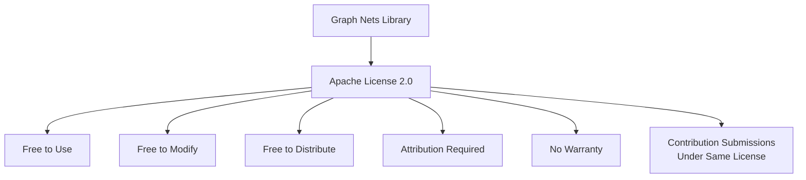
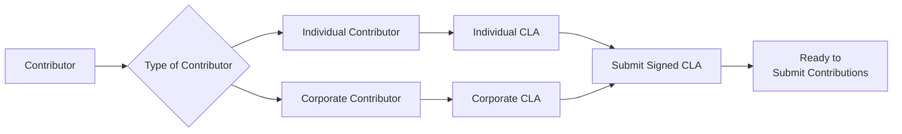
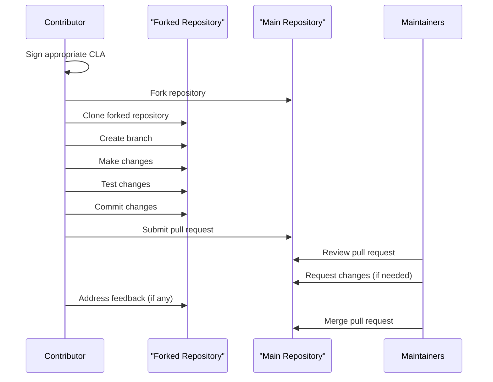
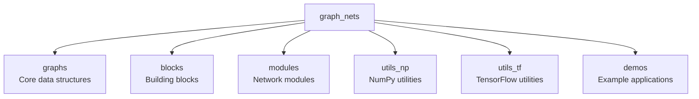

<!-- source: DeepWiki mcp.deepwiki.com · repo google-deepmind/graph_nets · page 6.3 Contributing · fetched 2026-10-26 -->

# Contributing

Relevant source files

The following files were used as context for generating this wiki page:

- [CONTRIBUTING.md](CONTRIBUTING.md)
- [LICENSE](LICENSE)
- [README.md](README.md)

This document describes how to contribute to the Graph Nets library, including licensing requirements, contribution workflows, and guidelines for submitting code changes. The Graph Nets library welcomes contributions from the community while ensuring proper licensing and code quality standards.

## License Information

The Graph Nets library is released under the Apache License 2.0, which is a permissive open-source license allowing for free use, modification, and distribution of the code with proper attribution.

Sources: [LICENSE:1-203](), [README.md:1-167]()

## Contributor License Agreements (CLAs)

Before contributing to the Graph Nets library, you must sign a Contributor License Agreement (CLA). This is a legal requirement to ensure that DeepMind has the necessary rights to distribute your contributions under the project's license.

### Types of CLAs

There are two types of CLAs:

1. **Individual CLA**: For individuals writing original source code who own the intellectual property.
2. **Corporate CLA**: For employees contributing work owned by their employer.

Only after signing and returning the appropriate CLA can your contributions be accepted into the main repository.

Sources: [CONTRIBUTING.md:1-25]()

## Contribution Workflow

The following diagram illustrates the process for contributing code to the Graph Nets library:

Sources: [CONTRIBUTING.md:27-32]()

## How to Submit Contributions

If you have improvements to the Graph Nets library, you can submit them through GitHub pull requests. The basic process is:

1. **Fork the repository**: Create your own copy of the repository.
2. **Make your changes**: Implement your improvements or fixes.
3. **Submit a pull request**: Send your changes for review.

For those new to GitHub's contribution process, GitHub provides a [guide on using pull requests](https://help.github.com/articles/using-pull-requests).

### Code Contribution Checklist

Before submitting your pull request, ensure:

1. You have signed the appropriate CLA
2. Your code works with the supported versions of TensorFlow (see installation instructions in the README)
3. Your code follows the project's coding style
4. You have tested your changes
5. You have provided appropriate documentation for new features

Sources: [CONTRIBUTING.md:27-32](), [README.md:22-56]()

## Repository Structure

When contributing, it's helpful to understand the organization of the library. The Graph Nets library consists of the following main components:

Understanding this structure helps in determining where your contribution should be directed.

Sources: [README.md:5-6]()

## Contact Information

For questions, comments, or discussions about contributions, you can contact:

- Email: graph-nets@google.com
- For bug reports or feature requests, use the GitHub issue tracker

Sources: [README.md:8-8]()

## Related Libraries and Projects

When contributing, it may be helpful to be aware of related projects in the graph neural network ecosystem. The Graph Nets library exists alongside several other libraries with similar goals:

- **jraph**: DeepMind's GNNs/GraphNets library for JAX
- **pytorch_geometric**: PyTorch-based library for graph neural networks
- **Deep Graph Library (DGL)**: Another popular graph neural network library

Familiarity with these projects can inform your contributions to the Graph Nets library.

Sources: [README.md:155-166]()

## Community and Support

While contributing, you can get support from:

1. **Demo Jupyter Notebooks**: Review the existing demos to understand how the library is intended to be used.
2. **Contact Email**: Reach out to graph-nets@google.com for questions and comments.
3. **GitHub Issues**: Check existing issues for context on ongoing work and problems.

Sources: [README.md:8-8](), [README.md:79-152]()