# Page: Overview

# Overview

<details>
<summary>Relevant source files</summary>

The following files were used as context for generating this wiki page:

- [README.md](README.md)
- [docs/graph_nets.md](docs/graph_nets.md)
- [graph_nets/graphs.py](graph_nets/graphs.py)
- [graph_nets/utils_np.py](graph_nets/utils_np.py)
- [setup.py](setup.py)

</details>


Graph Nets is DeepMind's library for building graph networks in TensorFlow and Sonnet. This document provides a high-level introduction to the library's purpose, architecture, and core components.

## Purpose and Scope

The Graph Nets library enables the construction and training of Graph Neural Networks (GNNs), which are neural networks that operate on graph-structured data. The library is designed to:

1. Provide a flexible framework for implementing various types of graph neural networks
2. Support batched processing of multiple graphs with different shapes and sizes
3. Offer implementations for both NumPy and TensorFlow
4. Enable applications like shortest path finding, sorting, and physical simulation

Sources: [setup.py:24-27](), [README.md:5-6]()

## Core Concepts

A graph network takes a graph as input and returns a graph as output. The input graph has edge, node, and global attributes, while the output graph has the same structure but with updated attributes. Graph networks are part of the broader family of "graph neural networks."

```mermaid
flowchart LR
    subgraph "Graph Network"
        direction LR
        Input["Input Graph"] --> GN[["Graph Network Module"]]
        GN --> Output["Output Graph (same structure, updated features)"]
    end
    
    subgraph "Graph Structure"
        direction TB
        Nodes["Nodes (V)"]
        Edges["Edges (E)"]
        Globals["Globals (u)"]
    end
    
    Input -.-> Graph Structure
    Output -.-> Graph Structure
```

Sources: [README.md:10-15]()

## Core Data Structure: GraphsTuple

The central data structure of the library is the `GraphsTuple`, which represents batches of graphs with potentially different shapes and sizes. It contains the following fields:

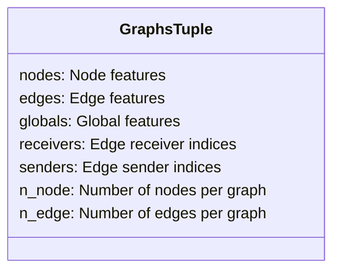

- **nodes**: Features for each node across all graphs in the batch
- **edges**: Features for each edge across all graphs in the batch
- **globals**: Features for each graph in the batch
- **receivers**: Indices of receiver nodes for each edge
- **senders**: Indices of sender nodes for each edge
- **n_node**: Number of nodes in each graph
- **n_edge**: Number of edges in each graph

The `GraphsTuple` is implemented as a named tuple, making it compatible with TensorFlow operations and capable of being passed directly to and from `tensorflow.Session.run()` calls.

Sources: [graph_nets/graphs.py:16-102](), [graph_nets/graphs.py:125-147]()

## Library Architecture

The Graph Nets library is organized into several core modules:

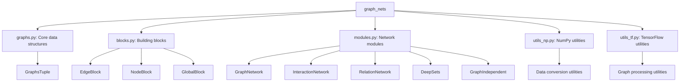

Sources: [setup.py:28-36](), [README.md:62-76]()

## Building Blocks

The library follows a modular design with three primary building blocks:

1. **EdgeBlock**: Updates edge features based on edge, adjacent node, and global features
2. **NodeBlock**: Updates node features based on node, aggregated edge, and global features
3. **GlobalBlock**: Updates global features based on global, aggregated node, and aggregated edge features

These blocks are combined to create higher-level network modules, each implementing different message-passing approaches.

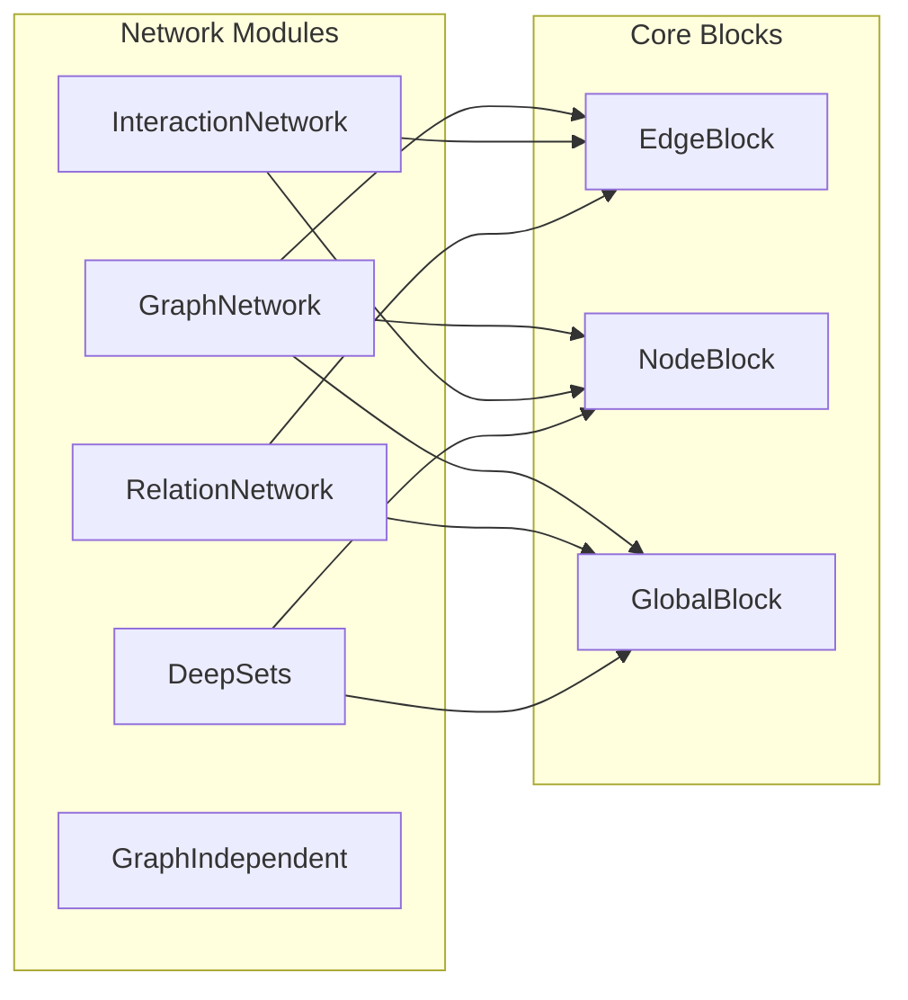

Sources: [docs/graph_nets.md:10-1063]()

## Message Passing

The core operation in graph neural networks is message passing between different components of the graph. In a typical GraphNetwork, the information flows as follows:

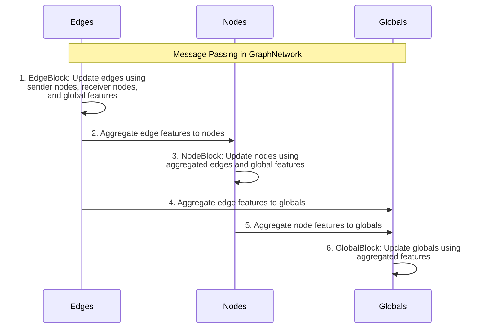

This message-passing approach allows information to flow between all components of the graph, enabling the model to learn complex patterns and relationships in graph-structured data.

Sources: [docs/graph_nets.md:10-1063]()

## Data Conversion Utilities

The library provides utilities for converting between different graph representations:

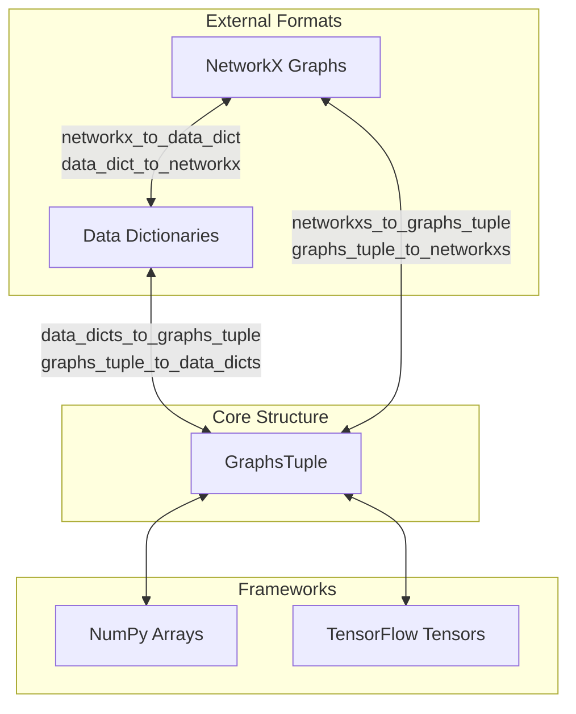

These conversion utilities make it easy to work with graphs from different sources and in different formats, providing a seamless interface between NetworkX graphs, data dictionaries, and the core GraphsTuple structure.

Sources: [graph_nets/utils_np.py:15-35](), [graph_nets/utils_np.py:117-568]()

## Encode-Process-Decode Architecture

A common pattern used in the library's demos is the Encode-Process-Decode architecture:

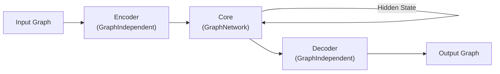

1. **Encoder**: Transforms the input graph into a latent representation using a GraphIndependent module
2. **Processor**: Iteratively refines this representation through multiple iterations of a GraphNetwork module
3. **Decoder**: Produces the final output graph

This architecture has been successfully applied to various tasks including shortest path finding, sorting lists, and simulating physical systems, demonstrating the versatility of graph neural networks.

Sources: [README.md:91-126]()

## Demonstration Applications

The library includes several demonstration applications that showcase its capabilities:

| Demo | Description | Application |
|------|-------------|-------------|
| Shortest Path | Predicts the shortest path between two nodes in a graph | Route planning, network optimization |
| Sort | Learns to sort a list of numbers | Algorithm learning |
| Physics | Predicts the state of a mass-spring physical system over time | Physical simulation |
| Graph Nets Basics | Tutorial on creating and manipulating graphs | Learning the library |

These demos illustrate how the same graph network architecture can be applied to diverse problems by changing the data representation and training objectives.

Sources: [README.md:79-152]()

## System Requirements and Installation

The Graph Nets library can be installed via pip and is compatible with:
- Linux/Mac OS X
- Python 2.7 and 3.4+
- TensorFlow 1.15+ or TensorFlow 2.1.0+
- Sonnet 1 or 2

For TensorFlow 1 and Sonnet 1:
```
pip install graph_nets "tensorflow>=1.15,<2" "dm-sonnet<2" "tensorflow_probability<0.9"
```

For TensorFlow 2 and Sonnet 2:
```
pip install graph_nets "tensorflow>=2.1.0-rc1" "dm-sonnet>=2.0.0b0" tensorflow_probability
```

Sources: [README.md:22-56](), [setup.py:27-62]()

---

# Page: Core Data Structure: GraphsTuple

# Core Data Structure: GraphsTuple

<details>
<summary>Relevant source files</summary>

The following files were used as context for generating this wiki page:

- [docs/graph_nets.md](docs/graph_nets.md)
- [graph_nets/graphs.py](graph_nets/graphs.py)
- [graph_nets/utils_np.py](graph_nets/utils_np.py)
- [setup.py](setup.py)

</details>


This document details the `GraphsTuple` data structure, which forms the foundation of the Graph Nets library. The `GraphsTuple` is designed to efficiently represent batches of graphs with varying shapes and sizes in a way that supports batched processing for machine learning applications.

## Overview

The `GraphsTuple` is a specialized `namedtuple` that stores all necessary information to represent graphs for deep learning, including node features, edge features, global graph features, and graph connectivity information.

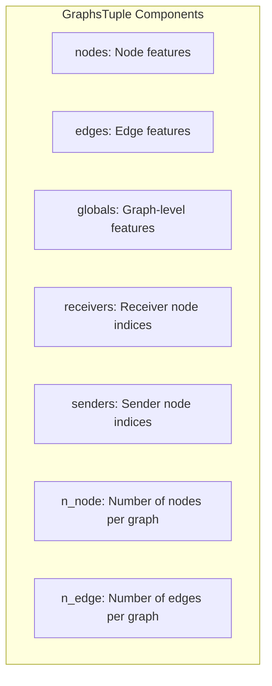

Sources: [graph_nets/graphs.py:125-127](), [graph_nets/graphs.py:128-147]()

## Definition and Structure

The `GraphsTuple` is defined as a `collections.namedtuple` with seven fields that together represent one or more graphs:

| Field | Description | Can be `None`? |
|-------|-------------|----------------|
| `nodes` | Features for each node | Yes |
| `edges` | Features for each edge | Yes |
| `globals` | Global features for each graph | Yes |
| `receivers` | Indices of receiver nodes for each edge | Yes* |
| `senders` | Indices of sender nodes for each edge | Yes* |
| `n_node` | Number of nodes per graph | No |
| `n_edge` | Number of edges per graph | No |

\* *Note: If `receivers` is `None`, then `senders` must also be `None` (and vice versa). If both are `None`, then `edges` must also be `None`.*

Sources: [graph_nets/graphs.py:15-102](), [graph_nets/graphs.py:149-165]()

The `GraphsTuple` class enforces these constraints through validation methods to ensure the data structure remains consistent:

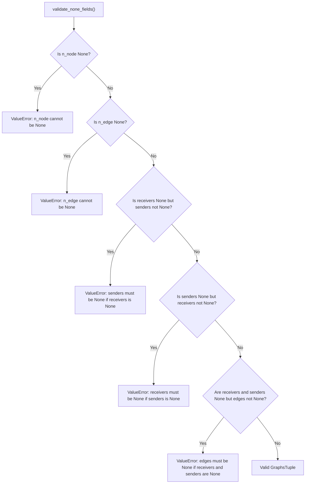

Sources: [graph_nets/graphs.py:149-165]()

## Representing Batched Graphs

One of the key features of `GraphsTuple` is its ability to store multiple graphs of different sizes in a batched format. This facilitates efficient processing of graph data in machine learning pipelines.

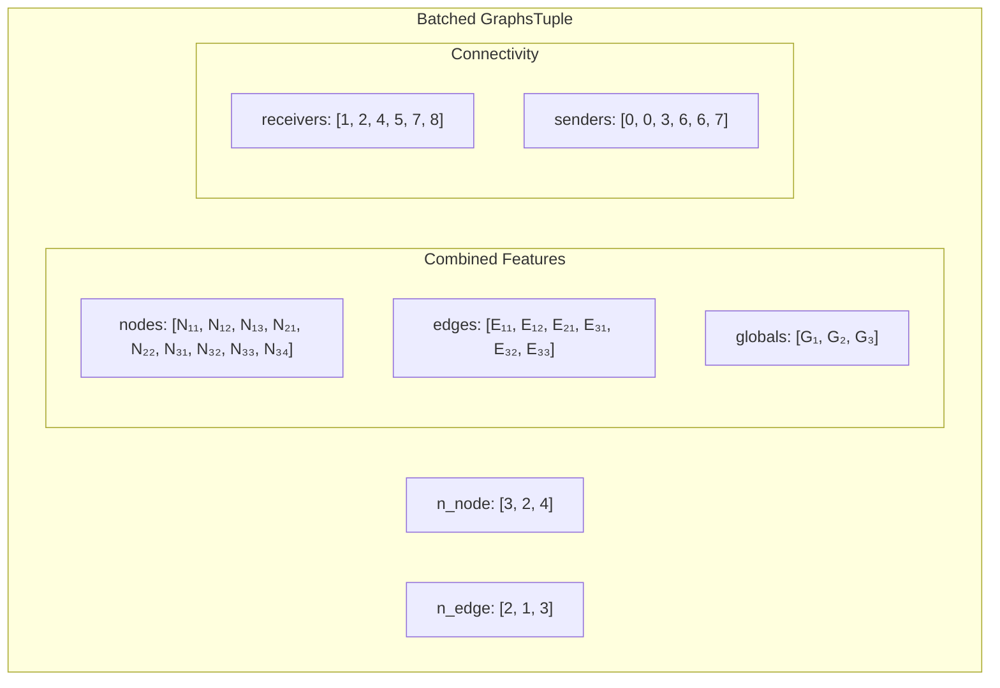

In this diagram:
- `n_node: [3, 2, 4]` indicates there are 3 graphs with 3, 2, and 4 nodes respectively
- `n_edge: [2, 1, 3]` indicates these graphs have 2, 1, and 3 edges respectively
- The node and edge features are concatenated in the respective arrays
- The `receivers` and `senders` arrays use absolute indices into the concatenated nodes array

Sources: [graph_nets/graphs.py:25-82](), [graph_nets/utils_np.py:89-103]()

## Understanding Indexing in GraphsTuple

When multiple graphs are batched into a single `GraphsTuple`, the indices in `senders` and `receivers` become absolute indices into the concatenated `nodes` array. This requires careful handling of offsets when working with batched graphs.

For example, if we have 3 graphs with 3, 2, and 4 nodes respectively:

```
Graph 1: Nodes 0, 1, 2
Graph 2: Nodes 3, 4
Graph 3: Nodes 5, 6, 7, 8
```

Then an edge from node 1 to node 2 in Graph 3 would be represented as:
- `senders[i] = 6` (node 1 of Graph 3 has absolute index 6)
- `receivers[i] = 7` (node 2 of Graph 3 has absolute index 7)

The library includes utilities to compute these offsets when batching graphs and to adjust indices when unbatching.

Sources: [graph_nets/utils_np.py:89-103](), [graph_nets/utils_np.py:502-536]()

## Methods and Operations

The `GraphsTuple` class provides two key methods for working with graph data:

### 1. `replace(**kwargs)`

This method creates a new `GraphsTuple` with some fields replaced by the values in `kwargs`.

```python
# Example: Replace nodes in a GraphsTuple
new_graphs = original_graphs.replace(nodes=new_nodes)
```

Sources: [graph_nets/graphs.py:173-176]()

### 2. `map(field_fn, fields=GRAPH_FEATURE_FIELDS)`

This method applies a function `field_fn` to specified fields of the `GraphsTuple` and returns a new instance.

```python
# Example: Apply a function to all feature fields
def add_offset(x):
    return x + 1.0 if x is not None else None

new_graphs = original_graphs.map(add_offset)
```

Sources: [graph_nets/graphs.py:178-195]()

## Conversion Utilities

The Graph Nets library provides utilities for converting between `GraphsTuple` and other graph representations.

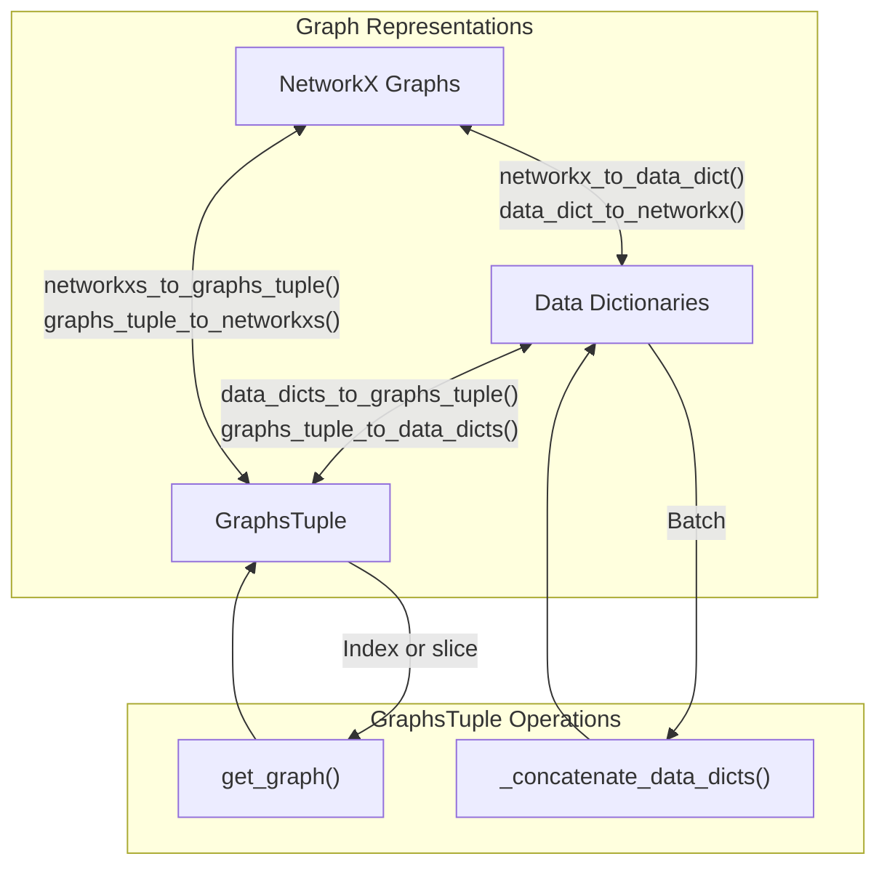

Key conversion functions include:

1. `networkx_to_data_dict` / `data_dict_to_networkx`: Convert between NetworkX graphs and data dictionaries
2. `data_dicts_to_graphs_tuple` / `graphs_tuple_to_data_dicts`: Convert between data dictionaries and `GraphsTuple`
3. `networkxs_to_graphs_tuple` / `graphs_tuple_to_networkxs`: Direct conversion between NetworkX graphs and `GraphsTuple`
4. `get_graph`: Extract a single graph or a slice of graphs from a batched `GraphsTuple`

Sources: [graph_nets/utils_np.py:117-236](), [graph_nets/utils_np.py:245-307](), [graph_nets/utils_np.py:380-446](), [graph_nets/utils_np.py:541-568]()

## Validation and Constraints

The `GraphsTuple` enforces certain constraints to maintain data consistency:

1. The `n_node` and `n_edge` fields cannot be `None`
2. If `receivers` is `None`, then `senders` must also be `None` (and vice versa)
3. If both `receivers` and `senders` are `None`, then `edges` must also be `None`

These constraints ensure that the graph structure remains valid and are checked both during initialization and when fields are replaced.

Sources: [graph_nets/graphs.py:149-165](), [graph_nets/graphs.py:173-176]()

## Use in Graph Neural Networks

The `GraphsTuple` is the primary data structure used throughout the Graph Nets library for representing graph-structured data in neural network models. It provides a consistent interface for all graph neural network components while allowing for efficient batched processing.

In the broader architecture of the library, `GraphsTuple` connects with various graph neural network modules such as `EdgeBlock`, `NodeBlock`, and `GlobalBlock` which operate on different components of the graph structure.

Sources: [setup.py:24-26]()

## Summary

The `GraphsTuple` data structure provides a flexible and efficient way to represent graphs for machine learning. Its key features include:

- Support for batched processing of multiple graphs
- Ability to handle graphs of varying shapes and sizes
- Consistent representation of node features, edge features, and global features
- Utilities for conversion between different graph representations
- Validation to ensure data consistency

Understanding the `GraphsTuple` is essential for effectively using the Graph Nets library, as it serves as the primary interface for all graph operations and neural network components.

---

# Page: Graph Neural Network Components

# Graph Neural Network Components

<details>
<summary>Relevant source files</summary>

The following files were used as context for generating this wiki page:

- [docs/graph_nets.md](docs/graph_nets.md)
- [graph_nets/blocks.py](graph_nets/blocks.py)
- [graph_nets/modules.py](graph_nets/modules.py)

</details>


This page provides an overview of the core components used to build Graph Neural Networks in the graph_nets library. These components form the foundation for creating various graph neural network architectures by manipulating and transforming graph-structured data. For information about the core data structure used by these components, see [Core Data Structure: GraphsTuple](#2).

## Core Building Blocks

The graph_nets library is built around three fundamental building blocks that enable message passing between different elements of graphs. These blocks are implemented as Sonnet modules that update specific parts of a graph while leaving other parts unchanged.

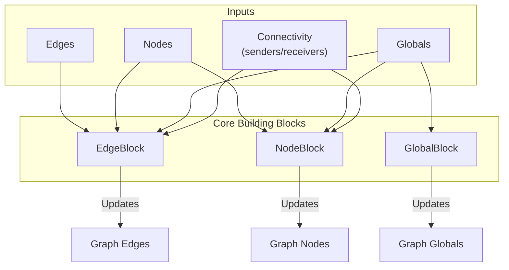

Sources: [graph_nets/blocks.py:386-484](), [graph_nets/blocks.py:487-602](), [graph_nets/blocks.py:605-707]()

### EdgeBlock

The EdgeBlock updates the features of each edge in a graph based on:
- The edge's previous features
- Features of the nodes connected to the edge (sender and receiver nodes)
- Global features of the graph

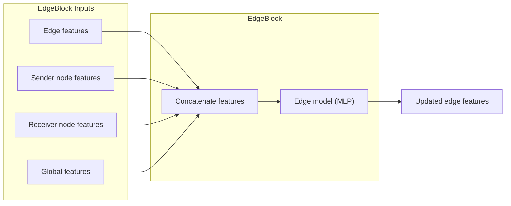

Sources: [graph_nets/blocks.py:386-484]()

### NodeBlock

The NodeBlock updates the features of each node based on:
- The node's previous features
- Aggregated features from connected edges (sent and/or received)
- Global features of the graph

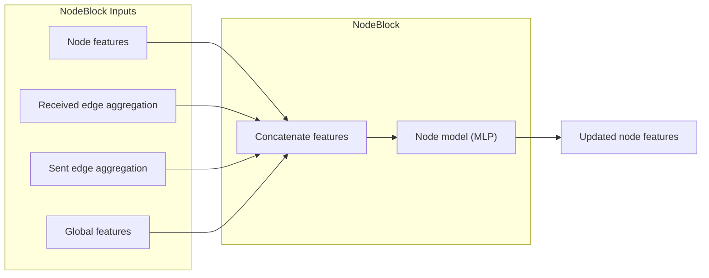

Sources: [graph_nets/blocks.py:487-602]()

### GlobalBlock

The GlobalBlock updates the global features of a graph based on:
- Previous global features
- Aggregated features from all nodes in the graph
- Aggregated features from all edges in the graph

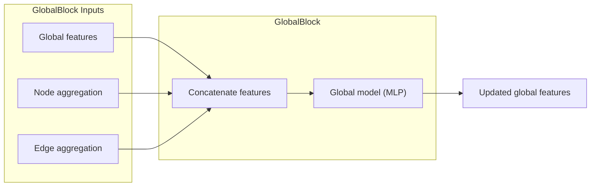

Sources: [graph_nets/blocks.py:605-707]()

## Aggregation and Broadcasting Operations

To enable information flow between different parts of the graph, the library provides two types of operations:

1. **Aggregation operations**: Combine features from multiple graph elements into one
2. **Broadcasting operations**: Distribute features from one element to multiple elements

### Aggregation Operations

Aggregation operations reduce features from multiple elements into a single representation using a reduction function (e.g., sum, mean, max).

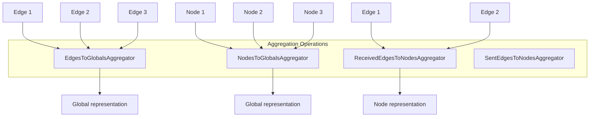

Sources: [graph_nets/blocks.py:176-213](), [graph_nets/blocks.py:213-248](), [graph_nets/blocks.py:302-327](), [graph_nets/blocks.py:272-300]()

### Broadcasting Operations

Broadcasting operations distribute features from one element to multiple related elements.

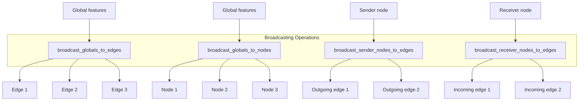

Sources: [graph_nets/blocks.py:77-129](), [graph_nets/blocks.py:131-173]()

## Network Modules

The library provides several pre-built graph neural network architectures that compose the fundamental blocks in different ways to handle various types of graph-based tasks.

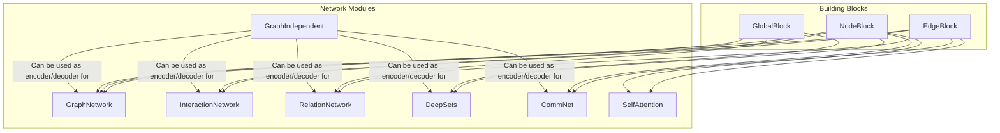

Sources: [graph_nets/modules.py:78-145](), [graph_nets/modules.py:148-216](), [graph_nets/modules.py:247-329](), [graph_nets/modules.py:332-411](), [graph_nets/modules.py:414-498](), [graph_nets/modules.py:501-597](), [graph_nets/modules.py:657-753]()

### GraphNetwork

The most general architecture that can update all three components (edges, nodes, and globals) of a graph.

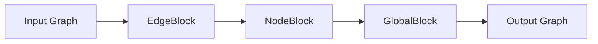

Sources: [graph_nets/modules.py:247-329]()

### InteractionNetwork

Updates edges based on connected nodes, then updates nodes based on the new edges.

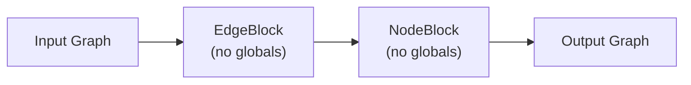

Sources: [graph_nets/modules.py:78-145]()

### RelationNetwork

Updates edges based on connected nodes, then updates only the global features based on the edges.

```mermaid
flowchart LR
    I["Input Graph"] --> EB["EdgeBlock\n(no edges/globals)"]
    EB --> GB["GlobalBlock\n(edges only)"]
    GB --> O["Output Graph\n(updated globals)"]
```

Sources: [graph_nets/modules.py:148-216]()

### DeepSets

Works on sets (graphs without edges), updating nodes based on their features and globals, then updating globals based on the nodes.

```mermaid
flowchart LR
    I["Input Graph"] --> NB["NodeBlock\n(no edges)"]
    NB --> GB["GlobalBlock\n(no edges)"]
    GB --> O["Output Graph"]
```

Sources: [graph_nets/modules.py:414-498]()

### GraphIndependent

A simple module that independently applies transformations to each graph element type without message passing.

```mermaid
flowchart TD
    I["Input Graph"] --> Processor
    
    subgraph Processor
        direction TB
        E["Edge Model"]
        N["Node Model"]
        G["Global Model"]
    end
    
    Processor --> O["Output Graph"]
```

Sources: [graph_nets/modules.py:332-411]()

## Message Passing Flow

The core functionality of these components is to enable message passing between different parts of a graph. The following diagram illustrates the overall message passing process in a typical GraphNetwork module:

```mermaid
sequenceDiagram
    participant E as Edges
    participant N as Nodes
    participant G as Globals
    
    Note over E,G: Full GraphNetwork message passing
    
    E->>E: EdgeBlock: Update edges using<br>sender nodes, receiver nodes,<br>and global features
    E->>N: Aggregate edges to nodes<br>(ReceivedEdgesToNodesAggregator)
    N->>N: NodeBlock: Update nodes using<br>node features, aggregated edges,<br>and global features
    E->>G: Aggregate edges to globals<br>(EdgesToGlobalsAggregator)
    N->>G: Aggregate nodes to globals<br>(NodesToGlobalsAggregator)
    G->>G: GlobalBlock: Update globals using<br>global features and aggregated<br>edge and node features
```

Sources: [graph_nets/modules.py:247-329](), [graph_nets/blocks.py:386-484](), [graph_nets/blocks.py:487-602](), [graph_nets/blocks.py:605-707]()

## Implementation Details

The building blocks and network modules are implemented as Sonnet modules, which provides a clean and modular interface for constructing neural networks. Each building block takes a model function as input, which should return a neural network module (typically an MLP) that will be applied to the concatenated features.

| Component | Required model_fn | Input features | Output |
|-----------|------------------|----------------|--------|
| EdgeBlock | edge_model_fn | Concatenated edge, sender node, receiver node, and global features | Updated edge features |
| NodeBlock | node_model_fn | Concatenated node, aggregated edge, and global features | Updated node features |
| GlobalBlock | global_model_fn | Concatenated global, aggregated node, and aggregated edge features | Updated global features |
| GraphNetwork | edge_model_fn, node_model_fn, global_model_fn | Features from respective blocks | Updated graph with all components updated |

Sources: [graph_nets/blocks.py:386-484](), [graph_nets/blocks.py:487-602](), [graph_nets/blocks.py:605-707](), [graph_nets/modules.py:247-329]()

## Usage Patterns

The components are typically combined in an encode-process-decode pattern:

1. **Encode**: Transform input features using a GraphIndependent module
2. **Process**: Apply message passing using one of the network modules
3. **Decode**: Transform output features using another GraphIndependent module

```mermaid
flowchart LR
    Input["Input Graph"] --> Encoder["Encoder\n(GraphIndependent)"]
    Encoder --> Processor["Processor\n(GraphNetwork)"]
    Processor -->|"Optional recurrence"| Processor
    Processor --> Decoder["Decoder\n(GraphIndependent)"]
    Decoder --> Output["Output Graph"]
```

Sources: [graph_nets/modules.py:332-411](), [graph_nets/modules.py:247-329]()

## Reducers

Many components require a reducer function to aggregate features. The library supports various reduction operations:

| Reducer | Operation | Description |
|---------|-----------|-------------|
| tf.math.unsorted_segment_sum | Sum | Sums features within each segment |
| tf.math.unsorted_segment_mean | Mean | Averages features within each segment |
| tf.math.unsorted_segment_prod | Product | Multiplies features within each segment |
| unsorted_segment_max_or_zero | Max | Maximum value within each segment (or zero) |
| unsorted_segment_min_or_zero | Min | Minimum value within each segment (or zero) |

Sources: [graph_nets/blocks.py:330-383]()

---

# Page: Building Blocks

# Building Blocks

<details>
<summary>Relevant source files</summary>

The following files were used as context for generating this wiki page:

- [docs/graph_nets.md](docs/graph_nets.md)
- [graph_nets/blocks.py](graph_nets/blocks.py)
- [graph_nets/tests_tf2/blocks_test.py](graph_nets/tests_tf2/blocks_test.py)

</details>


This document explains the fundamental building blocks of the Graph Nets library, which form the core components for creating graph neural networks. These building blocks provide mechanisms for manipulating and transforming graph-structured data by propagating, aggregating, and updating features across different elements of a graph. For higher-level network modules built using these blocks, see [Network Modules](#3.2).

## Overview of Building Blocks

The Graph Nets library provides three primary building blocks that can be composed to create a variety of graph neural networks:

1. **EdgeBlock** - Updates edge features based on edge, node, and global features
2. **NodeBlock** - Updates node features based on node, aggregated edge, and global features
3. **GlobalBlock** - Updates global features based on global, aggregated node, and aggregated edge features

These blocks are supported by broadcaster functions and aggregator classes that enable information flow between different components of a graph.

```mermaid
graph TB
    subgraph "Building Block Components"
        direction LR
        
        subgraph "Broadcasters"
            BcastGE["broadcast_globals_to_edges"]
            BcastGN["broadcast_globals_to_nodes"]
            BcastSE["broadcast_sender_nodes_to_edges"]
            BcastRE["broadcast_receiver_nodes_to_edges"]
        end
        
        subgraph "Aggregators"
            EG["EdgesToGlobalsAggregator"]
            NG["NodesToGlobalsAggregator"]
            SEN["SentEdgesToNodesAggregator"]
            REN["ReceivedEdgesToNodesAggregator"]
        end
        
        subgraph "Core Blocks"
            EB["EdgeBlock"]
            NB["NodeBlock"]
            GB["GlobalBlock"]
        end
        
        Broadcasters --> "Core Blocks"
        Aggregators --> "Core Blocks"
    end
```

Sources: [graph_nets/blocks.py:16-29](), [graph_nets/blocks.py:387-708]()

## Broadcasters

Broadcasters are functions that propagate features from one part of the graph to another, providing inputs for the update functions in the core blocks.

```mermaid
graph TD
    G["Globals"] -- "broadcast_globals_to_edges" --> E1["Edge 1"]
    G -- "broadcast_globals_to_edges" --> E2["Edge 2"]
    G -- "broadcast_globals_to_nodes" --> N1["Node 1"]
    G -- "broadcast_globals_to_nodes" --> N2["Node 2"]
    
    N1 -- "broadcast_sender_nodes_to_edges" --> E1
    N2 -- "broadcast_receiver_nodes_to_edges" --> E1
    N1 -- "broadcast_receiver_nodes_to_edges" --> E2
    N2 -- "broadcast_sender_nodes_to_edges" --> E2
```

The library provides four main broadcaster functions:

| Broadcaster | Description |
|-------------|-------------|
| `broadcast_globals_to_edges` | Broadcasts global features to each edge in the graph |
| `broadcast_globals_to_nodes` | Broadcasts global features to each node in the graph |
| `broadcast_sender_nodes_to_edges` | Broadcasts node features to the edges they are sending into |
| `broadcast_receiver_nodes_to_edges` | Broadcasts node features to the edges they are receiving from |

These broadcasters take a `GraphsTuple` as input and return a tensor with the appropriate broadcasted features.

Example usage:
```python
# Broadcast global features to all edges
edges_with_globals = broadcast_globals_to_edges(graph)

# Broadcast sender node features to edges
edges_with_sender_info = broadcast_sender_nodes_to_edges(graph)
```

Sources: [graph_nets/blocks.py:77-173]()

## Aggregators

Aggregators collect information from multiple elements (e.g., edges or nodes) and reduce them to a single output per destination element using a specified reduction operation.

```mermaid
graph TD
    E1["Edge 1"] --> N1["Node 1"]
    E2["Edge 2"] --> N1
    E3["Edge 3"] --> N2["Node 2"]
    
    E1 --> G["Globals"]
    E2 --> G
    E3 --> G
    
    N1 --> G
    N2 --> G
    
    subgraph "Aggregation Operations"
        A1["ReceivedEdgesToNodesAggregator"]
        A2["SentEdgesToNodesAggregator"]
        A3["EdgesToGlobalsAggregator"]
        A4["NodesToGlobalsAggregator"]
    end
```

The library provides four main aggregator classes:

| Aggregator | Description |
|------------|-------------|
| `EdgesToGlobalsAggregator` | Aggregates all edges into globals |
| `NodesToGlobalsAggregator` | Aggregates all nodes into globals |
| `SentEdgesToNodesAggregator` | Aggregates sent edges into their sender nodes |
| `ReceivedEdgesToNodesAggregator` | Aggregates received edges into their receiver nodes |

Each aggregator takes a reducer function to perform the aggregation. Common reducers include:
- `tf.math.unsorted_segment_sum`
- `tf.math.unsorted_segment_mean`
- `tf.math.unsorted_segment_prod`
- `unsorted_segment_min_or_zero`
- `unsorted_segment_max_or_zero`

Example usage:
```python
# Create an aggregator to sum all edges into globals
edge_to_global_aggregator = EdgesToGlobalsAggregator(tf.math.unsorted_segment_sum)

# Apply the aggregator to a graph
global_edge_features = edge_to_global_aggregator(graph)
```

Sources: [graph_nets/blocks.py:176-327]()

## Core Blocks

The three core blocks (EdgeBlock, NodeBlock, and GlobalBlock) use the broadcasters and aggregators to update the features of edges, nodes, and globals in a graph.

### EdgeBlock

EdgeBlock updates the features of each edge based on the edge's previous features, features of adjacent nodes, and global features.

```mermaid
graph LR
    subgraph "EdgeBlock"
        direction TB
        Inputs["Inputs:
        - Edge features (optional)
        - Sender node features (optional)
        - Receiver node features (optional)
        - Global features (optional)"] --> 
        Concatenate["Concatenate features"] -->
        EdgeModel["Edge MLP model"] -->
        UpdatedEdges["Updated edge features"]
    end
```

**Key Parameters**:
- `edge_model_fn`: Function that returns a neural network module for updating edge features
- `use_edges`: Whether to include previous edge features in the update
- `use_receiver_nodes`: Whether to include receiver node features in the update
- `use_sender_nodes`: Whether to include sender node features in the update
- `use_globals`: Whether to include global features in the update

Sources: [graph_nets/blocks.py:386-484]()

### NodeBlock

NodeBlock updates the features of each node based on the node's previous features, aggregated features from connected edges, and global features.

```mermaid
graph LR
    subgraph "NodeBlock"
        direction TB
        Inputs["Inputs:
        - Node features (optional)
        - Aggregated received edges (optional)
        - Aggregated sent edges (optional)
        - Global features (optional)"] --> 
        Concatenate["Concatenate features"] -->
        NodeModel["Node MLP model"] -->
        UpdatedNodes["Updated node features"]
    end
```

**Key Parameters**:
- `node_model_fn`: Function that returns a neural network module for updating node features
- `use_received_edges`: Whether to include aggregated received edge features
- `use_sent_edges`: Whether to include aggregated sent edge features
- `use_nodes`: Whether to include previous node features
- `use_globals`: Whether to include global features
- `received_edges_reducer`: Function to reduce multiple received edges per node
- `sent_edges_reducer`: Function to reduce multiple sent edges per node

Sources: [graph_nets/blocks.py:487-602]()

### GlobalBlock

GlobalBlock updates the global features based on the previous global features, aggregated features from all nodes, and aggregated features from all edges.

```mermaid
graph LR
    subgraph "GlobalBlock"
        direction TB
        Inputs["Inputs:
        - Global features (optional)
        - Aggregated node features (optional)
        - Aggregated edge features (optional)"] --> 
        Concatenate["Concatenate features"] -->
        GlobalModel["Global MLP model"] -->
        UpdatedGlobals["Updated global features"]
    end
```

**Key Parameters**:
- `global_model_fn`: Function that returns a neural network module for updating global features
- `use_edges`: Whether to include aggregated edge features
- `use_nodes`: Whether to include aggregated node features
- `use_globals`: Whether to include previous global features
- `nodes_reducer`: Function to reduce features from all nodes
- `edges_reducer`: Function to reduce features from all edges

Sources: [graph_nets/blocks.py:605-707]()

## Message Passing Flow

The building blocks enable the implementation of message-passing neural networks where information flows between different components of the graph. The standard message passing flow involves updates in this order: edges → nodes → globals.

```mermaid
sequenceDiagram
    participant E as Edges
    participant N as Nodes
    participant G as Globals
    
    Note over E,G: Message Passing Using Building Blocks
    
    rect rgba(200, 200, 200, 0.5)
        Note right of E: EdgeBlock
        E->>E: Use edge features (optional)
        N->>E: Use sender node features (optional)
        N->>E: Use receiver node features (optional)
        G->>E: Use global features (optional)
        E->>E: Update edge features
    end
    
    rect rgba(200, 200, 200, 0.5)
        Note right of N: NodeBlock
        N->>N: Use node features (optional)
        E->>N: Aggregate received edges (optional)
        E->>N: Aggregate sent edges (optional)
        G->>N: Use global features (optional)
        N->>N: Update node features
    end
    
    rect rgba(200, 200, 200, 0.5)
        Note right of G: GlobalBlock
        G->>G: Use global features (optional)
        E->>G: Aggregate edge features (optional)
        N->>G: Aggregate node features (optional)
        G->>G: Update global features
    end
```

By chaining these blocks together, the Graph Nets library enables the construction of sophisticated graph neural networks that can pass information between all parts of the graph.

Sources: [graph_nets/blocks.py:386-707]()

## Implementation Example

Here's a simplified example of how the building blocks can be used together:

```python
# Create the edge, node, and global blocks
edge_block = EdgeBlock(
    edge_model_fn=lambda: snt.nets.MLP([32, 32]),
    use_edges=True,
    use_receiver_nodes=True,
    use_sender_nodes=True,
    use_globals=True
)

node_block = NodeBlock(
    node_model_fn=lambda: snt.nets.MLP([32, 32]),
    use_received_edges=True,
    use_sent_edges=False,
    use_nodes=True,
    use_globals=True
)

global_block = GlobalBlock(
    global_model_fn=lambda: snt.nets.MLP([32, 32]),
    use_edges=True,
    use_nodes=True,
    use_globals=True
)

# Apply the blocks in sequence to a graph
graph_1 = edge_block(input_graph)
graph_2 = node_block(graph_1)
output_graph = global_block(graph_2)
```

This creates a simple message-passing graph neural network that:
1. First updates all edge features based on connected nodes and globals
2. Then updates all node features based on the updated edges and globals
3. Finally updates the global features based on all updated edges and nodes

Sources: [graph_nets/tests_tf2/blocks_test.py:362-1123]()

## Reducers and Special Aggregation Functions

The library provides two special reducer functions that handle cases where segments have no elements:

1. `unsorted_segment_min_or_zero`: Returns zero instead of the highest value for empty segments
2. `unsorted_segment_max_or_zero`: Returns zero instead of the lowest value for empty segments

These are particularly useful when working with graphs of varying sizes and connectivities.

```python
# Example usage:
aggregator = NodesToGlobalsAggregator(blocks.unsorted_segment_max_or_zero)
```

Sources: [graph_nets/blocks.py:330-383]()

## Summary

The building blocks in the Graph Nets library provide a flexible foundation for constructing graph neural networks:

1. **Broadcasters** spread information from one part of the graph to another
2. **Aggregators** combine information from multiple sources
3. **Core blocks** (EdgeBlock, NodeBlock, GlobalBlock) update features using a neural network

These components can be composed in various ways to implement different types of graph neural network architectures, allowing for information to flow between all parts of a graph in a learnable manner.

---

# Page: Network Modules

# Network Modules

<details>
<summary>Relevant source files</summary>

The following files were used as context for generating this wiki page:

- [docs/graph_nets.md](docs/graph_nets.md)
- [graph_nets/modules.py](graph_nets/modules.py)
- [graph_nets/tests_tf2/modules_test.py](graph_nets/tests_tf2/modules_test.py)

</details>


This document describes the higher-level network modules provided by the Graph Nets library. These modules implement different types of graph neural networks by combining the fundamental building blocks (EdgeBlock, NodeBlock, GlobalBlock) covered in [Building Blocks](#3.1) in various ways.

The network modules are ready-to-use implementations of popular graph neural network architectures from the literature. They process GraphsTuple objects and provide different message-passing patterns for various learning tasks.

## Network Module Hierarchy

```mermaid
flowchart TD
    subgraph "Basic Blocks"
        EB["EdgeBlock"]
        NB["NodeBlock"]
        GB["GlobalBlock"]
    end

    subgraph "Network Modules"
        GN["GraphNetwork"] --> EB & NB & GB
        GI["GraphIndependent"] -.-> EB & NB & GB
        IN["InteractionNetwork"] --> EB & NB
        RN["RelationNetwork"] --> EB & GB
        DS["DeepSets"] --> NB & GB
        CN["CommNet"] --> EB & NB
        SA["SelfAttention"]
    end

    style GN font-weight:bold
    
    classDef usage stroke-dasharray: 5 5
    class GI usage
```

Sources: [graph_nets/modules.py:78-597](). [graph_nets/modules.py:247-329]().

## GraphNetwork

The GraphNetwork is the most general and comprehensive module that implements the full Graph Network framework as described in [Relational inductive biases, deep learning, and graph networks](https://arxiv.org/abs/1806.01261).

```mermaid
flowchart LR
    input["Input GraphsTuple"] --> EB["EdgeBlock"]
    EB --> NB["NodeBlock"]
    NB --> GB["GlobalBlock"]
    GB --> output["Output GraphsTuple"]

    subgraph "Edge Update"
        EB_detail["edges ← f(edges, sender nodes, receiver nodes, globals)"]
    end

    subgraph "Node Update"
        NB_detail["nodes ← f(nodes, aggregated edges, globals)"]
    end

    subgraph "Global Update"
        GB_detail["globals ← f(globals, aggregated nodes, aggregated edges)"]
    end

    EB --- EB_detail
    NB --- NB_detail
    GB --- GB_detail
```

Sources: [graph_nets/modules.py:247-329]().

### Key Characteristics

- Updates all components of the graph (edges, nodes, and globals) in sequence
- Provides full control over update functions and message-passing patterns
- Supports customization via different reducer functions and block options

### Usage

A GraphNetwork is constructed by providing model functions for each block:

```python
graph_net = modules.GraphNetwork(
    edge_model_fn=edge_model_fn,   # Function returning model for edge updates
    node_model_fn=node_model_fn,   # Function returning model for node updates
    global_model_fn=global_model_fn,  # Function returning model for global updates
    reducer=tf.math.unsorted_segment_sum  # Reducer for aggregation
)
```

The GraphNetwork can then be applied to a GraphsTuple:

```python
output_graph = graph_net(input_graph)
```

Sources: [graph_nets/modules.py:247-329](). [graph_nets/tests_tf2/modules_test.py:259-698]().

### Customization Options

The GraphNetwork allows customization of how each block processes the graph:

| Block Type | Customizable Options |
|------------|----------------------|
| EdgeBlock  | `use_edges`, `use_receiver_nodes`, `use_sender_nodes`, `use_globals` |
| NodeBlock  | `use_received_edges`, `use_sent_edges`, `use_nodes`, `use_globals`, `received_edges_reducer`, `sent_edges_reducer` |
| GlobalBlock | `use_edges`, `use_nodes`, `use_globals`, `edges_reducer`, `nodes_reducer` |

Sources: [graph_nets/modules.py:57-244]().

## GraphIndependent

The GraphIndependent module processes each part of the graph (edges, nodes, and globals) independently, without message passing between them.

```mermaid
flowchart LR
    input["Input GraphsTuple"] --> proc["GraphIndependent"]
    proc --> output["Output GraphsTuple"]

    subgraph "Independent Processing"
        direction TB
        edge_fn["edge_model_fn"] --> edges'["edges' = edge_model(edges)"]
        node_fn["node_model_fn"] --> nodes'["nodes' = node_model(nodes)"]
        global_fn["global_model_fn"] --> globals'["globals' = global_model(globals)"]
    end

    proc --- Independent
```

Sources: [graph_nets/modules.py:332-411]().

### Key Characteristics

- No message passing between different components of the graph
- Each component (edges, nodes, globals) is processed independently
- Often used as an encoder or decoder in conjunction with other modules
- Can use identity functions to leave some components unchanged

### Usage

GraphIndependent is commonly used to:
1. Encode raw features before passing them to a message-passing module
2. Decode processed features into the final output format
3. Apply the same transformation to all nodes/edges/globals independently

Sources: [graph_nets/modules.py:332-411](). [graph_nets/tests_tf2/modules_test.py:114-257]().

## InteractionNetwork

The InteractionNetwork implements the architecture described in [Interaction Networks for Learning about Objects, Relations and Physics](https://arxiv.org/abs/1612.00222).

```mermaid
flowchart LR
    subgraph "InteractionNetwork"
        EB["EdgeBlock
        use_globals=False"] --> NB["NodeBlock
        use_sent_edges=False
        use_globals=False"]
    end

    input["Input GraphsTuple"] --> EB
    NB --> output["Output GraphsTuple"]

    subgraph "Data Flow"
        edge_update["edges = f(edges, sender nodes, receiver nodes)"]
        node_update["nodes = f(nodes, received edges)"]
    end

    EB --- edge_update
    NB --- node_update
```

Sources: [graph_nets/modules.py:78-146]().

### Key Characteristics

- Does not use or update global features
- Edge features are updated based on the connected nodes
- Node features are updated based on the aggregated incoming edge features
- Focuses on modeling interactions between objects (nodes) connected by relations (edges)

Sources: [graph_nets/modules.py:78-146](). [graph_nets/tests_tf2/modules_test.py:700-854]().

## RelationNetwork

The RelationNetwork implements the architecture described in [A simple neural network module for relational reasoning](https://arxiv.org/abs/1706.01427).

```mermaid
flowchart LR
    subgraph "RelationNetwork"
        EB["EdgeBlock
        use_edges=False
        use_globals=False"] --> GB["GlobalBlock
        use_nodes=False
        use_globals=False"]
    end

    input["Input GraphsTuple"] --> EB
    GB --> output["Output GraphsTuple"]

    subgraph "Data Flow"
        edge_update["edges = f(sender nodes, receiver nodes)"]
        global_update["globals = f(aggregated edges)"]
    end

    EB --- edge_update
    GB --- global_update
```

Sources: [graph_nets/modules.py:148-216]().

### Key Characteristics

- Focuses on computing global features based on pairwise relations
- Does not use or update node features after computing relations
- Edge features represent relations between pairs of nodes
- Global features aggregate information from all relations
- Original edge features are not used (new edge features are computed)

Sources: [graph_nets/modules.py:148-216](). [graph_nets/tests_tf2/modules_test.py:856-991]().

## DeepSets

The DeepSets module implements the architecture described in [Deep Sets](https://arxiv.org/abs/1703.06114).

```mermaid
flowchart LR
    subgraph "DeepSets"
        NB["NodeBlock
        use_received_edges=False
        use_sent_edges=False"] --> GB["GlobalBlock
        use_edges=False"]
    end

    input["Input GraphsTuple"] --> NB
    GB --> output["Output GraphsTuple"]

    subgraph "Data Flow"
        node_update["nodes = f(nodes, globals)"]
        global_update["globals = f(aggregated nodes)"]
    end

    NB --- node_update
    GB --- global_update
```

Sources: [graph_nets/modules.py:414-498]().

### Key Characteristics

- Operates on sets, which can be thought of as graphs without edges
- Nodes are updated based on their features and global features
- Global features are computed by aggregating updated node features
- Edge information is ignored (can be None in the input)
- Useful for processing unordered collections of objects

Sources: [graph_nets/modules.py:414-498](). [graph_nets/tests_tf2/modules_test.py:993-1152]().

## CommNet

The CommNet module implements the architecture described in [Learning Multiagent Communication with Backpropagation](https://arxiv.org/abs/1605.07736).

```mermaid
flowchart LR
    subgraph "CommNet"
        EB["EdgeBlock
        use_edges=False
        use_receiver_nodes=False
        use_globals=False"] --> NEB["NodeEncoderBlock"]
        NEB --> NB["NodeBlock
        use_sent_edges=False
        use_globals=False"]
    end

    input["Input GraphsTuple"] --> EB
    NEB --> input_updated["Updated GraphsTuple"]
    input_updated --> NB
    NB --> output["Output GraphsTuple"]

    subgraph "Data Flow"
        edge_update["edges = f(sender nodes)"]
        node_encode["nodes = f(nodes)"]
        node_update["nodes = f(nodes, received edges)"]
    end

    EB --- edge_update
    NEB --- node_encode
    NB --- node_update
```

Sources: [graph_nets/modules.py:501-597]().

### Key Characteristics

- Designed for multi-agent communication systems
- Nodes (agents) send messages to connected nodes
- Messages are created from the sender node features
- Each node independently learns an embedding of its features
- Nodes update their state based on received messages and their current state
- Global features are not used or updated

Sources: [graph_nets/modules.py:501-597](). [graph_nets/tests_tf2/modules_test.py:1155-1315]().

## SelfAttention

The SelfAttention module implements a multi-head self-attention mechanism for graphs.

```mermaid
flowchart TD
    input["Input:
    - node_values
    - node_keys
    - node_queries
    - attention_graph"] --> SA["SelfAttention"]
    
    SA --> output["Output GraphsTuple
    with updated nodes"]

    subgraph "Attention Mechanism"
        direction TB
        broadcast1["Broadcast keys and values 
        from sender nodes to edges"]
        broadcast2["Broadcast queries
        from receiver nodes to edges"]
        compute["Compute attention weights:
        attention_weights = softmax(∑(sender_keys * receiver_queries))"]
        attend["Weight values by attention:
        attended_edges = sender_values * attention_weights"]
        aggregate["Aggregate attended values to receiver nodes"]
    end

    SA --- Attention
```

Sources: [graph_nets/modules.py:657-753]().

### Key Characteristics

- Uses the attention mechanism similar to the one in Transformers
- Computes attention weights between connected nodes
- Supports multiple attention heads for different relationship types
- Can be used to implement graph attention networks
- Node A will only attend to Node B if there's an edge from B to A
- Returns a graph with updated node features based on attention-weighted aggregation

Sources: [graph_nets/modules.py:657-753](). [graph_nets/tests_tf2/modules_test.py:1317-1432]().

## Comparison of Network Modules

The following table summarizes the key differences between the network modules:

| Module | Updates Edges | Updates Nodes | Updates Globals | Main Use Case |
|--------|--------------|--------------|----------------|--------------|
| GraphNetwork | Yes | Yes | Yes | General-purpose graph processing |
| GraphIndependent | Yes | Yes | Yes | Independent processing of each component |
| InteractionNetwork | Yes | Yes | No | Object interactions in physical systems |
| RelationNetwork | Yes (new) | No | Yes | Relational reasoning between pairs |
| DeepSets | No | Yes | Yes | Processing sets (no edge information) |
| CommNet | Yes (messages) | Yes | No | Multi-agent communication |
| SelfAttention | No | Yes | No | Attention-based node updates |

Sources: [graph_nets/modules.py:78-753]().

## Integration with the Encode-Process-Decode Pattern

Network modules are often used in an Encode-Process-Decode pattern:

```mermaid
flowchart LR
    input["Input Graph"] --> Encoder["Encoder
    (GraphIndependent)"]
    Encoder --> Processor["Processor
    (GraphNetwork/InteractionNetwork/etc.)"]
    Processor -->|Optional Recurrence| Processor
    Processor --> Decoder["Decoder
    (GraphIndependent)"]
    Decoder --> output["Output Graph"]
```

- **Encoder**: Usually a GraphIndependent that transforms raw features into latent representations
- **Processor**: A message-passing network module that updates the graph representations
- **Decoder**: Usually a GraphIndependent that transforms processed features into the desired output format

This pattern allows for flexible combination of different network modules and enables recurrent processing of graphs for more complex tasks.

Sources: [graph_nets/modules.py:332-411](). [graph_nets/modules.py:247-329]().

---

# Page: Utilities

# Utilities

<details>
<summary>Relevant source files</summary>

The following files were used as context for generating this wiki page:

- [docs/contents.md](docs/contents.md)
- [graph_nets/graphs.py](graph_nets/graphs.py)
- [graph_nets/utils_np.py](graph_nets/utils_np.py)
- [graph_nets/utils_tf.py](graph_nets/utils_tf.py)
- [setup.py](setup.py)

</details>


The Graph Nets library provides a comprehensive suite of utility functions for manipulating, converting, and processing graph-structured data. These utilities enable seamless transitions between different graph representations, simplify graph operations, and facilitate integration with TensorFlow and NumPy workflows.

The utilities are divided into two main modules:
- `utils_np`: NumPy-based utilities for graph manipulation outside of TensorFlow execution
- `utils_tf`: TensorFlow-based utilities for graph manipulation within TensorFlow's computational graph

These modules are essential companions to the core graph data structure (`GraphsTuple`) and the graph neural network components described in [Graph Neural Network Components](#3).

## Overview of Utility Modules

```mermaid
flowchart TD
    subgraph "Graph Nets Library"
        core["Core Data Structure: GraphsTuple"]
        utils_np["NumPy Utilities (utils_np)"]
        utils_tf["TensorFlow Utilities (utils_tf)"]
    end

    subgraph "External Formats"
        nx["NetworkX Graphs"]
        dd["Data Dictionaries"]
    end

    utils_np -- "Conversion" --> nx
    utils_np -- "Conversion" --> dd
    utils_np -- "Processing" --> core
    
    utils_tf -- "Conversion" --> dd
    utils_tf -- "Processing" --> core
    utils_tf -- "TensorFlow Integration" --> tf["TensorFlow Ops"]
```

Sources: [graph_nets/utils_np.py:15-34](), [graph_nets/utils_tf.py:16-57]()

## Data Conversion Utilities

The Graph Nets library provides utilities for converting between different graph representations:

```mermaid
flowchart LR
    subgraph "NetworkX"
        nx["NetworkX Graphs"]
    end
    
    subgraph "Data Dictionaries"
        dd["Data Dictionaries"]
    end
    
    subgraph "GraphsTuple"
        gt["GraphsTuple"]
    end
    
    nx <-->|"networkx_to_data_dict()\ndata_dict_to_networkx()"| dd
    dd <-->|"data_dicts_to_graphs_tuple()\ngraphs_tuple_to_data_dicts()"| gt
    nx <-->|"networkxs_to_graphs_tuple()\ngraphs_tuple_to_networkxs()"| gt
```

### NetworkX Conversion

Functions for converting between NetworkX graphs and other representations:

- `networkx_to_data_dict`: Converts a NetworkX graph to a data dictionary
- `data_dict_to_networkx`: Converts a data dictionary to a NetworkX graph
- `networkxs_to_graphs_tuple`: Converts multiple NetworkX graphs to a GraphsTuple
- `graphs_tuple_to_networkxs`: Converts a GraphsTuple to multiple NetworkX graphs

#### Example NetworkX graph requirements:

NetworkX graphs should be structured such that:
- Node features are stored in `graph_nx.nodes(data=True)[i][-1]["features"]`
- Edge features are stored in `graph_nx.edges(data=True)[i][-1]["features"]`
- Global features are stored in `graph_nx.graph["features"]`

Sources: [graph_nets/utils_np.py:117-186](), [graph_nets/utils_np.py:245-306](), [graph_nets/utils_np.py:310-362](), [graph_nets/utils_np.py:365-377]()

### Data Dictionary Conversion

Functions for converting between data dictionaries and GraphsTuple:

- `data_dicts_to_graphs_tuple`: Converts multiple data dictionaries to a GraphsTuple
- `graphs_tuple_to_data_dicts`: Converts a GraphsTuple to multiple data dictionaries

A data dictionary contains the following fields:
- `nodes`: Node features
- `edges`: Edge features
- `globals`: Global features
- `receivers`: Receiver node indices for each edge
- `senders`: Sender node indices for each edge
- `n_node`: Number of nodes per graph
- `n_edge`: Number of edges per graph

Sources: [graph_nets/utils_np.py:380-404]()), [graph_nets/utils_np.py:407-446]()), [graph_nets/utils_tf.py:938-967]()

## Graph Manipulation Utilities

The library provides several functions for manipulating graphs:

```mermaid
flowchart TD
    subgraph "Graph Operations"
        concat["concat()\nConcatenate graphs"]
        get_graph["get_graph()\nExtract subgraph"]
        fully_connect["fully_connect_graph_static()\nfully_connect_graph_dynamic()\nCreate fully-connected graph"]
    end
    
    subgraph "GraphsTuple"
        direction LR
        gt1["Input GraphsTuple"] --> concat
        gt1 --> get_graph
        gt1 --> fully_connect
        
        concat --> gt2["Modified GraphsTuple"]
        get_graph --> gt2
        fully_connect --> gt2
    end
```

### Concatenation and Extraction

- `concat`: Concatenates multiple GraphsTuples along a given axis
- `get_graph`: Extracts a specific graph or batch of graphs from a GraphsTuple
- `get_num_graphs`: Returns the number of graphs in a GraphsTuple

Sources: [graph_nets/utils_tf.py:327-387]()), [graph_nets/utils_tf.py:993-1071]()), [graph_nets/utils_tf.py:1074-1086](), [graph_nets/utils_np.py:541-568]()

### Creating Fully Connected Graphs

- `fully_connect_graph_static`: Creates a fully connected graph when the number of nodes is known at graph building time
- `fully_connect_graph_dynamic`: Creates a fully connected graph when the number of nodes is only known at runtime

These functions take a GraphsTuple with no edges and add edges to make it fully connected, with an option to exclude self-connections.

Sources: [graph_nets/utils_tf.py:710-832]()

## Feature Manipulation Utilities

The library provides utilities for manipulating graph features:

```mermaid
flowchart LR
    subgraph "Feature Manipulation"
        direction TB
        set_zero_node["set_zero_node_features()"]
        set_zero_edge["set_zero_edge_features()"]
        set_zero_global["set_zero_global_features()"]
        stop_gradient["stop_gradient()"]
    end
    
    gt1["GraphsTuple with\nmissing features"] --> set_zero_node
    gt1 --> set_zero_edge
    gt1 --> set_zero_global
    
    gt2["GraphsTuple with\nfeatures"] --> stop_gradient
    
    set_zero_node --> gt3["GraphsTuple with\ncomplete features"]
    set_zero_edge --> gt3
    set_zero_global --> gt3
    
    stop_gradient --> gt4["GraphsTuple with\nstopped gradients"]
```

### Setting Zero Features

- `set_zero_node_features`: Sets node features to zeros with specified size and type
- `set_zero_edge_features`: Sets edge features to zeros with specified size and type
- `set_zero_global_features`: Sets global features to zeros with specified size and type

These functions are useful when you need to ensure all features are available, even if some were originally missing.

### Gradient Control and Processing

- `stop_gradient`: Prevents gradients from flowing through specified parts of a graph
- `identity`: Applies `tf.identity` to every field of a graph
- `make_runnable_in_session`: Allows a graph with `None` fields to be run in a TensorFlow session

Sources: [graph_nets/utils_tf.py:835-935]()), [graph_nets/utils_tf.py:390-457]()), [graph_nets/utils_tf.py:460-479]()

## Placeholder and TensorFlow Integration Utilities

The library includes utilities to create placeholders and integrate with TensorFlow:

### Placeholder Creation

- `placeholders_from_data_dicts`: Creates placeholders compatible with a list of data dictionaries
- `placeholders_from_networkxs`: Creates placeholders compatible with a list of NetworkX graphs

### TensorFlow Session Integration

- `get_feed_dict`: Creates a feed dictionary from a GraphsTuple for TensorFlow sessions
- `nest_to_numpy`: Converts a nest of eager tensors to a nest of NumPy arrays
- `specs_from_graphs_tuple`: Returns TensorSpec specifications for a given GraphsTuple, useful with `tf.function`

These utilities simplify the process of using GraphsTuple objects with TensorFlow sessions and functions.

Sources: [graph_nets/utils_tf.py:179-219]()), [graph_nets/utils_tf.py:223-290]()), [graph_nets/utils_tf.py:1089-1107]()), [graph_nets/utils_tf.py:1110-1169]()

## Utility Function Summary Table

| Function Type | NumPy (`utils_np`) | TensorFlow (`utils_tf`) |
|---------------|-------------------|------------------------|
| NetworkX Conversion | `networkx_to_data_dict`<br>`data_dict_to_networkx`<br>`networkxs_to_graphs_tuple`<br>`graphs_tuple_to_networkxs` | `placeholders_from_networkxs` |
| Data Dictionary Conversion | `data_dicts_to_graphs_tuple`<br>`graphs_tuple_to_data_dicts` | `data_dicts_to_graphs_tuple`<br>`placeholders_from_data_dicts` |
| Graph Manipulation | `get_graph` | `concat`<br>`get_graph`<br>`get_num_graphs`<br>`fully_connect_graph_static`<br>`fully_connect_graph_dynamic` |
| Feature Manipulation | - | `set_zero_node_features`<br>`set_zero_edge_features`<br>`set_zero_global_features`<br>`stop_gradient`<br>`identity`<br>`repeat` |
| TensorFlow Integration | - | `get_feed_dict`<br>`make_runnable_in_session`<br>`nest_to_numpy`<br>`specs_from_graphs_tuple` |

Sources: [graph_nets/utils_np.py:15-34]()), [graph_nets/utils_tf.py:16-57]()

## Key Implementation Patterns

### Data Dictionary Structure

Data dictionaries serve as an intermediate representation between various graph formats and are structured as follows:

```python
{
    'nodes': np.array,      # Node features, shape [n_nodes, node_feat_size]
    'edges': np.array,      # Edge features, shape [n_edges, edge_feat_size]
    'globals': np.array,    # Global features, shape [global_feat_size]
    'receivers': np.array,  # Receiver indices, shape [n_edges]
    'senders': np.array,    # Sender indices, shape [n_edges]
    'n_node': np.array,     # Number of nodes, scalar
    'n_edge': np.array      # Number of edges, scalar
}
```

This structure accommodates both single graphs and batches of graphs, with the latter implementing special indexing for the `receivers` and `senders` fields to maintain correct connectivity.

Sources: [graph_nets/graphs.py:18-102]()), [graph_nets/utils_np.py:499-537]()

### Handling of None Fields

The utilities are designed to gracefully handle `None` fields in GraphsTuple objects, following these rules:

1. `n_node` and `n_edge` cannot be `None`
2. If `receivers` is `None`, then `senders` must also be `None` (and vice versa)
3. If `receivers` and `senders` are `None`, then `edges` must also be `None`

These constraints ensure that the graph representation remains valid even with missing fields.

Sources: [graph_nets/graphs.py:149-165]()), [graph_nets/utils_tf.py:177-219]()

## Conclusion

The utility functions in Graph Nets provide essential tools for working with graph-structured data in both NumPy and TensorFlow contexts. They enable seamless conversion between different graph representations, manipulation of graph structure and features, and integration with TensorFlow's computational framework.

The comprehensive set of utilities addresses common tasks in graph neural network implementations, from data preprocessing to model execution, making it easier to build and run graph-based machine learning models.

---

# Page: NumPy Utilities

# NumPy Utilities

<details>
<summary>Relevant source files</summary>

The following files were used as context for generating this wiki page:

- [graph_nets/graphs.py](graph_nets/graphs.py)
- [graph_nets/tests/utils_np_test.py](graph_nets/tests/utils_np_test.py)
- [graph_nets/utils_np.py](graph_nets/utils_np.py)
- [setup.py](setup.py)

</details>


## Introduction

This document covers the NumPy-based utilities for graph manipulation in the `graph_nets` library. These utilities provide functionality for converting between different graph representations, manipulating graph structures, and performing batch operations on multiple graphs.

For TensorFlow-specific utilities, see [TensorFlow Utilities](#4.2).

The NumPy utilities operate on the core `GraphsTuple` data structure (see [Core Data Structure: GraphsTuple](#2)) and enable conversions between:
- NetworkX graphs
- Data dictionaries (Python dictionaries with graph data)
- `GraphsTuple` objects containing NumPy arrays

Sources: [graph_nets/utils_np.py:15-35]()

## Graph Data Representations

The Graph Nets library uses several representations for graph data:

```mermaid
flowchart LR
    subgraph "External Formats"
        NX["NetworkX Graph<br>(nx.OrderedMultiDiGraph)"]
        DD["Data Dictionary<br>(Python dict)"]
    end
    
    subgraph "Core Structure"
        GT["GraphsTuple<br>(namedtuple)"]
    end
    
    NX <-->|"networkx_to_data_dict<br>data_dict_to_networkx"| DD
    DD <-->|"data_dicts_to_graphs_tuple<br>graphs_tuple_to_data_dicts"| GT
    NX <-->|"networkxs_to_graphs_tuple<br>graphs_tuple_to_networkxs"| GT
```

Sources: [graph_nets/utils_np.py:37-61](), [graph_nets/graphs.py:16-102]()

### Data Dictionary Format

A data dictionary is a Python dictionary containing graph data with the following keys:

- `nodes`: Node features (shape `[n_nodes, node_feature_size]`)
- `edges`: Edge features (shape `[n_edges, edge_feature_size]`) 
- `globals`: Graph-level features (shape `[global_feature_size]`)
- `receivers`: Receiver node indices for each edge (shape `[n_edges]`)
- `senders`: Sender node indices for each edge (shape `[n_edges]`)
- `n_node`: Number of nodes (scalar)
- `n_edge`: Number of edges (scalar)

Fields can be `None` if the corresponding data is not present, but there are consistency requirements (e.g., if `receivers` is `None`, then `senders` must also be `None`).

Sources: [graph_nets/utils_np.py:65-73](), [graph_nets/graphs.py:27-82]()

### GraphsTuple Structure

The `GraphsTuple` is a named tuple with the following structure:

```mermaid
classDiagram
    class GraphsTuple {
        nodes: ndarray or None
        edges: ndarray or None 
        globals: ndarray or None
        receivers: ndarray or None
        senders: ndarray or None
        n_node: ndarray
        n_edge: ndarray
        replace()
        map()
    }
```

The `GraphsTuple` has validation logic to ensure graph consistency, such as making sure that if `receivers` is `None`, then `senders` is also `None`.

Sources: [graph_nets/graphs.py:103-196]()

## Conversion Functions

### NetworkX Conversions

```mermaid
flowchart TD
    NX["NetworkX Graph"] --> |"networkx_to_data_dict()"| DD["Data Dictionary"]
    DD --> |"data_dict_to_networkx()"| NX
    NXs["NetworkX Graphs"] --> |"networkxs_to_graphs_tuple()"| GT["GraphsTuple"]
    GT --> |"graphs_tuple_to_networkxs()"| NXs
```

Sources: [graph_nets/utils_np.py:117-307]()

#### NetworkX to Data Dictionary

`networkx_to_data_dict` converts a NetworkX `OrderedMultiDiGraph` to a data dictionary:

- Takes node/edge features from the "features" attribute in NetworkX nodes/edges
- Handles optional shape hints for nodes and edges
- Ensures consistent node indices (keys must match order)

```python
data_dict = networkx_to_data_dict(graph_nx, node_shape_hint=None, 
                                  edge_shape_hint=None, 
                                  data_type_hint=np.float32)
```

Sources: [graph_nets/utils_np.py:117-236]()

#### Data Dictionary to NetworkX

`data_dict_to_networkx` converts a data dictionary to a NetworkX `OrderedMultiDiGraph`:

- Creates nodes with indices as keys
- Places node features in the "features" attribute
- Adds edges with "features" and "index" attributes
- Sets graph-level features in the graph's "features" attribute

```python
graph_nx = data_dict_to_networkx(data_dict)
```

Sources: [graph_nets/utils_np.py:245-307]()

### GraphsTuple Conversions

#### Data Dictionaries to GraphsTuple

`data_dicts_to_graphs_tuple` converts multiple data dictionaries to a single `GraphsTuple`:

- Batches multiple graphs into a single `GraphsTuple`
- Concatenates node and edge features
- Adjusts sender/receiver indices to account for batching
- Handles `None` values consistently

```python
graphs_tuple = data_dicts_to_graphs_tuple(data_dicts)
```

Sources: [graph_nets/utils_np.py:380-404]()

#### GraphsTuple to Data Dictionaries

`graphs_tuple_to_data_dicts` converts a `GraphsTuple` back to individual data dictionaries:

- Splits the batched `GraphsTuple` into individual graph dictionaries
- Corrects sender/receiver indices for each graph
- Handles `None` fields properly

```python
data_dicts = graphs_tuple_to_data_dicts(graphs_tuple)
```

Sources: [graph_nets/utils_np.py:407-446]()

## Graph Manipulation Functions

### Getting Subgraphs

The `get_graph` function allows extracting a single graph or a subset of graphs from a `GraphsTuple`:

```python
# Get a single graph
single_graph = get_graph(graphs_tuple, index=0)

# Get a slice of graphs
subset_graphs = get_graph(graphs_tuple, slice(1, 3))
```

This function:
- Takes an index (integer) or a slice
- Returns a new `GraphsTuple` containing only the selected graph(s)
- Adjusts node and edge indices appropriately

Sources: [graph_nets/utils_np.py:541-568]()

### Internal Helper Functions

The module includes several helper functions that support the main conversion and manipulation operations:

- `_compute_stacked_offsets`: Calculates offsets for stacked arrays when batching graphs
- `_concatenate_data_dicts`: Combines multiple data dictionaries into one for batching
- `_populate_number_fields`: Fills in N_NODE and N_EDGE fields if missing
- `_to_compatible_data_dicts`: Ensures consistent data types (e.g., int32 for indices)
- `_unstack`: Similar to TensorFlow's unstack, splits arrays by the first dimension
- `_check_valid_keys`: Validates consistency of graph data fields

Sources: [graph_nets/utils_np.py:89-116](), [graph_nets/utils_np.py:239-243](), [graph_nets/utils_np.py:449-537]()

## Usage Examples

### Converting from NetworkX to GraphsTuple

```python
# Create a NetworkX graph
graph_nx = nx.OrderedMultiDiGraph()
graph_nx.add_node(0, features=np.array([1.0, 2.0]))
graph_nx.add_node(1, features=np.array([3.0, 4.0]))
graph_nx.add_edge(0, 1, features=np.array([5.0, 6.0]))
graph_nx.graph["features"] = np.array([7.0, 8.0])

# Convert to GraphsTuple
graphs_tuple = networkxs_to_graphs_tuple([graph_nx])
```

### Extracting a Subgraph

```python
# Assuming a GraphsTuple with multiple graphs
# Extract the second graph
second_graph = get_graph(graphs_tuple, 1)

# Extract a slice of graphs
subset = get_graph(graphs_tuple, slice(1, 3))
```

### Converting Back to NetworkX

```python
# Convert GraphsTuple to NetworkX graphs
graph_nxs = graphs_tuple_to_networkxs(graphs_tuple)
```

## Common Patterns and Best Practices

1. **Handling None Fields**: Many fields in graphs can be `None`. Use caution when working with them and always check for `None` values.

2. **Node and Edge Indexing**: When batching graphs, node and edge indices are adjusted automatically. Be aware of this when working with indices.

3. **Type Consistency**: The conversion functions automatically handle type conversions for indices (to int32) and features.

4. **Validation**: The utilities include various validation steps to ensure graph consistency. Pay attention to error messages which often provide helpful information.

Sources: [graph_nets/utils_np.py:65-86](), [graph_nets/graphs.py:149-171]()

---

# Page: TensorFlow Utilities

# TensorFlow Utilities

<details>
<summary>Relevant source files</summary>

The following files were used as context for generating this wiki page:

- [graph_nets/tests/utils_tf_test.py](graph_nets/tests/utils_tf_test.py)
- [graph_nets/tests_tf2/utils_tf_test.py](graph_nets/tests_tf2/utils_tf_test.py)
- [graph_nets/utils_tf.py](graph_nets/utils_tf.py)

</details>


This page documents the TensorFlow utilities provided in the Graph Nets library. These utilities enable the manipulation and transformation of graph data structures within TensorFlow's computational framework. The utilities complement the NumPy-based utilities (see [NumPy Utilities](#4.1)) but operate on TensorFlow tensors rather than NumPy arrays.

## Overview of TensorFlow Utilities

The TensorFlow utilities (`utils_tf`) provide functions for:

1. Converting between different graph representations
2. Creating TensorFlow placeholders for graphs
3. Manipulating graph structures (concatenation, padding, etc.)
4. Accessing and indexing into graphs
5. Handling batches of graphs
6. Facilitating integration with TensorFlow sessions and functions

```mermaid
flowchart TD
    DD["Data Dictionaries"] <-->|"data_dicts_to_graphs_tuple"| GT["GraphsTuple"]
    NX["NetworkX Graphs"] <-->|"placeholders_from_networkxs"| PH["TensorFlow Placeholders"]
    GT <-->|"get_graph"| SG["Subgraphs"]
    GT -->|"concat"| CG["Concatenated Graphs"]
    GT -->|"pad_graphs_tuple"| PG["Padded Graphs"]
    PG -->|"remove_graphs_tuple_padding"| GT
    GT -->|"fully_connect_graph_dynamic/static"| FCG["Fully Connected Graphs"]
    GT -->|"stop_gradient/identity"| MOD["Modified GraphsTuple"]
    GT -->|"specs_from_graphs_tuple"| SPEC["TensorSpec for tf.function"]
```

Sources: 
[graph_nets/utils_tf.py:16-58]()

## Data Conversion and Placeholder Creation

### Converting Data Dictionaries to GraphsTuple

The `data_dicts_to_graphs_tuple` function converts a list of data dictionaries to a `GraphsTuple` containing TensorFlow tensors.

```mermaid
flowchart LR
    A["List of Data Dictionaries"] -->|"data_dicts_to_graphs_tuple"| B["GraphsTuple"]
    subgraph "Conversion Process"
        C["_to_compatible_data_dicts"]
        D["_concatenate_data_dicts"]
        E["graphs.GraphsTuple constructor"]
    end
    A --> C
    C --> D
    D --> E
    E --> B
```

Sources:
[graph_nets/utils_tf.py:938-967]()
[graph_nets/utils_tf.py:577-600]()
[graph_nets/utils_tf.py:603-647]()

### Creating Placeholders

These functions create TensorFlow placeholders for graph data:

- **placeholders_from_data_dicts**: Creates placeholders compatible with a list of data dictionaries
- **placeholders_from_networkxs**: Creates placeholders compatible with a list of NetworkX graphs
- **get_feed_dict**: Creates a feed dictionary for feeding values into graph placeholders

```mermaid
flowchart TD
    DD["Data Dictionaries"] -->|"placeholders_from_data_dicts"| PH["GraphsTuple Placeholders"]
    NX["NetworkX Graphs"] -->|"placeholders_from_networkxs"| PH
    PH -->|"get_feed_dict"| FD["Feed Dictionary"]
    V["Graph Values"] --> FD
```

Sources:
[graph_nets/utils_tf.py:223-241]()
[graph_nets/utils_tf.py:244-290]()
[graph_nets/utils_tf.py:179-220]()

## Graph Construction and Manipulation

### Building Complete Graphs

Two functions for creating fully connected graphs:

- **fully_connect_graph_static**: Used when node count is known at graph construction time
- **fully_connect_graph_dynamic**: Used when node count is not known until runtime

```mermaid
flowchart TD
    INC["Input GraphsTuple\n(No edges)"] --> CHOICE{"Are node counts\nknown statically?"}
    CHOICE -->|"Yes"| STATIC["fully_connect_graph_static"]
    CHOICE -->|"No"| DYNAMIC["fully_connect_graph_dynamic"]
    STATIC --> OUT["Fully Connected GraphsTuple"]
    DYNAMIC --> OUT
    
    subgraph "Static Process"
        S1["Calculate edges per graph"]
        S2["Create edge indices"]
        S3["Tile for all graphs"]
        S4["Add node offsets"]
    end
    
    subgraph "Dynamic Process"
        D1["Loop over graphs"]
        D2["Create edges for each graph"]
        D3["Compute offsets"]
        D4["Concatenate results"]
    end
```

Sources:
[graph_nets/utils_tf.py:710-776]()
[graph_nets/utils_tf.py:778-832]()
[graph_nets/utils_tf.py:650-707]()

### Setting Default Feature Values

Functions for filling missing features with zeros:

- **set_zero_node_features**: Sets node features to zeros
- **set_zero_edge_features**: Sets edge features to zeros
- **set_zero_global_features**: Sets global features to zeros

```mermaid
flowchart TD
    INC["Input GraphsTuple\nwith missing features"] --> N["set_zero_node_features"]
    INC --> E["set_zero_edge_features"]
    INC --> G["set_zero_global_features"]
    N --> COMP["Complete GraphsTuple"]
    E --> COMP
    G --> COMP
```

Sources:
[graph_nets/utils_tf.py:835-864]()
[graph_nets/utils_tf.py:867-904]()
[graph_nets/utils_tf.py:907-935]()

## Graph Operations

### Concatenation and Repetition

- **concat**: Concatenates multiple GraphsTuples along a specified axis
- **repeat**: Repeats elements of a tensor with custom repeat counts

```mermaid
flowchart TD
    G1["GraphsTuple 1"] --> C["concat(axis=0/axis=-1)"]
    G2["GraphsTuple 2"] --> C
    G3["GraphsTuple 3"] --> C
    C --> OUT["Concatenated GraphsTuple"]
    
    subgraph "Concat Process"
        CC["Concatenate feature fields"]
        CO["Add offsets to indices"]
    end
    
    T["Tensor"] --> R["repeat"]
    REP["Repeat counts"] --> R
    R --> ROUT["Repeated Tensor"]
```

Sources:
[graph_nets/utils_tf.py:327-387]()
[graph_nets/utils_tf.py:482-550]()

### Tensor-like Operations

- **stop_gradient**: Stops gradient flow through specific fields
- **identity**: Passes each field through `tf.identity`
- **make_runnable_in_session**: Replaces None fields with no-ops for session running

```mermaid
flowchart LR
    IN["Input GraphsTuple"] --> SG["stop_gradient"]
    IN --> ID["identity"]
    IN --> MR["make_runnable_in_session"]
    
    SG --> SG_OUT["GraphsTuple without gradients"]
    ID --> ID_OUT["GraphsTuple with identity ops"]
    MR --> MR_OUT["Session-runnable GraphsTuple"]
```

Sources:
[graph_nets/utils_tf.py:390-432]()
[graph_nets/utils_tf.py:435-457]()
[graph_nets/utils_tf.py:460-479]()

## Indexing and Accessing

- **get_graph**: Extracts a single graph or slice of graphs from a batch
- **get_num_graphs**: Returns the number of graphs in a GraphsTuple

```mermaid
flowchart TD
    IN["GraphsTuple batch"] --> GG["get_graph(index)"]
    IN --> GG_SL["get_graph(slice)"]
    IN --> GNG["get_num_graphs"]
    
    GG --> ONE["Single graph as GraphsTuple"]
    GG_SL --> SLICE["Slice of graphs as GraphsTuple"]
    GNG --> COUNT["Number of graphs"]
    
    subgraph "Extraction Process"
        E1["Calculate start/end indices"]
        E2["Slice nodes and edges"]
        E3["Adjust senders/receivers indices"]
    end
```

Sources:
[graph_nets/utils_tf.py:993-1071]()
[graph_nets/utils_tf.py:1074-1086]()

## Padding and Shape Management

### Padding Graphs

- **pad_graphs_tuple**: Pads a GraphsTuple to fixed dimensions
- **remove_graphs_tuple_padding**: Removes padding from a padded GraphsTuple
- **get_graphs_tuple_size**: Gets the size information (nodes, edges, graphs)
- **get_mask**: Creates a boolean mask for valid elements in padded data

```mermaid
flowchart TD
    IN["Input GraphsTuple"] --> PAD["pad_graphs_tuple"]
    PAD --> PADDED["Padded GraphsTuple"]
    
    PADDED --> SIZE["get_graphs_tuple_size"]
    SIZE --> SIZES["GraphsTupleSize\n(nodes, edges, graphs)"]
    
    PADDED --> REM["remove_graphs_tuple_padding"]
    SIZES --> REM
    REM --> OUT["Original GraphsTuple"]
    
    SIZES -->|"with padded_size"| MASK["get_mask"]
    MASK --> BMASK["Boolean mask tensor"]
    
    subgraph "Padding Process"
        P1["Add padding graph with nodes/edges"]
        P2["Add empty padding graphs"]
        P3["Set static shapes"]
    end
```

Sources:
[graph_nets/utils_tf.py:1456-1584]()
[graph_nets/utils_tf.py:1343-1378]()
[graph_nets/utils_tf.py:1282-1296]()
[graph_nets/utils_tf.py:1305-1340]()

### TensorFlow 2 Support

- **specs_from_graphs_tuple**: Creates TensorFlow specs for use with `tf.function`
- **nest_to_numpy**: Converts eager tensors to NumPy arrays

```mermaid
flowchart LR
    GT["GraphsTuple Sample"] --> SPECS["specs_from_graphs_tuple"]
    SPECS --> TS["TensorSpecs for GraphsTuple"]
    
    subgraph "TensorFlow 2 Usage"
        F["@tf.function(input_signature=[specs])"]
        G["def graph_network_fn(graphs_tuple):"]
        H["    # Processing..."]
    end
    
    ET["Eager Tensors"] --> N2N["nest_to_numpy"]
    N2N --> NUMPY["NumPy Arrays"]
```

Sources:
[graph_nets/utils_tf.py:1110-1217]()
[graph_nets/utils_tf.py:1089-1107]()

## Function Reference Table

| Function | Description | Source |
|----------|-------------|--------|
| `data_dicts_to_graphs_tuple` | Converts data dictionaries to a GraphsTuple | [utils_tf.py:938-967]() |
| `placeholders_from_data_dicts` | Creates placeholders from data dicts | [utils_tf.py:223-241]() |
| `placeholders_from_networkxs` | Creates placeholders from NetworkX graphs | [utils_tf.py:244-290]() |
| `get_feed_dict` | Creates feed dict for placeholders | [utils_tf.py:179-220]() |
| `concat` | Concatenates GraphsTuples | [utils_tf.py:327-387]() |
| `repeat` | Repeats tensor elements | [utils_tf.py:482-550]() |
| `stop_gradient` | Stops gradients in a GraphsTuple | [utils_tf.py:390-432]() |
| `identity` | Applies tf.identity to GraphsTuple fields | [utils_tf.py:435-457]() |
| `make_runnable_in_session` | Makes GraphsTuple runnable in session | [utils_tf.py:460-479]() |
| `fully_connect_graph_static` | Creates fully connected graph (static) | [utils_tf.py:710-776]() |
| `fully_connect_graph_dynamic` | Creates fully connected graph (dynamic) | [utils_tf.py:778-832]() |
| `set_zero_node_features` | Sets node features to zeros | [utils_tf.py:835-864]() |
| `set_zero_edge_features` | Sets edge features to zeros | [utils_tf.py:867-904]() |
| `set_zero_global_features` | Sets global features to zeros | [utils_tf.py:907-935]() |
| `get_graph` | Extracts a graph or slice | [utils_tf.py:993-1071]() |
| `get_num_graphs` | Gets the number of graphs | [utils_tf.py:1074-1086]() |
| `pad_graphs_tuple` | Pads a GraphsTuple | [utils_tf.py:1456-1584]() |
| `remove_graphs_tuple_padding` | Removes padding | [utils_tf.py:1343-1378]() |
| `get_graphs_tuple_size` | Gets GraphsTuple size info | [utils_tf.py:1282-1296]() |
| `get_mask` | Creates validity mask | [utils_tf.py:1305-1340]() |
| `specs_from_graphs_tuple` | Creates TensorSpecs | [utils_tf.py:1110-1217]() |
| `nest_to_numpy` | Converts eager tensors to NumPy arrays | [utils_tf.py:1089-1107]() |

Sources:
[graph_nets/utils_tf.py]()

---

# Page: Demos and Examples

# Demos and Examples

<details>
<summary>Relevant source files</summary>

The following files were used as context for generating this wiki page:

- [README.md](README.md)
- [graph_nets/demos/graph_nets_basics.ipynb](graph_nets/demos/graph_nets_basics.ipynb)

</details>


This document provides an overview of the demonstration applications included in the Graph Nets library. These demos showcase the library's capabilities across different problem domains while illustrating how the same graph network architecture can be applied to various tasks.

## Overview

The Graph Nets library includes several demos that demonstrate how to create, manipulate, and train graph networks to reason about graph-structured data. These demos serve both as educational resources and as examples of practical applications of graph neural networks.

```mermaid
flowchart LR
    subgraph "Demos Available"
        ShortestPath["Shortest Path Demo"]
        Sort["Sort Demo"]
        Physics["Physics Demo"]
        Basics["Graph Nets Basics Demo"]
    end
    
    subgraph "Common Architecture"
        Input["Input Graph"] --> Encoder["Encoder<br>(GraphIndependent)"]
        Encoder --> Core["Core<br>(GraphNetwork)"]
        Core -->|"Hidden State"| Core
        Core --> Decoder["Decoder<br>(GraphIndependent)"]
        Decoder --> Output["Output Graph"]
    end
    
    ShortestPath -.- Architecture
    Sort -.- Architecture
    Physics -.- Architecture
    
    classDef nocolor fill:white,stroke:#333,stroke-width:1px;
    class Input,Encoder,Core,Decoder,Output,ShortestPath,Sort,Physics,Basics,Architecture nocolor;
```

Sources: [README.md:79-85]()

## Common Architecture: Encode-Process-Decode

All three task-based demos (shortest path, sort, physics) use the same graph network architecture, which highlights the flexibility of the approach. This architecture follows an Encode-Process-Decode pattern:

```mermaid
flowchart LR
    Input["Input Graph"] --> Encoder["Encoder<br>(GraphIndependent)"]
    Encoder --> Core["Core<br>(GraphNetwork)"]
    Core -->|"Hidden State"| Core
    Core --> Decoder["Decoder<br>(GraphIndependent)"]
    Decoder --> Output["Output Graph"]
    
    classDef nocolor fill:white,stroke:#333,stroke-width:1px;
    class Input,Encoder,Core,Decoder,Output nocolor;
```

1. **Encoder**: The input graph is first processed by a `GraphIndependent` module, which transforms node, edge, and global features independently without message passing.

2. **Core**: The encoded graph is then processed through multiple iterations by a `GraphNetwork` module, which performs message passing to update node, edge, and global features based on the graph structure.

3. **Decoder**: Finally, the processed graph is passed through another `GraphIndependent` module to produce the output graph.

This architecture allows the model to iteratively refine its representations through the core message-passing steps before producing the final output.

Sources: [README.md:83-85]()

## Shortest Path Demo

The shortest path demo trains a graph network to label the nodes and edges that form the shortest path between any two nodes in a graph.

```mermaid
flowchart LR
    subgraph "Shortest Path Problem"
        direction TB
        G["Input Graph"] -- "Encode-Process-Decode" --> P["Predicted Path"]
        
        subgraph "Example Visualization"
            direction TB
            I1[("Initial Step")] --- I2[("Intermediate Step")] --- I3[("Final Prediction")]
        end
    end
    
    classDef nocolor fill:white,stroke:#333,stroke-width:1px;
    class G,P,I1,I2,I3 nocolor;
```

Features:
- Creates random graphs for training
- Over multiple message-passing steps, the model refines its prediction of the shortest path
- Visualizes how the prediction evolves at each step

The demo illustrates how graph networks can learn to solve classic graph algorithms through neural message passing.

Sources: [README.md:95-102]()

## Sort Demo

The sort demo trains a graph network to sort a list of random numbers. The model learns to determine the correct order of elements in a sequence.

```mermaid
flowchart LR
    subgraph "Sort Problem"
        direction TB
        L["List as Graph"] -- "Encode-Process-Decode" --> S["Sorted List"]
        
        subgraph "Representation"
            direction TB
            N1["Node 1<br>Value: 3"] --- N2["Node 2<br>Value: 1"] --- N3["Node 3<br>Value: 4"]
            N4["Node 4<br>Value: 2"] --- N3
            N4 --- N1
        end
    end
    
    classDef nocolor fill:white,stroke:#333,stroke-width:1px;
    class L,S,N1,N2,N3,N4 nocolor;
```

Features:
- Represents lists as fully-connected graphs where each node contains a value
- After multiple message-passing steps, the model predicts which elements come next after each other
- The output is visualized as a matrix showing the predicted ordering relationships

This demo shows how graph networks can learn to reason about relational properties in data that isn't naturally graph-structured.

Sources: [README.md:106-113]()

## Physics Demo

The physics demo trains a graph network to predict the state of a mass-spring physical system in the next timestep.

```mermaid
flowchart LR
    subgraph "Physics Simulation"
        direction TB
        S0["State t"] -- "Encode-Process-Decode" --> S1["State t+1"]
        
        subgraph "Mass-Spring System"
            direction TB
            M1[("Mass 1")] <--> |"Spring"| M2[("Mass 2")]
            M2 <--> |"Spring"| M3[("Mass 3")]
            M3 <--> |"Spring"| M4[("Mass 4")]
            M4 <--> |"Spring"| M1
        end
    end
    
    classDef nocolor fill:white,stroke:#333,stroke-width:1px;
    class S0,S1,M1,M2,M3,M4 nocolor;
```

Features:
- Creates random mass-spring physical systems for training
- Learns to predict the next state of the system given the current state
- The model's predictions can be fed back as input to create a rollout of future trajectories
- Visualizes true and predicted system states over multiple steps

This demo is similar to the "interaction networks" model described in Battaglia et al. (2016) and demonstrates how graph networks can model physical systems and their dynamics.

Sources: [README.md:117-126]()

## Graph Nets Basics Demo

Unlike the task-specific demos, the Graph Nets Basics demo is a tutorial that introduces fundamental concepts of the library.

```mermaid
flowchart TD
    subgraph "Tutorial Topics"
        direction LR
        T1["Creating<br>GraphsTuple"] --> T2["Graph<br>Operations"]
        T2 --> T3["Using Graph<br>Networks"]
        T3 --> T4["Custom<br>Modules"]
    end
    
    subgraph "Code Examples"
        direction TB
        C1["utils_np.data_dicts_to_graphs_tuple()"]
        C2["utils_tf.data_dicts_to_graphs_tuple()"]
        C3["modules.GraphNetwork()"]
        C4["blocks.EdgeBlock, NodeBlock, GlobalBlock"]
    end
    
    T1 --- C1
    T1 --- C2
    T3 --- C3
    T4 --- C4
    
    classDef nocolor fill:white,stroke:#333,stroke-width:1px;
    class T1,T2,T3,T4,C1,C2,C3,C4 nocolor;
```

This tutorial contains step-by-step examples covering:
1. How to create and manipulate graphs
2. How to feed graphs into graph networks
3. How to build custom graph network modules

The tutorial serves as a comprehensive introduction to the Graph Nets library and its core concepts.

Sources: [README.md:130-134](), [graph_nets/demos/graph_nets_basics.ipynb:40-47]()

## Running the Demos

### In Browser with Colaboratory

The easiest way to try the demos is through Google Colaboratory, which allows you to run the notebooks in your browser without installing anything locally.

| Demo | Colaboratory Link |
|------|-------------------|
| Shortest Path | [Run in browser](https://colab.research.google.com/github/deepmind/graph_nets/blob/master/graph_nets/demos/shortest_path.ipynb) |
| Sort | [Run in browser](https://colab.research.google.com/github/deepmind/graph_nets/blob/master/graph_nets/demos/sort.ipynb) (or [TF2 version](https://colab.research.google.com/github/deepmind/graph_nets/blob/master/graph_nets/demos_tf2/sort.ipynb)) |
| Physics | [Run in browser](https://colab.research.google.com/github/deepmind/graph_nets/blob/master/graph_nets/demos/physics.ipynb) |
| Graph Nets Basics | [Run in browser](https://colab.research.google.com/github/deepmind/graph_nets/blob/master/graph_nets/demos/graph_nets_basics.ipynb) (or [TF2 version](https://colab.research.google.com/github/deepmind/graph_nets/blob/master/graph_nets/demos_tf2/graph_nets_basics.ipynb)) |

To run a demo in Colaboratory:
1. Click on the corresponding link
2. Follow the instructions in the notebook

Sources: [README.md:87-135]()

### On Local Machine

To run the demos locally:

1. Install the necessary dependencies:
```
pip install jupyter matplotlib scipy
```

2. Navigate to the demos directory:
```
cd <path-to-graph-nets-library>/demos
```

3. Launch Jupyter Notebook:
```
jupyter notebook
```

4. Open a demo through the Jupyter notebook interface.

Sources: [README.md:138-151]()

## Demo Implementation Details

For those interested in the internal workings of the demos, each follows a similar implementation pattern:

```mermaid
flowchart TD
    subgraph "Demo Implementation Structure"
        direction TB
        D1["Data Generation"] --> D2["Model Definition"]
        D2 --> D3["Training Loop"]
        D3 --> D4["Evaluation"]
        D4 --> D5["Visualization"]
    end
    
    subgraph "GraphNetwork Components Used"
        direction TB
        G1["modules.GraphIndependent<br>(Encoder)"]
        G2["modules.GraphNetwork<br>(Core)"]
        G3["modules.GraphIndependent<br>(Decoder)"]
    end
    
    D2 --- G1
    D2 --- G2
    D2 --- G3
    
    classDef nocolor fill:white,stroke:#333,stroke-width:1px;
    class D1,D2,D3,D4,D5,G1,G2,G3 nocolor;
```

Each demo uses `modules.GraphIndependent` for the encoder and decoder, and `modules.GraphNetwork` for the core processing steps. The demos showcase how to:

1. Structure graph data for different types of problems
2. Define appropriate network architectures
3. Train models on graph-structured data
4. Visualize and interpret the results

For detailed information about the Encode-Process-Decode architecture used in these demos, see the [EncodeProcessDecode Architecture](#6.1) page.

Sources: [README.md:82-85]()

---

# Page: Shortest Path Demo

# Shortest Path Demo

<details>
<summary>Relevant source files</summary>

The following files were used as context for generating this wiki page:

- [graph_nets/demos/shortest_path.ipynb](graph_nets/demos/shortest_path.ipynb)

</details>


## Overview

The Shortest Path Demo illustrates how Graph Neural Networks (GNNs) can be applied to solve combinatorial graph problems—specifically, finding the shortest path between two nodes in a graph. This demonstration showcases the ability of GNNs to learn and predict the nodes and edges that constitute the shortest path between designated start and end nodes.

For a broader understanding of the general architecture used in this demo, see [EncodeProcessDecode Architecture](#6.1).

Sources: [graph_nets/demos/shortest_path.ipynb:37-44]()

## Problem Definition

The shortest path problem is formulated as follows:

1. Input: A graph with nodes and edges, where exactly one node is marked as the start and exactly one node is marked as the end
2. Task: Predict which nodes and edges belong to the shortest path between the start and end nodes
3. Output: Node and edge classifications, where each node and edge is labeled as either part of the shortest path (1) or not (0)

This is implemented as a binary classification task for each node and edge in the graph.

Sources: [graph_nets/demos/shortest_path.ipynb:37-44](), [graph_nets/demos/shortest_path.ipynb:292-338]()

## Graph Generation and Representation

### Graph Generation Process

```mermaid
flowchart TD
    A["Generate Base Graph"]
    B["Add Minimum Spanning Tree"]
    C["Combine Graphs"]
    D["Add Shortest Path"]
    E["Convert to Input/Target Format"]
    
    A --> B
    B --> C
    C --> D
    D --> E
    
    A --> |"generate_graph()"| B
    D --> |"add_shortest_path()"| E
    E --> |"graph_to_input_target()"| F["GraphsTuple Data"]
```

The demo generates graphs through the following process:

1. **Graph Generation**: Creates a geographic threshold graph with randomly positioned nodes and weighted edges based on node distances
2. **Connectivity**: Ensures all nodes are connected by adding a minimum spanning tree to the graph
3. **Shortest Path Labeling**: 
   - Randomly selects start and end nodes 
   - Computes the shortest path between them
   - Labels the nodes and edges along this path

The generated graphs are converted into the library's `GraphsTuple` format, with separate structures for input features and target labels.

Sources: [graph_nets/demos/shortest_path.ipynb:175-199](), [graph_nets/demos/shortest_path.ipynb:229-265](), [graph_nets/demos/shortest_path.ipynb:292-338]()

### Input and Target Features

The graph data is structured as follows:

| Graph Component | Input Features | Target Labels |
|-----------------|----------------|---------------|
| Nodes | Position, weight, start/end indicators (0/1) | Binary indicator (on path=1, off path=0) |
| Edges | Distance | Binary indicator (on path=1, off path=0) |
| Global | Zero vector | Proportion of nodes on the shortest path |

Each node and edge in the graph contains both features (used as input to the model) and solution labels (used as training targets).

Sources: [graph_nets/demos/shortest_path.ipynb:292-338]()

## Model Architecture

The demo uses an Encode-Process-Decode architecture for learning and predicting shortest paths.

```mermaid
flowchart LR
    Input["Input Graph"] --> Encoder
    subgraph Encoder["GraphIndependent Encoder"]
        E_N["Node Encoder"]
        E_E["Edge Encoder"]
        E_G["Global Encoder"]
    end
    
    Encoder --> Core
    
    subgraph Core["Core (GraphNetwork)"]
        direction LR
        MP1["Message Passing Step 1"]
        MP2["Message Passing Step 2"]
        MPN["Message Passing Step N"]
        MP1 --> MP2
        MP2 --> "..." --> MPN
    end
    
    Core --> Decoder
    
    subgraph Decoder["GraphIndependent Decoder"]
        D_N["Node Decoder"]
        D_E["Edge Decoder"]
        D_G["Global Decoder"]
    end
    
    Decoder --> Output["Output Graph\n(Path Predictions)"]
```

Key components:

1. **Encoder**: A `GraphIndependent` module that independently processes node, edge, and global features without message passing
2. **Core**: A `GraphNetwork` module that performs multiple rounds of message passing to propagate information across the graph
3. **Decoder**: Another `GraphIndependent` module that transforms the processed graph back into output predictions

The model processes the input graph through multiple message-passing steps, with the output from each step being supervised during training. This encourages the model to solve the problem in as few steps as possible.

Sources: [graph_nets/demos/shortest_path.ipynb:736-778](), [graph_nets/demos/shortest_path.ipynb:809-811]()

## Training Process

### Data Generation and Model Setup

```mermaid
flowchart TD
    A["Generate Random Graphs"] --> B["Compute Shortest Paths"]
    B --> C["Prepare Input/Target GraphsTuples"]
    C --> D["Train Model"]
    D --> E["Evaluate Performance"]
    
    D --> F["Compute Accuracy"]
    F --> |"Node/Edge Classification"| G["Fraction Correct"]
    F --> |"Complete Graph Solution"| H["Fraction Solved"]
```

The training process consists of:

1. Generating batches of random graphs with shortest paths labeled
2. Feeding these through the model
3. Computing loss by comparing predictions with true labels
4. Updating model parameters through backpropagation

The model is trained to predict both node and edge classifications simultaneously.

Sources: [graph_nets/demos/shortest_path.ipynb:736-778](), [graph_nets/demos/shortest_path.ipynb:876-932]()

### Loss and Evaluation Metrics

Training employs softmax cross-entropy loss on both node and edge predictions. Performance is evaluated using two metrics:

1. **Accuracy**: Fraction of nodes and edges correctly classified
2. **Solved Rate**: Fraction of graphs where all nodes and edges are correctly classified

The model performance is tracked on both training graphs and generalization (test) graphs that are larger than those seen during training.

Sources: [graph_nets/demos/shortest_path.ipynb:422-463](), [graph_nets/demos/shortest_path.ipynb:466-472]()

## Visualization and Results

The demo visualizes:

1. **Training Progress**: Graphs showing loss, accuracy, and solved rate over training iterations
2. **Predictions Visualization**: Color-coded graphs showing the model's confidence in its predictions about which nodes are on the shortest path
3. **Processing Steps**: Visualization of how predictions evolve through multiple message-passing steps

After sufficient training (around 2000-5000 iterations), the model typically achieves near-perfect performance on graphs with 8-16 nodes. The model can also generalize to larger graphs (up to twice the size) with reasonable accuracy.

Sources: [graph_nets/demos/shortest_path.ipynb:946-1049](), [graph_nets/demos/shortest_path.ipynb:781-789]()

## Implementation Details

### Key Functions

Several key functions implement the shortest path demo:

- `generate_graph()`: Creates a connected graph using geographic threshold and minimum spanning tree algorithms
- `add_shortest_path()`: Samples a shortest path and adds attributes to indicate it
- `graph_to_input_target()`: Converts a graph with shortest path annotation into input and target graphs for training
- `compute_accuracy()`: Calculates model performance metrics
- `models.EncodeProcessDecode`: The model architecture (imported from the Graph Nets library)

Sources: [graph_nets/demos/shortest_path.ipynb:175-226](), [graph_nets/demos/shortest_path.ipynb:229-290](), [graph_nets/demos/shortest_path.ipynb:292-338](), [graph_nets/demos/shortest_path.ipynb:422-463](), [graph_nets/demos/shortest_path.ipynb:809-811]()

### Configuration Parameters

The demo's behavior can be controlled through several parameters:

| Parameter | Description | Default Value |
|-----------|-------------|---------------|
| `num_processing_steps_tr` | Number of message-passing steps for training | 10 |
| `num_processing_steps_ge` | Number of message-passing steps for testing | 10 |
| `num_nodes_min_max_tr` | Range of node counts for training graphs | (8, 17) |
| `num_nodes_min_max_ge` | Range of node counts for test graphs | (16, 33) |
| `theta` | Threshold parameter for graph generation | 20 |
| `batch_size_tr` | Batch size for training | 32 |
| `learning_rate` | Learning rate for optimizer | 1e-3 |

These parameters control the complexity of the generated graphs, the model's processing capacity, and the training dynamics.

Sources: [graph_nets/demos/shortest_path.ipynb:784-801]()

## Conclusion

The Shortest Path Demo effectively demonstrates how Graph Neural Networks can learn to solve combinatorial graph problems through supervised learning. By leveraging the message-passing paradigm, the model learns to propagate information across the graph and identify the shortest path between designated nodes. The demo showcases both the learning capability of GNNs on graph-structured data and their ability to generalize to larger problem instances.

---

# Page: Sort Demo

# Sort Demo

<details>
<summary>Relevant source files</summary>

The following files were used as context for generating this wiki page:

- [graph_nets/demos/sort.ipynb](graph_nets/demos/sort.ipynb)

</details>


## Purpose and Overview

This page documents the Sort Demo of the Graph Nets library, which demonstrates how Graph Neural Networks can be used to learn to sort a list of elements. The demo represents a list of numbers as a fully connected graph and trains a model to predict a linked list structure that represents the sorted order.

For information about other demos, see [Shortest Path Demo](#5.1) or [Physics Demo](#5.3). For details on the Encode-Process-Decode architecture used in this demo, see the [EncodeProcessDecode Architecture](#6.1) page.

Sources: [graph_nets/demos/sort.ipynb:37-50]()

## Problem Representation

The Sort Demo frames list sorting as a graph learning problem:

1. A list of random elements (values between 0 and 1) forms the input
2. Each element is represented as a node in a fully connected graph
3. The target output is a graph with:
   - A node label indicating the smallest element (start of the sorted list)
   - Edge labels indicating which element follows which in the sorted order

This representation transforms sorting from a sequential task into a graph structure prediction task.

```mermaid
flowchart LR
    subgraph "Input Graph (Unsorted List)"
        direction LR
        N1["Node 1\n(0.7)"]
        N2["Node 2\n(0.2)"]
        N3["Node 3\n(0.5)"]
        N4["Node 4\n(0.9)"]
        
        N1 --- N2
        N1 --- N3
        N1 --- N4
        N2 --- N3
        N2 --- N4
        N3 --- N4
    end
    
    subgraph "Output Graph (Sorted Linked List)"
        direction LR
        O2["Node 2\n(0.2)\nStart"]
        O3["Node 3\n(0.5)"]
        O1["Node 1\n(0.7)"]
        O4["Node 4\n(0.9)"]
        
        O2 --"Next"--> O3
        O3 --"Next"--> O1
        O1 --"Next"--> O4
    end
    
    Input["create_data_ops()"] --> "Input Graph (Unsorted List)"
    "Input Graph (Unsorted List)" --> Model["EncodeProcessDecode Model"]
    Model --> "Output Graph (Sorted Linked List)"
```

Sources: [graph_nets/demos/sort.ipynb:161-193](), [graph_nets/demos/sort.ipynb:285-303]()

## Data Generation

The demo generates random lists of elements for training and evaluation:

1. Each list contains a random number of elements within a specified range
2. Elements are random float values between 0 and 1
3. Training data uses smaller lists (8-16 elements)
4. Generalization testing uses larger lists (16-32 elements)

The system creates three main data structures:
- `inputs_op`: The graph with node features containing the random values
- `targets_op`: The target graph with labeled nodes and edges representing the sorted order
- `sort_indices_op`: Contains the sorting indices for evaluation

```mermaid
flowchart TD
    subgraph "Data Generation"
        createGraphs["create_graph_dicts_tf()"]
        fullyConnect["utils_tf.fully_connect_graph_dynamic()"]
        createTargets["create_linked_list_target()"]
        
        createGraphs --> |"inputs_op\nsort_indices_op\nranks_op"| fullyConnect
        fullyConnect --> |"fully connected graphs"| createTargets
        createTargets --> |"targets with softmax labels"| finalTargets["targets_op"]
    end
    
    subgraph "Target Structure"
        Nodes["Nodes:\n[1, 0] for start node\n[0, 1] for others"]
        Edges["Edges:\n[1, 0] for links in sorted list\n[0, 1] for other edges"]
    end
    
    "Data Generation" --> "Target Structure"
```

Sources: [graph_nets/demos/sort.ipynb:161-193](), [graph_nets/demos/sort.ipynb:285-303]()

## Model Architecture

The Sort Demo uses the Encode-Process-Decode architecture provided by the Graph Nets library:

```mermaid
sequenceDiagram
    participant Input as Input Graph
    participant Encoder as GraphIndependent Encoder
    participant Core as GraphNetwork Core
    participant Decoder as GraphIndependent Decoder
    participant Output as Output Graph
    
    Note over Input,Output: EncodeProcessDecode Architecture
    
    Input->>Encoder: Nodes with random values
    Encoder->>Core: Encoded graph representation
    Core->>Core: Process (message passing) steps (x10)
    Core->>Decoder: Processed representation
    Decoder->>Output: Final predictions 
    Note right of Output: Node labels for start element<br>Edge labels for sorted links
```

Components:
- **Encoder**: Independently transforms node, edge, and global features
- **Core**: Performs multiple rounds of message passing with shared weights
- **Decoder**: Transforms the processed features into final predictions

The model is implemented using the `EncodeProcessDecode` class from the models module, configured to output 2-dimensional vectors for both nodes and edges to represent binary classification.

Sources: [graph_nets/demos/sort.ipynb:426-455](), [graph_nets/demos/sort.ipynb:499]()

## Message Passing Process

The central computation happens in the Core through message passing. During processing:

```mermaid
flowchart LR
    subgraph "Message Passing in Core"
        direction LR
        E["Edge Updates"]
        N["Node Updates"]
        G["Global Updates"]
        
        E -->|"Aggregate to nodes"| N
        E -->|"Aggregate to globals"| G
        N -->|"Aggregate to globals"| G
        G -->|"Broadcast to nodes"| N
        G -->|"Broadcast to edges"| E
        N -->|"Broadcast to edges"| E
    end
    
    subgraph "For Sorting Problem"
        direction TB
        Compare["Compare values between nodes"]
        Identify["Identify ordering relationships"]
        Integrate["Integrate global context"]
        Output["Output sorted linked list structure"]
        
        Compare --> Identify
        Identify --> Integrate
        Integrate --> Output
    end
    
    "Message Passing in Core" --- "For Sorting Problem"
```

Through multiple rounds of message passing:
1. Nodes exchange information about their values
2. The network learns to identify ordering relationships
3. Global features help coordinate the overall sorting process
4. The final output identifies the start node and the chain of "next" relationships

Sources: [graph_nets/demos/sort.ipynb:426-455]()

## Loss Computation

The training uses softmax cross-entropy loss computed on both node and edge predictions:

1. Node loss: Binary classification of whether a node is the start of the sorted list
2. Edge loss: Binary classification of whether an edge represents a "next" link in the sorted list
3. The combined loss is computed for each processing step
4. The final training loss is the average across all processing steps

Loss computation:
```
loss = tf.losses.softmax_cross_entropy(target_op.nodes, output_op.nodes) +
       tf.losses.softmax_cross_entropy(target_op.edges, output_op.edges)
```

The use of loss at each processing step encourages the model to solve the problem in as few steps as possible and makes intermediate results more interpretable.

Sources: [graph_nets/demos/sort.ipynb:319-327](), [graph_nets/demos/sort.ipynb:505-508]()

## Training and Evaluation

The demo uses the following training approach:

- **Training parameters**:
  - Training on lists with 8-16 elements
  - Batch size of 32
  - 10 processing steps
  - Adam optimizer with learning rate 1e-3
  - 10,000 training iterations

- **Evaluation metrics**:
  - Fraction of correctly labeled nodes and edges
  - Fraction of completely solved examples (100% correct)
  - Generalization performance on larger lists (16-32 elements)

```mermaid
flowchart TD
    subgraph "Training Loop"
        Create["Create data batch"]
        Forward["Forward pass"]
        Loss["Compute loss"]
        Backprop["Backpropagation"]
        Update["Update weights"]
        
        Create --> Forward --> Loss --> Backprop --> Update
    end
    
    subgraph "Evaluation"
        TrainingMetrics["Training metrics:<br>- Loss<br>- Accuracy<br>- Solved percentage"]
        GeneralizationMetrics["Generalization metrics:<br>- Loss<br>- Accuracy<br>- Solved percentage"]
    end
    
    "Training Loop" --> "Evaluation"
```

After around 2000-5000 training iterations, the model typically reaches near-perfect performance on the training distribution and demonstrates the ability to generalize to larger lists.

Sources: [graph_nets/demos/sort.ipynb:470-519](), [graph_nets/demos/sort.ipynb:567-618]()

## Visualization

The demo provides visualizations to understand model behavior:

1. **Input visualization**: Bar charts showing the input values
2. **Sorted visualization**: Bar charts showing the sorted values
3. **Link matrix visualization**: Matrix plots showing element-to-element links:
   - Rows represent elements in sorted order
   - Columns show which element they link to
   - A correct sorting shows a diagonal pattern offset by one

```mermaid
flowchart LR
    subgraph "Visualization Types"
        Inputs["Input Values<br>(Bar Chart)"]
        Sorted["Sorted Values<br>(Bar Chart)"]
        Links["Element-to-Element Links<br>(Matrix Plot)"]
    end
    
    subgraph "Link Matrix Interpretation"
        GT["Ground Truth:<br>Diagonal offset by 1"]
        Pred["Prediction:<br>Should match GT pattern"]
    end
    
    "Visualization Types" --> "Link Matrix Interpretation"
```

The link matrix is particularly important as it provides an intuitive way to verify if the model has correctly learned the sorting relationships.

Sources: [graph_nets/demos/sort.ipynb:357-409](), [graph_nets/demos/sort.ipynb:630-693]()

## Computational Functions

This section summarizes the key functions in the Sort Demo:

| Function | Purpose |
|----------|---------|
| `create_graph_dicts_tf()` | Generates input graphs with random values and their sort indices |
| `create_linked_list_target()` | Creates target graphs with labeled nodes and edges representing the sorted linked list |
| `create_data_ops()` | Combines graph creation and connectivity to produce the complete dataset |
| `compute_accuracy()` | Calculates the fraction of correctly labeled nodes/edges and completely solved examples |
| `create_loss_ops()` | Creates operations to compute the loss at each processing step |
| `plot_linked_list()` | Visualizes the element-to-element links as a matrix |

Sources: [graph_nets/demos/sort.ipynb:161-193](), [graph_nets/demos/sort.ipynb:196-227](), [graph_nets/demos/sort.ipynb:272-303](), [graph_nets/demos/sort.ipynb:231-270](), [graph_nets/demos/sort.ipynb:319-327](), [graph_nets/demos/sort.ipynb:334-344]()

## Key Insights

The Sort Demo demonstrates several important concepts:

1. **Graph Representation of Sorting**: Converting a sequential sorting problem into a graph prediction task
2. **Message Passing for Comparisons**: Using message passing to enable nodes to compare values and determine ordering
3. **Emergent Properties**: The model learns to construct a linked list structure without explicit programming of the sorting algorithm
4. **Generalization**: The model generalizes to larger lists than those seen during training

The demo showcases how Graph Neural Networks can learn to solve algorithmic problems by operating on appropriate graph structures.

Sources: [graph_nets/demos/sort.ipynb:37-50](), [graph_nets/demos/sort.ipynb:426-455](), [graph_nets/demos/sort.ipynb:470-482]()

---

# Page: Physics Demo

# Physics Demo

<details>
<summary>Relevant source files</summary>

The following files were used as context for generating this wiki page:

- [graph_nets/demos/physics.ipynb](graph_nets/demos/physics.ipynb)

</details>


## Introduction and Purpose

This document details the Physics Demo included in the Graph Nets library, which demonstrates how a graph neural network can learn to predict the physical dynamics of a mass-spring system. The demo shows how the library can be used to model physical simulations where objects interact according to physical laws, specifically focusing on chains of masses connected by springs under the influence of gravity.

The main goal of this demo is to show how Graph Neural Networks can:
1. Learn physical dynamics from simulated examples
2. Generalize this knowledge to similar but previously unseen configurations
3. Make accurate predictions of future system states

Sources: [graph_nets/demos/physics.ipynb:37-44]()

## System Overview

The physics demo simulates chains of masses connected by springs, with the following characteristics:
- Masses are connected in a linear chain-like structure
- The first and last masses are fixed in place
- Internal masses are subject to gravitational force
- All springs have specific spring constants and rest lengths
- The system follows Hooke's law and basic Newtonian physics

```mermaid
flowchart LR
    subgraph "Physics System Overview"
        A["Fixed Mass"] --- B["Spring"]
        B --- C["Moving Mass"]
        C --- D["Spring"]
        D --- E["Moving Mass"]
        E --- F["Spring"]
        F --- G["Fixed Mass"]
    end
```

Sources: [graph_nets/demos/physics.ipynb:162-177]()

## Graph Representation

The mass-spring system is represented as a graph with the following components:

```mermaid
graph TD
    subgraph "Mass-Spring Graph Structure"
        Nodes["Nodes (Masses)"] --- Features["Node Features:<br>- x position<br>- y position<br>- x velocity<br>- y velocity<br>- is_fixed flag"]
        Edges["Edges (Springs)"] --- EdgeFeatures["Edge Features:<br>- spring constant<br>- rest length"]
        Globals["Global Features:<br>- gravity vector"]
        Receivers["Receiver Indices"]
        Senders["Sender Indices"]
    end
```

### Nodes (Masses)
Each node represents a mass with a 5-dimensional feature vector:
- Position coordinates (x, y)
- Velocity components (v_x, v_y)
- Fixed indicator (1 if fixed, 0 if movable)

### Edges (Springs)
Each edge represents a spring with a 2-dimensional feature vector:
- Spring constant (k)
- Rest length

### Global Attributes
Contains a 2-dimensional vector with:
- x-component of gravity (typically 0)
- y-component of gravity (typically -10)

### Connectivity
Senders and receivers arrays define the connectivity between masses, creating the spring structure.

Sources: [graph_nets/demos/physics.ipynb:162-213](), [graph_nets/demos/physics.ipynb:178-207]()

## Physics Simulation

The physics is simulated using two key physical laws:

### Hooke's Law
Springs exert forces proportional to their displacement from rest length:
```
F = -k * (|x| - rest_length) * (x / |x|)
```
Where:
- k is the spring constant
- x is the displacement vector between connected masses
- rest_length is the natural length of the spring

### Euler Integration
Simple numerical integration updates velocities and positions over time:
- Forces determine acceleration
- Acceleration updates velocity
- Velocity updates position

```mermaid
flowchart TD
    subgraph "Physics Simulation Pipeline"
        A["Initial State"] --> B["Calculate Spring Forces<br>(Hooke's Law)"]
        B --> C["Aggregate Forces on Nodes"]
        C --> D["Add Gravity"]
        D --> E["Update Velocities<br>(Euler Integration)"]
        E --> F["Update Positions"]
        F --> G["New State"]
        G -->|"Next Time Step"| B
    end
```

The `SpringMassSimulator` class implements this physics using Graph Nets blocks, particularly:
- ReceivedEdgesToNodesAggregator to sum forces on nodes
- Broadcast operations to distribute global attributes (gravity)

Sources: [graph_nets/demos/physics.ipynb:216-297](), [graph_nets/demos/physics.ipynb:256-297]()

## Neural Network Model

### Encode-Process-Decode Architecture

The model uses the Encode-Process-Decode architecture common in Graph Nets applications:

```mermaid
flowchart LR
    subgraph "Model Architecture"
        Input["Input Graph<br>(Current State)"] --> Encoder["Encoder<br>(GraphIndependent)"]
        Encoder --> Core["Core<br>(GraphNetwork)"]
        Core --> |"Hidden State"| Core
        Core --> Decoder["Decoder<br>(GraphIndependent)"]
        Decoder --> Output["Output Graph<br>(Predicted Velocities)"]
    end
```

1. **Encoder**: Independently encodes node, edge, and global attributes
2. **Core**: Performs message-passing steps between graph components  
3. **Decoder**: Decodes attributes to produce predicted velocities

The model is trained to predict the next-step velocities of masses given their current state.

Sources: [graph_nets/demos/physics.ipynb:486-516]()

## Training Process

### Data Generation

Training data is generated using these steps:
1. Create base graph structures with different numbers of masses (5-9)
2. Apply noise to initial positions, spring constants, and gravity
3. Simulate the system using a true physics simulator
4. Use the states at time t as inputs and states at t+1 as targets

```mermaid
flowchart TD
    subgraph "Training Data Generation"
        A["Create Base Graph"] --> B["Apply Noise"]
        B --> C["Set Spring Rest Lengths"]
        C --> D["Simulate N Steps"]
        D --> E["Extract Input/Target Pairs"]
    end
```

### Training Approach

The model is trained with supervised learning:
- Input: Graph representing current state of the system
- Target: Velocities at the next time step
- Loss: Mean squared error between predicted and target velocities
- The model is trained on systems with 5-9 masses

### Generalization Testing

After training, the model is tested for generalization:
- Tested on 4-mass systems (smaller than training examples)
- Tested on 9-mass systems (at the upper bound of training examples)
- Performance is measured by rollout loss over 50 timesteps

Sources: [graph_nets/demos/physics.ipynb:532-549](), [graph_nets/demos/physics.ipynb:554-637]()

## Key Implementation Components

### Main Functions

1. **base_graph**: Creates initial graph structure for a chain of masses
2. **hookes_law**: Implements Hooke's law for spring forces
3. **euler_integration**: Implements Euler integration for position/velocity updates
4. **SpringMassSimulator**: Class implementing physical simulation
5. **generate_trajectory**: Generates training/testing trajectories with noise
6. **roll_out_physics**: Simulates system evolution over multiple timesteps
7. **create_loss_ops**: Creates loss operations between targets and predictions

### Parameter Configuration

The demo uses these key parameters:
- Training iterations: 100,000
- Batch size: 256 (training), 100 (testing)
- Processing steps: 1 (both training and testing)
- Learning rate: 0.001
- Time steps for rollout: 50
- Integration step size: 0.1

Sources: [graph_nets/demos/physics.ipynb:159-470](), [graph_nets/demos/physics.ipynb:537-546]()

## Visualization and Evaluation

The demo includes visualization capabilities:
1. Loss curves for:
   - Next-step prediction loss
   - Rollout loss for 4-mass systems
   - Rollout loss for 9-mass systems
2. Trajectory visualization:
   - Side-by-side comparison of predicted vs. actual systems
   - Position coordinate plots over time

These visualizations help verify that the learned model accurately captures physical dynamics and generalizes to new configurations.

```mermaid
flowchart LR
    subgraph "Evaluation Process"
        A["Trained Model"] --> B["Test on<br>4-mass System"]
        A --> C["Test on<br>9-mass System"]
        B --> D["Visualize<br>Trajectories"]
        C --> D
        B --> E["Calculate<br>Rollout Loss"]
        C --> E
    end
```

Sources: [graph_nets/demos/physics.ipynb:749-865]()

## Conclusion

The Physics Demo effectively showcases how Graph Neural Networks can:
1. Learn complex physical dynamics from examples
2. Encode physical laws through message-passing on graphs
3. Generalize to new system configurations
4. Make accurate multi-step predictions

This demonstrates the Graph Nets library's capability for modeling physical systems and potentially other domains with similar relational structures and dynamics.

Sources: [graph_nets/demos/physics.ipynb:37-44]()

---

# Page: Developer Guide

# Developer Guide

<details>
<summary>Relevant source files</summary>

The following files were used as context for generating this wiki page:

- [CONTRIBUTING.md](CONTRIBUTING.md)
- [LICENSE](LICENSE)
- [README.md](README.md)

</details>


This Developer Guide provides essential information for developers looking to use, extend, or contribute to the Graph Nets library. It covers the core development patterns, architectural approaches, testing infrastructure, and contribution guidelines. For information about the core data structures, see [GraphsTuple](#2), and for a high-level overview of the library, see [Overview](#1).

## Development Environment Setup

To begin development with the Graph Nets library, first install the required dependencies. The library supports both TensorFlow 1.x and 2.x environments.

### For TensorFlow 1.x Development

```bash
pip install graph_nets "tensorflow>=1.15,<2" "dm-sonnet<2" "tensorflow_probability<0.9"
pip install jupyter matplotlib scipy  # For demos
```

### For TensorFlow 2.x Development

```bash
pip install graph_nets "tensorflow>=2.1.0-rc1" "dm-sonnet>=2.0.0b0" tensorflow_probability
pip install jupyter matplotlib scipy  # For demos
```

Sources: [README.md:22-54]()

## Code Organization

Understanding the repository structure is essential for effective development. The Graph Nets library follows a modular design with clear separation of concerns.

```mermaid
flowchart TD
    subgraph "Repository Structure"
        direction TB
        root["graph_nets/"]
        root --> lib["graph_nets/"]
        root --> tests["tests/"]
        root --> demos["demos/"]
        root --> demosTF2["demos_tf2/"]
        
        lib --> graphs["graphs.py"]
        lib --> blocks["blocks.py"]
        lib --> modules["modules.py"]
        lib --> utils_np["utils_np.py"]
        lib --> utils_tf["utils_tf.py"]
    end
```

**Key Components:**
- `graphs.py`: Contains the core `GraphsTuple` data structure
- `blocks.py`: Implements the fundamental building blocks (EdgeBlock, NodeBlock, GlobalBlock)
- `modules.py`: Higher-level graph network modules
- `utils_np.py`: NumPy utility functions for graph manipulation
- `utils_tf.py`: TensorFlow utility functions for graph manipulation
- `demos/`: Example implementations using TensorFlow 1.x
- `demos_tf2/`: Example implementations using TensorFlow 2.x
- `tests/`: Unit and integration tests

Sources: [README.md:3-8]()

## Encode-Process-Decode Architecture

The Graph Nets library demos use a common architectural pattern called Encode-Process-Decode, which is a powerful approach for working with graph-structured data.

### Architecture Overview

```mermaid
flowchart LR
    Input["Input Graph"] --> Encoder["Encoder
    (GraphIndependent)"]
    Encoder --> Core["Core
    (GraphNetwork)"]
    Core -->|"Hidden State"| Core
    Core --> Decoder["Decoder
    (GraphIndependent)"]
    Decoder --> Output["Output Graph"]
```

This architecture consists of three main stages:
1. **Encoder**: Transforms input features into latent representations (typically using `GraphIndependent`)
2. **Processor**: Performs message passing between graph elements (typically using `GraphNetwork`)
3. **Decoder**: Transforms processed features into output features (typically using `GraphIndependent`)

Sources: [README.md:79-85]()

### Implementation Pattern

The following pattern is common across the demo implementations:

```mermaid
flowchart TD
    subgraph "Encode-Process-Decode Implementation"
        direction TB
        encode["encode_fn()"]
        process["process_fn()"] 
        decode["decode_fn()"]
        model["model_fn()"]
        
        encode --> process
        process --> decode
        
        model --> encode
        model --> process
        model --> decode
    end
    
    subgraph "Internal Structure"
        direction TB
        enc_impl["GraphIndependent"]
        proc_impl["GraphNetwork"]
        dec_impl["GraphIndependent"]
        
        enc_impl --> proc_impl
        proc_impl --> dec_impl
    end
    
    encode -.-> enc_impl
    process -.-> proc_impl
    decode -.-> dec_impl
```

Typically, you would implement three functions:
- `encode_fn`: Creates a `GraphIndependent` module to encode input features
- `process_fn`: Creates a `GraphNetwork` module for message passing
- `decode_fn`: Creates a `GraphIndependent` module to produce output features

These are then combined in a `model_fn` that connects them in sequence.

Sources: [README.md:86-101](), [README.md:106-114](), [README.md:118-126]()

## Testing Framework

The Graph Nets library includes a comprehensive testing framework to ensure the correctness of its implementations.

### Running Tests

To run the test suite:

```bash
cd <path-to-graph-nets-library>
python -m unittest discover
```

### Test Structure

Tests are organized to match the structure of the library, with specific test files for each component:

| Test File | Tested Component |
|-----------|------------------|
| `test_graphs.py` | Core `GraphsTuple` data structure |
| `test_blocks.py` | EdgeBlock, NodeBlock, GlobalBlock |
| `test_modules.py` | Graph network modules |
| `test_utils_np.py` | NumPy utilities |
| `test_utils_tf.py` | TensorFlow utilities |

### Testing Custom Extensions

When extending the library with custom components, follow these guidelines:

1. Create test cases that inherit from appropriate base classes
2. Test with various graph shapes and sizes
3. Test both NumPy and TensorFlow implementations
4. Verify graph transformations maintain the correct structure
5. Check that gradients flow as expected for TensorFlow implementations

## Custom Extensions

Developers can extend the Graph Nets library by implementing custom components.

### Creating Custom Blocks

```mermaid
flowchart TD
    subgraph "Custom Block Implementation"
        direction TB
        BaseClass["blocks.EdgeBlock/NodeBlock/GlobalBlock"]
        CustomBlock["MyCustomBlock"]
        
        BaseClass --> CustomBlock
    end
    
    subgraph "Typical Methods to Override"
        direction TB
        _build["_build()"]
        _apply_edge["_apply_edge_fn()"]
        _apply_node["_apply_node_fn()"]
        _apply_global["_apply_global_fn()"]
    end
    
    CustomBlock --> _build
    CustomBlock --> _apply_edge
    CustomBlock --> _apply_node
    CustomBlock --> _apply_global
```

When creating custom blocks, typically you'll inherit from one of the base block classes and override its methods to implement your specific behavior.

### Creating Custom Modules

Similarly, you can create custom modules by inheriting from existing module classes or implementing the required interfaces.

```mermaid
flowchart TD
    subgraph "Custom Module Implementation"
        direction TB
        BaseModule["modules.GraphNetwork/InteractionNetwork/etc."]
        CustomModule["MyCustomModule"]
        
        BaseModule --> CustomModule
    end
    
    subgraph "Key Method"
        direction TB
        _build["_build()"]
    end
    
    CustomModule --> _build
```

## Contributing Guidelines

Contributions to the Graph Nets library are welcome. Here's how to contribute effectively:

### Licensing

The Graph Nets library is licensed under the Apache License 2.0. All contributions must be compatible with this license.

Sources: [LICENSE:1-204]()

### Contributor License Agreements

Before contributing, you must sign a Contributor License Agreement (CLA):
- Individual CLA: For individuals who own the intellectual property
- Corporate CLA: For company employees contributing on behalf of their company

Sources: [CONTRIBUTING.md:5-25]()

### Contribution Workflow

```mermaid
flowchart LR
    Setup["1. Set up
    development
    environment"] --> Fork["2. Fork
    repository"]
    Fork --> Branch["3. Create
    feature branch"]
    Branch --> Develop["4. Implement
    changes"]
    Develop --> Test["5. Run tests"]
    Test --> PR["6. Submit
    pull request"]
```

1. Set up your development environment
2. Fork the repository
3. Create a feature branch
4. Implement your changes
5. Run tests to ensure everything works
6. Submit a pull request with a clear description of your changes

Sources: [CONTRIBUTING.md:27-32]()

## Best Practices

### Performance Optimization

When working with large graphs:

1. Use batched processing when possible
2. Consider padding graphs to uniform sizes for better parallelization
3. Profile your code to identify bottlenecks
4. For TensorFlow implementations, use `tf.function` decorators for better performance (TF2)

### Common Patterns

The following table summarizes common development patterns in the Graph Nets library:

| Pattern | Usage | Example |
|---------|-------|---------|
| Independent Processing | Update graph components without message passing | `GraphIndependent` |
| Message Passing | Share information between graph components | `GraphNetwork` |
| Aggregation | Combine features from multiple graph elements | `broadcast_*`, `*_aggregator` functions |
| Graph Manipulation | Convert between different graph representations | `graphs_tuple_to_networkxs`, `data_dicts_to_graphs_tuple` |

By following these patterns, you can extend the library while maintaining consistency with the existing codebase.

---

# Page: EncodeProcessDecode Architecture

# EncodeProcessDecode Architecture

<details>
<summary>Relevant source files</summary>

The following files were used as context for generating this wiki page:

- [docs/index.md](docs/index.md)
- [graph_nets/__init__.py](graph_nets/__init__.py)
- [graph_nets/demos/__init__.py](graph_nets/demos/__init__.py)
- [graph_nets/demos/models.py](graph_nets/demos/models.py)
- [graph_nets/demos/sort.ipynb](graph_nets/demos/sort.ipynb)
- [graph_nets/demos_tf2/models.py](graph_nets/demos_tf2/models.py)

</details>


## Purpose and Scope

This document describes the EncodeProcessDecode architecture used throughout the graph_nets demos. This architecture provides a powerful and flexible approach for processing graph-structured data through a sequence of encoding, iterative message-passing, and decoding steps. The EncodeProcessDecode model is specifically designed to learn complex graph transformations by iteratively refining graph representations.

## Architecture Overview

The EncodeProcessDecode architecture consists of three main components that work together to process graph data:

```mermaid
flowchart LR
    Input["Input Graph"] --> Encoder["Encoder\n(GraphIndependent)"]
    Encoder --> |"Latent0"| Concat["Concatenation"]
    Latent["Hidden State\n(Latent)"] --> Concat
    Concat --> Core["Core\n(GraphNetwork)"]
    Core --> Latent
    Core --> Decoder["Decoder\n(GraphIndependent)"]
    Decoder --> OutputTransform["Output Transform\n(GraphIndependent)"]
    OutputTransform --> Output["Output Graph(t)"]
```

The architecture follows this processing flow:
1. The **Encoder** independently processes the input graph's nodes, edges, and global features
2. The processed graph is used as both the initial hidden state and part of the input to the Core
3. The **Core** performs message-passing steps, taking the concatenation of the initial encoding and current hidden state
4. The **Decoder** converts the hidden representation into the desired output format
5. Steps 3-4 are repeated for a specified number of processing iterations

Sources: [graph_nets/demos/models.py:72-131](), [graph_nets/demos_tf2/models.py:72-130]()

## Component Details

### 1. Encoder

```mermaid
flowchart LR
    subgraph "MLPGraphIndependent"
        EdgeMLP["Edge MLP"]
        NodeMLP["Node MLP"]
        GlobalMLP["Global MLP"]
    end

    Input["Input Graph"] --> EdgeMLP & NodeMLP & GlobalMLP
    EdgeMLP & NodeMLP & GlobalMLP --> EncodedGraph["Encoded Graph"]
```

The Encoder is implemented as an `MLPGraphIndependent` module that independently processes each component of the graph:
- **Edge features**: processed by MLP + LayerNorm
- **Node features**: processed by MLP + LayerNorm
- **Global features**: processed by MLP + LayerNorm

No message-passing occurs in this stage - each component is processed independently.

Sources: [graph_nets/demos/models.py:44-56](), [graph_nets/demos_tf2/models.py:46-58]()

### 2. Core

```mermaid
flowchart LR
    subgraph "MLPGraphNetwork"
        EdgeBlock["Edge Processing Block"]
        NodeBlock["Node Processing Block"]
        GlobalBlock["Global Processing Block"]
    end

    Input["Concatenated Graph"] --> EdgeBlock --> NodeBlock --> GlobalBlock
    GlobalBlock --> ProcessedGraph["Processed Graph"]
```

The Core is implemented as an `MLPGraphNetwork` that performs full message-passing between all graph components:
- Takes the concatenation of the initial encoded graph and the current hidden state
- Performs edge-to-node, node-to-global, and edge-to-global message passing
- Updates the hidden state representation
- Each block (edge, node, global) uses MLP + LayerNorm

Sources: [graph_nets/demos/models.py:59-69](), [graph_nets/demos_tf2/models.py:60-70]()

### 3. Decoder and Output Transform

```mermaid
flowchart LR
    subgraph "MLPGraphIndependent (Decoder)"
        DecoderEdgeMLP["Edge MLP"]
        DecoderNodeMLP["Node MLP"]
        DecoderGlobalMLP["Global MLP"]
    end

    subgraph "GraphIndependent (Output Transform)"
        EdgeLinear["Edge Linear Layer"]
        NodeLinear["Node Linear Layer"]
        GlobalLinear["Global Linear Layer"]
    end

    HiddenState["Hidden State"] --> DecoderEdgeMLP & DecoderNodeMLP & DecoderGlobalMLP
    DecoderEdgeMLP --> EdgeLinear
    DecoderNodeMLP --> NodeLinear
    DecoderGlobalMLP --> GlobalLinear
    EdgeLinear & NodeLinear & GlobalLinear --> Output["Output Graph"]
```

The Decoder consists of two stages:
1. **Decoder**: An `MLPGraphIndependent` that independently processes the hidden state 
2. **Output Transform**: A `GraphIndependent` with linear transformations that project to the desired output dimensions

The output transform is configured with target sizes for edge, node, and global features based on the task requirements.

Sources: [graph_nets/demos/models.py:104-120](), [graph_nets/demos_tf2/models.py:103-119]()

## Implementation Details

The EncodeProcessDecode model is implemented as a class that takes configuration parameters for the output sizes:

```python
def __init__(self,
             edge_output_size=None,
             node_output_size=None,
             global_output_size=None,
             name="EncodeProcessDecode"):
```

The model's core processing logic is contained in the `__call__` (TF2) or `_build` (TF1) method:

```python
def _build(self, input_op, num_processing_steps):
  latent = self._encoder(input_op)
  latent0 = latent
  output_ops = []
  for _ in range(num_processing_steps):
    core_input = utils_tf.concat([latent0, latent], axis=1)
    latent = self._core(core_input)
    decoded_op = self._decoder(latent)
    output_ops.append(self._output_transform(decoded_op))
  return output_ops
```

Key implementation notes:
- The model stores the initial encoded graph (`latent0`) to reuse in each processing step
- It performs `num_processing_steps` iterations of the Core processing
- Each step produces an output, collected in `output_ops`
- The model returns all intermediate outputs, enabling supervision at each step

Sources: [graph_nets/demos/models.py:121-130](), [graph_nets/demos_tf2/models.py:120-129]()

## Usage in Demos

The EncodeProcessDecode architecture is used in multiple demos, including the sorting demo:

```mermaid
flowchart TD
    Input["Input: Unsorted list as graph"] --> EPD["EncodeProcessDecode Model"]
    EPD --> |"Multiple processing steps"| Output["Output: Node and edge predictions"]
    Output --> PostProcess["Extract linked list representing sorted sequence"]
```

In the sort demo:
1. A list of elements is represented as a fully connected graph with values as node features
2. The model is initialized with edge and node output sizes of 2 (for binary classification)
3. The model processes the graph through multiple steps (typically 10)
4. The model is trained to predict:
   - Which node is the start of the sorted list
   - Which edges represent the "next larger element" connections between nodes
5. Loss is computed at each processing step to encourage efficient solutions

Sources: [graph_nets/demos/sort.ipynb:423-455](), [graph_nets/demos/sort.ipynb:497-508]()

## Common Parameters and Constants

| Parameter | Default Value | Description |
|-----------|--------------|-------------|
| `NUM_LAYERS` | 2 | Number of layers in edge/node/global MLPs |
| `LATENT_SIZE` | 16 | Size of latent layers in MLPs |
| `num_processing_steps_tr` | 10 | Number of processing steps during training |
| `num_processing_steps_ge` | 10 | Number of processing steps during evaluation |

Sources: [graph_nets/demos/models.py:25-26](), [graph_nets/demos_tf2/models.py:27-28](), [graph_nets/demos/sort.ipynb:473-475]()

## Benefits of the Architecture

The EncodeProcessDecode architecture offers several advantages:

1. **Iterative refinement** - The model can progressively improve its predictions through multiple processing steps
2. **Supervision at every step** - Training can occur on intermediate outputs, encouraging faster convergence
3. **Flexible input/output sizes** - The architecture adapts to different input and output feature dimensions
4. **Shared weights** - The Core module reuses the same weights across all processing steps
5. **Generalization** - Models trained with this architecture can generalize to graphs larger than those seen during training

Sources: [graph_nets/demos/sort.ipynb:423-466]()

---

# Page: Testing Framework

# Testing Framework

<details>
<summary>Relevant source files</summary>

The following files were used as context for generating this wiki page:

- [graph_nets/tests/test_utils.py](graph_nets/tests/test_utils.py)
- [graph_nets/tests_tf2/blocks_test.py](graph_nets/tests_tf2/blocks_test.py)
- [graph_nets/tests_tf2/modules_test.py](graph_nets/tests_tf2/modules_test.py)

</details>


This document describes the testing framework used in the Graph Nets library. It covers the base test classes, test data generation, assertion utilities, and testing patterns employed throughout the codebase to ensure functionality and correctness.

## Overview

The Graph Nets library uses a comprehensive testing framework built on top of TensorFlow's testing utilities and the `absl` testing library. Tests are organized into two main categories:
- TensorFlow 2 compatibility tests (in `tests_tf2/`)
- General functionality tests (in `tests/`)

The framework provides a structured way to test both individual components like blocks (edge, node, and global blocks) and higher-level modules (GraphNetwork, InteractionNetwork, etc.) with a variety of inputs and configurations.

Sources: [graph_nets/tests_tf2/blocks_test.py:15-20](), [graph_nets/tests_tf2/modules_test.py:15-20](), [graph_nets/tests/test_utils.py:16-21]()

## Test Architecture

### Base Test Classes

The testing framework is built around several base test classes that provide common functionality for specific types of tests:

```mermaid
classDiagram
    class "tf.test.TestCase" {
        +setUp()
        +tearDown()
        +assertAllClose()
        +assertAllEqual()
        +...()
    }
    
    class "parameterized.TestCase" {
        +parameterized tests
    }
    
    class "GraphsTest" {
        +_populate_test_data()
        +_assert_graph_equals_np()
        +setUp()
    }
    
    class "GraphModuleTest" {
        +setUp()
        +_get_input_graph()
        +_get_shaped_input_graph()
        +_assert_build_and_run()
    }
    
    class "Specific Test Classes" {
        +test_*()
    }
    
    tf.test.TestCase <|-- GraphsTest
    tf.test.TestCase <|-- GraphModuleTest
    parameterized.TestCase <|-- GraphModuleTest
    GraphModuleTest <|-- Specific Test Classes
```

- **GraphsTest**: Base class for tests involving graph data structures, including data population and equality assertion methods.
- **GraphModuleTest**: Base class for testing graph neural network modules, with methods for creating input graphs and testing model building and execution.

Sources: [graph_nets/tests/test_utils.py:77-81](), [graph_nets/tests_tf2/blocks_test.py:69-98](), [graph_nets/tests_tf2/modules_test.py:70-112]()

### Test Data Structure

The test framework uses standardized test data in the form of small, predefined graphs and methods to generate more complex test cases:

```mermaid
flowchart TD
    subgraph "Test Data Sources"
        PD["Predefined Graphs<br>(SMALL_GRAPH_1, etc.)"]
        RG["Random Graph<br>Generator"]
        SG["Shaped Graph<br>Generator"]
    end
    
    subgraph "Graph Formats"
        DD["Data Dictionaries"]
        GT["GraphsTuple"]
        TF["TensorFlow Tensors"]
    end
    
    PD --> DD
    RG --> DD
    SG --> GT
    DD --> GT
    GT --> TF
    
    GT --> Tests["Test Methods"]
```

Sources: [graph_nets/tests_tf2/blocks_test.py:36-67](), [graph_nets/tests_tf2/modules_test.py:37-67](), [graph_nets/tests/test_utils.py:50-65]()

## Testing Patterns

### Parameterized Testing

The library extensively uses parameterized testing to run the same test method with different configurations:

```mermaid
flowchart LR
    subgraph "Parameterized Test Structure"
        PT["@parameterized.named_parameters"]
        TC["Test Case"]
        P1["Parameter Set 1"] --> TC
        P2["Parameter Set 2"] --> TC
        P3["Parameter Set 3"] --> TC
    end
    
    PT --> P1
    PT --> P2
    PT --> P3
    
    TC --> A["Assertions"]
```

Example parameterized test patterns include:
- Testing different model configurations (e.g., with/without edge features)
- Testing different reducers (sum, max, mean)
- Testing with different input types (float32/float64, int32/int64)
- Testing error conditions with different missing fields

Sources: [graph_nets/tests_tf2/blocks_test.py:131-158](), [graph_nets/tests_tf2/modules_test.py:143-146]()

### Test Types and Patterns

The testing framework employs several common test patterns:

| Test Type | Purpose | Example Methods |
|-----------|---------|-----------------|
| Output Validation | Verify that functions produce expected outputs | `test_output_values`, `test_same_as_subblocks` |
| Model Building | Verify that models can be built with various inputs | `test_created_variables`, `test_compatible_higher_rank_no_raise` |
| Error Handling | Verify that functions fail appropriately | `test_missing_field_raises_exception`, `test_incompatible_higher_rank_inputs_raises` |
| Data Flow | Verify gradient flow works as expected | `test_gradient_flow` |
| Edge Cases | Verify behavior with unusual inputs | `test_no_input_raises_exception`, `test_unused_field_can_be_none` |

Sources: [graph_nets/tests_tf2/blocks_test.py:141-147](), [graph_nets/tests_tf2/blocks_test.py:362-489](), [graph_nets/tests_tf2/modules_test.py:219-242]()

## Test Utilities

### Graph Equality Assertions

The framework provides methods to assert equality between graphs, handling both structured data and tensor types:

```mermaid
flowchart TD
    subgraph "Graph Equality Assertions"
        GE["_assert_graph_equals_np"]
        ANC["assertAllClose"]
        ANE["assertAllEqual"]
        ANOAC["_assert_all_none_or_all_close"]
    end
    
    G1["Graph 1"] --> GE
    G2["Graph 2"] --> GE
    
    GE --> N{"field is None?"}
    N -->|Yes| ANE
    N -->|No| ANC
    
    ANOAC --> NC{"field is None?"}
    NC -->|Yes| ANE
    NC -->|No| ANC
```

Sources: [graph_nets/tests/test_utils.py:152-195](), [graph_nets/tests_tf2/modules_test.py:77-80]()

### Test Data Generation

The framework includes utilities for generating test data, including:

- `generate_random_data_dict`: Creates random graph data with specified shapes
- `_populate_test_data`: Populates test class with a batch of test graphs
- `_get_input_graph`: Creates input graphs for testing modules
- `_get_shaped_input_graph`: Creates higher-rank input graphs for testing with complex inputs

Sources: [graph_nets/tests/test_utils.py:50-65](), [graph_nets/tests/test_utils.py:80-151](), [graph_nets/tests_tf2/blocks_test.py:76-93]()

## TensorFlow-Specific Test Components

### TensorFlow 2 Compatibility

The library includes specific tests for TensorFlow 2 compatibility, ensuring that all components work correctly with TF2's eager execution and `tf.function` decorators:

```mermaid
flowchart TD
    subgraph "TensorFlow 2 Testing"
        ET["Eager Execution Tests"]
        FT["tf.function Tests"]
    end
    
    ET --> AM["Assert Model Behavior"]
    FT --> AM
    
    subgraph "Compatibility Tests"
        DT["Data Type Tests"]
        BS["Batch Size Tests"]
        HR["Higher Rank Tests"]
    end
    
    AM --> DT & BS & HR
```

Sources: [graph_nets/tests_tf2/blocks_test.py:1149-1169](), [graph_nets/tests_tf2/modules_test.py:219-242]()

### Context Managers for Op Testing

The framework includes utilities like `assert_new_op_prefixes` to test that TensorFlow operations are created with the expected name prefixes:

```mermaid
flowchart LR
    subgraph "Op Testing"
        CM["Context Manager"]
        OB["Record Ops Before"]
        OA["Record Ops After"]
        CO["Compare Ops"]
    end
    
    CM --> OB
    OB --> Test["Run Test"]
    Test --> OA
    OA --> CO
    CO --> A["Assertions"]
```

Sources: [graph_nets/tests/test_utils.py:36-47]()

## Testing Higher-Rank Features

The Graph Nets library supports inputs with higher-rank features (e.g., 3D or 4D tensors instead of vectors), and includes specific tests for this functionality:

```mermaid
flowchart TD
    subgraph "Higher-Rank Testing"
        C["Create Shaped Graph Input"]
        B["Build Model"]
        R["Run Model"]
        V["Verify Output"]
    end
    
    C --> B
    B --> R
    R --> V
    
    subgraph "Test Variations"
        CP["Compatible Shapes"]
        IP["Incompatible Shapes"]
    end
    
    CP --> C
    IP --> C
```

Key test methods include:
- `test_compatible_higher_rank_no_raise`: Tests that models work with compatible higher-rank inputs
- `test_incompatible_higher_rank_inputs_raises`: Tests that appropriate errors are raised with incompatible shapes
- `test_output_values_larger_rank`: Tests output values with higher-rank inputs

Sources: [graph_nets/tests_tf2/blocks_test.py:489-546](), [graph_nets/tests_tf2/modules_test.py:633-698]()

## Common Test Cases

The test framework thoroughly tests all components for:

1. **Correct Outputs**: Output values match expected values
2. **Error Conditions**: Appropriate errors are raised when inputs are invalid
3. **Model Building**: Models are correctly constructed with different configurations
4. **Variable Creation**: Variables are created with expected names and shapes
5. **Optional Arguments**: Models correctly handle optional arguments and keyword arguments
6. **Data Types**: Functions work with different data types (float32/64, int32/64)
7. **Dynamic Batch Sizes**: Models handle variable batch sizes correctly
8. **Higher-Rank Features**: Models work with higher-dimensional features

Sources: [graph_nets/tests_tf2/blocks_test.py:380-409](), [graph_nets/tests_tf2/blocks_test.py:443-465](), [graph_nets/tests_tf2/modules_test.py:126-194]()

## Code Structure Overview

```mermaid
flowchart TD
    subgraph "Testing Framework Structure"
        Base["Base Test Classes<br>GraphModuleTest, GraphsTest"]
        Data["Test Data<br>SMALL_GRAPH_1, etc."]
        Utils["Test Utilities<br>assert_graph_equals, etc."]
        Specific["Specific Test Classes<br>BroadcastersTest, EdgeBlockTest, etc."]
    end
    
    Base --> Specific
    Data --> Specific
    Utils --> Specific
    
    Specific --> Methods["Test Methods<br>test_output_values<br>test_created_variables<br>etc."]
```

The testing framework provides a comprehensive structure for testing all aspects of the Graph Nets library, ensuring that components work correctly individually and together, with a variety of inputs and configurations.

Sources: [graph_nets/tests_tf2/blocks_test.py:69-98](), [graph_nets/tests_tf2/blocks_test.py:128-196](), [graph_nets/tests_tf2/blocks_test.py:362-593]()

---

# Page: Contributing

# Contributing

<details>
<summary>Relevant source files</summary>

The following files were used as context for generating this wiki page:

- [CONTRIBUTING.md](CONTRIBUTING.md)
- [LICENSE](LICENSE)
- [README.md](README.md)

</details>


This document describes how to contribute to the Graph Nets library, including licensing requirements, contribution workflows, and guidelines for submitting code changes. The Graph Nets library welcomes contributions from the community while ensuring proper licensing and code quality standards.

## License Information

The Graph Nets library is released under the Apache License 2.0, which is a permissive open-source license allowing for free use, modification, and distribution of the code with proper attribution.

```mermaid
flowchart TD
    A["Graph Nets Library"] --> B["Apache License 2.0"]
    B --> C["Free to Use"]
    B --> D["Free to Modify"]
    B --> E["Free to Distribute"]
    B --> F["Attribution Required"]
    B --> G["No Warranty"]
    B --> H["Contribution Submissions<br>Under Same License"]
```

Sources: [LICENSE:1-203](), [README.md:1-167]()

## Contributor License Agreements (CLAs)

Before contributing to the Graph Nets library, you must sign a Contributor License Agreement (CLA). This is a legal requirement to ensure that DeepMind has the necessary rights to distribute your contributions under the project's license.

### Types of CLAs

```mermaid
flowchart LR
    A["Contributor"] --> B{"Type of Contributor"}
    B --> C["Individual Contributor"]
    B --> D["Corporate Contributor"]
    C --> E["Individual CLA"]
    D --> F["Corporate CLA"]
    E --> G["Submit Signed CLA"]
    F --> G
    G --> H["Ready to<br>Submit Contributions"]
```

There are two types of CLAs:

1. **Individual CLA**: For individuals writing original source code who own the intellectual property.
2. **Corporate CLA**: For employees contributing work owned by their employer.

Only after signing and returning the appropriate CLA can your contributions be accepted into the main repository.

Sources: [CONTRIBUTING.md:1-25]()

## Contribution Workflow

The following diagram illustrates the process for contributing code to the Graph Nets library:

```mermaid
sequenceDiagram
    participant Contributor
    participant ForkedRepo as "Forked Repository"
    participant MainRepo as "Main Repository"
    participant Maintainers
    
    Contributor->>Contributor: Sign appropriate CLA
    Contributor->>MainRepo: Fork repository
    Contributor->>ForkedRepo: Clone forked repository
    Contributor->>ForkedRepo: Create branch
    Contributor->>ForkedRepo: Make changes
    Contributor->>ForkedRepo: Test changes
    Contributor->>ForkedRepo: Commit changes
    Contributor->>MainRepo: Submit pull request
    Maintainers->>MainRepo: Review pull request
    Maintainers->>MainRepo: Request changes (if needed)
    Contributor->>ForkedRepo: Address feedback (if any)
    Maintainers->>MainRepo: Merge pull request
```

Sources: [CONTRIBUTING.md:27-32]()

## How to Submit Contributions

If you have improvements to the Graph Nets library, you can submit them through GitHub pull requests. The basic process is:

1. **Fork the repository**: Create your own copy of the repository.
2. **Make your changes**: Implement your improvements or fixes.
3. **Submit a pull request**: Send your changes for review.

For those new to GitHub's contribution process, GitHub provides a [guide on using pull requests](https://help.github.com/articles/using-pull-requests).

### Code Contribution Checklist

Before submitting your pull request, ensure:

1. You have signed the appropriate CLA
2. Your code works with the supported versions of TensorFlow (see installation instructions in the README)
3. Your code follows the project's coding style
4. You have tested your changes
5. You have provided appropriate documentation for new features

Sources: [CONTRIBUTING.md:27-32](), [README.md:22-56]()

## Repository Structure

When contributing, it's helpful to understand the organization of the library. The Graph Nets library consists of the following main components:

```mermaid
graph TD
    GN["graph_nets"] --> Graphs["graphs<br>Core data structures"]
    GN --> Blocks["blocks<br>Building blocks"]
    GN --> Modules["modules<br>Network modules"]
    GN --> UtilsNP["utils_np<br>NumPy utilities"]
    GN --> UtilsTF["utils_tf<br>TensorFlow utilities"]
    GN --> Demos["demos<br>Example applications"]
```

Understanding this structure helps in determining where your contribution should be directed.

Sources: [README.md:5-6]()

## Contact Information

For questions, comments, or discussions about contributions, you can contact:

- Email: graph-nets@google.com
- For bug reports or feature requests, use the GitHub issue tracker

Sources: [README.md:8-8]()

## Related Libraries and Projects

When contributing, it may be helpful to be aware of related projects in the graph neural network ecosystem. The Graph Nets library exists alongside several other libraries with similar goals:

- **jraph**: DeepMind's GNNs/GraphNets library for JAX
- **pytorch_geometric**: PyTorch-based library for graph neural networks
- **Deep Graph Library (DGL)**: Another popular graph neural network library

Familiarity with these projects can inform your contributions to the Graph Nets library.

Sources: [README.md:155-166]()

## Community and Support

While contributing, you can get support from:

1. **Demo Jupyter Notebooks**: Review the existing demos to understand how the library is intended to be used.
2. **Contact Email**: Reach out to graph-nets@google.com for questions and comments.
3. **GitHub Issues**: Check existing issues for context on ongoing work and problems.

Sources: [README.md:8-8](), [README.md:79-152]()