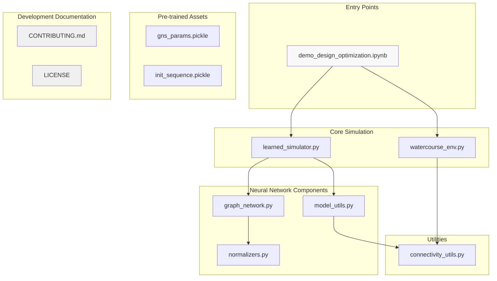
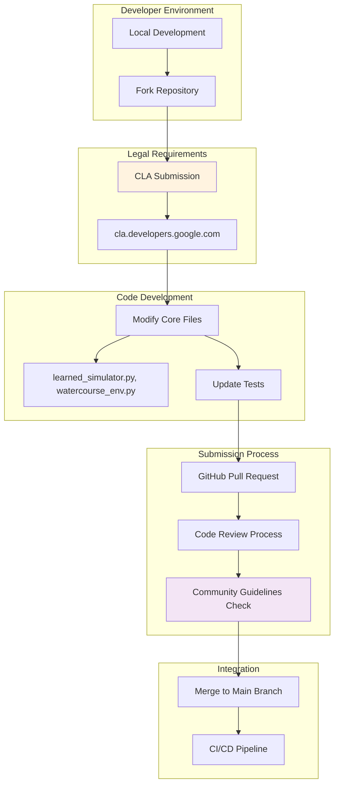
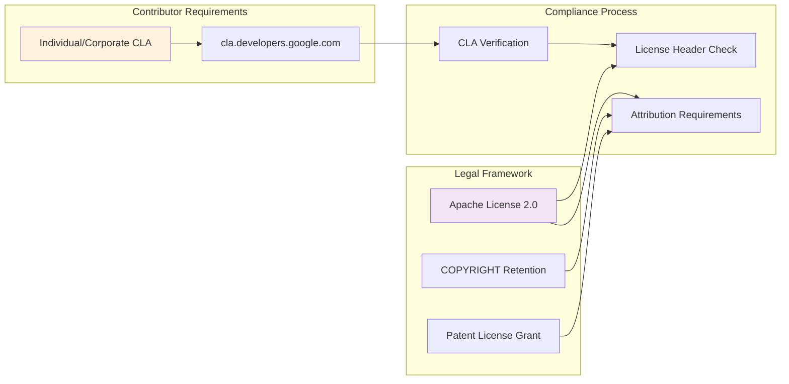

<!-- source: DeepWiki mcp.deepwiki.com · repo google-deepmind/inverse_design · page 5 Development · fetched 2026-10-26 -->

# Development

Relevant source files

The following files were used as context for generating this wiki page:

- [CONTRIBUTING.md](CONTRIBUTING.md)
- [LICENSE](LICENSE)

This document provides essential information for developers who want to contribute to, extend, or maintain the inverse design system. It covers the project structure, development workflow, contribution guidelines, and legal requirements for working with the codebase.

For detailed contribution procedures and community guidelines, see [Contributing Guidelines](#5.1). For licensing terms and legal requirements, see [License and Legal](#5.2).

## Development Overview

The inverse design system is structured as a research codebase with a clear separation between core simulation components, neural network implementations, and demonstration interfaces. The development process follows Google's open source contribution model with mandatory Contributor License Agreement (CLA) requirements and GitHub-based code review workflows.

### Project Repository Structure

The codebase is organized into several key functional areas that developers should understand when contributing:

This diagram illustrates the key files that developers will encounter when working with the system, showing the relationships between demonstration code, core simulation logic, and supporting utilities.

**Sources:** CONTRIBUTING.md, LICENSE, and system architecture context from earlier analysis

### Development Workflow Architecture

The contribution process follows a structured workflow that ensures code quality and legal compliance:

This workflow diagram shows the mandatory steps for contributing code, including the legal CLA requirement and GitHub-based review process.

**Sources:** [CONTRIBUTING.md:1-26]()

## Core Development Areas

### Simulation Components

The primary areas for development contributions involve the core simulation and neural network components:

| Component | File | Primary Function | Development Focus |
|-----------|------|------------------|-------------------|
| Physics Simulation | `learned_simulator.py` | Graph-based physics integration | Algorithm improvements, performance optimization |
| Environment | `watercourse_env.py` | 3D landscape simulation | New environment features, parameter spaces |
| Graph Networks | `graph_network.py` | Neural network architecture | Model architecture extensions |
| Feature Processing | `model_utils.py` | Graph data preprocessing | Data pipeline optimizations |
| Normalization | `normalizers.py` | Statistical data normalization | New normalization strategies |
| Connectivity | `connectivity_utils.py` | Graph connectivity computation | Efficiency improvements |

### Demo and Interface Layer

The demonstration notebook serves as both a user interface and a reference implementation:

- `demo_design_optimization.ipynb`: Main entry point showcasing optimization workflows
- Integration point for testing new features
- Documentation through executable examples

**Sources:** System architecture analysis and file structure observation

## Legal and Compliance Framework

### Contributor License Agreement Requirements

All contributions require CLA submission through Google's centralized system:

The legal framework ensures proper licensing and attribution while maintaining open source principles under Apache 2.0 terms.

**Sources:** [CONTRIBUTING.md:3-13](), [LICENSE:1-203]()

### Code Review and Community Standards

The project follows Google's Open Source Community Guidelines with mandatory peer review:

- All submissions require GitHub pull request review
- Code review applies to both external contributors and project members
- Community guidelines enforce respectful and inclusive development practices

**Sources:** [CONTRIBUTING.md:15-25]()

## Development Tools and Dependencies

### Required Development Environment

Developers should be familiar with the core technology stack:

| Technology | Purpose | Files |
|------------|---------|-------|
| JAX/Haiku | Neural network implementation | `graph_network.py`, `learned_simulator.py` |
| Optax | Optimization algorithms | `demo_design_optimization.ipynb` |
| NumPy/SciKit-Learn | Numerical computing | `model_utils.py`, `normalizers.py` |
| Jupyter | Interactive development | `demo_design_optimization.ipynb` |

### Pre-trained Model Assets

The system relies on pre-trained components that developers should understand:

- `gns_params.pickle`: Trained graph neural network parameters
- `init_sequence.pickle`: Initial simulation state data

These assets enable transfer learning and provide baseline functionality for new developments.

**Sources:** System architecture analysis and dependency observation

## Getting Started with Development

For new contributors, the recommended development path is:

1. **Legal Setup**: Complete CLA submission at [cla.developers.google.com](https://cla.developers.google.com)
2. **Environment Setup**: Follow installation procedures in [Getting Started](#2)
3. **Code Familiarization**: Study the demo notebook and core simulation files
4. **Contribution Guidelines**: Review detailed procedures in [Contributing Guidelines](#5.1)
5. **Legal Requirements**: Understand licensing terms in [License and Legal](#5.2)

This development guide provides the foundation for contributing to the inverse design system while ensuring compliance with project standards and legal requirements.

**Sources:** [CONTRIBUTING.md:1-26](), project structure analysis

---

