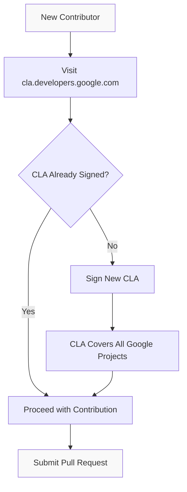
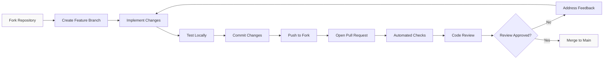
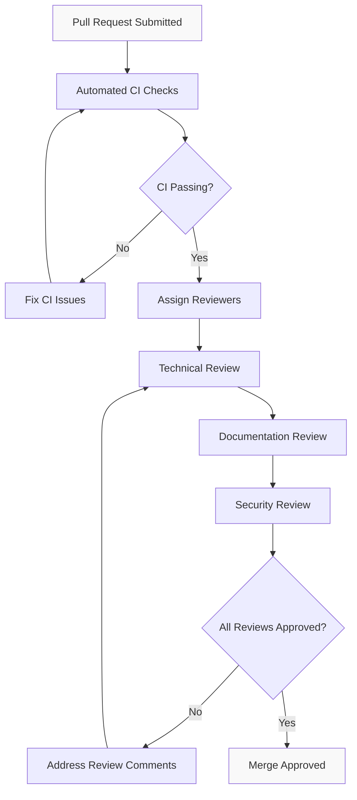
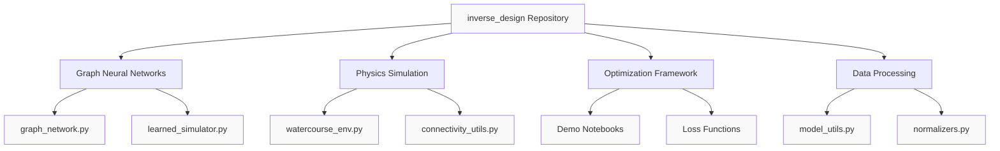

<!-- source: DeepWiki mcp.deepwiki.com · repo google-deepmind/inverse_design · page 5.1 Contributing Guidelines · fetched 2026-10-26 -->

# Contributing Guidelines

Relevant source files

The following files were used as context for generating this wiki page:

- [.gitignore](.gitignore)
- [CONTRIBUTING.md](CONTRIBUTING.md)

This page provides the complete process for contributing code, documentation, and other improvements to the inverse design system. It covers legal requirements, submission workflows, and community standards that all contributors must follow.

For information about the project's software license terms, see [License and Legal](#5.2). For technical implementation details needed to understand the codebase before contributing, see [Implementation Guide](#4).

## Contributor License Agreement

All contributions to this project require a signed Contributor License Agreement (CLA). The CLA ensures that you (or your employer) retain copyright to your contribution while granting the project permission to use and redistribute your work.

### CLA Process

**CLA Requirements:**
- Visit https://cla.developers.google.com/ to check existing agreements
- Sign once for all Google projects - no need to repeat for different repositories
- Both individual and corporate CLAs are supported
- Required before any pull request can be merged

Sources: [CONTRIBUTING.md:3-13]()

## Pull Request Workflow

### Submission Process

All code changes, including submissions from project members, must go through the GitHub pull request review process. No direct commits to the main branch are permitted.

#### Contribution Workflow Diagram

### Pre-Submission Checklist

| Requirement | Description | Verification |
|-------------|-------------|--------------|
| **CLA Signed** | Contributor License Agreement completed | Check cla.developers.google.com |
| **Tests Pass** | All existing tests continue to pass | Run test suite locally |
| **Code Style** | Follows project formatting standards | Review `.gitignore` patterns |
| **Documentation** | Updates include relevant documentation | Ensure completeness |

### Branch Management

The codebase follows standard Git practices with specific file exclusion patterns defined in [.gitignore:1-25]():

- **Excluded Files**: Python bytecode (`__pycache__/`, `*.pyc`), distribution artifacts (`build/`, `dist/`, `*.egg-info/`), and development artifacts
- **Branch Naming**: Use descriptive names that indicate the feature or fix being implemented
- **Commit Messages**: Clear, concise descriptions of changes made

Sources: [CONTRIBUTING.md:15-20](), [.gitignore:1-25]()

## Code Review Process

### Review Requirements

### Review Criteria

**Technical Review Focus Areas:**
- Code quality and maintainability
- Integration with existing components like `LearnedSimulator`, `WaterCourseEnv`, and `EncodeProcessDecode`
- Performance impact on graph processing pipelines
- Compatibility with JAX/Haiku/Optax ecosystem

**Documentation Review Requirements:**
- API documentation for new functions and classes
- Integration examples for new features
- Updates to relevant wiki sections

### GitHub Pull Request Integration

The project uses GitHub's built-in pull request system for all code reviews. Contributors should:

1. **Reference Issues**: Link pull requests to relevant GitHub issues when applicable
2. **Provide Context**: Include detailed description of changes and rationale
3. **Request Reviews**: Tag appropriate reviewers based on the components modified
4. **Respond Promptly**: Address review feedback in a timely manner

Sources: [CONTRIBUTING.md:15-20]()

## Community Guidelines

This project adheres to [Google's Open Source Community Guidelines](https://opensource.google/conduct), which establish standards for respectful and productive collaboration.

### Behavioral Expectations

| Guideline | Description |
|-----------|-------------|
| **Respectful Communication** | Professional and constructive feedback in all interactions |
| **Inclusive Environment** | Welcome contributors from all backgrounds and experience levels |
| **Technical Focus** | Keep discussions centered on technical merit and project goals |
| **Constructive Criticism** | Provide actionable feedback that helps improve contributions |

### Enforcement

Community guideline violations are handled according to Google's standard enforcement procedures. Project maintainers reserve the right to:

- Remove inappropriate comments or contributions
- Temporarily or permanently restrict access for repeated violations
- Escalate serious issues to appropriate Google teams

### Communication Channels

**Primary Channels:**
- **GitHub Issues**: Bug reports, feature requests, technical discussions
- **Pull Request Comments**: Code-specific feedback and review discussions
- **Community Forums**: General questions and community interaction

Sources: [CONTRIBUTING.md:22-25]()

## Technical Contribution Areas

### Core System Components

Contributors can work on several key system areas:

### Contribution Types

**Code Contributions:**
- Bug fixes in existing simulation or optimization logic
- Performance improvements to graph processing pipelines
- New features for the `WaterCourseEnv` or `LearnedSimulator` classes
- Enhanced optimization algorithms and loss functions

**Documentation Contributions:**
- API documentation improvements
- Tutorial and example enhancements
- Wiki page updates and clarifications
- Code comments and docstring improvements

**Testing Contributions:**
- Unit tests for individual components
- Integration tests for end-to-end workflows
- Performance benchmarking and profiling
- Validation against known physical systems

Sources: [CONTRIBUTING.md:1-26]()

---

