# Page: Overview

# Overview

<details>
<summary>Relevant source files</summary>

The following files were used as context for generating this wiki page:

- [README.md](README.md)

</details>


This document provides an overview of the inverse design system for fluid-structure interactions using graph network simulators. The system enables gradient-based optimization of landscape designs to achieve desired water flow behaviors through differentiable physics simulation.

This page covers the system's purpose, architecture, and core components. For detailed installation instructions, see [Installation and Dependencies](#2.1). For hands-on usage examples, see [Demo Walkthrough](#2.2). For technical implementation details, see [Implementation Guide](#4).

## Purpose and Scope

The inverse design system solves the problem of automatically designing physical landscapes to control fluid flow patterns. Given a desired water flow behavior, the system optimizes landscape parameters through gradient-based methods using a learned physics simulator built on graph neural networks.

### Key Capabilities

| Capability | Description |
|------------|-------------|
| **Inverse Design** | Optimize landscape parameters to achieve target fluid behaviors |
| **Graph-based Physics** | Simulate particle dynamics using learned graph neural networks |
| **Differentiable Simulation** | Enable gradient-based optimization through JAX automatic differentiation |
| **3D Environment** | Support complex 3D landscape and water course simulations |

The system implements the Encode-Process-Decode graph network architecture trained on 3D WaterCourse environments, providing pre-trained model weights for immediate use in optimization tasks.

Sources: [README.md:1-88]()

## System Architecture

The system follows a layered architecture with clear separation between user interface, simulation engine, neural network processing, and optimization components.

### High-Level Component Architecture

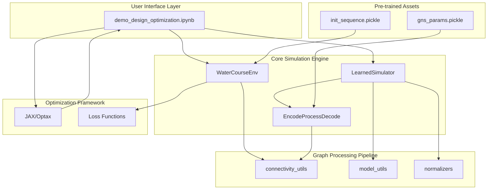

Sources: [README.md:9-12]()

### Core Component Responsibilities

| Component | Primary Responsibility | Key Functions |
|-----------|----------------------|---------------|
| `demo_design_optimization.ipynb` | User interface and optimization orchestration | Run optimization loops, visualize results |
| `LearnedSimulator` | Physics simulation using neural networks | Integrate learned dynamics, manage simulation state |
| `EncodeProcessDecode` | Graph neural network architecture | Process graph-structured particle interactions |
| `WaterCourseEnv` | 3D environment simulation | Manage landscape geometry, particle dynamics |
| `connectivity_utils` | Graph connectivity computation | Calculate particle neighborhoods, edge features |
| `model_utils` | Feature engineering and preprocessing | Flatten graph features, prepare neural network inputs |
| `normalizers` | Data normalization and statistics | Normalize graph elements, accumulate training statistics |

Sources: [README.md:9-12]()

## Data Flow and Processing

The system processes information through a pipeline that transforms landscape parameters into optimized designs via learned physics simulation.

### Processing Pipeline

```mermaid
flowchart LR
    subgraph InputData["Input Data"]
        LandscapeParams["Landscape Parameters"]
        InitialState["Initial Graph State"]
    end
    
    subgraph FeatureEngineering["Feature Engineering"]
        FlattenFeatures["model_utils.flatten_features"]
        ComputeConnectivity["connectivity_utils"]
        NormalizeData["normalizers"]
    end
    
    subgraph NeuralSimulation["Neural Network Simulation"]
        GraphNetwork["EncodeProcessDecode"]
        PhysicsIntegration["LearnedSimulator"]
    end
    
    subgraph EnvironmentSim["Environment Simulation"]
        MultiStepRollout["WaterCourseEnv.rollout"]
        ParticleDynamics["Particle Position Updates"]
    end
    
    subgraph OptimizationLoop["Optimization Loop"]
        LossComputation["Loss Computation"]
        GradientCalculation["JAX Gradients"]
        ParameterUpdate["Optax Optimizer"]
    end
    
    LandscapeParams --> MultiStepRollout
    InitialState --> FlattenFeatures
    
    FlattenFeatures --> NormalizeData
    NormalizeData --> ComputeConnectivity
    ComputeConnectivity --> GraphNetwork
    
    GraphNetwork --> PhysicsIntegration
    PhysicsIntegration --> MultiStepRollout
    MultiStepRollout --> ParticleDynamics
    
    ParticleDynamics --> LossComputation
    LossComputation --> GradientCalculation
    GradientCalculation --> ParameterUpdate
    ParameterUpdate --> LandscapeParams
```

Sources: [README.md:9-12]()

## Technology Stack

The system is built on modern machine learning and scientific computing technologies optimized for differentiable programming.

### Core Technologies

| Technology | Purpose | Key Features |
|------------|---------|--------------|
| **JAX** | Automatic differentiation and compilation | GPU acceleration, gradient computation, JIT compilation |
| **Haiku** | Neural network library for JAX | Functional programming model, composable modules |
| **Jraph** | Graph neural network library | Graph processing utilities, message passing |
| **Optax** | Optimization library for JAX | Gradient-based optimizers, learning rate schedules |
| **NumPy** | Numerical computing | Array operations, mathematical functions |
| **Jupyter** | Interactive development environment | Notebook interface, visualization capabilities |

### Graph Neural Network Architecture

The system implements the Encode-Process-Decode architecture specifically designed for particle-based physics simulation:

- **Encoder**: Maps particle features to latent representations
- **Processor**: Performs message passing between connected particles
- **Decoder**: Predicts particle dynamics and position updates

This architecture enables learning complex fluid-structure interactions while maintaining differentiability for inverse design optimization.

Sources: [README.md:9-12]()

## Pre-trained Assets

The system includes pre-trained components that enable immediate use without training from scratch:

| Asset | File | Description |
|-------|------|-------------|
| **Model Weights** | `gns_params.pickle` | Trained parameters for the graph neural network |
| **Initial Conditions** | `init_sequence.pickle` | Pre-computed initial simulation states |

These assets are downloaded from Google Cloud Storage during setup and provide a foundation for optimization tasks in the 3D WaterCourse environment.

Sources: [README.md:42-46]()

---

# Page: Getting Started

# Getting Started

<details>
<summary>Relevant source files</summary>

The following files were used as context for generating this wiki page:

- [demo_design_optimization.ipynb](demo_design_optimization.ipynb)
- [requirements.txt](requirements.txt)

</details>


This guide provides a practical introduction to the inverse design system for fluid-structure interaction optimization. You will learn how to set up the environment, run the optimization demo, and understand the basic workflow for designing landscapes that achieve desired water flow behaviors using graph neural networks.

For detailed installation instructions, see [Installation and Dependencies](#2.1). For a comprehensive walkthrough of the demo notebook, see [Demo Walkthrough](#2.2). For architectural details about the system components, see [System Architecture](#3).

## Prerequisites and System Overview

The inverse design system requires Python 3.7+ with JAX ecosystem packages for automatic differentiation and graph neural network computation. The system uses pre-trained models that must be downloaded separately to perform physics-based fluid dynamics simulation.

### Core Dependencies

| Package | Version | Purpose |
|---------|---------|---------|
| `jax` | Latest | Automatic differentiation and JIT compilation |
| `dm-haiku` | 0.0.9 | Neural network building blocks |
| `optax` | 0.1.3 | Gradient-based optimization algorithms |
| `jraph` | ≥0.0.5.dev0 | Graph neural network operations |
| `numpy` | ≥1.21.0 | Numerical computing foundation |
| `matplotlib` | ≥3.6.0 | Visualization and plotting |

Sources: [requirements.txt:1-9]()

## Quick Start Workflow

The system follows a straightforward workflow from setup to optimization results:

### Workflow Overview

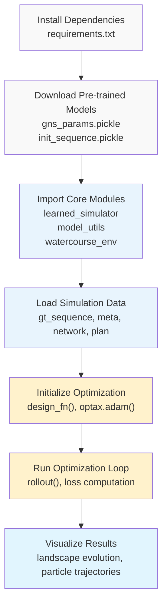

Sources: [demo_design_optimization.ipynb:41-56](), [demo_design_optimization.ipynb:85-88](), [demo_design_optimization.ipynb:194-226]()

### Core System Components

The system architecture centers around three main computational components that work together to enable differentiable landscape optimization:

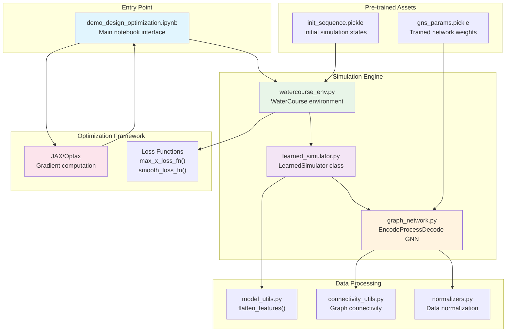

Sources: [demo_design_optimization.ipynb:85-88](), [demo_design_optimization.ipynb:127-130](), [demo_design_optimization.ipynb:156-178]()

## Basic Usage Pattern

### 1. Environment Setup

The system requires both local dependencies and pre-trained model files. For Google Colab users, the notebook includes automated download scripts:

```python
# Local installation
pip install -r requirements.txt

# Download pre-trained models (varies by platform)
```

Sources: [demo_design_optimization.ipynb:41-56](), [demo_design_optimization.ipynb:67-74]()

### 2. Core Module Imports

The main functionality is accessed through three core modules:

```python
from inverse_design.src import learned_simulator
from inverse_design.src import model_utils  
from inverse_design.src import watercourse_env
```

Sources: [demo_design_optimization.ipynb:85-88]()

### 3. Optimization Setup

The optimization process requires loading pre-trained parameters and defining the objective function:

- **Model Loading**: Load `gns_params.pickle` containing the trained `LearnedSimulator` network weights
- **Initial Conditions**: Load `init_sequence.pickle` containing the starting particle configuration
- **Design Function**: Use `watercourse_env.design_fn()` to convert parameter vectors into landscape geometries
- **Loss Computation**: Combine `max_x_loss_fn()` for objective maximization with `smooth_loss_fn()` for regularization

Sources: [demo_design_optimization.ipynb:98-110](), [demo_design_optimization.ipynb:156-178]()

### 4. Optimization Execution

The optimization loop uses JAX's automatic differentiation with Optax optimizers:

```python
@jax.jit
def opt_step(params, opt_state):
  grads, aux = jax.grad(run, has_aux=True)(params)
  updates, opt_state = optimizer.update(grads, opt_state, params)
  params = optax.apply_updates(params, updates)
  return params, opt_state, aux
```

Sources: [demo_design_optimization.ipynb:209-214]()

## Expected Results

The optimization process produces:

- **Landscape Evolution**: Visualizes how the terrain height field changes over optimization steps
- **Loss Trajectories**: Tracks objective function and smoothness penalty reduction
- **Particle Dynamics**: Shows water flow behavior before and after optimization
- **3D Animations**: Demonstrates particle movement through optimized landscape

The typical optimization run takes 100 steps and shows convergence within minutes on modern hardware.

Sources: [demo_design_optimization.ipynb:217-226](), [demo_design_optimization.ipynb:237-250](), [demo_design_optimization.ipynb:260-287]()

## Next Steps

To get hands-on experience with the system:

1. **Installation**: Follow the detailed setup instructions in [Installation and Dependencies](#2.1)
2. **Demo Execution**: Work through the complete example in [Demo Walkthrough](#2.2)  
3. **Architecture Understanding**: Learn about the underlying components in [System Architecture](#3)
4. **Advanced Usage**: Explore implementation details in [Implementation Guide](#4)

The demo notebook `demo_design_optimization.ipynb` serves as both documentation and a working example, making it the ideal starting point for new users.

Sources: [demo_design_optimization.ipynb:1-347]()

---

# Page: Installation and Dependencies

# Installation and Dependencies

<details>
<summary>Relevant source files</summary>

The following files were used as context for generating this wiki page:

- [README.md](README.md)
- [requirements.txt](requirements.txt)

</details>


This page provides comprehensive instructions for setting up the inverse design system for fluid-structure interactions. It covers environment setup, dependency installation, and downloading required pre-trained models to get the system running locally or in Google Colab.

For information about using the system after installation, see [Demo Walkthrough](#2.2). For development setup and contributing guidelines, see [Contributing Guidelines](#5.1).

## Overview and Requirements

The inverse design system requires Python 3.7+ and several specialized machine learning libraries, particularly those from the JAX ecosystem for automatic differentiation and graph neural networks. The system depends on pre-trained model weights and initial simulation data that must be downloaded separately.

### System Dependencies Architecture

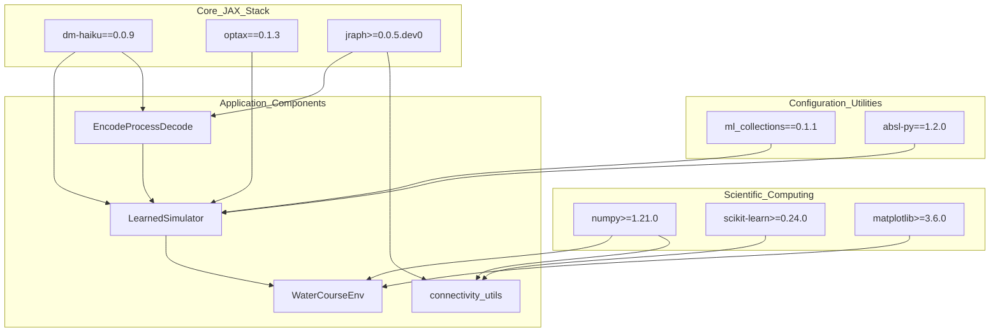

**Dependency Overview**
The system builds on JAX-based neural network libraries (`dm-haiku`, `jraph`) for graph processing, optimization libraries (`optax`) for gradient-based design optimization, and scientific computing libraries (`numpy`, `scikit-learn`) for data processing and connectivity computations.

Sources: [requirements.txt:1-9](), [README.md:20-32]()

## Installation Methods

### Method 1: Google Colab (Recommended for Quick Start)

The simplest way to run the system is through Google Colab, which provides a pre-configured environment with GPU support.

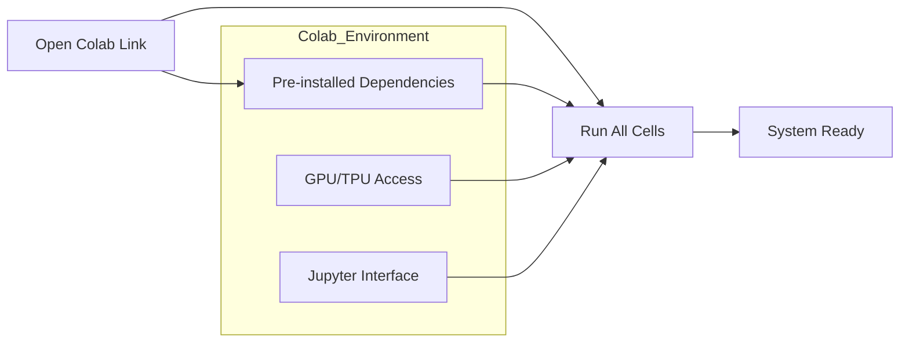

**Colab Setup Steps:**
1. Open the [Google Colab notebook](https://colab.research.google.com/github/deepmind/inverse_design/blob/master/demo_design_optimization.ipynb)
2. Run all cells to automatically install dependencies and download models
3. The environment will be ready for immediate use

Sources: [README.md:16-17]()

### Method 2: Local Installation

For local development or when you need more control over the environment, follow these steps to set up the system on your machine.

#### Environment Setup

```bash
# Clone the repository
git clone https://github.com/deepmind/inverse_design.git

# Create isolated Python environment
python3 -m venv id_venv
source id_venv/bin/activate  # On Windows: id_venv\Scripts\activate

# Upgrade pip to latest version
pip install --upgrade pip
```

#### Dependency Installation

```bash
# Install core dependencies
pip install -r ./inverse_design/requirements.txt

# Install Jupyter notebook if not present
pip install notebook
```

#### Directory Structure Configuration

The repository requires a specific directory structure for the Python modules to import correctly:

```bash
cd inverse_design
mkdir inverse_design
mv src/ inverse_design/
```

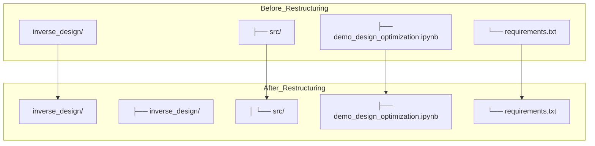

**Directory Structure Purpose**
This restructuring allows the `demo_design_optimization.ipynb` notebook to import modules from `inverse_design.src` using Python's standard import system.

Sources: [README.md:23-40]()

## Pre-trained Model Download

The system requires two pre-trained data files that must be downloaded from Google Cloud Storage:

### Required Model Files

| File | Purpose | Size | Source |
|------|---------|------|--------|
| `gns_params.pickle` | Pre-trained Graph Network Simulator weights | ~50MB | Google Cloud Storage |
| `init_sequence.pickle` | Initial simulation states and configurations | ~10MB | Google Cloud Storage |

### Download Commands

```bash
# Download pre-trained GNS model parameters
wget -O ./gns_params.pickle https://storage.googleapis.com/dm_inverse_design_watercourse/gns_params.pickle

# Download initial simulation sequence data  
wget -O ./init_sequence.pickle https://storage.googleapis.com/dm_inverse_design_watercourse/init_sequence.pickle
```

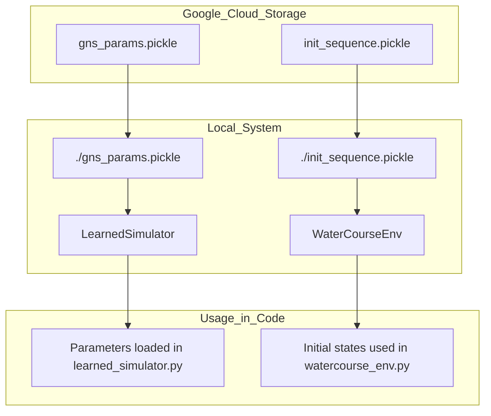

**Model File Usage**
- `gns_params.pickle` contains the trained weights for the `EncodeProcessDecode` graph neural network
- `init_sequence.pickle` provides initial particle and obstacle configurations for the `WaterCourseEnv`

Sources: [README.md:42-46]()

## Dependency Specifications

### Core JAX Ecosystem

The system heavily relies on the JAX ecosystem for automatic differentiation and neural network computation:

- **`dm-haiku==0.0.9`**: Neural network library for building the `EncodeProcessDecode` architecture
- **`jraph>=0.0.5.dev0`**: Graph neural network library used in `connectivity_utils` and graph processing
- **`optax==0.1.3`**: Optimization library for gradient-based landscape design optimization

### Scientific Computing Stack

- **`numpy>=1.21.0`**: Numerical computing foundation used throughout the codebase
- **`scikit-learn>=0.24.0`**: Machine learning utilities, particularly for normalization in `normalizers.py`
- **`matplotlib>=3.6.0`**: Visualization library for plotting simulation results

### Configuration and Utilities

- **`ml_collections==0.1.1`**: Configuration management for model parameters
- **`absl-py==1.2.0`**: Google's Python utilities library for command-line flag handling

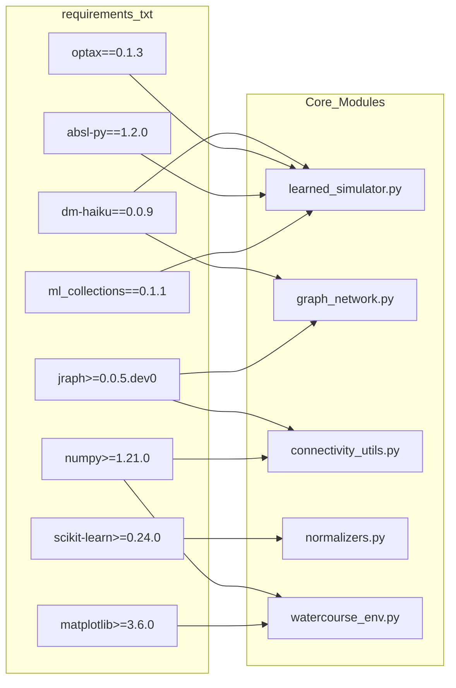

Sources: [requirements.txt:1-9]()

## Installation Verification

After completing the installation, verify the setup by checking that all components can be imported:

### Quick Verification Steps

1. **Activate your environment** (if using local installation):
   ```bash
   source id_venv/bin/activate
   ```

2. **Start Jupyter notebook**:
   ```bash
   jupyter notebook
   ```

3. **Open `demo_design_optimization.ipynb`** and run from the third cell onwards (the first two cells are for Colab setup)

4. **Verify imports** - The notebook should successfully import:
   - `inverse_design.src.learned_simulator`
   - `inverse_design.src.watercourse_env`
   - `inverse_design.src.connectivity_utils`

### Common Installation Issues

| Issue | Cause | Solution |
|-------|-------|----------|
| Import errors for `inverse_design.src` | Incorrect directory structure | Ensure `src/` is moved inside `inverse_design/` subdirectory |
| `jraph` version conflicts | Development version requirement | Install with `pip install jraph>=0.0.5.dev0` explicitly |
| Missing model files | Files not downloaded | Re-run wget commands for pickle files |
| JAX/CUDA compatibility | GPU driver issues | Use CPU-only JAX or update CUDA drivers |

Sources: [README.md:48-49]()

## Next Steps

Once installation is complete:
- Proceed to [Demo Walkthrough](#2.2) to run your first optimization
- Review [System Architecture](#3) to understand the system components
- For development work, see [Contributing Guidelines](#5.1)

The system is now ready for inverse design optimization of fluid-structure interactions using graph neural network simulators.

---

# Page: Demo Walkthrough

# Demo Walkthrough

<details>
<summary>Relevant source files</summary>

The following files were used as context for generating this wiki page:

- [README.md](README.md)
- [demo_design_optimization.ipynb](demo_design_optimization.ipynb)

</details>


This document provides a step-by-step guide through the demonstration notebook (`demo_design_optimization.ipynb`) that showcases the inverse design optimization process. The demo illustrates how to optimize a 3D landscape to redirect water flow using pre-trained graph neural network simulators and gradient-based optimization.

For installation instructions and setup requirements, see [Installation and Dependencies](#2.1). For detailed technical documentation of the system components, see [System Architecture](#3).

## Demo Overview

The demonstration implements a complete inverse design pipeline that optimizes landscape parameters to achieve desired water flow behavior. The process involves loading pre-trained models, setting up the simulation environment, defining optimization objectives, and running gradient-based optimization to iteratively improve the landscape design.

### Demo Workflow Diagram

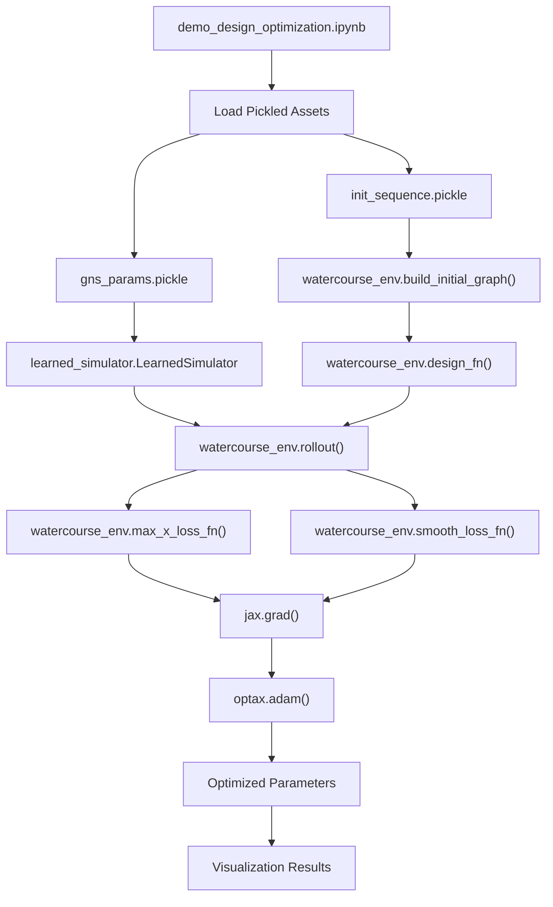

Sources: [demo_design_optimization.ipynb:98-178](), [demo_design_optimization.ipynb:188-227]()

## Step-by-Step Walkthrough

### Step 1: Environment Setup and Data Loading

The demo begins by importing the necessary modules and loading pre-trained assets. Two critical pickle files contain the simulation state and neural network parameters:

- `init_sequence.pickle`: Contains initial particle configurations and simulation metadata
- `gns_params.pickle`: Contains pre-trained graph neural network weights and model configuration

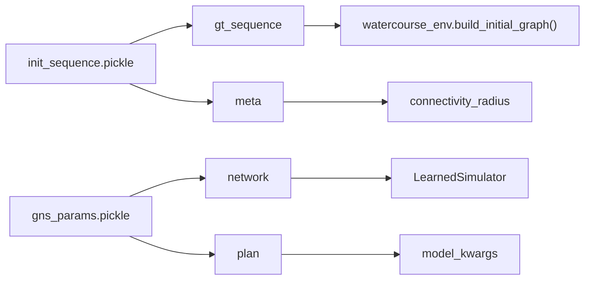

The loaded data structures provide:
- `gt_sequence`: Ground truth particle trajectories for initialization
- `meta`: Simulation metadata including connectivity radius
- `network`: Pre-trained neural network weights
- `plan`: Model configuration and hyperparameters

Sources: [demo_design_optimization.ipynb:98-110](), [demo_design_optimization.ipynb:127-141]()

### Step 2: Simulation Environment Configuration

The demo configures the `LearnedSimulator` and establishes the 3D environment using `watercourse_env` functions:

Key configuration parameters:
- `MAX_EDGES = 2**16`: Maximum edges for graph padding
- `connectivity_radius`: Distance threshold for particle connections
- `num_side = 25`: Landscape grid dimensions (25×25)
- `length = 50`: Simulation rollout steps
- `radius = 0.1`: Particle connection radius

The environment setup involves:
1. `watercourse_env.make_plain_obstacles()`: Creates initial flat landscape
2. `watercourse_env.build_initial_graph()`: Constructs particle graph from sequence data
3. `model_utils.flatten_features()`: Prepares graph features for neural network processing

Sources: [demo_design_optimization.ipynb:124-151](), [demo_design_optimization.ipynb:132-141]()

### Step 3: Optimization Function Definition

The core optimization function `run()` implements the complete forward simulation and loss computation pipeline:

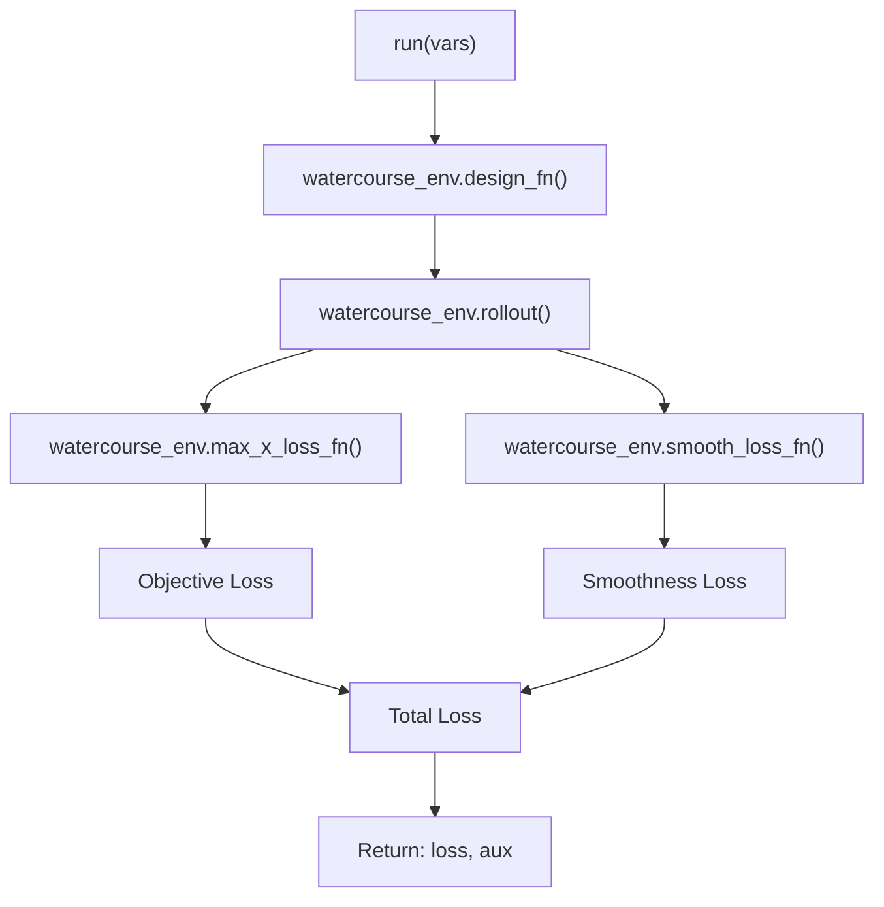

The function performs:
1. **Design Generation**: `watercourse_env.design_fn()` converts optimization variables to landscape geometry
2. **Physics Simulation**: `watercourse_env.rollout()` executes multi-step fluid dynamics using the learned simulator
3. **Loss Computation**: 
   - `watercourse_env.max_x_loss_fn()`: Measures water flow distance objective
   - `watercourse_env.smooth_loss_fn()`: Penalizes rough landscape features
4. **Auxiliary Data**: Returns trajectory and design parameters for visualization

Sources: [demo_design_optimization.ipynb:156-178]()

### Step 4: Gradient-Based Optimization Loop

The optimization employs JAX automatic differentiation with the Adam optimizer:

| Parameter | Value | Purpose |
|-----------|-------|---------|
| `LEARNING_RATE` | 0.05 | Adam optimizer learning rate |
| `num_opt_steps` | 100 | Total optimization iterations |
| `smoothing_factor` | 1e2 | Smoothness penalty weight |

The optimization step function `opt_step()` implements:
1. `jax.grad(run, has_aux=True)()`: Computes gradients of total loss
2. `optimizer.update()`: Applies Adam update rule
3. `optax.apply_updates()`: Updates design parameters

The loop tracks optimization progress in `opt_traj` for analysis and visualization.

Sources: [demo_design_optimization.ipynb:188-227]()

### Step 5: Results Visualization

The demo provides two visualization modes:

#### Design Evolution Visualization
Displays landscape height fields at optimization intervals using `np.tanh()` transformation to show the actual terrain heights that influence water flow.

#### Particle Trajectory Comparison
Shows 3D animated comparisons between initial flat design and optimized landscape, visualizing:
- Blue particles: Water flow
- Black particles: Landscape obstacles  
- Green marker: Target location (1.5, 1.5, 0)

The visualization uses coordinate bounds:
- X-axis: [-0.6, 1.6]
- Y-axis: [-0.1, 1.6] 
- Z-axis: [-0.1, 1.2]

Sources: [demo_design_optimization.ipynb:238-250](), [demo_design_optimization.ipynb:260-287]()

## Understanding the Results

### Loss Function Components

The optimization minimizes a composite objective:

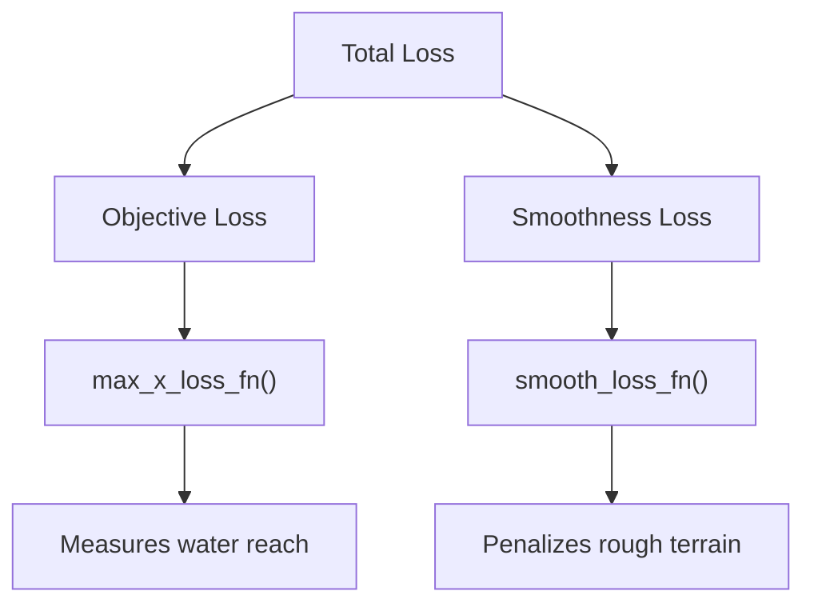

- **Objective Loss**: `watercourse_env.max_x_loss_fn()` encourages water particles to reach maximum distance
- **Smoothness Loss**: `watercourse_env.smooth_loss_fn()` with `smoothing_factor=1e2` prevents unrealistic terrain features

### Optimization Convergence

The live-updating loss plot during optimization shows:
- Individual loss components (objective, smooth)
- Total combined loss
- Convergence behavior over 100 iterations

Successful optimization typically shows:
1. Rapid initial decrease in total loss
2. Stabilization of smoothness penalty
3. Continued improvement in objective function

### Design Parameter Interpretation

The optimized `params` array represents a 25×25 grid of landscape height values. The `np.tanh()` transformation maps raw optimization variables to bounded height values in [-1, 1], creating realistic terrain variations that guide water flow toward the target location.

Sources: [demo_design_optimization.ipynb:167-170](), [demo_design_optimization.ipynb:221-226](), [demo_design_optimization.ipynb:244-249]()

---

# Page: System Architecture

# System Architecture

<details>
<summary>Relevant source files</summary>

The following files were used as context for generating this wiki page:

- [README.md](README.md)
- [src/learned_simulator.py](src/learned_simulator.py)
- [src/watercourse_env.py](src/watercourse_env.py)

</details>


## Purpose and Scope

This document provides a comprehensive overview of the inverse design system's architecture, covering how the major components interact to enable gradient-based optimization of fluid-structure interactions. The system implements an Encode-Process-Decode graph neural network architecture that can learn physics dynamics and enable inverse design through differentiable programming.

For implementation details of specific components, see [Graph Neural Network Architecture](#3.1), [Physics Simulation Engine](#3.2), and [Graph Processing Pipeline](#3.3). For hands-on usage guidance, see [Demo Walkthrough](#2.2).

## High-Level System Overview

The system consists of four primary layers that work together to enable inverse design optimization:

### System Architecture Diagram

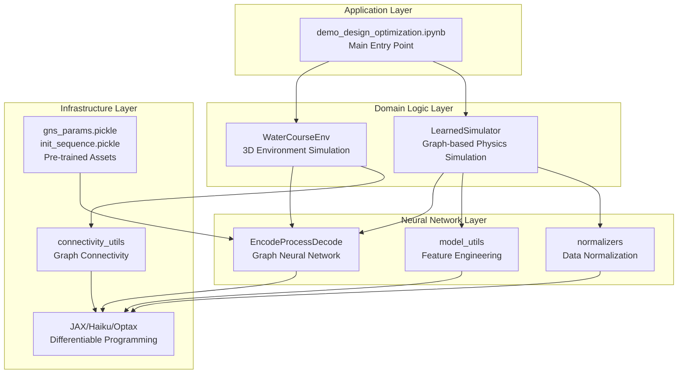

**Sources:** [README.md:1-49](), [src/learned_simulator.py:33-75](), [src/watercourse_env.py:152-166]()

## Core Component Interactions

The system's core components form a tightly integrated pipeline where each component has specific responsibilities:

### Component Interaction Flow

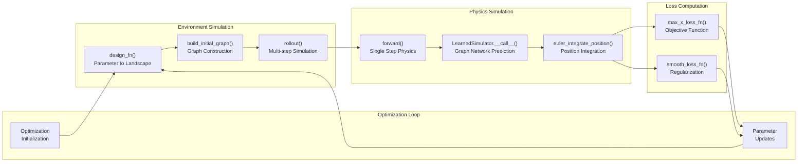

**Sources:** [src/watercourse_env.py:198-219](), [src/watercourse_env.py:113-149](), [src/watercourse_env.py:152-166](), [src/watercourse_env.py:59-111](), [src/learned_simulator.py:77-91](), [src/learned_simulator.py:113-122]()

## Data Flow Architecture

The system processes graph-structured data through multiple transformation stages:

### Graph Data Processing Pipeline

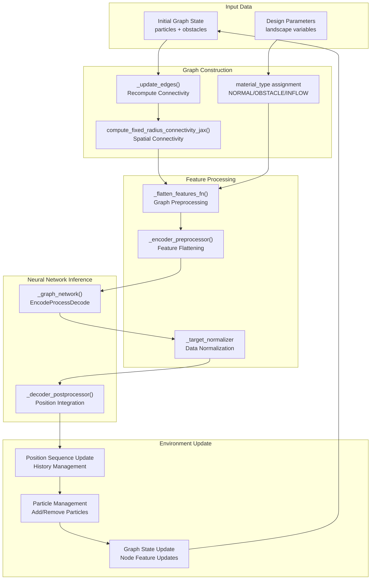

**Sources:** [src/watercourse_env.py:35-57](), [src/watercourse_env.py:74-80](), [src/learned_simulator.py:93-99](), [src/learned_simulator.py:101-111](), [src/watercourse_env.py:89-110]()

## Key System Interfaces

The system exposes several critical interfaces that enable the inverse design optimization:

### Primary API Interface Points

| Interface | Location | Purpose | Key Parameters |
|-----------|----------|---------|----------------|
| `LearnedSimulator.__call__` | [src/learned_simulator.py:77-91]() | Main physics prediction interface | `input_graph`, `padded_graph` |
| `design_fn` | [src/watercourse_env.py:198-219]() | Convert parameters to landscape | `params`, `graph`, `height_scale` |
| `rollout` | [src/watercourse_env.py:152-166]() | Multi-step simulation execution | `initial_graph`, `inflow_stack`, `network` |
| `forward` | [src/watercourse_env.py:59-111]() | Single simulation step | `input_graph`, `new_particles`, `network` |
| `max_x_loss_fn` | [src/watercourse_env.py:181-187]() | Primary optimization objective | `graph` |
| `smooth_loss_fn` | [src/watercourse_env.py:190-195]() | Regularization loss function | `obs_pos`, `num_side` |

**Sources:** [src/learned_simulator.py:77-91](), [src/watercourse_env.py:198-219](), [src/watercourse_env.py:152-166](), [src/watercourse_env.py:59-111](), [src/watercourse_env.py:181-187](), [src/watercourse_env.py:190-195]()

## Graph Network Integration

The `LearnedSimulator` serves as the central component that integrates the graph neural network with the physics simulation:

### LearnedSimulator Architecture

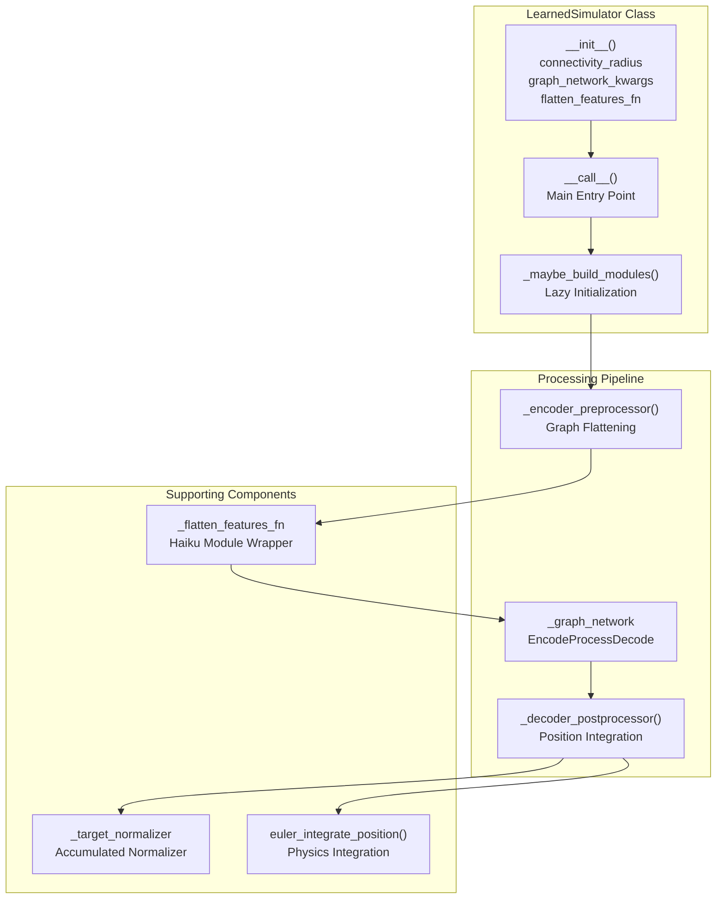

The `LearnedSimulator` class implements a three-stage processing pipeline:

1. **Encoder Preprocessing** ([src/learned_simulator.py:93-99]()): Flattens input graph features and handles connectivity
2. **Graph Network Inference** ([src/learned_simulator.py:82]()): Applies the `EncodeProcessDecode` network to predict dynamics
3. **Decoder Postprocessing** ([src/learned_simulator.py:101-111]()): Denormalizes predictions and integrates to get new positions

**Sources:** [src/learned_simulator.py:33-75](), [src/learned_simulator.py:77-91](), [src/learned_simulator.py:93-99](), [src/learned_simulator.py:101-111](), [src/learned_simulator.py:113-122]()

## Environment Simulation Framework

The `watercourse_env.py` module provides the 3D environment simulation capabilities:

### WaterCourse Environment Components

```mermaid
graph LR
    subgraph "Environment Setup"
        PlainObs["make_plain_obstacles()<br/>Mesh Generation"]
        BuildInit["build_initial_graph()<br/>Graph Initialization"]
        InflowStack["Inflow Stack<br/>Particle Injection"]
    end
    
    subgraph "Simulation Execution"
        RolloutMain["rollout()<br/>JAX Scan Loop"]
        StepFn["_step()<br/>Checkpointed Step"]
        ForwardMain["forward()<br/>Model Application"]
    end
    
    subgraph "Graph Updates"
        UpdateEdges["_update_edges()<br/>Connectivity Updates"]
        MaterialAssign["Material Type Assignment<br/>NORMAL/OBSTACLE/INFLOW"]
        ParticleManage["Particle Management<br/>Add/Remove Logic"]
    end
    
    PlainObs --> BuildInit
    BuildInit --> InflowStack
    InflowStack --> RolloutMain
    RolloutMain --> StepFn
    StepFn --> ForwardMain
    ForwardMain --> UpdateEdges
    UpdateEdges --> MaterialAssign
    MaterialAssign --> ParticleManage
```

Key environment constants and their purposes:

| Constant | Value | Purpose |
|----------|-------|---------|
| `NORMAL` | 0 | Regular fluid particles |
| `OBSTACLE` | 1 | Static obstacle particles |
| `INFLOW` | 4 | Particle injection points |
| `OOB_AREA` | 1.5 | Out-of-bounds threshold for particle cleanup |

**Sources:** [src/watercourse_env.py:27-33](), [src/watercourse_env.py:168-178](), [src/watercourse_env.py:113-149](), [src/watercourse_env.py:152-166](), [src/watercourse_env.py:35-57](), [src/watercourse_env.py:74-80](), [src/watercourse_env.py:94-110]()

## Optimization Integration

The system integrates with JAX's automatic differentiation capabilities to enable gradient-based inverse design:

### Optimization Data Flow

```mermaid
sequenceDiagram
    participant Opt as "JAX Optimizer"
    participant DesignFn as "design_fn()"
    participant Env as "Environment"
    participant Sim as "LearnedSimulator"
    participant Loss as "Loss Functions"
    
    Opt->>DesignFn: "Design Parameters"
    DesignFn->>Env: "Updated Graph with Landscape"
    Env->>Sim: "Initial Graph State"
    
    loop "Simulation Rollout"
        Sim->>Sim: "Graph Network Prediction"
        Sim->>Env: "Next Particle Positions"
        Env->>Env: "Update Graph State"
    end
    
    Env->>Loss: "Final Particle Trajectories"
    Loss->>Opt: "Loss Values + Gradients"
    
    Note over Opt,Loss: "JAX automatic differentiation<br/>enables end-to-end gradients"
```

The `design_fn` function ([src/watercourse_env.py:198-219]()) serves as the key interface between optimization parameters and the physical landscape, using a `tanh` transformation to constrain height variations within reasonable bounds.

**Sources:** [src/watercourse_env.py:198-219](), [src/watercourse_env.py:181-187](), [src/watercourse_env.py:190-195]()

---

# Page: Graph Neural Network Architecture

# Graph Neural Network Architecture

<details>
<summary>Relevant source files</summary>

The following files were used as context for generating this wiki page:

- [src/graph_network.py](src/graph_network.py)
- [src/learned_simulator.py](src/learned_simulator.py)

</details>


This document provides a detailed technical overview of the core graph neural network architecture used in the inverse design system. It covers the `EncodeProcessDecode` class implementation and its integration with the `LearnedSimulator` wrapper class. For information about the broader physics simulation integration, see [Physics Simulation Engine](#3.2). For details on graph data preprocessing and connectivity computation, see [Graph Processing Pipeline](#3.3).

## Overview

The system implements an Encode-Process-Decode (EPD) architecture that operates on graph-structured data representing particle systems and fluid-structure interactions. This architecture transforms input graphs through three distinct phases: encoding raw features into latent representations, processing through multiple message-passing steps, and decoding back to output predictions.

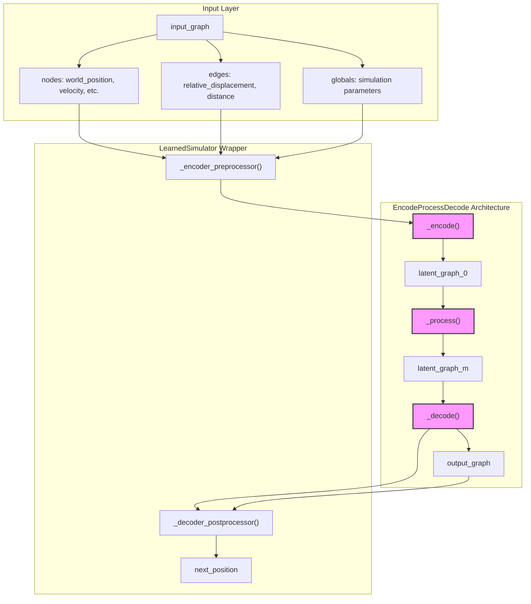

Sources: [src/graph_network.py:79-89](), [src/learned_simulator.py:77-91]()

## Core Components

### EncodeProcessDecode Class Structure

The `EncodeProcessDecode` class serves as the main neural network architecture, implementing a three-stage processing pipeline with configurable parameters for different aspects of the graph network.

| Parameter | Type | Purpose |
|-----------|------|---------|
| `latent_size` | int | Dimensionality of internal node/edge representations |
| `mlp_hidden_size` | int | Hidden layer size for all MLPs |
| `mlp_num_hidden_layers` | int | Depth of MLP networks |
| `num_message_passing_steps` | int | Number of unshared message passing iterations |
| `num_processor_repetitions` | int | Times the processor is applied sequentially |
| `encode_nodes` | bool | Whether to encode node features |
| `encode_edges` | bool | Whether to encode edge features |
| `node_output_size` | int | Output dimensionality for decoded nodes |
| `edge_output_size` | int | Output dimensionality for decoded edges |

Sources: [src/graph_network.py:28-42]()

### Network Component Architecture

```mermaid
graph TB
    subgraph "Encoder Networks"
        A["encoder_nodes MLP"] --> B["jraph.GraphMapFeatures"]
        C["encoder_edges MLP"] --> B
        B --> D["latent_graph_0"]
    end
    
    subgraph "Processor Networks"
        E["processor_networks[0]"] --> F["jraph.InteractionNetwork"]
        G["processor_networks[1]"] --> H["jraph.InteractionNetwork"]
        I["processor_networks[n]"] --> J["jraph.InteractionNetwork"]
        F --> K["residual connections"]
        H --> K
        J --> K
        K --> L["latent_graph_m"]
    end
    
    subgraph "Decoder Networks"
        M["decoder_nodes MLP"] --> N["jraph.GraphMapFeatures"]
        O["decoder_edges MLP"] --> N
        N --> P["output_graph"]
    end
    
    D --> E
    D --> G
    D --> I
    L --> M
    L --> O
    
    style B fill:#e1f5fe
    style F fill:#f3e5f5
    style H fill:#f3e5f5
    style J fill:#f3e5f5
    style N fill:#fff3e0
```

Sources: [src/graph_network.py:91-141]()

### MLP Construction Pattern

The system uses a consistent pattern for building Multi-Layer Perceptrons (MLPs) with optional layer normalization:

```mermaid
graph LR
    A["build_mlp()"] --> B["hk.nets.MLP"]
    B --> C["ReLU activation"]
    C --> D["jraph.concatenated_args()"]
    
    E["build_mlp_with_maybe_layer_norm()"] --> A
    E --> F["hk.LayerNorm"]
    F --> G["hk.Sequential"]
    D --> G
    G --> H["final MLP component"]
    
    style B fill:#f9f,stroke:#333,stroke-width:2px
    style F fill:#f9f,stroke:#333,stroke-width:2px
```

Sources: [src/graph_network.py:93-108]()

## Processing Pipeline

### Encoding Phase

The encoding phase transforms input graph features into latent representations. It handles global feature broadcasting and applies separate MLPs to node and edge features.

```mermaid
flowchart TD
    A["input_graph.nodes"] --> B["concatenate globals if present"]
    C["input_graph.edges"] --> D["encoder_edges MLP"]
    E["input_graph.globals"] --> F["broadcast to nodes"]
    F --> B
    B --> G["encoder_nodes MLP"]
    G --> H["latent nodes"]
    D --> I["latent edges"]
    H --> J["latent_graph_0"]
    I --> J
    
    style G fill:#e1f5fe
    style D fill:#e1f5fe
```

The encoding step includes global feature broadcasting where globals are repeated for each node:

Sources: [src/graph_network.py:142-158]()

### Processing Phase

The processing phase applies multiple message-passing steps with residual connections. Each step uses unshared parameters and can be repeated multiple times.

```mermaid
graph TB
    A["latent_graph_0"] --> B["repetition loop"]
    B --> C["processor_networks[0]"]
    C --> D["jraph.InteractionNetwork"]
    D --> E["residual connection"]
    E --> F["processor_networks[1]"]
    F --> G["jraph.InteractionNetwork"]
    G --> H["residual connection"]
    H --> I["..."]
    I --> J["processor_networks[n]"]
    J --> K["final latent_graph_m"]
    
    L["latent_graph_prev_k.nodes"] --> M["+ latent_graph_k.nodes"]
    N["latent_graph_prev_k.edges"] --> O["+ latent_graph_k.edges"]
    M --> P["updated nodes"]
    O --> Q["updated edges"]
    
    style D fill:#f3e5f5
    style G fill:#f3e5f5
    style M fill:#fff9c4
    style O fill:#fff9c4
```

Each processing step implements residual connections by adding previous node and edge states to the updated states:

Sources: [src/graph_network.py:160-190]()

### Decoding Phase

The decoding phase transforms latent representations back to the desired output space using separate MLPs for nodes and edges.

Sources: [src/graph_network.py:192-194]()

## Integration with LearnedSimulator

### Wrapper Architecture

The `LearnedSimulator` class wraps the `EncodeProcessDecode` network with physics-specific preprocessing and postprocessing logic.

```mermaid
graph TB
    subgraph "LearnedSimulator.__call__()"
        A["input_graph"] --> B["_encoder_preprocessor()"]
        B --> C["_flatten_features_fn()"]
        C --> D["flat_graphs_tuple"]
        D --> E["EncodeProcessDecode.__call__()"]
        E --> F["normalized_prediction"]
        F --> G["_decoder_postprocessor()"]
        G --> H["next_position"]
    end
    
    subgraph "Physics Integration"
        I["target_normalizer.inverse()"] --> J["prediction"]
        J --> K["euler_integrate_position()"]
        K --> L["new_position"]
    end
    
    F --> I
    G --> L
    
    style C fill:#e8f5e8
    style E fill:#f3e5f5
    style K fill:#fff3e0
```

Sources: [src/learned_simulator.py:77-91]()

### Euler Integration

The system uses Euler integration to convert acceleration predictions to position updates:

```mermaid
graph LR
    A["position_sequence[:, -1]"] --> B["previous_position"]
    C["position_sequence[:, -2]"] --> D["compute previous_velocity"]
    B --> D
    E["finite_diff_estimate"] --> F["next_acceleration"]
    D --> G["next_velocity = previous_velocity + acceleration"]
    F --> G
    G --> H["next_position = previous_position + velocity"]
    B --> H
    
    style G fill:#fff3e0
    style H fill:#fff3e0
```

The integration assumes `dt=1` corresponding to the finite difference step size.

Sources: [src/learned_simulator.py:113-122]()

### Normalization Integration

The simulator integrates with the normalization system to handle statistical preprocessing and postprocessing of predictions.

Sources: [src/learned_simulator.py:74-75](), [src/learned_simulator.py:107]()

## Key Design Patterns

### Lazy Module Construction

Both classes use lazy construction patterns where neural network modules are built only when first called with actual data:

Sources: [src/learned_simulator.py:66-76]()

### Haiku Module Wrapping

External functions are wrapped using `hk.to_module()` to ensure proper variable reuse across multiple calls:

Sources: [src/learned_simulator.py:63-64]()

### Jraph Integration

The architecture leverages Jraph's graph network primitives including `GraphMapFeatures`, `InteractionNetwork`, and `concatenated_args` for efficient graph operations.

Sources: [src/graph_network.py:99](), [src/graph_network.py:116](), [src/graph_network.py:125]()

---

# Page: Physics Simulation Engine

# Physics Simulation Engine

<details>
<summary>Relevant source files</summary>

The following files were used as context for generating this wiki page:

- [src/learned_simulator.py](src/learned_simulator.py)
- [src/watercourse_env.py](src/watercourse_env.py)

</details>


This document covers the physics simulation engine that performs learned fluid dynamics simulations using graph neural networks. The engine integrates the `LearnedSimulator` with the `WaterCourseEnv` environment to execute physics-based simulations for inverse design optimization.

For details about the underlying graph neural network architecture, see [Graph Neural Network Architecture](#3.1). For information about graph data processing, see [Graph Processing Pipeline](#3.3).

## Core Architecture

The physics simulation engine consists of two primary components that work together to execute learned physics simulations:

**Simulation Architecture Overview**
```mermaid
graph TB
    subgraph "Physics Simulation Engine"
        A[LearnedSimulator] --> B["EncodeProcessDecode<br/>Graph Network"]
        A --> C["_encoder_preprocessor()"]
        A --> D["_decoder_postprocessor()"]
        
        E[WaterCourseEnv] --> F["forward()"]
        E --> G["rollout()"]
        E --> H["build_initial_graph()"]
        
        F --> A
        G --> F
        
        C --> I["_flatten_features_fn()"]
        D --> J["euler_integrate_position()"]
        
        B --> K["Target Normalizer"]
        
        F --> L["_update_edges()"]
        F --> M["Particle Management"]
    end
    
    style A fill:#f9f9f9
    style E fill:#f9f9f9
```

Sources: [src/learned_simulator.py:33-132](), [src/watercourse_env.py:59-111]()

## Simulation Pipeline

The physics simulation follows a structured pipeline from graph preprocessing through neural network prediction to physical integration:

**Simulation Execution Flow**
```mermaid
flowchart TD
    A["input_graph<br/>(GraphsTuple)"] --> B["LearnedSimulator.__call__()"]
    
    B --> C["_encoder_preprocessor()"]
    C --> D["_flatten_features_fn()"]
    D --> E["Connectivity + Feature Processing"]
    
    E --> F["EncodeProcessDecode<br/>Graph Network"]
    F --> G["normalized_prediction"]
    
    G --> H["_decoder_postprocessor()"]
    H --> I["target_normalizer.inverse()"]
    I --> J["euler_integrate_position()"]
    
    J --> K["next_position"]
    K --> L["Updated GraphsTuple"]
    
    subgraph "Environment Integration"
        M["forward()"] --> N["_update_edges()"]
        N --> O["Material Type Assignment"]
        O --> B
        L --> P["Post-processing"]
        P --> Q["Particle Addition/Removal"]
    end
    
    style B fill:#f9f9f9
    style F fill:#e8f5e8
    style M fill:#fff3e0
```

Sources: [src/learned_simulator.py:77-91](), [src/watercourse_env.py:59-111]()

## Learned Simulator Components

The `LearnedSimulator` class orchestrates the physics prediction through several key methods:

| Method | Purpose | Input | Output |
|--------|---------|-------|--------|
| `__call__()` | Main simulation step | `GraphsTuple` | Updated `GraphsTuple` with new positions |
| `_encoder_preprocessor()` | Prepares graph for neural network | Raw graph | Flattened features graph |
| `_decoder_postprocessor()` | Converts predictions to positions | Normalized predictions | Next positions |
| `_maybe_build_modules()` | Lazy initialization | Input graph | Initialized modules |

The simulation uses Euler integration for position updates:

```python
def euler_integrate_position(position_sequence, finite_diff_estimate):
  previous_position = position_sequence[:, -1]
  previous_velocity = previous_position - position_sequence[:, -2]
  next_acceleration = finite_diff_estimate
  next_velocity = previous_velocity + next_acceleration
  next_position = previous_position + next_velocity
```

Sources: [src/learned_simulator.py:77-91](), [src/learned_simulator.py:113-123]()

## Environment Integration

The `WaterCourseEnv` provides the 3D simulation environment and manages the complete simulation workflow:

**Environment Simulation Components**
```mermaid
graph LR
    subgraph "WaterCourseEnv Functions"
        A["build_initial_graph()"] --> B["obstacle_edges"]
        A --> C["inflow_stack"] 
        A --> D["graphs_tuple"]
        
        E["rollout()"] --> F["jax.lax.scan()"]
        F --> G["_step() function"]
        G --> H["forward()"]
        
        H --> I["_update_edges()"]
        H --> J["Material Type Setup"]
        H --> K["LearnedSimulator"]
        H --> L["Particle Management"]
        
        L --> M["Add New Particles"]
        L --> N["Remove Deleted Particles"]
        L --> O["Update Mask Stack"]
    end
    
    style E fill:#f9f9f9
    style H fill:#e8f5e8
```

The environment handles several critical aspects:

- **Edge Management**: `_update_edges()` recomputes particle connectivity and adds obstacle edges
- **Material Types**: Assigns `NORMAL`, `OBSTACLE`, and `INFLOW` particle types  
- **Particle Lifecycle**: Adds new particles from inflow and removes particles that hit the ground
- **Boundary Conditions**: Manages out-of-bounds particles and external masks

Sources: [src/watercourse_env.py:35-57](), [src/watercourse_env.py:113-149](), [src/watercourse_env.py:152-166]()

## Simulation State Management

The simulation maintains particle state through a comprehensive node feature system:

| Node Feature | Type | Purpose |
|--------------|------|---------|
| `world_position` | `(N, history, 3)` | Position trajectory over time |
| `mask_stack` | `(N, history)` | Active particle mask over time |
| `external_mask` | `(N,)` | Marks obstacle/boundary particles |
| `obstacle_mask` | `(N,)` | Identifies static obstacle particles |
| `material_type(9)` | `(N,)` | Particle type classification |
| `deleted` | `(N,)` | Tracks particles removed from simulation |

The `forward()` function manages state transitions:

1. **Edge Updates**: Recomputes connectivity based on `connectivity_radius`
2. **Model Execution**: Runs `LearnedSimulator` to predict next positions
3. **Position Integration**: Updates `world_position` with new predictions
4. **Particle Management**: Adds inflow particles and removes particles below ground
5. **Mask Updates**: Maintains `mask_stack` and `external_mask` consistency

Sources: [src/watercourse_env.py:59-111](), [src/watercourse_env.py:27-32]()

## Optimization Integration

The physics simulation engine provides differentiable simulation for inverse design through JAX compatibility:

**Optimization Integration Architecture**
```mermaid
graph TB
    subgraph "Optimization Loop"
        A["design_fn()"] --> B["Parameter to Landscape"]
        B --> C["Updated Graph"]
        
        C --> D["build_initial_graph()"]
        D --> E["rollout()"]
        E --> F["Final Trajectory"]
        
        F --> G["max_x_loss_fn()"]
        F --> H["smooth_loss_fn()"]
        
        G --> I["JAX Gradients"]
        H --> I
        I --> J["Parameter Updates"]
        J --> A
    end
    
    subgraph "Physics Engine"
        E --> K["LearnedSimulator Steps"]
        K --> L["Graph Network Predictions"]
        L --> M["Euler Integration"]
    end
    
    style E fill:#f9f9f9
    style K fill:#e8f5e8
```

The engine supports optimization through:

- **Differentiable Design**: `design_fn()` converts parameters to landscape modifications
- **Loss Functions**: `max_x_loss_fn()` and `smooth_loss_fn()` provide optimization objectives  
- **JAX Compatibility**: All operations use JAX for automatic differentiation
- **Gradient Flow**: Enables end-to-end optimization from design parameters to simulation outcomes

Sources: [src/watercourse_env.py:181-219](), [src/watercourse_env.py:152-166]()

---

# Page: Graph Processing Pipeline

# Graph Processing Pipeline

<details>
<summary>Relevant source files</summary>

The following files were used as context for generating this wiki page:

- [src/connectivity_utils.py](src/connectivity_utils.py)
- [src/model_utils.py](src/model_utils.py)
- [src/normalizers.py](src/normalizers.py)

</details>


This document covers the graph data processing workflow that transforms raw graph structures into feature-rich representations suitable for the graph neural network. The pipeline encompasses three main stages: connectivity computation, feature engineering, and data normalization. For information about the neural network architecture that processes these graphs, see [Graph Neural Network Architecture](#3.1). For details about the physics simulation that uses these processed graphs, see [Physics Simulation Engine](#3.2).

## Pipeline Overview

The graph processing pipeline converts input graph data through a series of transformations to produce normalized, feature-rich graphs ready for neural network processing. The pipeline operates on `jraph.GraphsTuple` objects and processes both node and edge information.

### Graph Processing Flow

```mermaid
flowchart TD
    Input["Raw Graph Data<br/>jraph.GraphsTuple"] --> Connectivity["Connectivity Computation<br/>connectivity_utils"]
    
    Connectivity --> Features["Feature Engineering<br/>model_utils.flatten_features"]
    
    Features --> Normalization["Data Normalization<br/>normalizers"]
    
    Normalization --> Output["Processed Graph<br/>Ready for GNN"]
    
    subgraph "Connectivity Stage"
        RadiusQuery["compute_fixed_radius_connectivity_jax"]
        KDTree["_cb_radius_query<br/>sklearn.neighbors.KDTree"]
        RadiusQuery --> KDTree
    end
    
    subgraph "Feature Stage"
        FlattenFeats["flatten_features"]
        TimeDiff["time_diff"]
        RelDist["_add_relative_distances"]
        SafeNorm["safe_edge_norm"]
        FlattenFeats --> TimeDiff
        FlattenFeats --> RelDist
        FlattenFeats --> SafeNorm
    end
    
    subgraph "Normalization Stage"
        AccNorm["AccumulatedNormalizer"]
        GraphNorm["GraphElementsNormalizer"]
        GraphNorm --> AccNorm
    end
    
    Connectivity --> RadiusQuery
    Features --> FlattenFeats
    Normalization --> GraphNorm
```

Sources: [src/connectivity_utils.py:16-142](), [src/model_utils.py:16-126](), [src/normalizers.py:16-159]()

## Connectivity Computation

The connectivity computation stage determines which nodes in the graph are connected based on spatial proximity. This creates the edge structure that defines particle interactions in the physics simulation.

### Radius-Based Connectivity

The system uses fixed-radius connectivity where nodes are connected if they are within a specified distance threshold. The implementation leverages scikit-learn's KDTree for efficient spatial queries.

```mermaid
graph TD
    Positions["Node Positions<br/>positions: (N, 2)"] --> JAXFunc["compute_fixed_radius_connectivity_jax"]
    
    JAXFunc --> HostCallback["_cb_radius_query<br/>Host Callback Function"]
    
    HostCallback --> KDTree["sklearn.neighbors.KDTree<br/>Spatial Index"]
    
    HostCallback --> QueryRadius["tree.query_radius<br/>radius: float"]
    
    QueryRadius --> EdgeProcessing["Edge Processing<br/>Remove self-edges<br/>Create bidirectional edges"]
    
    EdgeProcessing --> Output["Output<br/>n_edge: edge counts<br/>senders: sender indices<br/>receivers: receiver indices"]
    
    subgraph "Parameters"
        RadiusParam["radius: connectivity distance"]
        MaxEdges["max_edges: padding limit"]
        QueryMask["query_mask: subset of query nodes"]
        NodeMask["node_mask: subset of target nodes"]
    end
    
    RadiusParam --> JAXFunc
    MaxEdges --> JAXFunc
    QueryMask --> JAXFunc
    NodeMask --> JAXFunc
```

The core connectivity function `compute_fixed_radius_connectivity_jax` at [src/connectivity_utils.py:78-103]() uses a JAX host callback to interface with NumPy-based spatial indexing. The callback function `_cb_radius_query` at [src/connectivity_utils.py:26-76]() handles the actual computation using scikit-learn's KDTree.

Key features:
- **Batched Processing**: Handles multiple graphs simultaneously with proper offset management
- **Bidirectional Edges**: Creates symmetric connectivity by adding reverse edges
- **Self-Edge Removal**: Eliminates connections from nodes to themselves
- **Padding Support**: Pads edge arrays to fixed size for efficient batching

Sources: [src/connectivity_utils.py:78-103](), [src/connectivity_utils.py:26-76](), [src/connectivity_utils.py:116-142]()

## Feature Engineering

The feature engineering stage transforms raw node and edge data into meaningful representations for the neural network. This includes computing temporal derivatives, relative positions, and material encodings.

### Node Feature Processing

Node features are extracted and processed through the `flatten_features` function at [src/model_utils.py:26-91]():

| Feature Type | Processing | Output Shape | Description |
|--------------|------------|--------------|-------------|
| Velocity | `time_diff(position_sequence)` | `(N, spatial_dims * time_steps)` | Finite difference of positions |
| Material Type | `jax.nn.one_hot(material_type, 9)` | `(N, 9)` | One-hot encoded material classification |

### Edge Feature Processing

Edge features capture spatial relationships between connected particles:

```mermaid
graph TD
    NodePos["Node Positions<br/>world_position"] --> RelPos["Compute Relative Positions<br/>receivers - senders"]
    
    RelPos --> RelDist["Compute Relative Distances<br/>safe_edge_norm"]
    
    RelDist --> Normalization["Distance Normalization<br/>/ connectivity_radius"]
    
    subgraph "Edge Feature Components"
        RelPosFeature["relative_world_position<br/>(E, spatial_dims)"]
        RelDistFeature["relative_world_distance<br/>(E, 1)"]
    end
    
    RelPos --> RelPosFeature
    Normalization --> RelDistFeature
    
    RelPosFeature --> Concat["Concatenate Edge Features"]
    RelDistFeature --> Concat
    
    Concat --> Output["edge_features<br/>(E, feature_dims)"]
```

The `_add_relative_distances` function at [src/model_utils.py:108-126]() computes relative positions between connected nodes, while `safe_edge_norm` at [src/model_utils.py:98-106]() handles distance computation with proper padding mask support.

Sources: [src/model_utils.py:26-91](), [src/model_utils.py:93-96](), [src/model_utils.py:108-126](), [src/model_utils.py:98-106]()

## Data Normalization

The normalization system ensures stable training by normalizing graph features using accumulated statistics. This is particularly important for handling the varying scales of physical quantities.

### Normalization Architecture

```mermaid
graph TD
    Template["Template Graph<br/>jraph.GraphsTuple"] --> GraphNorm["GraphElementsNormalizer"]
    
    GraphNorm --> NodeNorm["Node Array Normalization<br/>normalize_node_array"]
    GraphNorm --> EdgeNorm["Edge Array Normalization<br/>_run_normalizer"]
    
    NodeNorm --> AccNorm1["AccumulatedNormalizer<br/>velocity_sequence"]
    EdgeNorm --> AccNorm2["AccumulatedNormalizer<br/>edge_features"]
    
    subgraph "Accumulated Statistics"
        AccSum["_acc_sum: running sum"]
        AccCount["_acc_count: sample count"]
        AccSumSq["_acc_sum_squared: sum of squares"]
    end
    
    AccNorm1 --> AccSum
    AccNorm1 --> AccCount
    AccNorm1 --> AccSumSq
    
    AccNorm2 --> AccSum
    AccNorm2 --> AccCount
    AccNorm2 --> AccSumSq
    
    subgraph "Normalization Formula"
        Mean["mean = acc_sum / acc_count"]
        Std["std = sqrt(acc_sum_squared/count - mean²)"]
        Transform["normalized = (input - mean) / std"]
    end
    
    AccSum --> Mean
    AccCount --> Mean
    AccSumSq --> Std
    Mean --> Transform
    Std --> Transform
```

The `GraphElementsNormalizer` at [src/normalizers.py:116-159]() manages normalization for different graph components, while `AccumulatedNormalizer` at [src/normalizers.py:27-115]() maintains running statistics for online normalization.

### Padding-Aware Normalization

The system handles padded graphs by computing proper masks:
- **Node Padding Mask**: `jraph.get_node_padding_mask(template_graph)`
- **Edge Padding Mask**: `jraph.get_edge_padding_mask(template_graph)`
- **Graph Padding Mask**: `jraph.get_graph_padding_mask(template_graph)`

These masks ensure that padding elements don't affect normalization statistics.

Sources: [src/normalizers.py:116-159](), [src/normalizers.py:27-115](), [src/normalizers.py:23-25]()

## Integration with Neural Network

The processed graphs integrate seamlessly with the graph neural network architecture. The pipeline outputs `jraph.GraphsTuple` objects with:

- **Flattened Node Features**: Concatenated velocity and material type features
- **Flattened Edge Features**: Concatenated relative position and distance features  
- **Proper Connectivity**: Radius-based edge structure for particle interactions
- **Normalized Data**: Zero-mean, unit-variance features for stable training

This standardized format enables the Encode-Process-Decode network to efficiently process the graph data for physics simulation prediction.

Sources: [src/model_utils.py:83-91]()

---

# Page: Implementation Guide

# Implementation Guide

<details>
<summary>Relevant source files</summary>

The following files were used as context for generating this wiki page:

- [src/graph_network.py](src/graph_network.py)
- [src/learned_simulator.py](src/learned_simulator.py)
- [src/watercourse_env.py](src/watercourse_env.py)

</details>


This document provides detailed technical documentation for developers who want to understand or extend the inverse design system components. It covers the core implementation architecture, data flow patterns, and key extension points in the codebase.

For information about graph connectivity utilities and feature engineering, see [Graph Connectivity and Features](#4.1). For details on the normalization framework, see [Data Normalization System](#4.2). For environment setup and optimization implementation, see [Environment and Optimization](#4.3).

## Core Implementation Architecture

The system implements a three-layer architecture with clear separation of concerns between the graph neural network, physics simulation, and environment management.

### Primary Implementation Components

```mermaid
graph TB
    subgraph "Graph Neural Network Layer"
        EPD["EncodeProcessDecode<br/>(graph_network.py)"]
        Encoder["_encode()<br/>_encoder_network"]
        Processor["_process()<br/>_processor_networks[]"]
        Decoder["_decode()<br/>_decoder_network"]
    end
    
    subgraph "Physics Simulation Layer" 
        LS["LearnedSimulator<br/>(learned_simulator.py)"]
        Preproc["_encoder_preprocessor()"]
        Postproc["_decoder_postprocessor()"]
        Normalizer["_target_normalizer"]
    end
    
    subgraph "Environment Layer"
        WE["WaterCourseEnv<br/>(watercourse_env.py)"]
        Forward["forward()"]
        Rollout["rollout()"]
        DesignFn["design_fn()"]
    end
    
    EPD --> Encoder
    EPD --> Processor  
    EPD --> Decoder
    LS --> EPD
    LS --> Preproc
    LS --> Postproc
    LS --> Normalizer
    WE --> LS
    WE --> Forward
    WE --> Rollout
    WE --> DesignFn
    
    Encoder --> Processor
    Processor --> Decoder
    Preproc --> EPD
    EPD --> Postproc
```

**Sources:** [src/graph_network.py:25-195](), [src/learned_simulator.py:33-132](), [src/watercourse_env.py:1-219]()

### Implementation Data Flow

The system processes graph-structured data through a series of transformations that maintain differentiability for optimization.

```mermaid
flowchart LR
    subgraph "Input Processing"
        InputGraph["jraph.GraphsTuple<br/>input_graph"]
        FlattenFn["_flatten_features_fn<br/>(hk.to_module)"]
    end
    
    subgraph "EncodeProcessDecode Pipeline"
        EncodeStep["_encode()<br/>_encoder_network"]
        ProcessStep["_process()<br/>message passing loops"]
        DecodeStep["_decode()<br/>_decoder_network"]
    end
    
    subgraph "Physics Integration"
        Prediction["normalized_prediction<br/>(network output)"]
        Inverse["_target_normalizer.inverse()"]
        Euler["euler_integrate_position()"]
    end
    
    subgraph "Environment Update"
        UpdateEdges["_update_edges()"]
        NewParticles["new_particles mask"]
        NextPosition["next_pos_seq"]
    end
    
    InputGraph --> FlattenFn
    FlattenFn --> EncodeStep
    EncodeStep --> ProcessStep
    ProcessStep --> DecodeStep
    DecodeStep --> Prediction
    Prediction --> Inverse
    Inverse --> Euler
    Euler --> UpdateEdges
    UpdateEdges --> NewParticles
    NewParticles --> NextPosition
```

**Sources:** [src/learned_simulator.py:77-111](), [src/graph_network.py:79-194](), [src/watercourse_env.py:59-111]()

## Key Implementation Patterns

### Module Initialization Pattern

The codebase follows a lazy initialization pattern where neural network modules are built only when first called:

| Component | Initialization Method | Key Parameters |
|-----------|----------------------|----------------|
| `EncodeProcessDecode` | `_networks_builder()` | `latent_size`, `mlp_hidden_size`, `num_message_passing_steps` |
| `LearnedSimulator` | `_maybe_build_modules()` | `connectivity_radius`, `graph_network_kwargs` |
| Normalizers | `get_accumulated_normalizer()` | `name` for variable scoping |

**Sources:** [src/graph_network.py:91-141](), [src/learned_simulator.py:66-76]()

### Graph Processing Pattern

All graph operations maintain the `jraph.GraphsTuple` structure while transforming node and edge features:

```mermaid
graph LR
    subgraph "Graph Structure Preservation"
        Input["jraph.GraphsTuple<br/>{nodes, edges, globals}"]
        Transform["Feature Transformation<br/>MLP + LayerNorm"]
        Output["jraph.GraphsTuple<br/>{transformed_features}"]
    end
    
    subgraph "Connectivity Management"
        Radius["connectivity_radius"]
        ComputeEdges["compute_fixed_radius_connectivity_jax()"]
        UpdateGraph["_update_edges()"]
    end
    
    Input --> Transform
    Transform --> Output
    Radius --> ComputeEdges
    ComputeEdges --> UpdateGraph
    UpdateGraph --> Input
```

**Sources:** [src/graph_network.py:142-194](), [src/watercourse_env.py:35-56]()

### Residual Connection Implementation

The message passing steps implement residual connections for training stability:

```python
# From _process_step()
latent_graph_k = latent_graph_k._replace(
    nodes=latent_graph_k.nodes+latent_graph_prev_k.nodes,
    edges=latent_graph_k.edges+latent_graph_prev_k.edges)
```

**Sources:** [src/graph_network.py:175-190]()

## Extension Points

### Custom Graph Networks

To implement custom graph architectures, extend the `EncodeProcessDecode` class and override:

- `_networks_builder()` for custom MLP architectures
- `_process_step()` for custom message passing
- `_encode()` / `_decode()` for custom feature transformations

### Custom Physics Integration

The physics integration uses Euler method by default. To implement custom integrators, replace `euler_integrate_position()` with custom integration schemes in `_decoder_postprocessor()`.

### Custom Loss Functions

Loss functions follow the pattern: `loss_fn(graph) -> scalar`. Examples include:
- `max_x_loss_fn()` for particle position optimization
- `smooth_loss_fn()` for landscape smoothing

**Sources:** [src/watercourse_env.py:181-196]()

### Environment Customization

The environment can be extended by modifying:
- `design_fn()` for custom parameter transformations
- `forward()` for custom simulation steps  
- `build_initial_graph()` for custom initialization

**Sources:** [src/watercourse_env.py:113-149](), [src/watercourse_env.py:198-219]()

---

# Page: Graph Connectivity and Features

# Graph Connectivity and Features

<details>
<summary>Relevant source files</summary>

The following files were used as context for generating this wiki page:

- [src/connectivity_utils.py](src/connectivity_utils.py)
- [src/model_utils.py](src/model_utils.py)

</details>


This document covers the technical implementation of graph connectivity computation and feature preprocessing in the inverse design system. It details how spatial relationships between particles are computed, how graph features are extracted and normalized, and how the data flows through the preprocessing pipeline before entering the neural network.

For information about the broader graph neural network architecture, see [Graph Neural Network Architecture](#3.1). For details about data normalization, see [Data Normalization System](#4.2).

## Purpose and Scope

The graph connectivity and features system provides two critical functions:

1. **Connectivity Computation**: Determining which particles should be connected by edges based on spatial proximity using fixed-radius connectivity
2. **Feature Engineering**: Extracting and preprocessing node and edge features from raw simulation data for consumption by the graph neural network

These components form the foundation of the graph representation used throughout the physics simulation pipeline.

## Graph Connectivity Computation

The system computes graph connectivity using a fixed-radius approach where particles within a specified distance become connected by edges. This spatial connectivity captures local particle interactions essential for physics simulation.

### Connectivity Architecture

```mermaid
flowchart TD
    A[positions] --> B["compute_fixed_radius_connectivity_jax"]
    C[n_node] --> B
    D[query_mask] --> B  
    E[node_mask] --> B
    F[radius] --> B
    G[max_edges] --> B
    
    B --> H["_cb_radius_query"]
    H --> I["compute_fixed_radius_connectivity_np"]
    I --> J["neighbors.KDTree"]
    J --> K["query_radius"]
    
    B --> L[n_edge]
    B --> M[senders]
    B --> N[receivers]
    
    subgraph "JAX Layer"
        B
        L
        M  
        N
    end
    
    subgraph "NumPy/sklearn Layer"
        H
        I
        J
        K
    end
```

Sources: [src/connectivity_utils.py:78-103](), [src/connectivity_utils.py:116-141]()

### Connectivity Implementation Details

The connectivity computation involves several key components:

| Component | Function | Purpose |
|-----------|----------|---------|
| `compute_fixed_radius_connectivity_jax` | Main JAX interface | Provides differentiable connectivity computation with custom JVP |
| `_cb_radius_query` | Host callback | Bridges JAX and NumPy for efficient spatial queries |
| `compute_fixed_radius_connectivity_np` | NumPy implementation | Uses sklearn KDTree for efficient radius-based neighbor search |

The system handles batched graphs by processing each graph separately while maintaining global indexing. The implementation includes several important features:

- **Bidirectional Edges**: All connections are made bidirectional for undirected graph representation [src/connectivity_utils.py:52-57]()
- **Self-Edge Removal**: Prevents particles from connecting to themselves [src/connectivity_utils.py:48-50]()
- **Padding Handling**: Manages variable-sized graphs through padding to maximum edge count [src/connectivity_utils.py:65-75]()
- **Masking Support**: Allows selective connectivity through query and node masks [src/connectivity_utils.py:35-46]()

### Custom Differentiation

The connectivity computation uses a custom JVP (Jacobian-vector product) that returns zero gradients, since connectivity structure should not change during optimization:

```mermaid
graph LR
    A["primals"] --> B["compute_fixed_radius_connectivity_jax"]
    C["tangents"] --> D["_compute_fixed_radius_connectivity_jax_jvp"]
    B --> E["primal_out"]
    D --> F["zeros_like(primal_out)"]
    
    subgraph "Forward Pass"
        A
        B
        E
    end
    
    subgraph "Gradient Pass"
        C
        D
        F
    end
```

Sources: [src/connectivity_utils.py:105-113]()

## Feature Flattening and Preprocessing

The feature processing pipeline transforms raw simulation data into normalized, flattened feature vectors suitable for neural network consumption.

### Feature Processing Pipeline

```mermaid
flowchart TD
    A["input_graph"] --> B["flatten_features"]
    B --> C["_add_relative_distances"]
    C --> D["time_diff"]
    D --> E["safe_edge_norm"]
    E --> F["GraphElementsNormalizer"]
    F --> G["jax.nn.one_hot"]
    G --> H["jnp.concatenate"]
    H --> I["flattened_graph"]
    
    subgraph "Node Features"
        J["velocity_sequence"]
        K["material_type(9)"]
    end
    
    subgraph "Edge Features"  
        L["relative_world_position"]
        M["relative_world_distance"]
    end
    
    D --> J
    G --> K
    C --> L
    E --> M
    
    J --> H
    K --> H
    L --> H
    M --> H
```

Sources: [src/model_utils.py:26-91]()

### Node Feature Extraction

The system extracts two primary types of node features:

1. **Velocity Sequence**: Computed from position differences using finite differences
   - Calculated by `time_diff(position_sequence)` [src/model_utils.py:93-95]()
   - Flattened to 1D array per node [src/model_utils.py:51-52]()
   - Optionally normalized using `GraphElementsNormalizer` [src/model_utils.py:54-57]()

2. **Material Type**: One-hot encoded material classification
   - Applied to 9 material types [src/model_utils.py:61]()
   - No normalization required for categorical data

### Edge Feature Extraction

Edge features capture spatial relationships between connected particles:

| Feature | Computation | Purpose |
|---------|-------------|---------|
| `relative_world_position` | `particle_pos[receivers] - particle_pos[senders]` | Vector displacement between particles |
| `relative_world_distance` | `safe_edge_norm(relative_world_position)` | Scalar distance magnitude |

The `safe_edge_norm` function prevents NaN values in padded graph elements by adding small perturbations to zero-norm vectors in padding regions [src/model_utils.py:98-105]().

### Normalization Integration

When `apply_normalization=True`, the system:

1. Creates a `GraphElementsNormalizer` instance [src/model_utils.py:34-36]()
2. Normalizes velocity sequences using accumulated statistics [src/model_utils.py:55-56]()
3. Scales relative positions and distances by connectivity radius [src/model_utils.py:75-77]()

## Data Structures and Graph Representation

The system works with Jraph graph structures containing specific node and edge attributes:

### Input Graph Structure

```mermaid
graph TD
    A["input_graph"] --> B["nodes"]
    A --> C["edges"] 
    A --> D["senders"]
    A --> E["receivers"]
    A --> F["n_node"]
    A --> G["n_edge"]
    
    B --> H["world_position"]
    B --> I["material_type(9)"]
    
    C --> J["relative_world_position"]
    
    subgraph "Node Attributes"
        H
        I
    end
    
    subgraph "Edge Attributes"
        J
    end
    
    subgraph "Graph Structure"
        D
        E
        F
        G
    end
```

Sources: [src/model_utils.py:44](), [src/model_utils.py:61](), [src/model_utils.py:67]()

### Output Graph Structure

After feature processing, the graph is transformed to contain flattened feature arrays:

- **Nodes**: Concatenated array of `[velocity_features, material_one_hot]`
- **Edges**: Concatenated array of `[relative_position, relative_distance]`  
- **Globals**: Set to `None` as global features are not used [src/model_utils.py:89]()

## Integration with Neural Network Pipeline

The connectivity and feature processing components integrate with the broader system through several key interfaces:

1. **Connectivity Radius**: Shared parameter used for both connectivity computation and feature normalization
2. **Padded Graph Support**: Both modules handle variable-sized batched graphs through padding
3. **Normalization Framework**: Features are preprocessed using the same normalization system used throughout the pipeline

The processed graphs are then consumed by the `EncodeProcessDecode` graph neural network architecture for physics simulation.

Sources: [src/connectivity_utils.py:1-142](), [src/model_utils.py:1-126]()

---

# Page: Data Normalization System

# Data Normalization System

<details>
<summary>Relevant source files</summary>

The following files were used as context for generating this wiki page:

- [src/model_utils.py](src/model_utils.py)
- [src/normalizers.py](src/normalizers.py)

</details>


This document covers the data normalization framework used throughout the inverse design system to ensure stable training and inference of graph neural networks. The normalization system provides standardization of graph node and edge features through accumulated statistics and specialized handling of padded graph structures.

For information about graph connectivity and feature engineering, see [Graph Connectivity and Features](#4.1). For details on the neural network architecture that consumes these normalized features, see [Graph Neural Network Architecture](#3.1).

## Purpose and Scope

The normalization system serves three primary functions:

1. **Statistical Normalization**: Accumulates mean and standard deviation statistics for consistent feature scaling
2. **Graph-Aware Processing**: Handles padded graphs and different graph element types (nodes, edges, globals)
3. **Integration Support**: Provides seamless integration with the feature processing pipeline

## Core Components Overview

The normalization system consists of two main classes and their supporting infrastructure:

```mermaid
graph TD
    subgraph "Normalization Framework"
        A[get_accumulated_normalizer]
        B[AccumulatedNormalizer]
        C[GraphElementsNormalizer]
    end
    
    subgraph "Feature Processing Integration"
        D[flatten_features]
        E[normalize_node_array]
    end
    
    subgraph "Statistical Tracking"
        F[_acc_sum]
        G[_acc_count]
        H[_acc_sum_squared]
    end
    
    A --> B
    C --> A
    C --> E
    D --> C
    B --> F
    B --> G
    B --> H
    
    style B fill:#f9f9f9
    style C fill:#f9f9f9
```

**Normalization Component Architecture**

Sources: [src/normalizers.py:23-159](), [src/model_utils.py:26-91]()

## AccumulatedNormalizer System

The `AccumulatedNormalizer` class provides the core statistical normalization functionality using Haiku's state management:

| Property | Description | Implementation |
|----------|-------------|----------------|
| `mean` | Running average of accumulated features | `_acc_sum / _safe_count` |
| `std` | Standard deviation with numerical stability | `sqrt(variance)` with non-negative clipping |
| `std_with_epsilon` | Standard deviation with minimum threshold | `max(std, std_epsilon)` |

### Statistical Accumulation

The accumulator maintains three state variables for computing statistics:

```mermaid
graph LR
    subgraph "State Variables"
        A[_acc_sum]
        B[_acc_count]
        C[_acc_sum_squared]
    end
    
    subgraph "Derived Statistics"
        D[mean]
        E[std]
        F[std_with_epsilon]
    end
    
    A --> D
    B --> D
    A --> E
    B --> E
    C --> E
    E --> F
    
    style A fill:#f9f9f9
    style B fill:#f9f9f9
    style C fill:#f9f9f9
```

**Statistical Computation Flow**

The normalization transformation follows the standard formula:
```
normalized_data = (batched_data - mean) / std_with_epsilon
```

The inverse transformation reconstructs original values:
```
original_data = normalized_data * std_with_epsilon + mean
```

Sources: [src/normalizers.py:27-114]()

## Graph Elements Normalization

The `GraphElementsNormalizer` class extends normalization to handle graph-structured data with proper padding mask support:

### Padding Mask Integration

```mermaid
graph TD
    subgraph "Input Graph"
        A[template_graph]
        B[is_padded_graph]
    end
    
    subgraph "Mask Generation"
        C[get_node_padding_mask]
        D[get_edge_padding_mask]
        E[get_graph_padding_mask]
    end
    
    subgraph "Normalization Methods"
        F[normalize_node_array]
        G[_run_normalizer]
        H[get_accumulated_normalizer]
    end
    
    A --> C
    A --> D
    A --> E
    B --> C
    B --> D
    B --> E
    F --> G
    G --> H
    
    style F fill:#f9f9f9
    style G fill:#f9f9f9
```

**Graph Padding Mask Processing**

The `GraphElementsNormalizer` automatically creates appropriate padding masks when `is_padded_graph=True`:

- **Node mask**: `jraph.get_node_padding_mask(template_graph)`
- **Edge mask**: `jraph.get_edge_padding_mask(template_graph)`  
- **Graph mask**: `jraph.get_graph_padding_mask(template_graph)`

### Name Management

The normalizer enforces unique naming to prevent statistics collision:

```python
def _run_normalizer(self, name, array, mask):
    if name in self._names_used:
        raise ValueError(f'Attempt to reuse name {name}')
    self._names_used.append(name)
```

Sources: [src/normalizers.py:116-159]()

## Integration with Feature Processing

The normalization system integrates with the feature processing pipeline through the `flatten_features` function:

### Conditional Normalization

```mermaid
flowchart TD
    A[flatten_features] --> B{apply_normalization?}
    B -->|True| C[GraphElementsNormalizer]
    B -->|False| D[Skip normalization]
    
    C --> E[velocity_sequence normalization]
    C --> F[relative position scaling]
    
    subgraph "Feature Processing"
        G[time_diff]
        H[jax.nn.one_hot]
        I[safe_edge_norm]
    end
    
    E --> J[Concatenated node features]
    F --> K[Concatenated edge features]
    
    style C fill:#f9f9f9
    style E fill:#e8f5e8
    style F fill:#e8f5e8
```

**Feature Processing with Normalization**

### Node Feature Normalization

The system normalizes velocity sequences while preserving material type one-hot encodings:

1. **Velocity sequence**: Computed via finite differences and normalized
2. **Material types**: One-hot encoded without normalization

```python
# Velocity normalization
flat_velocity_sequence = graph_elements_normalizer.normalize_node_array(
    "velocity_sequence", flat_velocity_sequence)

# Material types (no normalization needed)
node_features.append(jax.nn.one_hot(input_graph.nodes["material_type(9)"], 9))
```

### Edge Feature Normalization

Edge features receive scaling based on the connectivity radius:

```python
if apply_normalization:
    relative_world_position = relative_world_position / connectivity_radius
    relative_world_distance = relative_world_distance / connectivity_radius
```

Sources: [src/model_utils.py:26-91]()

## Implementation Details

### Haiku State Management

The `AccumulatedNormalizer` leverages Haiku's state management for persistent statistics:

| State Variable | Shape | Initialization | Purpose |
|---------------|-------|----------------|---------|
| `acc_sum` | `(feature_dim,)` | `jnp.zeros` | Sum of all feature values |
| `acc_count` | `()` | `jnp.zeros` | Number of accumulations |
| `acc_sum_squared` | `(feature_dim,)` | `jnp.zeros` | Sum of squared values |

### Numerical Stability

The implementation includes several numerical stability measures:

1. **Safe count**: `jnp.maximum(self._acc_count, 1.)` prevents division by zero
2. **Variance clipping**: `jnp.maximum(var, 0.)` prevents negative variance
3. **Epsilon threshold**: `std_epsilon=1e-5` ensures minimum standard deviation
4. **Float32 precision**: All accumulations use `dtype=jnp.float32`

### Padding-Safe Operations

For padded graphs, the `safe_edge_norm` function prevents NaN values in padding elements:

```python
def safe_edge_norm(array, graph, is_padded_graph, keepdims=False):
    if is_padded_graph:
        padding_mask = jraph.get_edge_padding_mask(graph)
        epsilon = 1e-8
        perturb = jnp.logical_not(padding_mask) * epsilon
        array += jnp.expand_dims(perturb, range(1, len(array.shape)))
    return jnp.linalg.norm(array, axis=-1, keepdims=keepdims)
```

Sources: [src/normalizers.py:27-159](), [src/model_utils.py:98-105]()

---

# Page: Environment and Optimization

# Environment and Optimization

<details>
<summary>Relevant source files</summary>

The following files were used as context for generating this wiki page:

- [demo_design_optimization.ipynb](demo_design_optimization.ipynb)
- [src/watercourse_env.py](src/watercourse_env.py)

</details>


This page provides technical documentation for the WaterCourse environment implementation and the gradient-based optimization system used for inverse design. It covers the environment simulation mechanics, loss function design, parameter-to-landscape mapping, and the optimization loop that enables automated landscape design.

For information about the underlying physics simulation engine integration, see [3.2](#3.2). For details on the graph neural network architecture that powers the simulation, see [3.1](#3.1).

## WaterCourse Environment Implementation

The `WaterCourseEnv` system provides a 3D fluid simulation environment built around graph-based particle dynamics. The environment manages particle states, obstacle interactions, and temporal evolution of the simulation.

### Environment Simulation Flow

```mermaid
flowchart TD
    A["build_initial_graph()"] --> B["Initial Graph State"]
    B --> C["design_fn()"]
    C --> D["Updated Graph with Landscape"]
    D --> E["rollout()"]
    E --> F["forward() per timestep"]
    F --> G["_update_edges()"]
    G --> H["Neural Network Prediction"]
    H --> I["Position Updates"]
    I --> J["Particle Management"]
    J --> K{More timesteps?}
    K -->|Yes| F
    K -->|No| L["Final Graph State"]
    L --> M["Loss Computation"]
```

Sources: [src/watercourse_env.py:152-165](), [src/watercourse_env.py:59-111]()

The core simulation operates through several key functions:

| Function | Purpose | Key Operations |
|----------|---------|----------------|
| `build_initial_graph()` | Initialize simulation state | Pad graphs, create inflow stack, handle stray particles |
| `forward()` | Single timestep simulation | Update edges, run neural network, manage particles |
| `rollout()` | Multi-timestep simulation | Apply `forward()` iteratively using `jax.lax.scan` |
| `_update_edges()` | Graph connectivity | Recompute particle-particle and particle-obstacle edges |

### Graph State Management

The environment maintains several critical node features:

```mermaid
graph LR
    A["Graph Nodes"] --> B["world_position"]
    A --> C["mask_stack"] 
    A --> D["external_mask"]
    A --> E["obstacle_mask"]
    A --> F["material_type"]
    A --> G["deleted"]
    
    B --> B1["3D positions over time"]
    C --> C1["Particle active states"]
    D --> D1["External particle flags"]
    E --> E1["Obstacle identification"]
    F --> F1["Material classification (NORMAL/OBSTACLE/INFLOW)"]
    G --> G1["Particle deletion tracking"]
```

Sources: [src/watercourse_env.py:73-109]()

The particle management system includes automatic deletion of particles that fall below the ground surface and dynamic addition of new particles from the inflow source [src/watercourse_env.py:94-100]().

## Loss Functions and Objectives

The optimization system employs two complementary loss functions that guide landscape design toward desired fluid behavior.

### Objective Loss Function

The `max_x_loss_fn()` implements the primary objective of maximizing particle travel distance in the x-direction:

```mermaid
graph TB
    A["final_graph.nodes"] --> B["world_position[:, -1, :]"]
    B --> C["Extract x_pos and z_pos"]
    C --> D["Filter by deleted particles"]
    D --> E["x_max = mean(-x_pos)"]
    D --> F["z_var = std(z_pos)"]
    E --> G["Combined Loss"]
    F --> G
    G --> H["x_max + z_var"]
```

Sources: [src/watercourse_env.py:181-187]()

This loss function encourages particles to travel far in the positive x-direction while maintaining reasonable spread in the z-direction. The negative sign in `jnp.mean(-x_pos)` converts the maximization problem into a minimization suitable for gradient descent.

### Smoothness Regularization

The `smooth_loss_fn()` provides regularization to prevent overly sharp landscape features:

```mermaid
graph LR
    A["obs_pos"] --> B["reshape(num_side, num_side)"]
    B --> C["jnp.diff(axis=0)^2"]
    B --> D["jnp.diff(axis=1)^2"]
    C --> E["mean(obs_dx)"]
    D --> F["mean(obs_dy)"]
    E --> G["0.5 * (obs_dx + obs_dy)"]
    F --> G
```

Sources: [src/watercourse_env.py:190-195]()

The smoothness loss computes the mean squared differences between adjacent height values in both spatial dimensions, encouraging gradual rather than abrupt terrain changes.

## Design Parameter System

The `design_fn()` function serves as the critical interface between optimization parameters and the physical landscape representation.

### Parameter-to-Landscape Mapping

```mermaid
flowchart TD
    A["Optimization Parameters"] --> B["jnp.tanh(params)"]
    B --> C["Scale by height_scale=0.15"]
    C --> D["Tile across time dimension"]
    D --> E["Stack as [0, height, 0]"]
    E --> F["Add to initial positions"]
    F --> G["Update graph.nodes['world_position']"]
    
    H["Raw Obstacle Positions"] --> I["Return for smoothness loss"]
```

Sources: [src/watercourse_env.py:198-218]()

The design function applies several transformations:

1. **Bounded Transformation**: `jnp.tanh()` constrains height values to [-1, 1] range
2. **Physical Scaling**: `height_scale=0.15` limits maximum terrain elevation
3. **Temporal Consistency**: Heights are tiled across all time steps
4. **Coordinate Mapping**: Only Y-axis (height) is modified, X and Z remain fixed

### Landscape Grid Structure

The system uses a structured grid approach for landscape representation:

```mermaid
graph TB
    A["make_plain_obstacles(num_side=25)"] --> B["25x25 Grid"]
    B --> C["625 Control Points"]
    C --> D["Meshgrid Generation"]
    D --> E["px, pz = linspace(-0.5, 0.5)"]
    E --> F["py = zeros (initial height)"]
    F --> G["pos = stack([px, py, pz])"]
    G --> H["Translation by [0.5, 0.5, 0.5]"]
```

Sources: [src/watercourse_env.py:168-178]()

## Optimization Loop Implementation

The optimization system integrates JAX automatic differentiation with Optax optimizers to enable gradient-based landscape design.

### Optimization Architecture

```mermaid
graph TD
    A["params"] --> B["run()"]
    B --> C["design_fn()"]
    C --> D["rollout()"]
    D --> E["Loss Computation"]
    E --> F["Total Loss"]
    
    G["jax.grad(run)"] --> H["Gradients"]
    H --> I["optimizer.update()"]
    I --> J["optax.apply_updates()"]
    J --> K["Updated params"]
    K --> A
    
    L["JIT Compilation"] --> B
    L --> G
```

Sources: [demo_design_optimization.ipynb:156-178](), [demo_design_optimization.ipynb:209-214]()

The optimization loop implements several key patterns:

| Component | Implementation | Purpose |
|-----------|----------------|---------|
| `@jax.jit` decorator | Applied to `run()` and `opt_step()` | Compilation for performance |
| `jax.grad(has_aux=True)` | Gradient computation with auxiliaries | Enable loss decomposition tracking |
| `optax.adam()` | Adam optimizer with learning rate 0.05 | Adaptive gradient descent |
| `jax.lax.scan` | Used in `rollout()` | Efficient sequential operations |

### Loss Integration and Tracking

The `run()` function combines multiple loss terms and provides detailed auxiliary information:

```mermaid
flowchart LR
    A["design_fn()"] --> B["Modified Graph"]
    B --> C["rollout()"]
    C --> D["Final Graph State"]
    D --> E["max_x_loss_fn()"]
    D --> F["smooth_loss_fn()"]
    E --> G["Objective Loss"]
    F --> H["Smoothness Loss"]
    G --> I["Total Loss"]
    H --> I
    
    J["Auxiliary Data"] --> K["Design Parameters"]
    J --> L["Loss Breakdown"]
    J --> M["Trajectory Data"]
```

Sources: [demo_design_optimization.ipynb:166-178]()

The auxiliary data structure enables comprehensive tracking of optimization progress, including individual loss components and intermediate simulation results for visualization and analysis.

## Environment-Optimizer Integration

The system achieves end-to-end differentiability through careful integration of environment simulation and optimization components.

### Differentiable Simulation Pipeline

```mermaid
graph TB
    subgraph "Optimization Layer"
        A["optax.adam"]
        B["jax.grad"]
    end
    
    subgraph "Environment Layer"
        C["design_fn"]
        D["rollout"]
        E["forward"]
    end
    
    subgraph "Physics Layer"
        F["LearnedSimulator"]
        G["Graph Neural Network"]
    end
    
    A --> C
    B --> C
    C --> D
    D --> E
    E --> F
    F --> G
    G --> E
    E --> D
    D --> C
    C --> B
    B --> A
```

Sources: [src/watercourse_env.py:152-165](), [demo_design_optimization.ipynb:127-130]()

The integration leverages JAX's automatic differentiation capabilities to propagate gradients through the entire simulation pipeline, from landscape parameters through graph neural network predictions to final objective values. The `jax.checkpoint` decorator on the step function [src/watercourse_env.py:155]() optimizes memory usage during gradient computation through the temporal rollout sequence.

---

# Page: Development

# Development

<details>
<summary>Relevant source files</summary>

The following files were used as context for generating this wiki page:

- [CONTRIBUTING.md](CONTRIBUTING.md)
- [LICENSE](LICENSE)

</details>


This document provides essential information for developers who want to contribute to, extend, or maintain the inverse design system. It covers the project structure, development workflow, contribution guidelines, and legal requirements for working with the codebase.

For detailed contribution procedures and community guidelines, see [Contributing Guidelines](#5.1). For licensing terms and legal requirements, see [License and Legal](#5.2).

## Development Overview

The inverse design system is structured as a research codebase with a clear separation between core simulation components, neural network implementations, and demonstration interfaces. The development process follows Google's open source contribution model with mandatory Contributor License Agreement (CLA) requirements and GitHub-based code review workflows.

### Project Repository Structure

The codebase is organized into several key functional areas that developers should understand when contributing:

```mermaid
graph TB
    subgraph "Entry Points"
        A["demo_design_optimization.ipynb"]
    end
    
    subgraph "Core Simulation"
        B["learned_simulator.py"]
        C["watercourse_env.py"]
    end
    
    subgraph "Neural Network Components"
        D["graph_network.py"]
        E["model_utils.py"]
        F["normalizers.py"]
    end
    
    subgraph "Utilities"
        G["connectivity_utils.py"]
    end
    
    subgraph "Pre-trained Assets"
        H["gns_params.pickle"]
        I["init_sequence.pickle"]
    end
    
    subgraph "Development Documentation"
        J["CONTRIBUTING.md"]
        K["LICENSE"]
    end
    
    A --> B
    A --> C
    B --> D
    B --> E
    C --> G
    D --> F
    E --> G
    
    style A fill:#f9f9f9
    style J fill:#f0f0f0
    style K fill:#f0f0f0
```

This diagram illustrates the key files that developers will encounter when working with the system, showing the relationships between demonstration code, core simulation logic, and supporting utilities.

**Sources:** CONTRIBUTING.md, LICENSE, and system architecture context from earlier analysis

### Development Workflow Architecture

The contribution process follows a structured workflow that ensures code quality and legal compliance:

```mermaid
flowchart TD
    subgraph "Developer Environment"
        A["Local Development"]
        B["Fork Repository"]
    end
    
    subgraph "Legal Requirements"
        C["CLA Submission"]
        D["cla.developers.google.com"]
    end
    
    subgraph "Code Development"
        E["Modify Core Files"]
        F["learned_simulator.py, watercourse_env.py"]
        G["Update Tests"]
    end
    
    subgraph "Submission Process"
        H["GitHub Pull Request"]
        I["Code Review Process"]
        J["Community Guidelines Check"]
    end
    
    subgraph "Integration"
        K["Merge to Main Branch"]
        L["CI/CD Pipeline"]
    end
    
    A --> B
    B --> C
    C --> D
    D --> E
    E --> F
    E --> G
    G --> H
    H --> I
    I --> J
    J --> K
    K --> L
    
    style C fill:#fff3e0
    style J fill:#f3e5f5
```

This workflow diagram shows the mandatory steps for contributing code, including the legal CLA requirement and GitHub-based review process.

**Sources:** [CONTRIBUTING.md:1-26]()

## Core Development Areas

### Simulation Components

The primary areas for development contributions involve the core simulation and neural network components:

| Component | File | Primary Function | Development Focus |
|-----------|------|------------------|-------------------|
| Physics Simulation | `learned_simulator.py` | Graph-based physics integration | Algorithm improvements, performance optimization |
| Environment | `watercourse_env.py` | 3D landscape simulation | New environment features, parameter spaces |
| Graph Networks | `graph_network.py` | Neural network architecture | Model architecture extensions |
| Feature Processing | `model_utils.py` | Graph data preprocessing | Data pipeline optimizations |
| Normalization | `normalizers.py` | Statistical data normalization | New normalization strategies |
| Connectivity | `connectivity_utils.py` | Graph connectivity computation | Efficiency improvements |

### Demo and Interface Layer

The demonstration notebook serves as both a user interface and a reference implementation:

- `demo_design_optimization.ipynb`: Main entry point showcasing optimization workflows
- Integration point for testing new features
- Documentation through executable examples

**Sources:** System architecture analysis and file structure observation

## Legal and Compliance Framework

### Contributor License Agreement Requirements

All contributions require CLA submission through Google's centralized system:

```mermaid
graph LR
    subgraph "Contributor Requirements"
        A["Individual/Corporate CLA"]
        B["cla.developers.google.com"]
    end
    
    subgraph "Legal Framework"
        C["Apache License 2.0"]
        D["COPYRIGHT Retention"]
        E["Patent License Grant"]
    end
    
    subgraph "Compliance Process"
        F["CLA Verification"]
        G["License Header Check"]
        H["Attribution Requirements"]
    end
    
    A --> B
    B --> F
    C --> G
    C --> H
    D --> H
    E --> H
    F --> G
    
    style A fill:#fff3e0
    style C fill:#f3e5f5
```

The legal framework ensures proper licensing and attribution while maintaining open source principles under Apache 2.0 terms.

**Sources:** [CONTRIBUTING.md:3-13](), [LICENSE:1-203]()

### Code Review and Community Standards

The project follows Google's Open Source Community Guidelines with mandatory peer review:

- All submissions require GitHub pull request review
- Code review applies to both external contributors and project members
- Community guidelines enforce respectful and inclusive development practices

**Sources:** [CONTRIBUTING.md:15-25]()

## Development Tools and Dependencies

### Required Development Environment

Developers should be familiar with the core technology stack:

| Technology | Purpose | Files |
|------------|---------|-------|
| JAX/Haiku | Neural network implementation | `graph_network.py`, `learned_simulator.py` |
| Optax | Optimization algorithms | `demo_design_optimization.ipynb` |
| NumPy/SciKit-Learn | Numerical computing | `model_utils.py`, `normalizers.py` |
| Jupyter | Interactive development | `demo_design_optimization.ipynb` |

### Pre-trained Model Assets

The system relies on pre-trained components that developers should understand:

- `gns_params.pickle`: Trained graph neural network parameters
- `init_sequence.pickle`: Initial simulation state data

These assets enable transfer learning and provide baseline functionality for new developments.

**Sources:** System architecture analysis and dependency observation

## Getting Started with Development

For new contributors, the recommended development path is:

1. **Legal Setup**: Complete CLA submission at [cla.developers.google.com](https://cla.developers.google.com)
2. **Environment Setup**: Follow installation procedures in [Getting Started](#2)
3. **Code Familiarization**: Study the demo notebook and core simulation files
4. **Contribution Guidelines**: Review detailed procedures in [Contributing Guidelines](#5.1)
5. **Legal Requirements**: Understand licensing terms in [License and Legal](#5.2)

This development guide provides the foundation for contributing to the inverse design system while ensuring compliance with project standards and legal requirements.

**Sources:** [CONTRIBUTING.md:1-26](), project structure analysis

---

# Page: Contributing Guidelines

# Contributing Guidelines

<details>
<summary>Relevant source files</summary>

The following files were used as context for generating this wiki page:

- [.gitignore](.gitignore)
- [CONTRIBUTING.md](CONTRIBUTING.md)

</details>


This page provides the complete process for contributing code, documentation, and other improvements to the inverse design system. It covers legal requirements, submission workflows, and community standards that all contributors must follow.

For information about the project's software license terms, see [License and Legal](#5.2). For technical implementation details needed to understand the codebase before contributing, see [Implementation Guide](#4).

## Contributor License Agreement

All contributions to this project require a signed Contributor License Agreement (CLA). The CLA ensures that you (or your employer) retain copyright to your contribution while granting the project permission to use and redistribute your work.

### CLA Process

```mermaid
flowchart TD
    A["New Contributor"] --> B["Visit cla.developers.google.com"]
    B --> C{"CLA Already Signed?"}
    C -->|Yes| D["Proceed with Contribution"]
    C -->|No| E["Sign New CLA"]
    E --> F["CLA Covers All Google Projects"]
    F --> D
    D --> G["Submit Pull Request"]
    
    style A fill:#f9f9f9
    style G fill:#f9f9f9
```

**CLA Requirements:**
- Visit https://cla.developers.google.com/ to check existing agreements
- Sign once for all Google projects - no need to repeat for different repositories
- Both individual and corporate CLAs are supported
- Required before any pull request can be merged

Sources: [CONTRIBUTING.md:3-13]()

## Pull Request Workflow

### Submission Process

All code changes, including submissions from project members, must go through the GitHub pull request review process. No direct commits to the main branch are permitted.

#### Contribution Workflow Diagram

```mermaid
flowchart LR
    A["Fork Repository"] --> B["Create Feature Branch"]
    B --> C["Implement Changes"]
    C --> D["Test Locally"]
    D --> E["Commit Changes"]
    E --> F["Push to Fork"]
    F --> G["Open Pull Request"]
    G --> H["Automated Checks"]
    H --> I["Code Review"]
    I --> J{"Review Approved?"}
    J -->|No| K["Address Feedback"]
    K --> C
    J -->|Yes| L["Merge to Main"]
    
    style A fill:#f9f9f9
    style L fill:#f9f9f9
```

### Pre-Submission Checklist

| Requirement | Description | Verification |
|-------------|-------------|--------------|
| **CLA Signed** | Contributor License Agreement completed | Check cla.developers.google.com |
| **Tests Pass** | All existing tests continue to pass | Run test suite locally |
| **Code Style** | Follows project formatting standards | Review `.gitignore` patterns |
| **Documentation** | Updates include relevant documentation | Ensure completeness |

### Branch Management

The codebase follows standard Git practices with specific file exclusion patterns defined in [.gitignore:1-25]():

- **Excluded Files**: Python bytecode (`__pycache__/`, `*.pyc`), distribution artifacts (`build/`, `dist/`, `*.egg-info/`), and development artifacts
- **Branch Naming**: Use descriptive names that indicate the feature or fix being implemented
- **Commit Messages**: Clear, concise descriptions of changes made

Sources: [CONTRIBUTING.md:15-20](), [.gitignore:1-25]()

## Code Review Process

### Review Requirements

```mermaid
flowchart TD
    A["Pull Request Submitted"] --> B["Automated CI Checks"]
    B --> C{"CI Passing?"}
    C -->|No| D["Fix CI Issues"]
    D --> B
    C -->|Yes| E["Assign Reviewers"]
    E --> F["Technical Review"]
    F --> G["Documentation Review"]
    G --> H["Security Review"]
    H --> I{"All Reviews Approved?"}
    I -->|No| J["Address Review Comments"]
    J --> F
    I -->|Yes| K["Merge Approved"]
    
    style A fill:#f9f9f9
    style K fill:#f9f9f9
```

### Review Criteria

**Technical Review Focus Areas:**
- Code quality and maintainability
- Integration with existing components like `LearnedSimulator`, `WaterCourseEnv`, and `EncodeProcessDecode`
- Performance impact on graph processing pipelines
- Compatibility with JAX/Haiku/Optax ecosystem

**Documentation Review Requirements:**
- API documentation for new functions and classes
- Integration examples for new features
- Updates to relevant wiki sections

### GitHub Pull Request Integration

The project uses GitHub's built-in pull request system for all code reviews. Contributors should:

1. **Reference Issues**: Link pull requests to relevant GitHub issues when applicable
2. **Provide Context**: Include detailed description of changes and rationale
3. **Request Reviews**: Tag appropriate reviewers based on the components modified
4. **Respond Promptly**: Address review feedback in a timely manner

Sources: [CONTRIBUTING.md:15-20]()

## Community Guidelines

This project adheres to [Google's Open Source Community Guidelines](https://opensource.google/conduct), which establish standards for respectful and productive collaboration.

### Behavioral Expectations

| Guideline | Description |
|-----------|-------------|
| **Respectful Communication** | Professional and constructive feedback in all interactions |
| **Inclusive Environment** | Welcome contributors from all backgrounds and experience levels |
| **Technical Focus** | Keep discussions centered on technical merit and project goals |
| **Constructive Criticism** | Provide actionable feedback that helps improve contributions |

### Enforcement

Community guideline violations are handled according to Google's standard enforcement procedures. Project maintainers reserve the right to:

- Remove inappropriate comments or contributions
- Temporarily or permanently restrict access for repeated violations
- Escalate serious issues to appropriate Google teams

### Communication Channels

**Primary Channels:**
- **GitHub Issues**: Bug reports, feature requests, technical discussions
- **Pull Request Comments**: Code-specific feedback and review discussions
- **Community Forums**: General questions and community interaction

Sources: [CONTRIBUTING.md:22-25]()

## Technical Contribution Areas

### Core System Components

Contributors can work on several key system areas:

```mermaid
graph TD
    A["inverse_design Repository"] --> B["Graph Neural Networks"]
    A --> C["Physics Simulation"]
    A --> D["Optimization Framework"]
    A --> E["Data Processing"]
    
    B --> F["graph_network.py"]
    B --> G["learned_simulator.py"]
    
    C --> H["watercourse_env.py"]
    C --> I["connectivity_utils.py"]
    
    D --> J["Demo Notebooks"]
    D --> K["Loss Functions"]
    
    E --> L["model_utils.py"]
    E --> M["normalizers.py"]
    
    style A fill:#f9f9f9
    style F fill:#f9f9f9
    style G fill:#f9f9f9
    style H fill:#f9f9f9
    style I fill:#f9f9f9
    style J fill:#f9f9f9
    style K fill:#f9f9f9
    style L fill:#f9f9f9
    style M fill:#f9f9f9
```

### Contribution Types

**Code Contributions:**
- Bug fixes in existing simulation or optimization logic
- Performance improvements to graph processing pipelines
- New features for the `WaterCourseEnv` or `LearnedSimulator` classes
- Enhanced optimization algorithms and loss functions

**Documentation Contributions:**
- API documentation improvements
- Tutorial and example enhancements
- Wiki page updates and clarifications
- Code comments and docstring improvements

**Testing Contributions:**
- Unit tests for individual components
- Integration tests for end-to-end workflows
- Performance benchmarking and profiling
- Validation against known physical systems

Sources: [CONTRIBUTING.md:1-26]()

---

# Page: License and Legal

# License and Legal

<details>
<summary>Relevant source files</summary>

The following files were used as context for generating this wiki page:

- [LICENSE](LICENSE)

</details>


This document covers the licensing terms and legal requirements for using, modifying, and distributing the inverse design system. It outlines the Apache 2.0 license terms that govern this codebase and provides guidance on compliance requirements for users and contributors.

For information about contributing code changes, see [Contributing Guidelines](#5.1).

## License Overview

The inverse design system is licensed under the Apache License, Version 2.0. This is a permissive open-source license that allows broad usage while providing patent protection and requiring proper attribution.

### License Grant Summary

| Permission | Description | Requirements |
|------------|-------------|--------------|
| **Use** | Run the software for any purpose | Include license text |
| **Modify** | Create derivative works and modifications | Mark changed files |
| **Distribute** | Share copies in source or binary form | Retain attribution notices |
| **Sublicense** | Include in larger works under different licenses | Include original license |
| **Patent Grant** | Use any patents contributed by authors | No patent litigation against project |

### Key License Terms

The Apache 2.0 license provides several important protections and requirements:

**Copyright License** ([LICENSE:67-72]()): Contributors grant a perpetual, worldwide, royalty-free license to use, reproduce, modify, and distribute the work.

**Patent License** ([LICENSE:74-88]()): Contributors grant patent licenses for their contributions, with termination if you sue over patent infringement.

**Attribution Requirements** ([LICENSE:95-106]()): When redistributing, you must:
- Include a copy of the license
- State changes made to files
- Retain copyright and attribution notices
- Include NOTICE file contents if present

Sources: [LICENSE:1-203]()

## License Architecture

The following diagram shows how licensing applies across the system components:

```mermaid
graph TB
    subgraph "Apache 2.0 Licensed Components"
        A["learned_simulator.py<br/>Core Simulation Engine"]
        B["graph_network.py<br/>Neural Network Architecture"]
        C["watercourse_env.py<br/>Environment Simulation"]
        D["connectivity_utils.py<br/>Graph Processing"]
        E["model_utils.py<br/>Feature Engineering"]
        F["normalizers.py<br/>Data Normalization"]
        G["demo_design_optimization.ipynb<br/>Example Usage"]
    end
    
    subgraph "Third-Party Dependencies"
        H["JAX/dm-haiku<br/>Apache 2.0"]
        I["Optax<br/>Apache 2.0"]
        J["NumPy<br/>BSD License"]
        K["scikit-learn<br/>BSD License"]
        L["Matplotlib<br/>PSF License"]
    end
    
    subgraph "License Requirements"
        M["Include LICENSE file"]
        N["Retain copyright notices"]
        O["Mark modifications"]
        P["Include NOTICE if present"]
    end
    
    A --> M
    B --> M
    C --> M
    D --> N
    E --> N
    F --> O
    G --> P
    
    H --> A
    I --> A
    J --> B
    K --> E
    L --> G
    
    style A fill:#f9f9f9
    style B fill:#f9f9f9
    style C fill:#f9f9f9
    style H fill:#e8f4fd
    style I fill:#e8f4fd
    style J fill:#fff2cc
    style K fill:#fff2cc
```

This diagram illustrates that all core system components are under Apache 2.0, while third-party dependencies have compatible but different licenses.

Sources: [LICENSE:1-203]()

## Compliance Requirements

### For End Users

When using the inverse design system in your projects:

1. **Include License Text**: Copy the [LICENSE]() file into your distribution
2. **Attribution**: Maintain copyright notices in source files
3. **No Warranty**: Understand the software is provided "AS IS" ([LICENSE:144-153]())

### For Redistributors

When distributing modified versions:

1. **Mark Changes**: Clearly indicate modified files ([LICENSE:98-99]())
2. **Preserve Notices**: Keep all copyright and attribution notices ([LICENSE:101-105]())
3. **License Inclusion**: Provide copy of Apache 2.0 license ([LICENSE:95-96]())

### For Commercial Use

The Apache 2.0 license allows commercial use without royalties:

- No restriction on commercial applications
- No requirement to open-source derivative works
- Patent protection from contributors
- Must comply with attribution requirements

Sources: [LICENSE:67-135]()

## Contribution Licensing

### Contributor License Agreement

All contributions are licensed under the same Apache 2.0 terms ([LICENSE:131-137]()):

```mermaid
flowchart LR
    A["Developer Creates<br/>Contribution"]
    B["Submits Pull Request<br/>to Repository"]
    C["Contribution Licensed<br/>Under Apache 2.0"]
    D["Incorporated into<br/>Main Codebase"]
    
    A --> B
    B --> C
    C --> D
    
    subgraph "License Terms Apply"
        E["Copyright Grant"]
        F["Patent Grant"]
        G["Same License Terms"]
    end
    
    C --> E
    C --> F
    C --> G
```

### Patent Considerations

Contributors automatically grant patent licenses for their contributions ([LICENSE:74-88]()):

- **Patent Grant**: License to use patents in contributed code
- **Defensive Termination**: Patent license terminates if you sue the project
- **Scope**: Limited to patents necessarily infringed by the contribution

Sources: [LICENSE:49-137]()

## Third-Party Dependencies

### Compatible Licenses

The system relies on several third-party libraries with compatible licenses:

| Library | License | Compatibility |
|---------|---------|---------------|
| JAX | Apache 2.0 | ✅ Same license |
| dm-haiku | Apache 2.0 | ✅ Same license |
| Optax | Apache 2.0 | ✅ Same license |
| NumPy | BSD 3-Clause | ✅ Compatible |
| scikit-learn | BSD 3-Clause | ✅ Compatible |
| Matplotlib | PSF License | ✅ Compatible |

### License Compatibility Flow

```mermaid
graph TD
    A["Inverse Design System<br/>Apache 2.0"]
    B["User Application<br/>Any License"]
    
    subgraph "Third-Party Dependencies"
        C["JAX Ecosystem<br/>Apache 2.0"]
        D["NumPy/SciPy<br/>BSD License"]
        E["Scientific Libraries<br/>Various BSD/MIT"]
    end
    
    A --> B
    C --> A
    D --> A
    E --> A
    
    subgraph "License Requirements"
        F["Include all license texts"]
        G["Maintain attributions"]
        H["No conflicting terms"]
    end
    
    B --> F
    B --> G
    B --> H
```

Users must ensure compliance with all dependency licenses when redistributing.

Sources: [LICENSE:1-203]()

## Warranty and Liability

### Disclaimer of Warranty

The software is provided "AS IS" without warranties ([LICENSE:144-153]()):

- **No Express Warranties**: No guarantees about functionality
- **No Implied Warranties**: No warranties of merchantability or fitness
- **User Responsibility**: You assume all risks of use

### Limitation of Liability

Contributors have limited liability ([LICENSE:154-165]()):

- **No Damages**: Contributors not liable for any damages
- **Broad Coverage**: Includes direct, indirect, and consequential damages
- **Exception**: Deliberate and grossly negligent acts may still create liability

### Risk Assumption

Users are responsible for:
- Determining appropriateness of use
- Assuming risks of redistribution
- Complying with applicable laws
- Understanding system limitations

Sources: [LICENSE:144-175]()

## Legal Compliance Checklist

### Before Using the System

- [ ] Review Apache 2.0 license terms
- [ ] Understand warranty disclaimers
- [ ] Verify compatibility with your project's license
- [ ] Check third-party dependency licenses

### Before Redistributing

- [ ] Include complete LICENSE file
- [ ] Maintain all copyright notices
- [ ] Mark any modified files
- [ ] Include NOTICE file if present
- [ ] Verify third-party license compliance

### Before Contributing

- [ ] Understand contribution licensing
- [ ] Ensure you have rights to contribute
- [ ] Follow contribution guidelines (see [Contributing Guidelines](#5.1))
- [ ] Understand patent implications

Sources: [LICENSE:1-203]()