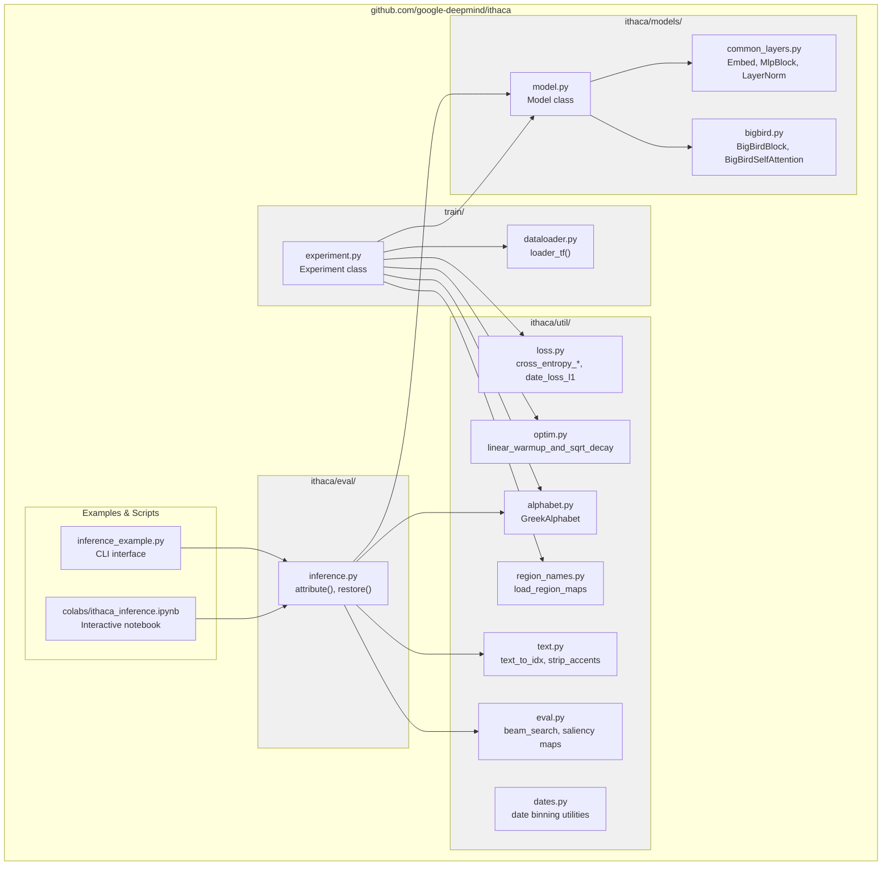
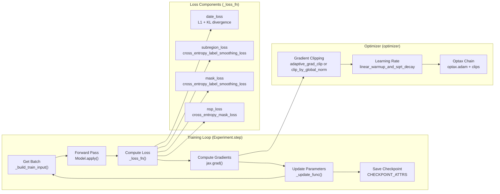
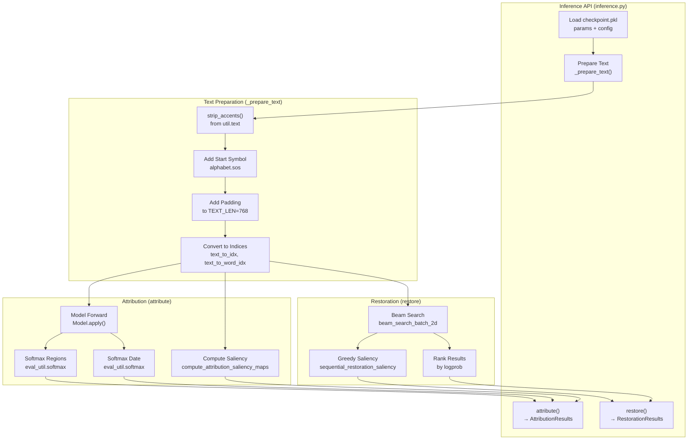
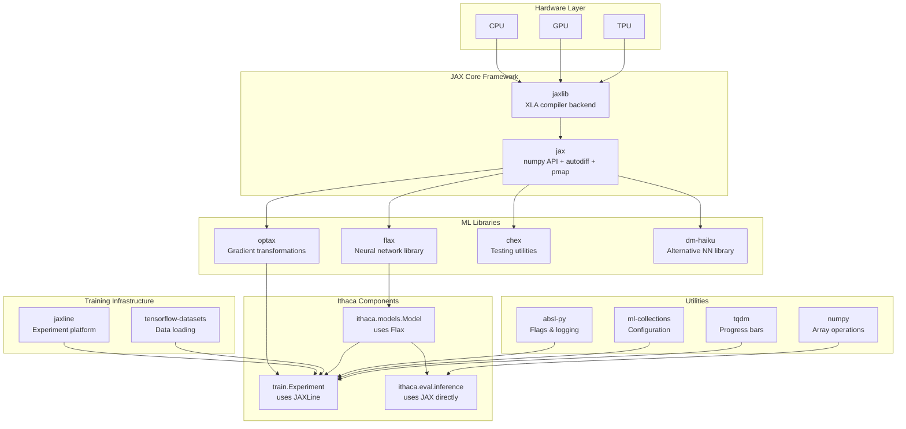

<!-- source: DeepWiki mcp.deepwiki.com · repo google-deepmind/ithaca · page 1.2 System Architecture · fetched 2026-10-26 -->

# System Architecture

<details>
<summary>Relevant source files</summary>

The following files were used as context for generating this wiki page:

- [README.md](README.md)
- [ithaca/eval/inference.py](ithaca/eval/inference.py)
- [requirements.txt](requirements.txt)
- [train/experiment.py](train/experiment.py)

</details>


This document provides a high-level overview of the Ithaca system architecture, describing the relationships between major components and how they interact. For detailed information about the model's neural network architecture, see [Model Architecture](#3). For training procedures, see [Training System](#4). For inference usage, see [Inference System](#5).

## System Overview

Ithaca is organized into three primary subsystems that share a common model core:

1. **Training System**: Distributed training orchestrated by JAXline, using multi-task losses
2. **Inference System**: Lightweight prediction interface for text restoration and attribution
3. **Data Processing Pipeline**: Text normalization, augmentation, and batching utilities

The system follows a standard train-then-deploy pattern where the training system produces a checkpoint file (`checkpoint.pkl`) that the inference system loads for predictions.

## Component Organization

The codebase is structured into distinct packages that separate concerns:



**Sources:** [requirements.txt:1-10](), [README.md:1-130](), [train/experiment.py:1-680](), [ithaca/eval/inference.py:1-269]()

## Core Components

### Training System

The training system is implemented in the `Experiment` class, which extends `jaxline.experiment.AbstractExperiment`. This provides distributed training orchestration, checkpointing, and evaluation.

| Component | Code Entity | Purpose |
|-----------|-------------|---------|
| Training orchestration | `Experiment` class | Manages training loop, parameter updates, checkpointing |
| Model initialization | `Experiment._initialize_train()` | Initializes model parameters from scratch |
| Training step | `Experiment.step()` | Single training iteration |
| Update function | `Experiment._update_func()` | Computes gradients and applies optimizer |
| Loss computation | `Experiment._loss_fn()` | Multi-task loss: date + region + mask + NSP |
| Optimizer | `Experiment.optimizer()` | Configures Optax chain with gradient clipping |
| Data pipeline | `Experiment._build_train_input()` | TensorFlow Dataset with prefetching |
| Evaluation | `Experiment.evaluate()` | Validation loop with composite scoring |



**Key implementation details:**

- **Distributed Training**: Uses `jax.pmap` to parallelize across devices [train/experiment.py:82-83]()
- **Checkpointing**: Stores `_params` and `_opt_state` as sharded device arrays [train/experiment.py:56-59]()
- **Learning Rate Schedule**: Linear warmup followed by sqrt decay [train/experiment.py:85-88]()
- **Composite Scoring**: `mask_acc + region_acc - date_l1*0.01` for best model selection [train/experiment.py:559-560]()
- **Multi-task Weighting**: Each loss component has configurable weight and can be linearly ramped [train/experiment.py:268-269]()

**Sources:** [train/experiment.py:50-369](), [train/experiment.py:377-674]()

### Inference System

The inference system provides two main entry points: `attribute()` for date/region prediction and `restore()` for text restoration. Both are implemented as pure functions that take a forward pass function and return structured results.



**Key constants and parameters:**

| Constant | Value | Purpose |
|----------|-------|---------|
| `TEXT_LEN` | 768 | Fixed model sequence length |
| `MIN_TEXT_LEN` | 50 | Minimum input text length |
| `DATE_MIN` / `DATE_MAX` | -800 / 800 | Date range in years |
| `DATE_INTERVAL` | 10 | Date binning interval (decades) |
| `RESTORATION_BEAM_WIDTH` | 20 | Beam search width |
| `ALPHABET_MISSING_RESTORE` | `'?'` | Character indicating missing text |

**Return types:**

- `AttributionResults`: Contains `locations` (region predictions), `year_scores` (date distribution), and saliency maps [ithaca/eval/inference.py:48-74]()
- `RestorationResults`: Contains `predictions` (beam search results), `top_prediction`, and sequential saliency maps [ithaca/eval/inference.py:99-128]()

**Sources:** [ithaca/eval/inference.py:130-269]()

### Model Core

The `Model` class in [ithaca/models/model.py]() defines the Transformer architecture with BigBird attention. While the detailed implementation is covered in [Model Architecture](#3), the key interface is:

```python
# Model initialization signature
Model(**config.model)

# Forward pass signature  
Model.apply(
    params,
    text_char: array,      # [batch, 768] character indices
    text_word: array,      # [batch, 768] word indices
    text_char_onehot: Optional[array],
    text_word_onehot: Optional[array],
    is_training: bool,
    rngs: dict            # {'dropout': rng_key}
) -> Tuple[date_pred, subregion_logits, mask_logits, nsp_logits]
```

The model accepts both character-level and word-level tokenization and outputs four prediction heads simultaneously.

**Sources:** [train/experiment.py:81](), [train/experiment.py:212-219](), [ithaca/eval/inference.py:194-198]()

## Data Flow Architecture

The following diagram shows how data flows through the system from raw PHI inscriptions to final predictions:

```mermaid
graph TB
    subgraph External["External Data"]
        PHI["PHI Dataset<br/>Searchable Greek Inscriptions"]
    end
    
    subgraph DataPrep["Data Preparation (External)"]
        IPHI["I.PHI Processing<br/>github.com/sommerschield/iphi"]
        Splits["Train/Val/Test Splits<br/>JSON format"]
    end
    
    subgraph LoadingTraining["Loading (Training)"]
        DatasetFile["dataset_path<br/>config.dataset.dataset_path"]
        LoaderTF["loader_tf()<br/>dataloader.py"]
        TFDataset["TensorFlow Dataset<br/>tfds.as_numpy()"]
        Prefetch["Prefetch & Buffer<br/>py_prefetch, double_buffer_on_gpu"]
    end
    
    subgraph Processing["Text Processing (ithaca/util)"]
        GreekAlphabet["GreekAlphabet<br/>char2idx, word2idx"]
        FilterText["alphabet.filter()<br/>normalize diacritics"]
        StripAccents["text.strip_accents()<br/>remove accents"]
        ToIdx["text_to_idx()<br/>text_to_word_idx()"]
        Augment["Augmentation<br/>random_mask_span<br/>random_sentence_swap"]
    end
    
    subgraph ModelTraining["Model (Training)"]
        ModelApply["Model.apply()<br/>is_training=True"]
        LossFn["_loss_fn()<br/>multi-task losses"]
        OptimUpdate["optax.apply_updates()<br/>parameter update"]
    end
    
    subgraph Checkpoint["Checkpoint Storage"]
        SaveParams["Save params<br/>CHECKPOINT_ATTRS"]
        CheckpointPKL["checkpoint.pkl<br/>params + opt_state + config"]
    end
    
    subgraph LoadingInference["Loading (Inference)"]
        LoadCkpt["Load checkpoint.pkl"]
        PrepText["_prepare_text()<br/>add SOS, padding"]
    end
    
    subgraph ModelInference["Model (Inference)"]
        ModelApplyInfer["Model.apply()<br/>is_training=False"]
        PostProcess["Post-processing<br/>softmax, beam_search"]
        Results["AttributionResults<br/>RestorationResults"]
    end
    
    PHI --> IPHI
    IPHI --> Splits
    Splits --> DatasetFile
    DatasetFile --> LoaderTF
    LoaderTF --> TFDataset
    TFDataset --> Prefetch
    
    Prefetch --> FilterText
    FilterText --> StripAccents
    StripAccents --> Augment
    Augment --> ToIdx
    GreekAlphabet --> ToIdx
    
    ToIdx --> ModelApply
    ModelApply --> LossFn
    LossFn --> OptimUpdate
    OptimUpdate --> SaveParams
    SaveParams --> CheckpointPKL
    
    CheckpointPKL --> LoadCkpt
    LoadCkpt --> PrepText
    GreekAlphabet --> PrepText
    PrepText --> ModelApplyInfer
    ModelApplyInfer --> PostProcess
    PostProcess --> Results
```



**Sources:** [train/experiment.py:171-196](), [ithaca/eval/inference.py:142-184]()

## Deployment Modes

Ithaca supports two deployment configurations, controlled by installation mode:

### Core Installation (Inference Only)

For end-users who only need to run predictions:

```bash
pip install .
```

**Included components:**
- `ithaca.models.*` - Model definitions
- `ithaca.util.*` - Utility functions
- `ithaca.eval.inference` - Inference functions
- Dependencies: `jax`, `jaxlib`, `flax`, `numpy`, `absl-py`, `chex`, `dm-haiku`, `ml-collections`, `tqdm`

**Excluded components:**
- `train/` directory (training scripts)
- Heavy dependencies: `optax`, `jaxline`, `tensorflow-datasets`

**Sources:** [requirements.txt:1-10](), [README.md:79-114]()

### Full Installation (Training + Inference)

For researchers and developers who need to train models:

```bash
pip install .[train]  # includes additional dependencies
```

**Additional components:**
- `train/experiment.py` - Training orchestration
- `train/dataloader.py` - Data loading pipeline
- Additional dependencies: `optax` (optimization), `jaxline` (experiment management), `tensorflow-datasets` (data loading)

**Sources:** [README.md:124-125]()

## Checkpoint Format

The `checkpoint.pkl` file serves as the bridge between training and inference. It is a pickled dictionary containing:

| Key | Content | Usage |
|-----|---------|-------|
| `params` | Model parameters (Flax frozen dict) | Loaded into `Model.apply()` |
| `opt_state` | Optimizer state (training only) | Not used in inference |
| `config` | Model configuration dict | Reconstructs model architecture |
| `alphabet` | `GreekAlphabet` instance | Text tokenization |
| `region_map` | Region ID to name mappings | Location predictions |

The checkpoint is saved during training [train/experiment.py:56-59]() and loaded for inference. During training, the `Experiment` class manages checkpointing via JAXline's platform utilities. The checkpoint file is hosted externally (Google Cloud Storage) and not included in the repository.

**Sources:** [train/experiment.py:56-59](), [README.md:84-87]()

## Technology Stack

The system is built on the JAX ecosystem, which provides automatic differentiation, JIT compilation, and hardware acceleration:



**Key architectural decisions:**
- **Flax over Haiku**: Object-oriented module system preferred for model definition
- **JAXLine for training**: Provides distributed training, checkpointing, and experiment management
- **Direct JAX for inference**: Minimal dependencies for deployment
- **Optax for optimization**: Composable gradient transformations enable complex schedules
- **TensorFlow Datasets**: Efficient data loading with prefetching and parallelism

**Sources:** [requirements.txt:1-10](), [train/experiment.py:38-45]()

---

