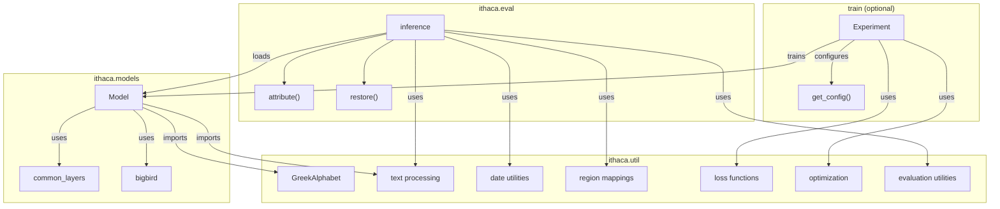
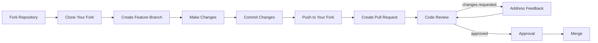
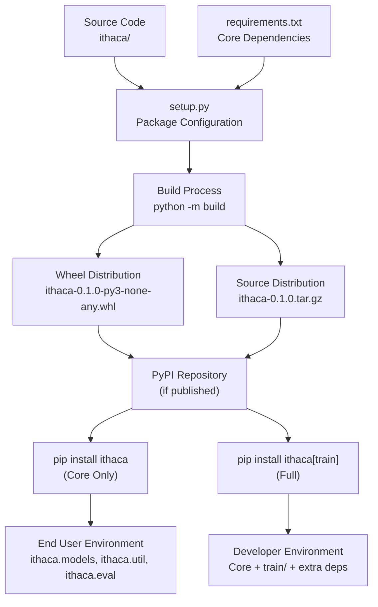

<!-- source: DeepWiki mcp.deepwiki.com · repo google-deepmind/ithaca · page 7 Development Guide · fetched 2026-10-26 -->

# Development Guide

<details>
<summary>Relevant source files</summary>

The following files were used as context for generating this wiki page:

- [AUTHORS](AUTHORS)
- [CONTRIBUTING.md](CONTRIBUTING.md)
- [LICENSE](LICENSE)
- [setup.py](setup.py)

</details>


This document provides information for developers who want to contribute to the Ithaca codebase, understand its structure, or extend its functionality. It covers repository organization, development setup, contribution guidelines, and licensing terms.

For information about using Ithaca for inference, see [Getting Started](#2). For training new models, see [Training System](#4).

---

## Project Structure

The Ithaca repository is organized to separate inference components (always installed) from training components (optional). This design enables lightweight deployment for end users while providing full functionality for researchers.

### Repository Layout

```mermaid
graph TB
    ROOT["ithaca/ (root)"]
    
    subgraph "Core Package (Always Installed)"
        MODELS["ithaca/models/"]
        MODEL_PY["model.py"]
        COMMON["common_layers.py"]
        BIGBIRD["bigbird.py"]
        
        UTIL["ithaca/util/"]
        ALPHABET["alphabet.py"]
        TEXT["text.py"]
        DATES["dates.py"]
        REGION["region_names.py"]
        LOSS["loss.py"]
        OPTIM["optim.py"]
        EVAL_UTIL["eval.py"]
        
        EVAL_DIR["ithaca/eval/"]
        INFERENCE["inference.py"]
        
        MODELS --> MODEL_PY
        MODELS --> COMMON
        MODELS --> BIGBIRD
        
        UTIL --> ALPHABET
        UTIL --> TEXT
        UTIL --> DATES
        UTIL --> REGION
        UTIL --> LOSS
        UTIL --> OPTIM
        UTIL --> EVAL_UTIL
        
        EVAL_DIR --> INFERENCE
    end
    
    subgraph "Training Code (Optional)"
        TRAIN["train/"]
        EXPERIMENT["experiment.py"]
        CONFIG["config.py"]
        
        TRAIN --> EXPERIMENT
        TRAIN --> CONFIG
    end
    
    subgraph "Examples & Documentation"
        COLABS["colabs/"]
        NOTEBOOK["ithaca_inference.ipynb"]
        
        EXAMPLES["inference_example.py"]
        README["README.md"]
        
        COLABS --> NOTEBOOK
    end
    
    subgraph "Configuration Files"
        SETUP["setup.py"]
        REQUIREMENTS["requirements.txt"]
        GITIGNORE[".gitignore"]
        
        CONTRIBUTING["CONTRIBUTING.md"]
        LICENSE_FILE["LICENSE"]
        AUTHORS_FILE["AUTHORS"]
    end
    
    ROOT --> MODELS
    ROOT --> UTIL
    ROOT --> EVAL_DIR
    ROOT --> TRAIN
    ROOT --> COLABS
    ROOT --> EXAMPLES
    ROOT --> README
    ROOT --> SETUP
    ROOT --> REQUIREMENTS
    ROOT --> GITIGNORE
    ROOT --> CONTRIBUTING
    ROOT --> LICENSE_FILE
    ROOT --> AUTHORS_FILE
```



**Sources:** [setup.py:1-53](), [.gitignore]()

### Package Organization

The `setup.py` file defines two installation modes that determine which components are included:

| Installation Mode | Command | Components Included | Use Case |
|------------------|---------|---------------------|----------|
| **Core** | `pip install ithaca` | `ithaca.models`, `ithaca.util`, `ithaca.eval` | Inference only, minimal dependencies |
| **Full** | `pip install ithaca[train]` | Core + `train/` + training dependencies | Model training, development, research |

The exclusion mechanism is defined in [setup.py:35]():

```python
packages=setuptools.find_packages(exclude=('train',))
```

This ensures that `train/` is not included in the core installation. Training dependencies are defined in [setup.py:38-44]():

```python
extras_require={
    'train': [
        'optax',
        'jaxline==0.0.5',
        'tensorflow-datasets',
    ]
}
```

**Sources:** [setup.py:1-53]()

### Module Hierarchy



**Sources:** [setup.py:35-44]()

---

## Development Setup

### Installing for Development

To set up a development environment with full functionality:

```bash
# Clone the repository
git clone https://github.com/google-deepmind/ithaca.git
cd ithaca

# Install in editable mode with training dependencies
pip install -e .[train]
```

The `-e` flag installs the package in editable mode, allowing you to modify the source code without reinstalling.

### Dependencies

Core dependencies (always required) are defined in [requirements.txt]():

| Dependency | Purpose |
|------------|---------|
| `jax`, `jaxlib` | Core computation framework with XLA compilation |
| `flax` | Neural network library for model definition |
| `dm-haiku` | Alternative neural network library (available but not primary) |
| `numpy` | Array operations |
| `absl-py` | Command-line flag handling and logging |
| `ml-collections` | Configuration management |
| `chex` | Testing and validation utilities |
| `tqdm` | Progress bars |

Training dependencies (optional, installed with `[train]` extra):

| Dependency | Purpose |
|------------|---------|
| `optax` | Gradient processing and optimization |
| `jaxline==0.0.5` | Training platform with experiment management |
| `tensorflow-datasets` | Data loading infrastructure |

**Sources:** [setup.py:37-44](), [requirements.txt]()

### Package Metadata

The package metadata is defined in [setup.py:26-52]():

| Field | Value |
|-------|-------|
| **Name** | `ithaca` |
| **Version** | `0.1.0` |
| **License** | Apache License, Version 2.0 |
| **Author** | Ithaca team |
| **Email** | deepmind-ithaca-team@google.com |
| **Description** | Ithaca library for ancient text restoration and attribution |
| **Classifiers** | Beta status, Science/Research audience, Apache license |

**Sources:** [setup.py:26-52]()

---

## Contributing

### Contributor License Agreement

All contributions to this project must be accompanied by a Contributor License Agreement (CLA). The CLA process:

1. **First-time contributors**: Sign the CLA at https://cla.developers.google.com/
2. **Subsequent contributions**: If you've signed a CLA for any Google project, you don't need to sign again
3. **Corporate contributors**: Your employer may need to sign on your behalf
4. **Copyright retention**: You or your employer retain copyright; the CLA grants permission for use and redistribution

As stated in [CONTRIBUTING.md:8-10]():

> Contributions to this project must be accompanied by a Contributor License Agreement (CLA). You (or your employer) retain the copyright to your contribution; this simply gives us permission to use and redistribute your contributions as part of the project.

**Sources:** [CONTRIBUTING.md:1-30]()

### Code Review Process



All submissions require code review, including submissions by project members. The process follows GitHub's pull request workflow:

1. **Fork and clone**: Create your own fork of the repository
2. **Create a branch**: Use descriptive branch names (e.g., `feature/add-saliency-visualization`)
3. **Make changes**: Follow existing code style and conventions
4. **Submit PR**: Include clear description of changes and motivation
5. **Address feedback**: Respond to reviewer comments and make requested changes
6. **Approval**: At least one maintainer must approve
7. **Merge**: Maintainers will merge approved PRs

For more information on pull requests, see [GitHub's documentation](https://help.github.com/articles/about-pull-requests).

**Sources:** [CONTRIBUTING.md:19-24]()

### Community Guidelines

This project follows [Google's Open Source Community Guidelines](https://opensource.google/conduct). Key principles:

- **Be respectful**: Treat all contributors with respect
- **Be constructive**: Provide helpful feedback and suggestions
- **Be collaborative**: Work together to improve the project
- **Follow standards**: Adhere to existing code style and conventions

**Sources:** [CONTRIBUTING.md:26-29]()

### File Organization Guidelines

When contributing code, follow these organizational principles:

| Component Type | Location | Examples |
|----------------|----------|----------|
| **Core model code** | `ithaca/models/` | `Model`, `BigBirdBlock`, `MlpBlock` |
| **Utility functions** | `ithaca/util/` | `GreekAlphabet`, text processing, date utilities |
| **Inference code** | `ithaca/eval/` | `attribute()`, `restore()` |
| **Training code** | `train/` | `Experiment`, training configuration |
| **Examples** | Root or `colabs/` | CLI scripts, Jupyter notebooks |
| **Tests** | Adjacent to source | `*_test.py` files |
| **Documentation** | Root or relevant module | `README.md`, docstrings |

**Exclusion from distribution**: Files in `train/` are excluded from the core package distribution via [setup.py:35](). This separation ensures lightweight deployment for inference-only users.

**Sources:** [setup.py:35]()

---

## Licensing

### Apache License 2.0

Ithaca is licensed under the Apache License, Version 2.0. The full license text is available in [LICENSE:1-203]().

**Key permissions:**
- **Use**: Commercial and non-commercial use permitted
- **Modification**: You may modify the source code
- **Distribution**: You may distribute original or modified versions
- **Patent grant**: Contributors grant patent rights for their contributions

**Key conditions:**
- **License inclusion**: Include a copy of the license with distributions
- **State changes**: Mark modified files with prominent notices
- **Attribution**: Retain copyright, patent, trademark, and attribution notices
- **No trademark use**: License does not grant permission to use trade names or trademarks

**Disclaimer**: The software is provided "AS IS" without warranties of any kind. See [LICENSE:144-152]() for full warranty disclaimer and [LICENSE:154-164]() for limitation of liability.

**Sources:** [LICENSE:1-203]()

### Copyright Holders

Copyright holders are listed in [AUTHORS:1-13]():

| Entity | Type |
|--------|------|
| **DeepMind Technologies Limited** | Corporate copyright holder |
| **Google LLC** | Corporate copyright holder |
| **Thea Sommerschield** | Individual contributor |
| **Jonathan Prag** | Individual contributor |
| **Marita Chatzipanagiotou** | Individual contributor |
| **John Pavlopoulos** | Individual contributor |
| **Ion Androutsopoulos** | Individual contributor |

As noted in [AUTHORS:3-5](), this list represents copyright holders, not necessarily all contributors, since employers may hold copyright for work done by their employees.

**Sources:** [AUTHORS:1-13]()

### License Headers

All source files include a standard Apache 2.0 license header, as shown in [setup.py:1-13]():

```python
# Copyright 2021 the Ithaca Authors
#
# Licensed under the Apache License, Version 2.0 (the "License");
# you may not use this file except in compliance with the License.
# You may obtain a copy of the License at
#
#     https://www.apache.org/licenses/LICENSE-2.0
#
# Unless required by applicable law or agreed to in writing, software
# distributed under the License is distributed on an "AS IS" BASIS,
# WITHOUT WARRANTIES OR CONDITIONS OF ANY KIND, either express or implied.
# See the License for the specific language governing permissions and
# limitations under the License.
```

**Contributors**: When adding new files, include this standard header to maintain consistent licensing documentation throughout the codebase.

**Sources:** [setup.py:1-13]()

---

## Distribution and Packaging

### Package Distribution Workflow



**Sources:** [setup.py:1-53]()

### Build Configuration

The `setup.py` configuration uses `setuptools.find_packages()` to automatically discover Python packages, with the exclusion of `train/`:

- **Line 35**: `packages=setuptools.find_packages(exclude=('train',))`
- **Line 36**: `package_data={'': ['*.txt']}` includes text files (e.g., vocabulary files, region mappings)
- **Line 37**: `install_requires=(here / 'requirements.txt').read_text().splitlines()` reads dependencies from `requirements.txt`

This configuration ensures:
1. **Automatic discovery**: All packages under `ithaca/` are included
2. **Training exclusion**: `train/` is explicitly excluded for core installs
3. **Data inclusion**: Text files (vocabularies, mappings) are packaged
4. **Dependency management**: Core dependencies are always installed, training dependencies are optional

**Sources:** [setup.py:35-44]()

### Version Control Exclusions

The `.gitignore` file excludes build artifacts and runtime files:

- Python bytecode: `*.pyc`, `__pycache__/`
- Build outputs: `build/`, `dist/`, `*.egg-info/`
- Model checkpoints: `checkpoint.pkl` (hosted separately on Google Cloud Storage)
- IDE files: `.DS_Store`, editor-specific directories

This separation keeps the repository focused on source code while allowing large model files to be distributed separately via Google Cloud Storage.

**Sources:** [.gitignore]()

---

## Development Best Practices

### Code Organization Principles

1. **Separation of concerns**: Keep inference code (always installed) separate from training code (optional)
2. **Modular design**: Use `ithaca.models.common_layers` for reusable components like `Embed`, `MlpBlock`, `LayerNorm`
3. **Dependency management**: Keep core dependencies minimal; only add training dependencies to `extras_require`
4. **Documentation**: Include docstrings for all public functions and classes
5. **Type hints**: Use Python type hints where applicable for better code clarity

### Testing Considerations

While test files are not included in the provided sources, contributors should:

- Write unit tests for new functionality
- Place test files adjacent to source files (e.g., `alphabet_test.py` next to `alphabet.py`)
- Use `chex` for JAX-specific testing and validation
- Test on both CPU and GPU/TPU if hardware-specific behavior is expected

### Contribution Checklist

Before submitting a pull request:

- [ ] Code follows existing style and conventions
- [ ] All files include Apache 2.0 license header
- [ ] Docstrings added for public functions/classes
- [ ] Tests added for new functionality
- [ ] Documentation updated if necessary
- [ ] CLA signed (first-time contributors)
- [ ] Changes described clearly in PR description

**Sources:** [CONTRIBUTING.md:1-30](), [LICENSE:1-203](), [setup.py:1-53]()

---

