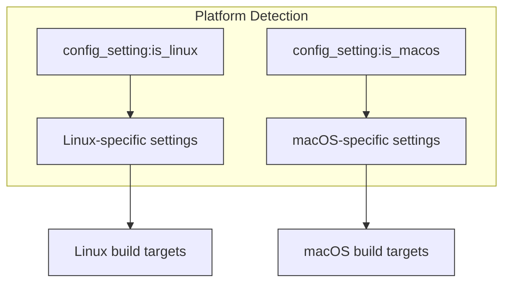
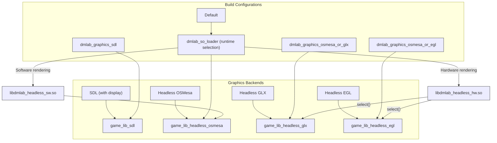
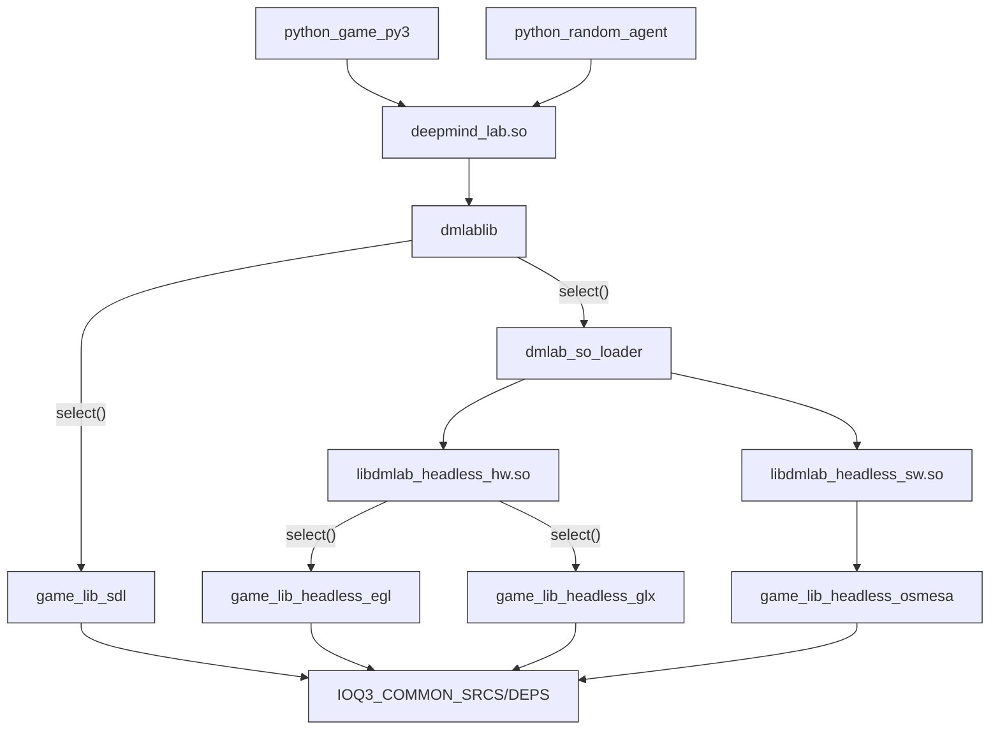

<!-- source: DeepWiki mcp.deepwiki.com · repo google-deepmind/lab · page 8.2 Build Options · fetched 2026-10-26 -->

# Build Options

<details>
<summary>Relevant source files</summary>

The following files were used as context for generating this wiki page:

- [.github/workflows/precommit.yml](.github/workflows/precommit.yml)
- [.precommit.bazelrc](.precommit.bazelrc)
- [BUILD](BUILD)
- [WORKSPACE](WORKSPACE)
- [bazel/dm_env.BUILD](bazel/dm_env.BUILD)
- [bazel/pybind11.BUILD](bazel/pybind11.BUILD)
- [bazel/tree.BUILD](bazel/tree.BUILD)
- [docs/users/build.md](docs/users/build.md)
- [public/dmlab_connect_test.cc](public/dmlab_connect_test.cc)
- [python/tests/BUILD](python/tests/BUILD)
- [python/tests/utils/BUILD](python/tests/utils/BUILD)
- [python_system.bzl](python_system.bzl)

</details>


This page documents the build options and configurations available when building DeepMind Lab using the Bazel build system. It covers platform support, compiler configurations, graphics backends, and other build-time customizations. For general build setup instructions, see [Getting Started](#2) and [Installation](#2.1).

## Overview of DeepMind Lab's Build System

DeepMind Lab uses [Bazel](https://bazel.build) as its build system. The build configuration is defined through several key files:

- `BUILD` - Main build file defining targets and dependencies
- `WORKSPACE` - External dependencies and repository configuration
- `.bazelrc` files - Build option defaults
- Command-line options - Override defaults when invoking Bazel

The build system allows for customizing various aspects of the build process, including:

1. Platform-specific configurations
2. Compiler and optimization settings
3. Graphics backends (SDL, OSMesa, GLX, EGL)
4. Python version and dependencies

Sources: [BUILD:1-10](), [WORKSPACE:1-10](), [docs/users/build.md:1-20]()

## Basic Bazel Commands

Here are the fundamental Bazel commands for building DeepMind Lab:

| Command | Description | Example |
|---------|-------------|---------|
| `bazel build` | Build a specific target | `bazel build -c opt //:deepmind_lab.so` |
| `bazel test` | Run tests | `bazel test -c opt //python/tests:python_module_test` |
| `bazel run` | Build and run a binary | `bazel run -c opt //:python_random_agent` |

The `-c opt` flag enables optimizations for better performance.

Sources: [docs/users/build.md:74-94]()

## Platform-specific Configurations

DeepMind Lab supports building on different platforms through Bazel's `config_setting` mechanism.



The platform configurations are defined in the main BUILD file:

```
config_setting(
    name = "is_linux",
    constraint_values = ["@platforms//os:linux"],
)

config_setting(
    name = "is_macos",
    constraint_values = ["@platforms//os:macos"],
)
```

These settings are used with Bazel's `select()` function to choose appropriate dependencies and build options for each platform.

Sources: [BUILD:9-17]()

## Compiler Options

DeepMind Lab uses the following compiler options:

### C++ Standard

DeepMind Lab requires C++17 support. This is specified in the `.precommit.bazelrc` file:

```
build --cxxopt=-std=c++17
```

### Compiler Selection

You can specify which compiler to use by setting the `CC` and `CXX` environment variables:

```shell
CC=clang CXX=clang++ bazel build -c opt //:deepmind_lab.so
```

### Standard Compiler Options

Common compiler options are defined in the `IOQ3_COMMON_COPTS` variable:

```
IOQ3_COMMON_COPTS = [
    "-std=c99",
    "-fno-common",
    "-fno-strict-aliasing",
    ARCH_VAR,
    STANDALONE_VAR,
]
```

Where:
- `ARCH_VAR` defines the target architecture (e.g., `"-DARCH_STRING=\\\"x86_64\\\""`)
- `STANDALONE_VAR` specifies standalone mode (`"-DSTANDALONE"`)

### C++ Standard Library Options

DeepMind Lab supports building with either GNU's libstdc++ (default) or LLVM's libc++. The libc++ configuration is defined in `.precommit.bazelrc`:

```
build:libc++ --repo_env=CXXFLAGS=-stdlib=libc++
build:libc++ --repo_env=LDFLAGS=-stdlib=libc++:-fuse-ld=lld
build:libc++ --repo_env=BAZEL_CXXOPTS=-stdlib=libc++
build:libc++ --repo_env=BAZEL_LINKOPTS=-lc++:-lm:-fuse-ld=lld
```

To build with libc++, use:

```shell
bazel build --config=libc++ -c opt //:deepmind_lab.so
```

Sources: [BUILD:20-23](), [BUILD:646-652](), [.precommit.bazelrc:6](), [.precommit.bazelrc:11-14](), [.github/workflows/precommit.yml:24-27]()

## Graphics Backend Options

DeepMind Lab supports multiple graphics backends, selected at build time through configuration settings.



### Available Graphics Backends

1. **SDL (with display)**
   - Used for environments with a visible window
   - Defined in the `game_lib_sdl` target (BUILD:802-823)

2. **Headless OSMesa**
   - Software rendering without a display
   - Defined in the `game_lib_headless_osmesa` target (BUILD:826-846)

3. **Headless GLX**
   - Hardware rendering without a visible window (X11-based)
   - Defined in the `game_lib_headless_glx` target (BUILD:849-869)

4. **Headless EGL**
   - Hardware rendering without a visible window (EGL-based)
   - Defined in the `game_lib_headless_egl` target (BUILD:872-892)

### Selecting a Graphics Backend

You can select a graphics backend using `--define graphics=...` option:

```shell
# Build with SDL backend (visible window)
bazel build --define graphics=sdl -c opt //:deepmind_lab.so

# Build with OSMesa or GLX backend (headless)
bazel build --define graphics=osmesa_or_glx -c opt //:deepmind_lab.so

# Build with OSMesa or EGL backend (headless)
bazel build --define graphics=osmesa_or_egl -c opt //:deepmind_lab.so
```

By default, the build uses a dynamic loader that can select between hardware and software rendering at runtime.

Sources: [BUILD:802-892](), [BUILD:937-950](), [BUILD:952-975](), [BUILD:977-994](), [BUILD:996-1010]()

## Python Configuration

DeepMind Lab can be built with Python 2 or Python 3 support. The default is Python 3.

### Python Version Selection

The Python version is configured in the WORKSPACE file:

```python
python_repo(
    name = "python_system",
    py_version = "PY3",
)
```

You can also specify the Python version for individual targets using the `python_version` attribute:

```python
py_binary(
    name = "python_game_py3",
    srcs = ["examples/game_main.py"],
    data = ["//:deepmind_lab.so"],
    main = "examples/game_main.py",
    python_version = "PY3",
    srcs_version = "PY3",
    deps = ["@six_archive//:six"],
)
```

### Python Dependencies

DeepMind Lab has the following Python dependencies:
- NumPy
- PIL (Python Imaging Library)
- Six (for Python 2/3 compatibility)

The build system automatically detects the Python installation path and NumPy include directories using the `python_system.bzl` script.

Sources: [WORKSPACE:162-165](), [BUILD:923-935](), [python_system.bzl:1-72](), [docs/users/build.md:96-131]()

## Build Performance Options

### Parallelism

Control the number of parallel jobs with the `--jobs` option:

```shell
bazel build --jobs=8 -c opt //:deepmind_lab.so
```

The default in the precommit configuration is 2 jobs:

```
common --jobs=2
```

### Compilation Mode

The compilation mode can be set with the `-c` or `--compilation_mode` flag:

```shell
# Optimized build
bazel build -c opt //:deepmind_lab.so

# Debug build
bazel build -c dbg //:deepmind_lab.so

# Fastbuild (minimal optimization)
bazel build -c fastbuild //:deepmind_lab.so
```

### Dynamic vs Static Linking

DeepMind Lab can be built with static or dynamic linking:

```shell
# Static linking (default in precommit)
bazel build --dynamic_mode=off -c opt //:deepmind_lab.so

# Dynamic linking
bazel build --dynamic_mode=default -c opt //:deepmind_lab.so
```

Sources: [.precommit.bazelrc:1-5](), [docs/users/build.md:74-94]()

## Testing Options

DeepMind Lab includes various tests that can be run with Bazel.

### Running Tests

```shell
# Run all tests
bazel test -c opt //...

# Run a specific test
bazel test -c opt //python/tests:python_module_test
```

### Test Tags

Tests can be tagged with attributes like `manual` or `noprecommit`:

```python
py_test(
    name = "render_test",
    srcs = ["render_test.py"],
    data = ["//:deepmind_lab.so"],
    imports = ["python"],
    tags = ["manual"],  # Test won't run by default
    deps = ["@com_google_absl_py//absl/testing:absltest"],
)
```

To control which tests run based on tags:

```shell
# Run only tests without the 'noprecommit' tag
bazel test --test_tag_filters=-noprecommit -c opt //...

# Run tests with specific tags
bazel test --test_tag_filters=manual -c opt //...
```

Sources: [python/tests/BUILD:25](), [python/tests/BUILD:219](), [python/tests/BUILD:229](), [.precommit.bazelrc:8-9](), [.github/workflows/precommit.yml:44-49]()

## Example Configurations

Here are some common build configurations:

### Standard Optimized Build

```shell
bazel build -c opt //:deepmind_lab.so
```

### Headless Build with OSMesa

```shell
bazel build --define graphics=osmesa_or_glx -c opt //:deepmind_lab.so
```

### Build with LLVM and libc++

```shell
CC=clang CXX=clang++ bazel build --config=libc++ -c opt //:deepmind_lab.so
```

### Build with Custom Warnings

```shell
bazel build --copt=-Wno-sign-compare --copt=-Wno-maybe-uninitialized -c opt //:deepmind_lab.so
```

Sources: [.github/workflows/precommit.yml:42-52](), [docs/users/build.md:74-94]()

## Target Dependency Structure

DeepMind Lab's main targets have the following dependency structure:



This structure allows for flexibility in how DeepMind Lab is built and which graphics backend is used.

Sources: [BUILD:802-1010](), [BUILD:1012-1033](), [BUILD:1047-1060]()

## Common Build Issues and Solutions

| Issue | Solution |
|-------|----------|
| Missing dependencies | Install required packages with `apt-get` or appropriate package manager |
| Python version mismatch | Specify correct Python version with `--python_path` or update `WORKSPACE` |
| Graphics backend errors | Ensure appropriate libraries are installed (libGL, OSMesa, EGL) |
| Compilation errors | Try different compiler options or update compiler version |
| Build performance | Increase parallelism with `--jobs` option |

Sources: [docs/users/build.md:29-70]()

---

